阿里云  
专有云企业版  
灾备管理中心  
用户指南（混合云备份）  
产品版本：v3.18.0  
文档版本：20231123

**目录**

- [1.什么是备份管理平台ASR-BR](#section-1)
- [2.角色和权限说明](#section-2)
- [3.使用流程](#section-3)
- [4.登录备份管理控制台](#section-4)
- [5.创建存储池](#section-5)
- [6.首页](#section-6)
- [7.实例管理](#section-7)
    - [7.1. 查看实例列表](#section-7-1)
    - [7.2. 修改所属的备份计划](#section-7-2)
    - [7.3. 查看备份时长](#section-7-3)
- [8.备份仓库](#section-8)
    - [8.1. 创建备份仓库](#section-8-1)
    - [8.2. 查看备份仓库的数据](#section-8-2)
    - [8.3. 管理备份仓库](#section-8-3)
- [9.备份计划](#section-9)
    - [9.1. 创建备份计划](#section-9-1)
    - [9.2. 查看备份计划](#section-9-2)
    - [9.3. 启动备份计划](#section-9-3)
    - [9.4. 立即备份](#section-9-4)
    - [9.5. 停止备份计划](#section-9-5)
    - [9.6. 修改备份计划的配置信息](#section-9-6)
    - [9.7. 修改备份计划的策略](#section-9-7)
    - [9.8. 查看RDS日志备份](#section-9-8)
    - [9.9. 查看备份事件](#section-9-9)
    - [9.10. 查看备份统计](#section-9-10)
- [10.备份记录](#section-10)
- [11.恢复任务](#section-11)
    - [11.1. 新建常规恢复任务](#section-11-1)
    - [11.2. 启动恢复任务](#section-11-2)
    - [11.3. 停止恢复任务](#section-11-3)
    - [11.4. 查看恢复任务](#section-11-4)
    - [11.5. 查看恢复事件](#section-11-5)
- [12.VMware备份恢复](#section-12)
    - [12.1. 安装备份网关虚拟机](#section-12-1)
    - [12.2. 注册备份网关](#section-12-2)
    - [12.3. 新建vCenter](#section-12-3)
    - [12.4. 新建虚拟机备份计划](#section-12-4)
    - [12.5. 恢复VMware虚拟机](#section-12-5)
- [13.VMware迁移](#section-13)
    - [13.1. 将VMware迁移至ECS](#section-13-1)
    - [13.2. 查看迁移任务的详情](#section-13-2)
    - [13.3. 查看迁移记录](#section-13-3)
    - [13.4. 查看迁移日志](#section-13-4)
- [14.告警管理](#section-14)
    - [14.1. 查看告警记录](#section-14-1)
    - [14.2. 告警记录标为已读](#section-14-2)
    - [14.3. 删除告警记录](#section-14-3)
- [15.系统管理](#section-15)
    - [15.1. 存储池管理](#section-15-1)
    - [15.2. 自备份管理](#section-15-2)
        - [15.2.1. 设置元数据的备份策略](#section-15-2-1)
        - [15.2.2. 查看元数据备份记录](#section-15-2-2)
    - [15.3. 灾难恢复](#section-15-3)
    - [15.4. 授权管理](#section-15-4)
        - [15.4.1. 查看License授权项](#section-15-4-1)
        - [15.4.2. 给各组织分配授权](#section-15-4-2)
    - [15.5. 权限管理](#section-15-5)
- [16.运维管理](#section-16)
    - [16.1. 流控配置](#section-16-1)
    - [16.2. 引擎监控](#section-16-2)
    - [16.3. 资源统计](#section-16-3)
    - [16.4. 查看操作日志](#section-16-4)
    - [16.5. STS配置](#section-16-5)
    - [16.6. 参数配置](#section-16-6)
    - [16.7. 域名管理](#section-16-7)
        - [16.7.1. 添加域名](#section-16-7-1)
        - [16.7.2. 修改域名](#section-16-7-2)
    - [16.8. 事件管理](#section-16-8)
- [17.备份最佳实践](#section-17)
    - [17.1. 数据库类云产品备份最佳实践](#section-17-1)
        - [17.1.1. RDS备份](#section-17-1-1)
        - [17.1.2. PolarDB-X 1.0备份](#section-17-1-2)
        - [17.1.3. ADB for Mysql备份](#section-17-1-3)
    - [17.2. 文件类存储产品备份最佳实践](#section-17-2)
        - [17.2.1. OSS备份](#section-17-2-1)
        - [17.2.2. NAS备份](#section-17-2-2)
        - [17.2.3. ECS文件备份](#section-17-2-3)
        - [17.2.4. ECS整机备份](#section-17-2-4)
    - [17.3. 大数据类产品备份最佳实践](#section-17-3)
        - [17.3.1. MaxCompute备份](#section-17-3-1)
- [18.附录](#section-18)
    - [18.1. 在ECS上安装HBR-Agent](#section-18-1)
    - [18.2. 为组织配置ASR-BR服务角色](#section-18-2)

<a id="section-1"></a>

# 1.什么是备份管理平台ASR-BR

备份管理平台ASR-BR是一款专注于专有云备份与恢复的云平台产品，当前支持的产品包括：云数据库RDS、对象存储OSS、云服务器ECS（文件和整机）、文件存储NAS、云原生分布式数据库PolarDB-X 1.0、VMware虚拟机、大数据计算MaxCompute、云原生数据仓库AnalyticDB MySQL版3.0和Elasticsearch on k8s。

**功能概述**

- 首页

  首页展示系统实时情况、备份恢复情况统计、资源统计数据、备份引擎监控和系统告警。

- 实例列表

  基于租户视角的云产品实例查看页面，在该页面用户可以轻松查看实例是否已经设置了备份计划。

- 备份仓库

  备份云中心用于存储产品备份数据仓库管理页面，目前备份仓库的存储介质只支持OSS。您可以创建数据库类备份仓库、存储类备份仓库和重删存储类备份仓库。

- 备份计划

  基于租户的视角管理目前系统中的所有备份计划。

- 备份记录

  通过查看备份记录，您可以了解某实例的备份执行记录，包括备份的备份集大小、记录状态、存储位置、开始时间、过期时间等相关信息。

- 恢复任务

  基于租户的视角管理目前系统中的恢复任务。恢复任务根据使用场景包括常规恢复、灾难恢复、VMware云上恢复和VMware本地恢复。

- 迁移计划

  通过迁移计划，您可以将本地VMware迁移至专有云ECS。

- 告警管理

  通过查看系统的告警信息，可以了解当前系统是否发生异常，以便发生异常后及时排除故障。

- 系统管理

  系统管理包括存储池管理、自备份管理、灾难恢复、vCenter管理、授权管理和权限管理功能。

- 运维管理

  运维管理包括流控配置、引擎监控、资源统计、日志管理、STS配置、参数配置、域名管理和事件管理。

- 帮助文档

  备份管理控制台的联机帮助，为您提供操作指导。

<a id="section-2"></a>

# 2.角色和权限说明

本文介绍ASR-BR备份运营管理员、组织备份管理员、组织备份操作员和组织备份监察员四种角色的登录方式和权限。

**角色概要介绍**

备份运营管理员、组织备份管理员、组织备份操作员和组织备份监察员的角色登录方式如下表所示。

> **说明**
>
> 如果您需要为用户增加ASR-BR以下四种角色，请参见权限管理操作。

<table>
  <tr>
    <th width="137">角色</th>
    <th>登录方式</th>
  </tr>
  <tr>
    <td>备份运营管理员</td>
    <td>• 通过运营管理员登录Apsara Uni-manager运营控制台，选择root组织跳转登录备份管理平台ASR-BR。<br>• 通过备份运营管理员登录Apsara Uni-manager运营控制台，选择任意组织跳转登录备份管理平台ASR-BR。</td>
  </tr>
  <tr>
    <td>组织备份管理员</td>
    <td>• 通过组织管理员登录Apsara Uni-manager运营控制台，选择所属组织跳转登录备份管理平台ASR-BR。<br>• 通过运营管理员登录Apsara Uni-manager运营控制台，选择非root组织跳转登录备份管理平台ASR-BR。<br>• 通过组织备份管理员登录Apsara Uni-manager运营控制台，选择所属组织跳转登录备份管理平台ASR-BR。</td>
  </tr>
  <tr>
    <td>组织备份操作员</td>
    <td>• 通过组织备份操作员登录Apsara Uni-manager运营控制台，选择所属组织跳转登录备份管理平台ASR-BR。</td>
  </tr>
  <tr>
    <td>组织备份监察员</td>
    <td>• 通过组织资源监察员登录Apsara Uni-manager运营控制台，选择所属组织跳转登录备份管理平台ASR-BR。<br>• 通过组织备份监察员登录Apsara Uni-manager运营控制台，选择所属组织跳转登录备份管理平台ASR-BR。</td>
  </tr>
</table>

**角色权限说明**

备份运营管理员、组织备份管理员、组织备份操作员和组织备份监察员在备份管理平台ASR-BR上的操作权限如下表所示。

> **说明**
>
> - 备份运营管理员操作权限的范围为全部组织。
>
> - 组织备份管理员、组织备份操作员、组织备份监察员操作权限的范围为所属组织及下级组织。

<table>
  <tr>
    <th>功能</th>
    <th>操作</th>
    <th>备份运营管理员</th>
    <th>组织备份管理员</th>
    <th>组织备份操作员</th>
    <th>组织备份监察员</th>
  </tr>
  <tr>
    <td>实例列表</td>
    <td>查看</td>
    <td>支持</td>
    <td>支持</td>
    <td>支持</td>
    <td>支持</td>
  </tr>
  <tr>
    <td rowspan="5">备分仓库</td>
    <td>创建</td>
    <td>不支持</td>
    <td>支持</td>
    <td>支持</td>
    <td>不支持</td>
  </tr>
  <tr>
    <td>数据浏览</td>
    <td>支持</td>
    <td>支持</td>
    <td>支持</td>
    <td>支持</td>
  </tr>
  <tr>
    <td>删除</td>
    <td>不支持</td>
    <td>支持</td>
    <td>支持</td>
    <td>不支持</td>
  </tr>
  <tr>
    <td>修改</td>
    <td>支持</td>
    <td>支持</td>
    <td>支持</td>
    <td>不支持</td>
  </tr>
  <tr>
    <td>详情</td>
    <td>支持</td>
    <td>支持</td>
    <td>支持</td>
    <td>支持</td>
  </tr>
  <tr>
    <td rowspan="5">备份计划</td>
    <td>创建</td>
    <td>不支持</td>
    <td>支持</td>
    <td>支持</td>
    <td>不支持</td>
  </tr>
  <tr>
    <td>查询/查看</td>
    <td>支持</td>
    <td>支持</td>
    <td>支持</td>
    <td>支持</td>
  </tr>
  <tr>
    <td>配置/立即备份</td>
    <td>不支持</td>
    <td>支持</td>
    <td>支持</td>
    <td>不支持</td>
  </tr>
  <tr>
    <td>删除</td>
    <td>不支持</td>
    <td>支持</td>
    <td>支持</td>
    <td>不支持</td>
  </tr>
  <tr>
    <td>事件处理</td>
    <td>不支持</td>
    <td>支持</td>
    <td>支持</td>
    <td>不支持</td>
  </tr>
  <tr>
    <td rowspan="3">备份记录</td>
    <td>查询/详情</td>
    <td>支持</td>
    <td>支持</td>
    <td>支持</td>
    <td>支持</td>
  </tr>
  <tr>
    <td>浏览</td>
    <td>支持</td>
    <td>支持</td>
    <td>支持</td>
    <td>支持</td>
  </tr>
  <tr>
    <td>删除</td>
    <td>不支持</td>
    <td>支持</td>
    <td>支持</td>
    <td>不支持</td>
  </tr>
  <tr>
    <td rowspan="2">恢复任务</td>
    <td>创建</td>
    <td>不支持</td>
    <td>支持</td>
    <td>不支持</td>
    <td>不支持</td>
  </tr>
  <tr>
    <td>事件处理</td>
    <td>不支持</td>
    <td>支持</td>
    <td>不支持</td>
    <td>不支持</td>
  </tr>
  <tr>
    <td>迁移计划</td>
    <td>创建</td>
    <td>不支持</td>
    <td>支持</td>
    <td>不支持</td>
    <td>不支持</td>
  </tr>
  <tr>
    <td>告警列表</td>
    <td>处理</td>
    <td>支持</td>
    <td>支持</td>
    <td>支持</td>
    <td>支持</td>
  </tr>
</table>

创建

支持

存储池管

编辑

支持

仅支持查看

仅支持查看

仅支持查看

理

删除

支持

创建/修改/取

支持

不支持

不支持

不支持

消

自备份管理

自备份记录

支持

不支持

不支持

不支持

删除

灾难恢复

创建/处理

支持

不支持

不支持

不支持

vCenter

创建

不支持

支持

支持

不支持

管理

同步授权

支持

授权管理

仅支持查看

仅支持查看

仅支持查看

授权分配

支持

查看角色绑

支持

不支持

不支持

不支持

定情况

权限管理

绑定/解除角

支持

不支持

不支持

不支持

色绑定

仅支持查看

仅支持查看

仅支持查看

支持

流控配置

引擎监控

支持

支持

支持

支持

资源统计

支持

支持

支持

支持

日志管理

支持

支持

支持

支持

运维管理

STS配置

支持

不支持

不支持

不支持

参数配置

支持

不支持

不支持

不支持

域名管理

支持

不支持

不支持

不支持

事件管理

支持

支持

支持

支持

<a id="section-3"></a>

# 3.使用流程

本文介绍备份恢复的配置流程。

备份和恢复的配置流程如下图所示。

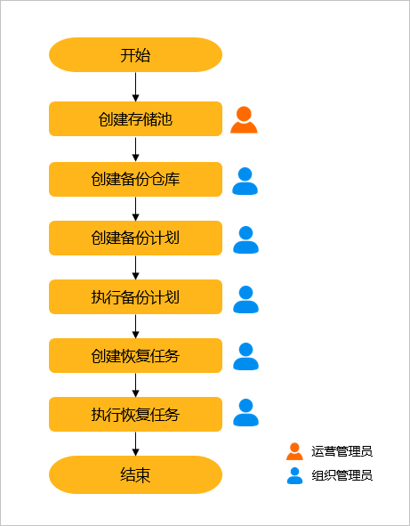

<a id="section-4"></a>

# 4.登录备份管理控制台

您可以通过备中心的Apsara Uni-manager运营控制台跳转到备份管理控制台。

**前提条件**

- 登录Apsara Uni-manager运营控制台前，确认您已从部署人员处获取Apsara Uni-manager运营控制台的服务域名地址。

- 推荐使用Chrome浏览器。

**背景信息**

在跨地域备份和本地备份场景中，备份管理控制台部署在中心Region，您需要通过Apsara Uni-manager运营控制台登录中心Region的备份管理控制台。

**操作步骤**

1. 在浏览器地址栏中，输入Apsara Uni-manager运营控制台的服务域名地址，按回车键。

2. 输入正确的用户名及密码。

   请向运营管理员获取登录控制台的用户名和密码。

   > **说明**
   >
   > - **首次登录**
   >
   >   首次Apsara Uni-manager运营控制台时，需要修改登录用户名的密码，请按照提示完成密码修改。为提高安全性，密码长度必须为10~32位，且包含英文字母大小写、阿拉伯数字和特殊符号（感叹号（!）、at（@）、井号（#）、美元符号（$）、百分号（%）等）。
   >
   > - **忘记密码**
   >
   >   用户忘记登录密码时，单击忘记密码，输入账户名（当前账号的用户名）、邮箱（当前用户创建时所录入的邮箱）和验证码后，重置密码的链接将发至邮箱，进入链接后用户可输入新密码。

3. 单击**账号登录**。

4. 如果账号已激活MFA多因素认证，请根据以下两种情况进行操作：

   - 管理员强制开启MFA后的首次登录：

     <ol type="a">

     <li>

     在绑定虚拟MFA设备页面中，按页面提示步骤绑定MFA设备。

     </li>

     <li>

     按照步骤2重新输入账号和密码，单击**账号登录**。

     </li>

     </ol>

     <ol type="i" start="100">

     <li>

     输入6位MFA码后单击**认证**。

     </li>

     </ol>

   - 您已开启并绑定MFA：

     输入6位MFA码后单击**认证**。

     > **说明**
     >
     > 绑定并开启MFA的操作请参见《Apsara Uni-manager运营控制台用户指南》中**安全中心** > **多因素认证** > **管理多因素认证**章节。

5. 在页面顶部菜单栏中，单击**产品**，选择**容灾** > **备份管理平台ASR-BR**。

6. 选择登录账号所在的一级组织和地域。

   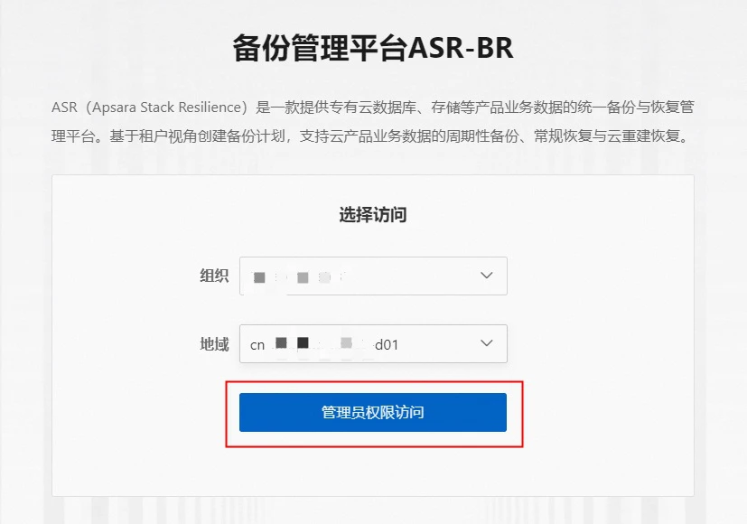

   > **说明**
   >
   > - Apsara Uni-manager运营控制台的预置角色登录ASR-BR：
   >
   >   - **运营管理员**
   >
   >     - 选择root组织，登录ASR-BR的用户角色是备份运营管理员。
   >
   >     - 选择其他组织，登录ASR-BR的用户角色是组织备份管理员。
   >
   >   - **组织管理员**只能选择所属组织，登录ASR-BR的用户角色是组织备份管理员。
   >
   >   - **组织资源监察员**只能选择所属组织，登录ASR-BR的用户角色是组织备份监察员。
   >
   > - Apsara Uni-manager运营控制台的非预置角色登录ASR-BR，必须由备份运营管理员先在权限管理中绑定角色，才可以登录ASR-BR，登录后的用户角色与绑定角色一致。

7. 单击**管理员权限访问**，使用当前登录的账号跳转ASR-BR。

<a id="section-5"></a>

# 5.创建存储池

存储池是指存储备份数据的物理集群，您可以创建多个存储池，各个存储池之间物理隔离。

1. 运营管理员登录备份管理控制台。

2. 在左侧导航栏中选择**系统管理** > **存储池管理**。

3. 单击**添加**，在**添加存储池**对话框中设置相关参数。

   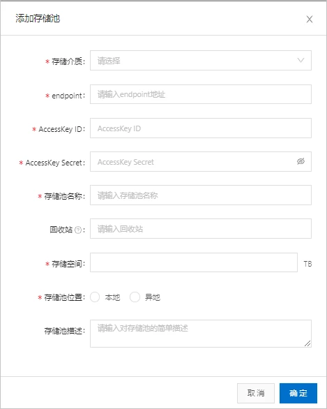

   <table>
     <tr>
       <th width="185">配置</th>
       <th>描述</th>
     </tr>
     <tr>
       <td>存储介质</td>
       <td>存储介质支持阿里云专有云<strong>OSS</strong>和存储一体机<strong>MINIOSS</strong>。</td>
     </tr>
     <tr>
       <td>endpoint</td>
       <td>OSS或MiniOSS的访问地址。</td>
     </tr>
     <tr>
       <td>AccessKey ID</td>
       <td>登录OSS或MiniOSS账号对应的AccessKey ID。</td>
     </tr>
     <tr>
       <td>AccessKey Secret</td>
       <td>登录OSS或MiniOSS账号对应AccessKey Secret。</td>
     </tr>
     <tr>
       <td>存储池名称</td>
       <td>请设置一个容易识别的存储池名称。 名称由中文、英文、数字、短划线（-）、下划线（_）或英文半角句号（.）组成。</td>
     </tr>
     <tr>
       <td>回收站</td>
       <td>请填写用于临时存放过期备份数据的Bucket的名称。若不填写，ASR-BR会自动创建一个Bucket作为回收站，但请确保填写的AccessKey账号有权限创建Bucket。<br>说明如果填写的AccessKey账号没有权限创建Bucket，您需要指定现有的Bucket作为回收站。否则，会导致过期的备份数据无法被回收，浪费存储空间。</td>
     </tr>
     <tr>
       <td>存储空间</td>
       <td>设置存储池的最大存储空间。</td>
     </tr>
     <tr>
       <td>存储池位置</td>
       <td>请选择该存储池的位置。<br>• <strong>本地</strong>：存储池在本站点。<br>• <strong>异地</strong>：存储池在异地的站点。</td>
     </tr>
     <tr>
       <td>存储池描述</td>
       <td>（可选）请对存储池进行简要描述。</td>
     </tr>
   </table>

4. 单击**确定**。

<a id="section-6"></a>

# 6.首页

通过首页您可以查看系统实时情况、备份恢复情况统计、资源统计、备份引擎监控和系统告警。

**操作步骤**

1. 登录备份管理控制台。

2. 在左侧导航栏，选择**首页**。

3. 查看首页大盘。

   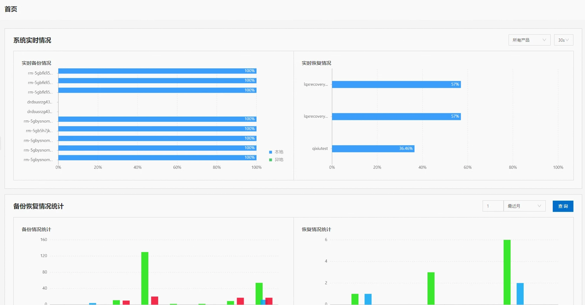

   <table>
     <tr>
       <th width="152">模块</th>
       <th>说明</th>
     </tr>
     <tr>
       <td>系统实时情况</td>
       <td>包含<strong>实时备份情况</strong>和<strong>实时恢复情况</strong>数据。系统默认30s刷新一次数据，支持调整刷新频率（5s、10s及60s）。右上角支持筛选单产品，可查看单产品的实时备份、恢复情况。<br>• 实时备份情况统计当前时间点正在备份的10个实例的备份进度信息。<br>• 实时恢复情况统计当前时间点正在备份的10个实例的恢复进度信息。</td>
     </tr>
     <tr>
       <td>备份恢复情况统计</td>
       <td>包含<strong>备份情况统计</strong>和<strong>恢复情况统计</strong>数据。默认统计最近一个月的数据，可支持按照最近小时、最近天、最近周及最近月查看统计数据。<br>• 备份情况统计展示最近一段时间内各个类型实例的备份情况统计结果，包括备份成功数量、备份中数量和备份失败数量。<br>• 恢复情况统计展示最近一段时间内各个类型实例的恢复情况统计结果，包括恢复成功数量、恢复中数量和恢复失败数量。</td>
     </tr>
     <tr>
       <td>资源统计</td>
       <td>包含<strong>存储池使用量统计</strong>和<strong>备份仓库使用量统计</strong>。<br>• 存储池使用量统计<br>• 以备份运营管理员的用户角色登录，显示TOP5组织使用容量及占比、其他组织使用容量及占比、存储池剩余容量及占比。<br>• 以组织备份管理员、组织备份操作员、组织备份监察员的用户角色登录，显示当前组织使用容量及占比、其他组织使用容量及占比、存储池剩余容量及占比。<br>说明在<strong>存储池名称</strong>中选择存储池，单击<strong>查询</strong>，支持切换存储池查询使用量。<br>• 备份仓库使用量统计<br>• 以备份运营管理员的用户角色登录，统计所有组织下备份仓库一段时间内的资源使用情况。<br>• 以组织备份管理员、组织备份操作员、组织备份监察员的用户角色登录，统计当前组织下所有备份仓库一段时间内的资源使用情况。<br>说明在<strong>组织</strong>下选择某个组织，在<strong>备份仓库</strong>中选择某个备份仓库，单击<strong>查询</strong>，支持精细化查看单个备份仓库一段时间内的使用情况统计数据。</td>
     </tr>
     <tr>
       <td>备份引擎监控</td>
       <td>• <strong>流量</strong>：统计备份引擎物理机的接收、发送流量。<br>• <strong>CPU</strong>：统计备份引擎的CPU平均使用率和CPU最大使用率。<br>• <strong>内存</strong>：统计备份引擎的内存平均使用率和内存最大使用率。<br>• <strong>负载</strong>：统计备份引擎每分钟的系统平均负载和系统最大负载。<br>说明<br>• 每隔60s刷新一次，展示最近一小时的数据。<br>• 单击右上角<strong>详情</strong>，可跳转至<strong>引擎监控</strong>页面。</td>
     </tr>
     <tr>
       <td>系统告警</td>
       <td>包含<strong>告警事件</strong>和<strong>告警统计</strong>数据。<br>• 告警事件展示针对当前系统及业务数据的巡检结果。默认展示最近10条告警事件。<br>• 告警统计针对所有业务类型，统计系统中出现的<strong>严重</strong>、<strong>错误</strong>、<strong>警告</strong>、<strong>信息</strong>的告警数量。</td>
     </tr>
   </table>

<a id="section-7"></a>

# 7.实例管理

<a id="section-7-1"></a>

## 7.1. 查看实例列表

通过实例列表，您可以查看主中心实例的状态和关联的备份计划。

**背景信息**

- 组织管理员只能查看本组织的实例。

- 运营管理员能查看所有组织的实例。

**操作步骤**

1. 登录备份管理控制台。

2. 在左侧导航栏单击**实例列表**。

3. 单击产品名称的页签。

4. 设置相应的搜索条件，单击**查询**。

   支持的搜索条件如下表所示。

   | 名称 | 描述 |
   | --- | --- |
   | 主中心组织 | 您可以选择主中心某个组织，查询该组织下所有实例。 |
   | 资源集 | 您可以选择主中心某个资源集，查询该资源集下所有实例。 |
   | 实例ID | 您可以根据实例ID查询对应的实例。 |
   | 实例状态 | 您可以根据实例状态进行筛选。 |
   | 备份计划 | 您可以选择对应的备份计划，查看该备份计划中的实例。 |

5. 在实例列表中查看实例的状态和关联的备份计划。

<a id="section-7-2"></a>

## 7.2. 修改所属的备份计划

您可以修改实例所属的备份计划，修改后，实例将继承备份计划的备份策略。

**前提条件**

实例已加入某个备份计划。

**操作步骤**

1. 登录备份管理控制台。

2. 在左侧导航栏，单击**实例列表**。

3. 单击对应的实例类型页签。

4. 在实例列表中选择目标实例，单击**操作**列中的  图标，单击**修改计划**。

5. 在**修改备份计划**对话框中，选择目标备份计划，单击**确定**。

<a id="section-7-3"></a>

## 7.3. 查看备份时长

ASR-BR通过曲线图展示最近几次备份操作的时长。定期关注备份时长可以帮您分析带宽的拥塞情况，并合理选择备份的时间点，避开带宽拥塞的时间段。

**前提条件**

实例已加入某个备份计划。

**操作步骤**

1. 登录备份管理控制台。

2. 在左侧导航栏单击**实例列表**。

3. 单击对应的实例类型页签。

4. 在实例列表中选择目标实例，单击**操作**列中的  图标，单击**备份时长**。

5. 将鼠标悬停至图表的相应位置，可以查看该次备份操作所花的时长以及备份的时间点。

   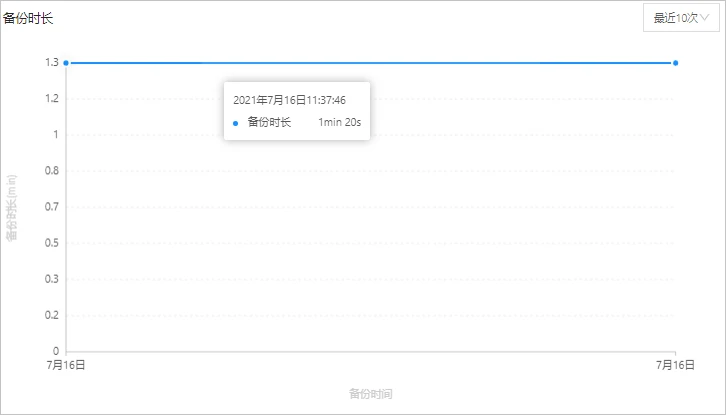

6. （可选）您可以在窗口右上角根据需要切换视图的显示次数，ASR-BR支持查看最近10次、最近20次、最近30次或最近50次的备份时长。

<a id="section-8"></a>

# 8.备份仓库

<a id="section-8-1"></a>

## 8.1. 创建备份仓库

备份仓库是指存储池上规划的逻辑的存储空间，即OSS的Bucket，用于存储业务数据的备份。

**前提条件**

已创建存储池，具体请参见创建存储池。

**背景信息**

- 每个存储池只能创建一个数据库类备份仓库，且创建后不能修改。

- 一个存储池中可以创建多个存储类备份仓库、多个重删存储类备份仓库。

- RDS和PolarDB-X 1.0使用相同的数据库备份仓库。

- 组织备份管理员和组织备份操作员可以创建数据库备份仓库、存储类备份仓库和重删存储类备份仓库。

**操作步骤**

1. 登录备份管理控制台。

2. 在左侧导航栏中单击**备份仓库**。

3. 在**备份仓库**页面，单击**新建**。

4. 在**新建备份仓库**对话框中填写相关参数，具体说明如下。

   <table>
     <tr>
       <th width="121">配置</th>
       <th>描述</th>
     </tr>
     <tr>
       <td>仓库名称</td>
       <td>自定义仓库名称。 名称只能包含小写字母、数字、中文或短划线（-），且不能以短划线（-）开头。名称长度为3~35个字符。<br>说明请设置一个方便识别的名称，该名称创建成功后不可修改。</td>
     </tr>
     <tr>
       <td>仓库描述</td>
       <td>输入对仓库的简单描述。</td>
     </tr>
     <tr>
       <td>仓库类型</td>
       <td>仓库的存储类型，目前只支持OSS仓库。</td>
     </tr>
     <tr>
       <td>备份产品类型</td>
       <td>设置该仓库备份的产品类型。<br>• <strong>数据库类</strong>：目前支持RDS和PolarDB-X 1.0。<br>• <strong>存储类</strong>：目前支持OSS、ECS、NAS、VMware、AnalyticDB MySQL版3.0。<br>• <strong>重删存储类</strong>：目前支持MaxCompute、Elasticsearch on k8s。</td>
     </tr>
     <tr>
       <td>开启Https</td>
       <td>只有当<strong>实例类型</strong>选择<strong>存储类</strong>时，才需要配置该参数。设置创建备份仓库、备份数据到备份仓库时，使用HTTP或HTTPS协议。默认使用HTTPS协议。</td>
     </tr>
     <tr>
       <td>存储位置</td>
       <td>设置备份数据存储的位置。<br>• <strong>本地</strong>：将备份数据存储在云内的OSS。<br>• <strong>异地</strong>：将备份数据存储在其他阿里云的OSS。<br>说明当<strong>实例类型</strong>为<strong>数据库类</strong>时，存储位置只支持异地。</td>
     </tr>
     <tr>
       <td>存储池</td>
       <td>请选择该备份仓库所属的存储池。</td>
     </tr>
     <tr>
       <td>存储大小</td>
       <td>设置备份仓库的存储大小，单位为GB。</td>
     </tr>
   </table>

5. 单击**确定**。

**执行结果**

ASR-BR会自动在对应存储池中创建一个OSS Bucket，用于存储业务数据的备份。

<a id="section-8-2"></a>

## 8.2. 查看备份仓库的数据

您可以查看备份仓库对应的OSS Bucket中的文件信息。定期查看备份仓库中备份数据的相关信息，方便您及时了解和调整备份恢复计划。

1. 登录备份管理控制台。

2. 在左侧导航栏单击**备份仓库**。

3. 在备份仓库列表中，单击**操作**列的  图标，选择**浏览**。

4. 在弹出的对话框中，查看备份仓库对应的OSS Bucket中的文件名、文件大小、文件的更新时间。

   > **说明**
   >
   > 如果OSS Bucket中包含文件夹，请单击文件夹名称，查看文件夹内的文件目录。

5. 单击**确定**。

<a id="section-8-3"></a>

## 8.3. 管理备份仓库

管理备份仓库包含查看备份仓库、修改备份仓库、删除备份仓库的具体操作。

**背景信息**

- 对于已经创建的备份仓库，在使用过程中备份运营管理员、组织备份管理员、组织备份操作员可以修改仓库名称和存储大小。

- 当备份仓库没有绑定任何的备份计划，且备份仓库内所有数据均过期时，组织备份管理员、组织备份操作员可以删除该备份仓库。

**查看备份仓库**

1. 登录备份管理控制台。

2. 在左侧导航栏单击**备份仓库**。

3. 在备份仓库列表中，单击**操作**列的  图标，选择**详情**。您可以查看备份仓库的基本信息、存储池使用情

   况、用户操作信息等。

   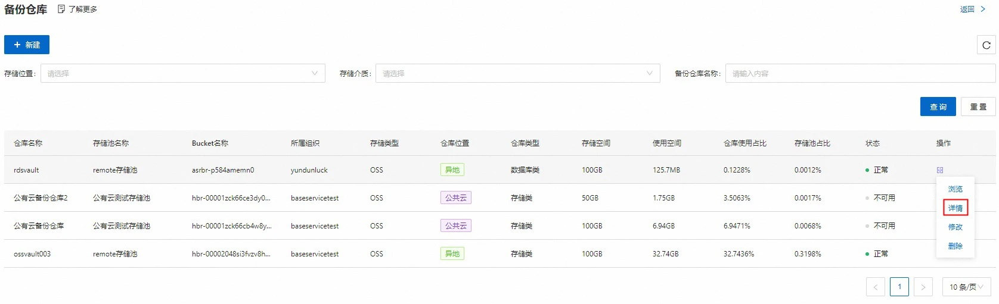

**修改备份仓库**

1. 登录备份管理控制台。

2. 在左侧导航栏单击**备份仓库**。

3. 在备份仓库列表中，单击**操作**列的  图标，选择**修改**。

4. 您可以修改**仓库名称**、**存储大小**，修改完成后，单击**确定**。

**删除备份仓库**

1. 登录备份管理控制台。

2. 在左侧导航栏单击**备份仓库**。

3. 在**备份仓库**页面，单击目标仓库**操作**列的  图标，选择**删除**。

4. 在弹出的对话框中单击**确认**。

<a id="section-9"></a>

# 9.备份计划

<a id="section-9-1"></a>

## 9.1. 创建备份计划

通过创建备份计划，ASR-BR会定期将实例中的数据备份至备份仓库中。

**前提条件**

- 只有组织备份管理员和组织备份操作员能创建备份计划，备份运营管理员不支持创建备份计划。

- 已创建备份仓库，具体参见创建备份仓库。

- 如果待备份恢复的ECS实例是部署在ARM服务器上，且没有购买云助手，您需要手动在ECS上安装HBR-Agent客户端，具体请参见在ECS上安装HBR-Agent。

- 备份恢复MaxCompute前，请确保已开启MaxCompute的外部表功能，且已部署MaxCompute联合计算增强包（Spark on MaxCompute）。

**背景信息**

- ASR-BR会备份RDS数据及用户信息、权限、元数据信息。

- ASR-BR仅支持备份NFS协议的NAS实例。

- ASR-BR会备份MaxCompute的Table、Function、Resource和Project的元数据信息（Quota信息、集群信息、VPC信息、安全信息等）。

- 在V3.17之前版本的ASR-BR中，MaxCompute产品创建备份计划时需要添加运行项目。为简化配置，方便统一管理，V3.17版本修改为运营管理员统一配置，在运维管理下的参数配置页面统一设置备份计划的运行项目。不做配置备份时，默认使用当前备份实例作为运行项目。

**操作步骤**

1. 组织管理员登录备份管理控制台。

2. 在左侧导航栏，单击**备份计划**。

3. 在**备份计划**页面，单击**新建**。

4. 在**基本信息**配置向导页面，填写备份计划的基本信息，单击**下一步**。

   <table>
     <tr>
       <th width="121">名称</th>
       <th>描述</th>
     </tr>
     <tr>
       <td>备份计划名称</td>
       <td>自定义备份计划的名称。名称只能包含中文、英文、数字、短划线（-）、下划线（_）或英文半角句号（.），长度为4~20个字符，或2~10个汉字。</td>
     </tr>
     <tr>
       <td>备份计划描述</td>
       <td>对备份计划的简单描述，方便识别。</td>
     </tr>
     <tr>
       <td>实例类型</td>
       <td>选择待备份实例的产品类型。</td>
     </tr>
     <tr>
       <td>备份方式</td>
       <td>只有ECS实例需要配置该参数。<br>• <strong>云盘备份</strong>：备份ECS整个实例或ECS云盘。<br>• <strong>文件备份</strong>：备份ECS的文件。</td>
     </tr>
   </table>

5. 在**选择实例**配置向导页面，选择待备份的某个实例，单击**下一步**。

   > **说明**
   >
   > - 待备份的实例的状态必须为**使用中**。
   >
   > - 一个备份计划只能包含一个实例。
   >
   > - 实例类型为RDS、PolarDB-X、ADB时，一个实例只能加入一个备份计划，即无法选择保护状态为**保护中**的实例。
   >
   > - 1个OSS Bucket支持加入多个备份计划中。
   >
   > - 1个NAS实例支持加入多个备份计划中。
   >
   > - 1个ECS实例，支持分别加入文件备份的备份计划和云盘备份的备份计划。
   >
   > - 备份方式为文件备份的ECS实例，支持加入多个备份计划中。

6. 在**配置实例**页面，配置相关参数。配置完毕后单击**下一步**。

   > **说明**
   >
   > 创建RDS、VMware、PolarDB-X和ADB备份计划时请忽略该步骤。

   **实例类型**

   **名称**

   **描述**

   单击<strong>浏览，</strong>在**浏览目录**页面选择待备份的文件目录。

   **浏览目录**页面显示当前Bucket的文件目录，您可以选择待备份的文件。您也可以直接单击**下一步**跳过选择备份文件。

   > **说明**
   >
   > - 不配置默认备份Bucket中的所有文件

   **OSS Prefix**

   > - **OSS Prefix**的值以正斜线（/）分隔和结尾，不能包含如下字符：尖括号（<>）、反斜线（\\）、竖线（|）、冒号（:）、引号（"）、星号（\*）、问号（?）。
   >
   > - 如果OSS Bucket中的文件太大，为了提高备份效率，您可以创建多个备份计划，每个备份计划中指定待备份的文件。

   如果您需要使用其他的**OSS Endpoint**进行源端OSS的数据读取，可以将Endpoint切换成自定义并填写对应的OSS Endpoint。

   > **说明**

   **Endpoint**

   > 使用自定义的OSS Endpoint进行备份前，请确认该Endpoint可以读取到源端需要备份的Bucket。

   如果需要备份指定时间点之后上传到OSS的Object，可以填写筛选文件开始时间点。如不填写，则备份时不做时间过滤备份。

   **筛选文件开始**

   > **说明**

   **时间点**

   > 备份时，将会根据Object的LastModifyTime和该时间点进行过滤备份。只有LastModifyTime大于该时间点的Object才会备份到异地。如不填写，则不做该时间点过滤备份。

   如果需要备份指定时间点之前上传到OSS的Object，可以填写筛选文件结束时间点。不填写，则备份时不做时间过滤备份。

   **筛选文件结束**

   > **说明**

   **时间点**

   > 备份时，将会根据Object的LastModifyTime和该时间点进行过滤备

   **OSS**

   > 份。只有LastModifyTime小于该时间点的Object才会备份到异地。如不填写，则不做该时间点过滤备份。

   在备份OSS时，允许配置从源端读数据和向目的端写数据的并发数。请根据Bucket文件数量和文件平均大小，进行并发数选择。

   **备份并发数配**

   > **说明**

   **置**

   > 选择时请确保目的端写的并发数大于源端读的并发数。

   该参数仅支持CDS-OSS实例类型。

   开启清单功能后，ASR-BR将为您创建一个仅有OSS读写权限的自定义RAM角色用于配置、生成OSS清单。备份时，将使用OSS清单文件进行备份。

   **清单功能**

   > **说明**
   >
   > 开启清单功能后，在增量备份时将使用OSS清单进行增量文件获取，无须遍历文件。推荐1亿对象以上的Bucket使用OSS清单功能进行备份。

   **存储清单**

   仅在**清单功能**开启时需要配置。用于设置OSS清单文件存放的目标

   **Bucket**

   Bucket。

   **清单报告存储**

   仅在**清单功能**开启时需要配置。用于设置OSS清单文件生成在目标Bucket

   **路径**

   的指定目录。如果不填写，则默认放在根路径下。

   仅在**清单功能**开启时需要配置。用于设置每次备份后，OSS清单文件的清理策略。默认策略为备份后删除所有清单。

   **清单清理策略**

   > **说明**
   >
   > 支持三种策略：备份后删除所有清单、备份后删除当前清单、不删除。

   - **按整机备份**：备份整个ECS实例。

   **ECS**（云盘备

   **备份类型**

   - **按指定云盘备份**：备份ECS的云盘。选择该参数后，请在云盘列表中选择

   份）

   一个或多个云盘。

   <table>
     <tr>
       <td rowspan="7"><strong>ECS</strong>（文件备份）</td>
       <td>ECS Agent注册状态</td>
       <td>检测ECS实例向HBR-Agent注册的状态。如果<strong>ECS Agent注册状态</strong>为<strong>未注</strong><br><strong>册</strong>，请单击<strong>注册</strong>，等注册成功后，单击 图标刷新注册状态。<br>说明<br>• X86服务器的ECS实例支持通过注册自动安装HBR-Agent客户端。<br>• ARM服务器的ECS实例需要手动在ECS上安装HBR-Agent客户端，具体请参见在ECS上安装HBR-Agent。</td>
     </tr>
     <tr>
       <td>文件路径</td>
       <td>待备份文件所在的路径。</td>
     </tr>
     <tr>
       <td>文件规则</td>
       <td>包括如下3个选项：<br>• <strong>包含所有</strong>：备份<strong>文件路径</strong>中的所有文件。<br>• <strong>排除以下</strong>：备份<strong>文件路径</strong>中的除<strong>文件列表</strong>以外的文件。<br>• <strong>包含以下</strong>：只备份符合<strong>文件列表</strong>规则的文件。</td>
     </tr>
     <tr>
       <td>文件列表</td>
       <td>结合<strong>文件规则</strong>设置待备份的文件，具体填写规则请参见界面帮助。</td>
     </tr>
     <tr>
       <td><strong>流量阈值</strong>（可选）</td>
       <td>设置不同时间段，生产中心向备份仓库备份时的最大传输速率。您可以根据业务的高峰期和低谷期设置不同的流量阈值，例如在业务低谷期将流量阈值设置的大一点，在业务高峰期将流量阈值设置小一点，以免占用太多带宽。</td>
     </tr>
     <tr>
       <td>备份并发数</td>
       <td>在备份ECS文件时，允许配置不同的备份并发数来调整备份客户端的最大工作线程数。<br>说明线程数越大，占用宿主机资源越多，对宿主机性能影响越大，建议评估后设置，防止对业务造成影响。</td>
     </tr>
     <tr>
       <td>CPU核心使用数</td>
       <td>在备份ECS文件时，设置备份客户端的最大CPU核心使用数。<br>说明CPU核数越大，占用宿主机资源越多，对宿主机性能影响越大，建议评估后设置，防止对业务造成影响。</td>
     </tr>
     <tr>
       <td>NAS</td>
       <td>文件路径</td>
       <td>待备份文件所在的路径。</td>
     </tr>
   </table>

   <table>
     <tr>
       <th>MaxComput e</th>
       <th>备份资源</th>
       <th>目前支持<strong>表备份</strong>和<strong>项目备份</strong>两种备份方式。<br>• <strong>表备份</strong>：支持选择备份单表和多表。<br>• <strong>项目备份</strong>：会备份该项目中的所有表、资源、FUNCTION。</th>
     </tr>
     <tr>
       <td rowspan="3">Elasticsearc h</td>
       <td>用户名</td>
       <td>需要输入创建对应的Elasticsearch实例时设置的用户名。</td>
     </tr>
     <tr>
       <td>密码</td>
       <td>需要输入创建对应的Elasticsearch实例时设置的密码。</td>
     </tr>
     <tr>
       <td>备份内容</td>
       <td>目前支持<strong>所有索引</strong>和<strong>指定索引</strong>两种备份方式。选择<strong>指定索引</strong>方式时，单击<strong>选择索引</strong>文本框右边的<strong>浏览</strong>按钮，选择待备份索引。</td>
     </tr>
     <tr>
       <td>ADB</td>
       <td>备份并发数</td>
       <td>在转储ADB本地备份集时，允许配置备份并发数来调整备份集转储的速度，请根据备份可以使用的带宽大小进行调整。备份并发数一般设置为<strong>默认</strong>，可修改为<strong>32</strong>、<strong>64</strong>、<strong>128</strong>或<strong>256</strong>。<br>说明ADB备份存在异地备份时，该配置项才生效。</td>
     </tr>
   </table>

7. 在**备份策略**配置向导页面，配置备份策略。单击**下一步**。

   > **说明**
   >
   > 不同实例类型支持的备份策略参数有差异，请根据界面提示和下表的参数解释进行配置。

   备份策略参数说明如下表所示。

   | 配置 | 描述 |
   | --- | --- |

   <table>
     <tr>
       <td>备份策略</td>
       <td>不同实例类型支持的备份策略有差异，具体如下：<br>• <strong>全量</strong>：按设置的周期定期将数据库中所有数据进行备份。 该方式只能恢复备份时间点的数据。RDS或ADB实例支持该方式。<br>• <strong>全量+日志</strong>：按设置的周期进行全量备份，在间隔的备份周期之间，保存增量文件。该方式可以恢复任意时间点的数据。RDS或PolarDB-X实例支持该方式。<br>• <strong>永久增量</strong>：第一次全量备份，后续以文件为维度进行增量备份。OSS和Elasticsearch实例支持该方式。<br>• <strong>全量（重删）</strong>：按设置的周期进行全量备份，备份过程中对数据进行重删。ECS、NAS和VMware实例支持该方式。<br>• <strong>增量（重删）</strong>：第一次备份为全量备份，后续为增量备份，备份过程中，HBR以Bucket为维度对数据进行重删。MaxCompute实例支持该方式。<br>• <strong>全量+增量</strong>：根据设置的全量备份和增量备份的时间间隔，分别进行全量备份和增量备份。Elasticsearch实例支持该方式。</td>
     </tr>
     <tr>
       <td>备份模式</td>
       <td>只有实例类型为PolarDB-X时支持该参数。<br>• <strong>快速备份</strong>：保证单个RDS数据一致性，无法保证数据的全局一致性。日常业务常规备份恢复建议选择该方式。<br>• <strong>一致性备份</strong>：保证PolarDB-X内的各RDS数据库之间数据一致性。对数据一致性有严格要求的行业、在线核心交易类业务建议选择该方式。<br>重要一致性备份请在业务低峰期进行。因为会对分布式事务进行秒级的锁定操作，RT存在亚秒级抖动。</td>
     </tr>
     <tr>
       <td>周期类型</td>
       <td>• <strong>按周执行</strong>：RDS、PolarDB-X或ADB实例支持该周期类型。<br>• <strong>按天执行</strong>：OSS、ECS、NAS、VMware、MaxCompute和Elasticsearch实例支持该周期类型。<br>• <strong>按小时执行</strong>：MaxCompute、OSS、NAS、ECS和Elasticsearch实例支持该周期类型。</td>
     </tr>
   </table>

   <table>
     <tr>
       <td>星期选择</td>
       <td>请选择在星期几进行备份，建议有间隔的选择，例如选择周一、周四和周日。<br>说明RDS、PolarDB-X或ADB实例支持该方式。为了保证数据安全，请每周至少选择两天。如果是全量+日志备份模式，建议每周只备份两次，可以有效的节约带宽和存储使用量。</td>
     </tr>
     <tr>
       <td>时间间隔</td>
       <td>请设置两次备份之间的时间间隔。OSS、NAS、ECS、VMware和MaxCompute实例以及Elasticsearch实例<strong>备份策略</strong>选择<strong>永久增量</strong>时支持该方式。</td>
     </tr>
     <tr>
       <td>时间间隔（增量）</td>
       <td>请设置两次增量备份之间的时间间隔。仅实例类型为Elasticsearch实例且<strong>备份策略</strong>选择<strong>全量+增量</strong>时支持该参数。</td>
     </tr>
     <tr>
       <td>时间间隔（全量）</td>
       <td>仅实例类型为Elasticsearch实例且<strong>备份策略</strong>选择<strong>全量+增量</strong>时支持该参数。请设置两次全量备份之间的时间间隔。 <strong>时间间隔（全量）</strong>设置要大于<strong>时间间</strong>隔（增量）</td>
     </tr>
     <tr>
       <td>备份时间</td>
       <td>首次执行备份的时间，后续按设置的时间间隔执行备份。请选择业务相对空闲的时候进行备份。<br>说明<br>• OSS、RDS、ECS、PolarDB-X、MaxCompute、ADB和Elasticsearch实例支持该方式。<br>• 设置的备份时间请比当前时间至少晚一小时。如果设置的备份时间距离当前时间不足一小时，实例当天可能不会进行备份，需要等到下次备份周期时才会备份。</td>
     </tr>
     <tr>
       <td>存储位置</td>
       <td>请设置备份数据保存的位置。<br>• <strong>本地</strong>：将备份数据保存至生产中心的备份仓库。<br>• <strong>异地</strong>：将备份数据保存至其他数据中心的备份仓库。</td>
     </tr>
     <tr>
       <td>备份仓库（本地）</td>
       <td>实例类型为Elasticsearch或MaxCompute时支持该参数。请选择已创建的本地备份仓库。如果没有您所需的备份仓库，请单击<strong>创建备</strong><strong>份仓库</strong>链接进行创建。</td>
     </tr>
     <tr>
       <td>保存天数（本地）</td>
       <td>备份数据在本地备份仓库保留的最长天数。例如设置的最长天数是7，则系统只保存近7天的备份数据。过期的备份数据会被删除。</td>
     </tr>
   </table>

   | 备份仓库（异地） | 请选择已创建的异地备份仓库。如果没有您所需的备份仓库，请单击<strong>创建备</strong><strong>份仓库</strong>链接进行创建。 |
   | --- | --- |
   | 保存天数（异地） | 备份数据在异地备份仓库保留的最长天数。过期的备份数据会被删除。 |

   ECS云盘备份的备份策略参数说明如下表所示。

   **步骤**

   **配置**

   **描述**

   您可以根据需要设置每隔多少天或每隔多少小时对云盘进行备份。

   **周期类型**

   - **按天执行**：备份的时间间隔为天。

   - **按小时执行**：备份的时间间隔为小时。

   请设置两次备份之间的时间间隔。

   **时间间隔**

   - 如果周期类型选择**按天执行**，时间间隔为天。

   **备份策略（本地）**

   - 如果周期类型选择**按小时执行**，时间间隔为小时。

   首次执行备份的时间，后续按时间间隔执行增量备份。

   **备份时间（增量）**

   请选择业务相对空闲的时候进行备份。

   备份数据在本地备份仓库保留的最长天数。例如设置的

   **保存天数（本地）**

   最长天数是7，则系统只保存近7天的备份数据，过期的备份数据会被删除。

   请设置异地备份的备份策略。

   - **永久增量**：第一次备份为全量备份，后续为增量备

   **备份策略**

   份。

   - **全量+增量**：根据设置的全量备份和增量备份的时间间隔，分别进行全量备份和增量备份。

   保持默认值即可。默认为<strong>备份策略（本地）</strong>中设置的时间间隔。

   **时间间隔（增量）**

   **备份策略（异地）**

   当备份策略是**全量+增量**时才支持该参数。

   您可以指定全量备份的间隔天数，最小值为7。

   **时间间隔（全量）**

   增量备份的时间间隔默认和<strong>备份策略（本地）</strong>中的保持一致。

   请选择已创建的异地备份仓库。如果没有您所需的备份

   **备份仓库（异地）**

   仓库，请单击**创建备份仓库**链接进行创建。

   **保存天数（异地）**

   备份数据在异地备份仓库保留的最长天数。

8. 确认备份信息无误后，根据需要选择是否立即启动该备份计划，单击**确认提交**。

   - 选中**立即启动**复选框：备份计划创建完毕后，立即对备份计划中的实例进行备份。

   - 取消选中**立即启动**复选框：备份计划创建完毕后，暂时不启动备份，您需要手工启动备份计划。具体操作，请参见启动备份计划。

<a id="section-9-2"></a>

## 9.2. 查看备份计划

您可以查看备份计划的运行状态以及最近一次备份的结果。

**操作步骤**

1. 登录备份管理控制台。

2. 在左侧导航栏，单击**备份计划**。

3. 根据主中心组织、资源集、计划名称、计划状态、实例类型、实例ID或实例名称，查询相关的备份计划。备份计划列表中的重要参数说明如下表所示。

   <table>
     <tr>
       <th width="121">名称</th>
       <th>描述</th>
     </tr>
     <tr>
       <td>计划状态</td>
       <td>备份计划的状态。<br>• <strong>创建中</strong>：该备份计划正在创建中，还没创建成功。<br>• <strong>创建成功</strong>：该备份计划已经被创建，正在启动中。<br>• <strong>运行中</strong>：该备份计划在正常运行，但实例处于等待备份状态。<br>• <strong>备份中</strong>：该备份计划中的实例正在备份中。<br>• <strong>未启动</strong>：该备份计划未启动。<br>• <strong>已停止</strong>：该备份计划已停止。<br>• <strong>停止中</strong>：该备份计划正在执行停止操作。<br>• <strong>已删除</strong>：该备份计划对应的实例被物理删除。</td>
     </tr>
     <tr>
       <td>最近备份结果</td>
       <td>最近一次备份的结果。<br>• 成功<br>• 备份中<br>• 失败<br>• 未启动<br>• 无<br>说明最近备份结果为无，表示该计划已启动但还没开始备份。</td>
     </tr>
   </table>

   > **说明**
   >
   > VMware的备份计划默认没有显示在备份计划列表中，如果您需要查看VMware的备份计划，请在**实例类型**下拉列表中选择**VMware**，单击**查询**。

<a id="section-9-3"></a>

## 9.3. 启动备份计划

创建备份计划时如果未选择立即启动，您需要手工启动备份计划。

**前提条件**

只有**计划状态**为**未启动**或**已停止**的备份计划才能执行启动操作。

**操作步骤**

1. 登录备份管理控制台。

2. 在左侧导航栏中单击**备份计划**。

3. 在**备份计划**页面顶部的**计划状态**下拉列表中选择**未启动**或**已停止**，单击**查询**。

4. 在备份计划列表中选择目标计划，单击**操作**列中的  图标，单击**启动**。

<a id="section-9-4"></a>

## 9.4. 立即备份

在周期性备份失败或实例数据有很大改动等场景中，为了保障数据的安全性，建议您执行立即备份。

1. 登录备份管理控制台。

2. 在左侧导航栏中单击**备份计划**。

3. 在**备份计划**页面，根据主中心组织、资源集、计划名称、计划状态、实例类型、实例ID或实例名称搜索对应的备份计划。

4. 在备份计划列表中选择目标计划，单击**操作**列中的  图标，单击**立即备份**。

5. 在弹出的对话框中单击**确认**，备份计划的状态变为**备份中**。

<a id="section-9-5"></a>

## 9.5. 停止备份计划

如果某个备份计划暂时不需要执行，您可以停止该备份计划。

**前提条件**

只有处于备份中和运行中的备份计划，才支持停止备份计划。

**操作步骤**

1. 登录备份管理控制台。

2. 在左侧导航栏中单击**备份计划**。

3. 在**备份计划**页面，根据相应的查询条件搜索对应的备份计划。

4. 在备份计划列表中选择目标计划，单击**操作**列中的  图标，单击**停止**。

   > **说明**
   >
   > 已停止的备份计划不计入License使用量。

<a id="section-9-6"></a>

## 9.6. 修改备份计划的配置信息

当OSS、ECS、NAS、MaxCompute需要新增或删除待备份的资源时，您可以执行如下操作修改相应备份计划的配置信息。

**操作步骤**

1. 组织管理员登录备份管理控制台。

2. 在左侧导航栏中单击**备份计划**。

3. 在**备份计划**页面，根据相应的查询条件查询对应的备份计划。

4. 单击目标备份计划的计划名称链接。

5. 在**备份信息**页签的**备份信息**区域，单击**配置**。

   

6. 配置实例的参数，单击**确定**。

   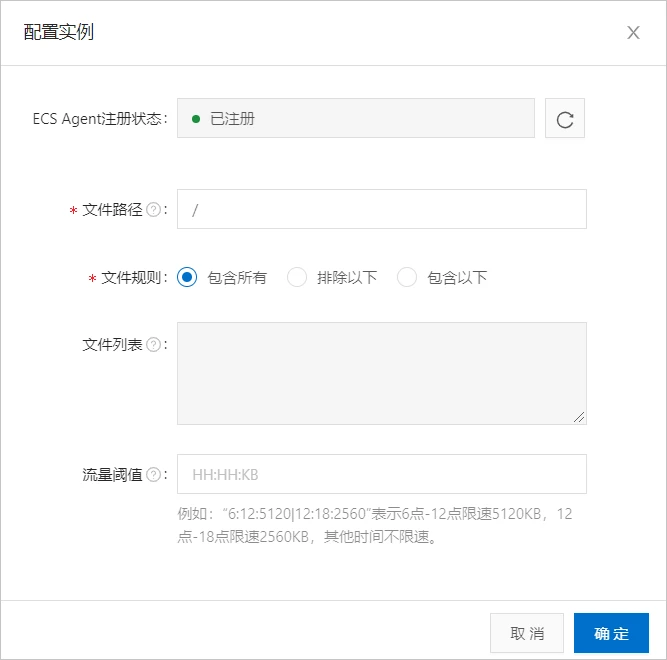

   > **说明**
   >
   > 不同实例类型的备份信息参数不一样，请根据界面提示进行配置。

<a id="section-9-7"></a>

## 9.7. 修改备份计划的策略

您可以修改备份计划中的备份策略，包括备份策略、备份时间、保存类型和保存时长等。

**操作步骤**

1. 组织管理员登录备份管理控制台。

2. 在左侧导航栏中单击**备份计划**。

3. 在**备份计划**页面，根据相应的查询条件查询对应的备份计划。

4. 单击目标备份计划的计划名称链接。

5. 在**备份信息**页面的**备份策略**区域中，单击右侧的**修改策略**。

   

6. 填写备份策略的参数，单击**提交**。

   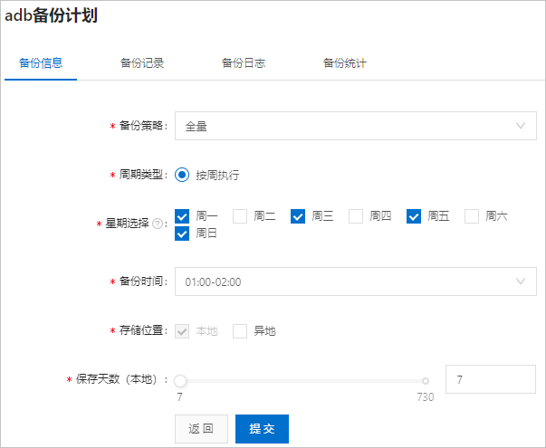

   > **说明**
   >
   > 不同实例类型的备份策略参数不一样，请根据界面提示进行配置。

<a id="section-9-8"></a>

## 9.8. 查看RDS日志备份

针对RDS实例，您可以查看当前RDS在本地、异地做了备份的日志文件。

**背景信息**

- 仅RDS实例的备份计划详情页增加了**日志备份**页签。

- RDS实例创建备份计划时，备份策略选择**全量+日志**，日志备份页签才会有数据。

**操作步骤**

1. 登录备份管理控制台。

2. 在左侧导航栏，单击**备份计划**。

3. 在**备份计划**页面，根据相应的查询条件查询对应RDS实例的备份计划。

4. 单击目标备份计划的计划名称链接。

5. 单击**日志备份**页签，可查看RDS本地、异地的日志备份列表。

   > **说明**
   >
   > 备份策略非**全量+日志**情况下，**日志备份**页签无数据。

<a id="section-9-9"></a>

## 9.9. 查看备份事件

您可以查看备份计划执行的相应事件的日志信息。

1. 登录备份管理控制台。

2. 在左侧导航栏中单击**备份计划**。

3. 在**备份计划**页面，根据相应的查询条件查询对应的备份计划。

4. 单击目标备份计划的计划名称链接。

5. 单击**备份事件**页签，设置**开始时间**、**结束时间**或**事件状态**，单击**查询**。

6. 单击**操作**列中的**日志**，查看事件的日志信息。

7. 单击对应事件左侧的  图标，您可以查看各个实例事件的子事件状态。

   单击子事件右侧的  图标可查看子事件日志信息。

   - **成功**

   - **已取消**

     子事件被执行取消操作后，状态会变成此状态。

   - **失败**、**超时**、**已停止**

     子事件状态为以上三种时，可单击子事件右侧的  图标进行事件重试操作。

     > **重要**
     >
     > 该操作属于事件运维操作，正常不需要操作，如有最新的同一事件执行成功了，对于旧的事件请不要执行重试操作。

   - **等待开始**、**运行中**、**同步中**

     子事件状态为以上三种时，可单击子事件右侧的  图标进行事件取消操作。

     > **重要**
     >
     > 该操作属于事件运维操作，正常不需要操作。该操作不可逆，请谨慎操作。

<a id="section-9-10"></a>

## 9.10. 查看备份统计

备份统计以图形化的界面展示备份计划中最近几次的备份时长及成功率。

**操作步骤**

1. 登录备份管理控制台。

2. 在左侧导航栏中单击**备份计划**。

3. 在**备份计划**页面，根据相应查询条件查询对应的备份计划。

4. 单击目标备份计划的计划名称链接。

5. 单击**备份统计**页签。

   > **说明**
   >
   > 默认显示最新10次的备份时长及成功率。您还可以根据需要选择查看最近50次、30次或20次的备份时长及成功率。

<a id="section-10"></a>

# 10.备份记录

当前版本支持运营管理员对单个备份记录，进行查看详情、浏览备份记录内容；支持组织管理员对自己备份计划生成的备份记录进行查看详情、浏览和删除。

**背景信息**

- 运营管理员可以查看备份记录详情、浏览记录。

- 组织管理员可以查看备份记录详情、浏览记录、删除记录。

- RDS本地及异地记录、ADB本地及异地记录、PolarDB-X本地记录及备份失败的记录只支持查看详情。

- PolarDB-X异地记录、OSS、NAS、ECS、MaxCompute、Elasticsearch on k8s产品支持浏览记录、删除记录。

**操作步骤**

1. 登录备份管理控制台。

2. 在左侧导航栏，单击**备份记录**。

   - 您可以通过对应的备份计划，查看该备份计划对应的备份记录，具体步骤如下：

     <ol type="a">

     <li>

     在左侧导航栏，单击**备份计划**。

     </li>

     <li>

     在**备份计划**页面，根据相应的查询条件查询对应的备份计划。

     </li>

     </ol>

     <ol type="i" start="100">

     <li>

     单击目标备份计划的计划名称链接。

     </li>

     <li value="500">

     单击**备份记录**页签。

     </li>

     </ol>

   - 您可以通过实例，查看实例所属的备份计划对应的备份记录，具体步骤如下：

     <ol type="a">

     <li>

     在左侧导航栏中单击**实例列表**。

     </li>

     <li>

     在**实例列表**页面，根据相应的查询条件查询对应的实例。

     </li>

     </ol>

     <ol type="i" start="100">

     <li>

     单击目标实例**操作**列的  图标，单击**详情**。

     </li>

     <li value="500">

     单击**备份记录**页签。

     </li>

     </ol>

3. 设置相应的查询条件，单击**查询**。

   您可以查看实例名称、实例的产品类型、备份集的大小、备份的状态、备份的开始时间、耗时、任务进度、备份记录的存储位置是本地还是异地、备份方式等相关信息。

   > **说明**
   >
   > 备份失败的记录无法查看备份文件的大小。

4. 在**操作**列，单击**详情**，可以查看备份记录的详细信息，包括备份的配置等。

   > **说明**
   >
   > 仅**记录状态**为**成功**及**部分成功**的备份记录支持浏览和删除操作。

   单击**浏览**，可以查看备份记录对应的备份集内存储的数据信息。

   单击**删除**，可以删除备份记录及对应的备份集数据。

   > **说明**
   >
   > - 浏览PolarDB-X异地备份记录，将会显示备份记录对应的备份集中库表的信息。
   >
   > - 浏览OSS、NAS、ECS文件备份记录，将会显示备份记录对应的备份集中起始文件到结束文件的列表；单击**列表**，将进一步展开备份集中全部的文件信息。
   >
   >   对于NAS、ECS文件的备份记录，当单目录大小超过900GB或文件数量超过300万时，不支持浏览操作。
   >
   > - 浏览ECS整机备份记录，将会显示记录中各个云盘的元数据信息。
   >
   > - 浏览MaxCompute备份记录，将会显示备份集中存储的表、资源、函数数据信息。
   >
   > - 浏览Elasticsearch on k8s备份记录，将会显示备份集中存储的索引信息。

<a id="section-11"></a>

# 11.恢复任务

<a id="section-11-1"></a>

## 11.1. 新建常规恢复任务

常规恢复主要用于日常的普通恢复，例如数据还原、误删数据恢复等。

**前提条件**

- 只有组织备份管理员才可以新建常规恢复任务。

- 已创建备份计划且已完成实例的首次备份。

**操作步骤**

1. 登录备份管理控制台。

2. 在左侧导航栏，单击**恢复任务**。

3. 单击**新建**。

4. 在**基本信息**配置向导页面设置相关参数，单击**下一步**。

   <table>
     <tr>
       <th width="121">配置</th>
       <th>描述</th>
     </tr>
     <tr>
       <td>恢复任务名称</td>
       <td>恢复任务的名称由中文、英文、数字、短划线（-）、下划线（_）或半角句号（.）组成，长度为4~20个字节。</td>
     </tr>
     <tr>
       <td>恢复任务描述</td>
       <td>可选。请输入对恢复任务的描述，以便于识别。</td>
     </tr>
     <tr>
       <td>实例类型</td>
       <td>请选择待恢复实例的类型。</td>
     </tr>
     <tr>
       <td>恢复任务类型</td>
       <td>在本场景中请选择<strong>常规恢复</strong>。</td>
     </tr>
     <tr>
       <td>恢复方式</td>
       <td>只有<strong>实例类型</strong>为<strong>ECS</strong>时，才需要配置该参数。<br>• <strong>云盘恢复</strong>：当ECS实例的备份方式为云盘备份时，支持该恢复方式。<br>• <strong>文件恢复</strong>：当ECS实例的备份方式为文件备份时，支持该恢复方式。</td>
     </tr>
   </table>

5. 在**选择实例**配置向导页面，**备份实例**列表选择实例，单击  图标，单击**下一步**。

   > **说明**
   >
   > **备份实例**列表中只显示备份成功的实例。

6. 在**选择记录**配置向导页面选择**按备份记录**或**按时间节点**进行恢复，单击**下一步**。

   - 按备份记录恢复：单击**按备份记录**页签，在**操作**列中单击**选择**，选择目标备份记录。

   - 按时间节点恢复：单击**按时间节点**页签，在**操作**列中单击**选择**，设置实例正常运行的某个时间点，实例将恢复至该时间点时的状态。

     > **说明**
     >
     > - 只有RDS实例支持按时间节点恢复。
     >
     > - 对于PolarDB-X 1.0异地记录、OSS、NAS、ECS、MaxCompute备份记录，在选择记录时，单击**浏览**，可以查看备份记录中存储的数据内容。
     >
     > - 对于Elasticsearch on k8s备份记录<strong>，</strong>在选择记录时，单击**浏览**，可以查看备份的索引内容。

7. 在**配置实例**配置向导页面，单击**操作**列中的**配置**，配置相关参数，单击**确定**，单击**下一步**。RDS、PolarDB-X 1.0、ADB 3.0恢复的参数说明如下表所示。

   **分类**

   **配置**

   **描述**

   默认为新建型恢复，不可修改。新建型恢复是指在主中

   **恢复方式**

   心重新创建一个实例。

   **地域名称**

   恢复的新实例在主中心所属的地域，不可修改。

   **可用区**

   恢复的新实例在主中心所属的可用区。

   **基本信息**

   **组织名称**

   恢复的新实例在主中心所属的组织。

   **资源集**

   恢复的新实例在主中心所属的资源集。

   自定义一个可识别的实例名称，ASR-BR会自动在主中心创建一个RDS恢复实例。由中文或英文开头，名称只

   **实例名称**

   能包含中文、英文、数字、短划线（-）、下划线（_），长度为2~64个字节。

   恢复的新实例的网络连接类型。

   **网络连接类型**

   默认为备份实例的网络类型，不可修改。

   恢复的新实例的网络类型。

   - **经典网络**：经典络中的云服务在络上不进隔离，只能依靠云服务的安全组或名单策略来阻挡法访问。

   **网络类型**

   - **专有网络**：专有络帮助您在阿云上构建出个隔离的络环境。 选择**专有网络**时，请确保已创建专有络和交换机。

   **网络类型**

   **网络类型**是**专有网络**时，才需要配置该参数。

   **专有网络**

   恢复的新实例所属的专有网络。

   **网络类型**是**专有网络**时，才需要配置该参数。

   **交换机**

   恢复的新实例所属的交换机。

   **规格参数**

   默认为备份实例的规格参数，该参数不支持修改。

   **数据库类型**

   请保持默认值：**mysql**。

   **RDS规格参数**

   请选择RDS的实例规格。

   > **说明**

   **规格参数**

   > **说明**

   > 只有PolarDB-X 1.0实例需要配置该参

   > 新实例的RDS实例规格请和源实例保持一致。

   > 数。

   **存储空间**

   请设置RDS实例的存储空间，单位为GB。

   OSS、NAS的参数说明如下表所示。

   **分类**

   **配置**

   **描述**

   恢复方式包括新建型恢复和覆盖型恢复。

   **恢复方式**

   - **新建型恢复**：在主中心重新创建一个实例。

   - **覆盖型恢复**：恢复后覆盖原有的实例。

   **地域名称**

   恢复的新实例在主中心所属的地域，不可修改。

   **组织名称**

   恢复的新实例在主中心所属的组织。

   **基本信息**

   **资源集**

   恢复的新实例在主中心所属的资源集。

   - 如果是覆盖型恢复，请选择主中心需要被覆盖的实例。

   **Bucket名称**或**文件系统**

   - 如果是新建型恢复，请自定义一个可识别的实例名

   **名称**

   称，ASR-BR会自动在主中心创建一个恢复实例。实例名称由小写字母或数字开头和结尾，只能包含小写字母、数字、短划线（-），长度为3~35个字节。

   **实例类型**为**OSS**时，需要配置该参数。

   设置OSS的目录名称。OSS将自动创建该目录并将文件

   **恢复至Prefix**

   恢复至该目录。如果该参数为空，默认恢复至Bucket的根目录。

   **实例类型**为**NAS**时，需要配置该参数。

   **文件路径**

   待恢复文件所在的路径。

   **实例类型**为**OSS**时，需要配置该参数。文件规则包括如下：

   - **包含所有**：恢复**文件路径**中所有文件。

   **文件规则**

   - **包含以下**：只恢复**文件列表**中的文件。

   - **排除以下**：恢复**文件列表**以外的其他文件。

   请填写文件夹名称或文件名称，每行填写一个路径。

   **文件列表**

   当**文件规则**为**包含以下**或**排除以下**时，才需要填写该参数。

   **恢复规则**

   **实例类型**为OSS时，如果需要恢复指定时间范围的OSS Object，可以配置**恢复开始时间**和**恢复结束时间**。

   > **说明**
   >
   > 恢复时将会根据该时间范围进行文件恢复。
   >
   > - 如果只填写**恢复开始时间**，那么将恢复该备份集中**恢复开始时间**到**当前时间**范围的全部文件。

   **恢复文件时间范围**

   > - 如果还填写了恢复结束时间，那么将恢复该备份集中**恢复开始时间**到**恢复结束时间**的全部文件。
   >
   > - 如果都不填写，则恢复该备份集全部文件。

   **实例类型**为OSS时，您可以根据实际的带宽情况，配置

   **恢复并发数配置**

   恢复任务的读写并发数。

   **规格参数**

   默认为备份实例的规格参数，该参数不可修改。

   ECS文件恢复的参数说明如下表所示。

   **分类**

   **配置**

   **描述**

   **恢复方式**

   恢复方式选择**覆盖型恢复**，恢复后覆盖原有的实例。

   **地域名称**

   恢复的新实例在主中心所属的地域，不可修改。

   **可用区**

   恢复的新实例在主中心所属的可用区。

   **恢复目的端**

   **组织名称**

   恢复的新实例在主中心所属的组织。

   **资源集**

   恢复的新实例在主中心所属的资源集。

   **目标实例**

   请选择主中心需要被覆盖的实例。

   **目标路径**

   单击**选择**，选择文件恢复至的文件夹。

   显示HBR客户端的安装状态。

   **客户端安装状态**

   如果状态为**未安装**，单击**安装**，系统自动安装客户端。

   选择客户端在ECS实例内的安装路径。

   > **说明**

   **客户端安装路径**

   > - 不选安装路径时，默认安装至 `/root` 下。

   **客户端安装**

   > - 当**客户端安装状态**为**已安装**时，显示客户端的安装路径。

   显示已安装的客户端版本号。

   **客户端版本号**

   当**客户端安装状态**为**未安装**时，显示为<strong>-</strong>。

   显示已安装的客户端的心跳保活时间。

   **心跳保活时间**

   当**客户端安装状态**为**未安装**时，显示为<strong>-</strong>。

   文件规则包括如下：

   - **包含所有**：恢复**文件路径**中所有文件。

   **文件规则**

   - **包含以下**：只恢复**文件列表**中的文件。

   - **排除以下**：恢复**文件列表**以外的其他文件。

   **恢复文件规则**

   单击**浏览**选择文件夹名称或文件名称。

   **文件列表**

   当**文件规则**为**包含以下**或**排除以下**时，才需要填写该参数。

   ECS云盘恢复的参数说明如下表所示。

   | 分类 | 配置 | 描述 |
   | --- | --- | --- |
   | 恢复规则 | 恢复规则 | 支持整机恢复和云盘恢复。 |

   默认为新建型恢复，不可修改。新建型恢复是指在主中

   **恢复方式**

   心重新创建一个实例。

   **地域名称**

   恢复的新实例在主中心所属的地域，不可修改。

   **可用区**

   恢复的新实例在主中心所属的可用区。

   **组织名称**

   恢复的新实例在主中心所属的组织。

   **资源集**

   恢复的新实例在主中心所属的资源集。

   **恢复规则**为**整机恢复**时，需要配置该参数。

   自定义一个可识别的实例名称，ASR-BR会自动在主中心创建一个恢复实例。由中文或英文开头，名称只能包含中文、英文、数字、短划线（-）、下划线（_）或半

   **实例名称**

   角冒号（:），长度为2~64个字节。

   **基本信息**

   **恢复规则**为**整机恢复**时，需要配置该参数。

   **主机名**

   恢复的新实例的主机名称，请设置一个方便识别的主机名称。

   **恢复规则**为**云盘恢复**时，需要配置该参数。

   **恢复云盘**

   选择待恢复的云盘。

   **恢复规则**为**云盘恢复**时，需要配置该参数。

   **挂载实例**

   选择云盘挂载的实例。

   **恢复规则**为**云盘恢复**时，需要配置该参数。

   **云盘类型**

   恢复后的云盘类型，支持SSD云盘。

   **网络类型**

   恢复的新实例所属网络的类型，目前只支持专有网络。

   **网络类型**

   **专有网络**

   恢复的新实例所属的专有网络。

   > **说明**

   **交换机**

   恢复的新实例所属的交换机。

   > **恢复规则**为**整机恢复**时，才需要配置该参数。

   <table>
     <tr>
       <td rowspan="5">规格参数<br>说明<strong>恢复规则</strong>为<strong>整机恢</strong><strong>复</strong>时，才需要配置该参数。</td>
       <td>安全组</td>
       <td>恢复的新实例所属的安全组。</td>
     </tr>
     <tr>
       <td>实例规格</td>
       <td>恢复的新实例的实例规格。</td>
     </tr>
     <tr>
       <td>云盘类型</td>
       <td>恢复的新实例的云盘类型，支持SSD云盘。</td>
     </tr>
     <tr>
       <td>IP地址类型</td>
       <td><strong>IP地址类型</strong>包括如下：<br>• <strong>动态生成</strong>：ASR-BR将自动为恢复的新实例配置IP地址。<br>• <strong>手动指定</strong>：您需要手动为恢复的新实例配置IP地址。</td>
     </tr>
     <tr>
       <td>IP地址</td>
       <td><strong>IP地址类型</strong>为<strong>手动指定</strong>时，需要配置该参数。您需要手动输入私网IP。<br>重要指定的IP地址必须在所选择的虚拟交换机网段内。</td>
     </tr>
   </table>

   MaxCompute恢复的参数说明如下表所示。

   <table>
     <tr>
       <th>分类</th>
       <th>名称</th>
       <th>描述</th>
     </tr>
     <tr>
       <td rowspan="6">基本信息</td>
       <td>恢复方式</td>
       <td>MaxCompute支持覆盖型恢复。<strong>覆盖型恢复</strong>：如果是非分区表，则删除对应的表进行重建。如果是分区表，则删除对应的分区进行重建。</td>
     </tr>
     <tr>
       <td>地域名称</td>
       <td>恢复的新实例在主中心所属的地域，不可修改。</td>
     </tr>
     <tr>
       <td>组织名称</td>
       <td>恢复的新实例在主中心所属的组织。</td>
     </tr>
     <tr>
       <td>资源集</td>
       <td>恢复的新实例在主中心所属的资源集。</td>
     </tr>
     <tr>
       <td>实例名称</td>
       <td>自定义一个可识别的实例名称，ASR-BR会自动在主中心创建一个恢复实例。由中文或英文开头，名称只能包含英文、数字、下划线（_），长度为2~64个字节。</td>
     </tr>
     <tr>
       <td>集群</td>
       <td>选择待恢复的MaxCompute集群。</td>
     </tr>
     <tr>
       <td>基础配置</td>
       <td>恢复内容</td>
       <td>• 表恢复：支持选择单个或多个表。<br>• 项目恢复：默认会恢复备份记录中的TABLE、RESOURCE、FUNCTION类型的所有数据。</td>
     </tr>
   </table>

   Elasticsearch恢复的参数说明如下表所示。

   <table>
     <tr>
       <th>分类</th>
       <th>名称</th>
       <th>描述</th>
     </tr>
     <tr>
       <td rowspan="6">基本信息</td>
       <td>恢复方式</td>
       <td>Elasticsearch仅支持覆盖型恢复。<strong>覆盖型恢复：</strong>恢复后覆盖原有的实例。</td>
     </tr>
     <tr>
       <td>地域名称</td>
       <td>恢复的新实例在主中心所属的地域，不可修改。</td>
     </tr>
     <tr>
       <td>组织名称</td>
       <td>恢复的新实例在主中心所属的组织。</td>
     </tr>
     <tr>
       <td>实例名称</td>
       <td>请选择主中心需要被覆盖的实例。</td>
     </tr>
     <tr>
       <td>用户名</td>
       <td>输入创建被覆盖恢复的实例时配置的用户名。</td>
     </tr>
     <tr>
       <td>密码</td>
       <td>输入创建被覆盖恢复的实例时配置的密码。</td>
     </tr>
     <tr>
       <td>恢复规则</td>
       <td>恢复内容</td>
       <td>• 所有索引：恢复备份记录中的所有内容。<br>• 指定索引：恢复备份记录中选择的内容。<br>说明要恢复的索引在实例中有同名的打开索引，使用重命名模式和替换名称以其他名称还原索引。</td>
     </tr>
   </table>

8. 根据需要选择是否立即启动恢复任务，确认恢复任务的信息无误后，单击**确认提交**。

   - 选中**立即启动**：恢复任务创建完毕后，立即启动恢复任务。

   - 取消选中**立即启动**：恢复任务创建完毕后，需要手工启动恢复任务，具体参见启动恢复任务。

<a id="section-11-2"></a>

## 11.2. 启动恢复任务

创建恢复任务时如果未选择**立即启动**，您需要手工启动恢复任务。

**前提条件**

只有**任务状态**为**未启动**的恢复任务才能执行启动操作。

**操作步骤**

1. 登录备份管理控制台。

2. 在左侧导航栏中选择**恢复任务**。

3. 在**恢复任务**页面顶部的**任务状态**搜索框中选择**未启动**，单击**查询**。

4. 在恢复任务列表中选择目标任务，单击**操作**列中的  图标，选择**启动**。

<a id="section-11-3"></a>

## 11.3. 停止恢复任务

您可以停止任务状态是**恢复中**的任务。

**前提条件**

恢复任务的状态是**恢复中**。

**操作影响**

恢复中的任务手工停止后会导致恢复失败，无其他影响。

**操作步骤**

1. 登录备份管理控制台。

2. 在左侧导航栏中选择**恢复任务**。

3. 在**恢复任务**页面顶部的**任务状态**搜索框中选择**恢复中**，单击**查询**。

4. 在恢复任务列表中选择目标任务，单击**操作**列中的  图标，选择**停止**。

<a id="section-11-4"></a>

## 11.4. 查看恢复任务

您可以查看所有恢复任务的状态、恢复任务的详情、以及恢复实例的详情。

**操作步骤**

1. 登录备份管理控制台。

2. 在左侧导航栏中单击**恢复任务**。

3. 根据任务名称、恢复类型、实例类型或任务状态，查询相关的恢复任务。在恢复任务列表中查看恢复任务的恢复类型、实例类型、创建时间以及任务的状态。

4. 单击恢复任务的名称链接，可以查看恢复任务的详情，包括恢复任务的基本信息、恢复实例的信息及恢复结果。

5. 单击恢复实例**操作**列中的  图标，单击**详情**，可以查看恢复实例的详情。

<a id="section-11-5"></a>

## 11.5. 查看恢复事件

您可以在恢复任务详情中查看恢复实例的事件信息。

1. 登录备份管理控制台。

2. 在左侧导航栏中单击**恢复任务**。

3. 根据任务名称、恢复类型、实例类型、任务状态，查询相关的恢复任务。

4. 单击恢复任务的名称链接。

5. 单击**恢复事件**页签，根据开始时间、结束时间或事件状态查询相应的日志。

6. 在**操作**列中单击**日志**，查看具体的日志信息。

7. 单击对应事件左侧的  图标，您可以查看各个实例事件的子事件及其状态。单击子事件右侧的  图标可

   查看子事件日志信息。

   - **成功**

   - **已取消**子事件被执行取消操作后，会显示此状态。

   - **失败**、**超时**、**已停止**

     子事件状态为以上三种时，可单击子事件右侧的  图标进行事件重试操作。

     > **重要**
     >
     > 该操作属于事件运维操作，正常不需要操作，如有最新的同一事件执行成功了，对于旧的事件请不要执行重试操作。

   - **等待开始**、**运行中**、**同步中**

     子事件状态为以上三种时，可单击子事件右侧的  图标进行事件取消操作。执行取消操作后，子事件

     状态会变为**已取消**。

     > **重要**
     >
     > 该操作属于事件运维操作，正常不需要操作。该操作不可逆，请谨慎操作。

<a id="section-12"></a>

# 12.VMware备份恢复

<a id="section-12-1"></a>

## 12.1. 安装备份网关虚拟机

本章节介绍通过OVA文件部署的方式，在EXSI中安装备份网关。

**前提条件**

已下载安装备份网关的OVA文件asrbr-vmware-appliance.ova。

**背景信息**

- 备份管理平台ASR-BR目前仅支持vCenter Server 5.5、6.0、6.5和6.7版本。

- 备份网关是安装在vCenter中的一台虚拟机，通过RabbitMQ和hbr-console组件通信，并直接调用vCenter API执行生成快照、备份、恢复等操作。在执行虚拟机备份、本地恢复、云上恢复和云迁移等场景中，都需要使用备份网关。

**操作步骤**

1. 在浏览器中输入EXSI的IP地址，输入登录的用户名和密码，单击**登录**。

2. 在左侧导航栏中单击**虚拟机**，单击**创建/注册虚拟机**。

3. 在**新建虚拟机**对话框中，创建类型选择**从OVF或OVA文件部署虚拟机**，单击**下一页**。

   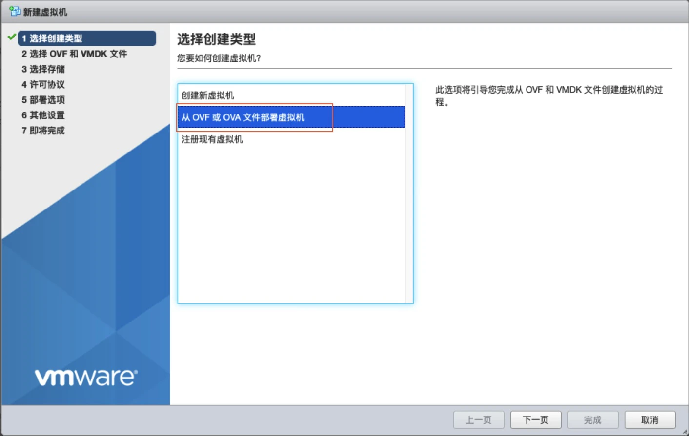

4. 为该虚拟机输入名称，选择OVA文件**asrbr-vmware-appliance.ova**，单击**下一页**。

   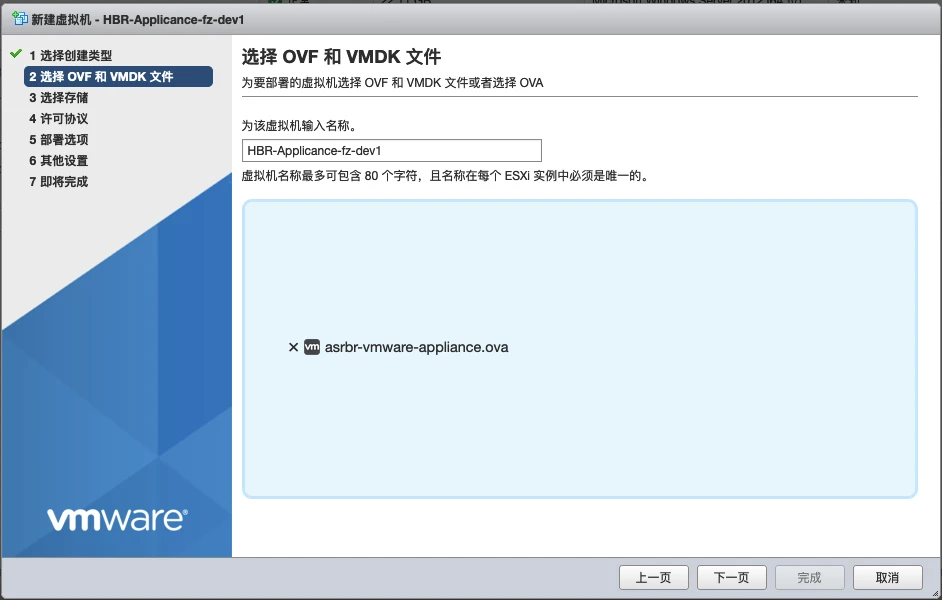

5. 选择存储类型和存储数据，单击**下一页**。

   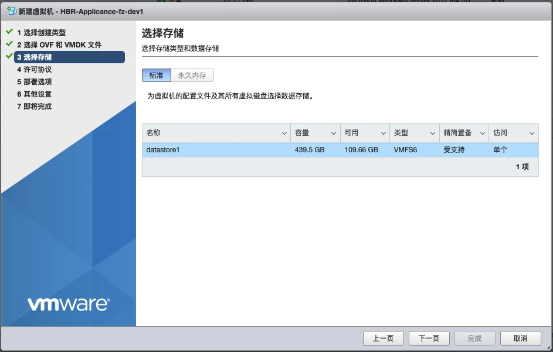

6. **部署选项**配置向导页面保持默认配置，单击**下一页**。

   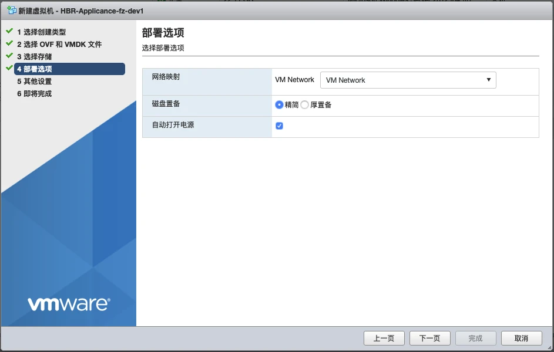

7. 在**其他设置**配置向导页面配置相关参数，单击**下一页**。

   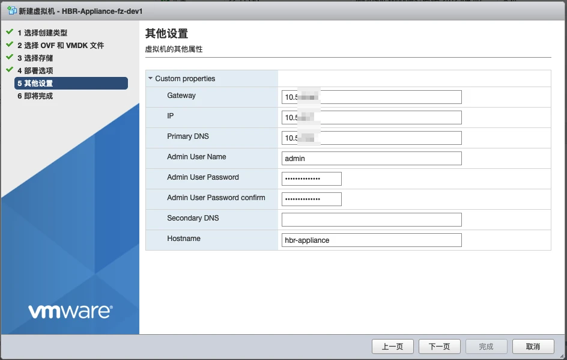

8. 在**即将完成**配置向导页面单击**完成**。

9. 在**近期任务**中查看任务状态，当状态为**成功完成**，表示虚拟机部署完成。

   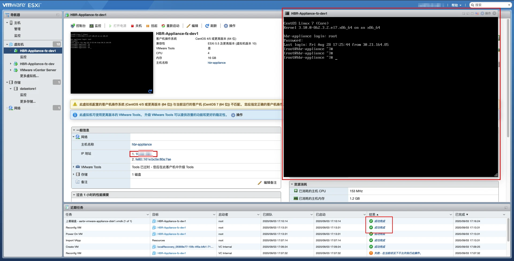

0. 部署完成后，启动部署的虚拟机。

<a id="section-12-2"></a>

## 12.2. 注册备份网关

您需要在ASR-BR上获取备份网关相应的激活码信息，然后再注册备份网关。

**获取激活码**

1. 组织管理员登录备份管理控制台。

2. 在左侧导航栏中选择**系统管理** > **vCenter管理**。

3. 单击**激活码**，查看激活码信息。

   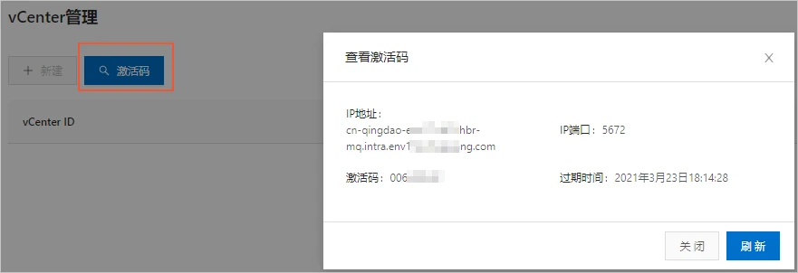

**注册备份网关**

1. 在浏览器中输入备份网关虚拟机的访问地址，格式为 `IP`地址`:8011` 。

2. 在注册对话框中输入相关参数，参数说明如下表所示。

   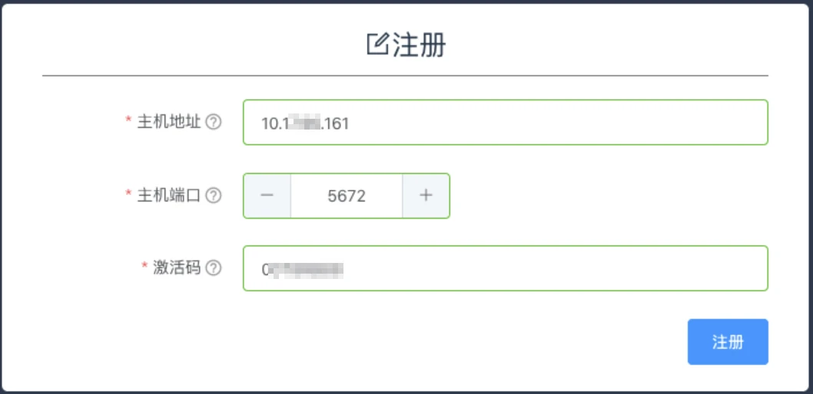

   | 名称 | 描述 |
   | --- | --- |
   | 主机地址 | 激活码页面对应的<strong>IP地址</strong>。 |
   | 主机端口 | 激活码页面对应的<strong>IP端口</strong>。 |
   | 激活码 | 激活码页面对应的<strong>激活码</strong>。 |

   > **说明**
   >
   > 如果vCenter环境与专有云环境未互配DNS，主机地址需要填写IP地址。

3. 单击**注册**。

<a id="section-12-3"></a>

## 12.3. 新建vCenter

vCenter是VMware的管理平台，用来操作和管理虚拟机。

**前提条件**

只有备份的实例类型包含VMware时，才需要配置该功能。

**操作步骤**

1. 组织管理员登录备份管理控制台。

2. 在左侧导航栏中选择**系统管理** > **vCenter管理**。

3. 单击**新建**。

4. 在**新建vCenter**对话框中设置相关参数，参数说明如下表所示。

   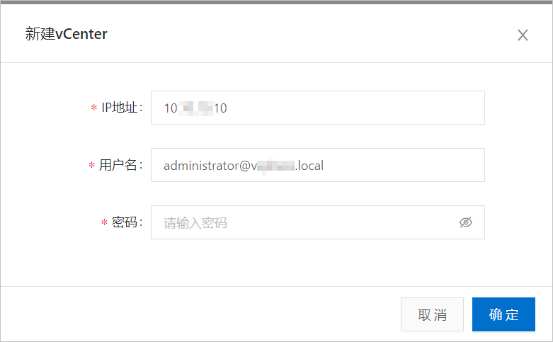

   <table>
     <tr>
       <th width="76">名称</th>
       <th>描述</th>
     </tr>
     <tr>
       <td>IP地址</td>
       <td>vCenter的IP地址。</td>
     </tr>
     <tr>
       <td>用户名</td>
       <td>登录vCenter的用户名，格式为<code> Single Sign-On</code>用户名<code>@Single </code> <code>Sign-On</code>域名<code> </code>。</td>
     </tr>
     <tr>
       <td>密码</td>
       <td>登录vCenter的密码，即SSO配置页面中设置的Single Sign-On密码。</td>
     </tr>
   </table>

   

5. 单击**确定**。

<a id="section-12-4"></a>

## 12.4. 新建虚拟机备份计划

新建备份计划，将VMware虚拟机中的磁盘数据备份到备份仓库中。

1. 组织管理员登录备份管理控制台。

2. 在左侧导航栏中，单击**备份计划**。

3. 在备份计划页面，单击**新建**。

4. 在**基本信息**配置向导页面，填写备份计划的基本信息，单击**下一步**。

   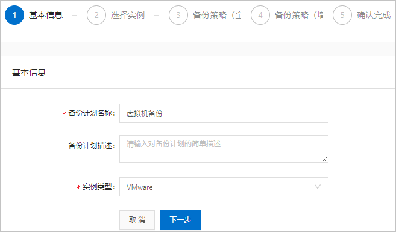

5. 在**选择实例**配置向导页面，选择对应的vCenter ID， 选择待备份的虚拟机，单击  图标。单击**下一步**。

   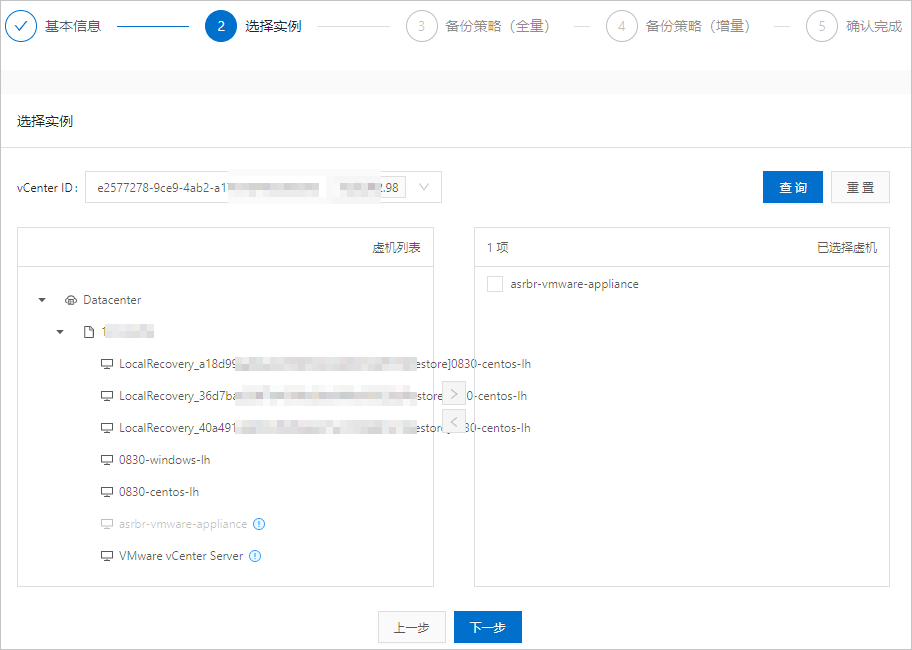

6. 在<strong>备份策略（全量）</strong>配置向导页面，设置全量备份的备份策略。单击**下一步**。

   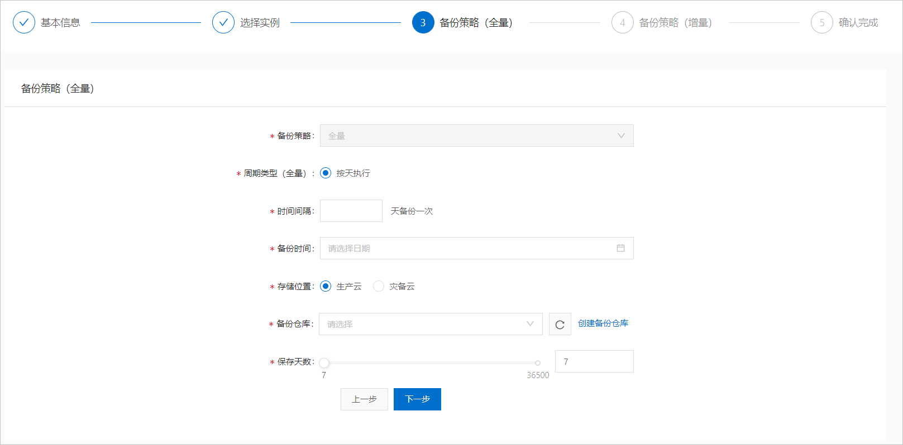

7. 在<strong>备份策略（增量）</strong>配置向导页面，设置增量备份的备份策略。单击**下一步**。

   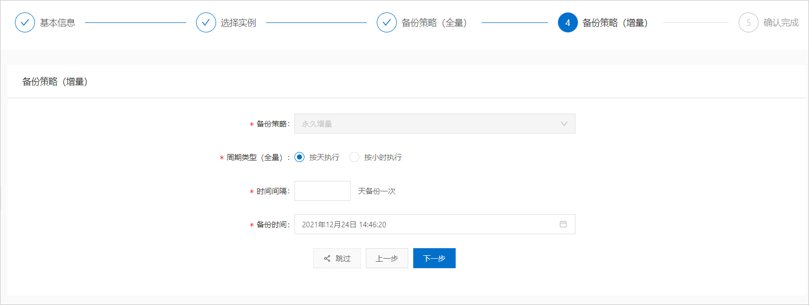

   > **说明**
   >
   > - 如果您不需要设置增量备份策略，您也可以单击**跳过**。
   >
   > - 如果需要增量备份，请确保虚拟机已启用数据块修改跟踪技术（CBT），启用方法请参见在虚拟机上启用或禁用更改块跟踪 (Changed Block Tracking, CBT) (1031873)。

8. 确认备份信息无误后，根据需要选择是否立即启动，单击**确认提交**。

   - 选中**立即启动**复选框：备份计划创建完毕后，立即对备份计划中的实例进行备份。

   - 取消选中**立即启动**复选框：备份计划创建完毕后，暂时不启动备份，您需要手工启动备份计划，具体参见启动备份计划。

<a id="section-12-5"></a>

## 12.5. 恢复VMware虚拟机

当VMware虚拟机出现故障时，您可以通过之前的备份记录，将VMware的虚拟机恢复至云上ECS或本地vCenter环境。

1. 组织管理员登录备份管理控制台。

2. 在左侧导航栏中选择**恢复任务**。

3. 在备份计划页面，单击**新建**。

4. 在**基本信息**配置向导页面配置相关参数，单击**下一步**。

   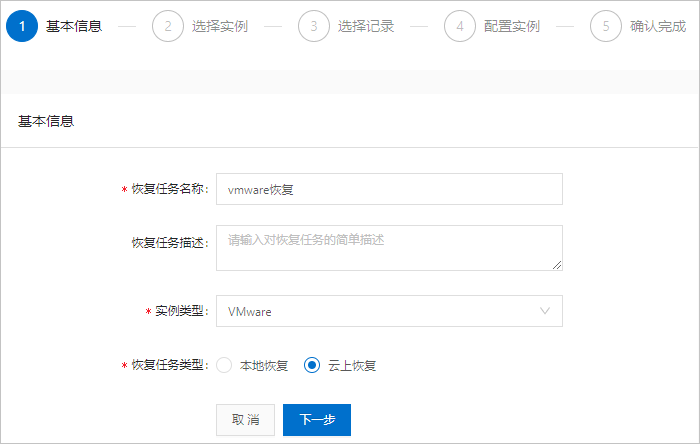

   <table>
     <tr>
       <th width="121">名称</th>
       <th>描述</th>
     </tr>
     <tr>
       <td>恢复任务名称</td>
       <td>自定义的恢复任务名称。恢复任务的名称由中文、英文、数字、短划线（-）、下划线（_）或英文半角句号（.）组成，长度为4~20个字符，或2~10个中文汉字。</td>
     </tr>
     <tr>
       <td>恢复任务描述</td>
       <td>请输入对恢复任务的简单描述，便于识别。</td>
     </tr>
     <tr>
       <td>实例类型</td>
       <td>选择恢复任务的实例类型，本场景中请选择<strong>VMware</strong>。</td>
     </tr>
     <tr>
       <td>恢复任务类型</td>
       <td>VMware的恢复类型包括本地恢复和云上恢复。<br>• <strong>本地恢复</strong>：将VMware虚拟机恢复到本地的vCenter环境。<br>• <strong>云上恢复</strong>：将VMware虚拟机恢复至专有云ECS实例。</td>
     </tr>
   </table>

   

5. 在**选择实例**配置向导页面，**备份实例**列表选择实例，单击

   图标，单击**下一步**。

   > **说明**
   >
   > **备份实例**列表中只显示备份成功的实例。

6. 在**选择记录**配置向导页面，单击**按备份记录**页签，在**操作**列中单击**选择**，选择目标备份记录。单击**下一步**。

   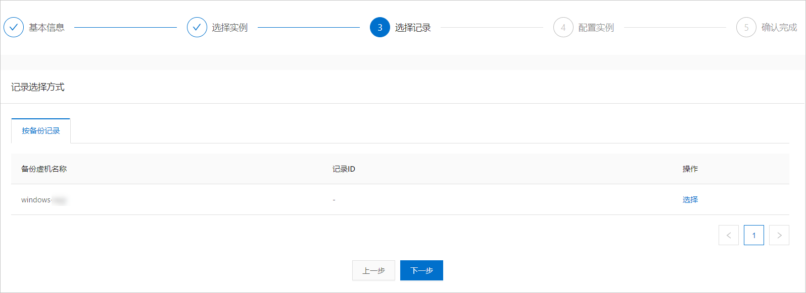

7. 在**配置实例**配置向导页面，单击**操作**列中的**配置**，配置相关参数，单击**确定**，单击**下一步**。

   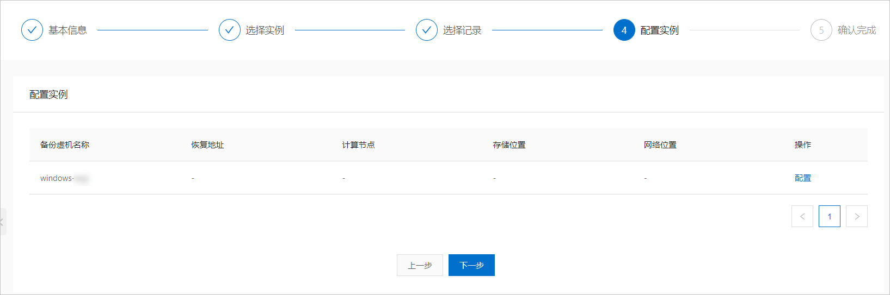

   **恢复任务类型**为**云上恢复**时，相关参数说明如下表所示。

   **分类**

   **名称**

   **描述**

   **地域名称**

   选择恢复的新实例在主中心所属的地域，不可修改。

   **组织名称**

   选择恢复的新实例在主中心所属的组织。

   **资源集**

   选择恢复的新实例在主中心所属的资源集。

   **基本信息**

   **主机名**

   请自定义一个可识别的主机名称。

   请自定义一个可识别的实例名称，ASR-BR会自动在主中心创建一个ECS实例。由中文或英文开头，名称只能

   **实例名称**

   包含中文、英文、数字、短划线（-）、下划线（_）、英文半角句号（.）或英文半角冒号（:），长度为2~128个字符，或1~64个中文汉字。

   **专有网络**

   选择恢复的新实例在主中心所属的VPC。

   **网络类型**

   **交换机**

   选择恢复的新实例在主中心所属的交换机。

   **安全组**

   选择恢复的新实例所属的安全组。

   **实例规格**

   选择恢复的新实例的实例规格。

   选择恢复的新实例的云盘类型，支持**高效云盘**和**SSD**

   **云盘类型**

   **盘**。

   **规格参数**

   **恢复后启动系统**

   根据需要选择恢复后是否启动系统。

   根据需要选择是否创建系统镜像。若选择创建系统镜像，主中心ECS会根据新实例中的所有磁盘（包括系统

   **创建系统镜像**

   盘和数据盘）的数据创建一个镜像。

   **恢复任务类型**为**本地恢复**时，相关参数说明如下表所示。

   | 名称 | 描述 |
   | --- | --- |
   | vCenter地址 | 选择虚拟机恢复的目标vCenter地址。 |
   | 恢复地址 | 选择虚拟机恢复的目标地址。 |
   | 计算节点 | 选择虚拟机恢复后所使用的计算节点。 |
   | 存储位置 | 选择虚拟机恢复后的存储位置。 |
   | 网络位置 | 选择虚拟机恢复后的网络位置。 |

8. 确认基本信息和恢复实例的配置都正确，单击**确认提交**，根据需要选择是否立即启动。

   - 选中**立即启动**：恢复任务创建完毕后，立即启动恢复任务。

   - 取消选中**立即启动**：恢复任务创建完毕后，需要手工启动恢复任务，具体参见启动恢复任务。

<a id="section-13"></a>

# 13.VMware迁移

<a id="section-13-1"></a>

## 13.1. 将VMware迁移至ECS

本文介绍如何将VMware云环境中的虚拟机迁移到专有云的ECS。

**前提条件**

迁移前务必保证系统盘有至少1 GB的可用空间。待迁移虚机为Linux系统时，系统引导程序GRUB须为1.99及以上版本。

> **说明**
>
> - 对于CentOS 5、Red Hat 5和Debian 7等低版本操作系统，需要更新GRUB至1.99及以上版本。
>
> - Amazon Linux需要更新至2.02及以上版本。

**背景信息**

VMware虚拟机迁移服务主要针对VMware环境的虚拟机提供非侵入式的无代理整机迁移功能，其原理是基于VMware的快照以及磁盘级别的数据读取功能，将虚机整机全盘迁移到ECS上。

VMware虚机迁移服务支持如下操作系统：CentOS、Ubuntu、CoreOS、Aliyun、Debian、Gentoo、SUSE、OpenSUSE、FreeBSD、RedHat、Windows Server 2003、Windows Server 2008、Windows Server 2012、Windows Server 2016、Windows 7、Customized Linux、Mars以及NeoKylin。

**操作步骤**

1. 组织管理员登录备份管理控制台。

2. 在左侧导航栏中单击**迁移计划**。

3. 在**迁移计划**页面，单击**新建**。

4. 在**基本信息**配置向导页面，配置相关参数。

   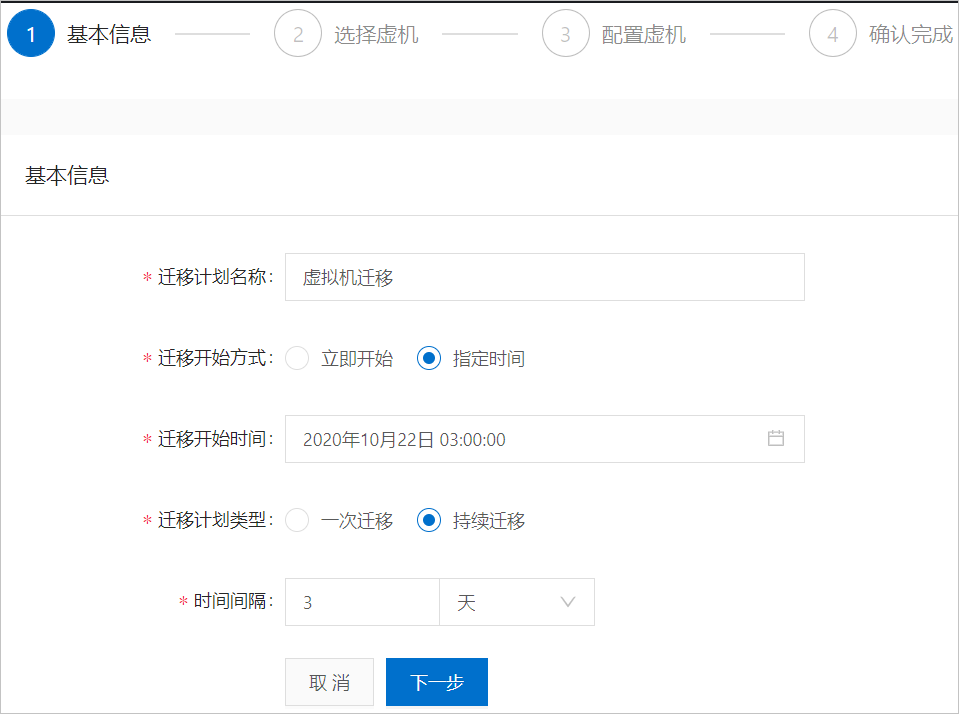

   <table>
     <tr>
       <th width="121">名称</th>
       <th>描述</th>
     </tr>
     <tr>
       <td>迁移计划名称</td>
       <td>自定义备份计划的名称。名称只能包含中文、英文、数字、短划线（-）、下划线（_）或英文半角句号（.），长度为4~20个字符，或2~10个汉字。</td>
     </tr>
     <tr>
       <td>迁移开始方式</td>
       <td>根据需要选择<strong>立即开始</strong>或<strong>指定时间</strong>。如果选择<strong>指定时间</strong>，请设置<strong>迁移开始时</strong><strong>间</strong>。</td>
     </tr>
     <tr>
       <td>迁移计划类型</td>
       <td>• <strong>一次迁移</strong>：只执行一次全量迁移。<br>• <strong>持续迁移</strong>：根据设置的时间间隔周期性的进行增量迁移。<br>说明请确保虚拟机已启用数据块修改跟踪技术（CBT），如果虚拟机禁用了数据块修改跟踪技术（CBT），增量迁移将强制转为全量迁移。启用方法请参见在虚拟机上启用或禁用更改块跟踪 (Changed Block Tracking, CBT) (1031873)。</td>
     </tr>
   </table>

5. 在**选择虚机**配置向导页面，选择对应的vCenter ID， 选择待迁移的虚拟机，单击  图标。单击**下一步**。

   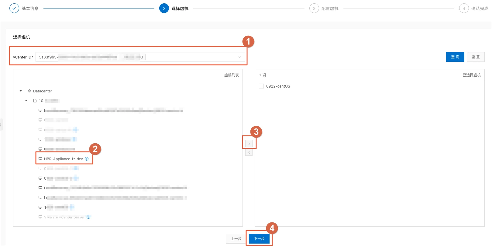

6. 在**配置虚机**配置向导页面，单击**操作**列中的**配置**，配置迁移后ECS实例的相关参数，单击**确定**。单击**下一步**。

   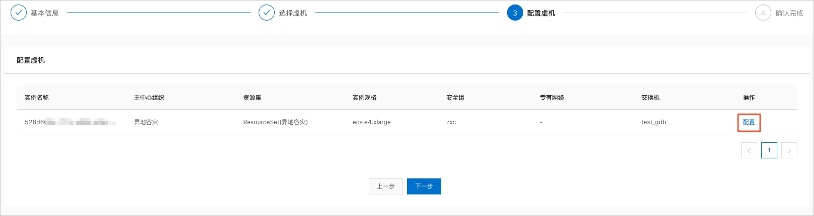

   **分类**

   **名称**

   **描述**

   **域名称**

   选择迁移后的ECS实例所属的地域，不可修改。

   **组织名称**

   选择迁移后的ECS实例所属的组织。

   **资源集**

   选择迁移后的ECS实例所属的资源集。

   **基本信息**

   **主机名**

   请自定义一个可识别的主机名称。

   请自定义一个可识别的实例名称，ASR-BR会自动创建一个ECS实例。由中文或英文开头，名称只能包含中

   **实例名称**

   文、英文、数字、短划线（-）、下划线（_）、半角句号（.）或半角冒号（:），长度为2~128个字符。

   **专有网络**

   选择迁移后的ECS实例所属的VPC。

   **网络类型**

   **交换机**

   选择迁移后的ECS实例所属的交换机。

   选择迁移后的ECS实例所属的安全组。

   > **说明**

   **安全组**

   > 选择安全组时，请确保该安全组允许出方向的TCP 80、443端口以及UDP 53端口。

   **实例规格**

   选择迁移后的ECS实例的实例规格。

   **规格参数**

   选择迁移后的ECS实例的云盘类型，支持**高效云**

   **云盘类型**

   **盘**和**SSD云盘**。

   **恢复后启动系统**

   根据需要选择恢复后是否启动系统。

   根据需要选择是否创建系统镜像。

   **创建系统镜像**

   若选择创建系统镜像，云中的ECS会根据新实例中的所有磁盘（包括系统盘和数据盘）的数据创建一个镜像。

7. 单击**确认提交**。

<a id="section-13-2"></a>

## 13.2. 查看迁移任务的详情

您可以通过迁移任务详情查看ECS实例详情、对虚拟机进行继续迁移、迁移验证、完成迁移、取消迁移等操作。

1. 登录备份管理控制台。

2. 在左侧导航栏中单击**迁移计划**。

3. 单击迁移计划的名称链接，在**迁移信息**页面的虚机列表中，单击**操作**一栏中的  图标，您可以执行如下

   操作：

   - 单击**查看详情**：查看ECS实例的详细信息。

   - 单击**迁移验证**：ASR-BR将以最近一次同步的数据创建ECS，用于验证迁移到ECS的虚机是否工作正常。每台虚拟机最多可以做3次验证，验证不会中断预设的增量同步。

     > **说明**
     >
     > 只有迁移类型为**持续迁移**，状态为**可验证**时，才支持迁移验证。

   - 单击**继续迁移**：将清除迁移验证时创建的ECS并继续迁移。

     > **说明**
     >
     > 只有迁移类型为**持续迁移**，状态为**验证完成**时，才支持完成迁移。

   - 单击**完成迁移**：ASR-BR将以最近一次同步的数据创建迁移完成的ECS，并不再进行同步。

     > **说明**
     >
     > 只有迁移类型为**持续迁移**，状态为**可验证**或**验证完成**时，才支持完成迁移。

   - 单击**取消迁移**：取消本次迁移任务。

     > **说明**
     >
     > 只有状态为**可验证**、**迁移中**或**拉起中**，才支持取消迁移。

<a id="section-13-3"></a>

## 13.3. 查看迁移记录

您可以通过迁移记录查看持续迁移的数据大小和迁移状态等信息。

**前提条件**

迁移类型为持续迁移时，才支持查看迁移记录，一次迁移不支持查看迁移记录。

**操作步骤**

1. 登录备份管理控制台。

2. 在左侧导航栏中单击**迁移计划**。

3. 单击迁移计划的名称链接，单击**迁移记录**页签。

4. 在迁移记录页面，您可以根据开始时间、结束时间、迁移结果进行搜索对应的迁移记录。

<a id="section-13-4"></a>

## 13.4. 查看迁移日志

您可以查看迁移任务中各事件的状态和日志。

1. 登录备份管理控制台。

2. 在左侧导航栏中单击**迁移计划**。

3. 单击迁移计划的名称链接，单击**迁移日志**页签。

4. 在操作列中单击**日志**，查看具体的日志信息。

   

5. 单击对应事件左侧的

   图标，您可以查看各个实例的事件状态和相应日志。

<a id="section-14"></a>

# 14.告警管理

<a id="section-14-1"></a>

## 14.1. 查看告警记录

您需要定期查看告警记录，并处理相关告警。

**背景信息**

- 系统管理员可以查看所有的告警记录。

- 组织管理员可以查看本组织下的告警记录。

**操作步骤**

1. 登录备份管理控制台。

2. 在左侧导航栏选择**告警管理** > **告警列表**。

3. （可选）您可以单击顶部菜单栏的  图标，查看最新的5条告警。单击**查看更多**，进入**告警列表**页面，

   查看更多告警记录。

   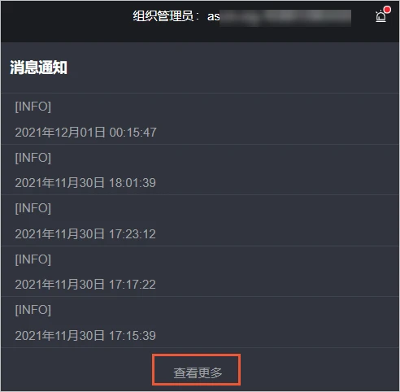

   > **说明**
   >
   > 图标上出现红点，表示有未读的告警记录。
   >
   > 

4. 在**告警列表**页面，根据**告警级别**、**告警对象类别**、**业务信息**、**业务类型**、**组织**筛选对应的告警记录。

   在**告警内容**列即可查看具体的告警内容。

<a id="section-14-2"></a>

## 14.2. 告警记录标为已读

您可以将已处理的告警记录标为已读，系统将不再告警这些已读的记录。

**背景信息**

当顶部菜单栏的  图标出现红点时，表示有未读的告警记录。

**操作步骤**

1. 登录备份管理控制台。

2. 在左侧导航栏中选择**告警管理** > **告警列表**。

3. 根据**告警级别**、**告警对象类别**、**业务信息**、**业务类型**或**组织**查询相关的告警记录。

4. 单击目标告警记录**操作**列**标为已读**。

5. 在弹出的**标记已读**对话框中单击**确定**。

6. （可选）您也可以批量标记已读，步骤如下：

   <ol type="i">

   <li>

   选择目标告警记录后，单击**批量已读**。

   </li>

   <li>

   在弹出的**批量已读**对话框中单击**确定**。

   </li>

   </ol>

<a id="section-14-3"></a>

## 14.3. 删除告警记录

您可以删除已经处理的告警记录。

**操作步骤**

1. 登录备份管理控制台。

2. 在左侧导航栏中选择**告警管理** > **告警列表**。

3. 根据**告警级别**、**告警对象类别**、**业务信息**、**业务类型**或**组织**查询相关的告警记录。

4. 单击目标告警记录**操作**列**删除**。

5. 在弹出的**删除**对话框中单击**确定**。

6. （可选）您也可以批量删除告警记录，步骤如下：

   <ol type="i">

   <li>

   选择目标告警记录后，单击**批量删除**。

   </li>

   <li>

   在弹出的**批量删除消息**对话框中单击**确定**。

   </li>

   </ol>

<a id="section-15"></a>

# 15.系统管理

<a id="section-15-1"></a>

## 15.1. 存储池管理

您可以创建存储池、编辑存储池、删除不再使用的存储池。

**创建存储池**

创建存储池操作请参见创建存储池。

**编辑存储池**

1. 备份运营管理员登录备份管理控制台。

2. 在左侧导航栏中选择**系统管理** > **存储池管理**。

   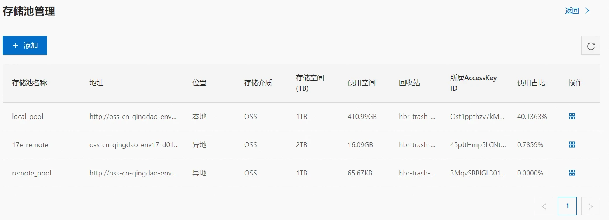

3. 在存储池列表中，在相应存储池的**操作**列中单击  图标 ，选择**编辑**。

4. 在**编辑存储池**弹窗中，可编辑**AccessKey ID**、**AccessKey ID**、**存储池名称**、**存储空间**、**存储池描述**，编辑完成后，单击**确定**。

**删除存储池**

> **说明**
>
> 只有未关联备份仓库的存储池，才可以被删除。

1. 备份运营管理员登录备份管理控制台。

2. 在左侧导航栏中选择**系统管理** > **存储池管理**。

   

3. 在存储池列表中，在相应存储池的**操作**列中单击  图标 ，选择**删除**。

4. 在弹出的对话框中单击**确认**。

<a id="section-15-2"></a>

## 15.2. 自备份管理

<a id="section-15-2-1"></a>

### 15.2.1. 设置元数据的备份策略

您可以设置自备份策略，定期将备份系统的元数据备份至灾备存储池中。以便在备份系统数据丢失或者损毁时，及时进行恢复。

1. 运营管理员登录备份管理控制台。

2. 在左侧导航栏中选择**系统管理** > **自备份管理**。

3. 在**备份策略**页面，单击**创建**，设置相关参数，参数说明如下表所示。

   <table>
     <tr>
       <th width="89">配置</th>
       <th>描述</th>
     </tr>
     <tr>
       <td>周期</td>
       <td>设置备份的间隔周期。您可以在文本框右侧的下拉列表中设置周期的单位，包括分、时、天。<br>说明周期的最小值为10分钟。</td>
     </tr>
     <tr>
       <td>保存时长</td>
       <td>请设置备份的元数据在存储池中的保留时长。建议设置为7天。<br>重要超过保存时长的数据将被删除。</td>
     </tr>
     <tr>
       <td>存储池</td>
       <td>请选择相应的存储池。如果没有对应的存储池，请单击右侧的<strong>创建存储池</strong>，具体步骤请参见创建存储池。</td>
     </tr>
     <tr>
       <td>bucket</td>
       <td>请填写存储池中用于存储备份的元数据的bucket名称。<br>重要请记住该bucket名称，当云重建恢复时，您需要输入该bucket名称。</td>
     </tr>
   </table>

4. 单击**创建**。

<a id="section-15-2-2"></a>

### 15.2.2. 查看元数据备份记录

您可以查看备份的元数据记录的详细信息，包括开始时间、结束时间、过期时间、备份状态、备份集大小、文件名称。

1. 运营管理员登录备份管理控制台。

2. 在左侧导航栏中选择**系统管理** > **自备份管理**。

3. 单击**备份记录**页签，您可以查看备份的元数据记录的详细信息，包括开始时间、结束时间、过期时间、备份状态、备份集大小、文件名称。

4. （可选）如果需要删除某条元数据备份记录和对应的备份数据集，请在**操作**列中，单击**删除**。在确认对话框中单击**确定**。

   > **说明**
   >
   > 只有运营管理员才能执行删除操作。

<a id="section-15-3"></a>

## 15.3. 灾难恢复

存在主、备两套云系统，当生产云故障或因为灾难导致生产云损毁，生产云ASR-BR无法使用时，您可以在另外一套云系统或灾备云重新部署ASR-BR，通过灾难恢复功能将ASR-BR备份到灾备云的数据在另外一套云系统恢复。使用灾难恢复功能不影响当前云备份和恢复功能。

**使用场景**

只有遇到以下两种场景时，才支持使用此功能。

- 需要把备份到异地存储池的数据跨云恢复到备用阿里云专有云。

- 生产云发生故障或灾难，需要进行数据恢复。

**前提条件**

在进行灾难恢复之前，需要配置**自备份管理**策略，将ASR-BR的元数据备份到异地的存储池，同时记录下存储池的OSS地址、使用的AK、SK以及存储ASR-BR元数据的Bucket。保证在灾难恢复时，通过这些信息，可以查找到可供ASR-BR自身恢复的元数据集。

**操作步骤**

1. 新建灾难恢复任务。

   <ol type="i">

   <li>

   运营管理员登录备份管理控制台。

   </li>

   <li>

   在左侧导航栏，选择**系统管理** > **灾难恢复**。

   </li>

   <li>

   在**灾难恢复**页面，单击**创建**。

   </li>

   <li>

   在**恢复元数据**对话框中，从**存储池**下拉列表选择存储池，在**bucket**输入框填写存储了ASR-BR元数据的Bucket，单击**检索**。在检索结果中选择需要恢复的元数据备份记录，单击**启动**。

   启动成功后，在**灾难恢复**列表形成一条状态为**队列中**的记录。

   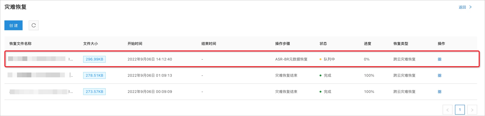

   </li>

   <li>

   等待元数据自动恢复，此时**状态**从**队列中**流转为**运行中**。

   </li>

   <li>

   元数据自动恢复完成后，**操作步骤**将会从**ASR-BR元数据恢复**流转成**组织订正**，同时状态变成**运行中**。

   </li>

   </ol>

2. 组织订正。

   <ol type="i">

   <li>

   当**操作步骤**为<strong>组织订正，</strong>单击**操作**列  图标，单击**组织订正**。

   </li>

   <li>

   在**组织订正**对话框中，在**新组织名称**列表下拉列表选择订正后的组织。

   默认匹配名称相同的组织。

   > **说明**
   >
   > 旧组织和新组织只能一对一订正。

   </li>

   <li>

   单击**确定**。

   **操作步骤**将会从**组织订正**流转为**元数据订正**，状态将流转为**队列中**。

   </li>

   <li>

   等待**元数据订正**任务执行，状态跳转成**运行中**。元数据订正完成后，**操作步骤**将从**元数据订正**流转为**用户数据灾难恢复**。

   </li>

   <li>

   之后各个组织的组织管理员进行各个组织数据灾难恢复。

   </li>

   </ol>

3. 各个组织数据灾难恢复。

   <ol type="i">

   <li>

   组织管理员登录备份管理控制台。

   </li>

   <li>

   在左侧导航栏，单击**恢复任务**。

   </li>

   <li>

   在**恢复任务**页面，单击**新建**。

   </li>

   <li>

   在**基本信息**配置向导页面设置恢复任务的名称，选择待恢复的实例类型，恢复任务类型选择**灾难恢复**，单击**下一步**。

   </li>

   <li>

   在**选择实例**配置向导页面，**备份实例**列表选择实例，单击  图标，单击**下一步**。

   > **说明**
   >
   > **备份实例**列表中只显示备份成功的实例。

   </li>

   <li>

   在**选择记录**配置向导页面选择**按备份记录**进行恢复，单击**下一步**。

   按备份记录恢复：单击按备份记录页签，在操作列中单击选择，选择目标备份记录。

   > **说明**
   >
   > 灾难恢复场景下，选择存储位置为本地的备份记录可能会恢复失败。

   </li>

   <li>

   在**配置实例**配置向导页面，单击**操作**列中的**配置**，配置相关参数，参数说明请参见新建常规恢复任务。单击**确定**，单击**下一步**。

   </li>

   <li>

   根据需要选择是否立即启动恢复任务，确认恢复任务的信息无误后，单击**确认提交**。

   - 选择**立即启动**：恢复任务创建完毕后，立即启动恢复任务。

   - 取消选择**立即启动**：恢复任务创建完毕后，需要手工启动恢复任务，具体参见启动恢复任务。

   </li>

   </ol>

4. 完成灾难恢复任务。

   <ol type="i">

   <li>

   各组织实例恢复完成后，运营管理员登录备份管理控制台。

   </li>

   <li>

   在左侧导航栏，选择**系统管理** > **灾难恢复**。

   </li>

   <li>

   单击目标**操作**列  图标，单击**结束任务**。

   操作步骤将流转为**数据清理中**，状态将流转为**队列中**，等待清理任务执行。

   </li>

   <li>

   数据清理任务执行时，状态将流转成**运行中**。数据清理完成后，整个灾难恢复流程结束，**操作步骤**将流转为**灾难恢复结束**，状态流转为**完成**。

   </li>

   </ol>

<a id="section-15-4"></a>

## 15.4. 授权管理

<a id="section-15-4-1"></a>

### 15.4.1. 查看License授权项

如果使用ASR-BR过程中提示License不足，或无法备份某些实例类型，请在授权统计页面检查您是否已购买相应的License授权。

1. 登录备份管理控制台。

2. 在左侧导航栏中选择**系统管理** > **授权管理**。

3. 在**授权统计**页面，查看您当前购买的授权类型、授权总量、授权使用量和授权剩余量等相关信息。授权相关说明如下表所示。

   | 授权规格名称 | 授权项描述 | 授权使用量计算方式 |
   | --- | --- | --- |

   <table>
     <tr>
       <td>存储授权（通用型）</td>
       <td>授权存储类产品的备份数据的容量。</td>
       <td>备份计划状态为运行中和备份中的OSS、ECS文件、ECS整机、NAS、VMware、MaxCompute和云原生数据仓库AnalyticDB MySQL版（3.0）的备份数据容量总和。<br>说明<br>• 如果单独购买了大数据或ECS整机的授权，则优先使用大数据和ECS整机中的配额。<br>• 如果没有购买大数据或ECS整机的授权，您也可以使用该授权规格，创建MaxCompute和ECS整机的备份计划。</td>
     </tr>
     <tr>
       <td>存储类（ECS整机）</td>
       <td>授权ECS整机备份和云盘备份的备份数据容量。</td>
       <td>备份计划状态为运行中和备份中，备份方式为<strong>云盘备份</strong>的ECS备份数据容量总和。</td>
     </tr>
     <tr>
       <td>大数据</td>
       <td>授权MaxCompute的备份数据容量。</td>
       <td>备份计划状态为运行中和备份中的MaxCompute备份数据容量总和。</td>
     </tr>
     <tr>
       <td>数据库授权</td>
       <td>授权RDS和PolarDB-X的备份集的存储容量。</td>
       <td>备份计划状态为运行中和备份中的RDS和PolarDB-X的备份集的存储容量总和。</td>
     </tr>
     <tr>
       <td>统一备份管控平台</td>
       <td>授权是否允许异地备份，如果License中没有购买该授权项，您只能执行本地备份。</td>
       <td>不对备份容量进行控制。</td>
     </tr>
   </table>

4. 如果您申请了新的License，请单击**同步授权**，将最新的License授权项同步到ASR-BR。

<a id="section-15-4-2"></a>

### 15.4.2. 给各组织分配授权

运营管理员可以给各个组织设置配额。合理的分配和管理各组织的授权使用量，避免某些组织使用太多资源，影响其他组织正常使用资源。默认不限制配额。

**背景信息**

- 当组织配额的使用量达到80%，ASR-BR会发布告警。

- 当组织配额的使用量达到100%，ASR-BR会发布告警。此时当前组织对该授权对应的云产品有使用限制，不能创建新的备份计划，也不能启动备份计划以及立即备份。为了不影响备份计划正常使用，建议您执行如下操作：

  - 运营管理员增加新的授权。

  - 停止相应授权规格的部分备份计划，释放已使用授权。

**操作步骤**

1. 运营管理员登录备份管理控制台。

2. 在左侧导航栏中选择**系统管理** > **授权管理**。

3. 单击**授权分配**页签。

4. 在**组织**下拉列表中选择目标组织，单击**查询**。查看该组织各授权类型的最大使用量、当前使用量、剩余量等信息。

5. 在对应组织的**操作**列中，单击**授权**。

6. 在**授权配置**对话框中，配置该组织相应授权类型的最大使用量，单击**确定**。

<a id="section-15-5"></a>

## 15.5. 权限管理

本文介绍为ASCM自定义角色绑定ASR-BR角色和解绑的相关操作。

**注意事项**

- 针对需要添加登录ASR-BR控制台权限的用户，您需要以运营管理员角色登录Apsara Uni-manager运营控制台为待添加权限的用户绑定自定义角色，再在顶部菜单栏选择**产品** > **容灾** > **备份管理平台ASR-BR**并选择root组织跳转ASR-BR控制台。在ASR-BR控制台**权限管理**中为自定义角色绑定ASR-BR角色，具体操作请参见本文档的角色绑定步骤。

- 仅备份运营管理员可执行权限管理操作，且只能给ASCM自定义角色绑定ASR-BR角色。

- 可绑定的ASR-BR角色包含备份运营管理员、组织备份管理员、组织备份操作员和组织备份监察员。

  - 备份运营管理员：主要负责ASR-BR整个系统的初始化和管理，通过系统管理和运维管理进行授权管理、权限管理、存储池管理、流控配置等，同时可以查看全部仓库的使用情况、备份计划和恢复任务的整体运行情况。

  - 组织备份管理员：主要负责管理组织内备份仓库、备份计划、备份记录、恢复任务、告警。通过创建备份仓库，并将组织下各个产品的实例资源加入到备份计划中，进行数据保护，在需要时通过恢复任务找回数据。

  - 组织备份操作员：拥有组织级别的“只备份”权限，主要负责管理组织内备份仓库、备份计划、备份记录；不具备管理恢复任务的权限，无法通过新建型恢复创建实例资源，也无法通过覆盖型恢复覆盖实例数据。

  - 组织备份监察员：拥有组织级别的“只读”权限，主要负责查看组织内备份仓库、备份计划、备份记录、恢复任务、告警消息等相关情况信息。

- ASCM角色管理权限范围为所有组织的角色，可以绑定备份运营管理员；管理权限范围为组织及下级组织的角色，可以绑定组织备份管理员、组织备份操作员、组织备份监察员。

**角色绑定**

1. 备份运营管理员登录备份管理控制台。

2. 在左侧导航栏，选择**系统管理** > **权限管理**。

3. 选择**角色绑定**页签，页面显示ASCM的自定义角色列表。

   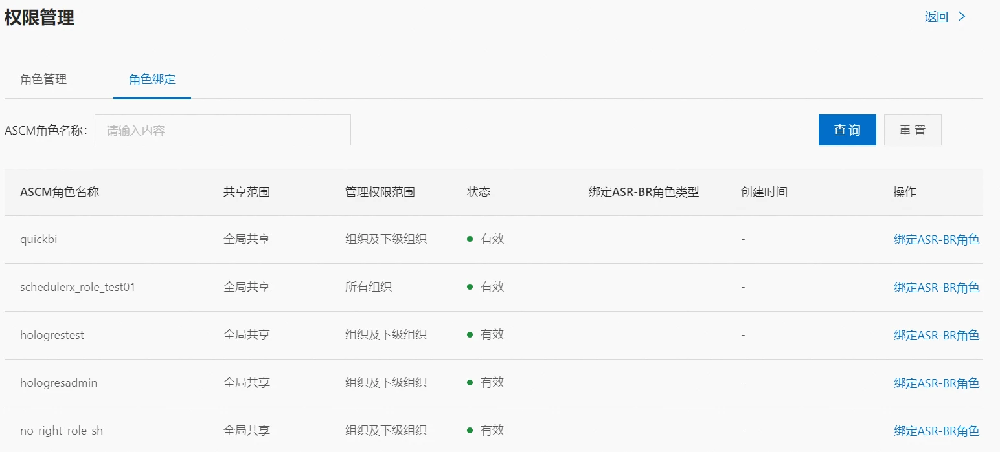

4. 在目标角色的**操作**列，单击**绑定ASR-BR角色**。

5. 在**绑定备份角色**弹窗中，选择**ASR-BR角色类型**。

   - 管理权限范围为所有组织的角色可设置为备份运营管理员。

   - 管理权限范围为组织及下级组织的角色可设置为组织备份管理员、组织备份操作员、组织备份监察员。

6. 单击**确定**，绑定成功自动跳转至**角色管理**页面。

**解除绑定**

1. 备份运营管理员登录备份管理控制台。

2. 在左侧导航栏，选择**系统管理** > **权限管理**。

3. 选择**角色管理**页签，页面显示已经绑定ASR-BR角色的ASCM角色列表。

   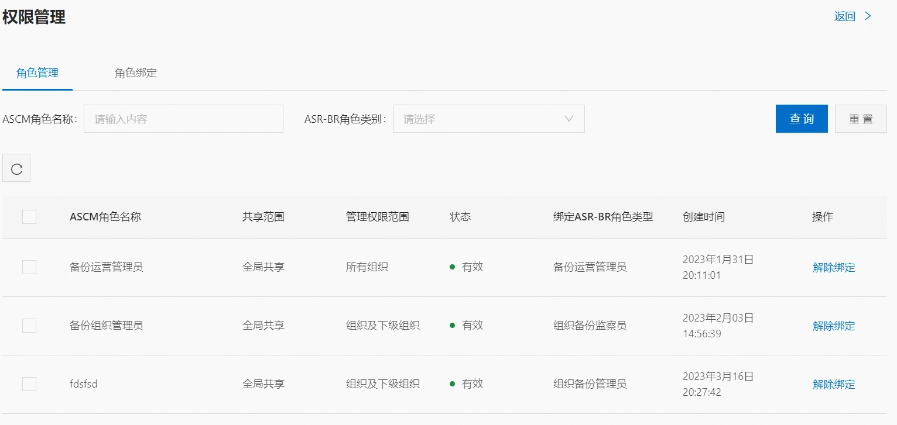

4. 在目标角色**操作**列单击**解除绑定**，或勾选多个目标角色，单击页面下方的**解除绑定**。

<a id="section-16"></a>

# 16.运维管理

<a id="section-16-1"></a>

## 16.1. 流控配置

流控配置用于控制生产中心向备份仓库备份时的最大传输速率。

1. 登录备份管理控制台。

2. 在左侧导航栏中选择**运维管理** > **流控配置**。

3. 单击**云产品**页签，设置相关参数，单击**提交**。

   <table>
     <tr>
       <th>分类</th>
       <th>配置</th>
       <th>描述</th>
     </tr>
     <tr>
       <td rowspan="3">整体流量</td>
       <td>下载流量</td>
       <td>设置生产中心向备份引擎备份OSS、ECS、NAS、云原生数据仓库AnalyticDB MySQL版（3.0）和MaxCompute备份数据时的下载流量阈值。</td>
     </tr>
     <tr>
       <td>本地上传流量</td>
       <td>备份引擎或单台物理机向本地备份仓库上传备份数据时的最大传输速率。请根据带宽合理设置阈值。</td>
     </tr>
     <tr>
       <td>异地上传流量</td>
       <td>备份引擎或单台物理机向异地备份仓库上传备份数据时的最大传输速率。请根据带宽合理设置阈值。</td>
     </tr>
     <tr>
       <td>ECS整机</td>
       <td>异地上传流量</td>
       <td>备份引擎向异地备份仓库上传ECS备份数据时的最大传输速率。请根据带宽合理设置阈值。</td>
     </tr>
     <tr>
       <td>RDS/PolarDB-X</td>
       <td>异地上传流量</td>
       <td>备份引擎向异地备份仓库上传RDS和PolarDB-X备份数据时的最大传输速率。请根据带宽合理设置阈值。</td>
     </tr>
   </table>

4. 单击**VMware**页签，设置相关参数，单击**确定**。

   | 名称 | 描述 |
   | --- | --- |
   | 版本 | 保持默认值即可。 |

   <table>
     <tr>
       <td>流量阈值</td>
       <td>设置相应时间段主中心向备中心备份VMware数据时的上传流量阈值和下载流量阈值。格式为<code> HH:MM-HH:MM-UKB&#124;HH:MM-HH:MM-DKB </code>。<br>说明<br>• HH:MM-HH:MM表示限速的时间范围。<br>• U表示上传流量。<br>• D表示下载流量。<br>示例：9:00-22:00-U512，表示9:00~22:00期间，上行流量限速512 KB。</td>
     </tr>
     <tr>
       <td>是否开启</td>
       <td>如果不开启，则不限制生产中心向备份仓库备份时的流量。</td>
     </tr>
   </table>

<a id="section-16-2"></a>

## 16.2. 引擎监控

您可以查看流量监控、CPU监控、内存监控、负载监控的数据，如果发现流量太大或使用率过高，及时采取措施规避风险。

1. 登录备份管理控制台。

2. 在左侧导航栏中选择**运维管理** > **引擎监控**。

   > **说明**
   >
   > - 监控页面展示最近1小时的监控数据。
   >
   > - 打开左上角**开启自动刷新**开关，系统每60s自动刷新一次监控数据；关闭开关，选择时间范围和对应的主机，单击**查询**，可以查询某个备份引擎的主机在某个时间范围的监控数据。

3. 在**流量监控**页面查看备份引擎（HBR-agent和Gulltoppr）相应主机的接收流量和发送流量。

   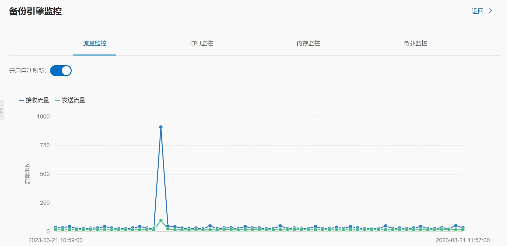

4. 在**CPU监控**页面查看备份引擎的CPU平均使用率和最大使用率。

   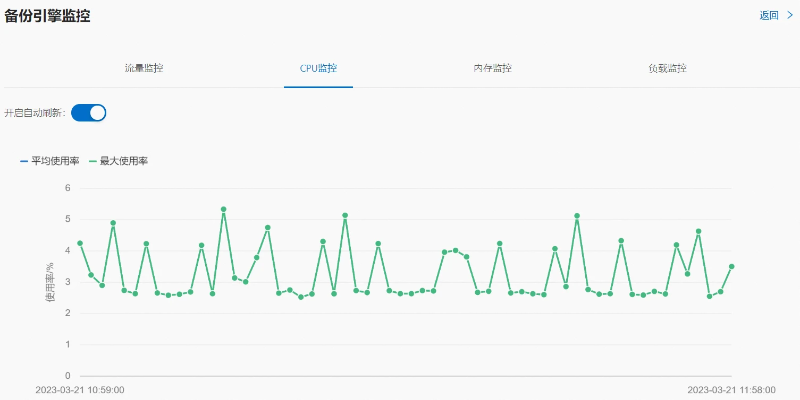

5. 在**内存监控**页面查看备份引擎的内存平均使用率和最大使用率。

   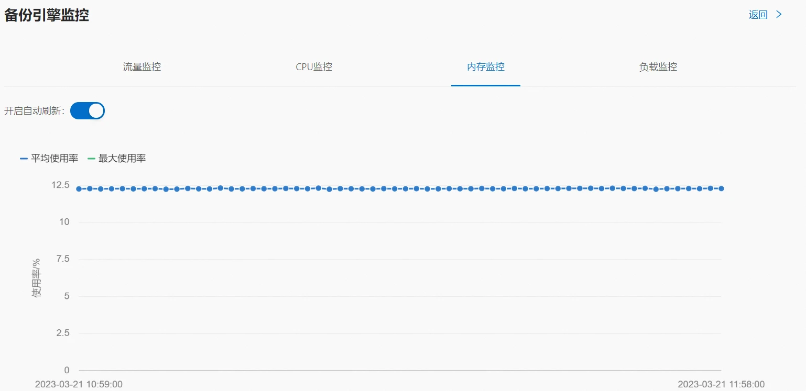

6. 在**负载监控**页面查看备份引擎的负载每分钟、每5分钟、每15分钟的平均使用率和最大使用率，在**负载选项**中可以切换**平均使用率**和**最大使用率**。

   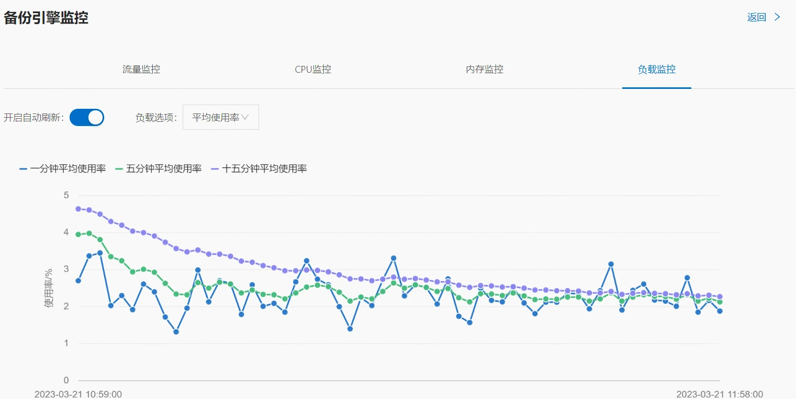

<a id="section-16-3"></a>

## 16.3. 资源统计

您可以从仓库资源和组织资源两个维度分别查看空间使用量、备份计划数量等相关信息。

**背景信息**

- 运营管理员能查看所有组织的相关资源统计。

- 组织管理员只能查看本组织的相关资源统计。

**操作步骤**

1. 登录备份管理控制台。

2. 在左侧导航栏中选择**系统管理** > **资源统计**。

3. 分别单击**仓库资源**或**组织资源**页签，选择日期，单击**查询**。

   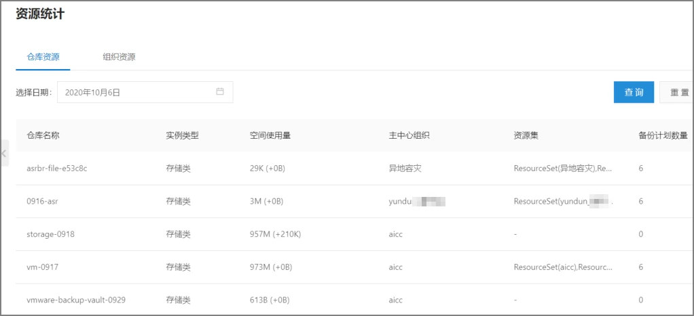

   仓库资源列表的字段说明如下表所示。

   | 名称 | 描述 |
   | --- | --- |
   | 仓库名称 | 备份仓库的名称。 |
   | 实例类型 | 该仓库备份的实例类型。包括数据库类和存储类。 |
   | 空间使用量 | 显示该备份仓库已使用的空间大小。括号里的值表示当天新增的空间使用量。 |
   | 主中心组织 | 显示使用了该备份仓库的主中心组织。 |
   | 资源集 | 显示使用了该备份仓库的资源集。 |
   | 备份计划数量 | 显示使用了该备份仓库的备份计划数量。 |

   组织资源列表的字段说明如下表所示。

   <table>
     <tr>
       <th width="121">名称</th>
       <th>描述</th>
     </tr>
     <tr>
       <td>主中心组织</td>
       <td>主中心组织名称。</td>
     </tr>
     <tr>
       <td>空间使用量</td>
       <td>显示该组织中的备份实例已使用的备份仓库空间大小。括号里的值表示当天新增的空间使用量。</td>
     </tr>
     <tr>
       <td>实例数量</td>
       <td>显示该组织在备份计划中的实例数量。</td>
     </tr>
     <tr>
       <td>备份计划数量</td>
       <td>显示该组织的备份计划数量。</td>
     </tr>
   </table>

<a id="section-16-4"></a>

## 16.4. 查看操作日志

操作日志记录了系统中所有的操作，包括备份计划和备份恢复的创建、删除和执行情况等。

**操作步骤**

1. 登录备份管理控制台。

2. 在左侧导航栏选择**运维管理** > **日志管理**。

3. 根据操作用户、操作模块、操作级别、操作类型、开始时间或结束时间查询所需的日志。日志列表的参数解释如下表所示。

   | 名称 | 描述 |
   | --- | --- |
   | 操作模块 | ASR-BR系统的模块。 |
   | 操作级别 | 日志的级别，分为紧急、警报、错误、警告、消息。 |
   | 操作类型 | 日志记录的操作类型。 |

<a id="section-16-5"></a>

## 16.5. STS配置

ASR-BR从低版本（企业版V3.12.0~V3.15.0）升级到企业版V3.16.2及后续版本，需要开启STS调用配置；如果是新部署的用户或者STS调用配置已开启的用户，无需执行STS配置。

**背景信息**

- STS调用配置一旦开启，无法关闭。

- ASR-BR在进行备份和恢复过程中，需要调用其它产品提供的OpenAPI，因此为了安全合规，企业版V3.16.2版本将进行AK、SK轮转功能的适配以及STS调用的改造。

- ASR-BR从低版本（企业版V3.12.0~V3.15.0）升级到企业版V3.16.2及后续版本，由于存储类产品使用的备份引擎HBR低版本没做相应的适配，因此在企业版V3.16.2版本无法支持STS调用。必须在数据订正之后，才可以支持STS调用。

- 如果ASR-BR为新部署或者STS调用已经开启，则无须进行开启STS调用配置的操作。

> **警告**
>
> STS调用配置的开启涉及到HBR相关数据库的删除、数据订正和服务的Rolling，因此会导致存储类产品（OSS、NAS、ECS文件和整机、VMware备份和迁移）涉及到的备份任务和迁移任务失败。STS调用配置的开启，请在无存储类产品备份和迁移的时间执行。

**操作步骤**

1. 备份运营管理员登录备份管理控制台。

2. 在左侧导航栏，选择**运维管理** > **STS配置**。

   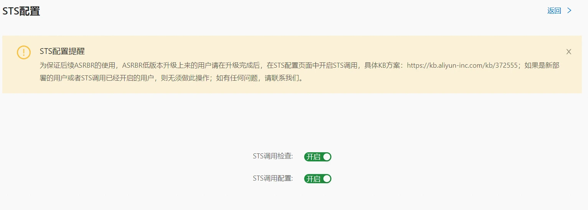

3. 在**STS配置**页面，打开**STS调用检查**开关。

   系统将检查目前使用ASR-BR的租户是否都配置了ASR-BR的服务角色。

   - 是：ASR-BR会给所有组织配置上备份引擎使用的SLR。之后进行相关检查，检查成功后，ASR-BR将允许开启STS调用配置。

   - 否：ASR-BR会提示哪个组织未配置ASR-BR的服务角色，需要进行手工配置。具体操作，请参见为组织配置ASR-BR服务角色。配置完成后，重复步骤3。

4. 进行备份引擎的元数据库数据重建。具体操作，请参见页面提示的KB文档。

5. 在**STS配置**页面，打开**STS调用检查**开关。

   > **说明**
   >
   > 如果开启失败，请联系阿里云技术支持或做回滚处理。

<a id="section-16-6"></a>

## 16.6. 参数配置

在V3.17之前版本的备份管理平台ASR-BR中，MaxCompute产品创建备份计划时需要添加运行项目。为简化配置、方便统一管理，V3.17版本开始修改为运营管理员统一配置，在运维管理下的参数配置页面统一设置备份计划的运行项目。

**背景信息**

- 配置参数需要具备备份运营管理员权限。

- 不做配置备份时，默认使用当前备份实例作为运行项目。

- 参数配置仅适用于MaxCompute实例<strong>。</strong>

- 配额（Quota）是MaxCompute的计算资源池，为MaxCompute SQL、MapReduce、Spark、Mars、PAI等计算作业提供所需计算资源（CPU及内存）。

**前提条件**

配置实例的数据版本类型必须为2.0，项目空间的数据类型属性参数定义如下：

- `setproject odps.sql.type.system.odps2=true;` ：打开MaxCompute 2.0数据类型。

- `setproject odps.sql.decimal.odps2=true;` ：打开Decimal 2.0数据类型。

- `setproject odps.sql.hive.compatible=false;` ：关闭Hive兼容模式。

**操作步骤**

**获取MaxCompute实例名称**

1. 登录Apsara Uni-manager运营控制台。

2. 在顶部菜单栏，选择**大数据** > **大数据计算MaxCompute**。

3. 在左侧导航栏，单击**Project管理**，在**Project管理**页面中通过组织选择需要作为Quota的MaxCompute实例。

**获取实例的AK、SK**

1. 登录Apsara Uni-manager运营控制台。

2. 在顶部菜单栏，选择**企业** > **组织管理**。

3. 在搜索框搜索对应的组织，单击**管理AccessKey**拿到对应的AK、SK。

**配置参数**

1. 登录备份管理控制台。

2. 在左侧导航栏，选择**运维管理** > **参数配置。**

3. 创建、更新或删除配置参数信息。

   操作过程中涉及的相关参数见下表。

   <table>
     <tr>
       <th width="178">参数名称</th>
       <th>描述</th>
     </tr>
     <tr>
       <td>项目名称</td>
       <td>MaxCompute实例名称。<br>说明<br>• 该实例会作为所有MaxCompute产品备份计划的运行项目，可以选择不做配置，默认会使用当前备份实例做为运行项目。<br>• 建议配置参数。</td>
     </tr>
     <tr>
       <td>accessKeyId</td>
       <td>实例所属组织的accessKeyId。</td>
     </tr>
     <tr>
       <td>accessKeySecret</td>
       <td>实例所属组织的accessKeySecret。</td>
     </tr>
     <tr>
       <td>CU数量</td>
       <td>实例计算资源数量。MaxCompute计算资源单位为CU，1 CU包含1 CPU及4 GB内存。</td>
     </tr>
     <tr>
       <td>目标配额组数量</td>
       <td>修改实例绑定的配额组CU数量。</td>
     </tr>
   </table>

<a id="section-16-7"></a>

## 16.7. 域名管理

<a id="section-16-7-1"></a>

### 16.7.1. 添加域名

当您使用MiniOSS作为灾备存储时，需要将MiniOSS的VIP绑定到生产云内的域名。

**操作步骤**

1. 登录备份管理控制台。

2. 在左侧导航栏，选择**运维管理** > **域名管理**。

3. 单击**新建**。

4. 在弹出的**添加域名**对话框中输入域名和IP地址。

5. 单击**测试IP联通性**。

6. 若显示**该域名地址可以连通**，单击**绑定域名**。

   若未显示**该域名地址可以连通**，需要修正域名或IP地址，重试**测试IP联通性**。

<a id="section-16-7-2"></a>

### 16.7.2. 修改域名

若域名或MiniOSS的VIP发生变更，您可以执行如下操作进行修改。

**操作步骤**

1. 登录备份管理控制台。

2. 在左侧导航栏选择**运维管理** > **域名管理**。

3. 单击目标**操作**列**修改**。

4. 在弹出的**编辑域名**对话框中修改域名或IP地址。

5. 单击**测试IP联通性**。

6. 若显示**该域名地址可以连通**，单击**绑定域名**。

   若未显示**该域名地址可以连通**，需要修正域名或IP地址，重试**测试IP联通性**。

<a id="section-16-8"></a>

## 16.8. 事件管理

事件管理界面支持查看所有事件记录。

**背景条件**

- 组织管理员：可以对自己发起的事件进行运维管理及查看。

- 运营管理员：可以对系统所有的事件进行运维管理及查看。

**操作步骤**

1. 登录备份管理控制台。

2. 在左侧导航栏，选择**运维管理** > **事件管理**。

3. 根据**事件类型**、**事件状态**、**开始时间**或**结束时间**查询相应的事件。

4. 在**操作**列中单击**日志**，可查看具体的日志信息。

5. 单击对应事件左侧的  图标，您可以查看各个实例事件的子事件及其状态。

   单击子事件右侧的  图标可查看子事件日志信息。

   - **成功**

   - **已取消**

     子事件被执行取消操作后，会显示此状态。

   - **失败**、**超时**、**已停止**

     子事件状态为以上三种时，可单击子事件右侧的  图标进行事件重试操作。

     > **重要**
     >
     > 该操作属于事件运维操作，正常不需要操作，如有最新的同一事件执行成功了，对于旧的事件请不要执行重试操作。

   - **等待开始**、**执行中**、**同步中**

     子事件状态为以上三种时，可单击子事件右侧的  图标进行事件取消操作。执行取消操作后，子事件

     状态会变为**已取消**。

     > **重要**
     >
     > 该操作属于事件运维操作，正常不需要操作。该操作不可逆，请谨慎操作。

<a id="section-17"></a>

# 17.备份最佳实践

<a id="section-17-1"></a>

## 17.1. 数据库类云产品备份最佳实践

<a id="section-17-1-1"></a>

### 17.1.1. RDS备份

本文介绍数据库产品RDS的备份策略和转储速度的相关说明。

**备份策略设置**

**备份策略**

RDS产品备份策略类型有两种：

- 全量备份模式：只能恢复备份时间点的数据。

- 全量+日志备份模式：可恢复任意时间点数据。

> **说明**
>
> RDS产品备份策略建议设置全量+日志备份模式，每周设置两天进行全量备份，既节约了带宽和存储容量，也可以保证数据尽可能不丢失。

**备份时间**

- 多个RDS实例备份，设置的备份时间尽量分散到每天。

  > **说明**
  >
  > 为了更好的利用带宽，同时并发数最好保证在5～6个。

- 尽量选择业务低峰期的时间段进行备份。

  > **说明**
  >
  > RDS的Mysql和PostgreSQL类型从备库备份，SQLServer从主库备份。

- 如果需要在当天执行备份，请提前10分钟设置备份策略。

**保存时间**

如果RDS备份同时设置了本地备份和异地备份，本地备份保存时间可以设置为7天；异地备份可以根据业务数据的重要性设置保存时间，异地保存时间可以设置在30天以上。

**备份转储速度**

RDS异地备份分两个步骤进行：

1. RDS云内备份：将备份的数据文件上传到云内OSS。其中，单个备份任务最大速度为55MBps。

2. RDS跨云备份：将云内OSS的数据跨云复制到云外OSS。

   跨云复制速度计算方式如下。

   - 未设置限速：单个任务上传速度为40Mbps。

   - 设置限速：限速大于等于400MBps，单个任务上传速度为40Mbps；限速speed小于400MBps, 单个任务上传速度为speed/10。

**限速场景**以下场景需要限速：

- 除了备份RDS以外，还需要备份OSS、NAS等存储类应用，并且备份的量比较大。

- 同时并发的备份任务数量超过6个时，需要根据允许分配给RDS备份的带宽量进行限速。

<a id="section-17-1-2"></a>

### 17.1.2. PolarDB-X 1.0备份

本文介绍数据库产品PolarDB-X 1.0的备份策略和转储速度的相关说明。

**备份策略设置**

**备份策略**

PolarDB-X 1.0产品备份模式分为两种：快速备份和一致性备份。

- 快速备份：保证单个RDS数据一致性，无法保证数据的全局一致性。

- 一致性备份：会对分布式事务进行秒级的锁定操作，RT存在亚秒级抖动，建议在业务低峰期进行。恢复时，只能选择备份集进行恢复。

> **说明**
>
> 快速备份适用于常规备份和恢复，一致性备份适用于对数据一致性有严格要求的行业以及在线核心交易类业务。

**备份时间**

一周至少备份两次保证有可恢复的数据集。

> **说明**
>
> 如果需要在当天执行备份，请提前10分钟设置备份策略。

**保存时间**

- 本地备份保存时间可以设置为7天。

- 异地根据业务数据的重要性设置保存时间，异地保存时间可以在30天以上。

**备份转储速度**

参考RDS产品备份转储速度。

**限速场景**

参考RDS产品限速场景。

<a id="section-17-1-3"></a>

### 17.1.3. ADB for Mysql备份

本文介绍数据库产品ADB for Mysql的备份策略和转储速度的相关说明。

**备份策略设置**

ADB for Mysql是通过OSS备份的方式将数据备份集转储到异地。因此恢复时，只能按照备份集恢复。ADB备份策略可以设置一周两次，如果ADB备份集过大时，需减少到每周一次。

**备份转储速度**

参考OSS产品备份速度和配置。

**限速场景**

参考OSS产品限速场景。

<a id="section-17-2"></a>

## 17.2. 文件类存储产品备份最佳实践

<a id="section-17-2-1"></a>

### 17.2.1. OSS备份

本文介绍OSS的备份速度和限速场景的相关说明。

**备份速度和配置**

OSS备份的性能和文件大小以及并发数的选择有关，针对不同文件大小，推荐采用如下的并发数配置进行备份。

| 平均文件大小 | 并发数配置 | 备份速度 |
| --- | --- | --- |
| &lt;64KB | 128读 256写 | &lt;110MB |
| 64KB ~ 128KB | 128读 128写 | 100MB ~ 350MB |
| 128KB ~ 256KB | 64读 128写 | 150MB ~ 350MB |
| 256KB ~ 512KB | 64读 64写 | 200MB ~ 450MB |
| 512KB ~ 2MB | 32读 32写 | 300MB ~ 400MB |
| &gt; 2MB | 默认配置(8读32写) | &gt;100MB |

备份周期根据相应的OSS备份速率进行估算配置。

在OSS备份数据量比较大的场景下，可以通过配置Prefix和筛选文件时间段拆分实例到多个备份计划，进而提高备份扫描效率。

OSS备份除了第一次备份是全量备份，后续的备份都通过重删进行增量备份。

对于CDS-OSS实例，清单功能可以有效的提高增量备份的效率。当Bucket内的数据量大于1亿时，推荐打开清单功能进行备份。

**限速场景**

备份作为旁路系统，在建设时，尽量避免对业务的影响。在备份时，OSS受限于SLB 5Gb的最大流量限制，因此建议采用如下措施。

- 针对企业版V3.16以上版本，在对OSS进行备份时，为OSS创建一个独立的备份VIP，在创建备份计划时通过Endpoint进行配置，可保证在备份时对业务无影响。

- 进行数据备份时，根据实际带宽情况进行限流。

<a id="section-17-2-2"></a>

### 17.2.2. NAS备份

本文介绍NAS的备份速度和限速场景的相关说明。

**备份速度**

NAS备份仅支持NFS协议。建议所创建的每个NAS备份任务单个目录下的文件及子目录数量之和不超过800万。NAS备份的速度和文件大小有关，配置备份周期时请根据实际数据量和备份速度进行评估。

NAS不同文件大小的NAS备份速度如下。

| 文件大小 | 平均处理速度 | 单日备份数据量(24小时计算) |
| --- | --- | --- |
| 32KB | 13MB/s | 1TB |
| 64KB | 21MB/s | 1.73TB |
| 256KB | 53MB/s | 4.36TB |
| 512KB | 82MB/s | 6.75TB |
| 1MB | 138MB/s | 11.37TB |

**限速场景**

进行数据备份时，根据实际带宽情况进行限流。

<a id="section-17-2-3"></a>

### 17.2.3. ECS文件备份

本文介绍ECS文件备份的备份速度。

**备份速度**

不同的ECS云盘类型，备份速度不一样，其中高性能云盘≈高效云盘>普通性能云盘≈SSD。

ECS文件备份时会占用ECS的资源，备份速度和资源使用具体如下。

| 平均文件大小 | 传输速度 | CPU使用量 | 限流10MB后CPU使用 |
| --- | --- | --- | --- |
| 32KB | 19MBps | 100%～240% | 40%-70% |
| 64KB | 27MBps | 200%～240% | 32%～60% |
| 256KB | 92MBps | 160%～240% | 16%-40% |
| &gt;=512KB | 120MBps | 160%/240% | 16%-28% |

在创建ECS备份计划时：

1. 在不限速的情况下，确保ECS的规格至少为4C4G。如果ECS的CPU规格小于4C，对ECS文件备份进行限流在10MB以内。

2. 备份内存使用量为1GB-2GB之间，确保ECS的内存至少有1GB空闲。

<a id="section-17-2-4"></a>

### 17.2.4. ECS整机备份

本文介绍ECS整机备份的异地转储速度。

**异地转储速度**

ECS整机备份，首先由EBS将快照写入到本地OSS，然后将本地OSS的快照数据通过EBS服务读出写入到异地灾备存储中。其中，EBS 1.0单盘快照速度为13MBps，CDS-EBS单盘快照速度为32MBps。

异地转储速度为90MBps。设置备份策略时，根据实际备份数据量酌情估算。

<a id="section-17-3"></a>

## 17.3. 大数据类产品备份最佳实践

<a id="section-17-3-1"></a>

### 17.3.1. MaxCompute备份

本文介绍MaxCompute备份时的相关数据。

- MaxCompute在备份时，以分片或者表的纬度将数据切分成256MB的分片，一个分片作为一个任务上传，任务会打散到多台大数据计算节点上执行。

- 每个任务占用0.7个配额，上传速度大小为2-3MBps，平均每个配额可提供3.6MBps的上传速度。

- 当并发的任务数大于配额时，任务将排队执行。

- 两台备份物理机的情况下，MaxCompute备份的最大吞吐约为300MBps（更多的物理机将提供更多的备份吞吐）。

<a id="section-18"></a>

# 18.附录

<a id="section-18-1"></a>

## 18.1. 在ECS上安装HBR-Agent

ECS异地备份需要在主中心ECS实例上安装HBR-Agent客户端。

**背景信息**

主中心需要做异地备份和异地恢复的ECS实例上，都需要安装HBR-Agent。

**操作步骤**

1. 获取hbr服务地址。

   <ol type="i">

   <li>

   登录备中心的Apsara Uni-manager运维控制台。

   </li>

   <li>

   在顶部菜单栏选择**产品运维** > **底座/云平台** > **飞天基础运维平台**。

   </li>

   <li>

   在飞天基础运维平台的左侧导航栏中，单击**运维工具** > **基础数据管理** > **底座元数据管理** > **服务注册变量大盘**。

   </li>

   <li>

   在左上角下拉框中选择**服务**，在搜索框中分别输入“rds-ddr-proxy”和“hbr-rabbitmq”，单击搜索按钮。

   </li>

   <li>

   在**rds-ddr-proxy**服务的**Service Registration**列单击  图标，再单击内容，会出现注册变量弹

   窗。

   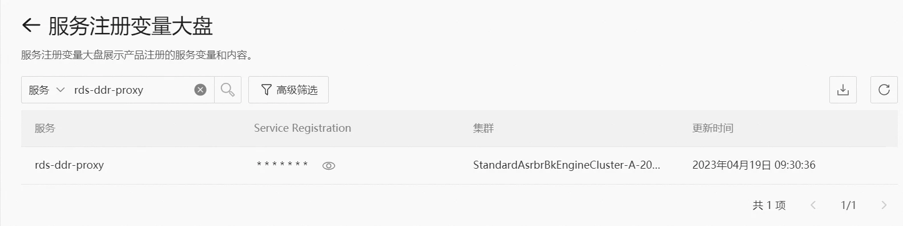

   在注册变量弹窗中查看**asr.resource.domain**的值：

   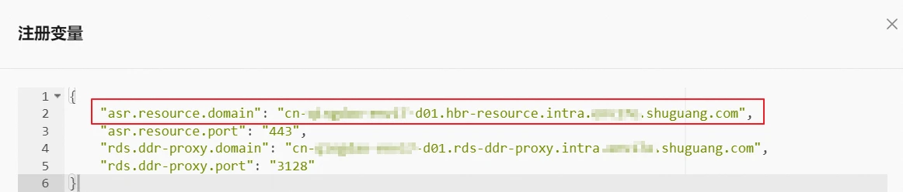

   </li>

   <li>

   在**hbr-rabbitmq**服务的**Service Registration**列单击  图标，再单击内容，会出现注册变量弹

   窗。

   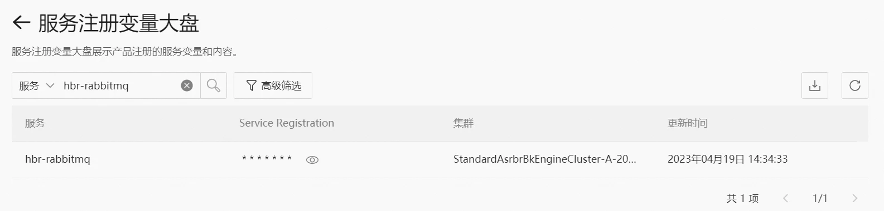

   在注册变量弹窗中查看**hbr.rabbitmq.domain**的值：

   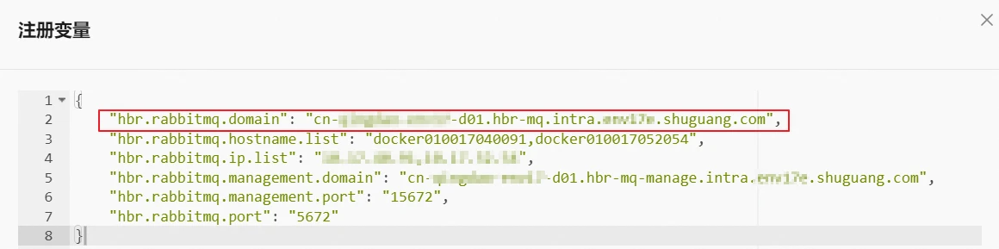

   </li>

   </ol>

2. 在主中心的ECS实例中下载HBR-Agent安装包。

   - linux环境中下载安装包的命令如下：

     ```bash
     curl -O --basic -u guest:guest 
     http://<hbr_resource_host>/download/<hbragent_filename>
     ```

     > **说明**
     >
     > &lt;hbr_resource_host>的值请替换为步骤1中**asr.resource.domain**的值。
     >
     > &lt;hbragent_filename>的值请填写HBR Agent的安装包名称，具体如下：
     >
     > - 32位操作系统：hbr-install-2.0.0-linux-32bit.tar.gz
     >
     > - 64位操作系统：hbr-install-2.0.0-linux-64bit.tar.gz

   - Windows环境中，请在浏览器中输入如下地址下载安装包。

     ```xml
     <hbr_resource_host>/download/<hbragent_filename>
     ```

     在弹出的对话框中，输入用户名*guest*，密码*guest*。

     > **说明**
     >
     > &lt;hbr_resource_host>的值请替换为步骤1中**asr.resource.domain**的值。
     >
     > &lt;hbragent_filename>请填写HBR Agent的安装包名称，具体如下：
     >
     > - 32位操作系统：hbr-install-2.0.0-windows-32bit.zip
     >
     > - 64位操作系统：hbr-install-2.0.0-windows-64bit.zip

3. 解压缩安装包。

4. 安装HBR-Agent。

   - 在Linux环境中执行如下命令：

   - 在Linux环境中执行如下命令：

     ```text
     ./setup -m ApsaraStack -h<hbr_amqp_host>
     ```

     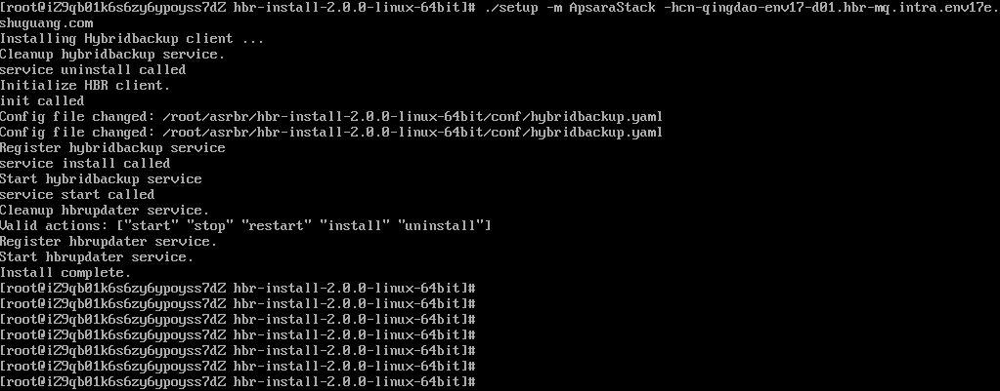

   - 在Windows环境中执行如下命令：

     ```xml
     <hbragent_filename> /TYPE=ApsaraStack /host= <hbr_amqp_host>/SUPPRESSMSGBOXES /VERY
     SILENT
     ```

     > **说明**
     >
     > &lt;hbr_amqp_host>请替换为步骤1中获取的**hbr.rabbitmq.domain**的值。
     >
     > &lt;hbragent_filename>请填写HBR Agent的安装包名称，具体如下：
     >
     > - 32位操作系统：hbr-install-2.0.0-windows-32bit.zip
     >
     > - 64位操作系统：hbr-install-2.0.0-windows-64bit.zip

5. 检查HBR服务运行正常。

   - Linux环境：执行如下命令检查HBR服务。

     ```text
     ps aux | grep hbr
     ```

     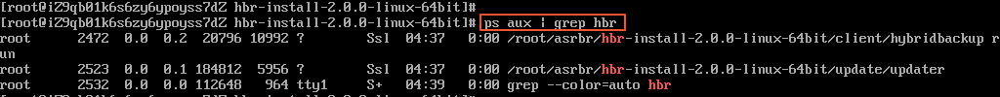

   - Windows环境：在任务管理器中查看**hybridbackup**服务的状态为**正在运行**。

     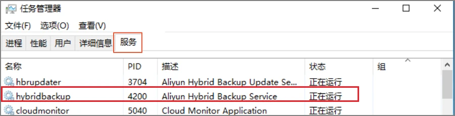

<a id="section-18-2"></a>

## 18.2. 为组织配置ASR-BR服务角色

本文介绍如何为相应组织配置ASR-BR服务角色。

**操作步骤**

1. 登录Apsara Uni-manager运营控制台。

2. 在顶部菜单栏，单击**配置**。

3. 在左侧导航栏，单击**RAM服务角色**。

4. 在**RAM服务角色列表**页面，单击**创建RAM服务角色**。

5. 在**RAM服务角色创建**页面，在**服务名称**下拉列表选择**备份管理平台 ASR-BR**，在**授权组织名称**中选择相应的组织名称。

6. 单击**确定**。
