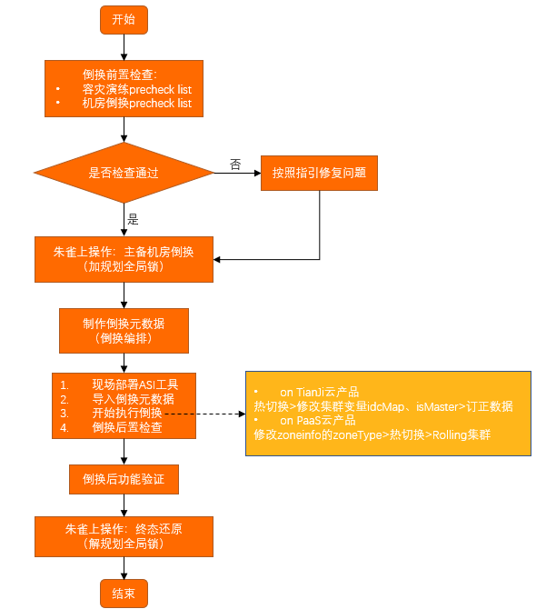
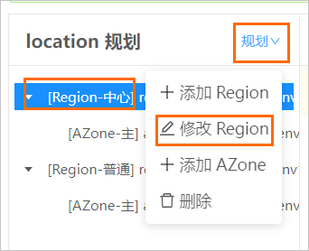
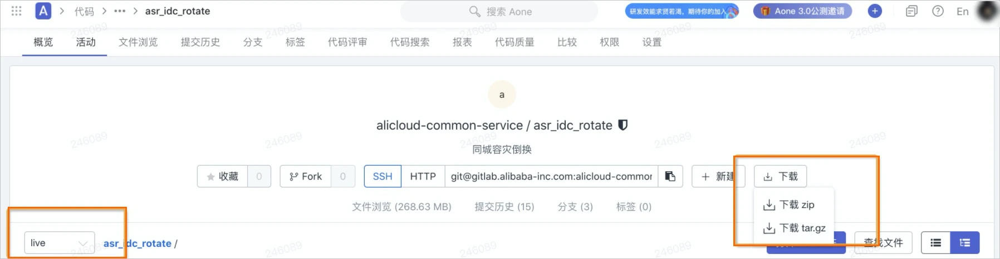
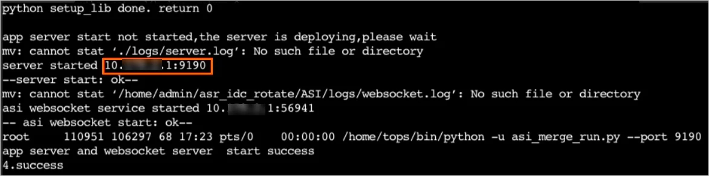
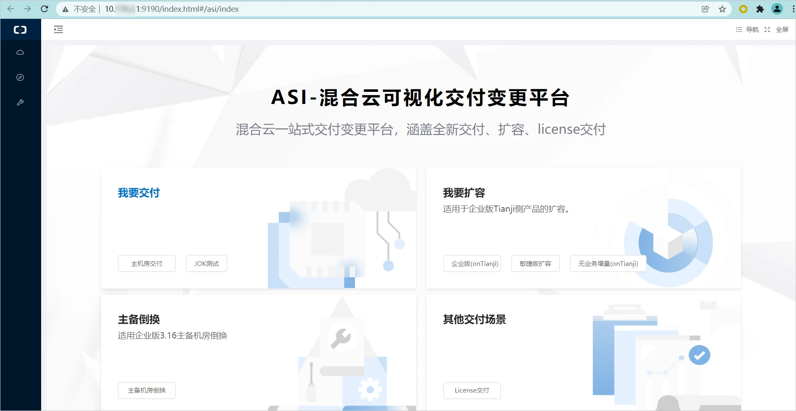
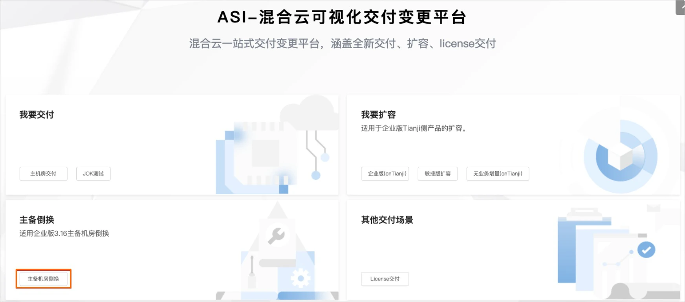
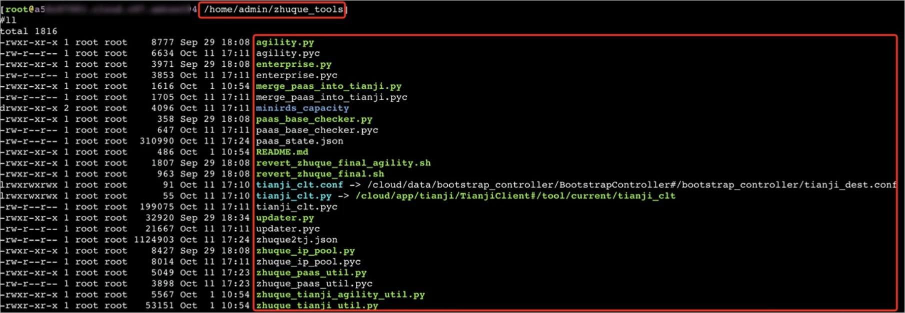
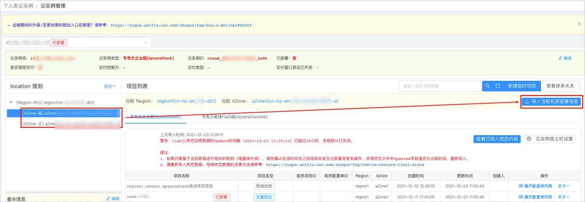
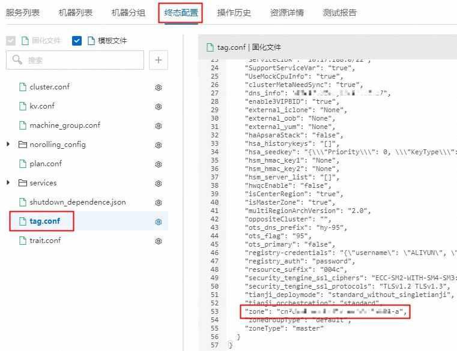

阿里云  
专有云飞天企业版  
灾备管理中心  
主备机房倒换（同城容灾）  
产品版本：v3.18.3  
文档版本：20240923

**目录**

- [1.概述](#section-1)
- [2.倒换限制](#section-2)
- [3.倒换支持列表](#section-3)
- [4.倒换影响](#section-4)
- [5.交付运维能力](#section-5)
- [6.倒换流程](#section-6)
- [7.倒换前准备](#section-7)
    - [7.1. 倒换前置检查](#section-7-1)
    - [7.2. 朱雀上操作主备机房倒换](#section-7-2)
    - [7.3. 制作倒换元数据](#section-7-3)
    - [7.4. 获取ASI部署包](#section-7-4)
- [8.现场实施](#section-8)
    - [8.1. 部署ASI](#section-8-1)
    - [8.2. 开始倒换](#section-8-2)
    - [8.3. 还原现场终态](#section-8-3)
        - [8.3.1. ASI一键还原现场终态](#section-8-3-1)
        - [8.3.2. 命令行还原现场终态](#section-8-3-2)
    - [8.4. 回传现场终态](#section-8-4)
    - [8.5. 停止ASI](#section-8-5)
- [9.ASI倒换方案](#section-9)
    - [9.1. 倒换编排](#section-9-1)
    - [9.2. 通用倒换方案](#section-9-2)
        - [9.2.1. on Tianji通用倒换方案](#section-9-2-1)
        - [9.2.2. on Tianji通用倒换方案（先切换）](#section-9-2-2)
        - [9.2.3. on PaaS通用倒换方案](#section-9-2-3)
        - [9.2.4. on PaaS通用倒换方案（先切换）](#section-9-2-4)
    - [9.3. 定制化倒换方案](#section-9-3)
        - [9.3.1. MiniRDS-mt定制倒换方案](#section-9-3-1)
        - [9.3.2. RDS定制倒换方案](#section-9-3-2)
        - [9.3.3. Aliware-taokeeper定制倒换方案](#section-9-3-3)
        - [9.3.4. middleWare-DNCS定制倒换方案](#section-9-3-4)
        - [9.3.5. PaaS底座定制倒换方案](#section-9-3-5)
- [10.附录](#section-10)
    - [10.1. ASI运维](#section-10-1)
    - [10.2. 获取Zone名称](#section-10-2)

<a id="section-1"></a>

# 1.概述

主备机房倒换能力是指在同城容灾场景下，将两个机房的主、备角色互换，并使云产品能感知到，将部分或全部工作负载运行到第二机房上。

主备机房倒换能够满足您如下需求：

- 新建灾备机房后，用户要求以新建的机房作为生产机房。

  > 通过主备机房倒换能力可以弥补建设顺序先主后备的不足。
  >
  > **说明**

- 生产机房空间不足，无法扩容。

- 用户自身的管理要求，需要置换生产机房和灾备机房。

<a id="section-2"></a>

# 2.倒换限制

本文介绍主备机房倒换的限制及要求。

主备机房倒换有如下限制和要求：

- 用户局点所有云产品均已升级到企业版V3.18.1版本。

- 企业版V3.18.1仅支持中心Region的主备机房倒换。

- 用户局点所有云产品均已完成容灾建设，包括

  - 支持同城容灾。

  - Feature对等部署。

  - 完成A-A'。

- 用户局点**所有云产品**均在倒换支持列表中覆盖到。详细信息，请参见倒换支持列表。

> **重要**
>
> 如果有用户局点需要在企业版V3.16.0版本实施主备机房倒换，倒换前，请务必联系阿里云专有云同城容灾团队，提供Hotfix版本的ASR。

<a id="section-3"></a>

# 3.倒换支持列表

本文介绍主备机房倒换支持的云产品。

支持主备机房倒换的云产品和组件列表如下：

<table>
  <tr>
    <th width="90">分类</th>
    <th>云产品</th>
  </tr>
  <tr>
    <td>弹性计算</td>
    <td>• 云服务器ECS<br>• 容器服务ACS<br>• 容器镜像服务ACR<br>• 弹性伸缩ESS<br>• 资源编排ROS</td>
  </tr>
  <tr>
    <td>云平台</td>
    <td>• 飞天基础运维平台TianJi<br>• Apsara Uni-Manager混合云管理平台（ASCM）<br>• Apsara Uni-Manager运维控制台（ASO）<br>• SRE技术保障平台（tongque）<br>• 同城容灾管理平台ASR</td>
  </tr>
  <tr>
    <td>数据库</td>
    <td>• 云数据库RDS<br>• 数据传输服务DTS<br>• 云数据库MongoDB<br>• 云数据库Redis<br>• 云数据库OceanBase<br>• 云原生分布式数据库PolarDB-X1.0（原DRDS）<br>• 多模数据库Lindorm<br>• 云数据库MongoDB版<br>• 云数据库HBase版</td>
  </tr>
  <tr>
    <td>网络</td>
    <td>• 专有网络VPC<br>• 负载均衡SLB<br>• 虚拟网络管理2.0（齐天）<br>• 专有云DNS</td>
  </tr>
  <tr>
    <td>应用服务</td>
    <td>API网关（API Gateway）</td>
  </tr>
  <tr>
    <td>大数据</td>
    <td>• 实时计算Blink<br>• 数据总线DataHub<br>• 大数据开发治理平台DataWorks<br>• 大数据管家ABM（Apsara Big Data Manager），（原BBC）<br>• 检索分析服务Elasticsearch版</td>
  </tr>
  <tr>
    <td>安全</td>
    <td>• 密钥管理服务KMS<br>• 云盾高级版</td>
  </tr>
  <tr>
    <td>中间件</td>
    <td>• 分布式调度平台SchedulerX<br>• 消息队列MQ<br>• 云服务总线CSB<br>• 日志分布式处理平台Tlog<br>• 消息队列Kafka<br>• 企业级分布式应用EDAS</td>
  </tr>
  <tr>
    <td>监控</td>
    <td>• 应用实时监控服务ARMS<br>• 云监控（CMS）</td>
  </tr>
  <tr>
    <td>存储</td>
    <td>• 日志服务SLS<br>• 对象存储OSS<br>• 块存储EBS<br>• 表格存储OTS</td>
  </tr>
</table>

<table>
  <tr>
    <td colspan="3">组件</td>
  </tr>
  <tr>
    <td>minirds-mt</td>
    <td>middleWareAll</td>
    <td>baseServiceAll</td>
  </tr>
  <tr>
    <td>webappAll</td>
    <td>dms-enterprise</td>
    <td>yundun-common</td>
  </tr>
  <tr>
    <td>middleware-dncs</td>
    <td>aliware-taokeeper</td>
    <td>xnet2</td>
  </tr>
  <tr>
    <td>opsapi</td>
    <td>dauthProduct</td>
    <td>yundun-advance</td>
  </tr>
  <tr>
    <td>base</td>
    <td>oneconsole</td>
    <td>redis</td>
  </tr>
  <tr>
    <td>hardware</td>
    <td>network</td>
    <td>asa</td>
  </tr>
  <tr>
    <td>middleWare-queqiao</td>
    <td>ftp</td>
    <td>astc</td>
  </tr>
  <tr>
    <td>config-assist</td>
    <td>asd</td>
    <td>ram</td>
  </tr>
  <tr>
    <td>licenceManage</td>
    <td>ark</td>
    <td>tianji-provider</td>
  </tr>
  <tr>
    <td>cluster-init</td>
    <td>traits</td>
    <td>middleWare-staragent</td>
  </tr>
  <tr>
    <td>tianjimon</td>
    <td>-</td>
    <td>-</td>
  </tr>
</table>

> **说明**
>
> 其中检索分析服务Elasticsearch、消息队列Kafka、云数据库MongoDB、多模数据库Lindorm、云数据库HBase、日志服务SLS、对象存储OSS、块存储EBS和大数据管家ABM是V3.18.0支持倒换的云产品。

<a id="section-4"></a>

# 4.倒换影响

本文介绍主备机房倒换过程中对业务连续性和发布能力的影响。

**业务连续性**

<table>
  <tr>
    <th rowspan="2">云产品</th>
    <th colspan="3">业务连续性</th>
  </tr>
  <tr>
    <td>切换</td>
    <td>Rolling备集群</td>
    <td>Rolling主集群</td>
  </tr>
  <tr>
    <td>飞天基础服务OpsDns</td>
    <td>无影响</td>
    <td>无影响</td>
    <td>无影响</td>
  </tr>
  <tr>
    <td>元数据库管理系统minirds-mt</td>
    <td>秒级影响</td>
    <td>无影响</td>
    <td>无影响</td>
  </tr>
  <tr>
    <td>云数据库RDS</td>
    <td>秒级影响</td>
    <td>略有影响，1秒钟</td>
    <td>无影响</td>
  </tr>
  <tr>
    <td>负载均衡SLB</td>
    <td>秒级影响</td>
    <td>分钟级影响</td>
    <td>分钟级影响</td>
  </tr>
  <tr>
    <td>专有网络VPC</td>
    <td>不涉及</td>
    <td>无影响</td>
    <td>无影响</td>
  </tr>
  <tr>
    <td>云服务器ECS</td>
    <td>不涉及</td>
    <td>无影响</td>
    <td>无影响</td>
  </tr>
  <tr>
    <td>对象存储OSS</td>
    <td>略有影响，1秒钟</td>
    <td>略有影响，1秒钟</td>
    <td>无影响</td>
  </tr>
  <tr>
    <td>中间件基础组件-监控ZooKeeper集群</td>
    <td>强切过程中有分钟级影响</td>
    <td>无影响</td>
    <td>秒级影响</td>
  </tr>
  <tr>
    <td>表格存储Tablestore</td>
    <td>秒级影响</td>
    <td>无影响</td>
    <td>无影响</td>
  </tr>
  <tr>
    <td>消息队列MQ</td>
    <td>不涉及</td>
    <td>无影响</td>
    <td>无影响</td>
  </tr>
  <tr>
    <td>云原生分布式数据库PolarDB-X</td>
    <td>不涉及</td>
    <td>无影响</td>
    <td>无影响</td>
  </tr>
  <tr>
    <td>数据总线DataHub</td>
    <td>分钟级</td>
    <td>无影响</td>
    <td>无影响</td>
  </tr>
  <tr>
    <td>企业级分布式应用服务EDAS</td>
    <td>无影响</td>
    <td>无影响</td>
    <td>无影响</td>
  </tr>
</table>

**发布能力**

- 主备机房倒换后，增量部署容灾1.0基线的云产品时，提交完A机房终态后，A、B机房都会自动部署。

- 主备机房倒换后，备机房故障时，会影响PaaS上云产品的增量部署、升级、扩容和Rolling。

<a id="section-5"></a>

# 5.交付运维能力

本文介绍主备机房倒换后，进行增量部署、热升级、扩容和缩容等操作时的注意事项。

**增量部署**

主备机房倒换后，需要先在新主机房增量部署云产品，后在新备机房增量部署云产品。

例如：倒换前，A机房是主机房，B机房是备机房。那么，倒换后，需要先增量部署B机房云产品，再增量部署A机房云产品。

**热升级（仅包含企业版V3.18.1 Hotfix热升级）**

目前主备机房倒换后，具备最基础的企业版V3.18.1 Hotfix热升级能力。

升级时需注意以下几点：

- 朱雀具备最基础的升级规划能力（Hotfix无新增feature、集群变量、全局变量等部署形态变化，且Hotfix只涉及代码变化等）。

- ASU热升工具具备通过tianjisdk、paassdk提交终态的能力，检查终态的能力。暂不涉及主备间的逻辑关系处理，包括停止一侧服务、处理单边资源变更、Hack升级模式、穿插提交主备升级、by集群升级等。

- 如果客户有倒换后Hotfix、Hotfeature升级的诉求，需联系热升级和容灾架构团队进行评估或重保。

**扩、缩容**

和增量部署的逻辑一致。具体请参见增量部署。

<a id="section-6"></a>

# 6.倒换流程

本文介绍主备机房倒换的具体流程。

主备机房倒换的流程如下图所示。



<a id="section-7"></a>

# 7.倒换前准备

<a id="section-7-1"></a>

## 7.1. 倒换前置检查

主备机房倒换前，您需要对云产品和环境进行前置检查。

前置检查的具体检查项和检查方法，请参见机房倒换precheck list和容灾演练precheck list。

<a id="section-7-2"></a>

## 7.2. 朱雀上操作主备机房倒换

您需要在朱雀控制台上触发主备机房倒换，该状态下系统将锁定Region，禁止终态导入，不允许有新的商务和交付规划。

1. 登录朱雀控制台。

2. 在左侧导航栏，选择**云实例管理>个人云实例**。

3. 在**云实例列表**选择目标云实例，在对应**操作**列单击**管理云实例**。

4. 在**云实例管理**页面，**location规划**区域，单击以<strong>[Region-中心]</strong>为前缀的Region，右上角选择**规划修改Region**。

   

5. 在弹出的**修改region**对话框中，选中**主备机房倒换**，单击**修改**。

   

<a id="section-7-3"></a>

## 7.3. 制作倒换元数据

本文介绍倒换元数据的制作方法。

**前提条件**

您已获取GitLab访问权限。

> 若您无权访问GitLab，请跳过此步骤，并向产品研发团队获取倒换元数据。
>
> **说明**

**操作步骤**

1. 在本机电脑上，执行如下命令，下载源代码。

   ```bash
   git clone -b live git@gitlab.alibaba-inc.com:alicloud-common-
   service/asr_idc_rotate.git
   ```

2. 执行如下命令，进入idc_rotate_meta目录，通过Python脚本自动生成倒换元数据。

   ```bash
   cd idc_rotate_meta
   ```

   ```text
   pipenv install
   ```

   ```text
   python main.py direction --fromIdc <现主机房> --toIdc <倒换⽬标主机房>
   ```

   在target路径下，会生成ASI_DATA.tar文件，该文件即为倒换元数据。

3. 如果有特殊需求，需要修改ProductRotatingScheduling.csv文件，来调整云产品的倒换编排顺序，请联系产品研发团队。

<a id="section-7-4"></a>

## 7.4. 获取ASI部署包

现场通过ASI进行主备机房倒换操作。本文介绍如何获取ASI主备倒换工具部署包。

**前提条件**

您已获取GitLab访问权限。

> 若您无权访问GitLab，请跳过此步骤，并向产品研发团队获取ASI部署包。
>
> **说明**

**操作步骤**

1. 在本机电脑上，执行如下命令，下载源代码。

   ```bash
   git clone -b live git@gitlab.alibaba-inc.com:alicloud-common-
   service/asr_idc_rotate.git
   ```

2. 登录同城容灾倒换代码库。

3. 在左侧下拉列表选择**live**分支，单击**下载**，下载最新的ASI主备倒换工具压缩包。

   

<a id="section-8"></a>

# 8.现场实施

<a id="section-8-1"></a>

## 8.1. 部署ASI

本文介绍如何部署ASI主备机房倒换工具。

**前提条件**

您已获取ASI部署包，具体操作，请参见获取ASI部署包。

**操作步骤**

1. 登录主机房OPS1机器。

2. 执行如下命令，检查是否有进程占用9190端口。

   ```text
   ps -ef | grep 9190 | grep -v grep
   ```

   - 若端口未被占用，继续执行步骤3。

   - 若端口被占用，判断可否使用 `kill` 命令终止该进程，或找到部署的绝对路径执行 `stop` 命令停止ASI，具体命令，请参见ASI运维。

     > 同一时刻只能启动一个ASI进程。
     >
     > **重要**

3. 将ASI部署包上传到主机房OPS1机器上的工作目录，本文以/home/admin目录为例。

4. 解压ASI部署包。解压后得到一个asr_idc_rotate目录。

5. 执行如下命令，进入asr_idc_rotate目录，并安装ASI。

   ```bash
   cd /home/admin/asr_idc_rotate
   ```

   ```text
   sh install.sh
   ```

   若部署成功，返回信息如下图所示。

   

   部署完成后，利用主机房OPS1机器的IP+端口号（默认9190）即可访问现场Portal。

   

**相关文档**

- ASI运维

<a id="section-8-2"></a>

## 8.2. 开始倒换

本文介绍如何通过ASI现场执行主备机房倒换。

**前提条件**

- 您已在现场完成ASI的部署。具体操作，请参见部署ASI。

- 您已获取倒换元数据。具体操作，请参见制作倒换元数据。

**操作步骤**

1. 登录ASI控制台。

2. 单击**主备机房倒换**。

   

3. 在**首页**页面，查看产品、集群以及终态情况，确认没有问题后，单击**下一步**。进入**机房倒换**页面。

4. 上传倒换元数据。

   <ol type="i">

   <li>

   在**上传倒换数据包**配置向导页面，单击**上传ASI_DATA数据**。

   </li>

   <li>

   在弹出的**上传ASI_DATA数据**对话框中，单击**上传文件**，选择获取的ASI_DATA.tar倒换元数据。

   </li>

   <li>

   确认倒换方向正确，并通过格式校验后，单击**下一步**。

   </li>

   </ol>

5. 主备倒换。

   <ol type="i">

   <li>

   在**产品主备切换**配置向导页面，左侧**倒换产品列表**，依次选择产品单击**开始倒换**进行倒换。

   开始云产品的倒换工作流后，工作流在后台自动执行，直到完成或者报错终止。

   > **重要**
   >
   > - tianji必须先于其它产品倒换。
   >
   > - bcmc必须放到最后倒换。
   >
   > - 底座在倒换的过程中除了需要切换tianji外，还需要将ops-dns、ots-inner、sls-inner切换至第二机房。
   >
   > - 标注**人工操作**的工作流需人工手动进行。完成后，单击**操作**列**确认**，才会进入下一工作流。
   >
   > - 当Job执行出错时，根据实际情况，可单击对应**操作**列**忽略**或**重试**。
   >
   > - 若要了解ASI中各产品倒换方案，可参见本手册中<strong>《ASI倒换方案》</strong>。

   </li>

   <li>

   <strong>可选：</strong>根据实际情况，您也可以执行如下操作。

   - 单击**跳过**：临时跳过某一个产品的倒换工作流。

   - 单击**停止**：停止云产品的倒换工作流。

   - 单击**清理执行状态**：清理该产品的执行状态。清理后，可以重新执行。

   </li>

   <li>

   所有产品倒换完成后，单击**下一步**。

   </li>

   </ol>

6. 在**后置检查**配置向导页面，单击**开始检查**。后置检查包括倒换后**集群变量检查**和**集群终态检查**。

7. 检查通过，**检查结果**变为**完成**，单击右下角**完成**。

<a id="section-8-3"></a>

## 8.3. 还原现场终态

本文介绍两种还原终态的方法，分别是ASI一键还原现场终态和命令行还原现场终态。若已部署了ASI，推荐使用ASI一键还原现场终态。

<a id="section-8-3-1"></a>

### 8.3.1. ASI一键还原现场终态

本位介绍如何通过ASI还原现场终态。

**前提条件**

您已部署了ASI。具体操作，请参见部署ASI。

**操作步骤**

1. 登录ASI控制台。

2. 在左侧导航栏，选择**工具箱 > 还原现场终态**。

3. 在**还原现场终态**页面，单击**还原终态**。

<a id="section-8-3-2"></a>

### 8.3.2. 命令行还原现场终态

本文介绍如何用命令行操作还原现场终态。

**操作步骤**

1. 下载zhuque_tools。

2. 登录倒换后的主机房OPS1机器。

3. 进入/home/admin目录，查看是否存在zhuque_tools目录。

   - 是：执行如下命令，改名备份zhuque_tools目录。

     ```text
     mv zhuque_tools/ zhuque_tools_bak_`date "+%Y_%m_%d__%H_%M_%S"`
     ```

   - 否：继续执行下一步。

4. 将下载下来的zhuque_tools.tar.gz文件上传到OPS1机器的/home/admin目录下。

5. 进入/home/admin目录，执行如下命令，解压zhuque_tools.tar.gz文件。

   ```bash
   tar -zxvf zhuque_tools.tar.gz
   ```

   解压后得到zhuque_tools目录。

6. 进入zhuque_tools目录，执行如下命令，配置软链接。

   ```text
   ln -s /cloud/app/tianji/TianjiClient#/tool/current/tianji_clt tianji_clt.py
   ```

   ```text
   ln -s 
   /cloud/data/bootstrap_controller/BootstrapController#/bootstrap_controller/tianji_dest.
   nf tianji_clt.conf
   ```

   > 若文件不存在，需从倒换前的主机房拷贝。
   >
   > **说明**

   预期效果如下图所示。

   

   > 请务必确保效果如上图所示，否则终态还原将失败。
   >
   > **重要**

7. 进入/home/admin/zhuque_tools目录，执行如下命令，将自动生成zhuque2tj_allinone.json文件，该文件即为还原的朱雀终态JSON文件。

   ```bash
   sudo /home/tops/bin/python ./zhuque_tianji_util.py -c 
   /cloud/data/bootstrap_controller/BootstrapController#/bootstrap_controller/tianji_dest.
   nf -z <azone值>
   ```

   > <em>&lt;azone值></em>为实际环境的Zone全称。获取方式请参见获取Zone名称。
   >
   > **说明**

<a id="section-8-4"></a>

## 8.4. 回传现场终态

完成主备机房倒换后，请即刻回传现场终态，解锁Region上的限制。

**前提条件**

已获取倒换后的现场终态文件。具体操作，请参见本手册*还原现场终态*章节。

**具体操作**

1. 登录朱雀控制台。

2. 在左侧导航栏，选择**云实例管理>个人云实例**。

3. 在**云实例列表**选择目标云实例，在对应**操作**列单击**管理云实例**。

4. 在**云实例管理**页面的**location规划**区域，确保所显示的Region下主备AZone信息与倒换后的主备AZone信息严格匹配。

   

5. 在**云实例管理**页面，单击**导入当前机房部署信息**，选择导入已获取的现场终态文件。

> **说明**
>
> 1. 这里选择获取到的打包终态（*export_output.tar.gz*）或纯朱雀终态（JSON文件）均可，推荐回传打包终态。
>
> 2. AZone-主、AZone-备完成终态还原后，该Region上的限制将被解锁。

<a id="section-8-5"></a>

## 8.5. 停止ASI

倒换完成后，如果不再使用ASI，您需要停止运行中的ASI进程。

**操作步骤**

1. 登录OPS1机器。

2. 执行如下命令，进入ASI部署目录。

   ```bash
   cd /home/admin/asr_idc_rotate/ASI
   ```

3. 执行如下命令，停止ASI。

   ```text
   ./asi_asu_run.sh stop
   ```

4. 执行如下命令，检查是否有ASI进程残留。

   ```text
   ps aux | grep -i asi
   ```

<a id="section-9"></a>

# 9.ASI倒换方案

<a id="section-9-1"></a>

## 9.1. 倒换编排

本文介绍云产品在ASI中的倒换编排顺序、倒换时长和倒换方案。

各云产品倒换顺序、倒换时长和倒换方案如下表所示。

> **重要**
>
> - tianji必须先于其它产品倒换。
>
> - bcmc必须放到最后倒换。
>
> - 底座在倒换的过程中除了需要切换tianji外，还需要将ops-dns、ots-inner、sls-inner切换至第二机房。

> **说明**
>
> 下表中云产品倒换时长为测试数据，仅供参考，实际时长可能稍有差异。

| 倒换顺序 | 产品 | Feature | 描述 | 时长（分钟） | 倒换方案 |
| --- | --- | --- | --- | --- | --- |
| 1 | tianji | StandardCloud | 底座 | 240 | on Tianji通用倒换方案（先切换） |
| 2 | licenceManage | licenceFeature | 专有云授权管理服务 | 15 | on Tianji通用倒换方案 |
| 3 | minirds-mt | basic_7u | 底座元数据库 | 15 | MiniRDS-mt定制倒换方案 |
| 4 | middleWareAll | StandardCloud | 专有云基础组件 | 39 | on Tianji通用倒换方案（先切换） |
| 5 | baseServiceAll | • NetWorkBaseS ervice<br>• StandardCloud | • 网络基础服务<br>• 底座中间件 | 43 | on Tianji通用倒换方案 |
| 6 | webappAll | StandardCloud | 专有云基础组件 | 33 | on Tianji通用倒换方案 |
| 7 | ram | Basic | 专有云基础组件 | 51 | on Tianji通用倒换方案 |
| 8 | cms | cms | 云监控 | 38 | on Tianji通用倒换方案 |
| 9 | rds | • mysql_7u<br>• maotai<br>• brain<br>• rds-metering<br>• rds-yaochi<br>• RedlinePerf<br>• MaxScaleContr ol<br>• MaxScale<br>• rds-dr-service<br>• MysqlControl<br>• NoSQLCleaney e<br>• Tender<br>• RedisControl<br>• kvstore-yaochi<br>• redis_7u | 云数据库：<br>• MySQL<br>• Redis | 84 | RDS定制倒换方案 |
| 10 | slb | • slb<br>• slb-yaochi | 负载均衡 | 23 | on Tianji通用倒换方案 |
| 11 | vpc | • vpc_controller_only<br>• vpc_xgw_only<br>• vpc_yaochi_onl y | 虚拟专有网络 | 23 | on Tianji通用倒换方案 |
| 12 | ecs | • RiverMasterClu ster<br>• Controller<br>• CpuCluster<br>• SatassdRiverCl uster | 云服务器 | 110 | on Tianji通用倒换方案 |
| 13 | oss | OssHybrid | 对象存储服务 | 86 | on Tianji通用倒换方案（先切换） |
| 14 | dms-enterprise | StandardDmsEnt erprise | 数据库管理服务 | 20 | on Tianji通用倒换方案 |
| 15 | sls | PublicService | 日志服务 | 174 | on Tianji通用倒换方案（先切换） |
| 16 | yundun-common | Basic | 云盾-基础组件 | 20 | on Tianji通用倒换方案 |
| 17 | tongque | tongqueFeature | 专有云基础组件 | 20 | on Tianji通用倒换方案（先切换） |
| 18 | qitian | qitianController | 专有云基础组件 | 15 | on Tianji通用倒换方案 |
| 19 | datahub | DATAHUB | 数据总线 | 76 | on Tianji通用倒换方案（先切换） |
| 20 | middleware-dncs | Basic | 分布式命名服务 | 34 | middleWare-DNCS定制倒换方案 |
| 21 | aliware-taokeeper | Basic | 分布式协调服务 | 23 | Aliware-taokeeper定制倒换方案 |
| 22 | xnet2 | Xnet2 | 专有云基础组件 | 30 | on Tianji通用倒换方案 |
| 23 | opsapi | StandardOPSAPI | 专有云基础组件 | 12 | on Tianji通用倒换方案 |
| 24 | ess | Basic | 弹性伸缩 | 15 | on Tianji通用倒换方案 |
| 25 | ros | ROS | 资源编排 | 19 | on Tianji通用倒换方案 |
| 26 | blink | CPU | 实时计算Realtime Compute | 90 | on Tianji通用倒换方案（先切换） |
| 27 | acs | Basic | 容器服务 | 18 | on Tianji通用倒换方案 |
| 28 | acr | Standard | 容器镜像服务 | 21 | on Tianji通用倒换方案 |
| 29 | kms | KmsService | 密钥管理服务 | 17 | on Tianji通用倒换方案 |
| 30 | dauthProduct | Basic | 中间件基础组件 | 29 | on Tianji通用倒换方案 |
| 31 | ots | PublicHybridStor age | 表格存储Tablestore | 210 | on Tianji通用倒换方案（先切换） |
| 32 | dnsProduct | dnsFeature | 域名解析DNS | 37 | on Tianji通用倒换方案 |
| 33 | apigateway | ApigatewayCente rForClassic | API网关 | 25 | on Tianji通用倒换方案 |
| 34 | yundun-advance | BasicThin | 云盾 | 43 | on Tianji通用倒换方案 |

<table>
  <tr>
    <td>35</td>
    <td>base</td>
    <td>• DataworksReal timeFeature<br>• DataworksCapi talFeature<br>• DataworkdsDS Feature<br>• DataworksAdv ancedFeature<br>• DataworksStan dardFeature<br>• EngineOpsAdv anced<br>• EngineOpsStan dard<br>• DataworksHolo Studio<br>• MigAssistStand ard<br>• DsgAdvanced<br>• DataworksMet aFeature<br>• DataworksDqc Feature<br>• BaseNCFeatur e<br>• DataworkChan geFeature<br>• BaseDatablauF eature<br>• DataworkDsch ainFeature</td>
    <td>• 数据仓库<br>• 数据开发<br>• 数据保护伞<br>• 数据资产管理<br>• 数据稳定性治理<br>• 数安链</td>
    <td>91</td>
    <td>on Tianji通用倒换方案（先切换）</td>
  </tr>
  <tr>
    <td>36</td>
    <td>bcc</td>
    <td>• BasicFeature<br>• DisasterRecov eryOdps<br>• DisasterRecov eryDW</td>
    <td>大数据管家</td>
    <td>20</td>
    <td>on Tianji通用倒换方案</td>
  </tr>
  <tr>
    <td>37</td>
    <td>dts</td>
    <td>DTS</td>
    <td>数据传输服务</td>
    <td>24</td>
    <td>on Tianji通用倒换方案</td>
  </tr>
  <tr>
    <td>38</td>
    <td>middleWare-queqiao</td>
    <td>Basic</td>
    <td>鹊桥</td>
    <td>14</td>
    <td>on Tianji通用倒换方案</td>
  </tr>
  <tr>
    <td>39</td>
    <td>arms</td>
    <td>Basic</td>
    <td>应用实时监控服务</td>
    <td>19</td>
    <td>on Tianji通用倒换方案（先切换）</td>
  </tr>
  <tr>
    <td>40</td>
    <td>tlog</td>
    <td>Basic</td>
    <td>中间件基础组件</td>
    <td>62</td>
    <td>on Tianji通用倒换方案</td>
  </tr>
  <tr>
    <td>41</td>
    <td>csb</td>
    <td>Basic</td>
    <td>云服务总线</td>
    <td>20</td>
    <td>on Tianji通用倒换方案</td>
  </tr>
  <tr>
    <td>42</td>
    <td>mq</td>
    <td>Basic</td>
    <td>消息队列</td>
    <td>38</td>
    <td>on Tianji通用倒换方案（先切换）</td>
  </tr>
  <tr>
    <td>43</td>
    <td>drds</td>
    <td>Basic</td>
    <td>云原生分布式数据库PolarDB-X 1.0</td>
    <td>48</td>
    <td>on Tianji通用倒换方案</td>
  </tr>
  <tr>
    <td>44</td>
    <td>schedulerx</td>
    <td>BasicPack</td>
    <td>分布式任务调度</td>
    <td>22</td>
    <td>on Tianji通用倒换方案</td>
  </tr>
  <tr>
    <td>45</td>
    <td>oceanbase</td>
    <td>• OCPV2<br>• OB</td>
    <td>云数据库OceanBase</td>
    <td>60</td>
    <td>on Tianji通用倒换方案</td>
  </tr>
  <tr>
    <td>46</td>
    <td>oneConsole</td>
    <td>• Admin<br>• Basic</td>
    <td>专有云统一管理平台</td>
    <td>31</td>
    <td>on Tianji通用倒换方案</td>
  </tr>
  <tr>
    <td>47</td>
    <td>ascm</td>
    <td>• UniManagerBa se<br>• StandardASCM<br>• UniManagerBill ing</td>
    <td>Apsara Uni-Manager运营控制台</td>
    <td>48</td>
    <td>on Tianji通用倒换方案</td>
  </tr>
  <tr>
    <td>48</td>
    <td>aso</td>
    <td>StandardASO</td>
    <td>Apsara Uni-Manager运维控制台</td>
    <td>25</td>
    <td>on Tianji通用倒换方案</td>
  </tr>
  <tr>
    <td>49</td>
    <td>ftp</td>
    <td>StandardFTP</td>
    <td>底座元数据备份FTP</td>
    <td>6</td>
    <td>on Tianji通用倒换方案</td>
  </tr>
  <tr>
    <td>50</td>
    <td>asd</td>
    <td>StandardASD</td>
    <td>专有云诊断工具</td>
    <td>29</td>
    <td>on Tianji通用倒换方案</td>
  </tr>
  <tr>
    <td>51</td>
    <td>hardware</td>
    <td>BasicService</td>
    <td>专有云硬件管理平台</td>
    <td>21</td>
    <td>on Tianji通用倒换方案</td>
  </tr>
  <tr>
    <td>52</td>
    <td>network</td>
    <td>无</td>
    <td>无</td>
    <td>1</td>
    <td>on Tianji通用倒换方案</td>
  </tr>
  <tr>
    <td>53</td>
    <td>astc</td>
    <td>• ExtendedNetA dapter<br>• StandardCloud</td>
    <td>无</td>
    <td>20</td>
    <td>on Tianji通用倒换方案</td>
  </tr>
  <tr>
    <td>54</td>
    <td>asa</td>
    <td>asa-featrue</td>
    <td>专有云基础组件</td>
    <td>22</td>
    <td>on Tianji通用倒换方案</td>
  </tr>
  <tr>
    <td>55</td>
    <td>config-assist</td>
    <td>• BasicNc<br>• BasicUpgrader<br>• BasicVm</td>
    <td>• 专有云基础组件<br>• 自动化运维配置工具</td>
    <td>16</td>
    <td>on Tianji通用倒换方案</td>
  </tr>
  <tr>
    <td>56</td>
    <td>paas</td>
    <td>• ark：<br>• standard<br>• tianji-standard<br>• cluster-init：apsarastack-standard<br>• tianji-provider：standard<br>• traits：standard</td>
    <td>PaaS底座</td>
    <td>6</td>
    <td>PaaS底座定制倒换方案</td>
  </tr>
  <tr>
    <td>57</td>
    <td>tianjimon</td>
    <td>BaseAgilityCloud</td>
    <td>监控</td>
    <td>4</td>
    <td>on PaaS通用倒换方案</td>
  </tr>
  <tr>
    <td>58</td>
    <td>staragent2</td>
    <td>standard</td>
    <td>基础组件</td>
    <td>4</td>
    <td>on PaaS通用倒换方案</td>
  </tr>
  <tr>
    <td>59</td>
    <td>redis</td>
    <td>standard</td>
    <td>基础组件</td>
    <td>2</td>
    <td>on PaaS通用倒换方案</td>
  </tr>
  <tr>
    <td>60</td>
    <td>edas</td>
    <td>• mesh-standard<br>• microgw-standard<br>• standard</td>
    <td>企业级分布式应用服务</td>
    <td>6</td>
    <td>on PaaS通用倒换方案（先切换）</td>
  </tr>
  <tr>
    <td>61</td>
    <td>elasticsearch</td>
    <td>standard</td>
    <td>阿里云Elasticsearch_K8 s版本</td>
    <td>4</td>
    <td>on PaaS通用倒换方案（先切换）</td>
  </tr>
  <tr>
    <td>62</td>
    <td>abm</td>
    <td>standard</td>
    <td>大数据管家基础依赖</td>
    <td>3</td>
    <td>on PaaS通用倒换方案（先切换）</td>
  </tr>
  <tr>
    <td>63</td>
    <td>bcmc</td>
    <td>Bcmc4DR</td>
    <td>同城容灾管理平台</td>
    <td>18</td>
    <td>on Tianji通用倒换方案</td>
  </tr>
</table>

<a id="section-9-2"></a>

## 9.2. 通用倒换方案

<a id="section-9-2-1"></a>

### 9.2.1. on Tianji通用倒换方案

本文介绍Tianji侧不需要切换的云产品通用倒换方案。

**背景信息**

共41款云产品支持该方案。具体信息，请参见倒换编排。

**操作步骤**

1. 检查A、B机房产品的终态。

   > A机房为倒换前主机房，B机房为倒换后主机房。
   >
   > **说明**

2. 更新B机房产品集群kv.conf、tag.conf中的**isMasterZone**和**idcmap**，并触发Rolling，等待终态。

3. 更新A机房产品集群kv.conf、tag.conf中的**isMasterZone**和**idcmap**，并触发Rolling，等待终态。

<a id="section-9-2-2"></a>

### 9.2.2. on Tianji通用倒换方案（先切换）

本文介绍Tianji侧需要先进行热切换的云产品通用倒换方案。

**背景信息**

共11款云产品支持该方案。具体信息，请参见倒换编排。

**操作步骤**

1. 检查A、B机房产品的终态。

   > A机房为倒换前主机房，B机房为倒换后主机房。
   >
   > **说明**

2. B机房的ASR在线演练下执行热切换，将产品切换至B机房。具体操作，请参见<strong>《同城容灾演练》</strong>。

3. 更新B机房产品集群kv.conf、tag.conf中的**isMasterZone**和**idcmap**，并触发Rolling，等待终态。

4. 更新A机房产品集群kv.conf、tag.conf中的**isMasterZone**和**idcmap**，并触发Rolling，等待终态。

<a id="section-9-2-3"></a>

### 9.2.3. on PaaS通用倒换方案

本文介绍PaaS侧不需要切换的云产品通用倒换方案。

**背景信息**

共3款云产品支持该方案。具体信息，请参见倒换编排。

**操作步骤**

1. 检查A、B机房产品的终态。

   > A机房为倒换前主机房，B机房为倒换后主机房。
   >
   > **说明**

2. Rolling该产品的主备集群，等待终态。

<a id="section-9-2-4"></a>

### 9.2.4. on PaaS通用倒换方案（先切换）

本文介绍PaaS侧需要先进行热切换的云产品通用倒换方案。

**背景信息**

共3款云产品支持该方案。具体信息，请参见倒换编排。

**操作步骤**

1. 检查A、B机房产品的终态。

   > A机房为倒换前主机房，B机房为倒换后主机房。
   >
   > **说明**

2. B机房的ASR在线演练下执行热切换，将产品切换至B机房。具体操作，请参见<strong>《同城容灾演练》</strong>。

3. Rolling该产品的主备集群，等待终态。

<a id="section-9-3"></a>

## 9.3. 定制化倒换方案

<a id="section-9-3-1"></a>

### 9.3.1. MiniRDS-mt定制倒换方案

本文介绍MiniRDS-mt的倒换步骤、结果验证、核心关注点和方案说明。

**倒换步骤**

1. 检查A、B机房MiniRDS的终态。

   > **说明**
   >
   > A机房为倒换前主机房，B机房为倒换后主机房。

2. B机房的ASR在线演练下执行MiniRDS切换，将MiniRDS切换至B机房。具体操作，请参见*同城容灾演练*。

3. 更新B机房MiniRDS集群**kv.conf**、**tag.conf**中的 `isMasterZone` 和 `idcmap` ，并触发Rolling，等待终态。

4. 更新A机房MiniRDS集群**kv.conf**、**tag.conf**中的 `isMasterZone` 和 `idcmap` ，并触发Rolling，等待终态。

5. 删除**dbaas_db**库中**dr_service_heartbeat**表中的数据，然后重启A、B机房的drservice。

6. 检查A、B机房集群终态。

**倒换结果验证**

1. 检查**dbaas_db**库中**dr_service_heartbeat**表中所记录的**master节点**为备机房dr_service。

2. 新创建可用区选择**maz**的实例，主节点为B机房。

**核心关注点**

- 存量实例的业务连续性。

- 存量实例的巡检是否正常。

  可登录Mini杜康，在左侧导航栏选择**系统管理**>**容灾管理**>**容灾切换**，在**容灾切换**页面查看实例巡检。

**方案说明**

1. MiniRDS相较于RDS倒换多了一个主备容灾切换的动作。一是因为MiniRDS作为元数据库切换并不会影响客户业务连续性，更重要的是MiniRDS和RDS的可用区对齐逻辑有所差别。MiniRDS实例的访问链路为DNS链路，可用区对齐比较的是实例的主节点位置和环境中Master zone位置(从idcmap中获取)。因此，MiniRDS倒换后的可用区对齐行为依然能按预期工作。

2. DrService会在dbaas库中dr_service_heartbeat表中注册DrService节点的主备角色并上报心跳。倒换之后DrService节点主备角色发生了变化，与数据库中记录的信息不一致，从而导致drservice无法正常启动。因此在倒换后需要手动清空dr_service_heartbeat表中的数据。

<a id="section-9-3-2"></a>

### 9.3.2. RDS定制倒换方案

本文介绍RDS的倒换步骤、结果验证、核心关注点和方案说明。

**倒换步骤**

1. 检查A、B机房RDS的终态。

   > **说明**
   >
   > A机房为倒换前主机房，B机房为倒换后主机房。

2. 更新B机房MiniRDS集群**kv.conf**、**tag.conf**中的 `isMasterZone` 和 `idcmap` ，并触发Rolling，等待终态。

3. 更新A机房MiniRDS集群**kv.conf**、**tag.conf**中的 `isMasterZone` 和 `idcmap` ，并触发Rolling，等待终态。

4. 删除**dbaas**库中**dr_service_heartbeat**表中的数据，然后重启A、B机房的drservice。

5. 检查A、B机房集群终态。

**倒换结果验证**

1. 检查**dbaas**库中**dr_service_heartbeat**表中所记录的**master节点**为备机房dr_service。

2. 新创建可用区选择**maz**的实例，主节点为B机房。

**核心关注点**

- 存量实例的业务连续性。

- 存量实例的巡检是否正常。

  可登录杜康，在左侧导航栏选择**系统管理**>**容灾管理**>**容灾切换**，在**容灾切换**页面查看实例巡检。

**方案说明**

1. RDS没有在ASR触发实例的主备切换，只是对整个RDS的管控进行了倒换，因此RDS实例的访问链路并没有发生变化，实例的业务连续性不受影响。

2. RDS实例访问链路不同于MiniRDS，目前版本的RDS实例都是LVS或PROXY链路，因此在可用区对齐逻辑也有所差别。RDS实例的ALB校验是通过SLB接口返回进行获取ALB主节点位置与当前实例主机节点位置进行比较，当前两者的主机节点不再同一个AZ时便触发可用区对齐任务。

3. 由于存量RDS实例申请的是A机房的vip，ALB的主节点位置已经归属于A机房，因此RDS的实例并不需要做切换（就算切换后也会被可用区对齐任务拉回A机房）。而倒换后新建的RDS将会申请B机房的vip，因此新建的RDS实例ALB主节点位置在B机房。

4. DrService会在dbaas库的dr_service_heartbeat表中注册DrService节点的主备角色并上报心跳。倒换之后DrService节点主备角色发生了变化，与数据库中记录的信息不一致，从而导致drservice无法正常启动。因此在倒换后需要手动清空dr_service_heartbeat的数据。

<a id="section-9-3-3"></a>

### 9.3.3. Aliware-taokeeper定制倒换方案

本文介绍Aliware-taokeeper的倒换步骤、结果验证、核心关注点和方案说明。

**倒换步骤**

1. 关闭A、B机房Taokeeper下的mq-controller服务。

   > **说明**
   >
   > A机房为倒换前主机房，B机房为倒换后主机房。

2. 关闭A机房Taokeeper下aliware-taokeeper.taokeeper#的节点。

3. B机房的ASR上执行单产品故障恢复，将Taokeeper切换至B机房 。

4. 更新B机房Taokeeper集群**kv.conf**、**tag.conf**中的 `isMasterZone` 和 `idcmap` ，并触发Rolling，等待终态。

5. 更新A机房Taokeeper集群**kv.conf**、**tag.conf**中的 `isMasterZone` 和 `idcmap` ，并触发Rolling，等待终态。

6. 启动步骤1中关闭的mq-controller服务。

**倒换结果验证**

1. 倒换后Taokeeper、MQ均到达终态。

2. ASR产品监控下Taokeeper、MQ巡检状态正常，主节点位置在B机房。

3. 倒换后Taokeeper的三个域名归属B机房集群，且域名下的vip分别指向了B机房的三个Taokeeper节点。

**核心关注点**

- 关注在机房倒换过程中的Taokeeper的业务连续性。

- 关注Taokeeper倒换过程中，MQ的业务连续性。

**方案说明**

1. MQ依赖的是Taokeeper的IP list，而不是域名。

2. 之所以需要关闭MQ下的mq-controller服务，是因为Taokeeper在倒换的过程中相当一段时间无法对外提供正常服务，此时mq-controller会错以为主机房Borker已经下线（实际上Borker是正常的），从而下发Borker主备切换任务，影响MQ的业务连续性。因此需要关掉MQ的管控，也就是mq-controller。

<a id="section-9-3-4"></a>

### 9.3.4. middleWare-DNCS定制倒换方案

本文介绍middleWare-DNCS的倒换步骤、结果验证、核心关注点、方案说明及影响。

**倒换步骤**

1. 检查A、B机房DNCS的终态。

   > **说明**
   >
   > A机房为倒换前主机房，B机房为倒换后主机房。

2. 更新A机房DNCS集群**kv.conf**、**tag.conf**中的 `isMasterZone` 和 `idcmap` ，并触发Rolling，等待终态。

3. 更新B机房DNCS集群**kv.conf**、**tag.conf**中的 `isMasterZone` 和 `idcmap` ，并触发Rolling，等待终态。

4. 检查A、B机房集群终态。

**倒换结果验证**

1. 登录B机房ASR，查看产品巡检下的DNCS巡检信息均为正常，主节点位置在B机房。

2. 登录B机房的middleware-dncs.dncsServer#容器，执行如下命令，查看集群节点IP信息。

   ```bash
   cat /home/admin/nacos/conf/cluster.conf
   ```

   输出结果中包含A机房前三个middleware-dncs.dncsServer#容器IP以及B机房所有的middleware-dncs.dncsServer#容器IP，则符合预期。

3. 登录B机房的middleware-dncs.dncsServer#容器，执行如下命令，查看集群节点IP信息。

   ```bash
   curl '127.0.0.1/vipserver/api/updateClusterConf?action=view'
   ```

4. 输出结果中包含A机房前三个middleware-dncs.dncsServer#容器IP以及B机房所有的middleware-dncs.dncsServer#容器IP，则符合预期。

5. 分别登录A、B机房的middleware-dncs.dncsServer#容器，执行如下命令，查看服务进程是否存在。

   ```text
   ps -ef | grep java
   ```

   B机房4个容器中均存在dncs-server进程，且A机房的4个容器节点上只有三个容器存在dncs-server进程，则倒换成功。

**核心关注点**

- 关注倒换后dncs-server集群节点形态。

- DNS资源中dncs_server_dns这个域名虽然是active-active的，但是AB机房各自申请自己的域名，此类型域名的owner也不能修改。

**方案说明**

1. DNCS的部署形态是4+3模式，正常形态下A机房4个容器均启动了dncs-server进程，而B机房的4个容器中，只有前三个容器启动dncs-server进程。因此，倒换后由原来的4+3形态变为3+4形态。

2. 整个倒换过程也就是DNCS部署形态变化的过程：(4+3) -> (3+3) -> (3+4)。

**影响**

DNCS内部包含了VIPServer、ConfigServer和Diamond三个组件，分别提供了软负载、服务注册与发现、配置管理三大能力。其中VIPServer和Diamond都是通过HTTP接口对外提供服务的，ConfigServer则是通过与客户端的长连接来提供服务。

DNCS在倒换的过程中是根据节点Rolling的，始终能保证集群中大部分节点是能正常工作，因此在倒换过程中整个DNCS集群是能持续对外提供服务的。

MQ、EDAS、ARMS和PolarDB-X几款容灾产品依赖DNCS：

- MQ

  MQ依赖DNCS的Diamond做配置管理，主要用于存储Broker和Broker自身vip的映射关系。DNCS倒换的过程中，MQ Broker和vip的信息不会有变化，因此影响可控。

- PolarDB-X（原DRDS）

  - PolarDB-X的规则配置依赖Diamond。

  - 依赖VIPServer做负载均衡。

- EDAS

  - EDAS管控依赖Diamond做配置管理。

  - 依赖VIPServer做负载均衡。

  - EDAS纳管的用户应用依赖于ConfigServer做服务注册发现。

    ConfigServer是推送数据的模型。ConfigServer的服务端与客户端是基于长连接的方式进行通信，在客户端订阅关系确定后，配置信息一旦发生变化，会主动推送配置数据到客户端。因此在DNCS Rolling过程中，原来建立在客户端和DNCS节点上的长连接会断开，但是由于倒换的过程中不允许服务的发布，因此影响可控。

- ARMS

  租户应用中的ARMS Agent连接DNCS中的Diamond获取配置，用户自己在页面上主动操作的才会导致配置变更，例如用户自己需要调整采样率。在倒换的过程中这部分配置不会变化，影响可控。

<a id="section-9-3-5"></a>

### 9.3.5. PaaS底座定制倒换方案

本文介绍PaaS底座的倒换步骤和结果验证。

**前提条件**

- Tianji底座完成机房倒换。

- PaaS（mock-cluster-for-paas）完成机房倒换。

**倒换步骤**

1. 倒换前检查K8s资源、底座资源。

2. 修改B机房**zoneinfo**对象中的**zone-type**。

   > **说明**
   >
   > A机房为倒换前主机房，B机房为倒换后主机房。

3. 修改A机房**zoneinfo**对象中的**zone-type**。

4. PaaS底座Rolling，顺序为：

   <ol type="i">

   <li>

   cluster-init

   </li>

   <li>

   ark

   </li>

   <li>

   tianji-provider

   </li>

   <li>

   traits

   </li>

   </ol>

5. PaaS底座Rolling完成后，删除部分组件。

6. 等待PaaS底座到达终态。

7. 倒换后检查K8s资源、底座资源，并比较倒换前后差异。

**倒换结果验证**

1. 倒换后PaaS底座（cluster-init、ark、tianji-provider、traits）均到达终态。

2. 倒换后PaaS底座中K8s资源、底座资源与倒换前无差异。

<a id="section-10"></a>

# 10.附录

<a id="section-10-1"></a>

## 10.1. ASI运维

本文介绍启动、停止和重启ASI的相关命令操作。

进入<em>&lt;OPS1工作目录></em>/asr_idc_rotate/ASI目录，执行如下命令可启动、停止和重启ASI。

- 启动

  ```text
  ./asi_asu_run.sh start
  ```

- 停止

  ```text
  ./asi_asu_run.sh stop
  ```

- 重启

  ```text
  ./asi_asu_run.sh restart
  ```

<a id="section-10-2"></a>

## 10.2. 获取Zone名称

本文介绍如何获取现场环境的Zone名称。

**操作步骤**

1. 登录飞天基础运维平台。

2. 在**飞天基础运维平台**左侧导航栏中，选择**产品集群运维**。

3. 在**产品列表**中查询tianji，在目标集群**操作**列单击**集群详情**。

4. 进入**集群详情**页面，切换至**终态配置**页签。

5. 查看**tag.conf**配置文件，获取 `zone` 的参数值。

   
