阿里云  
专有云飞天企业版  
灾备管理中心  
容灾演练（同城容灾）  
产品版本：v3.18.3  
文档版本：20240904

**目录**

- [1.演练前须知](#section-1)
    - [1.1. 演练概述](#section-1-1)
    - [1.2. 演练原理](#section-1-2)
    - [1.3. 演练SOP](#section-1-3)
    - [1.4. 演练流程](#section-1-4)
- [2.演练前检查](#section-2)
    - [2.1. 检查云产品](#section-2-1)
    - [2.2. 检查基础设施](#section-2-2)
    - [2.3. 检查业务应用](#section-2-3)
    - [2.4. 产品检查](#section-2-4)
- [3.演练前准备](#section-3)
    - [3.1. 收集基本信息](#section-3-1)
- [4.执行演练](#section-4)
    - [4.1. 计划切换演练](#section-4-1)
        - [4.1.1. 检查产品](#section-4-1-1)
        - [4.1.2. 预定义演练](#section-4-1-2)
        - [4.1.3. 自定义演练](#section-4-1-3)
    - [4.2. 故障切换演练](#section-4-2)
        - [4.2.1. 检查环境](#section-4-2-1)
        - [4.2.2. 演练主机房断电](#section-4-2-2)
            - [4.2.2.1. 注入断电故障](#section-4-2-2-1)
            - [4.2.2.2. 执行故障切换](#section-4-2-2-2)
            - [4.2.2.3. 复原故障机房](#section-4-2-2-3)
            - [4.2.2.4. 执行平台切回](#section-4-2-2-4)
        - [4.2.3. 演练备机房断电](#section-4-2-3)
            - [4.2.3.1. 注入断电故障](#section-4-2-3-1)
            - [4.2.3.2. 执行故障切换](#section-4-2-3-2)
            - [4.2.3.3. 复原故障机房](#section-4-2-3-3)
            - [4.2.3.4. 执行平台切回](#section-4-2-3-4)
        - [4.2.4. 演练机房间断网（脑裂）](#section-4-2-4)
            - [4.2.4.1. 注入脑裂故障](#section-4-2-4-1)
            - [4.2.4.2. 执行故障切换](#section-4-2-4-2)
            - [4.2.4.3. 复原故障机房](#section-4-2-4-3)
            - [4.2.4.4. 执行平台切回](#section-4-2-4-4)
        - [4.2.5. 演练主机房孤岛](#section-4-2-5)
            - [4.2.5.1. 注入孤岛故障](#section-4-2-5-1)
            - [4.2.5.2. 主机房孤岛切换](#section-4-2-5-2)
            - [4.2.5.3. 复原故障机房](#section-4-2-5-3)
            - [4.2.5.4. 执行平台切回](#section-4-2-5-4)
        - [4.2.6. 演练备机房孤岛](#section-4-2-6)
            - [4.2.6.1. 注入孤岛故障](#section-4-2-6-1)
            - [4.2.6.2. 执行故障切换](#section-4-2-6-2)
            - [4.2.6.3. 恢复故障机房](#section-4-2-6-3)
            - [4.2.6.4. 执行平台切回](#section-4-2-6-4)
- [5.演练后检查](#section-5)
- [6.处理问题](#section-6)
    - [6.1. 常见问题处理](#section-6-1)
    - [6.2. 异常问题处理](#section-6-2)

<a id="section-1"></a>

# 1.演练前须知

介绍同城容灾演练的原理、演练目标、演练类型以及演练流程等需要在演练前知道的事项。

<a id="section-1-1"></a>

## 1.1. 演练概述

同城容灾演练是容灾平台交付验收和周期检验的重要环节。通过定期组织容灾演练，可以检验容灾平台处理重大问题的能力，完善容灾响应机制。容灾演练需要在同城容灾管理平台ASR上执行，后续文档中简称ASR控制台。

**演练场景**

容灾演练常用的场景如下：

- 新交付的容灾项目，对机房级故障场景进行容灾切换和恢复，验证云平台的容灾能力。

- 特殊领域项目，例如金融、证券等行业，领域监管部门有明确要求每年要例行做周期性容灾演练，提交容灾演练报告。

同城容灾演练是一个立体多维的全方位检验操作。在专有云的环境中，不仅IaaS、PaaS、SaaS要参与容灾演练，同时还要外部网络流量配合容灾演练。按照云平台的内外环境逻辑架构来分，可以把演练分为：

- 业务应用切换

- 云平台切换

- 云外网络流量切换

> **说明**
>
> 对于全新部署的同城容灾管理平台，没有部署应用、没有和云外互联网、客户IDC并网的环境，做容灾演练时，只需要执行云平台切换。

**切换逻辑**

根据云平台的内外逻辑结构，将所涉及到的切换逻辑做以下说明。

<table>
  <tr>
    <th width="154">切换项</th>
    <th>切换逻辑说明</th>
  </tr>
  <tr>
    <td>业务应用切换</td>
    <td>容灾的业务应用部署在两个机房的ECS中，只在单机房部署的应用无法实现机房级容灾。云产品容灾对业务应用透明，容灾业务应用使用域名访问云产品，应用切换只需要切换网络流量不需要做其他操作。<br>说明<br>• 不能在应用部署的ECS<code> /etc/hosts </code>中写绝对的域名解析地址。<br>• 发生机房级故障需要数小时恢复，应用内部需要对云产品有重试重连机制，保证当产品切换后，应用可以自动连接到云产品提供服务。</td>
  </tr>
  <tr>
    <td>云平台切换</td>
    <td>• 故障切换：在发生机房级故障，主备机房之间连接中断，强制切换产品主节点到容灾机房，这个过程会有数据丢失，只有在演练机房断电断网或真实机房断电断网时，才使用故障切换。<br>• 计划切换：在主备机房都健康的状态下，把主节点切换到容灾机房，整个过程保证数据不丢失，云产品业务闪断，生产业务演练一般使用计划切换。</td>
  </tr>
  <tr>
    <td>云外网络流量切换</td>
    <td>云外网络分互联网侧网络和客户IDC侧网络。在做容灾演练时，需要根据故障场景手动或自动（依赖客户云外网络配置）切换网络。<br>说明SLB的热切换会关闭主机房的LVS节点，路由切换到备机房，这时云内到云外的返回的数据包都会从备机房SLB发起。</td>
  </tr>
</table>

**演练目标**

容灾演练的目标有四个：

- 验证专有云平台具有容灾切换的能力，并且提前发现容灾问题，尽快修复。

- 验证产品实际的容灾指标数据。

- 熟悉灾难应用时操作，锻炼组织应急能力。

- 生成灾难应急预案，定制DRP指南。

<a id="section-1-2"></a>

## 1.2. 演练原理

本文介绍容灾演练过程中的业务应用、云平台以及云外网络切换的原理以及目的。

**系统架构图**

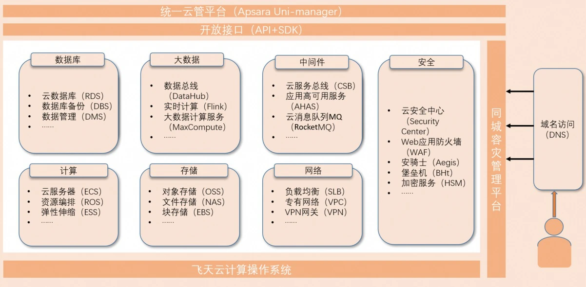

**云产品切换编排说明**

云产品切换时首先切换底座OPSDNS和底座Minirds，然后切换负载均衡SLB，最后切换各个云产品，具体切换顺序如下所示：

2. **底座Minirds**

   4. **其他云产品**

   Taokeeper\\Lindorm\\OSS\\MQ\\TIANJI等

1. **底座OPSDNS**

   3. **均衡负载SLB**

1. **底座OPSDNS**：当ASR在执行云平台切换时，由于大多数云产品都会涉及到主备机房节点间域名解析结果的修改，该能力由OPSDNS提供，同时OPSDNS并不依赖其他需要切换的云产品，因此将会第一个切换。

2. **底座Minirds**：当OPSDNS切换完成后会切换元数据库Minirds，Minirds会为其他云产品提供元数据库的读写服务，其他云产品在切换过程中可能会对自身元数据进行读写，并且Minirds自身主备库切换过程中，会依赖OPSDNS进行域名解析切换，因此在OPSDNS切换完成后进行切换。

3. **负载均衡SLB**：当元数据库Minirds切换完成后会切换负载均衡SLB，因为其他云产品的切换可能会依赖SLB来切换VIP，但是SLB切换时会要求轩辕元数据库正常，因此在元数据库切换完成后切换SLB。

4. **其他云产品**：当底座OPSDNS、底座Minirds和负载均衡SLB切换完成后，会将剩余的云产品按照批次进行切换，同一批次内的云产品将并行切换。

   <ol type="i">

   <li>

   第一批次：首先会切换中间件产品中的Taokeeper、DNCS和Middleware，因为这些中间件是其他云产品的依赖对象。

   </li>

   <li>

   第二批次：切换其他中间件例如消息队列MQ和不依赖TIANJI的云产品。

   </li>

   <li>

   第三批次：TIANJI。

   </li>

   <li>

   第四批次：当TIANJI切换完成后，将切换ON PAAS的产品，例如数据总线DataHub、Elasticsearch、Kafka、分布式应用EDAS等，其中切换EDAS依赖K8s平台恢复，而K8s平台恢复依赖于TIANJI恢复。同时切换HBase、yundun、云原生数据仓库AnalyticDB、云原生数据仓库AnalyticDB PG版、时间序列数据库TSDB、云原生多模数据库Lindorm、大数据管家ABM、日志采集Sunfire、日志服务SLS、SLSINNER、TONGQUE等切换耗时较长的云产品。

   </li>

   </ol>

> **说明**
>
> 以上介绍的是双机房部署时ASR切换的顺序及原理说明，如果某个云产品部署形态为三机房部署，就不需要ASR来手动执行切换，而是会自动容灾；其中数据库产品由Aurora高可用模块托管，分布式的产品可以自行选主，存储、中间件类的产品通过修改DNS、同步链路的方式进行容灾切换。

**业务应用切换**

- **切换逻辑**：容灾的业务应用部署在两个机房的ECS中，只在单机房部署的应用无法实现机房级容灾。云产品容灾对业务应用透明，容灾业务应用使用域名访问云产品，应用切换只需要切换网络流量不需要做 其他操作。

- **切换目的**：检验客户部署在ECS上的业务应用是否支持云产品容灾，客户需要通过域名来访问云产品，且内部需要建立对云产品的重试重连机制，才能确保当云产品发生容灾切换之后，业务应用具有持续提供服务的能力。

**云平台切换**

云平台切换从产品类型维度可以分为租户侧云产品切换和底座产品切换；从切换方式维度分为故障切换（冷切换）和计划切换（热切换）。

- 故障切换：在发生机房级故障，主备机房之间连接中断，停止生产站点的SLB路由宣告，同时摘除生产站点的入口流量，切换到灾备站点。这个过程会有数据丢失，只有在演练机房断电断网或真实机房断电断网时，才使用故障切换。

- 计划切换：在主备机房都健康的状态下，把主节点切换到容灾机房，整个过程保证数据不丢失，云产品业务闪断，生产业务演练一般使用计划切换。

**切换目的**：云平台切换演练是检验云产品自身的容灾能力与ASR控制台的切换能力的重要方式，同时也是容灾平台交付和周期性检验的重要组成部分。

**云外网络切换**

- **切换逻辑**：云外网络分互联网侧网络和客户IDC侧网络。在做容灾演练时，需要根据故障场景手动或自动（依赖客户云外网络配置）切换网络。

- <strong>切换目的：</strong>云外网络切换是检验互联网侧和客户IDC侧入口容灾能力的一种方式，用于验证容灾场景下网络路由功能的正常性。客户IDC侧需要配置自动探活与切换策略，从而在故障场景下进行自动路由切换，或是进行手动路由切换。

  > **说明**
  >
  > 对于全新部署的同城容灾管理平台，没有部署云外互联网和客户IDC并网的环境时，不具备验证云外网络容灾能力的条件，因此无需验证云外网络的容灾能力。

<a id="section-1-3"></a>

## 1.3. 演练SOP

容灾演练过程中对客户的业务会产生一定的影响，特别是故障切换演练会造成业务闪断。因此在演练开始前请先了解演练SOP，按照标准流程完成逐项任务，保证演练实施成功落地。为了在机房级故障时更快速的恢复业务，不需要客户逐个恢复业务应用，ASR提供的切换能力是产品级的切换，所以演练会影响所有使用产品资源的业务应用。

**演练顺序**

演练任务拆分后，可以分为：网络演练、应用演练、底座产品演练、核心产品演练。请先验证网络演练、然后验证应用具有容灾切换能力，再验证底座产品的容灾切换能力，最后验证核心产品容灾能力。

**演练SOP**

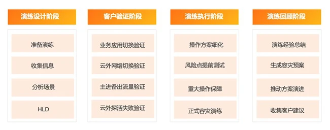

容灾演练切换分为故障切换和计划切换，两种切换的影响如下所示：

> **说明**
>
> 下表中的数据丢失、业务中断时长是在测试环境使用标准的网络、机器环境测试所得，不承诺现场数据和测试环境一致。测试环境的数据仅供参考。

- **故障切换的影响：**

<table>
  <tr>
    <th>产品</th>
    <th>数据丢失量</th>
    <th>业务连续性</th>
    <th>管控</th>
  </tr>
  <tr>
    <td>MiniRDS</td>
    <td>秒级丢失</td>
    <td rowspan="7">切换成功后恢复服务</td>
    <td rowspan="7">管控能力降级，例如RDS不能创建实例</td>
  </tr>
  <tr>
    <td>SLB</td>
    <td>不丢失（无会话保持）</td>
  </tr>
  <tr>
    <td>RDS</td>
    <td>秒级丢失</td>
  </tr>
  <tr>
    <td>OSS</td>
    <td>秒级丢失</td>
  </tr>
  <tr>
    <td>SLS</td>
    <td>分钟级丢失</td>
  </tr>
  <tr>
    <td>MaxCompute</td>
    <td>不丢失（重新计算）</td>
  </tr>
  <tr>
    <td>MQ</td>
    <td>不丢失</td>
  </tr>
</table>

执行完故障切换后，恢复机房电力或网络时，会导致业务闪断和管控功能间歇性不可用。当故障机房ServerRole恢复到终态后，管控功能才可用。针对这种情况首先需要备份核心RDS业务数据，然后关闭业务应用的定时任务，以免产生脏数据。

- **计划切换的影响：**

| 产品 | 数据丢失量 | 业务连续性 |
| --- | --- | --- |
| MiniRDS | 不丢失 | 闪断 |
| SLB | 不丢失（无会话保持） | 秒级 |
| RDS | 不丢失 | 秒级 |
| OSS | 不丢失（最终一致） | 秒级 |
| SLS | 不丢失 | 分钟级 |
| MaxCompute | 不丢失（重新计算） | 无 |
| MQ | 不丢失 | 20s |

<a id="section-1-4"></a>

## 1.4. 演练流程

容灾演练属于项目的重大操作，在真正执行容灾演练前需要申请重大操作保障，与容灾负责人、产品负责人确定支撑时间，on call准备。本文介绍演练流程以及演练过程中各阶段的耗费时长，请根据实际情况合理安排各个演练任务。

容灾演练执行流程如下图所示。

> **说明**
>
> - **计划切换**：指的是热切换，在主备机房都健康的状态下，把主节点切换到容灾机房，整个过程保证数据不丢失，云产品业务闪断，生产业务演练一般使用计划切换。
>
> - **故障切换**：指的是冷切换，在发生机房级故障，主备机房之间连接中断，强制切换产品主节点到容灾机房，这个过程会有数据丢失，只有在演练机房断电断网或真实机房断电断网时，才使用故障切换。

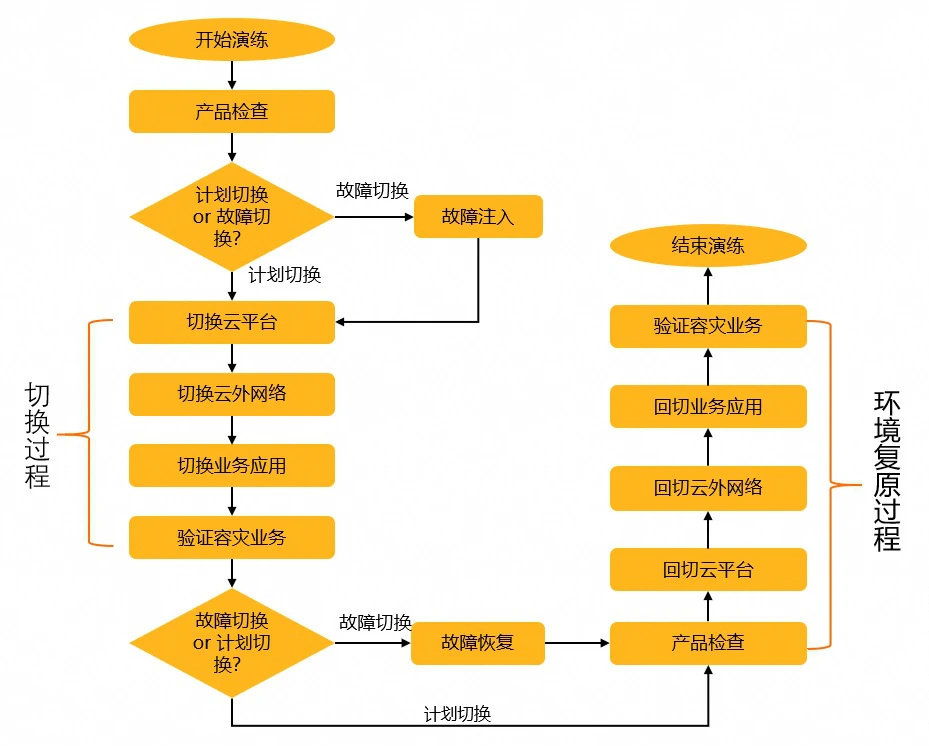

<table>
  <tr>
    <th>主任务</th>
    <th>子任务</th>
    <th>任务说明</th>
    <th>时长</th>
  </tr>
  <tr>
    <td>演练前检查</td>
    <td>• 检查云产品<br>• 检查基础设施<br>• 检查业务应用</td>
    <td>在执行容灾演练前需要检查生产站点和灾备站点是否满足演练要求，当检查发现不满足时，需要及时联系容灾研发处理。</td>
    <td>由于可能存在异常问题处理时长，请至少提前两周执行演练前检查，具体耗费时长请根据实际处理时长计算。</td>
  </tr>
  <tr>
    <td>演练前准备</td>
    <td>收集基本信息</td>
    <td>在执行演练操作前，需要收集一些环境信息，在执行演练切换的时候需要在环境中输入。</td>
    <td>1小时</td>
  </tr>
  <tr>
    <td rowspan="2">执行演练</td>
    <td>故障切换</td>
    <td>故障切换是指通过ASR注入故障，模拟机房级故障场景，强制把整个平台切换到容灾机房。<br>说明如果环境里部署了生产业务，不接受丢失数据，不接受长时间业务中断，请使用计划切换完成演练。</td>
    <td>• 通常需要耗时2.5小时~5.5小时<br>• 云平台切换（40分钟）+业务验证时间（大约1小时）+云平台回切（40分钟）+网络切换（10分钟）【+问题处理（3个小时）】<br>说明建议故障切换演练分两个操作窗口，第一天晚上演练切换+机房恢复，第二天晚上执行回切还原。</td>
  </tr>
  <tr>
    <td>计划切换</td>
    <td>计划切换是指主备机房正常工作的情况下，把产品的主节点在线切换到备机房，由备机房的产品提供服务。计划切换的过程，RDS会禁写，不丢失数据， OSS保证最终数据一致，上层业务会有闪断。</td>
    <td>• 通常需要耗时2.5小时~5.5小时<br>• 云平台切换（40分钟）+业务验证时间（大约1小时）+云平台回切（40分钟）+网络切换（10分钟）【+问题处理（3个小时）】</td>
  </tr>
  <tr>
    <td>演练后检查</td>
    <td>-</td>
    <td>执行切换操作后需要验证云产品的业务功能是否正常，作为演练切换成功的一个验收标准。</td>
    <td>1小时</td>
  </tr>
  <tr>
    <td>演练回滚</td>
    <td>执行完演练切换后，等待故障机房复原之后可以执行回切操作，将之前切换的云产品切回至复原机房。</td>
    <td>如果发生重大问题，当晚无法按计划执行演练，请及时恢复环境，回切云产品。</td>
    <td>2小时<br>重要如果演练超过凌晨2点，请提前关闭RDS和MiniRDS的可用区对齐功能。</td>
  </tr>
</table>

<a id="section-2"></a>

# 2.演练前检查

准备演练时，请至少提前两周按照*容灾演练precheck*对环境做巡检，将结果反馈给阿里云研发人员，并对有问题的部分做整改。

<a id="section-2-1"></a>

## 2.1. 检查云产品

运维人员请根据现场实际部署的云产品，选择不同的巡检项，检查是否达到预期结果。

请根据现场实际部署的产品，选择不同的检查项进行检查并达到演练的预期结果，对应的检查步骤和预期结果请参考*precheck*表执行，*precheck*表请联系现场支撑人员获取。如果在巡检过程中出现未达标或异常情况，请参考运维人员的KB库解决或联系研发人员。

**云产品**

**检查项**

通过ASR监控台检查其他产品状态。

ASR

检查DNS服务状态，主备节点位置。

检查DNS环境情况。

检查DNS API接口。

DNS

检查DNS域名解析服务是否正常。

计算域名解析服务跨机房延时时长。

通过MINIRDS杜康运维平台检查 MINIRDS 是否有中断/等待/临时关闭/暂停/运行的任务。

检查所有的实例状态是处于可切换、可用状态。

MINIRDS

通过ASR容灾管理平台检查 MINIRDS的产品监控状态。

检查minirds实例的init_connet配置。

通过RDS杜康运维平台检查 RDS 是否有中断/等待/临时关闭/暂停/运行的任务。

检查所有的实例状态是处于可切换、可用状态。

RDS

通过ASR容灾管理平台检查RDS的产品监控状态。

通过ASR容灾平台检查SLB状态信息。

检查SLB的lvs状态信息。

检查SLB的proxy状态信息。

SLB

检查 SLB的keyserver状态信息。

检查SLB路由容灾配置

检查SLB配置和水位摸底。

检查容灾路由配置。

VPC

通过ASR容灾平台检查OSS状态信息。

检查loaction对应的集群信息。

检查是否有location不在主机房 bucket里面。

检查非容灾bucket同步边是否都已经完成清理。

OSS

检查备机房建设前的历史数据是否完成

检查是否存在有申请singletunnel vip的bucket。

检查OSS bucket是否开启了跨云同步。

通过ASR容灾管理平台检查ECS的状态。

ECS

检查ECS的nc状态。

检查产品SR终态。

检查天基登录权限认证。

TIANJI

获取所有机器IP列表，在后续的演练场景中（例如模拟集群关机），您可以按照IP列表检查是否所有服务器都已下电。

检查天基是否存在已下线SR的存留信息。

检查https-proxy域名注册是否重复。

https-proxy

检查防火墙部署和工作模式。

YUNDUN

检查OTS pub集群带索引表的实例。

OTS

检查是否存在绑定了vpc的实例。

<a id="section-2-2"></a>

## 2.2. 检查基础设施

运维人员在演练前检查基础设施是否达到演练要求，请参考*precheck*表的方法检查对应的内容并达到期望结果，*precheck表*请联系现场支撑人员获取。

<table>
  <tr>
    <th>检查项</th>
    <th>检查内容</th>
  </tr>
  <tr>
    <td>基础环境</td>
    <td>检查整个机房的基础设施环境状态。</td>
  </tr>
  <tr>
    <td>带外网络</td>
    <td>检查所有的物理机是否携带外带IP。</td>
  </tr>
  <tr>
    <td>电源状态</td>
    <td>检查服务器电源状态。</td>
  </tr>
  <tr>
    <td rowspan="6">网络可达性</td>
    <td>检查主机房运维网络的可达性。</td>
  </tr>
  <tr>
    <td>检查备机房的运维网络的可达性。</td>
  </tr>
  <tr>
    <td>检查主备机房是否并网完成，包括互联网侧和客户IDC侧。</td>
  </tr>
  <tr>
    <td>检查与客户IDC侧并网，用户IDC流量可达主备两个机房。</td>
  </tr>
  <tr>
    <td>检查互联网入口区流量的切换方式。</td>
  </tr>
  <tr>
    <td>检查VPC网段容灾大小段配置。</td>
  </tr>
</table>

> **说明**
>
> 如果在巡检过程中出现未达标或异常情况，请参考运维人员的KB库解决或联系研发人员。

<a id="section-2-3"></a>

## 2.3. 检查业务应用

请在演练前检查客户侧的应用特征，请参考*precheck*表评估风险并给出整改方案，*precheck*表请联系现场支撑人员获取。

<table>
  <tr>
    <th>业务类型</th>
    <th>应用特征</th>
  </tr>
  <tr>
    <td rowspan="3">部署形态</td>
    <td>客户应用主备机房部署，共用一个SLB实例跨机房负载均衡。</td>
  </tr>
  <tr>
    <td>客户应用主备机房部署，主备机房分别使用一个SLB实例负载均衡。</td>
  </tr>
  <tr>
    <td>客户应用只在主机房部署，无法容灾。</td>
  </tr>
  <tr>
    <td rowspan="3">容灾接入</td>
    <td>客户应用内部具有自建中间件、数据库等组件。</td>
  </tr>
  <tr>
    <td>客户应用具有状态数据。</td>
  </tr>
  <tr>
    <td>主机房客户应用使用EBS/NAS等存储设备。</td>
  </tr>
  <tr>
    <td rowspan="3">网络链路</td>
    <td>客户应用被客户IDC访问。</td>
  </tr>
  <tr>
    <td>客户应用使用EIP/NAT能力。</td>
  </tr>
  <tr>
    <td>客户应用在云外配置健康检查。</td>
  </tr>
  <tr>
    <td rowspan="2">非标配置</td>
    <td>客户应用ECS内配置/etc/hosts。</td>
  </tr>
  <tr>
    <td>客户应用强依赖非容灾云产品。</td>
  </tr>
</table>

<a id="section-2-4"></a>

## 2.4. 产品检查

在容灾切换前后以及容灾切回前后，请执行产品检查，检查容灾产品的状态。

1. 登录同城容灾管理平台ASR（主机房）或同城容灾管理平台ASR（备机房），登录方法请参见登录ASR控制台。

2. 在左侧导航栏中选择**平台检查 > 产品检查**。

3. 单击**负载均衡 SLB**、**底座域名解析**、**元数据库**区域右上角的**立即检查**，检查各产品的状态是否有异常。

   如果产品检查项状态为异常，请重点关注该检查项的错误提示和错误信息，根据错误内容排查解决问题。

   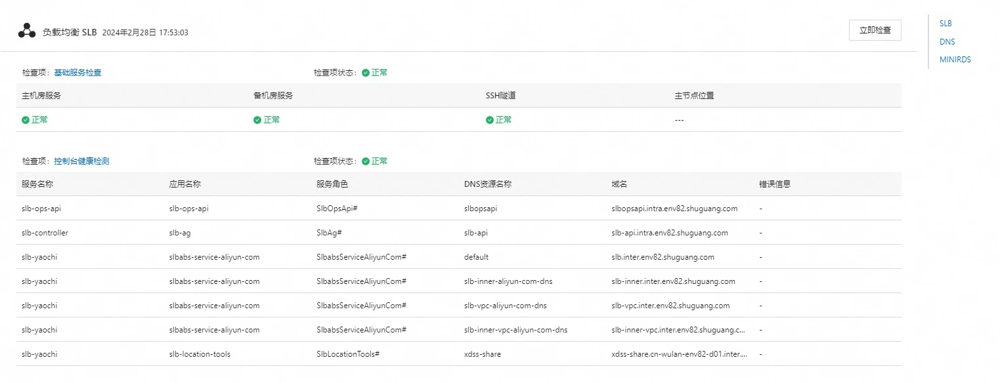

<a id="section-3"></a>

# 3.演练前准备

介绍在执行同城容灾演练前需要做的一些准备工作，请至少提前三天将准备工作完成有利于后续演练操作的执行。

<a id="section-3-1"></a>

## 3.1. 收集基本信息

请提前收集管控信息、交换机信息以及一些需要用到的密码等信息，为演练操作做准备。

**管控信息**

将收集到的访问地址、机器地址、账号、密码以及是否开启登录鉴权等信息填入表中“-”和“\*\*\*OPS1机器地址”位置，为后续演练操作做准备。

| 平台 | 访问地址 | 机器地址 | 账号 | 密码 | 是否开启登录鉴权 |
| --- | --- | --- | --- | --- | --- |
| ASR备机房 | - | - | - | - | - |
| ASR主机房 | - | - | - | - | - |
| MINIRDS杜康运维平台 | - | - | - | - | - |
| RDS杜康运维平台 | - | - | - | - | - |
| ASO | - | - | - | - | - |
| BCC | - | - | - | - | - |
| TIANJI | - | • 主机房OPS1机器地址<br>• 备机房OPS1机器地址 | - | - | - |

**交换机信息**

- 如果执行故障切换演练时，则需要收集交换机的相关信息填入“-”位置，为后续故障切换演练做准备；

- 如果执行计划切换演练时，则不需要收集交换机信息。

| 交换机名称 | 实际交换机名称 | 端口名称 | 端口号 |
| --- | --- | --- | --- |
| 主机房ISW | - | • 互联网端口<br>• 主机房间端口 | - |
| 备机房ISW | - | • 互联网端口<br>• 备机房间端口 | - |
| 主机房CSW | - | 并网端口 | - |
| 备机房CSW | - | 并网端口 | - |
| 主机房LSW | - | 链接SLB端口 | - |
| 备机房LSW | - | 链接SLB端口 | - |

<a id="section-4"></a>

# 4.执行演练

根据演练场景，容灾演练分为故障切换和计划切换，请根据实际现场情况选择对应的场景进行演练。

<a id="section-4-1"></a>

## 4.1. 计划切换演练

计划切换演练分为预定义演练和自定义演练两种，预定义演练支持用户选择单个产品或全部产品进行演练，并在切换、切回后执行业务验证；自定义演练支持用户选择多个产品进行演练，并在切换、切回后执行业务验证。请根据实际情况选择合适的演练方式。

<a id="section-4-1-1"></a>

### 4.1.1. 检查产品

在容灾切换前后以及容灾切回前后，请执行产品检查，检查容灾产品的状态。

1. 登录同城容灾管理平台ASR（主机房）或同城容灾管理平台ASR（备机房），登录方法请参见登录ASR控制台。

2. 在左侧导航栏中选择**平台检查 > 产品检查**。

3. 单击**负载均衡 SLB**、**底座域名解析**、**元数据库**区域右上角的**立即检查**，检查各产品的状态是否有异常。

   如果产品检查项状态为异常，请重点关注该检查项的错误提示和错误信息，根据错误内容排查解决问题。

   

<a id="section-4-1-2"></a>

### 4.1.2. 预定义演练

选择预定义演练时可以选择执行单产品或全部产品演练，并在切换、切回后执行业务验证。

**操作步骤**

1. 以管理员账号或高级运维角色账号登录备机房的ASR控制台。

2. 在左侧导航栏中选择**容灾演练 > 演练方案**。

3. 首次进入**演练方案**页面，请先看完流程介绍，再单击**查看演练计划**。

   > **说明**
   >
   > 后续进入**演练方案**页面，系统不再显示该流程介绍页面。如果需要查看流程介绍，可在**演练方案**页面右上角单击**如何使用asr演练功能开展容灾演练？**。

   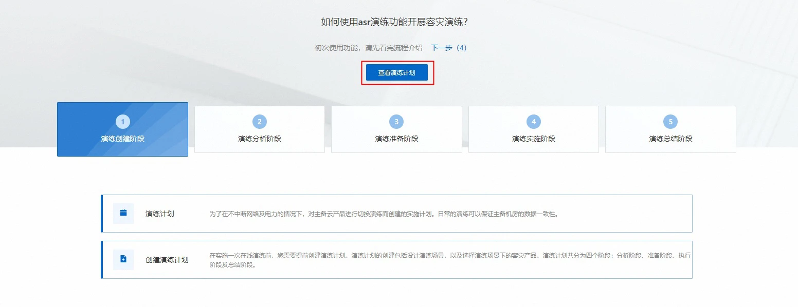

4. 选择**预定义演练**页签，单击待演练的产品，可选单个产品或全部产品。

   > **说明**
   >
   > 如果切换SLB，会关闭主机房的SLB服务，由备机房SLB做负载均衡。此时，由于主备机房ISW配置对外默认等价路由，SLB对互联侧的出流量都是从备机房出，对于主机房进入的流量就会有不同源同宿问题。客户互联网接入区需要处理该问题，请联系专有云同城容灾技术支持选择合适的互联网侧并网方案。

5. 在**演练详情**页面，单击右上角的**切换**。

6. 在**产品检查**对话框，单击**切换**。

   > **说明**
   >
   > - 选择云产品RDS时，对话框中会出现**启用引擎切换**选项，开启时可以选择切换指定引擎，关闭时切换所有引擎。
   >
   > - 产品检查异常时，请在**平台监控** > **产品监控**页面检查产品状态，联系阿里云技术支持处理异常。

7. 在**执行过程**页面显示切换的进度和日志，在**结果详情**列中，查看切换的结果。

   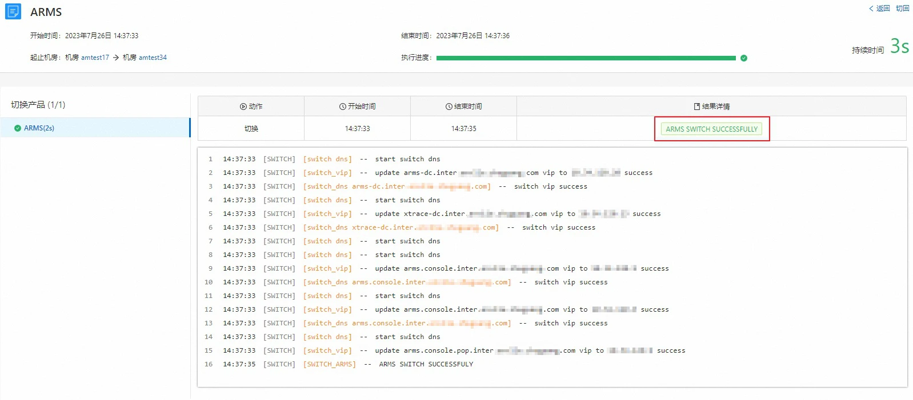

   > **说明**
   >
   > 演练切换后，请检查产品状态。确保各产品满足如下要求：
   >
   > - 产品都到达终态。
   >
   > - 在**平台监控** > **产品监控**中，各产品状态都是正常。

8. 在**执行过程**页面，单击右上角的**切回**。

   > **重要**
   >
   > - 演练切换后，验证容灾切换成功且业务正常可用后，请将实例切回至主机房。
   >
   > - 切回过程会有业务闪断。

9. 在**产品检查**对话框中，单击**切回**。

   > **说明**
   >
   > - 选择云产品RDS时，对话框中会出现**启用引擎切换**选项，开启时可以选择切回指定引擎，关闭时切回所有引擎。
   >
   > - 产品检查异常时，请在**平台监控** > **产品监控**页面检查产品状态，联系阿里云技术支持处理异常。

0. 在**执行过程**页面的**结果详情**列，查看切回的结果。

   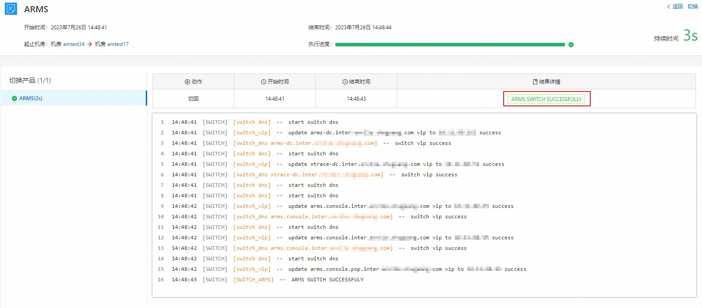

   > **说明**
   >
   > 演练切回后，请检查产品状态。确保各产品满足如下要求：
   >
   > - 产品都到达终态。
   >
   > - 在**平台监控** > **产品监控**中，各产品状态都是正常。

1. 在页面右上角单击**返回**，返回演练详情页面，可以查看本产品的演练历史记录。

**验证容灾演练结果**

请按照预期测试标准进行业务验证，确保容灾切换、切回后业务能正常使用。

<a id="section-4-1-3"></a>

### 4.1.3. 自定义演练

容灾演练是指在不中断网络以及不中断电力的情况下，执行产品的主备切换和切回演练。自定义演练可以根据需要选择待演练的多个云产品，演练完成后自动汇总演练数据同时生成演练报告。

**操作步骤**

1. 以管理员账号或高级运维角色账号登录同城容灾管理平台ASR（备机房），登录方法请参见登录ASR控制台。

2. 在左侧导航栏中选择**容灾演练 > 演练方案**。

3. 首次进入**演练方案**页面，请先看完演练流程介绍，再单击**查看演练计划**。

   > **说明**
   >
   > 后续进入**演练方案**页面，系统不再显示该流程介绍页面。如果需要查看流程介绍，可在**演练方案**页面右上角单击**如何使用asr演练功能开展容灾演练？**。

   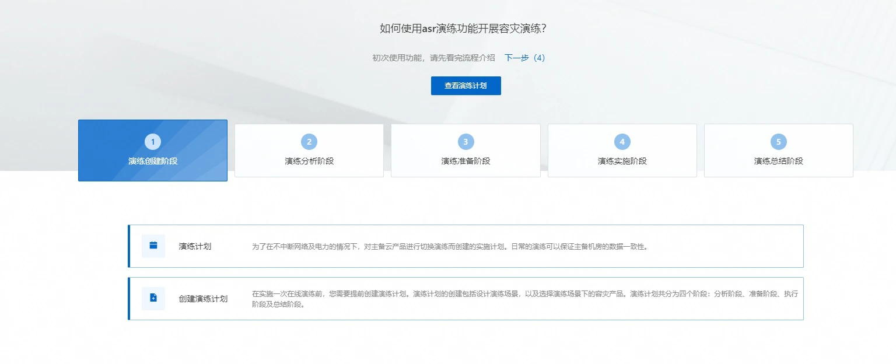

4. 新增自定义演练计划。

   <ol type="i">

   <li>

   在**自定义演练**页签中单击**新增**。

   </li>

   <li>

   在**创建自定义演练**页面中设置**演练名称**、**产品分类**和**演练产品**，单击  编辑演练场景名称，填写完成后

   单击**提交**。

   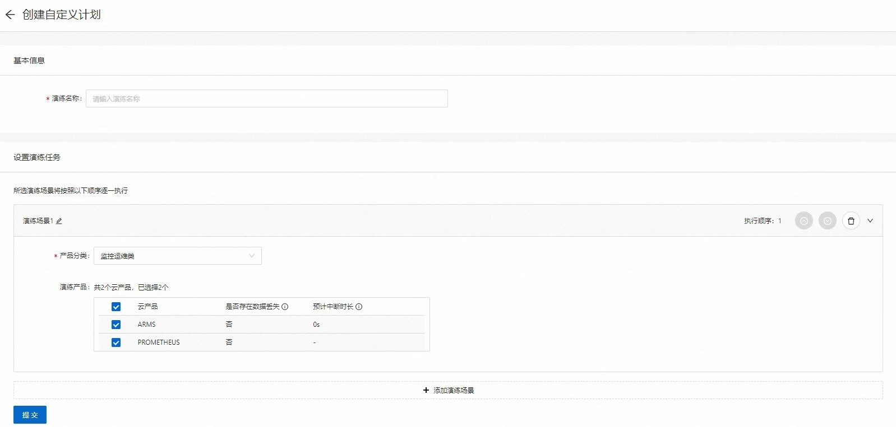

   如果有多个演练场景，单击<strong>+ 添加演练场景</strong>，参考下表填写自定义演练计划的各个参数。全部填写完后单击**提交**，进入**演练详情**页面。

   创建自定义计划的参数说明如下表所示。

   <table>
     <tr>
       <th width="89">名称</th>
       <th>描述</th>
     </tr>
     <tr>
       <td>演练名称</td>
       <td>必选。自定义的演练名称。名称的长度为4~40个字符，支持中文、大小写字母、数字、下划线等。</td>
     </tr>
     <tr>
       <td>产品分类</td>
       <td>必选。您可以选择的产品分类：<strong>数据库类</strong>、<strong>监控运维类</strong>、<strong>存储类</strong>、<strong>底座</strong>、<strong>中</strong><strong>间件类</strong>、<strong>网络类</strong>。<br>说明如果切换SLB，会关闭主机房的SLB服务，由备机房SLB做负载均衡。此时，由于主备机房ISW配置对外默认等价路由，SLB对互联侧的出流量都是从备机房出，对于主机房进入的流量就会有不同源同宿问题。客户互联网接入区需要处理该问题，请联系专有云同城容灾技术支持选择合适的互联网侧并网方案。</td>
     </tr>
     <tr>
       <td>演练产品</td>
       <td>选择待演练的云产品。默认选中产品分类下的全部云产品，您可以根据需要取消勾选。</td>
     </tr>
   </table>

   > **说明**
   >
   > - 单击
   >
   >   和
   >
   >   图标可以调整演练任务执行顺序。
   >
   >   
   >
   >   
   >
   > - 单击
   >
   >   图标可以删除演练任务。
   >
   >   

   </li>

   </ol>

5. 在**演练详情**页面，单击右上角**开始演练**，查看演练执行过程。

   > **重要**
   >
   > 开始演练后，支持终止演练，终止后无法重新恢复当前演练计划。
   >
   > 开始演练后，支持终止演练，终止后无法重新恢复当前演练计划

   演练任务分为以下四个阶段执行。

   <table>
     <tr>
       <th width="89">阶段</th>
       <th>说明</th>
     </tr>
     <tr>
       <td>分析阶段</td>
       <td>分析阶段包含<strong>云产品分析</strong>、<strong>业务应用分析</strong>、<strong>网络分析</strong>。<br>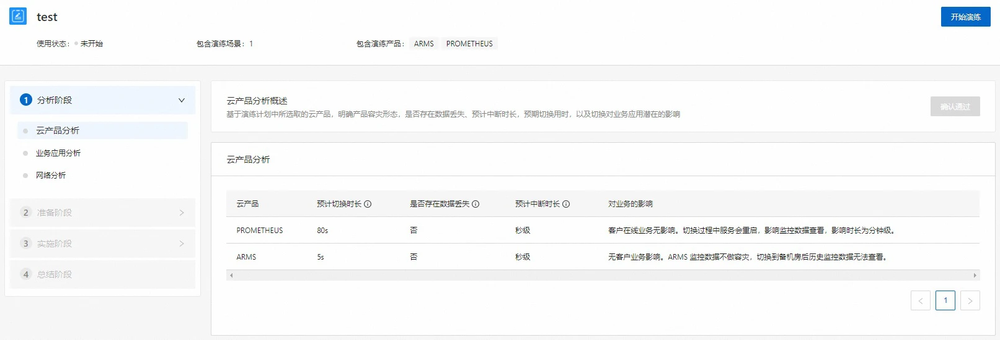<br>• <strong>云产品分析</strong>：基于演练计划中选择的云产品，分析云产品预计切换时长、是否存在数据丢失、预计中断时长、对业务的影响。<br>• <strong>业务应用分析</strong>：基于云产品分析，检查业务应用是否满足切换需求，确保切换后应用正常运行。<br>• <strong>网络分析</strong>：基于云产品分析，检查网络是否满足切换需求，例如，云外网策略是否放通、云外网络容灾配置是否符合预期等。对于需要分析的内容，结合容灾实际建设状况、云上应用架构设计，确认是否满足容灾要求。分析完成后，如果确认满足容灾要求，单击<strong>确认通过</strong>。</td>
     </tr>
     <tr>
       <td>准备阶段</td>
       <td>切换前会对容灾产品进行健康检查，包含<strong>云产品容灾能力检查</strong>、<strong>云产品终态检查</strong>，单击右上角<strong>开始</strong><strong>检查</strong>。检查完成后，单击<strong>下一步</strong>。<br>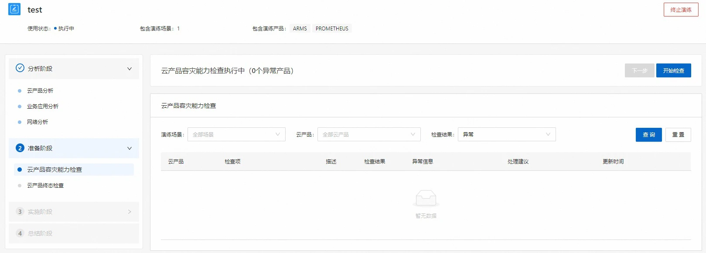<br>说明如果检查结果异常，请根据返回的异常信息处理后再切换。</td>
     </tr>
     <tr>
       <td>实施阶段</td>
       <td>针对每个演练场景执行<strong>切换</strong>和<strong>切回</strong>操作。<br>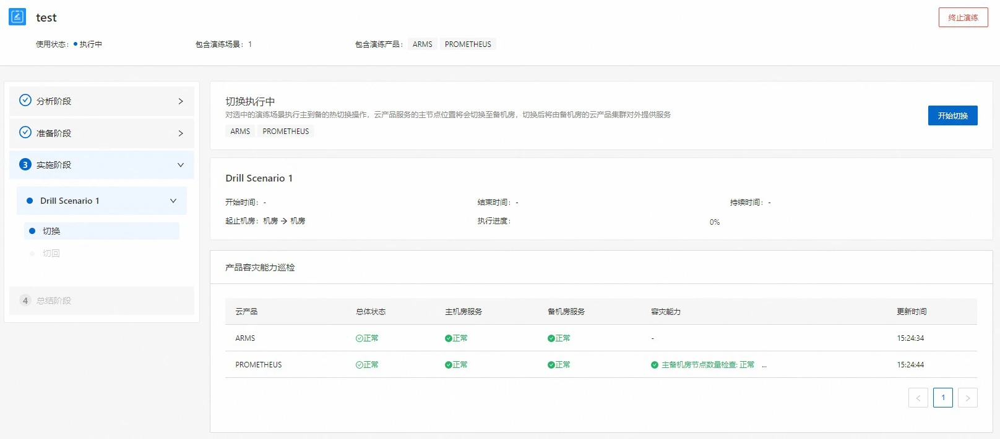<br>i. 进入<strong>切换</strong>页面，切换前自动执行云产品容灾能力巡检，巡检状态正常，单击<strong>开始切换</strong>。<br>说明如果检查结果异常，请根据返回的异常信息处理后再切换。<br>ii. 切换过程中支持查看切换日志，切换成功后单击<strong>下一步</strong>。iii. 进入<strong>切回</strong>页面，切回前自动执行云产品容灾能力巡检，巡检状态正常，单击<strong>开始切回</strong>。<br>说明如果检查结果异常，请根据返回的异常信息处理后再切回。<br>iv. 切回过程中支持查看切回日志，切回成功后单击<strong>下一步</strong>。</td>
     </tr>
     <tr>
       <td>总结阶段</td>
       <td>演练任务执行完成后，汇总演练数据，同时演练结果自动生成演练报告，支持<strong>下载报告</strong>。<br>说明自动生成的演练报告内容包含演练背景、演练目标、演练方案、演练统计、演练过程、演练总结六大模块，详细展现本次演练的演练数据，便于客户直观了解演练效果。<br>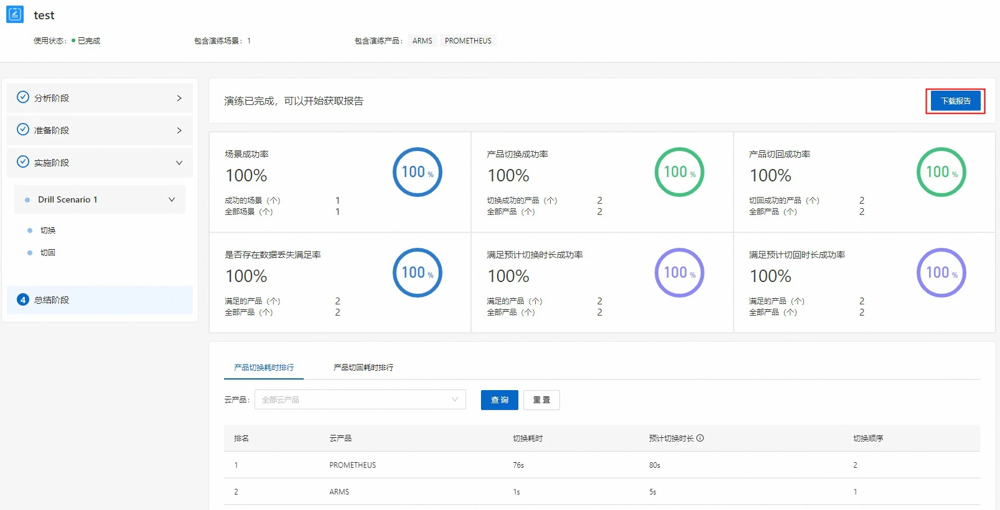</td>
     </tr>
   </table>

   > **说明**
   >
   > 在**自定义计划**页面可以查看所有演练计划，单击某个计划**操作**列的**详情**，查看详细演练记录；单击**操作**列的**删除**，可以删除某个演练计划，状态为**执行中**的计划不支持删除。

<a id="section-4-2"></a>

## 4.2. 故障切换演练

故障切换演练根据用户的故障场景分为5类，包括主机房断电、备机房断电、机房间断网（脑裂）、主机房孤岛、备机房孤岛，请根据实际故障场景选择不同的演练步骤。

**使用场景介绍**

故障切换演练适用于以下场景：

- 容灾项目刚部署完还没有生产业务。

- 部署的业务是预生产业务，接受数据丢失和业务较长时间中断。

> **说明**
>
> - 如果同城双机房环境里已部署对外的生产业务，不建议做故障切换。
>
> - 如果环境里部署了生产业务，不接受丢失数据，不接受长时间业务中断，请使用计划切换完成演练。

**双机房故障场景介绍**

- 主机房断电：

主机房整个电力设施故障，没有UPS，所有机器下电。

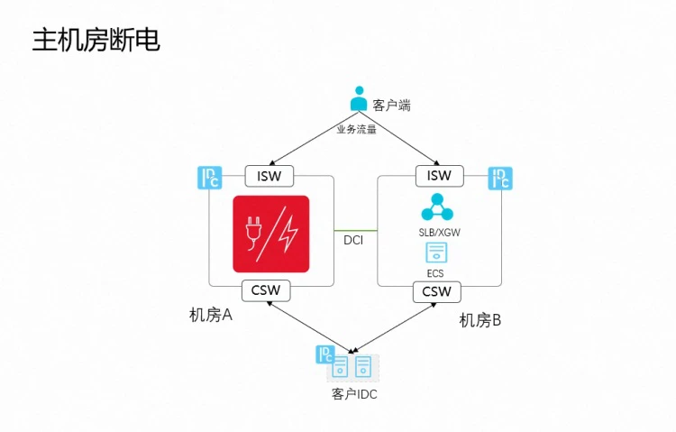

- 备机房断电：

备机房整个电力设施故障，没有UPS，所有机器下电。

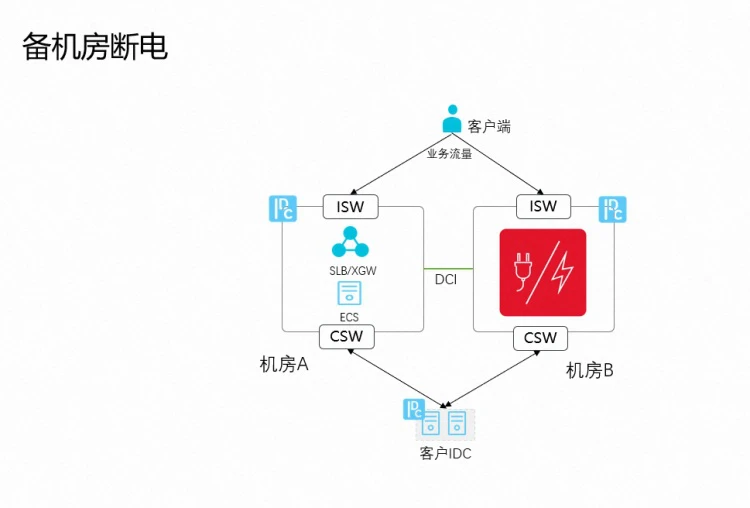

- 机房间断网（脑裂）：

主备机房间的专线或光纤故障，导致主备机房不互通。

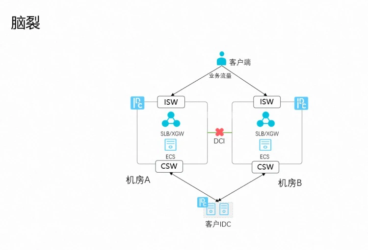

- 主机房孤岛：

主机房对外的网络设备、接入的光纤或专线故障，主机房与云外不互通。

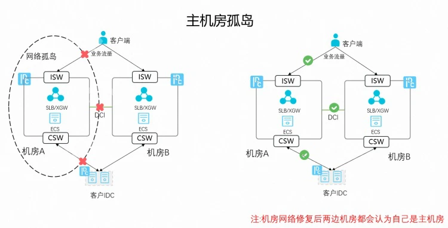

- 备机房孤岛：

备机房对外的网络设备、接入的光纤或专线故障，备机房与云外不互通。

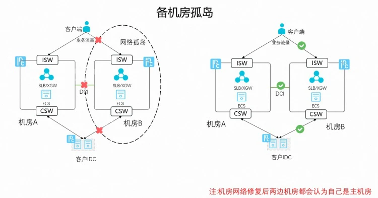

**三机房故障场景介绍**

- 主机房孤岛

  - 非3AZ主备产品需要通过ASR进行切换，切换后产品业务流量恢复，无法保证RPO为0，跨机房双AZ实例无法创建，双活类产品备机房功能可以使用，部分产品提供使用前可能需要手工介入恢复

  - 3AZ跨机房实例产品不需要切换，业务流量自动恢复（RTO≈0），无数据丢失情况（RPO=0)，管控侧无法新建跨3AZ实例

  - IAAS侧产品主机房功能无法使用，其他功能无影响，RPO=0, RTO≈0

  - 云原生（中间件）类产品已完成3AZ改造的无需切换，第二第三机房功能正常，依赖主机房资源的服务异常；未完成3AZ改造的主备产品需进行强切，参考双AZ故障切换场景

  - 数据库产品在被主机房aurora托管的实例会自动被托管到第二/三机房aurora下，原先主可用区在备机房的双AZ实例无需切换，其他实例将自动切换

- 备机房孤岛

  - 非3AZ产品无需切换，双活类管控产品主机房功能正常，备机房功能不可用，跨机房双AZ实例无法新建（如数据库类），业务连续性不受影响

  - 3AZ跨机房实例产品不需要切换，业务流量自动恢复（RTO≈0），无数据丢失情况（RPO=0)，管控侧无法新建跨3AZ实例

  - IAAS侧产品备机房功能无法使用，其他功能无影响（ecs/vpc/slb/ros/ess/ascm/aso)，RPO=0, RTO≈0

  - 云原生（中间件）类产品无需切换，第一第三机房功能正常，依赖第二机房资源的服务异常

  - 数据库产品在被第二机房aurora托管的实例会自动被托管到第一第三机房aurora下，原先双AZ实例主可用区在主机房的无需切换，其他实例将自动切换

- 第三机房孤岛

  - 非3AZ产品不受影响，主备机房功能正常，业务连续性不受影响

  - 3AZ跨机房实例产品不需要切换，业务流量自动恢复（RTO≈0），无数据丢失情况（RPO=0)，管控侧无法新建跨3AZ实例

  - IAAS侧产品第三机房功能无法使用，RPO=0, RTO≈0

  - 云原生（中间件）类产品无需切换，主备机房功能正常，依赖第三机房资源的服务异常

  - 数据库产品在被第三机房aurora托管的实例会自动被托管到主备机房aurora下，原先双AZ实例主可用区在第一/二机房的无需切换

- 主备机房间断网

  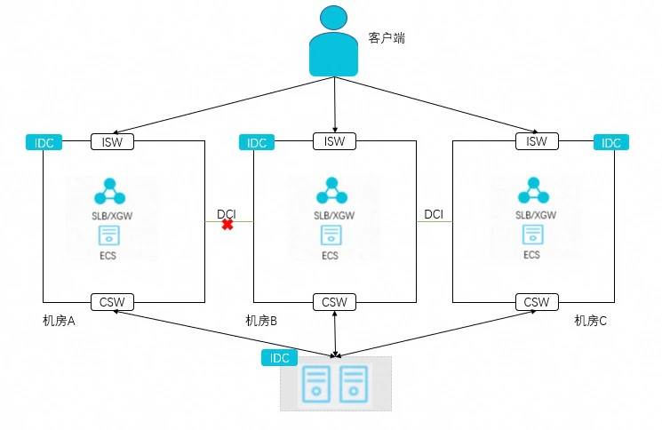

  - 非3AZ产品无需切换，各机房功能正常，业务连续性不受影响

  - 3AZ跨机房实例产品不需要切换，业务流量自动恢复（RTO≈0），无数据丢失情况（RPO=0)，3AZ实例新建不受影响

  - IAAS侧产品无需切换，功能正常，RPO=0, RTO≈0

  - 云原生（中间件）类产品无需切换，功能正常，RPO=0, RTO≈0

  - 数据库类产品无需切换，功能正常，RPO=0, RTO≈0

- 主机房和第三机房断网

  - 非3AZ产品不受影响，各机房功能正常，业务连续性不受影响

  - 3AZ跨机房实例产品不需要切换，业务流量自动恢复（RTO≈0），无数据丢失情况（RPO=0)，3AZ实例新建不受影响

  - IAAS侧产品无需切换，功能正常，RPO=0, RTO≈0

  - 云原生（中间件）类产品无需切换，功能正常，RPO=0, RTO≈0

  - 数据库类产品无需切换，功能正常，RPO=0, RTO≈0

- 备机房和第三机房断网

  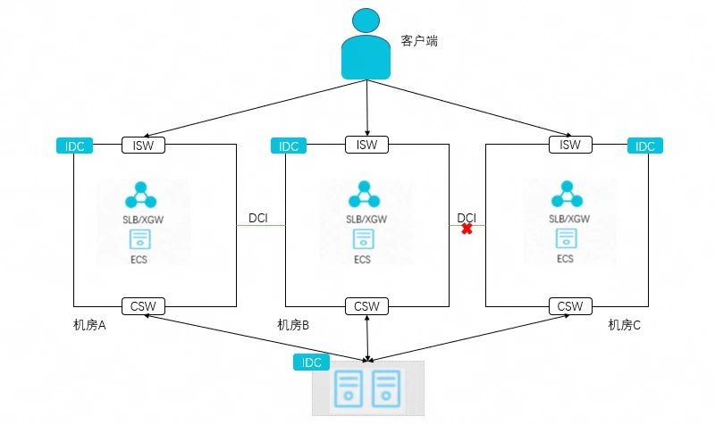

  - 非3AZ产品不受影响，各机房功能正常，业务连续性不受影响

  - 3AZ跨机房实例产品不需要切换，业务流量自动恢复（RTO≈0），无数据丢失情况（RPO=0)，3AZ实例新建不受影响

  - IAAS侧产品无需切换，功能正常，RPO=0, RTO≈0

  - 云原生（中间件）类产品无需切换，功能正常，RPO=0, RTO≈0

  - 数据库类产品无需切换，功能正常，RPO=0, RTO≈0

<a id="section-4-2-1"></a>

### 4.2.1. 检查环境

注入故障前，您需要先检查环境是否正常。在确保环境正常的情况下，才能模拟出机房发生故障后造成的后果。环境不符合预期的情况下，请勿继续往下操作。

**背景信息**

不同故障注入场景的前置环境检查项会有不同，请根据页面提示进行操作。通用环境检查步骤如下。

**操作步骤**

1. 以管理员账号登录同城容灾管理平台ASR（主机房）或同城容灾管理平台ASR（备机房），登录方法请参见登录容灾场景ASR控制台。

   > **说明**
   >
   > 请根据故障场景选择登录不同的同城容灾管理平台ASR，具体故障注入场景请参见操作前准备。

2. 在左侧导航栏中选择**灾难恢复 > 故障模拟 > 环境检查** 。

3. 单击**选择机房**，选择**主机房**或**备机房**。

   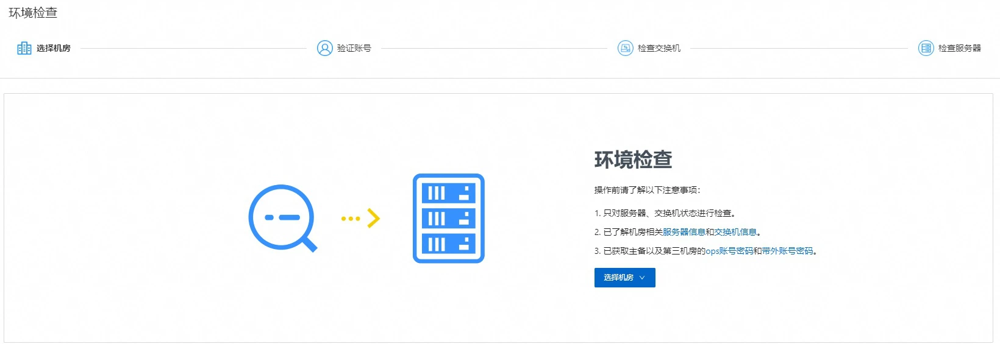

4. 在**验证账号**页面，按照提示依次输入环境信息。

   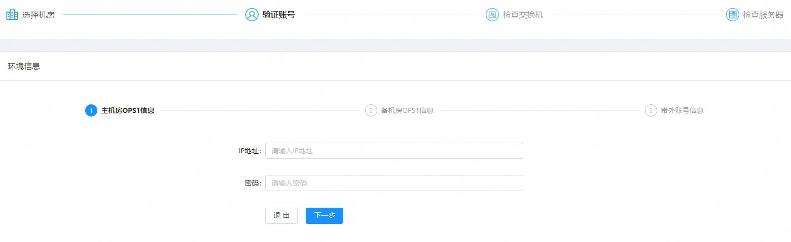

5. 单击**下一步**。信息验证无误后，ASR开始检查交换机状态。

   如果出现交换机检查状态异常的情况，可由现场运维工程师解决异常，或者根据环境具体情况选择忽略异常。

   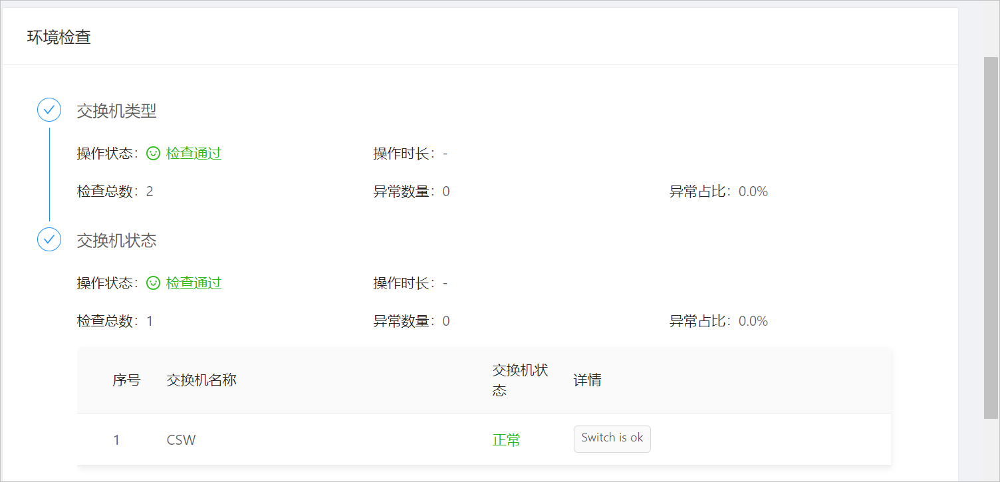

6. ASR开始检查服务器，依次检查SN码、带外IP、主机名对应的情况和服务器供电信息。

   如果出现服务器检查状态异常的情况，可联系现场运维工程师解决异常或者根据环境具体情况选择忽略异常。

   另外单击**查看SR**可查询该机器的ServerRole信息。

   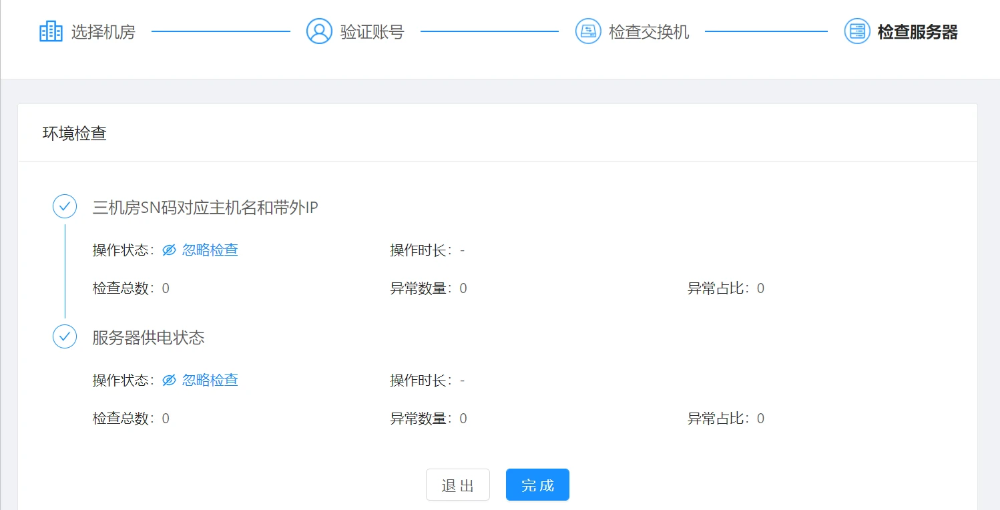

7. 单击**完成**，完成环境检查。

<a id="section-4-2-2"></a>

### 4.2.2. 演练主机房断电

<a id="section-4-2-2-1"></a>

#### 4.2.2.1. 注入断电故障

通过对机房所有机器和交换机执行关机操作，模拟机房电源故障的场景。

**前提条件**

请保障环境检查正常再申请审批码。

**机器关机**

1. 申请审批码。

   > **警告**
   >
   > 机房故障注入属于高危操作，未经授权和允许严禁擅自操作。故障注入前需要事先申请故障操作的审批码，请保障环境检查正常再申请审批码。

   <ol type="i">

   <li>

   登录备机房ASR控制台，在左侧导航栏选择**灾难恢复 > 故障模拟 > 操作审批**。

   </li>

   <li>

   单击**新增**，选择**主机房断电**故障场景，并指定授权用户，单击**提交**。

   在审批码列表中会显示新生成的审批码。

   </li>

   </ol>

2. 开始关机。

   <ol type="i">

   <li>

   在左侧导航栏中选择**灾难恢复 > 故障模拟 > 开始注入**。选择主机房断电场景。

   </li>

   <li>

   选择要关闭的交换机端口。您可以根据需要选择关闭**互联网网络连接**和**用户物理专线**。

   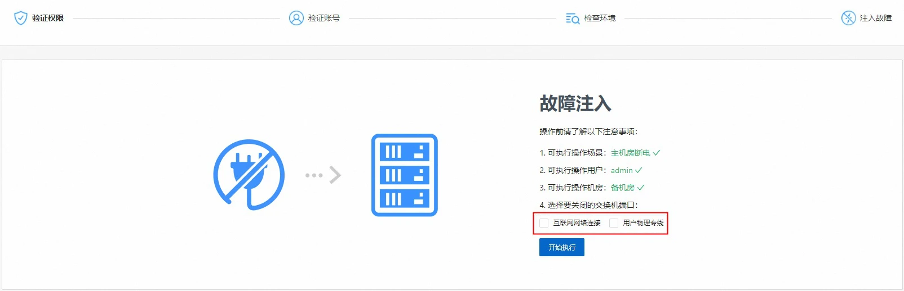

   </li>

   <li>

   单击**开始执行**，输入已经审批好的审批码，进入账号验证页面。依次输入环境信息。

   </li>

   <li>

   环境检查完成后，单击**下一步**。

   </li>

   <li>

   在注入故障页面，选择是否进行数据保护。

   - **优雅故障注入**：ASR先切换DNS、MINIRDS、RDS至对端机房，业务和运维数据不丢失，再关机。

   - **强制故障注入**：ASR直接关机，MINIRDS、RDS不是强一致同步，业务数据存在丢失的风险。

   </li>

   <li>

   <strong>可选：</strong>在**主机房服务器**页面显示待关闭的服务器列表。如果有服务器不需要关闭，请在**移除无需关闭的服务器**文本框中，输入服务器名称，单击**提交**。

   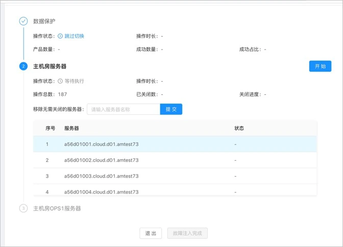

   </li>

   <li>

   单击**开始**，开始关闭机房服务器。

   > **说明**
   >
   > 内部使用shutdown命令关机，不伤害硬件。

   </li>

   <li>

   等待机房服务器关闭完成后，单击**开始关闭ops机器**。

   </li>

   <li>

   页面显示故障注入成功后，单击**完成**。

   </li>

   </ol>

<a id="section-4-2-2-2"></a>

#### 4.2.2.2. 执行故障切换

在主机房断电演练切换场景中，您需要切换云平台、切换云外网络、切换业务应用，并在切换后执行业务验证。

1. 切换云平台。

   <ol type="i">

   <li>

   登录备机房的ASR控制台，单击**灾难恢复 > 平台切换**。

   </li>

   <li>

   单击**掉电灾难恢复**页签。

   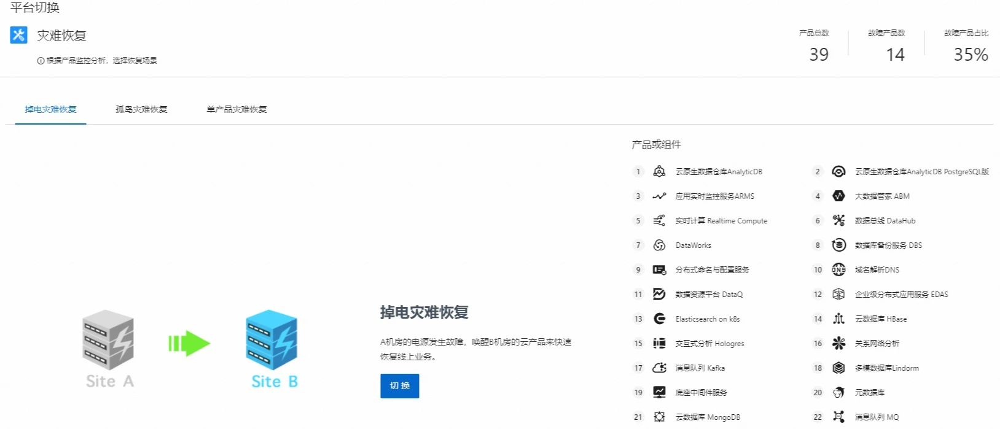

   </li>

   <li>

   单击**切换**，在弹出的确认对话框中单击**确定**。

   > **说明**
   >
   > 核心业务产品切换成功后，业务应用可以恢复服务。如果产品切换失败，修复后重试。
   >
   > 产品切换逻辑内部已验证产品服务状态，切换成功代表可以提供服务。

   </li>

   </ol>

2. 切换云外网络。

   <ol type="i">

   <li>

   切换互联网侧网络。

   互联网侧并网形式一般以双活形态居多。如果互联网侧有探活机制，可以自动切换，不需人工切换。

   如果互联网侧是无探活机制，需要人工切换，具体操作步骤由客户执行完成。

   </li>

   <li>

   切换客户IDC侧网络。

   客户IDC侧并网形式一般以主备形态居多。如果客户IDC侧有探活机制，可以自动切换，不需人工切换。如果客户IDC侧是简单无探活机制，需要人工切换，具体操作步骤由客户执行完成。

   </li>

   </ol>

3. 切换应用。

   - 跨机房部署应用：云产品切换完成，业务流量自动切换，无需人工干预。

   - 自建应用：需要客户自行完成应用切换。

4. 验证容灾切换的结果。

   请按照预期测试标准进行业务验证，确保容灾切换后业务能正常使用。

<a id="section-4-2-2-3"></a>

#### 4.2.2.3. 复原故障机房

演练切换结束后，您需要进行故障恢复，包括交换机上电、开启主机房OPS1、机器上电和恢复云平台状态。

> **重要**
>
> 不建议在机器上电时自动启动主机房业务应用，避免造成生产业务中断，等主机房云产品到达终态后，手动启动业务应用。

1. 交换机上电。

   开启服务器之前需要手动对交换机进行上电操作，并检查交换机状态为正常。

2. 开启主机房OPS1。

   手动给OPS1机器上电，确认OpsOob容器启动正常。

3. 机器上电。

   <ol type="i">

   <li>

   登录备机房ASR控制台，在左侧导航栏中选择**灾难恢复 > 故障模拟 > 机房复原**。

   </li>

   <li>

   单击**开始执行**，输入已经审批好的审批码，无需验证账号信息。

   </li>

   <li>

   在**机房复原**页面。单击**开启**，便可对机房服务器进行开机。

   开机大概需要5分钟左右，如果有无法开机的机器，请手动开启服务器。

   </li>

   <li>

   主机房断电复原过程中，需要在机房服务器开机完成后，恢复DNS，从备机房同步数据到主机房。具体步骤如下：

   <ol type="a">

   <li>

   输入主机房ops2的IP和密码信息。

   </li>

   <li>

   将掉电机房dns-master置为STANDBY状态。

   </li>

   </ol>

   <ol type="i" start="100">

   <li>

   检查同步日志。

   </li>

   <li value="500">

   检查dnsapi1和dnsapi2地址。

   </li>

   </ol>

   <ol type="a" start="5">

   <li>

   增加anycastVip地址。

   </li>

   <li>

   开启OSPF或BGP发布路由。

   > **说明**
   >
   > - V3.12.0版本DNS统一使用BGP协议。从老版本升级的局点，保持原来的协议，具体请查看配置文件确认。
   >
   > - V3.12.0及以上版本，DNS支持三机房，如果DNS在三机房部署，只需检查DNS同步完成，就可让主机房DNS对外提供服务。

   </li>

   </ol>

   </li>

   <li>

   待全部机器开启后，系统显示机房复原成功，单击**完成**。

   </li>

   </ol>

4. 恢复云平台状态。

   <ol type="i">

   <li>

   等待30分钟，让云产品ServerRole自愈。

   </li>

   <li>

   修复终态。

   对于非自愈的ServerRole和有问题的ServerRole，请联系阿里云技术支持。

   </li>

   <li>

   检查产品容灾状态。

   登录备机房的ASR，在导航栏中选择**平台监控** > **产品监控**，查看各产品的状态为正常，如果产品有异常，请联系阿里云技术支持。

   > **说明**
   >
   > V3.13.0之前的版本，SLB显示主机房异常属于预期中，可忽略。

   </li>

   </ol>

<a id="section-4-2-2-4"></a>

#### 4.2.2.4. 执行平台切回

在主机房断电复原场景中，您需要切回云平台、切回云外网络、切回业务应用，并在切回后执行业务验证。

1. 切回云平台。

   <ol type="i">

   <li>

   登录备机房的ASR控制台，选择**灾难恢复** > **平台切回**。

   </li>

   <li>

   单击**掉电故障后服务切回**页签。

   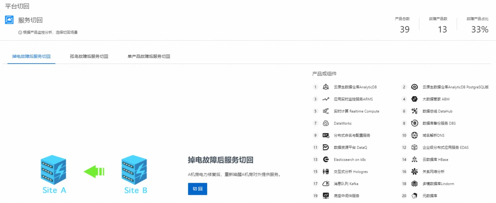

   </li>

   <li>

   单击**切回**，在弹出的确认对话框中单击**确定**。

   > **说明**
   >
   > 切回成功后，请确认飞天基础运维平台上SR都到达终态，ASR产品监控无异常。

   </li>

   </ol>

2. 切回云外网络。

   <ol type="i">

   <li>

   切回互联网侧网络。

   互联网侧并网形式一般以双活形态居多。如果互联网侧有探活机制，可以自动切回，不需人工切换。

   如果互联网侧是无探活机制，需要人工切回，具体操作步骤由客户执行完成。

   </li>

   <li>

   切回客户IDC侧网络。

   客户IDC侧并网形式一般以主备形态居多。如果客户IDC侧有探活机制，可以自动切回，不需人工切换。如果客户IDC侧是简单无探活机制，需要人工切回，具体操作步骤由客户执行完成。

   </li>

   </ol>

3. 切回业务应用。

   - 跨机房部署应用：云产品切回完成，业务流量自动切回，无需人工干预。

   - 自建应用：需要客户自行完成应用切回。

4. 验证容灾切回的结果。

   请按照预期测试标准进行业务验证，确保容灾切回后业务能正常使用。

<a id="section-4-2-3"></a>

### 4.2.3. 演练备机房断电

<a id="section-4-2-3-1"></a>

#### 4.2.3.1. 注入断电故障

通过对机房所有机器和交换机执行关机操作，模拟机房电源故障的场景。

**前提条件**

- 断电前请保证MiniRDS和RDS主库都在主机房。

- 请保障环境检查正常再申请审批码。

**机器关机**

1. 申请审批码。

   > **警告**
   >
   > 机房故障注入属于高危操作，未经授权和允许严禁擅自操作。故障注入前需要事先申请故障操作的审批码，请保障环境检查正常再申请审批码。

   <ol type="i">

   <li>

   登录主机房ASR控制台，在左侧导航栏选择**灾难恢复 > 故障模拟 > 操作审批**。

   </li>

   <li>

   单击**新增**，选择**备机房断电**故障场景，并指定授权用户，单击**提交**。

   在审批码列表中会显示新生成的审批码。

   </li>

   </ol>

2. 开始关机。

   <ol type="i">

   <li>

   在ASR左侧导航栏中选择**灾难恢复 > 故障模拟 > 开始注入**。选择备机房断电场景。

   </li>

   <li>

   选择要关闭的交换机端口。您可以根据需要选择关闭**互联网网络连接**和**用户物理专线**。

   

   </li>

   <li>

   单击**开始执行**，输入已经审批好的审批码，进入账号验证页面。依次输入环境信息。

   </li>

   <li>

   环境检查完成后，单击**下一步**。

   </li>

   <li>

   <strong>可选：</strong>在**备机房服务器**页面显示待关闭的服务器列表。如果有服务器不需要关闭，请在**移除无需关闭的服务器**文本框中，输入服务器名称，单击**提交**。

   

   </li>

   <li>

   单击**开始**，开始关闭机房服务器。

   > **说明**
   >
   > 内部使用shutdown命令关机，不伤害硬件。

   </li>

   <li>

   等待机房服务器关闭完成后，单击**开始关闭ops机器**。

   </li>

   <li>

   页面显示故障注入成功后，单击**完成**。

   </li>

   </ol>

**交换机关机**

1. 保存主备机房的所有交换机（ISW、DSW、ASW、LSW和CSW）的配置交换机配置。

   为了保证在交换机上电后，可以正常加载配置文件，需要在交换机断电之前，使用save命令保存配置文件。此处以LSW交换机为例：

   ```text
    save 
   ```

   ```text
   The current configuration will be written to the device. Are you sure? [Y/N]:y
   Please input the file name(*.cfg)[flash:/210235A1MKX16B000047.cfg]

   (To leave the existing filename unchanged, press the enter key):

   flash:/210235A1MKX16B000047.cfg exists, overwrite? [Y/N]:y
   Validating file. Please wait...
   Saved the current configuration to mainboard device successfully.
   ```

2. 拔掉机房内所有交换机（ISW、DSW、ASW、LSW和CSW）的电源。

<a id="section-4-2-3-2"></a>

#### 4.2.3.2. 执行故障切换

在备机房断电的演练切换场景中，您只需要切换云平台，并执行切换后的业务验证即可。

1. 切换云平台。

   - 如果SLB、MiniRDS和RDS主节点都在主机房，无需切换云平台。

   - 如果租户侧DNS、MiniRDS和RDS资源有问题或备库在主机房，登录主机房ASR，在左侧导航栏中选择**灾难恢复 > 平台切换**，在**备机房故障**页签中单击**切换**。

     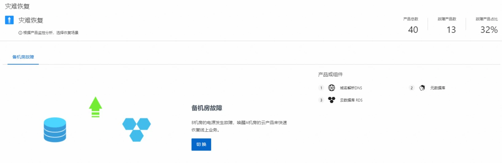

2. 验证容灾切换的结果。

   请按照预期测试标准进行业务验证，确保容灾切换后业务能正常使用。

<a id="section-4-2-3-3"></a>

#### 4.2.3.3. 复原故障机房

演练切换结束后，您需要进行故障恢复，包括交换机上电、开启备机房OPS1和机器上电。

> **重要**
>
> 不建议在机器上电时自动启动主机房业务应用，避免造成生产业务中断，等主机房云产品到达终态后，手动启动业务应用。

1. 交换机上电。

   开启服务器之前需要手动对交换机进行上电操作，并检查交换机状态为正常。

2. 开启备机房OPS1。

   手动给OPS1机器上电，确认OpsOob容器启动正常。

3. 机器上电。

   <ol type="i">

   <li>

   登录主机房ASR控制台，在左侧导航栏中选择**灾难恢复 > 故障模拟 > 机房复原**。

   </li>

   <li>

   单击**开始执行**，输入已经审批好的审批码，无需验证账号信息。

   </li>

   <li>

   在**机房复原**页面。单击**开启**，便可对机房服务器进行开机。

   开机大概需要5分钟左右，如果有无法开机的机器，请手动开启服务器。

   </li>

   </ol>

<a id="section-4-2-3-4"></a>

#### 4.2.3.4. 执行平台切回

在备机房断电复原场景中，您需要恢复云平台状态，并执行切回后的业务验证。

1. 恢复云平台状态。

   <ol type="i">

   <li>

   等待30分钟，让云产品ServerRole自愈。

   </li>

   <li>

   修复终态。

   对于非自愈的ServerRole和有问题的ServerRole，请参见*上电修复指南*进行恢复。

   </li>

   <li>

   检查产品容灾状态。

   登录备机房的ASR，在导航栏中选择**平台监控** > **产品监控**，查看各产品的状态为正常，如果产品有异常，请参见*ASR监控异常修复指南*，修复异常的云产品。

   </li>

   </ol>

2. 验证容灾切回的结果。

   请按照预期测试标准进行业务验证，确保容灾切回后业务能正常使用。

<a id="section-4-2-4"></a>

### 4.2.4. 演练机房间断网（脑裂）

<a id="section-4-2-4-1"></a>

#### 4.2.4.1. 注入脑裂故障

您可以通过断开机房间网络，模拟脑裂故障注入。

1. 申请审批码。

   机房故障注入属于高危操作，未经授权和允许严禁擅自操作。所以故障注入前需要事先申请故障操作的审批码。

   <ol type="i">

   <li>

   登录备机房ASR控制台，在左侧导航栏选择**灾难恢复 > 故障模拟 > 操作审批**。

   </li>

   <li>

   单击**申请**，选择脑裂故障场景，并指定授权用户，单击**提交**。

   在审批码列表中会显示新生成的审批码。

   </li>

   </ol>

2. 关闭机房间网络端口。

   <ol type="i">

   <li>

   登录主机房ASR控制台，在左侧导航栏中选择**灾难恢复 > 故障模拟 > 开始注入**。

   </li>

   <li>

   单击**开始执行**，输入已经审批好的审批码。

   </li>

   <li>

   交换机检查项完成后，单击**下一步**。

   </li>

   <li>

   输入需要关闭的主机房交换机的机房间互连端口，单击**开始执行**。

   </li>

   <li>

   操作状态显示完成后，单击**故障注入完成**。

   </li>

   <li>

   页面显示故障注入成功后，单击**完成**。

   </li>

   </ol>

<a id="section-4-2-4-2"></a>

#### 4.2.4.2. 执行故障切换

在演练脑裂故障切换场景中，您需要关闭备机房对外流量入口、切换云平台，并进行切换后的业务验证。

1. 在机房外部的网络，关闭访问备机房的业务流量入口。

2. 切换云平台。

   - 如果SLB、MiniRDS和RDS主节点都在主机房，无需切换云平台。

   - 如果SLB、MiniRDS和RDS资源有问题或备库在主机房，登录主机房ASR，在左侧导航栏中选择**灾难恢复 > 平台切换**，在**备机房故障或脑裂故障恢复**页签中单击**切换**。

3. 验证容灾切换的结果。

   请按照预期测试标准进行业务验证，确保容灾切换后业务能正常使用。

<a id="section-4-2-4-3"></a>

#### 4.2.4.3. 复原故障机房

ASR通过开启跨机房网络连接，模拟脑裂故障恢复。

1. 登录主机房ASR控制台，在左侧导航栏中选择**灾难恢复 > 故障模拟 > 机房复原**。

   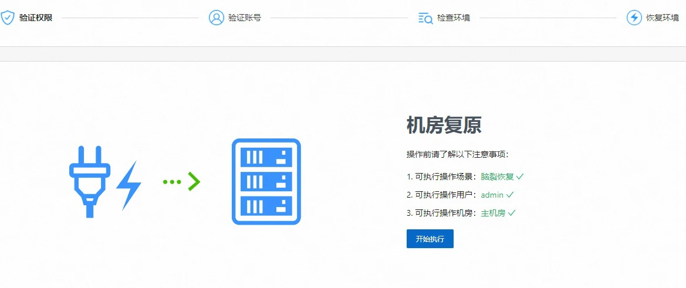

2. 单击**开始执行**，输入已经审批好的审批码，无需验证账号信息。

3. 交换机检查项完成后，单击**下一步**。

4. 在**恢复环境**页面，单击**开启**，开启跨机房网络连接。

5. 待各项的操作状态显示已完成后，单击**机房复原完成**。

6. 在复原结果页面，单击**完成**。

<a id="section-4-2-4-4"></a>

#### 4.2.4.4. 执行平台切回

在脑裂复原场景中，您需要检查云产品、开启云外访问备机房业务的流量，并在容灾切回后执行业务验证。

1. 检查云产品。

   - 在飞天基础运维平台上检查各产品的ServerRole都到达终态。

   - 在ASR上检查产品监控都是正常。对于异常报错，请参见*ASR产品监控修复*将异常恢复。

   - 检查备机房的业务应用都正常工作。

2. 开启云外访问备机房业务的流量。

   由客户完成云外流量放通。

3. 验证容灾切回的结果。

   请按照预期测试标准进行业务验证，确保容灾切回后业务能正常使用。

<a id="section-4-2-5"></a>

### 4.2.5. 演练主机房孤岛

<a id="section-4-2-5-1"></a>

#### 4.2.5.1. 注入孤岛故障

通过断开跨机房网络连接，模拟机房断网的场景。

**前提条件**

请保障环境检查正常再申请审批码。

**操作步骤**

1. 申请审批码。

   > **警告**
   >
   > 机房故障注入属于高危操作，未经授权和允许严禁擅自操作。

   <ol type="i">

   <li>

   以管理员账号或高级运维角色账号登录主机房ASR控制台，在左侧导航栏选择**灾难恢复 > 故障模拟 >操作审批**。

   </li>

   <li>

   单击**新增**，选择**主机房孤岛**场景，并指定授权用户，单击**提交**。

   在审批码列表中会显示新生成的审批码。

   </li>

   </ol>

2. 故障模拟。

   <ol type="i">

   <li>

   在左侧导航栏中选择**灾难恢复 > 故障模拟 > 开始注入**。

   </li>

   <li>

   在选择要关闭的交换机端口中，手动选择是否关闭**互联网网络连接**和**用户物理专线**，默认关闭**跨机房网络连接**。

   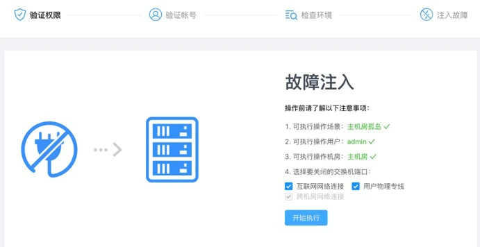

   > **说明**
   >
   > ASR系统会自动识别审批码及用户是否符合预期，否则不允许进行操作。

   </li>

   <li>

   单击**开始执行**，输入已审批完成的审批码，ASR开始进行环境检查。

   </li>

   <li>

   环境检查完成后，单击**下一步**。

   </li>

   <li>

   在**注入故障**页面，根据需要选择**开始**或者**跳过**关闭互联网网络连接、用户物理专线、跨机房网络连接。

   </li>

   <li>

   页面显示故障注入成功后，单击**完成**。

   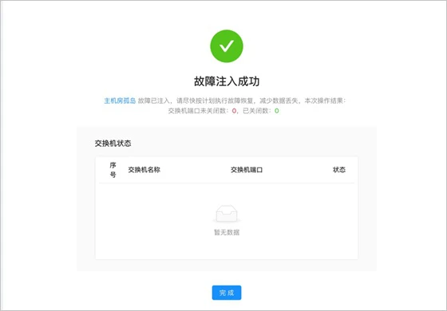

   </li>

   </ol>

<a id="section-4-2-5-2"></a>

#### 4.2.5.2. 主机房孤岛切换

在主机房对外网络和连接备机房的网络同时出现故障时，您可以执行如下步骤唤醒备机房的服务，保持业务连续性。

**操作步骤**

1. 以管理员账号或高级运维角色账号登录同城容灾管理平台ASR（备机房），登录方法请参见容灾逃逸登录。

2. 在左侧导航栏中选择**灾难恢复 > 平台切换**。

3. 单击**孤岛灾难恢复**页签。

   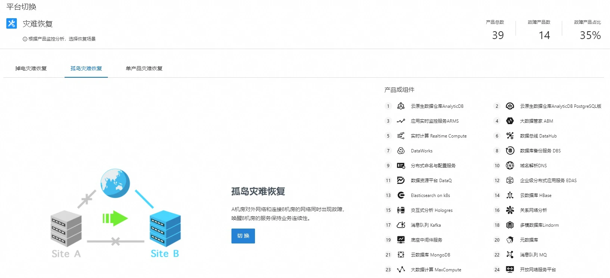

4. 单击**切换**，在弹出的对话框中单击**确定**。

> **说明**
>
> 如果切换失败，请联系ASR产研团队进行问题排查。

<a id="section-4-2-5-3"></a>

#### 4.2.5.3. 复原故障机房

通过开启跨机房网络连接，模拟机房孤岛复原的场景。

**前提条件**

- 已注入主机房网络孤岛。

- 已手动开启交换机和OPS1服务器。

**操作步骤**

1. 在主机房ASR控制台左侧导航栏中选择**灾难恢复 > 故障模拟 > 机房复原**。

   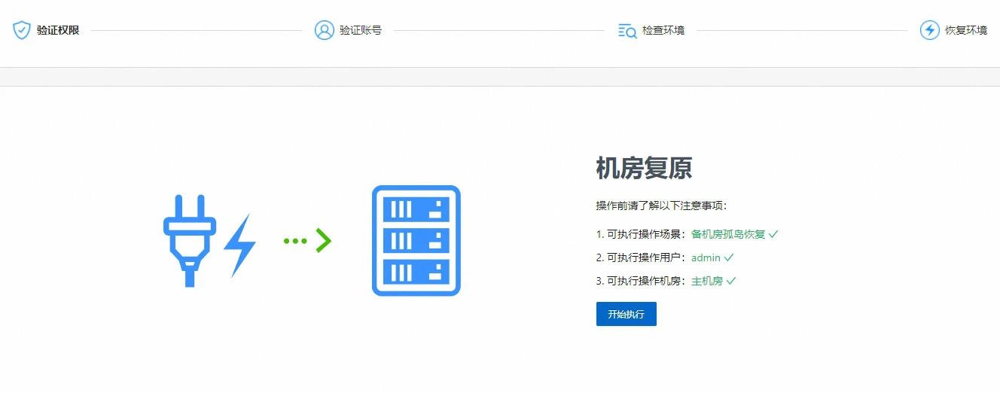

   > **说明**
   >
   > 系统会自动识别审批码及用户是否符合预期，否则不允许进行操作。

2. 单击**开始执行**，输入已经审批好的审批码，无需验证账号信息，ASR会进行机房复原前环境信息检查。

3. 交换机检查项完成后，单击**下一步**。

4. 在**恢复环境**页面。根据需要选择**开启**或者**跳过**互联网网络连接、用户物理专线、跨机房网络连接。

   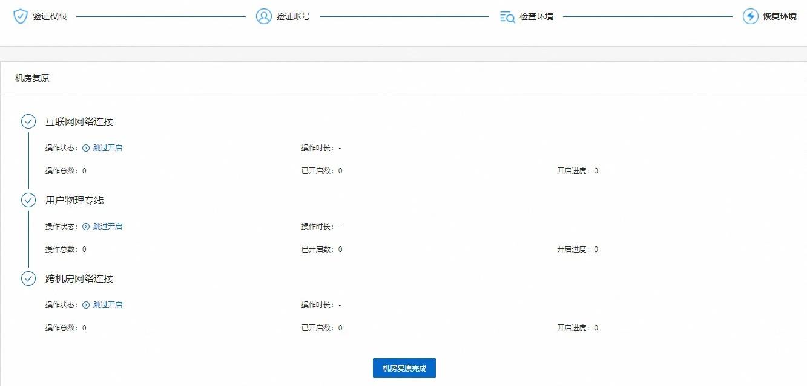

5. 待各项的操作状态显示**已完成**后，单击**机房复原完成**。

<a id="section-4-2-5-4"></a>

#### 4.2.5.4. 执行平台切回

在主机房孤岛复原场景中，您需要检查云产品状态、开启云外访问机房业务的流量，并执行切回后的业务验证。

1. 检查云产品。

   - 在飞天基础运维平台上检查各产品的SR都到达终态。对于没有自动恢复的SR，请根据报错信息手动修复。

   - 在主机房ASR控制台上检查产品监控都是正常。对于异常报错，请根据报错信息手动修复。常见的监控异常请参见异常问题处理。

   - 检查机房的业务应用都正常工作。

2. 开启云外访问机房业务的流量。

   > **说明**
   >
   > 由客户完成云外流量放通。

3. 在左侧导航栏中选择**灾难恢复 > 平台切回**。

4. 单击**孤岛故障后服务切回**页签。

   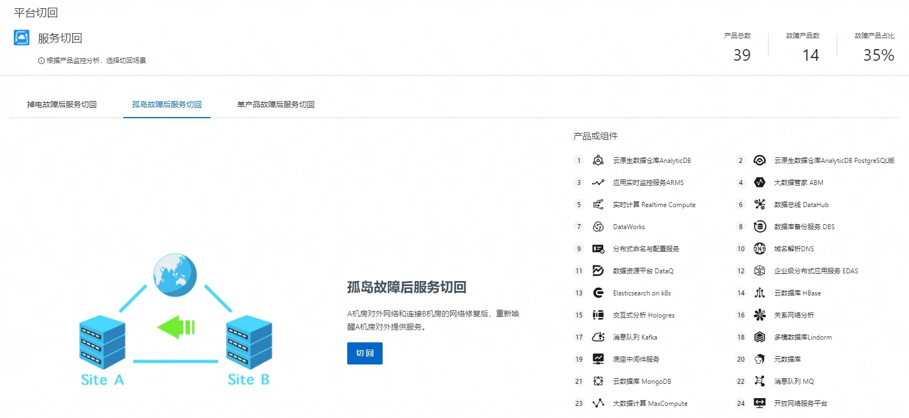

5. 单击**切回**，在弹出的对话框中单击**确定**。

6. 验证容灾切回的结果。

   > **说明**
   >
   > 请按照预期测试标准进行业务验证，确保容灾切回后业务能正常使用。

<a id="section-4-2-6"></a>

### 4.2.6. 演练备机房孤岛

<a id="section-4-2-6-1"></a>

#### 4.2.6.1. 注入孤岛故障

通过断开跨机房网络连接，模拟机房断网的场景。

**前提条件**

请保障环境检查正常再申请审批码。

**操作步骤**

1. 申请审批码。

   > **警告**
   >
   > 机房故障注入属于高危操作，未经授权和允许严禁擅自操作。

   <ol type="i">

   <li>

   以管理员账号或高级运维角色账号登录主机房ASR控制台，在左侧导航栏选择**灾难恢复 > 故障模拟 >操作审批**。

   </li>

   <li>

   单击**新增**，选择**备机房孤岛**场景，并指定授权用户，单击**提交**。

   在审批码列表中会显示新生成的审批码。

   </li>

   </ol>

2. 模拟故障。

   <ol type="i">

   <li>

   在左侧导航栏中选择**灾难恢复 > 故障模拟 > 开始注入**。

   </li>

   <li>

   在选择要关闭的交换机端口中，手动选择是否关闭**互联网网络连接**和**用户物理专线**，默认关闭**跨机房网络连接**。

   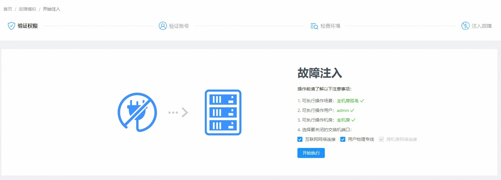

   > **说明**
   >
   > ASR系统会自动识别审批码及用户是否符合预期，否则不允许进行操作。

   </li>

   <li>

   单击**开始执行**，输入已经审批完成的审批码。

   ASR开始进行环境检查。

   </li>

   <li>

   环境检查完成后，单击**下一步**。

   </li>

   <li>

   在**注入故障**页面，根据需要选择**开始**或者**跳过**关闭互联网网络连接、用户物理专线、跨机房网络连接。

   </li>

   <li>

   页面显示故障注入成功后，单击**完成**。

   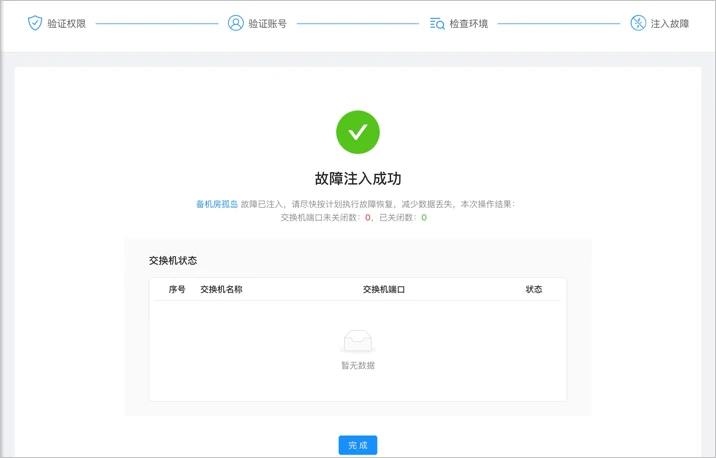

   </li>

   </ol>

<a id="section-4-2-6-2"></a>

#### 4.2.6.2. 执行故障切换

在备机房孤岛演练切换场景中，若RDS的部分主库在备机房，可能会影响相关的业务，需要手动切换MiniRDS和RDS实例至主机房，并在切换后执行业务验证。

**操作步骤**

1. 登录备机房ASR控制台。

2. 在左侧导航栏中选择**灾难恢复 > 平台切换**。

3. 选择**孤岛灾难恢复**页签。

   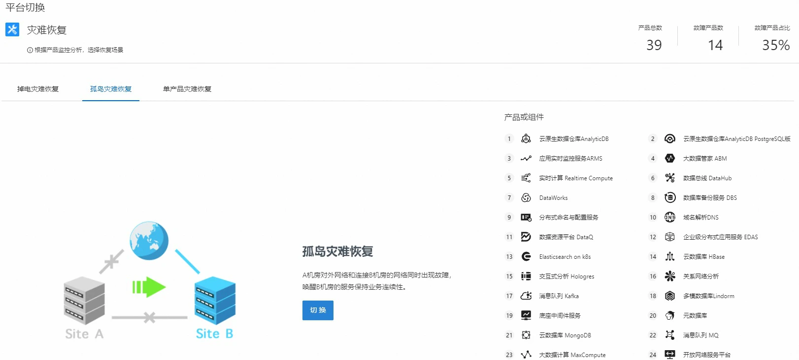

4. i. 单击**切换**，在弹出的对话框中单击**确定**。

   > **说明**
   >
   > 如果切换失败，请联系ASR产研团队进行问题排查。

5. 验证容灾切换的结果。

   请按照预期测试标准进行业务验证，确保容灾切换后业务能正常使用。

<a id="section-4-2-6-3"></a>

#### 4.2.6.3. 恢复故障机房

通过开启跨机房网络连接，模拟机房孤岛复原的场景。

**前提条件**

- 已注入备机房网络孤岛。

- 已手动开启交换机。

**操作步骤**

1. 在主机房ASR控制台左侧导航栏中选择**灾难恢复 > 故障模拟 > 机房复原**。

   

   > **说明**
   >
   > 系统会自动识别审批码及用户是否符合预期，否则不允许进行操作。

2. 单击**开始执行**，输入已经审批好的审批码，无需验证账号信息，ASR会进行机房复原前环境信息检查。

3. 交换机检查项完成后，单击**下一步**。

4. 在**恢复环境**页面。根据需要选择**开启**或者**跳过**互联网网络连接、用户物理专线、跨机房网络连接。

   

5. 待各项的操作状态显示**已完成**后，单击**机房复原完成**。

<a id="section-4-2-6-4"></a>

#### 4.2.6.4. 执行平台切回

在备机房孤岛复原场景中，您需要检查云产品状态、开启云外访问机房业务的流量，并执行切回后的业务验证。

1. 检查云产品。

   - 在飞天基础运维平台上检查各产品的SR都到达终态。对于没有自动恢复的SR，请根据报错信息手动修复。

   - 在备机房ASR控制台上检查产品监控都是正常。对于异常报错，请根据报错信息手动修复。

   - 检查机房的业务应用都正常工作。

2. 开启云外访问机房业务的流量。

   > **说明**
   >
   > 由客户完成云外流量放通。

3. 验证容灾切回的结果。

   > **说明**
   >
   > 请按照预期测试标准进行业务验证，确保容灾切回后业务能正常使用。

<a id="section-5"></a>

# 5.演练后检查

为了不影响后续业务顺利运行，需要在演练执行完成后在平台监控和平台检查中检查所有的产品状态是否已达到正常状态。

**前提条件**

- 故障机房已经复原。

- 平台已经切回成功。

**操作步骤**

1. 登录主机房ASR控制台，在左侧导航栏选择**平台监控 > 产品监控**。

2. 查看**产品监控**页面所有的产品状态是否**正常**，如果有异常状态的产品查看处理问题解决或联系研发人员处理。

3. 在主机房ASR控制台，在左侧导航栏选择**平台检查 > 产品检查**。

4. 查看产品检查页面单击**立即检查**。

5. 等待检查结束后，查看所有的检查项状态是否**正常**，如果有异常状态的产品查看KB库解决或联系研发人员处理。

<a id="section-6"></a>

# 6.处理问题

本文介绍在演练过程中出现的一些异常问题的处理方法，便于运维人员提高紧急事件的处理效率。

<a id="section-6-1"></a>

## 6.1. 常见问题处理

如果产品切换失败，请按照如下步骤获取日志信息并提供给阿里云研发人员。

**获取全量日志**

1. 登录备机房的ASR控制台，在左侧导航栏中选择**在线演练** > **演练记录**或**应急恢复** > **恢复记录**。

2. 单击执行结果为失败的记录的名称。

   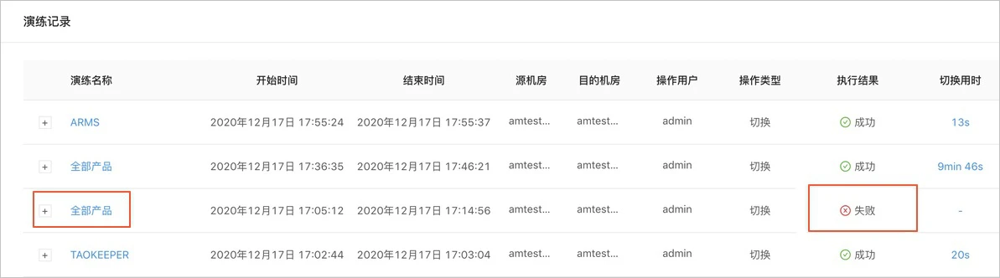

3. 在详情页面查看具体的日志信息，并将该日志截图提供给阿里云研发人员。

   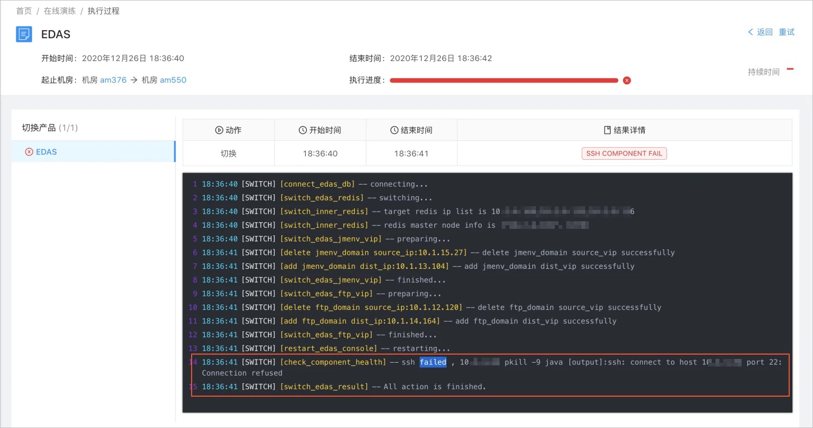

**获取切换日志**

1. 登录备机房bcmc Docker容器。

   <ol type="i">

   <li>

   登录Apsara Uni-manager运维控制台。

   </li>

   <li>

   在顶部菜单栏选择**平台运维 > 飞天基础运维平台 > 资源管理**。

   </li>

   <li>

   在**飞天基础运维平台**左侧导航栏中，选择**资源管理 > 产品集群运维**。

   </li>

   <li>

   在**产品集群运维**页面，搜索bcmc服务。

   </li>

   <li>

   在目标集群的**操作**列，单击**集群详情**。

   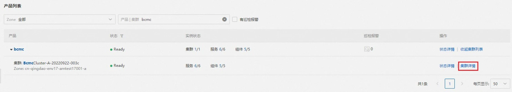

   </li>

   <li>

   在服务列表中，单击**bcmc**。

   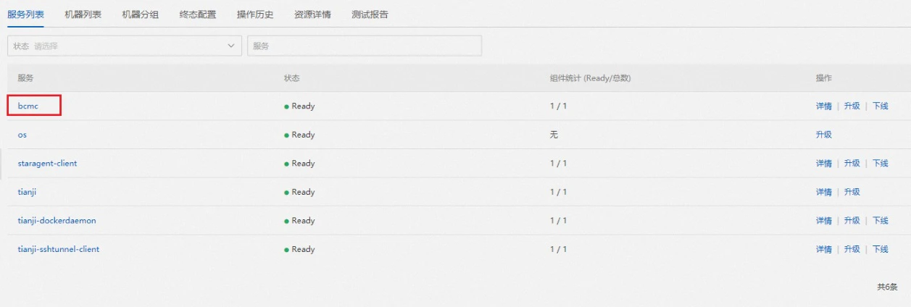

   </li>

   <li>

   选择<strong>Bcmc#</strong>组件，在**实例列表**页签下，单击实例**操作**列的**Terminal**。

   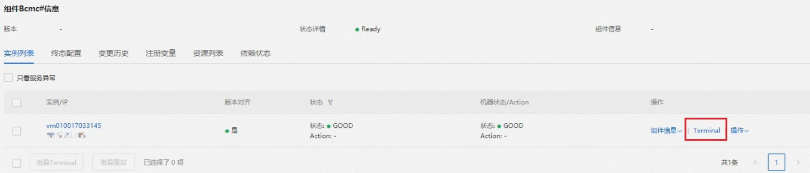

   </li>

   <li>

   执行如下命令查询容器的ID。

   ```bash
   docker ps
   ```

   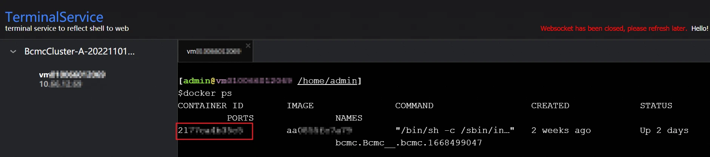

   </li>

   <li>

   执行如下命令进入容器。

   ```bash
   docker exec -it <容器ID> /bin/bash
   ```

   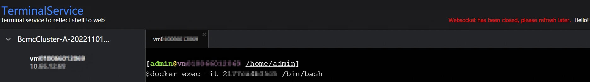

   </li>

   </ol>

2. 进入切换失败产品的日志文件目录，路径为 `/home/admin/bcmc/scripts/`产品名`/logs/` 。

   > **说明**
   >
   > 目录中的产品名为大写的产品名，例如taokeeper的目录名为TAOKEEPER。

   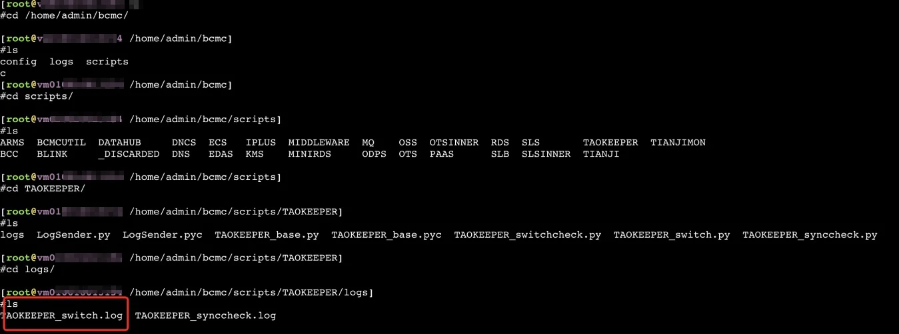

3. 执行 `vi` 命令查看 产品名`_switch.log` 日志文件，查看切换时间点的报错日志和报错上下文信息，并提供给阿里云研发人员。

   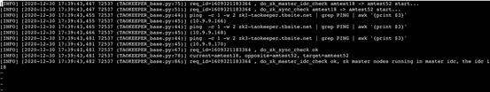

**常见的报错信息**

**问题现象一**

日志提示类似如下信息：

`ssh failed` ，`connect to xx.xx.xx.xx connection refused` 。，`connect to xx.xx.xx.xx`

```text
Permission denied 
```


**解决方案**

1. 根据ssh的目标IP查询对应属于什么产品，检查该产品的ssh服务是否启动。

2. ssh服务启动后，手动打通备机房bcmc的Docker容器到指定IP的ssh通道。

**问题现象二**

日志提示类似如下信息：

```text
  {'http_body':'ClientError: <urlopen error [Errno 111] Connection 
refused>','http_status': -1} 
```

**解决方案**

该问题是因为调用异常。请截取具体调用的URL信息以及报错信息，联系阿里云研发人员。

<a id="section-6-2"></a>

## 6.2. 异常问题处理

介绍一些常见的产品监控异常问题和底座组件监控异常问题。

**常见的产品监控异常**

常见的异常及处理方式如下：

- SSH隧道异常：在飞天基础运维平台上查看产品是否到达终态，未达终态请先修复终态问题。如果产品到达终态但异常依旧存在，请提工单处理。

- RDS出现同步延迟实例数量、运行中任务数量不为0：此时需要登录杜康运维平台检查具体的实例同步情况和任务执行情况。

- Tablestore同步延迟时间不为0：降低业务量，等待20分钟，等待同步延迟时间自动恢复，如果长时间不恢复，请提工单处理。

- 主备服务出现服务异常：请从飞天基础运维平台查看产品是否到终态，未达终态及时修复终态问题。如果产品到达终态，但异常依旧存在，请提工单处理。

**常见的底座组件监控异常**

- SSH隧道异常：在飞天基础运维平台上查看产品是否到达终态，未达终态请先修复终态问题。如果产品到达终态但异常依旧存在，请提工单处理。

- MINIRDS出现同步延迟实例数量、运行中任务数量不为0：此时需要登录杜康运维平台检查具体的实例同步情况和任务执行情况。

- 主备服务出现服务异常：请从飞天基础运维平台查看产品是否到终态，未达终态及时修复终态问题。如果产品到达终态，但异常依旧存在，请提工单处理。
