阿里云  
专有云飞天企业版  
灾备管理中心  
容灾演练（异地容灾）  
产品版本：v3.18.3  
文档版本：20240829

**目录**

- [1.演练前须知](#section-1)
    - [1.1. 演练概述](#section-1-1)
    - [1.2. 演练原理](#section-1-2)
    - [1.3. 演练流程](#section-1-3)
    - [1.4. 预案](#section-1-4)
- [2.演练前检查](#section-2)
    - [2.1. 检查网络](#section-2-1)
    - [2.2. 检查环境配置](#section-2-2)
    - [2.3. 检查各管控平台](#section-2-3)
    - [2.4. 检查容灾设置](#section-2-4)
    - [2.5. 检查产品部署状态](#section-2-5)
- [3.演练前准备](#section-3)
    - [3.1. 容灾演练前基础准备](#section-3-1)
        - [3.1.1. 配置异地容灾初始业务](#section-3-1-1)
        - [3.1.2. 收集基本信息](#section-3-1-2)
    - [3.2. 业务容灾演练前准备](#section-3-2)
        - [3.2.1. 新建保护组](#section-3-2-1)
        - [3.2.2. 添加保护实例](#section-3-2-2)
            - [3.2.2.1. 云数据库HBase版](#section-3-2-2-1)
            - [3.2.2.2. 云数据库RDS](#section-3-2-2-2)
            - [3.2.2.3. 云原生分布式数据库PolarDB-X 1.0](#section-3-2-2-3)
            - [3.2.2.4. 对象存储OSS](#section-3-2-2-4)
            - [3.2.2.5. 表格存储Tablestore](#section-3-2-2-5)
            - [3.2.2.6. 云原生数据仓库AnalyticDB MySQL版3.0](#section-3-2-2-6)
            - [3.2.2.7. 大数据计算产品](#section-3-2-2-7)
            - [3.2.2.8. 域名解析DNS（跨云）](#section-3-2-2-8)
            - [3.2.2.9. 域名解析DNS（云内）](#section-3-2-2-9)
            - [3.2.2.10. 消息队列MQ](#section-3-2-2-10)
            - [3.2.2.11. 云数据库Redis版](#section-3-2-2-11)
            - [3.2.2.12. 云数据库MongoDB版](#section-3-2-2-12)
            - [3.2.2.13. 实时数仓Hologres](#section-3-2-2-13)
            - [3.2.2.14. 云原生多模数据库Lindorm](#section-3-2-2-14)
            - [3.2.2.15. 云服务器ECS](#section-3-2-2-15)
        - [3.2.3. 创建业务容灾计划](#section-3-2-3)
        - [3.2.4. 创建容灾单元空间](#section-3-2-4)
    - [3.3. 站点容灾演练前准备](#section-3-3)
        - [3.3.1. 执行业务容灾演练前准备](#section-3-3-1)
        - [3.3.2. 绑定业务容灾计划](#section-3-3-2)
- [4.执行容灾演练](#section-4)
    - [4.1. 执行业务容灾演练](#section-4-1)
        - [4.1.1. 切换保护组](#section-4-1-1)
        - [4.1.2. 执行业务容灾演练](#section-4-1-2)
        - [4.1.3. 切回保护组](#section-4-1-3)
    - [4.2. 执行站点容灾演练](#section-4-2)
        - [4.2.1. 执行站点容灾演练](#section-4-2-1)
        - [4.2.2. 执行站点灾难恢复](#section-4-2-2)
- [5.演练后操作](#section-5)
    - [5.1. 校验数据一致性](#section-5-1)
- [6.异常问题处理](#section-6)
    - [6.1. ASR-DR故障时如何人工修复DNS](#section-6-1)
    - [6.2. ASR-DR故障时如何人工修复云数据库RDS](#section-6-2)
    - [6.3. ASR-DR故障时如何人工修复云数据库MongoDB](#section-6-3)
    - [6.4. 订正数据](#section-6-4)
    - [6.5. ASR-DR故障时如何人工修复云数据库Redis](#section-6-5)

# 1.演练前须知

## 1.1. 演练概述

异地容灾管理平台ASR-DR（Apsara Stack Resilience for Disaster Recovery）简称ASR-DR，是一款提供容灾功能的云平台产品，当前支持对象存储OSS、云服务定义存储CDS-OSS、云数据库RDS MySQL 5.6/5.7/8.0、云数据库PolarDB-O 11.2、表格存储Tablestore、云原生分布式数据库PolarDB-X 1.0、域名解析DNS、消息队列MQ、云数据库HBase版、实时数仓Hologres、云原生多模数据库Lindorm、云数据库MongoDB版、云数据库Redis版、云原生数据仓库AnalyticDB MySQL版3.0、大数据计算MaxCompute和DataWorks的热备容灾。

**切换原理**

通过创建保护组，ASR-DR在生产站点和灾备站点对应资源之间建立一条热备通道，生产站点资源的数据修改会原封不动地异步热备到灾备站点对应的资源之中。生产站点发生故障时，通过故障计划中的故障切换将应用或服务切换到灾备站点上；生产站点故障恢复后，再通过故障计划中的故障回切将业务切换回生产站点，以此来实现业连续性。

**演练的应对措施**

- 通知外部客户演练窗口时间，建议客户采用异步形式执行业务或暂停业务，执行后不影响客户业务。

- 演练控制在一定的时间范围内，留出恢复时间窗口，保证业务能够在另一机房运行。

- 生产站点断电时可以使用灾备站点的堡垒机，灾备站点断电时可以使用生产站点的堡垒机。

- 变更之前，异地备份核心业务的全量RDS数据。

- 演练期间关闭生产环境的定时任务，使用测试数据做容灾演练期间的切换验证，确保演练期间不再进入新的生产数据。

- 演练和变更完成之后，比对生产数据和备份数据，确认数据无误再开启生产任务。

- 一旦变更和演练过程中出现不符合预期或者演练时间超过预期的情况，回滚变更。

**演练目标**

ASR-DR（Apsara Stack Resilience）系统从技术层面保障了业务的连续性，但容灾的所有环节中，演练是重中之重，演练可以检验平台处理重大问题的能力，还可以训练内部人员的容灾应急动作。

项目组每次演练前请务必将容灾演练的计划安排知会阿里云技术支持。阿里云技术支持会综合分析项目情况来提供演练方案。容灾演练完成后，项目组和阿里云技术支持将总结演练经验，为您提供特定的DRP（Disaster Recovery Plan，灾难恢复计划）文档。

## 1.2. 演练原理

本文介绍异地容灾演练的基本原理和演练步骤。

**演练场景说明**

异地容灾演练是一种确保在遭遇自然灾害、重大事故或任何可能导致数据中心中断的事件时，企业能够迅速恢复关键业务运作的重要策略。演练基本原理围绕着业务恢复展开，其核心目的是验证和提升企业的灾难恢复计划（DRP）的有效性，确保在真实灾难发生时能够快速切换到灾备站点并恢复正常运营。

**演练原理图**

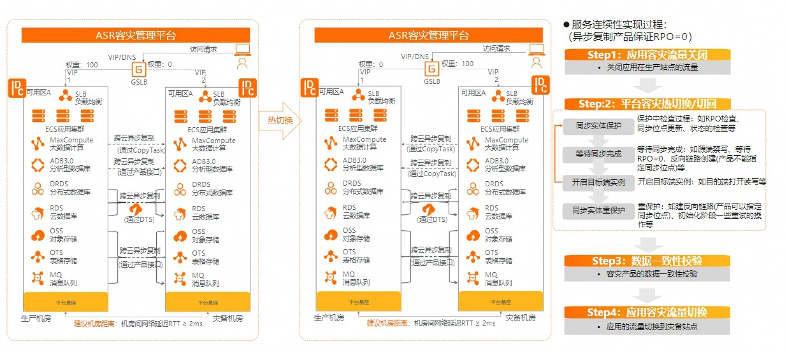

**演练原理**

ASR-DR对容灾演练的核心步骤，主要围绕着接入层、产品层。即确保产品层保持数据同步，RPO=0不丢数据；同时控制接入层切换流量。ASR-DR平台上演练的通用步骤如下：

1. 禁用应用在生产站点接入层的入口流量，业务不对外提供服务。

2. 禁写生产实例，应用不被允许写入数据。

3. 等待生产实例中存量数据完全同步到灾备实例。

4. 删除生产实例到灾备的同步链路，建立灾备实例到生产的反向同步链路。

5. 开启灾备实例读写，灾备应用可读写实例数据。

6. 开启接入层入口流量，将流量转发到灾备应用。

> **说明**
>
> 上述步骤是通用步骤，不同的云产品类型的切换步骤会略有差异。例如：
>
> - 云数据库RDS为了降低RTO，提升切换效率，会将步骤4放在步骤6后面。
>
> - 云原生分布式数据库PolarDB-X 1.0除了上述步骤外，还有和产品特性相关的步骤，如“提高sequence”。
>
> - 对象存储OSS双向同步，最终保证数据一致性，不需要步骤2、3和5。

**演练步骤**

通过定期的容灾演练，不仅能够验证异地容灾方案的有效性，还能不断提升应对突发事件的能力，确保业务连续性和最小化灾害损失。

1. **数据同步**：首先，需要异步实时地将生产站点中的核心业务的关键数据和系统配置信息同步到异地的灾难恢复站点（这个站点应与生产站点地理位置相隔较远，以避免同一灾难同时影响两地的数据）。这需要通过实时数据复制技术实现，确保主站点的数据变化能够近乎实时地同步到灾备站点，此步骤通过灾备平台ASR-DR同步实体实现。

2. **建立灾备环境**：在灾备站点，根据业务需求搭建一个与生产环境相似的备用环境；包括安装相同的操作系统、应用程序、数据库和服务等，确保在需要时可以快速接管生产业务。

3. **演练规划与准备**：演练前需要制定详细的演练计划，明确演练目标、参与人员、具体步骤、预期结果及评估标准。确保所有相关人员了解自己的角色和责任，并准备好相应的测试数据，避免对实际生产数据造成影响。

4. **执行演练**：演练操作时云产品会按照演练计划中设置的顺序启动灾难恢复流程，模拟主站点不可用的情况，如关闭主站点服务、按照提前在容灾计划中设置好的顺序将云产品切换到灾备站点。在此过程中，监测数据恢复的时效性、应用系统的启动状态、网络连接情况以及服务的可用性。

5. **评估与反馈**：演练结束后，收集相关数据和参与者反馈，评估灾难恢复计划的有效性、响应速度、数据完整性以及业务恢复的时间目标（RTO）和数据丢失量目标（RPO）。识别并记录在演练中发现的问题和不足之处。

6. **优化与改进**：基于演练评估结果，对灾难恢复计划、流程、技术和基础设施进行必要的调整和优化。这可能涉及改进数据复制机制、增强系统兼容性、提升人员培训等方面，以确保下一次面对真实灾难时能够更加高效地恢复业务。

**名词解释**

- 生产站点：企业日常运行核心业务和应用程序的数据中心。

- 灾备站点：应对生产站点因自然灾害（如地震、火灾）、人为错误、硬件故障、网络攻击等不可预见事件导致的服务中断而设立的备用数据中心。

- 数据同步：在两个或多个系统、数据库、存储设备之间保持数据一致性的过程。

- 接入层：负责接收并处理用户与应用的连接流量，如GSLB、云解析DNS、负载均衡SLB等。

- 应用层：处理业务的服务和应用，如部署在云服务器ECS或企业级分布式应用服务EDAS上的应用。

- 产品层：应用层所采用的云平台上的产品，如云数据库RDS、对象存储OSS等。

## 1.3. 演练流程

容灾演练属于项目的重大操作，演练期间生产站点或灾备站点会出现无法提供实时服务的情况。演练期间业务会受到影响，请暂停关键核心业务，使用测试流量模拟业务。容灾演练过程包括：配置环境、创建灾备实例、创建保护组、创建演练计划、启动容灾演练，数据一致性验证。实际演练时间根据现场环境和业务量总和而定，建议一个场景的演练整体时间安排在6个小时以上。

**演练流程图**

- **业务容灾**：针对一种或几种业务需要做容灾演练检验容灾能力时，在Apsara Uni-manager运营控制台上的ASR-DR执行的演练方式。

- **站点容灾**：针对整个站点掉电或者网络都发生故障时，在Apsara Uni-manager运维控制台上的ASR-DR进行一键切换，并争取RTO尽量小。

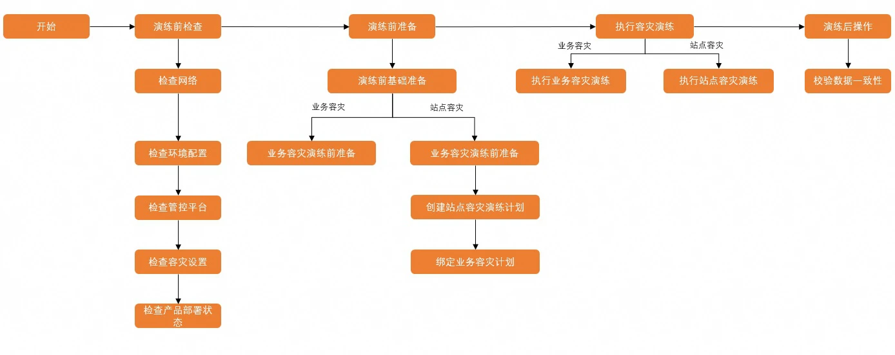

> **说明**
>
> 确认演练前请根据现场实际情况规划并设计演练方案，下表介绍的是确定演练后需要执行的任务以及耗费时长，帮助现场实施人员提前规划时间和执行顺序。

说明

**任务名称**

**子任务**

**耗费时长**

在演练操作前，您需要检查网

检查网络

2小时

络可达性。

在演练操作前，您需要检查主备站点的DNS域名转发规则、DTS跨云或跨Region同步参

2小时

检查环境配置

数、OSS跨云或跨Region同步参数、MaxCompute跨云同步参数。

演练前检查

在演练操作前，您需要检查各

检查各管控平台

3小时

管控平台运行正常。

操作演练前，您需要检查RAM

检查容灾设置

1小时

角色是否已正确创建。

操作演练前，您需要在飞天基

检查产品部署状态

础运维平台中检查主备站点所

2小时

有产品都已到达终态。

不管是业务容灾演练还是站点容灾演练，在操作演练前都需要做的准备工作，例如收集一

容灾演练前基础准备

8小时

些基本信息或者初始化业务配置等。

在执行业务容灾演练操作前，

演练前准备

需要做的准备工作，例如创建

业务容灾演练前准备

8小时

保护组、添加实体、创建计划等。

在执行站点容灾演练操作前，需要做的准备工作，必须先完

站点容灾演练前准备

成业务容灾的准备工作，然后

8小时

再创建站点容灾计划，关联业务容灾计划等。

执行业务容灾演练操作，包括

执行业务容灾演练

切换保护组、执行业务容灾演

8小时

练计划、切回保护组等。

执行容灾演练

执行站点容灾演练或站点灾难恢复操作，包括绑定业务容灾

执行站点容灾演练

8小时

计划、设置执行序号、启动切换流程等。

<table>
  <tr>
    <td>演练后操作</td>
    <td>-</td>
    <td>演练完成后，需要验证下数据是否和演练前一致，不一致时需要订正数据。</td>
    <td>1小时</td>
  </tr>
</table>

## 1.4. 预案

容灾演练前需要成立容灾演练小组，并编写容灾演练预案。

容灾演练预案中的前置检查、演练完成后置检查、结束流程等内容需要根据客户业务进行定制，预案模板参考《混合云异地容灾DRP灾难恢复计划》，请联系交付工程师获取该模板。

下表介绍容灾演练时容灾产品的切换步骤和恢复步骤。

| 容灾产品 | 切换步骤 | 恢复步骤 |
| --- | --- | --- |
| 应用容灾 | 1. 关闭应用在生产站点的流量 2. 切换云产品 3. 将应用的流量切换至灾备站点 | 1. 关闭应用在灾备站点的流量 2. 切换云产品 3. 将应用的流量切换至生产站点 |
| 云产品容灾 | 1. 设置生产站点实例只读 2. 等待数据同步延迟为0 3. 切换同步方向 4. 灾备站点实例开启读写 | 1. 设置灾备站点实例只读 2. 等待数据同步延迟为0 3. 切换同步方向 4. 生产站点实例开启读写 |

# 2.演练前检查

## 2.1. 检查网络

在演练操作前，您需要检查网络可达性。

在演练操作前，请检查网络是否满足如下要求：

- 可以通过生产站点运维网络直接访问生产站点的服务器

- 可以通过灾备站点运维网络直接访问灾备站点的服务器

- 主备站点并网完成

- 用户IDC流量两个机房可达

## 2.2. 检查环境配置

您需要检查主备站点的DNS域名转发规则、DTS跨云或跨Region同步参数、OSS跨云或跨Region同步参数、MaxCompute跨云同步参数。

参见*阿里云 专有云企业版 部署指南*中的**异地容灾部署**章节，检查如下配置：

- 主备站点DNS域名转发规则已正确配置

- 主备站点DTS跨云或跨Region同步参数已正确配置

- 主备站点OSS跨云或跨Region同步参数已正确配置

- 主备站点MaxCompute跨云同步参数已正确配置

## 2.3. 检查各管控平台

在演练操作前，您需要检查各管控平台运行正常。

容灾演练前，根据实际的容灾需求，检查相应的管控平台：

- 分别登录主备站点的Apsara Uni-manager运营控制台，检查系统运行正常。

- 登录ASR-DR控制台，检查系统运行正常。

- 如果待执行演练的应用使用了RDS实例，请分别登录主备站点的RDS运维管控系统，检查系统运行正常，且相应RDS实例的状态为正常。

- 如果待执行演练的应用使用了PolarDB-X实例，请分别登录主备站点的PolarDB-X运维管控系统，检查系统运行正常，且相应PolarDB-X实例的状态为正常。

- 如果待执行演练的应用使用了RDS或PolarDB-X实例，请分别登录主备站点的DTS运维管控系统，检查系统运行正常。

- 如果待执行演练的应用使用了OSS Bucket，请分别登录主备站点的OSS运维管控系统，检查系统运行正常，且相应Bucket的状态为正常。

- 如果待执行演练的应用使用了Tablestore实例，请分别登录主备站点的Tablestore运维管控系统，检查系统运行正常，且相应Tablestore实例的状态为正常。

- 如果待执行演练的应用使用了MQ Topic，请分别登录主备站点的MQ控制台，检查系统运行正常，且相应Topic的状态为正常。

- 如果待执行演练的应用使用了ADB 3.0，请分别登录主备站点的ADB 3.0控制台，检查系统运行正常，且相应ADB 3.0实例的状态为正常。

- 如果待执行演练的应用使用了MaxCompute项目，请分别登录主备站点的大数据管家ABM控制台，检查系统运行正常，且相应MaxCompute项目的状态为正常。

## 2.4. 检查容灾设置

操作演练前，您需要检查RAM角色是否已正确创建。

登录主备站点的Apsara Uni-manager运营控制台，请确保待保护RDS和PolarDB-X所在组织已创建数据传输服务（DTS）的RAM角色。

## 2.5. 检查产品部署状态

您需要在飞天基础运维平台中检查主备站点所有产品都已到达终态。

1. 登录Apsara Uni-manager运维控制台。

2. 在顶部菜单栏选择**产品运维** > **云平台运维** > **飞天基础运维平台**。

3. 在左侧导航栏选择**产品集群运维**。

4. 检查主备站点产品状态，确认所有服务角色都到达终态。

   > **说明**
   >
   > 在**Zone**下拉框中可以切换主备站点。

   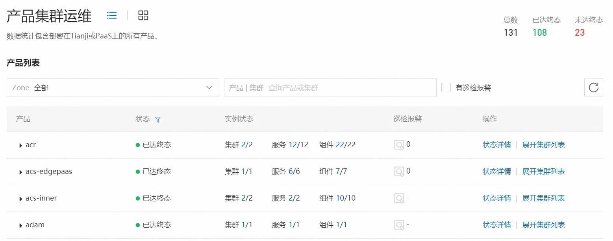

# 3.演练前准备

## 3.1. 容灾演练前基础准备

介绍不管是业务容灾演练或者是站点容灾演练都需要做的准备工作。

### 3.1.1. 配置异地容灾初始业务

您需要完成异地容灾的初始配置，包括配置生产云实例、配置支持的容灾产品、创建RAM角色。

请参见《*阿里云 专有云企业版 异地容灾管理平台ASR-DR用户指南*》和《*阿里云 专有云企业版 异地容灾管理平台ASR-DR运维指南*》完成异地容灾的初始业务配置：

- 配置支持的容灾产品，请参见《*阿里云 专有云企业版 异地容灾管理平台ASR-DR运维指南*》中的”管理云产品信息“章节。

- 配置云实例，请参见《*阿里云 专有云企业版 异地容灾管理平台ASR-DR用户指南*》中的”管理云实例“章节。

- 配置RAM角色，请参见《*阿里云 专有云企业版 异地容灾管理平台ASR-DR用户指南*》中的”创建RAM角色“章节。

### 3.1.2. 收集基本信息

容灾演练前您需要收集相关平台的URL地址、账号和密码。

请收集下表中的信息。

**平台名称**

**账号和密码**

**URL地址**

**登录鉴权**

- 在跨云容灾场景中，ASR-DR控制台部署在灾备云，您需要通过灾备云的Apsara Uni-manager运营控制台登录ASR-

- Apsara Uni-

  DR。

  manager运营控制台组织

  - 在跨Region容灾场景中，ASR-

  管理员的账号

  DR控制台部署在中心Region，

  和密码

ASR-DR

您需要通过中心Region的Apsara Uni-manager运营控

- Apsara Uni-

  制台登录ASR-DR。

  manager运营控制台运营

  - 在自身容灾场景中，您需要通过

  管理员的账号

  请获取Apsara Uni-

  生产中心的Apsara Uni-

  和密码

  manager运营控制台的

  manager运营控制台登录ASR-

  URL地址，格式如下：

  DR。

- Apsara Uni-manager运

  asc.*internet-domain*

  营控制台全局容灾管理员的

Apsara Uni-manager运

开启

账号和密码

营控制台

- Apsara Uni-manager运营控制台组织

MQ控制台

容灾管理员的账号和密码

通过Apsara Uni-manager运营控制台跳转

ADB 3.0控制台

<table>
  <tr>
    <td>RDS运维管控系统</td>
    <td rowspan="6">Apsara Uni-manager运维控制台的账号和密码</td>
    <td rowspan="6">请获取Apsara Uni-manager运维控制台的URL地址，格式如下： <em>region-</em><em>id</em>.ops.console.<em>intrane</em> <em>t-domain</em></td>
    <td rowspan="6">通过Apsara Uni-manager运维控制台跳转</td>
  </tr>
  <tr>
    <td>PolarDB-X运维管控系统</td>
  </tr>
  <tr>
    <td>DTS运维管控系统</td>
  </tr>
  <tr>
    <td>OSS运维管控系统</td>
  </tr>
  <tr>
    <td>Tablestore运维管控系统</td>
  </tr>
  <tr>
    <td>大数据管家ABM</td>
  </tr>
</table>

## 3.2. 业务容灾演练前准备

### 3.2.1. 新建保护组

保护组是ASR-DR控制台进行容灾保护的业务对象。您可以基于应用视角，为某个应用所使用的一组相关资源创建保护组。

**背景信息**

保护组数量建议在20个以内。

**操作步骤**

1. 登录ASR-DR控制台。

2. 在左侧导航栏选择**业务容灾** > **保护组**。

3. 在保护组页面，单击**新建**。

4. 在**新建保护组**页面，填写保护组基本信息，参数说明如下表所示。

   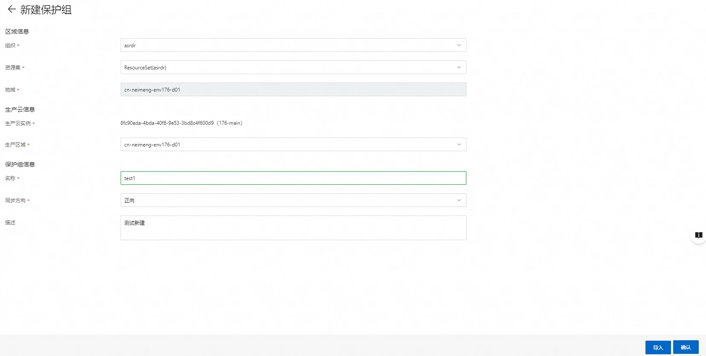

   <table>
     <tr>
       <th>区域</th>
       <th>参数名称</th>
       <th>描述</th>
     </tr>
     <tr>
       <td rowspan="3">区域信息 说明区域信息显示的是灾备区域的相关信息。</td>
       <td>组织</td>
       <td>选择保护组数据所在的组织。</td>
     </tr>
     <tr>
       <td>资源集</td>
       <td>选择待容灾实例所在的资源集。</td>
     </tr>
     <tr>
       <td>地域</td>
       <td>选择保护组所在的灾备站点地域。</td>
     </tr>
     <tr>
       <td rowspan="2">生产云信息</td>
       <td>生产云实例</td>
       <td>系统默认填充，无需填写。</td>
     </tr>
     <tr>
       <td>生产区域</td>
       <td>选择保护组要保护的云产品实例所在的生产站点的地域。</td>
     </tr>
     <tr>
       <td rowspan="3">保护组信息</td>
       <td>名称</td>
       <td>自定义保护组名称。名称只能包含中文、英文、数字、短划线（-）、下划线（_）或半角句号（.），长度为4~20个字符或2~10个汉字。</td>
     </tr>
     <tr>
       <td>同步方向</td>
       <td>服务进行切换的方向。提供服务的实例为生产站点实例时选择正向，提供服务的实例为灾备站点实例时选择反向。 说明保护组的方向会随着切换和回切进行动态变化，即正向保护组进行切换后状态会变为反向保护组，反向保护组进行回切后状态会变回正向保护组。</td>
     </tr>
     <tr>
       <td>描述</td>
       <td>对保护组的描述信息，方便识别。</td>
     </tr>
   </table>

5. 单击**确认**，进入<strong>保护组页面，</strong>单击对应保护组的操作列  ，选择**添加实体**。

6. 按照添加同步实体的界面指引进行配置。

   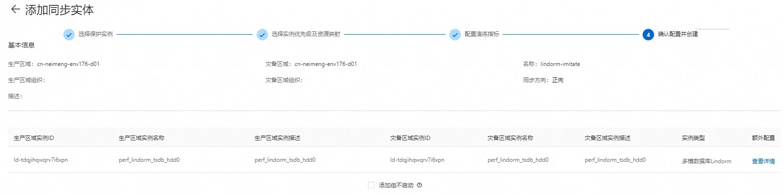

> **说明**
>
> - 各云产品添加同步实体的具体步骤请参见*添加同步实体章节。*
>
> - 选中**添加但不启动**勾选框表示该保护组创建完成之后直接到停止状态，后台不会创建同步链路，不做同步操作，且该保护组只可进行**启动保护组**操作。未勾选则表示保护组创建完成之后，自动进入保护启动状态。

7. 单击**确认**，保护组创建完成。在保护组列表页面单击  图标，查看保护组状态。

### 3.2.2. 添加保护实例

完成保护组的创建后，需要添加保护实例才能达到业务容灾的目的，容灾保护实例需要满足相应的条件。

同步实体个数限制如下：

- 所有保护组中的保护实例总数不超过200个。

- 被保护的数据库实例（PolarDB-X关联的RDS+RDS+PolarDB-O、Redis、MongoDB）总数默认不可超过60个，最大不超过100。如果超过60个，则需要评估DTS是否需要扩容。

- 被保护的ADB 3.0实例不超过20个。

- 被保护的HBase实例不超过20个。

- 被保护的Lindorm实例不超过20个。

- 被保护的OSS Bucket不超过20个。

- 被保护的Tablestore实例不超过20个。

- 被保护的ECS实例不超过50个。

- 被保护的MQ实例不超过20个。

- 被保护的DNS实例不超过20个。

- 被保护的MaxCompute不超过20个。

- 被保护的Hologres实例不超过20个。

#### 3.2.2.1. 云数据库HBase版

本文介绍HBase实例的容灾配置，包括前提条件和操作流程。

**前提条件**

| 前提条件 | 说明 |
| --- | --- |
| 已通过Apsara Uni-manager运营控制台在主备云实例各创建了一个HBase实例。 | 创建HBase实例时必须选择hbaseue数据库类型。 |
| 已通过Apsara Uni-manager运营控制台创建BDS实例。 | • BDS是HBase实例的同步组件，以实例的方式部署。创建方式同HBase实例一样，只需要将数据库类型选择为BDS。 • BDS版本需要是3.6.10，可以在实例详情页检查版本。 • BDS实例和HBase实例需属于同一个VPC下。 |
| 生产实例和灾备实例所在的VPC网络已打通。 | 由于HBase和BDS实例都处于租户侧VPC网络内，HBase实例数据同步时需要跨网络访问HBase实例，需要将生产实例和灾备实例所在的VPC网络打通。打通方法详见《专有云企业版V3.13高速通道专线并网操作手册》。 |

**配置步骤**

**步骤一：开放HBase实例的访问控制。**

由于灾备站点的BDS实例需要同时访问生产站点和灾备站点的HBase实例，因此需开放HBase实例的访问控制。

1. 通过杜康-数据库管理平台查看BDS实例使用的ECS的VIP。

2. 通过Apsara Uni-manager运营控制台将BDS的VIP加入HBase实例白名单。

> **说明**
>
> - 在BDS实例详情页即可查看ECS信息，其中实例IP就是ECS的VIP。
>
> - BDS实例一般使用多台ECS，需要将N台ECS的VIP配置到白名单。
>
> - 支持网段格式配置，多个VIP需使用半角逗号（,）分隔。

**步骤二：新增HBase实例使用的ECS的安全组规则，将BDS实例使用的VIP加入其中。**

通过杜康-数据库管理平台HBase实例的详情页查看ECS信息，一般有4台ECS，需要通过增加安全组规则将BDS的VIP加入到4台ECS的安全组规则中。需放通以下端口。

- LDFS: 8020/8020 50010/50075

- LindormTable: 30000/30020 8020/8020

- LindormZK: 2181/2181

> **说明**
>
> 在Master节点中配置完成后即可在全部ECS实例生效。配置完成后，在4台ECS实例上查看安全组规则，检查规则配置是否生效。

**步骤三：进行HBase实例的容灾配置。**

1. 登录ASR-DR控制台。

2. 在左侧导航栏选择**业务容灾** > **保护组**。

3. 在目标保护组的**操作**列单击  ，选择**添加实体**。

4. 在**添加同步实体**页面，**实例类型**选择**云数据库 HBase**。在左侧实体列表中勾选实例ID，单击  图

   标，将实例移动到右侧的实体列表中，单击**下一步**。

5. 在**选择实例优先级及资源映射**页面，在目标实例的**操作**列单击  ，选择**配置**，根据业务需求进行以下配

   置，配置完成单击**下一步**。具体的配置说明如下表所示。

   <table>
     <tr>
       <th>Config</th>
       <th>配置</th>
       <th>描述</th>
     </tr>
     <tr>
       <td rowspan="4">基础配置</td>
       <td>优先级</td>
       <td>ASR-DR会按照该优先级对资源进行演练或恢复。 数字越小，优先级越高。 重要请按照数据依赖关系排优先级，被依赖的云产品优先级高。</td>
     </tr>
     <tr>
       <td>同步策略</td>
       <td>• <strong>全量同步+增量同步</strong>：同步任务创建时刻之前的全部历史数据的同步、同步任务创建时刻之后或者指定时间位点开始进行的数据同步。 • <strong>增量同步</strong>：同步任务创建时刻之后或者指定时间位点开始进行的数据同步。 说明<strong>全量同步+增量同步</strong>需确保灾备实例中无数据、提前在灾备实例创建库表结构，<strong>增量同步</strong>需提前在灾备实例创建库表结构。</td>
     </tr>
     <tr>
       <td>增量同步开始位点（可选）</td>
       <td>如果同步策略为增量同步，需要配置该参数。选择相应的日期和时间，ASR-DR将从该时间点开始同步增量数据。</td>
     </tr>
     <tr>
       <td>资源映射</td>
       <td>选择灾备站点的目标实例，该实例作为生产站点实例的热备资源。</td>
     </tr>
     <tr>
       <td colspan="2">选择备云bds实例</td>
       <td>BDS实例可以用于多个实例间的数据同步，因此BDS实例是可以复用的。</td>
     </tr>
   </table>

6. 在**配置演练指标**页面，设置云产品的**最大同步延迟期望值（s）**、**切换时长期望值（s）**、**切回时长期望值（s）**，单击**下一步**。

7. 配置完成后可以预览配置，确定无误后单击**确认**，在保护组列表页面单击  图标，查看保护组状态。

> **说明**
>
> 保护组创建完成后，系统会做初始化。初始化完成后请检查保护组状态，如果状态为保护失败，请执行**重保护**。

#### 3.2.2.2. 云数据库RDS

本文介绍RDS的容灾配置，包括前提条件和操作流程。

**前提条件**

| 前提条件 | 说明 |
| --- | --- |
| 已通过Apsara Uni-manager运营控制台在主备云实例各创建了一个RDS实例。 | • 全量同步场景： • 主实例有被同步的数据库。备实例有被同步的同名数据库，但不能有表。 • 如果备实例存在非同步的数据库或表，需要配置到<strong>过滤表</strong>中。 • 增量同步场景： • 主备实例均有被同步的数据库和表，且数据库名和表名相同。 • 如果备实例存在非同步的数据库或表，需要配置到<strong>过滤表</strong>中。 • RDS实例没有被PolarDB-X关联。 |
| 已为主备云的实例分别申请内网、外网地址。 | 具体操作，请参见《云数据库RDS用户指南》中的实例管理章节。 |
| 已为主备云的实例分别创建高权限账号和普通账号。 | 具体操作，请参见《云数据库RDS用户指南》中的账号管理章节。 |
| 已经为所属的组织创建数据传输服务的RAM角色。 | 具体操作，请参见创建RAM角色。 |

**配置步骤**

1. 登录ASR-DR控制台。

2. 在左侧导航栏选择**业务容灾** > **保护组**。

3. 在目标保护组的**操作**列单击  ，选择**添加实体**。

4. 在**添加同步实体**页面，**实例类型**选择**云数据库 RDS**。在左侧实体列表中勾选实例ID，单击  图标，

   将实例移动到右侧的实体列表中，单击**下一步**。

   > **说明**
   >
   > 只读实例不允许配置同步实体，实体列表中也不显示只读实例。

5. 进入**选择实例优先级及资源映射**页面，在目标实例的**操作**列单击  ，选择**配置**，根据业务需求进行以下配

   置，配置完成单击**下一步**。具体的配置说明如下表所示。

   <table>
     <tr>
       <th>Config</th>
       <th>配置</th>
       <th>描述</th>
     </tr>
     <tr>
       <td rowspan="4">基础配置</td>
       <td>优先级</td>
       <td>ASR-DR会按照该优先级对资源进行演练或恢复。 数字越小，优先级越高。 重要请按照数据依赖关系排优先级，被依赖的云产品优先级高。</td>
     </tr>
     <tr>
       <td>同步策略</td>
       <td>• <strong>全量同步+增量同步</strong>：同步任务创建时刻之前的全部历史数据的同步、同步任务创建时刻之后或者指定时间位点开始进行的数据同步。 • <strong>增量同步</strong>：同步任务创建时刻之后或者指定时间位点开始进行的数据同步。 说明MySQL引擎增量同步支持选择指定位点，PolarDB引擎增量同步不支持指定时间位点。</td>
     </tr>
     <tr>
       <td>增量同步开始位点（可选）</td>
       <td>如果同步策略为增量同步，需要配置该参数。选择相应的日期和时间，ASR-DR将从该时间点开始同步增量数据。</td>
     </tr>
     <tr>
       <td>资源映射</td>
       <td>灾备站点的目标实例，该实例作为生产站点实例的热备资源。</td>
     </tr>
     <tr>
       <td>配置高权限账号</td>
       <td>主、备中心实例账号用户名、密码</td>
       <td>主、备实例数据库的高权限账号名和密码。 • 如果RDS控制台上已创建高权限账号，此处配置为对应的账号即可。 • 如果RDS控制台上未创建高权限账号，ASR-DR会根据填写的用户名和密码创建高权限账号。 说明 • 高权限账号仅用于管理普通账号连接，高权限账号不存在时会由ASR-DR帮您创建（PolarDB-O类型除外，高权限账号需要自行创建，且将作为同步账号使用，密码不可随意修改）。 • 要求源端RDS普通权限账号与备端普通权限账号名称一致，如名称不一致，ASR-DR不予管理。</td>
     </tr>
     <tr>
       <td>选择过滤表（可选）</td>
       <td>数据库、配置过滤表</td>
       <td>生产站点或灾备站点RDS中不需要进行容灾保护的数据库和表，可在此处配置数据库名和表名。 说明配置过滤表中填星号（*）表示过滤当前库。您也可以选中整库过滤来过滤当前库。</td>
     </tr>
     <tr>
       <td>选择同步对象</td>
       <td>开启数据库账号同步</td>
       <td>开启后将同步库有关的账号同步到目标端，并持续同步这些库有关账号的新增、权限范围变化。 说明新增账号在目标端已存在、修改密码、删除账号操作都不会被同步。</td>
     </tr>
     <tr>
       <td>配置只读账号</td>
       <td>数据库、只读账号</td>
       <td>生产站点或灾备站点RDS实例的数据库和对应的账号。容灾切换过程中，ASR-DR默认会设置RDS账号为读写权限。如果某些RDS账号是只读账号，不希望在容灾切换过程中被设置为读写权限，您可以通过该设置过滤这些只读账号。</td>
     </tr>
   </table>

6. 在**配置演练指标**页面，设置云产品的**最大同步延迟期望值（s）**、**切换时长期望值（s）**、**切回时长期望值（s）**，单击**下一步**。

7. 配置完成后可以预览配置，确定无误后单击**确认**，在保护组列表页面单击  图标，查看保护组状态。

   > **说明**
   >
   > 保护组创建完成后，系统会做初始化。初始化完成后请检查保护组状态，如果状态为保护失败，请执行**重保护**。

#### 3.2.2.3. 云原生分布式数据库PolarDB-X 1.0

本文介绍PolarDB-X 1.0（下文简称PolarDB-X）实例的容灾配置，包括前提条件和操作流程。

**前提条件**

| 前提条件 | 说明 |
| --- | --- |

<table>
  <tr>
    <td>已通过Apsara Uni-manager运营控制台在主备云实例各创建了一个PolarDB-X实例。</td>
    <td>• 备PolarDB-X关联的RDS数量要和主PolarDB-X关联的RDS数量一样。 • 备PolarDB-X下不能存在库。 • 主备PolarDB-X实例的规格要一致。 • PolarDB-X实例所关联的RDS实例不能被其他PolarDB-X实例关联。 • 当前不支持表级DDL和库级DDL的变更的同步。 • 已经创建数据传输服务的RAM角色。具体操作，请参见创建RAM角色。</td>
  </tr>
  <tr>
    <td>已为生产站点的实例创建数据库。</td>
    <td>数据库中应包含需要同步表，且表是通过check校验的。</td>
  </tr>
</table>

**配置步骤**

1. 登录ASR-DR控制台。

2. 在左侧导航栏选择**业务容灾** > **保护组**。

3. 在目标保护组的**操作**列单击  ，选择**添加实体**。

4. 在**添加同步实体**页面，**实例类型**选择**云原生分布式数据库PolarDB-X**。在左侧实体列表中勾选实例ID，

   单击  图标，将实例移动到右侧的实体列表中，单击**下一步**。

   > **说明**
   >
   > 只读实例不允许配置同步实体，实体列表中也不显示只读实例。

5. 进入**选择实例优先级及资源映射**页面，在目标实例的**操作**列单击  ，选择**配置**，根据业务需求进行以下配

   置，配置完成单击**下一步**。具体的配置说明如下表所示。

   **配置**

   **描述**

   **Config**

   ASR-DR会按照该优先级对资源进行演练或恢复。 数字越小，优先级越高。

   **优先级**

   > **重要**
   >
   > 请按照数据依赖关系排优先级，被依赖的云产品优先级高。

   **全量同步+增量同步**：同步任务创建时刻之前的全部历史数据的同步、同步任务创建时刻之后或者指定时间位点开始进行的数据同步。

   **同步策略**

   **基础配置**

   **增量同步**：同步任务创建时刻之后或者指定时间位点开始进行的数据同步。

   如果同步策略为增量同步，需要配置该参数。选择相应的

   **增量同步开始位点（可选）**

   日期和时间，ASR-DR将从该时间点开始同步增量数据。

   灾备站点的目标实例，该实例作为生产站点实例的热备资

   **资源映射**

   源。

   生产站点PolarDB-X中不需要进行容灾保护的数据库和表。

   **选择过滤表（可选）**

   **数据库、配置过滤表**

   > **说明**
   >
   > 配置过滤表中填星号（\*）表示过滤当前库。您也可以选中整库过滤来过滤当前库。

   > **重要**
   >
   > V3.18.0版本中**开启数据库账号同步**开关为关闭状态，不支持开启。

   开启后将同步库有关的账号同步到目标端，并持续同步这

   **选择同步对象**

   **开启数据库账号同步**

   些库有关账号的新增、权限范围变化。

   > **说明**
   >
   > 新增账号在目标端已存在、修改密码、删除账号操作都不会被同步。

   灾备PolarDB-X数据库的密码。

   **配置密码**

   **密码**

   生产站点PolarDB-X实例的数据库和对应的账号。

   容灾切换过程中，ASR-DR默认会设置PolarDB-X账号为读写权限。

   **配置只读账号（可**

   **数据库、只读账号**

   **选）**

   如果某些PolarDB-X账号是只读账号，不希望在容灾切换过程中被设置为读写权限，您可以通过该设置过滤这些只读账号。

6. 在**配置演练指标**页面，设置云产品的**最大同步延迟期望值（s）**、**切换时长期望值（s）**、**切回时长期望值（s）**，单击**下一步**。

7. 配置完成后可以预览配置，确定无误后单击**确认**，在保护组列表页面单击  图标，查看保护组状态。

> **说明**
>
> 保护组创建完成后，系统会做初始化。初始化完成后请检查保护组状态，如果状态为保护失败，请执行**重保护**。

#### 3.2.2.4. 对象存储OSS

本文介绍OSS/CDS-OSS的容灾配置，包括前提条件和操作流程。

**背景信息**

OSS分为OSS 1.0和CDS-OSS，OSS 1.0为原OSS产品，CDS-OSS为云定义存储，一种新的产品形态，CDS-OSS创建的时候必须选择对应的CDS-OSS集群。

以下若未特殊标明是OSS 1.0或CDS-OSS，则表示两者是一致的。

**前提条件**

| 前提条件 | 说明 |
| --- | --- |
| 已通过Apsara Uni-manager运营控制台在主备云实例各创建了一个OSS/CDS-OSS实例。 | • 全量保护场景下，备实例需要为空。 • 被保护的OSS Bucket不超过20个。 |

**配置步骤**

1. 登录ASR-DR控制台。

2. 在左侧导航栏选择**业务容灾** > **保护组**。

3. 在目标保护组的**操作**列单击  ，选择**添加实体**。

4. 在**添加同步实体**页面，**实例类型**选择**对象存储OSS**。在左侧实体列表中勾选实例ID，单击  图标，将

   实例移动到右侧的实体列表中，单击**下一步**。

5. 进入**选择实例优先级及资源映射**页面，在目标实例的**操作**列单击  ，选择**配置**，根据业务需求进行以下配

   置，配置完成单击**下一步**。具体的配置说明如下表所示。

   **配置**

   **描述**

   **Config**

   ASR-DR会按照该优先级对资源进行演练或恢复。 数字越小，优先级越高。

   **优先级**

   > **重要**
   >
   > 请按照数据依赖关系排优先级，被依赖的云产品优先级高。

   **全量同步+增量同步**：同步任务创建时刻之前的全部历史数据的同步、同步任务创建时刻之后或者指定时间位点开始进行的数据同步。

   **增量同步**：同步任务创建时刻之后或者

   **同步策略**

   指定时间位点开始进行的数据同步。

   > **说明**
   >
   > 增量同步不支持指定时间位点。

   **基础配置**

   支持配置为空对全部文件进行同步，或按照指定文件名前缀进行同步。

   > **说明**
   >
   > - 前缀不能以斜线（/）开

   **数据同步对象**

   > 头。
   >
   > - 多个前缀以逗号（,）分割。
   >
   > - 同步实体前缀设置后不支持修改。

   选择**数据同步策略**为**增/改同步**或**增/删/**

   **数据同步策略**

   **改同步。**

   选择灾备站点的目标实例，该实例作为

   **资源映射**

   生产站点实例的热备资源。

6. 在**配置演练指标**页面，设置云产品的**最大同步延迟期望值（s）**、**切换时长期望值（s）**、**切回时长期望值（s）**，单击**下一步**。

7. 配置完成后可以预览配置，确定无误后单击**确认**，在保护组列表页面单击  图标，查看保护组状态。

> **说明**
>
> - 保护组创建完成后，系统会做初始化。初始化完成后请检查保护组状态，如果状态为保护失败，请执行**重保护**。
>
> - 针对OSS产品，在创建全量保护组的时候，由于产品方面的限制，在开始全量同步之前需要等待约90~110分钟，之后才会开始进行全量同步。

#### 3.2.2.5. 表格存储Tablestore

介绍Tablestore的容灾配置，包括前提条件和操作流程。

**前提条件**

| 前提条件 | 说明 |
| --- | --- |
| 已通过Apsara Uni-manager运营控制台主备云实例各自创建了Tablestore实例。 | • 全量保护场景：目标实例中不能存在同步表。 说明正向链路中备实例为目标实例，反向链路中主实例为目标实例。 • 增量保护场景：主备实例均要有表，且表名一致。 • 被保护的Tablestore实例不超过20个。 |

**配置步骤**

1. 登录ASR-DR控制台。

2. 在左侧导航栏选择**业务容灾** > **保护组**。

3. 在目标保护组的**操作**列单击  ，选择**添加实体**。

4. 在**添加同步实体**页面，**实例类型**选择**表格存储 Tablestore**。在左侧实体列表中勾选实例ID，单击 

   图标，将实例移动到右侧的实体列表中，单击**下一步**。

5. 在**选择实例优先级及资源映射**页面，在目标实例的**操作**列单击  ，选择**配置**，根据业务需求进行以下配

   置，配置完成单击**下一步**。具体的配置说明如下表所示。

   > **说明**
   >
   > 增量同步需提前在灾备实例中创建库表结构。

   **配置**

   **描述**

   **Config**

   ASR-DR会按照该优先级对资源进行演练或恢复。 数字越小，优先级越高。

   **优先级**

   > **重要**
   >
   > 请按照数据依赖关系排优先级，被依赖的云产品优先级高。

   **全量同步+增量同步**：同步任务创建时刻之前的全部历史数据的同步、同步任务创建时刻之后或者指定时间位点开始进行的数据同步。

   **增量同步**：同步任务创建时刻之后或者指定时间位点开始进行的数据同步。

   **基础配置**

   **同步策略**

   > **重要**
   >
   > **全量同步+增量同步**需确保灾备实例中无表。
   >
   > **增量同步**需提前在灾备实例中创建好库表结构。

   如果同步策略为增量同步，需要配置该参数。选择相应的日期和时

   **增量同步开始位点（可选）**

   间，ASR-DR将从该时间点开始同步增量数据。

   选择灾备站点的目标实例，该实例

   **资源映射**

   作为生产站点实例的热备资源。

   <table>
     <tr>
       <td>选择同步表</td>
       <td>同步表</td>
       <td>在生产站点Tablestore实例中选择需要同步到灾备站点的表。</td>
     </tr>
   </table>

6. 在**配置演练指标**页面，设置云产品的**最大同步延迟期望值（s）**、**切换时长期望值（s）**、**切回时长期望值（s）**，单击**下一步**。

7. 配置完成后可以预览配置，确定无误后单击**确认**，在保护组列表页面单击  图标，查看保护组状态。

   > **说明**
   >
   > 保护组创建完成后，系统会做初始化。初始化完成后请检查保护组状态，如果状态为保护失败，请执行**重保护**。

#### 3.2.2.6. 云原生数据仓库AnalyticDB MySQL版3.0

本文介绍AnalyticDB MySQL版3.0（下简称ADB 3.0）的容灾配置，包括前提条件和操作流程。

**前提条件**

| 前提条件 | 说明 |
| --- | --- |
| 已通过Apsara Uni-manager运营控制台在主备云实例各创建了一个ADB 3.0实例。 | • 全量保护场景：目标实例中的必须为空。 说明正向链路中备实例为目标实例，反向链路中主实例为目标实例。 • 增量保护场景：主备实例均要有表，且表名一致。 • 按需求选择实例规格，主备实例规格必须完全一致。 • 不支持过滤表选择。 • ADB 3.0的高性能规格实例（C8和B7）间可以任意组合容灾，大存储规格实例（S16和P16）间可以任意组合容灾，但是大存储规格和高性能规格的实例不支持组合容灾。 • 被保护的ADB 3.0实例不超过20个。 |
| 已在生产云和灾备云的ADB 3.0实例上创建用于同步的账号（普通账号）。 | • 作为同步复制账号，该账号只用于同步数据，不用于业务操作，且主备复制账号不能同名。 • 全量同步时，目标端实例为空实例，不能有数据库和数据表。 • 增量同步的前提是主备实例已成功执行全量同步。 • 不支持一主多备。 |

**配置步骤**

1. 登录ASR-DR控制台。

2. 在左侧导航栏选择**业务容灾** > **保护组**。

3. 在目标保护组的**操作**列单击  ，选择**添加实体**。

4. 在**添加同步实体**页面，**实例类型**选择**云原生数据仓库Analytic DB MySQL版3.0**。在左侧实体列表中

   勾选实例ID，单击  图标，将实例移动到右侧的实体列表中，单击**下一步**。

5. 在**选择实例优先级及资源映射**页面，在目标实例的**操作**列单击  ，选择**配置**，根据业务需求进行配置，配

   置完成单击**下一步**。具体的配置说明如下表所示。

   <table>
     <tr>
       <th>Config</th>
       <th>配置</th>
       <th>描述</th>
     </tr>
     <tr>
       <td rowspan="4">基础配置</td>
       <td>优先级</td>
       <td>ASR-DR会按照该优先级对资源进行演练或恢复。数字越小，优先级越高。 重要请按照数据依赖关系排优先级，被依赖的云产品优先级高。</td>
     </tr>
     <tr>
       <td>同步策略</td>
       <td><strong>全量同步+增量同步</strong>：同步任务创建时刻之前的全部历史数据的同步、同步任务创建时刻之后或者指定时间位点开始进行的数据同步。<strong>增量同步</strong>：同步任务创建时刻之后或者指定时间位点开始进行的数据同步。</td>
     </tr>
     <tr>
       <td>增量同步开始位点（可选）</td>
       <td>如果同步策略为增量同步，需要配置该参数。选择相应的日期和时间，ASR-DR将从该时间点开始同步增量数据。</td>
     </tr>
     <tr>
       <td>资源映射</td>
       <td>灾备站点的目标实例，该实例作为生产站点实例的热备资源。</td>
     </tr>
     <tr>
       <td rowspan="4">配置同步账户</td>
       <td>主实例同步账号</td>
       <td>生产站点实例的同步账号名。</td>
     </tr>
     <tr>
       <td>主实例同步密码</td>
       <td>生产站点实例的同步账号密码。</td>
     </tr>
     <tr>
       <td>备实例同步账号</td>
       <td>灾备站点实例的同步账号名。</td>
     </tr>
     <tr>
       <td>备实例同步密码</td>
       <td>灾备站点实例的同步账号密码。</td>
     </tr>
   </table>

> **说明**
>
> 配置同步账户后需单击**校验**，等待1到2分钟校验通过后再单击**下一步**。

6. 在**配置演练指标**页面，设置云产品的**最大同步延迟期望值（s）**、**切换时长期望值（s）**、**切回时长期望值（s）**，单击**下一步**。

7. 配置完成后可以预览配置，确定无误后单击**确认**，在保护组列表页面单击  图标，查看保护组状态。

> **说明**
>
> 保护组创建完成后，系统会做初始化。初始化完成后请检查保护组状态，如果状态为保护失败，请执行**重保护**。

#### 3.2.2.7. 大数据计算产品

本文介绍大数据开发治理平台DataWorks和大数据计算服务MaxCompute同步实体的容灾配置流程，包括前提条件和操作流程。

**前提条件**

| 前提条件 | 说明 |
| --- | --- |
| 已通过Apsara Uni-manager运营控制台在主备云实例各创建了一个DataWorks实例。 | • 主DataWorks和备DataWorks均有MaxCompute项目和计算单元。 • 主备DataWorks项目名称相同。 |
| 已通过Apsara Uni-manager运营控制台在主备云实例各创建了一个MaxCompute实例。 | • 主备MaxCompute项目中，任务云账号的组织要一致、计算单元CU数量要一致、存储空间要一致，引擎名称要相同。 • 被保护的MaxCompute不超过20个。 |

**配置步骤**

大数据计算服务MaxCompute和大数据开发治理平台DataWorks和容灾配置流程基本相同，所以仅以MaxCompute同步实体为例。

1. 登录ASR-DR控制台。

2. 在左侧导航栏选择**业务容灾** > **保护组**。

3. 在目标保护组的**操作**列单击  ，选择**添加实体**。

4. 在**添加同步实体**页面，**实例类型**选择**大数据计算 MaxCompute**。在左侧实体列表中勾选实例ID，单击

    图标，将实例移动到右侧的实体列表中，单击**下一步**。

5. 进入**选择实例优先级及资源映射**页面，在目标实例的**操作**列单击  ，选择**配置**，根据业务需求进行以下配

   置，配置完成单击**下一步**。具体的配置说明如下表所示。

   <table>
     <tr>
       <th>Config</th>
       <th>配置</th>
       <th>描述</th>
     </tr>
     <tr>
       <td rowspan="3">基础配置</td>
       <td>优先级</td>
       <td>ASR-DR会按照该优先级对资源进行演练或恢复。 数字越小，优先级越高。 重要请按照数据依赖关系排优先级，被依赖的云产品优先级高。</td>
     </tr>
     <tr>
       <td>同步策略</td>
       <td><strong>全量同步+增量同步</strong>：同步任务创建时刻之前的全部历史数据的同步、同步任务创建时刻之后或者指定时间位点开始进行的数据同步。<strong>增量同步</strong>：同步任务创建时刻开始进行的数据同步。 说明MaxCompute增量同步不支持指定时间位点。</td>
     </tr>
     <tr>
       <td>资源映射</td>
       <td>灾备站点的目标实例，该实例作为生产站点实例的热备资源。</td>
     </tr>
     <tr>
       <td rowspan="2">MaxCompute同步映射</td>
       <td>源MaxCompute项目、目的MaxCompute项目</td>
       <td>DataWorks中需要同步的MaxCompute Project。 说明跨云场景下源端与目的端名称要求一致。</td>
     </tr>
     <tr>
       <td>同步策略配置</td>
       <td>用于对表、资源、函数进行同步过滤。</td>
     </tr>
     <tr>
       <td rowspan="4">策略配置</td>
       <td>定时触发同步</td>
       <td>每天触发同步时间点。</td>
     </tr>
     <tr>
       <td>回调节点类型</td>
       <td>可分为<strong>手动业务</strong>和<strong>手动业务流程</strong>。</td>
     </tr>
     <tr>
       <td>回调节点ID</td>
       <td>回调节点的ID。</td>
     </tr>
     <tr>
       <td>dataworksProject同步策略</td>
       <td>可指定DataWorks Project同步的资源以及触发同步后回调节点ID。</td>
     </tr>
   </table>

6. 在**配置演练指标**页面，设置云产品的**最大同步延迟期望值（s）**、**切换时长期望值（s）**、**切回时长期望值（s）**，单击**下一步**。

7. 配置完成后可以预览配置，确定无误后单击**确认**，在保护组列表页面单击  图标，查看保护组状态。

> **说明**
>
> 保护组创建完成后，系统会做初始化。初始化完成后请检查保护组状态，如果状态为保护失败，请执行**重保护**。

#### 3.2.2.8. 域名解析DNS（跨云）

本文介绍域名解析DNS（跨云）同步实体容灾配置，包括前提条件和操作流程。

**前提条件**

| 前提条件 | 说明 |
| --- | --- |
| 已合并管控域 | DNS容灾通过集群同步保证域名解析全局统一。该方案中租户侧DNS充当GSLB，实现流量切换，需要将主备机房的DNS管控打通，形成了一整个Raft集群，由DNS保证集群中的域名强一致，修改解析域名权重实现业务流量切换。合并管控域操作请参见<em>异地容灾管理平台ASR-DR运维指</em><em>南</em>。 |
| 在主备站点的Apsara Uni-manager运营控制台上已创建好相同的全局域名与主机记录。 | 被保护的DNS实例不超过20个。 |

**配置步骤**

1. 登录ASR-DR控制台。

2. 在左侧导航栏选择**业务容灾** > **保护组**。

3. 在目标保护组的**操作**列单击  ，选择**添加实体**。

4. 在**添加同步实体**页面，**实例类型**选择**域名解析DNS（跨云）**。先选择域名，再在左侧列表中勾选主机记

   录，单击  图标，移动到右侧的列表中，单击**下一步**进入**选择实例优先级及资源映射**页面。

5. 在**选择实例优先级及资源映射**页面，在目标实例的**操作**列单击  ，选择**配置**，根据业务需求进行**基础配**

   **置**和**解析记录配置**，配置完成单击**下一步**。具体的配置说明如下表所示。

   <table>
     <tr>
       <th>Config</th>
       <th>配置</th>
       <th>描述</th>
     </tr>
     <tr>
       <td rowspan="4">基础配置</td>
       <td>优先级</td>
       <td>ASR-DR会按照该优先级对资源进行演练或恢复。数字越小，优先级越高。 说明DNS优先级只能配置为1。</td>
     </tr>
     <tr>
       <td>同步策略</td>
       <td>DNS只支持<strong>全量同步+增量同步</strong>。<strong>全量同步+增量同步</strong>：同步任务创建时刻之前的全部历史数据的同步、同步任务创建时刻之后或者指定时间位点开始进行的数据同步。</td>
     </tr>
     <tr>
       <td>选择域名</td>
       <td>待保护的DNS的域名。</td>
     </tr>
     <tr>
       <td>资源映射</td>
       <td>灾备站点的目标实例，该实例作为生产站点实例的热备资源。</td>
     </tr>
     <tr>
       <td rowspan="5">解析记录配置</td>
       <td>主机记录</td>
       <td>DNS解析记录，具体信息请参见专有云DNS<em>用户指南</em>的<em>全</em><em>局内网域名配置</em>。</td>
     </tr>
     <tr>
       <td>记录类型</td>
       <td>支持<strong>CNAME-将域名指向另一个域名</strong>和<strong>A-将域名指向一个</strong><strong>IPv4地址</strong>。</td>
     </tr>
     <tr>
       <td>TTL</td>
       <td>域名解析信息在DNS中的存在时间。</td>
     </tr>
     <tr>
       <td>智能解析策略</td>
       <td>当前支持<strong>权重</strong>策略。</td>
     </tr>
     <tr>
       <td>记录值</td>
       <td>配置权重策略。格式为域名（含有结尾半角句号（.）的全限定域名）、空格、权重（0~999），域名信息请参见专有云DNS<em>用户指南</em>的<em>全局内网域名配置</em>。 重要主机房的域名请放在前面，备机房的域名请放在后面。</td>
     </tr>
   </table>

6. 在**配置演练指标**页面，设置云产品的**最大同步延迟期望值（s）**、**切换时长期望值（s）**、**切回时长期望值（s）**，单击**下一步**。

7. 配置完成后可以预览配置，确定无误后单击**确认**，在保护组列表页面单击  图标，查看保护组状态。

   > **说明**
   >
   > 保护组创建完成后，系统会做初始化。初始化完成后请检查保护组状态，如果状态为保护失败，请执行**重保护**。

#### 3.2.2.9. 域名解析DNS（云内）

本文介绍配置域名解析DNS （云内）同步实体的操作流程。在容灾切换过程中，ASR-DR负责在切换过程中调配全局内网域名下VIP对应的DNS权重。

**操作步骤**

1. 登录ASR-DR控制台。

2. 在左侧导航栏中选择**业务容灾** > **保护组**。

3. 在目标保护组的**操作**列单击  ，选择**添加实体**。

4. 在**添加同步实体**页面，**实例类型**选择**域名解析 DNS（云内）**。先选择域名，再勾选下方列表中的主机记

   录，单击  图标，移动到右侧的列表中，单击**下一步**进入**选择实例优先级及资源映射**页面。

5. 在**选择实例优先级及资源映射**页面，在目标实例的**操作**列单击  ，选择**配置**，根据业务需求进行**基础配**

   **置**和**解析记录配置**，确认配置完成后单击**确认**，然后单击**下一步**。具体的配置说明如下表所示。

   **配置**

   **描述**

   **Config**

   ASR-DR会按照该优先级对资源进行演练或恢复。数字越小，优先级越高。

   **优先级**

   > **说明**
   >
   > 优先级只能配置为1。

   只支持**全量同步+增量同步**。

   **基础配置**

   **全量同步+增量同步**：同步任务创建时刻之前的全部历史

   **同步策略**

   数据的同步、同步任务创建时刻之后或者指定时间位点开始进行的数据同步。

   待保护的DNS的域名。

   **选择域名**

   灾备站点的目标实例，该实例作为生产站点实例的热备资

   **资源映射**

   源。

   **主机记录**

   云内解析记录。

   支持**CNAME-将域名指向另一个域名**和**A-将域名指向一个**

   **记录类型**

   **IPv4地址**。

   域名解析信息在DNS（云内）中的存在时间。

   **TTL**

   当前支持**权重**策略。

   **智能解析策略**

   **解析记录配置**

   配置权重策略。格式为域名IP地址、空格、权重（0~999），IP地址为基本信息中主机的**记录值**列的IP请参见*专有云DNS用户指南*的*全局内网域名配置*。

   **记录值**

   > **重要**
   >
   > 主机房的域名请放在前面，备机房的域名请放在后面。

6. 在**配置演练指标**页面，设置云产品的**最大同步延迟期望值（s）**、**切换时长期望值（s）**、**切回时长期望值（s）**，单击**下一步**。

7. 配置完成后可以预览配置，确定无误后单击**确认**，在保护组列表页面单击  图标，查看保护组状态。

   > **说明**
   >
   > 保护组创建完成后，系统会做初始化。初始化完成后请检查保护组状态，如果状态为保护失败，请执行**重保护**。

8. （可选）修改解析记录。如果保护中检查主备解析记录不一致时，可执行该操作。

   <ol type="i">

   <li>

   单击操作列  **> 详情**，跳转至<strong>域名解析 DNS（云内）</strong>页面。

   </li>

   <li>

   单击相应域名**操作**列**解析配置**，然后单击**操作**列**修改**。

   </li>

   <li>

   在**记录值**里修改权重，单击**确定**。等待一分钟。

   </li>

   </ol>

#### 3.2.2.10. 消息队列MQ

本文介绍MQ实例的容灾配置，包括前提条件和操作流程。

**前提条件**

| 前提条件 | 说明 |
| --- | --- |
| 已通过Apsara Uni-manager运营控制台在主备云实例各创建了一个MQ实例、Topic和Group。 | • 主备云实例中的MQ实例通常有相同的名称、Topic和Group。 • 创建实例时除了名称和描述外，其他全部默认。 • 被保护的MQ实例不超过20个。 |

**配置步骤**

1. 登录ASR-DR控制台。

2. 在左侧导航栏选择**业务容灾** > **保护组**。

3. 在目标保护组的**操作**列单击  ，选择**添加实体**。

4. 在**添加同步实体**页面，**实例类型**选择**消息队列 MQ**。在左侧实体列表中勾选生产站点实例ID，单击 

   图标，将实例移动到右侧的实体列表中，单击**下一步**进入**选择实例优先级及资源映射**页面。

5. 在**选择实例优先级及资源映射**页面，在目标实例的**操作**列单击  ，选择**配置**，根据业务需求进行**基础配**

   **置**和**选择消息Topic**，配置完成单击**下一步**。具体的配置说明如下表所示。

   <table>
     <tr>
       <th>Config</th>
       <th>配置</th>
       <th>描述</th>
     </tr>
     <tr>
       <td rowspan="3">基础配置</td>
       <td>优先级</td>
       <td>ASR-DR会按照该优先级对资源进行演练或恢复。 数字越小，优先级越高。 说明MQ优先级只能配置为2。</td>
     </tr>
     <tr>
       <td>同步策略</td>
       <td>MQ只支持<strong>增量同步</strong>，只将增量变化的数据同步至灾备站点实例。从同步实体创建时间点开始同步。 说明MQ增量同步不支持指定时间位点。</td>
     </tr>
     <tr>
       <td>资源映射</td>
       <td>灾备站点的目标实例，该实例作为生产站点实例的热备资源。</td>
     </tr>
     <tr>
       <td>选择消息topic</td>
       <td>topic名称</td>
       <td>生产站点待容灾保护的消息Topic。</td>
     </tr>
   </table>

6. 在**配置演练指标**页面，设置云产品的**最大同步延迟期望值（s）**、**切换时长期望值（s）**、**切回时长期望值（s）**，单击**下一步**。

7. 配置完成后可以预览配置，确定无误后单击**确认**，在保护组列表页面单击  图标，查看保护组状态。

   > **说明**
   >
   > 保护组创建完成后，系统会做初始化。初始化完成后请检查保护组状态，如果状态为保护失败，请执行**重保护**。

#### 3.2.2.11. 云数据库Redis版

本文介绍Redis实例的容灾配置，包括前提条件和操作流程。

**前提条件**

| 前提条件 | 说明 |
| --- | --- |
| 已通过Apsara Uni-manager运营控制台在主备云实例各创建了一个Redis实例。 | 全量同步场景下，主实例有被同步的数据，备实例不能有数据。 |
| 已为主备云的实例分别申请内网、外网地址。 | 具体操作，请参见《云数据库Redis版用户指南》中的“实例管理”章节。 |
| 已为主备云的实例分别创建高权限账号和普通账号。 | 具体操作，请参见《云数据库Redis版用户指南》中的“实例管理 &gt; 账号管理”章节。 |
| 已经为所属的组织创建数据传输服务的RAM角色。 | 具体操作，请参见创建RAM角色。 |

**配置步骤**

1. 登录ASR-DR控制台。

2. 在左侧导航栏选择**业务容灾** > **保护组**。

3. 在目标保护组的**操作**列单击  ，选择**添加实体**。

4. 在**添加同步实体**页面，**实例类型**选择**云数据库 Redis**。在左侧实体列表中勾选生产站点实例ID，单击

    图标，将实例移动到右侧的实体列表中，单击**下一步**进入**选择实例优先级及资源映射**页面。

5. 在**选择实例优先级及资源映射**页面，在目标实例的**操作**列单击  ，选择**配置**，根据业务需求进行以下配

   置，配置完成单击**下一步**。具体的配置说明如下表所示。

   **配置**

   **描述**

   **Config**

   ASR-DR会按照该优先级对资源进行演练或恢复。数字越小，优先级越高。

   **优先级**

   > **重要**
   >
   > 请按照数据依赖关系排优先级，被依赖的云产品优先级高。

   仅支持**全量同步+增量同步**。

   **全量同步+增量同步**：同步任务创建时刻之前的全部历史数

   **同步策略**

   **基础配置**

   据的同步、同步任务创建时刻之后或者指定时间位点开始进行的数据同步。

   灾备站点的目标实例，该实例作为生产站点实例的热备资

   **资源映射**

   源。

   <table>
     <tr>
       <td>选择同步对象</td>
       <td>开启数据库账号同步</td>
       <td>重要V3.18.0版本中<strong>开启数据库账号同步</strong>开关为关闭状态，不支持开启。 开启后将同步库有关的账号同步到目标端，并持续同步这些库有关账号的新增、权限范围变化。 说明新增账号在目标端已存在、修改密码、删除账号操作都不会被同步。</td>
     </tr>
     <tr>
       <td>配置只读账号</td>
       <td>只读账号</td>
       <td>选择生产站点或灾备站点Redis实例的数据库和对应的账号。容灾切换过程中，ASR-DR默认会设置Redis账号为读写权限。如果某些Redis账号是只读账号，不希望在容灾切换过程中被设置为读写权限，您可以通过该设置过滤这些只读账号。</td>
     </tr>
   </table>

6. 在**配置演练指标**页面，设置云产品的**最大同步延迟期望值（s）**、**切换时长期望值（s）**、**切回时长期望值（s）**，单击**下一步**。

7. 配置完成后可以预览配置，确定无误后单击**确认**，在保护组列表页面单击  图标，查看保护组状态。

   > **说明**
   >
   > 保护组创建完成后，系统会做初始化。初始化完成后请检查保护组状态，如果状态为保护失败，请执行**重保护**。

#### 3.2.2.12. 云数据库MongoDB版

本文介绍MongoDB实例的容灾配置，包括前提条件和操作流程。

**前提条件**

| 前提条件 | 说明 |
| --- | --- |
| 已通过Apsara Uni-manager运营控制台在主备云实例各创建了一个MongoDB实例。 | • 全量同步场景：主实例有被同步的数据库，备实例有被同步的同名数据库，但不能有集合。 • 增量同步场景：主备实例均有被同步的数据库和集合，且数据库名和集合名称相同。 |
| 已为主备云的实例分别申请内网、外网地址。 | 具体操作，请参见《云数据库MongoDB版用户指南》中的“实例管理”章节。 |
| 已经为所属的组织创建数据传输服务的RAM角色。 | 具体操作，请参见创建RAM角色。 |

**配置步骤**

1. 登录ASR-DR控制台。

2. 在左侧导航栏选择**业务容灾** > **保护组**。

3. 在目标保护组的**操作**列单击  ，选择**添加实体**。

4. 在**添加同步实体**页面，**实例类型**选择**云数据库 MongoDB**。在左侧实体列表中勾选生产站点实例ID，单

   击  图标，将实例移动到右侧的实体列表中，单击**下一步**进入**选择实例优先级及资源映射**页面。

5. 在**选择实例优先级及资源映射**页面，在目标实例的**操作**列单击  ，选择**配置**，根据业务需求进行以下配

   置，配置完成单击**下一步**。具体的配置说明如下表所示。

   **配置**

   **描述**

   **Config**

   ASR-DR会按照该优先级对资源进行演练或恢复。数字越小，优先级越高。

   **优先级**

   > **重要**
   >
   > 请按照数据依赖关系排优先级，被依赖的云产品优先级高。

   **全量同步+增量同步**：同步任务创建时刻之前的全部历史数据的同步、同步任务创建时刻之后或者指定时间位点开

   **基础配置**

   始进行的数据同步。

   **同步策略**

   **增量同步**：同步任务创建时刻之后或者指定时间位点开始进行的数据同步。

   如果同步策略为增量同步，需要配置该参数。选择相应的

   **增量同步开始位点（可选）**

   日期和时间，ASR-DR将从该时间点开始同步增量数据。

   灾备站点的目标实例，该实例作为生产站点实例的热备资

   **资源映射**

   源。

   在生产站点MongoDB实例中选择需要同步到灾备站点的

   **数据库、同步对象**

   数据库和同步对象，也支持整库同步。

   > **重要**

   **选择同步对象**

   > V3.18.0版本中**开启数据库账号同步**开关为关闭状态，不支持开启。

   开启后将同步库有关的账号同步到目标端，并持续同步这

   **开启数据库账号同步**

   些库有关账号的新增、权限范围变化。

   > **说明**
   >
   > 新增账号在目标端已存在、修改密码、删除账号操作都不会被同步。

   选择生产站点或灾备站点MongoDB实例的数据库和对应的账号。

   容灾切换过程中，ASR-DR默认会设置MongoDB账号为读写权限。

   **配置只读账号**

   **只读账号**

   如果某些MongoDB账号是只读账号，不希望在容灾切换过程中被设置为读写权限，您可以通过该设置过滤这些只读账号。

   当实例架构类型为分片集群时，需要填写主备实例shard的账号和密码。

   配置方式可选自动申请、人工填写。

   - 自动申请：该实例未设置Shard节点的账号密码时，由ASR-DR自动创建

   生产、灾备实例shard账号名和

   - 人工填写：该实例已设置Shard节点的账号密码时，填

   **配置shard账号**

   密码

   写Shard节点的账户密码

   > **说明**
   >
   > 该账号用于同步组件读取Shard上的oplog同步数据。

6. 在**配置演练指标**页面，设置云产品的**最大同步延迟期望值（s）**、**切换时长期望值（s）**、**切回时长期望值（s）**，单击**下一步**。

7. 配置完成后可以预览配置，确定无误后单击**确认**，在保护组列表页面单击  图标，查看保护组状态。

   > **说明**
   >
   > 保护组创建完成后，系统会做初始化。初始化完成后请检查保护组状态，如果状态为保护失败，请执行**重保护**。

#### 3.2.2.13. 实时数仓Hologres

本文介绍Hologres实例的容灾配置，包括前提条件和操作流程。

**前提条件**

| 前提条件 | 说明 |
| --- | --- |
| 已通过Apsara Uni-manager运营控制台在主备云实例各创建了一个Hologres实例。 | • 主备机房分别部署至少4台SSD物理机。 • 创建Hologres实例时，类型选择“通用型”，集群选择HologresSSDCluster-xxx。 |

**配置步骤**

1. 登录ASR-DR控制台。

2. 在左侧导航栏选择**业务容灾** > **保护组**。

3. 在目标保护组的**操作**列单击  ，选择**添加实体**。

4. 在**添加同步实体**页面，**实例类型**选择**实时数仓 Hologres**。在左侧实体列表中勾选生产站点实例ID，单

   击  图标，将实例移动到右侧的实体列表中，单击**下一步**进入**选择实例优先级及资源映射**页面。

5. 在**选择实例优先级及资源映射**页面，在目标实例的**操作**列单击  ，选择**配置**，根据业务需求进行以下配

   置，配置完成单击**下一步**。具体的配置说明如下表所示。

   <table>
     <tr>
       <th>Config</th>
       <th>配置</th>
       <th>描述</th>
     </tr>
     <tr>
       <td rowspan="3">基础配置</td>
       <td>优先级</td>
       <td>ASR-DR会按照该优先级对资源进行演练或恢复。数字越小，优先级越高。 重要请按照数据依赖关系排优先级，被依赖的云产品优先级高。</td>
     </tr>
     <tr>
       <td>同步策略</td>
       <td>仅支持<strong>全量+增量</strong>同步。<strong>全量同步+增量同步</strong>：同步任务创建时刻之前的全部历史数据的同步、同步任务创建时刻之后或者指定时间位点开始进行的数据同步。</td>
     </tr>
     <tr>
       <td>资源映射</td>
       <td>灾备站点的目标实例，该实例作为生产站点实例的热备资源。</td>
     </tr>
   </table>

6. 在**配置演练指标**页面，设置云产品的**最大同步延迟期望值（s）**、**切换时长期望值（s）**、**切回时长期望值（s）**，单击**下一步**。

7. 配置完成后可以预览配置，确定无误后单击**确认**，在保护组列表页面单击  图标，查看保护组状态。

   > **说明**
   >
   > 保护组创建完成后，系统会做初始化。初始化完成后请检查保护组状态，如果状态为保护失败，请执行**重试**。

#### 3.2.2.14. 云原生多模数据库Lindorm

本文介绍Lindorm实例的容灾配置，包括前提条件和操作流程。

**前提条件**

| 前提条件 | 说明 |
| --- | --- |
| 已通过Apsara Uni-manager运营控制台在主备云实例各创建了一个Lindorm实例。 | LTS组件使用Pod经典网络连接。 |

**配置步骤**

1. 登录ASR-DR控制台。

2. 在左侧导航栏选择**业务容灾** > **保护组**。

3. 在目标保护组的**操作**列单击  ，选择**添加实体**。

4. 在**添加同步实体**页面，**实例类型**选择**云原生多模数据库 Lindom**。在左侧实体列表中勾选生产站点实例

   ID，单击  图标，将实例移动到右侧的实体列表中，单击**下一步**进入**选择实例优先级及资源映射**页

   面。

5. 在**选择实例优先级及资源映射**页面，在目标实例的**操作**列单击  ，选择**配置**，根据业务需求进行以下配

   置，配置完成单击**下一步**。具体的配置说明如下表所示。

   **配置**

   **描述**

   **Config**

   ASR-DR会按照该优先级对资源进行演练或恢复。数字越小，优先级越高。

   **优先级**

   > **重要**
   >
   > 请按照数据依赖关系排优先级，被依赖的云产品优先级高。

   **全量同步+增量同步**：同步任务创建时刻之前的全部历史数据的同步、同步任务创建时刻之后或者指定时间位点开始进行的数据同步。

   **基础配置**

   **同步策略**

   **增量同步**：同步任务创建时刻之后或者指定时间位点开始进行的数据同步。

   如果同步策略为增量同步，需要配置该参数。选择相应的日期和时

   **增量同步开始位点（可选）**

   间，ASR-DR将从该时间点开始同步增量数据。

   灾备站点的目标实例，该实例作为生产站点实例的热备资源。

   **资源映射**

   <table>
     <tr>
       <td>选择备云lts实例</td>
       <td>选择灾备站点的LTS实例。</td>
     </tr>
   </table>

6. 在**配置演练指标**页面，设置云产品的**最大同步延迟期望值（s）**、**切换时长期望值（s）**、**切回时长期望值（s）**，单击**下一步**。

7. 配置完成后可以预览配置，确定无误后单击**确认**，在保护组列表页面单击  图标，查看保护组状态。

   > **说明**
   >
   > 保护组创建完成后，系统会做初始化。初始化完成后请检查保护组状态，如果状态为保护失败，请执行**重保护**。

#### 3.2.2.15. 云服务器ECS

本文介绍ECS实例的容灾配置，包括前提条件和操作流程。

**前提条件**

| 前提条件 | 说明 |
| --- | --- |
| • 已通过Apsara Uni-manager运营控制台在生产云创建了一个ECS实例。 • 已通过Apsara Uni-manager运营控制台在生产云和灾备云各创建了一个VPC实例。 • 已通过HDR完成创建站点对、创建安全组、交换机等操作。 | • ECS使用的云盘只支持高性能（IO15）云盘。 • 主备VPC实例的IP网段尽量保持一致，或可按映射匹配。 • HDR相关操作请参照HDR用户指南。 |

**配置步骤**

1. 登录ASR-DR控制台。

2. 在左侧导航栏选择**业务容灾** > **保护组**。

3. 在目标保护组的**操作**列单击  ，选择**添加实体**。

4. 在**添加同步实体**页面，**实例类型**选择**云服务器 ECS**。在左侧实体列表中勾选生产站点实例ID，单击

    图标，将实例移动到右侧的实体列表中，单击**下一步**进入**选择实例优先级及资源映射**页面。

5. 在**选择实例优先级及资源映射**页面，在目标实例的**操作**列单击  ，选择**配置**，根据业务需求进行以下配

   置，配置完成单击**下一步**。具体的配置说明如下表所示。

   <table>
     <tr>
       <th>Config</th>
       <th>配置</th>
       <th>描述</th>
     </tr>
     <tr>
       <td rowspan="2">基础配置  说明基础配置完成后单击<strong>下一</strong><strong>步</strong>时，会检查主备两端的HDR授权，如果授权已成功，则会继续调用接口创建组织映射。</td>
       <td>优先级</td>
       <td>ASR-DR会按照该优先级对资源进行演练或恢复。数字越小，优先级越高。 重要请按照数据依赖关系排优先级，被依赖的云产品优先级高，只能选择3、4、5。</td>
     </tr>
     <tr>
       <td>同步策略</td>
       <td>仅支持<strong>全量同步+增量同步</strong>。<strong>全量同步+增量同步</strong>：同步任务创建时刻之前的全部历史数据的同步、同步任务创建时刻之后或者指定时间位点开始进行的数据同步。</td>
     </tr>
     <tr>
       <td>选择云站点对</td>
       <td>是否复用站点对</td>
       <td>• 不打开复用站点对功能，请直接单击下一步。 • 打开复用站点对功能，勾选对应的云站点对，然后单击下一步。</td>
     </tr>
     <tr>
       <td rowspan="2">选择可用区</td>
       <td>选择生产云可用区</td>
       <td>勾选生产云可用区。</td>
     </tr>
     <tr>
       <td>选择灾备云可用区</td>
       <td>勾选灾备云可用区。</td>
     </tr>
     <tr>
       <td rowspan="6">网络配置</td>
       <td>生产云VPC</td>
       <td>下拉选择提前创建好的生产云VPC实例。</td>
     </tr>
     <tr>
       <td>生产云交换机</td>
       <td>下拉选择提前创建好的生产云所在的交换机。</td>
     </tr>
     <tr>
       <td>生产云安全组</td>
       <td>下拉选择提前创建好的生产云所在的安全组。</td>
     </tr>
     <tr>
       <td>灾备云VPC</td>
       <td>下拉选择提前创建好的灾备云VPC实例。</td>
     </tr>
     <tr>
       <td>灾备云交换机</td>
       <td>下拉选择提前创建好的灾备云所在的交换机。</td>
     </tr>
     <tr>
       <td>灾备云安全组</td>
       <td>下拉选择提前创建好的灾备云所在的安全组。</td>
     </tr>
     <tr>
       <td rowspan="2">选择HDR保护组</td>
       <td>选择已有HDR保护组</td>
       <td>勾选下方的保护组，单击<strong>下一步</strong>。</td>
     </tr>
     <tr>
       <td>新建HDR保护组</td>
       <td>输入保护组名称，预期同步延迟值和保护组宽带，单击<strong>下一步</strong>。 说明输入的保护组宽带值必须是8的倍数。</td>
     </tr>
   </table>

6. 在**配置演练指标**页面，设置云产品的**最大同步延迟期望值（s）**、**切换时长期望值（s）**、**切回时长期望值（s）**，单击**下一步**。

7. 配置完成后可以预览配置，确定无误后单击**确认**，在保护组列表页面单击  图标，查看保护组状态。

   > **说明**
   >
   > 保护组创建完成后，系统会做初始化。初始化完成后请检查保护组状态，如果状态为保护失败，请执行**重保护**。

### 3.2.3. 创建业务容灾计划

介绍如何创建业务容灾计划，包括演练计划和故障计划；同时可以配置演练或灾难恢复切换/回切时的执行步骤与执行策略。

**前提条件**

已创建保护组，请参见新建保护组。

**操作步骤**

1. 登录ASR-DR控制台。

2. 在左侧导航栏中选择**业务容灾 > 业务容灾计划**。

3. 单击**新建容灾计划**。

4. 在**填写基本信息**阶段，参考下表填写参数值，填写完单击**下一步**。

   **区域**

   **参数名称**

   **描述**

   下拉选择该计划执行的所属组织，与环境上方组织一致。

   - 如果在环境中已选定具体的组织且该组织没有子组织时，该参数值将自动填充。

   **组织**

   - 如果在环境中选择的是根组织（root）或其他组织但有子组织时，需要下拉选择具体的组织。

   **灾备地域信**

   下拉选择实例所属的资源集，与环境上方资源集一致。

   **息**

   - 如果在环境中已选定具体的资源集，该参数值将自动填充。

   **资源集**

   - 如果在环境中选择的是本组织全部资源及，需要下拉选择具体的资源集。

   实例所在的灾备站点的地域，系统自动填充。

   **地域**

   选择待执行容灾的生产云实例，系统自动填充。

   **生产云实例**

   **生产地域信息**

   下拉选择实例所在的生产站点的地域。

   **生产地域**

   **由用户自定义，由中文、英文、数字、"_"、"-"、"."组成，必须**

   **计划名称**

   **以大小写字母，数字或中文开头，2~20个字符。**

   **容灾计划信**

   自定义勾选该计划的用途和目的：

   **息**

   - **演练计划**：该计划只能用来做演练，不能做生产地域真实故障时的灾难恢复。

   **计划类型**

   - **故障计划**：该计划既可以用来做演练，也可以做生产地域真实故障时的灾难恢复。

   请详细描述该计划的情况。

   **计划描述**

5. 在**选择保护组**阶段，执行以下操作。

   <ol type="i">

   <li>

   在可选择保护组区域勾选需要容灾的保护组。

   </li>

   <li>

   单击  ，将上一步勾选的保护组添加到已选择的保护组区域。

   </li>

   <li>

   确认将所有需要执行的保护组添加成功后，选择**快速排序方式**。

   - 顺序执行：在执行容灾操作时，保护组一个个按照顺序切换。

   - 并发执行：在执行容灾操作时，保护组同时切换。

   </li>

   <li>

   单击**下一步**。

   </li>

   </ol>

6. 在**制定计划**阶段，分为切换阶段和切回阶段两个计划，系统会根据上一步选择的保护组预置一个计划，请确认或修改。然后单击**下一步**。

   - 切换计划和切回计划支持的操作类似，请参考下表操作：

     <table>
       <tr>
         <th width="160">任务名称</th>
         <th>操作步骤</th>
       </tr>
       <tr>
         <td>修改切换/切回计划</td>
         <td>a. 单击，确认切换成功后和切换失败后的操作是否符合要求。 • 符合，单击<strong>确认</strong>。 • 不符合，请执行下一步。 b. 重新选择切换成功后和切换失败后的操作。 • 立即：表示切换成功后会立即执行下一步的操作。 • 等待固定时间：表示等待设置的时间后再执行下一步的操作或终止计划。 • 等待人工操作：表示切换成功后或切换失败后需要手工操作后续的步骤。 c. 单击<strong>确认</strong>。</td>
       </tr>
       <tr>
         <td>删除切换/切回计划</td>
         <td>a. 单击。 b. 在弹出的提示框上单击<strong>确定</strong>。</td>
       </tr>
       <tr>
         <td>增加人工检查点</td>
         <td>a. 在<strong>选择步骤节点</strong>区域，单击<strong>人工检查点</strong>。 b. 单击<strong>+ 添加步骤</strong>。 c. 输入检查项，然后选择开始后的操作。 d. 单击<strong>确认</strong>。 说明人工检查点只有在故障切换时生效，需要人工确认站点故障是否恢复。</td>
       </tr>
     </table>

7. 在**确认信息**阶段，确认设置的所有内容是否有误。

   - 如果有问题，可单击**上一步**修改。

   - 如果没有问题，请单击**提交**。

### 3.2.4. 创建容灾单元空间

通过将容灾单元空间绑定到保护组，使得切换时只切换该单元空间内的同步实体。一个容灾单元空间不能跨保护组绑定；一个同步实体不能被多个容灾单元空间使用。

**前提条件**

已经定制数据面SDK，具体操作请参见定制数据面SDK实现多Endpoint能力。

**使用场景**

- **双活主备：**

  业务双活，云产品主备。同一业务系统同时部署在两朵云，正常情况下，所有业务系统均使用云产品生产站点的接入点进行读写操作。当生产站点发生故障时，云产品切换到灾备站点，所有业务系统也将接入点切换到灾备站点接入点进行读写操作。

- **双活读写分离：**

  业务双活，云产品主备，灾备站点的云产品提供读服务。同一业务系统同时部署在两朵云，正常情况下，所有业务系统均使用云产品生产站点的接入点进行写操作，主备站点业务系统使用就近机房的云产品接入点进行读操作。当生产站点发生故障时，云产品切换到灾备站点，所有业务系统将接入点切换到灾备站点接入点进行读写操作。

**操作步骤**

1. 登录ASR-DR控制台。

2. 在左侧导航栏中选择**业务容灾 > 容灾单元空间**。

3. 单击**创建容灾单元空间**，参考下表填写参数值。

   | 参数名称 | 描述 |
   | --- | --- |
   | 组织 | 选择该容灾单元空间所属的组织。 |
   | 资源集 | 选择该容灾单元空间所属的资源集。 |
   | 容灾空间单元名称 | 用户自定义，长度限制为 3 ~ 64 个字符，以字母开头，支持数字和"_"、"-"特殊字符。 |
   | 用途 | 描述该容灾单元空间的用途。 |
   | 备注 | 输入该容灾单元空间的其他信息。 |

4. 绑定保护组。

   - 单击**创建**。

     <ol type="a">

     <li>

     创建成功后会跳转到容灾单元空间页面，可以看到刚创建的容灾单元空间。单击**操作**列的**绑定保护组**。

     </li>

     <li>

     勾选对应的保护组，单击**确定**。

     </li>

     </ol>

   - 单击**创建，去绑定保护组**。

     <ol type="a">

     <li>

     勾选对应的保护组，单击**确定**。

     </li>

     </ol>

**相关操作**

容灾单元空间创建成功后，您还可以执行以下操作。

| 任务名称 | 操作步骤 |
| --- | --- |
| 查询容灾单元空间 | • 基础筛选： i. 下拉选择<strong>保护组</strong>或<strong>容灾单元空间</strong>，输入保护组名称或容灾单元空间名称。 ii. 单击，筛选出符合条件的内容。 • 高级筛选： • 单击<strong>高级筛选</strong>。 • 输入人容灾单元空间名称和保护组名称。 • 单击<strong>搜索</strong>。 |
| 刷新容灾单元空间列表 | 单击页面右上角刷新列表。 |
| 调整容灾单元空间列表显示样式 | 单击页面右上角，选择以<strong>默认</strong>形式或<strong>紧凑</strong>形式显示容灾单元空间列表。 |
| 自定义容灾单元空间列表的列字段 | 单击页面右上角，勾选需要显示的列字段。 |
| 全屏显示容灾单元空间页面 | 单击页面右上角，全屏显示容灾单元空间页面。 |

## 3.3. 站点容灾演练前准备

### 3.3.1. 执行业务容灾演练前准备

站点容灾演练前也需要先创建业务容灾计划、创建保护组、添加实体等，然后在站点容灾计划上关联业务容灾计划即可。

**操作步骤**

请参考业务容灾演练前准备下的所有子章节，先完成业务容灾的准备工作。

### 3.3.2. 绑定业务容灾计划

在站点容灾演练绑定提前创建的容灾计划，为站点容灾生成站点容灾演练计划，方便后续直接执行站点容灾演练操作。

**操作步骤**

1. 登录异地容灾运维平台。

2. 在左侧导航栏中选择**容灾运维 > 站点容灾演练**。

3. 绑定容灾计划。

   <ol type="i">

   <li>

   单击**绑定容灾计划**。

   </li>

   <li>

   勾选需要执行的演练计划，支持同时选择多个容灾计划。

   </li>

   <li>

   单击**确定**，绑定后的容灾计划将在**站点容灾演练**页面显示。

   </li>

   </ol>

4. 设置执行顺序。

   <ol type="i">

   <li>

   将鼠标放至执行顺序列的数字上，单击  。

   </li>

   <li>

   输入0~9的整数，数字越小执行优先级越高，数字相同的计划将同时执行。

   </li>

   <li>

   单击**确定**。

   </li>

   </ol>

# 4.执行容灾演练

## 4.1. 执行业务容灾演练

### 4.1.1. 切换保护组

已经创建好的保护组，支持切换保护组。

**前提条件**

已创建好保护组，请参见新建保护组。

**操作步骤**

1. 登录ASR-DR控制台。

2. 在左侧导航栏中选择**业务容灾 > 保护组**。

3. 在**保护组**页面，输入保护组名称，选择同步方向和保护组状态，单击**查询**。

4. 展示符合条件的保护组后，单击**操作**列  ，单击**启动切换**。

5. 在弹出的提示框上选择具体执行的内容：

   - **预检查**：可以在不真实启动计划的前提下，对当前计划执行预检查，以便提高真实容灾演练的成功率。

   - **全链路**：直接执行切换保护组操作。

6. 单击**确定**。

### 4.1.2. 执行业务容灾演练

演练计划支持界面化查看演练过程，演练结果支持生成演练报告，并一键下载报告。

**前提条件**

已创建业务容灾演练计划，具体操作请参见创建业务容灾计划。

**操作步骤**

1. 登录ASR-DR控制台。

2. 在左侧导航栏选择**业务容灾** > **业务容灾计划**。

3. 在演练计划列表中，单击目标计划**操作**列的**开始演练**。

4. 在弹出的提示框上单击**确定**。

5. 进入**演练计划详情**页面，根据创建的演练计划逐个执行演练任务。

   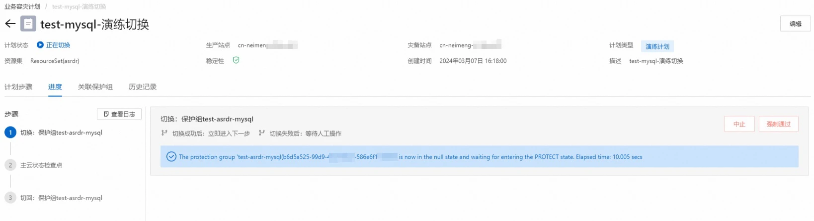

   > **说明**
   >
   > - 演练过程中，单击**中止**，并填写中止原因，将会中止整个演练任务。已中止的任务无法恢复执行，如果还需要执行当前演练任务，需要重新创建演练任务。
   >
   > - 演练过程中，单击**强制通过**，将会跳过当前步骤。

6. 演练完成后，在**历史记录**页签查看演练结果。

   演练概览中展示：

   - 演练成功率：包含**演练成功次数**和**演练总次数**，以及演练成功率百分比。

   - 保护组切换成功率：包含**保护组切换成功数**和**保护组总数**，以及保护组切换成功率百分比。

   - 保护组切回成功率：包含**保护组切回成功数**和**保护组总数**，以及保护组切回成功率百分比。

   - 同步延迟满足率：包含**满足实例数**和**总实例数**，以及同步延迟满足率百分比。

   - 切换时长满足率：包含**满足实例数**和**总实例数**，以及切换时长满足率百分比。

   - 切回时长满足率：包含**满足实例数**和**总实例数**，以及切回时长满足率百分比。

7. 在演练记录**操作**列单击**查看演练总结**。

   > **说明**
   >
   > 已创建报告的演练记录**操作**列，会显示**下载报告**操作。

   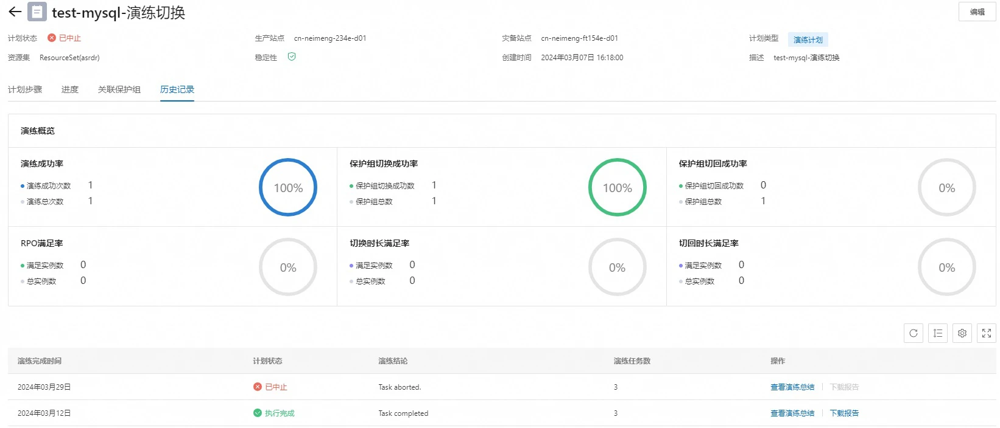

8. 进入**演练总结**页面，根据演练结果，在**演练结论**区域单击**编辑**，填写演练结论。

   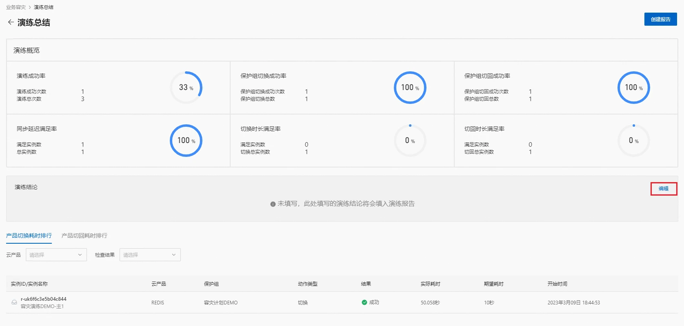

9. 在页面右上角单击**创建报告**，系统自动生成演练报告。单击**下载报告**，导出Word版演练报告。

### 4.1.3. 切回保护组

已执行切换操作并且切换成功的保护组，支持切回。

**前提条件**

已创建好保护组，请参见新建保护组。

**操作步骤**

1. 登录ASR-DR控制台。

2. 在左侧导航栏中选择**业务容灾 > 保护组**。

3. 在**保护组**页面，输入保护组名称，选择同步方向和保护组状态，单击**查询**。

4. 展示符合条件的保护组后，单击**操作**列  ，单击**启动切回**。

5. 在弹出的提示框上选择具体执行的内容：

   - 预检查：可以在不真实启动计划的前提下，对当前计划执行预检查，以便提高真实容灾演练的成功率。

   - 全链路：直接执行切换保护组操作。

6. 单击**确定**。

## 4.2. 执行站点容灾演练

### 4.2.1. 执行站点容灾演练

模拟所有站点设备全部故障需要将所有业务进行切换演练，执行绑定提前创建好的容灾计划，机房切换时会批量执行这些容灾计划。

**前提条件**

已创建容灾计划，请参见创建业务容灾计划。

**操作步骤**

1. 登录异地容灾运维平台。

2. 在左侧导航栏中选择**容灾运维 > 站点容灾演练**。

3. 绑定容灾计划。

   <ol type="i">

   <li>

   单击**绑定容灾计划**。

   </li>

   <li>

   勾选需要执行的演练计划，支持同时选择多个容灾计划。

   </li>

   <li>

   单击**确定**，绑定后的容灾计划将在**站点容灾演练**页面显示。

   </li>

   </ol>

4. 设置执行顺序。

   <ol type="i">

   <li>

   将鼠标放至执行顺序列的数字上，单击  。

   </li>

   <li>

   输入0~9的整数，数字越小执行优先级越高，数字相同的计划将同时执行。

   </li>

   <li>

   单击**确定**。

   </li>

   </ol>

5. 启动切换计划。

   <ol type="i">

   <li>

   单击页面右上角**启动所有切换**。

   </li>

   <li>

   在弹出的提示框上单击**确定**。

   </li>

   <li>

   此时所有计划开始从主到备的切换阶段。

   </li>

   <li>

   所有计划主到备的切换完成后，进入等待回切状态，此时单击**开始切回**，进入从备到主的切回阶段。

   </li>

   <li>

   所有计划从备到主的切回阶段完成后，对应地域的业务恢复正常。

   </li>

   </ol>

**相关操作**

在站点容灾演练页面支持您进行以下操作。

<table>
  <tr>
    <th width="122">任务名称</th>
    <th>操作步骤</th>
  </tr>
  <tr>
    <td>查看计划详情</td>
    <td>1. 单击计划名称，进入<strong>计划详情</strong>页面。 2. 查看该计划的详情。 • 在<strong>计划步骤</strong>页签查看容灾计划的执行步骤。 • 在<strong>进度</strong>页签查看切换进度： • 如果需要通知容灾演练进度，单击<strong>中止</strong>，在弹出的弹框上确认需要中止的任务。 • 如果遇到异常并且不影响演练结果，单击<strong>强制通过</strong>，在弹出的提示框上单击<strong>强</strong><strong>制通过</strong>。 • 在<strong>关联保护组</strong>页签查看该计划关联的保护组，以及每个保护组包含的实例。 • 在<strong>历史记录</strong>页签查看<strong>演练概览</strong>，包括<strong>演练成功率</strong>、<strong>保护组切换成功率</strong>、<strong>保护组切</strong><strong>回成功率</strong>、<strong>PRO满足率</strong>、<strong>切换时长满足率</strong>和<strong>切回时满足率</strong>。</td>
  </tr>
  <tr>
    <td>查看演练总结</td>
    <td>在<strong>计划详情</strong>页面，单击<strong>查看演练总结</strong>。</td>
  </tr>
  <tr>
    <td>下载报告</td>
    <td>在<strong>计划详情</strong>页面，单击<strong>下载报告</strong>，可以将演练报告下载至本地查看。</td>
  </tr>
  <tr>
    <td>解绑容灾计划</td>
    <td>• 批量解除绑定容灾计划 i. 在<strong>站点容灾演练</strong>页面，勾选需要解除绑定的容灾计划。ii. 单击页面下方的解除绑定。iii. 在弹出的提示框上单击<strong>确定</strong>。 • 解除绑定单个容灾计划 i. 在<strong>站点容灾演练</strong>页面，单击<strong>操作</strong>列<strong>解除绑定</strong>。ii. 在弹出的提示框上单击<strong>确定</strong>。</td>
  </tr>
</table>

### 4.2.2. 执行站点灾难恢复

针对真实的站点设备全部故障需要将所有业务进行切换的场景，执行绑定提前创建好的容灾计划，机房切换时会批量执行这些容灾计划。

**前提条件**

已创建容灾计划，请参见创建业务容灾计划。

**操作步骤**

1. 登录异地容灾运维平台。

2. 在左侧导航栏中选择**容灾运维 > 站点灾难恢复**。

3. 绑定容灾计划。

   <ol type="i">

   <li>

   单击**绑定容灾计划**。

   </li>

   <li>

   勾选需要绑定的故障计划，可同时选择多个。

   </li>

   <li>

   单击确定。

   </li>

   </ol>

4. 设置执行顺序。

   <ol type="i">

   <li>

   将鼠标放至执行顺序列的数字上，单击  。

   </li>

   <li>

   输入0~9的整数，数字越小执行优先级越高，数字相同的计划将同时执行。

   </li>

   <li>

   单击**确定**。

   </li>

   </ol>

5. 启动切换计划。

   <ol type="i">

   <li>

   单击页面右上角**启动所有切换**。

   </li>

   <li>

   在弹出的提示框上单击**确定**。

   </li>

   <li>

   此时所有计划开始从主到备的切换阶段。

   </li>

   <li>

   所有计划主到备的切换完成后，进入等待回切状态，此时单击**开始切回**，进入从备到主的切回阶段。

   </li>

   <li>

   所有计划从备到主的切回阶段完成后，对应地域的业务恢复正常。

   </li>

   </ol>

**相关操作**

在站点灾难恢复页面支持您进行以下操作。

<table>
  <tr>
    <th width="122">任务名称</th>
    <th>操作步骤</th>
  </tr>
  <tr>
    <td>查看计划详情</td>
    <td>1. 单击计划名称，进入<strong>计划详情</strong>页面。 2. 查看该计划的详情。 • 在<strong>计划步骤</strong>页签查看容灾计划的执行步骤。 • 在<strong>进度</strong>页签查看切换进度： • 如果需要通知容灾演练进度，单击<strong>中止</strong>，在弹出的弹框上确认需要中止的任务。 • 如果遇到异常并且不影响演练结果，单击<strong>强制通过</strong>，在弹出的提示框上单击<strong>强</strong><strong>制通过</strong>。 • 在<strong>关联保护组</strong>页签查看该计划关联的保护组，以及每个保护组包含的实例。 • 在<strong>历史记录</strong>页签查看<strong>演练概览</strong>，包括<strong>演练成功率</strong>、<strong>保护组切换成功率</strong>、<strong>保护组切</strong><strong>回成功率</strong>、<strong>PRO满足率</strong>、<strong>切换时长满足率</strong>和<strong>切回时满足率</strong>。</td>
  </tr>
  <tr>
    <td>查看演练总结</td>
    <td>在<strong>计划详情</strong>页面，单击<strong>查看演练总结</strong>。</td>
  </tr>
  <tr>
    <td>下载报告</td>
    <td>在<strong>计划详情</strong>页面，单击<strong>下载报告</strong>，可以将演练报告下载至本地查看。</td>
  </tr>
  <tr>
    <td>解绑容灾计划</td>
    <td>• 批量解除绑定容灾计划 i. 在<strong>站点灾难恢复</strong>页面，勾选需要解除绑定的容灾计划。ii. 单击页面下方的解除绑定。iii. 在弹出的提示框上单击<strong>确定</strong>。 • 解除绑定单个容灾计划 i. 在<strong>站点灾难恢复</strong>页面，单击<strong>操作</strong>列<strong>解除绑定</strong>。ii. 在弹出的提示框上单击<strong>确定</strong>。</td>
  </tr>
</table>

# 5.演练后操作

## 5.1. 校验数据一致性

校验在业务级容灾场景中对数据质量问题的排查尤为重要，可以帮助客户实现业务级的对账能力。目前数据一致性校验指南，只支持RDS、DRDS引擎的数据库产品。对存储、中间件、大数据类型产品，由于其数据量大，数据不具备唯一性，一致性校验难度高，业务使用场景上，对这些类型产品的数据准确性要求不敏感，目前暂不支持校验。

**前提条件**

- 数据库产品数据一致性校验依赖DTS产品能力，要求环境中部署DTS。

- 主备数据库要求存在主键。如果主备表无主键，且条数超过10000，会导致校验失败。

- 数据库具备时间戳字段可进行增量数据校验。如果不具备时间戳字段只能进行全量校验。

- 数据校验会对DB进行数据遍历，对DB影响存在一定影响，客户如有需求建议联系TAM和产品侧进行评估后再选择低峰期进行。

**操作步骤**

1. 登录Apsara Uni-manager运维控制台。

2. 在顶部菜单中选择**产品运维 > 数据库运维 > DTS运维**，进入Numen DTS运维平台。

   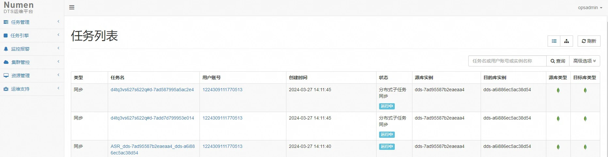

3. 在任务列表查找当前正在同步或故障切换之前的DTS同步任务。

   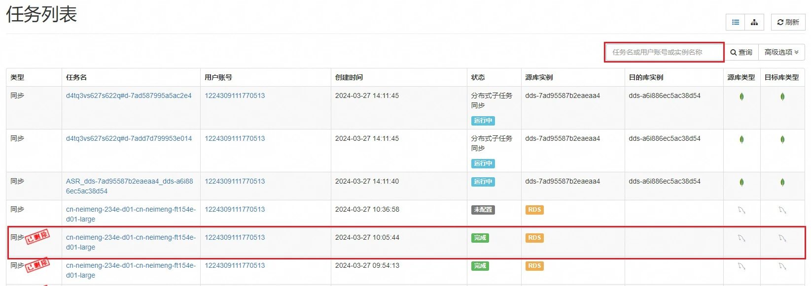

4. 单击任务名进入任务详情中，单击右上角**全量校验**按钮发起校验任务。

   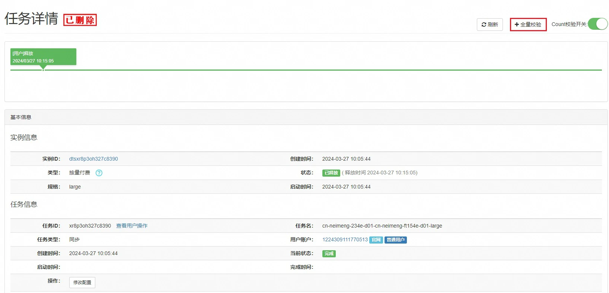

5. 配置一致性校验参数，参数含义见参数说明，一般情况下，我们不需要修改过多的参数。

   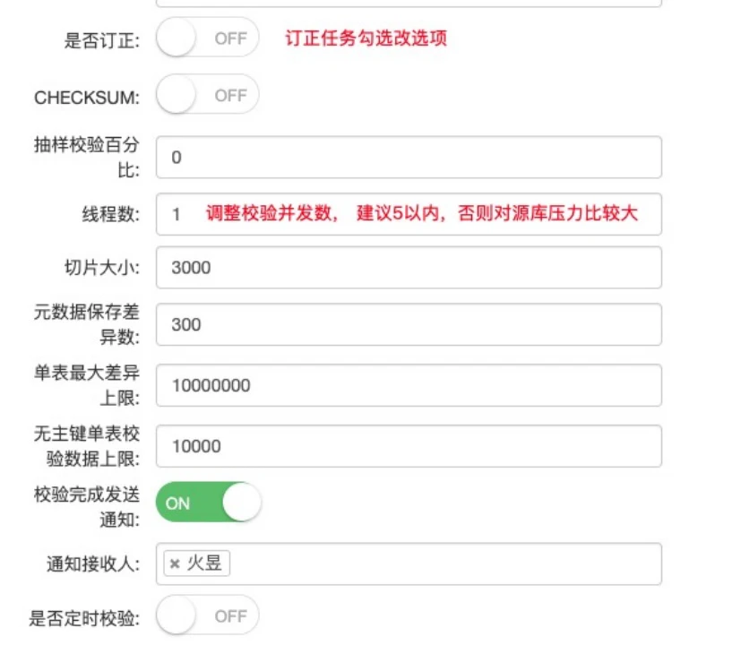

> **说明**
>
> 一般需要生成订正SQL，需要选中“订正选项”；生成的订正SQL是以源端数据为准，在备端执行的SQL，来实现将备端数据订正为与源端一致。但是在发生主备切换后，备端的数据不一定为废弃数据，因此需要我们人工确认恢复哪些数据，不可直接执行生成的SQL语句。

5. 回到NUMEN任务列表，找到刚刚的校验任务，点击校验任务名。

   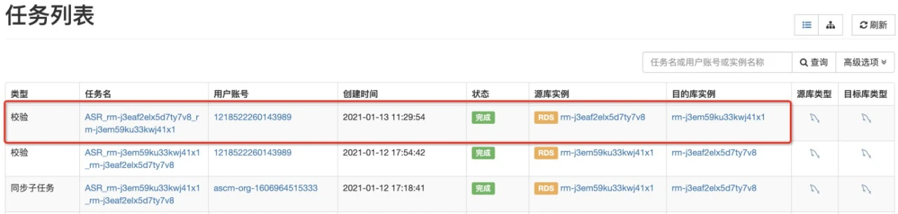

6. 单击【一致性校验】详情，在该任务详情页面，可以看到校验的基本信息。

   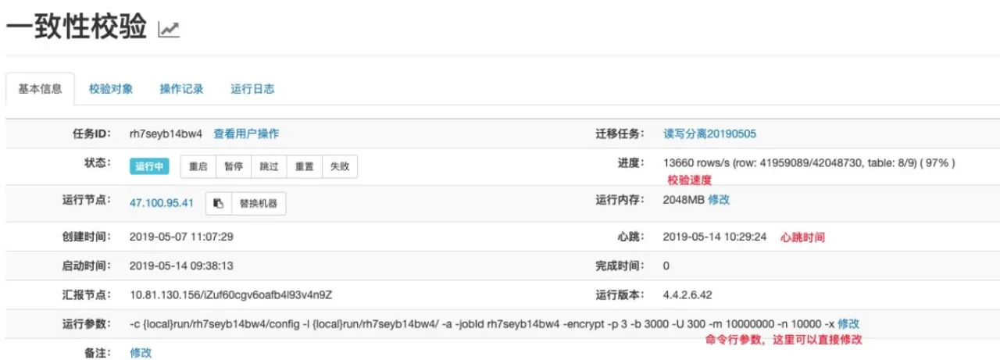

> **说明**
>
> - 【校验对象】标签页可以看到校验的数据库，以及校验结果，是否完成，不同记录的条数以及耗时等。
>
> - 【Diff Row】可以查看源端和目标端不同的记录。

# 6.异常问题处理

介绍在ASR-DR故障时如何修复DNS、云数据库RDS、云数据库MongoDB和云数据库Redis的方法。

## 6.1. ASR-DR故障时如何人工修复DNS

本文主要针对异地容灾演练/故障下，ASR-DR发生故障的应急场景，通过人工切换/回切方式，快速恢复业务。

**操作须知**

容灾切换/回切下的人工介入，会导致整体演练RTO变长，影响业务对外服务的时间。

> **警告**
>
> **该应急预案为通用方案，现场使用需实例化且经过演练后实施。预案无法承诺一定可以解决故障。任何变更都有风险，如果对预案内容有疑惑或遇到非预期情况时请及时提工单或联系CRE（如有CRE服务）获取帮助。阿里驻场技术支持在非故障应急场景时使用此预案务必完成变更申请，如果违反安全生产红线，操作人员及其主管将承担严重后果！**

**问题现象**

- 需要回切操作时，灾备云故障，无法使用ASR-DR。

- 需要切换/回切时，登录备云Apsara Uni-manager运营控制台，在顶部菜单栏选择**产品 > 容灾 > 异地容灾管理平台ASR-DR**，跳转后，出现页面白屏、页面数据显示异常，包含并不限于：页面报错、保护组无法显示、计划无法显示等；页面无法交互，包含并不限于：计划无法启动、计划启动后不运行、计划运行阻塞等。即所有影响容灾切换/回切的情况均属于故障，如下图所示，为页面数据显示异常。

  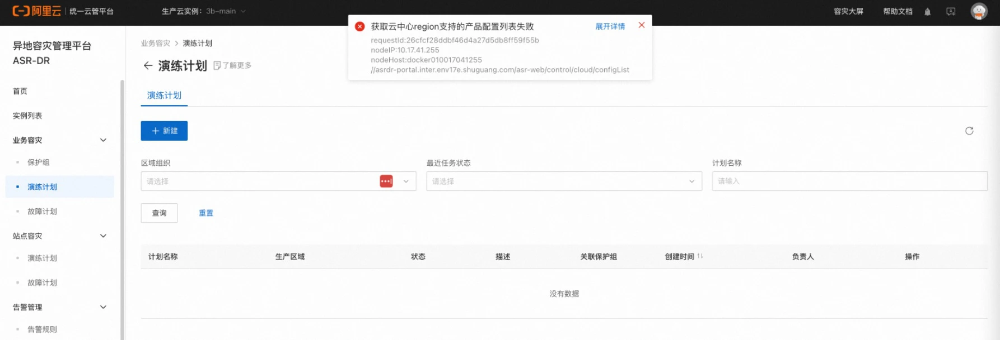

**问题原因**

集群状态未达到终态，出现页面白屏或页面数据显示异常情况后登录备云飞天基础运维平台，选择**产品集群运维**，搜索**asrdr**产品，集群状态为“**未达终态**，且不到终态的组件为asrdr-backend，则说明是ASRDR产品发生不可用故障。如下图所示。

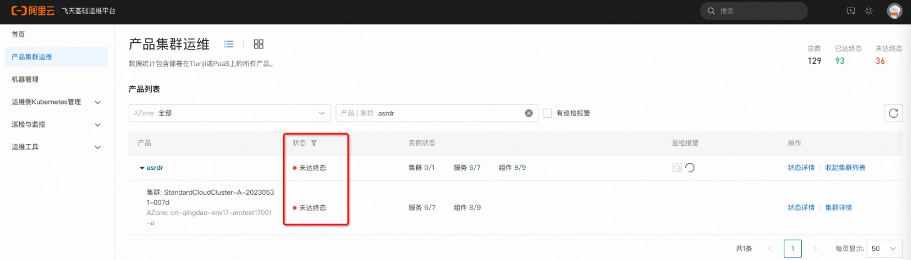

**场景描述**

- 切换场景：指主云出现故障，而备云ASR-DR不可用，需要人工完成主到备的切换。

- 回切场景：指主云容灾演练切换到备云后，备云挂掉了需要人工切回主云。

> **说明**
>
> 这两个场景的操作基本相同，只是操作的云不同，切换场景需要操作备云，回切场景需要操作主云。下面将操作的云称为**目标云**，在人工切换的场景，**目标云**指备云；在人工回切的场景，**目标云**指主云。

**解决方案**

1. 检查环境。

   - 检查ASCM集群终态。

     检查**目标云**上，飞天基础运维平台上ASCM集群已达终态，Apsara Uni-manager运营控制台页面可正常访问。

   - 检查DNS集群终态。

     检查**目标云**上，飞天基础运维平台上DNS集群已达终态，Apsara Uni-manager运营控制台上可正常访问DNS域名。

2. 人工操作步骤。在ASR-DR中，是通过调用跨云DNS OpenAPI来实现切流，故在遇到故障，需人工操作时，只需要登录Apsara Uni-manager运营控制台，在跨云全局域名下，手动修改域名对应解析记录的权重值。

   <ol type="i">

   <li>

   登录**目标云**的Apsara Uni-manager运营控制台，选择**产品 > 网络 > 域名解析DNS（跨云）**。在**跨云全局域名**页面，查询到需要应急操作的DNS域名，单击**操作**列下的**解析配置**，进入解析记录列表。

   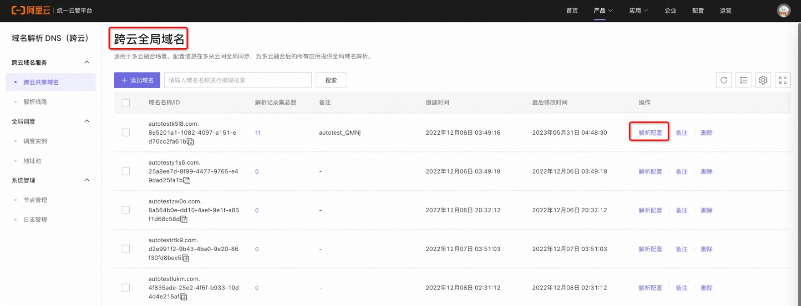

   </li>

   <li>

   进入解析记录列表的管理界面，对需要订正的容灾记录名称，单击**操作**列下的**修改**。

   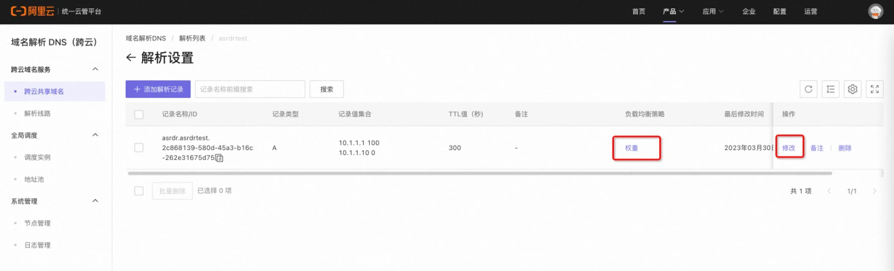

   > **说明**
   >
   > 容灾的解析记录“负载均衡策略”一定是“权重”。

   </li>

   <li>

   进入**修改解析记录**，选择**解析线路**，修改**记录值集合**中的**权重**，将100和0进行对调。

   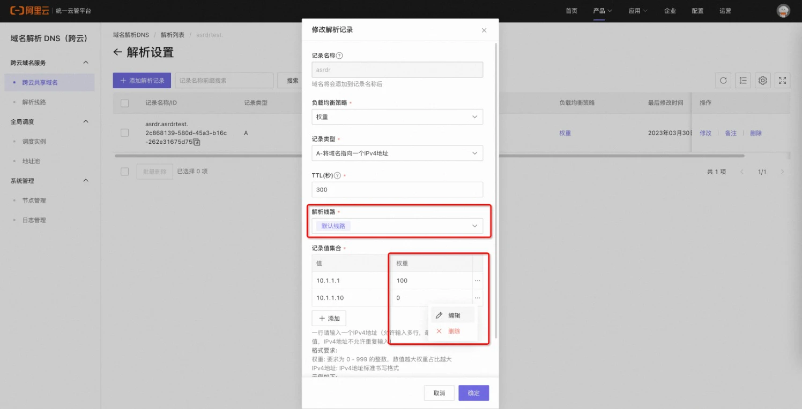

   </li>

   </ol>

3. 验证结果：通过云外或ECS内访问该域名，可正常解析，解析记录为权重为100的值。

## 6.2. ASR-DR故障时如何人工修复云数据库RDS

本文主要针对异地容灾演练/故障下，ASR-DR发生故障的应急场景，通过人工切换/回切方式，快速恢复业务。

**操作须知**

容灾切换/回切下的人工介入，会导致整体演练RTO变长，影响业务对外服务的时间。

> **警告**
>
> **该应急预案为通用方案，现场使用需实例化且经过演练后实施。预案无法承诺一定可以解决故障。任何变更都有风险，如果对预案内容有疑惑或遇到非预期情况时请及时提工单或联系CRE（如有CRE服务）获取帮助。阿里驻场技术支持在非故障应急场景时使用此预案务必完成变更申请，如果违反安全生产红线，操作人员及其主管将承担严重后果！**

**问题现象**

- 需要回切操作时，灾备云故障，无法使用ASR-DR。

- 需要切换/回切时，登录备云Apsara Uni-manager运营控制台，在顶部菜单栏选择**产品 > 容灾 > 异地容灾管理平台ASR-DR**，跳转后，出现页面白屏、页面数据显示异常，包含并不限于：页面报错、保护组无法显示、计划无法显示等；页面无法交互，包含并不限于：计划无法启动、计划启动后不运行、计划运行阻塞等。即所有影响容灾切换/回切的情况均属于故障，如下图所示，为页面数据显示异常。

  

**问题原因**

集群状态未达到终态，出现页面白屏或页面数据显示异常情况后登录备云飞天基础运维平台，选择**产品集群运维**，搜索**asrdr**产品，集群状态为“**未达终态**，且不到终态的组件为asrdr-backend，则说明是ASRDR产品发生不可用故障。如下图所示。

**场景描述**

- 切换场景：指主云出现故障，而备云ASR-DR不可用，需要人工完成主到备的切换。

- 回切场景：指主云容灾演练切换到备云后，备云挂掉了需要人工切回主云。

> **说明**
>
> 这两个场景的操作基本相同，只是操作的云不同，切换场景需要操作备云，回切场景需要操作主云。下面将操作的云称为**目标云**，在人工切换的场景，**目标云**指备云；在人工回切的场景，**目标云**指主云。

**解决方案**

1. 检查环境。

   - 检查ASCM集群终态：检查**目标云**上，飞天基础运维平台上ASCM集群已达终态，Apsara Uni-manager运营控制台页面可正常访问。

   - 检查RDS YaoChi终态：检查目标云上，飞天基础运维平台上RDS集群已达终态，Apsara Uni-manager运营控制台上可正常访问RDS实例。

2. 人工操作步骤。

   <ol type="i">

   <li>

   登录**目标云**的Apsara Uni-manager运营控制台，选择**产品 > 数据库 > 云数据库RDS**。在**实例列表**页面，查询到需要应急操作的RDS实例信息，单击实例ID进入实例详情。

   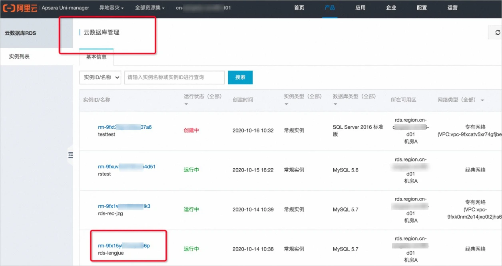

   </li>

   <li>

   在左侧导航栏，单击**账号管理**，进入容灾RDS实例的账号管理界面，选择业务需要使用的账号。

   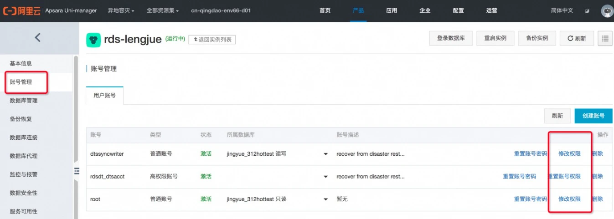

   </li>

   <li>

   单击**操作**列下的**修改权限**，选择**读写**权限，单击**确定**恢复账号读写权限。

   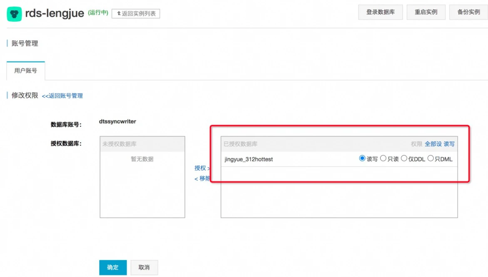

   </li>

   </ol>

3. 验证结果：人工检查**目标端**该实例可接收数据写入，即完成验证。

## 6.3. ASR-DR故障时如何人工修复云数据库MongoDB

本文主要针对异地容灾演练/故障下，ASR-DR发生故障的应急场景，通过人工切换/回切方式，快速恢复业务。

**操作须知**

容灾切换/回切下的人工介入，会导致整体演练RTO变长，影响业务对外服务的时间。

> **警告**
>
> **该应急预案为通用方案，现场使用需实例化且经过演练后实施。预案无法承诺一定可以解决故障。任何变更都有风险，如果对预案内容有疑惑或遇到非预期情况时请及时提工单或联系CRE（如有CRE服务）获取帮助。阿里驻场技术支持在非故障应急场景时使用此预案务必完成变更申请，如果违反安全生产红线，操作人员及其主管将承担严重后果！**

**问题现象**

- 需要回切操作时，灾备云故障，无法使用ASR-DR。

- 需要切换/回切时，登录备云Apsara Uni-manager运营控制台，在顶部菜单栏选择**产品 > 容灾 > 异地容灾管理平台ASR-DR**，跳转后，出现页面白屏、页面数据显示异常，包含并不限于：页面报错、保护组无法显示、计划无法显示等；页面无法交互，包含并不限于：计划无法启动、计划启动后不运行、计划运行阻塞等。即所有影响容灾切换/回切的情况均属于故障，如下图所示，为页面数据显示异常。

  

**问题原因**

集群状态未达到终态，出现页面白屏或页面数据显示异常情况后登录备云飞天基础运维平台，选择**产品集群运维**，搜索**asrdr**产品，集群状态为“**未达终态**，且不到终态的组件为asrdr-backend，则说明是ASRDR产品发生不可用故障。如下图所示。

**场景描述**

- 切换场景：指主云出现故障，而备云ASR-DR不可用，需要人工完成主到备的切换。

- 回切场景：指主云容灾演练切换到备云后，备云挂掉了需要人工切回主云。

> **说明**
>
> 这两个场景的操作基本相同，只是操作的云不同，切换场景需要操作备云，回切场景需要操作主云。下面将操作的云称为**目标云**，在人工切换的场景，**目标云**指备云；在人工回切的场景，**目标云**指主云。

**解决方案**

1. 检查环境。

   - 检查ASCM集群终态：检查**目标云**上，飞天基础运维平台上ASCM集群已达终态，Apsara Uni-manager运营控制台页面可正常访问。

   - 检查MongoDB集群终态：检查**目标云**上，飞天基础运维平台上MongoDB集群已达终态，Apsara Uni-manager运营控制台上课正常访问MongoDB实例。

2. 人工操作步骤。

   <ol type="i">

   <li>

   选择容灾实例：登录**目标云**的Apsara Uni-manager运营控制台，选择**产品 > 数据库 > 云数据库MongoDB**。在**副本集实例列表**页面，查询到需要应急操作的MongoDB实例信息，单击实例ID进入实例详情。

   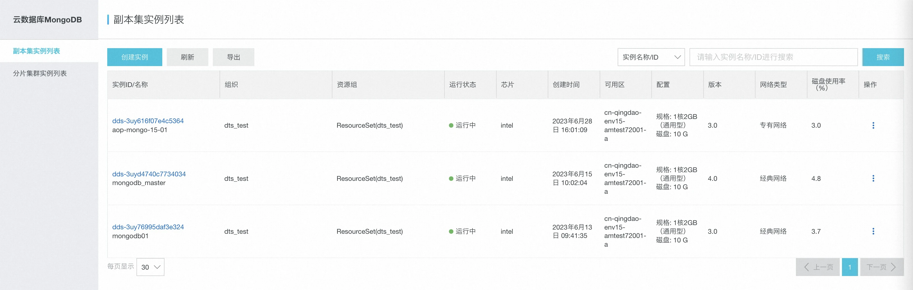

   </li>

   <li>

   在左侧导航栏单击**账号管理**，进入容灾MongoDB实例的账号管理界面，确认需要修改权限的业务账号和其所处的数据库，单击右上角的**登录数据库**。

   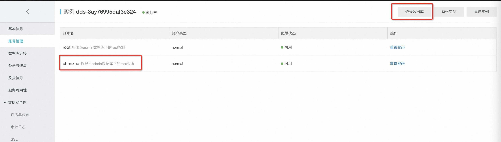

   </li>

   <li>

   使用**root**账号登录数据库，在左侧导航栏选择业务账号所在的数据库，输入 `db.grantRolesToUser("chenxue", [{role: "readWrite", db: "chenxuedb"}]);` SQL语句，用于赋予业务账号test对数据库testdb的权限为读写，现场需要按实际的账号和数据库做修改，最后单击左上角的**执行(F8)**。

   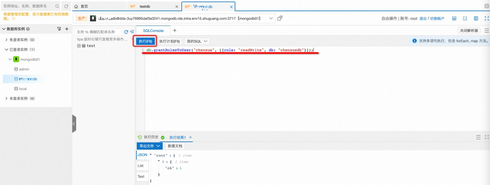

   </li>

   </ol>

3. 验证结果：人工检查**目标端**该实例可接收数据写入，即完成验证。

## 6.4. 订正数据

数据订正在业务级容灾场景中，对数据质量恢复尤为重要。数据一致性校验是订正的前提，但不能完全依靠数据一致性来恢复数据。由于数据一致性校验只支持RDS、DRDS引擎的数据库产品。所以数据订正也只支持上述产品，其他产品类型目前暂不支持订正。

> **重要**
>
> - 数据订正必须要求客户侧业务应用支持对账能力，才能保证恢复数据的准确性。
>
> - 数据订正要求客户、业务负责人、DBA、运维人员共同参与进行。

> **说明**
>
> OSS容灾采用双向同步链路，object以最新时间为准，从应用场景来看，一般不需要订正。

**前提条件**

- 完成数据一致性校验，并取得差异结果。

- 客户业务具备对账能力，可通过日志等方式，确定数据正确性。

**操作步骤**

1. 基于差异结果，通过业务对账，选取差异数据中的正确值。

2. 将差异结果中正确值修改为订正SQL。

3. 停止应用，避免写入流量进入，执行订正SQL。

4. 启动应用，验证订正结果。

## 6.5. ASR-DR故障时如何人工修复云数据库Redis

本文主要针对异地容灾容灾演练/故障下，ASR-DR发生故障的应急场景，通过人工切换/回切方式，快速恢复业务。

**操作须知**

容灾切换/回切下的人工介入，会导致整体演练RTO变长，影响业务对外服务的时间。

> **警告**
>
> **该应急预案为通用方案，现场使用需实例化且经过演练后实施。预案无法承诺一定可以解决故障。任何变更都有风险，如果对预案内容有疑惑或遇到非预期情况时请及时提工单或联系CRE（如有CRE服务）获取帮助。阿里驻场技术支持在非故障应急场景时使用此预案务必完成变更申请，如果违反安全生产红线，操作人员及其主管将承担严重后果！**

**问题现象**

- 需要回切操作时，灾备云故障，无法使用ASR-DR。

- 需要切换/回切时，登录备云Apsara Uni-manager运营控制台，在顶部菜单栏选择**产品 > 容灾 > 异地容灾管理平台ASR-DR**，跳转后，出现页面白屏、页面数据显示异常，包含并不限于：页面报错、保护组无法显示、计划无法显示等；页面无法交互，包含并不限于：计划无法启动、计划启动后不运行、计划运行阻塞等。即所有影响容灾切换/回切的情况均属于故障，如下图所示，为页面数据显示异常。

  

**问题原因**

集群状态未达到终态，出现页面白屏或页面数据显示异常情况后登录备云飞天基础运维平台，选择**产品集群运维**，搜索**asrdr**产品，集群状态为“**未达终态**，且不到终态的组件为asrdr-backend，则说明是ASRDR产品发生不可用故障。如下图所示。

**场景描述**

- 切换场景：指主云出现故障，而备云ASR-DR不可用，需要人工完成主到备的切换。

- 回切场景：指主云容灾演练切换到备云后，备云挂掉了需要人工切回主云。

> **说明**
>
> 这两个场景的操作基本相同，只是操作的云不同，切换场景需要操作备云，回切场景需要操作主云。下面将操作的云称为**目标云**，在人工切换的场景，**目标云**指备云；在人工回切的场景，**目标云**指主云。

**解决方案**

1. 检查环境。

   - 检查ASCM集群终态：检查**目标云**上，飞天基础运维平台上ASCM集群已达终态，Apsara Uni-manager运营控制台页面可正常访问。

   - 检查Redis集群终态：检查**目标云**上，飞天基础运维平台上Redis集群已达终态，Apsara Uni-manager运营控制台上可正常访问Redis实例。

2. 人工操作步骤。

   <ol type="i">

   <li>

   选择容灾实例：登录**目标云**的Apsara Uni-manager运营控制台，选择**产品 > 数据库 > 云数据库Redis**。在**实例列表**页面，查询到需要应急操作的Redis实例信息，单击实例ID进入实例详情。

   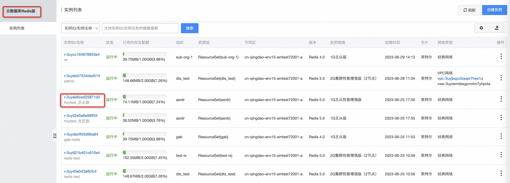

   </li>

   <li>

   在左侧导航栏，单击**账号管理**，进入容灾Redis实例的账号管理界面，选择需要业务使用的账号。

   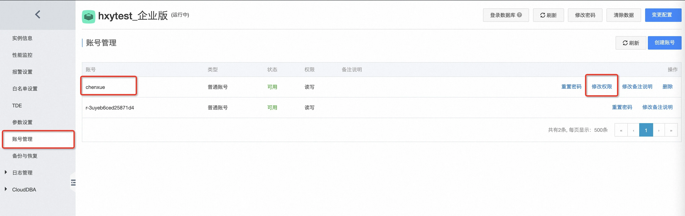

   </li>

   <li>

   单击**操作**列下的**修改权限**，选择**读写**权限，单击**确定**恢复账号读写权限。

   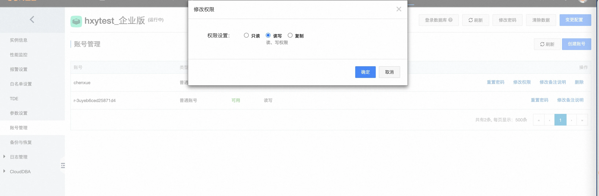

   </li>

   </ol>

3. 验证结果：人工检查**目标端**该实例可接收数据写入，即完成验证。
