阿里云  
专有云飞天企业版  
灾备管理中心  
机房搬迁（同城容灾）  
产品版本：v3.18.3  
文档版本：20250320

**目录**

- [1.概述](#section-1)
- [2.限制条件](#section-2)
- [3.机房搬迁支持列表](#section-3)
- [4.机房搬迁影响](#section-4)
    - [4.1. 对生产业务的主要影响](#section-4-1)
    - [4.2. 对业务连续性的影响](#section-4-2)
    - [4.3. 其它影响](#section-4-3)
- [5.流程概览](#section-5)
- [6.搬迁前准备](#section-6)
    - [6.1. 容灾演练Precheck list](#section-6-1)
        - [6.1.1. 管控信息](#section-6-1-1)
        - [6.1.2. 基础设施](#section-6-1-2)
        - [6.1.3. 业务应用](#section-6-1-3)
        - [6.1.4. 云产品](#section-6-1-4)
    - [6.2. 机房搬迁Precheck list](#section-6-2)
        - [6.2.1. 运维侧](#section-6-2-1)
        - [6.2.2. 方案侧](#section-6-2-2)
- [7.现场实施](#section-7)
    - [7.1. 业务和应用迁移](#section-7-1)
    - [7.2. 云产品前置操作](#section-7-2)
    - [7.3. 网络操作](#section-7-3)
    - [7.4. 搬迁机房关机和下电](#section-7-4)
    - [7.5. 搬迁机房上电和开机](#section-7-5)
    - [7.6. 云产品后置操作](#section-7-6)
    - [7.7. 搬迁机房网络恢复](#section-7-7)
- [8.云产品操作方案](#section-8)
    - [8.1. RDS](#section-8-1)
        - [8.1.1. RDS关闭和开启可用区对齐方案](#section-8-1-1)
        - [8.1.2. RDS获取Aurora托管实例的方法](#section-8-1-2)
        - [8.1.3. RDS单扩双](#section-8-1-3)
        - [8.1.4. RDS双变单](#section-8-1-4)
    - [8.2. MiniRDS](#section-8-2)
        - [8.2.1. MiniRDS关闭和开启可用区对齐方案](#section-8-2-1)
        - [8.2.2. dbaas_db库访问方法](#section-8-2-2)
        - [8.2.3. MiniRDS双变单](#section-8-2-3)
        - [8.2.4. MiniRDS单变双](#section-8-2-4)
    - [8.3. PolarDB-X](#section-8-3)
        - [8.3.1. PolarDB-X单扩双](#section-8-3-1)
        - [8.3.2. PolarDB-X双变单](#section-8-3-2)
    - [8.4. DTS](#section-8-4)
    - [8.5. TableStore & TableStoreInner](#section-8-5)
        - [8.5.1. 关闭自动建立主备](#section-8-5-1)
        - [8.5.2. 去除同步关系和链路](#section-8-5-2)
        - [8.5.3. 清理备集群数据](#section-8-5-3)
        - [8.5.4. 恢复主备同步](#section-8-5-4)
        - [8.5.5. V3.14版本TableStoreInner关闭自动建立主备功能](#section-8-5-5)
    - [8.6. OSS](#section-8-6)
        - [8.6.1. 删除同步边、备集群数据](#section-8-6-1)
        - [8.6.2. 恢复主备同步](#section-8-6-2)
    - [8.7. DNCS](#section-8-7)
        - [8.7.1. 删除和恢复VIP背后的RealServer](#section-8-7-1)
        - [8.7.2. 集群7节点变4节点方法](#section-8-7-2)
    - [8.8. MQ](#section-8-8)
        - [8.8.1. 查询broker（master+slave）一致性状态](#section-8-8-1)
        - [8.8.2. MQ broker非一致性状态恢复方案](#section-8-8-2)
    - [8.9. MaxCompute](#section-8-9)
        - [8.9.1. 创建双AZ项目并开启主备同步](#section-8-9-1)
    - [8.10. OPSDNS](#section-8-10)
- [9.附录](#section-9)
    - [9.1. 交换机逻辑](#section-9-1)
    - [9.2. 机房下电方案](#section-9-2)
        - [9.2.1. 关闭天基权限认证](#section-9-2-1)
        - [9.2.2. 带外网络检查](#section-9-2-2)
        - [9.2.3. 关闭其他云产品集群](#section-9-2-3)
        - [9.2.4. 关闭slb集群](#section-9-2-4)
        - [9.2.5. 关闭minirds-mt集群](#section-9-2-5)
        - [9.2.6. 关闭tianji集群](#section-9-2-6)
    - [9.3. 机房上电方案](#section-9-3)
        - [9.3.1. 开启tianji集群](#section-9-3-1)
        - [9.3.2. 开启minirds-mt集群](#section-9-3-2)
        - [9.3.3. 开启slb集群](#section-9-3-3)
        - [9.3.4. 开启其它云产品集群](#section-9-3-4)
        - [9.3.5. 开机异常问题处理（可选）](#section-9-3-5)
        - [9.3.6. 开启天基权限认证](#section-9-3-6)
        - [9.3.7. SLB_LVS上下线方案](#section-9-3-7)
    - [9.4. 登录容器](#section-9-4)
    - [9.5. 登录oss_meta数据库](#section-9-5)
    - [9.6. 登录houyi-reg数据库](#section-9-6)

<a id="section-1"></a>

# 1.概述

本文介绍机房搬迁的概念以及四种搬迁场景。

机房搬迁是指将阿里云专有云在主机房或者备机房内部的全部IT设施（主要指服务器和交换机），从老的物理位置搬迁至新的物理位置的过程。主要包含前置操作、机房下电、物理运输、机房上电、后置操作等阶段。机房搬迁过程中，尽可能降低对客户业务应用的影响，保障数据的完整性、一致性。

> **说明**
>
> 本文中部分操作需要在同城容灾管理平台ASR上操作，后续简称ASR控制台。

**机房搬迁场景**

机房的倒换与搬迁相组合，有如下四种场景：

> **说明**
>
> 为了表述清晰，同城双机房用A/B机房描述，A机房为当前主机房，B机房为当前备机房。

- 场景1：搬迁A机房（当前主机房），搬迁后B机房是主机房。

  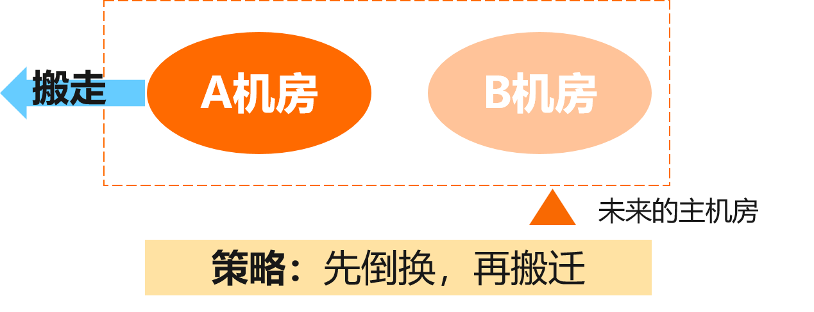

- 场景2：搬迁A机房（当前主机房），搬迁后A机房还是主机房。

  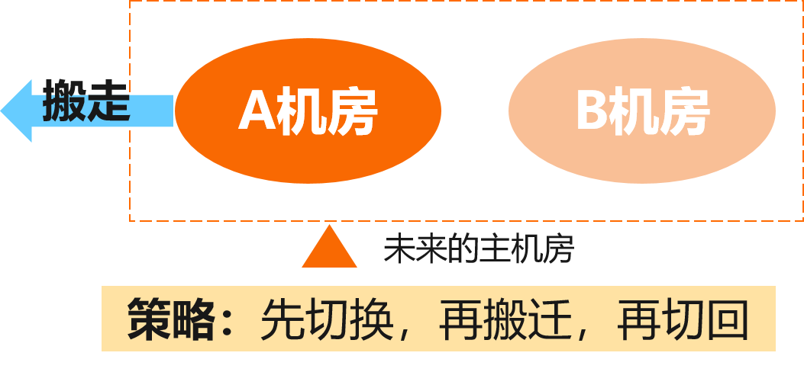

- 场景3：搬迁B机房（当前备机房），搬迁后A机房还是主机房。

  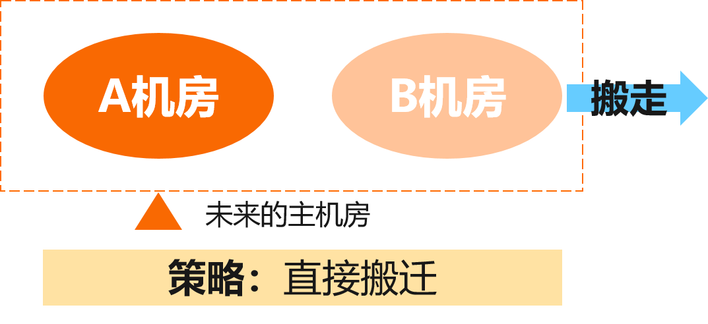

- 场景4：搬迁B机房（当前备机房），搬迁后B机房是主机房。

  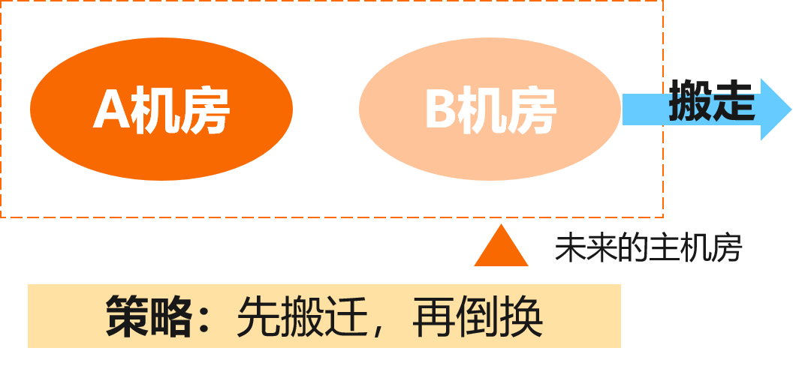

<strong>总结：</strong>除了场景2，其他场景都是搬迁备机房，留存主机房。

<a id="section-2"></a>

# 2.限制条件

本文介绍机房搬迁的限制条件和要求。

机房搬迁有如下限制和要求：

- 用户局点所有云产品均已升级到企业版V3.18.1版本，且云产品包含在机房搬迁的支持列表中，详细信息请参见机房搬迁支持列表。

- 用户局点所有云产品均已完成容灾建设，包括：

  - 支持同城容灾。

  - Feature对等部署。

  - 完成机房A-A'。

- 机房搬迁前后，阿里云专有云的网络规划（含设备IP地址）和云产品配置须保持不变，否则搬迁机房在新的物理位置重新上电之后，无法与留存机房恢复同城容灾的主备关系。

- 在机房搬迁的整个过程中，包括前置操作、物理搬迁、后置操作等阶段，请勿进行增量部署、热升级（包含hotfix）与扩缩容操作。

- 留存机房RDS集群磁盘空间充裕。

- 搬迁后同城容灾双机房，不支持回退非容灾单机房。

- 不支持直接将新的机房接入双机房同城容灾专有云。

- 机房搬迁前，防止由于仲裁开启导致的自动切换情况发生，请在同城容灾管理平台的仲裁管理页面手动关闭仲裁功能。

> **重要**
>
> 如果有用户局点需要在企业版V3.16.0、V3.16.2版本实施机房搬迁，搬迁前请务必联系阿里云专有云同城容灾团队进行评估。

<a id="section-3"></a>

# 3.机房搬迁支持列表

本文介绍机房搬迁支持的云产品和组件。

支持机房搬迁的云产品和组件列表如下：

- **on TianJi**

  <table>
    <tr>
      <th width="90">分类</th>
      <th>云产品</th>
    </tr>
    <tr>
      <td>弹性计算</td>
      <td>• 云服务器ECS<br>• 容器镜像服务ACR<br>• 容器服务ACK<br>• 容器服务ACS</td>
    </tr>
    <tr>
      <td>云平台</td>
      <td>• Apsara Uni-Manager混合云管理平台（ASCM）<br>• Apsara Uni-Manager运维控制台（ASO）<br>• 飞天基础运维平台TianJi<br>• SRE技术保障平台（铜雀）</td>
    </tr>
    <tr>
      <td>数据库</td>
      <td>• 数据传输DTS<br>• 云数据库RDS MySQL版<br>• 云原生分布式数据库PolarDB-X1.0（原DRDS）<br>• 云数据库OceanBase<br>• 数据管理DMS<br>• 数据库自治服务DAS<br>• 云数据库MongoDB版<br>• 多模数据库Lindorm<br>• 云数据库HBase版</td>
    </tr>
    <tr>
      <td>存储</td>
      <td>• 对象存储OSS<br>• 表格存储Tablestore<br>• 混合云存储CDS-EBS<br>• 混合云存储CDS-OSS<br>• 混合云存储CDS-SLS</td>
    </tr>
    <tr>
      <td>网络</td>
      <td>• 负载均衡SLB<br>• 专有网络VPC<br>• 云解析DNS</td>
    </tr>
    <tr>
      <td>应用服务</td>
      <td>• API网关（API Gateway）<br>• 日志服务SLS</td>
    </tr>
    <tr>
      <td>大数据</td>
      <td>• 大数据管家ABM<br>• 大数据开发治理平台DataWorks<br>• 大数据计算MaxCompute<br>• 数据总线DataHub<br>• 实时计算Blink<br>• 阿里云Elasticsearch</td>
    </tr>
    <tr>
      <td>安全</td>
      <td>• 密钥管理KMS<br>• 云盾base<br>• 云盾态势感知<br>• 云盾流量安全监控<br>• 云盾WAF<br>• 云盾安骑士</td>
    </tr>
    <tr>
      <td>中间件</td>
      <td>• 中间件日志Tlog<br>• 云服务总线CSB<br>• 分布式调度平台SchedulerX<br>• 消息队列MQ<br>• 消息队列Kafka版</td>
    </tr>
    <tr>
      <td>监控</td>
      <td>• 应用实时监控服务ARMS</td>
    </tr>
  </table>

  <table>
    <tr>
      <td colspan="3">组件</td>
    </tr>
    <tr>
      <td>middleware-dncs</td>
      <td>minirds-mt</td>
      <td>Xnet2</td>
    </tr>
    <tr>
      <td>aliware-taokeeper</td>
      <td>middleWareAll</td>
      <td>opsapi</td>
    </tr>
    <tr>
      <td>baseServiceAll</td>
      <td>dms-enterprise</td>
      <td>oneconsole</td>
    </tr>
    <tr>
      <td>webAppAll</td>
      <td>dauth</td>
      <td>bcmc</td>
    </tr>
    <tr>
      <td>dnsProduct</td>
      <td>yundun-advance</td>
      <td>network</td>
    </tr>
    <tr>
      <td>yundun-common</td>
      <td>base</td>
      <td>asa</td>
    </tr>
    <tr>
      <td>hardware</td>
      <td>-</td>
      <td>-</td>
    </tr>
  </table>

- **on PaaS**

  | 分类 | 云产品 |
  | --- | --- |
  | 数据库 | 云数据库Redis |
  | 中间件 | 企业级分布式应用EDAS |
  | 大数据 | 大数据管家ABM |

  **组件**

  PaaS底座，包括ark、tianji-provider、cluster-init、traits。

  middleWare-staragent，TianjiMon

  > **说明**
  >
  > 3.18.0版本新增支持搬迁云产品包括Elasticsearch、消息队列Kafka版、云数据库 MongoDB版、多模数据库Lindorm、云数据库HBase版、云服务定义存储CDS_EBS、CDS_OSS和CDS_SLS。

<a id="section-4"></a>

# 4.机房搬迁影响

<a id="section-4-1"></a>

## 4.1. 对生产业务的主要影响

本文介绍机房搬迁在不同阶段对核心云产品的主要影响。

> **说明**
>
> 机房搬迁对于大部分双活形态部署的云产品的生产业务无影响，一般无需进行操作。

**阶段**

**云产品**

**主要影响**

**说明**

- 单实例切换到备机房，

  切换时，为了保证数据一

  连接秒级中断，应用重

  致性行，主库处于禁写状

  连可恢复。

云数据库RDS/Redis

态，访问中断时间大约

- 双变单之后，留存机房

  30s。

  磁盘水位升高。

  OSS：切换不需要停止服务，只是将OSS前端机的域名重新绑定到目标机房的VIP；切换过程由于域名

访问OSS出现秒级中断，

和链路进行切换，ECS有

对象存储OSS

重新连接可恢复。

域名缓存，因此OSS访问会中断10-30s；非容灾bucket会从备机房跨机房访问，增加跨机房流量和访问延迟。

Tablestore：切换需要停止原机房的写入，比较数

访问Tablestore出现秒级

前置操作过程中的主备切

表格存储Tablestore

据一致性后才进行切换；

中断，重新连接可恢复。

换

正常情况下中断时间在10s~30s。

部分消息发送超时，30-

消息队列MQ

-

60秒后自动恢复。

切换期间无法发布或管理

企业级分布式应用服务

应用，对已发布的应用运

-

EDAS

行无影响。

Tianji、DNS、MiniRDS、middleware

云平台底座

-

等，切换时底座部分管控功能受影响。

<table>
  <tr>
    <td>搬迁机房下电过程中</td>
    <td>负载均衡SLB</td>
    <td>SLB API有10-20秒短暂中断，会自动恢复。</td>
    <td>VIP感知到背后的RealServer下线之后，进行流量切换，这个过程需要时间。</td>
  </tr>
  <tr>
    <td rowspan="3">搬迁机房下电之后</td>
    <td>消息队列MQ</td>
    <td>• 不能删除实例、topic、group。<br>• 留存机房负载增加一倍。</td>
    <td>-</td>
  </tr>
  <tr>
    <td>数据传输DTS</td>
    <td>• DTS上面的任务，需要手工重启（点击重启按钮），这样同步任务会被安排到留存机房内部的节点上去继续运行。<br>• 由于任务均切换至留存机房，留存机房DTS的工作负载加大。</td>
    <td>-</td>
  </tr>
  <tr>
    <td>云数据库RDS</td>
    <td>• 对于双机房集群，一个机房下电之后，另外一个机房不允许新建RDS实例。<br>• 对于单机房集群，可以继续新建RDS实例。<br>• 由于实例的双变单操作，留存机房RDS集群的水位上升一倍。</td>
    <td>-</td>
  </tr>
  <tr>
    <td rowspan="2">搬迁机房上电之后</td>
    <td>对象存储OSS</td>
    <td>需要全量主备同步。</td>
    <td>可以将bucket逐批次开启主备同步。</td>
  </tr>
  <tr>
    <td>表格存储Tablestore</td>
    <td>需要全量主备同步。</td>
    <td>无法实例级别开启主备同步，只能集群级别。主备同步之间有限流5Gb/s。</td>
  </tr>
</table>

<a id="section-4-2"></a>

## 4.2. 对业务连续性的影响

本文介绍机房搬迁对核心云产品和组件业务连续性的影响。

> **说明**
>
> 机房搬迁对于大部分双活形态部署的云产品的生产业务无影响，一般无需进行操作。

<table>
  <tr>
    <th rowspan="2">云产品</th>
    <th colspan="3">业务连续性</th>
  </tr>
  <tr>
    <td>主备切换</td>
    <td>前置操作</td>
    <td>后置操作</td>
  </tr>
  <tr>
    <td>云数据库RDS</td>
    <td>秒级影响</td>
    <td>无影响</td>
    <td>无影响</td>
  </tr>
  <tr>
    <td>云数据库Redis版</td>
    <td>秒级影响</td>
    <td>无影响</td>
    <td>无影响</td>
  </tr>
  <tr>
    <td>负载均衡SLB</td>
    <td>秒级影响</td>
    <td>无影响</td>
    <td>无影响</td>
  </tr>
  <tr>
    <td>专有网络VPC</td>
    <td>不涉及</td>
    <td>不涉及</td>
    <td>不涉及</td>
  </tr>
  <tr>
    <td>云服务器ECS</td>
    <td>不涉及</td>
    <td>无影响</td>
    <td>无影响</td>
  </tr>
  <tr>
    <td>对象存储OSS</td>
    <td>秒级影响</td>
    <td>无影响</td>
    <td>无影响</td>
  </tr>
  <tr>
    <td>表格存储Tablestore</td>
    <td>秒级影响</td>
    <td>无影响</td>
    <td>无影响</td>
  </tr>
  <tr>
    <td>消息队列MQ</td>
    <td>部分消息发送超时，30-60秒后自动恢复</td>
    <td>无影响</td>
    <td>无影响</td>
  </tr>
  <tr>
    <td>云原生分布式数据库PolarDB-X1.0（原DRDS）</td>
    <td>不涉及</td>
    <td>无影响</td>
    <td>无影响</td>
  </tr>
  <tr>
    <td>企业级分布式应用服务EDAS</td>
    <td>切换期间无法发布或管理应用，对已发布的应用运行无影响</td>
    <td>不涉及</td>
    <td>不涉及</td>
  </tr>
  <tr>
    <td>数据传输DTS</td>
    <td>不涉及</td>
    <td>无影响</td>
    <td>无影响</td>
  </tr>
  <tr>
    <td>分布式网络控制系统DNCS</td>
    <td>无影响</td>
    <td>无影响</td>
    <td>无影响</td>
  </tr>
  <tr>
    <td>大数据计算MaxCompute</td>
    <td>无影响</td>
    <td>无影响</td>
    <td>无影响</td>
  </tr>
</table>

<table>
  <tr>
    <th rowspan="2">组件</th>
    <th colspan="3">业务连续性</th>
  </tr>
  <tr>
    <td>主备切换</td>
    <td>前置操作</td>
    <td>后置操作</td>
  </tr>
  <tr>
    <td>aliware-taokeeper</td>
    <td>强切过程中有分钟级影响</td>
    <td>无影响</td>
    <td>无影响</td>
  </tr>
  <tr>
    <td>minirds-mt</td>
    <td>无影响</td>
    <td>无影响</td>
    <td>无影响</td>
  </tr>
  <tr>
    <td>opsdns</td>
    <td>无影响</td>
    <td>无影响</td>
    <td>无影响</td>
  </tr>
</table>

<a id="section-4-3"></a>

## 4.3. 其它影响

本文介绍搬迁机房上下电后对于云产品的影响。

> **说明**
>
> 机房搬迁对于大部分双活形态部署的云产品的生产业务无影响，一般无需进行操作。

<table>
  <tr>
    <th rowspan="2">云产品</th>
    <th colspan="2">影响</th>
  </tr>
  <tr>
    <td>搬迁机房下电之后</td>
    <td>搬迁机房上电之后</td>
  </tr>
  <tr>
    <td>消息队列MQ</td>
    <td>• 不能删除实例、topic、group。<br>• 由于broker master切换至留存机房，留存机房负载可能增加。</td>
    <td>无影响。</td>
  </tr>
  <tr>
    <td>云数据库RDS</td>
    <td>• 对于双机房集群，一个机房下电之后，另外一个机房不允许新建RDS实例。<br>• 对于单机房集群，可以继续新建RDS实例。<br>• 由于实例的双变单操作，留存机房RDS集群的水位上升一倍。</td>
    <td>无影响。</td>
  </tr>
  <tr>
    <td>数据传输DTS</td>
    <td>由于任务均切换至留存机房，留存机房DTS的工作负载加大。</td>
    <td>无影响。</td>
  </tr>
  <tr>
    <td>大数据计算MaxCompute</td>
    <td>由于默认计算集群切换至留存机房，留存机房工作负载加大。</td>
    <td>无影响。</td>
  </tr>
  <tr>
    <td>对象存储OSS</td>
    <td>无影响。</td>
    <td>需要全量主备同步。</td>
  </tr>
  <tr>
    <td>表格存储Tablestore</td>
    <td>无影响。</td>
    <td>需要全量主备同步。</td>
  </tr>
</table>

<a id="section-5"></a>

# 5.流程概览

本文介绍机房搬迁的整体步骤和机房搬迁前后的具体流程。

机房搬迁整体步骤包括Pre-check、前置动作、机房下电、机房上电、后置动作。机房搬迁的整体步骤如下图所示，具体操作均在后文中有详细介绍。

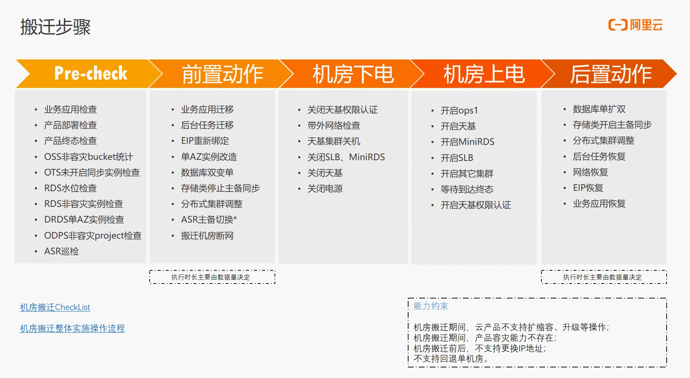

**机房搬迁前的流程**

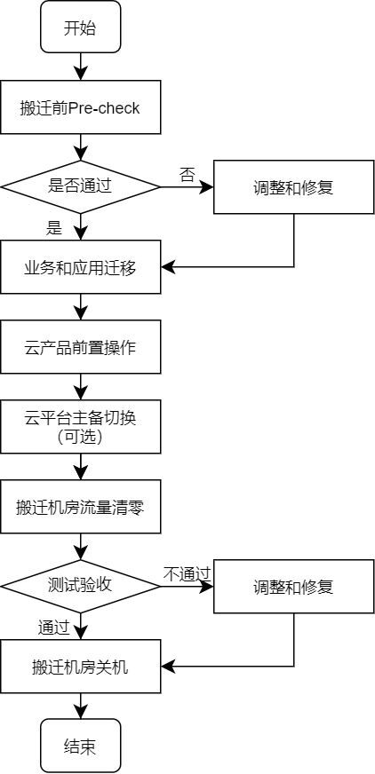

**机房搬迁后的流程**

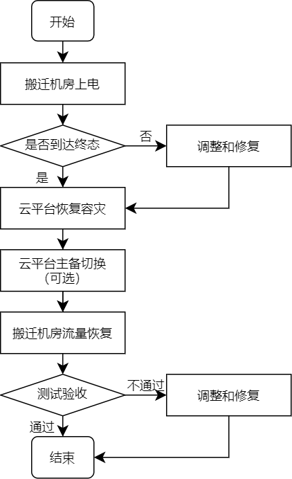

<a id="section-6"></a>

# 6.搬迁前准备

<a id="section-6-1"></a>

## 6.1. 容灾演练Precheck list

<a id="section-6-1-1"></a>

### 6.1.1. 管控信息

本文介绍容灾演练前需要获取的管控信息。

机房搬迁前，您需要获取局点管控平台的相关信息，包括访问地址、机器地址、账号、密码及是否开启登录鉴权。局点管控平台清单如下所示：

- ASR同城容灾控制台（主机房）

- ASR同城容灾控制台（备机房）

- Mini杜康数据库管理平台

- 杜康数据库管理平台

- Apsara Uni-Manager混合云管理平台（ASCM）

- Apsara Uni-Manager运维控制台（ASO）

- 大数据管家（ABM）

- 飞天基础运维平台

- OSS赤骥运维平台

- DTS运维平台

- DRDS管家

- MaxCompute控制台

- 云原生分布式数据库PolarDB-X控制台

<a id="section-6-1-2"></a>

### 6.1.2. 基础设施

本文介绍基础设施的各个前置检查项、检查方法和期望结果。

**带外网络**

| 序号 | 描述 | 检查方法 | 期望结果 |
| --- | --- | --- | --- |
| 1 | 检查带外IP。 | 1. 登录主机房OPS1机器。<br>2. 执行如下命令，比对snlist和oobsnlist_all文件。<br><code>cat snlist</code><br><code>oobsnlist_all</code><br><code>&#124; sort &#124; uniq</code><br><code>-u</code> | 结果为空，全部物理服务器都已获取带外IP。 |

**电源状态**

| 序号 | 描述 | 检查方法 | 期望结果 |
| --- | --- | --- | --- |
| 1 | 检查服务器电源状态。 | 1. 分别登录主、备机房的OPS1机器。<br>2. 执行如下命令，检查主、备机房服务器电源状态。<br><code>for</code><br><code>currentMachine</code><br><code>in $(cat</code><br><code>oobiplist_maste</code><br><code>r &#124; xargs);</code><br><code>do</code><br><code>echo</code><br><code>"Checking</code><br><code>${currentMachin</code><br><code>e} ...";</code><br><code>ipmitool -</code><br><code>I lanplus -H</code><br><code>${currentMachin</code><br><code>e} -U taobao -</code><br><code>P 9ijn0okm</code><br><code>power status;</code><br><code>done</code> | 显示Power is on表示电源状态正常。 |

**网络可达性**

| 序号 | 描述 | 检查方法 | 期望结果 |
| --- | --- | --- | --- |
| 1 | 检查主机房的运维网络的可达性。 | 连接主机房运维网络直接访问主机房的服务器。 | 可访问。 |
| 2 | 检查备机房的运维网络的可达性。 | 连接备机房运维网络直接访问备机房的服务器。 | 可访问。 |
| 3 | 检查主备机房间的并网。 | 检查主、备机房是否并网完成，包括互联网侧和客户IDC侧。 | 并网完成。 |
| 4 | 检查与客户IDC侧并网。 | 用户IDC流量可达主、备两个机房。 | 可访问。 |
| 5 | 检查互联网入口区流量的切换方式。 | 确认互联网入口区是自动切换流量还是手动切换流量。 | 自动/手动。 |
| 6 | 检查VPC网段容灾大小段配置。 | 无 | 无 |

<a id="section-6-1-3"></a>

### 6.1.3. 业务应用

本文介绍机房搬迁前局点业务应用的部署信息。

**类型**

**应用特征**

**风险描述**

**整改方法**

客户应用主备机房部署，

客户应用接受跨机房延

如果不接受跨机房延时，

共用一个SLB实例跨机房

迟。

使用垂直访问模式。

负载均衡。

客户应用主备机房部署，

并网需要支持自动切换，

外部探活和切换验证充

主备机房分别使用一个

部署形态

否则切换失败。

分。

SLB实例负载均衡。

客户容灾应用不要强依赖

客户应用只在主机房部

非容灾应用；在故障期间

客户应用调整。

署，无法容灾。

可以接受不使用非容灾应用。

客户应用内部具有自建中

组件要完成容灾改造，否

客户应用解决。

间件、数据库等组件。

则会导致应用容灾失败。

状态数据丢失调用业务受

使用RDS-REDIS，文件使

容灾接入

客户应用具有状态数据。

影响。

用OSS。

主机房客户应用使用

主机房EBS/NAS数据不同

尽量迁移到OSS内。

EBS/NAS等存储设备。

步到备机房，数据丢失。

客户IDC并网是否支持容

客户应用被客户IDC访

评估并网方案，验证并网

灾，不支持会导致容灾切

问。

支持容灾切换。

换失败。

客户应用使用EIP/NAT能

是否配置相应容灾路由，

网络链路

验证EIP/NAT容灾能力。

力。

不配置导致切换失败。

是否配置正确的健康检

客户应用在云外配置健康

测试验证健康检查的准确

查，不适当的健康检查会

检查。

性。

导致容灾切换失败。

云产品切换后不生效，依

不依

客户应用ECS内配

然使

赖 `/etc/hosts` 解

置 `/etc/hosts` 。

用 `/etc/hosts` 里配

析。

置。

非标配置

客户应用强依赖非容灾云

依赖产品需要双机房容灾

客户容灾应用切换失败。

产品。

部署。

<a id="section-6-1-4"></a>

### 6.1.4. 云产品

本文介绍云产品的各个前置检查项、检查方法和期望结果。

**ASR**

| 序号 | 描述 | 检查方法 | 期望结果 |
| --- | --- | --- | --- |
| 1 | 通过ASR控制台检查其他产品状态信息。 | 1. 登录ASR控制台。<br>2. 在左侧导航栏，选择<strong>平台监控</strong>&gt;<strong>产</strong><strong>品监控</strong>。 | • 主节点位置在主机房。<br>• 总体状态正常，主、备节点服务显示正常。 |

**DNS**

| 序号 | 描述 | 检查方法 | 期望结果 |
| --- | --- | --- | --- |
| 1 | 检查DNS服务状态和主备节点位置。 | 1. 登录ASR控制台。<br>2. 在左侧导航栏，选择<strong>平台监控</strong>&gt;<strong>产品监控</strong>。<br>3. 在<strong>底座组件监控</strong>区域查看DNS主备节点位置和状态。 | • 主节点位置在主机房。<br>• 总体状态正常，主备节点服务显示正常。 |
| 2 | DNS环境检查。 | 使用DNS环境检查脚本进行环境检查。<br>说明请与产品研发团队联系获取巡检工具。 | 检查通过，无报错。 |

<table>
  <tr>
    <td>3</td>
    <td>检查DNS API接口。</td>
    <td>执行如下命令，检查DNS API接口是否正常。<br>• 注册<br><code>curl"http://dnsapi1.tbsite.net/cgibin/dn</code> <code>sapi.cgi?name=${</code>自定义域名<code>}&amp;ip=${</code>自定义<code> </code><code>ip}&amp;action=add"</code><br>• 更新<br><code>curl"http://dnsapi1.tbsite.net/cgibin/dn</code> <code>sapi.cgi?name=${</code>自定义域名<code>}&amp;ip=${</code>自定义<code> </code><code>ip}&amp;action=update"</code><br>• 删除<br><code>curl"http://dnsapi1.tbsite.net/cgibin/dn</code> <code>sapi.cgi?name=${</code>自定义域名<code>}&amp;ip=${</code>自定义<code> </code><code>ip}&amp;action=remove"</code></td>
    <td>能通过DNS API进行增删改操作，接口返回OK。</td>
  </tr>
</table>

**MiniRDS**

| 序号 | 描述 | 检查方法 | 期望结果 |
| --- | --- | --- | --- |
| 1 | 通过Mini杜康数据库管理平台检查MiniRDS是否有中断、等待、临时关闭、暂停或运行的任务。 | 1. 登录Mini杜康数据库管理平台。<br>2. 在左侧导航栏，单击<strong>任务管理</strong>&gt;<strong>中</strong><strong>断的任务</strong>/<strong>等待的任务</strong>/<strong>临时关闭的</strong><strong>任务</strong>/<strong>暂停的任务</strong>/<strong>运行的任务</strong>，查看各个列表中没有存在任务。 | 列表中无任务。 |
| 2 | 检查所有的实例状态是否处于可切换、可用状态。 | 1. 登录Mini杜康数据库管理平台。<br>2. 在左侧导航栏，单击<strong>系统管理</strong>。<br>3. 在<strong>系统管理</strong>左侧导航栏，选择<strong>容灾</strong><strong>管理</strong>&gt;<strong>容灾切换</strong>。<br>4. 在容灾切换页面，查看所有的实例状态。 | • 多可用区实例，所有实例主库都在主机房状态为读写，备库都在备机房状态为只读。<br>• 实例的DNS校验、ALB校验、Proxy校验、其他校验、实例校验都显示OK，没有FA报错。<br>• 从库最大延时为0或者1，评估结果为OK，且更新信息是最近更新信息。 |
| 3 | 通过ASR控制台检查MINIRDS状态信息。 | 1. 登录ASR控制台。<br>2. 在左侧导航栏，选择<strong>平台监控</strong>&gt;<strong>产</strong><strong>品监控</strong>。<br>3. 在<strong>底座组件监控</strong>区域，查看MINIRDS状态。 | • MINIRDS的总体状态显示正常，实例全部位于主机房，备机房的实例数量为0。<br>• 容灾能力中连接异常实例数、单可用区实例数、管控实例托管异常、运行中任务数量、不可切换实例数量、同步延迟实例数量、管控状态异常数量都为0。 |
| 4 | 检查minirds实例的init_connet配置。 | 1. 登录minirds dbaas_db数据库。<br>2. 执行：<code> select * from </code> <code>mycnf_custinstance where</code><br><code>name='init_connect' and</code><br><code>para_value="'" limit</code> <code>10; </code>。 | 查询结果为空。<br>说明结果为空意味着所有实例的init_connect配置正确。 |

**RDS**

| 序号 | 描述 | 检查方法 | 期望结果 |
| --- | --- | --- | --- |
| 1 | 通过RDS杜康数据库管理平台检查RDS是否有中断/等待/临时关闭/暂停/运行的任务。 | 1. 登录RDS各自的杜康数据库管理平台。<br>2. 选择<strong>任务管理</strong>&gt;<strong>中断的任务</strong>/<strong>等待的</strong><strong>任务</strong>/<strong>临时关闭的任务</strong>/<strong>暂停的任</strong><strong>务</strong>/<strong>运行的任务</strong>，查看各个列表中没有存在任务。 | 无任务。 |
| 2 | 检查所有的实例状态是处于可切换、可用状态。 | 1. 登录RDS各自的杜康数据库管理平台。<br>2. 选择<strong>系统管理</strong>&gt;<strong>容灾管理</strong>&gt;<strong>容灾切</strong><strong>换</strong>查看所有的实例状态。 | • 多可用区实例，所有实例主库都在主机房状态为读写，备库都在备机房状态为只读。<br>• 实例的DNS/ALB/Proxy/其他/实例校验都是OK，没有FA报错。<br>• 主从库最大延时为0或者1，评估结果为OK，且更新信息是最近更新信息。<br>• 没有basic规格的Redis实例，没有redis sharding 4.0实例。 |
| 3 | 通过ASR控制台检查RDS的产品监控状态。 | 1. 登录ASR控制台。<br>2. 选择<strong>平台监控</strong>&gt;<strong>产品监控</strong>查看RDS状态。 | • RDS的状态为正常，实例全部位于主机房，备节点的实例数量为0。<br>• 容灾能力中连接异常实例数、单可用区实例数、管控实例托管异常、运行中任务数量、不可切换实例数量、同步延迟实例数量、管控状态异常数量都为0。 |

**SLB**

| 序号 | 描述 | 检查方法 | 期望结果 |
| --- | --- | --- | --- |
| 1 | 通过ASR控制台检查SLB状态信息。 | 1. 登录ASR控制台。<br>2. 在左侧导航栏，选择<strong>平台监控</strong>&gt;<strong>产</strong><strong>品监控</strong>。<br>3. 在<strong>产品监控</strong>区域，查看SLB状态。 | 总体状态显示正常，主、备节点服务显示正常。 |
| 2 | 检查SLB的lvs状态信息。 | 1. 登录飞天基础运维平台。<br>2. 在左侧导航栏<strong>产品集群运维</strong>中查询slb，选择<strong>slb-controller</strong>服务，通过<strong>Terminal</strong>登录SlbAg#容器的docker中，cli命令登录，然后执行<code> list admin </code> <code>lb_node </code>检查lvs的状态。 | lvs service_enable全部是enabled，status全部是online。 |
| 3 | 检查SLB的proxy的状态信息 | 1. 登录飞天基础运维平台。<br>2. 在左侧导航栏<strong>产品集群运维</strong>中查询slb，选择<strong>slb-controller</strong>服务，通过<strong>Terminal</strong>登录SlbAg#容器的docker中，cli命令登录，然后执行<code> list admin proxy </code>检查proxy的状态。 | proxy service_enabled全部是enabled，status全部是online。 |
| 4 | 检查SLB的keyserver状态信息。 | 1. 登录飞天基础运维平台。<br>2. 在左侧导航栏<strong>产品集群运维</strong>中查询slb，选择<strong>slb-controller</strong>服务，通过<strong>Terminal</strong>登录SlbAg#容器的docker中，cli命令登录，执行<code> list admin </code> <code>keyserver </code>检查keyserver的状态。 | 所有的keyserver的status全部是online。 |
| 5 | 检查SLB路由容灾配置。 | 1. 获取SLB的vip网段：<br>i. 登录飞天基础运维平台。ii. 在左侧导航栏<strong>产品集群运维</strong>中查询slb，单击<strong>集群详情</strong>。iii. 选择slb-lvs服务，在<strong>终态配</strong><strong>置</strong>页签中的user路径下查看SlbLvs.yaml，选取privatevip和publicvip下的网段。<br>2. 登录到ISW交换机中。<br>说明提前获取交换机的登录方式。<br>3. 执行<code> sys </code>。<br>4. 执行<code> display ip routing-</code><code>table {</code>上一步获取到的<code>privatevip</code>地址<code>} </code>。<br>5. 执行<code> display ip routing-</code><code>table {</code>上一步获取到的<code>publicvip</code>地址<code>} </code>。 | • 交换机路由表中有privatevip大小两段路由。<br>• 交换机路由表中有publicvip大小两段路由。 |
| 6 | SLB配置和水位摸底。 | 使用SLB巡检包检查SLB水位和健康状态。 | 各项检查正常。 |

**VPC**

| 序号 | 描述 | 检查方法 | 期望结果 |
| --- | --- | --- | --- |
| 1 | 容灾路由配置检查。 | 查找VPC网段，在主备机房XGW上检查VPC网段容灾大小段配置情况。 | 容灾路由按照标准配置完成。 |

**OSS**

| 序号 | 描述 | 检查方法 | 期望结果 |
| --- | --- | --- | --- |
| 1 | 通过ASR控制台检查OSS状态信息。 | 1. 登录ASR控制台。<br>2. 在左侧导航栏，选择<strong>平台监</strong><strong>控</strong>&gt;<strong>产品监控</strong>。<br>3. 在产品监控区域，查看OSS状态。 | • 主节点位置在主机房。<br>• 总体状态显示正常，主、备节点服务显示正常。 |
| 2 | 检查loaction对应的集群信息。 | 1. 登录oss的oss_meta数据库。<br>2. 通过<code> select </code> <code>name,location from</code> <code>location_tables; </code>查看机房location对应的机房集群。 | 主机房location对应主机房集群，备机房location对应备机房集群。 |
| 3 | 检查是否有location不在主机房的Bucket。 | 1. 登录oss的oss_meta数据库。<br>2. 通过<code> select </code> <code>name,location from</code><br><code>oss_meta_bucket where</code> <code>location &lt;&gt; "{</code>主机房<code>location}"; </code>，查看bucket的location不在主机房。 | 查询结果为空。<br>说明结果为空意味着所有的bucket的location都在主机房。 |
| 4 | 检查非容灾bucket的同步边是否都已经完成清理。 | 与阿里云技术支持联系获取巡检方法。 | 与阿里云技术支持联系获取期望结果。 |
| 5 | 检查是否存在有申请singletunnel vip的bucket。 | 1. 登录oss_meta数据库。<br>2. 执行sql ：<code> select count(1) </code> <code>from vpc_info; </code>。 | 查询结果为空。<br>说明结果为空意味着没有singletunnel链路访问。 |

**ECS**

| 序号 | 描述 | 检查方法 | 期望结果 |
| --- | --- | --- | --- |
| 1 | 通过ASR控制台检查ECS状态信息。 | 1. 登录ASR控制台。<br>2. 在左侧导航栏，选择<strong>平台监控</strong>&gt;<strong>产品监控</strong>。<br>3. 在产品监控区域，查看ECS状态。 | • 主节点位置在主机房。<br>• 总体状态显示正常，主、备节点服务显示正常。 |
| 2 | 检查ECS的nc状态。 | 1. 登录ECS-IO集群或ECS-CPU集群的ecs-ag.EcsAg#容器。<br>2. 执行<code> go2houyiregiondbrnd </code>命令，登录houyi的数据库。<br>3. 执行<code> select id,ip,biz_status </code> <code>from nc;  </code>命令查看所有nc状态。 | 所有nc状态都为free。 |

**天基**

| 序号 | 描述 | 检查方法 | 期望结果 |
| --- | --- | --- | --- |
| 1 | 检查产品SR终态。 | 1. 登录飞天基础运维平台。<br>2. 在左侧导航栏<strong>产品集群运维</strong>页面检查主备机房产品SR终态。 | 所有SR都达终态。 |
| 2 | 检查tianji登录权限认证。 | 1. 登录主机房的ops1机器。<br>2. 执行如下命令，返回为false，则表示认证已关闭。<br><code>#/cloud/tool/tianji/tianji_clt</code><br><code>authmode --get --config</code><br><code>/cloud/data/bootstrap_controller</code><br><code>/BootstrapController#/bootstrap_</code><br><code>controller/tianji_dest.conf</code> | tianji登录权限已关闭。<br>说明如果没有关闭，请参考KB关闭tianji鉴权。 |
| 3 | 获取所有机器IP列表，在后续的演练场景中（例如模拟集群关机），您可以按照IP列表检查是否所有服务器都已下电。 | 1. 登录飞天基础运维平台。<br>2. 在左侧导航栏选择<strong>运维工具</strong>&gt;<strong>基础数据管</strong><strong>理</strong>，单击<strong>TianJi元数据管理模块</strong>中的<strong>飞天基</strong><strong>础运维控制台1.0</strong>。<br>3. 在上方导航栏选择<strong>报表</strong>&gt;<strong>全部报表</strong>&gt;<strong>IP列</strong><strong>表</strong>，在标题行中单击机器名进行排序，单击导出Excel表格图标<br><br>，生成IP列表Excel文件。 | 成功获取到IP列表。 |
| 4 | 检查tianji是否存在已下线的sr的存留信息。 | 1. 登录四台tianji-ha.HaManager#服务角色机器。<br>2. 执行以下命令，验证无异常服务角色，确认没有返回报错即可。<br><code>for i in `ls</code><br><code>/dev/shm/ha_manager/app`;</code><br><code>do</code><br><code>tjc status $i &gt; /dev/null</code><br><code>&#124;&#124; echo $i;</code><br><code>done</code> | 无报错。 |

**https-proxy**

| 序号 | 描述 | 检查方法 | 期望结果 |
| --- | --- | --- | --- |
| 1 | https-proxy域名注册是否重复检查。 | 1. 登录飞天基础运维平台。<br>2. 在左侧导航栏选择<strong>产品集群运维</strong>，project选择baseServiceAll，服务选择https_proxy。<br>3. 切换<strong>资源列表</strong>页签，选择类型为db的资源，在<strong>资源申请结果</strong>列中查看元数据库信息。<br>4. 登录https_proxy元数据库，执行<code>select domain, count(1) from</code> <code>domain_info group by domain; </code>。 | https-proxy中所有的域名domain均只有一条解析记录。 |

**云盾**

| 序号 | 描述 | 检查方法 | 期望结果 |
| --- | --- | --- | --- |
| 1 | 防火墙部署和工作模式检查。 | 1. 登录飞天基础运维平台。<br>2. 在<strong>产品集群运维</strong>界面根据产品（yundun-advance）过滤，在BasicThin\*\*\*开头的集群<strong>终态配置</strong>页签中查看的kv.conf文件。<br>3. 查看yundun-ccfw-version/yundun-icfw-version属性，确认环境是否部署防火墙，exist表示部署，none表示没有部署。 | 确认环境是否部署防火墙。 |

**Tablestore**

| 序号 | 描述 | 检查方法 | 期望结果 |
| --- | --- | --- | --- |
| 1 | 检查TableStore Pub集群中带索引表的实例。 | 在主集群ag上执行：<br><code>alias</code><br><code>sql='/apsara/deploy/sqlonline_cons</code><br><code>ole -i false -d OTSPublicDB -s</code><br><code>sqlonline-OTS -m admin -c '</code><br><code> sql "lt --only_show_index"  </code>可以查看是否有索引的实例。<br>说明TableStoreInner不用检查，因为TableStoreInner上没有支持索引功能。如果这个实例下面有带索引的表，那么这个实例需要加到TableStore黑名单，不做迁移。 | 确认是否有带索引表的实例。 |
| 2 | 检查是否有存在绑定了vpc的实例。 | 1. 登录ots_ocm数据库。<br>2. 执行sql：<code> select count(1) from </code> <code>single_tunnel_info; </code>。 | 查询结果为空。<br>说明结果为空意味着没有singletunnel链路访问。 |

<a id="section-6-2"></a>

## 6.2. 机房搬迁Precheck list

<a id="section-6-2-1"></a>

### 6.2.1. 运维侧

本文介绍主备机房搬迁前，运维侧对环境和云产品需要进行的前置检查项、检查方法、期望结果及存在的风险。

**业务应用检查**

| 序号 | 描述 | 检查方法 | 期望结果 |
| --- | --- | --- | --- |
| 1 | 是否有业务应用只部署在搬迁机房内部的ECS里。 | 1. 从业务侧梳理，确保业务应用在留存机房的ECS上已经部署，且不依赖搬迁机房的ECS就可以独立工作。<br>2. 从运维侧梳理，确保搬迁机房的所有ECS用途明确，其对应的业务应用，在留存机房ECS也进行了部署。 | 1. 业务应用，仅依赖留存机房ECS，就可以正常工作。<br>2. 后续对搬迁机房ECS进行关闭，不影响业务应用。 |
| 2 | 是否有业务应用只部署在搬迁机房内部的ACS集群里。 | 1. 从业务侧梳理，确保业务应用在留存机房的ACS集群内已经部署，且不依赖搬迁机房的ACS集群、就可以独立工作。<br>2. 从运维侧梳理，确保搬迁机房的所有ACS集群用途明确，其对应的业务应用，在留存机房ACS集群也进行了部署。 | 1. 业务应用，仅依赖留存机房的ACS集群，就可以正常工作。<br>2. 后续对搬迁机房ACS集群进行关闭，不影响业务应用。 |
| 3 | 是否有业务应用只部署在搬迁机房内部的EDAS计算资源（ECS、容器）里。 | 1. 从业务侧梳理，确保业务应用部署在留存机房的EDAS计算资源（ECS、容器）内已经部署，且不依赖搬迁机房的EDAS计算资源（ECS、容器）就可以独立工作。<br>2. 从运维侧梳理，确保搬迁机房的所有EDAS计算资源（ECS、容器）用途明确，其对应的业务应用，在留存机房EDAS计算资源（ECS、容器）也进行了部署。 | 1. 业务应用，仅依赖留存机房的EDAS计算资源（ECS、容器）就可以正常工作。<br>2. 后续对搬迁机房EDAS计算资源（ECS、容器）进行关闭，不影响业务应用。 |
| 4 | PaaS内部，是否有业务应用只部署在搬迁机房内部的PoD容器内。 | 1. 从业务侧梳理，确保业务应用在留存机房的PaaS PoD内已经部署，且不依赖搬迁机房的PaaS PoD就可以独立工作。<br>2. 从运维侧梳理，确保搬迁机房的所有PaaS PoD用途明确，其对应的业务应用，在留存机房PaaS PoD也进行了部署。 | 1. 业务应用，仅依赖留存机房的PaaS PoD，就可以正常工作。<br>2. 后续对搬迁机房EDAS计算资源PaaS PoD进行关闭，不影响业务应用。 |

**产品部署情况**

| 序号 | 描述 | 检查方法 | 期望结果 |
| --- | --- | --- | --- |
| 1 | 检查部署的产品是否支持机房搬迁。 | 1. 登录飞天基础运维平台。<br>2. 在左侧导航栏<strong>产品集群运维</strong>页面查看产品部署情况。 | 部署的产品在倒换支持列表中覆盖到。具体请参见机房搬迁支持列表。 |
| 2 | 检查产品的feature在主、备机房的部署情况。 | 1. 登录飞天基础运维平台。<br>2. 在左侧导航栏，选择<strong>产品集群运维</strong>。<br>3. 在<strong>产品集群运维</strong>页面<strong>Zone</strong>下拉列表中选择主机房，查看主机房产品feature部署情况。<br>4. 在<strong>产品集群运维</strong>页面<strong>Zone</strong>下拉列表中选择备机房，查看备机房产品feature部署情况。 | 产品的所有feature在主、备机房都有部署。<br>说明tianji的default集群除外。 |
| 3 | 检查集群部署情况。<br>重要重点关注集群非对等部署和机器数量非对等部署。 | 1. 登录ASR控制台。<br>2. 在左侧导航栏，选择<strong>平台检查</strong>&gt;<strong>环境检</strong><strong>查</strong>。<br>3. 在<strong>集群部署</strong>区域，查看产品对等和非对等部署情况。 | 了解集群部署情况。<br>说明存在非对等部署的产品，搬迁过程中，产品在留存机房的容量可能不足。 |

**产品终态检查**

| 序号 | 描述 | 检查方法 | 期望结果 |
| --- | --- | --- | --- |
| 1 | 检查当前局点所有产品、所有集群的终态。 | 1. 登录飞天基础运维平台。<br>2. 在左侧导航栏选择<strong>产品集群运维</strong>，查看<strong>到达终</strong><strong>态</strong>和<strong>未达终态</strong>的产品数。 | 所有产品都已到达终态。 |

**产品配置检查**

| 序号 | 描述 | 检查方法 | 期望结果 |
| --- | --- | --- | --- |
| 1 | 检查是否有serviceid.conf等手工配置。 | 现场运维人员查阅运维记录。 | 不存在serviceid.conf等手工配置。 |

**云产品摸底**

| 序号 | 描述 | 检查方法 | 期望结果 |
| --- | --- | --- | --- |
| 1 | 检查当前局点所有产品、所有集群的DNS和VIP。 | 1. 登录飞天基础运维平台。<br>2. 在左侧导航栏选择<strong>运维工具</strong>&gt;<strong>基础数据管理</strong>，单击<strong>TianJi元数据管理模块</strong>中的<strong>飞天基础运维</strong><strong>控制台1.0</strong>。<br>3. 在顶部导航栏，单击<strong>报表</strong>&gt;<strong>系统报表</strong>。<br>4. 在<strong>系统报表</strong>页面，单击<strong>资源申请报表</strong>。<br>5. 在<strong>资源状态表</strong>区域，单击<strong>Type</strong>列<br><br>图标，筛选<strong>dns</strong>和<strong>vip</strong>的信息。<br>6. 单击右上角<br><br>图标，导出Excel表格。 | 获取到DNS和VIP信息。 |

**云产品**

**OSS**

| 序号 | 描述 | 检查方法 | 期望结果 |
| --- | --- | --- | --- |

<table>
  <tr>
    <td>1</td>
    <td>检查OSS主备集群磁盘水位、主备集群的机型信息。</td>
    <td>1. 登录OSS赤骥。<br>2. 在左侧导航栏，选择<strong>集群运维</strong>&gt;<strong>集群监控</strong>&gt;<strong>库存</strong><strong>监控</strong>。记录主备集群的<strong>盘古总容量(TB)</strong>、<strong>盘古剩余容</strong><strong>量(TB)</strong>。<br>3. 记录主备集群的机型信息。<br>i. 在左侧导航栏，选择<strong>集群运维</strong>&gt;<strong>机器管理</strong>。ii. 在机器资源页面，集群下拉列表选择目标集群，单击<strong>查询</strong>。依次记录<strong>集群</strong>、<strong>机器名</strong>。iii. 单击对应详细信息列的机器信息，记录机型。</td>
    <td>• 留存机房的盘古剩余容量，需要能够容纳部分非容灾bucket升级成为容灾bucket。<br>• 主备集群中所有机型一致。</td>
  </tr>
  <tr>
    <td>2</td>
    <td>检查是否存在非容灾Bucket，包括用户级Bucket和系统级Bucket。</td>
    <td>1. 获取UID。<br>i. 登录Apsara Uni-manager运营控制台。ii. 在顶部菜单栏，单击<strong>企业</strong>。iii. 在左侧导航栏，选择<strong>资源管理</strong>&gt;<strong>组织管理</strong>。iv. 在组织列表，单击root节点下一级组织，单击<strong>管理</strong><strong>AccessKey</strong>，记录UID。<br>说明UID需另外再记录一个999999999。<br>2. 登录OSS赤骥。<br>3. 在左侧导航栏，选择<strong>用户与Bucket运维</strong>&gt;<strong>用户数据</strong><strong>查询</strong>。<br>4. 下拉列表选择<strong>UID</strong>，输入步骤1中记录的UID，单击<strong>查</strong><strong>询</strong>。<br>5. 依次查看Bucket，对于每个Bucket单击<strong>查看XML详</strong><strong>情</strong>。</td>
    <td>针对每个Bucket的XML详情，存在<strong>BucketSyncMet</strong> <strong>a</strong>节点，且<strong>SyncStatus=1</strong>、<strong>Type=0</strong>。</td>
  </tr>
  <tr>
    <td>3</td>
    <td>检查bucket location。</td>
    <td>1. 登录OSS的oss_meta数据库，通过<code> select </code> <code>location,cluster from location_table; </code>,查看机房location对应的机房集群。<br>2. 通过<code> select name,location from </code> <code>oss_meta_bucket where location not in</code> <code>("&lt;</code>主机房<code>location 1&gt;","&lt;</code>主机房<code>location </code> <code>2&gt;",...); </code>查看是否有bucket的location不在主机房。</td>
    <td>查询结果为空。<br>说明结果为空意味着所有的bucket的location 都在主机房。</td>
  </tr>
</table>

**RDS**

| 序号 | 描述 | 检查方法 | 期望结果 |
| --- | --- | --- | --- |
| 1 | 检查RDS非容灾实例及数量。 | 1. 登录杜康数据库管理平台。<br>2. 在左侧导航栏，选择<strong>实例管理</strong>&gt;<strong>实例列</strong><strong>表</strong>。<br>3. 单击<strong>高级搜索</strong>，在<strong>数据库类型</strong>下拉列表选择<strong>mysql</strong>和<strong>redis</strong>，单击<strong>搜索</strong>，记录实例总数量。<br>4. 依次单击实例名，进入<strong>基本信息</strong>页面，鼠标下滚至<strong>主机实例信息</strong>页签。判断主备实例的机房名称是否一致，记录容灾实例总数量、非容灾实例总数量。 | • 主备实例的机房名称依次对应主备机房名。<br>• 容灾实例总数等于生产实例总数。<br>• 非容灾实例总数为0。 |
| 2 | 检查RDS集群部署概况、RDS集群链路类型、主备集群的水位情况及主备集群的机型。 | 1. 登录杜康数据库管理平台。<br>2. 在左侧导航栏，单击<strong>集群管理</strong>。<br>3. 在<strong>集群管理</strong>左侧导航栏，选择<strong>集群管</strong><strong>理</strong>&gt;<strong>系统集群</strong>。<br>4. 单击<strong>高级搜索</strong>，在<strong>数据库类型</strong>下拉列表选择<strong>mysql</strong>和<strong>redis</strong>，单击<strong>搜索</strong>，记录<strong>链路</strong><strong>类型</strong>，根据<strong>机房名称</strong>，判断该实例集群是否为主备集群部署。<br>5. 单击<strong>操作</strong>列<strong>集群详情</strong>，在<strong>主机列表</strong>区域，根据<strong>机房</strong>列，分类汇总该实例主备集群的CPU使用率、内存使用率、数据使用率、实例数。根据<strong>机型</strong>列，判断该实例主备集群的机型是否一致。 | • 该实例集群为主备集群部署。<br>• 主备集群的CPU使用率、内存使用率、数据使用率差额小于5%。<br>• 主备集群的实例数一致。<br>• 主备集群的机型一致。<br>• 留存机房的RDS集群，能够容纳所有实例双变单。 |

**PolarDB-X1.0（原DRDS）**

| 序号 | 描述 | 检查方法 | 期望结果 |
| --- | --- | --- | --- |

<table>
  <tr>
    <td>1</td>
    <td>检查主备机房水位情况。</td>
    <td>1. 登录飞天基础运维平台。<br>2. 在左侧导航栏选择<strong>运维工具</strong>&gt;<strong>基础数据管理</strong>，单击<strong>TianJi</strong><strong>元数据管理模块</strong>中的<strong>飞天基础运维控制台1.0</strong>。<br>3. 在顶部导航栏，选择<strong>运维</strong>&gt;<strong>集群运维</strong>。<br>4. 在<strong>集群运维</strong>页面上方选择主机房，<strong>Project</strong>下拉列表选择<strong>drds</strong>，单击目标集群名称。<br>5. 在<strong>集群详情</strong>页面，鼠标下滚至<strong>服务实例列表</strong>区域，单击<strong>aliware-ark</strong>服务<strong>操作</strong>列<strong>详情</strong>。<br>6. 在<strong>服务详情</strong>页面，选择服务角色<strong>aliware-</strong><strong>ark.ArkAgent#</strong>，单击<strong>操作</strong>列<strong>详情。</strong><br>7. 选择任意一台机器，单击<strong>操作</strong>列<strong>终端</strong>。<br>8. 执行如下命令，查看节点信息。<br><code>docker --tls --</code><br><code>tlscacert=/etc/docker/ca.pem --</code><br><code>tlscert=/etc/docker/server-cert.pem --</code><br><code>tlskey=/etc/docker/server-key.pem -H</code><br><code>tcp://127.0.0.1:3376 info</code><br>9. 汇总Nodes节点下所有机器的Containers、Reserved CPUs、Reserved Memory，计算总剩余水位。<br>10. 计算备机房剩余水位，具体请参见步骤1~8。</td>
    <td>留存机房的DRDS集群，能够容纳所有实例双变单。</td>
  </tr>
  <tr>
    <td>2</td>
    <td>检查PolarDB-X实例部署情况。</td>
    <td>1. 登录DRDS管家。<br>2. 在左侧导航栏，单击<strong>实例管理</strong>。<br>3. 在<strong>实例管理</strong>页面，根据<strong>可用区</strong>列，依次判断PolarDB-X实例为双可用区实例，还是单可用区实例。如果为单可用区实例，需记录实例所在的可用区。</td>
    <td>单可用区实例数量尽可能为0。<br>重要单可用区的实例需要变更为双可用区。</td>
  </tr>
</table>

**Tongque**

| 序号 | 描述 | 检查方法 | 期望结果 |
| --- | --- | --- | --- |
| 1 | 检查SRECLI是否在主备机房ops1和ops2机器上部署。 | 1. 分别登录主备机房ops1和ops2机器。<br>2. 执行如下命令，查看SRECLI是否部署。<br><code>alias &#124; grep srecli</code> | SRECLI在主备机房 ops1和ops2机器上分别有部署。 |

**MaxCompute**

| 序号 | 描述 | 检查方法 | 期望结果 |
| --- | --- | --- | --- |
| 1 | project是否双集群。 | 1. 登录大数据管家（ABM）。<br>2. 在<strong>MaxCompute</strong>区域，查看所有Project是否是双集群、双配额组，有没有单集群、单配额组的Project。 | 所有project是双集群、双配额组。 |
| 2 | project是否开启同步。 | 1. 登录大数据管家（ABM）。<br>2. 在<strong>MaxCompute</strong>区域，查看所有双集群、双配额组的Project是否已经开启数据同步。 | 所有project已经开启数据同步。 |
| 3 | project同步是否完成。 | 1. 登录大数据管家（ABM）。<br>2. 在<strong>MaxCompute</strong>区域，查看所有双集群、双配额组的Project是否已经完成数据同步。 | 所有project已经完成数据同步。 |

**ASR**

| 序号 | 描述 | 检查方法 | 期望结果 |
| --- | --- | --- | --- |
| 1 | 在ASR控制台查看产品巡检状态。 | 登录ASR控制台，选择<strong>平台监控</strong>&gt;<strong>产品监</strong><strong>控</strong>查看产品状态。 | • 状态、主节点、备节点的各栏显示为正常。<br>• 主节点位置显示在主机房。 |

<a id="section-6-2-2"></a>

### 6.2.2. 方案侧

本文介绍主备机房倒换前，方案侧对环境和应用需要进行的前置检查项、检查方法。

**环境检查**

**检查项**

**子项**

**检查方法**

**备注**

是否有serviceid.conf等手工配

无

无

置。

产品部署情况

是否有其它Hack操作（部署

现场运维人员获取

无

hack）。

Hack记录。

视客户情况评估倒换后是否需要调整并网策略（prefer az、

ISW侧并网模式。

无

vbr等调整）。此外，需要确保倒换的过程中不影响云内外的业务流量。

CSW侧并网模式（主备模式）。

无

无

是否有云外直接访问云产品服务。

无

无

涉及到客户应用是否要变更vip。如果ISW或CSW有做Nat转换，那么需要重新配置转换

跨机房访问，考虑通

客户应用申请的vip。

规则。如果绑定了DNS，vip

用检查方案。

变更后需要重新绑定。

评估手工打洞的vip是否需要重

是否存在打洞等Hack操作。

无

新绑定后端的RS。

专线带宽水位，客户业务流量。

无

倒换后的开机访问流量增加。

云平台网络

业务流量走向。

无

无

机房间网络带宽，带宽占用情况。

无

无

主机房运维网络能直

检查主机房的运维网络的可达性。

接访问主机房的服务

可访问。

器。

备机房运维网络直接

检查备机房的运维网络的可达性。

访问备机房的服务

可访问。

器。

检查主备机房是否并

检查主备机房间的并网。

网完成，包括互联网

并网完成。

侧和客户IDC侧。

用户IDC流量可达主

检查与客户IDC侧并网。

可访问。

备两个机房。

确认互联网入口区是

检查互联网入口区流量的切换方

自动切换流量还是手

手动/自动。

式。

动切换流量。

<a id="section-7"></a>

# 7.现场实施

<a id="section-7-1"></a>

## 7.1. 业务和应用迁移

本文介绍业务和应用迁移的操作步骤。

**操作步骤**

1. 检查业务应用，是否只运行在搬迁机房内部的ECS、ACS集群、EDAS & PaaS内部。对于在搬迁期间需要持续工作的业务应用，在留存机房的云资源内去建立并运行。之后，关闭搬迁机房内部的对应云资源，确保应用在留存机房运行正常。

   > **说明**
   >
   > - 单个ACS集群内部的master + worker如果跨机房部署，那么在搬迁机房下电之后，这个集群可能会停止工作。
   >
   > - 客户的业务应用做双活容灾时，需要在两个机房同时部署相同的业务应用和集群，当一个机房故障时，另一个机房有相同的业务应用服务，保持业务连续性。
   >
   > - 双活容灾的业务应用部署到两个kubernetes集群中，业务应用建议无状态，如果必须有状态，请把状态数据存储到云产品Redis和OSS中。

2. 将与搬迁机房云资源绑定的EIP，重新与留存机房的云资源绑定。

   - 搬迁机房内部ECS上面绑定的EIP，需要重新绑定到留存机房的ECS上。

   - 搬迁机房内部ECS上面已经绑定EIP的弹性网卡ENI，需要迁移进入留存机房的ECS内部。

   - 搬迁机房的公网NAT上面绑定的EIP，需要重新绑定到留存机房的公网NAT上。

   - 搬迁机房的私网SLB上面绑定的EIP，需要重新绑定到留存机房的私网SLB上。

   - 搬迁机房的高可用虚拟IP（HaVip）上面绑定的EIP，需要重新绑定到留存机房的HaVip上。

> **说明**
>
> 业务和应用迁移，是客户及其技术团队的责任。本章节仅作提示、告知之用，无法保证穷尽所有的可能性。

<a id="section-7-2"></a>

## 7.2. 云产品前置操作

本文介绍搬迁机房关机、下电之前，对搬迁机房内云产品所需要做的前置操作。

**前置操作**

| 产品 | 部署形态 | 主机房搬迁前置操作 | 备机房搬迁前置操作 |
| --- | --- | --- | --- |
| RDS（MyS QL+ Redis） | 跨机房高可用 | 1. 登录ASR，将产品切换到备机房。<br>2. 切换后如果隔日搬迁，需要提前关闭可用区对齐功能。<br>3. 在备机房恢复实例单机房高可用（双变单至备机房）。<br>4. 确保备机房Aurora接管所有实例。<br>5. 通过<code> tjc stop rds-</code><code>maotai.AuroraCluster# </code>命令关闭主机房Aurora。 | 1. 在主机房恢复实例单机房高可用（双变单至主机房）。<br>2. 确保主机房Aurora接管所有实例。<br>3. 通过<code> tjc stop rds-</code><code>maotai.AuroraCluster# </code>命令关闭备机房Aurora。 |
| PolarDB-X1.0（原DRDS） | 双活 | 将主机房实例和多可用区实例均改造为备机房实例（实例的两个节点，均在备机房）。 | 将备机房实例和多可用区实例均改造为主机房实例（实例的两个节点，均在主机房）。 |
| DMS | 双活 | 无需操作。 | 无需操作。 |
| DTS | 双活 | 1. 搬迁机房下电之前，需要用户登录DTS运维平台（通过ASO登录），把任务切换到备机房的节点上（可以自动选择节点、也可以手动选择）。<br>2. 搬迁机房下电之后，需要用户登录DTS运维平台，在留存机房的节点上重启同步任务。 | 1. 搬迁机房下电之前，需要用户登录DTS运维平台（通过ASO登录），把任务切换到主机房的节点上（可以自动选择节点、也可以手动选择）。<br>2. 搬迁机房下电之后，需要用户登录DTS运维平台，在留存机房的节点上重启同步任务。 |
| OceanBase | 跨机房高可用 | 无需操作。 | 无需操作。 |
| OSS | 集群主备 | 1. 切换至备机房。<br>2. 删除同步边。<br>3. 清空主机房OSS内部数据。 | 1. 删除同步边。<br>2. 清空备机房OSS内部数据。 |
| TableStore | 集群主备 | 1. 切换至备机房。<br>2. 关闭主备数据同步，请参见关闭自动建立主备和去除同步关系和链路。<br>3. 删除主机房上的数据。 | 1. 关闭主备数据同步，请参见关闭自动建立主备和去除同步关系和链路。<br>2. 删除备机房上的数据。 |
| middlewar eAll | 部分双活，ZK主备 | 1. 切换到备机房。<br>2. 检查schedulerx job是否都被调度在备机房。 | 无需操作。 |
| Taokeeper | 跨机房分布式集群 | 1. 关闭对tk强依赖敏感的产品管控，例如主备机房的MQ controller。<br>2. 关闭主机房tk集群。<br>3. 强制切换至备机房。<br>4. 启动之前关闭的产品管控。 | 需要判断外部应用是否直接依赖Taokeeper在备机房的Broker IP地址。 |
| DNCS | 跨机房分布式集群 | 1. 在jmenv-dncs域名对应的VIP背后，去除主机房的4个RealServer。<br>2. 强制切换至备机房（形成备机房三节点集群，单节点故障可读可写）。<br>3. 关闭主机房集群。<br>4. 确认备机房为三节点集群。 | 1. 在jmenv-dncs域名对应的VIP背后，去除备机房的3个RealServer。<br>2. 主机房集群7变4。<br>3. 关闭备机房DNCS集群。 |
| MQ | 跨机房高可用 | 1. 切换至备机房。<br>2. 通过<code> tjc stop </code>命令，逐个关闭主机房MQ broker。<br>3. 关闭主机房的MQ controller。 | 1. 通过tjc stop命令，逐个关闭备机房MQ broker。<br>2. 关闭备机房的MQ controller。 |
| EDAS | 主备（内部redis主备） | 切换至备机房。 | 无需操作。 |
| CSB | 双活 | 无需操作。 | 无需操作。 |
| ScheduleX 2.0 | 双活 | 无需操作。 | 无需操作。 |
| TLog | 双活 | 无需操作。 | 无需操作。 |
| ECS | 管控双活 | 无需操作。 | 无需操作。 |
| ACS | 管控双活 | 无需操作。 | 无需操作。 |
| SLB | 双活 | 无需操作。 | 无需操作。 |
| EIP | 双活 | EIP需要绑定到备机房ECS，或使用备机房的EIP。 | EIP需要绑定到主机房ECS，或使用主机房的EIP。 |
| NAT | 双活 | 无需操作。 | 无需操作。 |
| VPC | 双活 | 无需操作。 | 无需操作。 |
| DNS Product | 主备 | 切换到备机房。 | 无需操作。 |
| APIGATEW AY | 双活 | 无需操作。 | 无需操作。 |
| SLS | 主备 | 切换到备机房。 | 无需操作。 |
| BCC | 主备 | 切换到备机房。 | 无需操作。 |
| DataWorks | 双活（内部redis主备） | 切换到备机房。 | 无需操作。 |
| MaxCompu te | 主备 | 1. project必须是双AZ容灾project。<br>2. project开启并完成同步。<br>3. 切换至备机房（会自动把默认计算集群设置为备机房集群、容灾集群设置为主机房集群）。 | 1. project必须是双AZ容灾project。<br>2. project开启并完成同步。<br>3. 确认project的默认计算集群设置为主机房集群、容灾集群为备机房集群。 |
| Blink | 主备 | 切换到备机房。 | 无需操作。 |
| Datahub | 主备 | 切换到备机房。 | 无需操作。 |
| Iplus | 主备 | 切换到备机房。 | 无需操作。 |
| ElasticSear ch | 双活 | 无需操作。 | 无需操作。 |
| ASCM | 双活 | 无需操作。 | 无需操作。 |
| ASO | 双活 | 无需操作。 | 无需操作。 |
| ASD | 双活 | 无需操作。 | 无需操作。 |
| TianjiMon | 主备 | 切换到备机房。 | 无需操作。 |
| ARMS | 主备 | 切换到备机房。 | 无需操作。 |
| Tongque | 主备 | 切换到备机房。 | 无需操作。 |
| 云盾（基础组件 + 态势感知 + 流量安全） | 双活 | 无需操作。 | 无需操作。 |
| OPSDNS | 主备 | 1. 切换到备机房。<br>2. 在主机房ops1和ops2的ops.OpsDnsSlave容器中，执行<code> /etc/init.d/bgpd </code> <code>stop </code>关闭named进程。 | 在备机房ops1和ops2的ops.OpsDnsSlave容器中，执行<code> /etc/init.d/bgpd stop </code>关闭named进程。 |
| Tianji | 主备 | 切换到备机房。 | 无需操作。 |
| TableStore Inner | 主备 | 1. 切换至备机房。<br>2. 关闭数据同步，请参见关闭自动建立主备和去除同步关系和链路。<br>3. 删除主机房上的数据。 | 1. 关闭数据同步，请参见关闭自动建立主备和去除同步关系和链路。<br>2. 删除备机房上的数据。 |
| MiniRDS | 跨机房高可用 | 1. 切换到备机房。<br>2. 切换后如果隔日搬迁，需要提前关闭可用区对齐功能。<br>3. 实例恢复单机房双节点高可用（双变单至备机房）。<br>4. 确保备机房Aurora托管所有实例。<br>5. 通过<code> tjc stop minirds-</code><code>maotai.AuroraCluster# </code>命令关闭主机房Aurora。 | 1. 实例恢复单机房双节点高可用（双变单至主机房）。<br>2. 确保主机房Aurora托管所有实例。<br>3. 通过<code> tjc stop minirds-</code><code>maotai.AuroraCluster# </code>命令关闭备机房Aurora。 |
| Sls-common | 主备 | 切换到备机房。 | 无需操作。 |
| FTP | 双活 | 无需操作。 | 无需操作。 |
| baseServic eAll | 双活 | 无需操作。 | 无需操作。 |
| webAppAll | 双活 | 无需操作。 | 无需操作。 |
| Dauth | 双活 | 无需操作。 | 无需操作。 |

<a id="section-7-3"></a>

## 7.3. 网络操作

本文介绍网络操作的目的和步骤。

**目的**

本操作的目的是关闭搬迁机房全部网络流量，确保网络流量均走留存机房。

**操作步骤**

1. 用户侧切流，把网络流量全部打向留存机房，不再和搬迁机房进行网络通信。

2. 在所有SLB实例中，将被搬迁机房的权重清零，留存机房权重100%。

3. 关闭被搬迁机房的ISW的互联网端口、CSW的客户IDC端口。保留双机房互连端口。

4. 联系环境负责人获取需要关闭的交换机端口。

5. 登录交换机关闭端口，详见交换机逻辑。

<a id="section-7-4"></a>

## 7.4. 搬迁机房关机和下电

本文介绍搬迁机房关机和下电的操作步骤。

**前提条件**

您已完成前述章节业务和应用迁移、云产品前置操作、网络操作，且云平台和业务工作正常。

**操作步骤**

搬迁机房关机和下电主要包括以下步骤：

1. 关闭天基权限认证。

2. 带外网络检查。

3. 关闭其他云产品集群。

4. 关闭slb集群。

5. 关闭minirds-mt集群。

6. 关闭tianji集群。

7. 确认主机房的机器是否全部断电。如果没有断电，需要手动关闭电源。

<a id="section-7-5"></a>

## 7.5. 搬迁机房上电和开机

本文介绍搬迁机房上电和开机的操作步骤。

**操作步骤**

搬迁机房上电和开机主要包括以下步骤：

1. 手动开启目标机房ops1机器。

2. 开启tianji集群。

3. 开启minirds-mt集群。

4. 开启slb集群。

5. 开启其它云产品集群。

6. 开机异常问题处理（可选）。

7. 开启天基权限认证。

<a id="section-7-6"></a>

## 7.6. 云产品后置操作

本文介绍搬迁机房上电、开机之后，对搬迁机房内云产品所需要做的后置操作。

**后置操作**

| 产品 | 部署形态 | 主机房搬迁后置操作 | 备机房搬迁后置操作 |
| --- | --- | --- | --- |
| RDS（MySQL+ Redis） | 跨机房高可用 | 1. 通过<code> tjc start rds-</code><code>maotai.AuroraCluster#</code>命令开启主机房Aurora。<br>2. 单可用区实例变跨可用区实例（单扩双）。<br>3. 切换回主机房，具体登录ASR进行产品切换到主机房。 | 1. 通过<code> tjc start rds-</code><code>maotai.AuroraCluster# </code>命令开启备机房Aurora。<br>2. 单可用区实例变跨可用区实例（单扩双）。 |
| PolarDB-X1.0（原DRDS） | 双活 | 实例的节点恢复双AZ分布。 | 实例的节点恢复双AZ分布。 |
| DMS | 双活 | 无需操作。 | 无需操作。 |
| DTS | 双活 | 恢复任务在双AZ各节点的均匀分布。 | 恢复任务在双AZ各节点的均匀分布。 |
| OceanBase | 跨机房高可用 | 无需操作。 | 无需操作。 |
| OSS | 集群主备 | 1. 恢复同步边，关注恢复之后的流量和写入的qps，避免mns性能瓶颈。<br>2. 切回到主机房。 | 恢复同步边，关注恢复之后的流量和写入的qps，避免mns性能瓶颈。 |
| TableStore | 集群主备 | 1. 恢复主备数据同步。<br>2. 切回主机房。 | 恢复主备数据同步。 |
| middlewareAll | 部分双活，ZK主备 | 切换回主机房。 | 无需操作。 |
| Taokeeper | 跨机房分布式集群 | 切换回主机房。 | 无需操作。 |
| DNCS | 跨机房分布式集群 | 1. 主机房DNCS集群开机。<br>2. 备机房DNCS集群配置3节点变7节点。<br>3. 确保主机房集群配置也是7节点。<br>4. 切换回主机房。<br>5. jmenv域名对应的VIP背后RealServer，恢复主+备7个节点。 | 1. 备机房DNCS集群开机。<br>2. 主机房DNCS集群配置4节点变7节点。<br>3. 确保备机房集群配置也是7节点。<br>4. jmenv域名对应的VIP背后RealServer，恢复主+备7个节点。 |
| MQ | 跨机房高可用 | 1. 主机房MQ集群启动之后，确保主+备机房的MQ broker组，处于SYNC_STATE状态。<br>2. 切换回主机房。 | 备机房MQ集群启动之后，确保主+备机房的MQ broker组，处于SYNC_STATE状态。 |
| EDAS | 主备（内部redis主备） | 切换回主机房。 | 无需操作。 |
| CSB | 双活 | 无需操作。 | 无需操作。 |
| ScheduleX 2.0 | 双活 | 无需操作。 | 无需操作。 |
| TLog | 双活 | 无需操作。 | 无需操作。 |
| ECS | 管控双活 | 在主集群修复可能出现的nc_down问题。 | 在备集群修复可能出现的nc_down问题。 |
| ACS | 管控双活 | 启动主机房的实例集群。 | 启动备机房的实例集群。 |
| SLB | 双活 | 检查SLB数据同步是否完成。 | 检查SLB数据同步是否完成。 |
| EIP | 双活 | 无需操作。 | 无需操作。 |
| NAT | 双活 | 无需操作。 | 无需操作。 |
| VPC | 双活 | 无需操作。 | 无需操作。 |
| DNS Product | 主备 | 切换回主机房。 | 无需操作。 |
| APIGATEWAY | 双活 | 无需操作。 | 无需操作。 |
| SLS | 主备 | 切换回主机房。 | 无需操作。 |
| BCC | 主备 | 切换回主机房。 | 无需操作。 |
| DataWorks | 双活（内部redis主备） | 切换回主机房。 | 无需操作。 |
| MaxCompute | 主备 | 切换回主机房。 | 无需操作。 |
| Blink | 主备 | 切换回主机房。 | 无需操作。 |
| Datahub | 主备 | 切换回主机房。 | 无需操作。 |
| Iplus | 主备 | 切换回主机房。 | 无需操作。 |
| ElasticSearch | 双活 | 无需操作。 | 无需操作。 |
| ASCM | 双活 | 无需操作。 | 无需操作。 |
| ASO | 双活 | 无需操作。 | 无需操作。 |
| ASD | 双活 | 无需操作。 | 无需操作。 |
| TianjiMon | 主备 | 切换回主机房。 | 无需操作。 |
| ARMS | 主备 | 切换回主机房。 | 无需操作。 |
| Tongque | 主备 | 切换回主机房。 | 无需操作。 |
| 云盾（基础组件+ 态势感知 + 流量安全） | 双活 | 无需操作。 | 无需操作。 |
| OPSDNS | 主备 | 1. 在主机房ops1和ops2的ops.OpsDnsSlave容器中，执行<code> /etc/init.d/bgpd </code> <code>stop </code>关闭named进程。<br>2. 等待同步完成，检查opsdns数据一致。<br>3. 在主机房ops1和ops2的ops.OpsDnsSlave容器中，执行<code> /etc/init.d/bgpd </code> <code>start </code>拉起named进程。<br>4. 通过ASR将OPSDNS切换回主机房。 | 1. 在备机房ops1和ops2的ops.OpsDnsSlave容器中，执行<code> /etc/init.d/bgpd </code> <code>stop </code>关闭named进程。<br>2. 等待同步完成，检查opsdns数据一致。<br>3. 在备机房ops1和ops2的ops.OpsDnsSlave容器中，执行<code> /etc/init.d/bgpd </code> <code>start </code>拉起named进程。 |
| Tianji | 主备 | 切换回主机房。 | 无需操作。 |
| TableStoreInne r | 主备 | 1. 恢复主备同步。<br>2. 切回主机房。 | 恢复主备同步。 |
| MiniRDS | 跨机房高可用 | 1. 执行<code> tjc start </code> <code>minirds-</code><br><code>maotai.AuroraCluster#</code>命令开启主机房Aurora。<br>2. 重新备库重搭，让实例跨机房高可用（单扩双）。<br>3. 切回主机房。 | 1. 执行<code> tjc start minirds-</code><code>maotai.AuroraCluster# </code>命令开启备机房Aurora。<br>2. 重新备库重搭，让实例跨机房高可用（单扩双）。 |
| Sls-common | 主备 | 切换回主机房。 | 无需操作。 |
| FTP | 双活 | 无需操作。 | 无需操作。 |
| baseServiceAll | 双活 | 无需操作。 | 无需操作。 |
| webAppAll | 双活 | 无需操作。 | 无需操作。 |
| Dauth | 双活 | 无需操作。 | 无需操作。 |

<a id="section-7-7"></a>

## 7.7. 搬迁机房网络恢复

本文介绍搬迁机房网络恢复步骤。

**操作步骤**

1. 在所有SLB实例中，合理分配主备机房流量比例。

2. 打开被搬迁机房的ISW的互联网端口、CSW的客户IDC端口。

3. 用户侧切流，把之前全部打向留存机房的流量，在双机房之间合理分配流量。

<a id="section-8"></a>

# 8.云产品操作方案

本文介绍核心云产品和组件的机房搬迁操作方案。

> **说明**
>
> 机房搬迁对于大部分双活形态部署的云产品的生产业务无影响，一般无需进行操作。

<a id="section-8-1"></a>

## 8.1. RDS

<a id="section-8-1-1"></a>

### 8.1.1. RDS关闭和开启可用区对齐方案

本文介绍RDS如何关闭和开启可用区。

**概述**

- 本方案主要介绍同城容灾切换rds/redis的通用方案。

- 适用范围：专有云V3.X。

**风险影响**

| 序号 | 场景 | 业务影响 | 切换动作 |
| --- | --- | --- | --- |
| 1 | 关闭rds可用区自动对齐功能 | • dr_service将不提供可用区对齐功能。<br>• 数据库连接与操作可能会有几毫秒的延迟，跨机房流量增加。<br>说明影响可以忽略。 | Dbaas库执行sql修改。 |
| 2 | 开启rds可用区自动对齐功能 | • dr_service将提供可用区对齐功能。<br>• 数据库连接与操作可能会有几毫秒的延迟, 跨机房流量增加。<br>说明影响可以忽略。 | Dbaas库执行sql修改。 |

**方案详情**

**背景**

验证rds切换到备机房后业务运行情况，目前rds的dr_service功能是每天晚上2点默认会对齐可用区，所以需要暂时停掉，业务验证完成后开启。

**前提条件**

客户环境检查目前是开启状态。

**操作步骤**

1. 关闭rds可用区对齐功能。

   <ol type="i">

   <li>

   查询现场状态。

   登录dbaas库，执行如下命令查询现场状态。

   ```sql
   select * from bakowner where type = 180\G
   ```

   字段api_url中 `"need_zone_align": 1` 代表可用区对齐功能开启； `"need_zone_align": 0` 代表可用区对齐功能关闭。

   </li>

   <li>

   关闭可用区对齐功能。

   执行如下命令，修改字段api_url中 `"need_zone_align"` 为 `0` 。

   ```text
   begin; update bakowner set api_url = '{"need_zone_align": 0, "zone_align_per_num": 
   20, "zone_align_interval":   2}' where type = 180 limit 2;
   commit;
   ```

   </li>

   <li>

   确定修改成功。

   执行如下命令，查看字段api_url中 `"need_zone_align"` 值是否为 `0` ，为0说明修改成功。

   ```text
   selece * from bakowner where type = 180\G 
   ```

   </li>

   </ol>

2. 开启rds可用区对齐功能。

   <ol type="i">

   <li>

   登录dbaas库执行如下命令，修改字段api_url中 `"need_zone_align"` 为 `1` 。

   ```sql
   selece * from bakowner where type = 180\G 
   begin;
   update bakowner set api_url = '{"need_zone_align": 1, "zone_align_per_num": 20, "zone_align_interval": 2}' where type = 180 limit 2; commit;
   ```

   </li>

   <li>

   确定修改成功。

   执行如下命令，查看字段api_url中 `"need_zone_align"` 值是否为 `1` ，为1说明修改成功。

   ```text
   selece * from bakowner where type = 180\G
   ```

   </li>

   </ol>

<a id="section-8-1-2"></a>

### 8.1.2. RDS获取Aurora托管实例的方法

本文介绍RDS获取Aurora托管实例的方法。

**方案一**

主备各三台Aurora，各自托管一些实例，可在dbaas库中查询：

1. 查询Aurora实例信息。

   ```sql
   #查询Aurora实例信息
   select b.host_name, a.owner_id 
   from aurora_list a 
   left join bakowner b on a.owner_id= b.bak_id 
   group by b.host_name,a.owner_id;

   #获取Aurora各⾃托管的实例数量
   select count(*),owner_id from aurora_list group by owner_id;
   ```

   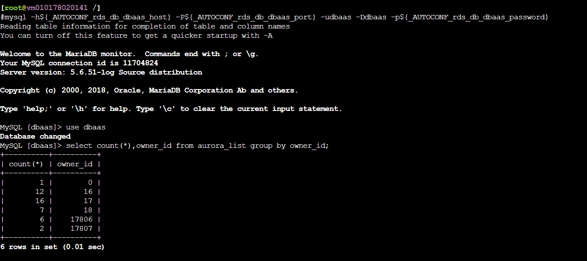

2. 获取Aurora托管实例的实例ID。

   ```text
   select a.custins_id, ci.ins_name, a.owner_id, a.cluster_name 
   from aurora_list a 
   left join cust_instance ci on a.custins_id = ci.id 
   where owner_id in (${owner_id});
   ```

   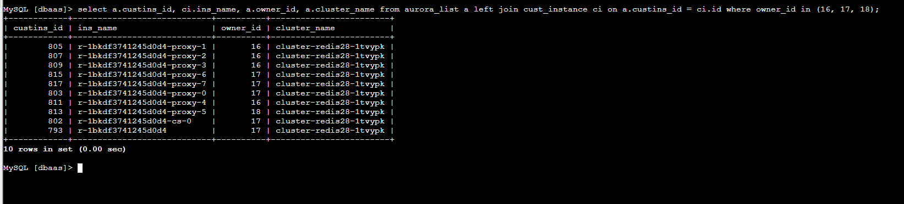

**方案二**

调用Aurora的API：


在Aurora的docker中执行 `curl    http://127.0.0.1:9093/api/workbook` 调用接口查询。

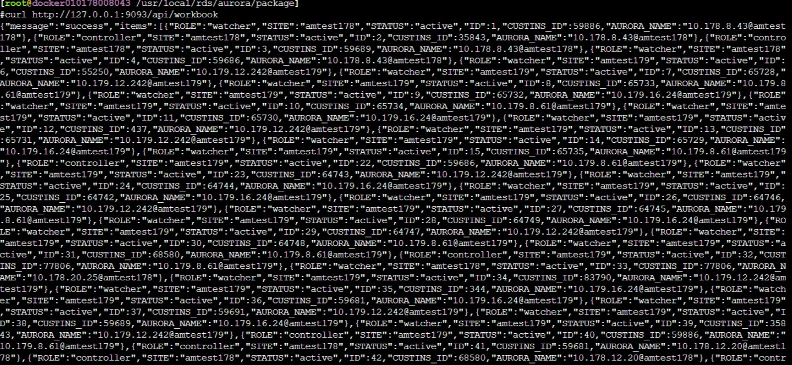

<a id="section-8-1-3"></a>

### 8.1.3. RDS单扩双

本文介绍RDS单扩双的具体操作。

**支持说明**

- 适用版本V3.8.1之后。

- 支持的引擎MySQL、Redis、PgSQL、PPAS。

**背景说明**

RDS容灾功能实现的前提是实例的主备库分别在不同的两个机房中, 当主机房整体掉电后可以通过ASR来做机房级别切换，将用户流量切到备机房。

- 问：为什么RDS不能在部署阶段做掉实例的单变双操作，而需要人工干预？

  答：因发现proxy实例可能存在，在单机房环境上绑定到slb上的时候未传入site_id，当变成双机房实例时，需要重新挂载才能将site_id传给slb。

- 问：slb重新挂载的影响是什么？

  答：因重新挂载slb链路用户的长连接会断开，需要用户的业务代码重新建立连接，用户会感知到。

**工具**

新版本工具multi_tools.tar.gz（更新于2022-08-18）。

**操作步骤**

1. 上传文件到rds-maotai.PengineMaster容器中，进行解压。

   ```bash
   tar -xf multi_tools.tar.gz -C /root
   cd /root/rds
   # 修改配置⽂件 
   vim conf.yml 
   # rebuild_ins_names 为要备份的实例名列表, 逗号分隔; 如果为空是为全量迁移
   # etc.  rebuild_ins_names: rm-xxxx,rm-xxxxx
   #################################################

   cluster:
     - cluster_name: cluster-mysql56
       db_type: mysql
       db_version: "5.6,5.7,8.0"
       site_name: 
       character_type: normal
       rebuild_ins_names:
     - cluster_name: cluster-redis28
       db_type: redis
       db_version: "2.8,4.0,5.0"
       site_name: 
       character_type: normal,cs,db,proxy,logic
       rebuild_ins_names:
     - cluster_name: cluster-pgsql94
       db_type: pgsql
       db_version: "9.4,10.0"
       site_name: 
       character_type: normal
       rebuild_ins_names:
     - cluster_name: cluster-ppassql93
       db_type: ppassql
       db_version: "9.3,9.4,10.0"
       site_name:
       character_type: normal
       rebuild_ins_names:
     - cluster_name: cluster-mssql2008
       db_type: mssql
       db_version: "2008r2"
       site_name:
       character_type: normal
       rebuild_ins_names:

   timeout: 300000

   ################################################


   ##1. 实例备库重搭到备机房
   python main.py rebuild
   ##2. 刷新所有实例的slb挂载信息，如是proxy链路实例可能会有闪断需要与⽤户确定好时间再操作
   python main.py flush_slb
   ##2.1 刷新单个实例的slb挂载信息，如是proxy链路实例可能会有闪断需要与⽤户确定好时间再操作
   python main.py flush_slb_cid <实例ID>

   ## 可以⾸先做第⼀步确保实例分布在主备两个机房，可以通过杜康->系统管理->容灾切换中查看状态, 该步骤无
   任何影响
   ## 与⽤户确定好时间后开始操作第⼆步（如果操作了第⼆步就不需要再操作2.1步）
   ```

2. 修改配置文件conf.yml。

   配置文件具体信息中db_type和character_type的对应关系：

   | db_type | character_type |
   | --- | --- |
   | mysql | mysql |
   | redis | normal,cs,db,proxy,logic |
   | pgsql | normal |
   | ppassql | normal |
   | mssql | normal |

3. 获取实例列表，获取方法详见RDS获取Aurora托管实例的方法。

4. 登录Dbaas执行单扩双脚本，实现备库重搭。

**Yaochi库可用区信息订正**

**操作背景**

单变双后，实例的可用区会发生变化，为不影响使用的变配、clone等动作需要单独订正对应Yaochi库的实例信息。

**操作方法**

1. 登录ops1机器，将fix_zone.py保存到ops1的任意目录下。

2. 执行 `python fix_zone.py ${region_id}` ，将会输出需要订正的SQL语句，登录对应的Yaochi库执行sql订正即可。

   其中，${region_id}是指环境的region名称。

   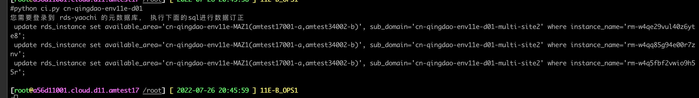

<a id="section-8-1-4"></a>

### 8.1.4. RDS双变单

本文介绍RDS双变单的具体操作。

**支持说明**

- 适用版本V3.17.0之后。

- 支持的引擎：MySQL、Redis、PgSQL物理机形态的容灾实例。

- 同时也支持MiniRDS下的实例。

**目的**

在搬迁备机房时，还原双机房的RDS实例变成单机房的RDS实例，保证只有一个实例在单机房情况下拥有高可用能力。

**思路**

RDS做单变双时，会执行单扩双的脚本，将备库搭到备机房，从这个RDS的脚本出发，将备库的方向改成原来主机房。

**工具**

新版本工具multi_tools.tar.gz（更新于2022-08-18）。

**使用说明**

1. 上传文件到rds-maotai.PengineMaster/minirds-maotai.PengineMysql容器中，进行解压。

   ```bash
   tar -xf multi_tools.tar.gz -C /root
   cd /root/rds
   # 修改配置⽂件 
   vim conf.yml
   # rebuild_ins_names为要备份的实例名列表, 逗号分隔; 如果为空是为全量迁移
   # etc.  rebuild_ins_names: rm-xxxx,rm-xxxxx
   #################################################

   cluster:
     - cluster_name: cluster-mysql
       db_type: mysql
       db_version: "5.6,5.7,8.0"
       site_name:                      # 指定要把备节点重搭到的机房名
       character_type: normal
       rebuild_ins_names:              # 单独指定实例名进⾏操作，多个时半⾓逗号分隔
     - cluster_name: cluster-redis28
       db_type: redis
       db_version: "2.8,4.0,5.0"
       site_name:
       character_type: normal,cs,db,proxy,logic
       rebuild_ins_names:

   timeout: 300000

   ################################################


   ##1. 实例备库重搭到指定机房
   python main.py rebuild
   ```

2. 针对基线rds产品下的MySQL、Redis数据库，需要将文件上传到rds-maotai.PengineMaster容器中。

3. 针对基线minirds产品下的MySQL数据库，需要将文件上传到minirds-maotai.PengineMysql容器中。

4. 修改配置文件conf.yml。

   配置文件具体信息中db_type和character_type对应关系：

   | db_type | character_type |
   | --- | --- |
   | mysql | mysql |
   | redis | normal,cs,db,proxy,logic |
   | pgsql | normal |
   | ppassql | normal |
   | mssql | normal |

5. 获取实例列表，获取方法详见RDS获取Aurora托管实例的方法。

6. 登录Dbaas执行单扩双脚本，实现备库重搭。

<a id="section-8-2"></a>

## 8.2. MiniRDS

<a id="section-8-2-1"></a>

### 8.2.1. MiniRDS关闭和开启可用区对齐方案

本文介绍机房搬迁中MiniRDS关闭和开启可用区的具体操作。

**概述**

- 本方案主要介绍MiniRDS关闭和开启可用区的通用方案。

- 适用范围：专有云V3.X。

**风险影响**

| 序号 | 场景 | 业务影响 | 切换动作 |
| --- | --- | --- | --- |
| 1 | 关闭minirds可用区自动对齐功能 | 此操作不会影响实例业务功能，但是关闭可用区对齐以后，dr_service就不会自动把备机房实例可用区对齐到主机房。如果实例在备机房，会有以下影响：数据库连接与操作可能会有几毫秒的延迟（跨机房网络延迟），跨机房流量增加。 | Dbaas_db库执行sql修改。 |
| 2 | 开启minirds可用区自动对齐功能 | 此操作不会影响实例业务功能，开启后dr_service在实例的运维时间内就会自动把备机房实例可用区对齐到主机房，此时实例业务会闪断。在切换到主机房过程中会有以下影响：数据库连接与操作可能会有几毫秒的延迟（跨机房网络延迟），跨机房流量增加。 | Dbaas_db库执行sql修改。 |

**方案详情**

**背景**

验证minirds切换到备机房后业务运行情况，目前minirds的dr_service功能是每天晚上2点默认会对齐可用区，所以需要暂时停掉，业务验证完成后开启。

**前提条件**

客户环境检查目前是开启状态。

**操作步骤**

1. 关闭minirds可用区对齐功能。

   <ol type="i">

   <li>

   查询现场状态。

   登录dbaas_db库，登录方法参见dbaas_db库访问方法。执行如下命令查询现场状态。

   ```sql
   select * from bakowner where type = 180\G
   ```

   字段api_url中 `"need_zone_align": 1` 代表可用区对齐功能开启； `"need_zone_align": 0` 代表可用区对齐功能关闭。

   </li>

   <li>

   关闭可用区对齐功能。

   执行如下命令，修改字段api_url中 `"need_zone_align"` 为 `0` 。

   ```text
   begin; update bakowner set api_url = '{"need_zone_align": 0, "zone_align_per_num": 
   20, "zone_align_interval":   2}' where type = 180 limit 2;
   commit;
   ```

   </li>

   <li>

   确定修改成功。

   执行如下命令，查看字段api_url中 `"need_zone_align"` 值是否为 `0` ，为0说明修改成功。

   ```text
   selece * from bakowner where type = 180\G 
   ```

   </li>

   </ol>

2. 开启minirds可用区对齐功能。

   <ol type="i">

   <li>

   登录dbaas_db库执行如下命令，修改字段api_url中 `"need_zone_align"` 为 `1` 。

   ```sql
   selece * from bakowner where type = 180\G 
   begin;
   update bakowner set api_url = '{"need_zone_align": 1, "zone_align_per_num": 20, "zone_align_interval": 2}' where type = 180 limit 2; commit;
   ```

   </li>

   <li>

   确定修改成功。

   执行如下命令，查看字段api_url中 `"need_zone_align"` 值是否为 `1` ，为1说明修改成功。

   ```text
   selece * from bakowner where type = 180\G
   ```

   </li>

   </ol>

<a id="section-8-2-2"></a>

### 8.2.2. dbaas_db库访问方法

本文介绍访问dbaas_db库的操作步骤。

1. 登录MiniRDS杜康数据库管理平台，在**实例列表**页面中搜索dbaas_db实例。

   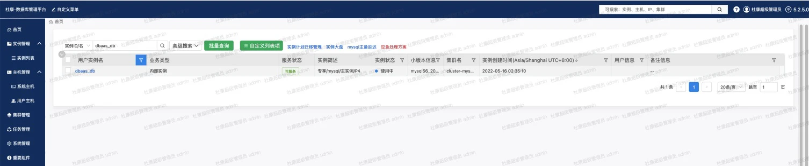

2. 在dbaas_db实例详情页，找到dbaas_db实例master节点所在的物理机。

   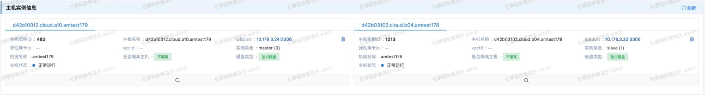

3. 从ops1进入上述第2步找到的物理机，然后使用 `my` 命令连接数据库实例。

4. 执行 `show database` 确认为dbaas数据库。

   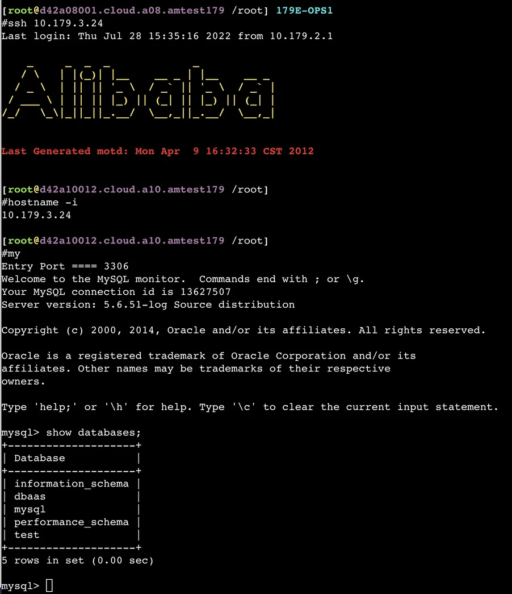

<a id="section-8-2-3"></a>

### 8.2.3. MiniRDS双变单

本文介绍RDS执行双变单的具体操作。

**目的**

在搬迁备机房时，还原双机房的MiniRDS实例变成单机房的MiniRDS实例，保证只有一个实例在单机房情况下拥有高可用能力。

**思路**

MiniRDS做单变双时，会执行单扩双的脚本，将备库搭到备机房，从这个MiniRDS的脚本出发，将备库的方向改成原来主机房。

**操作步骤**

具体操作与RDS双变单相同，请参见RDS双变单。

获取实例列表需要登录daas_db库获取，获取方法参见RDS获取Aurora托管实例的方法。

<a id="section-8-2-4"></a>

### 8.2.4. MiniRDS单变双

本文介绍MiniRDS单变双的具体操作步骤。

**操作背景**

搬迁机房上电开机后，MiniRDS实例需要执行备库重搭，实现实例跨机房高可用。

**单变双实现流程（自动）**

- minirds-integrator.RebuildSlave#组件负责MiniRDS实例单变双。

- 当A'升级后MiniRDS下各组件可以正常感知到备机房的配置，同时获取到当前集群是多机房集群。

  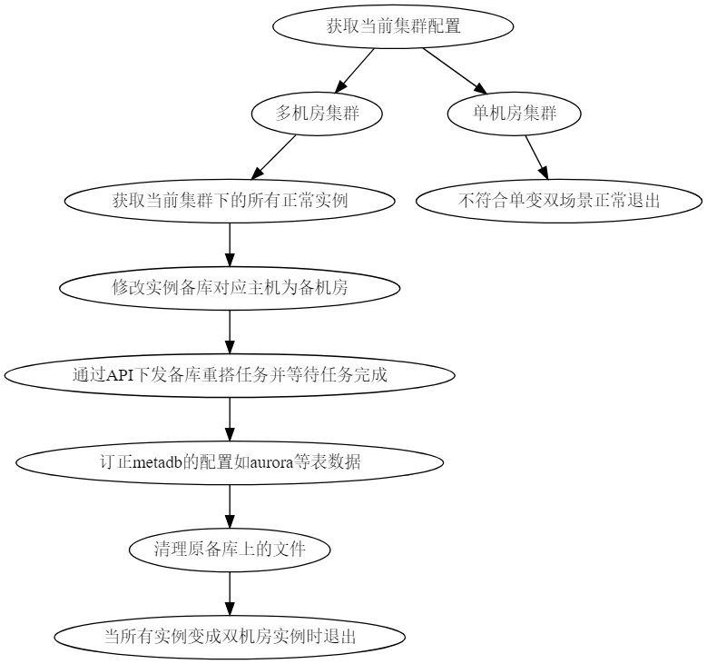

**单变双操作（手动）**

针对大项目，为减少自动化不可控的因素，需要手工实现某些实例的重搭操作。

1. 登录主机房的minirds-integrator.RebuildSlave#容器。

2. 执行如下命令，将conf.yml.j2配置文件拷贝到容器中。

   ```bash
   docker cp conf.yml.j2 <rebuildslave>:/meta/usr/local/rds/rebuild/conf.yml.j2
   ```

   conf.yml.j2配置文件：

   ```bash
   docker cp conf.yml.j2 <rebuildslave>:/meta/usr/local/rds/rebuild/conf.yml.j2

   # conf.yml.j2

   db:
     host: {{db_dbaas_host}}
     port: {{db_dbaas_port}}
     user_name: {{db_dbaas_user}}
     password: {{db_dbaas_password}}
     db_name: {{db_dbaas_name}}

   cluster:
     cluster_name: {{CLUSTER_NAME}}
     db_type: {{DB_TYPE}}
     db_version: {{DB_VERSION}}
     site_name: {{SITE_NAME}}
     ips: ""                        
     max_tasks: 10                #并⾏的任务数
     ins_names: ""                  #需要重搭的实例名 逗号分隔 必需指定不然不⼯作

   api:
     rdsapi: {{RDS_API_URL}}

   timeout: {{TIMEOUT}}
   ```

3. 将rebuild.tar.gz解压后的所有文件拷贝到minirds-integrator.RebuildSlave#容器中。

   ```bash
   docker cp <rebuild>:/usr/local/rds/rebuild/
   ```

4. 重启RebuildSlave容器，可通过 `docker logs` 查看日志。

5. 任务成功发起后，登录杜康数据库管理平台检查操作结果，任务运行失败时尝试重试。

<a id="section-8-3"></a>

## 8.3. PolarDB-X

<a id="section-8-3-1"></a>

### 8.3.1. PolarDB-X单扩双

本文介绍机房搬迁中PolarDB-X单扩双的操作步骤。

**前置操作**

1. 登录云原生分布式数据库PolarDB-X，创建PolarDB-X实例。

   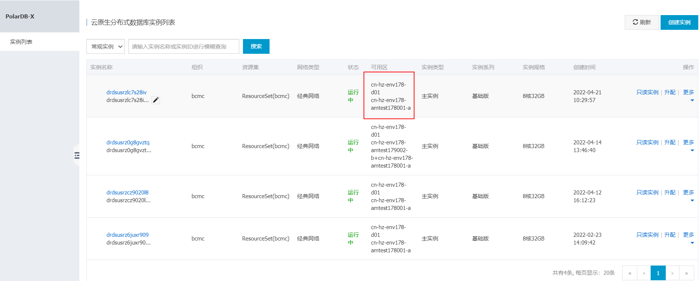

2. 在实例详情页面确认实例**当前版本**和**最新版本**一致。

   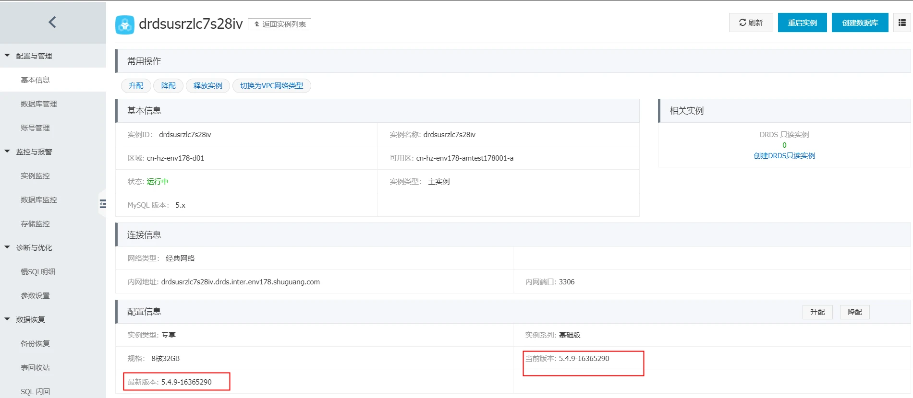

3. 登录飞天基础运维平台，进入drds产品B集群aliware-ark服务详情页面。

   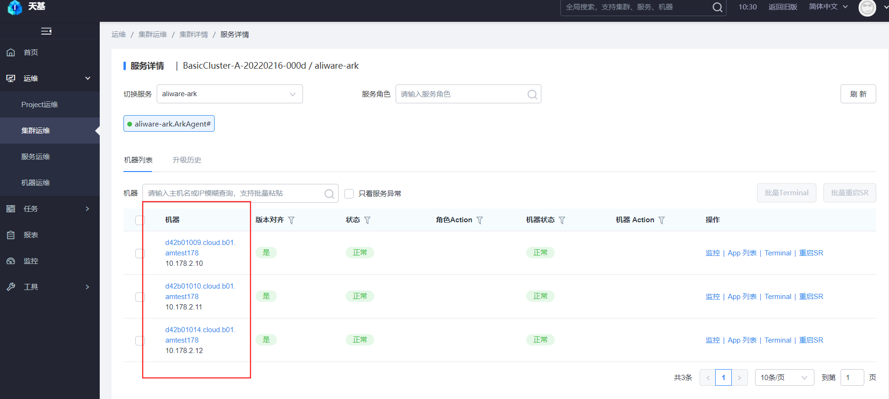

4. 分别进入登录以上3个容器界面，执行以下命令，确认实例的版本是存在的。

   > **说明**
   >
   > 命令中 `5.4.9-******` 需要替换为查询到的实际版本号 `5.4.9-16365290` 。

   ```bash
   docker images|grep corona-server | awk '{print $3}' | xargs docker inspect |grep RPM 
   |grep 5.4.9-******
   ```

   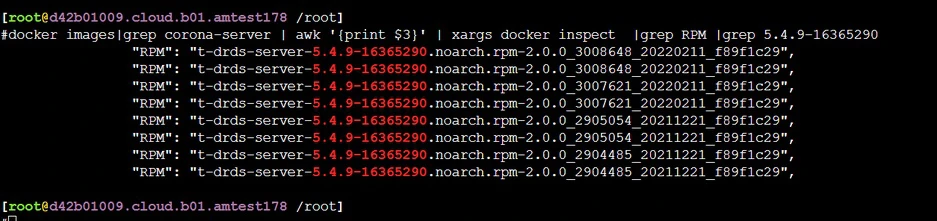

5. 实例可用区检查。

   登录Apsara Uni-Manager运维控制台，选择**产品运维**>**DRDS管家**，在**实例管理**页面确认当前是单可用区。

   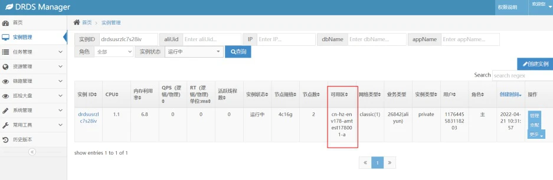

**操作步骤**

1. 进入Apsara Uni-Manager运维控制台，选择**产品运维**>**DRDS管家**，在**实例管理**页面切换实例可用区为a+b。

   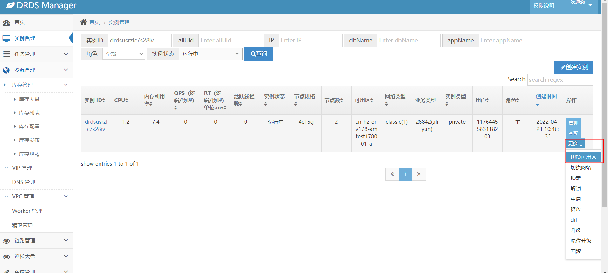

2. 切换成功，查看可用区是否为a+b。

   <ol type="i">

   <li>

   进入云原生分布式数据库PolarDB-X，在实例详情页面查看可用区切换为a+b。

   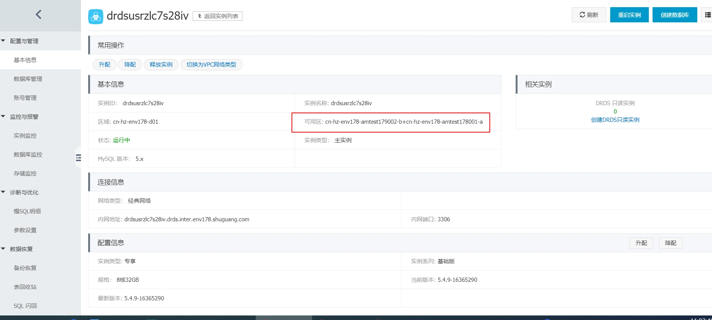

   </li>

   <li>

   进入Apsara Uni-Manager运维控制台，选择**产品运维**>**DRDS管家**，查看可用区切换为a+b，且2个节点已经在不同的可用区。

   cn-hz-env178-amtest178001-a：drds-server-1c1eeae0-911d-4078-9a28-7ff80542ec3d

   cn-hz-env178-amtest179002-b：drds-server-7d5efcb8-0838-4912-81bd-197f0879edc4

   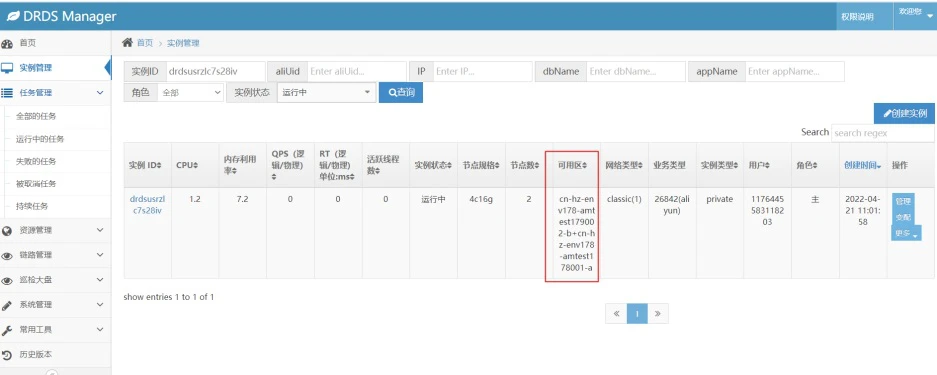

   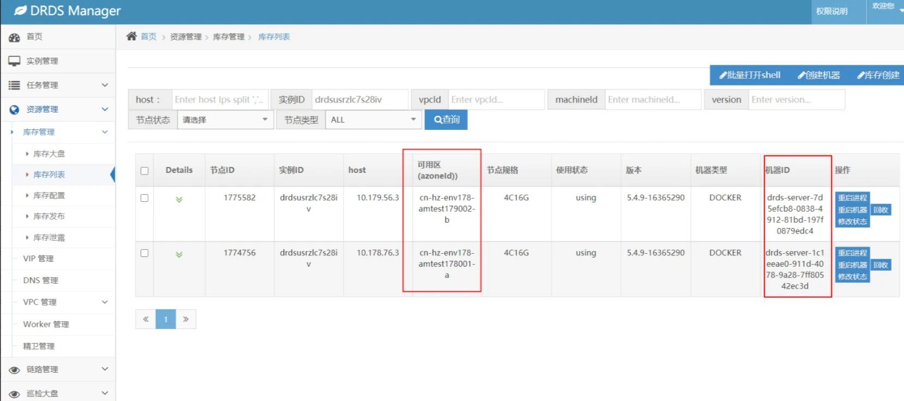

   </li>

   </ol>

3. 确认数据正确性，在aliware-ark服务上确认2个容器创建在了不同的机房。

   <ol type="i">

   <li>

   先确认a可用区节点在主机房上。

   <ol type="a">

   <li>

   在飞天基础运维平台上，进入drds产品主集群aliware-ark服务详情页面。

   </li>

   <li>

   任选一台机器进入，执行以下命令。

   > **说明**
   >
   > 命令中 容器`id` 替换成上面查到的a可用区容器id： `drds-server-1c1eeae0-911d-4078-9a28-7ff80542ec3d` 。

   ```bash
   docker --tls --tlscacert=/etc/docker/ca.pem --tlscert=/etc/docker/server-cert.pem--tlskey=/etc/docker/server-key.pem -H tcp://127.0.0.1:3376 exec -it 容器id bash
   ```

   </li>

   </ol>

   <ol type="i" start="100">

   <li>

   成功进入容器，说明a可用区的容器成功创建在主机房上。

   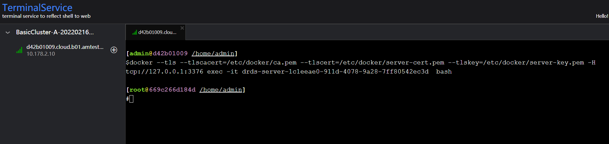

   </li>

   <li value="500">

   执行如下命令检查容器。

   ```text
   python /checkHealth.py
   ```

   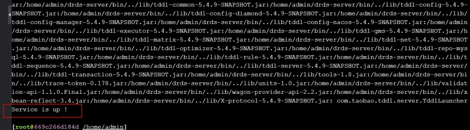

   </li>

   </ol>

   </li>

   <li>

   确认b可用区节点在备机房上。

   <ol type="a">

   <li>

   在飞天基础运维平台上，进入drds产品B集群aliware-ark服务详情页面。

   </li>

   <li>

   任选一台机器进入，执行以下命令。

   > **说明**
   >
   > 命令中 容器`id` 替换成上面查到的b可用区容器id： `drds-server-7d5efcb8-0838-4912-81bd-197f0879edc4` 。

   ```bash
   docker --tls --tlscacert=/etc/docker/ca.pem --tlscert=/etc/docker/server-cert.pem--tlskey=/etc/docker/server-key.pem -H tcp://127.0.0.1:3376 exec -it 容器id bash
   ```

   </li>

   </ol>

   <ol type="i" start="100">

   <li>

   成功进入容器，说明b可用区的容器成功创建在备机房上。

   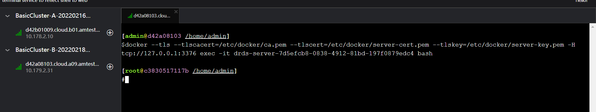

   </li>

   <li value="500">

   执行如下命令检查容器。

   ```text
   python /checkHealth.py
   ```

   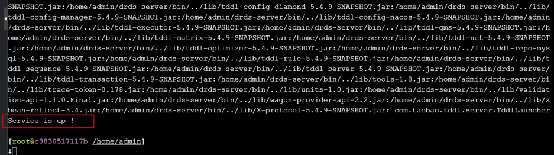

   </li>

   </ol>

   </li>

   </ol>

<a id="section-8-3-2"></a>

### 8.3.2. PolarDB-X双变单

本文以双变单到主机房为例介绍机房搬迁中PolarDB-X双变单的操作步骤。

1. 登录Apsara Uni-Manager运维控制台，进入**产品运维**>**DRDS管家**，在**实例管理**页面切换实例可用区为a。

   

2. 切换成功，查看可用区是否为a。

   <ol type="i">

   <li>

   登录云原生分布式数据库PolarDB-X，在实例详情页面查看可用区为a。

   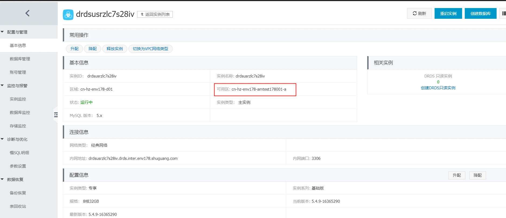

   </li>

   <li>

   进入Apsara Uni-Manager运维控制台，选择**产品运维**>**DRDS管家**，查看2个节点已经在a可用区。

   cn-hz-env178-amtest178001-a：drds-server-04214619-76d8-4a86-be34-f9b121f448af

   cn-hz-env178-amtest178001-a：drds-server-1c1eeae0-911d-4078-9a28-7ff80542ec3d

   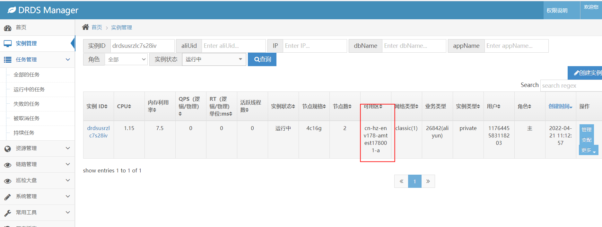

   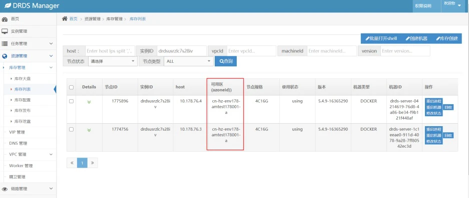

   </li>

   </ol>

3. 确认数据正确性，在aliware-ark服务上确认2个容器创建在主机房。

   <ol type="i">

   <li>

   先确认a可用区节点1在主机房上。

   <ol type="a">

   <li>

   在飞天基础运维平台上，进入drds产品主集群aliware-ark服务详情页面。

   </li>

   <li>

   任选一台机器进入，执行以下命令。

   > **说明**
   >
   > 

   

   > 命令中 容器id 替换成上面查到的a可用区容器id： drds-server-04214619-76d8-4a86-be34-f9b121f448af 。

   ```bash
   docker --tls --tlscacert=/etc/docker/ca.pem --tlscert=/etc/docker/server-cert.pem--tlskey=/etc/docker/server-key.pem -H tcp://127.0.0.1:3376 exec -it 容器id bash
   ```

   </li>

   </ol>

   <ol type="i" start="100">

   <li>

   成功进入容器，说明a可用区节点1的容器成功创建在主机房上。

   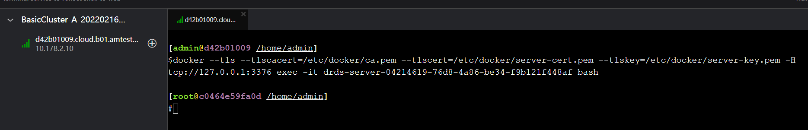

   </li>

   <li value="500">

   执行如下命令检查容器。

   ```text
   python /checkHealth.py
   ```

   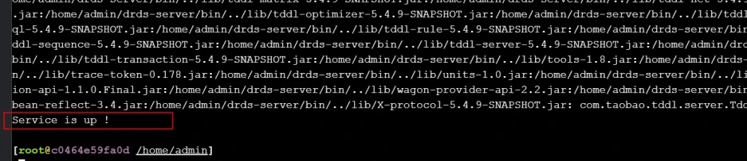

   </li>

   </ol>

   </li>

   <li>

   再确认a可用区节点2也在主机房上。

   <ol type="a">

   <li>

   在飞天基础运维平台上，进入DRDS产品B集群aliware-ark服务详情页面。

   </li>

   <li>

   任选一台机器进入，执行以下命令。

   > **说明**
   >
   > 

   

   > 命令中 容器id 替换成上面查到的a可用区容器id： drds-server-1c1eeae0-911d-4078-9a28-7ff80542ec3d 。

   ```bash
   docker --tls --tlscacert=/etc/docker/ca.pem --tlscert=/etc/docker/server-cert.pem--tlskey=/etc/docker/server-key.pem -H tcp://127.0.0.1:3376 exec -it 容器id bash
   ```

   </li>

   </ol>

   <ol type="i" start="100">

   <li>

   成功进入容器，说明a可用区节点2的容器也成功创建在主机房上。

   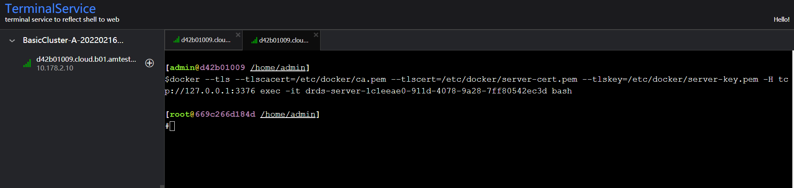

   </li>

   <li value="500">

   执行如下命令检查容器。

   ```text
   python /checkHealth.py
   ```

   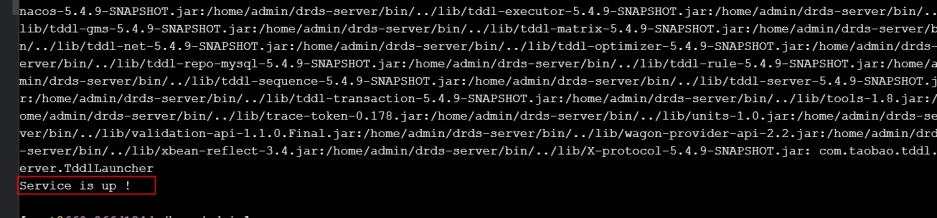

   </li>

   </ol>

   </li>

   </ol>

<a id="section-8-4"></a>

## 8.4. DTS

本文介绍机房搬迁中DTS在存留机房重启同步任务的具体操作。

**创建同步任务**

1. 登录飞天基础运维平台。

2. 在左侧导航栏选择**产品集群运维**，过滤关键字“dts”，确认DTS双机房服务状态正常。

3. 登录DTS数据传输控制台，在**数据同步**页面单击**创建同步作业**，创建一个数据同步任务。

   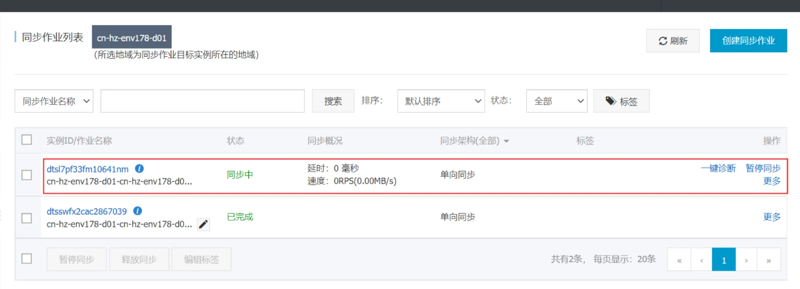

   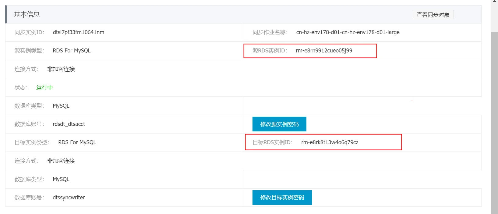

4. 登录DTS运维平台，在任务**基本信息**页面单击**登录机器**。

   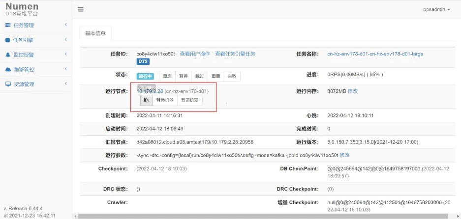

**验证同步功能**

1. 查询源实例数据。

   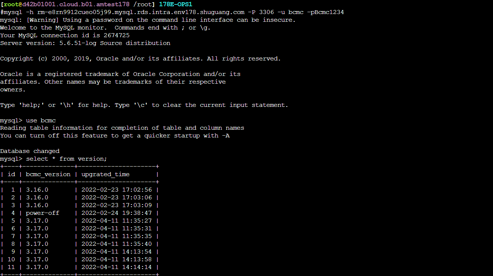

2. 查询目标实例数据。

   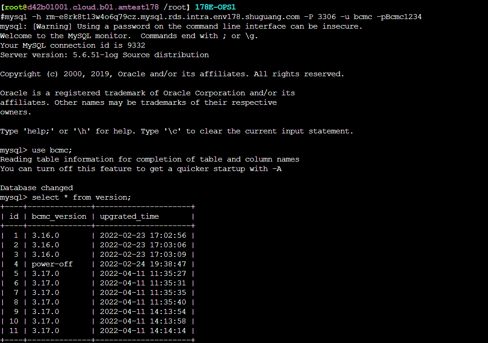

3. 验证同步功能。

   在源实例中做一些增删改操作，发现修改过的数据同时也会同步到目标实例中。

   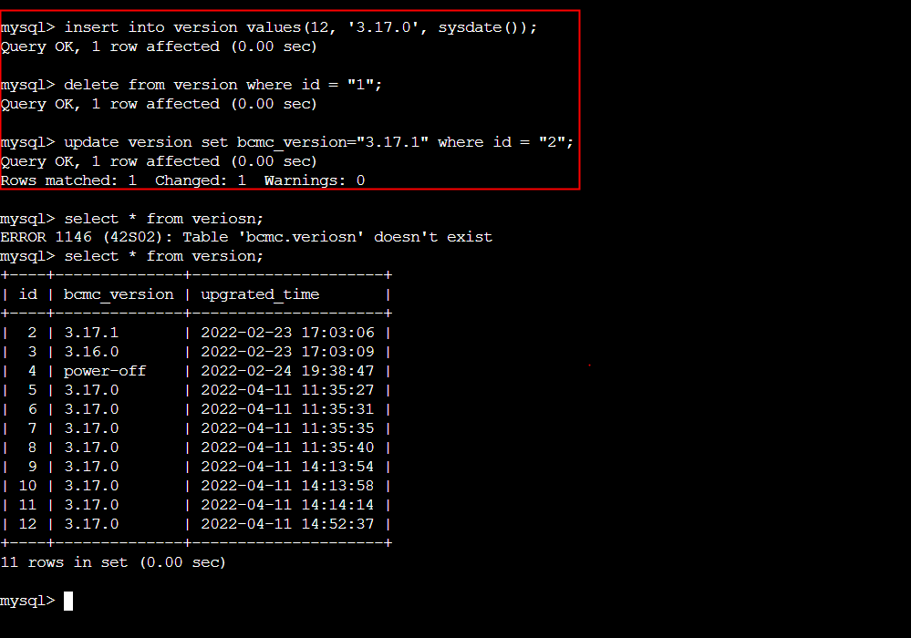

**关闭DTS备机房集群，查看同步任务是否能够正常执行**

1. 关闭备机房集群。

   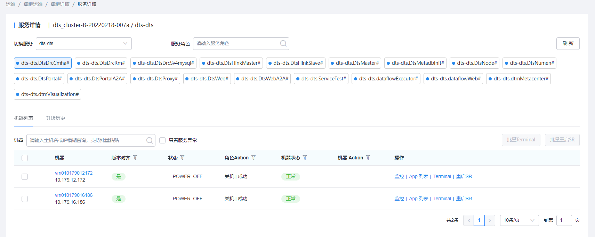

2. 再次对源实例做增删改查操作。

   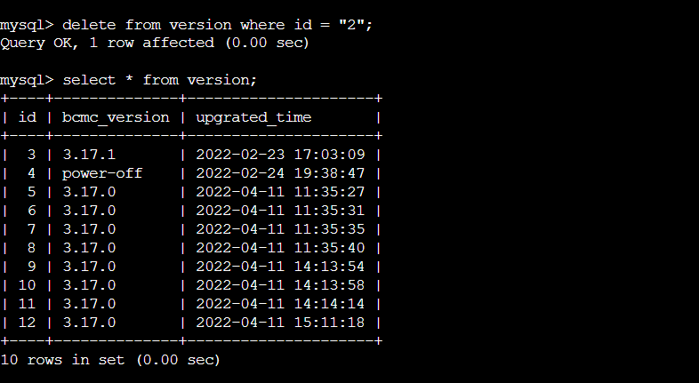

3. 查询目标实例数据，同步任务不再进行数据同步。

   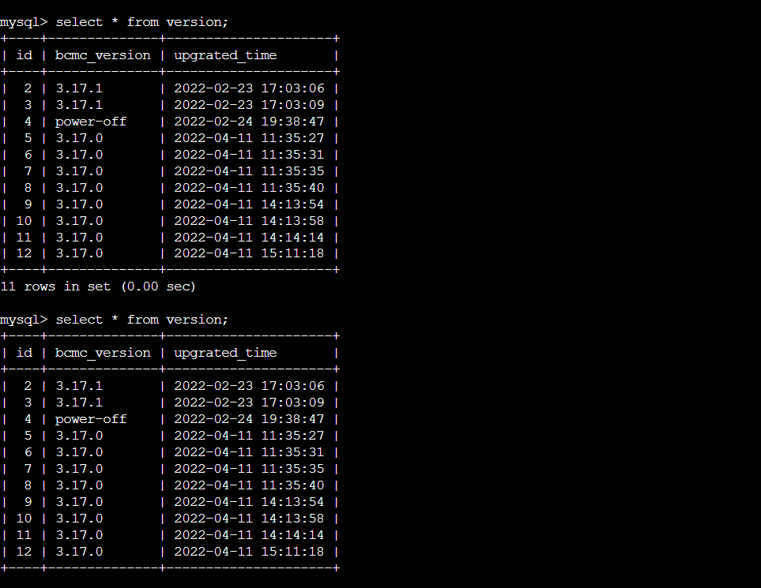

**重启同步任务**

1. 重启同步任务，重启后发现运行节点已经自动分配为主机房节点。

   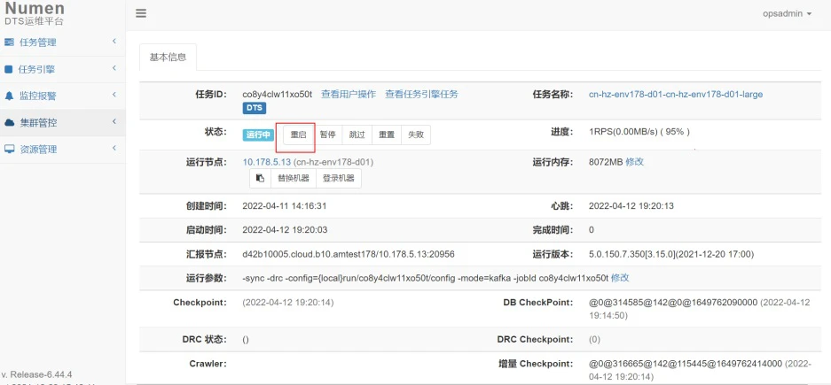

2. 再次查询目标实例数据，数据已经成功同步。

   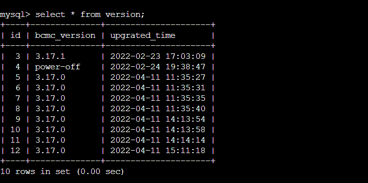

<a id="section-8-5"></a>

## 8.5. TableStore & TableStoreInner

本文介绍TableStore & TableStoreInner停止主备同步、删除备集群数据表以及恢复主备同步的具体操作。

**背景**

在机房搬迁场景中，首先需要通过ASR把Tablestore的主集群切换到非搬迁（驻守）机房，然后停止主集群到备机群的主备同步，再到待搬迁机房、即备集群上面去清空表数据。待搬迁完成、被搬迁机房的备集群在新址重新上线之后，重新打开主备同步。由于被搬迁机房备集群之前的表数据已经被清空，因此重新打开主备同步之后，非搬迁（驻守）机房主集群会向搬迁机房（备集群）同步全量数据。

本文中，主集群一定位于非搬迁、驻守的机房，主集群始终对外提供服务；备集群一定位于被搬迁机房，在搬迁过程中，备集群不对外提供服务。

本文描述的方案，适用于V3.16及后续版本的TableStore & TableStoreInner。

**操作步骤**

1. 关闭自动建立主备。

2. 去除同步关系和链路。

3. 清理备集群数据。

4. 恢复主备同步。

   > **说明**
   >
   > 以上步骤需要按顺序执行，每个操作步骤都要进行验证。

<a id="section-8-5-1"></a>

### 8.5.1. 关闭自动建立主备

本文介绍TableStore和TableStoreInner关闭自动建立主备功能的具体操作。针对V3.14版本的TableStoreInner集群，如果需要关闭自动建立主备功能，请参见V3.14版本TableStoreInner关闭自动建立主备功能。

1. 取消集群上的主备相关配置。

   <ol type="i">

   <li>

   登录TableStore/TableStoreInner主集群的TableStoreOCM.OCM#，在 `/apsara/ots_ocm/client` 目录下执行如下命令。

   ```text
   python2.7 ocm_admin.py uc --cluster_setting='{"EnableAutoBuildReplication":false}' 
   主集群名
   ```

   </li>

   <li>

   执行如下命令确认 `"EnableAutoBuildReplication"` 已经改为 `false` 。

   ```text
   python2.7 ocm_admin.py gc 主集群名
   ```

   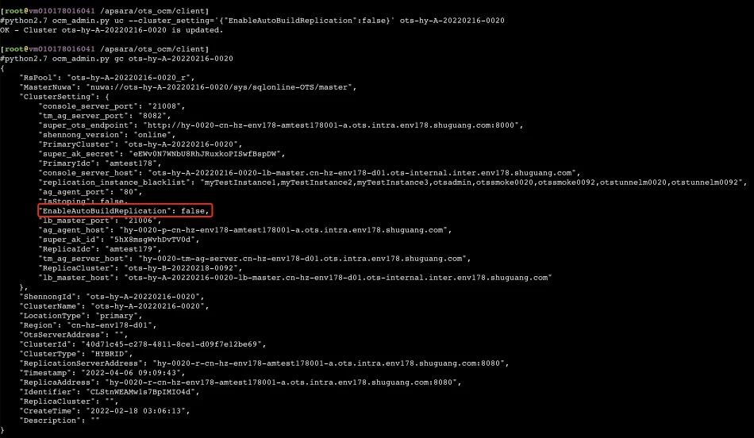

   上图中PrimaryCluster & ReplicaCluster的值，并不会随ASR主备切换而改变；LocationType的值，会随着ASR主备切换而改变。

   </li>

   <li>

   登录备集群的TableStoreOCM.OCM#，在 `/apsara/ots_ocm/client` 目录下执行如下命令。

   ```text
   python2.7 ocm_admin.py uc --cluster_setting='{"EnableAutoBuildReplication":false}' 
   备集群名
   ```

   </li>

   <li>

   执行如下命令确认 `"EnableAutoBuildReplication"` 已经改为 `false` 。

   ```text
   python2.7 ocm_admin.py gc 备集群名
   ```

   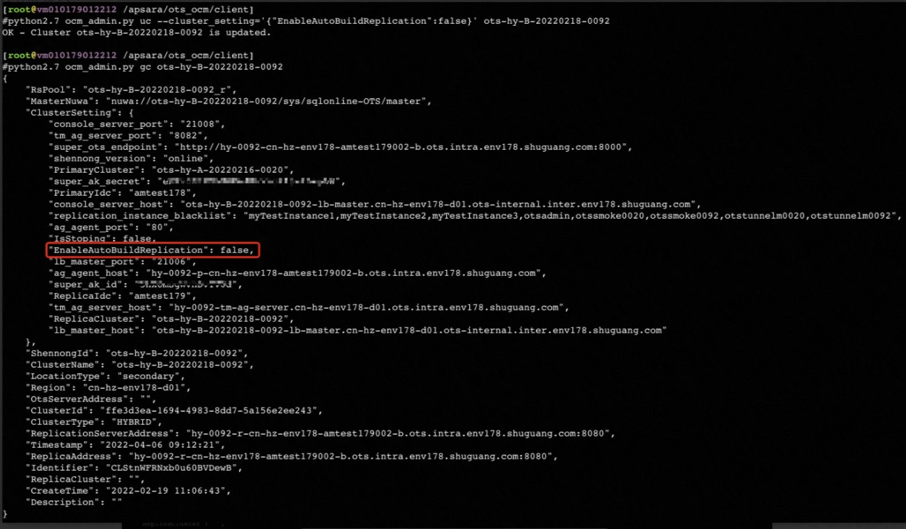

   </li>

   </ol>

2. 分别登录到主备集群AG，重启ots_replication_tool。

   在TableStore主备集群的TableStore.InitCluster#或TableStoreInner.InitCluster#中，分别执行如下命令。

   > **说明**
   >
   > - TableStore集群需要在TableStore.InitCluster#上执行命令。
   >
   > - TableStoreInner集群需要在TableStoreInner.InitCluster#上执行命令。

   ```bash
   cd /apsara/ots_replication_tool 

   # 移除ots_replication_tool的配置⽂件
   mv config.json config_bak.json 

   # 找到ots_replication_tool的start脚本的pid、并kill掉： 
   ps aux | grep ots_replication_tool | grep -v grep | awk '{print $2}' | xargs 
   kill -9
   ```

<a id="section-8-5-2"></a>

### 8.5.2. 去除同步关系和链路

本文介绍TableStore和TableStoreInner去除同步关系和链路的具体操作。

1. 取消每个实例的主备同步关系（自动化）。

   

   登录TableStore主集群的TableStoreOCM.OCM#，在 /apsara/ots_ocm/client 目录下执行脚本ots_cancel_synchronization.py。

2. 取消集群上的主备关系。

   

   <ol type="i">

   <li>

   登录TableStore主集群的TableStoreOCM.OCM#，在 /apsara/ots_ocm/client 目录下执行如下命令设置ReplicaCluster为空。

   ```text
   python2.7 ocm_admin.py uc --replica_cluster="" 主集群名
   ```

   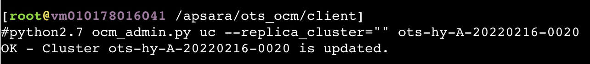

   </li>

   <li>

   更改后通过以下命令验证ReplicaCluster已经为空（如果没更新，隔几秒重试一次）。

   ```text
   python2.7 ocm_admin.py gc 主集群名 
   ```

   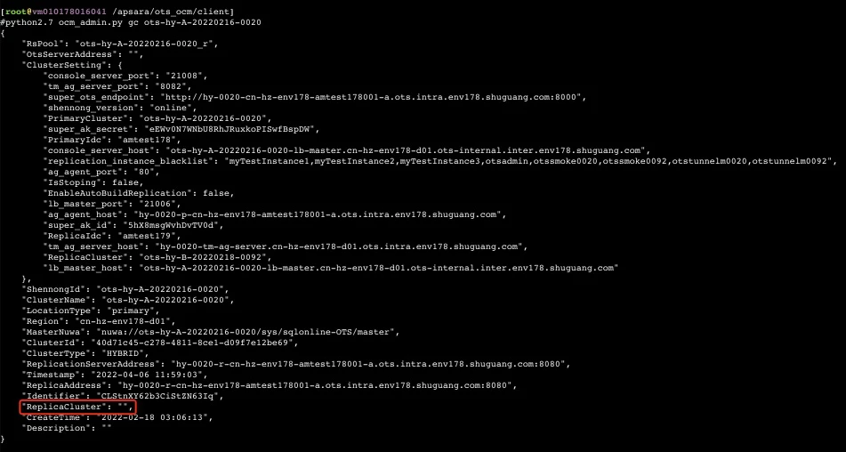

   </li>

   </ol>

3. 重置表的同步状态。

   <ol type="i">

   <li>

   登录主集群的TableStore.InitCluster#或TableStoreInner.InitCluster#，执行如下命令。

   **说明**

   ```text
   rm -rf set_table_terminated.shecho "source ~/.bashrc" >> 
   set_table_terminated.shecho "alias sql='/apsara/deploy/sqlonline_console -i false -d OTSPublicDB -s sqlonline-OTS -m admin -c  '" >> set_table_terminated.sh alias sql='/apsara/deploy/sqlonline_console -i false -d OTSPublicDB -s sqlonline-OTS -m admin -c  'sql lt | grep -v "^TableName" | awk {'print "sql \"srs " $1 " -mode TERMINAT
   ED -empty_target -auto_init true -replicatable false\""'} >> 
   set_table_terminated.sh # 打开 set_table_terminated.sh 确认⼀下表名cat set_table_termi
   nated.sh # 执⾏命令，关闭表的同步sh set_table_terminated.sh # 查询 table group# inner上
   有odps的实例，odps⽤的是ots的⼀个老模型（public⽤户不会使⽤），# odps除了table之外还会有tablegroup；public集群如果是给odps单独创建的集群，也会有table # group。# 此外，⽤ sql "gatms" | 
   awk {'print $1'} 这个命令，可以⽤来获取所有独立的 table 和 # table group。sql ltg #如果存
   在table group, 那么table group 也需要关掉同步sql "srs ${tableGroupName} -mode 
   TERMINATED -empty_target -auto_init true -replicatable false"
   ```

   操作结果如下图：

   

   

   </li>

   <li>

   继续在主集群的TableStore.InitCluster#或TableStoreInner.InitCluster#中，执行如下命令。

   ```text
   # 验证：通过sql "grs 表名" 查看上述每⼀张表的同步状态都为TERMINATED，即同步为关闭状态。rm -rf 
   query_table.shecho "source ~/.bashrc" >> query_table.shecho "alias 
   sql='/apsara/deploy/sqlonline_console -i false -d OTSPublicDB -s sqlonline-OTS -m admin -c  '" >> query_table.shsql lt | grep -v "^TableName" | awk {'print "sql \"grs
   " $1 " \""'} >> query_table.sh # 打开 query_table.sh 确认⼀下表名cat query_table.sh # 
   执⾏命令，验证表的同步已经关闭sh query_table.sh
   ```

   操作结果如下图：

   

   

   </li>

   </ol>

<a id="section-8-5-3"></a>

### 8.5.3. 清理备集群数据

本文介绍TableStore和TableStoreInner清理备集群数据的具体操作。

> **重要**
>
> 清理数据的操作一定要在备集群执行。

1. Disable备集群的数据表。

   <ol type="i">

   <li>

   查询在备集群上的实例。

   登录备集群的TableStoreOCM.OCM#，在 `/apsara/ots_ocm/client` 目录下执行。

   ```text
   # 在OCM机器，/apsara/ots_ocm/client下执⾏：

   python2.7 ocm_admin.py libc 备集群名

   # 正常只有otssmoke开头和otstunnelm开头的两个系统测试实例，如果有其他实例，需要仔细确认后再进⾏以
   下操作。获取结果中的InstanceId，在下⾯获取表列表时去除这两个实例ID下的表。
   ```

   操作结果如下图：

   

   </li>

   <li>

   登录到备集群的TableStore.InitCluster#或TableStoreInner.InitCluster#中，执行如下命令。

   > **说明**
   >
   > - TableStore集群需要在TableStore.InitCluster#上执行命令。
   >
   > - TableStoreInner集群需要在TableStoreInner.InitCluster#上执行命令。

   ```bash
   rm -rf disable_table.sh
   echo "source ~/.bashrc" > disable_table.sh
   echo "alias sql='/apsara/deploy/sqlonline_console -i false -d OTSPublicDB -s sqlonline-OTS -m admin -c  '" >> disable_table.sh

   # 获取所有需要删除的表列表，剔除掉本来就是备集群上的两个测试实例（otssmoke和otstunnelm开头的实例
   ，参⻅上图）：
   alias sql='/apsara/deploy/sqlonline_console -i false -d OTSPublicDB -s sqlonline-OT
   S -m admin -c  '

   sql lt | grep -v "^TableName" | grep -v "^otssmoke" | grep -v <备集群下otstunnelm开头
   的实例的InstanceId，参⻅上图> | awk {'print "sql \"disabletable " $1 "\""'} >> disable_table.sh

   # 确认命令和表名
   cat disable_table.sh

   # 执⾏命令，disable掉备集群的表
   sh disable_table.sh
   ```

   操作结果如下图：

   

   > **重要**
   >
   > 如有问题，可以在备集群的TableStore.InitCluster#或TableStoreInner.InitCluster#上面进行回滚，命令如下。
   >
   > ```bash
   > rm -rf enable_table.sh
   > echo "source ~/.bashrc" > enable_table.sh
   > echo "alias sql='/apsara/deploy/sqlonline_console -i false -d OTSPublicDB -s sqlonline-OTS -m admin -c  '" >> enable_table.sh
   >
   > alias sql='/apsara/deploy/sqlonline_console -i false -d OTSPublicDB -s 
   > sqlonline-OTS -m admin -c  '
   >
   > sql lt | grep -v "^TableName" | grep -v "^otssmoke" | awk {'print "sql \"enabletable " $1 "\""'} >> enable_table.sh
   >
   > # 确认命令和表名
   > cat enable_table.sh
   >
   > # 执⾏命令，enable这些表
   > sh enable_table.sh
   > ```

   </li>

   </ol>

2. Disable数据表之后，静默一段时间，观察赤骥访问监控无异常。

   继续在备集群的TableStore.InitCluster#或TableStoreInner.InitCluster#执行备集群删表操作。

   ```bash
   # 获取已经被disable的表
   rm -rf disabled_table
   alias sql='/apsara/deploy/sqlonline_console -i false -d OTSPublicDB -s sqlonline-OTS 
   -m admin -c  '

   # OTS/OTSINNER 中的表被disable掉以后状态可能是disabled、也可能是unplaned
   sql lp | grep disabled | awk {'print $4'} | sort | uniq > disabled_table
   sql lp | grep unplaned | awk {'print $4'} | sort | uniq >> disabled_table

   # 检查表名字
   cat disabled_table

   rm -rf delete_table.sh
   echo "source ~/.bashrc" > delete_table.sh
   echo "alias sql='/apsara/deploy/sqlonline_console -i false -d OTSPublicDB -s sqlonline-OTS -m admin -c  '" >> delete_table.sh

   cat disabled_table  | awk {'print "echo " $1 " | sql \"dt " $1 "\""'}  >> delete_table.sh

   # 检查命令，格式为 echo 表名 | sql "dt 表名"
   cat delete_table.sh

   # 执⾏
   sh delete_table.sh

   # 查询table group
   sql ltg

   # 如果存在table group, 那么table group 也需要删除, ${tableGroupName} 是上⼀步查询到的
   # tableGroupName
   sql "dtg ${tableGroupName}"
   ```

   操作结果如下图：

   

   

   

   

   

   > **重要**
   >
   > 如有问题，执行以下命令进行回滚。
   >
   > ```text
   > # 查看在回收站中的表：
   >
   > sql "ListRecycleBinTable"
   >
   > # 恢复某个表
   >
   > sql "RestoreTable 表名 表ID"
   > ```

3. 验证数据清理结果。

   登录备集群的TableStore.InitCluster#或TableStoreInner.InitCluster#执行以下命令。

   ```text
   alias sql='/apsara/deploy/sqlonline_console -i false -d OTSPublicDB -s sqlonline-OTS 
   -m admin -c  '

   # 查看备集群上的表，预期只有otsmoke和otstunnel的测试实例的表，其余实例此时不应该继续出现
   sql lt
   ```

   操作结果如下图：

   

   此时如果在主集群的TableStore.InitCluster#或TableStoreInner.InitCluster#执行上述命令，则可以看到更多表格。原因是，之前从备集群删除了表格，而主集群的表格继续保留、用以支持业务。

   

<a id="section-8-5-4"></a>

### 8.5.4. 恢复主备同步

本文介绍TableStore和TableStoreInner恢复主备同步的具体操作。

1. 恢复主集群配置。

   <ol type="i">

   <li>

   登录主集群的TableStoreOCM.OCM#，在 `/apsara/ots_ocm/client` 目录下执行如下命令。

   ```text
   python2.7 ocm_admin.py uc --cluster_setting='{"EnableAutoBuildReplication":true}' 
   主集群名
   ```

   </li>

   <li>

   执行如下命令，查看 `"EnableAutoBuildReplication"` 配置为 `true` 。

   ```text
   python2.7 ocm_admin.py gc 主集群名
   ```

   

   </li>

   </ol>

2. 恢复备集群配置。

   <ol type="i">

   <li>

   登录备集群的TableStoreOCM.OCM#，在 `/apsara/ots_ocm/client` 目录下执行如下命令。

   ```text
   python2.7 ocm_admin.py uc --cluster_setting='{"EnableAutoBuildReplication":true}' 
   备集群名
   ```

   </li>

   <li>

   执行如下命令，查看 `"EnableAutoBuildReplication"` 配置为 `true` 。

   ```text
   python2.7 ocm_admin.py gc 备集群名
   ```

   

   </li>

   </ol>

3. 登录主集群的TableStore.InitCluster#或TableStoreInner.InitCluster#，进入 `/apsara/ots_replication_tool` 目录，执行以下命令可以查看TableStore的容灾集群中的实例的同步情况。

   ```text
   /home/tops/bin/python command.py get_rep_status
   ```

   

4. 在备集群的TableStore.InitCluster#或TableStoreInner.InitCluster#上执行以下命令。

   ```text
   alias sql='/apsara/deploy/sqlonline_console -i false -d OTSPublicDB -s sqlonline-OTS 
   -m admin -c  '

   # 查看备集群上的表
   sql lt 
   ```

   

<a id="section-8-5-5"></a>

### 8.5.5. V3.14版本TableStoreInner关闭自动建立主备功能

本文介绍V3.14版本TableStoreInner关闭自动建立主备功能的具体操作，需要关闭ots_replication_tool。

- **方案1：**

  <ol type="i">

  <li>

  在主集群的ag（TableStoreInner服务的InitCluster所在机器）上，进入 `/apsara/ots_replication_tool` 目录。

  </li>

  <li>

  检查当前主备同步状况  `./command.py get_rep_status` ， 检查 `log/ots.log` ，确认当前主备功能正常。

  </li>

  <li>

  修改config.json，将其中的 `auto_build_replication` 字段改为 `false` 。等待几分钟，检查log/ots.log，观察日志中出现 `auto build replication disabled.` ，表示已经关闭ots_replication_tool工具。

  </li>

  <li>

  注意该方案在进程重启或者机器迁移后配置会重新生成，可以执行 `sudo chown root:root config.json` 将config.json设置为root权限，避免进程重启后重新生成（但不能避免机器迁移等情况）。

  > **重要**
  >
  > 如有问题，可执行回滚方案：将config.json的auto_build_replication重新改为true，权限重新设置为admin账户。

  </li>

  </ol>

- **方案2：**

  通过tianji的 `stop sr` 功能，将ots_replication_tool所在的SR关闭，观察进程不再启动。

  > **重要**
  >
  > 如有问题，可执行回滚方案：通过tianji命令，再将SR重新启动。

<a id="section-8-6"></a>

## 8.6. OSS

<a id="section-8-6-1"></a>

### 8.6.1. 删除同步边、备集群数据

本文描述对单个bucket删除同步边、备集群数据的具体操作。

1. 查询id & key & host的值，供查询bucket同步边信息使用。

   在oss-ocm-server.OcmServer#上执行如下命令：

   ```text
   grep -E "ocm_host|ocm_access_id|ocm_access_key" /cloud/app/oss-ocm-
   server/OcmServer#/ocm_server_rule_init/current/conf.local/init_ocm_db.conf.jj2
   ```

   查询信息如下：

   

2. 查看bucket "test-edas1649320314"的同步边信息。

   - 查询方法1：在oss-ocm-server.OcmServer#上执行以下命令，其中id & key & host的值为上一步的查询结果。

     ```text
     /home/tops/bin/python /cloud/app/oss-ocm-
     server/OcmServer#/ocm_server/current/ocm_cmd gbm test-edas1649320314 --
     id=kNu1kMgHur0hfwbb --key=3zvCCeeriryn1ubneZdlbd8l9BD1mt --
     host=ocm.oss.intra.env9b.shuguang.com| grep -E "Sync|Location"
     ```

     查询信息如下：

     > **说明**
     >
     > SyncStatus为0，代表主备同步尚未完成。主备同步完成之后，SyncStatus会恢复成1。

     

     从上图可见，每一个OSS bucket有两条同步边：一条是从主到备，另一条是从备到主。

   - 查询方法2：通过oss-ocm-server服务oss_meta数据库查询。

     

3. 查看bucket "test-edas1649320314"所存储的文件。

   - 查询方法1：在主备机房的oss-quota-master.QuotaMaster#，执行如下命令。

     ```text
     /apsara/deploy/osu ls oss://test-edas1649320314
     ```

     主机房查询信息如下：

     

     备机房查询信息如下：

     

   - 查询方法2：登录Apsara Uni-Manager混合云管理平台（ASCM），在**对象存储**页面查看桶中的文件列表。

     

4. 删除bucket的同步边。

   将oss_kit.py上传至A机房oss-ocm-server.OcmServer#机器的 `/cloud/app/oss-ocm-server/OcmServer#/ocm_server/current` 目录，执行如下命令。

   ```text
   ./oss_kit.py delete_sync -b test-edas1649320314
   ```

   执行结果如下图：

   

   删除同步边之后，在oss-ocm-server.OcmServer#上可以看到同步边信息已经被清空。

   

5. 删除备机房数据。

   <ol type="i">

   <li>

   在备机房oss-quota-master.QuotaMaster#执行如下命令。

   ```text
   /apsara/deploy/osu cleanobjects oss://test-edas1649320314
   ```

   操作结果如下：

   

   </li>

   <li>

   在备机房oss-quota-master.QuotaMaster#，查询到bucket "test-edas1649320314"下面数据已经清空。

   

   </li>

   <li>

   在主机房oss-quota-master.QuotaMaster#，查询到bucket "test-edas1649320314"下面数据继续存在。

   

   > **说明**
   >
   > - 生成删除OSS数据的脚本的命令：
   >
   >   ```bash
   >   source ~/.bashrc
   >
   >   # 该脚本⽤于⽣成删除bucket 数据的脚本
   >   rm -rf delete_oss_data.sh
   >   echo "source ~/.bashrc" > delete_oss_data.sh
   >
   >   # bucket_list 为bucket列表⽂件名称
   >   # 3.16 和 3.17 之后的版本删除bucket中数据的命令略有不同, 请根据版本选择下⾯两条命令
   >   中的⼀条
   >   # 3.16版本使⽤这条命令
   >   cat bucket_list | awk {'print "/apsara/deploy/osu cleanobjects oss://" $1
   >   ""'} >> delete_oss_data.sh
   >   # 3.17之后的版本使⽤这条命令
   >   cat bucket_list | awk {'print "/apsara/deploy/osu cleanobjects oss://" $1
   >   " --kv_client_EnableSession=FALSE --use_getv=false"'} >> 
   >   delete_oss_data.sh
   >   # 执⾏delete_oss_data.sh 时需检查脚本是否有误
   >   # 执⾏delete_oss_data.sh 时建议将执⾏结果打印到⽂本中
   >   ```
   >
   > - 生成查询OSS数据的脚本的命令：
   >
   >   ```bash
   >   source ~/.bashrc
   >
   >   # 该脚本⽤于⽣成查询bucket 数据的脚本
   >   rm -rf query_oss_data.sh
   >   echo "source ~/.bashrc" > query_oss_data.sh
   >
   >   # bucket_list 为bucket列表⽂件名称
   >   cat bucket_list | awk {'print "/apsara/deploy/osu ls oss://" $1 ""'} >> query_oss_data.sh
   >   # 执⾏query_oss_data.sh 时建议将执⾏结果打印到⽂本中
   >   ```

   </li>

   </ol>

<a id="section-8-6-2"></a>

### 8.6.2. 恢复主备同步

本文描述对单个bucket恢复主备同步的具体操作。

1. 在A机房oss-ocm-server.OcmServer#上，执行如下命令恢复主备同步。

   ```text
   ./oss_kit.py open_bucket_sync -p=cds -b test-edas1651035308 -i False
   ```

   操作结果如下：

   

   > **说明**
   >
   > `./oss_kit.py open_bucket_sync -p=${} -b=${}  -i=${}` 命令说明：
   >
   > - -p : 当环境中oss独立部署时，取值为oss；当环境中cds-oss独立部署时，取值为cds；当环境中为cds-oss和oss 混部时，取值为 oss。
   >
   > - -b : bucket名称。
   >
   > - -i : 当环境中版本低于316时，取值为True，否则取值为False。

2. 在A机房oss-ocm-server.OcmServer#上，查询到两条同步边已经恢复。

   ```text
   /home/tops/bin/python /cloud/app/oss-ocm-server/OcmServer#/ocm_server/current/ocm_cmd 
   gbm test-edas1649320314 --id=kNu1kMgHur0hfwbb --key=3zvCCeeriryn1ubneZdlbd8l9BD1mt --host=ocm.oss.intra.env9b.shuguang.com| grep -E "Sync|Location"
   ```

   操作结果如下：

   > **说明**
   >
   > 其中SyncStatus为0，代表主备同步尚未完成。主备同步完成之后，SyncStatus会恢复成1。

   

3. 等待SyncStatus恢复成1之后，在备机房oss-quota-master.QuotaMaster#查看bucket里面的内容已自动恢复。

   

<a id="section-8-7"></a>

## 8.7. DNCS

<a id="section-8-7-1"></a>

### 8.7.1. 删除和恢复VIP背后的RealServer

本文介绍DNCS查询、删除和恢复VIP背后的RealServer的具体操作。

**查询VIP背后的RealServer信息**

1. 在飞天基础运维平台的DncsCluster集群中，查询jmenv-dncs的VIP。

   

2. 登录SlbAg控制台，执行如下命令，查看10.178.80.84背后的RealServer。

   ```text
   info admin eip_or_lb address_or_lb_id 10.178.80.84
   ```

   查询到主机房有4个节点（10.178开头的），备机房有4个节点（10.179开头的）。其中，备机房的最后一个节点10.179.20.152并不工作、处于abnormal状态。

   

   从上图中，得到经典网络的如下信息：

   - "lb_id": "180c9165cb6-cn-hz-env178-d01_832499922_372633107"

   - "user_id": "144"

3. 从飞天基础运维平台中**资源申请报表**页面过滤**Type**为**vip**的报表，并导出获取AnyTunnel lb_id。

   - 在导出的xls文件中搜索10.178.80.84，除了上述第二步找到的经典lb_id之外，还有一个AnyTunnel lb_id。

   - 查询到AnyTunnel lb_id为180c96523fa-cn-hz-env178-d01_-1521753929_-1288045174。

     

4. 在齐天平台上搜索AnyTunnel lb_id，得到Tunnel ID & 用户ID。

5. 登录SlbAg控制台，执行如下命令，查询AnyTunnel的RealServer列表。

   ```text
   info admin eip_or_lb address_or_lb_id 10.178.80.84 tunnel_id 268435455
   ```

   

**删除VIP背后的RealServer**

假设目前是主机房搬迁的场景，因此需要从VIP 10.178.80.84背后去除主机房的4个RealServer：10.178.8.87、10.178.12.94、10.178.16.72、10.178.20.97。

从VIP背后移除RealServer的命令格式是：

```text
remove houyi lbrss idkp ${user_id} lb_id ${lb_id}   rs_list  
{"rs_ip":"${rs_ip}","weight":${weight}}
```

- ${lb_id}：vip对应的lb_id。

- ${user_id}：vip所属的user_id，能够在slbag上查询到。

- ${rs_ip}：需要修改权重的rs_ip。

- ${weight}：目标权重（可选）。

1. 在SlbAg控制台执行以下四条命令。

   - 经典网络：

     ```text
     remove houyi lbrss idkp 144  lb_id 180c9165cb6-cn-hz-env178-d01_832499922_372633107  
     rs_list  {"rs_ip":"10.178.8.87"} 

     remove houyi lbrss idkp 144  lb_id 180c9165cb6-cn-hz-env178-d01_832499922_372633107  
     rs_list  {"rs_ip":"10.178.12.94"} 

     remove houyi lbrss idkp 144  lb_id 180c9165cb6-cn-hz-env178-d01_832499922_372633107  
     rs_list  {"rs_ip":"10.178.16.72"} 

     remove houyi lbrss idkp 144  lb_id 180c9165cb6-cn-hz-env178-d01_832499922_372633107  
     rs_list  {"rs_ip":"10.178.20.97"} 
     ```

     从返回值显示已经只剩余备机房的4个RealServer。

     

   - AnyTunnel：

     ```text
     remove houyi lbrss idkp 144  lb_id 180c96523fa-cn-hz-env178-d01_-1521753929_-1288045174  rs_list  {"rs_ip":"10.178.8.87"} 

     remove houyi lbrss idkp 144  lb_id 180c96523fa-cn-hz-env178-d01_-1521753929_-1288045174  rs_list  {"rs_ip":"10.178.12.94"} 

     remove houyi lbrss idkp 144  lb_id 180c96523fa-cn-hz-env178-d01_-1521753929_-1288045174  rs_list  {"rs_ip":"10.178.16.72"} 

     remove houyi lbrss idkp 144  lb_id 180c96523fa-cn-hz-env178-d01_-1521753929_-1288045174  rs_list  {"rs_ip":"10.178.20.97"} 
     ```

     从返回值显示已经只剩余备机房的4个RealServer。

     

2. 重新查看VIP 10.178.80.84，查询到背后已经没有主机房的RealServer了、只有备机房的RealServer了。

   - 经典网络：

     

   - AnyTunnel：

     

3. 进入每一台LVS，执行如下命令。

   ```text
   ipvsadm -lnv | grep 10.178.80.84:80 -A 8
   ```

   

   > **说明**
   >
   > VID为0的部分，是经典网络；VID为268435455的部分，是AnyTunnel。

   上图中可见，无论经典网络还是AnyTunnel，VIP背后已经没有之前删除的RealServer了。

**恢复VIP背后的RealServer**

增添RealServer的命令格式如下：

```text
add  houyi lbrss idkp ${user_id} lb_id ${lb_id}   rs_list  
{"rs_ip":"${rs_ip}","weight":${weight}} 
```

- ${lb_id}：vip对应的lb_id。

- ${user_id}：vip所属的user_id，能够在slbag上查询到。

- ${rs_ip}：需要修改权重的rs_ip。

- ${weight}：目标权重（可选）。

1. 在SlbAg上执行以下四条命令。

   - 经典网络：

     ```text
     add houyi lbrss idkp 144  lb_id 180c9165cb6-cn-hz-env178-d01_832499922_372633107  rs_list  {"rs_ip":"10.178.8.87"} 

     add houyi lbrss idkp 144  lb_id 180c9165cb6-cn-hz-env178-d01_832499922_372633107  rs_list  {"rs_ip":"10.178.12.94"} 

     add houyi lbrss idkp 144  lb_id 180c9165cb6-cn-hz-env178-d01_832499922_372633107  rs_list  {"rs_ip":"10.178.16.72"} 

     add houyi lbrss idkp 144  lb_id 180c9165cb6-cn-hz-env178-d01_832499922_372633107  rs_list  {"rs_ip":"10.178.20.97"} 
     ```

     上述四条命令中最后一条的执行截图如下，可见主机房四个节点已经恢复：

     

     

   - AnyTunnel：

     ```text
     add houyi lbrss idkp 144  lb_id 180c96523fa-cn-hz-env178-d01_-1521753929_-1288045174  rs_list  {"rs_ip":"10.178.8.87"} 

     add houyi lbrss idkp 144  lb_id 180c96523fa-cn-hz-env178-d01_-1521753929_-1288045174  rs_list  {"rs_ip":"10.178.12.94"} 

     add houyi lbrss idkp 144  lb_id 180c96523fa-cn-hz-env178-d01_-1521753929_-1288045174  rs_list  {"rs_ip":"10.178.16.72"} 

     add houyi lbrss idkp 144  lb_id 180c96523fa-cn-hz-env178-d01_-1521753929_-1288045174  rs_list  {"rs_ip":"10.178.20.97"} 
     ```

     上述四条命令中最后一条的执行截图如下，可见主机房四个节点已经恢复：

     

     

2. 重新查看VIP 10.178.80.84，查询到背后主机房的RealServer已经恢复了。

   - 经典网络：

     

   - AnyTunnel：

     

3. 进入每一台LVS，执行如下命令。

   ```text
   ipvsadm -lnv | grep 10.178.80.84:80 -A 8
   ```

   

   > **说明**
   >
   > VID为0的部分，是经典网络；VID为268435455的部分，是AnyTunnel。

   上图中可见，无论经典网络还是AnyTunnel，所有RealServer都恢复了。

<a id="section-8-7-2"></a>

### 8.7.2. 集群7节点变4节点方法

本文介绍DNCS集群7节点变4节点的具体操作。

1. 登录飞天基础运维平台，执行备机房集群关机操作。

   

2. 修改主机房DNCSServer集群配置，4个节点均需要修改。

   备机房关闭之后，主机房7节点变配4节点时， `/home/admin/nacos/conf/cluster.conf` 和 `/home/admin/nacos/conf/confsrv.conf` 两个配置文件都需要修改。

   - cluster.conf是vip/nacos使用的集群，会被自动修改（直接变为主机房4节点）。

   - confsrv.conf是hsf使用的集群，需要手工修改（如下图所示）。

     执行如下命令修改配置文件，命令中ip地址需要替换为查询到的实际ip。

     ```bash
     curl "127.0.0.1/vipserver/api/updateClusterConf?
     action=replace&ips=10.178.8.77,10.178.12.66,10.178.16.50,10.78.20.100"
     ```

     

     执行 `cat /home/admin/nacos/conf/confsrv.conf` 查询节点信息变为主机房4节点。

     

<a id="section-8-8"></a>

## 8.8. MQ

<a id="section-8-8-1"></a>

### 8.8.1. 查询broker（master+slave）一致性状态

本文介绍查询MQ broker（master+slave）一致性状态具体操作步骤。

**背景信息**

- 从v3.16版本开始，MQ有基于ZooKeeper的老架构及基于RTO的新架构。

- 客户现场的MQ选用老架构还是新架构，取决于部署时所勾选的feature。

**操作步骤**

1. 查询broker列表。

   在mq-namesrv.MqNamesrv#容器中，执行如下命令：

   ```text
   sh /home/admin/rmq/bin/mqadmin clusterList -n 127.0.0.1:9876
   ```

   **执行结果类似如下：**

   

   从上图可见，总共有4组broker，每组broker由master和slave组成。

   > **说明**
   >
   > - **#BID**列数据，0代表broker master，1代表broker slave。
   >
   > - <strong>#InTPS(LOAD)</strong>列数据代表生产的消息（入），<strong>#OutTPS(LOAD)</strong>列数据代表消费的消息（出）。同一组broker，master和slave的<strong>#InTPS(LOAD)</strong>列数据应该大致相同。

2. 查询每组broker（master+slave）的一致性状态。

   <ol type="i">

   <li>

   在aliware-taokeeper.taokeeper#容器中，执行如下命令，即可启动ZooKeeper Client。

   ```text
   sh /home/admin/taokeeper-3.4.14/zookeeper-3.4.14/bin/zkCli.sh
   ```

   </li>

   <li>

   通过ZooKeeper Client查询集群和broker状态。

   执行如下命令：

   ```text
   get /MQFailover/StateMachine/<集群名称>/<broker名称>
   ```

   例如执行 `get /MQFailover/StateMachine/cluster1/cluster1_broker_00001`

   命令，系统显示类似如下结果：

   

   从上图可见，本组broker （master + slave），处于**SYNC_STATE**状态，这是理想的一致性状态。

   若有broker （master + slave）处于非**SYNC_SYNC**状态，请参考MQ broker非一致性状态恢复方案将broker<strong>（</strong>master + slave）恢复到**SYNC_STATE**状态。

   </li>

   </ol>

<a id="section-8-8-2"></a>

### 8.8.2. MQ broker非一致性状态恢复方案

本文介绍MQ基于ZooKeeper老架构且broker非一致性时恢复方案。

**背景信息**

- 从v3.16版本开始，MQ有基于ZooKeeper的老架构及基于RTO的新架构。

- 客户现场的MQ选用老架构还是新架构，取决于部署时所勾选的feature。

**操作步骤**

将一组broker从非一致性状态修复回一致性状态，可参考下文执行。

> **警告**
>
> 整个MQ，任意时刻，至少要有一组broker的master处于正常工作状态（即OutTPS > 0），否则会导致整个MQ不可用，故强烈建议修复好一组broker到达一致性状态且恢复可读可写之后，再修复下一组。

1. broker(master + slave) 禁写。

   在mq-namesrv.MqNamesrv#容器中，执行如下命令进行禁写。

   ```text
   sh /home/admin/rmq/bin/mqadmin updateBrokerConfig -b <broker master addr> -k brokerPermission -v 4

   sh /home/admin/rmq/bin/mqadmin updateBrokerConfig -b <broker slave addr> -k 
   brokerPermission -v 4
   ```

   执行如下命令进行状态查验。

   ```text
   sh /home/admin/rmq/bin/mqadmin getBrokerConfig -b <broker master address> |grep brokerPermission

   sh /home/admin/rmq/bin/mqadmin getBrokerConfig -b <broker slave address> |grep broker
   Permission
   ```

   系统显示类似如下结果，**brokerPermission=4**代表broker已成功禁写。

   

2. 停止mq-broker.DeployBroker#

   mq-broker.DeployBroker#是运行在物理机上的容器。

   > **说明**
   >
   > - 停止顺序为先备后主，等备停止后再停主。

   <ol type="i">

   <li>

   关闭slave broker容器。

   > **说明**
   >
   > - 在关闭slave broker容器之前，建议手工删除/home/admin/store目录，这有助于最后broker组（master+broker）恢复到SYNC_STATE状态。
   >
   >   **警告**
   >
   >   删除/home/admin/store目录的动作，在客户现场严禁实施，否则会导致数据丢失。客户现场必须开工单，由二线进行修复。
   >
   > - 关闭slave broker容器之后，在aliware-taokeeper.taokeeper#容器中，查询状态会从SYNC_STATE（此处为举例，实际上还可能是其它状态，比如ASYNC_STATE）变成ONLY_MASTER。长时间等待之后，如果没有到达ONLY_MASTER状态，请忽略，继续进行下一步。

   执行如下命令：

   ```bash
   sudo docker exec -ti <slave broker id> sh /home/admin/rmq/bin/mqshutdown broker && 
   sudo tjc stop mq-broker.DeployBroker#
   ```

   系统显示类似如下结果。

   

   </li>

   <li>

   关闭master broker容器。

   执行如下命令：

   ```bash
   sudo docker exec -ti <master broker id> sh /home/admin/rmq/bin/mqshutdown broker &&
   sudo tjc stop mq-broker.DeployBroker#
   ```

   </li>

   </ol>

3. 删除ZooKeeper中的状态机。

   在aliware-taokeeper.taokeeper#容器中，执行如下命令：

   ```text
   sh /home/admin/taokeeper-3.4.14/zookeeper-3.4.14/bin/zkCli.sh

   delete /MQFailover/StateMachine/<cluster id>/<broker id>

   get /MQFailover/StateMachine/<cluster id>/<broker id>  //不再能看到本broker
   ```

4. 重启mq-broker.DeployBroker#

   > **说明**
   >
   > 启动顺序为先主后备，直到在mq-namesrv.MqNamesrv#容器中执行clusterList命令看到broker master出现在列表中之后，再启动备。

   执行如下命令：

   ```bash
   sudo tjc start mq-broker.DeployBroker#
   ```

   等待一段时间，观察ZK的状态，查看是否成功到达SYNC_STATE状态，如下图：

   

   如果没有成功到达SYNC_STATE状态，则在slave broker的容器内部，删除/home/admin/store目录，重启broker slave容器。经验表明，这有助于broker组（master + slave）到达SYNC_STATE状态。

   > **警告**
   >
   > 删除/home/admin/store目录的动作，在客户现场严禁实施，否则会导致数据丢失。客户现场必须开工单，由二线进行修复。

5. 恢复broker（master + slave）可写。

   在mq-namesrv.MqNamesrv#容器中，执行如下命令：

   ```text
   sh /home/admin/rmq/bin/mqadmin updateBrokerConfig -b <broker master address> -k brokerPermission -v 6

   sh /home/admin/rmq/bin/mqadmin updateBrokerConfig -b <broker slave address> -k broker
   Permission -v 6
   ```

   恢复可写之后，可执行如下命令进行状态查验：

   ```text
   sh /home/admin/rmq/bin/mqadmin getBrokerConfig -b <broker master address> |grep brokerPermission

   sh /home/admin/rmq/bin/mqadmin getBrokerConfig -b <broker slave address> |grep broker
   Permission
   ```

   执行结果显示类似如下，**brokerPermission=6**代表broker已恢复可写。

   

<a id="section-8-9"></a>

## 8.9. MaxCompute

<a id="section-8-9-1"></a>

### 8.9.1. 创建双AZ项目并开启主备同步

本文介绍MaxCompute创建双AZ项目并开启主备同步的详细操作步骤。

**操作步骤**

1. 登录Apsara Uni-manager运营控制台。

2. 在上方导航栏中选择**产品**>**大数据**>**大数据计算 MaxCompute**，进入**大数据计算 MaxCompute**页面。

3. 在左侧导航栏单击**配额组管理**，在页面左上角单击**创建配额组**，创建归属于主机房 、 备机房的配额组各一个。

   

4. 在左侧导航栏单击**Project管理**，在页面左上角单击**创建Project**，创建项目。

   创建项目的时候，芯片架构选intel，集群选A+B。

   之后，A+B集群的配额组会自动出现。

5. 登录大数据管家，切换到MaxCompute(ODPS)产品**项目管理**>**项目列表**页面查看之前在ODPS创建的项目，参见下图。

   可以查看到ODPS创建的项目是单集群、单配额组，或者是双集群、双配额组的信息。

   

   > **说明**
   >
   > 若操作提示无权限，可参考BCC/ABM页面提示无权限问题处理方案的方法进行ASO授权。

6. 单击待操作项目操作列的**资源复制**打开主备同步。

   

   > **说明**
   >
   > ODPS项目创建出来之后， 默认不支持容灾功能。需要在大数据管家，打开主备同步。

   

   在**资源复制**页面，**是否开启**配置为**true**，**配置**代码块按照如下规则填入数据。

   ```text
   #ScanMetaInterval：数据同步间隔，单位为秒
   #EnableEvent：数据是否实时同步，配置为true时，当主集群数据产⽣变化，会立刻同步到备集群，同时
   #ScanMetaInterval配置将失效。
   #InstanceCount：  ⼀个InstanceCoun⼤概占⽤10-50MB带宽。

   {
     "ScanMetaInteval": 14400,
     "InstanceCount": 100,
     "ParallelMode": false,
     "EncryptClusters": "",
     "SyncObject": {
   "HYBRIDODPSCLUSTER-A-20220410-0083": {
   "Tables": "*",
   "OfflineModels": "*",
   "Volumes": "*"
   },
   "HYBRIDODPSCLUSTER-B-20220410-0155": {
   "Tables": "*",
   "OfflineModels": "*",
   "Volumes": "*"
   }},
     "ClusterGroup": "",
     "ConfigFreezed": false,
     "EnableEvent": false,
     "JobRunningClusters": "",
     "UseDag2": false,
     "RaidFileCluster": "",
     "IncrementalRep": false
   }
   ```

7. 在下述**同城容灾**>**概览**页面确认**容灾功能**和**同步功能**处于**开启**状态。开启之后，如果已经完成主备同步，页面会显示**PRO**为0。

   

   在上述页面，也可以**下载最新未同步资源列表**。

8. 登录主备机房的odps-service-controller.ControllerInit#，用盘古命令，可以看到ODPS的目录yusuxu_1558 、yusuxu_new及数据。如果主备同步完成，那么主备集群同一个ODPS项目的FilePhysicalLength应该相等。

9. ODPS单机房、单集群project变双机房、双集群project。此操作需要在ODPS Admin Console执行。

   <ol type="i">

   <li>

   登录飞天基础运维平台1.0。

   </li>

   <li>

   首页左侧导航栏，集群维度下搜索odps。将鼠标悬停在搜索到的集群后方的  按钮，然后单击**集群运**

   **维中心**。

   

   </li>

   <li>

   在**集群运维**>**集群运维中心**页面，服务选择odps-service-computer，服务角色选择ComputerInt#，过滤出目标机器。

   

   </li>

   <li>

   目标机器操作列单击**Terminal**。

   </li>

   <li>

   执行如下命令。

   ```bash
   docker ps|grep -i adminconsole  # 得到adminconsole的容器ID
   docker exec -it 容器ID /bin/bash  # 进入容器命令⾏
   /opt/aliyun/app/adminconsole/bin/control _start # 3.12及以前的版本
   /cloud/app/install/modules/adminconsole/bin/control _start # 3.13及以后的版本
   hostname -i # 获得容器的IP地址

   地址栏输入容器ip:9090 账号为admin，密码为Alibaba12#
   ```

   执行结果显示类似如下界面，输入**用户名**及**密码**。登录ODPS Admin Console。

   

   </li>

   <li>

   在ODPS Admin Console左侧导航栏，选择**Project管理**>**Project管理**，在**Design**页签，勾选第二个集群，单击**完成修改**。如下图所示。

   

   之后单击**确认**，此时需要输入ODPS集群的account.odps.accesskey-id和account.odps.accesskey-secret信息。这两条信息可以从集群配置文件kv.conf获取。

   </li>

   </ol>

0. 改变主备同步方向：将默认计算集群设置为目标机房，数据将从默认计算集群向容灾集群同步。

   通过ASR在线演练功能切换ODPS产品，或通过登录大数据管家切换默认计算集群，都可以实现改变主备同步方向。

<a id="section-8-10"></a>

## 8.10. OPSDNS

本文介绍OPSDNS数据一致性检查的具体操作。

1. 检查主机房dnsslave数据一致性。

   登录主机房ops1和ops2的DnsSlave服务容器，执行如下命令调用localIdc_slave_and_slave_compare.py

   脚本检查ops1、ops2数据一致性。

   ```text
   python /root/opsbuild/tools/dataConsistCheck/localIdc_slave_and_slave_compare.py
   ```

   操作结果如下：

   

   输出内容包含：

   - 当前正在比对的zone。

   - 在ops1和ops2上获取当前zone的rr数量（rr=Resource Records）。

   - 当ops1和ops2上的zone的rr不一致时，高亮显示差异，格式为：rr:{'ops1':[],'ops2':[]}。

2. 检查主机房etcd与dnsslave数据一致性。

   登录主机房ops.OpsDnsSlave#服务任一容器，执行如下命令调用localIdc_etcd_and_slave_compare.py脚本检查ops1,ops2数据一致性。

   ```text
   python /root/opsbuild/tools/dataConsistCheck/localIdc_etcd_and_slave_compare.py
   ```

   操作结果如下：

   

   输出内容包含：

   - 当前正在比对的zone。

   - 在etcd集群中和ops1以及ops2上获取当前zone的rr数量（rr=Resource Records）。

   - 当etcd和ops1的rr不一致时，高亮显示差异，格式为：rr:{'ops1':[],'etcd':[]}。

3. 检查主备机房etcd集群数据一致性。

   分别登录主备机房ops.OpsDnsSlave#服务容器，执行如下命令调用masterIdcEtcd_and_secondIdcEtcd_compare.py脚本检查ops1、ops2数据一致性。

   ```text
   python 
   /root/opsbuild/tools/dataConsistCheck/masterIdcEtcd_and_secondIdcEtcd_compare.py
   ```

   操作结果如下：

   

   输出内容包含：

   - 当前正在比对的zone。

   - 在两个etcd集群中获取当前zone的rr数量（rr=Resource Records）。

   - 当两个etcd的rr不一致时，高亮显示差异，格式为：rr:{'FirstEtcd':[],'SecondEtcd':[]}。

4. 检查主备机房dnsslave数据一致性。

   登录主/备机房ops.OpsDnsSlave#服务容器，执行如下命令调用masterIdcSlave_and_secondIdcSlave_compare.py脚本检查ops1,ops2数据一致性。

   ```text
   python 
   /root/opsbuild/tools/dataConsistCheck/masterIdcSlave_and_secondIdcSlave_compare.py
   ```

   

   输出内容包含：

   - 当前正在比对的zone。

   - 主备机房ops1、ops2的获取当前zone的rr数量（rr=Resource Records）。

   - 当两个机房四个ops的rr不一致时，高亮显示差异: rr：{first_idc_ops1: [],first_idc_ops2: [],second_idc_ops1: [],second_idc_ops2: []}。

<a id="section-9"></a>

# 9.附录

<a id="section-9-1"></a>

## 9.1. 交换机逻辑

本文介绍各场景交换机的操作和命令。

**涉及的交换机类型**

- ISW_INTERNET（外网交换机）。

- ISW_NEIGHBOR（两IDC交换机）。

- CSW_TO_IDC内网接入交换机（Customer Switch），接入用户内网骨干，实现云网络内外部的路由分发交互，包括VPC专线接入。

**各场景交换机操作**

| 场景 | 主机房断电1 | 主机房孤岛2 | 备机房孤岛3 | 脑裂4 | 备机房断电5 |
| --- | --- | --- | --- | --- | --- |
| 发起机房 | 备 | 主 | 主 | 主 | 主 |
| 操作CSW交换机 | 主 | 主 | 备 | - | 备 |
| 操作ISW外网 | 主 | 主 | 备 | - | 备 |
| 操作ISW（两IDC） | - | 主 | 主 | 主 | - |
| 操作内容 | 2（除两IDC交换机） | 3 | 3 | 1 | 2（除两IDC交换机） |

**交换机操作命令**

**获取端口命令**

| 产品 | H3C | Huawei |
| --- | --- | --- |
| ISW_INTERNE T | display ip vpn-instance instance-name DDOS | display ip vpn-instance DDOS |
| ISW_NEIGHB OR | display lldp neighbor-information list | display lldp neighbor brief |
| CSW_TO_IDC | display ip vpn-instance instance-name ali1 | display ip vpn-instance ali1 |

**端口逻辑**

| 产品 | H3C | Huawei |
| --- | --- | --- |
| ISW_INTERNET |  | - |
| ISW_NEIGHBOR | 获取备机房机器的端口：<br> |  |
| CSW_TO_IDC | - | - |

**关闭端口命令**

- **Huawei：**

  ```text
  system-view
  interface <交换机端⼝> shutdown 
  commit
  ```

- **H3C：**

  ```text
  system-view
  interface <交换机端⼝> shutdown 
  开启端⼝命名
  ```

- **Huawei：**

  ```text
  system-view
  interface <交换机端⼝> undo shutdown 
  commit
  ```

- **H3C：**

  ```text
  system-view
  interface <交换机端⼝> undo shutdown
  ```

**查看端口是否关闭**

| 产品 | H3C | Huawei |
| --- | --- | --- |
| 关闭状态 |  |  |

<table>
  <tr>
    <td>开启状态</td>
    <td></td>
    <td></td>
  </tr>
</table>

**总体故障注入操作流程**


**主要节点代码**

- 新增审批： `DrfiCoreController.add`（`/drfi/approval`）

- 执行故障注入： `DrfiCoreController.approveOperate`（`/drfi/approve`）

- 修改故障注入状态： `DrfiCoreController.infuseEnd(/drfi/status)`

- 操作交换机（包括关闭端口与开启端口）： `SwitchCommonService.operateSwitchInterfaces`

- 检查交换机状态（从数据库查询）： `SwitchCommonService.checkSwitchInterfaces`

- 检查一种类型交换机状态（从Xnet查询，并更新到数据库）： `SwitchCommonService.checkSwitchInterfaces`（`String operateName`）

- 查询交换机端口状态： `SwitchCommonService.checkSwitchPortStatus(String switchName, String`

  ```text
  portName) Xnet  
  ```

<a id="section-9-2"></a>

## 9.2. 机房下电方案

<a id="section-9-2-1"></a>

### 9.2.1. 关闭天基权限认证

本文介绍关闭天基权限认证的具体操作。

1. 查找天基主节点所在的机房的OPS1机器，一般情况下天基主节点在A机房，容灾切换后天基主节点在B机房。

2. 登录天基主节点所在的机房的OPS1机器，执行以下命令，查找ConfigStore所在机器。

   ```bash
   curl "127.0.0.1:7070/api/v3/column/m.ip?
   m.sr.id=tianji.ConfigStore%23&m.sr.isPrimary=true"
   ```

3. 执行以下命令，查找集群的Head版本。

   ```bash
   curl "http://[$ConfigStore_IP]:8082/clusters/TianjiMetaStore"
   ```

   > **说明**
   >
   > `[$ConfigStore_IP]` 为上一步获取的主机IP地址中一个即可。
   >
   > 系统显示类似 `50c255cddd742042df8508165b4026485d4a2fea` 。

4. 执行以下命令，查找天基APIServer服务所在机器。

   ```bash
   curl "127.0.0.1:7070/api/v3/column/m.ip?m.sr.id=tianji.APIServer%23" 2>/dev/null | grep m.ip | awk -F"\"" '{print $4}' > tianji_api_servers
   ```

5. 执行以下命令，查找天基TerminalServicePortal服务所在机器。

   ```bash
   curl "127.0.0.1:7070/api/v3/column/m.ip?m.sr.id=tianji.TerminalServicePortal%23" 2>/dev/null | grep m.ip | awk -F"\"" '{print $4}' > tianji_terminal_servers
   ```

6. 执行以下命令，查看OpsOob容器ID。

   ```bash
   docker ps|grep OpsOob|awk '{print $1}'
   ```

7. 依次执行以下两条命令，将天基APIServer和TerminalServicePortal服务所在机器的列表文件拷贝到oob容器中。

   ```bash
   docker cp tianji_api_servers [$OOB_ID]:/
   docker cp tianji_terminal_servers [$OOB_ID]:/
   ```

   > **说明**
   >
   > `[$OOB_ID]` 为上一步获取的OpsOob容器ID。

8. 执行以下命令，进入OpsOob容器。

   ```bash
   docker exec -it [$OOB_ID] bash
   ```

9. 执行以下命令，停止天基APIServer服务。

   ```bash
   cat tianji_api_servers | xargs -i -P1 ssh {} tjc stop tianji.APIServer#
   ```

0. 登录天基主节点所在的机房的OPS1机器，执行以下命令，关闭鉴权配置。

   ```bash
   curl 
   "http://[$ConfigStore_IP]:8082/clusters/TianjiMetaStore/versions/[$Head_Version]/conf"
   -X POST -d '{"Name":"user","Email":"user","Message":"disable auth","Updates":{"authmode.conf":"{\"AuthMode\":\"false\"}"}}'
   ```

   > **说明**
   >
   > `[$Head_Version]` 为步骤3获取的Head版本。

1. 再次进入OpsOob容器，依次执行以下两条命令，重启api_server和terminal_service_portal进程。

   ```bash
   cat tianji_api_servers | xargs -i -P1 ssh {} tjc start tianji.APIServer#
   cat tianji_terminal_servers | xargs -i -P1 ssh {} killall terminal_service_portal
   ```

2. 登录天基主节点所在的机房的OPS1机器，执行以下命令，确认权限认证已关闭。返回结果为false，则表示认证已关闭。

   ```text
   /cloud/tool/tianji/tianji_clt authmode --get --config 
   /cloud/data/bootstrap_controller/BootstrapController#/bootstrap_controller/tianji_dest.
   nf
   ```

<a id="section-9-2-2"></a>

### 9.2.2. 带外网络检查

本文介绍带外网络检查的具体操作。

1. 以root用户登录目标机房OPS1服务器。

2. 执行以下命令，获取目标机房全部物理服务器的SN，并以文件形式保存到当前目录下。

   ```bash
   curl 'localhost:7070/api/v3/column/m.sn?m.idc=[$master_idc]' 2>/dev/null | grep sn | grep -v vm | awk '{print $2}' | sed 's/[",]//g' > snlist
   ```

   > **说明**
   >
   > `[$master_idc]` 为目标机房的机房名称。

3. 执行以下命令，查询OpsOob容器ID。

   ```bash
   docker ps | grep OpsOob
   ```

4. 执行以下命令，将OpsOob容器内的“SN-带外IP”映射文件拷贝到当前目录。

   ```bash
   docker cp [$OOB_ID]:/tmp/sn_ip_map .
   ```

5. 依次执行以下命令，确认目标机房全部物理服务器都已获取带外IP。

   ```bash
   cat snlist | xargs -n 1 -I {} grep {} sn_ip_map | awk '{print $1}' | sed 's/[:"]//g' 
   > oobsnlist
   cat snlist oobsnlist | sort | uniq -u
   ```

   > **说明**
   >
   > - 执行结果如果存在数据，则包含未获取带外IP的物理服务器SN。如果结果为空，则表明全部物理服务器都已获取带外IP。
   >
   > - 未获取带外IP的物理服务器需要修复，使其正常获取带外IP。如果无法修复，则开机时需要手工开机，且需要执行以下命令，手动消除机器的“power_on_doing”状态。
   >
   >   ```bash
   >   curl localhost:7070/api/v5/SetMachineAction?hostname=[$Hostname] -d '{"action_name":"power_on", "action_status":"done"}'
   >   ```

6. 执行以下命令，获取目标机房全部物理服务器的带外IP，并以文件形式保存到当前目录下。

   ```bash
   cat snlist | xargs -n 1 -I {} grep {} sn_ip_map | awk '{print $2}' | sed 's/[",]//g' 
   > oobiplist
   ```

7. 执行以下命令，确认通过带外IP可以查询到搬迁机房全部物理服务器的电源状态。如果查询某些服务器的电源状态失败，需要修复这些服务器的带外功能。如果无法修复，则开机时需要手工开机。

   ```text
   for currentMachine in $(cat oobiplist | xargs); do echo "Checking ${currentMachine} ..."; ipmitool -I lanplus -H ${currentMachine} -U [$Use] -P [$Password] power status; 
   done
   ```

   > **说明**
   >
   > - `[$Use]` 为带外服务器登录用户名。
   >
   > - [$Password]为带外服务器登录用户密码。

<a id="section-9-2-3"></a>

### 9.2.3. 关闭其他云产品集群

本文介绍关闭除tianji、minirds-mt、slb以外其他云产品集群的具体操作。

1. 登录飞天基础运维平台。

2. 在左侧导航栏，选择**运维工具**>**运维操作工具集**。单击**集群关/开机**。

3. 在页面左上角单击**添加关机集群**。

4. 在**添加关机集群**页面，选择除tianji、minirds-mt、slb以外的所有产品在目标机房的集群，单击**确定**。

5. 等待选中集群关闭完成（一般等待20到30分钟），关机完成的标志是等待指定产品的**Action Status**变为**done**。

<a id="section-9-2-4"></a>

### 9.2.4. 关闭slb集群

本文介绍关闭slb集群的具体操作。

1. 登录SlbAg容器，请参见SLB_LVS上下线方案下线LVS。

   > **说明**
   >
   > 该步骤的目的是删除LVS bond0上面的默认路由。

2. 登录飞天基础运维平台。

3. 在左侧导航栏，选择**运维工具**>**运维操作工具集**。单击**集群关/开机**。

4. 在页面左上角单击**添加关机集群**。

5. 在**添加关机集群**页面，选择slb集群，单击**确定**。

6. 等待slb关机完成后（一般等待20到30分钟），再执行下一步。关机完成的标志是等待指定产品的**Action Status**变为**done**。

<a id="section-9-2-5"></a>

### 9.2.5. 关闭minirds-mt集群

本文介绍关闭minirds-mt集群的具体操作。

1. 登录飞天基础运维平台。

2. 在左侧导航栏，选择**运维工具**>**运维操作工具集**。单击**集群关/开机**。

3. 在页面左上角单击**添加关机集群**。

4. 在**添加关机集群**页面，关闭目标机房minirds-mt集群，等待minirds-mt关机完成后，再执行下一步（一般等待10到20分钟）。

   > **说明**
   >
   > - 等到只有minirds-maotai和os这两个服务处于正常状态，其他服务都已经关机完成后，就可以执行下一步。
   >
   > - 天基集群关机不能关闭minirds-mt集群的物理机，所以需要手动关闭物理机。

5. 以root用户登录目标机房ops1服务器，执行以下命令，获取目标机房minirds-mt集群服务器带外IP地址列表，并以文件形式保存到当前目录下。

   ```bash
   curl 'localhost:7070/api/v3/column/m.sn?m.project=minirds-mt&m.idc=[$master_idc]' 2>/dev/null | grep m.sn | grep -v vm | grep -v "$(hostname | xargs -n 1 -I {} curl 'localhost:7070/api/v3/column/m.sn?m.id={}' 2>/dev/null | grep m.sn)" | awk '{print $2}' |sed 's/[",]//g' | xargs -n 1 -I {} grep {} sn_ip_map | awk '{print $2}' | sed 's/[",]
   //g' > minirds_oobiplist
   ```

   > **说明**
   >
   > `[$master_idc]` 为目标机房的机房名称。

6. 以root用户登录目标机房ops1服务器，执行以下命令，获取minirds-mt集群需要关闭机器的主机名，并以文件形式保存到当前目录下。

   ```bash
   curl 'localhost:7070/api/v3/column/m.id?m.project=minirds-mt&m.idc=[$master_idc]' 2>/dev/null|grep id|awk '{print $2}'| grep -v vm|sed 's/[",]//g'|grep -v `hostname` > minirds_hostnamelist
   ```

   > **说明**
   >
   > `[$master_idc]` 为目标机房的机房名称。

7. 执行以下命令，查询cloneweb容器ID。

   ```bash
   docker ps|grep cloneweb
   ```

8. 执行以下命令，将存放minirds-mt集群的机器的主机名的文件，以及拷贝到容器中。

   ```bash
   docker cp minirds_hostnamelist [$Clone_Web_ID]:/
   ```

   > **说明**
   >
   > `[$Clone_Web_ID]` 为上一步获取的cloneweb容器ID。

9. 执行以下命令，进入cloneweb容器。

   ```bash
   docker exec -it [$Clone_Web_ID] bash
   ```

0. 执行以下命令，批量关闭主机房minirds-mt机器。

   ```bash
   cat /minirds_hostnamelist |xargs -n 1 -P 100 -I {} ssh {} poweroff &
   ```

1. 等待约2-5分钟后，执行以下命令，查看物理机是否关闭。如果还有机器没有关闭，请去相应机架手动关闭。

   ```bash
   cat /minirds_hostnamelist |xargs -n 1 -P 100 ping -w 1 -c 1 |grep -B 1 "1 received"|grep statistics|awk {'print $2'}
   ```

2. 执行 `exit` 命令，退出容器。

<a id="section-9-2-6"></a>

### 9.2.6. 关闭tianji集群

本文介绍关闭tianji集群的具体操作。

1. 登录飞天基础运维平台。

2. 在左侧导航栏，选择**运维工具**>**运维操作工具集**。单击**集群关/开机**。

3. 单击**添加关机集群**。

4. 在**添加关机集群**页面，选择tianji集群，单击**确定**。

5. 等待tianji关闭完成后（一般等待20到30分钟），再执行下一步。关机完成的标志是等待指定产品的**Action Status**变为**done**。

<a id="section-9-3"></a>

## 9.3. 机房上电方案

<a id="section-9-3-1"></a>

### 9.3.1. 开启tianji集群

本文介绍如何进行tianji集群开机操作。

**操作步骤**

1. 登录飞天基础运维平台。

2. 在左侧导航栏，选择**运维工具**>**运维操作工具集**。单击**集群关/开机**。

3. 按产品、机房过滤出目标集群，单击**批量开机**。

4. 等待tianji集群恢复终态。

<a id="section-9-3-2"></a>

### 9.3.2. 开启minirds-mt集群

本文介绍minirds-mt集群的开机操作。

**操作步骤**

1. 登录目标机房OPS1服务器，执行如下命令，使用获取到的minirds-mt集群服务器带外IP地址列表minirds_oobiplist，批量启动minirds-mt集群服务器。

   ```text
   for currentMachine in $(cat minirds_oobiplist | xargs); do echo "Starting 
   ${currentMachine} ..."; ipmitool -I lanplus -H ${currentMachine} -U [$Use] -P [$Password] power on; done
   ```

   > **说明**
   >
   > - [$Use]为带外服务器登录用户名。
   >
   > - [$Password]为带外服务器登录用户密码。

2. 根据获取到的hostnamelist，到机柜检查minirds_hostnamelist文件中的机器是否已正常启动。若未启动，请手动开启机器电源。

3. 待机器正常开启后，在集群开关机页面开启目标机房minirds-mt集群。

4. 等待目标机房的minirds-mt集群到达终态。

<a id="section-9-3-3"></a>

### 9.3.3. 开启slb集群

本文介绍如何进行slb集群开机操作。

**操作步骤**

1. 登录飞天基础运维平台。

2. 在左侧导航栏，选择**运维工具**>**运维操作工具集**。单击**集群关/开机**。

3. 按产品、机房过滤出slb和qitian集群，选中对应集群后单击**批量开机**。

4. 在SlbAg，将LVS上线。详见SLB_LVS上下线方案。

5. 等待slb集群恢复终态。

<a id="section-9-3-4"></a>

### 9.3.4. 开启其它云产品集群

本文介绍开启除tianji、minirds-mt、slb以外其他云产品集群的具体操作。

1. 登录飞天基础运维平台。

2. 在左侧导航栏，选择**运维工具**>**运维操作工具集**。单击**集群关/开机**。

3. 选择其他所有云产品在目标机房的集群，单击**批量开机**。

4. 等待所有云产品到达终态。

<a id="section-9-3-5"></a>

### 9.3.5. 开机异常问题处理（可选）

本文介绍开机过程中遇到异常问题的通用处理操作。

**排查顺序**

开机异常问题排查顺序如下：

1. minirds-mt

2. SLB、LVS

3. baseServiceAll下的aas和umm-ak

4. RAM

5. webappAll下的webapp-pop

6. middleWareAll

**操作步骤**

1. 登录飞天基础运维平台。

2. 在左侧导航栏选择**运维工具**>**基础数据管理**，单击**TianJi元数据管理模块**中的**飞天基础运维控制台1.0**。

3. 选择**运维**>**集群运维**，单击异常集群名，进入集群Dashboard页面。

4. 在服务实例列表中，单击未达终态服务实例操作列的详情，系统显示服务实例Dashboard页面，可以查看未达终态的服务角色。

5. 单击未达终态的服务角色操作列的**详情**，系统显示服务角色Dashboard页面。

6. 在机器信息列表中，单击机器状态为**error**的机器操作列中的**重启服务角色**，系统显示确认页面。单击**确认**，重启服务角色。

<a id="section-9-3-6"></a>

### 9.3.6. 开启天基权限认证

本文介绍开启天基权限认证的具体操作。

1. 登录天基主节点所在的机房的OPS1机器，执行以下命令，打开认证。

   ```text
   /cloud/tool/tianji/tianji_clt authmode --enable --config 
   /cloud/data/bootstrap_controller/BootstrapController#/bootstrap_controller/tianji_dest.
   nf
   ```

2. 执行以下命令，确认权限认证是否打开。返回如果为false，表示关闭认证；为true，表示打开认证。

   ```text
   /cloud/tool/tianji/tianji_clt authmode --get --config 
   /cloud/data/bootstrap_controller/BootstrapController#/bootstrap_controller/tianji_dest.
   nf
   ```

<a id="section-9-3-7"></a>

### 9.3.7. SLB_LVS上下线方案

**修订记录**

| 日期 | 版本 | 说明 | 修改人 | 审核人 |
| --- | --- | --- | --- | --- |
| 2019.09.17 | V1.0 | 创建文档 | 刘新龙 | 孟墨 |

**适用范围**

专有云v3环境需要对LVS机器进行正常上下线、重启、关机维修等场景。

| 类别 | 内容 | 说明 |
| --- | --- | --- |
| 是否可被监控发现？ | 否 | N/A |
| 临时或固化方案？ | 固化 | N/A |
| 是否涉及数据修订？ | 否 | N/A |

**风险说明**

| 评估类别 | 评估内容 |
| --- | --- |
| 是否影响客户业务 | 否 |
| 执行方案操作的风险描述 | LVS机器通常是双节点或多节点部署，确保至少一台是上线状态，对业务无影响。 |

**LVS机器上线**

1. 环境检查。

   <ol type="i">

   <li>

   查看Agent的ip地址。

   在LVS机器上执行如下命令：

   ```text
   ifconfig lo:mgt | grep inet  
   ```

   </li>

   <li>

   执行cli命令窗口查看LVS机器agent状态。

   登录SlbAg ，输入cli , 再输入1 ，执行如下命令：

   ```text
   list admin lb_node
   ```

   

   

   

   如上图，正常LVS节点是 enabled  和 online 转发状态。

   </li>

   </ol>

2. LVS机器下线。

   <ol type="i">

   <li>

   在cli命令窗口，执行如下命令，关闭机器引流，摘除转发流量。

   ```text
   config admin maintain_agent address $mgt_ip enable 0
   ```

   执行结果类似如下图所示。

   

   </li>

   <li>

   登录需下线的LVS机器，执行如下命令关闭slb转发进程并确认。

   ```bash
   sudo service slb_monitord stop                     关闭slb_monitord 进程
   sudo service slb_monitord status                   确认进程状态
   ```

   执行结果类似如下图所示。

   

   > **说明**
   >
   > 摘流成功后，方可重启机器（reboot），或关机维修（shutdown –h now）。

   </li>

   </ol>

3. cli命令窗口执行如下命令确认需下线的LVS机器摘流成功。

   ```text
   list admin lb_node
   ```

   执行结果类似如下图所示。LVS节点状态为 `disabled` 时，说明已摘流成功。

   

**LVS机器上线**

1. 在LVS机器上执行如下命令，确认slb转发进程已经启动。

   > **说明**
   >
   > slb_monitord进程通常会开机自启。

   ```bash
   sudo service slb_monitord status
   ```

   执行结果类似如下图所示。

   

2. cli命令窗口执行如下命令开启机器引流。

   ```text
   config admin maintain_agent address $mgt_ip enable 1
   ```

   执行结果类似如下图所示。

   

3. cli命令窗口执行如下命令确认需上线的LVS机器切流成功。

   ```text
   list admin lb_node
   ```

   执行结果类似如下图所示。LVS节点状态为 `enabled` 和 `online` 时，说明已切流成功。

   

<a id="section-9-4"></a>

## 9.4. 登录容器

本文介绍登录容器的具体操作步骤，以登录bcmc<em>.</em>Bcmc<strong>#</strong>容器为例。

**操作步骤**

1. 登录终端。

   <ol type="i">

   <li>

   登录Apsara Uni-manager运维控制台。

   </li>

   <li>

   在顶部菜单栏选择**平台运维 > 飞天基础运维平台 > 资源管理**。

   </li>

   <li>

   在**飞天基础运维平台**左侧导航栏中，选择**资源管理 > 产品集群运维**。

   </li>

   <li>

   在**产品集群运维**页面，搜索bcmc服务。

   </li>

   <li>

   在目标集群的**操作**列，单击**集群详情**。

   

   </li>

   <li>

   在服务列表中，单击**bcmc**。

   

   </li>

   <li>

   选择<strong>Bcmc#</strong>组件，在**实例列表**页签下，单击实例**操作**列的**Terminal**。

   

   </li>

   </ol>

2. 执行如下命令查询容器的ID。

   ```bash
   docker ps
   ```

   

3. 执行如下命令进入容器。

   ```bash
   docker exec -it <容器ID> /bin/bash
   ```

   

<a id="section-9-5"></a>

## 9.5. 登录oss_meta数据库

本文介绍登录oss_meta数据库的具体操作。

1. 登录Apsara Uni-manager运维控制台。

2. 在顶部菜单栏选择**平台运维 > 飞天基础运维平台 > 资源管理**。

3. 在**飞天基础运维平台**左侧导航栏中，选择**资源管理 > 产品集群运维**。

4. 在产品列表中查询oss，在主集群**操作**列单击**集群详情**。

5. 在服务列表中单击**oss-ocm-server**服务名称。

6. 选择<strong>DBInit#</strong>组件。

7. 切换至**资源列表**页签，找到**名称**和**类型**分别为**oss_meta**和**db**的资源，在其**资源申请结果**列中查看db_host、user、db_password、db_port、db_name的取值。

   

8. 切换至**实例列表**页签，在任一实例的**操作**列单击**Terminal**。

9. 执行如下命令，登录oss_meta数据库。db_host、user、db_password、db_port、db_name的取值请参见步骤7。

   ```text
   mysql -h${db_host} -u${user} -p${db_password} -P${db_port} -D${db_name}
   ```

<a id="section-9-6"></a>

## 9.6. 登录houyi-reg数据库

本文介绍登录ecs的houyi-reg数据库的具体操作。

1. 登录Apsara Uni-manager运维控制台。

2. 在顶部菜单栏选择**平台运维 > 飞天基础运维平台 > 资源管理**。

3. 在**飞天基础运维平台**左侧导航栏中，选择**资源管理 > 产品集群运维**。

4. 在产品列表中查询ecs，在ECS-controller-A集群**操作**列单击**集群详情**。

5. 在服务列表中单击**ecs-houyi**服务名称。

6. 选择<strong>Regionmaster#</strong>组件。

7. 切换至**资源列表**页签，找到**名称**和**类型**分别为**houyi_reg**和**db**的资源，在其**资源申请结果**列中查看db_host、user、db_password、db_port、db_name的取值。

8. 切换至**实例列表**页签，在任一实例的**操作**列单击**Terminal**。

9. 执行如下命令，登录houyi_reg数据库。db_host、user、db_password、db_port、db_name的取值请参见步骤7。

   ```text
   mysql -h${db_host} -u${user} -p${db_password} -P${db_port} -D${db_name}
   ```
