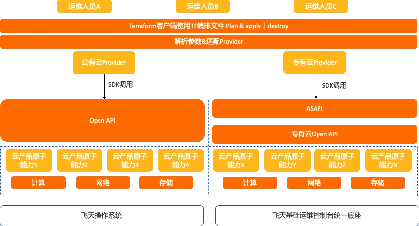
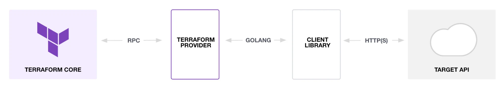
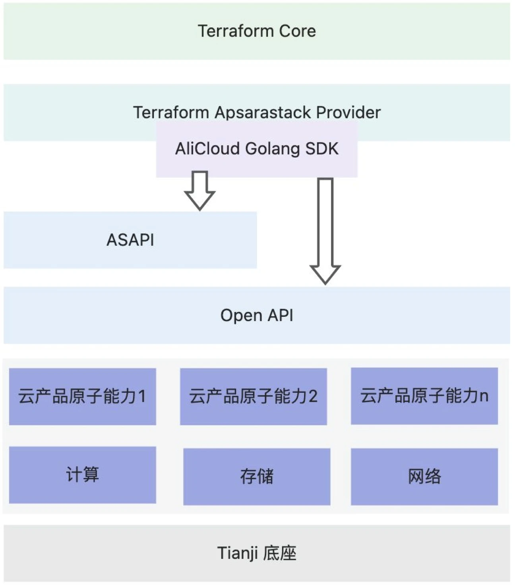
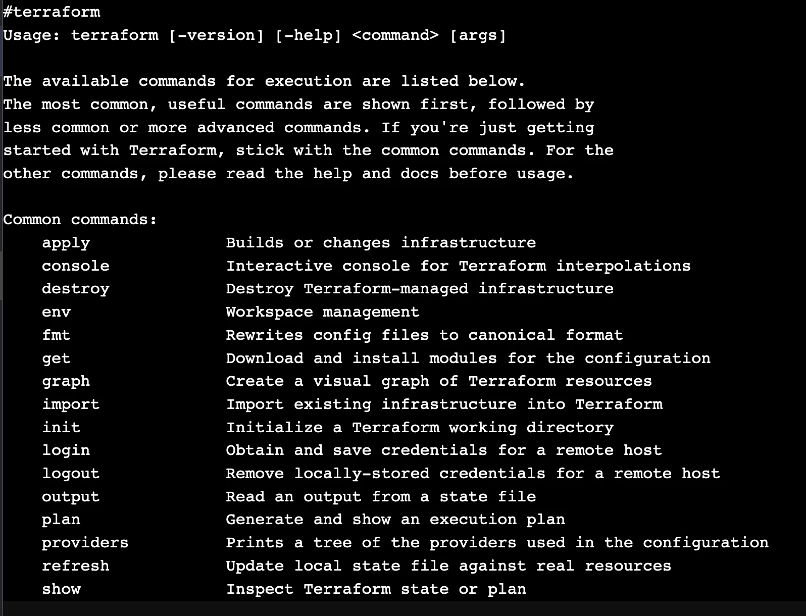
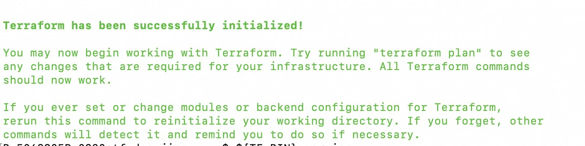
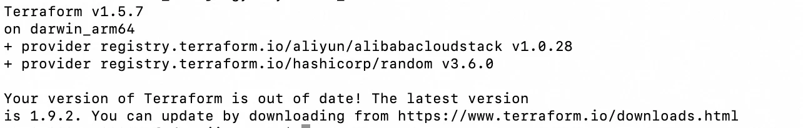
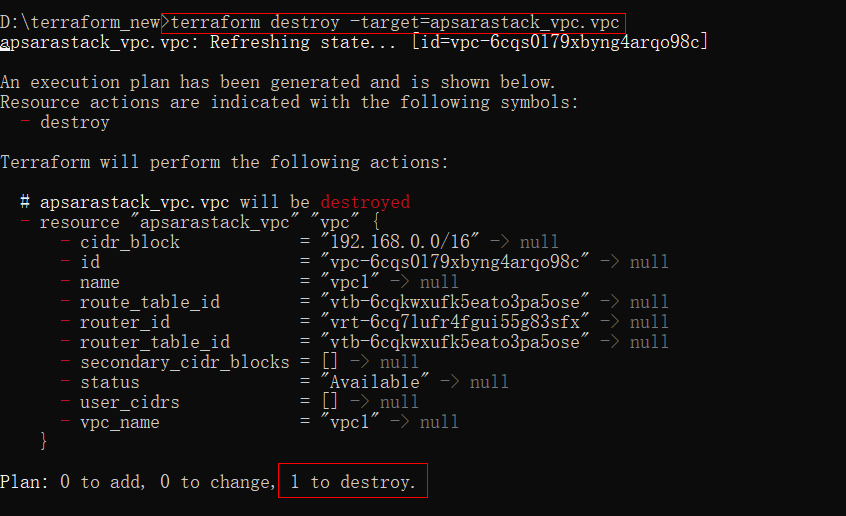
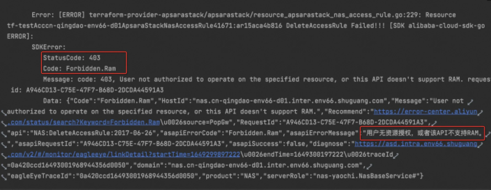

阿里云  
专有云企业版  
专有云基础服务  
专有云Terraform  
产品版本：v3.16.2  
文档版本：20241029

**目录**

- [1.专有云Terraform](#section-1)
    - [1.1. 基础概念](#section-1-1)
    - [1.2. 使用价值](#section-1-2)
    - [1.3. 适用场景](#section-1-3)
    - [1.4. 能力清单](#section-1-4)
- [2.使用指导](#section-2)
    - [2.1. 初始化运行环境](#section-2-1)
    - [2.2. 初始化工作路径](#section-2-2)
        - [2.2.1. 专有云Terraform Provider中使用STS调用方式使用说明](#section-2-2-1)
    - [2.3. Terraform资源销毁](#section-2-3)
    - [2.4. 创建专有网络VPC实例](#section-2-4)
    - [2.5. 创建云服务器ECS实例](#section-2-5)
    - [2.6. 创建负载均衡SLB实例](#section-2-6)
    - [2.7. 创建对象存储OSS Bucket](#section-2-7)
    - [2.8. 创建云数据库RDS实例](#section-2-8)
    - [2.9. 创建RAM角色](#section-2-9)
    - [2.10. 创建KMS Key](#section-2-10)
    - [2.11. 创建消息队列MQ实例](#section-2-11)
    - [2.12. 创建容器服务Kubernetes（ACK）](#section-2-12)
    - [2.13. 创建容器镜像服务ACR（CR）](#section-2-13)
    - [2.14. 创建大数据计算MaxCompute](#section-2-14)
    - [2.15. 创建大数据开发治理平台DataWorks](#section-2-15)
    - [2.16. 创建API网关的API和API分组](#section-2-16)
    - [2.17. 创建消息队列Kafka](#section-2-17)
    - [2.18. 创建云原生数据仓库AnalyticDB MySQL](#section-2-18)
    - [2.19. 创建云原生数据仓库AnalyticDB PostgreSQL版实例](#section-2-19)
    - [2.20. 创建云原生分布式数据库PolarDB-X1.0实例](#section-2-20)
    - [2.21. 创建EBS存储集](#section-2-21)
    - [2.22. 创建弹性伸缩ESS](#section-2-22)
    - [2.23. 创建云监控CMS](#section-2-23)
    - [2.24. 创建数据管理DMS](#section-2-24)
    - [2.25. 创建域名解析DNS](#section-2-25)
    - [2.26. 数据传输服务DTS](#section-2-26)
    - [2.27. 创建数据库备份服务DBS备份计划](#section-2-27)
    - [2.28. 创建数据总线DataHub](#section-2-28)
    - [2.29. 创建企业级分布式应用服务EDAS](#section-2-29)
    - [2.30. 创建高速通道Express Connect](#section-2-30)
    - [2.31. 创建弹性高性能计算E-HPC的作业模板](#section-2-31)
    - [2.32. 创建检索分析服务Elasticsearch](#section-2-32)
    - [2.33. 创建云数据库HBase实例](#section-2-33)
    - [2.34. 创建日志服务 SLS日志项目](#section-2-34)
    - [2.35. 创建云数据库MongoDB实例](#section-2-35)
    - [2.36. 创建文件存储NAS](#section-2-36)
    - [2.37. 创建运维编排服务OOS](#section-2-37)
    - [2.38. 创建Quick BI](#section-2-38)
    - [2.39. 创建资源编排ROS](#section-2-39)
    - [2.40. 创建云数据库Redis实例](#section-2-40)
    - [2.41. 创建表格存储Tablestore](#section-2-41)
    - [2.42. 创建VPN网关](#section-2-42)
    - [2.43. 创建专有云云盘](#section-2-43)

<a id="section-1"></a>

# 1.专有云Terraform

Terraform是一种基础架构自动化的编排工具（开源工具），它可以安全有效地构建、预览、变更基础设施。目前市面上可见的云服务Terraform几乎都可以支持。阿里云专有云（以下简称专有云）是基于阿里云分布式架构，针对企业级市场使用特点，为客户量身打造的开放、统一、可信的企业级云平台，通过Provider模板化标准管理多云平台云资源。帮助政企客户用好云，管好云，提升运维人员的运维效率，降低政企的运维成本。

**Terraform编排流程**

多云云管生态Terraform编排，整个流程中产品合入主干代码后，在集成测试阶段获取POP中的API元数据，在POP元数据中心部署维护版本的PopApi元数据信息，通过CICD中的API兼容性卡点扫描拿到API变更列表，适配更改相关产品的Terraform Provider代码，Terraform Provider是开源发布状态，在集成测试阶段有足够的时间拉齐版本Terraform运维编排能力。整体如下所示。


**架构设计**

- 专有云Terraform根据政企客户的特点，定制的输出客户需要的产品能力。

- 公有云输出到专有云的云产品首先注册进POP平台，由专有云云管平台定期拉取POP的API信息注册到ASAPI。

- 专有云Terraform先调用ASAPI，ASAPI组装消息发送至POP，由POP转发至各个云产品。



<a id="section-1-1"></a>

## 1.1. 基础概念

**知识背景**

IaC的核心思想是将基础设施视为代码，并使用代码管理工具（如Git）来管理和追踪基础设施的变更。通过将基础设施的配置和部署过程编写为代码，可以实现对基础设施的版本控制，轻松地进行回滚和回退操作。此外，通过使用自动化工具（如Terraform、Ansible、Chef等），可以实现基础设施的自动化部署和管理，提高效率和减少人为错误。

当前专有云Provider已经支持36款产品，201类资源，800多种操作。

**术语**

**标准术语**

**Terraform**

Terraform是一款由HashiCorp开发的开源基础设施即代码（Infrastructure as Code）工具，

允许开发人员和运维团队使用声明性语言定义和管理基础设施资源（如虚拟机、存储、网络等）的配置。

**OpenTofu**

2023年8月10日，Hashicorp将Terraform许可证从MPL转换为业务源许可证（v1.1）（“ Busl”），非开放源许可证。不允许第三方公司封装Terraform对外提供服务。为了应对这一问题，成了OpenTofu项目，Fork了Terraform的最后一个开源分支，并托管在Linux基金会下。当前OpenTofu具有一下的特点：

- 与Terraform完全兼容

- MPL开源协议，并可以确保后续持续开放

- 稳定的人力投入

**Provider**

Terraform provider是Terraform的一个核心概念，它允许Terraform与各种云服务提供商下虚拟化平台、网络设备等不同类型的基础设施进行交互和管理。



> **说明**
>
> 注意：下文如果没有明确申明Provider所支持的云产商时，均指专有云Provider—— Alibabacloudstack Provider。 注意：Alibabacloudstack Provider旧称Apsarastack Provider，因为社区运营要求和客户兼容性的考量，当前同时发布两个Provider，但两者之间的能力当前相等。

**基础设施**

指支撑各种云计算服务的基础架构，它为用户提供了灵活、可扩展、高可用的计算（如Ecs，Pouch）、存储（Disk，OSS，Nas）、网络（VPC，Vswitch，VPN）等资源和服务。

**约定术语**

**工作目录**

Terraform命令执行时，会在当前路径下查找加载.tf文件，进行自动化编排，同时会生成状态信息，配置信息和锁文等临时文件，一个目录下包含一个编排集群的信息，下文称工作目录。

**模板文件**

符合Terraform标准HCL语言规范的文件(.tf)，广义上通常包括Provider信息的定义或不少于一个资源的编排定义。同一个工作目录下，Terraform会将所有tf文件中的内容进行一次聚合，所以一个工作目录下可以包含多个tf文件。本文操作时默认会将Provider信息定义在providers.tf中，因此下文所说的模板，仅包含资源定义信息。

**状态文件**

Terraform执行编排后，会在工作目录下生成.tfstate文件。该文件用户在下一次自动化编排时，用于与模板比较，判断是否需要进行变更操作。如果删除了状态文件，则自动化编排时，将会执行创建操作。

**环境变量**

> **说明**
>
> 为减少文档的复杂度，下文的代码会以环境变量进行配置一些可变信息，请提前配置。 Windows PowerShell以$env:&lt;KEY>=&lt;Value>进行配置 Linux或Mac以export &lt;KEY>=&lt;Value>进行配置

**TF_BIN**

> **说明**
>
> 根据所使用的Terraform Core的发行版，设置

- 如果使用Terraform，Value为terraform

- 如果使用Opentofu，Value为tofu

**应用架构**



<a id="section-1-2"></a>

## 1.2. 使用价值

**产品覆盖广**

专有云Terraform V1.0版本已继承阿里云公有云计算、网络、存储、数据库、大数据、容器和中间件、应用服务、云管等37款云产品，353个功能模块，965个API接口的管理能力。

**支持多平台运行**

专有云代码采取了多分支的管理机制，一个（大）版本一个分支，做到一次构建（同时构建出多个版本），多平台运行。

**适用多领域**

支持更多专有云客户（金融、政企、电力、保险、通信等）管理其多云、混合云需求。

**提升测试效率**

专有云Terraform的产品化的实现，推动了阿里云集测团队快速搭建自动化的测试框架，提升测试效率。

**降低成本**

可通过创建配置文件模板重复定义和预配资源，并可多次部署同一模板，创建相同的开发、测试和生产环境来降低成本。

<a id="section-1-3"></a>

## 1.3. 适用场景

**编排管理云资源**

通过专有云Terraform可以对多种云资源进行编码，比如：ECS、VPC、SLB、OSS、RDS等应用，利用代码对云资源进行增删改查。

**管理多云环境**

专有云Terraform支持同时管理不同云提供商的资源，简化了大规模、多云基础架构的管理和编排，满足更多客户通用的多云、混合云需求，降低了客户管理云的成本。

**自助式服务**

测试、运维团队经常会操作许多重复的云资源请求工作，可以使用专有云Terraform构建“自助式”基础设施模块，这些模块可以被重复创建和使用，自动生成新的基础设施请求。

<a id="section-1-4"></a>

## 1.4. 能力清单

当前专有云Terraform Provider支持的云产品清单

**支持的产品清单**

| 类别 | 阿里混合云产品 | 资源类型（Resource） |
| --- | --- | --- |

- alibabacloudstack_instance ECS实例

- alibabacloudstack_security_g roup 安全组

- alibabacloudstack_security_g roup_rule 安全组规则

- alibabacloudstack_disk 创建云盘

- alibabacloudstack_disk_attac hment 挂载云盘

- alibabacloudstack_image 创建镜像

- alibabacloudstack_image_ex port 导出镜像

- alibabacloudstack_image_co py 复制镜像

- alibabacloudstack_image_im port 导入镜像

- alibabacloudstack_image_sh are_permission 共享镜像

- alibabacloudstack_snapshot快照

- alibabacloudstack_snapshot_ policy 快照策略

云服务器 ECS

- alibabacloudstack_network_i nterface 弹性网卡

- alibabacloudstack_network_i nterface_attachment 绑定弹性网卡到ECS实例

- alibabacloudstack_key_pair SSH密钥对

- alibabacloudstack_key_pair_a ttachment 绑定SSH密钥对到ECS实例

- alibabacloudstack_ecs_comm and 云助手命令

- alibabacloudstack_ecs_deplo yment_set 部署集

- alibabacloudstack_ecs_hpc_cl uster 高性能集群

- alibabacloudstack_ecs_dedic ated_host 专有宿主机

- alibabacloudstack_launch_te mplate 启动模板

- alibabacloudstack_reserved_i nstance 预留实例

- alibabacloudstack_ecs_ebs_st orage_sets 存储集

弹性计算

- alibabacloudstack_ess_alarm报警任务

- alibabacloudstack_ess_attach ment 将一台或多台ECS实例关联到伸缩组中

- alibabacloudstack_ess_lifecyc le_hook 创建生命周期挂钩

- alibabacloudstack_ess_notific ation 事件通知

- alibabacloudstack_ess_scalin

弹性伸缩 ESS

g_group 创建伸缩组

- alibabacloudstack_ess_scalin g_rule 伸缩规则

- alibabacloudstack_ess_scalin ggroup_vserver_groups 向伸缩组添加SLB虚拟服务器组

- alibabacloudstack_ess_sched uled_task 定时任务

- alibabacloudstack_ess_scalin g_configuration 创建伸缩配置

- alibabacloudstack_cs_kubern etes 创建容器集群

容器服务Kubemetes（ACK）

- alibabacloudstack_cs_kubern etes_node_pool 节点池

- alibabacloudstack_cr_repo 企

容器镜像服务ACR（CR）

业版镜像仓库

- alibabacloudstack_cr_names pace 镜像仓库命名空间

- alibabacloudstack_ehpc_job_t

弹性高性能计算E-HPC

emplate 作业模板

- alibabacloudstack_ros_stack资源栈

资源编排ROS

- alibabacloudstack_ros_templ ate 自定义模板

- alibabacloudstack_oos_execu tion 执行

运维编排服务OOS

- alibabacloudstack_oos_templ ate 模板

- alibabacloudstack_nas_file_s ystem 文件系统

- alibabacloudstack_nas_moun t_target 挂载点

文件存储 NAS

- alibabacloudstack_nas_acces s_group 权限组

- alibabacloudstack_nas_acces s_rule 权限组规则

- alibabacloudstack_oss_bucke t 存储空间

- alibabacloudstack_oss_bucke

对象存储OSS

t_object 存储对象

- alibabacloudstack_oss_bucke t_kms OSS服务端加密

- alibabacloudstack_ots_instan ce OTS实例

- alibabacloudstack_ots_instan

表格存储Tablestore

ce_attachment 绑定VPC到OTS实例

- alibabacloudstack_ots_table OTS表格

存储

- alibabacloudstack_vpc 专有网络

- alibabacloudstack_vpc_ipv6_ gateway IPV6网关

- alibabacloudstack_vpc_ipv6_ egress_rule IPV6地址仅主动出规则

- alibabacloudstack_vpc_ipv6_i nternet_bandwidth IPV6地址公网带宽

- alibabacloudstack_route_tabl e 创建路由表

- alibabacloudstack_route_tabl e_attachment 将创建的自定义路由表和同一VPC的交换机绑定

- alibabacloudstack_route_entr y 自定义路由条目

- alibabacloudstack_router_int erface 路由器接口

- alibabacloudstack_router_int erface_connection 发起端路由器接口向接收端发起连接

- alibabacloudstack_vpn_gate

专有网络VPC

way VPN网关

- alibabacloudstack_vpn_custo mer_gateway 用户网关

- alibabacloudstack_vpn_route _entry 为VPN网关实例创建目的路由

- alibabacloudstack_vpn_conn ection IPsec连接

- alibabacloudstack_network_a cl 网络ACL

- alibabacloudstack_network_a cl_attachment 绑定网络ACL到交换机

- alibabacloudstack_network_a cl_entries 网络ACL规则

- alibabacloudstack_nat_gatew ay NAT网关

- alibabacloudstack_snat_entry在SNAT列表中添加SNAT条目

- alibabacloudstack_forward_e ntry DNAT列表中添加DNAT条目

- alibabacloudstack_eip 创建弹性IP

弹性公网IP

- alibabacloudstack_eip_associ ation 绑定弹性IP

网络

- alibabacloudstack_dns_doma in DNS域名

- alibabacloudstack_dns_doma in_attachment 绑定DNS域名到实例ID

域名解析DNS

- alibabacloudstack_dns_recor d 解析记录

- alibabacloudstack_dns_group域名分组

- alibabacloudstack_slb 创建负载均衡SLB

- alibabacloudstack_slb_acl 访问控制策略组

- alibabacloudstack_slb_backe nd_server 添加后端服务器

- alibabacloudstack_slb_ca_cer tificate CA证书

- alibabacloudstack_slb_domai n_extension 域名扩展

- alibabacloudstack_slb_listene r 监听

负载均衡SLB

- alibabacloudstack_slb_maste r_slave_server_group 主备服务器组

- alibabacloudstack_slb_rule 为指定的HTTP或HTTPS监听添加转发规则

- alibabacloudstack_slb_server _certificate 服务器证书

- alibabacloudstack_slb_server _group 服务器组

- alibabacloudstack_common_ bandwidth_package 带宽包资源

通用带宽包 （common）

- alibabacloudstack_common_ bandwidth_package_attachm ent 添加EIP到通用带宽中

- alibabacloudstack_express_c onnect_physical_connection物理专线接入

高速通道

- alibabacloudstack_express_c onnect_virtual_border_router边界路由器VBR实例

- alibabacloudstack_adb_back up_policy 备份策略

- alibabacloudstack_adb_accou nt 账号

云原生数据仓库AnalyticDB MySQL

- alibabacloudstack_adb_conn ection 公网连接地址

- alibabacloudstack_adb_db_cl uster（alibabacloudstack_adb_clus ter）AnalyticDB MySQL版集群

- alibabacloudstack_dms_enter prise_instance 企业数据库实例

数据管理DMS

- alibabacloudstack_dms_enter prise_user 企业用户

- alibabacloudstack_hbase_inst

云数据库HBase

ance HBase实例

- alibabacloudstack_mongodb_ instance 副本集实例

云数据库MongoDB

- alibabacloudstack_mongodb_ sharding_instanc 分片集群实例

- alibabacloudstack_db_instan ce RDS实例

- alibabacloudstack_db_accoun t 数据库账号

- alibabacloudstack_db_accoun t_privilege 给数据库账号授权

- alibabacloudstack_db_backu p_policy 数据库备份策略

云数据库RDS

- alibabacloudstack_db_connec tion 数据库实例公网连接地址

- alibabacloudstack_db_databa se RDS数据库

- alibabacloudstack_db_read_w rite_splitting_connection 申请只读地址

- alibabacloudstack_db_readon ly_instance 只读实例

数据库

- alibabacloudstack_kvstore_in stance Redis数据库

- alibabacloudstack_kvstore_a ccount 账号

云数据库Redis

- alibabacloudstack_kvstore_b ackup_policy 备份策略

- alibabacloudstack_kvstore_c onnection 公网连接地址

- alibabacloudstack_gpdb_inst ance AnalyticDB for PostgreSQL实例

原生数据仓库AnalyticDB

- alibabacloudstack_gpdb_con

PostgreSQL版

nection 公网连接地址

- alibabacloudstack_gpdb_acco unt 实例的初始账号

- alibabacloudstack_drds_insta

云原生分布式数据库PolarDB-X 1.0

nce 实例

- alibabacloudstack_dts_subscr iption_job 订阅任务

- alibabacloudstack_dts_synch

数据传输服务DTS

ronization_instance 异步任务实例

- alibabacloudstack_dts_synch ronization_job 异步任务

- alibabacloudstack_dbs_backu

数据库备份服务 DBS

p_plan 备份计划

- alibabacloudstack_maxcomp ute_project 项目

- alibabacloudstack_maxcomp

大数据计算 MaxCompute

ute_cu 配额组管理

- alibabacloudstack_maxcomp ute_user 任务云账号

- alibabacloudstack_datahub_p roject 项目

- alibabacloudstack_datahub_s

数据总线DataHub

ubscription 订阅

- alibabacloudstack_datahub_t opic 主题

- alibabacloudstack_data_work s_connection 连接

- alibabacloudstack_data_work s_folder 文件夹

- alibabacloudstack_data_work s_project 项目

DataWorks

- alibabacloudstack_data_work s_remind 告警规则

- alibabacloudstack_data_work s_user 用户

- alibabacloudstack_data_work s_role_binding 用户角色

- alibabacloudstack_quick_bi_u ser 组织用户

大数据

- alibabacloudstack_quick_bi_u

Quick BI

ser_group 用户组管理

- alibabacloudstack_quick_bi_ workspace 工作空间管理

- alibabacloudstack_elasticsea

ElasticSearch

rch 实例

<table>
  <tr>
    <td>云管理</td>
    <td>ASCM</td>
    <td>• alibabacloudstack_ascm_logo n_policy 创建访问策略<br>• alibabacloudstack_ascm_org anization 创建组织<br>• alibabacloudstack_ascm_user创建用户<br>• alibabacloudstack_ascm_user _role_binding 给用户绑定角色<br>• alibabacloudstack_ascm_user group_user 给用户组添加用户<br>• alibabacloudstack_ascm_user _group 用户组<br>• alibabacloudstack_ascm_user _group_resource_set_binding用户组资源集绑定<br>• alibabacloudstack_ascm_user _group_role_binding 给用户组绑定角色<br>• alibabacloudstack_ascm_pas sword_policy 创建ASCM密码策略<br>• alibabacloudstack_ascm_quo ta 创建配额<br>• alibabacloudstack_ascm_reso urce_group 创建资源集<br>• alibabacloudstack_ascm_ram _policy RAM策略<br>• alibabacloudstack_ascm_ram _role RAM角色<br>• alibabacloudstack_ascm_ram _policy_for_role RAM角色策略<br>• alibabacloudstack_ascm_cust om_role 自定义角色</td>
  </tr>
  <tr>
    <td>监控运维</td>
    <td>云监控 CMS</td>
    <td>• alibabacloudstack_cms_alar m 阈值报警规则<br>• alibabacloudstack_cms_alar m_contact 报警联系人<br>• alibabacloudstack_cms_alar m_contact_group 报警联系组<br>• alibabacloudstack_cms_site_monitor 站点监控任务</td>
  </tr>
</table>

- alibabacloudstack_applicatio n_deployment 部署应用

- alibabacloudstack_edas_clust er ECS集群

- alibabacloudstack_edas_appli cation ECS应用

- alibabacloudstack_edas_insta nce_cluster_attachment 使用ECS自带的云助手安装EDAS

企业级分布式应用服务EDAS

Agent

- alibabacloudstack_edas_k8s_ cluster K8s集群

- alibabacloudstack_edas_k8s_ application K8s应用

- alibabacloudstack_edas_appli cation_scale 扩容应用

- alibabacloudstack_edas_depl

中间件

oy_group 应用分组

- alibabacloudstack_ons_group创Group ID

- alibabacloudstack_ons_instan

消息队列MQ

ce MQ实例

- alibabacloudstack_ons_topic创MQ topic

- alibabacloudstack_alikafka_s asl_acl SASL用户和客户端使用SDK收发消息权限

消息队列Kafka

- alibabacloudstack_alikafka_s asl_user SASL用户

- alibabacloudstack_alikafka_t opic 消息主题

- alibabacloudstack_kms_key创建KMS

- alibabacloudstack_kms_alias创建密钥别名

密钥管理服务KMS

- alibabacloudstack_kms_ciphe rtext KMS加密

- alibabacloudstack_kms_secre t 凭据

安全

- alibabacloudstack_ram_role_

访问控制

attachment 为ECS关联RAM角色

<table>
  <tr>
    <td rowspan="2">应用服务</td>
    <td>API网关</td>
    <td>• alibabacloudstack_api_gatew ay_api API<br>• alibabacloudstack_api_gatew ay_app 应用<br>• alibabacloudstack_api_gatew ay_group API分组<br>• alibabacloudstack_api_gatew ay_app_attachment 给指定app添加多个API访问权限<br>• alibabacloudstack_api_gatew ay_vpc_access 添加VPC授权</td>
  </tr>
  <tr>
    <td>日志服务 SLS</td>
    <td>• alibabacloudstack_log_projec t 日志项目<br>• alibabacloudstack_log_store日志库<br>• alibabacloudstack_log_store_i ndex 日志库索引<br>• alibabacloudstack_log_machi ne_group 机器组<br>• alibabacloudstack_logtail_att achment 将日志库配置应用到机器组<br>• alibabacloudstack_logtail_con fig 日志库配置</td>
  </tr>
</table>

<a id="section-2"></a>

# 2.使用指导

<a id="section-2-1"></a>

## 2.1. 初始化运行环境

Terraform是IaC场景下的主流CLI工具，使用前需要先在本机安装并配置可执行文件。

Terraform Core

**下载Terraform Core**

当前专有云Provider支持Terrafrom Core和OpenTofu，从官方下载站点根据自身运行平台的系统和架构下载即可。

- Terraform 官方下载站点：官方安装帮助页

> **说明**
>
> 当前专有云官方开发、测试使用Terraform版本1.5.7，Terraform官方实现版本间兼容，理论支持最新版本

- OpenTofu Github：官方安装帮助页

> **说明**
>
> OpenTofu官方承诺与Terraform之间的完全兼容，理论支持最新版本

**配置环境变量**

**Windows系统**

Windows用户请在

我的电脑【右击】 --> 选择 属性 --> 高级系统设置 --> 环境变量

中配置环境变量。

**类Unix系统**

*如Linux，MacOS，BSD均可以参考本章节*

1. 全局配置

- 打开terminal。如果Terraform文件在自定义路径路径下，输入以下命令，将自定义路径下的terraform binary文件链接到/usr/bin目录。

```bash
cd /usr/bin   
sudo ln -s /<foo>/<bar>/terraform 
```

2. 当前用户配置

- 如果Terraform文件在自定义路径下，输入vi ~/.bash_profile命令创建一个新的配置文件，使用如下命令将terraform文件所在路径写入配置文件中，保存退出。

```bash
TERRAFORM=terraform binary所在⽂件夹路径
PATH=$TERRAFORM:$PATH:.
export PATH
```

- 更新配置文件。打开terminal输入source ~/.bash_profile命令更新配置文件。

- 验证环境变量。打开terminal输入terraform命令，当terminal提示以下信息，说明环境变量配置成功。



**专有云Provider**

**下载Provider**

**Terraform自动下载并管理（推荐）**

> **说明**
>
> 自动下载Provider会在工作路径初始化时，自动从官网或这镜像站点下载Provider，无需其他管理操作。

**配置阿里云镜像站点（可选、推荐）**

> **说明**
>
> 可以有效解决国内下载缓慢的或失败的问题

创建 `.terraformrc`  或 `terraform.rc` 配置文件，文件位置取决于主机的操作系统。

- **在 Windows 环境上**，文件必须命名为 `terraform.rc` ，并放置在相关用户的 `%APPDATA%` 目录中。这个目录的物理位置取决于Windows 版本和系统配置；在 PowerShell 中使用  `$env:APPDATA`  可以找到其在系统上的位置。

- **在所有其他系统上**，必须将该文件命名为 `.terraformrc` ，并直接放在相关用户的主目录中。

也可以使用 `TF_CLI_CONFIG_FILE` 环境变量指定 Terraform CLI 配置文件的位置，任何此类文件都应遵循命名模式 `*.tfrc` 。

```text
provider_installation {
  network_mirror {
    url = "https://mirrors.aliyun.com/terraform/"
    // 限制只有阿⾥云相关 Provider 从国内镜像源下载
    include = [
        "registry.terraform.io/aliyun/alibabacloudstack", 
        "registry.terraform.io/hashicorp/alibabacloudstack",
              ]   
  }
  direct {
    // 声明除了阿⾥云相关Provider, 其它Provider保持原有的下载链路
    exclude = [
        "registry.terraform.io/aliyun/alibabacloudstack", 
        "registry.terraform.io/hashicorp/alibabacloudstack",
              ]  
  }
}
```

**手动管理**

**官方默认路径**

根据不同的系统，Terraform会依次尝试从多个路径中进行扫描并加载Provider。

- **Windows:** `%APPDATA%/terraform.d/plugins` ，  `%APPDATA%/HashiCorp/Terraform/plugins`

- **Mac OS X:** `$HOME/.terraform.d/plugins` ， `~/Library/Application Support/io.terraform/plugins` ， `/Library/Application Support/io.terraform/plugins`

- **Linux或其他类Unix系统**: `$HOME/.terraform.d/plugins` ， `~/.local/share/terraform/plugins` ,  `/usr/local/share/terraform/plugins` , and  `/usr/share/terraform/plugins`

手动下载Provider，需要选择其中一个路径，并依照指定的格式创建目录架构，并解压Provider。

> **说明**
>
> 注意：错误的目录结构会导致Provider加载失败

```text
XX(e.g. ./terraform.d/providers/)
└── <hostname>(Terraform⽤registry.terraform.io，Opentofu⽤registry.opentofu.org)
    └── <namespace>(e.g. hashicorp或aliyun)
        └── <type>(e.g. alibabacloudstack)
            └── <version>(e.g. 1.0.20)
                └── <your OS>(e.g. darwin_arm64)
                    └── <binary file>(e.g. terraform-provider-alibabacloudstack)
```

> **说明**
>
> 注意：namespace层，手动管理建议使用hashicorp，如果使用aliyun，在后续步骤编写Provider信息时要注意申明aliyun。 注意：常见的系统架构有：windows_amd64，linux_amd64，linux_arm64，darwin_amd64，darwin_arm64

**指定路径管理**

自行选择一个路径，依照官方默认路径中说明，依照指定的格式创建目录架构，并解压Provider。但在工作目录初始化时，需要指定改路径。

<a id="section-2-2"></a>

## 2.2. 初始化工作路径

Terraform执行时会加载同一个目录下的所有的.tf文件，这样的一个目录称为工作目录。为了方便管理，通常会将一个编排内容拆分成多个目录。常见的可以分为四个文件，分别定义provider依赖，provider信息，编排模板，参数模板。

**申明Provider依赖（可选、推荐）**

> **说明**
>
> 如果不申明依赖信息，会根据定义的provider，自动下载或从本地加载最新的版本。

创建一个新的文件required.tf，编辑并保存一下内容。

```text
terraform {
  required_providers {
    alibabacloudstack = {
      source  = "aliyun/alibabacloudstack"
      version = ">= 1.0.27"
    }
  }
}
```

> **说明**
>
> 注意：如果Provider使用了手动管理，source需要和目录结构中的namespace和type一致。 注意：如果使用阿里云镜像站点，source也支持申明为"hashicorp/alibabacloudstack"

**申明Provider信息**

创建一个新的文件providers.tf，编辑并保存一下内容。

```terraform
provider "apsarastack" {
   domain    =""
   access_key  =""
   secret_key = ""
   region   =""
   proxy   = ""
   protocol   =""
   insecure   ="true"
   resource_group_set_name =""
}
```

> **说明**
>
> 当前模板中，仅为常见的资源需要的provider参数，如果需要sts鉴权或者操作oss等数据网关接口还需要配置其他参数，可以参考。

| 参数 | 含义 | 获取方式 |
| --- | --- | --- |
| domain | asapi的域名 | 1. 登录飞天基础运维控制台1.0。<br>2. 单击页面顶端导航栏中的<strong>报表</strong>。<br>3. 单击<strong>系统报表 &gt; 服务注册变量</strong>。<br>4. 单击service，输入asapi，单击过滤。<br>5. 鼠标右键单击asapi的Service Registration，选择显示更多。<br>6. 查看详情，获取asapi.gateway.endpoint的域名。 |
| access_key | 用户的访问密钥 | 1. 使用用户的账户名和密码登录Apsara Uni-manager运营控制台（ASCM）界面。<br>2. 单击主页右上角的云朵logo，单击个人信息。<br>3. 获取用户的AccessKey ID。 |
| secret_key | 用户的访问密钥Secret | 1. 使用用户的账户名和密码登录Apsara Uni-manager运营控制台（ASCM）界面。<br>2. 单击主页右上角的云朵logo，单击个人信息。<br>3. 获取用户的AccessKey Secret。 |
| region | 地域 | 1. 登录Apsara Uni-manager运营控制台（ASCM）界面。<br>2. 单击<strong>企业 &gt; 地域管理</strong>。<br>3. 选择目标组织，获取地域信息。 |
| proxy | 访问环境的代理地址 | 若访问环境不需要通过代理地址，则无需配置此参数。 |
| insecure | 不安全的https证书 | insecure="true"表示忽略不安全的https证书，取值范围（true、false）。 |
| resource_group_set_name | 资源集名称 | 1. 查看资源名称，选择Apsara Uni-manager运营控制台（ASCM）控制台页面右上方的<strong>企业</strong>。<br>2. 单击目标组织，获取该组织的资源集名称。 |

**初始化**

> **说明**
>
> 执行后续命令时，根据使用的Terraform Core的不同，设置不同的TF_BIN，如使用Terraform时TF_BIN为terraform，opentofu时TF_BIN为tofu。

- 第一次初始化

```text
${TF_BIN} init
```

- 指定provider路径初始化

```text
${TF_BIN} init -plugin-dir=<provider地址>
```

- 调整provider配置或版本后重新初始化

```text
${TF_BIN} init --upgrade
```

如果初始化成功，可以看到以下输出



**验证**

```text
${TF_BIN} version
```

检查Terrform和Provider的版本是否正确



<a id="section-2-2-1"></a>

### 2.2.1. 专有云Terraform Provider中使用STS调用方式使用说明

本章介绍当云产品开启STS鉴权信任模式后，如何调用专有云Terraform Provider的使用说明。

**STS简介**

阿里云STS（Security Token Service）是阿里云提供的一种临时访问权限管理服务。RAM提供RAM用户和RAM角色两种身份。其中，RAM角色不具备永久身份凭证，而只能通过STS获取可以自定义时效和访问权限的临时身份凭证，即安全令牌（STS Token）。

**操作准备：**

1. 获取role_arn参数。

   <ol type="i">

   <li>

   使用用户的账户名和密码登录Apsara Uni-manager运营控制台（ASCM）界面。

   </li>

   <li>

   单击主页右上角的云朵logo，单击个人信息。

   </li>

   <li>

   单击查看当前决策策略。

   </li>

   <li>

   获取RAM Role信息（示例：acs:ram::1567042650760225:role/ascm-role-33-4-5509）。

   </li>

   </ol>

2. 获取sts_endpoint参数。

   <ol type="i">

   <li>

   登录飞天基础运维控制台1.0。

   </li>

   <li>

   单击页面顶端导航栏中的**报表**。

   </li>

   <li>

   单击**系统报表 > 服务注册变量**。

   </li>

   <li>

   单击service，输入ram，单击过滤。

   </li>

   <li>

   选择ram-ramService，鼠标右键Service Registration显示更多详情。

   </li>

   <li>

   获取sts-openapi.endpoint信息（示例：sts.inter.env66.shuguang.com）。

   </li>

   </ol>

**操作步骤：**

1. 创建terraform.tf文件，将获取到的role_arn参数和sts_endpoint参数添加到配置文件中。

2. 在terraform.tf文件中增加以下内容。

   ```terraform
   provider "alibabacloudstack" {
    assume_role {}
   }
   ```

示例如下：

```terraform
#环境配置
provider "alibabacloudstack" {
  domain="asapi域名"
  access_key="⽤户的ak"
  secret_key="⽤户的sk"
  region="地域"
  proxy= "HTTP://环境代理"
  protocol="HTTP"
  insecure="true"
  resource_group_set_name ="资源集名称"
  sts_endpoint = "sts.inter*******"
  role_arn = "acs:ram::******"
  assume_role {}
}
```

<a id="section-2-3"></a>

## 2.3. Terraform资源销毁

本章介绍如何通过Terraform销毁已创建的资源。

**Terraform销毁资源步骤**

- 销毁指定资源，输入命令 `terraform destroy -target=resource`资源名称 。

例如：（V3.14版本）销毁已创建的专有网络VPC实例资源，输入命令 `terraform destroy -target=apsarastack_vpc.vpc`  ，输入yes确认执行销毁操作。



（V3.16及以后版本）销毁已创建的专有网络VPC实例资源，输入命令 `terraform destroy -target=alibabacloudstack_vpc.vpc`  ，输入yes确认执行销毁操作。

- 销毁当前创建的所有资源，输入命令 `terraform destroy`  ，输入yes确认执行销毁操作。

> **说明**
>
> resource资源名称为用户创建资源时自定义的名称。

<a id="section-2-4"></a>

## 2.4. 创建专有网络VPC实例

本章介绍如何使用专有云Terraform创建专有网络VPC实例。

**编写模板文件**

创建main.tf文件，编写要创建的资源内容。

```terraform
# VPC variables
variable "create" {
  description = "Whether to create vpc. If false, you can specify an existing vpc by setting 'vpc_id'."
  type        = bool
  default     = true
}

variable "vpc_id" {
  description = "The vpc id used to launch several vswitches. If set, the 'create' willbe ignored."
  type        = string
  default     = ""
}

variable "vpc_name" {
  description = "The vpc name used to launch a new vpc."
  type        = string
  default     = "TF-VPC"
}

variable "vpc_description" {
  description = "The vpc description used to launch a new vpc."
  type        = string
  default     = "A new VPC created by Terrafrom module terraform-alicloud-vpc"
}

variable "vpc_cidr" {
  description = "The cidr block used to launch a new vpc."
  type        = string
  default     = "192.168.0.0/16"
}

variable "resource_group_id" {
  description = "The Id of resource group which the instance belongs."
  type        = string
  default     = ""
}

variable "vpc_name_regex" {
  description = "(Deprecated) It has been deprecated from 1.5.0."
  type        = string
  default     = ""
}

variable "vpc_tags" {
  description = "The tags used to launch a new vpc. Before 1.5.0, it used to retrieve existing VPC."
  type        = map(string)
  default     = {}
}

#创建VPC
resource "alibabacloudstack_vpc" "vpc" {
  count             = var.vpc_id != "" ? 0 : var.create ? 1 : 0
  vpc_name          = var.vpc_name
  cidr_block        = var.vpc_cidr
  description   = var.vpc_description
  tags = merge(
    {
      "Name" = format("%s", var.vpc_name)
    },
    var.vpc_tags,
  )
}
```

**参数说明**

**alibabacloudstack_vpc参数**

| 参数 | 含义 | 获取方式 |
| --- | --- | --- |
| vpc_name | 专有网络VPC名称 | 用户自定义，长度为2～128个字符，以字母或中文开头，支持数字和"_"、"-"特殊字符，不能以http://或https://开头。 |
| cidr_block | VPC地址块 | 1. 查看VPC地址块信息，选择Apsara Uni-manager运营控制台（ASCM）控制台顶部菜单栏上的<strong>产品 &gt; 专有网络VPC</strong>，单击左侧导航栏中的<strong>专有网络</strong>，获取VPC地址块信息。<br>2. 用户可根据获得的地址块信息，重新自定义新的网段。 |

**执行编排**

**Terraform初始化**

在执行terraform.tf模板前，需要先初始化工作路径。请在初始化工作路径中查看操作步骤。

**Terraform计划展示**

展示terraform.tf文件中计划创建的资源信息。

操作步骤如下：

1. 运行命令 `terraform plan`  。

2. 查看terraform.tf文件中展示的计划创建资源信息。

**Terraform执行**

执行上一步terraform plan展示的计划创建资源。

操作步骤如下：

1. 输入命令 `terraform apply` 执行terraform.tf文件中的资源创建操作。

2. 输入 `yes` 确认执行计划中的操作。

3. 返回Apply complete!即代表资源创建成功。若不成功查看具体的报错信息，修改terraform.tf文件中的创建资源内容。

**Terraform查看结果**

运行 `terraform show` 查看已创建的资源。

**Terraform销毁**

当需要释放资源可通过terraform destroy销毁已创建的资源，请在Terraform资源销毁中查看操作步骤。

**常见问题**

> **重要**
>
> 当执行terraform apply操作时报“用户无资源授权，或者该API不支持RAM”，请检查该产品是否开启了STS鉴权信任模式。
>
> 
>
> STS鉴权信任模式检查方式：
>
> 1. 通过super账号登录Apsara Uni-manager运营控制台（ASCM）。
>
> 2. 单击**配置** **> 鉴权信任模式**。
>
> 3. 产品被勾选则表示已开启了鉴权信任模式。
>
> 当STS鉴权信任模式开启后，执行操作请参考专有云Terraform Provider中使用STS调用方式使用说明。

<a id="section-2-5"></a>

## 2.5. 创建云服务器ECS实例

本章介绍如何使用专有云Terraform创建一台ECS实例。

**编写模板文件**

创建main.tf文件，编写要创建的资源内容。

```terraform
variable "name" {
  default = "terraform_test"
}

data "alibabacloudstack_zones" "default" {
  available_resource_creation = "VSwitch"
}
#创建vpc
resource "alibabacloudstack_vpc" "vpc" {
  vpc_name = var.name
  cidr_block = "192.168.0.0/16" #vpc⼝段
}
#创建vsw
resource "alibabacloudstack_vswitch" "vsw" {
  vpc_id = alibabacloudstack_vpc.vpc.id
  cidr_block = "192.168.0.0/16" #⽹段
  availability_zone = data.alibabacloudstack_zones.default.zones.0.id #可⽤区
}
#创建安全组
resource "alibabacloudstack_security_group" "group" {
  name = var.name
  vpc_id = alibabacloudstack_vpc.vpc.id
}
#创建ECS实例
resource "alibabacloudstack_instance" "instance" {
  image_id = "centos_7_7_x64_20G_alibase_20211028.vhd"
  instance_type = "ecs.mn4.large"
  system_disk_category = "cloud_sperf"
  security_groups = [alibabacloudstack_security_group.group.id]
  instance_name = var.name
  vswitch_id = alibabacloudstack_vswitch.vsw.id
}
```

**参数说明**

**alibabacloudstack_vpc参数**

| 参数 | 含义 | 获取方式 |
| --- | --- | --- |
| vpc_name | 专有网络VPC名称 | 用户自定义，长度为2～128个字符，以字母或中文开头，支持数字和"_"、"-"特殊字符，不能以http://或https://开头。 |
| cidr_block | VPC地址块 | 1. 查看VPC地址块信息，选择Apsara Uni-manager运营控制台（ASCM）控制台顶部菜单栏上的<strong>产品 &gt; 专有网络VPC</strong>，单击左侧导航栏中的<strong>专有网络</strong>，获取VPC地址块信息。<br>2. 用户可根据获得的地址块信息，重新自定义新的网段。 |

**alibabacloudstack_instance参数**

| 参数 | 含义 | 获取方式 |
| --- | --- | --- |
| vswitch_id | 交换机ID | 1. 查看交换机ID，选择Apsara Uni-manager运营控制台（ASCM）顶部菜单栏上的<strong>产品 &gt; 专有网络</strong><strong>VPC</strong>。<br>2. 单击左侧导航栏中的<strong>交换机</strong>，获取交换机ID信息。 |
| availability_zone | 可用区 | 1. 查看可用区，选择Apsara Uni-manager运营控制台（ASCM）顶部菜单栏上的<strong>产品 &gt; 云服务器</strong>ECS。<br>2. 单击左侧导航栏中的<strong>实例</strong>，获取可用区信息。 |
| image_id | 镜像ID | 1. 查看镜像ID，选择Apsara Uni-manager运营控制台（ASCM）顶部菜单栏上的<strong>产品 &gt; 云服务器</strong>ECS。<br>2. 单击左侧导航栏中的<strong>镜像</strong>，获取镜像信息。 |
| instance_type | ECS实例规格 | 1. 查看ECS实例规格，选择Apsara Uni-manager运营控制台（ASCM）顶部菜单栏上的<strong>产品</strong>&gt; 云服务器ECS。<br>2. 单击左侧导航栏中的<strong>实例</strong>，单击创建实例，选择实例系列，获取实例规格。 |
| system_disk_category | 系统盘类型 | 1. 查看系统盘类型，选择Apsara Uni-manager运营控制台（ASCM）顶部菜单栏上的<strong>产品</strong>&gt; 云服务器ECS。<br>2. 单击左侧导航栏中的<strong>实例</strong>，单击创建实例，查看系统盘类型。 |
| security_groups | 安全组 | 1. 查看信息安全组，选择Apsara Uni-manager运营控制台（ASCM）顶部菜单栏上的<strong>产品</strong>&gt; 云服务器ECS。<br>2. 单击左侧导航栏中的<strong>安全组</strong>，获取安全组信息。 |
| instance_name | ECS实例名称 | 用户自定义，长度为2-110个字符，不能以特殊字符及数字开头，只可包含特殊字符中的（.）、（_）、（-）和（:）。 |

**执行编排**

**Terraform初始化**

在执行terraform.tf模板前，需要先初始化工作路径。请在初始化工作路径中查看操作步骤。

**Terraform计划展示**

展示terraform.tf文件中计划创建的资源信息。

操作步骤如下：

1. 运行命令 `terraform plan`  。

2. 查看terraform.tf文件中展示的计划创建资源信息。

**Terraform执行**

执行上一步terraform plan展示的计划创建资源。

操作步骤如下：

1. 输入命令 `terraform apply` 执行terraform.tf文件中的资源创建操作。

2. 输入 `yes` 确认执行计划中的操作。

3. 返回Apply complete!即代表资源创建成功。若不成功查看具体的报错信息，修改terraform.tf文件中的创建资源内容。

**Terraform查看结果**

运行 `terraform show` 查看已创建的资源。

**Terraform销毁**

当需要释放资源可通过terraform destroy销毁已创建的资源，请在Terraform资源销毁中查看操作步骤。

**常见问题**

> **重要**
>
> 当执行terraform apply操作时报“用户无资源授权，或者该API不支持RAM”，请检查该产品是否开启了STS鉴权信任模式。
>
> 
>
> STS鉴权信任模式检查方式：
>
> 1. 通过super账号登录Apsara Uni-manager运营控制台（ASCM）。
>
> 2. 单击**配置** **> 鉴权信任模式**。
>
> 3. 产品被勾选则表示已开启了鉴权信任模式。
>
> 当STS鉴权信任模式开启后，执行操作请参考专有云Terraform Provider中使用STS调用方式使用说明。

<a id="section-2-6"></a>

## 2.6. 创建负载均衡SLB实例

本章介绍如何使用专有云Terraform在专有网络中创建负载均衡实例。

**编写模板文件**

创建main.tf文件，编写要创建的资源内容。

```terraform
variable "name" {
  default = "terraform_slb"
}

data "alibabacloudstack_zones" "default" {
  available_resource_creation = "VSwitch"
}

#创建VPC
resource "alibabacloudstack_vpc" "default" {
  vpc_name   = var.name
  cidr_block = "172.16.0.0/12"
}

#创建交换机
resource "alibabacloudstack_vswitch" "default" {
  vpc_id            = alibabacloudstack_vpc.default.id
  cidr_block        = "172.16.0.0/21"
  availability_zone = data.alibabacloudstack_zones.default.zones.0.id
  name              = var.name
}

#创建SLB
resource "alibabacloudstack_slb" "default" {
  name          = var.name
  vswitch_id    = alibabacloudstack_vswitch.default.id
}
```

**参数说明**

**alibabacloudstack_vpc参数**

| 参数 | 含义 | 获取方式 |
| --- | --- | --- |
| vpc_name | 专有网络VPC名称 | 用户自定义，长度为2～128个字符，以字母或中文开头，支持数字和"_"、"-"特殊字符，不能以http://或https://开头。 |
| cidr_block | VPC地址块 | 1. 查看VPC地址块信息，选择Apsara Uni-manager运营控制台（ASCM）控制台顶部菜单栏上的<strong>产品 &gt; 专有网络VPC</strong>，单击左侧导航栏中的<strong>专有网络</strong>，获取VPC地址块信息。<br>2. 用户可根据获得的地址块信息，重新自定义新的网段。 |

**alibabacloudstack_vpc参数**

| 参数 | 含义 | 获取方式 |
| --- | --- | --- |
| vpc_name | 专有网络VPC名称 | 用户自定义，长度为2～128个字符，以字母或中文开头，支持数字和"_"、"-"特殊字符，不能以http://或https://开头。 |
| cidr_block | VPC地址块 | 1. 查看VPC地址块信息，选择Apsara Uni-manager运营控制台（ASCM）控制台顶部菜单栏上的<strong>产品 &gt; 专有网络VPC</strong>，单击左侧导航栏中的<strong>专有网络</strong>，获取VPC地址块信息。<br>2. 用户可根据获得的地址块信息，重新自定义新的网段。 |

**alibabacloudstack_slb参数**

| 参数 | 含义 | 获取方式 |
| --- | --- | --- |
| name | SLB名称 | 用户自定义，长度为2～128个字符，以字母或中文开头，支持数字和"_"、"-"特殊字符，不能以http://或https://开头。 |
| vswitch_id | 交换机ID | 1. 查看交换机ID，选择Apsara Uni-manager运营控制台（ASCM）顶部菜单栏上的<strong>产品 &gt; 专有网络</strong><strong>VPC</strong>。<br>2. 单击左侧导航栏中的<strong>交换机</strong>，获取交换机ID信息。 |

**执行编排**

**Terraform初始化**

在执行terraform.tf模板前，需要先初始化工作路径。请在初始化工作路径中查看操作步骤。

**Terraform计划展示**

展示terraform.tf文件中计划创建的资源信息。

操作步骤如下：

1. 运行命令 `terraform plan`  。

2. 查看terraform.tf文件中展示的计划创建资源信息。

**Terraform执行**

执行上一步terraform plan展示的计划创建资源。

操作步骤如下：

1. 输入命令 `terraform apply` 执行terraform.tf文件中的资源创建操作。

2. 输入 `yes` 确认执行计划中的操作。

3. 返回Apply complete!即代表资源创建成功。若不成功查看具体的报错信息，修改terraform.tf文件中的创建资源内容。

**Terraform查看结果**

运行 `terraform show` 查看已创建的资源。

**Terraform销毁**

当需要释放资源可通过terraform destroy销毁已创建的资源，请在Terraform资源销毁中查看操作步骤。

**常见问题**

> **重要**
>
> 当执行terraform apply操作时报“用户无资源授权，或者该API不支持RAM”，请检查该产品是否开启了STS鉴权信任模式。
>
> 
>
> STS鉴权信任模式检查方式：
>
> 1. 通过super账号登录Apsara Uni-manager运营控制台（ASCM）。
>
> 2. 单击**配置** **> 鉴权信任模式**。
>
> 3. 产品被勾选则表示已开启了鉴权信任模式。
>
> 当STS鉴权信任模式开启后，执行操作请参考专有云Terraform Provider中使用STS调用方式使用说明。

<a id="section-2-7"></a>

## 2.7. 创建对象存储OSS Bucket

本章介绍如何使用专有云Terraform创建一个Bucket存储空间。

**编写模板文件**

创建main.tf文件，编写要创建的资源内容。

```terraform
#创建 OSS_bucket
resource "alibabacloudstack_oss_bucket" "oss" {
  bucket = "test2"
  acl    = "public-read"
}
```

**参数说明**

**alibabacloudstack_oss_bucket参数**

| 参数 | 含义 | 获取方式 |
| --- | --- | --- |
| bucket | 存储空间名称 | 自定义（必须以小写字母或数字开头和结尾；只能包含小写字母，数字和短横线；长度限制在3-63之间）。 |
| acl | bucket权限 | 取值范围：private、public-read、<br>public-read-write |

**执行编排**

**Terraform初始化**

在执行terraform.tf模板前，需要先初始化工作路径。请在初始化工作路径中查看操作步骤。

**Terraform计划展示**

展示terraform.tf文件中计划创建的资源信息。

操作步骤如下：

1. 运行命令 `terraform plan`  。

2. 查看terraform.tf文件中展示的计划创建资源信息。

**Terraform执行**

执行上一步terraform plan展示的计划创建资源。

操作步骤如下：

1. 输入命令 `terraform apply` 执行terraform.tf文件中的资源创建操作。

2. 输入 `yes` 确认执行计划中的操作。

3. 返回Apply complete!即代表资源创建成功。若不成功查看具体的报错信息，修改terraform.tf文件中的创建资源内容。

**Terraform查看结果**

运行 `terraform show` 查看已创建的资源。

**Terraform销毁**

当需要释放资源可通过terraform destroy销毁已创建的资源，请在Terraform资源销毁中查看操作步骤。

**常见问题**

> **重要**
>
> 当执行terraform apply操作时报“用户无资源授权，或者该API不支持RAM”，请检查该产品是否开启了STS鉴权信任模式。
>
> 
>
> STS鉴权信任模式检查方式：
>
> 1. 通过super账号登录Apsara Uni-manager运营控制台（ASCM）。
>
> 2. 单击**配置** **> 鉴权信任模式**。
>
> 3. 产品被勾选则表示已开启了鉴权信任模式。
>
> 当STS鉴权信任模式开启后，执行操作请参考专有云Terraform Provider中使用STS调用方式使用说明。

<a id="section-2-8"></a>

## 2.8. 创建云数据库RDS实例

本章介绍如何使用专有云Terraform创建一个云数据库实例。

**编写模板文件**

创建main.tf文件，编写要创建的资源内容。

```terraform
variable "name" {
  default = "terraformtestslbconfig"
}

data "alibabacloudstack_zones" "default" {
  available_resource_creation = "VSwitch"
}

#创建VPC
resource "alibabacloudstack_vpc" "default" {
  vpc_name       = var.name
  cidr_block = "192.168.0.0/16"
}

#创建交换机
resource "alibabacloudstack_vswitch" "default" {
  vpc_id            = alibabacloudstack_vpc.default.id
  cidr_block        = "192.168.0.0/16"
  availability_zone = data.alibabacloudstack_zones.default.zones.0.id
  name              = var.name
}

#创建 RDS
resource "alibabacloudstack_db_instance" "default" {
  engine               = "MySQL"
  engine_version       = "5.6"
  instance_type        = "mysql.x8.medium.2"
  instance_storage     = "30"
  storage_type         = "local_ssd"
  instance_name        = var.name
  vswitch_id           = alibabacloudstack_vswitch.default.id
  monitoring_period    = "60"
}
```

**参数说明**

**alibabacloudstack_vpc参数**

| 参数 | 含义 | 获取方式 |
| --- | --- | --- |
| vpc_name | 专有网络VPC名称 | 用户自定义，长度为2～128个字符，以字母或中文开头，支持数字和"_"、"-"特殊字符，不能以http://或https://开头。 |
| cidr_block | VPC地址块 | 1. 查看VPC地址块信息，选择Apsara Uni-manager运营控制台（ASCM）控制台顶部菜单栏上的<strong>产品 &gt; 专有网络VPC</strong>，单击左侧导航栏中的<strong>专有网络</strong>，获取VPC地址块信息。<br>2. 用户可根据获得的地址块信息，重新自定义新的网段。 |

**alibabacloudstack_db_instance参数**

| 参数 | 含义 | 获取方式 |
| --- | --- | --- |
| engine | 数据库类型 | 取值范围：MySQL、SQLServer、PostgreSQL、PPAS |
| engine_version | 数据库版本 | 1. 查看数据库版本，选择Apsara Uni-manager运营控制台（ASCM）顶部菜单栏上的<strong>产品</strong>&gt; 云数据库RDS。<br>2. 单击<strong>创建实例</strong>，获取数据库版本。 |
| instance_type | 数据库实例规格 | 1. 查看数据库实例规格，选择Apsara Uni-manager运营控制台（ASCM）顶部菜单栏上的<strong>产品</strong>&gt; 云数据库RDS。<br>2. 单击<strong>创建实例</strong>，获取数据库实例规格。 |
| instance_storage | 数据库实例存储空间 | 实例存储空间，单位：GB。每5GB进行递增，取值范围请参见专有云官方文档：https://help.aliyun.com/aps ara/enterprise/v_3_16_2_20220 708/rds/enterprise-ascm-developer-guide/create-an-rds-instance.html? spm=a2c4g.14484438.10001.2 93 |
| storage_type | 用于实例的存储媒体类型 | 1. 查看存储类型，选择Apsara Uni-manager运营控制台（ASCM）顶部菜单栏上的<strong>产品</strong> <strong>&gt; 云数据库</strong>RDS。<br>2. 单击<strong>创建实例</strong>，获取存储类型信息。 |
| instance_name | 数据库实例名称 | 长度为2-64个字符，以字母或中文开头，支持数字和"_"、"-"、":"等特殊字符，不能以http:// 或https://开头。 |

**执行编排**

**Terraform初始化**

在执行terraform.tf模板前，需要先初始化工作路径。请在初始化工作路径中查看操作步骤。

**Terraform计划展示**

展示terraform.tf文件中计划创建的资源信息。

操作步骤如下：

1. 运行命令 `terraform plan`  。

2. 查看terraform.tf文件中展示的计划创建资源信息。

**Terraform执行**

执行上一步terraform plan展示的计划创建资源。

操作步骤如下：

1. 输入命令 `terraform apply` 执行terraform.tf文件中的资源创建操作。

2. 输入 `yes` 确认执行计划中的操作。

3. 返回Apply complete!即代表资源创建成功。若不成功查看具体的报错信息，修改terraform.tf文件中的创建资源内容。

**Terraform查看结果**

运行 `terraform show` 查看已创建的资源。

**Terraform销毁**

当需要释放资源可通过terraform destroy销毁已创建的资源，请在Terraform资源销毁中查看操作步骤。

**常见问题**

> **重要**
>
> 当执行terraform apply操作时报“用户无资源授权，或者该API不支持RAM”，请检查该产品是否开启了STS鉴权信任模式。
>
> 
>
> STS鉴权信任模式检查方式：
>
> 1. 通过super账号登录Apsara Uni-manager运营控制台（ASCM）。
>
> 2. 单击**配置** **> 鉴权信任模式**。
>
> 3. 产品被勾选则表示已开启了鉴权信任模式。
>
> 当STS鉴权信任模式开启后，执行操作请参考专有云Terraform Provider中使用STS调用方式使用说明。

<a id="section-2-9"></a>

## 2.9. 创建RAM角色

本章介绍如何使用专有云Terraform创建一个RAM角色。

**编写模板文件**

创建main.tf文件，编写要创建的资源内容

```terraform
#创建RAM⾓⾊
resource "alibabacloudstack_ascm_ram_role" "default" {
  role_name = "TestingRamRole"
  description = "TestingRam"
  organization_visibility = "organizationVisibility.global"
  role_range = "roleRange.userGroup"
}
```

**参数说明**

**alibabacloudstack_ascm_ram_role参数**

| 参数 | 含义 | 获取方式 |
| --- | --- | --- |
| role_name | 角色名称 | 用户自定义，不超过64个字符。 |
| description | ram角色的描述 | 注意：它不应包含任何空格。 |
| organization_visibility | 组织可见性 | 有效值为：“organizationVisibility.orga nization”、“organizationVisibility.orgAndS ubOrgs”和“organizationVisibility.global” |
| role_range | 管理权限 | 必填，有效值为：“roleRange.orgAndSubOrgs ”、“roleRange.allOrganizations”和“ roleRange.userGroup” |

**执行编排**

**Terraform初始化**

在执行terraform.tf模板前，需要先初始化工作路径。请在初始化工作路径中查看操作步骤。

**Terraform计划展示**

展示terraform.tf文件中计划创建的资源信息。

操作步骤如下：

1. 运行命令 `terraform plan`  。

2. 查看terraform.tf文件中展示的计划创建资源信息。

**Terraform执行**

执行上一步terraform plan展示的计划创建资源。

操作步骤如下：

1. 输入命令 `terraform apply` 执行terraform.tf文件中的资源创建操作。

2. 输入 `yes` 确认执行计划中的操作。

3. 返回Apply complete!即代表资源创建成功。若不成功查看具体的报错信息，修改terraform.tf文件中的创建资源内容。

**Terraform查看结果**

运行 `terraform show` 查看已创建的资源。

**Terraform销毁**

当需要释放资源可通过terraform destroy销毁已创建的资源，请在Terraform资源销毁中查看操作步骤。

**常见问题**

> **重要**
>
> 当执行terraform apply操作时报“用户无资源授权，或者该API不支持RAM”，请检查该产品是否开启了STS鉴权信任模式。
>
> 
>
> STS鉴权信任模式检查方式：
>
> 1. 通过super账号登录Apsara Uni-manager运营控制台（ASCM）。
>
> 2. 单击**配置** **> 鉴权信任模式**。
>
> 3. 产品被勾选则表示已开启了鉴权信任模式。
>
> 当STS鉴权信任模式开启后，执行操作请参考专有云Terraform Provider中使用STS调用方式使用说明。

<a id="section-2-10"></a>

## 2.10. 创建KMS Key

本章介绍如何使用专有云Terraform创建一个KMS Key，KMS密钥可以帮助用户保护传输过程中的数据安全。

**编写模板文件**

创建main.tf文件，编写要创建的资源内容。

```terraform
#创建KMS key
resource "alibabacloudstack_kms_key" "key" {
  description             = "Hello KMS"
  pending_window_in_days  = "7"
  key_state               = "Enabled"
}
```

**参数说明**

**alibabacloudstack_kms_key参数**

| 参数 | 含义 | 获取方式 |
| --- | --- | --- |
| pending_window_in_days | 销毁资源后删除密钥的持续时间 | 必须在 7 到 30 天之间，默认为 30天。 |
| key_state | CMK 的状态 | 默认为启用 |

**执行编排Terraform初始化**

在执行terraform.tf模板前，需要先初始化工作路径。请在初始化工作路径中查看操作步骤。

**Terraform计划展示**

展示terraform.tf文件中计划创建的资源信息。

操作步骤如下：

1. 运行命令 `terraform plan`  。

2. 查看terraform.tf文件中展示的计划创建资源信息。

**Terraform执行**

执行上一步terraform plan展示的计划创建资源。

操作步骤如下：

1. 输入命令 `terraform apply` 执行terraform.tf文件中的资源创建操作。

2. 输入 `yes` 确认执行计划中的操作。

3. 返回Apply complete!即代表资源创建成功。若不成功查看具体的报错信息，修改terraform.tf文件中的创建资源内容。

**Terraform查看结果**

运行 `terraform show` 查看已创建的资源。

**Terraform销毁**

当需要释放资源可通过terraform destroy销毁已创建的资源，请在Terraform资源销毁中查看操作步骤。

**常见问题**

> **重要**
>
> 当执行terraform apply操作时报“用户无资源授权，或者该API不支持RAM”，请检查该产品是否开启了STS鉴权信任模式。
>
> 
>
> STS鉴权信任模式检查方式：
>
> 1. 通过super账号登录Apsara Uni-manager运营控制台（ASCM）。
>
> 2. 单击**配置** **> 鉴权信任模式**。
>
> 3. 产品被勾选则表示已开启了鉴权信任模式。
>
> 当STS鉴权信任模式开启后，执行操作请参考专有云Terraform Provider中使用STS调用方式使用说明。

<a id="section-2-11"></a>

## 2.11. 创建消息队列MQ实例

本章介绍如何通过专有云Terraform创建一个MQ实例（ONS）资源。

**编写模板文件**

创建main.tf文件，编写要创建的资源内容。

```terraform
variable "name" {
  default = "terraform_mq"
}
#创建MQ实例
resource "alibabacloudstack_ons_instance" "default" {
  tps_receive_max = 500
  tps_send_max = 500
  topic_capacity = 50
  cluster = "cluster1"
  independent_naming = "true"
  name = var.name
  remark = "Ons Instance remark"
}
```

**参数说明**

**alibabacloudstack_ons_instance参数**

| 参数 | 含义 | 获取方式 |
| --- | --- | --- |
| tps_receive_max | 消息订阅 TPS上限 | 该属性用于设置主题在一定时间段内每秒接收消息的事务数（TPS），取值范围：500～30000。 |
| tps_send_max | 消息发送 TPS上限 | 该属性用于设置主题在一定时间段内每秒的消息发送事务数（TPS），取值范围：500～30000。 |
| topic_capacity | Topic数上限 | 该属性用于设置主题容量，取值范围：10～5000。 |
| cluster | 集群名称 | 该属性用于添加集群名称。 |
| independent_naming | 是否有命名空间 | 取值如下：true：拥有独立命名空间，资源命名确保实例内唯一，跨实例之间可重名。false：无独立命名空间，实例内或者跨实例之间，资源命名必须全局唯一。 |
| name | 实例名称 | 同一地域的同一个账号的两个实例不能同名。长度限制为3～64个字符，可以是中文、英文、数字、短横线（-）以及下划线（_）。 |
| remark | 实例描述 | 此属性是实例的简明描述。长度为2-128个字符，以字母或中文开头，支持数字和“_”、“-”、“:”特殊字符，不能以http://或https://开头。 |

**执行编排**

**Terraform初始化**

在执行terraform.tf模板前，需要先初始化工作路径。请在初始化工作路径中查看操作步骤。

**Terraform计划展示**

展示terraform.tf文件中计划创建的资源信息。

操作步骤如下：

1. 运行命令 `terraform plan`  。

2. 查看terraform.tf文件中展示的计划创建资源信息。

**Terraform执行**

执行上一步terraform plan展示的计划创建资源。

操作步骤如下：

1. 输入命令 `terraform apply` 执行terraform.tf文件中的资源创建操作。

2. 输入 `yes` 确认执行计划中的操作。

3. 返回Apply complete!即代表资源创建成功。若不成功查看具体的报错信息，修改terraform.tf文件中的创建资源内容。

**Terraform查看结果**

运行 `terraform show` 查看已创建的资源。

**Terraform销毁**

当需要释放资源可通过terraform destroy销毁已创建的资源，请在Terraform资源销毁中查看操作步骤。

**常见问题**

> **重要**
>
> 当执行terraform apply操作时报“用户无资源授权，或者该API不支持RAM”，请检查该产品是否开启了STS鉴权信任模式。
>
> 
>
> STS鉴权信任模式检查方式：
>
> 1. 通过super账号登录Apsara Uni-manager运营控制台（ASCM）。
>
> 2. 单击**配置** **> 鉴权信任模式**。
>
> 3. 产品被勾选则表示已开启了鉴权信任模式。
>
> 当STS鉴权信任模式开启后，执行操作请参考专有云Terraform Provider中使用STS调用方式使用说明。

<a id="section-2-12"></a>

## 2.12. 创建容器服务Kubernetes（ACK）

本章介绍如何使用专有云Terraform创建容器服务Kubernetes。

**编写模板文件**

创建main.tf文件，编写要创建的资源内容。

```terraform
#创建器K8S
variable "name" {
  default = "terraform-k8s-test"
}

data "alibabacloudstack_zones" "default" {
  available_resource_creation = "VSwitch"
}


variable "master_number" {
  description = "The number of master nodes in kubernetes cluster."
  default     = 3
}

variable "new_nat_gateway" {
  description = "Whether to create a new nat gateway. In this template, a new nat gateway will create a nat gateway, eip and server snat entries."
  default     = false
}

# options: between 24-28
variable "node_cidr_mask" {
  description = "The node cidr block to specific how many pods can run on single node."
  default     = 26
}

variable "enable_ssh" {
  description = "Enable login to the node through SSH."
  default     = false
}

resource "random_password" "password" {
  length           = 16
  special          = true
  override_special = "!#$%&*()-_=+[]{}<>:?"
}

variable "worker_number" {
  description = "The number of worker nodes in kubernetes cluster."
  default     = 3
}

# k8s_pod_cidr is only for flannel network
variable "pod_cidr" {
  description = "The kubernetes pod cidr block. It cannot be equals to vpc's or vswitch
's and cannot be in them."
  default     = "172.30.0.0/16"
}

variable "service_cidr" {
  description = "The kubernetes service cidr block. It cannot be equals to vpc's or vswitch's or pod's and cannot be in them."
  default     = "172.29.0.0/16"
}

variable "cluster_addons" {
  description = "Addon components in kubernetes cluster"

  type = list(object({
    name      = string
    config    = string
  }))

  default = [
    {
      name     = "arms-prometheus",
      config   = "",
    },
    {
      name     = "csi-plugin",
      config   = "",
    },
    {
      name     = "csi-provisioner",
      config   = "",
    },
    {
      name     = "logtail-ds",
      config   = "{\"IngressDashboardEnabled\":\"true\"}",
    },
    {
      name     = "ack-node-problem-detector",
      config   = "{\"sls_project_name\":\"\"}",
    },
    {
      name     = "nginx-ingress-controller",
      config   = "{\"IngressSlbNetworkType\":\"internet\"}",
    }
  ]
}

#创建VPC
resource "alibabacloudstack_vpc" "vpc" {
  name       = "${var.name}-vpc"
  cidr_block = "172.31.0.0/16"
}

#创建交换机
resource "alibabacloudstack_vswitch" "vsw" {
  vpc_id            = alibabacloudstack_vpc.vpc.id
  cidr_block        = "172.31.0.0/16"
  availability_zone = "${data.alibabacloudstack_zones.default.ids[0]}"
}

data "alibabacloudstack_instance_types" "master_types" {
 cpu_core_count = 2
 memory_size = 4
 availability_zone = "${data.alibabacloudstack_zones.default.ids[0]}"
 kubernetes_node_role = "Master"
}

data "alibabacloudstack_instance_types" "worker_types" {
 cpu_core_count = 2
 memory_size = 4
 availability_zone = "${data.alibabacloudstack_zones.default.ids[0]}"
 kubernetes_node_role = "Worker"
}

resource "alibabacloudstack_cs_kubernetes" "k8s" {
   name="${var.name}"
   cluster_type="Kubernetes"
   version = "1.20.11-aliyun.1"
   os_type = "linux"
   platform = "AliyunLinux"
   timeout_mins = 60
   delete_protection = false
   password = random_password.password.result
   dynamic "addons" {
      for_each = var.cluster_addons
      content {
        name                    = lookup(addons.value, "name", var.cluster_addons)
        config                  = lookup(addons.value, "config", var.cluster_addons)
      }
   }
   runtime {
    name    = "docker"
    version = "19.03.15"
  }
   
   vpc_id=alibabacloudstack_vpc.vpc.id
   new_nat_gateway=var.new_nat_gateway
   slb_internet_enabled=false
   proxy_mode="ipvs"
   enable_ssh            = var.enable_ssh
   pod_cidr              = "172.20.0.0/16"
   service_cidr          = "172.21.0.0/20"
   node_cidr_mask=var.node_cidr_mask
   is_enterprise_security_group=true

   master_count=var.master_number
   master_vswitch_ids=[for i in range(var.master_number) 
:"${alibabacloudstack_vswitch.vsw.id}"] 
   #master_disk_category="cloud_sperf"
   master_disk_size=120
   master_instance_types = ["ecs.mn4.xlarge","ecs.mn4.xlarge","ecs.mn4.xlarge"]

   num_of_nodes          = 3
   worker_vswitch_ids=[alibabacloudstack_vswitch.vsw.id,]
   #worker_disk_category="cloud_sperf"
   worker_disk_size=120
   worker_instance_types = ["ecs.mn4.xlarge"]

}
```

**参数说明**

**alibabacloudstack_vpc参数**

| 参数 | 含义 | 获取方式 |
| --- | --- | --- |
| vpc_name | 专有网络VPC名称 | 用户自定义，长度为2～128个字符，以字母或中文开头，支持数字和"_"、"-"特殊字符，不能以http://或https://开头。 |
| cidr_block | VPC地址块 | 1. 查看VPC地址块信息，选择Apsara Uni-manager运营控制台（ASCM）控制台顶部菜单栏上的<strong>产品 &gt; 专有网络VPC</strong>，单击左侧导航栏中的<strong>专有网络</strong>，获取VPC地址块信息。<br>2. 用户可根据获得的地址块信息，重新自定义新的网段。 |

**alibabacloudstack_cs_kubernetes参数**

| 参数 | 含义 | 获取方式 |
| --- | --- | --- |
| name | kubernetes 集群的名称 | 用户自定义，名称为1~63个字符，可包含数字、汉字、英文字符或中划线（-）。 |
| version | Kubernetes版本 | 建议选择最新版本，若不指定，默认使用最新版本。 |
| password | ssh登录集群节点的密码 | 您必须指定其中一个<code> passwordkey_namekms_encr</code> <code>ypted_password </code>字段。 |
| enable_ssh | 启用通过 SSH 登录到节点 | 默认值：false。 |
| proxy_mode | 代理模式 | 代理模式是 kube-proxy 的选项。选项：iptables\|ipvs。默认值：ipvs。 |
| user_data | 用户数据 | Windows 实例支持批处理和PowerShell 脚本。如果您的脚本文件大于 1 KB，我们建议您将脚本上传到对象存储服务 (OSS)，并通过OSS 存储桶的内部端点拉取。 |
| is_enterprise_security_group | 指定是否自动创建高级安全组 | 您必须设置 security_group_id 或is_enterprise_security_group 参数。 |
| pod_cidr | pod网络的CIDR 块 | 有效的私有网段，不能与VPC 网段及VPC内已有Kubernetes 集群使用的网段重复。 |
| new_nat_gateway | nat网关 | （可选）是否在创建 kubernetes集群时创建新的 nat 网关。默认为true。那么Apsarastack中的openapi也不都是在内网的，所以开启这个选项是个不错的选择。 |
| service_cidr | 服务网络的CIDR块 | （可选）服务网络的 CIDR 块。不能与 VPC 的 CIDR 和 VPC 中Kubernetes 集群使用的 CIDR 重复，创建后不能修改。 |
| node_cidr_mask | 节点cidr块 | 指定单个节点上可以运行多少个pod，24-28 是允许的。24 表示2^(32-24)-1=255，节点最多可以运行 255 个 Pod。默认值：24。 |
| slb_internet_enabled | 是否为 API Server 创建 Internet负载均衡器。 | 默认为true。 |

**执行编排**

**Terraform初始化**

在执行terraform.tf模板前，需要先初始化工作路径。请在初始化工作路径中查看操作步骤。

**Terraform计划展示**

展示terraform.tf文件中计划创建的资源信息。

操作步骤如下：

1. 运行命令 `terraform plan`  。

2. 查看terraform.tf文件中展示的计划创建资源信息。

**Terraform执行**

执行上一步terraform plan展示的计划创建资源。

操作步骤如下：

1. 输入命令 `terraform apply` 执行terraform.tf文件中的资源创建操作。

2. 输入 `yes` 确认执行计划中的操作。

3. 返回Apply complete!即代表资源创建成功。若不成功查看具体的报错信息，修改terraform.tf文件中的创建资源内容。

**Terraform查看结果**

运行 `terraform show` 查看已创建的资源。

**Terraform销毁**

当需要释放资源可通过terraform destroy销毁已创建的资源，请在Terraform资源销毁中查看操作步骤。

**常见问题**

> **重要**
>
> 当执行terraform apply操作时报“用户无资源授权，或者该API不支持RAM”，请检查该产品是否开启了STS鉴权信任模式。
>
> 
>
> STS鉴权信任模式检查方式：
>
> 1. 通过super账号登录Apsara Uni-manager运营控制台（ASCM）。
>
> 2. 单击**配置** **> 鉴权信任模式**。
>
> 3. 产品被勾选则表示已开启了鉴权信任模式。
>
> 当STS鉴权信任模式开启后，执行操作请参考专有云Terraform Provider中使用STS调用方式使用说明。

<a id="section-2-13"></a>

## 2.13. 创建容器镜像服务ACR（CR）

本章介绍如何使用专有云Terraform创建ACR的企业版镜像仓库和镜像仓库命名空间。

**编写模板文件**

创建main.tf文件，编写要创建的资源内容。

```terraform
#镜像仓库命名空间
resource "alibabacloudstack_cr_namespace" "example" {
  name = "tf-test-cr"
  auto_create = "false"
  default_visibility = "PUBLIC"
}

#企业版镜像仓库
variable "name" {
  default = "tf-test-cr-repo"
}

resource "alibabacloudstack_cr_namespace" "default" {
  name = var.name
  auto_create = false
  default_visibility = "PRIVATE"
}

resource "alibabacloudstack_cr_repo" "default" {
  summary = "summary"
  repo_type = "PUBLIC"
  namespace = alibabacloudstack_cr_namespace.default.name
  name = var.name
}
```

**参数说明**

**alibabacloudstack_cr_repo参数**

| 参数 | 含义 | 获取方式 |
| --- | --- | --- |
| name | 命名空间名称 | 长度限制\[2-30\]，支持小写字母、数字、中划线（-）、下划线（_）（不能以中划线和下划线开头结尾且需要间隔开） |
| summary | 摘要 | 长度限制1~100。 |
| repo_type | 仓库类型 | 枚举：“PUBLIC”或“PRIVATE”。 |
| namespace | 仓库所属命名空间 | 长度限制2~30，支持小写字母、数字、短划线（-）、下划线（_）（不能以短划线和下划线开头）。 |

**执行编排**

**Terraform初始化**

在执行terraform.tf模板前，需要先初始化工作路径。请在初始化工作路径中查看操作步骤。

**Terraform计划展示**

展示terraform.tf文件中计划创建的资源信息。

操作步骤如下：

1. 运行命令 `terraform plan`  。

2. 查看terraform.tf文件中展示的计划创建资源信息。

**Terraform执行**

执行上一步terraform plan展示的计划创建资源。

操作步骤如下：

1. 输入命令 `terraform apply` 执行terraform.tf文件中的资源创建操作。

2. 输入 `yes` 确认执行计划中的操作。

3. 返回Apply complete!即代表资源创建成功。若不成功查看具体的报错信息，修改terraform.tf文件中的创建资源内容。

**Terraform查看结果**

运行 `terraform show` 查看已创建的资源。

**Terraform销毁**

当需要释放资源可通过terraform destroy销毁已创建的资源，请在Terraform资源销毁中查看操作步骤。

**常见问题**

> **重要**
>
> 当执行terraform apply操作时报“用户无资源授权，或者该API不支持RAM”，请检查该产品是否开启了STS鉴权信任模式。
>
> 
>
> STS鉴权信任模式检查方式：
>
> 1. 通过super账号登录Apsara Uni-manager运营控制台（ASCM）。
>
> 2. 单击**配置** **> 鉴权信任模式**。
>
> 3. 产品被勾选则表示已开启了鉴权信任模式。
>
> 当STS鉴权信任模式开启后，执行操作请参考专有云Terraform Provider中使用STS调用方式使用说明。

<a id="section-2-14"></a>

## 2.14. 创建大数据计算MaxCompute

本章介绍如何使用专有云Terraform创建MaxCompute的任务云账号、配额组管理和project。

**编写模板文件**

创建main.tf文件，编写要创建的资源内容。

```terraform
#创建配额组管理
resource "alibabacloudstack_maxcompute_cu" "default"{
  cu_name      = "tf_cu_wy"
  cu_num       = "1"
  cluster_name = "HYBRIDODPSCLUSTER-A-20210520-07B0"
}

#创建云账号
resource "alibabacloudstack_maxcompute_user" "default"{
  user_name             = "tf_user_wy"
  description           = "TestAccApsaraStackMaxcomputeUser"
  lifecycle {
    ignore_changes = [
      organization_id,       
    ]
  }
}

#创建MaxCompute项⽬
resource "alibabacloudstack_maxcompute_project" "default"{
  cluster        = "HYBRIDODPSCLUSTER-A-20210520-07B0"
  external_table = "false"
  quota_id       = "44"
  disk           = 10
  name           = "tf_project_wy"
  aliyun_account = "${alibabacloudstack_maxcompute_user.default.user_name}"
  pk = "1371730998580255"
}
```

**参数说明**

**alibabacloudstack_maxcompute_cu参数**

| 参数 | 含义 | 获取方式 |
| --- | --- | --- |
| cu_name | 配额组名称 | 自定义，字母、数字、下划线，只能以字母开头，长度3至32个字符。 |
| cu_num | cu数量 | 配额组数量必须大于0。 |
| cluster_name | 集群名称 | 1. 查看集群名称，选择Apsara Uni-manager运营控制台（ASCM）&gt; 产品 &gt; 大数据计算<strong>MaxCompute</strong>。<br>2. 单击<strong>创建Project</strong>，获取集群名称信息。 |

**alibabacloudstack_maxcompute_user参数**

| 参数 | 含义 | 获取方式 |
| --- | --- | --- |
| user_name | 任务云账号名称 | 账户名仅能包含字母、数字或（-）、（.）、（_）。 |
| description | 任务云账号描述 | 2-255个字符，以字母或中文开头，支持数字，支持（_）、（-）、（.）、（:）、（,）英文特殊字符，不能以http:// 或https://开头。 |

**alibabacloudstack_maxcompute_project参数**

| 参数 | 含义 | 获取方式 |
| --- | --- | --- |
| disk | 存储空间 | 单位GB。 |
| aliyun_account | 阿里云账号 | 1. 登录Apsara Uni-manager运营控制台（ASCM）界面。<br>2. 单击<strong>产品 &gt; 大数据计算</strong><strong>MaxCompute</strong>。<br>3. 单击页面左侧菜单栏中的<strong>任务云</strong><strong>账号</strong>，获取目标云账号名称。 |
| pk | 主账号别名 | 1. 查看主账号别名，选择Apsara Uni-manager运营控制台（ASCM），单击页面右上角的图标，单击个人信息。<br>2. 查看个人信息，获取主账号别名。 |

**执行编排**

**Terraform初始化**

在执行terraform.tf模板前，需要先初始化工作路径。请在初始化工作路径中查看操作步骤。

**Terraform计划展示**

展示terraform.tf文件中计划创建的资源信息。

操作步骤如下：

1. 运行命令 `terraform plan`  。

2. 查看terraform.tf文件中展示的计划创建资源信息。

**Terraform执行**

执行上一步terraform plan展示的计划创建资源。

操作步骤如下：

1. 输入命令 `terraform apply` 执行terraform.tf文件中的资源创建操作。

2. 输入 `yes` 确认执行计划中的操作。

3. 返回Apply complete!即代表资源创建成功。若不成功查看具体的报错信息，修改terraform.tf文件中的创建资源内容。

**Terraform查看结果**

运行 `terraform show` 查看已创建的资源。

**Terraform销毁**

当需要释放资源可通过terraform destroy销毁已创建的资源，请在Terraform资源销毁中查看操作步骤。

**常见问题**

> **重要**
>
> 当执行terraform apply操作时报“用户无资源授权，或者该API不支持RAM”，请检查该产品是否开启了STS鉴权信任模式。
>
> 
>
> STS鉴权信任模式检查方式：
>
> 1. 通过super账号登录Apsara Uni-manager运营控制台（ASCM）。
>
> 2. 单击**配置** **> 鉴权信任模式**。
>
> 3. 产品被勾选则表示已开启了鉴权信任模式。
>
> 当STS鉴权信任模式开启后，执行操作请参考专有云Terraform Provider中使用STS调用方式使用说明。

<a id="section-2-15"></a>

## 2.15. 创建大数据开发治理平台DataWorks

本章介绍如何使用专有云Terraform创建DataWorks的连接、文件夹、告警规则、用户、用户角色。

**编写模板文件**

创建main.tf文件，编写要创建的资源内容。

```terraform
#创建DataWorks连接
resource "alibabacloudstack_data_works_connection" "default" {
  project_id = "10060"
  connection_type = "rds"
  content = {
              username = "test"
              database = "test_new"
              tag = "rds"
              password = "*****"
              instanceName = "rm-6cq93i8k9q0045i5t"
              rdsOwnerId = "1371730998580255"
            }
  env_type = "1"
  sub_type = "mysql"
  name = "tf-testacccn-hohhot-ste3-d01dataworksconnection97435"
  description = "descriptiontf-testacccn-hohhot-ste3-d01dataworksconnection97435"
}

#创建DataWorks⽂件夹
resource "alibabacloudstack_data_works_folder" "example" {
  project_id  = "320687"
  folder_path = "Business Flow/tfTestAcc/folderDi/tftest1"
}

#创建DataWorks告警规则
resource "alibabacloudstack_data_works_remind" "default" {
  remind_type = "FINISHED"
  remind_unit = "PROJECT"
  project_id = "10060"
  alert_methods = "SMS"
  alert_unit = "OWNER"
  remind_name = "tf-testacccn-hohhot-ste3-d01dataworksremind87138"
}

#创建DataWorks⽤户
resource "alibabacloudstack_data_works_user" "default" {
  user_id = "5225501456060119238"
  project_id = "10060"
}

#创建DataWorks⽤户⾓⾊
resource "alibabacloudstack_data_works_user_role_binding" "default" {
  project_id = "10060"
  user_id = "5225501456060119238"
  role_code = "role_project_guest"
}
```

**参数说明**

**alibabacloudstack_data_works_connection参数**

| 参数 | 含义 | 获取方式 |
| --- | --- | --- |
| project_id | 项目ID | 1. 登录Apsara Uni-manager运营控制台（ASCM）界面。<br>2. 单击<strong>产品 &gt; DataWorks</strong>。选择组织和地域，点击下方按钮访问DataWorks页面。<br>3. 单击页面左上角的扩展按钮，查看全部产品。<br>4. 单击<strong>数据集成 &gt; 数据源 &gt; 数据</strong><strong>源列表 &gt; 工作空间配置</strong>，获取工作空间ID。 |
| connection_type | 连接形式 | 1. 登录Apsara Uni-manager运营控制台（ASCM）界面。<br>2. 单击<strong>产品 &gt; DataWorks</strong>。选择组织和地域，点击下方按钮访问DataWorks页面。<br>3. 单击页面左上角的扩展按钮，查看全部产品。<br>4. 单击<strong>数据集成 &gt; 创建我的数据同</strong><strong>步</strong>。<br>5. 单击选择来源下拉菜单，选择和获取连接方式。 |
| content | 数据源详细信息 | - |
| env_type | 数据源所属的环境 | 包括0（开发环境）和1（生产环境）。 |
| sub_type | 字符串的子类型 | 用于某些父类型包含子类型的情况，目前有以下几种组合：<br>Parent type: rds<br>Sub-type: mysql, sqlserver or postgresql |
| name | 数据源名称 | 用户自定义 |
| description | 连接的描述信息 | 用户自定义 |

**alibabacloudstack_data_works_folder参数**

<table>
  <tr>
    <td>参数</td>
    <td>含义</td>
    <td>获取方式</td>
  </tr>
  <tr>
    <td>folder_path</td>
    <td>文件夹的路径</td>
    <td>组成部分的文件夹路径：Business Flow/{Business Flow Name}/[folderDi|folderMaxCom pute|folderGeneral|folderJdbc|fo lderUserDefined]/{Directory Name}`.。<br>• 路径的第一个段必须是“Business Flow”。<br>• 路径的第二个段必须是项目中的“Business Flow Name”。<br>• 路径的第三部分必须是以下关键字之一：“folderDi|folderMaxComp ute|folderGeneral|folderJdbc|f olderUserDefined ”。<br>• 指定文件夹路径的最后一部分。</td>
  </tr>
</table>

**alibabacloudstack_data_works_remind参数**

| 参数 | 含义 | 获取方式 |
| --- | --- | --- |
| folder_path | 文件夹的路径 | 组成部分的文件夹路径：Business Flow/{Business Flow Name}/\[folderDi\|folderMaxCom pute\|folderGeneral\|folderJdbc\|fo lderUserDefined\]/{Directory Name}\`.。<br>• 路径的第一个段必须是“Business Flow”。<br>• 路径的第二个段必须是项目中的“Business Flow Name”。<br>• 路径的第三部分必须是以下关键字之一：“folderDi\|folderMaxComp ute\|folderGeneral\|folderJdbc\|f olderUserDefined ”。<br>• 指定文件夹路径的最后一部分。 |
| remind_type | 触发条件 | 包括： FINISHED, UNFINISHED, ERROR, CYCLE_UNFINISHED and TIMEOUT。 |
| remind_unit | 对象类型 | 包括：NODE（任务节点）、BASELINE（基线）、PROJECT（工作区）、BIZPROCESS（业务流程）。 |
| alert_methods | 告警方式 | 包括MAIL（邮件）、SMS（短消息）和PHONE（电话，仅支持DataWorks Professional及以上版本）。 多种告警模式之间用英文“,”隔开。 |
| remind_name | 规则名称 | 自定义规则名称长度不超过128个字符。 |

**alibabacloudstack_data_works_user_role_binding参数**

| 参数 | 含义 | 获取方式 |
| --- | --- | --- |
| user_id | 阿里云账号 | 1. 登录Apsara Uni-manager运营控制台（ASCM）界面。<br>2. 单击页面右上角的云朵logo，单击个人信息。<br>3. 获取UID信息，（编写形式5+UID）。 |
| role_code | DataWorks工作空间角色的代码 | 1. 登录Apsara Uni-manager运营控制台（ASCM）界面。<br>2. 单击<strong>产品 &gt; DataWorks</strong>。选择组织和地域，点击下方按钮访问DataWorks页面。<br>3. 单击页面左上角的扩展按钮，查看全部产品。<br>4. 单击<strong>数据集成 &gt; 数据源 &gt; 数据</strong><strong>源列表 &gt; 成员管理</strong>。单击添加成员，查看批量设置角色，获取角色信息。 |

**执行编排**

**Terraform初始化**

在执行terraform.tf模板前，需要先初始化工作路径。请在初始化工作路径中查看操作步骤。

**Terraform计划展示**

展示terraform.tf文件中计划创建的资源信息。

操作步骤如下：

1. 运行命令 `terraform plan`  。

2. 查看terraform.tf文件中展示的计划创建资源信息。

**Terraform执行**

执行上一步terraform plan展示的计划创建资源。

操作步骤如下：

1. 输入命令 `terraform apply` 执行terraform.tf文件中的资源创建操作。

2. 输入 `yes` 确认执行计划中的操作。

3. 返回Apply complete!即代表资源创建成功。若不成功查看具体的报错信息，修改terraform.tf文件中的创建资源内容。

**Terraform查看结果**

运行 `terraform show` 查看已创建的资源。

**Terraform销毁**

当需要释放资源可通过terraform destroy销毁已创建的资源，请在Terraform资源销毁中查看操作步骤。

**常见问题**

> **重要**
>
> 当执行terraform apply操作时报“用户无资源授权，或者该API不支持RAM”，请检查该产品是否开启了STS鉴权信任模式。
>
> 
>
> STS鉴权信任模式检查方式：
>
> 1. 通过super账号登录Apsara Uni-manager运营控制台（ASCM）。
>
> 2. 单击**配置** **> 鉴权信任模式**。
>
> 3. 产品被勾选则表示已开启了鉴权信任模式。
>
> 当STS鉴权信任模式开启后，执行操作请参考专有云Terraform Provider中使用STS调用方式使用说明。

<a id="section-2-16"></a>

## 2.16. 创建API网关的API和API分组

本章介绍如何使用专有云Terraform创建API网关的API和API分组。

**编写模板文件**

创建main.tf文件，编写要创建的资源内容

```terraform
variable "name" {
    default = "tf_testAccApiGatewayApi_7875290"
  }

  variable "apigateway_group_description_test" {
    default = "tf_testAcc_api group description"
  }

#创建API分组 
resource "alibabacloudstack_api_gateway_group" "default" {
  name = "${var.name}"
  description = "${var.apigateway_group_description_test}"
}

 #创建API
resource "alibabacloudstack_api_gateway_api" "default" {
  name = "${alibabacloudstack_api_gateway_group.default.name}"
  group_id = "${alibabacloudstack_api_gateway_group.default.id}"
  description = "tf_testAcc_api description"
  auth_type = "APP"
  request_config {
    protocol = "HTTP"
    method = "GET"
    path = "/test/path/vpc"
    mode = "MAPPING"
  }
```

**参数说明**

**alibabacloudstack_api_gateway_api参数**

| 参数 | 含义 | 获取方式 |
| --- | --- | --- |
| name | 分组名称 | 必须唯一，支持汉字、英文字母、数字、英文格式的下划线，必须以英文字母或汉字开头，4~50个字符。 |
| group_id | API分组ID | 1. 登录Apsara Uni-manager运营控制台（ASCM）界面。<br>2. 单击<strong>产品 &gt; API网关</strong>。<br>3. 单击左侧菜单栏的<strong>分组管理</strong>，查看分组列表，单击目标分组，获取API分组ID。 |
| auth_type | 授权类型 | 取值：APP |
| protocol | API支持的协议类型 | 取值为：HTTP、HTTPS、WEBSOCKET |
| method | HTTP Method | 取值为：GET、POST、DELETE、PUT、HEADER、TRACE、PATCH、CONNECT、OPTIONS |
| path | API path | 用户自定义 |
| mode | 请求的模式 | 取值为：MAPPING、PASSTHROUGH，分别表示入参映射、入参透传。 |

**执行编排**

**Terraform初始化**

在执行terraform.tf模板前，需要先初始化工作路径。请在初始化工作路径中查看操作步骤。

**Terraform计划展示**

展示terraform.tf文件中计划创建的资源信息。

操作步骤如下：

1. 运行命令 `terraform plan`  。

2. 查看terraform.tf文件中展示的计划创建资源信息。

**Terraform执行**

执行上一步terraform plan展示的计划创建资源。

操作步骤如下：

1. 输入命令 `terraform apply` 执行terraform.tf文件中的资源创建操作。

2. 输入 `yes` 确认执行计划中的操作。

3. 返回Apply complete!即代表资源创建成功。若不成功查看具体的报错信息，修改terraform.tf文件中的创建资源内容。

**Terraform查看结果**

运行 `terraform show` 查看已创建的资源。

**Terraform销毁**

当需要释放资源可通过terraform destroy销毁已创建的资源，请在Terraform资源销毁中查看操作步骤。

**常见问题**

> **重要**
>
> 当执行terraform apply操作时报“用户无资源授权，或者该API不支持RAM”，请检查该产品是否开启了STS鉴权信任模式。
>
> 
>
> STS鉴权信任模式检查方式：
>
> 1. 通过super账号登录Apsara Uni-manager运营控制台（ASCM）。
>
> 2. 单击**配置** **> 鉴权信任模式**。
>
> 3. 产品被勾选则表示已开启了鉴权信任模式。
>
> 当STS鉴权信任模式开启后，执行操作请参考专有云Terraform Provider中使用STS调用方式使用说明。

<a id="section-2-17"></a>

## 2.17. 创建消息队列Kafka

本章介绍如何使用专有云Terraform创建消息队列Kafka的topic、SASL用户、SASL用户和客户端使用SDK收发消息权限。

**编写模板文件**

创建main.tf文件，编写要创建的资源内容。

```terraform
#创建消息主题
variable "name" {
  default = "tf-testacc-alikafkatopicbasic8891523599366872118"
}

resource "alibabacloudstack_alikafka_topic" "default" {
  topic = "${var.name}"
  local_topic = "false"
  compact_topic = "false"
  partition_num = "12"
  remark = "alibabacloudstack_alikafka_topic_remark"
  instance_id = "cluster-private-paas-default"
}

#创建SASL⽤户
variable "name" {
  default = "tf-testacc-alikafkasasluserbasic4735385763274477336"
}

resource "alibabacloudstack_alikafka_sasl_user" "default" {
  instance_id = "cluster-private-paas-default"
  username = "${var.name}"
  password = "inputYourCodeHere"
  type = "scram"
}

#创建SASL⽤户和客户端使⽤SDK收发消息权限
variable "name" {
  default = "tf-testacc-alikafkasaslaclbasic6730947607669687899"
}

resource "alibabacloudstack_alikafka_topic" "default" {
  instance_id = "cluster-private-paas-default"
  topic = "${var.name}"
  remark = "topic-remark"
}

resource "alibabacloudstack_alikafka_sasl_user" "default" {
  instance_id = "cluster-private-paas-default"
  username = "${var.name}"
  password = "password"
  type     = "scram"
}

resource "alibabacloudstack_alikafka_sasl_acl" "default" {
  acl_resource_pattern_type = "LITERAL"
  acl_operation_type = "Write"
  instance_id = "cluster-private-paas-default"
  username = "${alibabacloudstack_alikafka_sasl_user.default.username}"
  acl_resource_type = "Topic"
  acl_resource_name = "${alibabacloudstack_alikafka_topic.default.topic}"
}
```

**参数说明**

**alibabacloudstack_alikafka_topic参数**

| 参数 | 含义 | 获取方式 |
| --- | --- | --- |
| topic | topic名称 | 单个实例上的两个主题不能具有相同的名称。长度不能超过64个字符 |
| local_topic | topic的存储引擎 | 取值：<br>• false：云存储。<br>• true：Local存储。 |
| compact_topic | topic的存储引擎配置为Local存储时，会配置日志清理策略。 | 取值：<br>• false：delete清理策略。<br>• true：compact清理策略。 |
| partition_num | topic的分区数 | 数字应该在1到48之间。 |
| remark | topic的备注 | 长度为3~64字符。 |
| instance_id | 实例ID | cluster-private-paas-default |

**alibabacloudstack_alikafka_sasl_user参数**

| 参数 | 含义 | 获取方式 |
| --- | --- | --- |
| username | sasl用户名 | 长度在1到64个字符之间。角色只能包含'a'-'z'、'A'-'Z'、'0'-'9'、'_' 和'-'。 |
| password | 操作密码 | 由字母、数字或下划线组成，长度范围为1 ~ 64个字符。您必须指定' password '和' kms_encrypted_password '字段之一。 |

| type | 类型 | 取值：<br>• plain：一种简单的用户名密码校验机制。消息队列Kafka版优化了PLAIN机制，支持不重启实例的情况下动态增加SASL用户。<br>• scram：一种用户名密码校验机制，安全性比PLAIN更高。消息队列Kafka版使用SCRAM-SHA-256。默认值为plain。 |
| --- | --- | --- |

**alibabacloudstack_alikafka_sasl_acl参数**

| 参数 | 含义 | 获取方式 |
| --- | --- | --- |
| acl_resource_pattern_type | 匹配模式 | 取值：<br>• LITERAL：完全匹配<br>• PREFIXED：前缀匹配 |
| acl_operation_type | 操作类型 | 取值：<br>• Write：写入。<br>• Read：读取。 |
| acl_resource_type | 资源类型 | 取值：<br>• Topic：消息主题。<br>• Group：消费组。 |
| acl_resource_name | 资源名称 | • 资源的名称，可以是Topic名称、使用者组名。<br>• 支持使用星号（\*）表示该类型的资源。 |

**执行编排**

**Terraform初始化**

在执行terraform.tf模板前，需要先初始化工作路径。请在初始化工作路径中查看操作步骤。

**Terraform计划展示**

展示terraform.tf文件中计划创建的资源信息。

操作步骤如下：

1. 运行命令 `terraform plan`  。

2. 查看terraform.tf文件中展示的计划创建资源信息。

**Terraform执行**

执行上一步terraform plan展示的计划创建资源。

操作步骤如下：

1. 输入命令 `terraform apply` 执行terraform.tf文件中的资源创建操作。

2. 输入 `yes` 确认执行计划中的操作。

3. 返回Apply complete!即代表资源创建成功。若不成功查看具体的报错信息，修改terraform.tf文件中的创建资源内容。

**Terraform查看结果**

运行 `terraform show` 查看已创建的资源。

**Terraform销毁**

当需要释放资源可通过terraform destroy销毁已创建的资源，请在Terraform资源销毁中查看操作步骤。

**常见问题**

> **重要**
>
> 当执行terraform apply操作时报“用户无资源授权，或者该API不支持RAM”，请检查该产品是否开启了STS鉴权信任模式。
>
> 
>
> STS鉴权信任模式检查方式：
>
> 1. 通过super账号登录Apsara Uni-manager运营控制台（ASCM）。
>
> 2. 单击**配置** **> 鉴权信任模式**。
>
> 3. 产品被勾选则表示已开启了鉴权信任模式。
>
> 当STS鉴权信任模式开启后，执行操作请参考专有云Terraform Provider中使用STS调用方式使用说明。

<a id="section-2-18"></a>

## 2.18. 创建云原生数据仓库AnalyticDB MySQL

本章介绍如何使用专有云Terraform创建AnalyticDB MySQL集群、账号、公网连接地址。

**编写模板文件**

创建main.tf文件，编写要创建的资源内容。

```terraform
#创建ADB集群
variable "name" {
  default = "tf-testacccn-wulan-env180-d01adbCluster81463"
}

#创建公⽹连接地址
resource "alibabacloudstack_vpc" "default" {
 name = "${var.name}"
 cidr_block = "172.16.0.0/16"
}

data "alibabacloudstack_zones" "default" {
 available_resource_creation = "ADB"
}

data "alibabacloudstack_vswitches" "default" {
 vpc_id = "${alibabacloudstack_vpc.default.id}"
 zone_id = "${data.alibabacloudstack_zones.default.zones.0.id}"
}

resource "alibabacloudstack_vswitch" "default" {
 name = "tf_testAccAdb_vpc"
 vpc_id = "${alibabacloudstack_vpc.default.id}"
 availability_zone = "${data.alibabacloudstack_zones.default.zones.0.id}"
 cidr_block = "172.16.0.0/24"
}

resource "alibabacloudstack_adb_db_cluster" "default" {
  vswitch_id = "${alibabacloudstack_vswitch.default.id}"
  cpu_type = "intel"
  storage_resource = "8Core45GB"
  storage_type = "SSD"
  db_node_count = "2"
  compute_resource = "8Core40GB"
  description = "${var.name}"
  mode = "flexible"
  cluster_type = "AnalyticdbOnPanguHybrid"
  db_cluster_category = "cluster"
}
```

**参数说明**

**alibabacloudstack_vpc参数**

| 参数 | 含义 | 获取方式 |
| --- | --- | --- |
| vpc_name | 专有网络VPC名称 | 用户自定义，长度为2～128个字符，以字母或中文开头，支持数字和"_"、"-"特殊字符，不能以http://或https://开头。 |
| cidr_block | VPC地址块 | 1. 查看VPC地址块信息，选择Apsara Uni-manager运营控制台（ASCM）控制台顶部菜单栏上的<strong>产品 &gt; 专有网络VPC</strong>，单击左侧导航栏中的<strong>专有网络</strong>，获取VPC地址块信息。<br>2. 用户可根据获得的地址块信息，重新自定义新的网段。 |

**alibabacloudstack_adb_db_cluster参数**

| 参数 | 含义 | 获取方式 |
| --- | --- | --- |
| cpu_type | cpu类型 | 取值：“Intel” |
| db_node_count | 节点数 | 取值范围：2-128 |
| compute_resource | 弹性模式下计算资源的规格 | 资源的增加可以加快查询速度。AnalyticDB for MySQL自动扩展计算资源。 |
| mode | 集群模式 | 有效值：“reserver ”，“flexible ”。 |
| cluster_type | 集群类型 | 有效值：“analyticdb”，“AnalyticdbOnPanguHybrid”。 |
| db_cluster_category | db集群类别 | 有效值：“Basic”，“Cluster”，“Mixed Storage”。 |
| db_cluster_class | 集群规格 | 取值：<br>• C8<br>• C32 |
| db_node_storage | 节点存储空间 | 单位：GB。取值说明：<br>• 规格为C8时，取值范围为：100~1000。<br>• 规格为C32时，取值范围为：100~8000。 |
| db_cluster_version | AnalyticDB MySQL数仓版集群版本 | 取值范围：“3.0”，默认为“3.0”。 |
| db_cluster_id | AnalyticDB MySQL数仓版（3.0）集群ID。 | 1. 登录Apsara Uni-manager运营控制台（ASCM）界面。<br>2. 单击<strong>产品 &gt; 云原生数据仓库</strong><strong>AnalyticDB MySQL 版</strong>。<br>3. 单击左侧菜单栏的<strong>集群列表</strong>，获取集群ID。 |
| account_name | 账户名称 | 可以由小写字母、数字和下划线组成，且必须以字母开头，长度不超过16个字符。 |
| account_password | 账户密码 | 由字母、数字或下划线组成，长度为6 ~ 32个字符。 |

**执行编排**

**Terraform初始化**

在执行terraform.tf模板前，需要先初始化工作路径。请在初始化工作路径中查看操作步骤。

**Terraform计划展示**

展示terraform.tf文件中计划创建的资源信息。

操作步骤如下：

1. 运行命令 `terraform plan`  。

2. 查看terraform.tf文件中展示的计划创建资源信息。

**Terraform执行**

执行上一步terraform plan展示的计划创建资源。

操作步骤如下：

1. 输入命令 `terraform apply` 执行terraform.tf文件中的资源创建操作。

2. 输入 `yes` 确认执行计划中的操作。

3. 返回Apply complete!即代表资源创建成功。若不成功查看具体的报错信息，修改terraform.tf文件中的创建资源内容。

**Terraform查看结果**

运行 `terraform show` 查看已创建的资源。

**Terraform销毁**

当需要释放资源可通过terraform destroy销毁已创建的资源，请在Terraform资源销毁中查看操作步骤。

**常见问题**

> **重要**
>
> 当执行terraform apply操作时报“用户无资源授权，或者该API不支持RAM”，请检查该产品是否开启了STS鉴权信任模式。
>
> 
>
> STS鉴权信任模式检查方式：
>
> 1. 通过super账号登录Apsara Uni-manager运营控制台（ASCM）。
>
> 2. 单击**配置** **> 鉴权信任模式**。
>
> 3. 产品被勾选则表示已开启了鉴权信任模式。
>
> 当STS鉴权信任模式开启后，执行操作请参考专有云Terraform Provider中使用STS调用方式使用说明。

<a id="section-2-19"></a>

## 2.19. 创建云原生数据仓库AnalyticDB PostgreSQL版实例

本章介绍如何使用专有云Terraform创建云原生数据仓库AnalyticDB PostgreSQL版的实例。

**编写模板文件**

创建main.tf文件，编写要创建的资源内容。

```terraform
#创建实例
data "alibabacloudstack_zones" "default" {
      available_resource_creation = "Gpdb"
}

resource "alibabacloudstack_gpdb_instance" "default" {
  engine = "gpdb"
  engine_version = "4.3"
  instance_class = "gpdb.group.segsdx2"
  instance_group_count = "2"
  description = "tf-testAccGpdbInstance_new"
  availability_zone = "${data.alibabacloudstack_zones.default.zones.0.id}"
}
```

**参数说明**

**alibabacloudstack_gpdb_instance参数**

| 参数 | 含义 | 获取方式 |
| --- | --- | --- |
| engine | 数据库引擎 | 系统默认值：“gpdb”。 |
| engine_version | 引擎版本 | 1. 登录Apsara Uni-manager运营控制台（ASCM）界面。<br>2. 单击<strong>产品 &gt; 云原生数据仓库</strong>AnalyticDB PostgreSQL<strong>版</strong>。<br>3. 单击<strong>新建实例</strong>，获取引擎版本信息。 |
| instance_class | 实例规范 | 详见实例规格表。 |
| instance_group_count | AnalyticDB PostgreSQL版计算组的数量 | 有效值：\[2,4,8,16,32\] |
| description | 实例描述 | 字符串形式，长度范围是2 ~ 256。 |
| availability_zone | 可用区 | 1. 登录Apsara Uni-manager运营控制台（ASCM）界面。<br>2. 单击<strong>产品 &gt; 云原生数据仓库</strong>AnalyticDB PostgreSQL<strong>版</strong>。<br>3. 单击<strong>新建实例</strong>，获取可用区信息。 |

**执行编排**

**Terraform初始化**

在执行terraform.tf模板前，需要先初始化工作路径。请在初始化工作路径中查看操作步骤。

**Terraform计划展示**

展示terraform.tf文件中计划创建的资源信息。

操作步骤如下：

1. 运行命令 `terraform plan`  。

2. 查看terraform.tf文件中展示的计划创建资源信息。

**Terraform执行**

执行上一步terraform plan展示的计划创建资源。

操作步骤如下：

1. 输入命令 `terraform apply` 执行terraform.tf文件中的资源创建操作。

2. 输入 `yes` 确认执行计划中的操作。

3. 返回Apply complete!即代表资源创建成功。若不成功查看具体的报错信息，修改terraform.tf文件中的创建资源内容。

**Terraform查看结果**

运行 `terraform show` 查看已创建的资源。

**Terraform销毁**

当需要释放资源可通过terraform destroy销毁已创建的资源，请在Terraform资源销毁中查看操作步骤。

**常见问题**

> **重要**
>
> 当执行terraform apply操作时报“用户无资源授权，或者该API不支持RAM”，请检查该产品是否开启了STS鉴权信任模式。
>
> 
>
> STS鉴权信任模式检查方式：
>
> 1. 通过super账号登录Apsara Uni-manager运营控制台（ASCM）。
>
> 2. 单击**配置** **> 鉴权信任模式**。
>
> 3. 产品被勾选则表示已开启了鉴权信任模式。
>
> 当STS鉴权信任模式开启后，执行操作请参考专有云Terraform Provider中使用STS调用方式使用说明。

<a id="section-2-20"></a>

## 2.20. 创建云原生分布式数据库PolarDB-X1.0实例

本章介绍如何使用专有云Terraform创建云原生分布式数据库PolarDB-X1.0的实例。

**编写模板文件**

创建main.tf文件，编写要创建的资源内容。

```terraform
#创建实例
variable "name" {
  default = "tf-testacc-drds"
}

data "alibabacloudstack_zones" "default" {
  available_resource_creation = "VSwitch"
}
  
variable "instance_series" {
  default = "drds.sn2.4c16g"
}
  
resource "alibabacloudstack_vpc" "default" {
  name       = "${var.name}"
  cidr_block = "172.16.0.0/16"
}

resource "alibabacloudstack_vswitch" "default" {
  vpc_id            = "${alibabacloudstack_vpc.default.id}" 
  cidr_block        = "172.16.0.0/24"
  availability_zone = "${data.alibabacloudstack_zones.default.zones.0.id}"
  name              = "${var.name}"
}  

resource "alibabacloudstack_drds_instance" "default" {
  zone_id = "${alibabacloudstack_vswitch.default.availability_zone}"
  instance_series = "${var.instance_series}"
  instance_charge_type = "PostPaid"
  vswitch_id = "${alibabacloudstack_vswitch.default.id}"
  specification = "drds.sn2.4c16g.8C32G"
  description = "${var.name}"
}
```

**参数说明**

**alibabacloudstack_vpc参数**

| 参数 | 含义 | 获取方式 |
| --- | --- | --- |
| vpc_name | 专有网络VPC名称 | 用户自定义，长度为2～128个字符，以字母或中文开头，支持数字和"_"、"-"特殊字符，不能以http://或https://开头。 |
| cidr_block | VPC地址块 | 1. 查看VPC地址块信息，选择Apsara Uni-manager运营控制台（ASCM）控制台顶部菜单栏上的<strong>产品 &gt; 专有网络VPC</strong>，单击左侧导航栏中的<strong>专有网络</strong>，获取VPC地址块信息。<br>2. 用户可根据获得的地址块信息，重新自定义新的网段。 |

**alibabacloudstack_drds_instance参数**

| 参数 | 含义 | 获取方式 |
| --- | --- | --- |
| zone_id | 可用区ID | 1. 登录Apsara Uni-manager运营控制台（ASCM）界面。<br>2. 单击<strong>产品 &gt; 云原生分布式数据库</strong><strong>PolarDB-X1.0</strong>。<br>3. 单击创建实例，获取可用区ID。 |
| instance_series | 实例系列参数 | 取值范围如下：<br>• drds.sn2.4c16g：入门版<br>• drds.sn2.8c32g：标准版<br>• drds.sn2.16c64g：企业版 |
| instance_charge_type | 付费模式 | 取值如下：“PrePaid”、“PostPaid ”，默认为“PostPaid ”。 |
| vswitch_id | 交换机ID | 1. 查看交换机ID，选择Apsara Uni-manager运营控制台（ASCM）顶部菜单栏上的<strong>产品 &gt; 专有网络</strong><strong>VPC</strong>。<br>2. 单击左侧导航栏中的<strong>交换机</strong>，获取交换机ID信息。 |
| specification | 实例规格码 | 取值由实例系列加具体实例规格组成，例如drds.sn2.4c16g.8c32g。 |

**执行编排**

**Terraform初始化**

在执行terraform.tf模板前，需要先初始化工作路径。请在初始化工作路径中查看操作步骤。

**Terraform计划展示**

展示terraform.tf文件中计划创建的资源信息。

操作步骤如下：

1. 运行命令 `terraform plan`  。

2. 查看terraform.tf文件中展示的计划创建资源信息。

**Terraform执行**

执行上一步terraform plan展示的计划创建资源。

操作步骤如下：

1. 输入命令 `terraform apply` 执行terraform.tf文件中的资源创建操作。

2. 输入 `yes` 确认执行计划中的操作。

3. 返回Apply complete!即代表资源创建成功。若不成功查看具体的报错信息，修改terraform.tf文件中的创建资源内容。

**Terraform查看结果**

运行 `terraform show` 查看已创建的资源。

**Terraform销毁**

当需要释放资源可通过terraform destroy销毁已创建的资源，请在Terraform资源销毁中查看操作步骤。

**常见问题**

> **重要**
>
> 当执行terraform apply操作时报“用户无资源授权，或者该API不支持RAM”，请检查该产品是否开启了STS鉴权信任模式。
>
> 
>
> STS鉴权信任模式检查方式：
>
> 1. 通过super账号登录Apsara Uni-manager运营控制台（ASCM）。
>
> 2. 单击**配置** **> 鉴权信任模式**。
>
> 3. 产品被勾选则表示已开启了鉴权信任模式。
>
> 当STS鉴权信任模式开启后，执行操作请参考专有云Terraform Provider中使用STS调用方式使用说明。

<a id="section-2-21"></a>

## 2.21. 创建EBS存储集

本章介绍如何使用专有云Terraform创建EBS存储集。

**编写模板文件**

创建main.tf文件，编写要创建的资源内容

```terraform
#存储集
variable "name" {
  default = "tf-testAccnanruiAlibabacloudStackEcsCommand49708"
}

data "alibabacloudstack_zones" "default" {
}

resource "alibabacloudstack_ecs_ebs_storage_set" "default" {
  storage_set_name = "tf-testAccnanruiAlibabacloudStackEcsCommand49708"
  maxpartition_number = "2"
  zone_id = data.alibabacloudstack_zones.default.zones.0.id
}
```

**参数说明**

**alibabacloudstack_ecs_ebs_storage_set参数**

| 参数 | 含义 | 获取方式 |
| --- | --- | --- |
| storage_set_name | 存储集名称 | 长度为2~128个英文或中文字符。必须以大小字母或中文开头，不能以<code> http:// </code>和<code> https:// </code>开头。可以包含数字、半角冒号（:）、下划线（_）或者短划线（-）。 |
| maxpartition_number | 存储集最大分区 | 取值范围：大于等于2。默认值：2。 |
| zone_id | 存储集所属可用区 | 1. 登录Apsara Uni-manager运营控制台（ASCM）界面。<br>2. 单击<strong>产品 &gt; 云服务器ECS &gt; 云</strong><strong>盘</strong>。<br>3. 单击<strong>创建云盘</strong>，获取可用区信息。 |

**执行编排**

**Terraform初始化**

在执行terraform.tf模板前，需要先初始化工作路径。请在初始化工作路径中查看操作步骤。

**Terraform计划展示**

展示terraform.tf文件中计划创建的资源信息。

操作步骤如下：

1. 运行命令 `terraform plan`  。

2. 查看terraform.tf文件中展示的计划创建资源信息。

**Terraform执行**

执行上一步terraform plan展示的计划创建资源。

操作步骤如下：

1. 输入命令 `terraform apply` 执行terraform.tf文件中的资源创建操作。

2. 输入 `yes` 确认执行计划中的操作。

3. 返回Apply complete!即代表资源创建成功。若不成功查看具体的报错信息，修改terraform.tf文件中的创建资源内容。

**Terraform查看结果**

运行 `terraform show` 查看已创建的资源。

**Terraform销毁**

当需要释放资源可通过terraform destroy销毁已创建的资源，请在Terraform资源销毁中查看操作步骤。

**常见问题**

> **重要**
>
> 当执行terraform apply操作时报“用户无资源授权，或者该API不支持RAM”，请检查该产品是否开启了STS鉴权信任模式。
>
> 
>
> STS鉴权信任模式检查方式：
>
> 1. 通过super账号登录Apsara Uni-manager运营控制台（ASCM）。
>
> 2. 单击**配置** **> 鉴权信任模式**。
>
> 3. 产品被勾选则表示已开启了鉴权信任模式。
>
> 当STS鉴权信任模式开启后，执行操作请参考专有云Terraform Provider中使用STS调用方式使用说明。

<a id="section-2-22"></a>

## 2.22. 创建弹性伸缩ESS

本章介绍如何使用专有云Terraform创建ESS的伸缩组、伸缩规则、伸缩配置。

**编写模板文件**

创建main.tf文件，编写要创建的资源内容。

```terraform
data "alibabacloudstack_zones" "default" {
  available_resource_creation = "VSwitch"
}

data "alibabacloudstack_instance_types" "default" {
  availability_zone = data.alibabacloudstack_zones.default.zones[0].id
  cpu_core_count    = 2
  sorted_by         = "Memory"

 }

locals {
  instance_type_id = sort(data.alibabacloudstack_instance_types.default.ids)[0]
}

data "alibabacloudstack_images" "default" {
  name_regex  = "^ubuntu_18.*64"
  most_recent = true
  owners      = "system"
}

#创建VPC
resource "alibabacloudstack_vpc" "default" {
  vpc_name       = var.name
  cidr_block = "172.16.0.0/16"
}

#创建交换机
resource "alibabacloudstack_vswitch" "default" {
  vpc_id            = alibabacloudstack_vpc.default.id
  cidr_block        = "172.16.0.0/24"
  availability_zone = data.alibabacloudstack_zones.default.zones.0.id
  name              = var.name
}

#创建安全组
resource "alibabacloudstack_security_group" "default" {
  name   = var.name
  vpc_id = alibabacloudstack_vpc.default.id
}

#创建安全组规则
resource "alibabacloudstack_security_group_rule" "default" {
    type = "ingress"
    ip_protocol = "tcp"
    nic_type = "intranet"
    policy = "accept"
    port_range = "22/22"
    priority = 1
    security_group_id = alibabacloudstack_security_group.default.id
    cidr_ip = 172.16.0.0/24
}

  variable "name" {
    default = "tf-testEss"
  }

#创建伸缩组
  resource "alibabacloudstack_ess_scaling_group" "default" {
    min_size = 1
    max_size = 1
    scaling_group_name = var.name
    vswitch_ids = [alibabacloudstack_vswitch.default.id]
    removal_policies = ["OldestInstance", "NewestInstance"]
  }

#创建伸缩配置
  resource "alibabacloudstack_ess_scaling_configuration" "default" {
    scaling_group_id = alibabacloudstack_ess_scaling_group.default.id
    image_id = data.alibabacloudstack_images.default.images.0.id
    instance_type = local.instance_type_id
    security_group_id = alibabacloudstack_security_group.default.id
    force_delete = "true"
    zone_id= "cn-wulan-ste3-d01"
    deployment_set_id = "nanrui"
  }

#创建伸缩规则
  resource "alibabacloudstack_ess_scaling_rule" "default" {
    scaling_group_id = alibabacloudstack_ess_scaling_group.default.id
    adjustment_type = "TotalCapacity"
    adjustment_value = "1"
    cooldown = 0
  }
```

**参数说明**

**alibabacloudstack_vpc参数**

| 参数 | 含义 | 获取方式 |
| --- | --- | --- |
| vpc_name | 专有网络VPC名称 | 用户自定义，长度为2～128个字符，以字母或中文开头，支持数字和"_"、"-"特殊字符，不能以http://或https://开头。 |
| cidr_block | VPC地址块 | 1. 查看VPC地址块信息，选择Apsara Uni-manager运营控制台（ASCM）控制台顶部菜单栏上的<strong>产品 &gt; 专有网络VPC</strong>，单击左侧导航栏中的<strong>专有网络</strong>，获取VPC地址块信息。<br>2. 用户可根据获得的地址块信息，重新自定义新的网段。 |

**alibabacloudstack_ess_scaling_group参数**

| 参数 | 含义 | 获取方式 |
| --- | --- | --- |
| min_size | 伸缩组内ECS实例台数的最小值 | 当伸缩组内ECS实例数小于MinSize的值时，弹性伸缩会自动创建ECS实例。 |
| max_size | 伸缩组内ECS实例台数的最大值 | 当伸缩组内ECS实例数大于MaxSize的值时，弹性伸缩会自动移出ECS实例。 |
| scaling_group_name | 伸缩组的名称 | 同一地域下伸缩组名称唯一。长度为2~64个英文或中文字符，以数字、大小写英文字母或中文开头，可以包含数字、下划线（_）、短划线（-）和半角句号（.）。默认值为ScalingGroupId的值。 |
| removal_policies | 指定实例移出策略的筛选策略 | 取值范围：<br>• OldestInstance：移出最早加入伸缩组的ECS实例。<br>• NewestInstance：移出最新加入伸缩组的ECS实例。<br>• OldestScalingConfiguration：移出最早伸缩配置创建的ECS实例。<br>• CustomPolicy：基于自定义缩容策略Function函数移除ECS实例。 |

**alibabacloudstack_ess_scaling_configuration参数**

<table>
  <tr>
    <td>参数</td>
    <td>含义</td>
    <td>获取方式</td>
  </tr>
  <tr>
    <td>scaling_group_id</td>
    <td>伸缩组ID</td>
    <td>1. 登录Apsara Uni-manager运营控制台（ASCM）界面。<br>2. 单击<strong>产品 &gt; 弹性伸缩</strong>。<br>3. 单击左侧菜单栏的<strong>伸缩组管理</strong>，查看伸缩组管理列表，获取伸缩组ID。</td>
  </tr>
  <tr>
    <td>image_id</td>
    <td>镜像文件ID</td>
    <td>1. 登录Apsara Uni-manager运营控制台（ASCM）界面。<br>2. 单击<strong>产品 &gt; 弹性伸缩</strong>。<br>3. 单击左侧菜单栏的<strong>伸缩组管理</strong>，查看伸缩组管理列表。<br>4. 单击目标伸缩组ID，进入伸缩组详情页面。<br>5. 单击实例配置来源，创建伸缩配置，获取镜像ID。</td>
  </tr>
  <tr>
    <td>instance_type</td>
    <td>ECS实例规格</td>
    <td>1. 登录Apsara Uni-manager运营控制台（ASCM）界面。<br>2. 单击<strong>产品 &gt; 弹性伸缩</strong>。<br>3. 单击左侧菜单栏的<strong>伸缩组管理</strong>，查看伸缩组管理列表。<br>4. 单击目标伸缩组ID，进入伸缩组详情页面。<br>5. 单击实例配置来源，创建伸缩配置，ECS实例规格。</td>
  </tr>
  <tr>
    <td>security_group_id</td>
    <td>ECS实例所属的安全组的ID</td>
    <td>1. 登录Apsara Uni-manager运营控制台（ASCM）界面。<br>2. 单击<strong>产品 &gt; 弹性伸缩</strong>。<br>3. 单击左侧菜单栏的<strong>伸缩组管理</strong>，查看伸缩组管理列表。<br>4. 单击目标伸缩组ID，进入伸缩组详情页面。<br>5. 单击实例列表，单击目标云服务器ID，进入云实例详情界面。<br>6. 单击安全组，获取安全组ID信息。同一个安全组内的ECS实例可以互相访问。</td>
  </tr>
  <tr>
    <td>force_delete</td>
    <td>最后一个伸缩配置将被强制删除，同时删除其伸缩组。</td>
    <td>默认为false。</td>
  </tr>
</table>

**alibabacloudstack_ess_scaling_rule参数**

| 参数 | 含义 | 获取方式 |
| --- | --- | --- |
| scaling_group_id | 伸缩组ID | 1. 登录Apsara Uni-manager运营控制台（ASCM）界面。<br>2. 单击<strong>产品 &gt; 弹性伸缩</strong>。<br>3. 单击左侧菜单栏的<strong>伸缩组管理</strong>，查看伸缩组管理列表，获取伸缩组ID。 |
| adjustment_type | 伸缩规则的调整方式 | 仅适用于简单伸缩规则，且该项必选。取值范围：<br>• QuantityChangeInCapacity：增加或减少指定数量的ECS实例。<br>• PercentChangeInCapacity：增加或减少指定比例的ECS实例。<br>• TotalCapacity：将当前伸缩组的ECS实例数量调整到指定数量。 |
| adjustment_value | 伸缩规则的调整值 | 仅适用于简单伸缩规则，且该项必选。任何情况下，单次调整的ECS实例台数都不能超过500。不同调整方式对应的取值范围：<br>• QuantityChangeInCapacity：-500~500。<br>• PercentChangeInCapacity：-100~10000。<br>• TotalCapacity：0~1000。 |
| cooldown | 缩放规则的冷却时间 | 该参数仅适用于简单的伸缩规则。取值范围：\[0,86400\]，单位为秒。默认值为空，如果不设置，返回值为0，即integer的默认值。 |

**执行编排**

**Terraform初始化**

在执行terraform.tf模板前，需要先初始化工作路径。请在初始化工作路径中查看操作步骤。

**Terraform计划展示**

展示terraform.tf文件中计划创建的资源信息。

操作步骤如下：

1. 运行命令 `terraform plan`  。

2. 查看terraform.tf文件中展示的计划创建资源信息。

**Terraform执行**

执行上一步terraform plan展示的计划创建资源。

操作步骤如下：

1. 输入命令 `terraform apply` 执行terraform.tf文件中的资源创建操作。

2. 输入 `yes` 确认执行计划中的操作。

3. 返回Apply complete!即代表资源创建成功。若不成功查看具体的报错信息，修改terraform.tf文件中的创建资源内容。

**Terraform查看结果**

运行 `terraform show` 查看已创建的资源。

**Terraform销毁**

当需要释放资源可通过terraform destroy销毁已创建的资源，请在Terraform资源销毁中查看操作步骤。

**常见问题**

> **重要**
>
> 当执行terraform apply操作时报“用户无资源授权，或者该API不支持RAM”，请检查该产品是否开启了STS鉴权信任模式。
>
> 
>
> STS鉴权信任模式检查方式：
>
> 1. 通过super账号登录Apsara Uni-manager运营控制台（ASCM）。
>
> 2. 单击**配置** **> 鉴权信任模式**。
>
> 3. 产品被勾选则表示已开启了鉴权信任模式。
>
> 当STS鉴权信任模式开启后，执行操作请参考专有云Terraform Provider中使用STS调用方式使用说明。

<a id="section-2-23"></a>

## 2.23. 创建云监控CMS

本章介绍如何使用专有云Terraform创建云监控CMS的阈值报警规则、报警联系人、报警联系组和站点监控任务。

**编写模板文件**

创建main.tf文件，编写要创建的资源内容。

```terraform
#阈值报警规则
resource "alibabacloudstack_slb" "basic" {
 name          = "terraform_omega_1"
}
resource "alibabacloudstack_cms_alarm" "default" {
  name    = "TfAccCmsAlarm_omega_1"
  project = "acs_slb_dashboard"
  metric  = "ActiveConnection"
  dimensions = {
    instanceId = alibabacloudstack_slb.basic.id
  }
  escalations_critical {
    statistics = "Average"
    comparison_operator = "<="
    threshold = 35
    times = 2
  }
  enabled =      true
  contact_groups     = ["test-group"]
  effective_interval = "0:00-2:00"
}

#报警联系⼈
variable "name" {
  default = "tf-testAcccn-qingdao-env17-d01CmsAlarmContactzhangsan3465898"
}

resource "alibabacloudstack_cms_alarm_contact" "default" {
  describe = "For-test"
  channels_mail = "hello.u***@aaa.com"
  lifecycle {
    ignore_changes = [
                       "channels_mail"
                     ]
  }
  
  alarm_contact_name = "${var.name}"
}

resource "alibabacloudstack_cms_alarm_contact_group" "default" {
  alarm_contact_group_name = "${var.name}"
}

#站点监控任务
resource "alibabacloudstack_cms_site_monitor" "basic" {
   address = "http://www.alibabacloud.com"
   task_name = "tf-testAccCmsSiteMonitor_basic"
   task_type = "HTTP"
   interval = 5
   isp_cities {
    city = "546"
    isp = "465"
   }
 }
```

**参数说明alibabacloudstack_cms_alarm参数**

| 参数 | 含义 | 获取方式 |
| --- | --- | --- |
| name | 告警规则名称 | 用户自定义 |
| project | 监控项目名称 | 例如：“acs_ecs_dashboard”和“acs _rds_dashboard”。 |
| metric | 项目对应的监控指标的名称 | 例如：“CPUUtilization”和“networki n_rate”。 |
| dimensions | 告警规则关联的资源映射 | 例如：instanceId、device、port等。每个键的值是一个字符串，它使用逗号分隔多个项。 |
| escalations_critical | 紧急警报的配置 | 用户自定义。 |
| enabled | 是否启用告警规则 | 默认为true。 |
| contact_groups | 列出该告警规则对应的联系人组 | 必须是控制台上已经创建的联系人组。 |
| effective_interval | 告警规则生效的时间间隔 | 它的格式是“hh:mm-hh:mm”，比如“0:00-4:00”。默认为“00:00-23:59”。 |

**alibabacloudstack_cms_alarm_contact参数**

| 参数 | 含义 | 获取方式 |
| --- | --- | --- |
| describe | 告警联系人的描述 | 用户自定义 |
| channels_mail | 告警联系人的邮箱地址 | 添加或修改邮箱地址后，收件人将收到包含激活链接的电子邮件。email地址被激活后，系统才会将收件人添加到告警联系人列表中。 |
| alarm_contact_name | 告警联系人的名称 | 用户自定义 |

**alibabacloudstack_cms_alarm_contact_group参数**

| 参数 | 含义 | 获取方式 |
| --- | --- | --- |
| alarm_contact_group_name | 告警组名称 | 用户自定义 |

**alibabacloudstack_cms_site_monitor参数**

| 参数 | 含义 | 获取方式 |
| --- | --- | --- |
| address | 站点监控任务监控的URL或IP地址 | 示例：https://www.aliyun.com |
| task_name | 站点监控任务的名称 | 长度为4 ~ 100个字符，名称可以包含字母、数字和下划线。 |
| task_type | 站点监控任务协议 | 目前站点监控支持HTTP、Ping、TCP、UDP、DNS、SMTP、POP3、FTP等协议。 |
| interval | 站点监控任务的监控周期 | 单位：分钟。取值范围：1、5、15。默认值：1。 |
| isp_cities | JSON数组中的检测点。 | 例如，“\[{"city":"546"，"isp":"465"}，{"city":"572"，"isp":"465"}，{"city":"738"，"isp":"465"}\]”分别表示北京、杭州和青岛的检测点。 |

**执行编排**

**Terraform初始化**

在执行terraform.tf模板前，需要先初始化工作路径。请在初始化工作路径中查看操作步骤。

**Terraform计划展示**

展示terraform.tf文件中计划创建的资源信息。

操作步骤如下：

1. 运行命令 `terraform plan`  。

2. 查看terraform.tf文件中展示的计划创建资源信息。

**Terraform执行**

执行上一步terraform plan展示的计划创建资源。

操作步骤如下：

1. 输入命令 `terraform apply` 执行terraform.tf文件中的资源创建操作。

2. 输入 `yes` 确认执行计划中的操作。

3. 返回Apply complete!即代表资源创建成功。若不成功查看具体的报错信息，修改terraform.tf文件中的创建资源内容。

**Terraform查看结果**

运行 `terraform show` 查看已创建的资源。

**Terraform销毁**

当需要释放资源可通过terraform destroy销毁已创建的资源，请在Terraform资源销毁中查看操作步骤。

**常见问题**

> **重要**
>
> 当执行terraform apply操作时报“用户无资源授权，或者该API不支持RAM”，请检查该产品是否开启了STS鉴权信任模式。
>
> 
>
> STS鉴权信任模式检查方式：
>
> 1. 通过super账号登录Apsara Uni-manager运营控制台（ASCM）。
>
> 2. 单击**配置** **> 鉴权信任模式**。
>
> 3. 产品被勾选则表示已开启了鉴权信任模式。
>
> 当STS鉴权信任模式开启后，执行操作请参考专有云Terraform Provider中使用STS调用方式使用说明。

<a id="section-2-24"></a>

## 2.24. 创建数据管理DMS

本章介绍如何使用专有云Terraform创建数据管理DMS的企业数据库实例和企业用户。

**编写模板文件**

创建main.tf文件，编写要创建的资源内容。

```terraform
#企业数据库实例
variable "name" {
    default = "tf-testAccDmsEnterpriseInstance1304"
 }
 data "alibabacloudstack_account" "current" {
 }

resource "alibabacloudstack_db_instance" "instance" {
 engine           = "MySQL"
 engine_version   = "5.6"
 instance_type    = "rds.mysql.t1.small"
 instance_storage = "10"
 instance_name    = "${var.name}"
 security_ips     = ["0.0.0.0/0"]
 storage_type         = "local_ssd"
}
 
resource "alibabacloudstack_db_account" "account" {
 instance_id = "${alibabacloudstack_db_instance.instance.id}"
 name        = "tftest123"
 password    = "inputYourCodeHere"
 type        = "Normal"
}

resource "alibabacloudstack_ascm_user" "user" {
  cellphone_number = "1390000****"
  email = "te**@gmail.com"
  display_name = "C2C-DELTA"
  organization_id = 33
  mobile_nation_code = "91"
  login_name = "User_Dms_${var.name}"
  login_policy_id = 1
}

resource "alibabacloudstack_dms_enterprise_user" "default" {
    uid = alibabacloudstack_ascm_user.user.user_id
    user_name = alibabacloudstack_ascm_user.user.login_name
    mobile = "1591079****"
    role_names = ["ADMIN"]
}

resource "alibabacloudstack_dms_enterprise_instance" "default" {
  use_dsql = "0"
  instance_alias = "tf-testAccDmsEnterpriseInstance1304"
  ecs_region = "cn-qingdao-env17-d01"
  env_type = "test"
  tid = "1"
  instance_source = "RDS"
  dba_uid = "${alibabacloudstack_dms_enterprise_user.default.uid}"
  network_type = "CLASSIC"
  database_user = "${alibabacloudstack_db_account.account.name}"
  export_timeout = "2000"
  safe_rule = "⾃由操作"
  data_link_name = ""
  ddl_online = "0"
  query_timeout = "70"
  instance_type = "mysql"
  host = "${alibabacloudstack_db_instance.instance.connection_string}"
  port = "3306"
  database_password = "${alibabacloudstack_db_account.account.password}"
}

#企业⽤户
resource "alibabacloudstack_ascm_organization" "default" {
  name = "Test_binder124"
  parent_id = "1"
 }
 
resource "alibabacloudstack_ascm_user" "user" {
  cellphone_number = "1390000****"
  email = "adm**@ascm.com"
  display_name = "admin"
  organization_id = alibabacloudstack_ascm_organization.default.org_id
  mobile_nation_code = "91"
  login_name = "User_Role_Testtf-testAccDmsEnterpriseUser5343882"
  login_policy_id = 1
}
 
resource "alibabacloudstack_dms_enterprise_user" "default" {
  role_names = [
                 "DBA"
               ]
  uid = "${alibabacloudstack_ascm_user.user.user_id}"
  nick_name = "tf-testAccDmsEnterpriseUser5343882"
}
```

**参数说明**

**alibabacloudstack_db_instance参数**

| 参数 | 含义 | 获取方式 |
| --- | --- | --- |
| engine | 数据库类型 | 取值范围：MySQL、SQLServer、PostgreSQL、PPAS |
| engine_version | 数据库版本 | 1. 查看数据库版本，选择Apsara Uni-manager运营控制台（ASCM）顶部菜单栏上的<strong>产品</strong>&gt; 云数据库RDS。<br>2. 单击<strong>创建实例</strong>，获取数据库版本。 |
| instance_type | 数据库实例规格 | 1. 查看数据库实例规格，选择Apsara Uni-manager运营控制台（ASCM）顶部菜单栏上的<strong>产品</strong>&gt; 云数据库RDS。<br>2. 单击<strong>创建实例</strong>，获取数据库实例规格。 |
| instance_storage | 数据库实例存储空间 | 实例存储空间，单位：GB。每5GB进行递增，取值范围请参见专有云官方文档：https://help.aliyun.com/aps ara/enterprise/v_3_16_2_20220 708/rds/enterprise-ascm-developer-guide/create-an-rds-instance.html? spm=a2c4g.14484438.10001.2 93 |
| storage_type | 用于实例的存储媒体类型 | 1. 查看存储类型，选择Apsara Uni-manager运营控制台（ASCM）顶部菜单栏上的<strong>产品</strong> <strong>&gt; 云数据库</strong>RDS。<br>2. 单击<strong>创建实例</strong>，获取存储类型信息。 |
| instance_name | 数据库实例名称 | 长度为2-64个字符，以字母或中文开头，支持数字和"_"、"-"、":"等特殊字符，不能以http:// 或https://开头。 |

**alibabacloudstack_dms_enterprise_instance参数**

| 参数 | 含义 | 获取方式 |
| --- | --- | --- |
| use_dsql | 是否启用跨实例查询 | 取值：<br>• 0：不开启<br>• 1：开启 |
| instance_alias | 实例名称 | 用户自定义，帮助用户快速区分定位。 |
| ecs_region | 实例所在区域 | 1. 登录Apsara Uni-manager运营控制台（ASCM）界面。<br>2. 单击<strong>产品 &gt; 云服务器ECS</strong>。<br>3. 单击<strong>实例 &gt; 创建实例</strong>，获取地域信息。 |

<table>
  <tr>
    <td>env_type</td>
    <td>环境类型</td>
    <td>有效值：<br>• product：生产环境<br>• dev：开发环境<br>• pre：预发布环境<br>• test：测试环境<br>• sit：sit环境<br>• uat：uat环境<br>• pet：压力测试环境<br>• stag：stag环境</td>
  </tr>
  <tr>
    <td>tid</td>
    <td>租户ID</td>
    <td>示例值：1</td>
  </tr>
  <tr>
    <td>instance_source</td>
    <td>数据库实例的源</td>
    <td>有效值：PUBLIC_OWN，RDS，ECS_OWN，VPC_IDC。</td>
  </tr>
  <tr>
    <td>dba_uid</td>
    <td>实例的DBA</td>
    <td>传入DBA的阿里云UID</td>
  </tr>
  <tr>
    <td>network_type</td>
    <td>网络类型</td>
    <td>取值范围：CLASSIC、VPC。</td>
  </tr>
  <tr>
    <td>database_user</td>
    <td>数据库访问账户</td>
    <td>1. 登录Apsara Uni-manager运营控制台（ASCM）界面。<br>2. 单击<strong>产品 &gt; 云数据库RDS实例</strong>。<br>3. 查看实例列表，选择目标实例，单击<strong>管理</strong>。<br>4. 单击左侧菜单栏中的<strong>账号管</strong><strong>理，</strong>获取账号信息。</td>
  </tr>
  <tr>
    <td>export_timeout</td>
    <td>导出超时时间</td>
    <td>单位为s（秒）。</td>
  </tr>
  <tr>
    <td>safe_rule</td>
    <td>实例的安全规则</td>
    <td>传入企业内的安全规则名称。</td>
  </tr>
  <tr>
    <td>data_link_name</td>
    <td>跨数据库查询数据链名称</td>
    <td>管控模式为“自由操作”、“稳定变更”的实例暂不支持使用跨库查询。</td>
  </tr>
  <tr>
    <td>ddl_online</td>
    <td>是否使用在线服务</td>
    <td>目前只支持MySQL和PolarDB。有效值：<br>• 0 ：未使用。<br>• 1 ：本地在线DDL优先级。<br>• 2 ：DMS无锁表结构更改优先级。</td>
  </tr>
  <tr>
    <td>query_timeout</td>
    <td>查询超时时间</td>
    <td>单位：s（秒）。</td>
  </tr>
  <tr>
    <td>instance_type</td>
    <td>数据库类型。</td>
    <td>有效值：MySQL、SQLServer、PostgreSQL、Oracle、DRDS、OceanBase、Mongo、Redis。</td>
  </tr>
  <tr>
    <td>host</td>
    <td>目标数据库的主机地址</td>
    <td>示例：dmstest.rds.aliyun.com</td>
  </tr>
  <tr>
    <td>port</td>
    <td>目标数据库的访问端口</td>
    <td>示例：3306</td>
  </tr>
  <tr>
    <td>database_password</td>
    <td>数据库访问密码</td>
    <td>用户自定义</td>
  </tr>
</table>

**alibabacloudstack_dms_enterprise_user参数**

| 参数 | 含义 | 获取方式 |
| --- | --- | --- |
| role_names | 用户角色 | 取值和说明如下：<br>• USER：普通用户<br>• DBA：DBA<br>• ADMIN：管理员<br>• SECURITY_ADMIN：安全管理员 |
| uid | 要添加的用户的阿里云唯一ID (UID) | 1. 使用用户的账户名和密码登录Apsara Uni-Manager运营控制台（ASCM）界面。<br>2. 单击主页右上角的云朵logo，单击个人信息。<br>3. 获取用户的UID信息。 |
| nick_name | 用户名称 | 用户自定义 |

**执行编排**

**Terraform初始化**

在执行terraform.tf模板前，需要先初始化工作路径。请在初始化工作路径中查看操作步骤。

**Terraform计划展示**

展示terraform.tf文件中计划创建的资源信息。

操作步骤如下：

1. 运行命令 `terraform plan`  。

2. 查看terraform.tf文件中展示的计划创建资源信息。

**Terraform执行**

执行上一步terraform plan展示的计划创建资源。

操作步骤如下：

1. 输入命令 `terraform apply` 执行terraform.tf文件中的资源创建操作。

2. 输入 `yes` 确认执行计划中的操作。

3. 返回Apply complete!即代表资源创建成功。若不成功查看具体的报错信息，修改terraform.tf文件中的创建资源内容。

**Terraform查看结果**

运行 `terraform show` 查看已创建的资源。

**Terraform销毁**

当需要释放资源可通过terraform destroy销毁已创建的资源，请在Terraform资源销毁中查看操作步骤。

**常见问题**

> **重要**
>
> 当执行terraform apply操作时报“用户无资源授权，或者该API不支持RAM”，请检查该产品是否开启了STS鉴权信任模式。
>
> 
>
> STS鉴权信任模式检查方式：
>
> 1. 通过super账号登录Apsara Uni-manager运营控制台（ASCM）。
>
> 2. 单击**配置** **> 鉴权信任模式**。
>
> 3. 产品被勾选则表示已开启了鉴权信任模式。
>
> 当STS鉴权信任模式开启后，执行操作请参考专有云Terraform Provider中使用STS调用方式使用说明。

<a id="section-2-25"></a>

## 2.25. 创建域名解析DNS

本章介绍如何使用专有云Terraform创建DNS域名。

**编写模板文件**

创建main.tf文件，编写要创建的资源内容。

```terraform
#创建DNS域名
resource "alibabacloudstack_dns_domain" "default" {
  domain_name     = "starmove."
  remark   =  "testing Domain"
}
```

**参数说明**

**alibabacloudstack_dns_domain参数**

| 参数 | 含义 | 获取方式 |
| --- | --- | --- |
| domain_name | 域的名称 | 域名格式要求：<br>1. 一个域名最长不能超过220个字符（包括结尾的"."）。<br>2. 域名可以分为域名段，中间用"."连接，每个域名段不能超过63个字符，并且不能为空（即不能出现连续的多个"."）。<br>3. 域名只能使用大小写字母（a-zA-Z）、数字（0-9）、连字符"-"、下划线"_"，出现其他字符均为非法。<br>4. 域名不区分大小写。<br>5. 域名必须以“.”结尾。 |
| remark | 备注域名信息 | 用户自定义 |

**执行编排**

**Terraform初始化**

在执行terraform.tf模板前，需要先初始化工作路径。请在初始化工作路径中查看操作步骤。

**Terraform计划展示**

展示terraform.tf文件中计划创建的资源信息。

操作步骤如下：

1. 运行命令 `terraform plan`  。

2. 查看terraform.tf文件中展示的计划创建资源信息。

**Terraform执行**

执行上一步terraform plan展示的计划创建资源。

操作步骤如下：

1. 输入命令 `terraform apply` 执行terraform.tf文件中的资源创建操作。

2. 输入 `yes` 确认执行计划中的操作。

3. 返回Apply complete!即代表资源创建成功。若不成功查看具体的报错信息，修改terraform.tf文件中的创建资源内容。

**Terraform查看结果**

运行 `terraform show` 查看已创建的资源。

**Terraform销毁**

当需要释放资源可通过terraform destroy销毁已创建的资源，请在Terraform资源销毁中查看操作步骤。

**常见问题**

> **重要**
>
> 当执行terraform apply操作时报“用户无资源授权，或者该API不支持RAM”，请检查该产品是否开启了STS鉴权信任模式。
>
> 
>
> STS鉴权信任模式检查方式：
>
> 1. 通过super账号登录Apsara Uni-manager运营控制台（ASCM）。
>
> 2. 单击**配置** **> 鉴权信任模式**。
>
> 3. 产品被勾选则表示已开启了鉴权信任模式。
>
> 当STS鉴权信任模式开启后，执行操作请参考专有云Terraform Provider中使用STS调用方式使用说明。

<a id="section-2-26"></a>

## 2.26. 数据传输服务DTS

本章介绍如何使用专有云Terraform创建数据传输服务DTS的订阅任务、异步任务实例、异步任务。

**编写模板文件**

创建main.tf文件，编写要创建的资源内容。

**订阅服务**

```terraform
variable "name" {
  default = "tf-testaccdtstf-testacccn-qingdao-env17-d01dtssubscriptionjob90581"
}

variable "creation" {
  default = "Rds"
}

data "alibabacloudstack_zones" "default" {
  available_resource_creation = var.creation
}

resource "alibabacloudstack_vpc" "default" {
  vpc_name       = var.name
  cidr_block     = "172.16.0.0/16"
}

resource "alibabacloudstack_vswitch" "default" {
  vpc_id            = alibabacloudstack_vpc.default.id
  cidr_block        = "172.16.0.0/24"
  availability_zone           = data.alibabacloudstack_zones.default.zones[0].id
  name      = var.name
}

data "alibabacloudstack_db_zones" "default"{
 
}

resource "alibabacloudstack_db_instance" "instance" {
  engine           = "MySQL"
  engine_version   = "5.6"
  instance_type        = "rds.mysql.s2.large"
  instance_storage     = "30"
  vswitch_id       = alibabacloudstack_vswitch.default.id
  instance_name    = var.name
  storage_type         = "local_ssd"
}

resource "alibabacloudstack_db_database" "db" {
  count       = 2
  instance_id = alibabacloudstack_db_instance.instance.id
  name        = "tfaccountpri_${count.index}"
  description = "from terraform"
  character_set = "UTF8"
}

resource "alibabacloudstack_db_account" "account" {
  instance_id      = alibabacloudstack_db_instance.instance.id
  name        = "tftestprivilege"
  password    = "inputYourCodeHere"
  description = "from terraform"
}

resource "alibabacloudstack_db_account_privilege" "privilege" {
  instance_id  = alibabacloudstack_db_instance.instance.id
  account_name = alibabacloudstack_db_account.account.name
  privilege    = "ReadWrite"
  db_names     = alibabacloudstack_db_database.db.*.name
}
resource "alibabacloudstack_vpc" "default1" {
  vpc_name       = var.name
  cidr_block     = "10.0.0.0/8"
}

resource "alibabacloudstack_vswitch" "default1" {
  vpc_id            = alibabacloudstack_vpc.default1.i
   account_name = alibabacloudstack_db_account.account.name
  privilege    = "ReadWrite"
  db_names     = alibabacloudstack_db_database.db.*.name
}
resource "alibabacloudstack_vpc" "default1" {
  vpc_name       = var.name
  cidr_block     = "10.0.0.0/8"
}

resource "alibabacloudstack_vswitch" "default1" {
  vpc_id            = alibabacloudstack_vpc.default1.id
  cidr_block        = "10.1.0.0/16"
  availability_zone           = data.alibabacloudstack_zones.default.zones[0].id
  name      = var.name
}
resource "alibabacloudstack_vpc" "default2" {
  vpc_name       = var.name
  cidr_block     = "172.16.0.0/16"
}

resource "alibabacloudstack_vswitch" "default2" {
  vpc_id            = alibabacloudstack_vpc.default2.id
  cidr_block        = "172.16.0.0/24"
  availability_zone           = data.alibabacloudstack_zones.default.zones[0].id
  name      = var.name
}

resource "alibabacloudstack_dts_subscription_job" "default" {
  source_endpoint_instance_type = "RDS"
  source_endpoint_password = "inputYourCodeHere"
  subscription_instance_network_type = "vpc"
  payment_type = "PayAsYouGo"
  source_endpoint_database_name = "tfaccountpri_0"
  source_endpoint_user_name = "tftestprivilege"
  db_list = "{\"tfaccountpri_0\":
{\"name\":\"tfaccountpri_0\",\"all\":true,\"state\":\"normal\"}}"
  source_endpoint_engine_name = "MySQL"
  source_endpoint_region = "cn-hangzhou"
  subscription_instance_vswitch_id = "${alibabacloudstack_vswitch.default1.id}"
  source_endpoint_instance_id = "${alibabacloudstack_db_instance.instance.id}"
  subscription_instance_vpc_id = "${alibabacloudstack_vpc.default1.id}"
  dts_job_name = "tf-testAccCase"
}
```

**异步任务**

```terraform
variable "name" {
  default = "tf-testacccn-qingdao-env17-d01dtssynchronizationjob63487"
}
variable "creation" {
  default = "Rds"
}
data "alibabacloudstack_zones" "default" {
 available_resource_creation = "VSwitch"
}
resource "alibabacloudstack_vpc" "default" {
  vpc_name       = var.name
  cidr_block     = "172.16.0.0/16"
}

resource "alibabacloudstack_vswitch" "default" {
  vpc_id            = alibabacloudstack_vpc.default.id
  cidr_block        = "172.16.0.0/24"
  availability_zone  = "${data.alibabacloudstack_zones.default.zones.0.id}"
  name      = var.name
}
resource "alibabacloudstack_db_instance" "dsinstance" {
  engine           = "MySQL"
  engine_version   = "5.6"
  instance_type        = "rds.mysql.s2.large"
  instance_storage     = "30"
  vswitch_id       = alibabacloudstack_vswitch.default.id
  instance_name    = var.name
  storage_type         = "local_ssd"
}

resource "alibabacloudstack_db_instance" "rsinstance" {
  engine           = "MySQL"
  engine_version   = "5.6"
  instance_type        = "rds.mysql.s2.large"
  instance_storage     = "30"
  vswitch_id       = alibabacloudstack_vswitch.default.id
  instance_name    = var.name
  storage_type         = "local_ssd"
}

resource "alibabacloudstack_db_database" "db" {
  count       = 2
  instance_id = alibabacloudstack_db_instance.dsinstance.id
  name        = "tfaccountpri_${count.index}"
  description = "from terraform"
  character_set =  "UTF8"
}

resource "alibabacloudstack_db_account" "account" {
  instance_id      = alibabacloudstack_db_instance.dsinstance.id
  name        = "tftestdts"
  password    = "inputYourCodeHere"
  description = "from terraform"
}

resource "alibabacloudstack_db_account_privilege" "privilege" {
  instance_id  = alibabacloudstack_db_instance.dsinstance.id
  account_name = alibabacloudstack_db_account.account.name
  privilege    = "ReadWrite"
  db_names     = alibabacloudstack_db_database.db.*.name
}

resource "alibabacloudstack_db_database" "db_r" {
  count       = 2
  instance_id = alibabacloudstack_db_instance.rsinstance.id
  name        = "tfaccountpri_${count.index}"
  description = "from terraform"
character_set =  "UTF8"
}

resource "alibabacloudstack_db_account" "account_r" {
  instance_id      =alibabacloudstack_db_instance.rsinstance.id
  name        = "tftestdts"
  password    = "inputYourCodeHere"
  description = "from terraform"
}

resource "alibabacloudstack_db_account_privilege" "privilege_r" {
  instance_id  = alibabacloudstack_db_instance.rsinstance.id
  account_name = alibabacloudstack_db_account.account_r.name
  privilege    = "ReadWrite"
  db_names     = alibabacloudstack_db_database.db_r.*.name
}

resource "alibabacloudstack_dts_synchronization_instance" "default" {
  payment_type                        = "PostPaid"
  source_endpoint_engine_name         = "MySQL"
  source_endpoint_region              = "cn-qingdao-env17-d01"
  destination_endpoint_engine_name    = "MySQL"
  destination_endpoint_region         = "cn-qingdao-env17-d01"
  instance_class                      = "small"
  sync_architecture                   = "oneway"
}

resource "alibabacloudstack_dts_synchronization_job" "default" {
  source_endpoint_instance_id = "${alibabacloudstack_db_instance.rsinstance.id}"
  source_endpoint_engine_name = "MySQL"
  destination_endpoint_database_name = "tfaccountpri_0"
  destination_endpoint_password = "inputYourCodeHere"
  source_endpoint_instance_type = "RDS"
  destination_endpoint_instance_type = "RDS"
  destination_endpoint_engine_name = "MySQL"
  structure_initialization = "true"
  dts_job_name = "tf-testAccCase"
  data_initialization = "true"
  data_synchronization = "true"
  destination_endpoint_instance_id = "${alibabacloudstack_db_instance.dsinstance.id}"
  db_list = "{\"tfaccountpri_0\":
{\"name\":\"tfaccountpri_0\",\"all\":true,\"state\":\"normal\"}}"
  source_endpoint_database_name = "tfaccountpri_0"
  source_endpoint_user_name = "tftestdts"
  destination_endpoint_user_name = "tftestdts"
  source_endpoint_password = "inputYourCodeHere"
  dts_instance_id = "${alibabacloudstack_dts_synchronization_instance.default.id}"
}
```

**参数说明**

**alibabacloudstack_vpc参数**

| 参数 | 含义 | 获取方式 |
| --- | --- | --- |
| vpc_name | 专有网络VPC名称 | 用户自定义，长度为2～128个字符，以字母或中文开头，支持数字和"_"、"-"特殊字符，不能以http://或https://开头。 |
| cidr_block | VPC地址块 | 1. 查看VPC地址块信息，选择Apsara Uni-manager运营控制台（ASCM）控制台顶部菜单栏上的<strong>产品 &gt; 专有网络VPC</strong>，单击左侧导航栏中的<strong>专有网络</strong>，获取VPC地址块信息。<br>2. 用户可根据获得的地址块信息，重新自定义新的网段。 |

**alibabacloudstack_db_instance参数**

| 参数 | 含义 | 获取方式 |
| --- | --- | --- |
| engine | 数据库类型 | 取值范围：MySQL、SQLServer、PostgreSQL、PPAS |
| engine_version | 数据库版本 | 1. 查看数据库版本，选择Apsara Uni-manager运营控制台（ASCM）顶部菜单栏上的<strong>产品</strong>&gt; 云数据库RDS。<br>2. 单击<strong>创建实例</strong>，获取数据库版本。 |
| instance_type | 数据库实例规格 | 1. 查看数据库实例规格，选择Apsara Uni-manager运营控制台（ASCM）顶部菜单栏上的<strong>产品</strong>&gt; 云数据库RDS。<br>2. 单击<strong>创建实例</strong>，获取数据库实例规格。 |
| instance_storage | 数据库实例存储空间 | 实例存储空间，单位：GB。每5GB进行递增，取值范围请参见专有云官方文档：https://help.aliyun.com/aps ara/enterprise/v_3_16_2_20220 708/rds/enterprise-ascm-developer-guide/create-an-rds-instance.html? spm=a2c4g.14484438.10001.2 93 |
| storage_type | 用于实例的存储媒体类型 | 1. 查看存储类型，选择Apsara Uni-manager运营控制台（ASCM）顶部菜单栏上的<strong>产品</strong> <strong>&gt; 云数据库</strong>RDS。<br>2. 单击<strong>创建实例</strong>，获取存储类型信息。 |
| instance_name | 数据库实例名称 | 长度为2-64个字符，以字母或中文开头，支持数字和"_"、"-"、":"等特殊字符，不能以http:// 或https://开头。 |

**alibabacloudstack_dts_subscription_job参数**

| 参数 | 含义 | 获取方式 |
| --- | --- | --- |
| source_endpoint_instance_type | 源实例类型 | 有效值：“RDS”，“PolarDB”，“DRDS”，“LocalInst ance”，“ECS”，“Express”，“CE N”，“dg”。 |
| source_endpoint_password | 源数据库实例账号的密码 | 用户自定义 |
| subscription_instance_network_type | 订阅任务类型 | 有效值：classic（经典网络）, vpc（专有网络）。 |
| payment_type | 资源的支付类型 | 有效值：“Subscription”，“PayAsYou Go”。 |
| source_endpoint_database_na me | 订阅数据库的名称 | 用户自定义 |
| source_endpoint_user_name | 源数据库实例账户的用户名 | 用户自定义 |
| db_list | 订阅对象 | JSON字符串格式 |
| source_endpoint_engine_name | 源数据库类型 | 有效值：“MySQL”，“Oracle”。 |
| source_endpoint_region | 源数据库的区域 | 示例：cn-hangzhou |
| subscription_instance_vswitch_i d | 订阅VSwitch实例ID | 1. 查看交换机ID，选择Apsara Uni-manager运营控制台（ASCM）顶部菜单栏上的<strong>产品</strong> <strong>&gt; 专有网络</strong><strong>VPC</strong>。<br>2. 单击左侧导航栏中的<strong>交换机</strong>，获取交换机ID信息。 |
| source_endpoint_instance_id | 源实例ID | 以RDS为例：<br>1. 登录Apsara Uni-manager运营控制台（ASCM）界面。<br>2. 单击<strong>产品 &gt; 云数据库RDS</strong>。<br>3. 查看实例列表，获取目标实例ID。 |
| subscription_instance_vpc_id | 订阅vpc实例ID | 1. 登录Apsara Uni-manager运营控制台（ASCM）界面。<br>2. 单击<strong>产品 &gt; 专有网络VPC</strong>。<br>3. 查看实例列表，获取目标实例ID。 |
| dts_job_name | 订阅任务的名称 | 长度限制为0-128个字符 |
| destination_endpoint_database _name | 迁移数据库的名称 | 用户自定义 |
| destination_endpoint_password | 数据库账号密码。 | 用户自定义 |
| destination_endpoint_instance_type | 目标实例的类型 | 有效值：“ads”，“CEN"，“DATAHUB”，“DG”，“ECS”，“EXPRESS”，“ GREENPLUM”，“MONGODB”，“ OTHER”，“PolarDB”，“POLARD BX20”，“RDS”。 |
| destination_endpoint_instance_i d | 目的实例ID | 以RDS为例：<br>1. 登录Apsara Uni-manager运营控制台（ASCM）界面。<br>2. 单击<strong>产品 &gt; 云数据库RDS</strong>。<br>3. 查看实例列表，获取目标实例ID。 |
| destination_endpoint_user_nam e | 数据库账户的用户名 | 用户自定义 |
| dts_instance_id | 同步实例ID | alibabacloudstack_dts_synchro nization_instance的ID。 |

**alibabacloudstack_dts_synchronization_instanc参数**

| 参数 | 含义 | 获取方式 |
| --- | --- | --- |
| sync_architecture | 同步架构 | 有效值：“bidirectional”，“oneway”。 |
| payment_type | 资源的支付类型 | 有效值：“Subscription”，”“PayAsYo uGo”。 |
| destination_endpoint_engine_n ame | 目标引擎的类型 | 有效值：“ADS”，“DB2”，“DRDS”，“ DataHub”，“Greenplum”，“MS SQL”， “MySQL”，“PolarDB”，“PostgreSQL”，“Redis”，“Tablestore”，“as400”，“clickhouse”，“kafka”，“mongodb”，“odps”，“oracle”，“polardb_o”，“polardb_pg”，“ tidb”。 |
| destination_endpoint_region | 目标实例所在的区域 | 示例：cn-hangzhou |
| instance_class | 实例类 | 有效值：“large”，“medium”，“micro ”，“ small”，“xlarge”，“xxlarge”。 |

**执行编排**

**Terraform初始化**

在执行terraform.tf模板前，需要先初始化工作路径。请在初始化工作路径中查看操作步骤。

**Terraform计划展示**

展示terraform.tf文件中计划创建的资源信息。

操作步骤如下：

1. 运行命令 `terraform plan`  。

2. 查看terraform.tf文件中展示的计划创建资源信息。

**Terraform执行**

执行上一步terraform plan展示的计划创建资源。

操作步骤如下：

1. 输入命令 `terraform apply` 执行terraform.tf文件中的资源创建操作。

2. 输入 `yes` 确认执行计划中的操作。

3. 返回Apply complete!即代表资源创建成功。若不成功查看具体的报错信息，修改terraform.tf文件中的创建资源内容。

**Terraform查看结果**

运行 `terraform show` 查看已创建的资源。

**Terraform销毁**

当需要释放资源可通过terraform destroy销毁已创建的资源，请在Terraform资源销毁中查看操作步骤。

**常见问题**

> **重要**
>
> 当执行terraform apply操作时报“用户无资源授权，或者该API不支持RAM”，请检查该产品是否开启了STS鉴权信任模式。
>
> 
>
> STS鉴权信任模式检查方式：
>
> 1. 通过super账号登录Apsara Uni-manager运营控制台（ASCM）。
>
> 2. 单击**配置** **> 鉴权信任模式**。
>
> 3. 产品被勾选则表示已开启了鉴权信任模式。
>
> 当STS鉴权信任模式开启后，执行操作请参考专有云Terraform Provider中使用STS调用方式使用说明。

<a id="section-2-27"></a>

## 2.27. 创建数据库备份服务DBS备份计划

本章介绍如何使用专有云Terraform创建DBS备份计划。

**编写模板文件**

创建main.tf文件，编写要创建的资源内容。

```terraform
#创建DBS备份计划
variable "name" {
  default = "tf-testacccn-qingdao-env66-d01dbsbackupplan42328"
}

resource "alibabacloudstack_dbs_backup_plan" "default" {
  database_type = "MySQL"
  instance_class = "large"
  backup_method = "logical"
  backup_plan_name = "tf-testacccn-qingdao-env66-d01dbsbackupplan42328"
}
```

**参数说明**

**alibabacloudstack_dbs_backup_plan参数**

| 参数 | 含义 | 获取方式 |
| --- | --- | --- |
| database_type | 数据库类型 | 取值如下：<br>• MySQL<br>• Oracle<br>• MariaDB<br>• PostgreSQL<br>• PPAS<br>• DRDS<br>• MongoDB<br>• Redis<br>• File |
| instance_class | 规格 | 取值如下：<br>• micro：入门型<br>• small：低配型<br>• medium：中配型<br>• large：高配型<br>• xlarge：高配型（无流量上限） |
| backup_method | 备份方式 | 取值如下：<br>• logical：逻辑备份<br>• physical：物理备份<br>• duplication：转储备份 |
| backup_plan_name | 备份计划名称 | 长度限制为0-128个字符。 |

**执行编排**

**Terraform初始化**

在执行terraform.tf模板前，需要先初始化工作路径。请在初始化工作路径中查看操作步骤。

**Terraform计划展示**

展示terraform.tf文件中计划创建的资源信息。

操作步骤如下：

1. 运行命令 `terraform plan`  。

2. 查看terraform.tf文件中展示的计划创建资源信息。

**Terraform执行**

执行上一步terraform plan展示的计划创建资源。

操作步骤如下：

1. 输入命令 `terraform apply` 执行terraform.tf文件中的资源创建操作。

2. 输入 `yes` 确认执行计划中的操作。

3. 返回Apply complete!即代表资源创建成功。若不成功查看具体的报错信息，修改terraform.tf文件中的创建资源内容。

**Terraform查看结果**

运行 `terraform show` 查看已创建的资源。

**Terraform销毁**

当需要释放资源可通过terraform destroy销毁已创建的资源，请在Terraform资源销毁中查看操作步骤。

**常见问题**

> **重要**
>
> 当执行terraform apply操作时报“用户无资源授权，或者该API不支持RAM”，请检查该产品是否开启了STS鉴权信任模式。
>
> 
>
> STS鉴权信任模式检查方式：
>
> 1. 通过super账号登录Apsara Uni-manager运营控制台（ASCM）。
>
> 2. 单击**配置** **> 鉴权信任模式**。
>
> 3. 产品被勾选则表示已开启了鉴权信任模式。
>
> 当STS鉴权信任模式开启后，执行操作请参考专有云Terraform Provider中使用STS调用方式使用说明。

<a id="section-2-28"></a>

## 2.28. 创建数据总线DataHub

本章介绍如何使用专有云Terraform创建数据总线DataHub的项目、主题及订阅。

**编写模板文件**

创建main.tf文件，编写要创建的资源内容。

```terraform
#创建主题
variable "project_name"{
  default = "tf_dy_project"
}
variable "topic_name"{
  default = "tf_dy_topic"
}

resource "alibabacloudstack_datahub_project" "dy" {
  name = var.project_name
  comment = "project for basic."
}
resource "alibabacloudstack_datahub_topic" "dy" {
  project_name = alibabacloudstack_datahub_project.dy.name
  name = var.topic_name
  record_type = "BLOB"
  shard_count = 3
  life_cycle = 7
  comment = "topic for basic."
}

#创建订阅
resource "alibabacloudstack_datahub_subscription" "dy" {
  project_name = alibabacloudstack_datahub_project.dy.name
  topic_name = alibabacloudstack_datahub_topic.dy.name
}
```

**参数说明**

**alibabacloudstack_datahub_project参数**

| 参数 | 含义 | 获取方式 |
| --- | --- | --- |
| name | 项目名称 | 长度限制在3-32，只允许字母、数字和“_”等字符。不区分大小写。 |
| comment | 项目说明 | 长度不能超过255个字符。 |

**alibabacloudstack_datahub_topic参数**

| 参数 | 含义 | 获取方式 |
| --- | --- | --- |
| name | 项目名称 | 长度限制在3-32，只允许字母、数字和“_”等字符。不区分大小写。 |
| comment | 项目说明 | 长度不能超过255个字符。 |
| record_schema | 主题的Schema | 仅用于TUPLE主题。支持的数据类型（不区分大小写）为：<br>• BIGINT<br>• STRING<br>• BOOLEAN<br>• DOUBLE<br>• TIMESTAMP |
| record_type | 主题类型 | BLOB（非结构化数据）/TUPLE（结构化数据） |
| shard_count | 主题包含的碎片数量 | 允许的值范围是\[1,10\]，缺省值为1。 |
| life_cycle | 话题存在了多少天 | 允许的值范围是\[1,7\]，缺省值为3。 |

**执行编排**

**Terraform初始化**

在执行terraform.tf模板前，需要先初始化工作路径。请在初始化工作路径中查看操作步骤。

**Terraform计划展示**

展示terraform.tf文件中计划创建的资源信息。

操作步骤如下：

1. 运行命令 `terraform plan`  。

2. 查看terraform.tf文件中展示的计划创建资源信息。

**Terraform执行**

执行上一步terraform plan展示的计划创建资源。

操作步骤如下：

1. 输入命令 `terraform apply` 执行terraform.tf文件中的资源创建操作。

2. 输入 `yes` 确认执行计划中的操作。

3. 返回Apply complete!即代表资源创建成功。若不成功查看具体的报错信息，修改terraform.tf文件中的创建资源内容。

**Terraform查看结果**

运行 `terraform show` 查看已创建的资源。

**Terraform销毁**

当需要释放资源可通过terraform destroy销毁已创建的资源，请在Terraform资源销毁中查看操作步骤。

**常见问题**

> **重要**
>
> 当执行terraform apply操作时报“用户无资源授权，或者该API不支持RAM”，请检查该产品是否开启了STS鉴权信任模式。
>
> 
>
> STS鉴权信任模式检查方式：
>
> 1. 通过super账号登录Apsara Uni-manager运营控制台（ASCM）。
>
> 2. 单击**配置** **> 鉴权信任模式**。
>
> 3. 产品被勾选则表示已开启了鉴权信任模式。
>
> 当STS鉴权信任模式开启后，执行操作请参考专有云Terraform Provider中使用STS调用方式使用说明。

<a id="section-2-29"></a>

## 2.29. 创建企业级分布式应用服务EDAS

本章介绍如何使用专有云Terraform创建EDAS的ECS集群和ECS应用。

**操作步骤**

**编写Terraform的模板文件**

创建terraform.tf文件，编写要创建的资源语句。

```terraform
#创建ECS应⽤
variable "name" {
      default = "tf-testacc-edasapplicationbasic2123"
    }

resource "alibabacloudstack_vpc" "default" {
  cidr_block = "172.16.0.0/12"
  name       = "${var.name}"
}

resource "alibabacloudstack_edas_cluster" "default" {
  cluster_name = "${var.name}"
  cluster_type = 2
  network_mode = 2
  vpc_id       = "${alibabacloudstack_vpc.default.id}"
}
    
resource "alibabacloudstack_edas_application" "default" {
  application_name = "${var.name}"
  package_type = "WAR"
  cluster_id = "${alibabacloudstack_edas_cluster.default.id}"
  component_id = "7"
}
```

**参数说明**

**alibabacloudstack_vpc参数**

| 参数 | 含义 | 获取方式 |
| --- | --- | --- |
| vpc_name | 专有网络VPC名称 | 用户自定义，长度为2～128个字符，以字母或中文开头，支持数字和"_"、"-"特殊字符，不能以http://或https://开头。 |
| cidr_block | VPC地址块 | 1. 查看VPC地址块信息，选择Apsara Uni-manager运营控制台（ASCM）控制台顶部菜单栏上的<strong>产品 &gt; 专有网络VPC</strong>，单击左侧导航栏中的<strong>专有网络</strong>，获取VPC地址块信息。<br>2. 用户可根据获得的地址块信息，重新自定义新的网段。 |

**alibabacloudstack_edas_cluster参数**

<table>
  <tr>
    <td>参数</td>
    <td>含义</td>
    <td>获取方式</td>
  </tr>
  <tr>
    <td>network_mode</td>
    <td>集群的网络类型</td>
    <td>取值范围：<br>• 1：经典网络<br>• 2：VPC</td>
  </tr>
  <tr>
    <td>cluster_name</td>
    <td>集群名称</td>
    <td>名称仅支持字母、数字、下划线（_）和点（.），且长度不能超过64个字符。</td>
  </tr>
  <tr>
    <td>cluster_type</td>
    <td>集群类型</td>
    <td>取值范围：2：ECS集群。</td>
  </tr>
</table>

**alibabacloudstack_edas_application参数**

| 参数 | 含义 | 获取方式 |
| --- | --- | --- |
| application_name | EDAS应用程序的名称 | 只允许使用字母“-”“_”和数字，长度不能超过36个字符。 |
| package_type | 应用程序的部署包的类型 | 有效值为：WAR和JAR |
| cluster_id | 应用程序的集群ID | 如果不指定此参数，将使用默认集群。 |
| component_id | 应用程序的容器中组件的ID | 如果在创建应用程序和部署应用程序时没有指定运行时环境，可以将该参数设置为fellow：首次使用WAR包部署本机Dubbo或Spring Cloud应用程序时，必须根据已部署的应用程序指定Apache Tomcat组件的版本号。你可以调用ListClusterOperation接口来查询组件。第一次使用WAR包部署非本地Dubbo或Spring Cloud应用程序时，可以不设置此参数。 |

**执行编排**

**Terraform初始化**

在执行terraform.tf模板前，需要先初始化工作路径。请在初始化工作路径中查看操作步骤。

**Terraform计划展示**

展示terraform.tf文件中计划创建的资源信息。

操作步骤如下：

1. 运行命令 `terraform plan`  。

2. 查看terraform.tf文件中展示的计划创建资源信息。

**Terraform执行**

执行上一步terraform plan展示的计划创建资源。

操作步骤如下：

1. 输入命令 `terraform apply` 执行terraform.tf文件中的资源创建操作。

2. 输入 `yes` 确认执行计划中的操作。

3. 返回Apply complete!即代表资源创建成功。若不成功查看具体的报错信息，修改terraform.tf文件中的创建资源内容。

**Terraform查看结果**

运行 `terraform show` 查看已创建的资源。

**Terraform销毁**

当需要释放资源可通过terraform destroy销毁已创建的资源，请在Terraform资源销毁中查看操作步骤。

**常见问题**

> **重要**
>
> 当执行terraform apply操作时报“用户无资源授权，或者该API不支持RAM”，请检查该产品是否开启了STS鉴权信任模式。
>
> 
>
> STS鉴权信任模式检查方式：
>
> 1. 通过super账号登录Apsara Uni-manager运营控制台（ASCM）。
>
> 2. 单击**配置** **> 鉴权信任模式**。
>
> 3. 产品被勾选则表示已开启了鉴权信任模式。
>
> 当STS鉴权信任模式开启后，执行操作请参考专有云Terraform Provider中使用STS调用方式使用说明。

<a id="section-2-30"></a>

## 2.30. 创建高速通道Express Connect

本章介绍如何使用专有云Terraform创建高速通道的物理专线接入和边界路由器VBR实例。

**编写模板文件**

创建main.tf文件，编写要创建的资源内容。

```terraform
#物理专线接入
variable "name" {
  default = "tf-testacccn-qingdao-env17-d01expressconnectphysicalconnection96283"
}

resource "alibabacloudstack_express_connect_physical_connection" "default" {
  device_name = "CSW-VM-VPC-G1.AMTEST17"
  type = "VPC"
  description = "${var.name}"
  access_point_id = "ap-cn-qingdao-env17-d01-amtest17"
  line_operator = "CO"
  peer_location = "testacc12345"
  port_type = "10GBase-LR"
  bandwidth = "5"
  circuit_code = "longtel001"
  physical_connection_name = "tf-testacccn-qingdao-env17-
d01expressconnectphysicalconnection96283"
}

#边界路由器VBR实例
variable "name" {
  default = "tf-testacccn-qingdao-env17-d01expressconnectvirtualborderrouter1876"
}

resource "alibabacloudstack_express_connect_virtual_border_router" "default" {
  peer_gateway_ip = "10.0.0.2"
  peering_subnet_mask = "255.255.255.252"
  virtual_border_router_name = "tf-testAcc-PrT1AqAjKvGgLQpbygetjH6f"
  description = "tf-testAcc-llZJhorzazsS81mf2PVyFEAA"
  physical_connection_id = "pc-9wdbvb1hkf44szgqvgnor"
  vlan_id = "1876"
  local_gateway_ip = "10.0.0.1"
}
```

**参数说明**

**alibabacloudstack_express_connect_physical_connection参数**

| 参数 | 含义 | 获取方式 |
| --- | --- | --- |
| device_name | 接入设备名称 | 1. 登录Apsara Uni-manager运营控制台（ASCM）界面。<br>2. 单击<strong>产品 &gt; 高速通道</strong>。<br>3. 单击<strong>物理专线 &gt; 自主申请专线接</strong><strong>口</strong>。<br>4. 选择接入点，获取接入设备名称。 |
| type | 物理专线类型 | 默认值：VPC |
| description | 物理专线描述 | 2-256个字符，以字母或中文开头，支持数字和"_"、"-"、"。"、"，"、"："特殊字符，不能以http:// 或https://开头 |
| access_point_id | 接入点ID | 1. 登录Apsara Uni-manager运营控制台（ASCM）界面。<br>2. 单击<strong>产品 &gt; 高速通道</strong>。<br>3. 单击<strong>物理专线 &gt; 自主申请专线接</strong><strong>口</strong>。<br>4. 获取<strong>专线配置</strong>，接入点信息。 |
| line_operator | 运营商 | 有效值：<br>• CT：中国电信<br>• CU：中国联通<br>• CM：中国移动<br>• CO：其他中国人<br>• Equinix：Equinix<br>• 其他：其他海外。 |
| peer_location | 对端位置 | 专线连接的对端数据中心地址位置描述 |
| port_type | 接入端口类型 | 有效值：<br>• 100Base-T：快速电接口<br>• 1000Base-T：千兆电接口<br>• 1000Base-LX：千兆单模光接口（10Km）。<br>• 10GBase-T：千兆电接口<br>• 10GBase-LR：千兆单模光接口（10Km）。<br>• 40GBase-LR：40千兆单模光接口。<br>• 100GBase-LR：10万千兆单模光接口。 |
| bandwidth | 带宽 | 物理专线接入接口带宽，单位Mbps，可选值：\[2-接入端口类型最大带宽\] |
| physical_connection_name | 专线名称 | 2-128个字符，以字母或中文开头，支持数字和"_"、"-"特殊字符，不能以http:// 或https://开头 |
| peer_gateway_ip | 客户侧IPv4互联IP | 不能和阿里云侧IPv4互联IP相同 |
| peering_subnet_mask | IPv4子网掩码 | 子网掩码的阿里云互联IPv4和客户端互联IPv4 |
| virtual_border_router_name | VBR的名称 | 长度为2-128个字符，以大小字母或中文开头，可包含数字，"_"或"-"。 |
| physical_connection_id | 物理专线ID | 1. 登录Apsara Uni-manager运营控制台（ASCM）界面。<br>2. 单击<strong>产品 &gt; 高速通道</strong>。<br>3. 单击<strong>物理专线，</strong>获取物理专线ID。 |
| vlan_id | VBR的VLAN ID | 取值范围：0~2999，0表示不配置VLAN。 |
| local_gateway_ip | 阿里云侧IPv4互联IP | 不能和客户侧IPv4互联IP相同 |

**alibabacloudstack_express_connect_virtual_border_router参数**

| 参数 | 含义 | 获取方式 |
| --- | --- | --- |
| peer_gateway_ip | 客户侧IPv4互联IP | 不能和阿里云侧IPv4互联IP相同 |
| peering_subnet_mask | IPv4子网掩码 | 子网掩码的阿里云互联IPv4和客户端互联IPv4 |
| virtual_border_router_name | VBR的名称 | 长度为2-128个字符，以大小字母或中文开头，可包含数字，"_"或"-"。 |
| physical_connection_id | 物理专线ID | 1. 登录Apsara Uni-manager运营控制台（ASCM）界面。<br>2. 单击<strong>产品 &gt; 高速通道</strong>。<br>3. 单击<strong>物理专线，</strong>获取物理专线ID。 |
| vlan_id | VBR的VLAN ID | 取值范围：0~2999，0表示不配置VLAN。 |
| local_gateway_ip | 阿里云侧IPv4互联IP | 不能和客户侧IPv4互联IP相同 |

**执行编排**

**Terraform初始化**

在执行terraform.tf模板前，需要先初始化工作路径。请在初始化工作路径中查看操作步骤。

**Terraform计划展示**

展示terraform.tf文件中计划创建的资源信息。

操作步骤如下：

1. 运行命令 `terraform plan`  。

2. 查看terraform.tf文件中展示的计划创建资源信息。

**Terraform执行**

执行上一步terraform plan展示的计划创建资源。

操作步骤如下：

1. 输入命令 `terraform apply` 执行terraform.tf文件中的资源创建操作。

2. 输入 `yes` 确认执行计划中的操作。

3. 返回Apply complete!即代表资源创建成功。若不成功查看具体的报错信息，修改terraform.tf文件中的创建资源内容。

**Terraform查看结果**

运行 `terraform show` 查看已创建的资源。

**Terraform销毁**

当需要释放资源可通过terraform destroy销毁已创建的资源，请在Terraform资源销毁中查看操作步骤。

**常见问题**

> **重要**
>
> 当执行terraform apply操作时报“用户无资源授权，或者该API不支持RAM”，请检查该产品是否开启了STS鉴权信任模式。
>
> 
>
> STS鉴权信任模式检查方式：
>
> 1. 通过super账号登录Apsara Uni-manager运营控制台（ASCM）。
>
> 2. 单击**配置** **> 鉴权信任模式**。
>
> 3. 产品被勾选则表示已开启了鉴权信任模式。
>
> 当STS鉴权信任模式开启后，执行操作请参考专有云Terraform Provider中使用STS调用方式使用说明。

<a id="section-2-31"></a>

## 2.31. 创建弹性高性能计算E-HPC的作业模板

本章介绍如何使用专有云Terraform创建弹性高性能计算E-HPC的作业模板。

**编写模板文件**

创建main.tf文件，编写要创建的资源内容。

```terraform
#创建作业模版
variable "name" {
  default = "tf-testacccn-qingdao-env17-d01ehpcjobtemplate81705"
}

resource "alibabacloudstack_ehpc_job_template" "default" {
  job_template_name = "JobTemplateNameT"
  command_line = "./LammpsTest/lammps.pbs"
}
```

**参数说明**

**alibabacloudstack_ehpc_job_template参数**

| 参数 | 含义 | 获取方式 |
| --- | --- | --- |
| job_template_name | 作业模板名称 | 用户自定义，长度2-64字符，只允许包含字母、数字、两种符号-和_，必须以字母开头。 |
| command_line | 作业执行命令 | - |

**执行编排**

**Terraform初始化**

在执行terraform.tf模板前，需要先初始化工作路径。请在初始化工作路径中查看操作步骤。

**Terraform计划展示**

展示terraform.tf文件中计划创建的资源信息。

操作步骤如下：

1. 运行命令 `terraform plan`  。

2. 查看terraform.tf文件中展示的计划创建资源信息。

**Terraform执行**

执行上一步terraform plan展示的计划创建资源。

操作步骤如下：

1. 输入命令 `terraform apply` 执行terraform.tf文件中的资源创建操作。

2. 输入 `yes` 确认执行计划中的操作。

3. 返回Apply complete!即代表资源创建成功。若不成功查看具体的报错信息，修改terraform.tf文件中的创建资源内容。

**Terraform查看结果**

运行 `terraform show` 查看已创建的资源。

**Terraform销毁**

当需要释放资源可通过terraform destroy销毁已创建的资源，请在Terraform资源销毁中查看操作步骤。

**常见问题**

> **重要**
>
> 当执行terraform apply操作时报“用户无资源授权，或者该API不支持RAM”，请检查该产品是否开启了STS鉴权信任模式。
>
> 
>
> STS鉴权信任模式检查方式：
>
> 1. 通过super账号登录Apsara Uni-manager运营控制台（ASCM）。
>
> 2. 单击**配置** **> 鉴权信任模式**。
>
> 3. 产品被勾选则表示已开启了鉴权信任模式。
>
> 当STS鉴权信任模式开启后，执行操作请参考专有云Terraform Provider中使用STS调用方式使用说明。

<a id="section-2-32"></a>

## 2.32. 创建检索分析服务Elasticsearch

本章介绍如何使用专有云Terraform创建Elasticsearch实例。

**编写模板文件**

创建main.tf文件，编写要创建的资源内容。

```terraform
#创建实例
data "alibabacloudstack_zones" "default" {
available_resource_creation = "VSwitch"
}
# vpc
resource "alibabacloudstack_vpc" "default" {
  vpc_name       = "vpc_for_gdb"
  cidr_block = "192.168.0.0/16"
}

# vsw
resource "alibabacloudstack_vswitch" "default" {
  vpc_id            = alibabacloudstack_vpc.default.id
  cidr_block        = "192.168.0.0/16"
  availability_zone = data.alibabacloudstack_zones.default.zones.0.id #可⽤区
}

# es
resource "alibabacloudstack_elasticsearch_k8s_instance" "default" {
  description                   = "terrafomtestdesc"
  vswitch_id                    = alibabacloudstack_vswitch.default.id
  password                      = "Admin123@ascm"
  version                       = "7.10.0_ali1.6.0"
  instance_charge_type          = "PostPaid"
  data_node_amount              = 3
  data_node_spec                = "8C 32Gi"
  data_node_disk_size           = 500
  data_node_disk_type           = "cloud_ssd"
  master_node_spec              = "4C 16Gi"
  zone_count                    = 1
}
```

**参数说明**

**alibabacloudstack_vpc参数**

| 参数 | 含义 | 获取方式 |
| --- | --- | --- |
| vpc_name | 专有网络VPC名称 | 用户自定义，长度为2～128个字符，以字母或中文开头，支持数字和"_"、"-"特殊字符，不能以http://或https://开头。 |
| cidr_block | VPC地址块 | 1. 查看VPC地址块信息，选择Apsara Uni-manager运营控制台（ASCM）控制台顶部菜单栏上的<strong>产品 &gt; 专有网络VPC</strong>，单击左侧导航栏中的<strong>专有网络</strong>，获取VPC地址块信息。<br>2. 用户可根据获得的地址块信息，重新自定义新的网段。 |

**alibabacloudstack_elasticsearch_k8s_instance参数**

| 参数 | 含义 | 获取方式 |
| --- | --- | --- |
| instance_charge_type | 实例收费类型 | 有效值为“PrePaid”，"PostPaid "。默认为" PostPaid"。 |
| data_node_amount | Elasticsearch集群的冷数据节点数量 | 取值范围2到50之间。 |
| data_node_spec | Elasticsearch实例的数据节点规格 | 1. 登录Apsara Uni-manager运营控制台（ASCM）界面。<br>2. 单击<strong>产品 &gt; Elasticsearch。</strong><br>3. 选择组织和地域后单击下方的访问按钮进入Elasticsearch产品界面。<br>4. 单击创建，获取实例规格信息。 |
| data_node_disk_size | 单节点存储空间 | 单位为GiB，SSD云盘最大存储空间支持2048Gib(2T)高效云盘扩容时最大支持扩容到2T，新购时最大支持5120GiB（5T），超过2048GiB时，只能取：2560、3072、3584、4096、4608、5120。 |
| data_node_disk_type | 存储类型 | 支持取值：cloud_ssd、cloud_efficiency。 |
| client_node_amount | Elasticsearch集群的客户端节点数量 | 取值范围在2到25之间 |
| client_node_spec | 客户端节点规格 | 如果指定，将创建客户端节点。 |
| protocol | Elasticsearch协议 | 支持的值：“HTTP”，“HTTPS”，默认为“HTTP”。 |
| vswitch_id | 交换机ID | 1. 查看交换机ID，选择Apsara Uni-manager运营控制台（ASCM）顶部菜单栏上的<strong>产品 &gt; 专有网络</strong><strong>VPC</strong>。<br>2. 单击左侧导航栏中的<strong>交换机</strong>，获取交换机ID信息。 |
| password | 实例密码 | 大写、小写、数字、特殊字符占三种，长度为8－32位；特殊字符为!@#$%^&amp;\*()_+-= |
| version | Elasticsearch版本 | 1. 登录Apsara Uni-manager运营控制台（ASCM）界面。<br>2. 单击<strong>产品 &gt; Elasticsearch。</strong><br>3. 选择组织和地域后单击下方的访问按钮进入Elasticsearch产品界面。<br>4. 单击创建，获取版本信息。 |
| description | 实例的描述。 | 字符串形式，长度范围是0 ~ 30。 |
| zone_count | Elasticsearch支持的多az数量 | 取值范围在1到3之间。data_node_amount的值必须是zone_count的整数倍。 |
| tags | 要分配给资源的标记映射 | • key：长度最多128个字符。不能以“aliyun”、“acs:”开头。不能包含“http://”和“https://”。不能为空字符串。<br>• value：最大长度为128个字符。不能包含“http://”和“https://”。它可以是一个空字符串。 |

**执行编排**

**Terraform初始化**

在执行terraform.tf模板前，需要先初始化工作路径。请在初始化工作路径中查看操作步骤。

**Terraform计划展示**

展示terraform.tf文件中计划创建的资源信息。

操作步骤如下：

1. 运行命令 `terraform plan`  。

2. 查看terraform.tf文件中展示的计划创建资源信息。

**Terraform执行**

执行上一步terraform plan展示的计划创建资源。

操作步骤如下：

1. 输入命令 `terraform apply` 执行terraform.tf文件中的资源创建操作。

2. 输入 `yes` 确认执行计划中的操作。

3. 返回Apply complete!即代表资源创建成功。若不成功查看具体的报错信息，修改terraform.tf文件中的创建资源内容。

**Terraform查看结果**

运行 `terraform show` 查看已创建的资源。

**Terraform销毁**

当需要释放资源可通过terraform destroy销毁已创建的资源，请在Terraform资源销毁中查看操作步骤。

**常见问题**

> **重要**
>
> 当执行terraform apply操作时报“用户无资源授权，或者该API不支持RAM”，请检查该产品是否开启了STS鉴权信任模式。
>
> 
>
> STS鉴权信任模式检查方式：
>
> 1. 通过super账号登录Apsara Uni-manager运营控制台（ASCM）。
>
> 2. 单击**配置** **> 鉴权信任模式**。
>
> 3. 产品被勾选则表示已开启了鉴权信任模式。
>
> 当STS鉴权信任模式开启后，执行操作请参考专有云Terraform Provider中使用STS调用方式使用说明。

<a id="section-2-33"></a>

## 2.33. 创建云数据库HBase实例

本章介绍如何使用专有云Terraform创建云数据库HBase的实例。

**编写模板文件**

创建main.tf文件，编写要创建的资源内容。

```terraform
#创建实例
data "alibabacloudstack_hbase_zones" "default" {}
variable "name" {
  default = "tf-testAcccn-qingdao-env66-d01Vpc2660572"
}

data "alibabacloudstack_zones" "default" {}

data "alibabacloudstack_vpcs" "default" {
  name_regex = "default-NODELETING"
}

resource "alibabacloudstack_vpc" "default" {
name       = var.name
cidr_block = "172.16.0.0/16"
}

resource "alibabacloudstack_vswitch" "default" {
  vpc_id            = "${alibabacloudstack_vpc.default.id}"
  cidr_block        = "172.16.0.0/24"
  availability_zone = data.alibabacloudstack_hbase_zones.default.ids.0
  name              = "${var.name}"
}

resource "alibabacloudstack_security_group" "default" {
  count = 2
  vpc_id = alibabacloudstack_vpc.default.id
  name = var.name
}

resource "alibabacloudstack_hbase_instance" "default" {
  cold_storage_size = "900"
  password = "inputYourCodeHere"
  immediate_delete_flag = "true"
  vswitch_id = "${alibabacloudstack_vswitch.default.id}"
  account = "adminu"
  maintain_end_time = "16:00Z"
  zone_id = "${data.alibabacloudstack_zones.default.zones.0.id}"
  core_instance_type = "hbase.sn1.large"
  security_groups = [
                      "${alibabacloudstack_security_group.default.0.id}",
                      "${alibabacloudstack_security_group.default.1.id}"
                    ]
  master_instance_type = "hbase.sn1.large"
  engine_version = "2.0"
  name = "tf-testAcccn-qingdao-env66-d01Vpc2660572"
  deletion_protection = "false"
  core_disk_type = "cloud_efficiency"
  maintain_start_time = "14:00Z"
  tags = {
           Created = "TF-update"
           For = "acceptance test 123"
         }
  core_disk_size = "480"
  ip_white = "192.168.1.2"
}
```

**参数说明**

**alibabacloudstack_vpc参数**

<table>
  <tr>
    <td>参数</td>
    <td>含义</td>
    <td>获取方式</td>
  </tr>
  <tr>
    <td>vpc_name</td>
    <td>专有网络VPC名称</td>
    <td>用户自定义，长度为2～128个字符，以字母或中文开头，支持数字和"_"、"-"特殊字符，不能以http://或https://开头。</td>
  </tr>
  <tr>
    <td>cidr_block</td>
    <td>VPC地址块</td>
    <td>1. 查看VPC地址块信息，选择Apsara Uni-manager运营控制台（ASCM）控制台顶部菜单栏上的<strong>产品 &gt; 专有网络VPC</strong>，单击左侧导航栏中的<strong>专有网络</strong>，获取VPC地址块信息。<br>2. 用户可根据获得的地址块信息，重新自定义新的网段。</td>
  </tr>
</table>

**alibabacloudstack_hbase_instance参数**

| 参数 | 含义 | 获取方式 |
| --- | --- | --- |
| cold_storage_size | 实例的冷存储容量大小 | 单位为GB。取值如下：<br>• 取值为0：表示不开启冷存储。<br>• 取值范围为800~1000000：表示开启冷存储。 |
| password | 集群web ui账户的密码 | 大小（0 - 128）。 |
| immediate_delete_flag | 立即删除开关 | true：立即删除，false：延迟删除。 |
| account | 集群web界面的账户 | 大小（0 - 128）。 |
| maintain_end_time | 实例运行维护时间段的结束时间 | 格式为HH:mmZ （UTC时间），例如04:00Z。 |
| core_instance_type | Core节点规格 | 规格值详见：https://help.aliyun.com/doc ument_detail/194870.htm? spm=a2c4g.188244.0.0.563a1c 22tFNRp4 |
| master_instance_type | Master节点规格 | 规格值详见：<br>https://help.aliyun.com/docume nt_detail/194870.htm? spm=a2c4g.188244.0.0.563a1c 22tFNRp4 |
| engine_version | 实例的引擎版本 | 取值：<br>• 如果实例的引擎类型为hbase，引擎版本为1.1或者2.0。<br>• 如果实例的引擎类型为hbaseue，引擎版本为2.0。<br>• 如果实例的引擎类型为bds，引擎版本为1.0。 |
| name | HBase实例名 | 长度必须为2-128个字符。只能输入中文、英文字母、数字、“。”、“_”和“-”。 |
| deletion_protection | 删除保护开关 | true：删除保护，false：不删除保护。删除集群时，必须设置为“false”。 |
| core_disk_type | 磁盘类型 | 取值包含：<br>• cloud_efficiency：高效云盘。<br>• cloud_ssd：SSD云盘。<br>• local_hdd_pro：本地HDD云盘。<br>• local_ssd_pro：本地SSD云盘。 |
| maintain_start_time | 实例操作维护时间段的开始时间 | 格式为HH:mmZ （UTC时间），例如02:00Z。 |
| tags | 要分配给资源的标记映射 | - |
| core_disk_size | 节点磁盘大小 | 单位：GB。 |
| ip_white | ip白名单 | IP白名单设置为 127.0.0.1 代表禁止所有地址访问；IP网段，如192.168.0.0/24 代表允许所有192.168.0.X 的IP地址访问多个白名单之间用逗号分隔。 |

**执行编排Terraform初始化**

在执行terraform.tf模板前，需要先初始化工作路径。请在初始化工作路径中查看操作步骤。

**Terraform计划展示**

展示terraform.tf文件中计划创建的资源信息。

操作步骤如下：

1. 运行命令 `terraform plan`  。

2. 查看terraform.tf文件中展示的计划创建资源信息。

**Terraform执行**

执行上一步terraform plan展示的计划创建资源。

操作步骤如下：

1. 输入命令 `terraform apply` 执行terraform.tf文件中的资源创建操作。

2. 输入 `yes` 确认执行计划中的操作。

3. 返回Apply complete!即代表资源创建成功。若不成功查看具体的报错信息，修改terraform.tf文件中的创建资源内容。

**Terraform查看结果**

运行 `terraform show` 查看已创建的资源。

**Terraform销毁**

当需要释放资源可通过terraform destroy销毁已创建的资源，请在Terraform资源销毁中查看操作步骤。

**常见问题**

> **重要**
>
> 当执行terraform apply操作时报“用户无资源授权，或者该API不支持RAM”，请检查该产品是否开启了STS鉴权信任模式。
>
> 
>
> STS鉴权信任模式检查方式：
>
> 1. 通过super账号登录Apsara Uni-manager运营控制台（ASCM）。
>
> 2. 单击**配置** **> 鉴权信任模式**。
>
> 3. 产品被勾选则表示已开启了鉴权信任模式。
>
> 当STS鉴权信任模式开启后，执行操作请参考专有云Terraform Provider中使用STS调用方式使用说明。

<a id="section-2-34"></a>

## 2.34. 创建日志服务 SLS日志项目

本章介绍如何使用专有云Terraform创建日志服务SLS的日志项目

**编写模板文件**

创建main.tf文件，编写要创建的资源内容。

```terraform
variable "name" {
 description = "The specification of moduele name."
 type = string
 default = "iac-tf-log-project"
}

variable description {
 description = "The specification of moduele description ."
 type = string
 default = "create-iac-tf-log-project"
}

resource "alibabacloudstack_log_project" "default" {
 name = var.name
 description = var.description
}
```

**参数说明**

**alibabacloudstack_log_project参数**

<table>
  <tr>
    <td>参数</td>
    <td>含义</td>
    <td>获取方式</td>
  </tr>
  <tr>
    <td>name</td>
    <td>日志项目名称</td>
    <td>1. 项目名称仅支持小写字母、数字和连字符（-）。<br>2. 必须以小写字母和数字开头和结尾。<br>3. 名称长度为3~63个字符。</td>
  </tr>
  <tr>
    <td>description</td>
    <td>日志项目注释</td>
    <td>不支持尖括号（&lt;&gt;）、撇号（'）、反斜线（\）、双引号（"）和两个反斜线（\\），最多包含64个字符。</td>
  </tr>
</table>

**执行编排**

**Terraform初始化**

在执行terraform.tf模板前，需要先初始化工作路径。请在初始化工作路径中查看操作步骤。

**Terraform计划展示**

展示terraform.tf文件中计划创建的资源信息。

操作步骤如下：

1. 运行命令 `terraform plan`  。

2. 查看terraform.tf文件中展示的计划创建资源信息。

**Terraform执行**

执行上一步terraform plan展示的计划创建资源。

操作步骤如下：

1. 输入命令 `terraform apply` 执行terraform.tf文件中的资源创建操作。

2. 输入 `yes` 确认执行计划中的操作。

3. 返回Apply complete!即代表资源创建成功。若不成功查看具体的报错信息，修改terraform.tf文件中的创建资源内容。

**Terraform查看结果**

运行 `terraform show` 查看已创建的资源。

**Terraform销毁**

当需要释放资源可通过terraform destroy销毁已创建的资源，请在Terraform资源销毁中查看操作步骤。

**常见问题**

> **重要**
>
> 当执行terraform apply操作时报“用户无资源授权，或者该API不支持RAM”，请检查该产品是否开启了STS鉴权信任模式。
>
> 
>
> STS鉴权信任模式检查方式：
>
> 1. 通过super账号登录Apsara Uni-manager运营控制台（ASCM）。
>
> 2. 单击**配置** **> 鉴权信任模式**。
>
> 3. 产品被勾选则表示已开启了鉴权信任模式。
>
> 当STS鉴权信任模式开启后，执行操作请参考专有云Terraform Provider中使用STS调用方式使用说明。

<a id="section-2-35"></a>

## 2.35. 创建云数据库MongoDB实例

本章介绍如何使用专有云Terraform创建云数据库MongoDB的副本集实例和分片集群实例。

**编写模板文件**

创建main.tf文件，编写要创建的资源内容。

**创建副本集实例**

```terraform
variable "name" {
  default = "terraform_mongoDB"
}

data "alibabacloudstack_mongodb_zones" "default" {
}

locals {
  index   = length(data.alibabacloudstack_mongodb_zones.default.zones) - 1
  zone_id = data.alibabacloudstack_mongodb_zones.default.zones[local.index].id
}

resource "alibabacloudstack_vpc" "default" {
  vpc_name   = var.name
  cidr_block = "172.17.3.0/24"
}

resource "alibabacloudstack_vswitch" "default" {
  cidr_block   = "172.17.3.0/24"
  vpc_id       = alibabacloudstack_vpc.default.id
  availability_zone =   local.zone_id
}
#创建副本集实例
resource "alibabacloudstack_mongodb_instance" "default" {
  engine_version      = "4.2"
  db_instance_class   = "dds.mongo.mid"
  db_instance_storage = 10
  vswitch_id          = alibabacloudstack_vswitch.default.id
  security_ip_list    = ["10.168.1.12", "100.69.7.112"]
  name                = var.name
  tags = {
    Created = "TF"
    For     = "example"
  }
}
```

**创建分片集群实例**

```terraform
variable "name" {
  default = "terraform_mongoDB"
}

data "alibabacloudstack_mongodb_zones" "default" {
}

locals {
  index   = length(data.alibabacloudstack_mongodb_zones.default.zones) - 1
  zone_id = data.alibabacloudstack_mongodb_zones.default.zones[local.index].id
}

resource "alibabacloudstack_vpc" "default" {
  vpc_name   = var.name
  cidr_block = "172.17.3.0/24"
}

resource "alibabacloudstack_vswitch" "default" {
  cidr_block   = "172.17.3.0/24"
  vpc_id       = alibabacloudstack_vpc.default.id
  availability_zone =   local.zone_id
}

#创建分⽚集群实例
resource "alibabacloudstack_mongodb_sharding_instance" "default" {
  engine_version = "4.2"
  vswitch_id     = alibabacloudstack_vswitch.default.id
  zone_id        = local.zone_id
  name           = var.name
  mongo_list {
    node_class = "dds.mongos.mid"
  }
  mongo_list {
    node_class = "dds.mongos.mid"
  }
  shard_list {
    node_class   = "dds.shard.mid"
    node_storage = "10"
  }
  shard_list {
    node_class        = "dds.shard.standard"
    node_storage      = "20"
  }
}
```

**参数说明**

**alibabacloudstack_vpc参数**

<table>
  <tr>
    <td>参数</td>
    <td>含义</td>
    <td>获取方式</td>
  </tr>
  <tr>
    <td>vpc_name</td>
    <td>专有网络VPC名称</td>
    <td>用户自定义，长度为2～128个字符，以字母或中文开头，支持数字和"_"、"-"特殊字符，不能以http://或https://开头。</td>
  </tr>
  <tr>
    <td>cidr_block</td>
    <td>VPC地址块</td>
    <td>1. 查看VPC地址块信息，选择Apsara Uni-manager运营控制台（ASCM）控制台顶部菜单栏上的<strong>产品 &gt; 专有网络VPC</strong>，单击左侧导航栏中的<strong>专有网络</strong>，获取VPC地址块信息。<br>2. 用户可根据获得的地址块信息，重新自定义新的网段。</td>
  </tr>
</table>

**alibabacloudstack_mongodb_instance参数**

| 参数 | 含义 | 获取方式 |
| --- | --- | --- |
| engine_version | 数据库版本号 | 取值：<br>• 6.0<br>• 5.0<br>• 4.4<br>• 4.2<br>• 4.0 |
| db_instance_storage | 实例存储空间 | 单位：GB。取值范围为10 ~ 3000，必须为10的倍数。 |
| db_instance_class | 实例规格 | 具体实例规格参考：副本集实例规格表分片集群实例规格表 |
| name | DB实例的名称 | 长度范围是2 ~ 256。 |
| security_ip_list | 实例的IP白名单 | 多个IP地址请用英文逗号（,）分隔，不可重复。支持如下三种格式：<br>• 0.0.0.0/0<br>• IP地址形式，例如：10.23.12.24。<br>• CIDR形式，例如：10.23.12.0/24（无类域间路由，24表示了地址中前缀的长度，范围为1~32）。 |

**alibabacloudstack_mongodb_sharding_instance参数**

| 参数 | 含义 | 获取方式 |
| --- | --- | --- |
| engine_version | 数据库版本号 | 取值：<br>• 6.0<br>• 5.0<br>• 4.4<br>• 4.2<br>• 4.0 |
| name | DB实例的名称 | 长度范围是2 ~ 256。 |
| shard_list | 可以购买的分片节点数 | 范围为\[2,32\] |
| node_class | 节点规范 | Shard节点或Mongos节点的规格，具体参考：副本集实例规格表分片集群实例规格表 |
| node_storage | 自定义存储空间 | 取值范围：\[10,1000\] |
| mongo_lis | 可以购买的mongo-node数量 | 取值范围：\[2,32\] |

**执行编排**

**Terraform初始化**

在执行terraform.tf模板前，需要先初始化工作路径。请在初始化工作路径中查看操作步骤。

**Terraform计划展示**

展示terraform.tf文件中计划创建的资源信息。

操作步骤如下：

1. 运行命令 `terraform plan`  。

2. 查看terraform.tf文件中展示的计划创建资源信息。

**Terraform执行**

执行上一步terraform plan展示的计划创建资源。

操作步骤如下：

1. 输入命令 `terraform apply` 执行terraform.tf文件中的资源创建操作。

2. 输入 `yes` 确认执行计划中的操作。

3. 返回Apply complete!即代表资源创建成功。若不成功查看具体的报错信息，修改terraform.tf文件中的创建资源内容。

**Terraform查看结果**

运行 `terraform show` 查看已创建的资源。

**Terraform销毁**

当需要释放资源可通过terraform destroy销毁已创建的资源，请在Terraform资源销毁中查看操作步骤。

**常见问题**

> **重要**
>
> 当执行terraform apply操作时报“用户无资源授权，或者该API不支持RAM”，请检查该产品是否开启了STS鉴权信任模式。
>
> 
>
> STS鉴权信任模式检查方式：
>
> 1. 通过super账号登录Apsara Uni-manager运营控制台（ASCM）。
>
> 2. 单击**配置** **> 鉴权信任模式**。
>
> 3. 产品被勾选则表示已开启了鉴权信任模式。
>
> 当STS鉴权信任模式开启后，执行操作请参考专有云Terraform Provider中使用STS调用方式使用说明。

<a id="section-2-36"></a>

## 2.36. 创建文件存储NAS

本章介绍如何使用专有云Terraform创建NAS的文件系统、挂载点、权限组、权限组规则。

**编写模板文件**

创建main.tf文件，编写要创建的资源内容。

```terraform
variable "name" {
  default = "tf-testAcc-AlibabacloudStackNasMountTarget74221"
}

data "alibabacloudstack_nas_protocols" "example" {
  type = "Performance"
}

resource "alibabacloudstack_vpc" "default" {
  cidr_block = "172.16.0.0/16"
  name = var.name
}

data "alibabacloudstack_zones" "default" {
  available_resource_creation = "VSwitch"
}

resource "alibabacloudstack_vswitch" "default" {
  vpc_id = alibabacloudstack_vpc.default.id
  cidr_block = "172.16.0.0/21"
  availability_zone = data.alibabacloudstack_zones.default.zones.0.id
  name = var.name
}

resource "alibabacloudstack_security_group" "example" {
  name = var.name
  vpc_id = alibabacloudstack_vpc.default.id
}

resource "alibabacloudstack_nas_file_system" "example" {
  protocol_type = data.alibabacloudstack_nas_protocols.example.protocols.0
  storage_type = "Capacity"
}

#创建权限组
resource "alibabacloudstack_nas_access_group" "example" {
  access_group_name = var.name
  access_group_type = "Vpc"
}

#创建权限组规则
resource "alibabacloudstack_nas_access_rule" "example" {
  access_group_name = alibabacloudstack_nas_access_group.example.access_group_name
  source_cidr_ip    = "168.1.X.X/16"
  rw_access_type    = "RDWR"
  user_access_type  = "no_squash"
  priority          = 2
}

#创建挂载点
resource "alibabacloudstack_nas_mount_target" "default" {
  access_group_name = alibabacloudstack_nas_access_group.example.access_group_name
  file_system_id = alibabacloudstack_nas_file_system.example.id
  vswitch_id = alibabacloudstack_vswitch.default.id
  security_group_id = alibabacloudstack_security_group.example.id
}
```

**参数说明**

**alibabacloudstack_nas_access_group参数**

<table>
  <tr>
    <td>参数</td>
    <td>含义</td>
    <td>获取方式</td>
  </tr>
  <tr>
    <td>access_group_name</td>
    <td>权限组名称</td>
    <td>用户自定义，3-64个字符，允许英文字母、数字，或"-"。</td>
  </tr>
  <tr>
    <td>access_group_type</td>
    <td>权限组的类型</td>
    <td>取值范围：Vpc和Classic。</td>
  </tr>
</table>

**alibabacloudstack_nas_access_rule参数**

| 参数 | 含义 | 获取方式 |
| --- | --- | --- |
| source_cidr_ip | 地址或地址段 | 虚拟机VPC IP，允许单个IP或网段，如：10.10.1.123或192.168.3.0/24 |
| rw_access_type | 读写权限类型 | 可选：RDWR （默认），RDONLY |
| user_access_type | 用户权限类型 | 可选：no_squash （默认），root_squash ， all_squash |
| priority | 优先级 | 范围：1 - 100，默认值：“1”。 |

**alibabacloudstack_nas_file_system参数**

| 参数 | 含义 | 获取方式 |
| --- | --- | --- |
| protocol_type | 文件系统协议类型 | 有效值：NFS，SMB（当file_system_type 为 standard时可用）。 |
| storage_type | 文件系统的存储类型 | 有效值：Performance （当file_system_type 为'standard时可用），Capacity（当file_system_type为'standard 时可用），standard （file_system_type为'extreme时可用），advance （当file_system_type为extreme 时可用）。 |
| file_system_type | 文件系统类型 | 有效值：standard和extreme，默认为“standard ”。注意，“extreme”只支持Vpc网络。 |

**执行编排Terraform初始化**

在执行terraform.tf模板前，需要先初始化工作路径。请在初始化工作路径中查看操作步骤。

**Terraform计划展示**

展示terraform.tf文件中计划创建的资源信息。

操作步骤如下：

1. 运行命令 `terraform plan`  。

2. 查看terraform.tf文件中展示的计划创建资源信息。

**Terraform执行**

执行上一步terraform plan展示的计划创建资源。

操作步骤如下：

1. 输入命令 `terraform apply` 执行terraform.tf文件中的资源创建操作。

2. 输入 `yes` 确认执行计划中的操作。

3. 返回Apply complete!即代表资源创建成功。若不成功查看具体的报错信息，修改terraform.tf文件中的创建资源内容。

**Terraform查看结果**

运行 `terraform show` 查看已创建的资源。

**Terraform销毁**

当需要释放资源可通过terraform destroy销毁已创建的资源，请在Terraform资源销毁中查看操作步骤。

**常见问题**

> **重要**
>
> 当执行terraform apply操作时报“用户无资源授权，或者该API不支持RAM”，请检查该产品是否开启了STS鉴权信任模式。
>
> 
>
> STS鉴权信任模式检查方式：
>
> 1. 通过super账号登录Apsara Uni-manager运营控制台（ASCM）。
>
> 2. 单击**配置** **> 鉴权信任模式**。
>
> 3. 产品被勾选则表示已开启了鉴权信任模式。
>
> 当STS鉴权信任模式开启后，执行操作请参考专有云Terraform Provider中使用STS调用方式使用说明。

<a id="section-2-37"></a>

## 2.37. 创建运维编排服务OOS

本章介绍如何使用专有云Terraform创建运维编排服务OOS的执行和模板。

**编写模板文件**

创建main.tf文件，编写要创建的资源内容。

```terraform
#模板
resource "alibabacloudstack_oos_template" "default" {
  content       = <<EOF
  {
    "FormatVersion": "OOS-2019-06-01",
    "Description": "Update Describe instances of given status",
    "Parameters":{
      "Status":{
        "Type": "String",
        "Description": "(Required) The status of the Ecs instance."
      }
    },
    "Tasks": [
      {
        "Properties" :{
          "Parameters":{
            "Status": "{{ Status }}"
          },
          "API": "DescribeInstances",
          "Service": "Ecs"
           },
        "Name": "foo",
        "Action": "ACS::ExecuteApi"
      }]
  }
  EOF
  template_name = "test-name"
  version_name  = "test"
  tags = {
    "Created" = "TF",
    "For"     = "acceptance Test"
  }
}
#执⾏
resource "alibabacloudstack_oos_execution" "example" {
  template_name = alibabacloudstack_oos_template.default.template_name
  description   = "From TF Test"
  parameters    = <<EOF
            {"Status":"Running"}
         EOF
}
```

**参数说明**

**alibabacloudstack_oos_template参数**

| 参数 | 含义 | 获取方式 |
| --- | --- | --- |
| template_name | 模板名称 | 由字母、数字、中划线、下划线组成，最长支持128字符，且不能以ALIYUN、ACS、ALIBABA、ALICLOUD开头 |
| content | 模板内容 | 符合OOS标准模板格式的内容 |
| version_name | 模板版本名 | 用户自定义 |
| tags | 要分配给资源的标记映射 | 用户自定义 |

**alibabacloudstack_oos_execution参数**

| 参数 | 含义 | 获取方式 |
| --- | --- | --- |
| description | OOS执行描述 | 最多200个字符 |
| parameters | 模板所需的参数 | 默认为'{}'。 |

**执行编排**

**Terraform初始化**

在执行terraform.tf模板前，需要先初始化工作路径。请在初始化工作路径中查看操作步骤。

**Terraform计划展示**

展示terraform.tf文件中计划创建的资源信息。

操作步骤如下：

1. 运行命令 `terraform plan`  。

2. 查看terraform.tf文件中展示的计划创建资源信息。

**Terraform执行**

执行上一步terraform plan展示的计划创建资源。

操作步骤如下：

1. 输入命令 `terraform apply` 执行terraform.tf文件中的资源创建操作。

2. 输入 `yes` 确认执行计划中的操作。

3. 返回Apply complete!即代表资源创建成功。若不成功查看具体的报错信息，修改terraform.tf文件中的创建资源内容。

**Terraform查看结果**

运行 `terraform show` 查看已创建的资源。

**Terraform销毁**

当需要释放资源可通过terraform destroy销毁已创建的资源，请在Terraform资源销毁中查看操作步骤。

**常见问题**

> **重要**
>
> 当执行terraform apply操作时报“用户无资源授权，或者该API不支持RAM”，请检查该产品是否开启了STS鉴权信任模式。
>
> 
>
> STS鉴权信任模式检查方式：
>
> 1. 通过super账号登录Apsara Uni-manager运营控制台（ASCM）。
>
> 2. 单击**配置** **> 鉴权信任模式**。
>
> 3. 产品被勾选则表示已开启了鉴权信任模式。
>
> 当STS鉴权信任模式开启后，执行操作请参考专有云Terraform Provider中使用STS调用方式使用说明。

<a id="section-2-38"></a>

## 2.38. 创建Quick BI

本章介绍如何使用专有云Terraform创建Quick BI组织用户、用户组管理、工作空间管理。

**编写模板文件**

创建main.tf文件，编写要创建的资源内容。

```terraform
#创建组织⽤户
resource "alibabacloudstack_quick_bi_user" "example" {
  account_name    = "example_value"
  admin_user      = false
  auth_admin_user = false
  nick_name       = "example_value"
  user_type       = "Analyst"
}

#创建⽤户组管理
resource "alibabacloudstack_quick_bi_user_group" "example" {
  user_group_name = "example_value"
  user_group_description = "example_value"
  parent_user_group_id = "-1"
}

#创建⼯作空间管理
resource "alibabacloudstack_quick_bi_workspace" "default" {
  workspace_name = "example_value"
  workspace_desc = "example_value"
  use_comment = "false"
  allow_share = "false"
  allow_publish = "false"
}
```

**参数说明**

**alibabacloudstack_quick_bi_user参数**

| 参数 | 含义 | 获取方式 |
| --- | --- | --- |
| account_name | 阿里云账号 | 账号中不允许包含英文冒号（:） |
| admin_user | 是否为管理员 | 有效值：”true“和”false“ |
| auth_admin_user | 是否是权限管理员 | 有效值：“false”， ”true“ |
| nick_name | 用户的昵称。 | 昵称只能由中英文、数字及下划线、中划线、斜线、反斜线、竖线、小括号、中括号组成，不超过50个字符。 |
| user_type | 用户类型 | 有效值：“Analyst”、“Developer”和“Visitor”。 |

**alibabacloudstack_quick_bi_user_group参数**

| 参数 | 含义 | 获取方式 |
| --- | --- | --- |
| user_group_name | 用户组名称 | 用户自定义 |
| user_group_description | 用户组描述信息 | 用户自定义 |
| parent_user_group_id | 父用户组ID。 | 您可以将新的用户组添加到该分组中。输入-1时，新创建的用户组将被添加到根目录。 |

**alibabacloudstack_quick_bi_workspace参数**

| 参数 | 含义 | 获取方式 |
| --- | --- | --- |
| workspace_name | 工作空间名字 | 用户自定义 |
| workspace_desc | 工作空间描述 | 用户自定义 |
| use_comment | 是否要使用表注释 | 有效值：”true“和”false“ |
| allow_share | 作品是否可授权 | 有效值：“false”， ”true“ |
| allow_publish | 作品是否可公开 | 有效值：“false”， ”true“ |

**执行编排**

**Terraform初始化**

在执行terraform.tf模板前，需要先初始化工作路径。请在初始化工作路径中查看操作步骤。

**Terraform计划展示**

展示terraform.tf文件中计划创建的资源信息。

操作步骤如下：

1. 运行命令 `terraform plan`  。

2. 查看terraform.tf文件中展示的计划创建资源信息。

**Terraform执行**

执行上一步terraform plan展示的计划创建资源。

操作步骤如下：

1. 输入命令 `terraform apply` 执行terraform.tf文件中的资源创建操作。

2. 输入 `yes` 确认执行计划中的操作。

3. 返回Apply complete!即代表资源创建成功。若不成功查看具体的报错信息，修改terraform.tf文件中的创建资源内容。

**Terraform查看结果**

运行 `terraform show` 查看已创建的资源。

**Terraform销毁**

当需要释放资源可通过terraform destroy销毁已创建的资源，请在Terraform资源销毁中查看操作步骤。

**常见问题**

> **重要**
>
> 当执行terraform apply操作时报“用户无资源授权，或者该API不支持RAM”，请检查该产品是否开启了STS鉴权信任模式。
>
> 
>
> STS鉴权信任模式检查方式：
>
> 1. 通过super账号登录Apsara Uni-manager运营控制台（ASCM）。
>
> 2. 单击**配置** **> 鉴权信任模式**。
>
> 3. 产品被勾选则表示已开启了鉴权信任模式。
>
> 当STS鉴权信任模式开启后，执行操作请参考专有云Terraform Provider中使用STS调用方式使用说明。

<a id="section-2-39"></a>

## 2.39. 创建资源编排ROS

本章介绍如何使用专有云Terraform创建资源编排ROS的资源栈和自定义模板。

**编写模板文件**

创建main.tf文件，编写要创建的资源内容。

```terraform
variable "name" {
  default = "test_ros"
}

#创建ROS资源栈
resource "alibabacloudstack_ros_stack" "example" {
  stack_name        = var.name
  template_body     = <<EOF
    {
       "ROSTemplateFormatVersion": "2015-09-01"
    }
    EOF
  stack_policy_body = <<EOF
    {
       "Statement": [{
          "Action": "Update:Delete",
          "Resource": "*",
          "Effect": "Allow",
          "Principal": "*"
       }]
    }
    EOF
}

#创建ROS⾃定义模版
resource "alibabacloudstack_ros_template" "example" {
  template_name = var.name
  template_body = <<EOF
    {
       "ROSTemplateFormatVersion": "2015-09-01"
    }
    EOF
}
```

**参数说明**

**alibabacloudstack_ros_stack参数**

| 参数 | 含义 | 获取方式 |
| --- | --- | --- |
| stack_name | 资源栈名称 | 长度不超过255个字符，可以由数字、字母、“-”、“_”组成。它必须以数字或字母开头。 |
| template_body | 模板主体 | 模板正文长度为1 ~ 524,288字节。如果模板体的长度超过所需的长度，我们建议您在HTTP POST请求体中添加参数，以避免由于url长度过长而导致请求失败。 |
| stack_policy_body | 堆栈策略体 | 堆叠策略体长度为1 ~ 16384字节。 |

**alibabacloudstack_ros_template参数**

| 参数 | 含义 | 获取方式 |
| --- | --- | --- |
| template_body | 模板主体 | 模板正文长度为1 ~ 524,288字节。如果模板体的长度超过所需的长度，我们建议您在HTTP POST请求体中添加参数，以避免由于url长度过长而导致请求失败。 |
| template_name | 模板的名称 | 包含数字、字母、中划线（-）、下划线（_），长度不超过255个字符。必须以数字或字母开头。 |

**执行编排**

**Terraform初始化**

在执行terraform.tf模板前，需要先初始化工作路径。请在初始化工作路径中查看操作步骤。

**Terraform计划展示**

展示terraform.tf文件中计划创建的资源信息。

操作步骤如下：

1. 运行命令 `terraform plan`  。

2. 查看terraform.tf文件中展示的计划创建资源信息。

**Terraform执行**

执行上一步terraform plan展示的计划创建资源。

操作步骤如下：

1. 输入命令 `terraform apply` 执行terraform.tf文件中的资源创建操作。

2. 输入 `yes` 确认执行计划中的操作。

3. 返回Apply complete!即代表资源创建成功。若不成功查看具体的报错信息，修改terraform.tf文件中的创建资源内容。

**Terraform查看结果**

运行 `terraform show` 查看已创建的资源。

**Terraform销毁**

当需要释放资源可通过terraform destroy销毁已创建的资源，请在Terraform资源销毁中查看操作步骤。

**常见问题**

> **重要**
>
> 当执行terraform apply操作时报“用户无资源授权，或者该API不支持RAM”，请检查该产品是否开启了STS鉴权信任模式。
>
> 
>
> STS鉴权信任模式检查方式：
>
> 1. 通过super账号登录Apsara Uni-manager运营控制台（ASCM）。
>
> 2. 单击**配置** **> 鉴权信任模式**。
>
> 3. 产品被勾选则表示已开启了鉴权信任模式。
>
> 当STS鉴权信任模式开启后，执行操作请参考专有云Terraform Provider中使用STS调用方式使用说明。

<a id="section-2-40"></a>

## 2.40. 创建云数据库Redis实例

本章介绍如何使用专有云Terraform创建Redis数据库实例。

**编写模板文件**

创建main.tf文件，编写要创建的资源内容。

```terraform
#创建Redis数据库实例
variable "creation" {
  default = "KVStore"
}
variable "name" {
  default = "terraform_redis"
}
data "alibabacloudstack_zones" "default" {
  available_resource_creation = var.creation
}
resource "alibabacloudstack_vpc" "default" {
  vpc_name       = var.name
  cidr_block = "172.16.0.0/12"
}
resource "alibabacloudstack_vswitch" "default" {
  vpc_id            = alibabacloudstack_vpc.default.id
  cidr_block        = "172.16.0.0/24"
  availability_zone = data.alibabacloudstack_zones.default.zones.0.id
  name              = var.name
}
resource "alibabacloudstack_kvstore_instance" "default" {
  cpu_type = "intel"
  instance_class = "redis.master.stand.default"
  instance_name  = var.name
  vswitch_id     = alibabacloudstack_vswitch.default.id
  private_ip     = "172.16.0.10"
  security_ips   = ["10.0.0.1"]
  instance_type  = "Redis"
}
```

**参数说明**

**alibabacloudstack_vpc参数**

| 参数 | 含义 | 获取方式 |
| --- | --- | --- |
| vpc_name | 专有网络VPC名称 | 用户自定义，长度为2～128个字符，以字母或中文开头，支持数字和"_"、"-"特殊字符，不能以http://或https://开头。 |
| cidr_block | VPC地址块 | 1. 查看VPC地址块信息，选择Apsara Uni-manager运营控制台（ASCM）控制台顶部菜单栏上的<strong>产品 &gt; 专有网络VPC</strong>，单击左侧导航栏中的<strong>专有网络</strong>，获取VPC地址块信息。<br>2. 用户可根据获得的地址块信息，重新自定义新的网段。 |

**alibabacloudstack_kvstore_instance参数**

| 参数 | 含义 | 获取方式 |
| --- | --- | --- |
| instance_class | 实例规格 | 可通过数据源alibabacloudstack_kvstore_inst ance_classes 检索 |
| instance_name | 实例的名称 | 2-128个字符，以大小写字母或中文开头，只能包含字母数字、下划线和横杠。 |
| private_ip | 私有IP地址 | 用户自定义，示例：172.16.0.\*\*\* |
| security_ips | IP白名单 | IP白名单设置为0.0.0.0/0代表允许所有地址访问，设置为127.0.0.1代表禁止所有地址访问，多个IP设置，用英文逗号隔开。 |
| instance_type | 实例类型 | “Redis” 或 “Memcache ”默认为“Redis ”。 |

**执行编排**

**Terraform初始化**

在执行terraform.tf模板前，需要先初始化工作路径。请在初始化工作路径中查看操作步骤。

**Terraform计划展示**

展示terraform.tf文件中计划创建的资源信息。

操作步骤如下：

1. 运行命令 `terraform plan`  。

2. 查看terraform.tf文件中展示的计划创建资源信息。

**Terraform执行**

执行上一步terraform plan展示的计划创建资源。

操作步骤如下：

1. 输入命令 `terraform apply` 执行terraform.tf文件中的资源创建操作。

2. 输入 `yes` 确认执行计划中的操作。

3. 返回Apply complete!即代表资源创建成功。若不成功查看具体的报错信息，修改terraform.tf文件中的创建资源内容。

**Terraform查看结果**

运行 `terraform show` 查看已创建的资源。

**Terraform销毁**

当需要释放资源可通过terraform destroy销毁已创建的资源，请在Terraform资源销毁中查看操作步骤。

**常见问题**

> **重要**
>
> 当执行terraform apply操作时报“用户无资源授权，或者该API不支持RAM”，请检查该产品是否开启了STS鉴权信任模式。
>
> 
>
> STS鉴权信任模式检查方式：
>
> 1. 通过super账号登录Apsara Uni-manager运营控制台（ASCM）。
>
> 2. 单击**配置** **> 鉴权信任模式**。
>
> 3. 产品被勾选则表示已开启了鉴权信任模式。
>
> 当STS鉴权信任模式开启后，执行操作请参考专有云Terraform Provider中使用STS调用方式使用说明。

<a id="section-2-41"></a>

## 2.41. 创建表格存储Tablestore

本章介绍如何使用专有云Terraform创建表格存储OTS实例、绑定VPC到OTS实例、OTS表格。

**编写模板文件**

创建main.tf文件，编写要创建的资源内容

```terraform
#创建OTS实例
resource "alibabacloudstack_ots_instance" "foo" {
  name        = "my-ots-instance_vpc"
  description = "for table"
  instance_type = "Capacity"
  accessed_by = "Vpc"
  tags = {
    Created = "TF"
    For     = "Building table"
  }
}

data "alibabacloudstack_zones" "foo" {
  available_resource_creation = "VSwitch"
}

resource "alibabacloudstack_vpc" "foo" {
  cidr_block = "172.16.0.0/16"
  vpc_name       = "for-ots-instance"
}

resource "alibabacloudstack_vswitch" "foo" {
  vpc_id            = alibabacloudstack_vpc.foo.id
  cidr_block        = "172.16.1.0/24"
  availability_zone           = data.alibabacloudstack_zones.foo.zones.0.id
}

#绑定VPC到OTS实例
resource "alibabacloudstack_ots_instance_attachment" "foo" {
  instance_name = alibabacloudstack_ots_instance.foo.name
  vpc_name      = "attachment1"
  vswitch_id    = alibabacloudstack_vswitch.foo.id
}

#创建OTS表格
variable "name" {
  default = "terraformtest"
}

resource "alibabacloudstack_ots_table" "basic" {
  instance_name = alibabacloudstack_ots_instance.foo3.name
  table_name    = var.name
  primary_key {
    name = "pk1"
    type = "Integer"
  }
  primary_key {
    name = "pk2"
    type = "String"
  }
  primary_key {
    name = "pk3"
    type = "Binary"
  }

  time_to_live                  = -1
  max_version                   = 1
  deviation_cell_version_in_sec = 1
}
```

**参数说明**

**alibabacloudstack_ots_instance参数**

<table>
  <tr>
    <td>参数</td>
    <td>含义</td>
    <td>获取方式</td>
  </tr>
  <tr>
    <td>name</td>
    <td>OTS实例名称</td>
    <td>3-16个字符，以大小写字母开头，不能以任意大小写的"ali"或"ots"开头，只能包含字母、数字和短横线（-）。</td>
  </tr>
  <tr>
    <td>description</td>
    <td>实例的描述</td>
    <td>0-256个字符。</td>
  </tr>
  <tr>
    <td>accessed_by</td>
    <td>访问实例的网络限制</td>
    <td>取值如下：Any：允许所有网络访问该实例Vpc：只有绑定的VPC才允许访问该实例。ConsoleOrVpc：允许web控制台或绑定的VPC访问实例。</td>
  </tr>
  <tr>
    <td>tags</td>
    <td>实例标记</td>
    <td>用户自定义</td>
  </tr>
</table>

**alibabacloudstack_ots_instance_attachment参数**

| 参数 | 含义 | 获取方式 |
| --- | --- | --- |
| vpc_name | 专有网络VPC名称 | 用户自定义的名称。<br>1. 查看VPC名称，选择Apsara Uni-manager运营控制台（ASCM）顶部菜单栏上的<strong>产品 &gt; 专有网络</strong><strong>VPC</strong>，获取VPC名称。 |
| vswitch_id | 交换机实例ID | 1. 查看交换机ID，选择Apsara Uni-manager运营控制台（ASCM）顶部菜单栏上的<strong>产品 &gt; 专有网络</strong><strong>VPC</strong>。<br>2. 单击左侧导航栏中的<strong>交换机</strong>，获取交换机ID信息。 |

**alibabacloudstack_ots_table参数**

| 参数 | 含义 | 获取方式 |
| --- | --- | --- |
| table_name | OTS实例的表名 | 1. 只能包含字母，数字和下划线（_）<br>2. 必须以字母或下划线（_）开头长度限制在1-255个字符之间 |
| primary_key | 表主键 | 表主键最多4个。1.只能包含字母，数字和下划线（_）2.必须以字母或下划线（_）开头长度限制在1-255个字符之间4.表主键一旦创建不能修改 |
| primary_key（type） | 主键的类型 | 只允许"整数"、"字符串"或"二进制"。 |
| time_to_live | 数据生命周期 | 数据生命周期最低为86400秒（一天）或者-1（永不过期），单位为秒。 |
| max_version | 最大版本数 | 数据版本需要为非0值。 |
| deviation_cell_version_in_sec | 数据有效版本偏差 | 有效值为1 ~ 9223372036854775807。默认值为86400 |

**执行编排**

**Terraform初始化**

在执行terraform.tf模板前，需要先初始化工作路径。请在初始化工作路径中查看操作步骤。

**Terraform计划展示**

展示terraform.tf文件中计划创建的资源信息。

操作步骤如下：

1. 运行命令 `terraform plan`  。

2. 查看terraform.tf文件中展示的计划创建资源信息。

**Terraform执行**

执行上一步terraform plan展示的计划创建资源。

操作步骤如下：

1. 输入命令 `terraform apply` 执行terraform.tf文件中的资源创建操作。

2. 输入 `yes` 确认执行计划中的操作。

3. 返回Apply complete!即代表资源创建成功。若不成功查看具体的报错信息，修改terraform.tf文件中的创建资源内容。

**Terraform查看结果**

运行 `terraform show` 查看已创建的资源。

**Terraform销毁**

当需要释放资源可通过terraform destroy销毁已创建的资源，请在Terraform资源销毁中查看操作步骤。

**常见问题**

> **重要**
>
> 当执行terraform apply操作时报“用户无资源授权，或者该API不支持RAM”，请检查该产品是否开启了STS鉴权信任模式。
>
> 
>
> STS鉴权信任模式检查方式：
>
> 1. 通过super账号登录Apsara Uni-manager运营控制台（ASCM）。
>
> 2. 单击**配置** **> 鉴权信任模式**。
>
> 3. 产品被勾选则表示已开启了鉴权信任模式。
>
> 当STS鉴权信任模式开启后，执行操作请参考专有云Terraform Provider中使用STS调用方式使用说明。

<a id="section-2-42"></a>

## 2.42. 创建VPN网关

本章介绍如何使用专有云Terraform创建VPN网关和用户网关。

**编写模板文件**

创建main.tf文件，编写要创建的资源内容。

```terraform
variable "availability_zone" {
  description = "The availability zones of vswitches."
  default     = "cn-wulan-ste3-amtest11001-a"
}
#创建VPC
resource "alibabacloudstack_vpc" "vpc" {
  name       = "terraform_vpc"
  cidr_block = "172.16.0.0/12"
}

#创建交换机
resource "alibabacloudstack_vswitch" "vsw" {
vpc_id = alibabacloudstack_vpc.vpc.id
cidr_block = "172.16.0.0/21"
availability_zone = var.availability_zone #可⽤区
}

#创建VPN⽹关
resource "alibabacloudstack_vpn_gateway" "foo" {
  name                 = "vpnGatewayConfig"
  vpc_id               = alibabacloudstack_vpc.vpc.id
  bandwidth            = "10"
  enable_ssl           = true
  instance_charge_type = "PostPaid"
  description          = "test_create_description"
  vswitch_id           = alibabacloudstack_vswitch.vsw.id
}

#创建⽤户⽹关
resource "alibabacloudstack_vpn_customer_gateway" "foo" {
  name        = "vpnCgwNameExample"
  ip_address  = "43.104.XX.XXX"
  description = "vpnCgwDescriptionExample"
}
```

**参数说明**

**alibabacloudstack_vpc参数**

| 参数 | 含义 | 获取方式 |
| --- | --- | --- |
| vpc_name | 专有网络VPC名称 | 用户自定义，长度为2～128个字符，以字母或中文开头，支持数字和"_"、"-"特殊字符，不能以http://或https://开头。 |
| cidr_block | VPC地址块 | 1. 查看VPC地址块信息，选择Apsara Uni-manager运营控制台（ASCM）控制台顶部菜单栏上的<strong>产品 &gt; 专有网络VPC</strong>，单击左侧导航栏中的<strong>专有网络</strong>，获取VPC地址块信息。<br>2. 用户可根据获得的地址块信息，重新自定义新的网段。 |

**alibabacloudstack_vpn_gateway参数**

| 参数 | 含义 | 获取方式 |
| --- | --- | --- |
| name | VPN网关名称 | 2-100个字符，以字母或中文开头，支持数字和"_"、"-"特殊字符，不能以http:// 或https://开头。 |
| instance_charge_type | 实例付费模式 | 有效值为PostPaid、PrePaid，默认为PostPaid。 |
| bandwidth | 带宽规格 | 取值：5，10，20，50，100 |
| enable_ssl | 启用/禁用SSL VPN | 取值：true：开启SSL-VPN功能。false（默认值）：不开启SSL-VPN功能。 |

**alibabacloudstack_vpn_customer_gateway参数**

| 参数 | 含义 | 获取方式 |
| --- | --- | --- |
| name | VPN网关名称 | 2-100个字符，以字母或中文开头，支持数字和"_"、"-"特殊字符，不能以http:// 或https://开头。 |
| ip_address | 用户网关IP地址 | 用户自定义 |

**执行编排**

**Terraform初始化**

在执行terraform.tf模板前，需要先初始化工作路径。请在初始化工作路径中查看操作步骤。

**Terraform计划展示**

展示terraform.tf文件中计划创建的资源信息。

操作步骤如下：

1. 运行命令 `terraform plan`  。

2. 查看terraform.tf文件中展示的计划创建资源信息。

**Terraform执行**

执行上一步terraform plan展示的计划创建资源。

操作步骤如下：

1. 输入命令 `terraform apply` 执行terraform.tf文件中的资源创建操作。

2. 输入 `yes` 确认执行计划中的操作。

3. 返回Apply complete!即代表资源创建成功。若不成功查看具体的报错信息，修改terraform.tf文件中的创建资源内容。

**Terraform查看结果**

运行 `terraform show` 查看已创建的资源。

**Terraform销毁**

当需要释放资源可通过terraform destroy销毁已创建的资源，请在Terraform资源销毁中查看操作步骤。

**常见问题**

> **重要**
>
> 当执行terraform apply操作时报“用户无资源授权，或者该API不支持RAM”，请检查该产品是否开启了STS鉴权信任模式。
>
> 
>
> STS鉴权信任模式检查方式：
>
> 1. 通过super账号登录Apsara Uni-manager运营控制台（ASCM）。
>
> 2. 单击**配置** **> 鉴权信任模式**。
>
> 3. 产品被勾选则表示已开启了鉴权信任模式。
>
> 当STS鉴权信任模式开启后，执行操作请参考专有云Terraform Provider中使用STS调用方式使用说明。

<a id="section-2-43"></a>

## 2.43. 创建专有云云盘

本章介绍如何使用专有云Terraform创建DISK磁盘。

**编写模板文件**

创建main.tf文件，编写要创建的资源内容。

```terraform
variable "name" {
 description = "Name used on all disks as prefix. Like TF_ECS_Disk-1, TF_ECS_Disk-2."
 default = "TF_ECS_Disk"
}

variable "disk_count" {
 description = "Number of disks to launch."
 default = 1
}

variable "category" {
 description = "The data disk category used to launch one or more data disks.such as cloud_efficiency,cloud_pperf"
 default = "cloud_pperf"
}

// ECS Disk Resource for Module
module "disk" {
 source = "./terraform-alibabacloudstack-disk"
 name = var.name
 category = var.category
 count = var.disk_count
}
```

创建terraform-alibabacloudstack-disk/main.tf文件，编写要创建的资源内容。

```terraform
// Zones data source for availability_zone
data "alibabacloudstack_zones" "this" {
  available_resource_creation  = "Instance"
  enable_details               = true
}

// ECS Disk Resource for Module
resource "alibabacloudstack_disk" "this" {
  availability_zone     = data.alibabacloudstack_zones.this.zones[0].id
  name                  = var.disk_count < 2 ? var.name : format("%s%s", var.name, forma
t("%02d", count.index + 1))
  category              = var.category
  size                  = var.size
  encrypted             = var.encrypted
  count                 = var.disk_count
  tags = merge(
    {
      "Name" = format("%s", var.name)
    },
    var.tags,
  )
}
```

创建terraform-alibabacloudstack-disk/variables.tf文件，编写要创建的资源内容。

```terraform
# Disk variables
variable "name" {
  description = "Name used on all disks as prefix. Like TF_ECS_Disk-1, TF_ECS_Disk-2."
  default     = "TF_ECS_Disk"
}

variable "category" {
  description = "The data disk category used to launch one or more data disks."
  default     = "cloud_pperf"
}

variable "size" {
  description = "The data disk size used to launch one or more data disks."
  default     = "40"
}

variable "tags" {
  description = "Used to mark specified ecs data disks. Name will be merged into tags automactially."
  type        = map(string)

  default = {
    created_by   = "Terraform"
    created_from = "module-terraform-alicloud-disk"
  }
}

variable "encrypted" {
  description = "Whether to encrypt the disks"
  default     = false
}

variable "disk_count" {
  description = "Number of disks to launch."
  default     = 1
}
```

**参数说明**

**alibabacloudstack_disk参数**

| 参数 | 含义 | 获取方式 |
| --- | --- | --- |
| availability_zone | 可用性空间 | 启动ecs磁盘的可用区域。数据源“alicloudzones”的默认值。 |
| name | 磁盘名称 | 所有磁盘上用作前缀的名称。与TF_ECS_Disk-1、TF_ECS-Disk-2类似。 |
| category | 磁盘类别 | 用于启动一个或多个数据磁盘的数据磁盘类别。 |
| size | 磁盘大小 | 用于启动一个或多个数据磁盘的数据磁盘大小。 |
| encrypted | 磁盘加密 | 如果为真，则磁盘将被加密。 |
| disk_count | 磁盘数量 | 要启动的磁盘数量 |
| tag | 磁盘标记 | 用于标记指定的ecs数据磁盘。名称将自动合并到标签中。 |

**执行编排**

**Terraform初始化**

在执行terraform.tf模板前，需要先初始化工作路径。请在初始化工作路径中查看操作步骤。

**Terraform计划展示**

展示terraform.tf文件中计划创建的资源信息。

操作步骤如下：

1. 运行命令 `terraform plan`  。

2. 查看terraform.tf文件中展示的计划创建资源信息。

**Terraform执行**

执行上一步terraform plan展示的计划创建资源。

操作步骤如下：

1. 输入命令 `terraform apply` 执行terraform.tf文件中的资源创建操作。

2. 输入 `yes` 确认执行计划中的操作。

3. 返回Apply complete!即代表资源创建成功。若不成功查看具体的报错信息，修改terraform.tf文件中的创建资源内容。

**Terraform查看结果**

运行 `terraform show` 查看已创建的资源。

**Terraform销毁**

当需要释放资源可通过terraform destroy销毁已创建的资源，请在Terraform资源销毁中查看操作步骤。

**常见问题**

> **重要**
>
> 当执行terraform apply操作时报“用户无资源授权，或者该API不支持RAM”，请检查该产品是否开启了STS鉴权信任模式。
>
> 
>
> STS鉴权信任模式检查方式：
>
> 1. 通过super账号登录Apsara Uni-manager运营控制台（ASCM）。
>
> 2. 单击**配置** **> 鉴权信任模式**。
>
> 3. 产品被勾选则表示已开启了鉴权信任模式。
>
> 当STS鉴权信任模式开启后，执行操作请参考专有云Terraform Provider中使用STS调用方式使用说明。
