阿里云  
专有云企业版  
云平台  
专有云Terraform  
产品版本：v3.17.0  
文档版本：20230616

**目录**

- [1.专有云Terraform](#section-1)
    - [1.1. 使用价值](#section-1-1)
    - [1.2. 适用场景](#section-1-2)
- [2.使用须知](#section-2)
- [3.规划与准备](#section-3)
- [4.使用指导](#section-4)
    - [4.1. Terraform初始化](#section-4-1)
    - [4.2. Terraform资源销毁](#section-4-2)
    - [4.3. 专有云Terraform Provider中使用STS调用方式使用说明](#section-4-3)
    - [4.4. 创建专有网络VPC实例](#section-4-4)
    - [4.5. 创建云服务器ECS实例](#section-4-5)
    - [4.6. 创建负载均衡SLB实例](#section-4-6)
    - [4.7. 创建对象存储OSS Bucket](#section-4-7)
    - [4.8. 创建云数据库RDS实例](#section-4-8)
    - [4.9. 创建RAM角色](#section-4-9)
    - [4.10. 创建KMS Key](#section-4-10)
    - [4.11. 创建消息队列MQ实例](#section-4-11)
    - [4.12. 创建容器服务Kubernetes（ACK）](#section-4-12)
    - [4.13. 创建容器镜像服务ACR（CR）](#section-4-13)
    - [4.14. 创建大数据计算MaxCompute](#section-4-14)
    - [4.15. 创建大数据开发治理平台DataWorks](#section-4-15)
    - [4.16. 创建API网关的API和API分组](#section-4-16)
    - [4.17. 创建消息队列Kafka](#section-4-17)
    - [4.18. 创建云原生数据仓库AnalyticDB MySQL3.0版](#section-4-18)
    - [4.19. 创建云原生数据仓库AnalyticDB PostgreSQL版实例](#section-4-19)
    - [4.20. 创建云原生分布式数据库PolarDB-X1.0实例](#section-4-20)
    - [4.21. 创建EBS存储集](#section-4-21)
    - [4.22. 创建弹性伸缩ESS](#section-4-22)
    - [4.23. 创建云监控CMS](#section-4-23)
    - [4.24. 创建数据管理DMS](#section-4-24)
    - [4.25. 创建域名解析DNS](#section-4-25)
    - [4.26. 数据传输服务DTS](#section-4-26)
    - [4.27. 创建数据库备份服务DBS备份计划](#section-4-27)
    - [4.28. 创建数据总线DataHub](#section-4-28)
    - [4.29. 创建企业级分布式应用服务EDAS](#section-4-29)
    - [4.30. 创建高速通道Express Connect](#section-4-30)
    - [4.31. 创建弹性高性能计算E-HPC的作业模板](#section-4-31)
    - [4.32. 创建检索分析服务Elasticsearch](#section-4-32)
    - [4.33. 创建云数据库HBase实例](#section-4-33)
    - [4.34. 创建日志服务 SLS](#section-4-34)
    - [4.35. 创建云数据库MongoDB实例](#section-4-35)
    - [4.36. 创建文件存储NAS](#section-4-36)
    - [4.37. 创建运维编排服务OOS](#section-4-37)
    - [4.38. 创建Quick BI](#section-4-38)
    - [4.39. 创建资源编排ROS](#section-4-39)
    - [4.40. 创建云数据库Redis实例](#section-4-40)
    - [4.41. 创建表格存储Tablestore](#section-4-41)
    - [4.42. 创建VPN网关](#section-4-42)

<a id="section-1"></a>

# 1.专有云Terraform

Terraform是一种基础架构自动化的编排工具（开源工具），它可以安全有效地构建、预览、变更基础设施。目前市面上可见的云服务Terraform几乎都可以支持。阿里云专有云（以下简称专有云）是基于阿里云分布式架构，针对企业级市场使用特点，为客户量身打造的开放、统一、可信的企业级云平台，通过Provider模板化标准管理多云平台云资源。帮助政企客户用好云，管好云，提升运维人员的运维效率，降低政企的运维成本。

**Terraform编排流程**

多云云管生态Terraform编排，整个流程中产品合入主干代码后，在集成测试阶段获取POP中的API元数据，在POP元数据中心部署维护版本的PopApi元数据信息，通过CICD中的API兼容性卡点扫描拿到API变更列表，适配更改相关产品的Terraform Provider代码，Terraform Provider是开源发布状态，在集成测试阶段有足够的时间拉齐版本Terraform运维编排能力。整体如下所示。


**架构设计**

- 专有云Terraform根据政企客户的特点，定制的输出客户需要的产品能力。

- 公有云输出到专有云的云产品首先注册进POP平台，由专有云云管平台定期拉取POP的API信息注册到ASAPI。

- 专有云Terraform先调用ASAPI，ASAPI组装消息发送至POP，由POP转发至各个云产品。

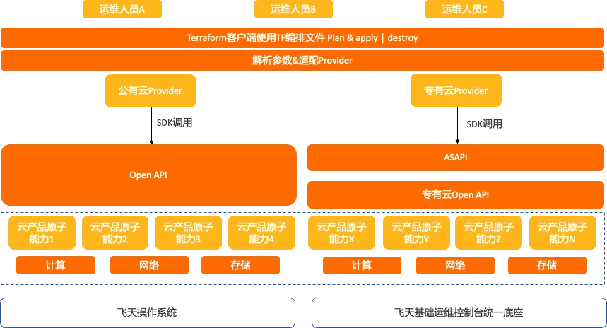

<a id="section-1-1"></a>

## 1.1. 使用价值

**产品覆盖广**

专有云Terraform V1.0版本已继承阿里云公有云计算、网络、存储、数据库、大数据、容器和中间件、应用服务、云管等43款云产品，380个功能模块，1029+API接口的管理能力。

**支持多平台运行**

专有云代码采取了多分支的管理机制，一个（大）版本一个分支，做到一次构建（同时构建出多个版本），多平台运行。

**适用多领域**

支持更多专有云客户（金融、政企、电力、保险、通信等）管理其多云、混合云需求。

**提升测试效率**

专有云Terraform的产品化的实现，推动了阿里云集测团队快速搭建自动化的测试框架，提升测试效率。

**降低成本**

可通过创建配置文件模板重复定义和预配资源，并可多次部署同一模板，创建相同的开发、测试和生产环境来降低成本。

<a id="section-1-2"></a>

## 1.2. 适用场景

**编排管理云资源**

通过专有云Terraform可以对多种云资源进行编码，比如：ECS、VPC、SLB、OSS、RDS等应用，利用代码对云资源进行增删改查。

**管理多云环境**

专有云Terraform支持同时管理不同云提供商的资源，简化了大规模、多云基础架构的管理和编排，满足更多客户通用的多云、混合云需求，降低了客户管理云的成本。

**自助式服务**

测试、运维团队经常会操作许多重复的云资源请求工作，可以使用专有云Terraform构建“自助式”基础设施模块，这些模块可以被重复创建和使用，自动生成新的基础设施请求。

<a id="section-2"></a>

# 2.使用须知

**使用建议**

Windows操作系统建议使用CMD窗口运行Terraform命令，Mac操作系统和Linux操作系统建议打开终端执行Terraform命令。

**支持的产品清单**

| 类别 | 阿里混合云产品 | 资源类型 |
| --- | --- | --- |
|  | 云服务器 ECS | • alibabacloudstack_instance ECS实例<br>• alibabacloudstack_security_group 安全组<br>• alibabacloudstack_security_group_rule 安全组规则<br>• alibabacloudstack_disk 创建云盘<br>• alibabacloudstack_disk_atta chment 挂载云盘<br>• alibabacloudstack_image 创建镜像<br>• alibabacloudstack_image_ex port 导出镜像<br>• alibabacloudstack_image_co py 复制镜像<br>• alibabacloudstack_image_im port 导入镜像<br>• alibabacloudstack_image_sh are_permission 共享镜像<br>• alibabacloudstack_snapshot快照<br>• alibabacloudstack_snapshot _policy 快照策略<br>• alibabacloudstack_network_i nterface 弹性网卡<br>• alibabacloudstack_network_i nterface_attachment 绑定弹性网卡到ECS实例<br>• alibabacloudstack_key_pair SSH密钥对<br>• alibabacloudstack_key_pair_attachment 绑定SSH密钥对到ECS实例 |

- alibabacloudstack_ecs_comm and 云助手命令

- alibabacloudstack_ecs_deplo yment_set 部署集

- alibabacloudstack_ecs_hpc_c luster 高性能集群

- alibabacloudstack_ecs_dedic ated_host 专有宿主机

- alibabacloudstack_launch_te mplate 启动模板

- alibabacloudstack_reserved_ instance 预留实例

- alibabacloudstack_ecs_ebs_s torage_sets 存储集

弹性计算

- alibabacloudstack_ess_alarm报警任务

- alibabacloudstack_ess_attac hment 将一台或多台ECS实例关联到伸缩组中

- alibabacloudstack_ess_lifecy cle_hook 创建生命周期挂钩

- alibabacloudstack_ess_notifi cation 事件通知

- alibabacloudstack_ess_scali

弹性伸缩 ESS

ng_group 创建伸缩组

- alibabacloudstack_ess_scali ng_rule 伸缩规则

- alibabacloudstack_ess_scali nggroup_vserver_groups 向伸缩组添加SLB虚拟服务器组

- alibabacloudstack_ess_sche duled_task 定时任务

- alibabacloudstack_ess_scali ng_configuration 创建伸缩配置

- alibabacloudstack_cs_kubern etes 创建容器集群

容器服务Kubemetes（ACK）

- alibabacloudstack_cs_kubern etes_node_pool 节点池

- alibabacloudstack_cr_repo 企

容器镜像服务ACR（CR）

业版镜像仓库

- alibabacloudstack_cr_names pace 镜像仓库命名空间

- alibabacloudstack_ehpc_job_

弹性高性能计算E-HPC

template 作业模板

- alibabacloudstack_ros_stack资源栈

资源编排ROS

- alibabacloudstack_ros_templ ate 自定义模板

- alibabacloudstack_oos_exec ution 执行

运维编排服务OOS

- alibabacloudstack_oos_temp late 模板

- alibabacloudstack_nas_file_s ystem 文件系统

- alibabacloudstack_nas_moun t_target 挂载点

文件存储 NAS

- alibabacloudstack_nas_acce ss_group 权限组

- alibabacloudstack_nas_acce ss_rule 权限组规则

- alibabacloudstack_oss_buck et 存储空间

- alibabacloudstack_oss_buck

存储

et_object 存储对象

对象存储OSS

- alibabacloudstack_oss_buck et_kms OSS服务端加密

- alibabacloudstack_ots_insta nce OTS实例

- alibabacloudstack_ots_insta nce_attachment 绑定VPC到

表格存储Tablestore

OTS实例

- alibabacloudstack_ots_table OTS表格

- alibabacloudstack_vpc 专有网络

- alibabacloudstack_vpc_ipv6_ gateway IPV6网关

- alibabacloudstack_vpc_ipv6_ egress_rule IPV6地址仅主动出规则

- alibabacloudstack_vpc_ipv6_i nternet_bandwidth IPV6地址公网带宽

- alibabacloudstack_route_tab le 创建路由表

- alibabacloudstack_route_tab le_attachment 将创建的自定义路由表和同一VPC的交换机绑定

- alibabacloudstack_route_ent ry 自定义路由条目

- alibabacloudstack_router_int erface 路由器接口

- alibabacloudstack_router_int erface_connection 发起端路由器接口向接收端发起连接

专有网f络VPC

- alibabacloudstack_vpn_gate way VPN网关

- alibabacloudstack_vpn_custo mer_gateway 用户网关

- alibabacloudstack_vpn_route _entry 为VPN网关实例创建目的路由

- alibabacloudstack_vpn_conn ection IPsec连接

- alibabacloudstack_network_ acl 网络ACL

- alibabacloudstack_network_ acl_attachment 绑定网络ACL到交换机

- alibabacloudstack_network_ acl_entries 网络ACL规则

- alibabacloudstack_nat_gate way NAT网关

- alibabacloudstack_snat_entr y 在SNAT列表中添加SNAT条目

- alibabacloudstack_forward_ entry DNAT列表中添加DNAT条目

- alibabacloudstack_eip 创建弹性IP

弹性公网IP

- alibabacloudstack_eip_assoc

网络

iation 绑定弹性IP

- alibabacloudstack_dns_doma in DNS域名

- alibabacloudstack_dns_doma in_attachment 绑定DNS域名到实例ID

域名解析DNS

- alibabacloudstack_dns_recor d 解析记录

- alibabacloudstack_dns_grou p 域名分组

- alibabacloudstack_slb 创建负载均衡SLB

- alibabacloudstack_slb_acl 访问控制策略组

- alibabacloudstack_slb_backe nd_server 添加后端服务器

- alibabacloudstack_slb_ca_ce rtificate CA证书

- alibabacloudstack_slb_domai n_extension 域名扩展

- alibabacloudstack_slb_listen

负载均衡SLB

er 监听

- alibabacloudstack_slb_maste r_slave_server_group 主备服务器组

- alibabacloudstack_slb_rule为指定的HTTP或HTTPS监听添加转发规则

- alibabacloudstack_slb_serve r_certificate 服务器证书

- alibabacloudstack_slb_serve r_group 服务器组

- alibabacloudstack_common_ bandwidth_package 带宽包资源

通用带宽包 （common）

- alibabacloudstack_common_ bandwidth_package_attachm ent 添加EIP到通用带宽中

- alibabacloudstack_express_c onnect_physical_connection物理专线接入

高速通道

- alibabacloudstack_express_c onnect_virtual_border_route r 边界路由器VBR实例

- alibabacloudstack_adb_back up_policy 备份策略

- alibabacloudstack_adb_acco unt 账号

- alibabacloudstack_adb_conn

云原生数据仓库AnalyticDB

ection 公网连接地址

MySQL

- alibabacloudstack_adb_db_cl uster（alibabacloudstack_adb_clu ster） AnalyticDB MySQL版集群

- alibabacloudstack_dms_ente rprise_instance 企业数据库实例

数据管理DMS

- alibabacloudstack_dms_ente rprise_user 企业用户

- alibabacloudstack_hbase_ins

云数据库HBase

tance HBase实例

- alibabacloudstack_mongodb _instance 副本集实例

云数据库MongoDB

- alibabacloudstack_mongodb _sharding_instanc 分片集群实例

- alibabacloudstack_db_instan ce RDS实例

- alibabacloudstack_db_accou nt 数据库账号

- alibabacloudstack_db_accou nt_privilege 给数据库账号授权

- alibabacloudstack_db_backu p_policy 数据库备份策略

云数据库RDS

数据库

- alibabacloudstack_db_conne ction 数据库实例公网连接地址

- alibabacloudstack_db_datab ase RDS数据库

- alibabacloudstack_db_read_ write_splitting_connection 申请只读地址

- alibabacloudstack_db_reado nly_instance 只读实例

- alibabacloudstack_kvstore_i nstance Redis数据库

- alibabacloudstack_kvstore_a ccount 账号

云数据库Redis

- alibabacloudstack_kvstore_b ackup_policy 备份策略

- alibabacloudstack_kvstore_c onnection 公网连接地址

- alibabacloudstack_gpdb_inst ance AnalyticDB for PostgreSQL实例

原生数据仓库AnalyticDB

- alibabacloudstack_gpdb_con

PostgreSQL版

nection 公网连接地址

- alibabacloudstack_gpdb_acc ount 实例的初始账号

- alibabacloudstack_drds_inst

云原生分布式数据库PolarDB-X 1.0

ance 实例

- alibabacloudstack_dts_subsc ription_job 订阅任务

- alibabacloudstack_dts_synch

数据传输服务DTS

ronization_instance 异步任务实例

- alibabacloudstack_dts_synch ronization_job 异步任务

- alibabacloudstack_dbs_back

数据库备份服务 DBS

up_plan 备份计划

- alibabacloudstack_maxcomp ute_project 项目

- alibabacloudstack_maxcomp

大数据计算 MaxCompute

ute_cu 配额组管理

- alibabacloudstack_maxcomp ute_user 任务云账号

- alibabacloudstack_datahub_ project 项目

- alibabacloudstack_datahub_

数据总线DataHub

subscription 订阅

- alibabacloudstack_datahub_ topic 主题

- alibabacloudstack_data_wor ks_connection 连接

- alibabacloudstack_data_wor ks_folder 文件夹

- alibabacloudstack_data_wor ks_project 项目

DataWorks

- alibabacloudstack_data_wor ks_remind 告警规则

- alibabacloudstack_data_wor ks_user 用户

- alibabacloudstack_data_wor ks_role_binding 用户角色

- alibabacloudstack_quick_bi_ user 组织用户

- alibabacloudstack_quick_bi_

Quick BI

user_group 用户组管理

- alibabacloudstack_quick_bi_

大数据

workspace 工作空间管理

- alibabacloudstack_elasticse

ElasticSearch

arch 实例

- alibabacloudstack_elasticse

ElasticSearch on k8s

arch_on_k8s

- alibabacloudstack_ascm_log on_policy 创建访问策略

- alibabacloudstack_ascm_org anization 创建组织

- alibabacloudstack_ascm_use r 创建用户

- alibabacloudstack_ascm_use r_role_binding 给用户绑定角色

- alibabacloudstack_ascm_use rgroup_user 给用户组添加用户

- alibabacloudstack_ascm_use r_group 用户组

- alibabacloudstack_ascm_use r_group_resource_set_bindin g 用户组资源集绑定

- alibabacloudstack_ascm_use

云管理

ASCM

r_group_role_binding 给用户组绑定角色

- alibabacloudstack_ascm_pas sword_policy 创建ASCM密码策略

- alibabacloudstack_ascm_quo ta 创建配额

- alibabacloudstack_ascm_res ource_group 创建资源集

- alibabacloudstack_ascm_ram _policy RAM策略

- alibabacloudstack_ascm_ram _role RAM角色

- alibabacloudstack_ascm_ram _policy_for_role RAM角色策略

- alibabacloudstack_ascm_cus tom_role 自定义角色

- alibabacloudstack_cms_alar m 阈值报警规则

- alibabacloudstack_cms_alar m_contact 报警联系人

云监控 CMS

- alibabacloudstack_cms_alar m_contact_group 报警联系组

- alibabacloudstack_cms_site_ monitor 站点监控任务

监控运维

- libabacloudstack_arms_alert _contact 报警联系人

- alibabacloudstack_arms_aler t_contact_group 报警联系组

应用实时监控服务ARMS

- alibabacloudstack_arms_disp atch_rule 分派策略

- alibabacloudstack_arms_pro metheus_alert_rule Prometheus 告警规则

- alibabacloudstack_applicatio n_deployment 部署应用

- alibabacloudstack_edas_clus ter ECS集群

- alibabacloudstack_edas_app lication ECS应用

- alibabacloudstack_edas_inst ance_cluster_attachment 使用ECS自带的云助手安装EDAS

企业级分布式应用服务EDAS

Agent

- alibabacloudstack_edas_k8s _cluster K8s集群

- alibabacloudstack_edas_k8s _application K8s应用

- alibabacloudstack_edas_app lication_scale 扩容应用

- alibabacloudstack_edas_dep loy_group 应用分组

中间件

- alibabacloudstack_ons_grou p 创Group ID

- alibabacloudstack_ons_insta

消息队列MQ

nce MQ实例

- alibabacloudstack_ons_topic创MQ topic

- alibabacloudstack_alikafka_s asl_acl SASL用户和客户端使用SDK收发消息权限

- alibabacloudstack_alikafka_s

消息队列Kafka

asl_user SASL用户

- alibabacloudstack_alikafka_t opic 消息主题

- alibabacloudstack_csb_proje

服务总线CSB

ct 项目

- alibabacloudstack_kms_key创建KMS

- alibabacloudstack_kms_alias创建密钥别名

密钥管理服务KMS

- alibabacloudstack_kms_ciph ertext KMS加密

- alibabacloudstack_kms_secr et 凭据

安全

- alibabacloudstack_ram_role_

访问控制

attachment 为ECS关联RAM角色

- alibabacloudstack_cloud_Fire wall_control_policy 访问控制策略

云盾防火墙

- alibabacloudstack_cloud_Fire wall_control_policy_order 调整访问控制策略优先级

- alibabacloudstack_api_gate way_api API

- alibabacloudstack_api_gate way_app 应用

- alibabacloudstack_api_gate

API网关

way_group API分组

- alibabacloudstack_api_gate way_app_attachment 给指定app添加多个API访问权限

- alibabacloudstack_api_gate way_vpc_access 添加VPC授权

应用服务

- alibabacloudstack_log_proje ct 日志项目

- alibabacloudstack_log_store日志库

- alibabacloudstack_log_store _index 日志库索引

日志服务 SLS

- alibabacloudstack_log_machi ne_group 机器组

- alibabacloudstack_logtail_at tachment 将日志库配置应用到机器组

- alibabacloudstack_logtail_co nfig 日志库配置

<a id="section-3"></a>

# 3.规划与准备

**Windows 操作系统**

**下载 Terraform 工具**

1. 登录Terraform官网下载适用于您操作系统的程序包，推荐版本terraform_0.12.29。

   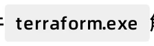

   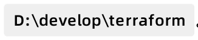

2. 下载完成后将可执行文件 terraform.exe 解压到自定义目录中，例如： D:\\develop\\terraform 。

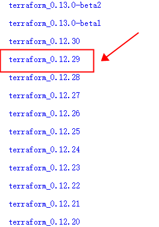

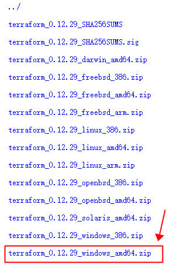

**下载专有云Provider插件**

专有云Provider是由阿里云专有云提供，用于支持Terraform管理专有云云产品的插件。

1. 下载专有云Provider插件。

   <ol type="i">

   <li>

   进入github库，选择对应版本的分支。

   </li>

   <li>

   选择好分支后，单击Releases选择版本以及对应的操作系统进行下载。

   **说明**

   </li>

   </ol>

   V3.14版本请进入github库，选择new-master分支。

   V3.16及以后版本请进入github库，选择对应分支。

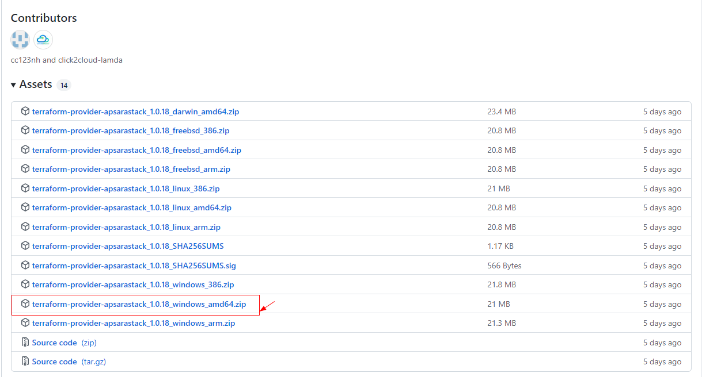

**重要**

下载Provider插件的操作系统要与Terraform工具的操作系统一致。

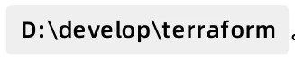

2. 将Provider可执行文件解压到与terraform.exe文件相同的路径下，例如： D:\\develop\\terraform 。

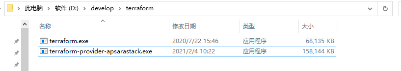

**设置环境变量**

在使用Terraform工具前需要设置环境变量，操作步骤如下。

1. 设置环境变量。在环境变量的编辑页面中，将terraform.exe所在的路径添加到系统变量Path的变量值中。

2. 验证环境变量。打开cmd窗口输入terraform -version，回车后若返回最新下载的Terraform版本号，即表明设置成功，否则请重新设置环境变量。

**MAC/Linux操作系统**

**下载Terraform工具**

1. 登录Terraform官网，或通过命令行下载适用于您操作系统的程序包，推荐版本terraform_0.12.29。

```bash
wget https://releases.hashicorp.com/terraform/0.12.29/terraform_0.12.29_linux_amd64.zip
```

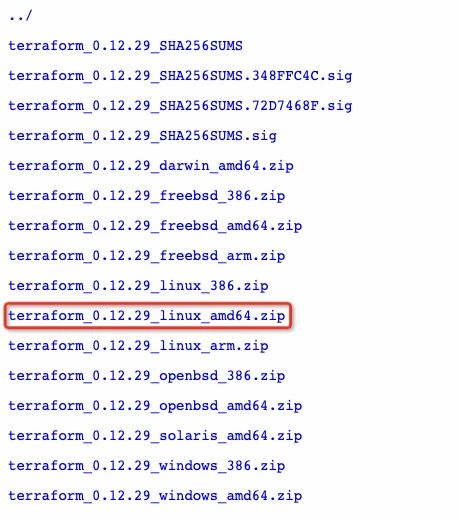

2. 用命令unzip terraform_0.12.29_linux_amd64.zip解压文件。为了方便下一步配置PATH环境变量，可以将.zip解压到/usr/local/bin目录下，解压后的terraform是一个binary可执行文件。

**下载专有云Provider插件**

- MAC操作系统下载专有云Provider可直接进入github库，方法同Windows一致。

- Linux操作系统下载专有云Provider，可通过以下命令下载。

  **说明**

  V3.14版本下载命令：

  ```bash
  wget https://github.com/apsara-stack/terraform-provider-apsarastack/releases/download/v1.0.18/terraform-provider-apsarastack_1.0.18_linux_amd64.zip
  ```

  V3.16及以后版本下载命令：

  ```bash
  wget https://github.com/aliyun/terraform-provider-alibabacloudstack/releases/download/v1.0.5/terraform-provider-alibabacloudstack_1.0.5_linux_amd64.zip
  ```

  **重要**

  下载Provider插件的操作系统要与Terraform工具的操作系统一致。

**配置环境变量**

1. 打开terminal。

- 如果Terraform文件在/usr/local/bin路径下，输入以下命令，将/usr/local/bin目录下的terraform binary文件链接到/usr/bin目录。

```bash
cd /usr/bin   
sudo ln -s /usr/local/bin/terraform 
```

- 如果Terraform文件在自定义路径下，输入vi ~/.bash_profile命令创建一个新的配置文件，使用如下命令将terraform文件所在路径写入配置文件中，保存退出。

```bash
TERRAFORM=terraform binary所在文件夹路径
PATH=$TERRAFORM:$PATH:.
export PATH
```

2. 更新配置文件。打开terminal输入source ~/.bash_profile命令更新配置文件。

3. 验证环境变量。打开terminal输入terraform命令，当terminal提示以下信息，说明环境变量配置成功。

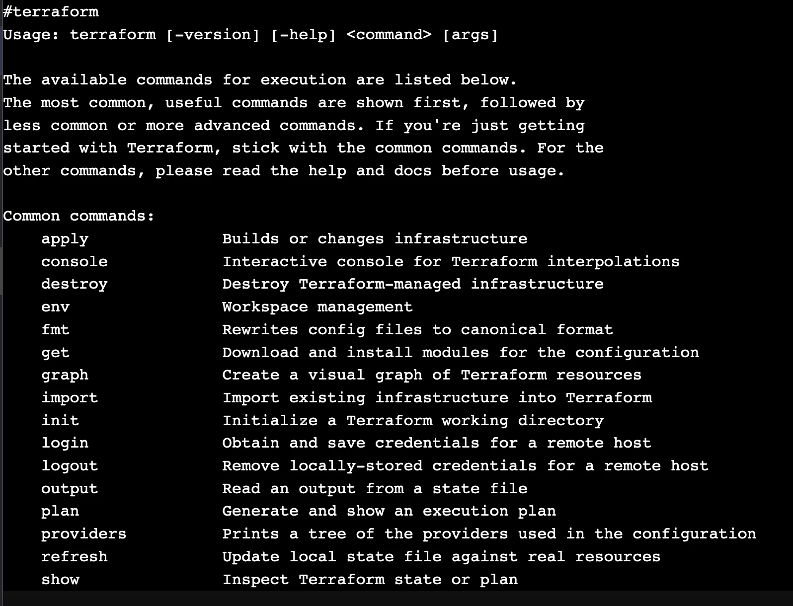

<a id="section-4"></a>

# 4.使用指导

<a id="section-4-1"></a>

## 4.1. Terraform初始化

在执行terraform.tf模板前，需要先将Terraform初始化。

**Terraform初始化步骤：**

1. 将terraform.tf模板与解压后的Terraform工具、Provider插件放在同一目录下。

2. 进入terraform.tf模板文件目录，Windows系统请打开cmd窗口，Mac系统和Linux系统请打开终端执行。

   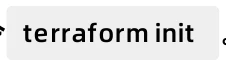

3. 在cmd或终端窗口中运行命令 terraform init  。

4. 返回“Terraform has been successfully initialized”即代表初始化成功。若不成功请重新检查terraform.tf文件中的配置信息是否正确。

   **重要**

   初始化操作只需要一次，provider插件加载成功后，无需再次初始化。

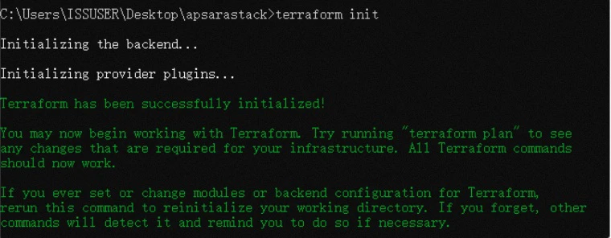

<a id="section-4-2"></a>

## 4.2. Terraform资源销毁

本章介绍如何通过Terraform销毁已创建的资源。

**Terraform销毁资源步骤**


- 销毁指定资源，输入命令 terraform destroy -target=resource资源名称 。

例如：（V3.14版本）销毁已创建的专有网络VPC实例资源，输入命令 terraform destroy -target=apsarastack_vpc.vpc  ，输入yes确认执行销毁操作。

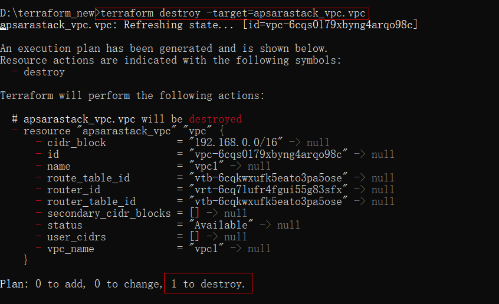

（V3.16及以后版本）销毁已创建的专有网络VPC实例资源，输入命令 terraform destroy -target=alibabacloudstack_vpc.vpc  ，输入yes确认执行销毁操作。

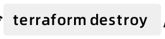

- 销毁当前创建的所有资源，输入命令 terraform destroy  ，输入yes确认执行销毁操作。

  **说明**

  resource资源名称为用户创建资源时自定义的名称。

<a id="section-4-3"></a>

## 4.3. 专有云Terraform Provider中使用STS调用方式使用说明

本章介绍当云产品开启STS鉴权信任模式后，如何调用专有云Terraform Provider的使用说明。

**STS简介**

阿里云STS（Security Token Service）是阿里云提供的一种临时访问权限管理服务。RAM提供RAM用户和RAM角色两种身份。其中，RAM角色不具备永久身份凭证，而只能通过STS获取可以自定义时效和访问权限的临时身份凭证，即安全令牌（STS Token）。

**操作准备：**

1. 获取role_arn参数。

   <ol type="i">

   <li>

   使用用户的账户名和密码登录Apsara Uni-manager运营控制台（ASCM）界面。

   </li>

   <li>

   单击主页右上角的云朵logo，单击个人信息。

   </li>

   <li>

   单击查看当前决策策略。

   </li>

   <li>

   获取RAM Role信息（示例：acs:ram::1567042650760225:role/ascm-role-33-4-5509）。

   </li>

   </ol>

2. 获取sts_endpoint参数。

   <ol type="i">

   <li>

   登录飞天基础运维控制台3.0。

   </li>

   <li>

   在左侧导航栏选择**运维工具 > 基础数据管理。**

   </li>

   <li>

   单击**底座元数据管理**模块中的**服务注册变量大盘** 。

   </li>

   <li>

   在**服务**搜索栏中输入ram，自动过滤出ram服务。

   </li>

   <li>

   单击ram-ramService服务对应的Service Registration内容，查看注册变量详情。

   </li>

   <li>

   获取sts-openapi.endpoint信息（示例：sts.inter.env66.shuguang.com）。

   **说明**

   </li>

   </ol>

   如需登录飞天基础运维控制台1.0，可在左侧导航栏选择**运维工具 > 基础数据管理**，单击**Tianji元数据管理**模块中的**飞天基础运维控制台1.0。**

**操作步骤：**

1. 创建terraform.tf文件，将获取到的role_arn参数和sts_endpoint参数添加到配置文件中。

2. 在terraform.tf文件中增加以下内容。

   ```terraform
   provider "alibabacloudstack" {
    assume_role {}
   }
   ```

示例如下：

```terraform
#环境配置
provider "alibabacloudstack" {
domain="asapi域名"
access_key="用户的ak"
secret_key="用户的sk"
region="地域"
proxy= "HTTP://环境代理"
protocol="HTTP"
insecure="true"
resource_group_set_name ="资源集名称"
sts_endpoint = "sts.inter*******"
role_arn = "acs:ram::******"
}

provider "alibabacloudstack" {
 assume_role {}
}
```

<a id="section-4-4"></a>

## 4.4. 创建专有网络VPC实例

使用专有云Terraform创建专有网络VPC实例。

**操作步骤**

**编写Terraform的模板文件**

创建terraform.tf文件，编写要创建的资源语句。

```terraform
#环境配置
provider "alibabacloudstack" { 
  domain="asapi域名" 
  access_key="用户的ak" 
  secret_key="用户的sk" 
  region="地域" 
  proxy= "HTTP://环境代理" 
  protocol="HTTP" 
  insecure="true" 
  resource_group_set_name ="资源集名称" 
}
  
#创建VPC实例
resource "alibabacloudstack_vpc" "vpc" { 
  name = "vpc1" 
  cidr_block = "192.168.0.0/16" #vpc网段
}
```

参数说明：

| 参数 | 含义 | 获取方式 |
| --- | --- | --- |
| domain | asapi的域名 | 1. 登录飞天基础运维控制台3.0。<br>2. 在左侧导航栏选择<strong>运维工具 &gt; 基</strong>础数据管理。<br>3. 单击<strong>底座元数据管理</strong>模块中的<strong>服</strong><strong>务注册变量大盘 </strong>。<br>4. 在<strong>服务</strong>搜索栏中输入asapi，自动过滤出asapi服务。<br>5. 单击asapi服务对应的Service Registration内容，查看注册变量详情，获取asapi.gateway.endpoint的域名。<br>说明<br>如需登录飞天基础运维控制台1.0，可在左侧导航栏选择<strong>运维</strong><strong>工具 &gt; 基础数据管理</strong>，单击<strong>Tianji元数据管理</strong>模块中的<strong>飞</strong>天基础运维控制台1.0。 |
| access_key | 用户的访问密钥 | 1. 使用用户的账户名和密码登录Apsara Uni-manager运营控制台（ASCM）界面。<br>2. 单击主页右上角的云朵logo，单击个人信息。<br>3. 获取用户的AccessKey ID。 |
| secret_key | 用户的访问密钥Secret | 1. 使用用户的账户名和密码登录Apsara Uni-manager运营控制台（ASCM）界面。<br>2. 单击主页右上角的云朵logo，单击个人信息。<br>3. 获取用户的AccessKey Secret。 |
| region | 地域 | 1. 登录Apsara Uni-manager运营控制台（ASCM））界面。<br>2. 单击<strong>企业 &gt; 地域管理</strong>。<br>3. 选择目标组织，获取地域信息。 |
| proxy | 访问环境的代理地址 | 若访问环境不需要通过代理地址，则无需配置此参数。 |
| insecure | 不安全的https证书 | insecure="true"表示忽略不安全的https证书，取值范围（true、false）。 |
| resource_group_set_name | 资源集名称 | 1. 查看资源名称，选择Apsara Uni-manager运营控制台（ASCM）控制台页面右上方的<strong>企</strong><strong>业</strong>。<br>2. 单击目标组织，获取该组织的资源集名称 |
| vpc_name | 专有网络VPC名称 | 用户自定义，长度为2～128个字符，必须以字母或中文开头，可包含数字、半角句号（.）、下划线（_）和短划线（-）。 |
| cidr_block | VPC地址块 | 1. 查看VPC地址块信息，选择Apsara Uni-manager运营控制台（ASCM）顶部菜单栏上的<strong>产品</strong><strong>&gt; 专有网络VPC</strong>，单击左侧导航栏中的<strong>专有网络</strong>，获取VPC地址块信息。<br>2. 用户可根据获得的地址块信息，重新自定义新的网段。 |

**Terraform初始化**

在执行terraform.tf模板前，需要先将Terraform初始化。请在Terraform初始化中查看操作步骤。

**Terraform计划展示**

展示terraform.tf文件中计划创建的资源信息。

操作步骤如下：


1. 运行命令 terraform plan  。

2. 查看terraform.tf文件中展示的计划创建资源信息。

**Terraform执行**

执行上一步terraform plan展示的资源创建计划。

操作步骤如下：


1. 输入命令 terraform apply 执行terraform.tf文件中的资源创建操作。

2. 输入 yes 确认执行计划中的操作。

3. 返回Apply complete!即代表资源创建成功。若不成功查看具体的报错信息，修改terraform.tf文件中的创建资源内容。

**Terraform查看结果**


运行 terraform show 查看已创建的资源详情。

**Terraform销毁**

当需要释放资源可通过terraform destroy销毁已创建的资源，请在Terraform资源销毁中查看操作步骤。

**重要**

当执行terraform apply操作时提示“用户无资源授权，或者该API不支持RAM”，请检查该产品是否开启了STS鉴权信任模式。

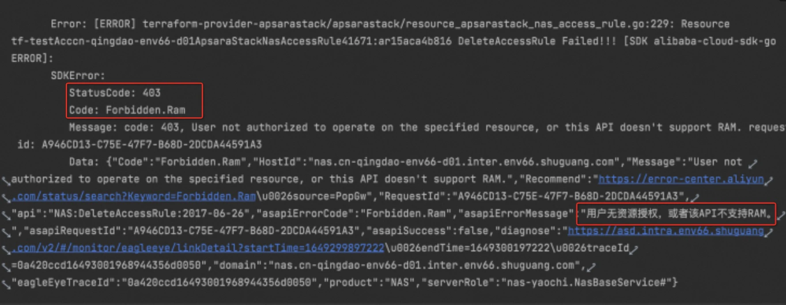

STS鉴权信任模式检查方式：

1. 通过super账号登录Apsara Uni-manager运营控制台（ASCM）。

2. 单击**配置** **> 鉴权信任模式**。

3. 产品被勾选则表示已开启了鉴权信任模式。

当STS鉴权信任模式开启后，执行操作请参考专有云Terraform Provider中使用STS调用方式使用说明。

<a id="section-4-5"></a>

## 4.5. 创建云服务器ECS实例

使用专有云Terraform创建一台ECS实例。

**前提条件**

创建ECS实例之前，需要先创建专有网络、交换机和安全组。

**操作步骤**

**编写Terraform的模板文件**

创建terraform.tf文件，编写要创建的资源语句。

```terraform
#环境配置
provider "alibabacloudstack" {
domain="asapi域名"
access_key="用户的ak"
secret_key="用户的sk"
region="地域"
proxy= "HTTP://环境代理"
protocol="HTTP"
insecure="true"
resource_group_set_name ="资源集名称"
}

#创建vpc
resource "alibabacloudstack_vpc" "vpc" {
  name       = "tf_test_foo"
  cidr_block = "192.168.0.0/16" #vpc网段
}

#创建vsw
resource "alibabacloudstack_vswitch" "vsw" {
  vpc_id            = "${alibabacloudstack_vpc.vpc.id}"
  cidr_block        = "192.168.0.0/16" #网段
  availability_zone = "cn-neimeng-env130-amtest130001-a"  #可用区
}

#创建安全组
resource "alibabacloudstack_security_group" "group" {
  name   = "new-group"
  vpc_id = "${alibabacloudstack_vpc.vpc.id}"
}

#创建ECS实例
resource "alibabacloudstack_instance" "instance" {
  image_id              = "centos_7_7_x64_20G_alibase_20200426.vhd"
  instance_type        = "ecs.mn4.large"
  system_disk_category = "cloud_efficiency"
  security_groups      = [alibabacloudstack_security_group.group.id]
  instance_name        = "test_ecs"
  vswitch_id           = alibabacloudstack_vswitch.vsw.id
}
```

参数说明：

<table>
  <tr>
    <td>参数</td>
    <td>含义</td>
    <td>获取方式</td>
  </tr>
  <tr>
    <td>domain</td>
    <td>asapi的域名</td>
    <td>1. 登录飞天基础运维控制台3.0。<br>2. 在左侧导航栏选择<strong>运维工具 &gt; 基</strong><strong>础数据管理</strong>。<br>3. 单击<strong>底座元数据管理</strong>模块中的<strong>服</strong><strong>务注册变量大盘 </strong>。<br>4. 在<strong>服务</strong>搜索栏中输入asapi，自动过滤出asapi服务。<br>5. 单击asapi服务对应的Service Registration内容，查看注册变量详情，获取asapi.gateway.endpoint的域名。<br>说明<br>如需登录飞天基础运维控制台1.0，可在左侧导航栏选择<strong>运维</strong><strong>工具 &gt; 基础数据管理</strong>，单击<strong>Tianji元数据管理</strong>模块中的<strong>飞</strong><strong>天基础运维控制台1.0</strong>。</td>
  </tr>
  <tr>
    <td>access_key</td>
    <td>用户的访问密钥</td>
    <td>1. 使用用户的账户名和密码登录Apsara Uni-manager运营控制台（ASCM）界面。<br>2. 单击主页右上角的云朵logo，单击个人信息。<br>3. 获取用户的AccessKey ID。</td>
  </tr>
  <tr>
    <td>secret_key</td>
    <td>用户的访问密钥Secret</td>
    <td>1. 使用用户的账户名和密码登录Apsara Uni-manager运营控制台（ASCM）界面。<br>2. 单击主页右上角的云朵logo，单击个人信息。<br>3. 获取用户的AccessKey Secret。</td>
  </tr>
  <tr>
    <td>region</td>
    <td>地域</td>
    <td>1. 登录Apsara Uni-manager运营控制台（ASCM）界面。<br>2. 单击<strong>企业 &gt; 地域管理</strong>。<br>3. 选择目标组织，获取地域信息。</td>
  </tr>
  <tr>
    <td>proxy</td>
    <td>访问环境的代理地址</td>
    <td>若访问环境不需要通过代理地址，则无需配置此参数。</td>
  </tr>
  <tr>
    <td>insecure</td>
    <td>不安全的https证书</td>
    <td>insecure="true"表示忽略不安全的https证书，取值范围（true、false）。</td>
  </tr>
  <tr>
    <td>resource_group_set_name</td>
    <td>资源集名称</td>
    <td>1. 查看资源名称，选择Apsara Uni-manager运营控制台（ASCM）页面右上方的<strong>企业</strong>。<br>2. 单击目标组织，获取该组织的资源集名称。</td>
  </tr>
  <tr>
    <td>vpc_name</td>
    <td>专有网络VPC名称</td>
    <td>用户可自定义，长度为2～128个字符，必须以字母或中文开头，可包含数字、半角句号（.）、下划线（_）和短划线（-）。</td>
  </tr>
  <tr>
    <td>cidr_block</td>
    <td>VPC地址块</td>
    <td>1. 查看VPC地址块信息，选择Apsara Uni-manager运营控制台（ASCM）顶部菜单栏上的<strong>产品</strong><strong>&gt; 专有网络VPC</strong>，单击左侧导航栏中的<strong>专有网络</strong>，获取VPC地址块信息。<br>2. 用户可根据获得的地址块信息，重新自定义新的网段</td>
  </tr>
  <tr>
    <td>vswitch_id</td>
    <td>交换机ID</td>
    <td>1. 查看交换机ID，选择Apsara Uni-manager运营控制台（ASCM）顶部菜单栏上的<strong>产品 &gt;</strong><strong>专有网络VPC</strong>。<br>2. 单击左侧导航栏中的<strong>交换机</strong>，获取交换机ID信息。</td>
  </tr>
  <tr>
    <td>availability_zone</td>
    <td>可用区</td>
    <td>1. 查看可用区，选择Apsara Uni-manager运营控制台（ASCM）顶部菜单栏上的<strong>产品 &gt; 云服务器</strong>ECS。<br>2. 单击左侧导航栏中的<strong>实例</strong>，获取可用区信息。</td>
  </tr>
  <tr>
    <td>image_id</td>
    <td>镜像ID</td>
    <td>1. 查看镜像ID，选择Apsara Uni-manager运营控制台（ASCM）顶部菜单栏上的<strong>产品 &gt; 云服务器</strong>ECS。<br>2. 单击左侧导航栏中的<strong>镜像</strong>，获取镜像信息。</td>
  </tr>
  <tr>
    <td>instance_type</td>
    <td>ECS实例规格</td>
    <td>1. 查看ECS实例规格，选择Apsara Uni-manager运营控制台（ASCM）顶部菜单栏上的<strong>产品 &gt;</strong>云服务器ECS。<br>2. 单击左侧导航栏中的<strong>实例</strong>，单击创建实例，选择实例系列，获取实例规格。</td>
  </tr>
  <tr>
    <td>system_disk_category</td>
    <td>系统盘类型</td>
    <td>1. 查看系统盘类型，选择Apsara Uni-manager运营控制台（ASCM）顶部菜单栏上的<strong>产品 &gt;</strong>云服务器ECS。<br>2. 单击左侧导航栏中的<strong>实例</strong>，单击创建实例，查看系统盘类型。</td>
  </tr>
  <tr>
    <td>security_groups</td>
    <td>安全组</td>
    <td>1. 查看信息安全组，选择Apsara Uni-manager运营控制台（ASCM）顶部菜单栏上的<strong>产品 &gt;</strong>云服务器ECS。<br>2. 单击左侧导航栏中的<strong>安全组</strong>，获取安全组信息。</td>
  </tr>
  <tr>
    <td>instance_name</td>
    <td>ECS实例名称</td>
    <td>用户自定义，长度为2-110个字符，不能以特殊字符及数字开头，只可包含特殊字符中的（.）、（_）、（-）和（:）。</td>
  </tr>
</table>

**Terraform初始化**

在执行terraform.tf模板前，需要先将Terraform初始化。请在Terraform初始化中查看操作步骤。

**Terraform计划展示**

展示terraform.tf文件中计划创建的资源信息。

操作步骤如下：


1. 运行命令 terraform plan  。

2. 查看terraform.tf文件中展示的计划创建资源信息。

**Terraform执行**

执行上一步terraform plan展示的资源创建计划。

操作步骤如下：


1. 输入命令 terraform apply 执行terraform.tf文件中的资源创建操作。

2. 输入 yes 确认执行计划中的操作。

3. 返回Apply complete!即代表资源创建成功。若不成功查看具体的报错信息，修改terraform.tf文件中的创建资源内容。

**Terraform查看结果**


运行 terraform show 查看已创建的资源详情。

**Terraform销毁**

当需要释放资源可通过terraform destroy销毁已创建的资源，请在Terraform资源销毁中查看操作步骤。

**重要**

当执行terraform apply操作时提示“用户无资源授权，或者该API不支持RAM”，请检查该产品是否开启了STS鉴权信任模式。


STS鉴权信任模式检查方式：

1. 通过super账号登录Apsara Uni-manager运营控制台（ASCM）。

2. 单击**配置** **> 鉴权信任模式**。

3. 产品被勾选则表示已开启了鉴权信任模式。

当STS鉴权信任模式开启后，执行操作请参考专有云Terraform Provider中使用STS调用方式使用说明。

<a id="section-4-6"></a>

## 4.6. 创建负载均衡SLB实例

使用专有云Terraform在专有网络中创建负载均衡实例。

**前提条件**

创建SLB实例之前，需要先创建专有网络和交换机。

**操作步骤**

**编写Terraform的模板文件**

创建terraform.tf文件，编写要创建的资源语句。

```terraform
#环境配置
provider "alibabacloudstack" {
domain="asapi域名"
access_key="用户的ak"
secret_key="用户的sk"
region="地域"
proxy= "HTTP://环境代理"
protocol="HTTP"
insecure="true"
resource_group_set_name ="资源集名称"
}

variable "name" {
  default = "terraformtestslbconfig"
}

data "alibabacloudstack_zones" "default" {
  available_resource_creation = "VSwitch"
}

#创建VPC
resource "alibabacloudstack_vpc" "default" {
  name       = "${var.name}"
  cidr_block = "172.16.0.0/12"
}

#创建交换机
resource "alibabacloudstack_vswitch" "default" {
  vpc_id            = "${alibabacloudstack_vpc.default.id}"
  cidr_block        = "172.16.0.0/21"
  availability_zone = "${data.alibabacloudstack_zones.default.zones.0.id}"
  name              = "${var.name}"
}

#创建SLB
resource "alibabacloudstack_slb" "default" {
  name          = "${var.name}"
  vswitch_id    = "${alibabacloudstack_vswitch.default.id}"
}
```

参数说明：

<table>
  <tr>
    <td>参数</td>
    <td>含义</td>
    <td>获取方式</td>
  </tr>
  <tr>
    <td>domain</td>
    <td>asapi的域名</td>
    <td>1. 登录飞天基础运维控制台3.0。<br>2. 在左侧导航栏选择<strong>运维工具 &gt; 基</strong>础数据管理。<br>3. 单击<strong>底座元数据管理</strong>模块中的<strong>服</strong><strong>务注册变量大盘 </strong>。<br>4. 在<strong>服务</strong>搜索栏中输入asapi，自动过滤出asapi服务。<br>5. 单击asapi服务对应的Service Registration内容，查看注册变量详情，获取asapi.gateway.endpoint的域名。<br>说明<br>如需登录飞天基础运维控制台1.0，可在左侧导航栏选择<strong>运维</strong><strong>工具 &gt; 基础数据管理</strong>，单击<strong>Tianji元数据管理</strong>模块中的<strong>飞</strong><strong>天基础运维控制台1.0</strong>。</td>
  </tr>
  <tr>
    <td>access_key</td>
    <td>用户的访问密钥</td>
    <td>1. 使用用户的账户名和密码登录Apsara Uni-manager运营控制台（ASCM）界面。<br>2. 单击主页右上角的云朵logo，单击个人信息。<br>3. 获取用户的AccessKey ID。</td>
  </tr>
  <tr>
    <td>secret_key</td>
    <td>用户的访问密钥Secret</td>
    <td>1. 使用用户的账户名和密码登录Apsara Uni-manager运营控制台（ASCM）界面。<br>2. 单击主页右上角的云朵logo，单击个人信息。<br>3. 获取用户的AccessKey Secret。</td>
  </tr>
  <tr>
    <td>region</td>
    <td>地域</td>
    <td>1. 登录Apsara Uni-manager运营控制台（ASCM））界面。<br>2. 单击<strong>企业 </strong>&gt; <strong>地域管理</strong>。<br>3. 选择目标组织，获取地域信息。</td>
  </tr>
  <tr>
    <td>proxy</td>
    <td>访问环境的代理地址</td>
    <td>若访问环境不需要通过代理地址，则无需配置此参数。</td>
  </tr>
  <tr>
    <td>insecure</td>
    <td>不安全的https证书</td>
    <td>insecure="true"表示忽略不安全的https证书，取值范围（true、false）。</td>
  </tr>
  <tr>
    <td>resource_group_set_name</td>
    <td>资源集名称</td>
    <td>1. 查看资源名称，选择Apsara Uni-manager运营控制台（ASCM）页面右上方的<strong>企业</strong>。<br>2. 单击目标组织，获取该组织的资源集名称。</td>
  </tr>
  <tr>
    <td>vpc_name</td>
    <td>专有网络VPC名称</td>
    <td>用户可自定义，长度为2～128个字符，必须以字母或中文开头，可包含数字、半角句号（.）、下划线（_）和短划线（-）。</td>
  </tr>
  <tr>
    <td>cidr_block</td>
    <td>VPC地址块</td>
    <td>1. 查看VPC地址块信息，选择Apsara Uni-manager运营控制台（ASCM）顶部菜单栏上的<strong>产品</strong><strong>&gt; 专有网络VPC</strong>，单击左侧导航栏中的<strong>专有网络</strong>，获取VPC地址块信息。<br>2. 用户可根据获得的地址块信息，重新自定义新的网段</td>
  </tr>
  <tr>
    <td>vswitch_id</td>
    <td>交换机ID</td>
    <td>1. 查看交换机ID，选择Apsara Uni-manager运营控制台（ASCM）顶部菜单栏上的<strong>产品 &gt;</strong><strong>专有网络VPC</strong>。<br>2. 单击左侧导航栏中的<strong>交换机</strong>，获取交换机ID信息。</td>
  </tr>
  <tr>
    <td>availability_zone</td>
    <td>可用区</td>
    <td>1. 查看可用区，选择Apsara Uni-manager运营控制台（ASCM）顶部菜单栏上的<strong>产品 &gt; 负载均衡</strong>SLB。<br>2. 单击左侧导航栏中的<strong>实例管理</strong> &gt;<strong>创建负载均衡</strong>，获取可用区信息。</td>
  </tr>
</table>

**Terraform初始化**

在执行terraform.tf模板前，需要先将Terraform初始化。请在Terraform初始化中查看操作步骤。

**Terraform计划展示**

展示terraform.tf文件中计划创建的资源信息。

操作步骤如下：


1. 运行命令 terraform plan  。

2. 查看terraform.tf文件中展示的计划创建资源信息。

**Terraform执行**

执行上一步terraform plan展示的资源创建计划。

操作步骤如下：


1. 输入命令 terraform apply 执行terraform.tf文件中的资源创建操作。

2. 输入 yes 确认执行计划中的操作。

3. 返回Apply complete!即代表资源创建成功。若不成功查看具体的报错信息，修改terraform.tf文件中的创建资源内容。

**Terraform查看结果**


运行 terraform show 查看已创建的资源详情。

**Terraform销毁**

当需要释放资源可通过terraform destroy销毁已创建的资源，请在Terraform资源销毁中查看操作步骤。

**重要**

当执行terraform apply操作时提示“用户无资源授权，或者该API不支持RAM”，请检查该产品是否开启了STS鉴权信任模式。


STS鉴权信任模式检查方式：

1. 通过super账号登录Apsara Uni-manager运营控制台（ASCM）。

2. 单击**配置** **> 鉴权信任模式**。

3. 产品被勾选则表示已开启了鉴权信任模式。

当STS鉴权信任模式开启后，执行操作请参考专有云Terraform Provider中使用STS调用方式使用说明。

<a id="section-4-7"></a>

## 4.7. 创建对象存储OSS Bucket

使用专有云Terraform创建一个Bucket存储空间。

**操作步骤**

**编写Terraform的模板文件**

创建terraform.tf文件，编写要创建的资源语句。

```terraform
#环境配置
provider "alibabacloudstack" {
domain="asapi域名"
access_key="用户的ak"
secret_key="用户的sk"
region="地域"
proxy= "HTTP://环境代理"
protocol="HTTP"
insecure="true"
resource_group_set_name ="资源集名称"
}

#创建 OSS_bucket
resource "alibabacloudstack_oss_bucket" "oss" {
  bucket = "test2"
  acl    = "public-read"
}
```

参数说明：

<table>
  <tr>
    <td>参数</td>
    <td>含义</td>
    <td>获取方式</td>
  </tr>
</table>

<table>
  <tr>
    <td>domain</td>
    <td>asapi的域名</td>
    <td>1. 登录飞天基础运维控制台3.0。<br>2. 在左侧导航栏选择<strong>运维工具 &gt; 基</strong><strong>础数据管理</strong>。<br>3. 单击<strong>底座元数据管理</strong>模块中的<strong>服</strong><strong>务注册变量大盘 </strong>。<br>4. 在<strong>服务</strong>搜索栏中输入asapi，自动过滤出asapi服务。<br>5. 单击asapi服务对应的Service Registration内容，查看注册变量详情，获取asapi.gateway.endpoint的域名。<br>说明<br>如需登录飞天基础运维控制台1.0，可在左侧导航栏选择<strong>运维</strong><strong>工具 &gt; 基础数据管理</strong>，单击<strong>Tianji元数据管理</strong>模块中的<strong>飞</strong><strong>天基础运维控制台1.0</strong>。</td>
  </tr>
  <tr>
    <td>access_key</td>
    <td>用户的访问密钥</td>
    <td>1. 使用用户的账户名和密码登录Apsara Uni-manager运营控制台（ASCM）界面。<br>2. 单击主页右上角的云朵logo，单击个人信息。<br>3. 获取用户的AccessKey ID。</td>
  </tr>
  <tr>
    <td>secret_key</td>
    <td>用户的访问密钥Secret</td>
    <td>1. 使用用户的账户名和密码登录Apsara Uni-manager运营控制台（ASCM）界面。<br>2. 单击主页右上角的云朵logo，单击个人信息。<br>3. 获取用户的AccessKey Secret。</td>
  </tr>
  <tr>
    <td>region</td>
    <td>地域</td>
    <td>1. 登录Apsara Uni-manager运营控制台（ASCM）界面。<br>2. 单击<strong>企业 &gt; 地域管理</strong>。<br>3. 选择目标组织，获取地域信息。</td>
  </tr>
  <tr>
    <td>proxy</td>
    <td>访问环境的代理地址</td>
    <td>若访问环境不需要通过代理地址，则无需配置此参数。</td>
  </tr>
  <tr>
    <td>insecure</td>
    <td>不安全的https证书</td>
    <td>insecure="true"表示忽略不安全的https证书，取值范围（true、false）。</td>
  </tr>
  <tr>
    <td>resource_group_set_name</td>
    <td>资源集名称</td>
    <td>1. 查看资源名称，选择Apsara Uni-manager运营控制台（ASCM）页面右上方的<strong>企业</strong>。<br>2. 单击目标组织，获取该组织的资源集名称。</td>
  </tr>
  <tr>
    <td>bucket</td>
    <td>存储空间名称</td>
    <td>自定义（必须以小写字母或数字开头和结尾；只能包含小写字母，数字和短横线；长度限制在3-63之间）。</td>
  </tr>
  <tr>
    <td>acl</td>
    <td>bucket权限</td>
    <td>取值范围：private、public-read、<br>public-read-write</td>
  </tr>
</table>

**Terraform初始化**

在执行terraform.tf模板前，需要先将Terraform初始化。请在Terraform初始化中查看操作步骤。

**Terraform计划展示**

展示terraform.tf文件中计划创建的资源信息。

操作步骤如下：


1. 运行命令 terraform plan  。

2. 查看terraform.tf文件中展示的计划创建资源信息。

**Terraform执行**

执行上一步terraform plan展示的资源创建计划。

操作步骤如下：


1. 输入命令 terraform apply 执行terraform.tf文件中的资源创建操作。

2. 输入 yes 确认执行计划中的操作。

3. 返回Apply complete!即代表资源创建成功。若不成功查看具体的报错信息，修改terraform.tf文件中的创建资源内容。

**Terraform查看结果**


运行 terraform show 查看已创建的资源详情。

**Terraform销毁**

当需要释放资源可通过terraform destroy销毁已创建的资源，请在Terraform资源销毁中查看操作步骤。

**重要**

当执行terraform apply操作时提示“用户无资源授权，或者该API不支持RAM”，请检查该产品是否开启了STS鉴权信任模式。


STS鉴权信任模式检查方式：

1. 通过super账号登录Apsara Uni-manager运营控制台（ASCM）。

2. 单击**配置** **> 鉴权信任模式**。

3. 产品被勾选则表示已开启了鉴权信任模式。

当STS鉴权信任模式开启后，执行操作请参考专有云Terraform Provider中使用STS调用方式使用说明。

<a id="section-4-8"></a>

## 4.8. 创建云数据库RDS实例

使用专有云Terraform创建一个云数据库RDS实例。

**前提条件**

创建RDS实例之前，需要先创建专有网络和交换机。

**操作步骤**

**编写Terraform的模板文件**

创建terraform.tf文件，编写要创建的资源语句。

```terraform
#环境配置
provider "alibabacloudstack" {
domain="asapi域名"
access_key="用户的ak"
secret_key="用户的sk"
region="地域"
proxy= "HTTP://环境代理"
protocol="HTTP"
insecure="true"
resource_group_set_name ="资源集名称"
}

variable "name" {
  default = "terraformtestslbconfig"
}

data "alibabacloudstack_zones" "default" {
  available_resource_creation = "VSwitch"
}

#创建VPC
resource "alibabacloudstack_vpc" "default" {
  vpc_name       = "${var.name}"
  cidr_block = "192.168.0.0/16"
}

#创建交换机
resource "alibabacloudstack_vswitch" "default" {
  vpc_id            = "${alibabacloudstack_vpc.default.id}"
  cidr_block        = "192.168.0.0/16"
  availability_zone = "${data.alibabacloudstack_zones.default.zones.0.id}"
  name              = "${var.name}"
}

#创建 RDS
resource "alibabacloudstack_db_instance" "default" {
  engine               = "MySQL"
  engine_version       = "5.6"
  instance_type        = "rds.mysql.s2.large"
  instance_storage     = "30"
  storage_type         = "local_ssd"
  instance_name        = "test_rds"
  vswitch_id           = "${alibabacloudstack_vswitch.default.id}"
  monitoring_period    = "60"
}
```

参数说明：

<table>
  <tr>
    <td>参数</td>
    <td>含义</td>
    <td>获取方式</td>
  </tr>
  <tr>
    <td>domain</td>
    <td>asapi的域名</td>
    <td>1. 登录飞天基础运维控制台3.0。<br>2. 在左侧导航栏选择<strong>运维工具 &gt; 基</strong><strong>础数据管理</strong>。<br>3. 单击<strong>底座元数据管理</strong>模块中的<strong>服</strong><strong>务注册变量大盘 </strong>。<br>4. 在<strong>服务</strong>搜索栏中输入asapi，自动过滤出asapi服务。<br>5. 单击asapi服务对应的Service Registration内容，查看注册变量详情，获取asapi.gateway.endpoint的域名。<br>说明<br>如需登录飞天基础运维控制台1.0，可在左侧导航栏选择<strong>运维</strong><strong>工具 &gt; 基础数据管理</strong>，单击<strong>Tianji元数据管理</strong>模块中的<strong>飞</strong><strong>天基础运维控制台1.0</strong>。</td>
  </tr>
  <tr>
    <td>access_key</td>
    <td>用户的访问密钥</td>
    <td>1. 使用用户的账户名和密码登录Apsara Uni-manager运营控制台（ASCM）界面。<br>2. 单击主页右上角的云朵logo，单击个人信息。<br>3. 获取用户的AccessKey ID。</td>
  </tr>
  <tr>
    <td>secret_key</td>
    <td>用户的访问密钥Secret</td>
    <td>1. 使用用户的账户名和密码登录Apsara Uni-manager运营控制台（ASCM）界面。<br>2. 单击主页右上角的云朵logo，单击个人信息。<br>3. 获取用户的AccessKey Secret。</td>
  </tr>
  <tr>
    <td>region</td>
    <td>地域</td>
    <td>1. 登录Apsara Uni-manager运营控制台（ASCM）界面。<br>2. 单击<strong>企业 &gt; 地域管理</strong>。<br>3. 单击<strong>创建实例</strong>，获取地域信息。</td>
  </tr>
  <tr>
    <td>proxy</td>
    <td>访问环境的代理地址</td>
    <td>若访问环境不需要通过代理地址，则无需配置此参数。</td>
  </tr>
  <tr>
    <td>insecure</td>
    <td>不安全的https证书</td>
    <td>insecure="true"表示忽略不安全的https证书，取值范围（true、false）。</td>
  </tr>
  <tr>
    <td>resource_group_set_name</td>
    <td>资源集名称</td>
    <td>1. 查看资源名称，选择Apsara Uni-manager运营控制台（ASCM）页面右上方的<strong>企业</strong>。<br>2. 单击目标组织，获取该组织的资源集名称。</td>
  </tr>
  <tr>
    <td>engine</td>
    <td>数据库类型</td>
    <td>取值范围：MySQL、SQLServer、PostgreSQL、PPAS</td>
  </tr>
  <tr>
    <td>engine_version</td>
    <td>数据库版本</td>
    <td>1. 查看数据库版本，选择Apsara Uni-manager运营控制台（ASCM）顶部菜单栏上的<strong>产品 &gt;</strong>云数据库RDS。<br>2. 单击<strong>创建实例</strong>，获取数据库版本。</td>
  </tr>
  <tr>
    <td>instance_type</td>
    <td>数据库实例规格</td>
    <td>1. 查看数据库实例规格，选择Apsara Uni-manager运营控制台（ASCM）顶部菜单栏上的<strong>产品</strong>&gt; 云数据库RDS。<br>2. 单击<strong>创建实例</strong>，获取数据库实例规格</td>
  </tr>
  <tr>
    <td>instance_storage</td>
    <td>数据库实例存储空间</td>
    <td>实例存储空间，单位：GB。每5GB进行递增，取值范围请参见专有云官方文档：https://help.aliyun.com/ap sara/enterprise/v_3_17_0_303 93230/rds/enterprise-ascm-developer-guide/CreateDBInstance.html? spm=a2c4g.14484438.10001.2 94</td>
  </tr>
  <tr>
    <td>storage_type</td>
    <td>用于实例的存储媒体类型</td>
    <td>1. 查看存储类型，选择Apsara Uni-manager运营控制台（ASCM）顶部菜单栏上的<strong>产品 &gt;</strong>云数据库RDS。<br>2. 单击<strong>创建实例</strong>，获取存储类型信息。</td>
  </tr>
  <tr>
    <td>instance_name</td>
    <td>数据库实例名称</td>
    <td>长度为2-64个字符，以字母或中文开头，支持数字和"_"、"-"、":"等特殊字符，不能以http:// 或https://开头。</td>
  </tr>
</table>

**Terraform初始化**

在执行terraform.tf模板前，需要先将Terraform初始化。请在Terraform初始化中查看操作步骤。

**Terraform计划展示**

展示terraform.tf文件中计划创建的资源信息。

操作步骤如下：


1. 运行命令 terraform plan  。

2. 查看terraform.tf文件中展示的计划创建资源信息。

**Terraform执行**

执行上一步terraform plan展示的资源创建计划。

操作步骤如下：


1. 输入命令 terraform apply 执行terraform.tf文件中的资源创建操作。

2. 输入 yes 确认执行计划中的操作。

3. 返回Apply complete!即代表资源创建成功。若不成功查看具体的报错信息，修改terraform.tf文件中的创建资源内容。

**Terraform查看结果**


运行 terraform show 查看已创建的资源详情。

**Terraform销毁**

当需要释放资源可通过terraform destroy销毁已创建的资源，请在Terraform资源销毁中查看操作步骤。

**重要**

当执行terraform apply操作时提示“用户无资源授权，或者该API不支持RAM”，请检查该产品是否开启了STS鉴权信任模式。


STS鉴权信任模式检查方式：

1. 通过super账号登录Apsara Uni-manager运营控制台（ASCM）。

2. 单击**配置** **> 鉴权信任模式**。

3. 产品被勾选则表示已开启了鉴权信任模式。

当STS鉴权信任模式开启后，执行操作请参考专有云Terraform Provider中使用STS调用方式使用说明。

<a id="section-4-9"></a>

## 4.9. 创建RAM角色

使用专有云Terraform创建一个RAM角色。

**操作步骤**

**编写Terraform的模板文件**

创建terraform.tf文件，编写要创建的资源语句。

```terraform
#环境配置
provider "alibabacloudstack" {
domain="asapi域名"
access_key="用户的ak"
secret_key="用户的sk"
region="地域"
proxy= "HTTP://环境代理"
protocol="HTTP"
insecure="true"
resource_group_set_name ="资源集名称"
}

#创建RAM角色
resource "alibabacloudstack_ascm_ram_role" "default" {
  role_name = "TestingRamRole"
  description = "TestingRam"
  organization_visibility = "organizationVisibility.global"
}

output "ramrole" {
  value = alibabacloudstack_ascm_ram_role.default.*
}
```

参数说明：

<table>
  <tr>
    <td>参数</td>
    <td>含义</td>
    <td>获取方式</td>
  </tr>
</table>

<table>
  <tr>
    <td>domain</td>
    <td>asapi的域名</td>
    <td>1. 登录飞天基础运维控制台3.0。<br>2. 在左侧导航栏选择<strong>运维工具 &gt; 基</strong><strong>础数据管理</strong>。<br>3. 单击<strong>底座元数据管理</strong>模块中的<strong>服</strong><strong>务注册变量大盘 </strong>。<br>4. 在<strong>服务</strong>搜索栏中输入asapi，自动过滤出asapi服务。<br>5. 单击asapi服务对应的Service Registration内容，查看注册变量详情，获取asapi.gateway.endpoint的域名。<br>说明<br>如需登录飞天基础运维控制台1.0，可在左侧导航栏选择<strong>运维</strong><strong>工具 &gt; 基础数据管理</strong>，单击<strong>Tianji元数据管理</strong>模块中的<strong>飞</strong><strong>天基础运维控制台1.0</strong>。</td>
  </tr>
  <tr>
    <td>access_key</td>
    <td>用户的访问密钥</td>
    <td>1. 使用用户的账户名和密码登录Apsara Uni-manager运营控制台（ASCM）界面。<br>2. 单击主页右上角的云朵logo，单击个人信息。<br>3. 获取用户的AccessKey ID。</td>
  </tr>
  <tr>
    <td>secret_key</td>
    <td>用户的访问密钥Secret</td>
    <td>1. 使用用户的账户名和密码登录Apsara Uni-manager运营控制台（ASCM）界面。<br>2. 单击主页右上角的云朵logo，单击个人信息。<br>3. 获取用户的AccessKey Secret。</td>
  </tr>
  <tr>
    <td>region</td>
    <td>地域</td>
    <td>1. 登录Apsara Uni-manager运营控制台（ASCM）界面。<br>2. 单击<strong>企业 &gt; 地域管理</strong>。<br>3. 选择目标组织，获取地域信息。</td>
  </tr>
  <tr>
    <td>proxy</td>
    <td>访问环境的代理地址</td>
    <td>若访问环境不需要通过代理地址，则无需配置此参数。</td>
  </tr>
  <tr>
    <td>insecure</td>
    <td>不安全的https证书</td>
    <td>insecure="true"表示忽略不安全的https证书，取值范围（true、false）。</td>
  </tr>
  <tr>
    <td>resource_group_set_name</td>
    <td>资源集名称</td>
    <td>1. 查看资源名称，选择Apsara Uni-manager运营控制台（ASCM）页面右上方的<strong>企业</strong>。<br>2. 单击目标组织，获取该组织的资源集名称。</td>
  </tr>
  <tr>
    <td>role_name</td>
    <td>角色名称</td>
    <td>用户自定义，不超过64个字符。</td>
  </tr>
  <tr>
    <td>description</td>
    <td>ram角色的描述</td>
    <td>注意：它不应包含任何空格。</td>
  </tr>
  <tr>
    <td>organization_visibility</td>
    <td>组织可见性</td>
    <td>有效值为：“organizationVisibility.org anization”、“organizationVisibility.orgAnd SubOrgs”和“organizationVisi bility.global”</td>
  </tr>
</table>

**Terraform初始化**

在执行terraform.tf模板前，需要先将Terraform初始化。请在Terraform初始化中查看操作步骤。

**Terraform计划展示**

展示terraform.tf文件中计划创建的资源信息。

操作步骤如下：


1. 运行命令 terraform plan  。

2. 查看terraform.tf文件中展示的计划创建资源信息。

**Terraform执行**

执行上一步terraform plan展示的资源创建计划。

操作步骤如下：

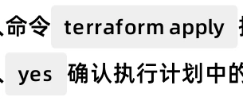

1. 输入命令 terraform apply 执行terraform.tf文件中的资源创建操作。

2. 输入 yes 确认执行计划中的操作。

3. 返回Apply complete!即代表资源创建成功。若不成功查看具体的报错信息，修改terraform.tf文件中的创建资源内容。

**Terraform查看结果**


运行 terraform show 查看已创建的资源详情。

**Terraform销毁**

当需要释放资源可通过terraform destroy销毁已创建的资源，请在Terraform资源销毁中查看操作步骤。

<a id="section-4-10"></a>

## 4.10. 创建KMS Key

使用专有云Terraform创建一个KMS Key，KMS密钥可以帮助用户保护传输过程中的数据安全。

**操作步骤**

**编写Terraform的模板文件**

创建terraform.tf文件，编写要创建的资源语句。

```terraform
#环境配置
provider "alibabacloudstack" {
domain="asapi域名"
access_key="用户的ak"
secret_key="用户的sk"
region="地域"
proxy= "HTTP://环境代理"
protocol="HTTP"
insecure="true"
resource_group_set_name ="资源集名称"
}

#创建KMS key
resource "alibabacloudstack_kms_key" "key" {
  description             = "Hello KMS"
  pending_window_in_days  = "7"
  key_state               = "Enabled"
}
```

参数说明：

<table>
  <tr>
    <td>参数</td>
    <td>含义</td>
    <td>获取方式</td>
  </tr>
  <tr>
    <td>domain</td>
    <td>asapi的域名</td>
    <td>1. 登录飞天基础运维控制台3.0。<br>2. 在左侧导航栏选择<strong>运维工具 &gt; 基</strong><strong>础数据管理</strong>。<br>3. 单击<strong>底座元数据管理</strong>模块中的<strong>服</strong><strong>务注册变量大盘 </strong>。<br>4. 在<strong>服务</strong>搜索栏中输入asapi，自动过滤出asapi服务。<br>5. 单击asapi服务对应的Service Registration内容，查看注册变量详情，获取asapi.gateway.endpoint的域名。<br>说明<br>如需登录飞天基础运维控制台1.0，可在左侧导航栏选择<strong>运维</strong><strong>工具 &gt; 基础数据管理</strong>，单击<strong>Tianji元数据管理</strong>模块中的<strong>飞</strong><strong>天基础运维控制台1.0</strong>。</td>
  </tr>
  <tr>
    <td>access_key</td>
    <td>用户的访问密钥</td>
    <td>1. 使用用户的账户名和密码登录Apsara Uni-manager运营控制台（ASCM）界面。<br>2. 单击主页右上角的云朵logo，单击个人信息。<br>3. 获取用户的AccessKey ID。</td>
  </tr>
  <tr>
    <td>secret_key</td>
    <td>用户的访问密钥Secret</td>
    <td>1. 使用用户的账户名和密码登录Apsara Uni-manager运营控制台（ASCM）界面。<br>2. 单击主页右上角的云朵logo，单击个人信息。<br>3. 获取用户的AccessKey Secret。</td>
  </tr>
  <tr>
    <td>region</td>
    <td>地域</td>
    <td>1. 登录Apsara Uni-manager运营控制台（ASCM）界面。<br>2. 单击<strong>企业 &gt; 地域管理</strong>。<br>3. 选择目标组织，获取地域信息。</td>
  </tr>
  <tr>
    <td>proxy</td>
    <td>访问环境的代理地址</td>
    <td>若访问环境不需要通过代理地址，则无需配置此参数。</td>
  </tr>
  <tr>
    <td>insecure</td>
    <td>不安全的https证书</td>
    <td>insecure="true"表示忽略不安全的https证书，取值范围（true、false）。</td>
  </tr>
  <tr>
    <td>resource_group_set_name</td>
    <td>资源集名称</td>
    <td>1. 查看资源名称，选择Apsara Uni-manager运营控制台（ASCM）页面右上方的<strong>企业</strong>。<br>2. 单击目标组织，获取该组织的资源集名称。</td>
  </tr>
  <tr>
    <td>pending_window_in_days</td>
    <td>销毁资源后删除密钥的持续时间</td>
    <td>必须在 7 到 30 天之间，默认为 30天。</td>
  </tr>
  <tr>
    <td>key_state</td>
    <td>CMK 的状态</td>
    <td>默认为启用</td>
  </tr>
</table>

**Terraform初始化**

在执行terraform.tf模板前，需要先将Terraform初始化。请在Terraform初始化中查看操作步骤。

**Terraform计划展示**

展示terraform.tf文件中计划创建的资源信息。

操作步骤如下：


1. 运行命令 terraform plan  。

2. 查看terraform.tf文件中展示的计划创建资源信息。

**Terraform执行**

执行上一步terraform plan展示的资源创建计划。

操作步骤如下：


1. 输入命令 terraform apply 执行terraform.tf文件中的资源创建操作。

2. 输入 yes 确认执行计划中的操作。

3. 返回Apply complete!即代表资源创建成功。若不成功查看具体的报错信息，修改terraform.tf文件中的创建资源内容。

**Terraform查看结果**


运行 terraform show 查看已创建的资源详情。

**Terraform销毁**

当需要释放资源可通过terraform destroy销毁已创建的资源，请在Terraform资源销毁中查看操作步骤。

<a id="section-4-11"></a>

## 4.11. 创建消息队列MQ实例

通过专有云Terraform创建一个MQ实例（ONS）资源。

**操作步骤**

**编写Terraform的模板文件**

创建terraform.tf文件，编写要创建的资源语句。

```terraform
#环境配置
provider "alibabacloudstack" {
domain="asapi域名"
access_key="用户的ak"
secret_key="用户的sk"
region="地域"
proxy= "HTTP://环境代理"
protocol="HTTP"
insecure="true"
resource_group_set_name ="资源集名称"
}

#创建MQ实例
resource "alibabacloudstack_ons_instance" "default" {
  tps_receive_max = 500
  tps_send_max = 500
  topic_capacity = 50
  cluster = "cluster1"
  independent_naming = "true"
  name = "Ons_Apsara_instance"
  remark = "Ons Instance"
}

output "inst" {
  value = alibabacloudstack_ons_instance.default.*
}
```

参数说明：

<table>
  <tr>
    <td>参数</td>
    <td>含义</td>
    <td>获取方式</td>
  </tr>
</table>

<table>
  <tr>
    <td>domain</td>
    <td>asapi的域名</td>
    <td>1. 登录飞天基础运维控制台3.0。<br>2. 在左侧导航栏选择<strong>运维工具 &gt; 基</strong><strong>础数据管理</strong>。<br>3. 单击<strong>底座元数据管理</strong>模块中的<strong>服</strong><strong>务注册变量大盘 </strong>。<br>4. 在<strong>服务</strong>搜索栏中输入asapi，自动过滤出asapi服务。<br>5. 单击asapi服务对应的Service Registration内容，查看注册变量详情，获取asapi.gateway.endpoint的域名。<br>说明<br>如需登录飞天基础运维控制台1.0，可在左侧导航栏选择<strong>运维</strong><strong>工具 &gt; 基础数据管理</strong>，单击<strong>Tianji元数据管理</strong>模块中的<strong>飞</strong><strong>天基础运维控制台1.0</strong>。</td>
  </tr>
  <tr>
    <td>access_key</td>
    <td>用户的访问密钥</td>
    <td>1. 使用用户的账户名和密码登录Apsara Uni-manager运营控制台（ASCM）界面。<br>2. 单击主页右上角的云朵logo，单击个人信息。<br>3. 获取用户的AccessKey ID。</td>
  </tr>
  <tr>
    <td>secret_key</td>
    <td>用户的访问密钥Secret</td>
    <td>1. 使用用户的账户名和密码登录Apsara Uni-manager运营控制台（ASCM）界面。<br>2. 单击主页右上角的云朵logo，单击个人信息。<br>3. 获取用户的AccessKey Secret。</td>
  </tr>
  <tr>
    <td>region</td>
    <td>地域</td>
    <td>1. 登录Apsara Uni-manager运营控制台（ASCM）界面。<br>2. 单击<strong>企业 &gt; 地域管理</strong>。<br>3. 选择目标组织，获取地域信息。</td>
  </tr>
  <tr>
    <td>proxy</td>
    <td>访问环境的代理地址</td>
    <td>若访问环境不需要通过代理地址，则无需配置此参数。</td>
  </tr>
  <tr>
    <td>insecure</td>
    <td>不安全的https证书</td>
    <td>insecure="true"表示忽略不安全的https证书，取值范围（true、false）。</td>
  </tr>
  <tr>
    <td>resource_group_set_name</td>
    <td>资源集名称</td>
    <td>1. 查看资源名称，选择Apsara Uni-manager运营控制台（ASCM）页面右上方的<strong>企业</strong>。<br>2. 单击目标组织，获取该组织的资源集名称。</td>
  </tr>
  <tr>
    <td>tps_receive_max</td>
    <td>消息订阅 TPS上限</td>
    <td>该属性用于设置主题在一定时间段内每秒接收消息的事务数（TPS），取值范围：500～30000。</td>
  </tr>
  <tr>
    <td>tps_send_max</td>
    <td>消息发送 TPS上限</td>
    <td>该属性用于设置主题在一定时间段内每秒的消息发送事务数（TPS），取值范围：500～30000。</td>
  </tr>
  <tr>
    <td>topic_capacity</td>
    <td>Topic数上限</td>
    <td>该属性用于设置主题容量，取值范围：10～5000。</td>
  </tr>
  <tr>
    <td>cluster</td>
    <td>集群名称</td>
    <td>该属性用于添加集群名称。</td>
  </tr>
  <tr>
    <td>independent_naming</td>
    <td>是否有命名空间</td>
    <td>取值如下：<br>true：拥有独命名空间，资源命名确保实例内唯，跨实例之间可重名。<br>false：独命名空间，实例内或者跨实例之间，资源命名必须全局唯。</td>
  </tr>
  <tr>
    <td>name</td>
    <td>实例名称</td>
    <td>同一地域的同一个账号的两个实例不能同名。长度限制为3～64个字符，可以是中文、英文、数字、短横线（-）以及下划线（_）。</td>
  </tr>
  <tr>
    <td>remark</td>
    <td>实例描述</td>
    <td>此属性是实例的简明描述。长度为2-128个字符，以字母或中文开头，支持数字和“_”、“-”、“:”特殊字符，不能以http://或https://开头。</td>
  </tr>
</table>

**Terraform初始化**

在执行terraform.tf模板前，需要先将Terraform初始化。请在Terraform初始化中查看操作步骤。

**Terraform计划展示**

展示terraform.tf文件中计划创建的资源信息。

操作步骤如下：

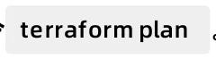

1. 运行命令 terraform plan  。

2. 查看terraform.tf文件中展示的计划创建资源信息。

**Terraform执行**

执行上一步terraform plan展示的资源创建计划。

操作步骤如下：


1. 输入命令 terraform apply 执行terraform.tf文件中的资源创建操作。

2. 输入 yes 确认执行计划中的操作。

3. 返回Apply complete!即代表资源创建成功。若不成功查看具体的报错信息，修改terraform.tf文件中的创建资源内容。

**Terraform查看结果**


运行 terraform show 查看已创建的资源详情。

**Terraform销毁**

当需要释放资源可通过terraform destroy销毁已创建的资源，请在Terraform资源销毁中查看操作步骤。

**重要**

当执行terraform apply操作时提示“用户无资源授权，或者该API不支持RAM”，请检查该产品是否开启了STS鉴权信任模式。


STS鉴权信任模式检查方式：

1. 通过super账号登录Apsara Uni-manager运营控制台（ASCM）。

2. 单击**配置** **> 鉴权信任模式**。

3. 产品被勾选则表示已开启了鉴权信任模式。

当STS鉴权信任模式开启后，执行操作请参考专有云Terraform Provider中使用STS调用方式使用说明。

<a id="section-4-12"></a>

## 4.12. 创建容器服务Kubernetes（ACK）

使用专有云Terraform创建容器服务Kubernetes。

**前提条件**

创建容器服务之前，需要先创建专有网络和交换机。

**操作步骤**

**编写Terraform的模板文件**

创建terraform.tf文件，编写要创建的资源语句。

```terraform
#环境配置
provider "alibabacloudstack" {
domain="asapi域名"
access_key="用户的ak"
secret_key="用户的sk"
region="地域"
proxy= "HTTP://环境代理"
protocol="HTTP"
insecure="true"
resource_group_set_name ="资源集名称"
}

#创建器K8S
variable "name1" {
  default = "terraformtestslbconfig"
}

data "alibabacloudstack_zones" "default" {
  available_resource_creation = "VSwitch"
}

variable "name2" {
 default = "tf-testAccCsK8sConfigBasic9124020"
}

data "alibabacloudstack_zones" default {
  available_resource_creation = "VSwitch"
 }
 
variable "k8s_number" {
  description = "The number of kubernetes cluster."
  default     = 1
}

# leave it to empty would create a new one
variable "vpc_id" {
  description = "Existing vpc id used to create several vswitches and other resources."
 default     = "vpc-bs1amyht0w3mdkumc2hf0"
}

variable "vpc_cidr" {
  description = "The cidr block used to launch a new vpc when 'vpc_id' is not specified."
  default     = "172.31.0.0/16"
}

# leave it to empty then terraform will create several vswitches
variable "vswitch_ids" {
 description = "List of existing vswitch id."
 type        = list(string)
 default     = ["vsw-bs1xvmkkekuy8i7zlhv3j","vsw-bs1xvmkkekuy8i7zlhv3j","vsw-bs1xvmkkekuy8i7zlhv3j"]
}

variable "vswitch_cidrs" {
  description = "List of cidr blocks used to create several new vswitches when 'vswitch_ids' is not specified."
  type        = list(string)
  default     = ["172.31.0.0/16","172.31.0.0/16","172.31.0.0/16"]
}

variable "new_nat_gateway" {
  description = "Whether to create a new nat gateway. In this template, a new nat gateway will create a nat gateway, eip and server snat entries."
  default     = "true"
}

# 3 masters is default settings,so choose three appropriate instance types in the availability zones above.
variable "master_instance_types" {
  description = "The ecs instance types used to launch master nodes."
  default     = ["ecs.e4.large","ecs.e4.large","ecs.e4.large"]
}

variable "worker_instance_types" {
  description = "The ecs instance types used to launch worker nodes."
  default     = ["ecs.e4.large"]
}

# options: between 24-28
variable "node_cidr_mask" {
  description = "The node cidr block to specific how many pods can run on single node."
  default     = 24
}

variable "enable_ssh" {
  description = "Enable login to the node through SSH."
  default     = true
}

variable "password" {
  description = "The password of ECS instance."
  default     = "*********"
}

variable "worker_number" {
  description = "The number of worker nodes in kubernetes cluster."
  default     = 3
}

# k8s_pod_cidr is only for flannel network
variable "pod_cidr" {
  description = "The kubernetes pod cidr block. It cannot be equals to vpc's or vswitch's and cannot be in them."
  default     = "172.20.0.0/16"
}

variable "service_cidr" {
  description = "The kubernetes service cidr block. It cannot be equals to vpc's or vswitch's or pod's andcannot be in them."
  default     = "172.21.0.0/20"
}

variable "cluster_addons" {
  description = "Addon components in kubernetes cluster"

  type = list(object({
    name      = string
    config    = string
  }))

  default = [
    {
      "name"     = "terway",
      "config"   = "",
    },
    {
      "name"     = "csi-plugin",
      "config"   = "",
    },
    {
      "name"     = "csi-provisioner",
      "config"   = "",
    },
    {
      "name"     = "logtail-ds",
      "config"   = "{\"IngressDashboardEnabled\":\"true\",\"sls_project_name\":\"alibaba-test\"}",
    },
    {
      "name"     = "nginx-ingress-controller",
      "config"   = "{\"IngressSlbNetworkType\":\"internet\"}",
    }
  ]
}

resource "alibabacloudstack_cs_kubernetes" "k8s" {
  pod_cidr = "${var.pod_cidr}"
  worker_data_disks {
    category = "cloud_efficiency"
    size = "100"
    encrypted = "false"
  }
  
  password = "${var.password}"
  master_count = "3"
  master_instance_types = "${var.master_instance_types}"
  worker_instance_types = "${var.worker_instance_types}"
  platform = "CentOS"
  timeout_mins = "25"
  master_disk_category = "cloud_efficiency"
  slb_internet_enabled = "true"
  new_nat_gateway = "true"
  proxy_mode = "ipvs"
  vpc_id = "${var.vpc_id}"
  version = "1.18.8-aliyun.1"
  node_cidr_mask = "${var.node_cidr_mask}"
  enable_ssh = "${var.enable_ssh}"
  worker_disk_category = "cloud_efficiency"
  master_vswitch_ids = "${var.vswitch_ids}"
  master_disk_size = "45"
  num_of_nodes = "${var.worker_number}"
  worker_disk_size = "30"
  name = "${var.name}"
  delete_protection = "false"
  os_type = "linux"
  service_cidr = "${var.service_cidr}"
}
```

参数说明：

| 参数 | 含义 | 获取方式 |
| --- | --- | --- |
| domain | asapi的域名 | 1. 登录飞天基础运维控制台3.0。<br>2. 在左侧导航栏选择<strong>运维工具 &gt; 基</strong><strong>础数据管理</strong>。<br>3. 单击<strong>底座元数据管理</strong>模块中的<strong>服</strong><strong>务注册变量大盘 </strong>。<br>4. 在<strong>服务</strong>搜索栏中输入asapi，自动过滤出asapi服务。<br>5. 单击asapi服务对应的Service Registration内容，查看注册变量详情，获取asapi.gateway.endpoint的域名。<br>说明<br>如需登录飞天基础运维控制台1.0，可在左侧导航栏选择<strong>运维</strong><strong>工具 &gt; 基础数据管理</strong>，单击<strong>Tianji元数据管理</strong>模块中的<strong>飞</strong><strong>天基础运维控制台1.0</strong>。 |
| access_key | 用户的访问密钥 | 1. 使用用户的账户名和密码登录Apsara Uni-manager运营控制台（ASCM）界面。<br>2. 单击主页右上角的云朵logo，单击个人信息。<br>3. 获取用户的AccessKey ID。 |
| secret_key | 用户的访问密钥Secret | 1. 使用用户的账户名和密码登录Apsara Uni-manager运营控制台（ASCM）界面。<br>2. 单击主页右上角的云朵logo，单击个人信息。<br>3. 获取用户的AccessKey Secret。 |
| region | 地域 | 1. 登录Apsara Uni-manager运营控制台（ASCM）界面。<br>2. 单击<strong>企业 &gt; 地域管理</strong>。<br>3. 选择目标组织，获取地域信息。 |
| proxy | 访问环境的代理地址 | 若访问环境不需要通过代理地址，则无需配置此参数。 |
| insecure | 不安全的https证书 | insecure="true"表示忽略不安全的https证书，取值范围（true、false）。 |
| resource_group_set_name | 资源集名称 | 1. 查看资源名称，选择Apsara Uni-manager运营控制台（ASCM）页面右上方的<strong>企业</strong>。<br>2. 单击目标组织，获取该组织的资源集名称。 |
| vpc_name | 专有网络VPC名称 | 用户自定义，长度为2～128个字符，必须以字母或中文开头，可包含数字、半角句号（.）、下划线（_）和短划线（-）。 |
| cidr_block | VPC地址块 | 1. 查看VPC地址块信息，选择Apsara Uni-manager运营控制台（ASCM）顶部菜单栏上的<strong>产品</strong><strong>&gt; 专有网络VPC</strong>，单击左侧导航栏中的<strong>专有网络</strong>，获取VPC地址块信息。<br>2. 用户可根据获得的地址块信息，重新自定义新的网段 |
| vswitch_id | 交换机ID | 1. 查看交换机ID，选择Apsara Uni-manager运营控制台（ASCM）顶部菜单栏上的<strong>产品 &gt;</strong><strong>专有网络VPC</strong>。<br>2. 单击左侧导航栏中的<strong>交换机</strong>，获取交换机ID信息。 |
| name | kubernetes 集群的名称 | 用户自定义，名称为1~63个字符，可包含数字、汉字、英文字符或中划线（-）。 |
| version | Kubernetes版本 | 建议选择最新版本，若不指定，默认使用最新版本。 |
| password | ssh登录集群节点的密码 | 您必须指定其中一个 passwordkey_namekms_enc rypted_password 字段。 |
| enable_ssh | 启用通过 SSH 登录到节点 | 默认值：false。 |
| proxy_mode | 代理模式 | 代理模式是 kube-proxy 的选项。选项：iptables\|ipvs。默认值：ipvs。 |
| user_data | 用户数据 | Windows 实例支持批处理和PowerShell 脚本。如果您的脚本文件大于 1 KB，我们建议您将脚本上传到对象存储服务 (OSS)，并通过OSS 存储桶的内部端点拉取。 |
| is_enterprise_security_group | 指定是否自动创建高级安全组 | 您必须设置 security_group_id 或is_enterprise_security_group 参数。 |
| pod_cidr | pod网络的CIDR 块 | 有效的私有网段，不能与VPC 网段及VPC内已有Kubernetes 集群使用的网段重复。 |
| new_nat_gateway | nat网关 | （可选）是否在创建 kubernetes集群时创建新的 nat 网关。默认为true。那么Apsarastack中的openapi也不都是在内网的，所以开启这个选项是个不错的选择。 |
| service_cidr | 服务网络的CIDR块 | （可选）服务网络的 CIDR 块。不能与 VPC 的 CIDR 和 VPC 中Kubernetes 集群使用的 CIDR 重复，创建后不能修改。 |
| node_cidr_mask | 节点cidr块 | 指定单个节点上可以运行多少个pod，24-28 是允许的。24 表示2^(32-24)-1=255，节点最多可以运行 255 个 Pod。默认值：24。 |
| slb_internet_enabled | 是否为 API Server 创建 Internet负载均衡器。 | 默认为true。 |

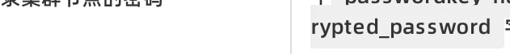

**Terraform初始化**

在执行terraform.tf模板前，需要先将Terraform初始化。请在Terraform初始化中查看操作步骤。

**Terraform计划展示**

展示terraform.tf文件中计划创建的资源信息。

操作步骤如下：


1. 运行命令 terraform plan  。

2. 查看terraform.tf文件中展示的计划创建资源信息。

**Terraform执行**

执行上一步terraform plan展示的资源创建计划。

操作步骤如下：


1. 输入命令 terraform apply 执行terraform.tf文件中的资源创建操作。

2. 输入 yes 确认执行计划中的操作。

3. 返回Apply complete!即代表资源创建成功。若不成功查看具体的报错信息，修改terraform.tf文件中的创建资源内容。

**Terraform查看结果**


运行 terraform show 查看已创建的资源详情。

**Terraform销毁**

当需要释放资源可通过terraform destroy销毁已创建的资源，请在Terraform资源销毁中查看操作步骤。

**重要**

当执行terraform apply操作时提示“用户无资源授权，或者该API不支持RAM”，请检查该产品是否开启了STS鉴权信任模式。


STS鉴权信任模式检查方式：

1. 通过super账号登录Apsara Uni-manager运营控制台（ASCM）。

2. 单击**配置** **> 鉴权信任模式**。

3. 产品被勾选则表示已开启了鉴权信任模式。

当STS鉴权信任模式开启后，执行操作请参考专有云Terraform Provider中使用STS调用方式使用说明。

<a id="section-4-13"></a>

## 4.13. 创建容器镜像服务ACR（CR）

本章介绍如何使用专有云Terraform创建ACR的企业版镜像仓库和镜像仓库命名空间。

**操作步骤**

**编写Terraform的模板文件**

创建terraform.tf文件，编写要创建的资源语句。

```terraform
#环境配置
provider "alibabacloudstack" {
domain="asapi域名"
access_key="用户的ak"
secret_key="用户的sk"
region="地域"
proxy= "HTTP://环境代理"
protocol="HTTP"
insecure="true"
resource_group_set_name ="资源集名称"
}

#镜像仓库命名空间
resource "alibabacloudstack_cr_namespace" "default" {
  name = "tf-testacc-cr-ns-9415539"
  auto_create = "false"
  default_visibility = "PUBLIC"
}

#企业版镜像仓库
variable "name" {
 default = "tf-testacc-cr-repo-5702781"
}

resource "alibabacloudstack_cr_namespace" "default" {
 name = "${var.name}"
 auto_create = false
 default_visibility = "PRIVATE"
}

resource "alibabacloudstack_cr_repo" "default" {
  summary = "summary"
  repo_type = "PUBLIC"
  namespace = "${alibabacloudstack_cr_namespace.default.name}"
  name = "${var.name}"
}
```

参数说明：

| 参数 | 含义 | 获取方式 |
| --- | --- | --- |
| domain | asapi的域名 | 1. 登录飞天基础运维控制台3.0。<br>2. 在左侧导航栏选择<strong>运维工具 &gt; 基</strong><strong>础数据管理</strong>。<br>3. 单击<strong>底座元数据管理</strong>模块中的<strong>服</strong><strong>务注册变量大盘 </strong>。<br>4. 在<strong>服务</strong>搜索栏中输入asapi，自动过滤出asapi服务。<br>5. 单击asapi服务对应的Service Registration内容，查看注册变量详情，获取asapi.gateway.endpoint的域名。<br>说明<br>如需登录飞天基础运维控制台1.0，可在左侧导航栏选择<strong>运维</strong><strong>工具 &gt; 基础数据管理</strong>，单击<strong>Tianji元数据管理</strong>模块中的<strong>飞</strong><strong>天基础运维控制台1.0</strong>。 |
| access_key | 用户的访问密钥 | 1. 使用用户的账户名和密码登录Apsara Uni-manager运营控制台（ASCM）界面。<br>2. 单击主页右上角的云朵logo，单击个人信息。<br>3. 获取用户的AccessKey ID。 |
| secret_key | 用户的访问密钥Secret | 1. 使用用户的账户名和密码登录Apsara Uni-manager运营控制台（ASCM）界面。<br>2. 单击主页右上角的云朵logo，单击个人信息。<br>3. 获取用户的AccessKey Secret。 |
| region | 地域 | 1. 登录Apsara Uni-manager运营控制台（ASCM）界面。<br>2. 单击<strong>企业 &gt; 地域管理</strong>。<br>3. 选择目标组织，获取地域信息。 |
| proxy | 访问环境的代理地址 | 若访问环境不需要通过代理地址，则无需配置此参数。 |
| insecure | 不安全的https证书 | insecure="true"表示忽略不安全的https证书，取值范围（true、false）。 |
| resource_group_set_name | 资源集名称 | 1. 查看资源名称，选择Apsara Uni-manager运营控制台（ASCM）页面右上方的<strong>企业</strong>。<br>2. 单击目标组织，获取该组织的资源集名称。 |
| name | 命名空间名称 | 长度限制\[2-30\]，支持小写字母、数字、中划线（-）、下划线（_）（不能以中划线和下划线开头结尾且需要间隔开）。 |
| summary | 摘要 | 长度限制1~100。 |
| repo_type | 仓库类型 | 枚举：“PUBLIC”或“PRIVATE”。 |
| namespace | 仓库所属命名空间 | 1. 登录Apsara Uni-manager运营控制台（ASCM）界面。<br>2. 单击<strong>产品 &gt; 容器镜像服务ACR</strong>。<br>3. 单击左侧菜单栏中的<strong>镜像仓库 &gt;</strong><strong>创建镜像仓库</strong>，获取用户创建的命名空间信息。 |

**Terraform初始化**

在执行terraform.tf模板前，需要先将Terraform初始化。请在Terraform初始化中查看操作步骤。

**Terraform计划展示**

展示terraform.tf文件中计划创建的资源信息。

操作步骤如下：


1. 运行命令 terraform plan  。

2. 查看terraform.tf文件中展示的计划创建资源信息。

**Terraform执行**

执行上一步terraform plan展示的资源创建计划。

操作步骤如下：


1. 输入命令 terraform apply 执行terraform.tf文件中的资源创建操作。

2. 输入 yes 确认执行计划中的操作。

3. 返回Apply complete!即代表资源创建成功。若不成功查看具体的报错信息，修改terraform.tf文件中的创建资源内容。

**Terraform查看结果**


运行 terraform show 查看已创建的资源详情。

**Terraform销毁**

当需要释放资源可通过terraform destroy销毁已创建的资源，请在Terraform资源销毁中查看操作步骤。

**重要**

当执行terraform apply操作时提示“用户无资源授权，或者该API不支持RAM”，请检查该产品是否开启了STS鉴权信任模式。


STS鉴权信任模式检查方式：

1. 通过super账号登录Apsara Uni-manager运营控制台（ASCM）。

2. 单击**配置** **> 鉴权信任模式**。

3. 产品被勾选则表示已开启了鉴权信任模式。

当STS鉴权信任模式开启后，执行操作请参考专有云Terraform Provider中使用STS调用方式使用说明。

<a id="section-4-14"></a>

## 4.14. 创建大数据计算MaxCompute

使用专有云Terraform创建MaxCompute的任务云账号、配额组管理和project。

**操作步骤**

**编写Terraform的模板文件**

创建terraform.tf文件，编写要创建的资源语句。

```terraform
#环境配置
provider "alibabacloudstack" {
domain="asapi域名"
access_key="用户的ak"
secret_key="用户的sk"
region="地域"
proxy= "HTTP://环境代理"
protocol="HTTP"
insecure="true"
resource_group_set_name ="资源集名称"
}

#创建配额组管理
resource "alibabacloudstack_maxcompute_cu" "default"{
  cu_name      = "tf_cu_wy"
  cu_num       = "1"
  cluster_name = "HYBRIDODPSCLUSTER-A-20210520-07B0"
}

#创建云账号
resource "alibabacloudstack_maxcompute_user" "default"{
  user_name             = "tf_user_wy"
  description           = "TestAccApsaraStackMaxcomputeUser"
  lifecycle {
    ignore_changes = [
      organization_id,       
    ]
  }
}

#创建MaxCompute项目
resource "alibabacloudstack_maxcompute_project" "default"{
  cluster        = "HYBRIDODPSCLUSTER-A-20210520-07B0"
  external_table = "false"
  quota_id       = "44"
  disk           = 10
  name           = "tf_project_wy"
  aliyun_account = "${alibabacloudstack_maxcompute_user.default.user_name}"
  pk = "1371730998580255"
}
```

参数说明：

| 参数 | 含义 | 获取方式 |
| --- | --- | --- |
| domain | asapi的域名 | 1. 登录飞天基础运维控制台3.0。<br>2. 在左侧导航栏选择<strong>运维工具 &gt; 基</strong><strong>础数据管理</strong>。<br>3. 单击<strong>底座元数据管理</strong>模块中的<strong>服</strong><strong>务注册变量大盘 </strong>。<br>4. 在<strong>服务</strong>搜索栏中输入asapi，自动过滤出asapi服务。<br>5. 单击asapi服务对应的Service Registration内容，查看注册变量详情，获取asapi.gateway.endpoint的域名。<br>说明<br>如需登录飞天基础运维控制台1.0，可在左侧导航栏选择<strong>运维</strong><strong>工具 &gt; 基础数据管理</strong>，单击<strong>Tianji元数据管理</strong>模块中的<strong>飞</strong><strong>天基础运维控制台1.0</strong>。 |
| access_key | 用户的访问密钥 | 1. 使用用户的账户名和密码登录Apsara Uni-manager运营控制台（ASCM）界面。<br>2. 单击主页右上角的云朵logo，单击个人信息。<br>3. 获取用户的AccessKey ID。 |
| secret_key | 用户的访问密钥Secret | 1. 使用用户的账户名和密码登录Apsara Uni-manager运营控制台（ASCM）界面。<br>2. 单击主页右上角的云朵logo，单击个人信息。<br>3. 获取用户的AccessKey Secret。 |
| region | 地域 | 1. 登录Apsara Uni-manager运营控制台（ASCM）界面。<br>2. 单击<strong>企业 &gt; 地域管理</strong>。<br>3. 选择目标组织，获取地域信息。 |
| proxy | 访问环境的代理地址 | 若访问环境不需要通过代理地址，则无需配置此参数。 |
| insecure | 不安全的https证书 | insecure="true"表示忽略不安全的https证书，取值范围（true、false）。 |
| resource_group_set_name | 资源集名称 | 1. 查看资源名称，选择Apsara Uni-manager运营控制台（ASCM）页面右上方的<strong>企业</strong>。<br>2. 单击目标组织，获取该组织的资源集名称。 |
| cu_name | 配额组名称 | 用户自定义，可包含字母、数字、下划线，只能以字母开头，长度3至32个字符。 |
| cu_num | cu数量 | 配额组数量必须大于0。 |
| cluster_name | 集群名称 | 1. 查看集群名称，选择Apsara Uni-manager运营控制台（ASCM） <strong>&gt; 产品 &gt; 大数据计算</strong><strong>MaxCompute</strong>。<br>2. 单击<strong>创建Project</strong>，获取集群名称信息。 |
| user_name | 任务云账号名称 | 账户名仅能包含字母、数字或（-）、（.）、（_）。 |
| description | 任务云账号描述 | 2-255个字符，以字母或中文开头，支持数字，支持（_）、（-）、（.）、（:）、（,）英文特殊字符，不能以http:// 或https://开头。 |
| disk | 存储空间 | 单位GB。 |
| aliyun_account | 阿里云账号 | 1. 登录Apsara Uni-manager运营控制台（ASCM）界面。<br>2. 单击<strong>产品 &gt; 大数据计算</strong><strong>MaxCompute</strong>。<br>3. 单击页面左侧菜单栏中的<strong>任务云</strong><strong>账号</strong>，获取目标云账号名称。 |
| pk | 主账号别名 | 1. 查看主账号别名，选择Apsara Uni-manager运营控制台（ASCM），单击页面右上角的图标，单击个人信息。<br>2. 查看个人信息，获取主账号别名。 |

**Terraform初始化**

在执行terraform.tf模板前，需要先将Terraform初始化。请在Terraform初始化中查看操作步骤。

**Terraform计划展示**

展示terraform.tf文件中计划创建的资源信息。

操作步骤如下：


1. 运行命令 terraform plan  。

2. 查看terraform.tf文件中展示的计划创建资源信息。

**Terraform执行**

执行上一步terraform plan展示的资源创建计划。

操作步骤如下：


1. 输入命令 terraform apply 执行terraform.tf文件中的资源创建操作。

2. 输入 yes 确认执行计划中的操作。

3. 返回Apply complete!即代表资源创建成功。若不成功查看具体的报错信息，修改terraform.tf文件中的创建资源内容。

**Terraform查看结果**


运行 terraform show 查看已创建的资源详情。

**Terraform销毁**

当需要释放资源可通过terraform destroy销毁已创建的资源，请在Terraform资源销毁中查看操作步骤。

**重要**

当执行terraform apply操作时提示“用户无资源授权，或者该API不支持RAM”，请检查该产品是否开启了STS鉴权信任模式。


STS鉴权信任模式检查方式：

1. 通过super账号登录Apsara Uni-manager运营控制台（ASCM）。

2. 单击**配置** **> 鉴权信任模式**。

3. 产品被勾选则表示已开启了鉴权信任模式。

当STS鉴权信任模式开启后，执行操作请参考专有云Terraform Provider中使用STS调用方式使用说明。

<a id="section-4-15"></a>

## 4.15. 创建大数据开发治理平台DataWorks

使用专有云Terraform创建DataWorks的连接、文件夹、告警规则、用户、用户角色。

**操作步骤**

**编写Terraform的模板文件**

创建terraform.tf文件，编写要创建的资源语句。

```terraform
#环境配置
provider "alibabacloudstack" {
domain="asapi域名"
access_key="用户的ak"
secret_key="用户的sk"
region="地域"
proxy= "HTTP://环境代理"
protocol="HTTP"
insecure="true"
resource_group_set_name ="资源集名称"
}

#创建DataWorks连接
resource "alibabacloudstack_data_works_connection" "default" {
  project_id = "10060"
  connection_type = "rds"
  content = {
              username = "name_new"
              database = "test_new"
              tag = "rds"
              password = "**********"
              instanceName = "rm-6cq93i8k9q0045i5t"
              rdsOwnerId = "1371730998580255"
            }
  env_type = "1"
  sub_type = "mysql"
  name = "tf-testacccn-hohhot-ste3-d01dataworksconnection97435"
  description = "descriptiontf-testacccn-hohhot-ste3-d01dataworksconnection97435"
}

#创建DataWorks文件夹
resource "alibabacloudstack_data_works_folder" "example" {
  project_id  = "320687"
  folder_path = "Business Flow/tfTestAcc/folderDi/tftest1"
}

#创建DataWorks告警规则
resource "alibabacloudstack_data_works_remind" "default" {
  remind_type = "FINISHED"
  remind_unit = "PROJECT"
  project_id = "10060"
  alert_methods = "SMS"
  alert_unit = "OWNER"
  remind_name = "tf-testacccn-hohhot-ste3-d01dataworksremind87138"
}

#创建DataWorks用户
resource "alibabacloudstack_data_works_user" "default" {
  user_id = "5225501456060119238"
  project_id = "10060"
}

#创建DataWorks用户角色
resource "alibabacloudstack_data_works_user_role_binding" "default" {
  project_id = "10060"
  user_id = "5225501456060119238"
  role_code = "role_project_guest"
}
```

参数说明：

<table>
  <tr>
    <td>参数</td>
    <td>含义</td>
    <td>获取方式</td>
  </tr>
  <tr>
    <td>domain</td>
    <td>asapi的域名</td>
    <td>1. 登录飞天基础运维控制台3.0。<br>2. 在左侧导航栏选择<strong>运维工具 &gt; 基</strong><strong>础数据管理</strong>。<br>3. 单击<strong>底座元数据管理</strong>模块中的<strong>服</strong><strong>务注册变量大盘 </strong>。<br>4. 在<strong>服务</strong>搜索栏中输入asapi，自动过滤出asapi服务。<br>5. 单击asapi服务对应的Service Registration内容，查看注册变量详情，获取asapi.gateway.endpoint的域名。<br>说明<br>如需登录飞天基础运维控制台1.0，可在左侧导航栏选择<strong>运维</strong><strong>工具 &gt; 基础数据管理</strong>，单击<strong>Tianji元数据管理</strong>模块中的<strong>飞</strong><strong>天基础运维控制台1.0</strong>。</td>
  </tr>
  <tr>
    <td>access_key</td>
    <td>用户的访问密钥</td>
    <td>1. 使用用户的账户名和密码登录Apsara Uni-manager运营控制台（ASCM）界面。<br>2. 单击主页右上角的云朵logo，单击个人信息。<br>3. 获取用户的AccessKey ID。</td>
  </tr>
  <tr>
    <td>secret_key</td>
    <td>用户的访问密钥Secret</td>
    <td>1. 使用用户的账户名和密码登录Apsara Uni-manager运营控制台（ASCM）界面。<br>2. 单击主页右上角的云朵logo，单击个人信息。<br>3. 获取用户的AccessKey Secret。</td>
  </tr>
  <tr>
    <td>region</td>
    <td>地域</td>
    <td>1. 登录Apsara Uni-manager运营控制台（ASCM）界面。<br>2. 单击<strong>企业 &gt; 地域管理</strong>。<br>3. 选择目标组织，获取地域信息。</td>
  </tr>
  <tr>
    <td>proxy</td>
    <td>访问环境的代理地址</td>
    <td>若访问环境不需要通过代理地址，则无需配置此参数。</td>
  </tr>
  <tr>
    <td>insecure</td>
    <td>不安全的https证书</td>
    <td>insecure="true"表示忽略不安全的https证书，取值范围（true、false）。</td>
  </tr>
  <tr>
    <td>resource_group_set_name</td>
    <td>资源集名称</td>
    <td>1. 查看资源名称，选择Apsara Uni-manager运营控制台（ASCM）控制台页面右上方的<strong>企</strong><strong>业</strong>。<br>2. 单击目标组织，获取该组织的资源集名称。</td>
  </tr>
  <tr>
    <td>project_id</td>
    <td>项目ID</td>
    <td>1. 登录Apsara Uni-manager运营控制台（ASCM）界面。<br>2. 单击<strong>产品 &gt; DataWorks。</strong><br>3. 选择组织和地域，点击下方按钮访问DataWorks页面。<br>4. 单击页面左上角的扩展按钮，查看全部产品。<br>5. 单击<strong>数据集成 &gt; 数据源 &gt; 工作空</strong><strong>间配置，</strong>获取工作空间ID。</td>
  </tr>
  <tr>
    <td>connection_type</td>
    <td>连接形式</td>
    <td>1. 登录Apsara Uni-manager运营控制台（ASCM）界面。<br>2. 单击<strong>产品 &gt; DataWorks。</strong><br>3. 选择组织和地域，点击下方按钮访问DataWorks页面。<br>4. 单击页面左上角的扩展按钮，查看全部产品。<br>5. 单击<strong>数据集成 &gt; 创建我的数据同</strong>步。<br>6. 单击<strong>选择来源</strong>下拉菜单，选择和获取连接方式。</td>
  </tr>
  <tr>
    <td>content</td>
    <td>数据源详细信息</td>
    <td>-</td>
  </tr>
  <tr>
    <td>env_type</td>
    <td>数据源所属的环境</td>
    <td>包括0（开发环境）和1（生产环境）。</td>
  </tr>
  <tr>
    <td>sub_type</td>
    <td>字符串的子类型</td>
    <td>用于某些父类型包含子类型的情况，目前有以下几种组合：<br>Parent type: rds<br>Sub-type: mysql, sqlserver or postgresql</td>
  </tr>
  <tr>
    <td>name</td>
    <td>数据源名称</td>
    <td>用户自定义</td>
  </tr>
  <tr>
    <td>description</td>
    <td>连接的描述信息</td>
    <td>用户自定义</td>
  </tr>
  <tr>
    <td>folder_path</td>
    <td>文件夹的路径</td>
    <td>组成部分的文件夹路径：<br>Business Flow/{Business Flow Name}/[folderDi|folderMaxCom pute|folderGeneral|folderJdbc|f olderUserDefined]/{Directory Name}`.。<br>• 路径的第一个段必须是“Business Flow”。<br>• 路径的第二个段必须是项目中的“Business Flow Name”。<br>• 路径的第三部分必须是以下关键字之一：' folderDi|folderMaxCompute|f olderGeneral|folderJdbc|fold erUserDefined '。<br>• 指定文件夹路径的最后一部分。</td>
  </tr>
  <tr>
    <td>remind_type</td>
    <td>触发条件</td>
    <td>包括： FINISHED, UNFINISHED, ERROR, CYCLE_UNFINISHED and TIMEOUT。</td>
  </tr>
  <tr>
    <td>remind_unit</td>
    <td>对象类型</td>
    <td>包括：NODE（任务节点）、BASELINE（基线）、PROJECT（工作区）、BIZPROCESS（业务流程）。</td>
  </tr>
  <tr>
    <td>alert_methods</td>
    <td>告警方式</td>
    <td>包括MAIL（邮件）、SMS（短消息）和PHONE（电话，仅支持DataWorks Professional及以上版本）。 多种告警模式之间用英文“,”隔开。</td>
  </tr>
  <tr>
    <td>remind_name</td>
    <td>规则名称</td>
    <td>自定义规则名称长度不超过128个字符。</td>
  </tr>
  <tr>
    <td>user_id</td>
    <td>阿里云账号</td>
    <td>1. 登录Apsara Uni-manager运营控制台（ASCM）界面。<br>2. 单击页面右上角的云朵logo，单击个人信息。<br>3. 获取UID信息，（编写形式5+UID）。</td>
  </tr>
  <tr>
    <td>role_code</td>
    <td>DataWorks工作空间角色的代码</td>
    <td>1. 登录Apsara Uni-manager运营控制台（ASCM）界面。<br>2. 单击<strong>产品 &gt; DataWorks。</strong><br>3. 选择组织和地域，点击下方按钮访问DataWorks页面。<br>4. 单击页面左上角的扩展按钮，查看全部产品。<br>5. 单击<strong>数据集成 &gt; 数据源 &gt; 成员管</strong>理。<br>6. 单击<strong>添加成员，</strong>查看批量设置角色，获取角色信息。</td>
  </tr>
</table>

**Terraform初始化**

在执行terraform.tf模板前，需要先将Terraform初始化。请在Terraform初始化中查看操作步骤。

**Terraform计划展示**

展示terraform.tf文件中计划创建的资源信息。

操作步骤如下：


1. 运行命令 terraform plan  。

2. 查看terraform.tf文件中展示的计划创建资源信息。

**Terraform执行**

执行上一步terraform plan展示的资源创建计划。

操作步骤如下：


1. 输入命令 terraform apply 执行terraform.tf文件中的资源创建操作。

2. 输入 yes 确认执行计划中的操作。

3. 返回Apply complete!即代表资源创建成功。若不成功查看具体的报错信息，修改terraform.tf文件中的创建资源内容。

**Terraform查看结果**


运行 terraform show 查看已创建的资源详情。

**Terraform销毁**

当需要释放资源可通过terraform destroy销毁已创建的资源，请在Terraform资源销毁中查看操作步骤。

**重要**

当执行terraform apply操作时提示“用户无资源授权，或者该API不支持RAM”，请检查该产品是否开启了STS鉴权信任模式。


STS鉴权信任模式检查方式：

1. 通过super账号登录Apsara Uni-manager运营控制台（ASCM）。

2. 单击**配置** **> 鉴权信任模式**。

3. 产品被勾选则表示已开启了鉴权信任模式。

当STS鉴权信任模式开启后，执行操作请参考专有云Terraform Provider中使用STS调用方式使用说明。

<a id="section-4-16"></a>

## 4.16. 创建API网关的API和API分组

本章介绍如何使用专有云Terraform创建API网关的API和API分组。

**操作步骤**

**编写Terraform的模板文件**

创建terraform.tf文件，编写要创建的资源语句。

```terraform
variable "name" {
    default = "tf_testAccApiGatewayApi_7875290"
  }

  variable "apigateway_group_description_test" {
    default = "tf_testAcc_api group description"
  }

#创建API分组 
  resource "alibabacloudstack_api_gateway_group" "default" {
    name = "${var.name}"
    description = "${var.apigateway_group_description_test}"
  }

 #创建API
 resource "alibabacloudstack_api_gateway_api" "default" {
   name = "${alibabacloudstack_api_gateway_group.default.name}"
   group_id = "${alibabacloudstack_api_gateway_group.default.id}"
   description = "tf_testAcc_api description"
    auth_type = "APP"
   request_config {
    protocol = "HTTP"
    method = "GET"
    path = "/test/path/vpc"
    mode = "MAPPING"
  }
```

参数说明：

<table>
  <tr>
    <td>参数</td>
    <td>含义</td>
    <td>获取方式</td>
  </tr>
</table>

<table>
  <tr>
    <td>domain</td>
    <td>asapi的域名</td>
    <td>1. 登录飞天基础运维控制台3.0。<br>2. 在左侧导航栏选择<strong>运维工具 &gt; 基</strong><strong>础数据管理</strong>。<br>3. 单击<strong>底座元数据管理</strong>模块中的<strong>服</strong><strong>务注册变量大盘 </strong>。<br>4. 在<strong>服务</strong>搜索栏中输入asapi，自动过滤出asapi服务。<br>5. 单击asapi服务对应的Service Registration内容，查看注册变量详情，获取asapi.gateway.endpoint的域名。<br>说明<br>如需登录飞天基础运维控制台1.0，可在左侧导航栏选择<strong>运维</strong><strong>工具 &gt; 基础数据管理</strong>，单击<strong>Tianji元数据管理</strong>模块中的<strong>飞</strong>天基础运维控制台1.0。</td>
  </tr>
  <tr>
    <td>access_key</td>
    <td>用户的访问密钥</td>
    <td>1. 使用用户的账户名和密码登录Apsara Uni-manager运营控制台（ASCM）界面。<br>2. 单击主页右上角的云朵logo，单击个人信息。<br>3. 获取用户的AccessKey ID。</td>
  </tr>
  <tr>
    <td>secret_key</td>
    <td>用户的访问密钥Secret</td>
    <td>1. 使用用户的账户名和密码登录Apsara Uni-manager运营控制台（ASCM）界面。<br>2. 单击主页右上角的云朵logo，单击个人信息。<br>3. 获取用户的AccessKey Secret。</td>
  </tr>
  <tr>
    <td>region</td>
    <td>地域</td>
    <td>1. 登录Apsara Uni-manager运营控制台（ASCM）界面。<br>2. 单击<strong>企业 &gt; 地域管理</strong>。<br>3. 选择目标组织，获取地域信息。</td>
  </tr>
  <tr>
    <td>proxy</td>
    <td>访问环境的代理地址</td>
    <td>若访问环境不需要通过代理地址，则无需配置此参数。</td>
  </tr>
  <tr>
    <td>insecure</td>
    <td>不安全的https证书</td>
    <td>insecure="true"表示忽略不安全的https证书，取值范围（true、false）。</td>
  </tr>
  <tr>
    <td>resource_group_set_name</td>
    <td>资源集名称</td>
    <td>1. 查看资源名称，选择Apsara Uni-manager运营控制台（ASCM）控制台页面右上方的<strong>企</strong><strong>业</strong>。<br>2. 单击目标组织，获取该组织的资源集名称。</td>
  </tr>
  <tr>
    <td>name</td>
    <td>分组名称</td>
    <td>必须唯一，支持汉字、英文字母、数字、英文格式的下划线，必须以英文字母或汉字开头，4~50个字符。</td>
  </tr>
  <tr>
    <td>group_id</td>
    <td>API分组ID</td>
    <td>1. 登录Apsara Uni-manager运营控制台（ASCM）界面。<br>2. 单击<strong>产品 &gt; API网关</strong>。<br>3. 单击左侧菜单栏的<strong>分组管理</strong>，查看分组列表，单击目标分组，获取API分组ID。</td>
  </tr>
  <tr>
    <td>auth_type</td>
    <td>授权类型</td>
    <td>取值：APP</td>
  </tr>
  <tr>
    <td>protocol</td>
    <td>API支持的协议类型</td>
    <td>取值为：HTTP、HTTPS、WEBSOCKET</td>
  </tr>
  <tr>
    <td>method</td>
    <td>HTTP Method</td>
    <td>取值为：GET、POST、DELETE、PUT、HEAD、TRACE、PATCH、CONNECT、OPTIONS、ANY</td>
  </tr>
  <tr>
    <td>path</td>
    <td>API path</td>
    <td>用户自定义</td>
  </tr>
  <tr>
    <td>mode</td>
    <td>入参请求的模式</td>
    <td>取值为：MAPPING、PASSTHROUGH，分别表示入参映射、入参透传。</td>
  </tr>
</table>

**Terraform初始化**

在执行terraform.tf模板前，需要先将Terraform初始化。请在Terraform初始化中查看操作步骤。

**Terraform计划展示**

展示terraform.tf文件中计划创建的资源信息。

操作步骤如下：


1. 运行命令 terraform plan  。

2. 查看terraform.tf文件中展示的计划创建资源信息。

**Terraform执行**

执行上一步terraform plan展示的资源创建计划。

操作步骤如下：

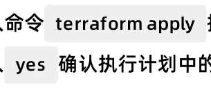

1. 输入命令 terraform apply 执行terraform.tf文件中的资源创建操作。

2. 输入 yes 确认执行计划中的操作。

3. 返回Apply complete!即代表资源创建成功。若不成功查看具体的报错信息，修改terraform.tf文件中的创建资源内容。

**Terraform查看结果**


运行 terraform show 查看已创建的资源详情。

**Terraform销毁**

当需要释放资源可通过terraform destroy销毁已创建的资源，请在Terraform资源销毁中查看操作步骤。

**重要**

当执行terraform apply操作时提示“用户无资源授权，或者该API不支持RAM”，请检查该产品是否开启了STS鉴权信任模式。


STS鉴权信任模式检查方式：

1. 通过super账号登录Apsara Uni-manager运营控制台（ASCM）。

2. 单击**配置** **> 鉴权信任模式**。

3. 产品被勾选则表示已开启了鉴权信任模式。

当STS鉴权信任模式开启后，执行操作请参考专有云Terraform Provider中使用STS调用方式使用说明。

<a id="section-4-17"></a>

## 4.17. 创建消息队列Kafka

本章介绍如何使用专有云Terraform创建消息队列Kafka的topic、SASL用户、SASL用户和客户端使用SDK收发消息权限。

**操作步骤**

**编写Terraform的模板文件**

创建terraform.tf文件，编写要创建的资源语句。

```terraform
#环境配置
provider "alibabacloudstack" { 
  domain="asapi域名" 
  access_key="用户的ak" 
  secret_key="用户的sk" 
  region="地域" 
  proxy= "HTTP://环境代理" 
  protocol="HTTP" 
  insecure="true" 
  resource_group_set_name ="资源集名称" 
}

#创建消息主题
variable "name" {
  default = "tf-testacc-alikafkatopicbasic8891523599366872118"
}

resource "alibabacloudstack_alikafka_topic" "default" {
  topic = "${var.name}"
  local_topic = "false"
  compact_topic = "false"
  partition_num = "12"
  remark = "alibabacloudstack_alikafka_topic_remark"
  instance_id = "cluster-private-paas-default"
}

#创建SASL用户
variable "name" {
  default = "tf-testacc-alikafkasasluserbasic4735385763274477336"
}

resource "alibabacloudstack_alikafka_sasl_user" "default" {
  instance_id = "cluster-private-paas-default"
  username = "${var.name}"
  password = "inputYourCodeHere"
  type = "scram"
}

#创建SASL用户和客户端使用SDK收发消息权限
variable "name" {
  default = "tf-testacc-alikafkasaslaclbasic6730947607669687899"
}

resource "alibabacloudstack_alikafka_topic" "default" {
  instance_id = "cluster-private-paas-default"
  topic = "${var.name}"
  remark = "topic-remark"
}

resource "alibabacloudstack_alikafka_sasl_user" "default" {
  instance_id = "cluster-private-paas-default"
  username = "${var.name}"
  password = "password"
  type     = "scram"
}

resource "alibabacloudstack_alikafka_sasl_acl" "default" {
  acl_resource_pattern_type = "LITERAL"
  acl_operation_type = "Write"
  instance_id = "cluster-private-paas-default"
  username = "${alibabacloudstack_alikafka_sasl_user.default.username}"
  acl_resource_type = "Topic"
  acl_resource_name = "${alibabacloudstack_alikafka_topic.default.topic}"
}
```

参数说明：

<table>
  <tr>
    <td>参数</td>
    <td>含义</td>
    <td>获取方式</td>
  </tr>
</table>

<table>
  <tr>
    <td>domain</td>
    <td>asapi的域名</td>
    <td>1. 登录飞天基础运维控制台3.0。<br>2. 在左侧导航栏选择<strong>运维工具 &gt; 基</strong><strong>础数据管理</strong>。<br>3. 单击<strong>底座元数据管理</strong>模块中的<strong>服</strong><strong>务注册变量大盘 </strong>。<br>4. 在<strong>服务</strong>搜索栏中输入asapi，自动过滤出asapi服务。<br>5. 单击asapi服务对应的Service Registration内容，查看注册变量详情，获取asapi.gateway.endpoint的域名。<br>说明<br>如需登录飞天基础运维控制台1.0，可在左侧导航栏选择<strong>运维</strong><strong>工具 &gt; 基础数据管理</strong>，单击<strong>Tianji元数据管理</strong>模块中的<strong>飞</strong><strong>天基础运维控制台1.0</strong>。</td>
  </tr>
  <tr>
    <td>access_key</td>
    <td>用户的访问密钥</td>
    <td>1. 使用用户的账户名和密码登录Apsara Uni-manager运营控制台（ASCM）界面。<br>2. 单击主页右上角的云朵logo，单击个人信息。<br>3. 获取用户的AccessKey ID。</td>
  </tr>
  <tr>
    <td>secret_key</td>
    <td>用户的访问密钥Secret</td>
    <td>1. 使用用户的账户名和密码登录Apsara Uni-manager运营控制台（ASCM）界面。<br>2. 单击主页右上角的云朵logo，单击个人信息。<br>3. 获取用户的AccessKey Secret。</td>
  </tr>
  <tr>
    <td>region</td>
    <td>地域</td>
    <td>1. 登录Apsara Uni-manager运营控制台（ASCM）界面。<br>2. 单击<strong>企业 &gt; 地域管理</strong>。<br>3. 选择目标组织，获取地域信息。</td>
  </tr>
  <tr>
    <td>proxy</td>
    <td>访问环境的代理地址</td>
    <td>若访问环境不需要通过代理地址，则无需配置此参数。</td>
  </tr>
  <tr>
    <td>insecure</td>
    <td>不安全的https证书</td>
    <td>insecure="true"表示忽略不安全的https证书，取值范围（true、false）。</td>
  </tr>
  <tr>
    <td>resource_group_set_name</td>
    <td>资源集名称</td>
    <td>1. 查看资源名称，选择Apsara Uni-manager运营控制台（ASCM）控制台页面右上方的<strong>企</strong><strong>业</strong>。<br>2. 单击目标组织，获取该组织的资源集名称。</td>
  </tr>
  <tr>
    <td>topic</td>
    <td>topic名称</td>
    <td>1. 名称只能包含字母、数字、下划线（_）和短划线（-），至少包含一个英文或数字且不能以双_开头。<br>2. 名称长度限制在3~64字符之间，长于64字符将被自动截取。<br>3. Topic名称一旦创建，无法修改。</td>
  </tr>
  <tr>
    <td>local_topic</td>
    <td>topic的存储引擎</td>
    <td>取值：<br>• false：云存储。<br>• true：Local存储。</td>
  </tr>
  <tr>
    <td>compact_topic</td>
    <td>topic的存储引擎配置为Local存储时，会配置日志清理策略。</td>
    <td>取值：<br>• false：delete清理策略。<br>• true：compact清理策略。</td>
  </tr>
  <tr>
    <td>partition_num</td>
    <td>topic的分区数</td>
    <td>建议分区数是6的倍数，减少数据倾斜风险，分区数限制（1～48）。</td>
  </tr>
  <tr>
    <td>remark</td>
    <td>topic的备注</td>
    <td>长度为3~64字符。</td>
  </tr>
  <tr>
    <td>instance_id</td>
    <td>实例ID</td>
    <td>1. 登录Apsara Uni-manager运营控制台（ASCM）界面。<br>2. 单击<strong>产品 &gt; 消息队列Kafka</strong>。<br>3. 单击左侧菜单栏中的<strong>实例列表</strong>，获取实例ID。示例：<br>“cluster-private-paas-default”。</td>
  </tr>
  <tr>
    <td>username</td>
    <td>sasl用户名</td>
    <td>长度在1到64个字符之间。角色只能包含'a'-'z', 'A'-'Z', '0'-'9', '_' 和 '-'。</td>
  </tr>
  <tr>
    <td>password</td>
    <td>操作密码</td>
    <td>由字母、数字或下划线组成，长度范围为1 ~ 64个字符。您必须指定' password '和' kms_encrypted_password '字段之一。</td>
  </tr>
  <tr>
    <td>type</td>
    <td>类型</td>
    <td>取值：<br>• plain：一种简单的用户名密码校验机制。消息队列Kafka版优化了PLAIN机制，支持不重启实例的情况下动态增加SASL用户。<br>• scram：一种用户名密码校验机制，安全性比PLAIN更高。消息队列Kafka版使用SCRAM-SHA-256。<br>默认值为plain。</td>
  </tr>
  <tr>
    <td>acl_resource_pattern_type</td>
    <td>匹配模式</td>
    <td>取值：<br>• LITERAL：完全匹配<br>• PREFIXED：前缀匹配</td>
  </tr>
  <tr>
    <td>acl_operation_type</td>
    <td>操作类型</td>
    <td>取值：<br>• Write：写入。<br>• Read：读取。</td>
  </tr>
  <tr>
    <td>acl_resource_type</td>
    <td>资源类型</td>
    <td>取值：<br>• Topic：消息主题。<br>• Group：消费组。</td>
  </tr>
  <tr>
    <td>acl_resource_name</td>
    <td>资源名称</td>
    <td>• 资源的名称，可以是Topic名称、使用者组名。<br>• 支持使用星号（*）表示该类型的资源。</td>
  </tr>
</table>

**Terraform初始化**

在执行terraform.tf模板前，需要先将Terraform初始化。请在Terraform初始化中查看操作步骤。

**Terraform计划展示**

展示terraform.tf文件中计划创建的资源信息。

操作步骤如下：


1. 运行命令 terraform plan  。

2. 查看terraform.tf文件中展示的计划创建资源信息。

**Terraform执行**

执行上一步terraform plan展示的资源创建计划。

操作步骤如下：


1. 输入命令 terraform apply 执行terraform.tf文件中的资源创建操作。

2. 输入 yes 确认执行计划中的操作。

3. 返回Apply complete!即代表资源创建成功。若不成功查看具体的报错信息，修改terraform.tf文件中的创建资源内容。

**Terraform查看结果**


运行 terraform show 查看已创建的资源详情。

**Terraform销毁**

当需要释放资源可通过terraform destroy销毁已创建的资源，请在Terraform资源销毁中查看操作步骤。

**重要**

当执行terraform apply操作时提示“用户无资源授权，或者该API不支持RAM”，请检查该产品是否开启了STS鉴权信任模式。


STS鉴权信任模式检查方式：

1. 通过super账号登录Apsara Uni-manager运营控制台（ASCM）。

2. 单击**配置** **> 鉴权信任模式**。

3. 产品被勾选则表示已开启了鉴权信任模式。

当STS鉴权信任模式开启后，执行操作请参考专有云Terraform Provider中使用STS调用方式使用说明。

<a id="section-4-18"></a>

## 4.18. 创建云原生数据仓库AnalyticDB MySQL3.0版

本章介绍如何使用专有云Terraform创建AnalyticDB MySQL集群、账号、公网连接地址。

**操作步骤**

**编写Terraform的模板文件**

创建terraform.tf文件，编写要创建的资源语句。

```terraform
#环境配置
provider "alibabacloudstack" { 
  domain="asapi域名" 
  access_key="用户的ak" 
  secret_key="用户的sk" 
  region="地域" 
  proxy= "HTTP://环境代理" 
  protocol="HTTP" 
  insecure="true" 
  resource_group_set_name ="资源集名称" 
}

#创建ADB集群
variable "name" {
  default = "tf-testacccn-wulan-env180-d01adbCluster81463"
}

resource "alibabacloudstack_vpc" "default" {
 name = "${var.name}"
 cidr_block = "172.16.0.0/16"
}

data "alibabacloudstack_zones" "default" {
 available_resource_creation = "ADB"
}

data "alibabacloudstack_vswitches" "default" {
 vpc_id = "${alibabacloudstack_vpc.default.id}"
 zone_id = "${data.alibabacloudstack_zones.default.zones.0.id}"
}

resource "alibabacloudstack_vswitch" "default" {
 name = "tf_testAccAdb_vpc"
 vpc_id = "${alibabacloudstack_vpc.default.id}"
 availability_zone = "${data.alibabacloudstack_zones.default.zones.0.id}"
 cidr_block = "172.16.0.0/24"
}

resource "alibabacloudstack_adb_db_cluster" "default" {
  vswitch_id = "${alibabacloudstack_vswitch.default.id}"
  cpu_type = "intel"
  storage_resource = "8Core45GB"
  storage_type = "SSD"
  db_node_count = "2"
  compute_resource = "8Core40GB"
  description = "${var.name}"
  mode = "flexible"
  cluster_type = "AnalyticdbOnPanguHybrid"
  db_cluster_category = "cluster"
}

#创建公网连接地址
resource "alibabacloudstack_vpc" "default" {
 name = "${var.name}"
 cidr_block = "172.16.0.0/16"
}

data "alibabacloudstack_zones" "default" {
 available_resource_creation = "ADB"
}
```

参数说明：

<table>
  <tr>
    <td>参数</td>
    <td>含义</td>
    <td>获取方式</td>
  </tr>
  <tr>
    <td>domain</td>
    <td>asapi的域名</td>
    <td>1. 登录飞天基础运维控制台3.0。<br>2. 在左侧导航栏选择<strong>运维工具 &gt; 基</strong><strong>础数据管理</strong>。<br>3. 单击<strong>底座元数据管理</strong>模块中的<strong>服</strong><strong>务注册变量大盘 </strong>。<br>4. 在<strong>服务</strong>搜索栏中输入asapi，自动过滤出asapi服务。<br>5. 单击asapi服务对应的Service Registration内容，查看注册变量详情，获取asapi.gateway.endpoint的域名。<br>说明<br>如需登录飞天基础运维控制台1.0，可在左侧导航栏选择<strong>运维</strong><strong>工具 &gt; 基础数据管理</strong>，单击<strong>Tianji元数据管理</strong>模块中的<strong>飞</strong><strong>天基础运维控制台1.0</strong>。</td>
  </tr>
  <tr>
    <td>access_key</td>
    <td>用户的访问密钥</td>
    <td>1. 使用用户的账户名和密码登录Apsara Uni-manager运营控制台（ASCM）界面。<br>2. 单击主页右上角的云朵logo，单击个人信息。<br>3. 获取用户的AccessKey ID。</td>
  </tr>
  <tr>
    <td>secret_key</td>
    <td>用户的访问密钥Secret</td>
    <td>1. 使用用户的账户名和密码登录Apsara Uni-manager运营控制台（ASCM）界面。<br>2. 单击主页右上角的云朵logo，单击个人信息。<br>3. 获取用户的AccessKey Secret。</td>
  </tr>
  <tr>
    <td>region</td>
    <td>地域</td>
    <td>1. 登录Apsara Uni-manager运营控制台（ASCM）界面。<br>2. 单击<strong>企业 &gt; 地域管理</strong>。<br>3. 选择目标组织，获取地域信息。</td>
  </tr>
  <tr>
    <td>proxy</td>
    <td>访问环境的代理地址</td>
    <td>若访问环境不需要通过代理地址，则无需配置此参数。</td>
  </tr>
  <tr>
    <td>insecure</td>
    <td>不安全的https证书</td>
    <td>insecure="true"表示忽略不安全的https证书，取值范围（true、false）。</td>
  </tr>
  <tr>
    <td>resource_group_set_name</td>
    <td>资源集名称</td>
    <td>1. 查看资源名称，选择Apsara Uni-manager运营控制台（ASCM）控制台页面右上方的<strong>企</strong><strong>业</strong>。<br>2. 单击目标组织，获取该组织的资源集名称。</td>
  </tr>
  <tr>
    <td>cpu_type</td>
    <td>cpu类型</td>
    <td>取值：“Intel”</td>
  </tr>
  <tr>
    <td>db_node_count</td>
    <td>节点数</td>
    <td>取值范围：2-128</td>
  </tr>
  <tr>
    <td>compute_resource</td>
    <td>弹性模式下计算资源的规格</td>
    <td>资源的增加可以加快查询速度。AnalyticDB for MySQL自动扩展计算资源。</td>
  </tr>
  <tr>
    <td>mode</td>
    <td>集群模式</td>
    <td>有效值：“reserver ”，“flexible ”。</td>
  </tr>
  <tr>
    <td>cluster_type</td>
    <td>集群类型</td>
    <td>有效值：“analyticdb”，“AnalyticdbOnPanguHybrid”。</td>
  </tr>
  <tr>
    <td>db_cluster_category</td>
    <td>db集群类别</td>
    <td>有效值：“Basic”，“Cluster”，“ MixedStorage”。</td>
  </tr>
  <tr>
    <td>db_cluster_class</td>
    <td>集群规格</td>
    <td>取值：<br>• C8<br>• C32</td>
  </tr>
  <tr>
    <td>db_node_storage</td>
    <td>节点存储空间</td>
    <td>单位：GB。取值说明：<br>• 规格为C8时，取值范围为：100~1000。<br>• 规格为C32时，取值范围为：100~8000。</td>
  </tr>
  <tr>
    <td>db_cluster_version</td>
    <td>AnalyticDB MySQL数仓版集群版本</td>
    <td>取值范围：“3.0”，默认为“3.0”。</td>
  </tr>
  <tr>
    <td>db_cluster_id</td>
    <td>AnalyticDB MySQL数仓版（3.0）集群ID。</td>
    <td>1. 登录Apsara Uni-manager运营控制台（ASCM）界面。<br>2. 单击<strong>产品 &gt; 云原生数据仓库</strong><strong>AnalyticDB MySQL 版</strong>。<br>3. 单击左侧菜单栏的<strong>集群列表</strong>，获取集群ID。</td>
  </tr>
  <tr>
    <td>account_name</td>
    <td>账户名称</td>
    <td>以小写字母开头，小写字母或数字结尾，可包含小写字母、数字以及下划线（_），长度为2到16个字符。</td>
  </tr>
  <tr>
    <td>account_password</td>
    <td>账户密码</td>
    <td>密码至少包含以下字符中的三种：大写字母、小写字母、数字、特殊字符! @ # $ % ^ &amp; * () _ + - =，长度为8~32个字符。</td>
  </tr>
</table>

**Terraform初始化**

在执行terraform.tf模板前，需要先将Terraform初始化。请在Terraform初始化中查看操作步骤。

**Terraform计划展示**

展示terraform.tf文件中计划创建的资源信息。

操作步骤如下：


1. 运行命令 terraform plan  。

2. 查看terraform.tf文件中展示的计划创建资源信息。

**Terraform执行**

执行上一步terraform plan展示的资源创建计划。

操作步骤如下：


1. 输入命令 terraform apply 执行terraform.tf文件中的资源创建操作。

2. 输入 yes 确认执行计划中的操作。

3. 返回Apply complete!即代表资源创建成功。若不成功查看具体的报错信息，修改terraform.tf文件中的创建资源内容。

**Terraform查看结果**


运行 terraform show 查看已创建的资源详情。

**Terraform销毁**

当需要释放资源可通过terraform destroy销毁已创建的资源，请在Terraform资源销毁中查看操作步骤。

**重要**

当执行terraform apply操作时提示“用户无资源授权，或者该API不支持RAM”，请检查该产品是否开启了STS鉴权信任模式。


STS鉴权信任模式检查方式：

1. 通过super账号登录Apsara Uni-manager运营控制台（ASCM）。

2. 单击**配置** **> 鉴权信任模式**。

3. 产品被勾选则表示已开启了鉴权信任模式。

当STS鉴权信任模式开启后，执行操作请参考专有云Terraform Provider中使用STS调用方式使用说明。

<a id="section-4-19"></a>

## 4.19. 创建云原生数据仓库AnalyticDB PostgreSQL版实例

本章介绍如何使用专有云Terraform创建云原生数据仓库AnalyticDB PostgreSQL版的实例。

**操作步骤**

**编写Terraform的模板文件**

创建terraform.tf文件，编写要创建的资源语句。

```terraform
#环境配置
provider "alibabacloudstack" { 
  domain="asapi域名" 
  access_key="用户的ak" 
  secret_key="用户的sk" 
  region="地域" 
  proxy= "HTTP://环境代理" 
  protocol="HTTP" 
  insecure="true" 
  resource_group_set_name ="资源集名称" 
}

#创建实例
data "alibabacloudstack_zones" "default" {
      available_resource_creation = "Gpdb"
}

resource "alibabacloudstack_gpdb_instance" "default" {
  engine = "gpdb"
  engine_version = "4.3"
  instance_class = "gpdb.group.segsdx2"
  instance_group_count = "2"
  description = "tf-testAccGpdbInstance_new"
  availability_zone = "${data.alibabacloudstack_zones.default.zones.0.id}"
}
```

参数说明：

<table>
  <tr>
    <td>参数</td>
    <td>含义</td>
    <td>获取方式</td>
  </tr>
</table>

<table>
  <tr>
    <td>domain</td>
    <td>asapi的域名</td>
    <td>1. 登录飞天基础运维控制台3.0。<br>2. 在左侧导航栏选择<strong>运维工具 &gt; 基</strong><strong>础数据管理</strong>。<br>3. 单击<strong>底座元数据管理</strong>模块中的<strong>服</strong><strong>务注册变量大盘 </strong>。<br>4. 在<strong>服务</strong>搜索栏中输入asapi，自动过滤出asapi服务。<br>5. 单击asapi服务对应的Service Registration内容，查看注册变量详情，获取asapi.gateway.endpoint的域名。<br>说明<br>如需登录飞天基础运维控制台1.0，可在左侧导航栏选择<strong>运维</strong><strong>工具 &gt; 基础数据管理</strong>，单击<strong>Tianji元数据管理</strong>模块中的<strong>飞</strong><strong>天基础运维控制台1.0</strong>。</td>
  </tr>
  <tr>
    <td>access_key</td>
    <td>用户的访问密钥</td>
    <td>1. 使用用户的账户名和密码登录Apsara Uni-manager运营控制台（ASCM）界面。<br>2. 单击主页右上角的云朵logo，单击个人信息。<br>3. 获取用户的AccessKey ID。</td>
  </tr>
  <tr>
    <td>secret_key</td>
    <td>用户的访问密钥Secret</td>
    <td>1. 使用用户的账户名和密码登录Apsara Uni-manager运营控制台（ASCM）界面。<br>2. 单击主页右上角的云朵logo，单击个人信息。<br>3. 获取用户的AccessKey Secret。</td>
  </tr>
  <tr>
    <td>region</td>
    <td>地域</td>
    <td>1. 登录Apsara Uni-manager运营控制台（ASCM）界面。<br>2. 单击<strong>企业 &gt; 地域管理</strong>。<br>3. 选择目标组织，获取地域信息。</td>
  </tr>
  <tr>
    <td>proxy</td>
    <td>访问环境的代理地址</td>
    <td>若访问环境不需要通过代理地址，则无需配置此参数。</td>
  </tr>
  <tr>
    <td>insecure</td>
    <td>不安全的https证书</td>
    <td>insecure="true"表示忽略不安全的https证书，取值范围（true、false）。</td>
  </tr>
  <tr>
    <td>resource_group_set_name</td>
    <td>资源集名称</td>
    <td>1. 查看资源名称，选择Apsara Uni-manager运营控制台（ASCM）控制台页面右上方的<strong>企</strong><strong>业</strong>。<br>2. 单击目标组织，获取该组织的资源集名称。</td>
  </tr>
  <tr>
    <td>engine</td>
    <td>数据库引擎</td>
    <td>系统默认值：“gpdb”。</td>
  </tr>
  <tr>
    <td>engine_version</td>
    <td>引擎版本</td>
    <td>1. 登录Apsara Uni-manager运营控制台（ASCM）界面。<br>2. 单击<strong>产品 &gt; 云原生数据仓库</strong><strong>AnalyticDB PostgreSQL版</strong>。<br>3. 单击<strong>新建实例</strong>，获取引擎版本信息。</td>
  </tr>
  <tr>
    <td>instance_class</td>
    <td>实例规范</td>
    <td>详见实例规格表。</td>
  </tr>
  <tr>
    <td>instance_group_count</td>
    <td>AnalyticDB PostgreSQL版计算组的数量</td>
    <td>有效值：[2,4,8,16,32]</td>
  </tr>
  <tr>
    <td>description</td>
    <td>实例描述</td>
    <td>字符串形式，长度范围是2 ~ 256。</td>
  </tr>
  <tr>
    <td>availability_zone</td>
    <td>可用区</td>
    <td>1. 登录Apsara Uni-manager运营控制台（ASCM）界面。<br>2. 单击<strong>产品 &gt; 云原生数据仓库</strong><strong>AnalyticDB PostgreSQL版</strong>。<br>3. 单击<strong>新建实例</strong>，获取可用区信息。</td>
  </tr>
</table>

**Terraform初始化**

在执行terraform.tf模板前，需要先将Terraform初始化。请在Terraform初始化中查看操作步骤。

**Terraform计划展示**

展示terraform.tf文件中计划创建的资源信息。

操作步骤如下：


1. 运行命令 terraform plan  。

2. 查看terraform.tf文件中展示的计划创建资源信息。

**Terraform执行**

执行上一步terraform plan展示的资源创建计划。

操作步骤如下：


1. 输入命令 terraform apply 执行terraform.tf文件中的资源创建操作。

2. 输入 yes 确认执行计划中的操作。

3. 返回Apply complete!即代表资源创建成功。若不成功查看具体的报错信息，修改terraform.tf文件中的创建资源内容。

**Terraform查看结果**


运行 terraform show 查看已创建的资源详情。

**Terraform销毁**

当需要释放资源可通过terraform destroy销毁已创建的资源，请在Terraform资源销毁中查看操作步骤。

**重要**

当执行terraform apply操作时提示“用户无资源授权，或者该API不支持RAM”，请检查该产品是否开启了STS鉴权信任模式。


STS鉴权信任模式检查方式：

1. 通过super账号登录Apsara Uni-manager运营控制台（ASCM）。

2. 单击**配置** **> 鉴权信任模式**。

3. 产品被勾选则表示已开启了鉴权信任模式。

当STS鉴权信任模式开启后，执行操作请参考专有云Terraform Provider中使用STS调用方式使用说明。

<a id="section-4-20"></a>

## 4.20. 创建云原生分布式数据库PolarDB-X1.0实例

本章介绍如何使用专有云Terraform创建云原生分布式数据库PolarDB-X1.0的实例。

**操作步骤**

**编写Terraform的模板文件**

创建terraform.tf文件，编写要创建的资源语句。

```terraform
#环境配置
provider "alibabacloudstack" { 
  domain="asapi域名" 
  access_key="用户的ak" 
  secret_key="用户的sk" 
  region="地域" 
  proxy= "HTTP://环境代理" 
  protocol="HTTP" 
  insecure="true" 
  resource_group_set_name ="资源集名称" 
}

#创建实例
provider "alibabacloudstack" {
  assume_role {}
}
  variable "name" {
    default = "tf-testacccn-qingdao-env66-d01Drdsdatabase-8541692170859304796"
  }

  data "alibabacloudstack_zones" "default" {
    available_resource_creation = "VSwitch"
  }
  
  variable "instance_series" {
    default = "drds.sn2.4c16g"
  }
  
  resource "alibabacloudstack_vpc" "default" {
    name       = "${var.name}"
    cidr_block = "172.16.0.0/16"
  }

  resource "alibabacloudstack_vswitch" "default" {
    vpc_id            = "${alibabacloudstack_vpc.default.id}"
    cidr_block        = "172.16.0.0/24"
    availability_zone = "${data.alibabacloudstack_zones.default.zones.0.id}"
    name              = "${var.name}"
  }  

resource "alibabacloudstack_drds_instance" "default" {
  zone_id = "${alibabacloudstack_vswitch.default.availability_zone}"
  instance_series = "${var.instance_series}"
  instance_charge_type = "drdsPost"
  vswitch_id = "${alibabacloudstack_vswitch.default.id}"
  specification = "drds.sn2.4c16g.8C32G"
  description = "${var.name}"
}
```

参数说明：

| 参数 | 含义 | 获取方式 |
| --- | --- | --- |
| domain | asapi的域名 | 1. 登录飞天基础运维控制台3.0。<br>2. 在左侧导航栏选择<strong>运维工具 &gt; 基</strong><strong>础数据管理</strong>。<br>3. 单击<strong>底座元数据管理</strong>模块中的<strong>服</strong><strong>务注册变量大盘 </strong>。<br>4. 在<strong>服务</strong>搜索栏中输入asapi，自动过滤出asapi服务。<br>5. 单击asapi服务对应的Service Registration内容，查看注册变量详情，获取asapi.gateway.endpoint的域名。<br>说明<br>如需登录飞天基础运维控制台1.0，可在左侧导航栏选择<strong>运维</strong><strong>工具 &gt; 基础数据管理</strong>，单击<strong>Tianji元数据管理</strong>模块中的<strong>飞</strong><strong>天基础运维控制台1.0</strong>。 |
| access_key | 用户的访问密钥 | 1. 使用用户的账户名和密码登录Apsara Uni-manager运营控制台（ASCM）界面。<br>2. 单击主页右上角的云朵logo，单击个人信息。<br>3. 获取用户的AccessKey ID。 |
| secret_key | 用户的访问密钥Secret | 1. 使用用户的账户名和密码登录Apsara Uni-manager运营控制台（ASCM）界面。<br>2. 单击主页右上角的云朵logo，单击个人信息。<br>3. 获取用户的AccessKey Secret。 |
| region | 地域 | 1. 登录Apsara Uni-manager运营控制台（ASCM）界面。<br>2. 单击<strong>企业 &gt; 地域管理</strong>。<br>3. 选择目标组织，获取地域信息。 |
| proxy | 访问环境的代理地址 | 若访问环境不需要通过代理地址，则无需配置此参数。 |
| insecure | 不安全的https证书 | insecure="true"表示忽略不安全的https证书，取值范围（true、false）。 |
| resource_group_set_name | 资源集名称 | 1. 查看资源名称，选择Apsara Uni-manager运营控制台（ASCM）控制台页面右上方的<strong>企</strong><strong>业</strong>。<br>2. 单击目标组织，获取该组织的资源集名称。 |
| zone_id | 可用区ID | 1. 登录Apsara Uni-manager运营控制台（ASCM）界面。<br>2. 单击<strong>产品 &gt; 云原生分布式数据库</strong><strong>PolarDB-X1.0</strong>。<br>3. 单击创建实例，获取可用区ID。 |
| instance_series | 实例系列参数 | 取值范围如下：<br>• drds.sn2.4c16g：入门版<br>• drds.sn2.8c32g：标准版<br>• drds.sn2.16c64g：企业版 |
| instance_charge_type | 付费模式 | 取值如下：<br>“PrePaid”、“PostPaid ”，默认为“PostPaid ”。 |
| vswitch_id | 交换机ID | 1. 查看交换机ID，选择Apsara Uni-manager运营控制台（ASCM）顶部菜单栏上的<strong>产品 &gt;</strong><strong>专有网络VPC</strong>。<br>2. 单击左侧导航栏中的<strong>交换机</strong>，获取交换机ID信息。 |
| specification | 实例规格码 | 取值由实例系列加具体实例规格组成，例如drds.sn2.4c16g.8c32g。 |

**Terraform初始化**

在执行terraform.tf模板前，需要先将Terraform初始化。请在Terraform初始化中查看操作步骤。

**Terraform计划展示**

展示terraform.tf文件中计划创建的资源信息。

操作步骤如下：


1. 运行命令 terraform plan  。

2. 查看terraform.tf文件中展示的计划创建资源信息。

**Terraform执行**

执行上一步terraform plan展示的资源创建计划。

操作步骤如下：


1. 输入命令 terraform apply 执行terraform.tf文件中的资源创建操作。

2. 输入 yes 确认执行计划中的操作。

3. 返回Apply complete!即代表资源创建成功。若不成功查看具体的报错信息，修改terraform.tf文件中的创建资源内容。

**Terraform查看结果**


运行 terraform show 查看已创建的资源详情。

**Terraform销毁**

当需要释放资源可通过terraform destroy销毁已创建的资源，请在Terraform资源销毁中查看操作步骤。

**重要**

当执行terraform apply操作时提示“用户无资源授权，或者该API不支持RAM”，请检查该产品是否开启了STS鉴权信任模式。


STS鉴权信任模式检查方式：

1. 通过super账号登录Apsara Uni-manager运营控制台（ASCM）。

2. 单击**配置** **> 鉴权信任模式**。

3. 产品被勾选则表示已开启了鉴权信任模式。

当STS鉴权信任模式开启后，执行操作请参考专有云Terraform Provider中使用STS调用方式使用说明。

<a id="section-4-21"></a>

## 4.21. 创建EBS存储集

本章介绍如何使用专有云Terraform创建EBS存储集。

**操作步骤**

**编写Terraform的模板文件**

创建terraform.tf文件，编写要创建的资源语句。

```terraform
#环境配置
provider "alibabacloudstack" { 
  domain="asapi域名" 
  access_key="用户的ak" 
  secret_key="用户的sk" 
  region="地域" 
  proxy= "HTTP://环境代理" 
  protocol="HTTP" 
  insecure="true" 
  resource_group_set_name ="资源集名称" 
}

#存储集
variable "name" {
 default = "tf-testAcccn-qingdao-env17-d01AlibabacloudStackEcsCommand49708"
}
data "alibabacloudstack_zones" "default" {}

resource "alibabacloudstack_ecs_ebs_storage_set" "default" {
  storage_set_name = "tf-testAcccn-qingdao-env17-d01AlibabacloudStackEcsCommand49708"
  maxpartition_number = "2"
  zone_id = "${data.alibabacloudstack_zones.default.zones.0.id}"
}
```

参数说明：

<table>
  <tr>
    <td>参数</td>
    <td>含义</td>
    <td>获取方式</td>
  </tr>
</table>

<table>
  <tr>
    <td>domain</td>
    <td>asapi的域名</td>
    <td>1. 登录飞天基础运维控制台3.0。<br>2. 在左侧导航栏选择<strong>运维工具 &gt; 基</strong><strong>础数据管理</strong>。<br>3. 单击<strong>底座元数据管理</strong>模块中的<strong>服</strong><strong>务注册变量大盘 </strong>。<br>4. 在<strong>服务</strong>搜索栏中输入asapi，自动过滤出asapi服务。<br>5. 单击asapi服务对应的Service Registration内容，查看注册变量详情，获取asapi.gateway.endpoint的域名。<br>说明<br>如需登录飞天基础运维控制台1.0，可在左侧导航栏选择<strong>运维</strong><strong>工具 &gt; 基础数据管理</strong>，单击<strong>Tianji元数据管理</strong>模块中的<strong>飞</strong><strong>天基础运维控制台1.0</strong>。</td>
  </tr>
  <tr>
    <td>access_key</td>
    <td>用户的访问密钥</td>
    <td>1. 使用用户的账户名和密码登录Apsara Uni-manager运营控制台（ASCM）界面。<br>2. 单击主页右上角的云朵logo，单击个人信息。<br>3. 获取用户的AccessKey ID。</td>
  </tr>
  <tr>
    <td>secret_key</td>
    <td>用户的访问密钥Secret</td>
    <td>1. 使用用户的账户名和密码登录Apsara Uni-manager运营控制台（ASCM）界面。<br>2. 单击主页右上角的云朵logo，单击个人信息。<br>3. 获取用户的AccessKey Secret。</td>
  </tr>
  <tr>
    <td>region</td>
    <td>地域</td>
    <td>1. 登录Apsara Uni-manager运营控制台（ASCM）界面。<br>2. 单击<strong>企业 &gt; 地域管理</strong>。<br>3. 选择目标组织，获取地域信息。</td>
  </tr>
  <tr>
    <td>proxy</td>
    <td>访问环境的代理地址</td>
    <td>若访问环境不需要通过代理地址，则无需配置此参数。</td>
  </tr>
  <tr>
    <td>insecure</td>
    <td>不安全的https证书</td>
    <td>insecure="true"表示忽略不安全的https证书，取值范围（true、false）。</td>
  </tr>
  <tr>
    <td>resource_group_set_name</td>
    <td>资源集名称</td>
    <td>1. 查看资源名称，选择Apsara Uni-manager运营控制台（ASCM）控制台页面右上方的<strong>企</strong><strong>业</strong>。<br>2. 单击目标组织，获取该组织的资源集名称。</td>
  </tr>
  <tr>
    <td>storage_set_name</td>
    <td>存储集名称</td>
    <td>长度为2~128个英文或中文字符。必须以大小字母或中文开头，不能<br>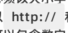<br>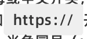<br>以 http:// 和 https:// 开头。可以包含数字、半角冒号（:）、下划线（_）或者短划线（-）。</td>
  </tr>
  <tr>
    <td>maxpartition_number</td>
    <td>存储集最大分区</td>
    <td>取值范围：大于等于2。<br>默认值：2。</td>
  </tr>
  <tr>
    <td>zone_id</td>
    <td>存储集所属可用区</td>
    <td>1. 登录Apsara Uni-manager运营控制台（ASCM）界面。<br>2. 单击<strong>产品 &gt; 云服务器ECS &gt; 云</strong><strong>盘</strong>。<br>3. 单击<strong>创建云盘</strong>，获取可用区信息。</td>
  </tr>
</table>

**Terraform初始化**

在执行terraform.tf模板前，需要先将Terraform初始化。请在Terraform初始化中查看操作步骤。

**Terraform计划展示**

展示terraform.tf文件中计划创建的资源信息。

操作步骤如下：


1. 运行命令 terraform plan  。

2. 查看terraform.tf文件中展示的计划创建资源信息。

**Terraform执行**

执行上一步terraform plan展示的资源创建计划。

操作步骤如下：


1. 输入命令 terraform apply 执行terraform.tf文件中的资源创建操作。

2. 输入 yes 确认执行计划中的操作。

3. 返回Apply complete!即代表资源创建成功。若不成功查看具体的报错信息，修改terraform.tf文件中的创建资源内容。

**Terraform查看结果**


运行 terraform show 查看已创建的资源详情。

**Terraform销毁**

当需要释放资源可通过terraform destroy销毁已创建的资源，请在Terraform资源销毁中查看操作步骤。

**重要**

当执行terraform apply操作时提示“用户无资源授权，或者该API不支持RAM”，请检查该产品是否开启了STS鉴权信任模式。


STS鉴权信任模式检查方式：

1. 通过super账号登录Apsara Uni-manager运营控制台（ASCM）。

2. 单击**配置** **> 鉴权信任模式**。

3. 产品被勾选则表示已开启了鉴权信任模式。

当STS鉴权信任模式开启后，执行操作请参考专有云Terraform Provider中使用STS调用方式使用说明。

<a id="section-4-22"></a>

## 4.22. 创建弹性伸缩ESS

本章介绍如何使用专有云Terraform创建ESS的伸缩组、伸缩规则、伸缩配置。

**操作步骤**

**编写Terraform的模板文件**

创建terraform.tf文件，编写要创建的资源语句。

```terraform
#环境配置
provider "alibabacloudstack" { 
  domain="asapi域名" 
  access_key="用户的ak" 
  secret_key="用户的sk" 
  region="地域" 
  proxy= "HTTP://环境代理" 
  protocol="HTTP" 
  insecure="true" 
  resource_group_set_name ="资源集名称" 
}

data "alibabacloudstack_zones" "default" {
  available_resource_creation = "VSwitch"
}

data "alibabacloudstack_instance_types" "default" {
  availability_zone = data.alibabacloudstack_zones.default.zones[0].id
  cpu_core_count    = 2
  sorted_by         = "Memory"

 }

 locals {
  instance_type_id = sort(data.alibabacloudstack_instance_types.default.ids)[0]
}

data "alibabacloudstack_images" "default" {
  name_regex  = "^ubuntu_18.*64"
  most_recent = true
  owners      = "system"
}

#创建VPC
resource "alibabacloudstack_vpc" "default" {
  vpc_name       = "${var.name}"
  cidr_block = "172.16.0.0/16"
}

#创建交换机
resource "alibabacloudstack_vswitch" "default" {
  vpc_id            = "${alibabacloudstack_vpc.default.id}"
  cidr_block        = "172.16.0.0/24"
  availability_zone = "${data.alibabacloudstack_zones.default.zones.0.id}"
  name              = "${var.name}"
}

#创建安全组
resource "alibabacloudstack_security_group" "default" {
  name   = "${var.name}"
  vpc_id = "${alibabacloudstack_vpc.default.id}"
}

#创建安全组规则
resource "alibabacloudstack_security_group_rule" "default" {
    type = "ingress"
    ip_protocol = "tcp"
    nic_type = "intranet"
    policy = accept
    port_range = "22/22"
    priority = 1
    security_group_id = "${alibabacloudstack_security_group.default.id}"
    cidr_ip = "172.16.0.0/24"
}

  variable "name" {
    default = "tf-testAccEssScalingRule-591939"
  }

#创建伸缩组
  resource "alibabacloudstack_ess_scaling_group" "default" {
    min_size = 1
    max_size = 1
    scaling_group_name = "${var.name}"
    vswitch_ids = ["${alibabacloudstack_vswitch.default.id}"]
    removal_policies = ["OldestInstance", "NewestInstance"]
  }

#创建伸缩配置
  resource "alibabacloudstack_ess_scaling_configuration" "default" {
    scaling_group_id = "${alibabacloudstack_ess_scaling_group.default.id}"
    image_id = "${data.alibabacloudstack_images.default.images.0.id}"
    instance_type = "${local.instance_type_id}"
    security_group_id = "${alibabacloudstack_security_group.default.id}"
    force_delete = "true"
  }

#创建伸缩规则
  resource "alibabacloudstack_ess_scaling_rule" "default" {
    scaling_group_id = "${alibabacloudstack_ess_scaling_group.default.id}"
    adjustment_type = "TotalCapacity"
    adjustment_value = "1"
    cooldown = 0
  }
```

参数说明：

<table>
  <tr>
    <td>参数</td>
    <td>含义</td>
    <td>获取方式</td>
  </tr>
</table>

<table>
  <tr>
    <td>domain</td>
    <td>asapi的域名</td>
    <td>1. 登录飞天基础运维控制台3.0。<br>2. 在左侧导航栏选择<strong>运维工具 &gt; 基</strong><strong>础数据管理</strong>。<br>3. 单击<strong>底座元数据管理</strong>模块中的<strong>服</strong><strong>务注册变量大盘 </strong>。<br>4. 在<strong>服务</strong>搜索栏中输入asapi，自动过滤出asapi服务。<br>5. 单击asapi服务对应的Service Registration内容，查看注册变量详情，获取asapi.gateway.endpoint的域名。<br>说明<br>如需登录飞天基础运维控制台1.0，可在左侧导航栏选择<strong>运维</strong><strong>工具 &gt; 基础数据管理</strong>，单击<strong>Tianji元数据管理</strong>模块中的<strong>飞</strong><strong>天基础运维控制台1.0</strong>。</td>
  </tr>
  <tr>
    <td>access_key</td>
    <td>用户的访问密钥</td>
    <td>1. 使用用户的账户名和密码登录Apsara Uni-manager运营控制台（ASCM）界面。<br>2. 单击主页右上角的云朵logo，单击个人信息。<br>3. 获取用户的AccessKey ID。</td>
  </tr>
  <tr>
    <td>secret_key</td>
    <td>用户的访问密钥Secret</td>
    <td>1. 使用用户的账户名和密码登录Apsara Uni-manager运营控制台（ASCM）界面。<br>2. 单击主页右上角的云朵logo，单击个人信息。<br>3. 获取用户的AccessKey Secret。</td>
  </tr>
  <tr>
    <td>region</td>
    <td>地域</td>
    <td>1. 登录Apsara Uni-manager运营控制台（ASCM）界面。<br>2. 单击<strong>企业 &gt; 地域管理</strong>。<br>3. 选择目标组织，获取地域信息。</td>
  </tr>
  <tr>
    <td>proxy</td>
    <td>访问环境的代理地址</td>
    <td>若访问环境不需要通过代理地址，则无需配置此参数。</td>
  </tr>
  <tr>
    <td>insecure</td>
    <td>不安全的https证书</td>
    <td>insecure="true"表示忽略不安全的https证书，取值范围（true、false）。</td>
  </tr>
  <tr>
    <td>resource_group_set_name</td>
    <td>资源集名称</td>
    <td>1. 查看资源名称，选择Apsara Uni-manager运营控制台（ASCM）控制台页面右上方的<strong>企</strong><strong>业</strong>。<br>2. 单击目标组织，获取该组织的资源集名称。</td>
  </tr>
  <tr>
    <td>min_size</td>
    <td>伸缩组内ECS实例台数的最小值</td>
    <td>当伸缩组内ECS实例数小于MinSize的值时，弹性伸缩会自动创建ECS实例。</td>
  </tr>
  <tr>
    <td>max_size</td>
    <td>伸缩组内ECS实例台数的最大值</td>
    <td>当伸缩组内ECS实例数大于MaxSize的值时，弹性伸缩会自动移出ECS实例。</td>
  </tr>
  <tr>
    <td>scaling_group_name</td>
    <td>伸缩组的名称</td>
    <td>长度为2-64个字符，以大小写字母，数字或中文开头，可包含`.`，`_`或`-`。</td>
  </tr>
  <tr>
    <td>removal_policies</td>
    <td>指定实例移出策略的筛选策略</td>
    <td>取值范围：<br>• OldestInstance：移出最早加入伸缩组的ECS实例。<br>• NewestInstance：移出最新加入伸缩组的ECS实例。<br>• OldestScalingConfiguration：移出最早伸缩配置创建的ECS实例。<br>• CustomPolicy：基于自定义缩容策略Function函数移除ECS实例。</td>
  </tr>
  <tr>
    <td>scaling_group_id</td>
    <td>伸缩组ID</td>
    <td>1. 登录Apsara Uni-manager运营控制台（ASCM）界面。<br>2. 单击<strong>产品 &gt; 弹性伸缩</strong>。<br>3. 单击左侧菜单栏的<strong>伸缩组管理</strong>，查看伸缩组管理列表，获取伸缩组ID。</td>
  </tr>
  <tr>
    <td>image_id</td>
    <td>镜像文件ID</td>
    <td>1. 登录Apsara Uni-manager运营控制台（ASCM）界面。<br>2. 单击<strong>产品 &gt; 弹性伸缩</strong>。<br>3. 单击左侧菜单栏的<strong>伸缩组管理</strong>，查看伸缩组管理列表。<br>4. 单击目标伸缩组ID，进入伸缩组详情页面。<br>5. 单击实例配置来源，创建伸缩配置，获取镜像ID。</td>
  </tr>
  <tr>
    <td>instance_type</td>
    <td>ECS实例规格</td>
    <td>1. 登录Apsara Uni-manager运营控制台（ASCM）界面。<br>2. 单击<strong>产品 &gt; 弹性伸缩</strong>。<br>3. 单击左侧菜单栏的<strong>伸缩组管理</strong>，查看伸缩组管理列表。<br>4. 单击目标伸缩组ID，进入伸缩组详情页面。<br>5. 单击实例配置来源，创建伸缩配置，ECS实例规格。</td>
  </tr>
  <tr>
    <td>security_group_id</td>
    <td>ECS实例所属的安全组的ID</td>
    <td>1. 登录Apsara Uni-manager运营控制台（ASCM）界面。<br>2. 单击<strong>产品 &gt; 弹性伸缩</strong>。<br>3. 单击左侧菜单栏的<strong>伸缩组管理</strong>，查看伸缩组管理列表。<br>4. 单击目标伸缩组ID，进入伸缩组详情页面。<br>5. 单击实例列表，单击目标云服务器ID，进入云实例详情界面。<br>6. 单击安全组，获取安全组ID信息。<br>同一个安全组内的ECS实例可以互相访问。</td>
  </tr>
  <tr>
    <td>force_delete</td>
    <td>最后一个伸缩配置将被强制删除，同时删除其伸缩组。</td>
    <td>默认为false。</td>
  </tr>
  <tr>
    <td>adjustment_type</td>
    <td>伸缩规则的调整方式</td>
    <td>仅适用于简单伸缩规则，且该项必选。取值范围：<br>• QuantityChangeInCapacity：增加或减少指定数量的ECS实例。<br>• PercentChangeInCapacity：增加或减少指定比例的ECS实例。<br>• TotalCapacity：将当前伸缩组的ECS实例数量调整到指定数量。</td>
  </tr>
  <tr>
    <td>adjustment_value</td>
    <td>伸缩规则的调整值</td>
    <td>仅适用于简单伸缩规则，且该项必选。任何情况下，单次调整的ECS实例台数都不能超过500。不同调整方式对应的取值范围：<br>• QuantityChangeInCapacity：-500~500。<br>• PercentChangeInCapacity：-100~10000。<br>• TotalCapacity：0~1000。</td>
  </tr>
  <tr>
    <td>cooldown</td>
    <td>缩放规则的冷却时间</td>
    <td>该参数仅适用于简单的伸缩规则。取值范围：[0,86400]，单位为秒。默认值为空，如果不设置，返回值为0，即integer的默认值。</td>
  </tr>
</table>

**Terraform初始化**

在执行terraform.tf模板前，需要先将Terraform初始化。请在Terraform初始化中查看操作步骤。

**Terraform计划展示**

展示terraform.tf文件中计划创建的资源信息。

操作步骤如下：


1. 运行命令 terraform plan  。

2. 查看terraform.tf文件中展示的计划创建资源信息。

**Terraform执行**

执行上一步terraform plan展示的资源创建计划。

操作步骤如下：


1. 输入命令 terraform apply 执行terraform.tf文件中的资源创建操作。

2. 输入 yes 确认执行计划中的操作。

3. 返回Apply complete!即代表资源创建成功。若不成功查看具体的报错信息，修改terraform.tf文件中的创建资源内容。

**Terraform查看结果**


运行 terraform show 查看已创建的资源详情。

**Terraform销毁**

当需要释放资源可通过terraform destroy销毁已创建的资源，请在Terraform资源销毁中查看操作步骤。

**重要**

当执行terraform apply操作时提示“用户无资源授权，或者该API不支持RAM”，请检查该产品是否开启了STS鉴权信任模式。


STS鉴权信任模式检查方式：

1. 通过super账号登录Apsara Uni-manager运营控制台（ASCM）。

2. 单击**配置** **> 鉴权信任模式**。

3. 产品被勾选则表示已开启了鉴权信任模式。

当STS鉴权信任模式开启后，执行操作请参考专有云Terraform Provider中使用STS调用方式使用说明。

<a id="section-4-23"></a>

## 4.23. 创建云监控CMS

本章介绍如何使用专有云Terraform创建云监控CMS的阈值报警规则、报警联系人、报警联系组和站点监控任务。

**操作步骤**

**编写Terraform的模板文件**

创建terraform.tf文件，编写要创建的资源语句。

```terraform
#环境配置
provider "alibabacloudstack" { 
  domain="asapi域名" 
  access_key="用户的ak" 
  secret_key="用户的sk" 
  region="地域" 
  proxy= "HTTP://环境代理" 
  protocol="HTTP" 
  insecure="true" 
  resource_group_set_name ="资源集名称" 
}

 #阈值报警规则
resource "alibabacloudstack_slb" "basic" {
 name          = "terraform_omega_1"
}
resource "alibabacloudstack_cms_alarm" "default" {
  name    = "TfAccCmsAlarm_omega_1"
  project = "acs_slb_dashboard"
  metric  = "ActiveConnection"
  dimensions = {
    instanceId = alibabacloudstack_slb.basic.id
  }
  escalations_critical {
    statistics = "Average"
    comparison_operator = "<="
    threshold = 35
    times = 2
  }
  enabled =      true
  contact_groups     = ["test-group"]
  effective_interval = "0:00-2:00"
}

#报警联系人
variable "name" {
 default = "tf-testAcccn-qingdao-env17-d01CmsAlarmContactzhangsan3465898"
}

resource "alibabacloudstack_cms_alarm_contact" "default" {
  describe = "For-test"
  channels_mail = "hello.uuuu@aaa.com"
  lifecycle {
    ignore_changes = [
                       "channels_mail"
                     ]
  }
  
  alarm_contact_name = "${var.name}"
}

#报警联系组
variable "name" {
 default = "tf-testAcccn-qingdao-env17-d01CmsAlarmContactGrouptf-test2591317"
}
resource "alibabacloudstack_cms_alarm_contact" "default" {
  alarm_contact_name = "${var.name}-1"
  describe           = "For Test 1234567"
  channels_mail      = "hello.uuuu@aaa.com"
  lifecycle {
    ignore_changes = [channels_mail]
  }
}
resource "alibabacloudstack_cms_alarm_contact" "default0" {
  alarm_contact_name = "${var.name}-0"
  describe           = "For Test 1234567"
  channels_mail      = "hello.uuuu@aaa.com"
  lifecycle {
    ignore_changes = [channels_mail]
  }
}


resource "alibabacloudstack_cms_alarm_contact_group" "default" {
  alarm_contact_group_name = "${var.name}"
}

#站点监控任务
resource "alibabacloudstack_cms_site_monitor" "basic" {
   address = "http://www.alibabacloud.com"
   task_name = "tf-testAccCmsSiteMonitor_basic"
   task_type = "HTTP"
   interval = 5
   isp_cities {
    city = "546"
    isp = "465"
   }
 }
```

参数说明：

<table>
  <tr>
    <td>参数</td>
    <td>含义</td>
    <td>获取方式</td>
  </tr>
</table>

<table>
  <tr>
    <td>domain</td>
    <td>asapi的域名</td>
    <td>1. 登录飞天基础运维控制台3.0。<br>2. 在左侧导航栏选择<strong>运维工具 &gt; 基</strong><strong>础数据管理</strong>。<br>3. 单击<strong>底座元数据管理</strong>模块中的<strong>服</strong><strong>务注册变量大盘 </strong>。<br>4. 在<strong>服务</strong>搜索栏中输入asapi，自动过滤出asapi服务。<br>5. 单击asapi服务对应的Service Registration内容，查看注册变量详情，获取asapi.gateway.endpoint的域名。<br>说明<br>如需登录飞天基础运维控制台1.0，可在左侧导航栏选择<strong>运维</strong><strong>工具 &gt; 基础数据管理</strong>，单击<strong>Tianji元数据管理</strong>模块中的<strong>飞</strong><strong>天基础运维控制台1.0</strong>。</td>
  </tr>
  <tr>
    <td>access_key</td>
    <td>用户的访问密钥</td>
    <td>1. 使用用户的账户名和密码登录Apsara Uni-manager运营控制台（ASCM）界面。<br>2. 单击主页右上角的云朵logo，单击个人信息。<br>3. 获取用户的AccessKey ID。</td>
  </tr>
  <tr>
    <td>secret_key</td>
    <td>用户的访问密钥Secret</td>
    <td>1. 使用用户的账户名和密码登录Apsara Uni-manager运营控制台（ASCM）界面。<br>2. 单击主页右上角的云朵logo，单击个人信息。<br>3. 获取用户的AccessKey Secret。</td>
  </tr>
  <tr>
    <td>region</td>
    <td>地域</td>
    <td>1. 登录Apsara Uni-manager运营控制台（ASCM）界面。<br>2. 单击<strong>企业 &gt; 地域管理</strong>。<br>3. 选择目标组织，获取地域信息。</td>
  </tr>
  <tr>
    <td>proxy</td>
    <td>访问环境的代理地址</td>
    <td>若访问环境不需要通过代理地址，则无需配置此参数。</td>
  </tr>
  <tr>
    <td>insecure</td>
    <td>不安全的https证书</td>
    <td>insecure="true"表示忽略不安全的https证书，取值范围（true、false）。</td>
  </tr>
  <tr>
    <td>resource_group_set_name</td>
    <td>资源集名称</td>
    <td>1. 查看资源名称，选择Apsara Uni-manager运营控制台（ASCM）控制台页面右上方的<strong>企</strong><strong>业</strong>。<br>2. 单击目标组织，获取该组织的资源集名称。</td>
  </tr>
  <tr>
    <td>name</td>
    <td>告警规则名称</td>
    <td>用户自定义</td>
  </tr>
  <tr>
    <td>project</td>
    <td>监控项目名称</td>
    <td>例如：“acs_ecs_dashboard”和“ acs_rds_dashboard”。</td>
  </tr>
  <tr>
    <td>metric</td>
    <td>项目对应的监控指标的名称</td>
    <td>例如：“CPUUtilization”和“netw orkin_rate”。</td>
  </tr>
  <tr>
    <td>dimensions</td>
    <td>告警规则关联的资源映射</td>
    <td>例如：instanceId、device、port等。每个键的值是一个字符串，它使用逗号分隔多个项。</td>
  </tr>
  <tr>
    <td>escalations_critical</td>
    <td>紧急警报的配置</td>
    <td>用户自定义。</td>
  </tr>
  <tr>
    <td>enabled</td>
    <td>是否启用告警规则</td>
    <td>默认为true。</td>
  </tr>
  <tr>
    <td>contact_groups</td>
    <td>列出该告警规则对应的联系人组</td>
    <td>必须是控制台上已经创建的联系人组。</td>
  </tr>
  <tr>
    <td>effective_interval</td>
    <td>告警规则生效的时间间隔</td>
    <td>它的格式是“hh:mm-hh:mm”，比如“0:00-4:00”。默认为“00:00-23:59”。</td>
  </tr>
  <tr>
    <td>describe</td>
    <td>告警联系人的描述</td>
    <td>用户自定义</td>
  </tr>
  <tr>
    <td>channels_mail</td>
    <td>告警联系人的邮箱地址</td>
    <td>添加或修改邮箱地址后，收件人将收到包含激活链接的电子邮件。email地址被激活后，系统才会将收件人添加到告警联系人列表中。</td>
  </tr>
  <tr>
    <td>alarm_contact_name</td>
    <td>告警联系人的名称</td>
    <td>用户自定义</td>
  </tr>
  <tr>
    <td>alarm_contact_group_name</td>
    <td>告警组名称</td>
    <td>用户自定义</td>
  </tr>
  <tr>
    <td>address</td>
    <td>站点监控任务监控的URL或IP地址</td>
    <td>示例：https://www.aliyun.com</td>
  </tr>
  <tr>
    <td>task_name</td>
    <td>站点监控任务的名称</td>
    <td>长度为4 ~ 100个字符，名称可以包含字母、数字和下划线。</td>
  </tr>
  <tr>
    <td>task_type</td>
    <td>站点监控任务协议</td>
    <td>目前站点监控支持HTTP、Ping、TCP、UDP、DNS、SMTP、POP3、FTP等协议。</td>
  </tr>
  <tr>
    <td>interval</td>
    <td>站点监控任务的监控周期</td>
    <td>单位：分钟。取值范围：1、5、15。默认值：1。</td>
  </tr>
  <tr>
    <td>isp_cities</td>
    <td>JSON数组中的检测点。</td>
    <td>例如，“[{"city":"546"，"isp":"465 "}，{"city":"572"，"isp":"465"}，{"city":"738"，"isp":"465"}]”分别表示北京、杭州和青岛的检测点。</td>
  </tr>
</table>

**Terraform初始化**

在执行terraform.tf模板前，需要先将Terraform初始化。请在Terraform初始化中查看操作步骤。

**Terraform计划展示**

展示terraform.tf文件中计划创建的资源信息。

操作步骤如下：


1. 运行命令 terraform plan  。

2. 查看terraform.tf文件中展示的计划创建资源信息。

**Terraform执行**

执行上一步terraform plan展示的资源创建计划。

操作步骤如下：


1. 输入命令 terraform apply 执行terraform.tf文件中的资源创建操作。

2. 输入 yes 确认执行计划中的操作。

3. 返回Apply complete!即代表资源创建成功。若不成功查看具体的报错信息，修改terraform.tf文件中的创建资源内容。

**Terraform查看结果**


运行 terraform show 查看已创建的资源详情。

**Terraform销毁**

当需要释放资源可通过terraform destroy销毁已创建的资源，请在Terraform资源销毁中查看操作步骤。

**重要**

当执行terraform apply操作时提示“用户无资源授权，或者该API不支持RAM”，请检查该产品是否开启了STS鉴权信任模式。


STS鉴权信任模式检查方式：

1. 通过super账号登录Apsara Uni-manager运营控制台（ASCM）。

2. 单击**配置** **> 鉴权信任模式**。

3. 产品被勾选则表示已开启了鉴权信任模式。

当STS鉴权信任模式开启后，执行操作请参考专有云Terraform Provider中使用STS调用方式使用说明。

<a id="section-4-24"></a>

## 4.24. 创建数据管理DMS

本章介绍如何使用专有云Terraform创建数据管理DMS的企业数据库实例和企业用户。

**前提条件**

创建DMS企业数据库实例前需要创建RDS实例、数据库账号、ASCM用户。

**操作步骤编写Terraform的模板文件**

创建terraform.tf文件，编写要创建的资源语句。

```terraform
#环境配置
provider "alibabacloudstack" { 
  domain="asapi域名" 
  access_key="用户的ak" 
  secret_key="用户的sk" 
  region="地域" 
  proxy= "HTTP://环境代理" 
  protocol="HTTP" 
  insecure="true" 
  resource_group_set_name ="资源集名称" 
}

 #企业数据库实例
variable "name" {
    default = "tf-testAccDmsEnterpriseInstance1304"
 }
 data "alibabacloudstack_account" "current" {
 }

 resource "alibabacloudstack_db_instance" "instance" {
 engine           = "MySQL"
 engine_version   = "5.6"
 instance_type    = "rds.mysql.t1.small"
 instance_storage = "10"
 instance_name    = "${var.name}"
 security_ips     = ["0.0.0.0/0"]
 storage_type         = "local_ssd"
 }
 
 resource "alibabacloudstack_db_account" "account" {
 instance_id = "${alibabacloudstack_db_instance.instance.id}"
 name        = "tftest123"
 password    = "inputYourCodeHere"
 type        = "Normal"
 }

 resource "alibabacloudstack_ascm_user" "user" {
  cellphone_number = "13900000000"
  email = "test@gmail.com"
  display_name = "C2C-DELTA"
  organization_id = 33
  mobile_nation_code = "91"
  login_name = "User_Dms_${var.name}"
  login_policy_id = 1
 }

 resource "alibabacloudstack_dms_enterprise_user" "default" {
    uid = alibabacloudstack_ascm_user.user.user_id
    user_name = alibabacloudstack_ascm_user.user.login_name
    mobile = "15910799999"
    role_names = ["ADMIN"]
 }

resource "alibabacloudstack_dms_enterprise_instance" "default" {
  use_dsql = "0"
  instance_alias = "tf-testAccDmsEnterpriseInstance1304"
  ecs_region = "cn-qingdao-env17-d01"
  env_type = "test"
  tid = "1"
  instance_source = "RDS"
  dba_uid = "${alibabacloudstack_dms_enterprise_user.default.uid}"
  network_type = "CLASSIC"
  database_user = "${alibabacloudstack_db_account.account.name}"
  export_timeout = "2000"
  safe_rule = "自由操作"
  data_link_name = ""
  ddl_online = "0"
  query_timeout = "70"
  instance_type = "mysql"
  host = "${alibabacloudstack_db_instance.instance.connection_string}"
  port = "3306"
  database_password = "${alibabacloudstack_db_account.account.password}"
}

#企业用户
resource "alibabacloudstack_ascm_organization" "default" {
  name = "Test_binder124"
  parent_id = "1"
 }
 
 resource "alibabacloudstack_ascm_user" "user" {
  cellphone_number = "13900000000"
  email = "admin@ascm.com"
  display_name = "admin"
  organization_id = alibabacloudstack_ascm_organization.default.org_id
  mobile_nation_code = "91"
  login_name = "User_Role_Testtf-testAccDmsEnterpriseUser5343882"
  login_policy_id = 1
 }
 
resource "alibabacloudstack_dms_enterprise_user" "default" {
  role_names = [
                 "DBA"
               ]
  uid = "${alibabacloudstack_ascm_user.user.user_id}"
  nick_name = "tf-testAccDmsEnterpriseUser5343882"
}
```

参数说明：

<table>
  <tr>
    <td>参数</td>
    <td>含义</td>
    <td>获取方式</td>
  </tr>
  <tr>
    <td>domain</td>
    <td>asapi的域名</td>
    <td>1. 登录飞天基础运维控制台3.0。<br>2. 在左侧导航栏选择<strong>运维工具 &gt; 基</strong><strong>础数据管理</strong>。<br>3. 单击<strong>底座元数据管理</strong>模块中的<strong>服</strong><strong>务注册变量大盘 </strong>。<br>4. 在<strong>服务</strong>搜索栏中输入asapi，自动过滤出asapi服务。<br>5. 单击asapi服务对应的Service Registration内容，查看注册变量详情，获取asapi.gateway.endpoint的域名。<br>说明<br>如需登录飞天基础运维控制台1.0，可在左侧导航栏选择<strong>运维</strong><strong>工具 &gt; 基础数据管理</strong>，单击<strong>Tianji元数据管理</strong>模块中的<strong>飞</strong><strong>天基础运维控制台1.0</strong>。</td>
  </tr>
  <tr>
    <td>access_key</td>
    <td>用户的访问密钥</td>
    <td>1. 使用用户的账户名和密码登录Apsara Uni-manager运营控制台（ASCM）界面。<br>2. 单击主页右上角的云朵logo，单击个人信息。<br>3. 获取用户的AccessKey ID。</td>
  </tr>
  <tr>
    <td>secret_key</td>
    <td>用户的访问密钥Secret</td>
    <td>1. 使用用户的账户名和密码登录Apsara Uni-manager运营控制台（ASCM）界面。<br>2. 单击主页右上角的云朵logo，单击个人信息。<br>3. 获取用户的AccessKey Secret。</td>
  </tr>
  <tr>
    <td>region</td>
    <td>地域</td>
    <td>1. 登录Apsara Uni-manager运营控制台（ASCM）界面。<br>2. 单击<strong>企业 &gt; 地域管理</strong>。<br>3. 选择目标组织，获取地域信息。</td>
  </tr>
  <tr>
    <td>proxy</td>
    <td>访问环境的代理地址</td>
    <td>若访问环境不需要通过代理地址，则无需配置此参数。</td>
  </tr>
  <tr>
    <td>insecure</td>
    <td>不安全的https证书</td>
    <td>insecure="true"表示忽略不安全的https证书，取值范围（true、false）。</td>
  </tr>
  <tr>
    <td>resource_group_set_name</td>
    <td>资源集名称</td>
    <td>1. 查看资源名称，选择Apsara Uni-manager运营控制台（ASCM）控制台页面右上方的<strong>企</strong><strong>业</strong>。<br>2. 单击目标组织，获取该组织的资源集名称。</td>
  </tr>
  <tr>
    <td>use_dsql</td>
    <td>是否启用跨实例查询</td>
    <td>取值：<br>• 0：不开启<br>• 1：开启</td>
  </tr>
  <tr>
    <td>instance_alias</td>
    <td>实例名称</td>
    <td>用户自定义，帮助用户快速区分定位。</td>
  </tr>
  <tr>
    <td>ecs_region</td>
    <td>实例所在区域</td>
    <td>1. 登录Apsara Uni-manager运营控制台（ASCM）界面。<br>2. 单击<strong>产品 &gt; 云服务器ECS</strong>。<br>3. 单击<strong>实例 &gt; 创建实例</strong>，获取地域信息。</td>
  </tr>
  <tr>
    <td>env_type</td>
    <td>环境类型</td>
    <td>有效值：<br>• product：生产环境<br>• dev：开发环境<br>• pre：预发布环境<br>• test：测试环境<br>• sit：sit环境<br>• uat：uat环境<br>• pet：压力测试环境<br>• stag：stag环境</td>
  </tr>
  <tr>
    <td>tid</td>
    <td>租户ID</td>
    <td>示例值：1</td>
  </tr>
  <tr>
    <td>instance_source</td>
    <td>数据库实例的源</td>
    <td>有效值：PUBLIC_OWN，RDS，ECS_OWN，VPC_IDC。</td>
  </tr>
  <tr>
    <td>dba_uid</td>
    <td>实例的DBA</td>
    <td>传入DBA的阿里云UID</td>
  </tr>
  <tr>
    <td>network_type</td>
    <td>网络类型</td>
    <td>取值范围：CLASSIC、VPC。</td>
  </tr>
  <tr>
    <td>database_user</td>
    <td>数据库访问账户</td>
    <td>1. 登录Apsara Uni-manager运营控制台（ASCM）界面。<br>2. 单击<strong>产品 &gt; 云数据库RDS实例</strong>。<br>3. 查看实例列表，选择目标实例，单击<strong>管理</strong>。<br>4. 单击左侧菜单栏中的<strong>账号管</strong><strong>理，</strong>获取账号信息。</td>
  </tr>
  <tr>
    <td>export_timeout</td>
    <td>导出超时时间</td>
    <td>单位为s（秒）。</td>
  </tr>
  <tr>
    <td>safe_rule</td>
    <td>实例的安全规则</td>
    <td>传入企业内的安全规则名称。</td>
  </tr>
  <tr>
    <td>data_link_name</td>
    <td>跨数据库查询数据链名称</td>
    <td>管控模式为“自由操作”、“稳定变更”的实例暂不支持使用跨库查询。</td>
  </tr>
  <tr>
    <td>ddl_online</td>
    <td>是否使用在线服务</td>
    <td>目前只支持MySQL和PolarDB。有效值：<br>• 0 ：未使用。<br>• 1 ：本地在线DDL优先级。<br>• 2 ：DMS无锁表结构更改优先级。</td>
  </tr>
  <tr>
    <td>query_timeout</td>
    <td>查询超时时间</td>
    <td>单位：s（秒）。</td>
  </tr>
  <tr>
    <td>instance_type</td>
    <td>数据库类型。</td>
    <td>有效值：MySQL、SQLServer、PostgreSQL、Oracle、DRDS、OceanBase、Mongo、Redis。</td>
  </tr>
  <tr>
    <td>host</td>
    <td>目标数据库的主机地址</td>
    <td>示例：dmstest.rds.aliyun.com</td>
  </tr>
  <tr>
    <td>port</td>
    <td>目标数据库的访问端口</td>
    <td>示例：3306</td>
  </tr>
  <tr>
    <td>database_password</td>
    <td>数据库访问密码</td>
    <td>用户自定义</td>
  </tr>
  <tr>
    <td>role_names</td>
    <td>用户角色</td>
    <td>取值和说明如下：<br>• USER：普通用户<br>• DBA：DBA<br>• ADMIN：管理员<br>• SECURITY_ADMIN：安全管理员</td>
  </tr>
  <tr>
    <td>uid</td>
    <td>要添加的用户的阿里云唯一ID (UID)</td>
    <td>1. 使用用户的账户名和密码登录Apsara Uni-manager运营控制台（ASCM）界面。<br>2. 单击主页右上角的云朵logo，单击个人信息。<br>3. 获取用户的UID信息。</td>
  </tr>
  <tr>
    <td>nick_name</td>
    <td>用户名称</td>
    <td>用户自定义</td>
  </tr>
</table>

**Terraform初始化**

在执行terraform.tf模板前，需要先将Terraform初始化。请在Terraform初始化中查看操作步骤。

**Terraform计划展示**

展示terraform.tf文件中计划创建的资源信息。

操作步骤如下：


1. 运行命令 terraform plan  。

2. 查看terraform.tf文件中展示的计划创建资源信息。

**Terraform执行**

执行上一步terraform plan展示的资源创建计划。

操作步骤如下：


1. 输入命令 terraform apply 执行terraform.tf文件中的资源创建操作。

2. 输入 yes 确认执行计划中的操作。

3. 返回Apply complete!即代表资源创建成功。若不成功查看具体的报错信息，修改terraform.tf文件中的创建资源内容。

**Terraform查看结果**


运行 terraform show 查看已创建的资源详情。

**Terraform销毁**

当需要释放资源可通过terraform destroy销毁已创建的资源，请在Terraform资源销毁中查看操作步骤。

**重要**

当执行terraform apply操作时提示“用户无资源授权，或者该API不支持RAM”，请检查该产品是否开启了STS鉴权信任模式。


STS鉴权信任模式检查方式：

1. 通过super账号登录Apsara Uni-manager运营控制台（ASCM）。

2. 单击**配置** **> 鉴权信任模式**。

3. 产品被勾选则表示已开启了鉴权信任模式。

当STS鉴权信任模式开启后，执行操作请参考专有云Terraform Provider中使用STS调用方式使用说明。

<a id="section-4-25"></a>

## 4.25. 创建域名解析DNS

本章介绍如何使用专有云Terraform创建DNS域名。

**操作步骤**

**编写Terraform的模板文件**

创建terraform.tf文件，编写要创建的资源语句。

```terraform
#环境配置
provider "alibabacloudstack" { 
  domain="asapi域名" 
  access_key="用户的ak" 
  secret_key="用户的sk" 
  region="地域" 
  proxy= "HTTP://环境代理" 
  protocol="HTTP" 
  insecure="true" 
  resource_group_set_name ="资源集名称" 
}

#创建DNS域名
resource "alibabacloudstack_dns_domain" "default" {
  domain_name     = "starmove."
  remark   =  "testing Domain"
}
output "dns" {
  value = alibabacloudstack_dns_domain.default.*
}
```

参数说明：

| 参数 | 含义 | 获取方式 |
| --- | --- | --- |
| domain | asapi的域名 | 1. 登录飞天基础运维控制台3.0。<br>2. 在左侧导航栏选择<strong>运维工具 &gt; 基</strong><strong>础数据管理</strong>。<br>3. 单击<strong>底座元数据管理</strong>模块中的<strong>服</strong><strong>务注册变量大盘 </strong>。<br>4. 在<strong>服务</strong>搜索栏中输入asapi，自动过滤出asapi服务。<br>5. 单击asapi服务对应的Service Registration内容，查看注册变量详情，获取asapi.gateway.endpoint的域名。<br>说明<br>如需登录飞天基础运维控制台1.0，可在左侧导航栏选择<strong>运维</strong><strong>工具 &gt; 基础数据管理</strong>，单击<strong>Tianji元数据管理</strong>模块中的<strong>飞</strong><strong>天基础运维控制台1.0</strong>。 |
| access_key | 用户的访问密钥 | 1. 使用用户的账户名和密码登录Apsara Uni-manager运营控制台（ASCM）界面。<br>2. 单击主页右上角的云朵logo，单击个人信息。<br>3. 获取用户的AccessKey ID。 |
| secret_key | 用户的访问密钥Secret | 1. 使用用户的账户名和密码登录Apsara Uni-manager运营控制台（ASCM）界面。<br>2. 单击主页右上角的云朵logo，单击个人信息。<br>3. 获取用户的AccessKey Secret。 |
| region | 地域 | 1. 登录Apsara Uni-manager运营控制台（ASCM）界面。<br>2. 单击<strong>企业 &gt; 地域管理</strong>。<br>3. 选择目标组织，获取地域信息。 |
| proxy | 访问环境的代理地址 | 若访问环境不需要通过代理地址，则无需配置此参数。 |
| insecure | 不安全的https证书 | insecure="true"表示忽略不安全的https证书，取值范围（true、false）。 |
| resource_group_set_name | 资源集名称 | 1. 查看资源名称，选择Apsara Uni-manager运营控制台（ASCM）控制台页面右上方的<strong>企</strong><strong>业</strong>。<br>2. 单击目标组织，获取该组织的资源集名称。 |

<table>
  <tr>
    <td>domain_name</td>
    <td>域的名称</td>
    <td>域名格式要求：<br>1. 一个域名最长不能超过220个字符（包括结尾的"."）。<br>2. 域名可以分为域名段，中间用"."连接，每个域名段不能超过63个字符，并且不能为空（即不能出现连续的多个"."）。<br>3. 域名只能使用大小写字母（a-zA-Z）、数字（0-9）、连字符"-"、下划线"_"，出现其他字符均为非法。<br>4. 域名不区分大小写。<br>5. 域名必须以“.”结尾。</td>
  </tr>
  <tr>
    <td>remark</td>
    <td>备注域名信息</td>
    <td>用户自定义</td>
  </tr>
</table>

**Terraform初始化**

在执行terraform.tf模板前，需要先将Terraform初始化。请在Terraform初始化中查看操作步骤。

**Terraform计划展示**

展示terraform.tf文件中计划创建的资源信息。

操作步骤如下：


1. 运行命令 terraform plan  。

2. 查看terraform.tf文件中展示的计划创建资源信息。

**Terraform执行**

执行上一步terraform plan展示的资源创建计划。

操作步骤如下：


1. 输入命令 terraform apply 执行terraform.tf文件中的资源创建操作。

2. 输入 yes 确认执行计划中的操作。

3. 返回Apply complete!即代表资源创建成功。若不成功查看具体的报错信息，修改terraform.tf文件中的创建资源内容。

**Terraform查看结果**


运行 terraform show 查看已创建的资源详情。

**Terraform销毁**

当需要释放资源可通过terraform destroy销毁已创建的资源，请在Terraform资源销毁中查看操作步骤。

**重要**

当执行terraform apply操作时提示“用户无资源授权，或者该API不支持RAM”，请检查该产品是否开启了STS鉴权信任模式。


STS鉴权信任模式检查方式：

1. 通过super账号登录Apsara Uni-manager运营控制台（ASCM）。

2. 单击**配置** **> 鉴权信任模式**。

3. 产品被勾选则表示已开启了鉴权信任模式。

当STS鉴权信任模式开启后，执行操作请参考专有云Terraform Provider中使用STS调用方式使用说明。

<a id="section-4-26"></a>

## 4.26. 数据传输服务DTS

本章介绍如何使用专有云Terraform创建数据传输服务DTS的订阅任务、异步任务实例、异步任务。

**前提条件**

创建DTS订阅任务前需要创建专有网络VPC、交换机、RDS实例、RDS数据库、数据库账号、给数据库账号授权。

**操作步骤**

**编写Terraform的模板文件**

创建terraform.tf文件，编写要创建的资源语句。

```terraform
#环境配置
provider "alibabacloudstack" { 
  domain="asapi域名" 
  access_key="用户的ak" 
  secret_key="用户的sk" 
  region="地域" 
  proxy= "HTTP://环境代理" 
  protocol="HTTP" 
  insecure="true" 
  resource_group_set_name ="资源集名称" 
}

 #订阅服务
variable "name" {
  default = "tf-testaccdtstf-testacccn-qingdao-env17-d01dtssubscriptionjob90581"
}

variable "creation" {
  default = "Rds"
}

data "alibabacloudstack_zones" "default" {
  available_resource_creation = var.creation
}

resource "alibabacloudstack_vpc" "default" {
  vpc_name       = var.name
  cidr_block     = "172.16.0.0/16"
}

resource "alibabacloudstack_vswitch" "default" {
  vpc_id            = alibabacloudstack_vpc.default.id
  cidr_block        = "172.16.0.0/24"
  availability_zone           = data.alibabacloudstack_zones.default.zones[0].id
  name      = var.name
}

data "alibabacloudstack_db_zones" "default"{
 
}

resource "alibabacloudstack_db_instance" "instance" {
  engine           = "MySQL"
  engine_version   = "5.6"
  instance_type        = "rds.mysql.s2.large"
  instance_storage     = "30"
  vswitch_id       = alibabacloudstack_vswitch.default.id
  instance_name    = var.name
  storage_type         = "local_ssd"
}

resource "alibabacloudstack_db_database" "db" {
  count       = 2
  instance_id = alibabacloudstack_db_instance.instance.id
  name        = "tfaccountpri_${count.index}"
  description = "from terraform"
  character_set = "UTF8"
}

resource "alibabacloudstack_db_account" "account" {
  instance_id      = alibabacloudstack_db_instance.instance.id
  name        = "tftestprivilege"
  password    = "inputYourCodeHere"
  description = "from terraform"
}

resource"alibabacloudstackdbaccountprivilege""privilege"{
  instance_id  = alibabacloudstack_db_instance.instance.id
  account_name = alibabacloudstack_db_account.account.name
  privilege    = "ReadWrite"
  db_names     = alibabacloudstack_db_database.db.*.name
}
resource "alibabacloudstack_vpc" "default1" {
  vpc_name       = var.name
  cidr_block     = "10.0.0.0/8"
}

resource "alibabacloudstack_vswitch" "default1" {
  vpc_id            = alibabacloudstack_vpc.default1.i
   account_name = alibabacloudstack_db_account.account.name
  privilege    = "ReadWrite"
  db_names     = alibabacloudstack_db_database.db.*.name
}
resource "alibabacloudstack_vpc" "default1" {
  vpc_name       = var.name
  cidr_block     = "10.0.0.0/8"
}

resource "alibabacloudstack_vswitch" "default1" {
  vpc_id            = alibabacloudstack_vpc.default1.id
  cidr_block        = "10.1.0.0/16"
  availability_zone           = data.alibabacloudstack_zones.default.zones[0].id
  name      = var.name
}
resource "alibabacloudstack_vpc" "default2" {
  vpc_name       = var.name
  cidr_block     = "172.16.0.0/16"
}

resource "alibabacloudstack_vswitch" "default2" {
  vpc_id            = alibabacloudstack_vpc.default2.id
  cidr_block        = "172.16.0.0/24"
  availability_zone           = data.alibabacloudstack_zones.default.zones[0].id
  name      = var.name
}

resource "alibabacloudstack_dts_subscription_job" "default" {
  source_endpoint_instance_type = "RDS"
  source_endpoint_password = "inputYourCodeHere"
  subscription_instance_network_type = "vpc"
  payment_type = "PayAsYouGo"
  source_endpoint_database_name = "tfaccountpri_0"
  source_endpoint_user_name = "tftestprivilege"
  db_list = "{\"tfaccountpri_0\":{\"name\":\"tfaccountpri_0\",\"all\":true,\"state\":\"normal\"}}"
  source_endpoint_engine_name = "MySQL"
  source_endpoint_region = "cn-hangzhou"
  subscription_instance_vswitch_id = "${alibabacloudstack_vswitch.default1.id}"
  source_endpoint_instance_id = "${alibabacloudstack_db_instance.instance.id}"
  subscription_instance_vpc_id = "${alibabacloudstack_vpc.default1.id}"
  dts_job_name = "tf-testAccCase"
}

#异步任务实例
variable "name" {
  default = "tf-testacccn-qingdao-env17-d01dtssynchronizationinstance33135"
}

resource "alibabacloudstack_dts_synchronization_instance" "default" {
  sync_architecture = "bidirectional"
  payment_type = "PostPaid"
  source_endpoint_engine_name = "MySQL"
  source_endpoint_region = "cn-qingdao-env17-d01"
  destination_endpoint_engine_name = "MySQL"
  destination_endpoint_region = "cn-qingdao-env17-d01"
  instance_class = "small"
}

#异步任务
variable "name" {
  default = "tf-testacccn-qingdao-env17-d01dtssynchronizationjob63487"
}
variable "creation" {
  default = "Rds"
}
data "alibabacloudstack_zones" "default" {
 available_resource_creation = "VSwitch"
}
resource "alibabacloudstack_vpc" "default" {
  vpc_name       = var.name
  cidr_block     = "172.16.0.0/16"
}

resource "alibabacloudstack_vswitch" "default" {
  vpc_id            = alibabacloudstack_vpc.default.id
  cidr_block        = "172.16.0.0/24"
  availability_zone  = "${data.alibabacloudstack_zones.default.zones.0.id}"
  name      = var.name
}
resource "alibabacloudstack_db_instance" "dsinstance" {
  engine           = "MySQL"
  engine_version   = "5.6"
  instance_type        = "rds.mysql.s2.large"
  instance_storage     = "30"
  vswitch_id       = alibabacloudstack_vswitch.default.id
  instance_name    = var.name
  storage_type         = "local_ssd"
}

resource "alibabacloudstack_db_instance" "rsinstance" {
  engine           = "MySQL"
  engine_version   = "5.6"
  instance_type        = "rds.mysql.s2.large"
  instance_storage     = "30"
  vswitch_id       = alibabacloudstack_vswitch.default.id
  instance_name    = var.name
  storage_type         = "local_ssd"
}

resource "alibabacloudstack_db_database" "db" {
  count       = 2
  instance_id = alibabacloudstack_db_instance.dsinstance.id
  name        = "tfaccountpri_${count.index}"
  description = "from terraform"
  character_set =  "UTF8"
}

resource "alibabacloudstack_db_account" "account" {
  instance_id      = alibabacloudstack_db_instance.dsinstance.id
  name        = "tftestdts"
  password    = "inputYourCodeHere"
  description = "from terraform"
}

resource "alibabacloudstack_db_account_privilege" "privilege" {
  instance_id  = alibabacloudstack_db_instance.dsinstance.id
  account_name = alibabacloudstack_db_account.account.name
  privilege    = "ReadWrite"
  db_names     = alibabacloudstack_db_database.db.*.name
}

resource "alibabacloudstack_db_database" "db_r" {
  count       = 2
  instance_id = alibabacloudstack_db_instance.rsinstance.id
  name        = "tfaccountpri_${count.index}"
  description = "from terraform"
character_set =  "UTF8"
}

resource "alibabacloudstack_db_account" "account_r" {
  instance_id      =alibabacloudstack_db_instance.rsinstance.id
  name        = "tftestdts"
  password    = "inputYourCodeHere"
  description = "from terraform"
}

resource "alibabacloudstack_db_account_privilege" "privilege_r" {
  instance_id  = alibabacloudstack_db_instance.rsinstance.id
  account_name = alibabacloudstack_db_account.account_r.name
  privilege    = "ReadWrite"
  db_names     = alibabacloudstack_db_database.db_r.*.name
}

resource "alibabacloudstack_dts_synchronization_instance" "default" {
  payment_type                        = "PostPaid"
  source_endpoint_engine_name         = "MySQL"
  source_endpoint_region              = "cn-qingdao-env17-d01"
  destination_endpoint_engine_name    = "MySQL"
  destination_endpoint_region         = "cn-qingdao-env17-d01"
  instance_class                      = "small"
  sync_architecture                   = "oneway"
}

resource "alibabacloudstack_dts_synchronization_job" "default" {
  source_endpoint_instance_id = "${alibabacloudstack_db_instance.rsinstance.id}"
  source_endpoint_engine_name = "MySQL"
  destination_endpoint_database_name = "tfaccountpri_0"
  destination_endpoint_password = "inputYourCodeHere"
  source_endpoint_instance_type = "RDS"
  destination_endpoint_instance_type = "RDS"
  destination_endpoint_engine_name = "MySQL"
  structure_initialization = "true"
  dts_job_name = "tf-testAccCase"
  data_initialization = "true"
  data_synchronization = "true"
  destination_endpoint_instance_id = "${alibabacloudstack_db_instance.dsinstance.id}"
  db_list = "{\"tfaccountpri_0\":{\"name\":\"tfaccountpri_0\",\"all\":true,\"state\":\"normal\"}}"
  source_endpoint_database_name = "tfaccountpri_0"
  source_endpoint_user_name = "tftestdts"
  destination_endpoint_user_name = "tftestdts"
  source_endpoint_password = "inputYourCodeHere"
  dts_instance_id = "${alibabacloudstack_dts_synchronization_instance.default.id}"
}
```

参数说明：

<table>
  <tr>
    <td>参数</td>
    <td>含义</td>
    <td>获取方式</td>
  </tr>
</table>

<table>
  <tr>
    <td>domain</td>
    <td>asapi的域名</td>
    <td>1. 登录飞天基础运维控制台3.0。<br>2. 在左侧导航栏选择<strong>运维工具 &gt; 基</strong><strong>础数据管理</strong>。<br>3. 单击<strong>底座元数据管理</strong>模块中的<strong>服</strong><strong>务注册变量大盘 </strong>。<br>4. 在<strong>服务</strong>搜索栏中输入asapi，自动过滤出asapi服务。<br>5. 单击asapi服务对应的Service Registration内容，查看注册变量详情，获取asapi.gateway.endpoint的域名。<br>说明<br>如需登录飞天基础运维控制台1.0，可在左侧导航栏选择<strong>运维</strong><strong>工具 &gt; 基础数据管理</strong>，单击<strong>Tianji元数据管理</strong>模块中的<strong>飞</strong><strong>天基础运维控制台1.0</strong>。</td>
  </tr>
  <tr>
    <td>access_key</td>
    <td>用户的访问密钥</td>
    <td>1. 使用用户的账户名和密码登录Apsara Uni-manager运营控制台（ASCM）界面。<br>2. 单击主页右上角的云朵logo，单击个人信息。<br>3. 获取用户的AccessKey ID。</td>
  </tr>
  <tr>
    <td>secret_key</td>
    <td>用户的访问密钥Secret</td>
    <td>1. 使用用户的账户名和密码登录Apsara Uni-manager运营控制台（ASCM）界面。<br>2. 单击主页右上角的云朵logo，单击个人信息。<br>3. 获取用户的AccessKey Secret。</td>
  </tr>
  <tr>
    <td>region</td>
    <td>地域</td>
    <td>1. 登录Apsara Uni-manager运营控制台（ASCM）界面。<br>2. 单击<strong>企业 &gt; 地域管理</strong>。<br>3. 选择目标组织，获取地域信息。</td>
  </tr>
  <tr>
    <td>proxy</td>
    <td>访问环境的代理地址</td>
    <td>若访问环境不需要通过代理地址，则无需配置此参数。</td>
  </tr>
  <tr>
    <td>insecure</td>
    <td>不安全的https证书</td>
    <td>insecure="true"表示忽略不安全的https证书，取值范围（true、false）。</td>
  </tr>
  <tr>
    <td>resource_group_set_name</td>
    <td>资源集名称</td>
    <td>1. 查看资源名称，选择Apsara Uni-manager运营控制台（ASCM）控制台页面右上方的<strong>企</strong><strong>业</strong>。<br>2. 单击目标组织，获取该组织的资源集名称。</td>
  </tr>
  <tr>
    <td>source_endpoint_instance_typ e</td>
    <td>源实例类型</td>
    <td>有效值：“RDS”，“PolarDB”，“DRDS”，“Loca lInstance”，“ECS”，“Expres s”，“CEN”，“dg”。</td>
  </tr>
  <tr>
    <td>source_endpoint_password</td>
    <td>源数据库实例账号的密码</td>
    <td>用户自定义</td>
  </tr>
  <tr>
    <td>subscription_instance_network _type</td>
    <td>订阅任务类型</td>
    <td>有效值：classic（经典网络）, vpc（专有网络）。</td>
  </tr>
  <tr>
    <td>payment_type</td>
    <td>资源的支付类型</td>
    <td>有效值：“Subscription”，“PayAs YouGo”。</td>
  </tr>
  <tr>
    <td>source_endpoint_database_na me</td>
    <td>订阅数据库的名称</td>
    <td>用户自定义</td>
  </tr>
  <tr>
    <td>source_endpoint_user_name</td>
    <td>源数据库实例账户的用户名</td>
    <td>用户自定义</td>
  </tr>
  <tr>
    <td>db_list</td>
    <td>订阅对象</td>
    <td>JSON字符串格式</td>
  </tr>
  <tr>
    <td>source_endpoint_engine_name</td>
    <td>源数据库类型</td>
    <td>有效值：“MySQL”，“Oracle”。</td>
  </tr>
  <tr>
    <td>source_endpoint_region</td>
    <td>源数据库的区域</td>
    <td>示例：cn-hangzhou</td>
  </tr>
  <tr>
    <td>subscription_instance_vswitch_id</td>
    <td>订阅VSwitch实例ID</td>
    <td>1. 查看交换机ID，选择Apsara Uni-manager运营控制台（ASCM）顶部菜单栏上的<strong>产品 &gt;</strong><strong>专有网络VPC</strong>。<br>2. 单击左侧导航栏中的<strong>交换机</strong>，获取交换机ID信息。</td>
  </tr>
  <tr>
    <td>source_endpoint_instance_id</td>
    <td>源实例ID</td>
    <td>以RDS为例：<br>1. 登录Apsara Uni-manager运营控制台（ASCM）界面。<br>2. 单击<strong>产品 &gt; 云数据库RDS</strong>。<br>3. 查看实例列表，获取目标实例ID。</td>
  </tr>
  <tr>
    <td>subscription_instance_vpc_id</td>
    <td>订阅vpc实例ID</td>
    <td>1. 登录Apsara Uni-manager运营控制台（ASCM）界面。<br>2. 单击<strong>产品 &gt; 专有网络VPC</strong>。<br>3. 查看实例列表，获取目标实例ID。</td>
  </tr>
  <tr>
    <td>dts_job_name</td>
    <td>订阅任务的名称</td>
    <td>长度限制为0-128个字符</td>
  </tr>
  <tr>
    <td>sync_architecture</td>
    <td>同步架构</td>
    <td>有效值：“bidirectional”，“onewa y”。</td>
  </tr>
  <tr>
    <td>payment_type</td>
    <td>资源的支付类型</td>
    <td>有效值：“Subscription”，”“PayA sYouGo”。</td>
  </tr>
</table>

<table>
  <tr>
    <td>destination_endpoint_engine_n ame</td>
    <td>目标引擎的类型</td>
    <td>有效值：“ADS”，“DB2”，“DRDS ”，“DataHub”，“Greenplum ”，“MSSQL”，“MySQL”，“PolarDB”，“PostgreSQL”，“Redis”，“Tablestore”，“as400”，“clickhouse”，“kafka”，“mongodb”，“odps”，“ora cle”，“polardb_o”，“polard b_pg”，“tidb”。</td>
  </tr>
  <tr>
    <td>destination_endpoint_region</td>
    <td>目标实例所在的区域</td>
    <td>示例：cn-hangzhou</td>
  </tr>
  <tr>
    <td>instance_class</td>
    <td>实例类</td>
    <td>有效值：“large”，“medium”，“ micro”，“ small”，“xlarge”，“xxlarge ”。</td>
  </tr>
  <tr>
    <td>destination_endpoint_databas e_name</td>
    <td>迁移数据库的名称</td>
    <td>用户自定义</td>
  </tr>
  <tr>
    <td>destination_endpoint_passwor d</td>
    <td>数据库账号密码。</td>
    <td>用户自定义</td>
  </tr>
  <tr>
    <td>destination_endpoint_instance _type</td>
    <td>目标实例的类型</td>
    <td>有效值：“ads”，“CEN"，“DATAH UB”，“DG”，“ECS”，“EXP RESS”，“GREENPLUM”，“M ONGODB”，“OTHER”，“Pola rDB”，“POLARDBX20”，“RD S”。</td>
  </tr>
  <tr>
    <td>destination_endpoint_instance _id</td>
    <td>目的实例ID</td>
    <td>以RDS为例：<br>1. 登录Apsara Uni-manager运营控制台（ASCM）界面。<br>2. 单击<strong>产品 &gt; 云数据库RDS</strong>。<br>3. 查看实例列表，获取目标实例ID。</td>
  </tr>
  <tr>
    <td>destination_endpoint_user_na me</td>
    <td>数据库账户的用户名</td>
    <td>用户自定义</td>
  </tr>
  <tr>
    <td>dts_instance_id</td>
    <td>同步实例ID</td>
    <td>alibabacloudstack_dts_synchro nization_instance的ID。</td>
  </tr>
</table>

**Terraform初始化**

在执行terraform.tf模板前，需要先将Terraform初始化。请在Terraform初始化中查看操作步骤。

**Terraform计划展示**

展示terraform.tf文件中计划创建的资源信息。

操作步骤如下：


1. 运行命令 terraform plan  。

2. 查看terraform.tf文件中展示的计划创建资源信息。

**Terraform执行**

执行上一步terraform plan展示的资源创建计划。

操作步骤如下：


1. 输入命令 terraform apply 执行terraform.tf文件中的资源创建操作。

2. 输入 yes 确认执行计划中的操作。

3. 返回Apply complete!即代表资源创建成功。若不成功查看具体的报错信息，修改terraform.tf文件中的创建资源内容。

**Terraform查看结果**


运行 terraform show 查看已创建的资源详情。

**Terraform销毁**

当需要释放资源可通过terraform destroy销毁已创建的资源，请在Terraform资源销毁中查看操作步骤。

**重要**

当执行terraform apply操作时提示“用户无资源授权，或者该API不支持RAM”，请检查该产品是否开启了STS鉴权信任模式。


STS鉴权信任模式检查方式：

1. 通过super账号登录Apsara Uni-manager运营控制台（ASCM）。

2. 单击**配置** **> 鉴权信任模式**。

3. 产品被勾选则表示已开启了鉴权信任模式。

当STS鉴权信任模式开启后，执行操作请参考专有云Terraform Provider中使用STS调用方式使用说明。

<a id="section-4-27"></a>

## 4.27. 创建数据库备份服务DBS备份计划

本章介绍如何使用专有云Terraform创建DBS备份计划。

**操作步骤**

**编写Terraform的模板文件**

创建terraform.tf文件，编写要创建的资源语句。

```terraform
#环境配置
provider "alibabacloudstack" { 
  domain="asapi域名" 
  access_key="用户的ak" 
  secret_key="用户的sk" 
  region="地域" 
  proxy= "HTTP://环境代理" 
  protocol="HTTP" 
  insecure="true" 
  resource_group_set_name ="资源集名称" 
}

 #创建DBS备份计划
variable "name" {
  default = "tf-testacccn-qingdao-env66-d01dbsbackupplan42328"
}

resource "alibabacloudstack_dbs_backup_plan" "default" {
  database_type = "MySQL"
  instance_class = "large"
  backup_method = "logical"
  backup_plan_name = "tf-testacccn-qingdao-env66-d01dbsbackupplan42328"
}
```

参数说明：

<table>
  <tr>
    <td>参数</td>
    <td>含义</td>
    <td>获取方式</td>
  </tr>
  <tr>
    <td>domain</td>
    <td>asapi的域名</td>
    <td>1. 登录飞天基础运维控制台3.0。<br>2. 在左侧导航栏选择<strong>运维工具 &gt; 基</strong><strong>础数据管理</strong>。<br>3. 单击<strong>底座元数据管理</strong>模块中的<strong>服</strong><strong>务注册变量大盘 </strong>。<br>4. 在<strong>服务</strong>搜索栏中输入asapi，自动过滤出asapi服务。<br>5. 单击asapi服务对应的Service Registration内容，查看注册变量详情，获取asapi.gateway.endpoint的域名。<br>说明<br>如需登录飞天基础运维控制台1.0，可在左侧导航栏选择<strong>运维</strong><strong>工具 &gt; 基础数据管理</strong>，单击<strong>Tianji元数据管理</strong>模块中的<strong>飞</strong><strong>天基础运维控制台1.0</strong>。</td>
  </tr>
  <tr>
    <td>access_key</td>
    <td>用户的访问密钥</td>
    <td>1. 使用用户的账户名和密码登录Apsara Uni-manager运营控制台（ASCM）界面。<br>2. 单击主页右上角的云朵logo，单击个人信息。<br>3. 获取用户的AccessKey ID。</td>
  </tr>
  <tr>
    <td>secret_key</td>
    <td>用户的访问密钥Secret</td>
    <td>1. 使用用户的账户名和密码登录Apsara Uni-manager运营控制台（ASCM）界面。<br>2. 单击主页右上角的云朵logo，单击个人信息。<br>3. 获取用户的AccessKey Secret。</td>
  </tr>
  <tr>
    <td>region</td>
    <td>地域</td>
    <td>1. 登录Apsara Uni-manager运营控制台（ASCM）界面。<br>2. 单击<strong>企业 &gt; 地域管理</strong>。<br>3. 选择目标组织，获取地域信息。</td>
  </tr>
  <tr>
    <td>proxy</td>
    <td>访问环境的代理地址</td>
    <td>若访问环境不需要通过代理地址，则无需配置此参数。</td>
  </tr>
  <tr>
    <td>insecure</td>
    <td>不安全的https证书</td>
    <td>insecure="true"表示忽略不安全的https证书，取值范围（true、false）。</td>
  </tr>
  <tr>
    <td>resource_group_set_name</td>
    <td>资源集名称</td>
    <td>1. 查看资源名称，选择Apsara Uni-manager运营控制台（ASCM）控制台页面右上方的<strong>企</strong><strong>业</strong>。<br>2. 单击目标组织，获取该组织的资源集名称。</td>
  </tr>
  <tr>
    <td>database_type</td>
    <td>数据库类型</td>
    <td>取值如下：<br>• MySQL<br>• Oracle<br>• MariaDB<br>• PostgreSQL<br>• PPAS<br>• DRDS<br>• MongoDB<br>• Redis<br>• File</td>
  </tr>
  <tr>
    <td>instance_class</td>
    <td>规格</td>
    <td>取值如下：<br>• micro：入门型<br>• small：低配型<br>• medium：中配型<br>• large：高配型<br>• xlarge：高配型（无流量上限）</td>
  </tr>
  <tr>
    <td>backup_method</td>
    <td>备份方式</td>
    <td>取值如下：<br>• logical：逻辑备份<br>• physical：物理备份<br>• duplication：转储备份</td>
  </tr>
  <tr>
    <td>backup_plan_name</td>
    <td>备份计划名称</td>
    <td>长度限制为0-128个字符。</td>
  </tr>
</table>

**Terraform初始化**

在执行terraform.tf模板前，需要先将Terraform初始化。请在Terraform初始化中查看操作步骤。

**Terraform计划展示**

展示terraform.tf文件中计划创建的资源信息。

操作步骤如下：


1. 运行命令 terraform plan  。

2. 查看terraform.tf文件中展示的计划创建资源信息。

**Terraform执行**

执行上一步terraform plan展示的资源创建计划。

操作步骤如下：


1. 输入命令 terraform apply 执行terraform.tf文件中的资源创建操作。

2. 输入 yes 确认执行计划中的操作。

3. 返回Apply complete!即代表资源创建成功。若不成功查看具体的报错信息，修改terraform.tf文件中的创建资源内容。

**Terraform查看结果**


运行 terraform show 查看已创建的资源详情。

**Terraform销毁**

当需要释放资源可通过terraform destroy销毁已创建的资源，请在Terraform资源销毁中查看操作步骤。

**重要**

当执行terraform apply操作时提示“用户无资源授权，或者该API不支持RAM”，请检查该产品是否开启了STS鉴权信任模式。


STS鉴权信任模式检查方式：

1. 通过super账号登录Apsara Uni-manager运营控制台（ASCM）。

2. 单击**配置** **> 鉴权信任模式**。

3. 产品被勾选则表示已开启了鉴权信任模式。

当STS鉴权信任模式开启后，执行操作请参考专有云Terraform Provider中使用STS调用方式使用说明。

<a id="section-4-28"></a>

## 4.28. 创建数据总线DataHub

本章介绍如何使用专有云Terraform创建数据总线DataHub的项目、主题及订阅。

**操作步骤**

**编写Terraform的模板文件**

创建terraform.tf文件，编写要创建的资源语句。

```terraform
#环境配置
provider "alibabacloudstack" { 
  domain="asapi域名" 
  access_key="用户的ak" 
  secret_key="用户的sk" 
  region="地域" 
  proxy= "HTTP://环境代理" 
  protocol="HTTP" 
  insecure="true" 
  resource_group_set_name ="资源集名称" 
}

 #创建项目
resource "alibabacloudstack_datahub_project" "default" {
  name = "tf_testaccdatahubproject746387"
}

 #创建主题
variable "name" {
    default = "tf_testacc_datahub_785475"
  }
  resource "alibabacloudstack_datahub_project" "default" {
    name = "${var.name}"
    comment = "project for basic."
  }
  
resource "alibabacloudstack_datahub_topic" "default" {
  record_schema = {
                    createtopic = "STRING"
                  }
  name = "tf_testacc_datahub_785475"
  project_name = "${alibabacloudstack_datahub_project.default.name}"
}

 #创建订阅
variable "project_name" {
    default = "tf_testacc_datahub_project957780"
  }
  variable "topic_name" {
    default = "tf_testacc_datahub_topic"
  }
  variable "record_type" {
    default = "BLOB"
  }
  resource "alibabacloudstack_datahub_project" "basic" {
    name = "${var.project_name}"
    comment = "project for basic."
  }
  resource "alibabacloudstack_datahub_topic" "basic" {
    project_name = "${alibabacloudstack_datahub_project.basic.name}"
    name = "${var.topic_name}"
    record_type = "${var.record_type}"
    shard_count = 3
    life_cycle = 7
    comment = "topic for basic."
  }
  
resource "alibabacloudstack_datahub_subscription" "default" {
  project_name = "${alibabacloudstack_datahub_project.basic.name}"
  topic_name = "${alibabacloudstack_datahub_topic.basic.name}"
}
```

参数说明：

| 参数 | 含义 | 获取方式 |
| --- | --- | --- |
| domain | asapi的域名 | 1. 登录飞天基础运维控制台3.0。<br>2. 在左侧导航栏选择<strong>运维工具 &gt; 基</strong><strong>础数据管理</strong>。<br>3. 单击<strong>底座元数据管理</strong>模块中的<strong>服</strong><strong>务注册变量大盘 </strong>。<br>4. 在<strong>服务</strong>搜索栏中输入asapi，自动过滤出asapi服务。<br>5. 单击asapi服务对应的Service Registration内容，查看注册变量详情，获取asapi.gateway.endpoint的域名。<br>说明<br>如需登录飞天基础运维控制台1.0，可在左侧导航栏选择<strong>运维</strong><strong>工具 &gt; 基础数据管理</strong>，单击<strong>Tianji元数据管理</strong>模块中的<strong>飞</strong><strong>天基础运维控制台1.0</strong>。 |
| access_key | 用户的访问密钥 | 1. 使用用户的账户名和密码登录Apsara Uni-manager运营控制台（ASCM）界面。<br>2. 单击主页右上角的云朵logo，单击个人信息。<br>3. 获取用户的AccessKey ID。 |
| secret_key | 用户的访问密钥Secret | 1. 使用用户的账户名和密码登录Apsara Uni-manager运营控制台（ASCM）界面。<br>2. 单击主页右上角的云朵logo，单击个人信息。<br>3. 获取用户的AccessKey Secret。 |
| region | 地域 | 1. 登录Apsara Uni-manager运营控制台（ASCM）界面。<br>2. 单击<strong>企业 &gt; 地域管理</strong>。<br>3. 选择目标组织，获取地域信息。 |
| proxy | 访问环境的代理地址 | 若访问环境不需要通过代理地址，则无需配置此参数。 |
| insecure | 不安全的https证书 | insecure="true"表示忽略不安全的https证书，取值范围（true、false）。 |
| resource_group_set_name | 资源集名称 | 1. 查看资源名称，选择Apsara Uni-manager运营控制台（ASCM）控制台页面右上方的<strong>企</strong><strong>业</strong>。<br>2. 单击目标组织，获取该组织的资源集名称。 |
| name | 项目名称 | 长度限制在3-32，不区分大小写，英文字母开头，仅允许英文字母、数字及_。 |
| comment | 项目说明 | 长度不能超过255个字符。 |
| record_schema | 主题的Schema | 仅用于TUPLE主题。支持的数据类型（不区分大小写）为：<br>• BIGINT<br>• STRING<br>• BOOLEAN<br>• DOUBLE<br>• TIMESTAMP |
| record_type | 主题类型 | BLOB（非结构化数据）/TUPLE（结构化数据） |
| shard_count | 主题包含的碎片数量 | 允许的值范围是\[1,256\]，默认值为1。 |
| life_cycle | 话题存在了多少天 | 允许的值范围是\[1,7\]，默认值为3。 |

**Terraform初始化**

在执行terraform.tf模板前，需要先将Terraform初始化。请在Terraform初始化中查看操作步骤。

**Terraform计划展示**

展示terraform.tf文件中计划创建的资源信息。

操作步骤如下：


1. 运行命令 terraform plan  。

2. 查看terraform.tf文件中展示的计划创建资源信息。

**Terraform执行**

执行上一步terraform plan展示的资源创建计划。

操作步骤如下：


1. 输入命令 terraform apply 执行terraform.tf文件中的资源创建操作。

2. 输入 yes 确认执行计划中的操作。

3. 返回Apply complete!即代表资源创建成功。若不成功查看具体的报错信息，修改terraform.tf文件中的创建资源内容。

**Terraform查看结果**


运行 terraform show 查看已创建的资源详情。

**Terraform销毁**

当需要释放资源可通过terraform destroy销毁已创建的资源，请在Terraform资源销毁中查看操作步骤。

**重要**

当执行terraform apply操作时提示“用户无资源授权，或者该API不支持RAM”，请检查该产品是否开启了STS鉴权信任模式。


STS鉴权信任模式检查方式：

1. 通过super账号登录Apsara Uni-manager运营控制台（ASCM）。

2. 单击**配置** **> 鉴权信任模式**。

3. 产品被勾选则表示已开启了鉴权信任模式。

当STS鉴权信任模式开启后，执行操作请参考专有云Terraform Provider中使用STS调用方式使用说明。

<a id="section-4-29"></a>

## 4.29. 创建企业级分布式应用服务EDAS

本章介绍如何使用专有云Terraform创建EDAS的ECS集群和ECS应用。

**操作步骤**

**编写Terraform的模板文件**

创建terraform.tf文件，编写要创建的资源语句。

```terraform
#环境配置
provider "alibabacloudstack" { 
  domain="asapi域名" 
  access_key="用户的ak" 
  secret_key="用户的sk" 
  region="地域" 
  proxy= "HTTP://环境代理" 
  protocol="HTTP" 
  insecure="true" 
  resource_group_set_name ="资源集名称" 
}

#创建ECS集群
variable "name" {
      default = "tf-testacc-edasclusterbasic4258308243427450291"
    }
  resource "alibabacloudstack_vpc" "default" {
    cidr_block = "172.16.0.0/16"
    name = "${var.name}"
  }
    
resource "alibabacloudstack_edas_cluster" "name1" {
  network_mode = "2"
  vpc_id = "${alibabacloudstack_vpc.default.id}"
  cluster_name = "${var.name}"
  cluster_type = "2"
}

#创建ECS应用
variable "name" {
      default = "tf-testacc-edasapplicationbasic2123"
    }

    resource "alibabacloudstack_vpc" "default" {
      cidr_block = "172.16.0.0/12"
      name       = "${var.name}"
    }

    resource "alibabacloudstack_edas_cluster" "default" {
      cluster_name = "${var.name}"
      cluster_type = 2
      network_mode = 2
      vpc_id       = "${alibabacloudstack_vpc.default.id}"
    }
    
resource "alibabacloudstack_edas_application" "default" {
  application_name = "${var.name}"
  package_type = "WAR"
  cluster_id = "${alibabacloudstack_edas_cluster.default.id}"
  component_id = "7"
}
```

参数说明：

| 参数 | 含义 | 获取方式 |
| --- | --- | --- |
| domain | asapi的域名 | 1. 登录飞天基础运维控制台3.0。<br>2. 在左侧导航栏选择<strong>运维工具 &gt; 基</strong><strong>础数据管理</strong>。<br>3. 单击<strong>底座元数据管理</strong>模块中的<strong>服</strong><strong>务注册变量大盘 </strong>。<br>4. 在<strong>服务</strong>搜索栏中输入asapi，自动过滤出asapi服务。<br>5. 单击asapi服务对应的Service Registration内容，查看注册变量详情，获取asapi.gateway.endpoint的域名。<br>说明<br>如需登录飞天基础运维控制台1.0，可在左侧导航栏选择<strong>运维</strong><strong>工具 &gt; 基础数据管理</strong>，单击<strong>Tianji元数据管理</strong>模块中的<strong>飞</strong><strong>天基础运维控制台1.0</strong>。 |
| access_key | 用户的访问密钥 | 1. 使用用户的账户名和密码登录Apsara Uni-manager运营控制台（ASCM）界面。<br>2. 单击主页右上角的云朵logo，单击个人信息。<br>3. 获取用户的AccessKey ID。 |
| secret_key | 用户的访问密钥Secret | 1. 使用用户的账户名和密码登录Apsara Uni-manager运营控制台（ASCM）界面。<br>2. 单击主页右上角的云朵logo，单击个人信息。<br>3. 获取用户的AccessKey Secret。 |
| region | 地域 | 1. 登录Apsara Uni-manager运营控制台（ASCM）界面。<br>2. 单击<strong>企业 &gt; 地域管理</strong>。<br>3. 选择目标组织，获取地域信息。 |
| proxy | 访问环境的代理地址 | 若访问环境不需要通过代理地址，则无需配置此参数。 |
| insecure | 不安全的https证书 | insecure="true"表示忽略不安全的https证书，取值范围（true、false）。 |
| resource_group_set_name | 资源集名称 | 1. 查看资源名称，选择Apsara Uni-manager运营控制台（ASCM）控制台页面右上方的<strong>企</strong><strong>业</strong>。<br>2. 单击目标组织，获取该组织的资源集名称。 |
| network_mode | 集群的网络类型 | 取值范围：<br>• 1：经典网络<br>• 2：VPC |
| cluster_name | 集群名称 | 名称仅支持字母、数字、下划线（_）和点（.），且长度不能超过64个字符。 |
| cluster_type | 集群类型 | 取值范围：<br>2：ECS集群。 |
| application_name | EDAS应用程序的名称 | 只允许使用字母“-”“_”和数字，长度不能超过36个字符。 |
| package_type | 应用程序的部署包的类型 | 有效值为：WAR和JAR |
| cluster_id | 应用程序的集群ID | 如果不指定此参数，将使用默认集群。 |
| component_id | 应用程序的容器中组件的ID | 如果在创建应用程序和部署应用程序时没有指定运行时环境，可以将该参数设置为fellow：首次使用WAR包部署本机Dubbo或Spring Cloud应用程序时，必须根据已部署的应用程序指定Apache Tomcat组件的版本号。你可以调用ListClusterOperation接口来查询组件。第一次使用WAR包部署非本地Dubbo或Spring Cloud应用程序时，可以不设置此参数。 |

**Terraform初始化**

在执行terraform.tf模板前，需要先将Terraform初始化。请在Terraform初始化中查看操作步骤。

**Terraform计划展示**

展示terraform.tf文件中计划创建的资源信息。

操作步骤如下：


1. 运行命令 terraform plan  。

2. 查看terraform.tf文件中展示的计划创建资源信息。

**Terraform执行**

执行上一步terraform plan展示的资源创建计划。

操作步骤如下：


1. 输入命令 terraform apply 执行terraform.tf文件中的资源创建操作。

2. 输入 yes 确认执行计划中的操作。

3. 返回Apply complete!即代表资源创建成功。若不成功查看具体的报错信息，修改terraform.tf文件中的创建资源内容。

**Terraform查看结果**


运行 terraform show 查看已创建的资源详情。

**Terraform销毁**

当需要释放资源可通过terraform destroy销毁已创建的资源，请在Terraform资源销毁中查看操作步骤。

**重要**

当执行terraform apply操作时提示“用户无资源授权，或者该API不支持RAM”，请检查该产品是否开启了STS鉴权信任模式。


STS鉴权信任模式检查方式：

1. 通过super账号登录Apsara Uni-manager运营控制台（ASCM）。

2. 单击**配置** **> 鉴权信任模式**。

3. 产品被勾选则表示已开启了鉴权信任模式。

当STS鉴权信任模式开启后，执行操作请参考专有云Terraform Provider中使用STS调用方式使用说明。

<a id="section-4-30"></a>

## 4.30. 创建高速通道Express Connect

本章介绍如何使用专有云Terraform创建高速通道的物理专线接入和边界路由器VBR实例。

**操作步骤**

**编写Terraform的模板文件**

创建terraform.tf文件，编写要创建的资源语句。

```terraform
#环境配置
provider "alibabacloudstack" { 
  domain="asapi域名" 
  access_key="用户的ak" 
  secret_key="用户的sk" 
  region="地域" 
  proxy= "HTTP://环境代理" 
  protocol="HTTP" 
  insecure="true" 
  resource_group_set_name ="资源集名称" 
}

#物理专线接入
variable "name" {
  default = "tf-testacccn-qingdao-env17-d01expressconnectphysicalconnection96283"
}

resource "alibabacloudstack_express_connect_physical_connection" "default" {
  device_name = "CSW-VM-VPC-G1.AMTEST17"
  type = "VPC"
  description = "${var.name}"
  access_point_id = "ap-cn-qingdao-env17-d01-amtest17"
  line_operator = "CO"
  peer_location = "testacc12345"
  port_type = "10GBase-LR"
  bandwidth = "5"
  circuit_code = "longtel001"
  physical_connection_name = "tf-testacccn-qingdao-env17-d01expressconnectphysicalconnection96283"
}

#边界路由器VBR实例
variable "name" {
  default = "tf-testacccn-qingdao-env17-d01expressconnectvirtualborderrouter1876"
}

resource "alibabacloudstack_express_connect_virtual_border_router" "default" {
  peer_gateway_ip = "10.0.0.2"
  peering_subnet_mask = "255.255.255.252"
  virtual_border_router_name = "tf-testAcc-PrT1AqAjKvGgLQpbygetjH6f"
  description = "tf-testAcc-llZJhorzazsS81mf2PVyFEAA"
  physical_connection_id = "pc-9wdbvb1hkf44szgqvgnor"
  vlan_id = "1876"
  local_gateway_ip = "10.0.0.1"
}
```

参数说明：

<table>
  <tr>
    <td>参数</td>
    <td>含义</td>
    <td>获取方式</td>
  </tr>
  <tr>
    <td>domain</td>
    <td>asapi的域名</td>
    <td>1. 登录飞天基础运维控制台3.0。<br>2. 在左侧导航栏选择<strong>运维工具 &gt; 基</strong><strong>础数据管理</strong>。<br>3. 单击<strong>底座元数据管理</strong>模块中的<strong>服</strong><strong>务注册变量大盘 </strong>。<br>4. 在<strong>服务</strong>搜索栏中输入asapi，自动过滤出asapi服务。<br>5. 单击asapi服务对应的Service Registration内容，查看注册变量详情，获取asapi.gateway.endpoint的域名。<br>说明<br>如需登录飞天基础运维控制台1.0，可在左侧导航栏选择<strong>运维</strong><strong>工具 &gt; 基础数据管理</strong>，单击<strong>Tianji元数据管理</strong>模块中的<strong>飞</strong><strong>天基础运维控制台1.0</strong>。</td>
  </tr>
  <tr>
    <td>access_key</td>
    <td>用户的访问密钥</td>
    <td>1. 使用用户的账户名和密码登录Apsara Uni-manager运营控制台（ASCM）界面。<br>2. 单击主页右上角的云朵logo，单击个人信息。<br>3. 获取用户的AccessKey ID。</td>
  </tr>
  <tr>
    <td>secret_key</td>
    <td>用户的访问密钥Secret</td>
    <td>1. 使用用户的账户名和密码登录Apsara Uni-manager运营控制台（ASCM）界面。<br>2. 单击主页右上角的云朵logo，单击个人信息。<br>3. 获取用户的AccessKey Secret。</td>
  </tr>
  <tr>
    <td>region</td>
    <td>地域</td>
    <td>1. 登录Apsara Uni-manager运营控制台（ASCM）界面。<br>2. 单击<strong>企业 &gt; 地域管理</strong>。<br>3. 选择目标组织，获取地域信息。</td>
  </tr>
  <tr>
    <td>proxy</td>
    <td>访问环境的代理地址</td>
    <td>若访问环境不需要通过代理地址，则无需配置此参数。</td>
  </tr>
  <tr>
    <td>insecure</td>
    <td>不安全的https证书</td>
    <td>insecure="true"表示忽略不安全的https证书，取值范围（true、false）。</td>
  </tr>
  <tr>
    <td>resource_group_set_name</td>
    <td>资源集名称</td>
    <td>1. 查看资源名称，选择Apsara Uni-manager运营控制台（ASCM）控制台页面右上方的<strong>企</strong><strong>业</strong>。<br>2. 单击目标组织，获取该组织的资源集名称。</td>
  </tr>
  <tr>
    <td>device_name</td>
    <td>接入设备名称</td>
    <td>1. 登录Apsara Uni-manager运营控制台（ASCM）界面。<br>2. 单击<strong>产品 &gt; 高速通道</strong>。<br>3. 单击<strong>物理专线 &gt; 自主申请专线接</strong><strong>口</strong>。<br>4. 选择接入点，获取接入设备名称。</td>
  </tr>
  <tr>
    <td>type</td>
    <td>物理专线类型</td>
    <td>默认值：VPC</td>
  </tr>
  <tr>
    <td>description</td>
    <td>物理专线描述</td>
    <td>2-256个字符，以字母或中文开头，支持数字和"_"、"-"、"。"、"，"、"："特殊字符，不能以http:// 或https://开头</td>
  </tr>
  <tr>
    <td>access_point_id</td>
    <td>接入点ID</td>
    <td>1. 登录Apsara Uni-manager运营控制台（ASCM）界面。<br>2. 单击<strong>产品 &gt; 高速通道</strong>。<br>3. 单击<strong>物理专线 &gt; 自主申请专线接</strong><strong>口</strong>。<br>4. 获取专线配置，接入点信息。</td>
  </tr>
  <tr>
    <td>line_operator</td>
    <td>运营商</td>
    <td>有效值：<br>• CT：中国电信<br>• CU：中国联通<br>• CM：中国移动<br>• CO：其他中国人<br>• Equinix：Equinix<br>• 其他：其他海外。</td>
  </tr>
  <tr>
    <td>peer_location</td>
    <td>对端位置</td>
    <td>专线连接的对端数据中心地址位置描述</td>
  </tr>
  <tr>
    <td>port_type</td>
    <td>接入端口类型</td>
    <td>有效值：<br>• 100Base-T：快速电接口<br>• 1000Base-T：千兆电接口<br>• 1000Base-LX：千兆单模光接口（10Km）。<br>• 10GBase-T：千兆电接口<br>• 10GBase-LR：千兆单模光接口（10Km）。<br>• 40GBase-LR：40千兆单模光接口。<br>• 100GBase-LR：10万千兆单模光接口。</td>
  </tr>
  <tr>
    <td>bandwidth</td>
    <td>带宽</td>
    <td>物理专线接入接口带宽，单位Mbps，可选值：[2-接入端口类型最大带宽]</td>
  </tr>
  <tr>
    <td>physical_connection_name</td>
    <td>专线名称</td>
    <td>2-128个字符，以字母或中文开头，支持数字和"_"、"-"特殊字符，不能以http:// 或https://开头</td>
  </tr>
  <tr>
    <td>peer_gateway_ip</td>
    <td>客户侧IPv4互联IP</td>
    <td>不能和阿里云侧IPv4互联IP相同</td>
  </tr>
  <tr>
    <td>peering_subnet_mask</td>
    <td>IPv4子网掩码</td>
    <td>子网掩码的阿里云互联IPv4和客户端互联IPv4</td>
  </tr>
  <tr>
    <td>virtual_border_router_name</td>
    <td>VBR的名称</td>
    <td>长度为2-128个字符，以大小字母或中文开头，可包含数字，"_"或"-"。</td>
  </tr>
  <tr>
    <td>physical_connection_id</td>
    <td>物理专线ID</td>
    <td>1. 登录Apsara Uni-manager运营控制台（ASCM）界面。<br>2. 单击<strong>产品 &gt; 高速通道</strong>。<br>3. 单击<strong>物理专线，</strong>获取物理专线ID。</td>
  </tr>
  <tr>
    <td>vlan_id</td>
    <td>VBR的VLAN ID</td>
    <td>取值范围：0~2999，0表示不配置VLAN。</td>
  </tr>
  <tr>
    <td>local_gateway_ip</td>
    <td>阿里云侧IPv4互联IP</td>
    <td>不能和客户侧IPv4互联IP相同</td>
  </tr>
</table>

**Terraform初始化**

在执行terraform.tf模板前，需要先将Terraform初始化。请在Terraform初始化中查看操作步骤。

**Terraform计划展示**

展示terraform.tf文件中计划创建的资源信息。

操作步骤如下：


1. 运行命令 terraform plan  。

2. 查看terraform.tf文件中展示的计划创建资源信息。

**Terraform执行**

执行上一步terraform plan展示的资源创建计划。

操作步骤如下：


1. 输入命令 terraform apply 执行terraform.tf文件中的资源创建操作。

2. 输入 yes 确认执行计划中的操作。

3. 返回Apply complete!即代表资源创建成功。若不成功查看具体的报错信息，修改terraform.tf文件中的创建资源内容。

**Terraform查看结果**


运行 terraform show 查看已创建的资源详情。

**Terraform销毁**

当需要释放资源可通过terraform destroy销毁已创建的资源，请在Terraform资源销毁中查看操作步骤。

**重要**

当执行terraform apply操作时提示“用户无资源授权，或者该API不支持RAM”，请检查该产品是否开启了STS鉴权信任模式。


STS鉴权信任模式检查方式：

1. 通过super账号登录Apsara Uni-manager运营控制台（ASCM）。

2. 单击**配置** **> 鉴权信任模式**。

3. 产品被勾选则表示已开启了鉴权信任模式。

当STS鉴权信任模式开启后，执行操作请参考专有云Terraform Provider中使用STS调用方式使用说明。

<a id="section-4-31"></a>

## 4.31. 创建弹性高性能计算E-HPC的作业模板

本章介绍如何使用专有云Terraform创建弹性高性能计算E-HPC的作业模板。

**操作步骤**

**编写Terraform的模板文件**

创建terraform.tf文件，编写要创建的资源语句。

```terraform
#环境配置
provider "alibabacloudstack" { 
  domain="asapi域名" 
  access_key="用户的ak" 
  secret_key="用户的sk" 
  region="地域" 
  proxy= "HTTP://环境代理" 
  protocol="HTTP" 
  insecure="true" 
  resource_group_set_name ="资源集名称" 
}

#创建作业模版
variable "name" {
  default = "tf-testacccn-qingdao-env17-d01ehpcjobtemplate81705"
}

resource "alibabacloudstack_ehpc_job_template" "default" {
  job_template_name = "JobTemplateNameT"
  command_line = "./LammpsTest/lammps.pbs"
}
```

参数说明：

<table>
  <tr>
    <td>参数</td>
    <td>含义</td>
    <td>获取方式</td>
  </tr>
  <tr>
    <td>domain</td>
    <td>asapi的域名</td>
    <td>1. 登录飞天基础运维控制台3.0。<br>2. 在左侧导航栏选择<strong>运维工具 &gt; 基</strong><strong>础数据管理</strong>。<br>3. 单击<strong>底座元数据管理</strong>模块中的<strong>服</strong><strong>务注册变量大盘 </strong>。<br>4. 在<strong>服务</strong>搜索栏中输入asapi，自动过滤出asapi服务。<br>5. 单击asapi服务对应的Service Registration内容，查看注册变量详情，获取asapi.gateway.endpoint的域名。<br>说明<br>如需登录飞天基础运维控制台1.0，可在左侧导航栏选择<strong>运维</strong><strong>工具 &gt; 基础数据管理</strong>，单击<strong>Tianji元数据管理</strong>模块中的<strong>飞</strong><strong>天基础运维控制台1.0</strong>。</td>
  </tr>
  <tr>
    <td>access_key</td>
    <td>用户的访问密钥</td>
    <td>1. 使用用户的账户名和密码登录Apsara Uni-manager运营控制台（ASCM）界面。<br>2. 单击主页右上角的云朵logo，单击个人信息。<br>3. 获取用户的AccessKey ID。</td>
  </tr>
  <tr>
    <td>secret_key</td>
    <td>用户的访问密钥Secret</td>
    <td>1. 使用用户的账户名和密码登录Apsara Uni-manager运营控制台（ASCM）界面。<br>2. 单击主页右上角的云朵logo，单击个人信息。<br>3. 获取用户的AccessKey Secret。</td>
  </tr>
  <tr>
    <td>region</td>
    <td>地域</td>
    <td>1. 登录Apsara Uni-manager运营控制台（ASCM）界面。<br>2. 单击<strong>企业 &gt; 地域管理</strong>。<br>3. 选择目标组织，获取地域信息。</td>
  </tr>
  <tr>
    <td>proxy</td>
    <td>访问环境的代理地址</td>
    <td>若访问环境不需要通过代理地址，则无需配置此参数。</td>
  </tr>
  <tr>
    <td>insecure</td>
    <td>不安全的https证书</td>
    <td>insecure="true"表示忽略不安全的https证书，取值范围（true、false）。</td>
  </tr>
  <tr>
    <td>resource_group_set_name</td>
    <td>资源集名称</td>
    <td>1. 查看资源名称，选择Apsara Uni-manager运营控制台（ASCM）控制台页面右上方的<strong>企</strong><strong>业</strong>。<br>2. 单击目标组织，获取该组织的资源集名称。</td>
  </tr>
  <tr>
    <td>job_template_name</td>
    <td>作业模板名称</td>
    <td>用户自定义，长度2-64字符，只允许包含字母、数字、两种符号-和_，必须以字母开头。</td>
  </tr>
  <tr>
    <td>command_line</td>
    <td>作业执行命令</td>
    <td>-</td>
  </tr>
</table>

**Terraform初始化**

在执行terraform.tf模板前，需要先将Terraform初始化。请在Terraform初始化中查看操作步骤。

**Terraform计划展示**

展示terraform.tf文件中计划创建的资源信息。

操作步骤如下：


1. 运行命令 terraform plan  。

2. 查看terraform.tf文件中展示的计划创建资源信息。

**Terraform执行**

执行上一步terraform plan展示的资源创建计划。

操作步骤如下：


1. 输入命令 terraform apply 执行terraform.tf文件中的资源创建操作。

2. 输入 yes 确认执行计划中的操作。

3. 返回Apply complete!即代表资源创建成功。若不成功查看具体的报错信息，修改terraform.tf文件中的创建资源内容。

**Terraform查看结果**


运行 terraform show 查看已创建的资源详情。

**Terraform销毁**

当需要释放资源可通过terraform destroy销毁已创建的资源，请在Terraform资源销毁中查看操作步骤。

**重要**

当执行terraform apply操作时提示“用户无资源授权，或者该API不支持RAM”，请检查该产品是否开启了STS鉴权信任模式。


STS鉴权信任模式检查方式：

1. 通过super账号登录Apsara Uni-manager运营控制台（ASCM）。

2. 单击**配置** **> 鉴权信任模式**。

3. 产品被勾选则表示已开启了鉴权信任模式。

当STS鉴权信任模式开启后，执行操作请参考专有云Terraform Provider中使用STS调用方式使用说明。

<a id="section-4-32"></a>

## 4.32. 创建检索分析服务Elasticsearch

本章介绍如何使用专有云Terraform创建Elasticsearch实例。

**操作步骤**

**编写Terraform的模板文件**

创建terraform.tf文件，编写要创建的资源语句。

```terraform
#环境配置
provider "alibabacloudstack" { 
  domain="asapi域名" 
  access_key="用户的ak" 
  secret_key="用户的sk" 
  region="地域" 
  proxy= "HTTP://环境代理" 
  protocol="HTTP" 
  insecure="true" 
  resource_group_set_name ="资源集名称" 
}

#创建实例
resource "alibabacloudstack_elasticsearch_instance" "instance" {
  instance_charge_type = "PostPaid"
  data_node_amount     = "2"
  data_node_spec       = "elasticsearch.sn2ne.large"
  data_node_disk_size  = "20"
  data_node_disk_type  = "cloud_ssd"
  client_node_amount   = "2"
  client_node_spec     = "elasticsearch.sn2ne.large"
  protocol             = "HTTPS"
  vswitch_id           = "some vswitch id"
  password             = "Your password"
  version              = "5.5.3_with_X-Pack"
  description          = "description"
  zone_count           = "2"
  tags = {
    "key1" = "value1"
    "key2" = "value2"
  }
}
```

参数说明：

<table>
  <tr>
    <td>参数</td>
    <td>含义</td>
    <td>获取方式</td>
  </tr>
</table>

<table>
  <tr>
    <td>domain</td>
    <td>asapi的域名</td>
    <td>1. 登录飞天基础运维控制台3.0。<br>2. 在左侧导航栏选择<strong>运维工具 &gt; 基</strong><strong>础数据管理</strong>。<br>3. 单击<strong>底座元数据管理</strong>模块中的<strong>服</strong><strong>务注册变量大盘 </strong>。<br>4. 在<strong>服务</strong>搜索栏中输入asapi，自动过滤出asapi服务。<br>5. 单击asapi服务对应的Service Registration内容，查看注册变量详情，获取asapi.gateway.endpoint的域名。<br>说明<br>如需登录飞天基础运维控制台1.0，可在左侧导航栏选择<strong>运维</strong><strong>工具 &gt; 基础数据管理</strong>，单击<strong>Tianji元数据管理</strong>模块中的<strong>飞</strong><strong>天基础运维控制台1.0</strong>。</td>
  </tr>
  <tr>
    <td>access_key</td>
    <td>用户的访问密钥</td>
    <td>1. 使用用户的账户名和密码登录Apsara Uni-manager运营控制台（ASCM）界面。<br>2. 单击主页右上角的云朵logo，单击个人信息。<br>3. 获取用户的AccessKey ID。</td>
  </tr>
  <tr>
    <td>secret_key</td>
    <td>用户的访问密钥Secret</td>
    <td>1. 使用用户的账户名和密码登录Apsara Uni-manager运营控制台（ASCM）界面。<br>2. 单击主页右上角的云朵logo，单击个人信息。<br>3. 获取用户的AccessKey Secret。</td>
  </tr>
  <tr>
    <td>region</td>
    <td>地域</td>
    <td>1. 登录Apsara Uni-manager运营控制台（ASCM）界面。<br>2. 单击<strong>企业 &gt; 地域管理</strong>。<br>3. 选择目标组织，获取地域信息。</td>
  </tr>
  <tr>
    <td>proxy</td>
    <td>访问环境的代理地址</td>
    <td>若访问环境不需要通过代理地址，则无需配置此参数。</td>
  </tr>
  <tr>
    <td>insecure</td>
    <td>不安全的https证书</td>
    <td>insecure="true"表示忽略不安全的https证书，取值范围（true、false）。</td>
  </tr>
  <tr>
    <td>resource_group_set_name</td>
    <td>资源集名称</td>
    <td>1. 查看资源名称，选择Apsara Uni-manager运营控制台（ASCM）控制台页面右上方的<strong>企</strong><strong>业</strong>。<br>2. 单击目标组织，获取该组织的资源集名称。</td>
  </tr>
  <tr>
    <td>instance_charge_type</td>
    <td>实例收费类型</td>
    <td>有效值为“PrePaid”，"PostPaid "。默认为" PostPaid"。</td>
  </tr>
  <tr>
    <td>data_node_amount</td>
    <td>Elasticsearch集群的冷数据节点数量</td>
    <td>取值范围2到50之间。</td>
  </tr>
  <tr>
    <td>data_node_spec</td>
    <td>Elasticsearch实例的数据节点规格</td>
    <td>1. 登录Apsara Uni-manager运营控制台（ASCM）界面。<br>2. 单击<strong>产品 &gt; Elasticsearch。</strong><br>3. 选择组织和地域后单击下方的访问按钮进入Elasticsearch产品界面。<br>4. 单击创建，获取实例规格信息。</td>
  </tr>
  <tr>
    <td>data_node_disk_size</td>
    <td>单节点存储空间</td>
    <td>单位为GiB，SSD云盘最大存储空间支持2048Gib(2T)<br>高效云盘扩容时最大支持扩容到2T，新购时最大支持5120GiB(5T)，超过2048GiB时，只能取：2560、3072、3584、4096、4608、5120。</td>
  </tr>
  <tr>
    <td>data_node_disk_type</td>
    <td>存储类型</td>
    <td>支持取值：cloud_ssd、cloud_efficiency。</td>
  </tr>
  <tr>
    <td>client_node_amount</td>
    <td>Elasticsearch集群的客户端节点数量</td>
    <td>取值范围在2到25之间</td>
  </tr>
  <tr>
    <td>client_node_spec</td>
    <td>客户端节点规格</td>
    <td>如果指定，将创建客户端节点。</td>
  </tr>
  <tr>
    <td>protocol</td>
    <td>Elasticsearch协议</td>
    <td>支持的值：“HTTP”，“HTTPS”，默认为“HTTP”。</td>
  </tr>
  <tr>
    <td>vswitch_id</td>
    <td>交换机ID</td>
    <td>1. 查看交换机ID，选择Apsara Uni-manager运营控制台（ASCM）顶部菜单栏上的<strong>产品 &gt;</strong><strong>专有网络VPC</strong>。<br>2. 单击左侧导航栏中的<strong>交换机</strong>，获取交换机ID信息。</td>
  </tr>
  <tr>
    <td>password</td>
    <td>实例密码</td>
    <td>大写、小写、数字、特殊字符占三种，长度为8－32位；特殊字符为!@#$%^&amp;*()_+-=</td>
  </tr>
  <tr>
    <td>version</td>
    <td>Elasticsearch版本</td>
    <td>1. 登录Apsara Uni-manager运营控制台（ASCM）界面。<br>2. 单击<strong>产品 &gt; Elasticsearch。</strong><br>3. 选择组织和地域后单击下方的访问按钮进入Elasticsearch产品界面。<br>4. 单击创建，获取版本信息。</td>
  </tr>
  <tr>
    <td>description</td>
    <td>实例的描述。</td>
    <td>字符串形式，长度范围是0 ~ 30。</td>
  </tr>
  <tr>
    <td>zone_count</td>
    <td>Elasticsearch支持的多az数量</td>
    <td>取值范围在1到3之间。data_node_amount的值必须是zone_count的整数倍。</td>
  </tr>
  <tr>
    <td>tags</td>
    <td>要分配给资源的标记映射</td>
    <td>• key：长度最多128个字符。不能以“aliyun”、“acs:”开头。不能包含“http://”和“https://”。不能为空字符串。<br>• value：最大长度为128个字符。不能包含“http://”和“https://”。它可以是一个空字符串。</td>
  </tr>
</table>

**Terraform初始化**

在执行terraform.tf模板前，需要先将Terraform初始化。请在Terraform初始化中查看操作步骤。

**Terraform计划展示**

展示terraform.tf文件中计划创建的资源信息。

操作步骤如下：


1. 运行命令 terraform plan  。

2. 查看terraform.tf文件中展示的计划创建资源信息。

**Terraform执行**

执行上一步terraform plan展示的资源创建计划。

操作步骤如下：


1. 输入命令 terraform apply 执行terraform.tf文件中的资源创建操作。

2. 输入 yes 确认执行计划中的操作。

3. 返回Apply complete!即代表资源创建成功。若不成功查看具体的报错信息，修改terraform.tf文件中的创建资源内容。

**Terraform查看结果**


运行 terraform show 查看已创建的资源详情。

**Terraform销毁**

当需要释放资源可通过terraform destroy销毁已创建的资源，请在Terraform资源销毁中查看操作步骤。

**重要**

当执行terraform apply操作时提示“用户无资源授权，或者该API不支持RAM”，请检查该产品是否开启了STS鉴权信任模式。


STS鉴权信任模式检查方式：

1. 通过super账号登录Apsara Uni-manager运营控制台（ASCM）。

2. 单击**配置** **> 鉴权信任模式**。

3. 产品被勾选则表示已开启了鉴权信任模式。

当STS鉴权信任模式开启后，执行操作请参考专有云Terraform Provider中使用STS调用方式使用说明。

<a id="section-4-33"></a>

## 4.33. 创建云数据库HBase实例

本章介绍如何使用专有云Terraform创建云数据库HBase的实例。

**操作步骤**

**编写Terraform的模板文件**

创建terraform.tf文件，编写要创建的资源语句。

```terraform
#环境配置
provider "alibabacloudstack" { 
  domain="asapi域名" 
  access_key="用户的ak" 
  secret_key="用户的sk" 
  region="地域" 
  proxy= "HTTP://环境代理" 
  protocol="HTTP" 
  insecure="true" 
  resource_group_set_name ="资源集名称" 
}

#创建实例
data "alibabacloudstack_hbase_zones" "default" {}
variable "name" {
  default = "tf-testAcccn-qingdao-env66-d01Vpc2660572"
}

data "alibabacloudstack_zones" "default" {}

data "alibabacloudstack_vpcs" "default" {
  name_regex = "default-NODELETING"
}

resource "alibabacloudstack_vpc" "default" {
name       = var.name
cidr_block = "172.16.0.0/16"
}

resource "alibabacloudstack_vswitch" "default" {
  vpc_id            = "${alibabacloudstack_vpc.default.id}"
  cidr_block        = "172.16.0.0/24"
  availability_zone = data.alibabacloudstack_hbase_zones.default.ids.0
  name              = "${var.name}"
}

resource "alibabacloudstack_security_group" "default" {
  count = 2
  vpc_id = alibabacloudstack_vpc.default.id
  name = var.name
}

resource "alibabacloudstack_hbase_instance" "default" {
  cold_storage_size = "900"
  password = "inputYourCodeHere"
  immediate_delete_flag = "true"
  vswitch_id = "${alibabacloudstack_vswitch.default.id}"
  account = "adminu"
  maintain_end_time = "16:00Z"
  zone_id = "${data.alibabacloudstack_zones.default.zones.0.id}"
  core_instance_type = "hbase.sn1.large"
  security_groups = [
                      "${alibabacloudstack_security_group.default.0.id}",
                      "${alibabacloudstack_security_group.default.1.id}"
                    ]
  master_instance_type = "hbase.sn1.large"
  engine_version = "2.0"
  name = "tf-testAcccn-qingdao-env66-d01Vpc2660572"
  deletion_protection = "false"
  core_disk_type = "cloud_efficiency"
  maintain_start_time = "14:00Z"
  tags = {
           Created = "TF-update"
           For = "acceptance test 123"
         }
  core_disk_size = "480"
  ip_white = "192.168.1.2"
}
```

参数说明：

<table>
  <tr>
    <td>参数</td>
    <td>含义</td>
    <td>获取方式</td>
  </tr>
</table>

<table>
  <tr>
    <td>domain</td>
    <td>asapi的域名</td>
    <td>1. 登录飞天基础运维控制台3.0。<br>2. 在左侧导航栏选择<strong>运维工具 &gt; 基</strong><strong>础数据管理</strong>。<br>3. 单击<strong>底座元数据管理</strong>模块中的<strong>服</strong><strong>务注册变量大盘 </strong>。<br>4. 在<strong>服务</strong>搜索栏中输入asapi，自动过滤出asapi服务。<br>5. 单击asapi服务对应的Service Registration内容，查看注册变量详情，获取asapi.gateway.endpoint的域名。<br>说明<br>如需登录飞天基础运维控制台1.0，可在左侧导航栏选择<strong>运维</strong><strong>工具 &gt; 基础数据管理</strong>，单击<strong>Tianji元数据管理</strong>模块中的<strong>飞</strong><strong>天基础运维控制台1.0</strong>。</td>
  </tr>
  <tr>
    <td>access_key</td>
    <td>用户的访问密钥</td>
    <td>1. 使用用户的账户名和密码登录Apsara Uni-manager运营控制台（ASCM）界面。<br>2. 单击主页右上角的云朵logo，单击个人信息。<br>3. 获取用户的AccessKey ID。</td>
  </tr>
  <tr>
    <td>secret_key</td>
    <td>用户的访问密钥Secret</td>
    <td>1. 使用用户的账户名和密码登录Apsara Uni-manager运营控制台（ASCM）界面。<br>2. 单击主页右上角的云朵logo，单击个人信息。<br>3. 获取用户的AccessKey Secret。</td>
  </tr>
  <tr>
    <td>region</td>
    <td>地域</td>
    <td>1. 登录Apsara Uni-manager运营控制台（ASCM）界面。<br>2. 单击<strong>企业 &gt; 地域管理</strong>。<br>3. 选择目标组织，获取地域信息。</td>
  </tr>
  <tr>
    <td>proxy</td>
    <td>访问环境的代理地址</td>
    <td>若访问环境不需要通过代理地址，则无需配置此参数。</td>
  </tr>
  <tr>
    <td>insecure</td>
    <td>不安全的https证书</td>
    <td>insecure="true"表示忽略不安全的https证书，取值范围（true、false）。</td>
  </tr>
  <tr>
    <td>resource_group_set_name</td>
    <td>资源集名称</td>
    <td>1. 查看资源名称，选择Apsara Uni-manager运营控制台（ASCM）控制台页面右上方的<strong>企</strong><strong>业</strong>。<br>2. 单击目标组织，获取该组织的资源集名称。</td>
  </tr>
  <tr>
    <td>cold_storage_size</td>
    <td>实例的冷存储容量大小</td>
    <td>单位为GB。取值如下：<br>• 取值为0：表示不开启冷存储。<br>• 取值范围为800~1000000：表示开启冷存储。</td>
  </tr>
  <tr>
    <td>password</td>
    <td>集群web ui账户的密码</td>
    <td>大小（0 - 128）。</td>
  </tr>
  <tr>
    <td>immediate_delete_flag</td>
    <td>立即删除开关</td>
    <td>true：立即删除，false：延迟删除。</td>
  </tr>
  <tr>
    <td>account</td>
    <td>集群web界面的账户</td>
    <td>大小（0 - 128）。</td>
  </tr>
  <tr>
    <td>maintain_end_time</td>
    <td>实例运行维护时间段的结束时间</td>
    <td>格式为HH:mmZ （UTC时间），例如04:00Z。</td>
  </tr>
  <tr>
    <td>core_instance_type</td>
    <td>Core节点规格</td>
    <td>规格值详见：https://help.aliyun.com/do cument_detail/194870.htm? spm=a2c4g.188244.0.0.563a1c 22tFNRp4</td>
  </tr>
  <tr>
    <td>master_instance_type</td>
    <td>Master节点规格</td>
    <td>规格值详见：<br>https://help.aliyun.com/docum ent_detail/194870.htm? spm=a2c4g.188244.0.0.563a1c 22tFNRp4</td>
  </tr>
  <tr>
    <td>engine_version</td>
    <td>实例的引擎版本</td>
    <td>取值：<br>• 如果实例的引擎类型为hbase，引擎版本为1.1或者2.0。<br>• 如果实例的引擎类型为hbaseue，引擎版本为2.0。<br>• 如果实例的引擎类型为bds，引擎版本为1.0。</td>
  </tr>
  <tr>
    <td>name</td>
    <td>HBase实例名</td>
    <td>2-128个字符，以字母或中文开头，支持数字和"_"、"-"、":"特殊字符，不能以http:// 或https://开头</td>
  </tr>
  <tr>
    <td>deletion_protection</td>
    <td>删除保护开关</td>
    <td>true：删除保护，false：不删除保护。删除集群时，必须设置为“false”。</td>
  </tr>
  <tr>
    <td>core_disk_type</td>
    <td>磁盘类型</td>
    <td>取值包含：<br>• cloud_efficiency：高效云盘。<br>• cloud_ssd：SSD云盘。<br>• local_hdd_pro：本地HDD云盘。<br>• local_ssd_pro：本地SSD云盘。</td>
  </tr>
  <tr>
    <td>maintain_start_time</td>
    <td>实例操作维护时间段的开始时间</td>
    <td>格式为HH:mmZ （UTC时间），例如02:00Z。</td>
  </tr>
  <tr>
    <td>tags</td>
    <td>要分配给资源的标记映射</td>
    <td>-</td>
  </tr>
  <tr>
    <td>core_disk_size</td>
    <td>节点磁盘大小</td>
    <td>单位：GB。</td>
  </tr>
  <tr>
    <td>ip_white</td>
    <td>ip白名单</td>
    <td>IP白名单设置为 127.0.0.1 代表禁止所有地址访问；IP网段，如192.168.0.0/24 代表允许所有192.168.0.X 的IP地址访问多个白名单之间用逗号分隔。</td>
  </tr>
</table>

**Terraform初始化**

在执行terraform.tf模板前，需要先将Terraform初始化。请在Terraform初始化中查看操作步骤。

**Terraform计划展示**

展示terraform.tf文件中计划创建的资源信息。

操作步骤如下：


1. 运行命令 terraform plan  。

2. 查看terraform.tf文件中展示的计划创建资源信息。

**Terraform执行**

执行上一步terraform plan展示的资源创建计划。

操作步骤如下：


1. 输入命令 terraform apply 执行terraform.tf文件中的资源创建操作。

2. 输入 yes 确认执行计划中的操作。

3. 返回Apply complete!即代表资源创建成功。若不成功查看具体的报错信息，修改terraform.tf文件中的创建资源内容。

**Terraform查看结果**


运行 terraform show 查看已创建的资源详情。

**Terraform销毁**

当需要释放资源可通过terraform destroy销毁已创建的资源，请在Terraform资源销毁中查看操作步骤。

<a id="section-4-34"></a>

## 4.34. 创建日志服务 SLS

本章介绍如何使用专有云Terraform创建日志服务SLS的日志项目、日志库、日志库索引。

**操作步骤**

**编写Terraform的模板文件**

创建terraform.tf文件，编写要创建的资源语句。

```terraform
#环境配置
provider "alibabacloudstack" { 
  domain="asapi域名" 
  access_key="用户的ak" 
  secret_key="用户的sk" 
  region="地域" 
  proxy= "HTTP://环境代理" 
  protocol="HTTP" 
  insecure="true" 
  resource_group_set_name ="资源集名称" 
}

#日志项目
resource "alibabacloudstack_log_project" "example" {
  name        = "tf-log"
  description = "created by terraform"
}

#日志库
resource "alibabacloudstack_log_project" "example" {
  name        = "tf-log"
  description = "created by terraform"
}

resource "alibabacloudstack_log_store" "example" {
  project               = alibabacloudstack_log_project.example.name
  name                  = "tf-log-store"
  shard_count           = 3
  auto_split            = true
  max_split_shard_count = 60
  append_meta           = true
}

#日志索引
resource "alibabacloudstack_log_project" "example" {
  name        = "tf-log"
  description = "created by terraform"
}

resource "alibabacloudstack_log_store" "example" {
  project = alibabacloudstack_log_project.example.name
  name    = "tf-log-store"
  description = "created by terraform"
}

resource "alibabacloudstack_log_store_index" "example" {
  project  = alibabacloudstack_log_project.example.name
  logstore = alibabacloudstack_log_store.example.name
  full_text {
    case_sensitive = true
    token          = " #$%^*\r\n   "
  }
  field_search {
    name             = "terraform"
    enable_analytics = true
  }
}
```

参数说明：

| 参数 | 含义 | 获取方式 |
| --- | --- | --- |
| domain | asapi的域名 | 1. 登录飞天基础运维控制台3.0。<br>2. 在左侧导航栏选择<strong>运维工具 &gt; 基</strong><strong>础数据管理</strong>。<br>3. 单击<strong>底座元数据管理</strong>模块中的<strong>服</strong><strong>务注册变量大盘 </strong>。<br>4. 在<strong>服务</strong>搜索栏中输入asapi，自动过滤出asapi服务。<br>5. 单击asapi服务对应的Service Registration内容，查看注册变量详情，获取asapi.gateway.endpoint的域名。<br>说明<br>如需登录飞天基础运维控制台1.0，可在左侧导航栏选择<strong>运维</strong><strong>工具 &gt; 基础数据管理</strong>，单击<strong>Tianji元数据管理</strong>模块中的<strong>飞</strong><strong>天基础运维控制台1.0</strong>。 |
| access_key | 用户的访问密钥 | 1. 使用用户的账户名和密码登录Apsara Uni-manager运营控制台（ASCM）界面。<br>2. 单击主页右上角的云朵logo，单击个人信息。<br>3. 获取用户的AccessKey ID。 |
| secret_key | 用户的访问密钥Secret | 1. 使用用户的账户名和密码登录Apsara Uni-manager运营控制台（ASCM）界面。<br>2. 单击主页右上角的云朵logo，单击个人信息。<br>3. 获取用户的AccessKey Secret。 |
| region | 地域 | 1. 登录Apsara Uni-manager运营控制台（ASCM）界面。<br>2. 单击<strong>企业 &gt; 地域管理</strong>。<br>3. 选择目标组织，获取地域信息。 |
| proxy | 访问环境的代理地址 | 若访问环境不需要通过代理地址，则无需配置此参数。 |
| insecure | 不安全的https证书 | insecure="true"表示忽略不安全的https证书，取值范围（true、false）。 |
| resource_group_set_name | 资源集名称 | 1. 查看资源名称，选择Apsara Uni-manager运营控制台（ASCM）控制台页面右上方的<strong>企</strong><strong>业</strong>。<br>2. 单击目标组织，获取该组织的资源集名称。 |
| name | 日志项目名称 | 1. 项目名称仅支持小写字母、数字和连字符（-）。<br>2. 必须以小写字母和数字开头和结尾。<br>3. 名称长度为3~63个字符。 |
| description | 日志项目注释 | 不支持尖括号（&lt;&gt;）、撇号（'）、反斜线（\\）、双引号（"）和两个反斜线（\\\\），最多包含64个字符。 |
| project | 日志存储区所属的项目名称 | 用户自定义 |
| shard_count | 此日志存储中的碎片数 | 默认为2。可通过“拆分”或“合并”操作来修改它。【详见】(https://www.alibabacloud.co m/help/doc-detail/28976.htm) |
| auto_split | 是否自动分裂分片 | 默认为false。 |
| max_split_shard_count | 自动分裂的最大分片数 | 取值范围为1 ~ 64。当autoSplit为true时，必须指定此参数。 |
| append_meta | 是否自动追加日志元 | 元数据包括日志接收时间和客户端IP地址。默认为true。 |
| logstore | 查询索引所属的日志存储名称 | 用户自定义 |
| full_text | 全文索引的配置 | 有效值如下：<br>• case_sensitive ：是否区分大小写。默认为false。<br>• include_chinese：是否包含中文。默认为false。<br>• token：由几个分割的单词组成的字符串，如"\\r"， "#"。 |
| field_search | 列出字段搜索索引的配置 | 有效值如下：<br>• name：字段名，在同一个日志存储中是唯一的。<br>• type：一个字段的类型。有效值：\[“长”、“文本”、“双”、“json”)。默认为“long”。<br>• alias：一个字段的别名。<br>• case_sensitive：字段是否区分大小写。默认为false。<br>• include_chinese：是否包含中文字段。默认为false。<br>• token：由几个分割的单词组成的字符串，如"\\r"。 |

**Terraform初始化**

在执行terraform.tf模板前，需要先将Terraform初始化。请在Terraform初始化中查看操作步骤。

**Terraform计划展示**

展示terraform.tf文件中计划创建的资源信息。

操作步骤如下：


1. 运行命令 terraform plan  。

2. 查看terraform.tf文件中展示的计划创建资源信息。

**Terraform执行**

执行上一步terraform plan展示的资源创建计划。

操作步骤如下：


1. 输入命令 terraform apply 执行terraform.tf文件中的资源创建操作。

2. 输入 yes 确认执行计划中的操作。

3. 返回Apply complete!即代表资源创建成功。若不成功查看具体的报错信息，修改terraform.tf文件中的创建资源内容。

**Terraform查看结果**


运行 terraform show 查看已创建的资源详情。

**Terraform销毁**

当需要释放资源可通过terraform destroy销毁已创建的资源，请在Terraform资源销毁中查看操作步骤。

**重要**

当执行terraform apply操作时提示“用户无资源授权，或者该API不支持RAM”，请检查该产品是否开启了STS鉴权信任模式。


STS鉴权信任模式检查方式：

1. 通过super账号登录Apsara Uni-manager运营控制台（ASCM）。

2. 单击**配置** **> 鉴权信任模式**。

3. 产品被勾选则表示已开启了鉴权信任模式。

当STS鉴权信任模式开启后，执行操作请参考专有云Terraform Provider中使用STS调用方式使用说明。

<a id="section-4-35"></a>

## 4.35. 创建云数据库MongoDB实例

本章介绍如何使用专有云Terraform创建云数据库MongoDB的副本集实例和分片集群实例。

**操作步骤**

**编写Terraform的模板文件**

创建terraform.tf文件，编写要创建的资源语句。

```terraform
#环境配置
provider "alibabacloudstack" { 
  domain="asapi域名" 
  access_key="用户的ak" 
  secret_key="用户的sk" 
  region="地域" 
  proxy= "HTTP://环境代理" 
  protocol="HTTP" 
  insecure="true" 
  resource_group_set_name ="资源集名称" 
}

#创建副本集实例
data "alibabacloudstack_zones" "default" {  
}

provider "alibabacloudstack" {
  assume_role {}
}

resource "alibabacloudstack_mongodb_instance" "default" {
  zone_id             = data.alibabacloudstack_zones.default.zones[0].id
  engine_version      = "3.4"
  db_instance_storage = 30
  db_instance_class   = "dds.mongo.standard"
  name                = "tf-testAccMongoDBInstance_test_together"
  account_password    = "inputYourCodeHere"
  security_ip_list    = ["10.168.1.12", "10.168.1.13"]
  backup_period       = ["Tuesday", "Wednesday"]
  backup_time         = "10:00Z-11:00Z"
  ssl_action          = "Open"
}

#创建分片集群实例
provider "alibabacloudstack" {
  assume_role {}
}
data "alibabacloudstack_zones" "default" {
  available_resource_creation = "MongoDB"
}
resource "alibabacloudstack_mongodb_sharding_instance" "default" {
  zone_id        = "${data.alibabacloudstack_zones.default.zones.0.id}"
  engine_version = "3.4"
  shard_list {
    node_class   = "dds.shard.mid"
    node_storage = 10
    }
  shard_list {
    node_class   = "dds.shard.standard"
    node_storage = 20
    }
  shard_list {
    node_class   = "dds.shard.standard"
    node_storage = 20
  }
  mongo_list {
    node_class = "dds.mongos.mid"
    }
  mongo_list {
    node_class = "dds.mongos.mid"
    }
   mongo_list {
    node_class = "dds.mongos.mid"
  }
  name             = "tf-testAccMongoDBShardingInstance_test_together"
  account_password = "inputYourCodeHere"
  backup_period    = ["Tuesday", "Wednesday"]
  backup_time      = "10:00Z-11:00Z"
  security_ip_list = ["10.168.1.12", "10.168.1.13"]
}
```

参数说明：

| 参数 | 含义 | 获取方式 |
| --- | --- | --- |
| domain | asapi的域名 | 1. 登录飞天基础运维控制台3.0。<br>2. 在左侧导航栏选择<strong>运维工具 &gt; 基</strong><strong>础数据管理</strong>。<br>3. 单击<strong>底座元数据管理</strong>模块中的<strong>服</strong><strong>务注册变量大盘 </strong>。<br>4. 在<strong>服务</strong>搜索栏中输入asapi，自动过滤出asapi服务。<br>5. 单击asapi服务对应的Service Registration内容，查看注册变量详情，获取asapi.gateway.endpoint的域名。<br>说明<br>如需登录飞天基础运维控制台1.0，可在左侧导航栏选择<strong>运维</strong><strong>工具 &gt; 基础数据管理</strong>，单击<strong>Tianji元数据管理</strong>模块中的<strong>飞</strong><strong>天基础运维控制台1.0</strong>。 |
| access_key | 用户的访问密钥 | 1. 使用用户的账户名和密码登录Apsara Uni-manager运营控制台（ASCM）界面。<br>2. 单击主页右上角的云朵logo，单击个人信息。<br>3. 获取用户的AccessKey ID。 |
| secret_key | 用户的访问密钥Secret | 1. 使用用户的账户名和密码登录Apsara Uni-manager运营控制台（ASCM）界面。<br>2. 单击主页右上角的云朵logo，单击个人信息。<br>3. 获取用户的AccessKey Secret。 |
| region | 地域 | 1. 登录Apsara Uni-manager运营控制台（ASCM）界面。<br>2. 单击<strong>企业 &gt; 地域管理</strong>。<br>3. 选择目标组织，获取地域信息。 |
| proxy | 访问环境的代理地址 | 若访问环境不需要通过代理地址，则无需配置此参数。 |
| insecure | 不安全的https证书 | insecure="true"表示忽略不安全的https证书，取值范围（true、false）。 |
| resource_group_set_name | 资源集名称 | 1. 查看资源名称，选择Apsara Uni-manager运营控制台（ASCM）控制台页面右上方的<strong>企</strong><strong>业</strong>。<br>2. 单击目标组织，获取该组织的资源集名称。 |
| engine_version | 数据库版本号 | 取值：<br>• 6.0<br>• 5.0<br>• 4.4<br>• 4.2<br>• 4.0<br>• 3.4<br>• 3.0 |
| db_instance_storage | 实例存储空间 | 单位：GB。<br>取值范围为10 ~ 3000，必须为10的倍数。 |
| db_instance_class | 实例规格 | 具体实例规格参考：<br>副本集实例规格表<br>分片集群实例规格表 |
| name | DB实例的名称 | 长度为2~256个字符。以中文、英文字母开头，可以包含数字、中文、英文、下划线（_）、短横线（-） |
| account_password | root账号的密码 | 长度为8~32位字符；大写字母、小写字母、数字、特殊字符占三种，特殊字符为 ! # $ % ^ &amp; \* ( ) _ + = |
| security_ip_list | 实例的IP白名单 | 多个IP地址请用英文逗号（,）分隔，不可重复。支持如下三种格式：<br>• 0.0.0.0/0<br>• IP地址形式，例如：10.23.12.24。<br>• CIDR形式，例如：10.23.12.0/24（无类域间路由，24表示了地址中前缀的长度，范围为1~32）。 |
| backup_period | MongoDB实例备份周期 | 当存在backup_time时，需要执行此命令。有效值：<br>“Monday, Tuesday, Wednesday, Thursday, Friday, Saturday, Sunday” |
| backup_time | MongoDB实例备份时间 | 当存在backup_period时，需要执行此命令。格式为HH:mmZ-HH:mmZ。时间设置间隔为1小时。如果没有设置，系统将返回一个默认值，如“23:00Z-24:00Z”。 |
| SSL_action | SSL功能的操作 | 有效值：<br>• Open：开启SSL加密功能<br>• Close：关闭SSL加密<br>• Update：更新SSL证书 |
| shard_list | 可以购买的分片节点数 | 范围为\[2,32\] |
| node_class | 节点规范 | Shard节点或Mongos节点的规格，具体参考：<br>副本集实例规格表<br>分片集群实例规格表 |
| node_storage | 自定义存储空间 | 取值范围：\[10,1000\] |
| mongo_lis | 可以购买的mongo-node数量 | 取值范围：\[2,32\] |

**Terraform初始化**

在执行terraform.tf模板前，需要先将Terraform初始化。请在Terraform初始化中查看操作步骤。

**Terraform计划展示**

展示terraform.tf文件中计划创建的资源信息。

操作步骤如下：


1. 运行命令 terraform plan  。

2. 查看terraform.tf文件中展示的计划创建资源信息。

**Terraform执行**

执行上一步terraform plan展示的资源创建计划。

操作步骤如下：


1. 输入命令 terraform apply 执行terraform.tf文件中的资源创建操作。

2. 输入 yes 确认执行计划中的操作。

3. 返回Apply complete!即代表资源创建成功。若不成功查看具体的报错信息，修改terraform.tf文件中的创建资源内容。

**Terraform查看结果**


运行 terraform show 查看已创建的资源详情。

**Terraform销毁**

当需要释放资源可通过terraform destroy销毁已创建的资源，请在Terraform资源销毁中查看操作步骤。

<a id="section-4-36"></a>

## 4.36. 创建文件存储NAS

本章介绍如何使用专有云Terraform创建NAS的文件系统、挂载点、权限组、权限组规则。

**编写Terraform的模板文件**

创建terraform.tf文件，编写要创建的资源语句。

```terraform
#环境配置
provider "alibabacloudstack" { 
  domain="asapi域名" 
  access_key="用户的ak" 
  secret_key="用户的sk" 
  region="地域" 
  proxy= "HTTP://环境代理" 
  protocol="HTTP" 
  insecure="true" 
  resource_group_set_name ="资源集名称" 
}
  
#创建权限组
resource "alibabacloudstack_nas_access_group" "foo" {
  access_group_name = "tf-NasConfigName"
  access_group_type = "Classic"
  description       = "test_AccessG"
}

#创建权限组规则
resource "alibabacloudstack_nas_access_rule" "foo" {
  access_group_name = alibabacloudstack_nas_access_group.foo.access_group_name
  source_cidr_ip    = "168.1.1.0/16"
  rw_access_type    = "RDWR"
  user_access_type  = "no_squash"
  priority          = 2
}

#创建文件系统
resource "alibabacloudstack_nas_file_system" "example" {
  protocol_type = "NFS"
  storage_type  = "Capacity"
}

#创建挂在点(报错)
variable "name" {
  default = "tf-testAcccn-wulan-env180-d01AlibabacloudStackNasMountTarget74221"
}

variable "name1" {
  default = "tf-testAcccn-wulan-env180-d01AlibabacloudStackNasMountTarget74221change"
}

data "alibabacloudstack_nas_protocols" "example" {
  type = "Performance"
}

resource "alibabacloudstack_vpc" "default" {
  cidr_block = "172.16.0.0/16"
  name = "${var.name}"
}

data "alibabacloudstack_nas_zones" "default" {
}

data "alibabacloudstack_zones" "default" {
  available_resource_creation = "VSwitch"
}

resource "alibabacloudstack_vswitch" "default" {
  vpc_id = "${alibabacloudstack_vpc.default.id}"
  cidr_block = "172.16.0.0/21"
  availability_zone = "${data.alibabacloudstack_zones.default.zones.0.id}"
  name = "${var.name}"
}

resource "alibabacloudstack_security_group" "example" {
  name = var.name
  vpc_id = "${alibabacloudstack_vpc.default.id}"
}

resource "alibabacloudstack_nas_file_system" "example" {
  protocol_type = "${data.alibabacloudstack_nas_protocols.example.protocols.0}"
  storage_type = "Capacity"
}

resource "alibabacloudstack_nas_access_group" "example" {
  access_group_name = "${var.name}"
  access_group_type = "Vpc"
}

resource "alibabacloudstack_nas_mount_target" "default" {
  access_group_name = "${alibabacloudstack_nas_access_group.example.access_group_name}"
  file_system_id = "${alibabacloudstack_nas_file_system.example.id}"
  vswitch_id = "${alibabacloudstack_vswitch.default.id}"
  security_group_id = "${alibabacloudstack_security_group.example.id}"
}
```

参数说明：

<table>
  <tr>
    <td>参数</td>
    <td>含义</td>
    <td>获取方式</td>
  </tr>
</table>

<table>
  <tr>
    <td>domain</td>
    <td>asapi的域名</td>
    <td>1. 登录飞天基础运维控制台3.0。<br>2. 在左侧导航栏选择<strong>运维工具 &gt; 基</strong><strong>础数据管理</strong>。<br>3. 单击<strong>底座元数据管理</strong>模块中的<strong>服</strong><strong>务注册变量大盘 </strong>。<br>4. 在<strong>服务</strong>搜索栏中输入asapi，自动过滤出asapi服务。<br>5. 单击asapi服务对应的Service Registration内容，查看注册变量详情，获取asapi.gateway.endpoint的域名。<br>说明<br>如需登录飞天基础运维控制台1.0，可在左侧导航栏选择<strong>运维</strong><strong>工具 &gt; 基础数据管理</strong>，单击<strong>Tianji元数据管理</strong>模块中的<strong>飞</strong><strong>天基础运维控制台1.0</strong>。</td>
  </tr>
  <tr>
    <td>access_key</td>
    <td>用户的访问密钥</td>
    <td>1. 使用用户的账户名和密码登录Apsara Uni-manager运营控制台（ASCM）界面。<br>2. 单击主页右上角的云朵logo，单击个人信息。<br>3. 获取用户的AccessKey ID。</td>
  </tr>
  <tr>
    <td>secret_key</td>
    <td>用户的访问密钥Secret</td>
    <td>1. 使用用户的账户名和密码登录Apsara Uni-manager运营控制台（ASCM）界面。<br>2. 单击主页右上角的云朵logo，单击个人信息。<br>3. 获取用户的AccessKey Secret。</td>
  </tr>
  <tr>
    <td>region</td>
    <td>地域</td>
    <td>1. 登录Apsara Uni-manager运营控制台（ASCM）界面。<br>2. 单击<strong>企业 &gt; 地域管理</strong>。<br>3. 选择目标组织，获取地域信息。</td>
  </tr>
  <tr>
    <td>proxy</td>
    <td>访问环境的代理地址</td>
    <td>若访问环境不需要通过代理地址，则无需配置此参数。</td>
  </tr>
  <tr>
    <td>insecure</td>
    <td>不安全的https证书</td>
    <td>insecure="true"表示忽略不安全的https证书，取值范围（true、false）。</td>
  </tr>
  <tr>
    <td>resource_group_set_name</td>
    <td>资源集名称</td>
    <td>1. 查看资源名称，选择Apsara Uni-manager运营控制台（ASCM）控制台页面右上方的<strong>企</strong><strong>业</strong>。<br>2. 单击目标组织，获取该组织的资源集名称。</td>
  </tr>
  <tr>
    <td>access_group_name</td>
    <td>权限组名称</td>
    <td>用户自定义，3-64个字符，允许英文字母、数字，或"-"。</td>
  </tr>
  <tr>
    <td>access_group_type</td>
    <td>权限组的类型</td>
    <td>取值范围：Vpc和Classic。</td>
  </tr>
  <tr>
    <td>source_cidr_ip</td>
    <td>地址或地址段</td>
    <td>虚拟机VPC IP，允许单个IP或网段，如：10.10.1.123或192.168.3.0/24</td>
  </tr>
  <tr>
    <td>rw_access_type</td>
    <td>读写权限类型</td>
    <td>可选：RDWR （默认），RDONLY</td>
  </tr>
  <tr>
    <td>user_access_type</td>
    <td>用户权限类型</td>
    <td>可选：no_squash （默认），root_squash ，all_squash</td>
  </tr>
  <tr>
    <td>priority</td>
    <td>优先级</td>
    <td>范围：1 - 100，默认值：“1”。</td>
  </tr>
  <tr>
    <td>protocol_type</td>
    <td>文件系统协议类型</td>
    <td>有效值：NFS，SMB（当file_system_type 为 standard时可用）。</td>
  </tr>
  <tr>
    <td>storage_type</td>
    <td>文件系统的存储类型</td>
    <td>有效值：<br>Performance （当file_system_type 为'standard时可用），<br>Capacity（当file_system_type为'standard 时可用），<br>standard （file_system_type为'extreme时可用），<br>advance （当file_system_type为extreme 时可用）。</td>
  </tr>
  <tr>
    <td>file_system_type</td>
    <td>文件系统类型</td>
    <td>有效值：standard和extreme，默认为“standard ”。注意，“extreme”只支持Vpc网络。</td>
  </tr>
</table>

**Terraform初始化**

在执行terraform.tf模板前，需要先将Terraform初始化。请在Terraform初始化中查看操作步骤。

**Terraform计划展示**

展示terraform.tf文件中计划创建的资源信息。

操作步骤如下：


1. 运行命令 terraform plan  。

2. 查看terraform.tf文件中展示的计划创建资源信息。

**Terraform执行**

执行上一步terraform plan展示的资源创建计划。

操作步骤如下：


1. 输入命令 terraform apply 执行terraform.tf文件中的资源创建操作。

2. 输入 yes 确认执行计划中的操作。

3. 返回Apply complete!即代表资源创建成功。若不成功查看具体的报错信息，修改terraform.tf文件中的创建资源内容。

**Terraform查看结果**


运行 terraform show 查看已创建的资源详情。

**Terraform销毁**

当需要释放资源可通过terraform destroy销毁已创建的资源，请在Terraform资源销毁中查看操作步骤。

**重要**

当执行terraform apply操作时提示“用户无资源授权，或者该API不支持RAM”，请检查该产品是否开启了STS鉴权信任模式。


STS鉴权信任模式检查方式：

1. 通过super账号登录Apsara Uni-manager运营控制台（ASCM）。

2. 单击**配置** **> 鉴权信任模式**。

3. 产品被勾选则表示已开启了鉴权信任模式。

当STS鉴权信任模式开启后，执行操作请参考专有云Terraform Provider中使用STS调用方式使用说明。

<a id="section-4-37"></a>

## 4.37. 创建运维编排服务OOS

本章介绍如何使用专有云Terraform创建运维编排服务OOS的执行和模板。

**操作步骤**

**编写Terraform的模板文件**

创建terraform.tf文件，编写要创建的资源语句。

```terraform
#环境配置
provider "alibabacloudstack" { 
  domain="asapi域名" 
  access_key="用户的ak" 
  secret_key="用户的sk" 
  region="地域" 
  proxy= "HTTP://环境代理" 
  protocol="HTTP" 
  insecure="true" 
  resource_group_set_name ="资源集名称" 
}

#执行
resource "alibabacloudstack_oos_template" "default" {
  content       = <<EOF
  {
    "FormatVersion": "OOS-2019-06-01",
    "Description": "Update Describe instances of given status",
    "Parameters":{
      "Status":{
        "Type": "String",
        "Description": "(Required) The status of the Ecs instance."
      }
    },
    "Tasks": [
      {
        "Properties" :{
          "Parameters":{
            "Status": "{{ Status }}"
          },
          "API": "DescribeInstances",
          "Service": "Ecs"
           },
        "Name": "foo",
        "Action": "ACS::ExecuteApi"
      }]
  }
  EOF
  template_name = "test-name"
  version_name  = "test"
  tags = {
    "Created" = "TF",
    "For"     = "acceptance Test"
  }
}

resource "alibabacloudstack_oos_execution" "example" {
  template_name = alibabacloudstack_oos_template.default.template_name
  description   = "From TF Test"
  parameters    = <<EOF
            {"Status":"Running"}
         EOF
}

#模版
resource "alicloud_oos_template" "example" {
  content       = <<EOF
  {
    "FormatVersion": "OOS-2019-06-01",
    "Description": "Update Describe instances of given status",
    "Parameters":{
      "Status":{
        "Type": "String",
        "Description": "(Required) The status of the Ecs instance."
      }
    },
    "Tasks": [
      {
        "Properties" :{
          "Parameters":{
            "Status": "{{ Status }}"
          },
          "API": "DescribeInstances",
          "Service": "Ecs"
        },
        "Name": "foo",
        "Action": "ACS::ExecuteApi"
      }]
  }
  EOF
  template_name = "test-name"
  version_name  = "test"
  tags = {
    "Created" = "TF",
    "For"     = "acceptance Test"
  }
}
```

参数说明：

| 参数 | 含义 | 获取方式 |
| --- | --- | --- |
| domain | asapi的域名 | 1. 登录飞天基础运维控制台3.0。<br>2. 在左侧导航栏选择<strong>运维工具 &gt; 基</strong><strong>础数据管理</strong>。<br>3. 单击<strong>底座元数据管理</strong>模块中的<strong>服</strong><strong>务注册变量大盘 </strong>。<br>4. 在<strong>服务</strong>搜索栏中输入asapi，自动过滤出asapi服务。<br>5. 单击asapi服务对应的Service Registration内容，查看注册变量详情，获取asapi.gateway.endpoint的域名。<br>说明<br>如需登录飞天基础运维控制台1.0，可在左侧导航栏选择<strong>运维</strong><strong>工具 &gt; 基础数据管理</strong>，单击<strong>Tianji元数据管理</strong>模块中的<strong>飞</strong><strong>天基础运维控制台1.0</strong>。 |
| access_key | 用户的访问密钥 | 1. 使用用户的账户名和密码登录Apsara Uni-manager运营控制台（ASCM）界面。<br>2. 单击主页右上角的云朵logo，单击个人信息。<br>3. 获取用户的AccessKey ID。 |
| secret_key | 用户的访问密钥Secret | 1. 使用用户的账户名和密码登录Apsara Uni-manager运营控制台（ASCM）界面。<br>2. 单击主页右上角的云朵logo，单击个人信息。<br>3. 获取用户的AccessKey Secret。 |
| region | 地域 | 1. 登录Apsara Uni-manager运营控制台（ASCM）界面。<br>2. 单击<strong>企业 &gt; 地域管理</strong>。<br>3. 选择目标组织，获取地域信息。 |
| proxy | 访问环境的代理地址 | 若访问环境不需要通过代理地址，则无需配置此参数。 |
| insecure | 不安全的https证书 | insecure="true"表示忽略不安全的https证书，取值范围（true、false）。 |
| resource_group_set_name | 资源集名称 | 1. 查看资源名称，选择Apsara Uni-manager运营控制台（ASCM）控制台页面右上方的<strong>企</strong><strong>业</strong>。<br>2. 单击目标组织，获取该组织的资源集名称。 |
| Description | OOS执行描述 | 最多200个字符 |
| Parameters | 模板所需的参数 | 默认为'{}'。 |
| template_name | 模板名称 | 由字母、数字、中划线、下划线组成，最长支持128字符，且不能以ALIYUN、ACS、ALIBABA、ALICLOUD开头 |
| version_name | 模板版本名 | 用户自定义 |
| tags | 要分配给资源的标记映射 | 用户自定义 |

**Terraform初始化**

在执行terraform.tf模板前，需要先将Terraform初始化。请在Terraform初始化中查看操作步骤。

**Terraform计划展示**

展示terraform.tf文件中计划创建的资源信息。

操作步骤如下：


1. 运行命令 terraform plan  。

2. 查看terraform.tf文件中展示的计划创建资源信息。

**Terraform执行**

执行上一步terraform plan展示的资源创建计划。

操作步骤如下：


1. 输入命令 terraform apply 执行terraform.tf文件中的资源创建操作。

2. 输入 yes 确认执行计划中的操作。

3. 返回Apply complete!即代表资源创建成功。若不成功查看具体的报错信息，修改terraform.tf文件中的创建资源内容。

**Terraform查看结果**


运行 terraform show 查看已创建的资源详情。

**Terraform销毁**

当需要释放资源可通过terraform destroy销毁已创建的资源，请在Terraform资源销毁中查看操作步骤。

**重要**

当执行terraform apply操作时提示“用户无资源授权，或者该API不支持RAM”，请检查该产品是否开启了STS鉴权信任模式。


STS鉴权信任模式检查方式：

1. 通过super账号登录Apsara Uni-manager运营控制台（ASCM）。

2. 单击**配置** **> 鉴权信任模式**。

3. 产品被勾选则表示已开启了鉴权信任模式。

当STS鉴权信任模式开启后，执行操作请参考专有云Terraform Provider中使用STS调用方式使用说明。

<a id="section-4-38"></a>

## 4.38. 创建Quick BI

本章介绍如何使用专有云Terraform创建Quick BI组织用户、用户组管理、工作空间管理。

**操作步骤**

**编写Terraform的模板文件**

创建terraform.tf文件，编写要创建的资源语句。

```terraform
#环境配置
provider "alibabacloudstack" { 
  domain="asapi域名" 
  access_key="用户的ak" 
  secret_key="用户的sk" 
  region="地域" 
  proxy= "HTTP://环境代理" 
  protocol="HTTP" 
  insecure="true" 
  resource_group_set_name ="资源集名称" 
}

#创建组织用户
resource "alibabacloudstack_quick_bi_user" "example" {
  account_name    = "example_value"
  admin_user      = false
  auth_admin_user = false
  nick_name       = "example_value"
  user_type       = "Analyst"
}

#创建用户组管理
resource "alibabacloudstack_quick_bi_user_group" "example" {
  user_group_name = "example_value"
  user_group_description = "example_value"
  parent_user_group_id = "-1"
}

#创建工作空间管理
resource "alibabacloudstack_quick_bi_workspace" "default" {
  workspace_name = "example_value"
  workspace_desc = "example_value"
  use_comment = "false"
  allow_share = "false"
  allow_publish = "false"
}
```

参数说明：

| 参数 | 含义 | 获取方式 |
| --- | --- | --- |
| domain | asapi的域名 | 1. 登录飞天基础运维控制台3.0。<br>2. 在左侧导航栏选择<strong>运维工具 &gt; 基</strong><strong>础数据管理</strong>。<br>3. 单击<strong>底座元数据管理</strong>模块中的<strong>服</strong><strong>务注册变量大盘 </strong>。<br>4. 在<strong>服务</strong>搜索栏中输入asapi，自动过滤出asapi服务。<br>5. 单击asapi服务对应的Service Registration内容，查看注册变量详情，获取asapi.gateway.endpoint的域名。<br>说明<br>如需登录飞天基础运维控制台1.0，可在左侧导航栏选择<strong>运维</strong><strong>工具 &gt; 基础数据管理</strong>，单击<strong>Tianji元数据管理</strong>模块中的<strong>飞</strong><strong>天基础运维控制台1.0</strong>。 |
| access_key | 用户的访问密钥 | 1. 使用用户的账户名和密码登录Apsara Uni-manager运营控制台（ASCM）界面。<br>2. 单击主页右上角的云朵logo，单击个人信息。<br>3. 获取用户的AccessKey ID。 |
| secret_key | 用户的访问密钥Secret | 1. 使用用户的账户名和密码登录Apsara Uni-manager运营控制台（ASCM）界面。<br>2. 单击主页右上角的云朵logo，单击个人信息。<br>3. 获取用户的AccessKey Secret。 |
| region | 地域 | 1. 登录Apsara Uni-manager运营控制台（ASCM）界面。<br>2. 单击<strong>企业 &gt; 地域管理</strong>。<br>3. 选择目标组织，获取地域信息。 |
| proxy | 访问环境的代理地址 | 若访问环境不需要通过代理地址，则无需配置此参数。 |
| insecure | 不安全的https证书 | insecure="true"表示忽略不安全的https证书，取值范围（true、false）。 |
| resource_group_set_name | 资源集名称 | 1. 查看资源名称，选择Apsara Uni-manager运营控制台（ASCM）控制台页面右上方的<strong>企</strong><strong>业</strong>。<br>2. 单击目标组织，获取该组织的资源集名称。 |
| account_name | 阿里云账号 | 账号中不允许包含英文冒号（:） |
| admin_user | 是否为管理员 | 有效值：”true“和”false“ |
| auth_admin_user | 是否是权限管理员 | 有效值：“false”， ”true“ |
| nick_name | 用户的昵称。 | 昵称只能由中英文、数字及下划线、中划线、斜线、反斜线、竖线、小括号、中括号组成，不超过50个字符。 |
| user_type | 用户类型 | 有效值：“Analyst”、“Developer”和“Visitor”。 |
| user_group_name | 用户组名称 | 用户自定义 |
| user_group_description | 用户组描述信息 | 用户自定义 |
| parent_user_group_id | 父用户组ID。 | 您可以将新的用户组添加到该分组中。输入-1时，新创建的用户组将被添加到根目录。 |
| workspace_name | 工作空间名称 | 用户自定义，名称只能由中英文、数字及下划线（_）、斜线（/）、反斜线（\\）、竖线（\|）、小括号（()）、中括号（\[\]）组成，不超过50个字符。 |
| workspace_desc | 工作空间描述 | 用户自定义 |
| use_comment | 是否要使用表注释 | 有效值：”true“和”false“ |
| allow_share | 作品是否可授权 | 有效值：“false”， ”true“ |
| allow_publish | 作品是否可公开 | 有效值：“false”， ”true“ |

**Terraform初始化**

在执行terraform.tf模板前，需要先将Terraform初始化。请在Terraform初始化中查看操作步骤。

**Terraform计划展示**

展示terraform.tf文件中计划创建的资源信息。

操作步骤如下：

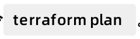

1. 运行命令 terraform plan  。

2. 查看terraform.tf文件中展示的计划创建资源信息。

**Terraform执行**

执行上一步terraform plan展示的资源创建计划。

操作步骤如下：


1. 输入命令 terraform apply 执行terraform.tf文件中的资源创建操作。

2. 输入 yes 确认执行计划中的操作。

3. 返回Apply complete!即代表资源创建成功。若不成功查看具体的报错信息，修改terraform.tf文件中的创建资源内容。

**Terraform查看结果**


运行 terraform show 查看已创建的资源详情。

**Terraform销毁**

当需要释放资源可通过terraform destroy销毁已创建的资源，请在Terraform资源销毁中查看操作步骤。

**重要**

当执行terraform apply操作时提示“用户无资源授权，或者该API不支持RAM”，请检查该产品是否开启了STS鉴权信任模式。


STS鉴权信任模式检查方式：

1. 通过super账号登录Apsara Uni-manager运营控制台（ASCM）。

2. 单击**配置** **> 鉴权信任模式**。

3. 产品被勾选则表示已开启了鉴权信任模式。

当STS鉴权信任模式开启后，执行操作请参考专有云Terraform Provider中使用STS调用方式使用说明。

<a id="section-4-39"></a>

## 4.39. 创建资源编排ROS

本章介绍如何使用专有云Terraform创建资源编排ROS的资源栈和自定义模板。

**操作步骤**

**编写Terraform的模板文件**

创建terraform.tf文件，编写要创建的资源语句。

```terraform
#环境配置
provider "alibabacloudstack" { 
  domain="asapi域名" 
  access_key="用户的ak" 
  secret_key="用户的sk" 
  region="地域" 
  proxy= "HTTP://环境代理" 
  protocol="HTTP" 
  insecure="true" 
  resource_group_set_name ="资源集名称" 
}

#创建ROS资源栈
resource "alibabacloudstack_ros_stack" "example" {
  stack_name        = "tf-testaccstack"
  template_body     = <<EOF
    {
       "ROSTemplateFormatVersion": "2015-09-01"
    }
    EOF
  stack_policy_body = <<EOF
    {
       "Statement": [{
          "Action": "Update:Delete",
          "Resource": "*",
          "Effect": "Allow",
          "Principal": "*"
       }]
    }
    EOF
}

#创建ROS自定义模版
resource "alibabacloudstack_ros_template" "example" {
  template_name = "example_value"
  template_body = <<EOF
    {
       "ROSTemplateFormatVersion": "2015-09-01"
    }
    EOF
```

参数说明：

<table>
  <tr>
    <td>参数</td>
    <td>含义</td>
    <td>获取方式</td>
  </tr>
  <tr>
    <td>domain</td>
    <td>asapi的域名</td>
    <td>1. 登录飞天基础运维控制台3.0。<br>2. 在左侧导航栏选择<strong>运维工具 &gt; 基</strong><strong>础数据管理</strong>。<br>3. 单击<strong>底座元数据管理</strong>模块中的<strong>服</strong><strong>务注册变量大盘 </strong>。<br>4. 在<strong>服务</strong>搜索栏中输入asapi，自动过滤出asapi服务。<br>5. 单击asapi服务对应的Service Registration内容，查看注册变量详情，获取asapi.gateway.endpoint的域名。<br>说明<br>如需登录飞天基础运维控制台1.0，可在左侧导航栏选择<strong>运维</strong><strong>工具 &gt; 基础数据管理</strong>，单击<strong>Tianji元数据管理</strong>模块中的<strong>飞</strong><strong>天基础运维控制台1.0</strong>。</td>
  </tr>
  <tr>
    <td>access_key</td>
    <td>用户的访问密钥</td>
    <td>1. 使用用户的账户名和密码登录Apsara Uni-manager运营控制台（ASCM）界面。<br>2. 单击主页右上角的云朵logo，单击个人信息。<br>3. 获取用户的AccessKey ID。</td>
  </tr>
  <tr>
    <td>secret_key</td>
    <td>用户的访问密钥Secret</td>
    <td>1. 使用用户的账户名和密码登录Apsara Uni-manager运营控制台（ASCM）界面。<br>2. 单击主页右上角的云朵logo，单击个人信息。<br>3. 获取用户的AccessKey Secret。</td>
  </tr>
  <tr>
    <td>region</td>
    <td>地域</td>
    <td>1. 登录Apsara Uni-manager运营控制台（ASCM）界面。<br>2. 单击<strong>企业 &gt; 地域管理</strong>。<br>3. 选择目标组织，获取地域信息。</td>
  </tr>
  <tr>
    <td>proxy</td>
    <td>访问环境的代理地址</td>
    <td>若访问环境不需要通过代理地址，则无需配置此参数。</td>
  </tr>
  <tr>
    <td>insecure</td>
    <td>不安全的https证书</td>
    <td>insecure="true"表示忽略不安全的https证书，取值范围（true、false）。</td>
  </tr>
  <tr>
    <td>resource_group_set_name</td>
    <td>资源集名称</td>
    <td>1. 查看资源名称，选择Apsara Uni-manager运营控制台（ASCM）控制台页面右上方的<strong>企</strong><strong>业</strong>。<br>2. 单击目标组织，获取该组织的资源集名称。</td>
  </tr>
  <tr>
    <td>stack_name</td>
    <td>资源栈名称</td>
    <td>长度不超过255个字符，可以由数字、字母、“-”、“_”组成。它必须以数字或字母开头。</td>
  </tr>
  <tr>
    <td>template_body</td>
    <td>模板主体</td>
    <td>模板正文长度为1 ~ 524,288字节。如果模板体的长度超过所需的长度，我们建议您在HTTP POST请求体中添加参数，以避免由于url长度过长而导致请求失败。</td>
  </tr>
  <tr>
    <td>stack_policy_body</td>
    <td>堆栈策略体</td>
    <td>堆叠策略体长度为1 ~ 16384字节。</td>
  </tr>
  <tr>
    <td>template_name</td>
    <td>模板的名称</td>
    <td>长度为2~255，以大小写字母开头，可包含大小写字母，数字、横线（-）、下划线（_）。</td>
  </tr>
</table>

**Terraform初始化**

在执行terraform.tf模板前，需要先将Terraform初始化。请在Terraform初始化中查看操作步骤。

**Terraform计划展示**

展示terraform.tf文件中计划创建的资源信息。

操作步骤如下：


1. 运行命令 terraform plan  。

2. 查看terraform.tf文件中展示的计划创建资源信息。

**Terraform执行**

执行上一步terraform plan展示的资源创建计划。

操作步骤如下：

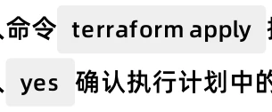

1. 输入命令 terraform apply 执行terraform.tf文件中的资源创建操作。

2. 输入 yes 确认执行计划中的操作。

3. 返回Apply complete!即代表资源创建成功。若不成功查看具体的报错信息，修改terraform.tf文件中的创建资源内容。

**Terraform查看结果**


运行 terraform show 查看已创建的资源详情。

**Terraform销毁**

当需要释放资源可通过terraform destroy销毁已创建的资源，请在Terraform资源销毁中查看操作步骤。

**重要**

当执行terraform apply操作时提示“用户无资源授权，或者该API不支持RAM”，请检查该产品是否开启了STS鉴权信任模式。


STS鉴权信任模式检查方式：

1. 通过super账号登录Apsara Uni-manager运营控制台（ASCM）。

2. 单击**配置** **> 鉴权信任模式**。

3. 产品被勾选则表示已开启了鉴权信任模式。

当STS鉴权信任模式开启后，执行操作请参考专有云Terraform Provider中使用STS调用方式使用说明。

<a id="section-4-40"></a>

## 4.40. 创建云数据库Redis实例

本章介绍如何使用专有云Terraform创建Redis数据库实例。

**操作步骤**

**编写Terraform的模板文件**

创建terraform.tf文件，编写要创建的资源语句。

```terraform
#环境配置
provider "alibabacloudstack" { 
  domain="asapi域名" 
  access_key="用户的ak" 
  secret_key="用户的sk" 
  region="地域" 
  proxy= "HTTP://环境代理" 
  protocol="HTTP" 
  insecure="true" 
  resource_group_set_name ="资源集名称" 
}

#创建Redis数据库实例
variable "creation" {
  default = "KVStore"
}
variable "name" {
  default = "kvstoreinstancevpc"
}
data "alibabacloudstack_zones" "default" {
  available_resource_creation = "${var.creation}"
}
resource "alibabacloudstack_vpc" "default" {
  name       = "${var.name}"
  cidr_block = "172.16.0.0/16"
}

resource "alibabacloudstack_vswitch" "default" {
  vpc_id            = "${alibabacloudstack_vpc.default.id}"
  cidr_block        = "172.16.0.0/24"
  availability_zone = "${data.alibabacloudstack_zones.default.zones.0.id}"
  name              = "${var.name}"
  }

resource "alibabacloudstack_kvstore_instance" "default" {
  instance_class = "redis.master.stand.default"
  instance_name  = "${var.name}"
  vswitch_id     = "${alibabacloudstack_vswitch.default.id}"
  private_ip     = "172.16.0.10"
  security_ips   = ["10.0.0.1"]
  instance_type  = "Redis"
}
```

参数说明：

<table>
  <tr>
    <td>参数</td>
    <td>含义</td>
    <td>获取方式</td>
  </tr>
  <tr>
    <td>domain</td>
    <td>asapi的域名</td>
    <td>1. 登录飞天基础运维控制台3.0。<br>2. 在左侧导航栏选择<strong>运维工具 &gt; 基</strong><strong>础数据管理</strong>。<br>3. 单击<strong>底座元数据管理</strong>模块中的<strong>服</strong><strong>务注册变量大盘 </strong>。<br>4. 在<strong>服务</strong>搜索栏中输入asapi，自动过滤出asapi服务。<br>5. 单击asapi服务对应的Service Registration内容，查看注册变量详情，获取asapi.gateway.endpoint的域名。<br>说明<br>如需登录飞天基础运维控制台1.0，可在左侧导航栏选择<strong>运维</strong><strong>工具 &gt; 基础数据管理</strong>，单击<strong>Tianji元数据管理</strong>模块中的<strong>飞</strong><strong>天基础运维控制台1.0</strong>。</td>
  </tr>
  <tr>
    <td>access_key</td>
    <td>用户的访问密钥</td>
    <td>1. 使用用户的账户名和密码登录Apsara Uni-manager运营控制台（ASCM）界面。<br>2. 单击主页右上角的云朵logo，单击个人信息。<br>3. 获取用户的AccessKey ID。</td>
  </tr>
  <tr>
    <td>secret_key</td>
    <td>用户的访问密钥Secret</td>
    <td>1. 使用用户的账户名和密码登录Apsara Uni-manager运营控制台（ASCM）界面。<br>2. 单击主页右上角的云朵logo，单击个人信息。<br>3. 获取用户的AccessKey Secret。</td>
  </tr>
  <tr>
    <td>region</td>
    <td>地域</td>
    <td>1. 登录Apsara Uni-manager运营控制台（ASCM）界面。<br>2. 单击<strong>企业 &gt; 地域管理</strong>。<br>3. 选择目标组织，获取地域信息。</td>
  </tr>
  <tr>
    <td>proxy</td>
    <td>访问环境的代理地址</td>
    <td>若访问环境不需要通过代理地址，则无需配置此参数。</td>
  </tr>
  <tr>
    <td>insecure</td>
    <td>不安全的https证书</td>
    <td>insecure="true"表示忽略不安全的https证书，取值范围（true、false）。</td>
  </tr>
  <tr>
    <td>resource_group_set_name</td>
    <td>资源集名称</td>
    <td>1. 查看资源名称，选择Apsara Uni-manager运营控制台（ASCM）控制台页面右上方的<strong>企</strong><strong>业</strong>。<br>2. 单击目标组织，获取该组织的资源集名称。</td>
  </tr>
  <tr>
    <td>instance_class</td>
    <td>实例规格</td>
    <td>可通过数据源alibabacloudstack_kvstore_inst ance_classes 检索</td>
  </tr>
  <tr>
    <td>instance_name</td>
    <td>实例的名称</td>
    <td>2-128个字符，以大小写字母或中文开头，只能包含字母数字、下划线和横杠。</td>
  </tr>
  <tr>
    <td>private_ip</td>
    <td>私有IP地址</td>
    <td>用户自定义，示例：172.16.0.***</td>
  </tr>
  <tr>
    <td>security_ips</td>
    <td>IP白名单</td>
    <td>IP白名单设置为0.0.0.0/0代表允许所有地址访问，设置为127.0.0.1代表禁止所有地址访问，多个IP设置，用英文逗号隔开。</td>
  </tr>
  <tr>
    <td>instance_type</td>
    <td>实例类型</td>
    <td>“Redis” 或 “Memcache ”默认为“Redis ”。</td>
  </tr>
</table>

**Terraform初始化**

在执行terraform.tf模板前，需要先将Terraform初始化。请在Terraform初始化中查看操作步骤。

**Terraform计划展示**

展示terraform.tf文件中计划创建的资源信息。

操作步骤如下：


1. 运行命令 terraform plan  。

2. 查看terraform.tf文件中展示的计划创建资源信息。

**Terraform执行**

执行上一步terraform plan展示的资源创建计划。

操作步骤如下：

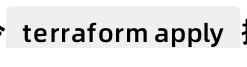

1. 输入命令 terraform apply 执行terraform.tf文件中的资源创建操作。

2. 输入 yes 确认执行计划中的操作。

3. 返回Apply complete!即代表资源创建成功。若不成功查看具体的报错信息，修改terraform.tf文件中的创建资源内容。

**Terraform查看结果**


运行 terraform show 查看已创建的资源详情。

**Terraform销毁**

当需要释放资源可通过terraform destroy销毁已创建的资源，请在Terraform资源销毁中查看操作步骤。

**重要**

当执行terraform apply操作时提示“用户无资源授权，或者该API不支持RAM”，请检查该产品是否开启了STS鉴权信任模式。


STS鉴权信任模式检查方式：

1. 通过super账号登录Apsara Uni-manager运营控制台（ASCM）。

2. 单击**配置** **> 鉴权信任模式**。

3. 产品被勾选则表示已开启了鉴权信任模式。

当STS鉴权信任模式开启后，执行操作请参考专有云Terraform Provider中使用STS调用方式使用说明。

<a id="section-4-41"></a>

## 4.41. 创建表格存储Tablestore

本章介绍如何使用专有云Terraform创建表格存储OTS实例、绑定VPC到OTS实例、OTS表格。

**操作步骤**

**编写Terraform的模板文件**

创建terraform.tf文件，编写要创建的资源语句。

```terraform
#环境配置
provider "alibabacloudstack" { 
  domain="asapi域名" 
  access_key="用户的ak" 
  secret_key="用户的sk" 
  region="地域" 
  proxy= "HTTP://环境代理" 
  protocol="HTTP" 
  insecure="true" 
  resource_group_set_name ="资源集名称" 
}

#创建OTS实例
resource "alibabacloudstack_ots_instance" "foo" {
  name        = "my-ots-instance"
  description = "for table"
  accessed_by = "Vpc"
  tags = {
    Created = "TF"
    For     = "Building table"
  }
}

#绑定VPC到OTS实例
resource "alibabacloudstack_ots_instance" "foo" {
  name        = "my-ots-instance"
  description = "for table"
  accessed_by = "Vpc"
  tags = {
    Created = "TF"
    For     = "Building table"
  }
}

data "alibabacloudstack_zones" "foo" {
  available_resource_creation = "VSwitch"
}

resource "alibabacloudstack_vpc" "foo" {
  cidr_block = "172.16.0.0/16"
  name       = "for-ots-instance"
}

resource "alibabacloudstack_vswitch" "foo" {
  vpc_id            = alibabacloudstack_vpc.foo.id
  vswitch_name      = "for-ots-instance"
  cidr_block        = "172.16.1.0/24"
  zone_id           = data.alibabacloudstack_zones.foo.zones[0].id
}

resource "alibabacloudstack_ots_instance_attachment" "foo" {
  instance_name = alibabacloudstack_ots_instance.foo.name
  vpc_name      = "attachment1"
  vswitch_id    = alibabacloudstack_vswitch.foo.id
}

#创建OTS表格
variable "name" {
  default = "terraformtest"
}

resource "alibabacloudstack_ots_instance" "foo" {
  name        = var.name
  description = var.name
  accessed_by = "Any"
  tags = {
    Created = "TF"
    For     = "acceptance test"
  }
}

resource "alibabacloudstack_ots_table" "basic" {
  instance_name = alibabacloudstack_ots_instance.foo.name
  table_name    = var.name
  primary_key {
    name = "pk1"
    type = "Integer"
  }
  primary_key {
    name = "pk2"
    type = "String"
  }
  primary_key {
    name = "pk3"
    type = "Binary"
  }

  time_to_live                  = -1
  max_version                   = 1
  deviation_cell_version_in_sec = 1
}
```

参数说明：

<table>
  <tr>
    <td>参数</td>
    <td>含义</td>
    <td>获取方式</td>
  </tr>
</table>

<table>
  <tr>
    <td>domain</td>
    <td>asapi的域名</td>
    <td>1. 登录飞天基础运维控制台3.0。<br>2. 在左侧导航栏选择<strong>运维工具 &gt; 基</strong><strong>础数据管理</strong>。<br>3. 单击<strong>底座元数据管理</strong>模块中的<strong>服</strong><strong>务注册变量大盘 </strong>。<br>4. 在<strong>服务</strong>搜索栏中输入asapi，自动过滤出asapi服务。<br>5. 单击asapi服务对应的Service Registration内容，查看注册变量详情，获取asapi.gateway.endpoint的域名。<br>说明<br>如需登录飞天基础运维控制台1.0，可在左侧导航栏选择<strong>运维</strong><strong>工具 &gt; 基础数据管理</strong>，单击<strong>Tianji元数据管理</strong>模块中的<strong>飞</strong><strong>天基础运维控制台1.0</strong>。</td>
  </tr>
  <tr>
    <td>access_key</td>
    <td>用户的访问密钥</td>
    <td>1. 使用用户的账户名和密码登录Apsara Uni-manager运营控制台（ASCM）界面。<br>2. 单击主页右上角的云朵logo，单击个人信息。<br>3. 获取用户的AccessKey ID。</td>
  </tr>
  <tr>
    <td>secret_key</td>
    <td>用户的访问密钥Secret</td>
    <td>1. 使用用户的账户名和密码登录Apsara Uni-manager运营控制台（ASCM）界面。<br>2. 单击主页右上角的云朵logo，单击个人信息。<br>3. 获取用户的AccessKey Secret。</td>
  </tr>
  <tr>
    <td>region</td>
    <td>地域</td>
    <td>1. 登录Apsara Uni-manager运营控制台（ASCM）界面。<br>2. 单击<strong>企业 &gt; 地域管理</strong>。<br>3. 选择目标组织，获取地域信息。</td>
  </tr>
  <tr>
    <td>proxy</td>
    <td>访问环境的代理地址</td>
    <td>若访问环境不需要通过代理地址，则无需配置此参数。</td>
  </tr>
  <tr>
    <td>insecure</td>
    <td>不安全的https证书</td>
    <td>insecure="true"表示忽略不安全的https证书，取值范围（true、false）。</td>
  </tr>
  <tr>
    <td>resource_group_set_name</td>
    <td>资源集名称</td>
    <td>1. 查看资源名称，选择Apsara Uni-manager运营控制台（ASCM）控制台页面右上方的<strong>企</strong><strong>业</strong>。<br>2. 单击目标组织，获取该组织的资源集名称。</td>
  </tr>
  <tr>
    <td>name</td>
    <td>OTS实例名称</td>
    <td>3-16个字符，以大小写字母开头，不能以任意大小写的"ali"或"ots"开头，只能包含字母、数字和短横线（-）。</td>
  </tr>
  <tr>
    <td>description</td>
    <td>实例的描述</td>
    <td>0-256个字符。</td>
  </tr>
  <tr>
    <td>accessed_by</td>
    <td>访问实例的网络限制</td>
    <td>取值如下：<br>Any：允许所有网络访问该实例<br>Vpc：只有绑定的VPC才允许访问该实例。<br>ConsoleOrVpc：允许web控制台或绑定的VPC访问实例。</td>
  </tr>
  <tr>
    <td>tags</td>
    <td>实例标记</td>
    <td>用户自定义</td>
  </tr>
  <tr>
    <td>vpc_name</td>
    <td>专有网络VPC名称</td>
    <td>用户自定义的名称。<br>1. 查看VPC名称，选择Apsara Uni-manager运营控制台（ASCM）顶部菜单栏上的<strong>产品 &gt;</strong><strong>专有网络VPC</strong>，获取VPC名称。</td>
  </tr>
  <tr>
    <td>vswitch_id</td>
    <td>交换机实例ID</td>
    <td>1. 查看交换机ID，选择Apsara Uni-manager运营控制台（ASCM）顶部菜单栏上的<strong>产品 &gt;</strong><strong>专有网络VPC</strong>。<br>2. 单击左侧导航栏中的<strong>交换机</strong>，获取交换机ID信息。</td>
  </tr>
  <tr>
    <td>table_name</td>
    <td>OTS实例的表名</td>
    <td>1. 只能包含字母，数字和下划线（_）<br>2. 必须以字母或下划线（_）开头<br>长度限制在1-255个字符之间</td>
  </tr>
  <tr>
    <td>primary_key</td>
    <td>表主键</td>
    <td>表主键最多4个。<br>1.只能包含字母，数字和下划线（_）<br>2.必须以字母或下划线（_）开头<br>长度限制在1-255个字符之间<br>4.表主键一旦创建不能修改</td>
  </tr>
  <tr>
    <td>primary_key（type）</td>
    <td>主键的类型</td>
    <td>只允许"整数”，“字符串”或“二进制”。</td>
  </tr>
  <tr>
    <td>time_to_live</td>
    <td>数据生命周期</td>
    <td>数据生命周期最低为86400秒（一天）或者-1（永不过期），单位为秒。</td>
  </tr>
  <tr>
    <td>max_version</td>
    <td>最大版本数</td>
    <td>数据版本需要为非0值。</td>
  </tr>
  <tr>
    <td>deviation_cell_version_in_sec</td>
    <td>数据有效版本偏差</td>
    <td>有效值为1 ~ 9223372036854775807。默认值为86400</td>
  </tr>
</table>

**Terraform初始化**

在执行terraform.tf模板前，需要先将Terraform初始化。请在Terraform初始化中查看操作步骤。

**Terraform计划展示**

展示terraform.tf文件中计划创建的资源信息。

操作步骤如下：


1. 运行命令 terraform plan  。

2. 查看terraform.tf文件中展示的计划创建资源信息。

**Terraform执行**

执行上一步terraform plan展示的资源创建计划。

操作步骤如下：


1. 输入命令 terraform apply 执行terraform.tf文件中的资源创建操作。

2. 输入 yes 确认执行计划中的操作。

3. 返回Apply complete!即代表资源创建成功。若不成功查看具体的报错信息，修改terraform.tf文件中的创建资源内容。

**Terraform查看结果**


运行 terraform show 查看已创建的资源详情。

**Terraform销毁**

当需要释放资源可通过terraform destroy销毁已创建的资源，请在Terraform资源销毁中查看操作步骤。

**重要**

当执行terraform apply操作时提示“用户无资源授权，或者该API不支持RAM”，请检查该产品是否开启了STS鉴权信任模式。


STS鉴权信任模式检查方式：

1. 通过super账号登录Apsara Uni-manager运营控制台（ASCM）。

2. 单击**配置** **> 鉴权信任模式**。

3. 产品被勾选则表示已开启了鉴权信任模式。

当STS鉴权信任模式开启后，执行操作请参考专有云Terraform Provider中使用STS调用方式使用说明。

<a id="section-4-42"></a>

## 4.42. 创建VPN网关

本章介绍如何使用专有云Terraform创建VPN网关和用户网关。

**操作步骤**

**编写Terraform的模板文件**

创建terraform.tf文件，编写要创建的资源语句。

```terraform
#环境配置
provider "alibabacloudstack" { 
  domain="asapi域名" 
  access_key="用户的ak" 
  secret_key="用户的sk" 
  region="地域" 
  proxy= "HTTP://环境代理" 
  protocol="HTTP" 
  insecure="true" 
  resource_group_set_name ="资源集名称" 
}

#创建VPC
resource "alibabacloudstack_vpc" "vpc" {
  name       = "tf_test_foo"
  cidr_block = "172.16.0.0/12"
}

#创建交换机
resource "alibabacloudstack_vswitch" "vsw" {
  vpc_id            = alibabacloudstack_vpc.vpc.id
  cidr_block        = "172.16.0.0/21"
  availability_zone = "cn-wulan-env180-amtest180001-a"
}

#创建VPN网关
resource "alibabacloudstack_vpn_gateway" "foo" {
  name                 = "vpnGatewayConfig"
  vpc_id               = alibabacloudstack_vpc.vpc.id
  bandwidth            = "10"
  enable_ssl           = true
  instance_charge_type = "PostPaid"
  description          = "test_create_description"
  vswitch_id           = alibabacloudstack_vswitch.vsw.id
}

#创建用户网关
resource "alibabacloudstack_vpn_customer_gateway" "foo" {
  name        = "vpnCgwNameExample"
  ip_address  = "43.104.22.228"
  description = "vpnCgwDescriptionExample"
}
```

参数说明：

<table>
  <tr>
    <td>参数</td>
    <td>含义</td>
    <td>获取方式</td>
  </tr>
  <tr>
    <td>domain</td>
    <td>asapi的域名</td>
    <td>1. 登录飞天基础运维控制台3.0。<br>2. 在左侧导航栏选择<strong>运维工具 &gt; 基</strong><strong>础数据管理</strong>。<br>3. 单击<strong>底座元数据管理</strong>模块中的<strong>服</strong><strong>务注册变量大盘 </strong>。<br>4. 在<strong>服务</strong>搜索栏中输入asapi，自动过滤出asapi服务。<br>5. 单击asapi服务对应的Service Registration内容，查看注册变量详情，获取asapi.gateway.endpoint的域名。<br>说明<br>如需登录飞天基础运维控制台1.0，可在左侧导航栏选择<strong>运维</strong><strong>工具 &gt; 基础数据管理</strong>，单击<strong>Tianji元数据管理</strong>模块中的<strong>飞</strong><strong>天基础运维控制台1.0</strong>。</td>
  </tr>
  <tr>
    <td>access_key</td>
    <td>用户的访问密钥</td>
    <td>1. 使用用户的账户名和密码登录Apsara Uni-manager运营控制台（ASCM）界面。<br>2. 单击主页右上角的云朵logo，单击个人信息。<br>3. 获取用户的AccessKey ID。</td>
  </tr>
  <tr>
    <td>secret_key</td>
    <td>用户的访问密钥Secret</td>
    <td>1. 使用用户的账户名和密码登录Apsara Uni-manager运营控制台（ASCM）界面。<br>2. 单击主页右上角的云朵logo，单击个人信息。<br>3. 获取用户的AccessKey Secret。</td>
  </tr>
  <tr>
    <td>region</td>
    <td>地域</td>
    <td>1. 登录Apsara Uni-manager运营控制台（ASCM）界面。<br>2. 单击<strong>企业 &gt; 地域管理</strong>。<br>3. 选择目标组织，获取地域信息。</td>
  </tr>
  <tr>
    <td>proxy</td>
    <td>访问环境的代理地址</td>
    <td>若访问环境不需要通过代理地址，则无需配置此参数。</td>
  </tr>
  <tr>
    <td>insecure</td>
    <td>不安全的https证书</td>
    <td>insecure="true"表示忽略不安全的https证书，取值范围（true、false）。</td>
  </tr>
  <tr>
    <td>resource_group_set_name</td>
    <td>资源集名称</td>
    <td>1. 查看资源名称，选择Apsara Uni-manager运营控制台（ASCM）控制台页面右上方的<strong>企</strong><strong>业</strong>。<br>2. 单击目标组织，获取该组织的资源集名称。</td>
  </tr>
  <tr>
    <td>name</td>
    <td>VPN网关名称</td>
    <td>2-100个字符，以字母或中文开头，支持数字和"_"、"-"特殊字符，不能以http:// 或https://开头。</td>
  </tr>
  <tr>
    <td>instance_charge_type</td>
    <td>实例付费模式</td>
    <td>有效值为PostPaid、PrePaid，<br>默认为PostPaid。</td>
  </tr>
  <tr>
    <td>bandwidth</td>
    <td>带宽规格</td>
    <td>取值：5，10，20，50，100</td>
  </tr>
  <tr>
    <td>enable_ssl</td>
    <td>启用/禁用SSL VPN</td>
    <td>取值：<br>true：开启SSL-VPN功能。<br>false（默认值）：不开启SSL-VPN功能。</td>
  </tr>
  <tr>
    <td>ip_address</td>
    <td>用户网关IP地址</td>
    <td>用户自定义</td>
  </tr>
</table>

**Terraform初始化**

在执行terraform.tf模板前，需要先将Terraform初始化。请在Terraform初始化中查看操作步骤。

**Terraform计划展示**

展示terraform.tf文件中计划创建的资源信息。

操作步骤如下：


1. 运行命令 terraform plan  。

2. 查看terraform.tf文件中展示的计划创建资源信息。

**Terraform执行**

执行上一步terraform plan展示的资源创建计划。

操作步骤如下：

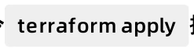

1. 输入命令 terraform apply 执行terraform.tf文件中的资源创建操作。

2. 输入 yes 确认执行计划中的操作。

3. 返回Apply complete!即代表资源创建成功。若不成功查看具体的报错信息，修改terraform.tf文件中的创建资源内容。

**Terraform查看结果**


运行 terraform show 查看已创建的资源详情。

**Terraform销毁**

当需要释放资源可通过terraform destroy销毁已创建的资源，请在Terraform资源销毁中查看操作步骤。

**重要**

当执行terraform apply操作时提示“用户无资源授权，或者该API不支持RAM”，请检查该产品是否开启了STS鉴权信任模式。


STS鉴权信任模式检查方式：

1. 通过super账号登录Apsara Uni-manager运营控制台（ASCM）。

2. 单击**配置** **> 鉴权信任模式**。

3. 产品被勾选则表示已开启了鉴权信任模式。

当STS鉴权信任模式开启后，执行操作请参考专有云Terraform Provider中使用STS调用方式使用说明。
