阿里云  
专有云  
智能体工厂 OpenTrek  
AI Studio 运维指南  
产品版本：V3.18.6  
文档版本：20260528

**目录**

- [1.概述](#section-1)
- [2.软件架构](#section-2)
- [3.日志说明](#section-3)
- [4.AI Studio OPS运维平台](#section-4)
    - [4.1. 登录AI Studio OPS](#section-4-1)
    - [4.2. 检查资源可用性](#section-4-2)
        - [4.2.1. 检查资源池可用性](#section-4-2-1)
        - [4.2.2. 检查资源组可用性](#section-4-2-2)
    - [4.3. 工具箱](#section-4-3)
        - [4.3.1. Kubectl](#section-4-3-1)
        - [4.3.2. 录入芯片型号](#section-4-3-2)
        - [4.3.3. 编辑特性](#section-4-3-3)
        - [4.3.4. 导入资产](#section-4-3-4)
    - [4.4. 系统设置](#section-4-4)
- [5.常见问题处理](#section-5)
    - [5.1. 通性常见问题排查](#section-5-1)
        - [5.1.1. 控制台操作请求后端服务超时](#section-5-1-1)
        - [5.1.2. 控制台操作提示无权限](#section-5-1-2)
        - [5.1.3. 控制台创建任务时无数据](#section-5-1-3)
        - [5.1.4. 控制台显示任务长时间保持启动中](#section-5-1-4)
        - [5.1.5. 控制台显示任务运行失败](#section-5-1-5)
        - [5.1.6. 常见异常事件及解决方案](#section-5-1-6)
        - [5.1.7. 容器集群日志查询](#section-5-1-7)
        - [5.1.8. 管控侧日志查询](#section-5-1-8)
        - [5.1.9. 使用免密组件拉取私有容器镜像](#section-5-1-9)
        - [5.1.10. 算力集群中任务状态长时间维持启动中](#section-5-1-10)
    - [5.2. 数据管理常见问题排查](#section-5-2)
        - [5.2.1. 数据集常见问题排查](#section-5-2-1)
        - [5.2.2. 数据标注常见问题排查](#section-5-2-2)
            - [5.2.2.1. 提示无管理员/标注员/验收员权限](#section-5-2-2-1)
            - [5.2.2.2. 任务初始化失败或长期在初始化中](#section-5-2-2-2)
            - [5.2.2.3. 自动标注结果为空](#section-5-2-2-3)
        - [5.2.3. 数据生成常见问题排查](#section-5-2-3)
    - [5.3. 模型训练常见问题排查](#section-5-3)
        - [5.3.1. Notebook建模常见问题排查](#section-5-3-1)
        - [5.3.2. 任务建模常见问题排查](#section-5-3-2)
        - [5.3.3. Tensorboard常见问题排查](#section-5-3-3)
        - [5.3.4. 可视化建模常见问题排查](#section-5-3-4)
    - [5.4. 模型服务常见问题排查](#section-5-4)
        - [5.4.1. 在线服务常见问题排查](#section-5-4-1)
        - [5.4.2. 灰度群组常见问题排查](#section-5-4-2)
        - [5.4.3. 批量推理常见问题排查](#section-5-4-3)
    - [5.5. 模型管理常见问题排查](#section-5-5)
        - [5.5.1. 模型广场常见问题排查](#section-5-5-1)
        - [5.5.2. 模型调优常见问题排查](#section-5-5-2)
        - [5.5.3. 模型评测常见问题排查](#section-5-5-3)
        - [5.5.4. 模型评测告警问题排查](#section-5-5-4)
    - [5.6. AI资源管理常见问题排查](#section-5-6)
        - [5.6.1. AI资源池常见问题排查](#section-5-6-1)
        - [5.6.2. 资源组常见问题排查](#section-5-6-2)
    - [5.7. AI资产管理常见问题排查](#section-5-7)
        - [5.7.1. 镜像库常见问题排查](#section-5-7-1)
        - [5.7.2. 软件源常见问题排查](#section-5-7-2)
        - [5.7.3. 数据加速器常见问题排查链路](#section-5-7-3)
        - [5.7.4. 镜像加速常见问题排查](#section-5-7-4)
    - [5.8. 系统配置常见问题排查](#section-5-8)
        - [5.8.1. 资源同步常见问题排查](#section-5-8-1)
- [6.指标详情](#section-6)
    - [6.1. 监控指标](#section-6-1)
        - [6.1.1. 任务监控指标](#section-6-1-1)
        - [6.1.2. 容器组监控指标](#section-6-1-2)
        - [6.1.3. 网关监控指标](#section-6-1-3)

<a id="section-1"></a>

# 1.概述

本文介绍AI Studio运维的目的、要求、注意事项、以及寻求帮助的方式。

**目的**

本手册指导维护人员对AI Studio进行预防性地维护，确保系统长期稳定运行。维护人员可以根据本手册的指导，处理维护过程中发现的系统问题。如果根据本手册无法解决系统问题，请寻求阿里云工程师的技术支持。

**要求**

- 维护人员必须拥有IT行业技能，包括计算机网络知识、计算机操作知识、问题分析排查能力。

- 维护人员必须经过阿里云系统岗前培训，学习必要的阿里云系统知识，包括但不限于系统原理、组网、特性使用和维护工具的使用。

> **重要**
>
> 在维护操作过程中，维护人员务必遵守操作规章，确保人身安全和系统安全。对用户数据严格保密，未经用户书面许可，禁止复制、传播用户数据。

**注意事项**

为了系统的稳定运行，避免意外事故的发生，维护人员需遵循以下事项：

- 分层分权管理：

  对网络、设备、系统、数据实行分层分权管理，相应业务的维护人员仅拥有完成自身角色任务相对应的权限，防止越权操作而引起系统故障。

- 系统安全：

  - 在对系统进行任何操作前，需清楚地了解操作的结果，避免危险操作影响系统运行。

  - 在操作过程中遇到的问题，需清楚记录以便问题排查和故障处理。

- 人身和数据安全：

  - 操作电气设备时，必须根据设备要求做好安全措施。

  - 需使用安全的设备接入业务网络。

  - 未经授权，严禁对数据进行复制和传播。

**寻求帮助**

维护人员在系统维护过程中，需要相关帮助，可以联系阿里云技术支持获取帮助。

<a id="section-2"></a>

# 2.软件架构

本文介绍AI Studio的系统架构，及其核心功能模块和服务依赖。

AI Studio的系统架构如下图所示，架构上分为三层，外加存储相关的服务依赖。

**系统架构**

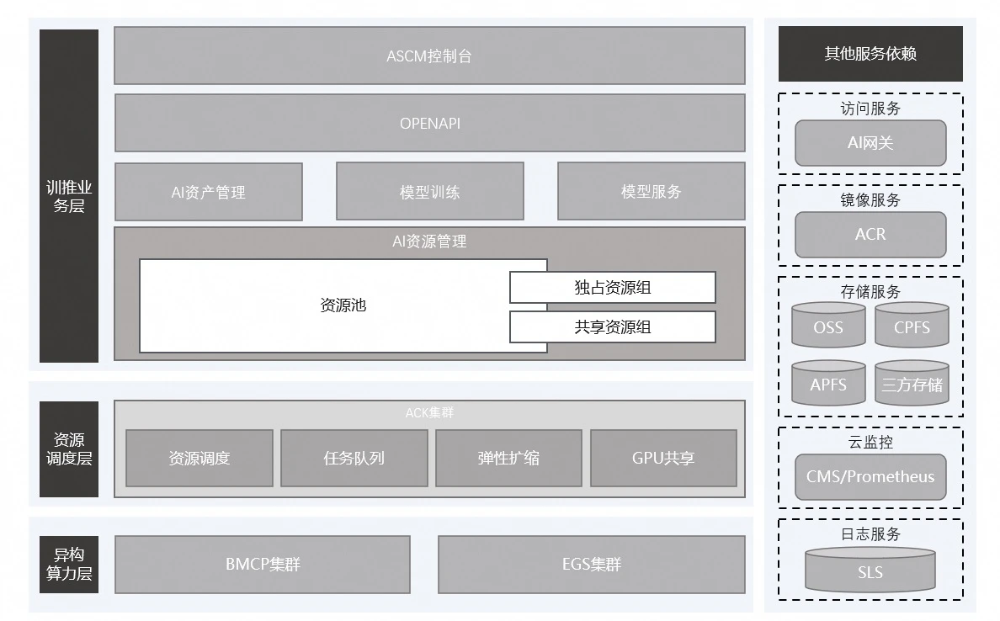

**AI管理层**

- Apsara Uni-manager运营控制台提供访问入口，向下调用接入POP网关的AI Studio OPENAPI，用户也可直接调用OPENAPI。

- AI Studio接入企业版的访问鉴权体系，包括AK/SK校验，RAM角色和权限的校验。

- AI资产管理模块，负责镜像、模型、代码、数据加速器的管理，提供导入、编辑、删除等功能。

- AI资源管理模块通过调用BMCP获取到容器集群，并且作为资源池纳入到AI管理平台中。资源组为用户提供资源分配能力，实现训练及推理任务的资源消耗配置管理，提高资源使用效率。

- 数据管理模块，支持数据集的创建、编辑和删除等管理操作，数据集支持来自CPFS和OSS的两类存储源。

- 模型管理模块，核心是围绕模型进行操作，包括模型库管理、模型训练和模型推理。

**资源调度层**

- 资源调度层依托ACK服务，向上为AI管理平台提供AI任务调度、任务队列相关的能力，向下纳管GPU裸金属节点等。

- 资源调度层的ACK服务，提供OPENAPI给AI管理平台、BMCP调用；同时AI管理平台会在得到授权后调用ACK集群里面ApiServer下发任务和查询状态，创建pod、job、ingress等资源。

- 资源调度层提供日志采集，需要授权使用租户的SLS服务。

**异构算力层**

- 异构算力层统一纳管多种异构的裸金属集群，AI Studio使用BMCP提供的裸金属类型的容器集群。

- 不同租户之间的容器集群隔离。

- BCMP提供OPENAPI给AI管理层调用，进行信息查询和打标等操作。

**外部产品依赖**

<table>
  <tr>
    <td>依赖产品</td>
    <td>使用场景</td>
  </tr>
  <tr>
    <td>BMCP</td>
    <td>提供裸金属管理，ACK集群管理以及CPFS相关的关联查询接口</td>
  </tr>
  <tr>
    <td>ACK</td>
    <td>提供容器集群服务</td>
  </tr>
  <tr>
    <td>ACR</td>
    <td>提供镜像服务，存储用户自定义镜像和公共镜像</td>
  </tr>
  <tr>
    <td>SLS</td>
    <td>用于运行Pod的日志存储</td>
  </tr>
  <tr>
    <td>OSS</td>
    <td>存储数据集、模型等数据</td>
  </tr>
  <tr>
    <td>CPFS</td>
    <td>存储数据集</td>
  </tr>
  <tr>
    <td>RAM</td>
    <td>提供鉴权服务</td>
  </tr>
  <tr>
    <td>POP</td>
    <td>OPENAPI统一网关接入</td>
  </tr>
  <tr>
    <td>Apsara Uni-manager运营控制台</td>
    <td>统一控制台</td>
  </tr>
  <tr>
    <td>MiniRDS</td>
    <td>存储元数据</td>
  </tr>
</table>

<a id="section-3"></a>

# 3.日志说明

AI Studio产品中包含了多个服务组件，各组件日志说明如下表所示：

<table>
  <tr>
    <th>产品（Product）</th>
    <th>特性（Feature）</th>
    <th>模块（Chart）</th>
    <th>说明</th>
  </tr>
  <tr>
    <td rowspan="4">AI Studio</td>
    <td rowspan="4">platform</td>
    <td>dataset-hub</td>
    <td>数据管理模块<br>• 负责数据集的管理<br>• 采集数据集的访问和错误日志</td>
  </tr>
  <tr>
    <td>model-center</td>
    <td>模型服务模块<br>• 负责模型的管理，任务的构建<br>• 采集模型库的访问和错误日志以及任务下发相关日志</td>
  </tr>
  <tr>
    <td>resource-asset</td>
    <td>AI资源资产管理模块<br>• 负责资源池、资源配额、镜像和代码的管理<br>• 采集资源池、资源配额、镜像库、代码集的访问和错误日志</td>
  </tr>
  <tr>
    <td>gateway</td>
    <td>Gateway模块<br>• 负责AI Studio平台与集群的交互<br>• 采集Gateway访问和错误日志以及任务状态变更日志</td>
  </tr>
</table>

<a id="section-4"></a>

# 4.AI Studio OPS运维平台

<a id="section-4-1"></a>

## 4.1. 登录AI Studio OPS

本章节介绍如何在统一运维平台登录到AI Studio OPS。

**前提条件**

- 已从部署人员或管理员处获取Apsara Uni-manager运维控制台的访问地址、用户名和密码。

  Apsara Uni-manager运维控制台访问地址格式为*region-id*.ops.console.*intranet-domain-id*。

- 推荐使用Chrome浏览器。

**操作步骤**

1. 登录Apsara Uni-manager运维控制台。

   <ol type="i">

   <li>

   打开浏览器。

   </li>

   <li>

   在地址栏中，输入Apsara Uni-manager运维控制台的访问地址，按回车键。

   

   > **说明**
   >
   > 您可以单击右上角的当前语言切换其它语言。当前支持简体中文、English语言切换。

   </li>

   <li>

   输入正确的用户名及密码。

   > **说明**
   >
   > - 登录Apsara Uni-manager运维控制台的用户名和密码请从部署人员或管理员处获取。
   >
   > - 若连续输入密码错误三次，系统将启动图片验证码登录功能；若连续输入错误五次，账户将被锁定，请联系管理员进行激活。
   >
   > - 首次登录Apsara Uni-manager运维控制台时，需要修改登录用户名的密码，请按照提示完成密码修改。
   >
   >   为提高安全性，密码必须满足以下要求：
   >
   >   - 必须包含英文大小写字母。
   >
   >   - 必须包含阿拉伯数字（0~9）。
   >
   >   - 必须包含特殊符号，包括感叹号（!）、at（@）、井号（#）、美元符号（$）、百分号（%）等。
   >
   >   - 密码长度为10~20个字符。

   </li>

   <li>

   单击**同意协议并登录**。

   </li>

   </ol>

2. 在Apsara Uni-manager运维控制台的顶部菜单栏，选择**产品运维 > 人工智能与机器学习 > AI Studio OPS**。

<a id="section-4-2"></a>

## 4.2. 检查资源可用性

<a id="section-4-2-1"></a>

### 4.2.1. 检查资源池可用性

本章节介绍检查AI资源池的可用性以及添加特性等操作。

**操作步骤**

1. 登录AI Studio OPS控制台，参见登录AI Studio OPS。

2. 在左侧导航栏中选择**资源可用性检查 > 资源池**。

   页面展示所有资源池的健康状态和最后检测时间。

3. 单击操作列**详情**。

4. 查看该资源池的基本信息和资源池所包含的特性。

   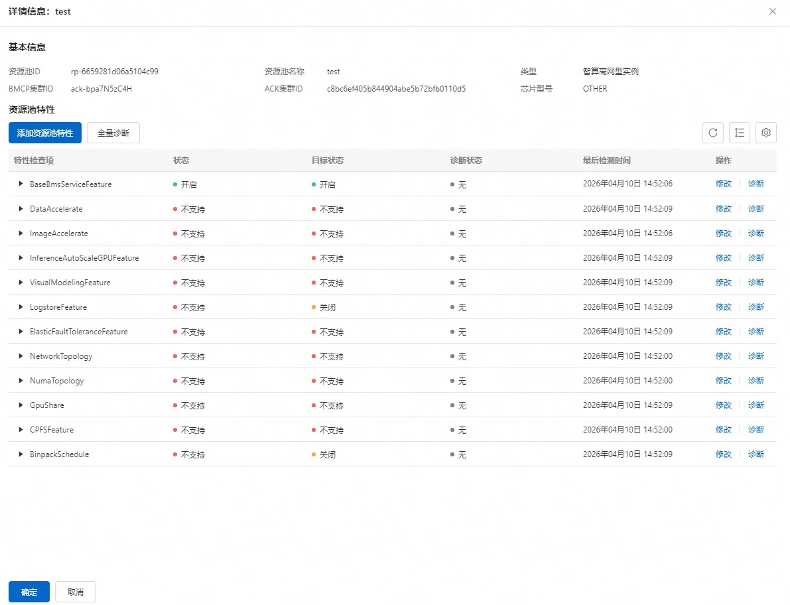

5. 单击**添加资源池特性**，选择特性后单击**确定**。

6. 单击检查项操作列**修改**。

7. 选择基础特性状态后单击**确定**。

   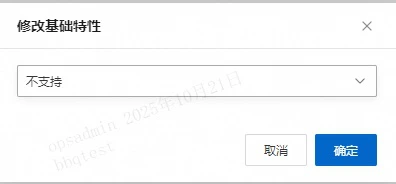

**诊断特性**

支持在详情页面执行以下操作。

<table>
  <tr>
    <th width="138">任务名称</th>
    <th>操作步骤</th>
  </tr>
  <tr>
    <td>诊断特性检查项</td>
    <td>• 全量诊断<br>i. 单击<strong>全量诊断</strong>。ii. 在弹出的提示框上单击<strong>确定</strong>。iii. 诊断完成后所有检查项都可以查看诊断状态和诊断报告。iv. 单击<strong>查看诊断报告</strong>，将诊断报告下载至本地查看。<br>• 单个诊断<br>i. 单击操作列<strong>诊断</strong>。ii. 在弹出的提示框上单击<strong>确定</strong>。iii. 诊断完成后每个检查项可以查看诊断状态和诊断报告。iv. 单击<strong>查看诊断报告</strong>，将诊断报告下载至本地查看。</td>
  </tr>
</table>

<a id="section-4-2-2"></a>

### 4.2.2. 检查资源组可用性

本章节介绍检查资源组的可用性以及添加特性等操作。

**操作步骤**

1. 登录AI Studio OPS控制台，参见登录AI Studio OPS。

2. 在左侧导航栏中选择**资源可用性检查 > 资源组**。

   页面展示所有资源组的健康状态和最后检测时间。

3. 单击操作列**详情**。

4. 查看该资源组的基本信息和资源组所包含的特性。

   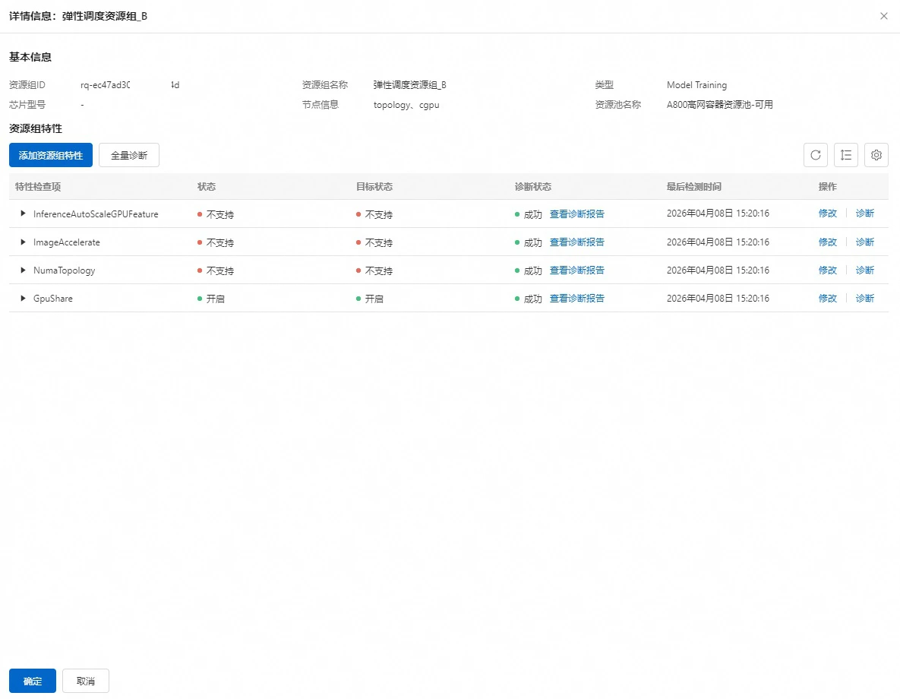

5. 单击**添加资源组特性**，选择特性后单击**确定**。

6. 单击检查项操作列**修改**。

7. 选择基础特性状态后单击**确定**。

   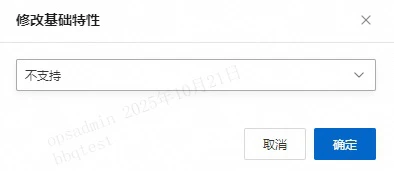

**相关操作**

支持在详情页面执行以下操作。

<table>
  <tr>
    <th width="138">任务名称</th>
    <th>操作步骤</th>
  </tr>
  <tr>
    <td>诊断特性检查项</td>
    <td>• 全量诊断<br>i. 单击<strong>全量诊断</strong>。ii. 在弹出的提示框上单击<strong>确定</strong>。iii. 诊断完成后所有检查项都可以查看诊断状态和诊断报告。iv. 单击<strong>查看诊断报告</strong>，将诊断报告下载至本地查看。<br>• 单个诊断<br>i. 单击操作列<strong>诊断</strong>。ii. 在弹出的提示框上单击<strong>确定</strong>。iii. 诊断完成后每个检查项可以查看诊断状态和诊断报告。iv. 单击<strong>查看诊断报告</strong>，将诊断报告下载至本地查看。</td>
  </tr>
  <tr>
    <td>修改特性</td>
    <td>1. 单击操作列<strong>修改</strong>。<br>2. 重新选择基础状态特性。<br>3. 单击<strong>确定</strong>。</td>
  </tr>
</table>

<a id="section-4-3"></a>

## 4.3. 工具箱

<a id="section-4-3-1"></a>

### 4.3.1. Kubectl

本章节介绍如何用命令查询资源池内的pod。

**操作步骤**

1. 登录AI Studio OPS控制台，参见登录AI Studio OPS。

2. 在左侧导航栏中选择**工具箱 > Kubectl**。

3. 选择资源池，在输入框中输入查询命令。

   当前支持get/describe命令。

   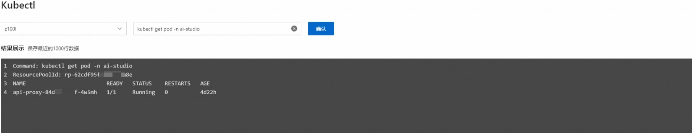

4. 单击**确认**。

<a id="section-4-3-2"></a>

### 4.3.2. 录入芯片型号

本章节介绍如何手工录入芯片型号。

> **重要**
>
> 系统将预置已支持的芯片型号，该功能用于手动录入部分芯片型号。

**操作步骤**

1. 登录AI Studio OPS控制台，参见登录AI Studio OPS。

2. 在左侧导航栏中选择**工具箱 > 芯片型号录入**。

   会展示目前系统所有的芯片型号。

3. 单击**添加芯片型号**。

   <table>
     <tr>
       <th>配置项</th>
       <th>参数名称</th>
       <th>参数说明</th>
     </tr>
     <tr>
       <td rowspan="8">添加芯片</td>
       <td>GPU厂商的英文名</td>
       <td>表示GPU芯片厂商的英文名，例如：alibaba。</td>
     </tr>
     <tr>
       <td>GPU厂商的中文名</td>
       <td>表示GPU芯片厂商的英文名，例如：阿里巴巴。</td>
     </tr>
     <tr>
       <td>GPU类型</td>
       <td>表示GPU芯片的类型。<br>• BMCP_GPU<br>• EGS_GPU<br>• AI Stack GPU</td>
     </tr>
     <tr>
       <td>GPU型号</td>
       <td>表示GPU的型号，例如：810e。</td>
     </tr>
     <tr>
       <td>芯片别名</td>
       <td>表示添加芯片的别名，例如：AI Stack。</td>
     </tr>
     <tr>
       <td>GPU架构</td>
       <td>表示GPU芯片所使用的架构，例如：X86。</td>
     </tr>
     <tr>
       <td>GPU显存(单位GB)</td>
       <td>表示GPU的显存大小。</td>
     </tr>
     <tr>
       <td>资源名称</td>
       <td>请下拉选择该芯片所属的资源名称。</td>
     </tr>
     <tr>
       <td rowspan="3">特性配置<br>说明单击<strong>添加条</strong><strong>目</strong>可为添加的芯片配置特性。</td>
       <td>集群类型</td>
       <td>下拉选择特性所属的集群类型。</td>
     </tr>
     <tr>
       <td>资源池特性配置</td>
       <td>• 根据界面配置资源池的特性是开启、不支持或关闭。<br>• 鼠标悬浮至特性旁边即可查看特性的意义。</td>
     </tr>
     <tr>
       <td>资源组特性配置</td>
       <td>• 根据界面配置资源组的特性是开启、不支持或关闭。<br>• 鼠标悬浮至特性旁边即可查看特性的意义。</td>
     </tr>
   </table>

4. 单击**确定**。

   添加成功后会同步至AI Studio运营控制台，创建资源池时可选择该芯片型号。

**相关操作**

芯片类型录入成功后，您还可以执行以下操作。

> **说明**
>
> 预置芯片型号不支持删除操作。

| 任务名称 | 操作步骤 |
| --- | --- |
| 增加特性 | 单击操作列增加特性，参考上述步骤中特性配置进行配置即可。 |
| 编辑芯片类型 | 1. 单击操作列<strong>编辑</strong>。<br>2. 修改芯片厂商中英文名后，单击<strong>确定</strong>。 |
| 删除芯片类型 | 1. 单击操作列<strong>删除</strong>。<br>2. 在弹出的提示框上单击<strong>确定</strong>。 |

<a id="section-4-3-3"></a>

### 4.3.3. 编辑特性

本章节介绍如何编辑手工录入的特性。

**前提条件**

已提前录入所需的芯片型号并增加特新，请参见录入芯片型号。

**操作步骤**

1. 登录AI Studio OPS控制台，参见登录AI Studio OPS。

2. 在左侧导航栏中选择**工具箱 > 特性录入**。

3. 请在特性列表中查询与将要录入特性相同的芯片类型和集群类型。

4. 单击目标特性的**特性配置**列**查看**，可查看特性配置信息。

**相关操作**

特性录入成功后，您还可以执行以下操作。

> **说明**
>
> 预置的特性不支持删除操作。

<table>
  <tr>
    <th width="90">任务名称</th>
    <th>操作步骤</th>
  </tr>
  <tr>
    <td>编辑特性</td>
    <td>1. 单击操作列<strong>编辑</strong>。<br>2. 修改步骤信息、特性目标状态等。<br>3. 单击<strong>确定</strong>。</td>
  </tr>
  <tr>
    <td>删除特性</td>
    <td>1. 单击操作列<strong>删除</strong>。<br>2. 在弹出的提示框上单击<strong>确定</strong>。</td>
  </tr>
</table>

<a id="section-4-3-4"></a>

### 4.3.4. 导入资产

本章节介绍如何在界面上实现资产导入的能力。

**前提条件**

- 请提前在CICD获取正确版本的资产包。

  > **说明**
  >
  > 如果用户购买了训练套件特性，请确保资产包包含AI Studio套件物料包（1uk52sgekurv41v5qc2tv1g29s）。

- 请确保AI Paas产品已部署成功。

- 请提前向技术支持人员获取正确的资产导入工具。

  - ai-resource-sync-linux-amd64：amd环境导入工具

  - ai-resource-sync-linux-arm64：arm环境导入工具

- 请提前获取ossconfig配置方法。

**操作步骤**

> **说明**
>
> 本操作以包路径为/apsarapangu/disk9/aistudio_resource_2026_04_xx为例介绍，在实际使用中请替换为实际路径。

1. 确认资产包的文件夹路径必须为空，并检查包是否都在路径下。

   ```bash
   cd /apsarapangu/disk9/aistudio_resource_2026_04_xx
   ls
   ```

2. 检查资产导入工具是否正确，以amd环境为例介绍。

   ```bash
   #判断是amd环境还是arm环境，根据环境选择对应的执⾏⼯具，下⾯以amd环境为例
   cd ai-resource-sync-linux-amd64
   #赋予可执⾏权限
   sudo chmod +x ai-resource-sync-linux-amd64
   ```

3. 参考ossconfig配置方案配置**ossconfig**。

4. 执行以下命令，上传资产，上传时间大概10小时左右，请耐心等待。

   ```bash
   sudo ai-resource-sync-linux-amd64 --path  
   /apsarapangu/disk9/aistudio_resource_2026_04_xx --region cn-wulan-env17e-d01 --oss-config /etc/.ossconfig_aistudio --type ApsaraCloud
   ```

   > **说明**
   >
   > 参数说明如下：
   >
   > - --path：出包的路径，如果有多个包，则指定统一路径，如“ /apsarapangu/disk9/aistudio_resource_2026_04_xx”，如果上传某个包的资产，则指定具体路径，如“/apsarapangu/disk9/aistudio_resource/2bj6uvkfohoob2rl9js88phjem ”
   >
   > - --region：局点的regionID。
   >
   > - --oss-config：oss-config的路径， 上一步配置的ossconfig的路径。开始执行之后，再次确认上传资产路径，选择“y”，开始执行。
   >
   > - --type: ApsaraCloud

5. 登录AI Studio OPS控制台，参见登录AI Studio OPS。

6. 在左侧导航栏中选择**工具箱 > 资产导入**。

7. 单击**发起上传任务**。

8. 输入任务说明，单击**确定**。

<a id="section-4-4"></a>

## 4.4. 系统设置

AI Studio训练推送任务列表需按创建人进行隔离，并支持开关配置。

**操作步骤**

1. 登录AI Studio OPS控制台，参见登录AI Studio OPS。

2. 在左侧导航栏中单击**系统设置**。

3. 设置隔离、三方集群OSS挂载或量化套件。

   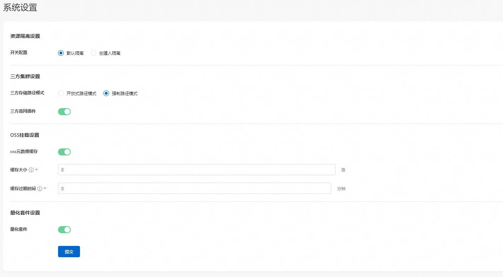

   - **资源隔离设置**：

     - 默认隔离：系统默认隔离方式，按照组织、资源集以及地域方式隔离。

     - 创建人隔离：按照系统登录用户隔离。隔离范围包括Notebook、可视化建模、任务建模和离线推理模块。

   - **三方集群设置**：

     - 三方存储路径模式：默认情况下为开放式路径模式，此时存储文件路径为非必填项；而选择强制路径模式时，将对存储文件路径进行严格校验，因此存储文件路径为必填项。

       > **说明**
       >
       > 涉及的功能模块包括：任务建模、Notebook建模、在线服务、批量推理。

     - 三方高网插件：默认关闭。启用后，AI资源池的三方高网功能也需同时开启，以支持分布式训练和推理任务的三方高网能力。

   - **OSS挂载设置**：

     <table>
       <tr>
         <th width="135">参数名称</th>
         <th>参数说明</th>
       </tr>
       <tr>
         <td>oss元数据缓存</td>
         <td>开启元数据缓存可以显著减少训推任务通过OSS文件系统向对象存储发起的远程请求次数，从而大幅降低文件列表和属性查询的延迟并提升整体访问性能。</td>
       </tr>
       <tr>
         <td>缓存大小</td>
         <td>单位：条。请根据OSS中被频繁访问的对象数量进行配置，若设置值过小，性能提升可能不显著。若设置为0，则表示禁用元数据缓存。</td>
       </tr>
       <tr>
         <td>缓存过期时间</td>
         <td>单位：分钟。若设置为-1，则表示关闭缓存的过期淘汰策略。除非数据挂载后不会进行任何更新，不建议关闭淘汰策略。</td>
       </tr>
     </table>

   - **量化套件设置**。

     打开量化套件开关后，支持在公共套件、模型和套件关联处以及模型量化等模块处展示量化套件。

4. 单击**提交**。

<a id="section-5"></a>

# 5.常见问题处理

<a id="section-5-1"></a>

## 5.1. 通性常见问题排查

本节内容及子章节介绍使用AI Studio平台时可能遇见的通性常见问题，并给出对应的排查方式

<a id="section-5-1-1"></a>

### 5.1.1. 控制台操作请求后端服务超时

本文为您介绍在AI Studio控制台进行操作时提示请求后端服务超时问题。

**问题现象**

在AI Studio控制台中进行操作，提示后端服务超时问题。

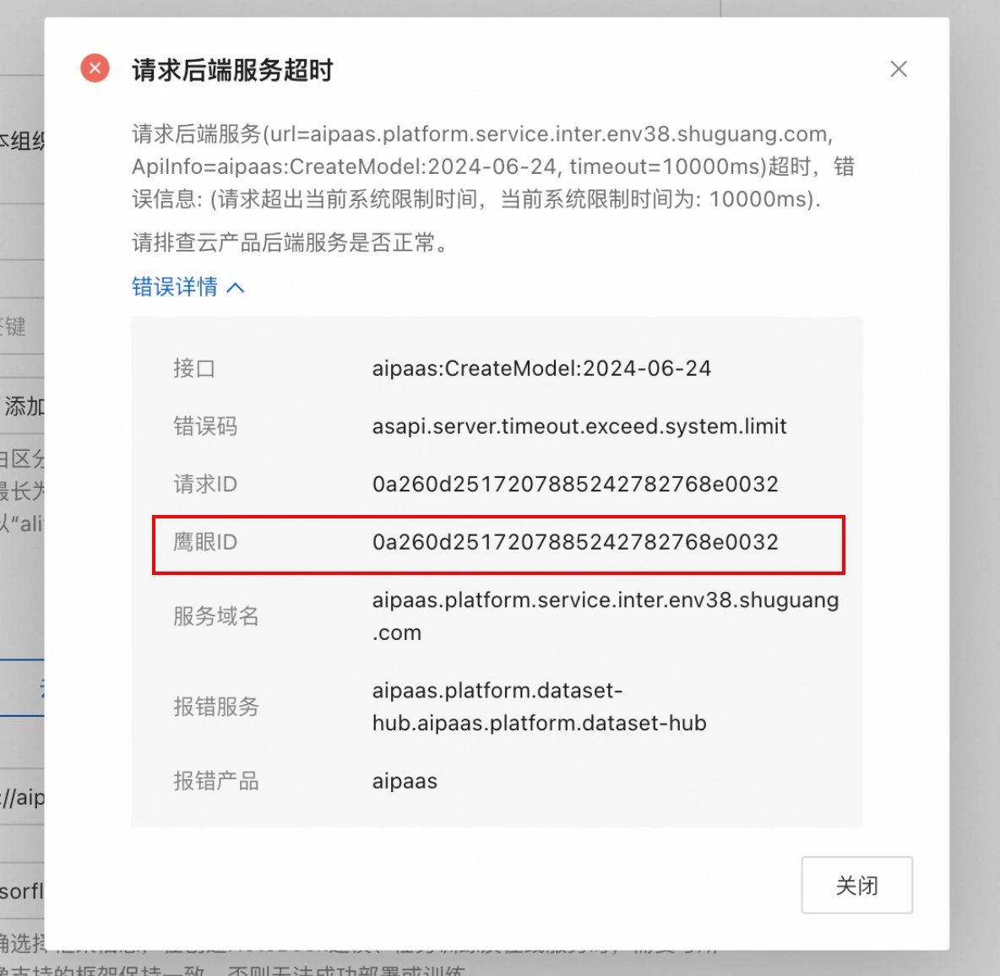

**可能原因**

1. 环境异常。

2. 云平台内部ASAPI调用异常。

**解决方案**

**环境异常解决方案**

1. 根据返回错误信息，复制鹰眼ID。

2. 进入**ASD业务诊断**，选择**链路分析**，输入鹰眼ID，进行查询。

3. 查看接口链路上各部分耗时，重点专注状态异常和长耗时接口。

   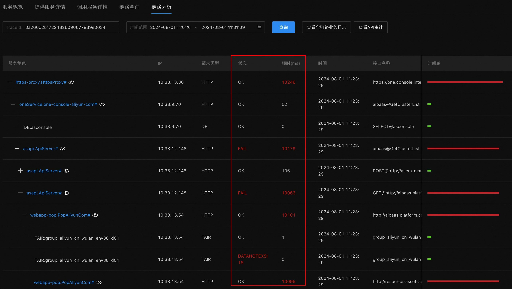

4. 对于可能出现问题：

   <ol type="i">

   <li>

   如果状态异常和长耗时集中在环境连接上，请联系环境管理人员进行处理。

   </li>

   <li>

   如果状态异常和长耗时集中在ASAPI，请参考下面 ASAPI调用异常解决方案。

   </li>

   </ol>

**ASAPI调用异常解决方案**

1. 根据返回错误信息，复制鹰眼ID和接口名。

2. 进入**ASD业务诊断**，选择**api审计**，输入错误信息中的鹰眼ID和接口名，点击**查询**。

   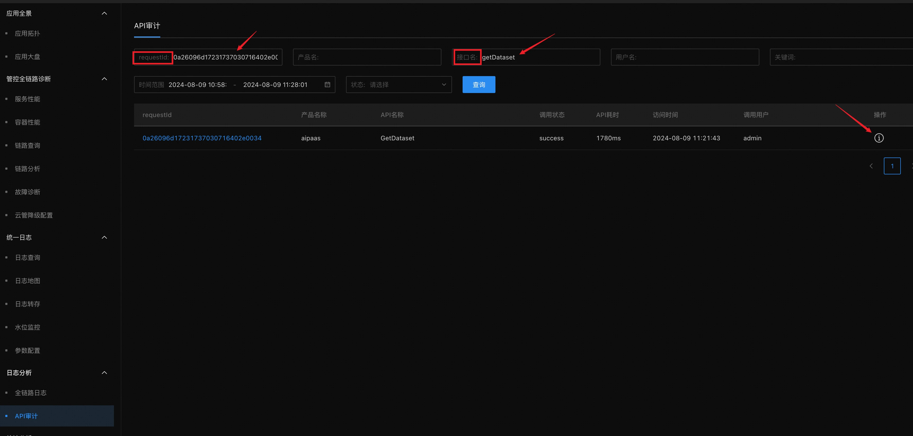

3. 进入**ASD业务诊断**，选择**日志查询**，鹰眼ID 进行ASAPI日志查询（主要关注下面这几个运营层面的日志）。

   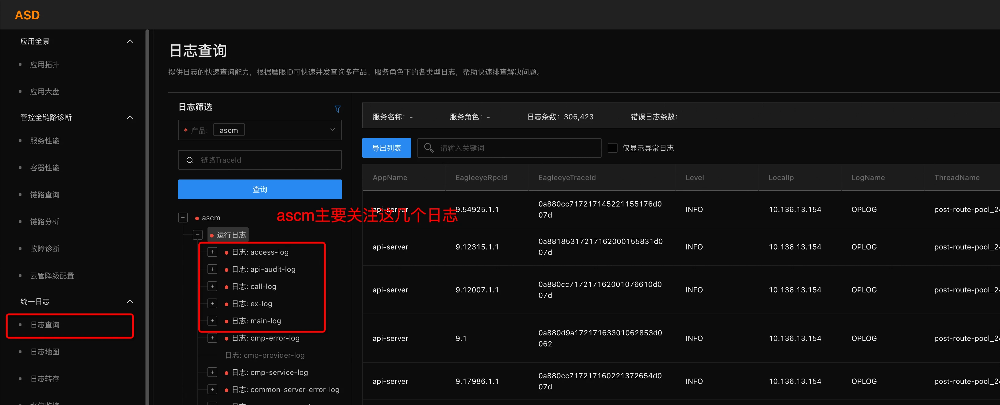

<a id="section-5-1-2"></a>

### 5.1.2. 控制台操作提示无权限

本文为您介绍在AI Studio控制台中操作时提示没有权限问题的解决方案。

**问题现象**

在AI Studio控制台中操作实例，提示没有权限。

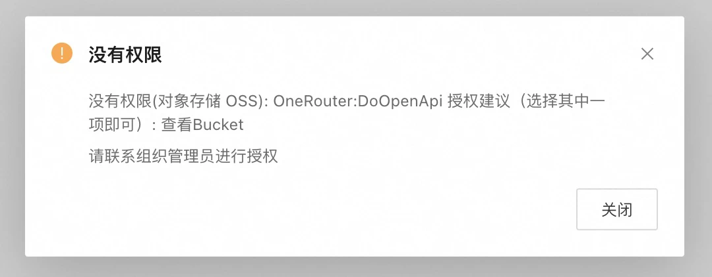

**解决方案**

1. 根据报错信息，确定缺少权限产品和权限点。

2. 确认当前用户角色是否具有当前权限：

   <ol type="i">

   <li>

   上方导航栏点击**个人头像**，选择**个人信息**。

   </li>

   <li>

   滑动页面至底部，点击**角色权限**。

   </li>

   <li>

   选择**应用权限**。

   </li>

   <li>

   搜索对应云产品名称，找到需要权限点，确定是否拥有该产品权限。

   > **说明**
   >
   > 以AI Studio为例，在搜索框输入“AI模型开发管理平台”，其他云产品也可以在搜索框输入对应的产品名，如对象存储OSS、容器服务Kubernetes、裸金属算力平台BMCP等。

   </li>

   </ol>

3. 无该产品权限，联系管理员进行权限点的添加：

   <ol type="i">

   <li>

   以管理员身份登录Apsara Uni-manager运营控制台。

   </li>

   <li>

   顶部菜单栏中单击**企业**。

   </li>

   <li>

   在左侧导航栏中单击**用户管理**。

   </li>

   <li>

   查询需要增加权限点用户，单击用户名。

   </li>

   <li>

   点击**角色权限**，展开**预制角色&自定义角色**。

   </li>

   <li>

   左侧搜索框输入需要添加权限的云产品。

   </li>

   <li>

   勾选需要增加的权限产品和权限点。

   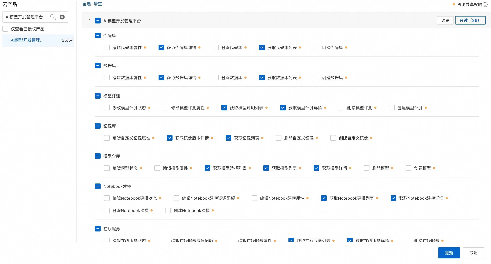

   > **说明**
   >
   > 以AI Studio为例，在搜索框输入“AI模型开发管理平台”，其他云产品也可以在搜索框中输入对应的产品名。

   </li>

   <li>

   点击更新。

   </li>

   </ol>

> **说明**
>
> 只有自定义角色支持编辑权限。若系统预置角色不满足要求，请创建自定义角色后，为用户授权。创建角色及授权方法请参见Apsara Uni-manager*运营控制台用户指南*。

<a id="section-5-1-3"></a>

### 5.1.3. 控制台创建任务时无数据

本文为您介绍在AI Studio控制台进行任务建模/Notebook建模/在线服务/模型评测等任务创建时出现无数据问题的解决方案。

**问题现象**

在AI Studio控制台中执行任务建模/Notebook建模/在线服务/模型评测等操作时，出现**资源组列表缺少数据**、**数据集/代码集/模型缺少数据、镜像列表缺少数据**等现象，导致无法成功创建任务。

**解决方案**

**资源组列表无数据解决方案**

1. 顶部导航栏单击**组织/资源集/地域**，设置为用户所在组织/资源集/地域。

   

2. AI Studio左侧导航栏单击**资源组**。

3. 若不存在资源组，请先单击**创建资源组**进行创建。

4. 返回创建任务页面，刷新后即可获取资源组列表。

> **重要**
>
> 用户资源（资源池、资源组、镜像集、数据集、模型、代码集等）与用户所在组织、资源集和地域绑定，操作请确保当前所处环境与数据所在环境一致。上述情景以bms_test为例，详情请按照用户所在组织/资源集/地域为准。

**镜像列表无数据解决方案**

1. 顶部导航栏单击**组织/资源集/地域**，设置为用户所在组织/资源集/地域。

2. AI Studio左侧导航栏单击**镜像库**。

3. 若不存在镜像，请先单击**创建镜像**进行创建。

4. 返回创建任务页面，设置用户所在**组织/资源集/地域**。

5. 选择**框架**，镜像列表即有数据展示。

   > **说明**
   >
   > 任务类型与镜像可用服务不匹配，或者框架选择与创建时不一致的镜像，都不会在镜像列表中展示。

**数据集/代码集/模型缺少数据**

1. 顶部导航栏单击**组织/资源集/地域**，设置为用户所在组织/资源集/地域。

2. 检查相关数据是否存在：

   <ol type="i">

   <li>

   数据集：AI Studio左侧导航栏单击**数据管理-数据集**，若没有数据，单击**创建数据集**进行创建。

   </li>

   <li>

   代码集：AI Studio左侧导航栏单击**AI资产管理-代码集**，若没有数据，单击**创建代码集**进行创建。

   </li>

   <li>

   模型：AI Studio左侧导航栏单击**模型管理-模型仓库**，若没有数据，单击**导入模型**进行创建。

   </li>

   </ol>

3. 返回创建任务页面，设置用户所在**组织/资源集/地域**。

4. 选择可用**资源组**。

5. 选择所需**数据集/代码集/模型**。

6. 若AI资源池存储声明缺少数据，请参考AI资源池存储声明无数据。

   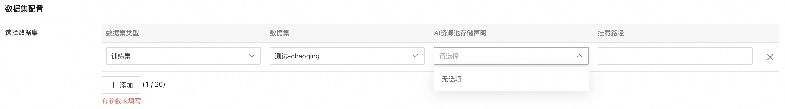

   > **重要**
   >
   > AI资源池存储声明与资源池绑定，选择前请确保已经选择组织/资源集/地域，以及资源组。

<a id="section-5-1-4"></a>

### 5.1.4. 控制台显示任务长时间保持启动中

本文为您介绍在AI Studio控制台中进行任务建模/Notebook建模/在线服务/模型评测等任务创建后，任务状态长时间保持启动中的解决方案。

**问题现象**

在AI Studio控制台中，进行任务建模/Notebook建模/在线服务/模型评测等任务成功创建后，在任务列表以及详情中任务状态长时间维持启动中。

**解决方案**

1. 单击处于启动中状态的任务**详情**。

2. 根据任务事件定位错误信息：任务详情内导航栏单击**事件**，查看创建任务过程中触发事件列表，根据异常事件定位错误信息：

   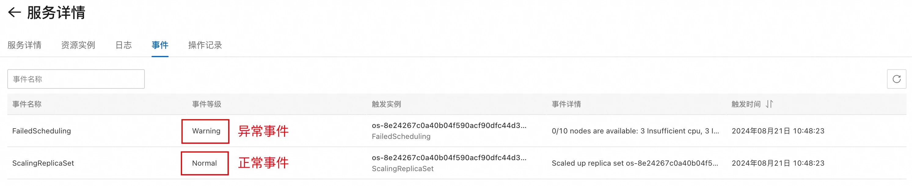

   <ol type="i">

   <li>

   事件名称：触发事件，结合事件等级、事件详情确定错误事件信息。

   </li>

   <li>

   事件等级：包含Normal、Warning、Error等，需要关注非Normal等级事件。

   </li>

   <li>

   触发实例：触发实例名称。

   </li>

   <li>

   事件详情：触发事件详情。

   </li>

   <li>

   触发事件：事件发生时间。

   </li>

   </ol>

   > **说明**
   >
   > 常见异常事件及解决方案见：常见异常事件及解决方案。

3. 事件无异常，则表示任务所需环境创建与初始化成功。若此时任务仍然处于启动中，可进一步通过查询集群日志来进行排查异常，通常分为两步：

   <ol type="i">

   <li>

   管控侧日志查询：AI Studio创建任务首先通过管控侧对数据信息进行处理，然后在容器集群中创建运行任务。因此，首先需要排查管控侧是否存在错误，操作可见：管控侧日志查询。

   </li>

   <li>

   容器集群侧日志查询：若管控侧日志无异常，则问题可能出现在容器集群中，查询容器集群日志信息见：容器集群日志查询。

   </li>

   </ol>

<a id="section-5-1-5"></a>

### 5.1.5. 控制台显示任务运行失败

本文为您介绍在AI Studio控制台中进行任务建模/Notebook建模/在线服务/模型评测等任务创建后，任务状态变为失败的解决方案。

**问题现象**

在AI Studio控制台中进行任务建模/Notebook建模/在线服务/模型评测等创建后，任务成功下发，但最终状态转变为失败。

**解决方案**

1. 单击任务**详情**。

2. 任务详情页导航栏单击**事件**，查看事件列表有无异常事件。若事件等级不为Normal，触发实例中显示Failed等，参考常见异常事件及解决方案处理。

   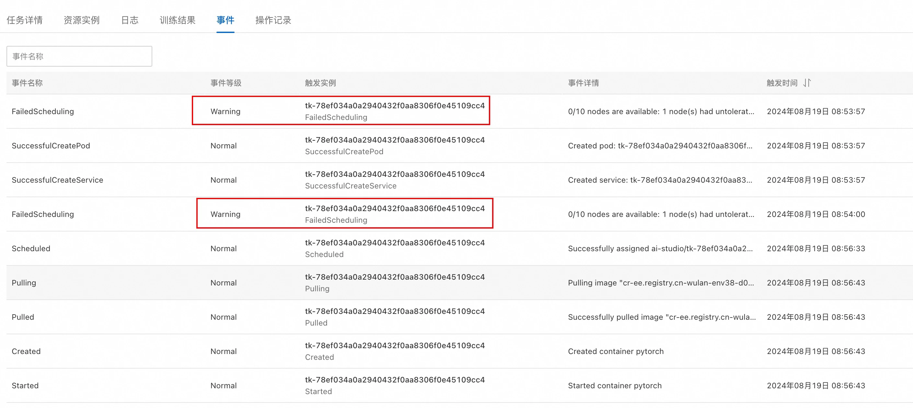

3. 事件无异常，则表示任务运行环境已经成功创建，错误可能出现在启动命令或者运行代码中，可进一步通过任务日志进行错误定位。

   <ol type="i">

   <li>

   任务建模/模型评测/在线服务详情中上方导航栏单击**资源实例**，找到异常实例，点击**日志**，查看运行过程中产生的日志信息。

   <ol type="i" start="2">

   <li>

   Notebook详情中上方导航栏单击**日志**，查看运行过程中产生的日志信息。

   </li>

   </ol>

   > **说明**
   >
   > 创建资源池时，可选择开启日志记录。开启后，AI Studio会自动采集任务运行过程中标准输出流和标准错误流的数据，并持久化在租户SLS中，默认log-project为集群ack-id，log-store为aistudio-log-stdout，存储时间为90天。

   </li>

   </ol>

4. 若通过事件与日志仍然无法判断任务失败原因，可进一步通过查看集群日志信息来进行错误排查，通常分为两步：

   <ol type="i">

   <li>

   管控侧日志查询：AI Studio创建通过管控侧对数据信息进行处理，然后再在租户容器集群中创建运行任务。因此，首先需要排查管控侧是否存在错误，操作可见：管控侧日志查询。

   </li>

   <li>

   容器集群侧日志查询：若管控侧日志无异常，则问题可能出现在租户侧容器集群中，查询容器集群中日志信息见：容器集群日志查询。

   </li>

   </ol>

<a id="section-5-1-6"></a>

### 5.1.6. 常见异常事件及解决方案

本文为您介绍创建任务过程中常见的异常事件现象、产生原因以及解决方案。

**常见异常事件**

**调度失败**

1. 问题描述：事件名称 FailedScheduling，事件等级 Warning，事件详情 0/xx nodes are available。

   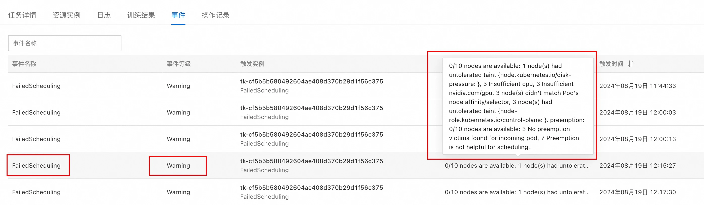

2. 产生原因：当前配额不满足任务所需调度条件。集群可以调度任务需要满足以下条件：1. 配额剩余资源满足任务所需资源；2. 节点可调度；3. 配额分配节点无不可容忍污点，可进行任务调度。

3. 解决方案：

   <ol type="i">

   <li>

   配额剩余资源无法满足(Insufficient cpu/memory/gpu/...)：等待前置任务运行完成释放资源，或者停止任务，选择其他配额下发任务。

   </li>

   <li>

   节点不可调度(unschedulable)：

   <ol type="a">

   <li>

   登录集群Master节点（登录权限请联系管理员）。

   </li>

   <li>

   查看节点调度情况，&lt;node-name>为配额内节点名称。

   ```bash
   kubectl describe no <node-name> | grep -i unschedulable
   ```

   </li>

   </ol>

   <ol type="i" start="100">

   <li>

   若显示 `Unschedulable: true` ，请咨询管理员节点当前是否可正常调用。

   </li>

   </ol>

   </li>

   <li>

   节点存在不可容忍污点(untolerated taint )：

   <ol type="a">

   <li>

   登录集群Master节点（登录权限请联系管理员）。

   </li>

   <li>

   查看节点污点情况，&lt;node-name>为配额内节点名称。

   ```bash
   kubectl describe no <node-name> | grep taint
   ```

   </li>

   </ol>

   <ol type="i" start="100">

   <li>

   如果存在污点，请联系集群管理员是否可以取消：无法取消污点，请删除已创建任务，并选择其他配

   

   额重新进行任务创建；可取消污点，若任务处于 启动中 ，待污点取消后会自动重新调度；若任务

   

   已 失败 ，选择重启任务或者重新创建任务。

   </li>

   <li value="500">

   删除污点。

   ```bash
   kubectl taint nodes <node-name> <key>:<value>:NoSchedule-
   ```

   </li>

   </ol>

   </li>

   </ol>

**镜像拉取失败**

1. 问题描述：无法拉取目标镜像构造环境，事件名称为Failed或者Backoff，事件详情显示ErrImagePull或者Failed to pull image。

   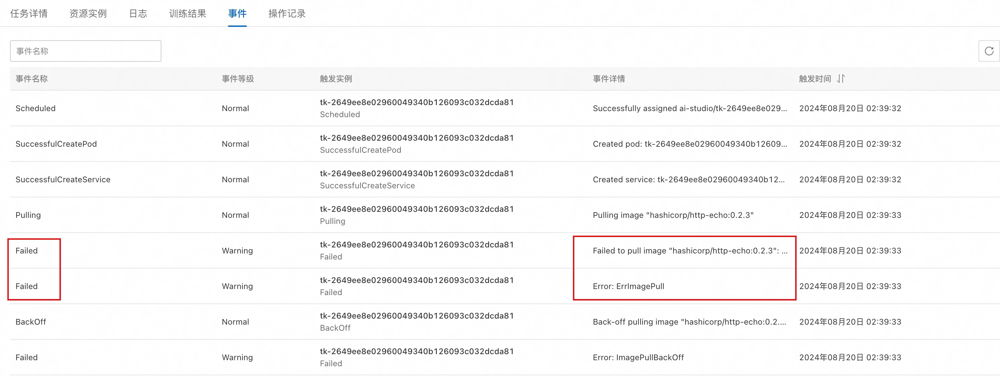

2. 产生原因：a. 镜像地址不可达，当前AI Studio仅支持**自定义镜像**，不支持公共镜像导入；b. 容器镜像服务为私有类型，但集群未配置免密组件，导致AI Studio缺少拉取镜像权限。

3. 解决方案：a. 对于公共镜像，将镜像先上传至环境内容器镜像服务ACR，再进行镜像导入；b. 对于私有容器镜像服务，缺少免密组件配置，参考使用免密组件拉取私有容器镜像。

**节点空间不足**

1. 问题描述：任务无法创建，运行失败，事件名称Evicted，事件详情显示The node was low on resource。

   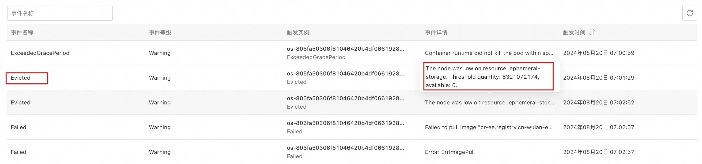

2. 产生原因：Kubernetes 节点的临时存储（ephemeral storage）资源不足，导致无法创建新的 Pod。

3. 解决方案（以下任选之一执行）：

   <ol type="i">

   <li>

   清理节点上已完成或者无效任务，如pod、service、deployment、job等。

   </li>

   <li>

   清理节点日志文件。

   </li>

   <li>

   重启node，清理临时文件。

   </li>

   <li>

   选择其他资源组运行。

   </li>

   </ol>

<a id="section-5-1-7"></a>

### 5.1.7. 容器集群日志查询

本文为您介绍在租户容器集群中如何进行任务事件、状态、日志、报错信息查询和进入容器等操作。

**登录集群**

1. 任务列表处点击所属**资源组**，进入配额详情页面。

2. 根据配额所属资源池，进入**资源池详情页**。

3. 查看资源池绑定BMCP集群id信息。

4. 上方导航栏单击**产品**，选择**裸金属算力平台BMCP**。

5. 左侧导航栏**单击**集群管理。

6. 选择**容器-智算算力集群**。

7. 输入BMCP集群id，查找目标集群，点击**详情**。

8. 集群详情内导航栏点击**集群节点**。

9. 选择任一Master节点进行远程登录（登录权限请联系管理员）。

0. 后续操作均在集群节点上进行。

**查询任务及关联资源列表**

1. 查询任务列表。

   ```bash
   kubectl get <type> -n ai-studio
   ```

   type 表示所需要查询任务列表的类型，与AI Studio任务类型对应如下：

   | AI Studio任务类型 | type |
   | --- | --- |
   | 任务建模 —— Tensorflow | tfjob |
   | 任务建模 —— Pytorch | pytorchjob |
   | Notebook建模/在线服务 | deployment |
   | 模型评测 | job |

   > **重要**
   >
   > AI Studio默认工作命名空间为**ai-studio**，平台关联资源都在此命名空间下创建。

2. 查询任务关联service。

   ```bash
   kubectl get service -n ai-studio | grep -i <task-id>
   ```

   - &lt;task-id>为所需要查询的任务id。

3. 查询任务关联pod。

   ```bash
   kubectl get pod -n ai-studio | grep -i <task-id>
   ```

   - &lt;task-id>为所需要查询的任务id。

**查询任务详情**

```bash
kubectl describe <type> <task-id> -n ai-studio
```

- 使用kubectl describe可以获取任务所用节点、分配资源、事件信息等。

- 任务详情结果字段说明：

  - name：名称。

  - node：资源所在节点名称。

  - labels：关联标签，包含关联任务信息、资源组信息等。

  - annotations：注释信息。

  - status：资源当前状态。

  - containers：

    - tensorlfow：

      - image：运行镜像。

      - command：运行成功后执行的指令，对应AI Studio中的运行指令。

      - requests/limits：当前任务分配的资源。

  - volumns：挂载资源信息，包含代码集、模型、数据集、持久化存储信息。

  - events：任务运行过程中触发事件信息。

> **说明**
>
> Pod为任务最终执行实例资源，本处以任务建模（tensorflow）关联Pod详情为例展示各字段含义。

**查询任务日志详情**

1. 通过 kubectl logs 可以查看任务运行过程中在标准输出流中的日志信息。

2. 根据上面提到的 查询任务及关联资源列表 获取任务关联pod名称。

3. 执行查询指令：

   ```bash
   kubectl logs <pod-name> -n ai-studio
   ```

   - &lt;pod-name>为上述查询到的pod名称。

   - 使用 --tail &lt;num> 可以查看最近 &lt;num> 条日志信息，-f 保持持续输出，可以帮助复现错误，进行更加精准的错误定位。

> **说明**
>
> Log仅采集运行过程中标准输出流和标准错误流数据，自定义日志信息请通过数据挂载或者进入容器内进行查看。

**常见日志错误**

1. 无法识别的指令。

   <ol type="i">

   <li>

   问题描述：运行日志显示无法识别的指令。

   </li>

   <li>

   产生原因：启动命令不识别换行，将前后指令拼接在一起，导致系统无法识别。

   </li>

   <li>

   解决方案：不同指令之间使用 ‘**;**’ 进行换行<strong>。</strong>

   </li>

   </ol>

2. 运行文件无权限。

   <ol type="i">

   <li>

   问题描述：运行日志显示缺少文件运行权限。

   </li>

   <li>

   产生原因：挂载外部存储到Pod上时，没有设置执行权限。

   </li>

   <li>

   解决方案：启动指令中增加授权指令。

   

   </li>

   </ol>

3. OOM Killed：

   <ol type="i">

   <li>

   问题描述：运行日志显示OOM Killed，随后任务失败。

   </li>

   <li>

   产生原因：启动任务时分配的资源不够，导致任务无法正确运行。

   </li>

   <li>

   解决方案：重新下发任务并分配更多的资源。

   </li>

   </ol>

**进入正在运行容器**

1. 前提：任务处于正在运行状态。

2. 根据上面提到的 查询任务及关联资源列表 获取任务关联pod名称。

3. 执行指令：

   ```bash
   kubectl exec -it <pod-name> -n ai-studio -- bash
   ```

   - &lt;pod-name>为上述查询到的pod名称。

<a id="section-5-1-8"></a>

### 5.1.8. 管控侧日志查询

本文为您介绍如何查询管控侧日志，进行错误排查。

**登录管控侧集群**

1. 登录管控侧环境。

   AI Studio的管控服务是在云平台底座物理机之上、基于飞天企业版的PaaS基线标准、以容器化的方式部署的。查询管控侧的日志，需要登录底座PaaS环境的任意Master节点执行命令（登录权限和方式请联系管理员）。

2. 查询AI Studio部署服务实例。

   ```bash
   kubectl get po -n aistudio-core
   ```

   - AI Studio管控侧默认命名空间为 **aistudio-core**，部署服务为高可用模式，多个实例之间通过负载均衡进行流量分摊。

     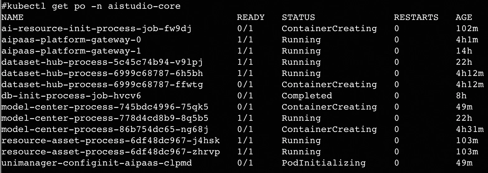

   - aipaas-platform-gateway：容器集群管理模块。

   - dataset-hub-process：数据管理模块。

   - model-center-process：模型服务模块。

   - resource-asset-process：AI资源资产管理模块。

   - ai-resource-init-process-job：预置资源模块。

**查询服务日志信息**

**方法一**

```bash
kubectl logs <pod-name> -n aistudio-core -- tail 100 -f
```

- --tail &lt;num>：查询最新&lt;num>条日志信息。

- -f：持续输出。

- 定位日志信息，可选择加上：grep -i &lt;query>。

  - query 为需要查询信息，如请求Id，或者任务Id。

**方法二**

1. 登录Pod。

   ```bash
   kubectl exec -it <pod-name> -n aistudio-core -- bash
   ```

2. 日志路径说明见：日志路径。

<a id="section-5-1-9"></a>

### 5.1.9. 使用免密组件拉取私有容器镜像

本文介绍如何通过容器服务的免密组件拉取私有容器镜像。

**背景信息**

容器服务提供一款组件：aliyun-acr-credential-helper（下文简称免密组件），其支持在多种ACK集群中免密拉取容器镜像，您无需配置Secret，只需配置ACR实例相关信息和在集群中的作用范围即可生效，但是进入集群使用者仍然有获取和操作ACR等由您授予RAM角色的权限。

**前提条件**

- 开通了ACR标准版或高级版实例，并有私有版的镜像仓库。

- 已将需要给AI Studio使用的镜像上传到私有镜像仓库。

- 已为集群Worker节点绑定的RAM角色配置权限，操作步骤请参见《容器服务Kubernetes版用户指南》>授权管理>为集群Worker节点绑定的RAM角色配置权限章节。

  > **说明**
  >
  > - 为集群Worker节点绑定的RAM角色配置权限时PolicyDocument内容需要做如下修改：
  >
  > ```json
  > {
  >     "Version": "1",
  >     "Statement": [
  >         {
  >             "Action": [
  >              "cr:GetAuthorizationToken"
  >             ],
  >             "Effect": "Allow",
  >             "Resource": "*"
  >         },
  >         {
  >             "Effect": "Allow",
  >             "Action": [
  >           "cr:ListInstanceEndpoint"
  >             ],
  >             "Resource": [
  >               "acs:cr:*:*:instance/$instanceid"
  >             ]
  >         },
  >         {
  >             "Action": [
  >               "cr:PullRepository"
  >             ],
  >             "Effect": "Allow",
  >             "Resource": [
  >               "acs:cr:*:*:repository/$instanceid/$namespace/$repositoryname"
  >             ]
  >         }
  >     ]
  > }
  > ```
  >
  > - GetAuthorizationToken接口获取用于登录实例的临时账号和临时密码，授权后将能访问到整个组织使用的所有镜像仓库。
  >
  > - ListInstanceEndpoint接口的Resource需要配置对应的容器镜像服务实例ID，可到ACR控制台容器镜像服务的概览页获取。
  >
  > - PullRepository接口的Resource需要配置镜像所在的镜像仓库，镜像仓库可到ACR控制台的仓库管理-镜像仓库-基本信息获取。
  >
  > - “$”符号后内容需要根据业务情况进行替换。

**注意事项**

- 在Kubernetes资源（例如无状态应用Deployment）模板中配置拉取凭证（imagePullSecret）会导致免密组件失效，如果需使用免密组件，请避免手工配置拉取凭证（imagePullSecret）。

- 确认Kubernetes集群所属地域与要拉取的镜像所在的地域是否一致，默认配置只可以拉取本地域的镜像。

**安装免密组件**

**操作步骤**

1. 登录**Apsara Uni-manager运营控制台**。

2. 上方导航栏选择**产品**，单击**容器服务Kubernetes版**。

3. 进入集群控制台。

4. 左侧导航栏单击**运维管理-组件管理**。

5. 选择aliyun-acr-credential-helper，单击安装。

**升级并配置免密组件**

在使用免密组件拉取镜像前，您可能需要升级组件并对组件进行配置，操作步骤如下。

设置acr-configuration配置项。

1. 登录容器服务控制台。具体操作，请参见<strong>《容器服务Kubernetes版用户指南》</strong>的<strong>《登录容器服务控制台》</strong>章节。

2. 在控制台左侧导航栏中，单击**集群**。

3. 在**集群列表**页面，单击目标集群下的名称。

4. 在**集群信息**页面左侧导航栏，选择**配置管理 > 配置项**。

5. 在**配置项**页面的上方命名空间下拉框中，选择**kube-system**，然后找到配置项**acr-configuration**，然后通过以下两种方式配置acr-configuration。

   - 方式一：单击其右侧的**编辑**，设置**配置项**的名称和值。

   - 方式二：单击其右侧的**YAML编辑**，设置**配置项**的名称和值。

   acr-configuration配置项的名称和值说明如下。

   | 配置项的名称 | 配置项的名称说明 | 配置项值 |
   | --- | --- | --- |
   | service-account | 使免密组件作用于指定的服务账号。 | 使用默认<strong>default</strong>配置。 |
   | acr-registry-info | 容器镜像的实例信息数组，YAML多行字符串格式，每个实例以三元组方式配置。<br>说明关键要配置实例ID（instanceId），企业版实例必须配置具体的ID值，标准版实例配空。 | 默认值为空，表示免密拉取本地地域的默认容器镜像实例仓库。针对高级版容器镜像实例，配置示例如下：<br><code>- instanceId: "cri-xxx"</code><br><code>domains: "xxx.com,yyy.com"</code><br>针对标准版容器镜像实例，配置示例如下：<br><code>- instanceId:""</code><br><code>domains: "xxx.com,yyy.com"</code> |
   | watch-namespace | 期望能免密拉取镜像的Namespace。 | 填写AI Studio的名字空间 “ai-studio”。 |
   | expiring-threshold | 本地Cache Token过期阈值。 | 默认值为<strong>15m</strong>（建议使用15 min）。 |

   配置同时拉取标准版和高级版的私有镜像实例，示例如下：

   YAML

   ```text
   data:
       service-account: "default"
       watch-namespace: "ai-studio"
       expiring-threshold: "15m"
       notify-email: "cs@aliyuncs.com"
       acr-registry-info: |
         - instanceId: ""
         - instanceId: "cri-xxxx"
   ```

<a id="section-5-1-10"></a>

### 5.1.10. 算力集群中任务状态长时间维持启动中

本文为您介绍在算力集群中，执行训练推理任务的常见问题。

**问题现象**

在AI Studio控制台中，选择算力集群，执行任务建模/Notebook建模/在线服务/模型评测等任务后，在任务列表以及详情中任务状态长时间维持启动中。

**可能原因**

ack-xpu-installer组件没有正常部署。

**排查流程**

1. 从**容器服务Kubernetes版**控制台进入目标**容器集群**（权限申请请联系管理员）。

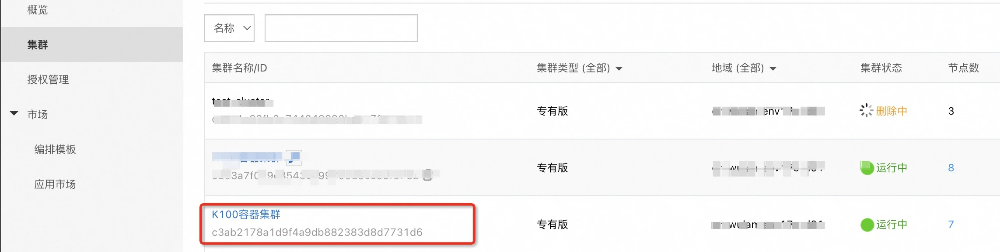

2. 选择**工作负载 > 应用 > Helm**，检查依赖组件（ack-xpu-installer）的部署状态。

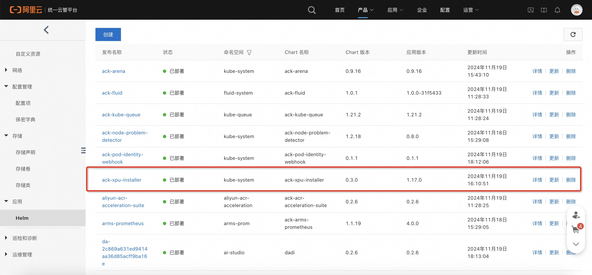

3. 若组件未安装，可以通过**运维管理 > 组件管理**，手动安装组件。

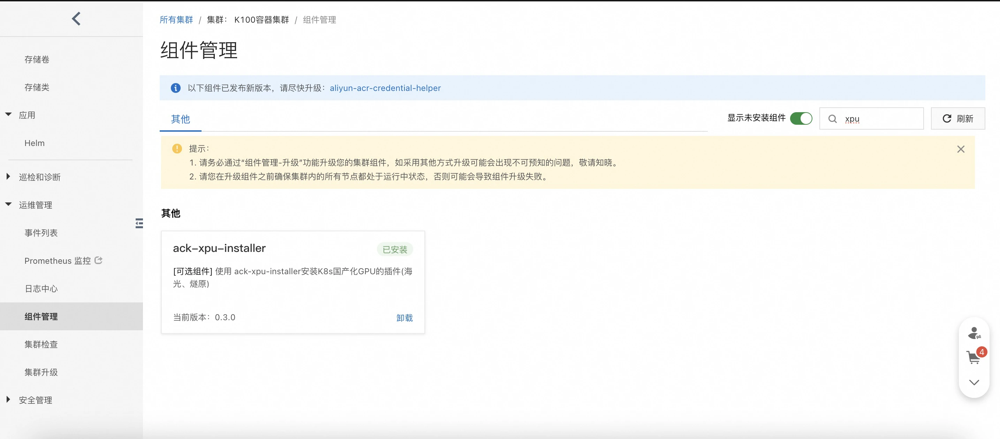

<a id="section-5-2"></a>

## 5.2. 数据管理常见问题排查

本章节及其子章节将介绍在使用数据管理功能时，涉及数据集、数据标注和数据生成等功能时可能遇到的异常情况及其原因分析与处理方案。

<a id="section-5-2-1"></a>

### 5.2.1. 数据集常见问题排查

本文为您介绍在AI Studio控制台使用数据集功能时遇到的常见问题现象、可能原因及解决方案。

**常见问题**

- 问题一：待标注数据集导入失败。

- 问题二：在任务建模等任务中无法使用CPFS文件系统的数据集。

- 问题三：数据标注和数据生成任务结果导入为数据集失败。

- 问题四：存储类型为OSS的数据集预览失败。

**问题现象**

- 问题一现象：在创建数据集时选择**需要标注**，完成后进入数据集详情页，状态显示为“导入失败”。

- 问题二现象：

  - 创建CPFS数据集后，在创建任务建模等任务时，无法选择到该CPFS数据集。

  - 创建任务建模等使用数据集的任务，选择该CPFS数据集后创建任务后，进入容器pod内发现挂载路径下无对应文件。

- 问题三现象：在数据标注任务使用<strong>“获取标注结果”</strong>和数据生成任务的<strong>“保存结果”</strong>，并且选择<strong>“导出为新数据集”</strong>将标注和生成结果导出为新数据集以后，进入目标数据集详情页状态，发现导入状态为<strong>“导入失败”。</strong>

- 问题四现象：进入存储类型为“OSS对象存储”的数据集详情页，点击<strong>“查看”</strong>后，点击想要预览的OSS文件图标无反应。

**可能原因**

- 问题一原因：待标注数据集的文件格式不符合预期，无法解析。

- 问题二原因：

  - 请确保在CPFS文件系统的**自定义挂载路径**中存储数据，而不是在**默认挂载路径**中存储数据（默认挂载路径格式为 “/cpfs/文件系统id”）。

  - 创建CPFS数据集时录入的存储路径有误，BMCP集群挂载的文件系统中对应路径不存在数据文件。

- 问题三原因：可能是在标注、生成结果在导出至OSS存储时发生异常。

- 问题四原因：

  - 浏览器版本不支持使用AI Studio的预览数据集功能。

  - 该文件格式不支持预览。

**解决方案**

- 问题一解决方案：

  > **重要**
  >
  > - 图片标注：对于需要图片标注的数据集，请上传包含待标注图片的文件夹，文件夹中需要包含支持的图片文件格式，支持的图片格式包括：jpg、 jpeg、png、bmp。
  >
  > - 文本标注：对于需要文本标注的数据集，请上传符合文本标注模板的**文件**，待文本标注的模板文件示例在数据集的创建页选择<strong>“需要标注”</strong>，选中<strong>“标注对象类型”</strong>为<strong>“文本标注”</strong>后可下载。

  <ol type="i">

  <li>

  登录AI Studio控制台。

  </li>

  <li>

  在顶部菜单栏处，选择组织、资源集和地域。

  </li>

  <li>

  在左侧导航栏中，单击**数据管理** > **数据集**。

  </li>

  <li>

  在数据集列表界面，单击**创建数据集**。

  </li>

  <li>

  在**创建数据集**页面，设置相关配置项参数。

  数据集创建包括创建数据集的基本信息（组织、资源集、地域、数据集名称、描述等）以及数据具体的配置（数据类型、数据来源等）。

  <ol type="a">

  <li>

  配置数据集的基本信息

  | 配置项 | 是否必选 | 说明 |
  | --- | --- | --- |
  | 组织/资源集/地域 | 是 | 数据集所属的组织、资源集和地域。 |
  | 基于现有数据集创建 | 是 | • 是<br>• 否 |
  | 选择数据集 | 否 | 可选，当<strong>基于现有数据集创建</strong>选择<strong>是</strong>时，需要配置。请您选择希望基于的特定数据集进行创建。 |
  | 数据集版本 | 是 | 当<strong>基于现有数据集创建</strong>选择<strong>是</strong>时，基于现有数据集依次递增。当<strong>基于现有数据集创建</strong>选择<strong>否</strong>时，系统会自动填充为v1。 |
  | 数据集名称 | 否 | 可选，当<strong>基于现有数据集创建</strong>选择<strong>否</strong>时，请用户自定义的数据集名称。 |
  | 描述 | 否 | 用户撰写的数据集的描述。 |
  | 共享范围 | 是 | 共享范围，有以下三种：<br>• <strong>本组织及下级组织</strong>：在本组织和下级组织内共享。<br>• <strong>本资源集共享</strong>：在本资源集内共享。<br>• <strong>本组织共享</strong>：在本组织内共享。 |
  | 存储类型 | 是 | • OSS对象存储<br>• CPFS文件系统 |
  | 数据集类型 | 是 | 数据集的类型，有以下三种：<br>• <strong>训练集</strong>：将此数据集作为训练集使用。<br>• <strong>评测集</strong>：将此数据集作为评测集使用。<br>• <strong>训练集&amp;评测集</strong>：将此数据集同时作为训练集和评测集使用。 |

  </li>

  <li>

  进行数据配置

  | 配置项 | 是否必选 | 说明 |
  | --- | --- | --- |
  | 数据格式 | 是 | 数据的类型，按数据集含有的数据类型，分为<strong>图片</strong>、<strong>文</strong><strong>本</strong>、<strong>音频</strong>、<strong>表格</strong>和<strong>视频</strong>五种，用户根据实际情况进行选择。 |
  | 是否需要标注 | 否 | 可选，当<strong>存储类型</strong>选择<strong>OSS对象存储</strong>时，支持配置。目前支持图片和文本标注，如果选择需要标注，需要标注的数据集会给定标注数据格式模板供参考。 |
  | 数据来源 | 否 | • 云存储<br>• 本地上传：当<strong>存储类型</strong>选择<strong>OSS对象存储</strong>时，支持配置。 |
  | 导入格式 | 是 | 支持选择文件和文件夹。 |
  | 数据保存路径 | 否 | 可选，当<strong>数据来源</strong>选择<strong>本地上传</strong>时，需要配置。 |
  | 上传数据 | 否 | 可选，当<strong>数据来源</strong>选择<strong>本地上传</strong>时，需要配置。请下载示例文件，根据示例文件的格式上传文件。 |
  | 选择数据文件 | 是 | 单击图标选择云存储中的类型和目录。 |

  </li>

  </ol>

  </li>

  <li>

  单击**提交**。

  </li>

  </ol>

- 问题二解决方案：

  <ol type="i">

  <li>

  请确认CPFS产品已部署。

  </li>

  <li>

  请确认CPFS系统已经被挂载在资源池对应的BMCP高网集群。

  </li>

  <li>

  远程登录BMCP集群中任意节点后，执行如下命令：

  ```text
  mount -t gpfs
  ```

  如果输出如下图，则说明已经挂载CPFS文件系统（一个BMCP高网集群默认只能挂载一个CPFS文件系统

  

  > **重要**
  >
  > 如上图，第一行为**默认挂载路径**，第二行为**自定义挂载路径**。请不要使用**默认挂载路径，而是**使用**自定义挂载路径**存储使用AI Studio需要的数据）。

  如果未挂载CPFS文件系统，进入BMCP产品控制台，找到资源池对应的BMCP高网集群并启用高性能存储，选择<strong>“高性能存储类型”</strong>为<strong>“BMCPFS”</strong>并提交确认。

  </li>

  <li>

  请确认需要使用的文件或目录在**CPFS文件系统的对应绝对路径**和**在AI Studio创建CPFS数据集时录入的绝对路径**一致，若不一致则会导致该CPFS数据集无法被任务挂载使用。

  </li>

  </ol>

- 问题三解决方案：

  <ol type="i">

  <li>

  登录统一运营平台。

  </li>

  <li>

  在顶部菜单选择**产品 > 存储 > 基础存储服务 > 对象存储 OSS**。

  </li>

  <li>

  在OSS对象存储产品控制台，查看目标位置下是否存在预期导出文件，文件内容是否符合预期。如不存在，请重试后确认。

  </li>

  </ol>

- 问题四解决方案：

  请下载您所使用的操作系统对应的Chrome浏览器的最新版本。

<a id="section-5-2-2"></a>

### 5.2.2. 数据标注常见问题排查

本章节将介绍在使用数据标注功能的过程中遇到的问题及其原因与解决方案。

<a id="section-5-2-2-1"></a>

#### 5.2.2.1. 提示无管理员/标注员/验收员权限

本文介绍用户权限出现异常时如何处理。

**问题现象**

提示无管理员/标注员/验收员权限。

**可能原因**

用户绑定的角色有问题。

**解决方案**

数据标注功能涉及到多个角色的协同，请确认所绑定角色是否正确。

- 管理员：必须具有资源集管理员和资源使用人权限，且管理员不能为超管账号，否则在资源集权限验证的时候会无法通过。

- 标注员&验收员：必须具有资源使用人权限。

- 数据标注的任务是阿里云子账号级别隔离的，必须将相关的任务或子任务分配到相关子账号人员身上。

<a id="section-5-2-2-2"></a>

#### 5.2.2.2. 任务初始化失败或长期在初始化中

**问题现象**

任务状态展示失败或长时间处于初始化中。


**可能原因**

数据集格式不正确或文件损坏。

**解决方案**

1. 登录AI Studio控制台。

2. 在顶部菜单栏处，选择组织、资源集和地域。

3. 在左侧导航栏中，单击**数据管理** > **数据集**。

4. 单击数据集操作列**详情**。

5. 检查上传的数据集文件是否存在损坏情况，以及所选数据集的创建格式是否符合数据标注模板的要求。

<a id="section-5-2-2-3"></a>

#### 5.2.2.3. 自动标注结果为空

**问题现象**

自动标注的子任务状态为“已标注”，但已标注数据量为0或远小于数据总量。

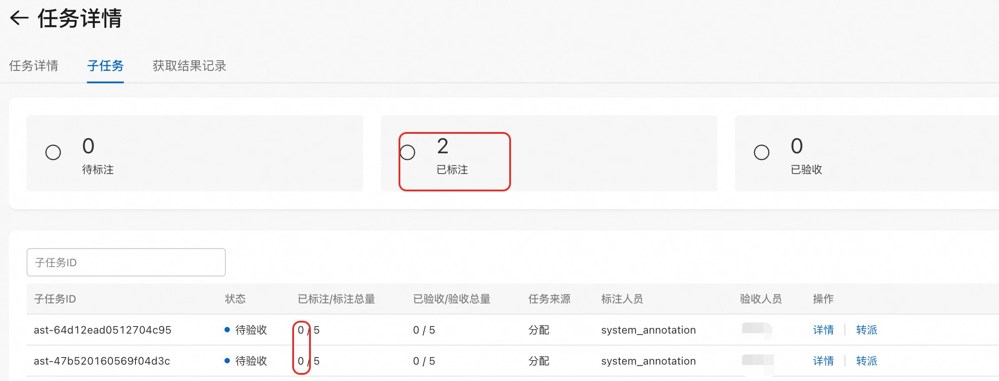

**可能原因**

数据集格式不对或自动标注选的模型参数较小。

**解决方案**

1. 登录AI Studio控制台。

2. 在顶部菜单栏处，选择组织、资源集和地域。

3. 在左侧导航栏中，单击**数据管理** > **数据集**。

4. 单击自动标注的数据集操作列**详情**。

5. 检查所选的大模型是否为32B及以上，并确认所选数据集的格式是否符合数据标注模板的要求。

6. 检查上传的数据集文件是否损坏。

<a id="section-5-2-3"></a>

### 5.2.3. 数据生成常见问题排查

本章节介绍当数据生成出现问题时如何处理。

**问题现象**

数据生成结果为空。

**可能原因**

数据集格式不对或数据生成任务选的模型参数较小。

**解决方案**

1. 登录AI Studio控制台。

2. 在顶部菜单栏处，选择组织、资源集和地域。

3. 在左侧导航栏中，单击**数据管理** > **数据生成**。

4. 检查所选数据集的格式是否符合数据标注模板的要求，同时检查上传的数据集文件是否损坏。

5. 记录数据生成任务所关联的在线服务。

6. 在左侧导航栏中，单击**模型服务** > **在线服务**。

7. 查看对应在线服务所选模型是否为32B及以上。

<a id="section-5-3"></a>

## 5.3. 模型训练常见问题排查

本章节及其子章节介绍在使用模型训练模块中的Notebook建模、任务建模、可视化建模等功能时，遇到的常见问题、以及可能原因和解决方案。

<a id="section-5-3-1"></a>

### 5.3.1. Notebook建模常见问题排查

本章节为您介绍在AI Studio控制台使用Notebook功能时遇到的常见问题现象、可能原因及解决方案。

**问题现象**

- 问题一：Notebook创建之后，Notebook一直处于启动中状态，无法转换为运行中状态。

  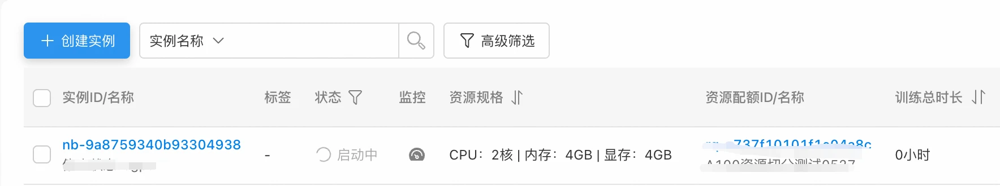

- 问题二：单击Notebook建模后的打开按钮，无法打开Notebook的编辑页面，提示：“检测到该任务资源所在的AI资源池未打开经典网络设置，无法访问该任务实例，请联系管理员在AI资源池列表操作中打开后再访问实例。”

  

- 问题三：交互式建模VSCode编辑环境无法打开。

- 问题四：交互式建模SSH服务无法正常访问。

- 问题五：创建Notebook任务时，提示“未启用资源组镜像加速特性”。

**可能原因**

- 问题一原因：因为Notebook运行的需要CPU/内存/GPU资源不足，无法满足Notebook建模运行的需求。

- 问题二原因：Notebook所在的资源池的经典网络访问未启用，需要启用Notebook所在资源池的经典网络访问。

- 问题三原因：

  - 在创建Notebook时，编辑环境未选中VSCode。

  - 使用自定义的Notebook镜像，镜像中未正确安装VSCode服务。

- 问题四原因：

  - 创建Notebook时，未启用Notebook服务。

  - 使用的自定义镜像，未正确安装sshd服务。

- 问题五原因：Notebook建模所在资源组不支持镜像加速特性。

**解决方案**

- 问题一：

  <ol type="i">

  <li>

  登录AI Studio控制台。

  </li>

  <li>

  左侧导航栏选择**模型训练**，单击**Notebook建模**进入界面。

  </li>

  <li>

  单击对应Notebook实例的**详情**。

  </li>

  <li>

  单击**事件**页签，查看Notebook事件，确认Notebook无法启动的原因。

  如果Notebook运行需要CPU/内存/GPU资源不足，尝试减少Notebook需要的CPU/内存/GPU资源，或者停止不再使用的Notebook建模/任务建模/在线服务，释放资源。

  </li>

  </ol>

- 问题二：

  <ol type="i">

  <li>

  登录AI Studio控制台。

  </li>

  <li>

  在顶部菜单栏选择自己的组织名称、资源集以及地域。

  </li>

  <li>

  在左侧菜单栏点击选择**AI资源管理** -> **AI资源池**。

  </li>

  <li>

  进入AI资源池页面，找到Notebook所在资源池，单击操作栏的经典网络访问按钮。

  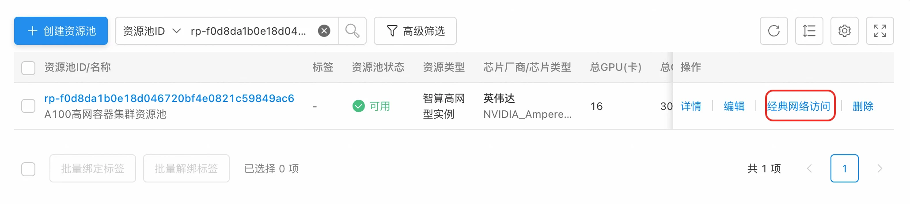

  </li>

  <li>

  在弹出的对话框中，启用经典网络访问的开关，单击确定，启用经典网络访问。

  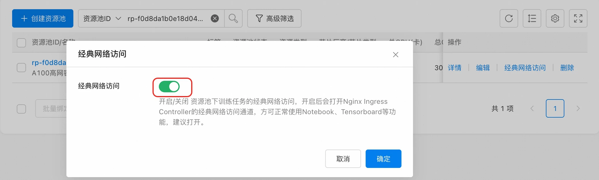

  </li>

  </ol>

- 问题三：

  <ol type="i">

  <li>

  登录AI Studio控制台。

  </li>

  <li>

  左侧导航栏选择**模型训练**，单击**Notebook建模**进入界面。

  </li>

  <li>

  单击对应Notebook实例的**详情**。

  - 请先确认创建Notebook时，是否启用了VSCode编辑环境，若未启用VSCode编辑环境，VSCode服务不会启动。

  - 请先确认使用的镜像为预置镜像还是自定义镜像。 VSCode编辑环境需要镜像内置VSCode服务，预置镜像已经安装了VSCode服务，自定义镜像需要用户手动安装部署VSCode服务，若未安装VSCode，请正确安装。

  - 如果确认VSCode已经正确安装，请检查对应Notebook实例的日志信息，判断VSCode是否正常启动。

  </li>

  </ol>

- 问题四：

  <ol type="i">

  <li>

  登录AI Studio控制台。

  </li>

  <li>

  左侧导航栏选择**模型训练**，单击**Notebook建模**进入界面。

  </li>

  <li>

  单击对应Notebook实例的**详情**。

  - 请先确认创建Notebook时，是否启用了SSH功能，若未启用SSH功能，不会自动启动SSH服务。

  - 请先确认使用的镜像为预置镜像还是自定义镜像。预置镜像已经安装了SSH服务，自定义镜像需要用户手动安装部署SSH服务，同时支持service sshd start命令，若未安装SSH服务，请正确安装。

  - 如果确认SSH已经正确安装，请检查对应Notebook实现的日志信息，查看SSHD的启动信息，判断SSHD是否正确启用。

  </li>

  </ol>

- 问题五：

  <ol type="i">

  <li>

  登录AI Studio控制台。

  </li>

  <li>

  左侧导航栏选择**模型训练**，单击**Notebook建模**进入界面。

  </li>

  <li>

  点击页面左上角<strong>+创建实例</strong>。

  </li>

  <li>

  在**Notebook实例建模**界面，完成实例的相关配置。

  > **说明**
  >
  > - Notebook实例配置包括创建实例的基本信息（组织、资源集、地域、实例名称、描述）以及一个实例所需的全部资源（资源组、数据集、镜像、模型、存储）。
  >
  > - 选择镜像为非加速类型的镜像，选择资源组为支持像加速类型的资源组。

  <ol type="a">

  <li>

  配置实例的基本信息

  </li>

  </ol>

  | 配置项 | 是否必选 | 说明 |
  | --- | --- | --- |
  | 组织 | 是 | 选择Notebook实例所属的组织。 |
  | 资源集 | 是 | 选择Notebook实例所属的资源集。 |
  | 地域 | 是 | 选择Notebook实例所属的地域。 |
  | 实例名称 | 是 | 输入当前Notebook实例的名称。 |
  | 描述 | 否 | 输入当前Notebook实例的描述。 |

  <ol type="a" start="2">

  <li>

  配置实例所使用的资源

  </li>

  </ol>

  | 配置项 | 是否必选 | 说明 |
  | --- | --- | --- |
  | 资源组 | 是 | 选择当前Notebook实例所使用的资源组，同时配置所需的<strong>CPU(核)</strong>，<strong>内存(GB)</strong>，<strong>GPU(卡)</strong>/<strong>GPU显存</strong><strong>（GB）</strong>数额。<br>说明如果打开GPU共享虚拟化，请配置<strong>GPU显存</strong><strong>（GB）</strong>，AI Studio会根据GPU实际切分粒度，自动适配并申请所需的GPU显存资源。 |

  <ol type="i" start="100">

  <li>

  数据集配置

  </li>

  </ol>

  | 配置项 | 是否必选 | 说明 |
  | --- | --- | --- |
  | 选择数据集 | 否 | 选择当前实例所采用的数据集类型，数据集名称，随后手动填写<strong>挂载路径</strong>，选择数据集对应的<strong>数据加速器</strong>（数据集最多可添加20条）。 |

  <ol type="i" start="500">

  <li>

  环境配置

  </li>

  </ol>

  | 配置项 | 是否必选 | 说明 |
  | --- | --- | --- |
  | 选择镜像 | 是 | 选择适用于当前Notebook实例的镜像环境，当前版本支持<strong>自定义镜像</strong>和<strong>公共镜像</strong> |
  | 编辑环境 | 是 | 请选择<strong>Jupyter</strong>或者<strong>VSCode</strong>编辑环境。 |
  | 账号 | 是 | 设置用于登录所创建Notebook实例的账号，当前版本支持单账号系统，请用户记住该账号，丢失则无法登录已创建实例 |
  | 密码 | 是 | 设置用于登录所创建Notebook实例的密码，请用户记住该密码，丢失则无法登录已创建实例。若密码存在泄漏风险，该密码也用于更改密码 |
  | 确认密码 | 是 | 重复输入设置的Notebook实例登录密码 |
  | 基于现有模型训练/选择模型 | 否 | 单击开关按钮，选择适用于当前Notebook实例的<strong>模型类</strong><strong>型</strong>（当前版本仅支持自定义模型），<strong>模型名称/ID</strong>，手动填写<strong>存储挂载路径</strong>（挂载在Notebook容器的路径），选择模型对应的<strong>数据加速器</strong> |
  | 持久化存储设置 | 否 | 选择当前Notebook实例持久化存储路径（用于存储训练的输出结果），选择OSS存储<strong>文件路径</strong>，手动填写<strong>存储</strong><strong>挂载路径</strong>（挂载在Notebook容器的路径） |
  | 三方存储 | 否 | 当<strong>资源组</strong>选择<strong>智算纳管型实例</strong>时，会展示该参数。开启三方存储后，会自动获取在AI资源池配置的三方存储，并手动填写挂载路径。 |
  | 启用SSH | 否 | 是否启用SSH远程连接 |
  | SSH公钥 | 否 | SSH公钥，可使用本地命令ssh-keygen -t rsa来生成SSH密钥对，默认生成的密钥文件路径如下：<br>• 私钥：<code> ~/.ssh/id_rsa </code><br>• 公钥：<code> ~/.ssh/id_rsa.pub </code> |
  | 网络连接 | 否 | 是否启用经典网络连接 |

  </li>

  <li>

  单击**提交**。

  </li>

  </ol>

<a id="section-5-3-2"></a>

### 5.3.2. 任务建模常见问题排查

本文为您介绍在AI Studio控制台使用任务建模功能时遇到的常见问题现象、可能原因及解决方案。

**问题现象**

- 问题一现象：任务建模创建完成之后，任务建模运行失败。

  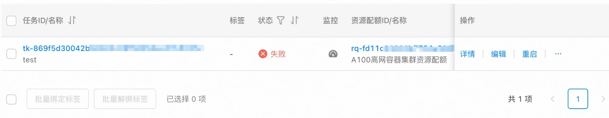

- 问题二现象：任务建模创建之后，一直处于排队中状态，无法运行。

  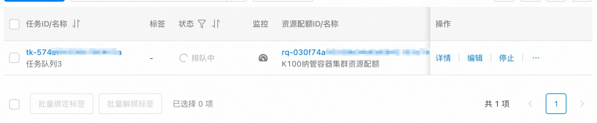

- 问题三现象：创建任务建模任务时，提示“未启用资源组镜像加速特性”。

- 问题四现象：容错&弹性配置中，CheckPoint存储位置中CPFS文件系统下拉时为空数据。

  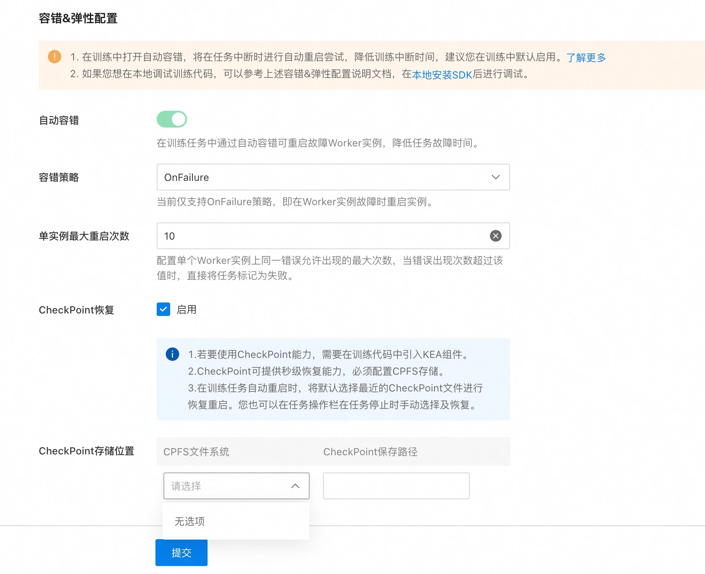

**可能原因**

- 问题一原因：任务建模的训练的代码有问题，导致任务建模执行失败。

- 问题二原因：任务建模运行需要的资源不足，导致任务建模一直处于排队中的状态。

- 问题三原因：任务建模所在资源组不支持镜像加速特性。

- 问题四原因：任务建模所在资源池未正确挂载CPFS文件。

**解决方案**

- 问题一：

  <ol type="i">

  <li>

  登录AI Studio控制台。

  </li>

  <li>

  左侧导航栏选择**模型训练**，单击**任务建模**进入界面。

  </li>

  <li>

  在任务列表界面，单击对应任务的**详情**按钮。

  </li>

  <li>

  查看任务建模的资源实例信息。

  - 若任务建模的模型训练pod未创建成功，或者处于准备中状态，点击事件标签页，查看模型训练的Pod未正确运行的信息。

  - 若务建模的模型训练 pod 全部创建正常，但是任务执行失败，先请检查失败的Pod日志信息，检查是否为训练代码的问题。

  </li>

  </ol>

- 问题二：

  <ol type="i">

  <li>

  登录AI Studio控制台。

  </li>

  <li>

  左侧导航栏选择**模型训练**，单击**任务建模**进入界面。

  </li>

  <li>

  在任务列表界面，单击对应任务的**详情**按钮。

  </li>

  <li>

  查看任务建模的资源。

  如果任务建模运行需要的资源不足，尝试减少任务建模的资源使用，或者停止不再使用的Notebook建模/任务建模/在线服务，释放资源。

  </li>

  </ol>

- 问题三：

  <ol type="i">

  <li>

  登录AI Studio控制台。

  </li>

  <li>

  左侧导航栏选择**模型训练**，单击**任务建模**进入界面。

  </li>

  <li>

  更换任务建模使用的镜像为非加速类型的镜像。

  </li>

  <li>

  更新支持镜像加速类型的资源组。

  </li>

  </ol>

- 问题四：

  <ol type="i">

  <li>

  登录统一运营平台。

  </li>

  <li>

  在顶部菜单中选择**产品 > 计算 > 云服务器 > 裸金属算力平台BMCP**。

  </li>

  <li>

  进入BMCP配置界面，给对应的资源池启用并挂载高性能文件存储。

  </li>

  </ol>

<a id="section-5-3-3"></a>

### 5.3.3. Tensorboard常见问题排查

本文为您介绍在AI Studio控制台使用Tensorboard功能时遇到的常见问题现象、可能原因及解决方案。

**问题现象**

- 问题一现象：在Tensorboard界面中进行操作，提示【非法删除数据配置】问题。

  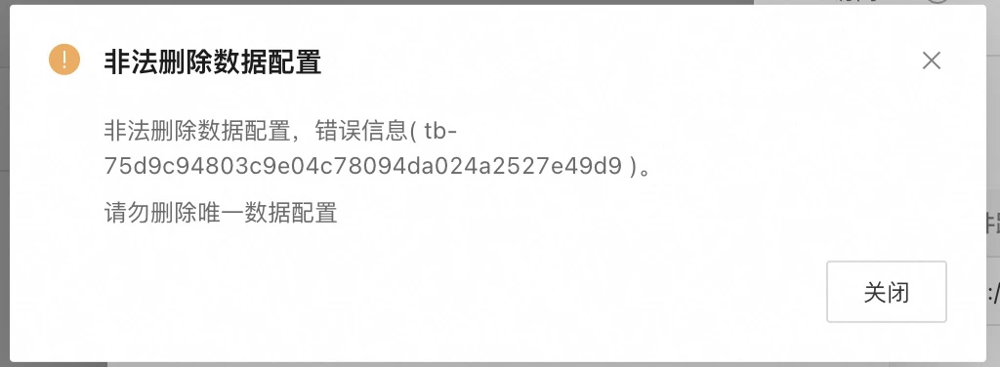

- 问题二现象：Tensorboard列表中，点击【Tensorboard看板】后，提示【No dashboards】问题。

  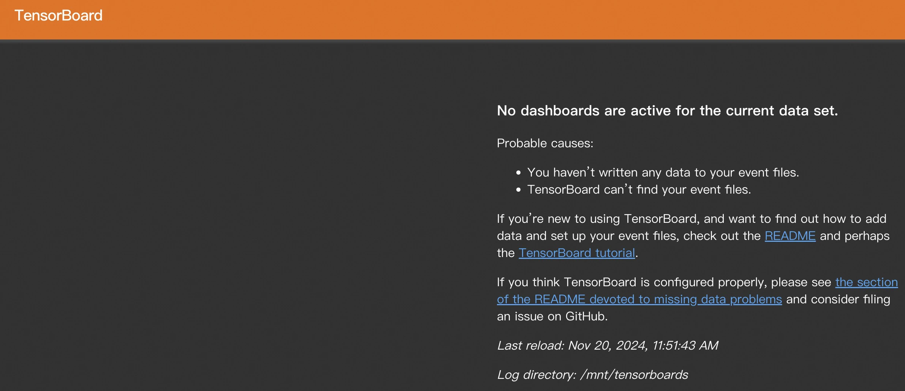

- 问题三现象：创建Tensorboard时，点击【提交】后，提示【挂载路径重复】问题。

  

**可能原因**

- 问题一原因：用户尝试删除某个Tensorboard实例中的最后一条数据配置。

- 问题二原因：Tensorboard数据配置对应的OSS目录下不包含events文件。

- 问题三原因：

  - Tensorboard实例下不同数据配置栏目选择了相同的持久化存储路径。

  - Tensorboard实例下不同数据配置栏目填写了相同的Logdir目录。

**解决方案**

- 问题一：

  <ol type="i">

  <li>

  进入**任务建模**界面。

  </li>

  <li>

  在任务列表界面，点击对应任务的**Tensorboard**按钮。

  </li>

  <li>

  在**Tensorboard**列表界面，点击对应Tensorboard实例的**详情**按钮。

  - 确认当前Tensorboard实例中数据配置数目。

  - 如果发现仅存一条数据配置，则勿删，建议创建额外Tensorboard实例对训练结果进行可视化。

  </li>

  </ol>

- 问题二：

  <ol type="i">

  <li>

  进入**任务建模**界面。

  </li>

  <li>

  在任务列表界面，点击对应任务的**Tensorboard**按钮。

  </li>

  <li>

  在**Tensorboard**列表界面，点击对应Tensorboard实例的**详情**按钮。

  </li>

  <li>

  打开Tensorboard详情界面，确认其中OSS数据配置的文件路径。

  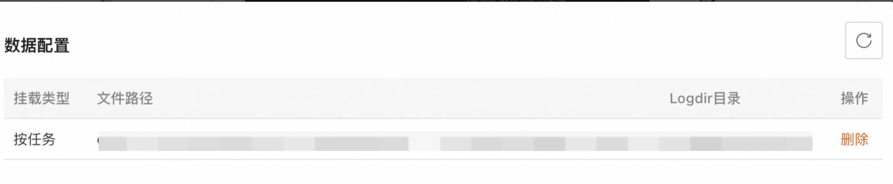

  </li>

  <li>

  进入OSS产品，查询该文件路径下是否含有OSS所需的events文件，若无events文件，则请参考【用户手册】中【Tensorboard】模块介绍，在代码中引入Tensorboard所需算法库，并导入OSS。

  </li>

  </ol>

- 问题三：

  <ol type="i">

  <li>

  登录AI Studio控制台。

  </li>

  <li>

  左侧导航栏选择**任务建模**，单击**任务建模**进入界面。

  </li>

  <li>

  界面中选择需要进行训练可视化的任务条目ID，单击所选择任务条目右侧的<strong>···</strong>按钮后点击**TensorBoard**进入界面。

  </li>

  <li>

  点击左上角<strong>+新建Tensorboard</strong>。

  </li>

  <li>

  在**新建TensorBoard**界面，完成Tensorboard的相关配置。

  > **说明**
  >
  > - Tensorboard配置包括创建Tensorboard的基本信息（Tensorboard名称）以及一个Tensorboard实例所需的全部资源（资源量、数据配置）。
  >
  > - 创建Tensorboard界面，修改不同数据配置下的**持久化存储路径**和**Logdir目录**信息不相同即可。

  <ol type="a">

  <li>

  配置实例的基本信息

  </li>

  </ol>

  | 配置项 | 是否必选 | 说明 |
  | --- | --- | --- |
  | Tensorboard名称 | 是 | 输入当前Tensorboard实例的名称。 |

  <ol type="a" start="2">

  <li>

  配置实例所使用的资源，若需多数据配置则点击<strong>+添加</strong>

  </li>

  </ol>

  | 配置项 | 是否必选 | 说明 |
  | --- | --- | --- |
  | 资源量 | 是 | 选择当前Tensorboard实例所使用的资源量，当events文件总量小于100MB时建议选用【CPU 1核 ｜ 内存 2GB】资源规格。 |
  | 数据配置-挂载类型 | 是 | 选择当前Tensorboard实例所需数据配置对应的文件挂载类型。 |
  | 数据配置-持久化存储路径 | 是 | 选择当前Tensorboard实例所需数据配置对应的持久化存储路径。 |
  | 数据配置-Logdir目录 | 是 | 输入当前Tensorboard实例所需数据配置对应的Logdir目录，即挂载路径。 |

  </li>

  <li>

  单击**提交**。

  </li>

  </ol>

<a id="section-5-3-4"></a>

### 5.3.4. 可视化建模常见问题排查

本文为您介绍在AI Studio控制台使用可视化建模时遇到的常见问题现象、可能原因及解决方案。

**问题现象**

- 问题一现象：可视化建模节点在运行完成之后，状态显示为失败状态。

  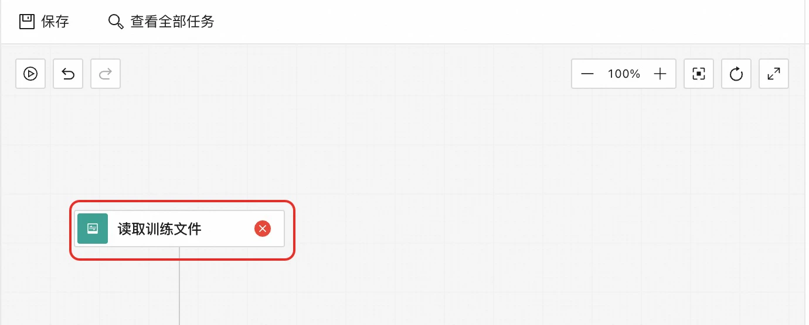

- 问题二现象：可视化建模工作流在执行中，节点一直处于运行中的状态。

**可能原因**

- 问题一原因：需要访问的OSS的路径不存在，导致组件运行出错。

- 问题二原因：节点运行所需要的CPU/内存/GPU资源不足，导致节点一直处于等待中状态。

**解决方案**

- 问题一：在运行失败的节点右键，点击查看日志，查看组件的运行日志信息，确认出错的原因，可能的出错原因有：

  - 如果日志信息显示需要读取的OSS的路径不存在，那么修改组件要读取的OSS路径，重新运行工作流。

    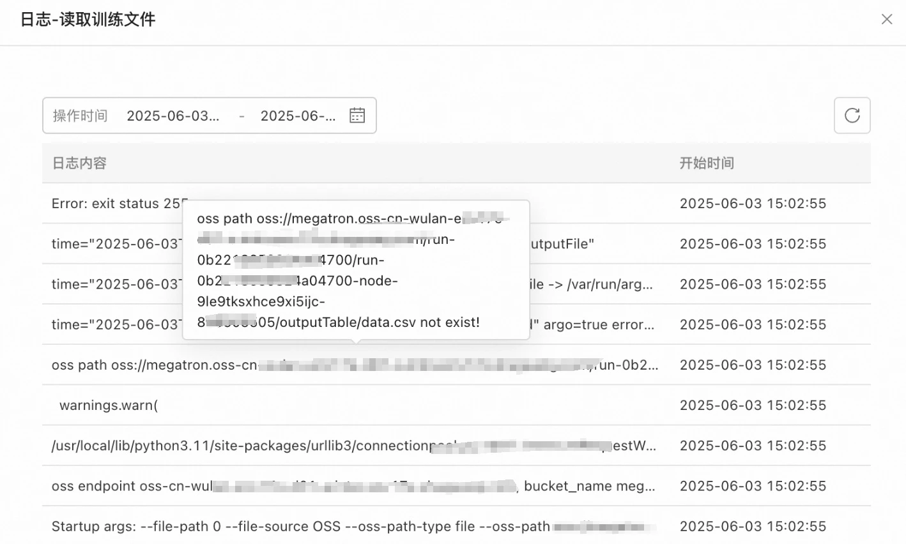

- 问题二：

  <ol type="i">

  <li>

  登录AI Studio控制台。

  </li>

  <li>

  在顶部菜单栏选择自己的组织名称、资源集以及地域。

  </li>

  <li>

  在左侧菜单栏点击选择**模型训练** > **可视化建模**。

  </li>

  <li>

  在工作流列表界面，点击对应工作流的**详情**按钮。

  </li>

  <li>

  单击任务记录，查看任务执行的详细信息，选中运行中的节点，单击任务日志->事件，查看节点的运行事件。

  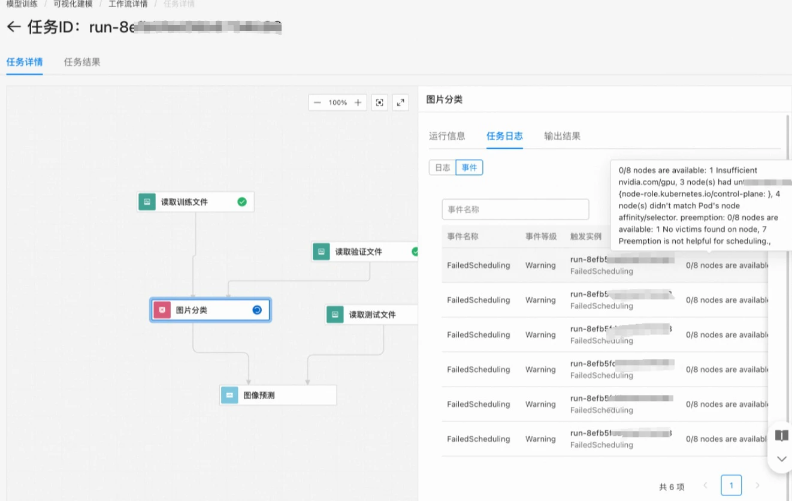

  如果工作流运行需要的CPU/内存/GPU资源不足，尝试减少节点运行需要的CPU/内存/GPU，或者停止不再使用的Notebook建模/任务建模/在线服务，释放资源。

  </li>

  </ol>

<a id="section-5-4"></a>

## 5.4. 模型服务常见问题排查

本章节及其子章节介绍模型服务模块中的在线服务、灰度群组和批量推理等功能在使用时遇到的问题，以及可能原因和解决方案。

<a id="section-5-4-1"></a>

### 5.4.1. 在线服务常见问题排查

本文为您介绍在AI Studio控制台使用**在线服务**功能时遇到的告警问题现象、可能原因及解决方案。

> **重要**
>
> - 如果部署vllm镜像，资源选择16C、32G、1GPU。否则可能报错资源不足，例如：
>
>   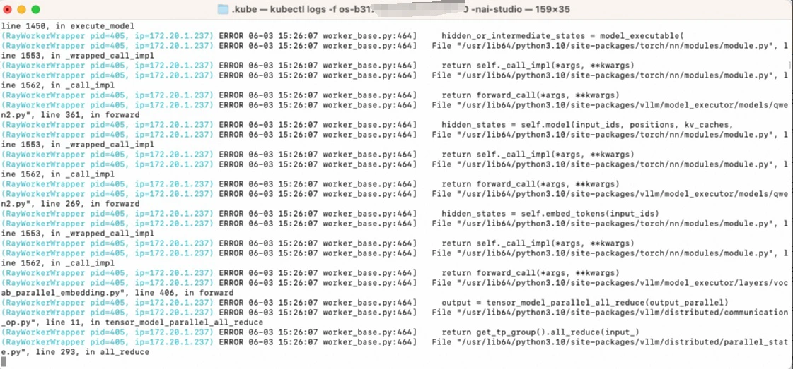
>
> - 镜像算力类型与资源组的算力需要保持一致，否则可能无法运行。
>
> - 扩缩容设置
>
>   - 扩缩容指标：目前支持CPU利用率阈值和GPU利用率阈值。当CPU或GPU的平均利用率持续超过设定的上阈值（例如70%）时，系统会自动增加实例数量，避免资源瓶颈影响性能。当利用率持续低于下阈值（例如30%）时，系统会自动减少实例数量，节省资源成本。
>
>   - 扩容生效时长：检测达到扩容指标后，持续指定时长后进行扩容。
>
>   - 缩容生效时长：检测达到缩容指标后，持续指定时长后进行缩容。
>
>   - 扩缩容原则：在进行弹性伸缩的时候，所有的实例数都是按照扩缩容指标的计算的最大实例数进行弹性的伸缩。
>
>     例如：扩容的时候，两个扩缩容指标计算出的实例数分别为5个实例和6个实例，那么扩容的目标实例数是6。缩容的时候，两个扩缩容指标计算出的实例数分别为2个实例和3个实例，那么缩容的目标实例数是3。
>
>   - 扩缩容目标实例数计算公式：
>
>     
>
>     例如：当前实例数为1，当前指标为50，指标阈值为15，由计算公式得到目标实例数为4。所以，在下一个窗口期（60s）再次检查之后，以步长为1进行扩展，实例数逐步变为4。

**弹性伸缩**

**问题现象**

开启了弹性伸缩，但看不到伸缩记录。


**可能原因**

- 在线服务没有达到扩缩容条件。

- 扩缩容后，没有正确获取到弹性记录。

**解决方案**

- **原因一**：

  <ol type="i">

  <li>

  登录AI Studio控制台。

  </li>

  <li>

  在顶部菜单栏处，选择组织、资源集和地域。

  </li>

  <li>

  在左侧导航栏中，单击**模型服务** > **在线服务**。

  </li>

  <li>

  在**在线服务**列表界面，单击对应服务的

  。

  

  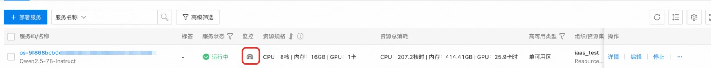

  </li>

  <li>

  查看对应指标是否满足扩缩容条件。

  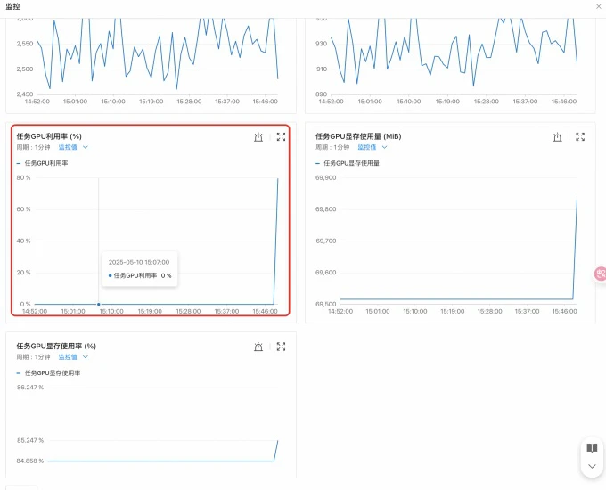

  </li>

  </ol>

- **原因二**：

  <ol type="i">

  <li>

  过查看pod扩缩容记录，查看事件，查看gpu算力，查看prometheus 监控等方式，观察在线服务扩缩容情况。

  </li>

  <li>

  查看pod扩缩容记录。

  ```bash
  kubectl -n ai-studio describe deployments.apps os-
  123f3c61074d3046b408be70c81f3101e009 
  ```

  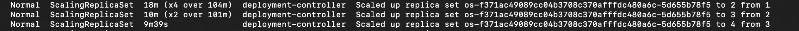

  </li>

  <li>

  查看事件。

  ```bash
  kubectl get events -n ai-studio --field-selector 
  involvedObject.kind=HorizontalPodAutoscaler --sort-by='.metadata.creationTimestamp'
  ```

  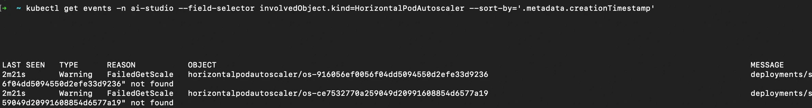

  - 伸缩时间：LAST SEEN（表示最近一次发生该事件的时间），89s 代表该事件在 89 秒前发生。5m 代表该事件在 5 分钟前发生。

  - 伸缩类型：up

  - 实例数变化：from 1 to 3

  </li>

  <li>

  查看gpu算力。

  ```bash
  curl http://localhost:8082/metrics
  ```

  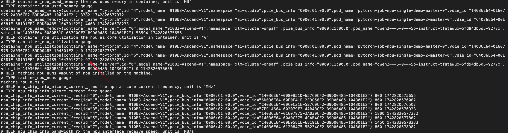

  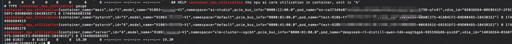

  </li>

  <li>

  查看prometheus监控。

  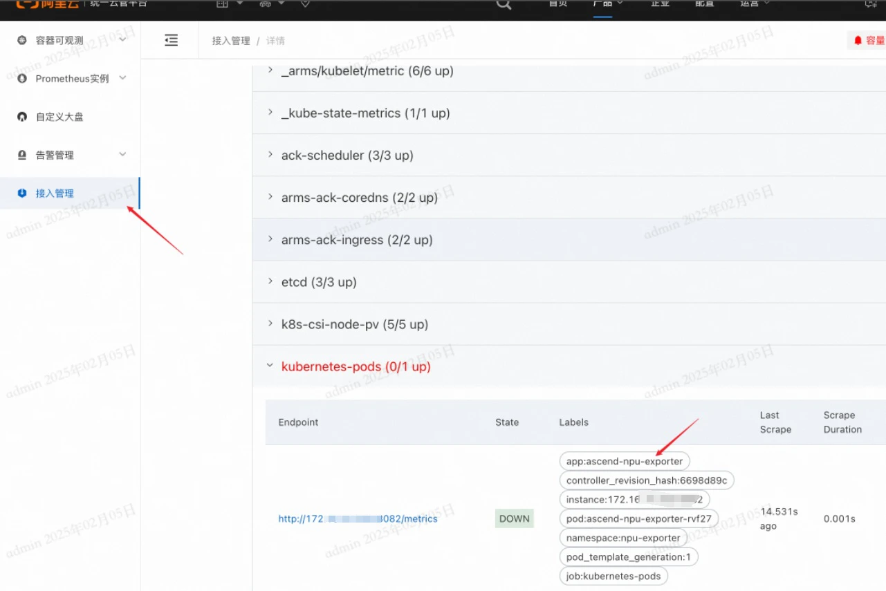

  </li>

  </ol>

**AI网关配置**

**问题现象**

在线服务无法进行AI网关配置。

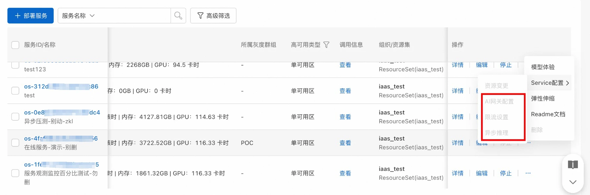

**可能问题**

该在线服务已加入灰度组。

**解决方案**

1. 登录AI Studio控制台。

2. 在顶部菜单栏处，选择组织、资源集和地域。

3. 在左侧导航栏中，单击**模型服务** > **在线服务**。

4. 在**在线服务**列表界面，查看所属灰度群组。

   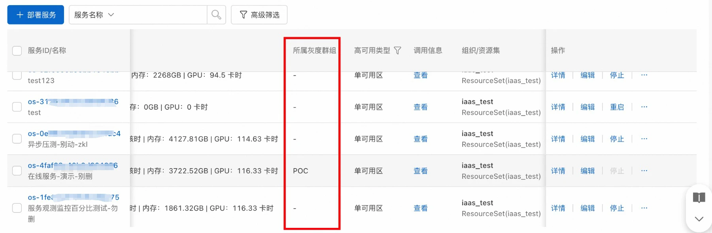

**问题现象**

重启在线服务后，网关调用信息显示未配置网关。

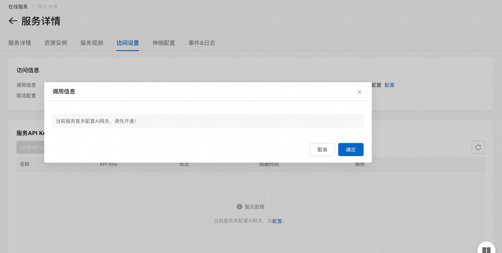

**可能原因**

停止在线服务会删除在线服务的网关。

**解决方案**

1. 登录AI Studio控制台。

2. 在顶部菜单栏处，选择组织、资源集和地域。

3. 在左侧导航栏中，单击**模型服务** > **在线服务**。

4. 单击操作列<strong>··· > Service配置 > AI网关配置</strong>。

   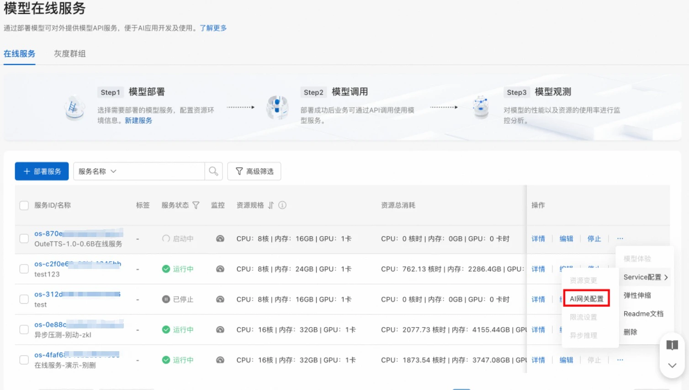

5. 重新创建网关。

**API Key**

**问题现象**

已经创建网关，却无法管理API Key。

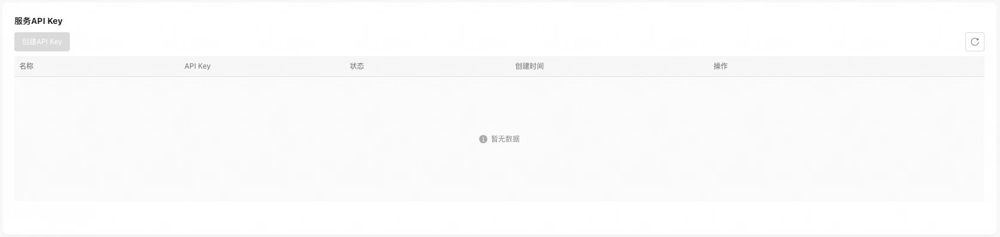

**可能原因**

- 在线服务已经加入灰度组。

  如果在线服务已经加入灰度组，则无法在在线服务详情管理API Key。如果需要管理，请前往灰度组详情。

- 当前用户不是在线服务创建人。

  只有在线服务的创建人才有API Key的管理权限。

**解决方案**

- **原因一**：

  <ol type="i">

  <li>

  登录AI Studio控制台。

  </li>

  <li>

  在顶部菜单栏处，选择组织、资源集和地域。

  </li>

  <li>

  在左侧导航栏中，单击**模型服务** > **在线服务**。

  </li>

  <li>

  在模型在线服务页面，选择**灰度群组**页签。

  </li>

  <li>

  在灰度群组列表单击**操作**列**详情**。

  </li>

  <li>

  在灰度群组详情页面，选择**访问设置**页签，管理API Key。

  </li>

  </ol>

- **原因二**：请联系在线服务的创建人提供需要的API Key。

**模型访问**

**同步网关调用**

**问题现象**

访问在线服务时报错：

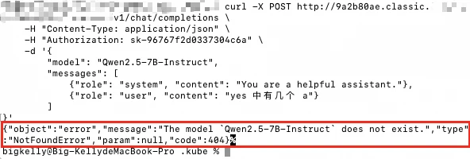

**可能原因**

访问在线服务时选择，使用了错误的模型名称。

**解决方案**

1. 登录AI Studio控制台。

2. 在顶部菜单栏处，选择组织、资源集和地域。

3. 在左侧导航栏中，单击**模型服务** > **在线服务**。

4. 在**在线服务**列表界面，单击对应服务的**详情**按钮。

   

5. 跟问题中的模型名称对比是否一致。

**问题现象**

访问在线服务报错403


**可能原因**

API Key鉴权失败，检查API Key是否可用。


**解决方案**

1. 登录AI Studio控制台。

2. 在顶部菜单栏处，选择组织、资源集和地域。

3. 在左侧导航栏中，单击**模型服务** > **在线服务**。

4. 在**在线服务**列表界面，单击对应服务的**详情**按钮。

5. 在详情页面，选择**访问设置**页签。

6. 使用apikey列表已启用状态的apikey重新访问。

   

**问题现象**

访问在线服务报错：429 Too Many Requests。


**可能原因**

已设置限流策略。


**解决方案**

1. 登录AI Studio控制台。

2. 在顶部菜单栏处，选择组织、资源集和地域。

3. 在左侧导航栏中，单击**模型服务** > **在线服务**。

4. 在**在线服务**列表界面，单击对应服务的**详情**按钮。

5. 在详情页面，选择**访问设置**页签。

6. 单击限流配置的编辑，重新设置限流策略。

**异步网关调用**

**问题现象**

查询结果返回：{"detail":"Result not found"}


**可能原因**

- 查询时，还没有产生推理结果，所以没查询到。

- 已经查询到过对应messageID的推理结果，无法再次获取结果。

**解决方案**

等待一段时间，再次查询推理结果。

<a id="section-5-4-2"></a>

### 5.4.2. 灰度群组常见问题排查

本文为您介绍在AI Studio控制台使用**灰度群组**功能时遇到的告警问题现象、可能原因及解决方案。

**问题现象**

- 问题一现象：创建灰度群组时显示网关不存在。

  

- 问题二现象：灰度群组添加在线服务失败。

- 问题三现象：同一个灰度群组的在线服务分配到的流量为0。

- 问题四现象：在线服务的移除和暂停置灰，无法点击。

- 问题五现象：在线服务无法删除。

**可能原因**

- 问题一原因：没有开启AI智能网关。

- 问题二原因：

  - servedModelName不一致。

  - 在线服务不属于同一个资源池。

- 问题三原因：在线服务的状态不是运行中。

- 问题四原因：在线服务分配到的流量不为0，只有流量为0的在线服务才支持移除和暂停。

- 问题五原因：在线服务为该灰度群组中唯一一个，因此无法删除。

**解决方案**

- 问题一：

  <ol type="i">

  <li>

  登录AI Studio控制台。

  </li>

  <li>

  在顶部菜单栏处，选择组织、资源集和地域。

  </li>

  <li>

  在左侧导航栏中，单击**模型服务** > **在线服务**。

  </li>

  <li>

  选择对应的在线服务，打开AI智能网关的开关。

  </li>

  </ol>

- 问题二：

  <ol type="i">

  <li>

  登录AI Studio控制台。

  </li>

  <li>

  在顶部菜单栏处，选择组织、资源集和地域。

  </li>

  <li>

  在左侧导航栏中，单击**模型服务** > **在线服务**。

  </li>

  <li>

  在模型在线服务页面，选择**灰度群组**页签。

  </li>

  <li>

  在灰度群组列表单击**操作**列**详情**。

  </li>

  <li>

  在灰度群组详情页签查看灰度群组中在线服务的servedModelName。

  </li>

  <li>

  在模型在线服务页面，选择**在线服务**页签。

  </li>

  <li>

  单击**详情**，查看在线服务的servedModelName是否和灰度群组的一致。

  </li>

  <li>

  同时只有属于同一个资源池的在线服务才能加入到一个灰度群组，不属于一个资源池的在线服务会被过滤掉。

  </li>

  </ol>

- 问题三：只有在线服务的状态是运行中时，才能分配到流量。

- 问题四：在灰度群组内，在线服务灰度流量为0，才支持移除。

- 问题五：删除灰度群组时会校验灰度群组内的在线服务数量，当在线服务数量等于1时，才支持删除灰度群组。

<a id="section-5-4-3"></a>

### 5.4.3. 批量推理常见问题排查

本章节介绍在批量推理出现问题时的可能原因和解决方案。

**前提条件**

- 数据准备：需要满足模型文件结构。这是一个小型轻量级的模型整体结构。在选择别的模型时请检查模型文件结构，保证满足文件结构。

  

- 合理分配资源：在进行批量推理时，无论是采用推理脚本还是推理模型，都需依赖机器集群。即系统中所提到的资源池和资源组。在发起训练之前，必须确保机器节点的CPU、内存和GPU资源充足，并合理分配这些资源。训练过程中，建议将内存设置得相对较大，以避免出现OOM异常。尤其在进行大模型的批量推理时，合理分配资源显得尤为重要，需有效利用算力（GPU）资源，以确保模型推理的正常进行。

- 镜像的集群架构兼容性：批量推理离不开镜像的支持。针对市面上不同的集群芯片厂商，总体存在多种计算架构类型，但最常用的架构为X86、ARM及ARM64三种类型。ARM64是ARM的64位扩展型，因此可以视为同一计算架构类型。镜像仓库首先需确保与机器的计算架构类型一致，之后再考虑集群芯片的兼容性，针对不同芯片选择相应的镜像。

  查询镜像计算架构类型命令：

  ```bash
  docker inspect 镜像tagId
  ```

**问题现象**

推理服务运行异常。

**可能原因**

- 集群节点资源不足，任务处于队列或者状态一直PENDING。

- POD一直处于创建中状态。

- POD部分运行。

- POD创建很快失败。

**解决方案**

- 原因一：释放集群节点资源，保证任务执行资源充足。

- 原因二：

  - 环境证书过期或者获取不到证书信息，请尝试更新证书信息。

  - 尝试重启环境集群节点。

  - 任务执行GPU类型错误，请联系管理员处理。

- 原因三：运行在不同节点，集群部分节点资源不足。可以选择对资源不足节点去手动释放资源，或者编辑任务yaml指定运行的资源组，保证所选的配额资源充足。

  ```bash
  //设置i-co1nsm6heoba7fhj5cug节点的资源组标签为rq-05d0bdfd02d7b0472a09f1304de629000a5a
  kubectl label node i-co1nsm6heoba7fhj5cug  aipaas-resource-quota-id=rq-
  05d0bdfd02d7b0472a09f1304de629000a5a
  //将节点i-cs6t3r6heobeudqdtbb0解除绑定资源组标签
  kubectl label node i-cs6t3r6heobeudqdtbb0 aipaas-resource-quota-id-
  ```

- 原因四：

  <ol type="i">

  <li>

  登录AI Studio控制台。

  </li>

  <li>

  在顶部菜单栏处，选择组织、资源集和地域。

  </li>

  <li>

  在左侧导航栏中，单击**数据管理** > **数据集**。

  </li>

  <li>

  在数据集列表界面，单击对应数据集的操作列**详情**。

  </li>

  <li>

  在数据集版本列表中单击**操作**列**查看**。请检查相关的挂载路径，确保挂载配置正确。

  </li>

  <li>

  请确认任务执行脚本的配置是否正确，尤其是在涉及分布式任务时，必须确保分布式的关键参数已得到正确配置（通常情况下，若此配置错误，系统仍能进行单机部署）。此外，还应检查执行脚本中是否存在语法错误。只要配置无误，出现此类问题的可能性几乎可以忽略不计。

  </li>

  </ol>

<a id="section-5-5"></a>

## 5.5. 模型管理常见问题排查

本节及其子章节介绍在使用模型管理模块中的模型广场、模型调优、模型转换、模型评测等功能时可能遇到的常见问题及排查思路。

<a id="section-5-5-1"></a>

### 5.5.1. 模型广场常见问题排查

本文为您介绍在AI Studio控制台使用模型广场功能时遇到的常见问题现象、可能原因及解决方案。

**问题现象**

- 问题一现象：进入**MaaS市场**页签后，显示“下载连接已断开”，且界面显示**暂无数据**。

  

- 问题二现象：单击**系统模型**或**MaaS市场模型**卡片中的“部署模型”后，状态显示为【部署中】，且长时间未变化。

  

**可能原因**

- 问题一原因：

  - 用户没有启用下载功能

  - 用户当前环境没有连通能够访问魔搭社区的网络

- 问题二原因：部署模型时相关配置有错误，导致模型部署不起来

**解决方案**

- 问题一：

  <ol type="i">

  <li>

  登录AI Studio控制台。

  </li>

  <li>

  在顶部菜单栏选择自己的组织名称、资源集以及地域。

  </li>

  <li>

  在左侧菜单栏点击选择**模型管理** > **模型广场**。

  </li>

  <li>

  选择**MaaS市场**页签，可以看到目前支持下载的全部模型。

  </li>

  <li>

  单击“下载连接已断开”左侧的开关，界面变成如下的效果：

  

  - 若文案提示为“网页可达”，且界面上展示有MaaS市场的模型卡片，则说明网络已正常，模型下载功能可正常使用。

    

  - 若文案提示为“网页不可达”，则说明当前用户环境网络没有配置能够访问魔搭社区的网络，导致MaaS市场功能不可用，请联系运维人员帮忙配置网络。

  </li>

  </ol>

- 问题二：

  <ol type="i">

  <li>

  登录AI Studio控制台。

  </li>

  <li>

  在顶部菜单栏处，选择组织、资源集和地域。

  </li>

  <li>

  在左侧导航栏中，单击**模型服务** > **在线服务**。

  </li>

  <li>

  找到系统模型部署时对应的某条在线服务记录，单击**详情**。

  </li>

  <li>

  查看对应的日志与事件，从而根据“通性常见问题排查”文档，判断需要操作的事项。

  </li>

  </ol>

<a id="section-5-5-2"></a>

### 5.5.2. 模型调优常见问题排查

本文为您介绍在AI Studio控制台使用模型调优功能时遇到的常见问题现象、可能原因及解决方案。

**问题现象**

- 问题一现象：在创建调优任务时，提示数据集格式错误，非json/jsonl格式的文件数据集。

- 问题二现象：创建调优任务时，报错cGPU状态错误。

  

- 问题三现象：创建调优任务成功后，界面中显示【调优失败】。

  

**可能原因**

- 问题一原因：用户选择的自定义数据集，不是json/jsonl格式结尾的文件。

- 问题二原因：当前GPU切分后的cGPU状态与用户所选显存数额的状态不一致。

- 问题三原因：

  - 用户选择的自定义模型不在调优功能的支持范围内。

  - 用户选择的数据集格式错误，不符合SFT / DPO调优的标准格式。

**解决方案**

- 问题一：

  <ol type="i">

  <li>

  登录AI Studio控制台。

  </li>

  <li>

  在顶部菜单栏处，选择组织、资源集和地域。

  </li>

  <li>

  在左侧导航栏中，单击**数据管理** > **数据集**。

  </li>

  <li>

  按照数据集界面 / 调优界面给出的SFT示例与DPO示例，构建用户自己的自定义数据集，确保格式与示例一致，即可执行调优任务。

  

  </li>

  </ol>

- 问题二：

  <ol type="i">

  <li>

  登录AI Studio控制台。

  </li>

  <li>

  在顶部菜单栏选择自己的组织名称、资源集以及地域。

  </li>

  <li>

  在左侧菜单栏点击选择**AI资源管理** -> **资源组**。

  </li>

  <li>

  在**资源组**列表界面，点击对应数据项的**详情**按钮。

  </li>

  <li>

  查询当前资源组的cGPU状态，若处于正在切分中，则等待一段时间，使得切分完成后再进行任务下发。

  </li>

  </ol>

- 问题三：请参考技术白皮书中的调优功能模型支持范围，选择支持范围内的大模型进行调优。

  <ol type="i">

  <li>

  登录AI Studio控制台。

  </li>

  <li>

  在顶部菜单栏处，选择组织、资源集和地域。

  </li>

  <li>

  在左侧导航栏中，单击**数据管理** > **数据集**。

  </li>

  <li>

  按照数据集界面 / 调优界面给出的SFT示例与DPO示例，构建用户自己的自定义数据集。

  

  </li>

  </ol>

<a id="section-5-5-3"></a>

### 5.5.3. 模型评测常见问题排查

本文为您介绍在AI Studio控制台使用模型评测功能时遇到的常见问题现象、可能原因及解决方案。

**问题现象**

- 问题一现象：新建评测任务后，资源状态一直显示“准备中”，【查看事件】提示“0/\* nodes are available”。

  

- 问题二现象：查看【评测结果】没有找到对应的评测结果信息。

- 问题三现象：基准评测和自动评测任务的状态在“运行中”一段时间后，变为“失败”。

- 问题四现象：评测方式找不到自定义评测。

**可能原因**

- 问题一原因：

  - 评测任务运行的需要CPU/内存/GPU资源不足，无法满足运行的需求。

  - 资源组关联的集群资源可能受限不可用。

- 问题二原因：

  - 评测任务未到“完成”状态。

  - 持久化存储挂载失败。

- 问题三原因：如果是运行中变为失败，一般是因为在线服务的连通性异常，需要首先排查在线服务状态。

- 问题四原因：原有的自定义评测已默认隐藏。

**解决方案**

- 问题一：尝试减少评测任务需要的CPU/内存/GPU资源，或者停止不再使用的模型评测任务，Notebook建模/任务建模/在线服务，释放资源。

- 问题二：

  <ol type="i">

  <li>

  登录AI Studio控制台。

  </li>

  <li>

  在顶部菜单栏选择自己的组织名称、资源集以及地域。

  </li>

  <li>

  在左侧菜单栏点击选择**模型管理** > **模型评测**。

  </li>

  <li>

  在模型列表界面，单击对应任务的**详情**，查看任务详情。

  </li>

  <li>

  检查评测任务状态是否为**完成**。

  </li>

  <li>

  检查该任务配置的持久化存储路径，检查方式：查看对应OSS路径下是否生成以**评测任务id**为名称的目录。

  </li>

  </ol>

- 问题三：

  > **说明**
  >
  > 对模型进行自动评测和基准评测的前提是该模型部署后的在线服务可用，请在创建基准评测任务前，确认模型对应的在线服务“/v1/chat/completions”端点的连通性。

  <ol type="i">

  <li>

  登录AI Studio控制台。

  </li>

  <li>

  在顶部菜单栏选择自己的组织名称、资源集以及地域。

  </li>

  <li>

  在左侧菜单栏点击选择**模型管理** > **模型评测**。

  </li>

  <li>

  在模型列表界面，单击对应任务的**详情**。

  </li>

  <li>

  选择**日志**页签，查看评测任务的日志，定位ERROR日志的输出。

  

  </li>

  <li>

  检查所选模型对应的在线服务“/v1/chat/completions”端点的连通性。

  </li>

  </ol>

- 问题四：请提工单支持处理操作。

<a id="section-5-5-4"></a>

### 5.5.4. 模型评测告警问题排查

本文为您介绍在AI Studio控制台使用**模型评测**功能时遇到的告警问题现象、可能原因及解决方案。

**问题现象**

在使用模型评测功能时，界面上会出现相应的告警信息。

- 事件名称（EventName）：**Instance:ModelEvaluation.Execute.Failed**

- 事件层级（EventLevel）：**CRITICAL**

- 事件状态（EventStatus）：**TaskFailed**

**可能原因**

- 用户运行代码配置错误，导致Pod执行失败。

- 底层K8s资源不足或K8s系统错误，导致Pod执行失败。

**解决方案**

- 原因一解决方案：

  <ol type="i">

  <li>

  登录AI Studio控制台。

  </li>

  <li>

  在顶部菜单栏选择自己的组织名称、资源集以及地域。

  </li>

  <li>

  在左侧菜单栏点击选择**模型管理** > **模型评测**。

  </li>

  <li>

  在模型列表界面，单击对应任务的**详情**。

  </li>

  <li>

  选择**日志**页签，查看评测任务的日志，定位ERROR日志的输出。

  </li>

  <li>

  依据平台界面给出的日志错误信息排查相关运行代码存在的问题并修改代码内容解决问题，以避免评测任务失败。

  </li>

  </ol>

- 原因二解决方案：

  <ol type="i">

  <li>

  登录AI Studio控制台。

  </li>

  <li>

  在顶部菜单栏选择自己的组织名称、资源集以及地域。

  </li>

  <li>

  在左侧菜单栏点击选择**模型管理** > **模型评测**。

  </li>

  <li>

  在模型列表界面，单击对应任务的**详情**。

  </li>

  <li>

  选择**事件**页签。

  </li>

  <li>

  依据平台界面给出的事件信息排查K8s相关状态，若无法通过事件内容定位错误所在，建议联系运维人员以解决评测任务失败问题。

  </li>

  </ol>

<a id="section-5-6"></a>

## 5.6. AI资源管理常见问题排查

本章节及其子章节介绍AI资源管理模块中AI资源池和资源组在使用过程中遇到的问题，以及其原因和解决方案。

<a id="section-5-6-1"></a>

### 5.6.1. AI资源池常见问题排查

本文为您介绍在AI Studio控制台使用资源池时遇到的常见问题现象、可能原因及解决方案。

**问题现象**

- 问题一现象：创建资源池，显示集群已被占用。

  

- 问题二现象：对于不识别的芯片型号，数据加速、镜像加速等特性没有安装addon。

- 问题三现象：hack不识别的芯片型号资源池和资源组的芯片厂商和型号。例如实际芯片型号是NVIDIA_Ampere_A800_80G_NVLink，但是bmcp侧返回的是 NVIDIA_Hopper_H100_NVLink

**可能原因**

- 问题一原因：资源池删除的时候关联的裸金属集群需要去掉bmcp标签和ack标签，EGS集群需要去除ack标签。可能由于网络原因导致删除标签失败，最终导致新建资源池时显示集群已被占用。

**解决方案**

- 问题一：

  <ol type="i">

  <li>

  确认集群是否正在被使用。否则删除标签可导致正常被使用的资源池出现问题。

  </li>

  <li>

  登录到resource-asset的任意一个pod内，执行下面命令，替换bmcpClusterId、aliyunId和clusterId。

  

  - **删除bmcp标签：**

    ```bash
     curl --header "Content-Type: application/json" --request DELETE --data 
    ```

  </li>

  </ol>

```text
'{"bmcpClusterId":"ack-G0DxHBolaI","tagKeyList":["AI资源池
```

`ID"]}'` http://localhost:8080/internal/untagBmcpClusterTag

- **删除ack标签：**

  ```bash
   curl --header "Content-Type: application/json" --request DELETE --data 
  ```

```text
'{"aliyunId":"1539636839273427", "clusterId":"cea17db4ab***********","tagKeyList":
```

`["AI`资源池`ID"]}'`  http://localhost:8080/internal/untagAckClusterTag

- 问题二：

  <ol type="i">

  <li>

  登录到aistudio-core的任意一pod内，执行以下命令。

  kubectl get pod -n aistudio-core

  

  </li>

  <li>

  连接到数据库，执行以下命令。

  ```text
   mysql -h$db_host -P$db_port -u$db_user -p$db_password -D$db_database 
  ```

  根据资源池id或资源组id来开启相应的特性开关，例如下图，feature_mapping表，设置feature_target_status为1 是开启数据加速特性。feature_target_status有三种状态：-1（不支持），0（支持未开启），1（支持且开启）。

  

  </li>

  </ol>

- 问题三：

  <ol type="i">

  <li>

  登录到aistudio-core任务一个pod内。

  </li>

  <li>

  登录到数据库，执行以下命令。

  ```text
   mysql -h$db_host -P$db_port -u$db_user -p$db_password -D$db_database 
  ```

  修改资源组的芯片型号为NVIDIA_Ampere_A800_80G_NVLink。

  

  </li>

  <li>

  修改系统标签表中resource_id为资源组id 的芯片型号为NVIDIA_Ampere_A800_80G_NVLink。

  

  如果系统标签表中resource_id为资源池也存在错误的芯片型号，也要将错误的修改为NVIDIA_Ampere_A800_80G_NVLink。

  </li>

  </ol>

<a id="section-5-6-2"></a>

### 5.6.2. 资源组常见问题排查

本文为您介绍在AI Studio控制台使用资源组时遇到的常见问题现象、可能原因及解决方案。

**问题现象**

- 问题一现象：资源组变更配置之后，任务创建页面获取资源都为0。

- 问题二现象：新建的资源组，任务创建页面。可用的cpu数量不正确。

  

- 问题三现象：手动更改数据库资源组相关信息之后，页面信息没有刷新。

**可能原因**

- 问题一原因：由于网络原因或者不可控人为因素导致ack集群资源组标签没有打上。

- 问题二原因：登录对应的集群使用命令 nvidia-smi,显示gpu使用信息。观察是否有任务正在使用gpu卡。

  

- 问题三原因：资源管理没有监听到更改信息，导致资源管理数据信息没有刷新。

**解决方案**

- 问题一：

  <ol type="i">

  <li>

  登录AI Studio控制台。

  </li>

  <li>

  在顶部菜单栏选择自己的组织名称、资源集以及地域。

  </li>

  <li>

  在左侧菜单栏点击选择**AI资源管理** -> **资源组**。

  </li>

  <li>

  在**资源组**列表界面，点击对应数据项的**删除**按钮。

  </li>

  <li>

  在确认界面，点击**删除**按钮。

  </li>

  <li>

  在运营平台顶部菜单中选择**产品 > 计算 > 容器服务 > 容器服务镜像ACR**。

  </li>

  <li>

  选择**节点管理 > 节点**，找到该节点添加标签。

  

  

  </li>

  </ol>

- 问题三：

  <ol type="i">

  <li>

  登录AI Studio控制台。

  </li>

  <li>

  在顶部菜单栏选择自己的组织名称、资源集以及地域。

  </li>

  <li>

  在左侧菜单栏点击选择**AI资源管理** -> **资源组**。

  </li>

  <li>

  单击**变更配置**重新选择资源组。

  </li>

  </ol>

<a id="section-5-7"></a>

## 5.7. AI资产管理常见问题排查

本章节及其子章节介绍AI资产管理模块中镜像库、软件源、数据加速器和镜像加速器在使用过程中遇到的问题，及其原因和解决方案。

<a id="section-5-7-1"></a>

### 5.7.1. 镜像库常见问题排查

本文为您介绍在AI Studio控制台使用镜像库功能时可能遇到的常见问题现象、可能原因及解决方案。

**问题现象**

- 问题一现象：在创建镜像页面，镜像来源类型选择本地上传时，镜像上传失败。

- 问题二现象：在创建镜像页面，镜像来源类型选择DockerFile构建时，构建出错。

**可能原因**

- 问题一原因：所选择的镜像文件大于20G。

- 问题二原因：

  - DockerFile文件有误。

  - 所分配的CPU、内存等资源不足。

**解决方案**

- 问题一：

  <ol type="i">

  <li>

  请在本地加载得到镜像。

  </li>

  <li>

  在运营平台顶部菜单中选择**产品 > 计算 > 容器服务 > 容器服务镜像ACR**。

  </li>

  <li>

  将本地准备好的镜像上传至容器镜像服务ACR。

  </li>

  <li>

  登录AI Studio控制台。

  </li>

  <li>

  在顶部菜单栏选择自己的组织名称、资源集以及地域。

  </li>

  <li>

  在左侧菜单栏点击选择**AI资产管理** > **镜像库** > **自定义镜像**。

  </li>

  <li>

  点击**创建镜像**按钮，进入**创建镜像**配置界面。

  <ol type="a">

  <li>

  基本配置

  | 配置项 | 是否必选 | 说明 |
  | --- | --- | --- |
  | 组织 | 是 | 模型所属组织。 |
  | 资源集 | 是 | 模型所属资源集。 |
  | 地域 | 是 | 模型所属地域。 |
  | 基于现有镜像创建 | 是 | 用户需选择“<strong>是</strong>”或“<strong>否</strong>”。若选择“<strong>是</strong>”，需要在表单中填写基于哪个现有镜像创建（相当于为这个镜像增添一个新的版本，其功能等同于在镜像列表页面点击<strong>新增版本</strong>）；若选择“<strong>否</strong>”，需要填写<strong>描述</strong>和<strong>共享范围</strong>。不论选择“<strong>是</strong>”还是“<strong>否</strong>”，都需要填写<strong>镜像版</strong><strong>本</strong>。 |
  | 选择镜像 | 否 | 当<strong>基于现有镜像创建</strong>选择“是”时，需要填写此字段。 |
  | 镜像名称 | 是 | 用户自定义的镜像名称。 |
  | 镜像版本 | 是 | 用户自定义的镜像版本。 |
  | 描述 | 否 | 用户自定义的镜像描述。 |
  | 共享范围 | 是 | 镜像的共享范围，有以下三种：<br>• <strong>本组织及下级组织</strong>：镜像在本组织或者下级组织内共享。<br>• <strong>本资源集共享</strong>：资源在本资源集内共享。<br>• <strong>本组织共享</strong>：镜像在本组织内共享。 |

  </li>

  <li>

  镜像源配置

  <table>
    <tr>
      <th width="157">参数名称</th>
      <th>参数说明</th>
    </tr>
    <tr>
      <td>镜像来源类型</td>
      <td>请选择<strong>ACR镜像</strong>。<br>• ACR镜像<br>• 本地上传<br>• DockerFile构建</td>
    </tr>
    <tr>
      <td>镜像存储路径</td>
      <td>• 可选，当<strong>镜像来源类型</strong>选择<strong>本地上传</strong>时，需要配置。<br>• 请输入镜像在本地存储的路径。</td>
    </tr>
    <tr>
      <td>资源组</td>
      <td>• 可选，当<strong>镜像来源类型</strong>选择<strong>DockerFile构建</strong>时，需要配置。<br>• 选择当前镜像所使用的资源组，同时配置所需的<strong>CPU(核)</strong>，<strong>内存</strong><strong>(GB)</strong>，<strong>GPU(卡)</strong>数额。</td>
    </tr>
    <tr>
      <td>DockerFile内容</td>
      <td>• 可选，当<strong>镜像来源类型</strong>选择<strong>DockerFile构建</strong>时，需要配置。<br>• 输入用于构建容器镜像的Dockerfile的内容</td>
    </tr>
    <tr>
      <td>Docker工作路径</td>
      <td>请选择Docker在OSS上运行的工作路径。</td>
    </tr>
    <tr>
      <td>选择ACR实例类型</td>
      <td>可选项：<strong>容器镜像服务高级版</strong>、<strong>容器镜像服务标准版</strong>。若需使用镜像加速功能，请选择容器镜像服务高级版。</td>
    </tr>
    <tr>
      <td>选择ACR实例</td>
      <td>选择需导入镜像所在的<strong>ACR实例</strong>。当<strong>选择ACR实例类型</strong>为<strong>容器镜像服务高级版</strong>时需填写此项。根据容器镜像服务产品的特性，对于<strong>容器镜像服务高级版</strong>类型，实例仅有<strong>enterprise-edition</strong>。</td>
    </tr>
    <tr>
      <td>ACR镜像空间</td>
      <td>选择需导入镜像所在的ACR<strong>命名空间</strong>。</td>
    </tr>
    <tr>
      <td>镜像仓库类型</td>
      <td>选择需导入镜像所在的ACR<strong>镜像仓库类型</strong>。</td>
    </tr>
    <tr>
      <td>镜像仓库</td>
      <td>选择需导入镜像所在的ACR<strong>镜像仓库</strong>。</td>
    </tr>
    <tr>
      <td>镜像版本Tag</td>
      <td>选择需导入镜像的<strong>镜像版本</strong>。</td>
    </tr>
    <tr>
      <td>是否为加速镜像</td>
      <td>当<strong>选择ACR实例类型</strong>为<strong>容器镜像服务高级版</strong>时会展示此项。由平台判断所选镜像的加速类型。</td>
    </tr>
    <tr>
      <td>镜像地址路径</td>
      <td>需导入镜像的完整地址。由平台自动填充。</td>
    </tr>
  </table>

  </li>

  </ol>

  <ol type="i" start="100">

  <li>

  镜像配置

  | 配置项 | 是否必选 | 说明 |
  | --- | --- | --- |
  | 可用服务 | 是 | 自定义镜像的可用服务（可多选），可选项包括<strong>Notebook建模</strong>、<strong>任务建模</strong>、<strong>在线服</strong><strong>务</strong>。 |
  | 算法框架 | 是 | 目前支持Tensorflow和PyTorch，请准确选择框架信息，在创建NoteBook建模、任务训练及在线服务时，需要与所选镜像支持的框架保持一致，否则无法成功部署或训练。 |
  | 芯片厂商 | 是 | 自定义镜像可以运行在哪些芯片厂商的硬件/驱动上，可选项包括<strong>英伟达</strong>、<strong>海光</strong>、<strong>华</strong><strong>为昇腾</strong>、<strong>APG</strong>。在您后续下发训练/推理任务时，平台将根据算力资源、模型、镜像的这些约束信息为您校验一致性并提示不一致的搭配。 |
  | AI计算工具包 | 否 | 自定义镜像的计算架构，可选项包括<strong>CUDA</strong>、<strong>CANN</strong>、<strong>DTK</strong>，同时需要用户填写计算工具包的版本，供镜像内容对外透出，方便后续使用。 |
  | 组件信息 | 否 | 标记镜像中所含组件（如算法框架、AI计算库、操作系统等）的名称及对应版本信息，参考示例：PyTorch：2.3.0。 |

  </li>

  </ol>

  </li>

  <li>

  单击**提交**。

  </li>

  </ol>

- 问题二：

  <ol type="i">

  <li>

  检查DockerFile文件的各部分内容，检查所指定的基础镜像或指令语句是否有误。

  </li>

  <li>

  如果DockerFile构建所需要的CPU/内存/GPU资源不足，尝试分配充足的CPU/内存/GPU资源。

  </li>

  </ol>

<a id="section-5-7-2"></a>

### 5.7.2. 软件源常见问题排查

**问题现象**

在软件源列表页面，源的代理地址显示不连通。


**可能原因**

- 专有云环境未连通对应的代理地址。

- 四个类型的源都处于禁用状态。为节省您的运算资源，当所有的源都处于禁用状态时，软件源功能整体不开启，导致其中进行连通性探测的功能模块未处于活跃状态，探测不到地址的最新连通状态。

**解决方案**

1. 检查是否正确配置了公网访问的能力，在合规、安全的前提下，开通公网对应地址的访问。

2. 若确认打通了对应地址的访问，可以尝试开启至少一个类别的源，使代理地址连通性检测的功能模块处于活跃状态，等待片刻，观察连通性是否变化。

3. 若依然不符合预期，再次尝试解决方案1，或排查其他环节。

<a id="section-5-7-3"></a>

### 5.7.3. 数据加速器常见问题排查链路

本文介绍如何借助飞天企业版的容器服务Kubernetes版提供的产品能力<strong>，</strong>定位AI Studio的数据加速器创建或运行时出错的问题。

**数据加速器简介**

数据加速器依赖开源组件Fluid以及阿里云自研的Dadi Runtime实现加速读取存储在OSS上的数据的能力。

**排查链路**

当在创建数据加速器或数据加速器运行中出现错误时，请按如下顺序排查：

1. 检查出错数据加速器所在AI-Studio中的**AI资源池**的**RRSA授权**和**RAM授权**状态。

2. 检查容器集群中**数据加速器依赖的组件**是否部署正常。

3. 检查容器集群中**fluid-system命名空间**内的pod状态。

4. 检查容器集群中**Dataset CRD**和**Dadiruntime CRD**是否创建成功。

5. 检查容器集群中**ai-studio命名空间**下出错数据加速器的pod状态。

**操作步骤**

**一、检查AI资源池的OIDC RRSA授权和RAM授权状态**

数据加速器的使用依赖OSS访问授权<strong>，</strong>需要在**AI Studio**的**AI资源池**的**详情**中查看**OSS访问授权状态**。

1. 登录**Apsara Uni-manager运营控制台**。

2. 上方导航栏选择**产品**，选择**人工智能与机器学习 > AI Studio**.

3. 在**AI Studio**中，单击**AI资源管理**，确定数据加速器所用的**资源组**归属的资源池<strong>，</strong>在目标AI资源池的操作列单击**详情**。

4. 查看OSS访问授权中**OIDC RRSA**是否是**已启用**（AI资源池创建时自动启用），**RAM授权**状态是否是**已授权**，如果RAM角色未授权，单击**点击授权**完成授权<strong>。</strong>

   

**二、检查数据加速器依赖组件部署状态**

数据加速器依赖组件的安装，需要进入**容器服务Kubernetes版**产品中查看相关组件，目前依赖组件如下：

- ack-fluid（addon组件）

- ack-pod-identity-webhook（addon组件）

1. 查看数据加速器<strong>详情，</strong>确定该数据加速器的**实例ID**和所在**容器集群**。

   

2. 从导航栏**产品**进入**容器服务Kubernetes版。**

   

3. 进入出错数据加速器所在目标**容器集群**（权限请联系管理员）。

   

4. 选择**工作负载 > 应用 > Helm**，检查依赖组件的部署状态。

   

5. 可以通过**运维管理 > 组件管理**，管理所有helm和addon组件的**安装/卸载。**

   

**三、检查容器集群中fluid-system命名空间内的pod**

如果数据加速器依赖的组件部署正常，进一步检查容器集群中fluid-system命名空间内的pod。

1. 通过<strong>容器服务Kubernetes版，</strong>选择目标**容器集群**下的**工作负载 > 容器组**，在**fluid-system**命名空间下<strong>查看pod状态，</strong>检查pod状态是否<strong>Running。</strong>如有异常pod，单击异常pod名称进入**查看日志。**

   

**四、检查Dataset CRD和Dadiruntime CRD**

在确认fluid-system命名空间下的pod运行状态正常后，进一步在目标容器集群下**工作负载 > 自定义资源**中选择**资源对象浏览器，依次**检查**Dataset**和**Dadiruntime**两个CRD是否成功创建。

**检查Dataset CRD**

1. 选择**ai-studio**命名空间，搜索**dataset**。找到出错的数据加速器ID。

   

2. 点击出错数据加速器ID后的**YAML编辑**查看YAML文件。通常可以检查YAML文件中的**status字段**定位异常。

   

   3. 进入目标容器集群的**工作负载 > 无状态**中，查看**fluid-system**命名空间下**dataset-controller**详

   情日志。

   

**检查Dadiruntime CRD**

1. 如果Dataset CRD创建成功，需要继续检查**Dadiruntime CRD**是否创建成功<strong>。</strong>点击出错数据加速器ID后的**YAML编辑**查看创建Dadiruntime CRD的YAML文件。

   

2. 进入目标容器集群的**工作负载 > 无状态**中，查看**fluid-system**命名空间下的dadiruntime controller日志。

   

**五、检查容器集群中ai-studio命名空间下出错数据加速器的pod状态**

如果dataset-controller和dadi-controller都已经成功创建，下一步排查需要查看**ai-studio**命名空间下出错数据加速器的pod是否成功创建，并检查**ai-studio命名空间下出错数据加速器的存储声明状态**和**存储卷状态**。您可以使用**容器服务Kubernetes版**，也可以参考容器集群日志查询，使用终端排查。

1. 进入目标容器集群的**工作负载-有状态**（StatefulSet），首先查看ai-studio命名空间下出错数据加速器的pod是否成功创建。

   

2. 查看pod详情，通过容器组和日志定位出错原因

   

3. 进入目标容器集群的<strong>工作负载-存储声明（ai-studio命名空间）</strong>和<strong>工作负载-存储卷，</strong>检查PersistentVolumeClaim和PersistentVolume的状态是否**Bound**。

   

   

<a id="section-5-7-4"></a>

### 5.7.4. 镜像加速常见问题排查

本文为您介绍在AI Studio控制台使用镜像库-镜像加速功能时可能遇到的问题、原因及解决方案。

**问题现象**

在镜像库中进行转换加速镜像的操作，对应加速版本的状态经历一段时间后显示“转换失败”。


**可能原因**

1. 同时转换了大小总和相当大的若干镜像，致使ACR容器镜像服务的磁盘写满。

2. 其他非常偶然出现的ACR容器镜像服务转换失败问题。

**解决方案**

1. 首先将转换失败的加速镜像版本记录删除。

2. 适当减小转换加速镜像的并发，稍后重试。

**问题现象**

在各使用镜像的场景（如Notebook建模）中，使用加速镜像创建的实例状态长时间显示“排队中”，对应实例的事件中报错某文件无法打开。


**可能原因**

拉取了私有镜像，但未配置密钥，致使镜像加速组件无法获取密钥。

**解决方案**

请参照使用免密组件拉取私有容器镜像进行处理。

<a id="section-5-8"></a>

## 5.8. 系统配置常见问题排查

本章节及子章节介绍在使用系统配置中的功能时遇到的问题，及其原因和解决方案。

<a id="section-5-8-1"></a>

### 5.8.1. 资源同步常见问题排查

本章节介绍资源同步时出现的问题、可能原因和解决方案。

**问题现象**

单击“同步镜像”后，弹窗将显示“同步0个镜像”，与此同时，同步历史记录列表中将不会出现新增记录。


**可能原因**

这是可能出现的正常情况，可能原因如下：在裸金属算力平台中的推理镜像已在之前的同步操作中全部完成同步。

**解决方案**

1. 登录统一运营平台。

2. 在顶部菜单中选择**产品 > 计算 > 云服务器 > 裸金属算力平台BMCP**。

3. 在左侧菜单栏中选择**应用服务 > 镜像中心**。

4. 选择**推理镜像**页签，查看已经同步过的镜像，若二者数目、种类一致，表明所有的推理镜像已经被同步，则可以忽略此弹窗信息。

5. 在左侧菜单栏中选择**机型与镜像 > 裸机镜像**。

6. 选择**公共镜像**页签，查看已经同步过的镜像，若二者数目、种类一致，表明所有的推理镜像已经被同步，则可以忽略此弹窗信息。

<a id="section-6"></a>

# 6.指标详情

<a id="section-6-1"></a>

## 6.1. 监控指标

介绍各种资源使用的监控指标，包括查看方式和指标说明。

<a id="section-6-1-1"></a>

### 6.1.1. 任务监控指标

本章节介绍任务监控所涉及到的指标，包括查看方式以及指标说明。

> **说明**
>
> 指标采集的间隔为60秒。当资源类型支持多容器组形态时，指标将同时支持任务维度和容器组维度。

**操作步骤**

1. 登录AI Studio控制台。

2. 在顶部菜单栏处，选择组织、资源集和地域。

3. 在左侧导航栏中，单击**模型服务** > **在线服务**。

4. 在**在线服务**列表界面，单击对应服务的**详情**按钮。

5. 在详情页面，选择**服务观测**页签。

6. 在**任务监控**页签即可查看与任务相关的指标。

   - 支持查看1小时、3小时、6小时、12小时、1天、3天、7天、14天或者用户自定义时间段的指标。

   - 单击右上角可选择每行显示一个、两个或三个指标卡片。

   

   | 指标名称 | 指标说明 | 单位 |
   | --- | --- | --- |
   | 任务cpu使用量 | 表示该任务的CPU在一定时间内处理指令的数量或所花费的时间。 | core |
   | 任务cpu使用率 | 表示该任务的CPU的实际使用时间与总可用时间的比率。 | % |
   | 任务工作内存使用量 | 表示该任务实际用于存储活动数据的内存量。 | Bytes |
   | 任务内存使用率 | 表示该任务已使用内存与总可用内存的比率。 | % |
   | 任务网络接受速率 | 表示该任务在单位时间内从网络接收到的数据量。 | B/s |
   | 任务网络发送速率 | 表示该任务在单位时间内通过网络发送的数据量。 | B/s |
   | 任务GPU利用率 | 表示该任务的GPU在单位时间内处理任务的忙碌时间占总时间的百分比。 | % |
   | 任务GPU显存使用量 | 表示该任务的GPU专用内存中当前已占用的内存量。 | MiB |
   | 任务GPU显存使用率 | 表示该任务的GPU已用显存与总显存的百分比。 | % |
   | 任务DCU加速卡利用率 | 表示该任务的DCU加速卡在单位时间内处理任务的忙碌时间占总时间的百分比。 | % |
   | 任务DCU加速卡显存使用量 | 表示该任务的DCU加速卡专用内存中当前已占用的内存量。 | MiB |
   | 任务DCU加速卡显存使用率 | 表示该任务的DCU加速卡已用显存与总显存的百分比。 | % |
   | 任务NPU加速卡利用率 | 表示该任务的NPU加速卡在单位时间内处理任务的忙碌时间占总时间的百分比。 | % |
   | 任务NPU加速卡显存使用量 | 表示该任务的NPU加速卡专用内存中当前已占用的内存量。 | MiB |
   | 任务NPU加速卡显存使用率 | 表示该任务的NPU加速卡已用显存与总显存的百分比。 | % |

<a id="section-6-1-2"></a>

### 6.1.2. 容器组监控指标

本章节介绍容器组监控所涉及到的指标，包括查看方式以及指标说明。

> **说明**
>
> 指标采集的间隔为60秒。当资源类型支持多容器组形态时，指标将同时支持任务维度和容器组维度。

**操作步骤**

1. 登录AI Studio控制台。

2. 在顶部菜单栏处，选择组织、资源集和地域。

3. 在左侧导航栏中，单击**模型服务** > **在线服务**。

4. 在**在线服务**列表界面，单击对应服务的**详情**按钮。

5. 在详情页面，选择**服务观测**页签。

6. 在**容器组监控**页签即可查看与容器组相关的指标。

   - 支持查看1小时、3小时、6小时、12小时、1天、3天、7天、14天或者用户自定义时间段的指标。

   - 单击右上角可选择每行显示一个、两个或三个指标卡片。

   | 指标名称 | 指标说明 | 单位 |
   | --- | --- | --- |
   | 容器组cpu使用量 | 表示该容器组的CPU在一定时间内处理指令的数量或所花费的时间。 | core |
   | 容器组cpu使用率 | 表示该容器组的CPU的实际使用时间与总可用时间的比率。 | % |
   | 容器组工作内存使用量 | 表示该容器组实际用于存储活动数据的内存量。 | Bytes |
   | 容器组内存使用率 | 表示该容器组已使用内存与总可用内存的比率。 | % |
   | 容器组网络接受速率 | 表示该容器组在单位时间内从网络接收到的数据量。 | B/s |
   | 容器组网络发送速率 | 表示该容器组在单位时间内通过网络发送的数据量。 | B/s |
   | 容器组GPU利用率 | 表示该容器组的GPU在单位时间内处理任务的忙碌时间占总时间的百分比。 | % |
   | 容器组GPU显存使用量 | 表示该容器组的GPU专用内存中当前已占用的内存量。 | MiB |
   | 容器组GPU显存使用率 | 表示该容器组的GPU已用显存与总显存的百分比。 | % |
   | 容器组DCU加速卡利用率 | 表示该容器组的DCU加速卡在单位时间内处理任务的忙碌时间占总时间的百分比。 | % |
   | 容器组DCU加速卡显存使用量 | 表示该容器组的DCU加速卡专用内存中当前已占用的内存量。 | MiB |
   | 容器组DCU加速卡显存使用率 | 表示该容器组的DCU加速卡已用显存与总显存的百分比。 | % |
   | 容器组NPU加速卡利用率 | 表示该容器组的NPU加速卡在单位时间内处理任务的忙碌时间占总时间的百分比。 | % |
   | 容器组NPU加速卡显存使用量 | 表示该容器组的NPU加速卡专用内存中当前已占用的内存量。 | MiB |
   | 容器组NPU加速卡显存使用率 | 表示该容器组的NPU加速卡已用显存与总显存的百分比。 | % |

<a id="section-6-1-3"></a>

### 6.1.3. 网关监控指标

本章节介绍网关监控所涉及到的指标，包括查看方式以及指标说明。

**操作步骤**

1. 登录AI Studio控制台。

2. 在顶部菜单栏处，选择组织、资源集和地域。

3. 在左侧导航栏中，单击**模型服务** > **在线服务**。

4. 在**在线服务**列表界面，单击对应服务的**详情**按钮。

5. 在详情页面，选择**服务观测**页签。

6. 在**网关监控**页签即可查看与网关相关的指标。

   - 支持查看1小时、3小时、6小时、12小时、1天、3天、7天、14天或者用户自定义时间段的指标；指标的采集间隔为60秒。

   - 单击右上角可选择每行显示一个、两个或三个指标卡片。

   | 指标名称 | 指标说明 | 单位 |
   | --- | --- | --- |
   | 每秒输入token数 | 表示每秒从客户端接收到的token数量。 | Count/s |
   | 每秒输出token数 | 表示每秒向客户端发送的token数量。 | Count/s |
   | 响应时长 | 表示从网关接收到客户端请求到向客户端发送响应所花费的时间。 | ms |
   | QPS | 表示每秒查询数。 | Count |
   | 请求成功率 | 表示在AI网关处理的客户端请求中，成功的请求数量与总请求数量的比率。 | % |
