阿里云  
专有云  
智能体工厂 OpenTrek  
OpenTrek-Ops用户指南  
产品版本：V3.18.6  
文档版本：20260528

**目录**

- [1.概述](#section-1)
- [2.登录OpenTrek-Ops平台](#section-2)
- [3.运行概览](#section-3)
- [4.运维中心](#section-4)
    - [4.1. Agent管理](#section-4-1)
    - [4.2. Agent Team](#section-4-2)
    - [4.3. 操作历史](#section-4-3)
- [5.资产中心](#section-5)
    - [5.1. 技能](#section-5-1)
    - [5.2. MCP](#section-5-2)
    - [5.3. Agent Infra](#section-5-3)
- [6.系统设置](#section-6)
    - [6.1. 组织管理](#section-6-1)
    - [6.2. 平台管理](#section-6-2)
- [7.多租户管理](#section-7)
- [8.智能运维助手](#section-8)
- [9.常见问题](#section-9)

# 1.概述

本文介绍OpenTrek-Ops平台的功能和使用方法。

OpenTrek-Ops 是基于 xClaw 范式的多智能体运维与治理平台，提供企业级 AI 智能体的全生命周期管理能力。平台围绕 Agent 的创建、部署、监控、协作和治理，为运维团队提供一站式解决方案。

**产品架构**

OpenTrek-Ops 将运维管理分为三个层次，即智能体运维、技能资产运维以及基础设施运维。通过对三个层次运维经验的积累和数据的收集，平台将运维数据汇聚到统一的治理中心中，由 OpenTrek-Ops 平台对数据进行整合分析和综合处理。

OpenTrek-Ops 平台为用户提供统一的运维 Portal，通过统一的运维入口，为用户提供一致化的运维体验。平台支持与多种基础设施服务的对接，包括 LLM Service、Redis、OSS、PostgreSQL 等，可以将运维系统中的数据通过 API 的形式提供给第三方系统。

**适用场景**

OpenTrek-Ops 适用于以下场景：

- **智能运维自动化**：通过 Agent 实现运维任务的自动化执行，降低人工操作成本。

- **多智能体协作**：构建 Agent Team 实现复杂运维场景的多角色协同。

- **技能资产管理**：统一管理、审核和分发 Agent 技能，实现能力复用。

- **运维治理**：对 Agent 运行状态、Token 消耗、错误率等进行全方位监控。

**前提条件**

- 已从管理员处获取 OpenTrek-Ops 平台的访问地址、用户名和密码。

- 推荐使用 Chrome 浏览器。

**用户角色**

用户角色针对不同的用户提供不同的操作权限，系统在初始化的时候默认创建了系统管理员、租户管理员、普通用户等。其权限如下所示：

<table>
  <tr>
    <th width="106">角色</th>
    <th>权限说明</th>
  </tr>
  <tr>
    <td>系统管理员</td>
    <td>负责平台的运维操作管理。包括 Agent 管理、Agent Team 管理、技能管理、租户管理等。</td>
  </tr>
  <tr>
    <td>租户管理员</td>
    <td>负责所属租户范围内的 Agent 和技能的管理操作。</td>
  </tr>
  <tr>
    <td>普通用户</td>
    <td>负责 Agent 的创建、技能使用等基础操作。</td>
  </tr>
</table>

# 2.登录OpenTrek-Ops平台

**登录与退出**

介绍用户如何登录和退出 OpenTrek-Ops 平台。

**使用场景**

登录与退出是使用 OpenTrek-Ops 平台的基础操作，适用于以下场景：

- 运维人员日常访问平台进行运维操作。

- 管理员进行系统配置和管理。

- 用户完成操作后安全退出系统。

**前提条件**

- 已从管理员处获取 OpenTrek-Ops 平台的访问地址、用户名和密码。

- OpenTrek-Ops 平台访问地址由管理员提供。

- 推荐使用 Chrome 浏览器。

**操作步骤**

1. 打开浏览器。

2. 在地址栏中，输入 OpenTrek-Ops 平台的访问地址，按回车键。

   

3. 输入正确的用户名及密码。

   > **说明**
   >
   > - 登录 OpenTrek-Ops 平台的用户名和密码请从管理员处获取。
   >
   > - 若连续输入密码错误多次，系统将启动验证码登录功能；若连续输入错误达到上限，账户将被锁定，请联系管理员进行激活。
   >
   > - 首次登录 OpenTrek-Ops 平台时，可能需要修改初始密码，请按照提示完成密码修改。为提高安全性，密码必须满足以下要求：
   >
   >   - 必须包含英文大小写字母。
   >
   >   - 必须包含阿拉伯数字（0~9）。
   >
   >   - 必须包含特殊符号。
   >
   >   - 密码长度为 10~20 个字符。

4. 单击**登录**。

**退出系统**

1. 在页面左上角单击用户名。

2. 在弹框中单击 **退出登录** 。

   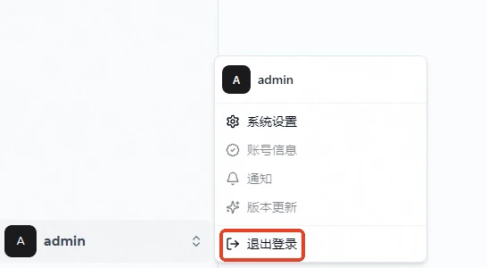

# 3.运行概览

本文介绍 OpenTrek-Ops 平台运行概览页面的功能和指标说明。

**使用场景**

运行概览是平台的首页仪表盘，适用于以下场景：

- 日常运维巡检，快速了解平台整体健康状态。

- 监控 Agent 运行趋势和 Token 消耗情况，评估资源使用效率。

- 查看模型性能指标，分析不同模型的响应时间和处理能力。

- 监控基础设施状态，及时发现和排查服务异常。

**前提条件**

已使用租户管理员登录 OpenTrek-Ops 平台。

**操作步骤**

1. 登录 OpenTrek-Ops 平台。

   登录成功后，默认进入**运行概览**页面。

   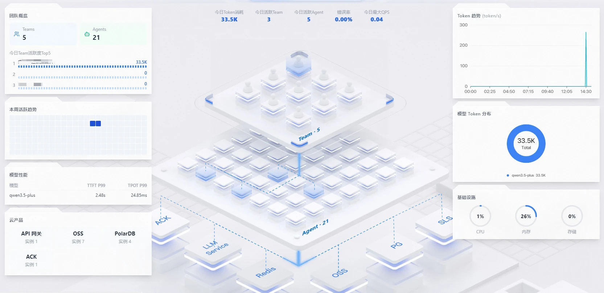

2. 进入**运行概览**页面后，可以看到以下核心模块：

   <table>
     <tr>
       <th width="149">模块名称</th>
       <th>说明</th>
     </tr>
     <tr>
       <td>团队概览</td>
       <td>• 展示 Teams 和 Agents 的数量统计。 • 今日Team 活跃度 Top5展示活跃度排名前五的团队列表。</td>
     </tr>
     <tr>
       <td>本周活跃趋势</td>
       <td>展示最近七天的活跃度变化趋势。</td>
     </tr>
     <tr>
       <td>模型性能</td>
       <td>展示各模型的 TTFT P99 和 TPOT P99 性能指标。</td>
     </tr>
     <tr>
       <td>云产品</td>
       <td>展示API网关、OSS、PolarDB、ACK的实例个数。</td>
     </tr>
     <tr>
       <td>Token 趋势</td>
       <td>以折线图形式展示 Token 消耗的时间趋势。将鼠标悬停在折线图上时，系统会显示对应时间点的 Token 总数据。</td>
     </tr>
     <tr>
       <td>模型 Token 分布</td>
       <td>展示不同模型的 Token 使用分布情况。</td>
     </tr>
     <tr>
       <td>基础设施</td>
       <td>展示CPU、内存、存储的使用率。</td>
     </tr>
     <tr>
       <td>中间大屏</td>
       <td>• 展示 ACK、LLM Service、Redis、OSS、PG 等基础设施的运行状态。蓝色表示服务正常。 • 今日 Token 消耗展示当日 Token 消耗总量。 • 今日活跃 Team展示当日活跃的 Team 数量。 • 今日活跃 Agent展示当日活跃的 Agent 数量。 • 错误率展示当前请求的错误率指标。 • 今日最大QPS展示今日最大QPS。</td>
     </tr>
   </table>

**后续操作**

按照需求获取运行概览信息后，可通过 Agent 管理进一步查看和管理 Agent 的详细信息。

# 4.运维中心

## 4.1. Agent管理

本文介绍如何在 OpenTrek-Ops 平台中管理 Agent，包括创建、查看、编辑、启动、停止、扩缩容和删除Agent 等操作。

**使用场景**

Agent 管理是平台的核心功能，适用于以下场景：

- 创建新的运维 Agent 实现特定运维任务的自动化执行。

- 管理已有 Agent 的配置和运行状态，确保 Agent 正常运行。

- 为不同团队分配和管理 Agent 资源，实现资源的合理分配。

- 查看 Agent 执行记录，分析 Agent 运行效果和问题排查。

**前提条件**

- 已登录 OpenTrek-Ops 平台。

- 已获得租户管理员或具有 Agent 创建权限的角色。

**操作步骤**

1. 登录 OpenTrek-Ops 平台。

2. 在左侧导航栏，选择 **运维中心** > **Agent 管理** 。

   进入 **Agent管理**页面，在当前页面可以获取如下信息：

   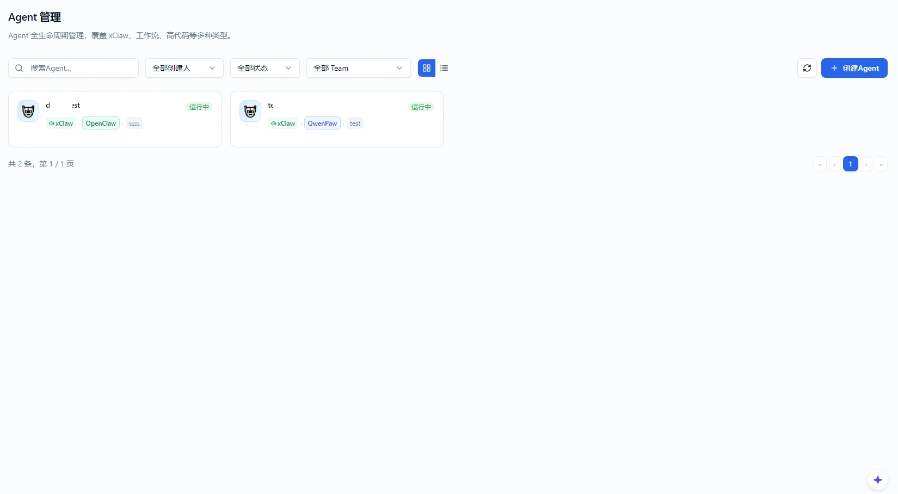

   - 查看 Agent 总数。

   - 使用搜索框按 Agent 名称搜索目标 Agent。

   - 使用**全部创建人**下拉框，按创建人过滤 Agent 列表。

   - 使用**全部状态**下拉框，按状态过滤 Agent 列表。

   - 使用**全部Team**下拉框，按所属 Team 过滤 Agent 列表。

   - 单击视图切换按钮，在网格视图和列表视图之间切换。

   - 单击刷新按钮，刷新 Agent 列表数据。

   - 查看 Agent 卡片，展示 Agent 图标、名称、类型标签、所属 Team、创建人、运行状态等信息。

3. 创建 Agent。

   <ol type="i">

   <li>

   在 Agent 管理页面，单击**创建Agent**按钮。

   </li>

   <li>

   在弹出的创建表单中填写以下信息：

   <table>
     <tr>
       <th>模块</th>
       <th>参数名称</th>
       <th>是否必填</th>
       <th>说明</th>
     </tr>
     <tr>
       <td rowspan="5">基本信息</td>
       <td>名称</td>
       <td>是</td>
       <td>Agent 的显示名称，建议使用有意义的命名。</td>
     </tr>
     <tr>
       <td>类型</td>
       <td>是</td>
       <td>选择 Agent 类型，支持 QwenPaw和OpenClaw两种类型。</td>
     </tr>
     <tr>
       <td>所属 Team</td>
       <td>是</td>
       <td>选择 Agent 归属的团队。</td>
     </tr>
     <tr>
       <td>描述</td>
       <td>否</td>
       <td>Agent 的功能描述。</td>
     </tr>
     <tr>
       <td>版本</td>
       <td>是</td>
       <td>可选专业版或者标准版。 • 专业级能力全面，包括强大的记忆服务、弹性伸缩以及全景观测等能力。 • 标准版能力有限，支持基础的运维能力，无高可用保障。</td>
     </tr>
     <tr>
       <td rowspan="2">人格设定</td>
       <td>人格设定</td>
       <td>否</td>
       <td>描述人格特征。</td>
     </tr>
     <tr>
       <td>行为边界</td>
       <td>否</td>
       <td>定义行为边界。</td>
     </tr>
     <tr>
       <td>技能配置</td>
       <td>/</td>
       <td>否</td>
       <td>单击添加技能，选择技能后单击<strong>确认</strong>。 说明在添加技能前，请确保已在<strong>资产中心</strong>&gt;<strong>技能</strong>页签已经创建技能。</td>
     </tr>
     <tr>
       <td>频道设置</td>
       <td>/</td>
       <td>否</td>
       <td>可开启钉钉或钉钉专属版。 说明在设置频道前，请确保已在<strong>系统设置</strong>&gt;<strong>频道管理</strong>中开启频道。</td>
     </tr>
   </table>

   </li>

   <li>

   填写完成后，单击**创建**按钮完成创建。

   创建成功后，新 Agent 将出现在 Agent 列表中。

   </li>

   </ol>

4. 查看 Agent 详情。

   - 在 **Agent管理**页面找到目标 Agent，单击 Agent 卡片进入 Agent 详情页面。

   - 在 Agent 详情页面，您可以查看：

     - 基本信息：名称、类型、描述、创建时间等。

     - 运行状态：运行中或已停止。

     - 配置信息：Agent 的运行配置参数，如概览、心智、技能、MCP、云资源、频道、指标分析、链路分析、拓扑分析等。

     - 运行日志：Agent 的历史执行记录，可查看历史任务及日志。

**相关操作**

<table>
  <tr>
    <th width="159">操作类型</th>
    <th>操作步骤</th>
  </tr>
  <tr>
    <td>编辑 Agent</td>
    <td>1. 在 Agent 列表中找到目标 Agent。 2. 单击 Agent 卡片进入Agent详情。 3. 在基础信息模块，可编辑<strong>主模型</strong>。 4. 在详情页下方，分别选择<strong>心智</strong>、<strong>技能</strong>、<strong>频道</strong>三个页签，可编辑相关信息。</td>
  </tr>
  <tr>
    <td>启动或停止 Agent</td>
    <td>1. 在 Agent 列表中找到目标 Agent，单击Agent卡片进入详情页。 2. 在详情页右上角，单击<strong>更多</strong>，选择 <strong>启动</strong> 或 <strong>停止</strong>。 3. 确认后 Agent 状态将更新。</td>
  </tr>
  <tr>
    <td>重启Agent</td>
    <td>1. 在 Agent 列表中找到目标 Agent，单击Agent卡片进入详情页。 2. 在详情页右上角，单击<strong>更多</strong>，选择 <strong>重启</strong> 操作。 3. 确认后 Agent 状态将更新。</td>
  </tr>
  <tr>
    <td>删除 Agent</td>
    <td>说明删除 Agent 前，请确保 Agent 处于停止状态。 1. 在 Agent 列表中找到目标 Agent，单击Agent卡片进入详情页。 2. 在详情页右上角，单击<strong>更多</strong>，选择 <strong>删除</strong> 。 3. 在弹出的确认对话框中单击 <strong>确认删除</strong> 。 4. 删除成功后该 Agent 将从列表中移除。</td>
  </tr>
  <tr>
    <td>扩缩容</td>
    <td>1. 在 Agent 列表中找到目标 Agent，单击Agent卡片进入详情页。 2. 在详情页右上角，单击<strong>更多</strong>，选择<strong>扩缩容</strong>。 3. 在扩缩容配置弹框中，预览当前的配置信息，然后设置CPU和内存。 4. 单击<strong>确认应用</strong>，扩缩容过程中，Agent状态变为<strong>变更中</strong>，可在<strong>操作历史</strong>页面查看扩缩容任务详情。</td>
  </tr>
  <tr>
    <td>更新Agent</td>
    <td>1. 在 Agent 列表中找到目标 Agent，单击Agent卡片进入详情页。 2. 在详情页右上角，单击<strong>更多</strong>，选择<strong>更新</strong>，可升级Agent。 说明当Agent镜像版本为最新版本时，更新按钮置灰不可点击。</td>
  </tr>
  <tr>
    <td>对话Agent</td>
    <td>1. 在 Agent 列表中找到目标 Agent，单击Agent卡片进入详情页。 2. 在详情页右上角，单击 <strong>对话</strong>，跳转至OpenClaw<strong> 聊天</strong>页面。 说明详情可参考OpenClaw相关指导文档。</td>
  </tr>
</table>

**后续操作**

完成 Agent 创建后，可将 Agent 添加到 Agent Team 中参与协作。

## 4.2. Agent Team

本文介绍如何在 OpenTrek-Ops 平台中管理 Agent Team，包括创建 Team 和管理 Team 成员等操作。

**使用场景**

Agent Team 功能适用于以下场景：

- 构建多角色协作的运维团队，实现复杂运维任务的分工协作。

- 管理团队的成员 Agent 和权限，确保团队成员的有效管理。

- 协调团队内 Agent 的任务分配，提高团队协作效率。

- 为特定项目或业务场景组建专属运维团队。

**前提条件**

- 已登录 OpenTrek-Ops 平台。

- 已获得租户管理员或具有 Agent Team 创建权限的角色。

**操作步骤**

1. 登录 OpenTrek-Ops 平台。

2. 在左侧导航栏，选择**运维中心**>**Agent Team**。

   进入 Agent Team 管理页面，在当前页面可以获取如下信息：

   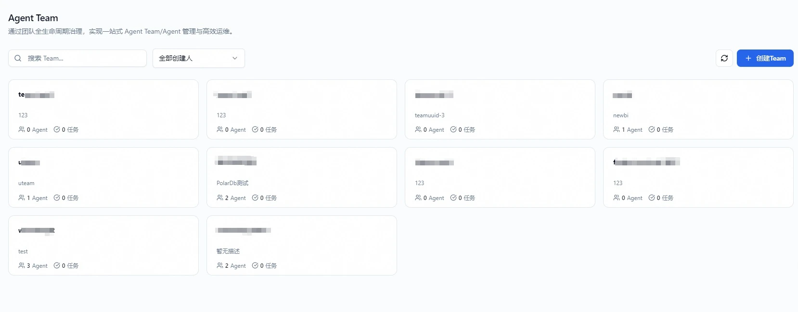

   - 使用搜索框按 Team 名称搜索目标 Team。

   - 单击**创建Team**按钮创建新的 Agent Team。

   - 查看 Team 卡片，展示 Team 名称、成员数量、创建人等信息。

   - 单击 Team 卡片进入 Team 详情页面，查看成员列表。

3. 创建 Team。

   <ol type="i">

   <li>

   在 Agent Team 管理页面，单击**创建Team** 按钮。

   </li>

   <li>

   在弹出的创建表单中填写以下信息：

   | 参数名称 | 是否必填 | 说明 |
   | --- | --- | --- |
   | Team 名称 | 是 | 团队的显示名称，建议输入一个有意义的名称。 |
   | 描述 | 否 | 描述该Team的职责和目标。 |
   | 组织 | 是 | 选择该Team所属的组织。 |
   | K8s集群 | 否 | 选择一个K8s集群。 |
   | 模型服务 | 是 | 请选择至少一个文本生成类型的模型。 |
   | 运行时存储 | 是 | 默认开启。 |
   | 记忆服务 | 否 | 默认关闭，开始时，选择至少一个文本向量化类型的模型。 |
   | 团队成员设置 | 否 | 设置<strong>团队管理员</strong>和<strong>团队成员</strong>。 • 团队管理员：拥有该Team的完整管理权限，可管理成员、资源和配置。 • 团队成员：可使用该Team下的Agent、技能和工具等资源。 |

   </li>

   <li>

   单击**创建Team**按钮完成创建.

   </li>

   </ol>

4. 管理 Team 成员。

   <ol type="i">

   <li>

   添加成员：

   <ol type="a">

   <li>

   单击目标 Team卡片右下角的**进入**， 进入详情页面。

   </li>

   <li>

   在Agent页签，单击**创建Agent**，可参考Agent管理添加Agent。

   </li>

   </ol>

   <ol type="i" start="100">

   <li>

   单击**创建**完成添加。

   </li>

   </ol>

   </li>

   <li>

   移除成员：

   <ol type="a">

   <li>

   在 Team 成员列表中找到目标 Agent。

   </li>

   <li>

   单击该成员操作列的  图标完成操作。

   </li>

   </ol>

   </li>

   </ol>

5. 添加技能。

   在Team详情页，选择**技能**页签，单击**添加技能**，选择技能后单击**确定**，为该Team添加技能。

6. 添加MCP服务器。

   在Team详情页，选择**MCP**页签，单击**添加MCP**，选择MCP后单击**添加到Team**，为该Team添加MCP服务器。

7. 添加云资源。

   在Team详情页，选择**云资源**页签，在模型服务页签单击**添加资源**，选择模型后单击**保存**，为该Team绑定模型。

8. 链路分析。

   在Team详情页，选择**链路分析**页签，可查看该Team下所有的Trace记录，单击Trace ID，可查看详情。

**相关操作**

**编辑Team**

1. 在Agent Team页面，选择目标Team，单击Team卡片右下角的**进入**。

2. 单击页面右上角的**编辑**，编辑**Team 名称**、**描述**、**模型服务**、**团队成员**。

   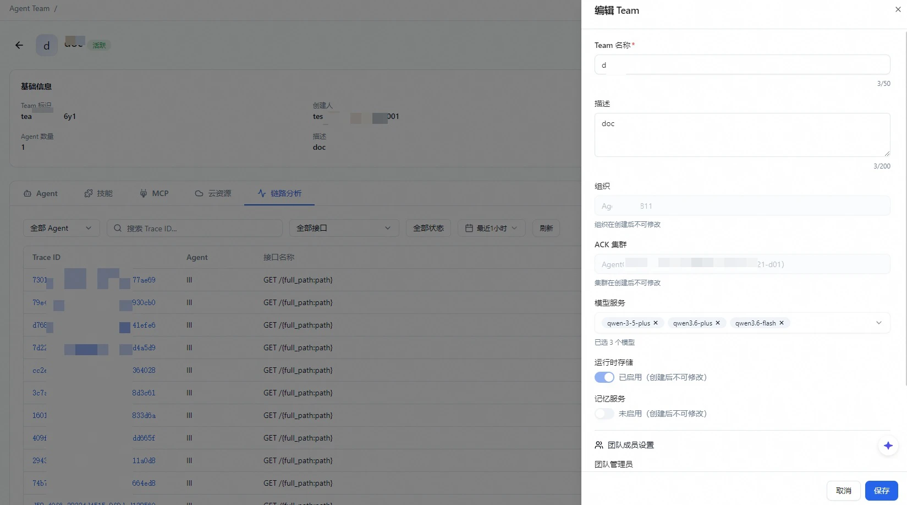

3. 单击**保存**。

**删除Team**

> **说明**
>
> 删除Team前，请确保该Team下的Agent已清理完成。

1. 在Agent Team页面，选择目标Team，单击Team卡片右下角的**进入**。

2. 单击页面右上角的**删除**，然后单击**确认删除**。

   > **警告**
   >
   > 删除操作不可逆，请谨慎执行！

**批量操作**

1. 在Agent Team页面，选择目标Team，单击Team卡片右下角的**进入**。

2. 单击页面右上角的**批量运维**。

   - Agent运维

     <ol type="a">

     <li>

     在批量操作弹框选择**Agent运维**，然后选择具体操作。

     | 操作类型 | 详细步骤 |
     | --- | --- |
     | 更新Agent版本 | a. 选择<strong>更新Agent版本</strong>； b. 选择运行时及版本。 |
     | 扩缩规格 | a. 选择<strong>扩缩规格</strong>； b. 设置目标规格，可选择推荐规格，也可自定义规格。 |
     | 重启 | 选择<strong>重启</strong>。 |
     | 启动 | 选择<strong>启动</strong>。 |
     | 停止 | 选择<strong>停止</strong>。 |
     | 下线 | 选择<strong>下线</strong>。 |

     </li>

     <li>

     单击**选择Agent**，在**选择Agent**弹框勾选Agent，单击**确认选择**。

     </li>

     </ol>

     <ol type="i" start="100">

     <li>

     选择执行方式。

     - 全量执行

       所有Agent同时执行。

     - 分批执行

       设置分批数量，按批次逐步执行。

     </li>

     <li value="500">

     单击**确认执行**。

     界面显示批量操作已提交，可通过**操作历史**页面查看批量操作详情。

     </li>

     </ol>

   - 技能运维

     <ol type="a">

     <li>

     在批量操作弹框选择**技能运维**。

     </li>

     <li>

     选择具体的操作，支持批量**技能同步**、**技能禁用**、**技能移除**。

     </li>

     </ol>

     <ol type="i" start="100">

     <li>

     选择需要执行的技能。

     </li>

     <li value="500">

     单击**选择Agent**，在**选择Agent**弹框勾选Agent，单击**确认选择**。

     </li>

     </ol>

     <ol type="a" start="5">

     <li>

     选择执行方式。

     - 全量执行

       所有Agent同时执行。

     - 分批执行

       设置分批数量，按批次逐步执行。

     </li>

     <li>

     单击**确认执行**。

     界面显示批量操作已提交，可通过**操作历史**页面查看批量操作详情。

     </li>

     </ol>

   - 配置更新

     <ol type="a">

     <li>

     在批量操作弹框选择**配置更新**。

     </li>

     <li>

     选择**同步模型**。

     </li>

     </ol>

     <ol type="i" start="100">

     <li>

     选择目标模型。

     </li>

     <li value="500">

     单击**选择Agent**，在**选择Agent**弹框勾选Agent，单击**确认选择**。

     </li>

     </ol>

     <ol type="a" start="5">

     <li>

     选择执行方式。

     - 全量执行

       所有Agent同时执行。

     - 分批执行

       设置分批数量，按批次逐步执行。

     </li>

     <li>

     单击**确认执行**。

     界面显示批量操作已提交，可通过**操作历史**页面查看批量操作详情。

     </li>

     </ol>

**后续操作**

完成 Team 创建后，可为 Team 分配技能以实现团队协作。

## 4.3. 操作历史

本文介绍如何查看 Agent 和 Team 的操作历史记录。

**使用场景**

当您执行了 Agent 运维操作（如重启、升级、扩缩容、技能同步等）后，需要查看操作的执行情况和结果时，可通过操作历史页面进行查看。

**前提条件**

- 已登录 OpenTrek-Ops 平台。

- 已获得租户管理员或具有 Agent Team 创建权限的角色。

**操作步骤**

1. 登录 OpenTrek-Ops 平台。

2. 在左侧导航栏选择 **运维中心** > **操作历史**，进入**操作历史**页面。

3. 在**操作历史**页面，您可以查看以下信息：

   - 统计卡片：页面顶部显示**总操作数**、**成功**数、**失败**数、**执行中**数四个统计指标。

     

   - 操作记录列表：以表格形式展示所有操作记录。

     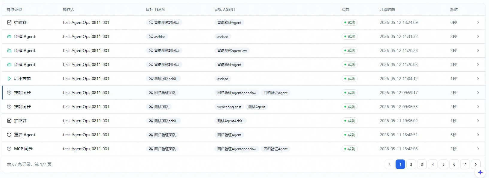

4. 查看操作详情。

   在操作记录列表中，单击目标操作行的操作类型，可查看该操作的详细历史记录。

   

   可查看操作详情、开始时间、结束时间、目标Team、目标Agent、批量策略。

5. 查看批量操作的 Agent 执行结果。

   对于批量操作，在操作详情抽屉中可查看**批量策略**及全量的Agent数。

   

6. 搜索和筛选操作记录。

   - 在搜索框直接按照操作人、操作类型、操作详情直接搜索。

   - 在筛选框按照状态、操作类型、Team名称、Agent名称有条件的进行筛选。

7. 刷新数据。

   单击 **刷新** 按钮手动触发数据刷新。

**参数说明**

操作记录列表包含以下字段：

| 字段名称 | 说明 |
| --- | --- |
| 操作类型 | 显示操作类型的图标和中文标签，不同类型使用不同颜色标识。 |
| 操作人 | 执行该操作的用户姓名。 |
| 目标Team | 目标Team列表。 |
| 目标Agent | 目标 Agent 列表。 |
| 状态 | 操作执行状态，包括成功、失败、执行中、待执行。 |
| 开始时间 | 操作开始的时间戳。 |
| 耗时 | 操作执行耗时，执行中的操作会动态更新。 |

# 5.资产中心

## 5.1. 技能

本文介绍如何在 OpenTrek-Ops 平台中管理技能，包括创建、启用、禁用和查看技能等操作。

**使用场景**

技能管理功能适用于以下场景：

- 统一管理和发布 Agent 可使用的技能，实现能力的标准化。

- 审核技能的安全性和合规性，确保技能的质量。

- 将常用能力封装为技能供多个 Agent 复用，提高开发效率。

- 管理技能的版本和生命周期，实现技能的持续迭代和优化。

**前提条件**

- 已登录 OpenTrek-Ops 平台。

- 已获得租户管理员或具有技能创建权限的角色。

**操作步骤**

1. 登录 OpenTrek-Ops 平台。

2. 在左侧导航栏，选择**资产中心**>**技能**。

   进入技能管理页面，在当前页面可以获取如下信息：

   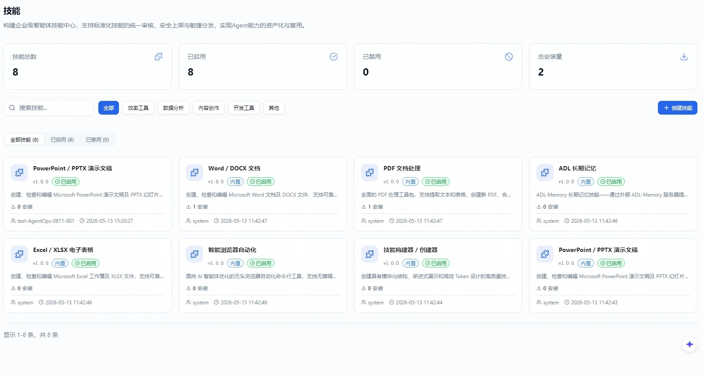

   - 查看技能总数、已启用技能数量、已禁用技能数量以及总安装量。

   - 使用搜索框按技能名称搜索目标技能。

   - 使用分类筛选，按全部、效率工具、数据分析、内容创作、开发工具、其他分类筛选技能。

   - 单击 **创建技能** 按钮创建新的技能。

   - 查看技能卡片，展示技能图标、名称、描述、版本号、更新时间、启用状态等信息。

3. 创建技能。

   > **说明**
   >
   > 系统内置的技能为：Word/DOCX文档、PDF文档处理、ADL长期记忆、Excel/XLSX电子表格、智能浏览器自动化、技能构建器/创建器、PowerPoint/PPTX演示文稿，同时支持创建技能。

   <ol type="i">

   <li>

   在**技能管理**页面，单击 **创建技能** 按钮。

   </li>

   <li>

   在创建表单中填写以下信息：

   | 参数名称 | 是否必填 | 说明 |
   | --- | --- | --- |
   | 上传技能包 | 是 | 上传已准备好的技能包，要求目录包含skill.md的.zip文件，skill.md需要包含yaml格式的名称和描述信息。 重要单个Skill文件体积不得超过10MB，超出请压缩或拆分为多个Skill。 |
   | 技能名称 | 否 | 默认使用skill.md中的名称；可修改。 |
   | 技能描述 | 否 | 默认使用skill.md中的描述；可修改。 |
   | 标签分类 | 否 | 选择技能所属分类，支持效率工具、数据分析、内容创作、开发工具、其他。 |

   </li>

   <li>

   技能包上传完成后，单击**创建技能**。

   </li>

   </ol>

4. 启用或禁用技能。

   > **说明**
   >
   > 禁用技能后，已安装该技能的 Agent 将无法继续调用该技能。

   <ol type="i">

   <li>

   在技能列表中找到目标技能，单击卡片进入技能详情页面。

   </li>

   <li>

   单击详情页右上角的**启用**或者**禁用**。

   </li>

   <li>

   确认操作后状态将更新。

   </li>

   </ol>

5. 删除技能。

   > **说明**
   >
   > 系统内置技能不允许删除。

   - 在技能列表中找到目标技能，单击卡片进入技能详情页面，单击**删除**，再弹框中单击**确认删除**。

   - 单击技能卡片右上角的删除图标  ，在弹框中单击**确认删除**。

6. 更新版本。

   <ol type="i">

   <li>

   在技能列表中单击目标技能卡片。

   </li>

   <li>

   单击技能详情页右上角的**更新版本**。

   </li>

   <li>

   在更新版本弹框上传新版本文件，系统将自动进行安全扫描后完成更新。

   </li>

   <li>

   单击**开始更新**。

   </li>

   </ol>

7. 查看技能详情。

   <ol type="i">

   <li>

   在技能列表中单击目标技能卡片。

   </li>

   <li>

   进入技能详情页面查看：

   - 基本信息：名称、分类、描述、版本。

   - 技能配置：技能的详细配置参数。

   - 使用记录：该技能被 Agent 调用的记录、版本升级演进详情、安全信息。

   </li>

   </ol>

**后续操作**

技能创建并启用后，可在 Agent 中安装和使用该技能。

## 5.2. MCP

本文介绍OpenTrek-Ops平台中MCP（Model Context Protocol）服务器的管理方法，包括添加、编辑、启用/禁用和删除MCP服务器等操作。通过标准化的模型上下文协议（MCP）连接并管理各类外部服务器，实现Agent与异构数据源、工具及业务系统的无缝集成与协同。

**使用场景**

在OpenTrek-Ops平台中，用户需要在资产中心对MCP（Model Context Protocol）配置进行全生命周期管理，包括MCP的创建、编辑、删除、版本管理等操作。本章节适用于以下场景：

- 统一管理MCP服务器，实现Agent与外部系统的集成。

- 配置MCP服务器连接参数，确保Agent可访问外部工具和服务。

- 管理MCP服务器的生命周期，包括创建、编辑、启用/禁用和删除。

**前提条件**

- 已登录OpenTrek-Ops平台。

- 当前用户具有资产中心MCP管理的访问权限。

**操作步骤**

1. 登录 OpenTrek-Ops 平台。

2. 在左侧导航栏，选择**资产中心**>**MCP**。

   进入**MCP**页面，在当前页面可以获取如下信息：

   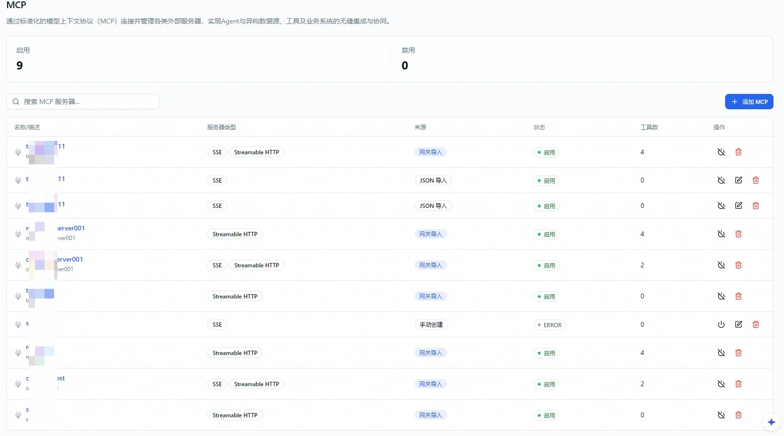

   - 查看MCP启用数和禁用数。

   - 使用搜索框精准查找目标MCP服务器。

   - 查看MCP列表，包含名称/描述、服务器类型、来源、状态、工具数。

3. 添加MCP。

   MCP有手动配置、JSON导入、AI网关自动同步三种添加方式。

   - **方式一：手动配置**

     <ol type="a">

     <li>

     在**MCP**页面单击**添加MCP**。

     </li>

     <li>

     在**手动配置**页签，填写如下参数：

     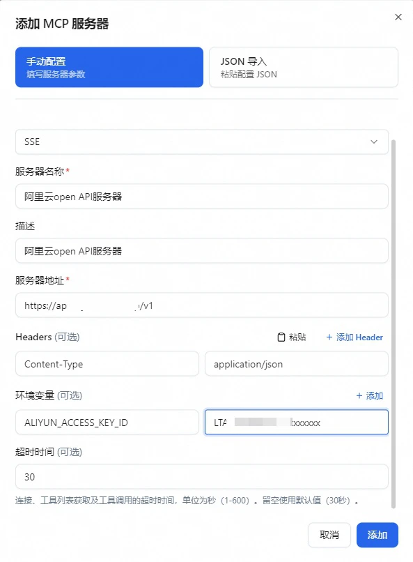

     | 参数 | 是否必填 | 说明 |
     | --- | --- | --- |
     | 服务器类型 | 是 | 选择服务器类型： • SSE • Streamable HTTP • STDIO |
     | 服务器名称 | 是 | 输入服务器名称。 |
     | 描述 | 否 | 添加描述信息，可选。 |
     | 服务器地址 | 是 | 输入服务器地址，如http://localhost:8080/sse |
     | Headers | 否 | • 直接添加Headers，可添加多个。 • 单击<strong>粘贴</strong>，按照Header:Value或Header=Value的格式粘贴Headers，每行一个，然后单击<strong>解析</strong>。 |
     | 环境变量 | 否 | 添加环境变量。 |
     | 超时时间 | 否 | 连接、工具列表获取及工具调用的超时时间，范围1-600秒，默认30秒。 |

     </li>

     </ol>

     <ol type="i" start="100">

     <li>

     单击**添加**，添加成功的服务器状态为**启用**。

     </li>

     </ol>

   - **方式二：JSON导入**

     <ol type="a">

     <li>

     在**MCP**页面单击**添加MCP**。

     </li>

     <li>

     在添加MCP服务器弹框，单击**JSON导入**。

     </li>

     </ol>

     <ol type="i" start="100">

     <li>

     在输入框粘贴MCP服务器配置JSON。

     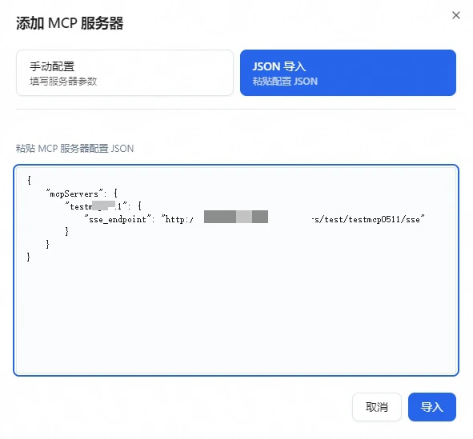

     </li>

     <li value="500">

     单击**导入**，导入成功的服务器状态为**启用**。

     </li>

     </ol>

   - **方式三：网关导入**

     导入AI网关后，可通过**同步网关**操作，系统自动导入AI网关关联的<strong>MCP配置。</strong>可参考同步网关。

4. 查看MCP详情。

   在服务器列表，单击服务器名称，查看服务器基本信息、连接配置、及工具列表：

   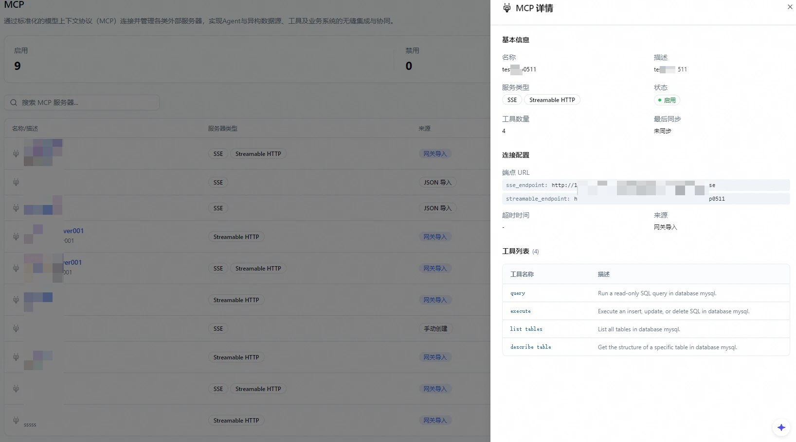

   - 基本信息

     查看服务器的名称、描述、服务器类型、状态、工具数量、最后同步状态。

   - 连接配置

     查看服务器端点URL、超时时间及来源。

   - 工具列表

     查看详细的工具名称以及描述信息。

5. 禁用/启用MCP服务器。

   - 状态为**启用**的服务器，单击目标服务器**操作**列的禁用图标  。

   - 状态为**禁用**的服务器，单击目标服务器**操作**列的启用图标  。

6. 编辑MCP服务器。

   > **说明**
   >
   > 网关导入的服务器不支持编辑。

   单击目标服务器操作列的**编辑**，在编辑MCP服务器弹框编辑**描述**、**服务器地址**、**Headers**、**环境变量**及**超时时间**。

7. 删除MCP服务器。

   单击目标服务器**操作**列的**删除**，在**确认删除**弹框中单击**删除**。

   > **重要**
   >
   > 此操作不可逆，请谨慎操作。

## 5.3. Agent Infra

本文介绍 OpenTrek-Ops 平台 Agent Infra 模块的功能和配置说明。

**使用场景**

Agent Infra 功能适用于以下场景：

- 管理 Agent 依赖的基础设施服务，确保 Agent 运行环境的稳定性。

- 监控基础设施的运行状态，及时发现和排查服务故障。

- 配置基础设施的连接参数，优化服务性能和资源利用率。

- 管理 LLM Service、Redis、OSS、PostgreSQL 等底层服务的接入和配置。

**前提条件**

已使用租户管理员登录 OpenTrek-Ops 平台。

**操作步骤**

1. 登录 OpenTrek-Ops 平台。

2. 在左侧导航栏，选择**资产中心**>**Agent Infra**。

   进入 Agent Infra 管理页面，在当前页面可以获取如下信息：

   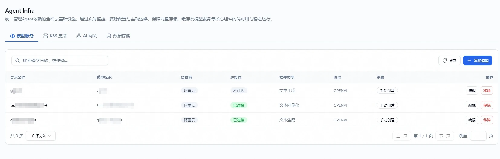

   查看服务模型、K8s集群、AI网关、数据存储基础设施的名称、类型等信息

3. 模型服务

   - 添加模型

     <ol type="a">

     <li>

     在服务模型页签单击**添加模型**，填写以下参数：

     | 参数名称 | 是否必填 | 说明 |
     | --- | --- | --- |
     | 模型标识 | 是 | 填写模型API调用时使用的标识符，如gpt-4-turbo。 |
     | 显示名称 | 是 | 填写显示的模型名称，如GPT-4 Turbo。 |
     | 提供商 | 是 | 选择提供商，目前支持阿里云。 |
     | 协议 | 是 | 选择协议。 |
     | 推理类型 | 是 | 选择<strong>文本生成（Text Generation）</strong>或者<strong>文本向量化</strong><strong>(Text Embedding)</strong>。 |
     | API Key | 是 | 请联系阿里云技术支持获取。 |
     | API Endpoint | 是 | 请联系阿里云技术支持获取。 |

     </li>

     <li>

     单击**确认添加**。

     </li>

     </ol>

   - 编辑模型

     > **说明**
     >
     > 修改基础设施配置前，请确认修改不会影响正在运行的 Agent 任务。

     <ol type="a">

     <li>

     单击目标模型**操作**列的编辑图标  。

     </li>

     <li>

     编辑相关参数，单击**保存修改**。

     </li>

     </ol>

   - 移除模型

     <ol type="a">

     <li>

     单击目标模型**操作**列的移除图标  。

     </li>

     <li>

     在弹出的对话框中单击**确认删除**。

     </li>

     </ol>

4. K8s集群

   - 导入集群

     <ol type="a">

     <li>

     在K8s集群页签，单击**导入集群**，填写以下参数。

     | 参数名称 | 是否必填 | 说明 |
     | --- | --- | --- |
     | 集群 | 是 | 选择要导入的K8s集群实例。 |
     | Agent服务入口 | 是 | 此Endpoint用于生成agent链接的根域名，请事前在DNS控制台完成泛域名解析记录。 |
     | 访问IP | 否 | 访问集群apiserver的域名/端口，不填写则使用默认kubeconfig的域名/端口。 |
     | ingressClassName | 是 | 选择Ingress的类型，用于Agent的域名路由。 |

     </li>

     <li>

     单击**导入**。

     </li>

     </ol>

   - 查看详情

     单击目标集群名称，可查看集群的**基本信息**、**集群信息**、**集群资源**、**Master节点**等详细信息。

   - 编辑集群

     单击目标集群**操作**列的编辑图标  ，可编辑集群的**Agent服务入口**、**访问**

     **IP**、**ingressClassName**，编辑完成后单击**保存**。

   - 移除集群

     单击目标集群**操作**列的移除图标  ，然后单击弹框中的**确定**。

5. AI网关

   - 导入网关

     <ol type="a">

     <li>

     在**AI网关**页签，单击**导入网关**，填写以下参数：

     | 参数名称 | 是否必填 | 说明 |
     | --- | --- | --- |
     | AI网关名称 | 是 | 选择要导入的网关实例。 |
     | API Key | 是 | 请联系阿里云技术支持获取。 |

     </li>

     <li>

     单击**导入**。

     > **说明**
     >
     > 如果导入ASCM AI网关，单击**导入**后，系统会自动导入AI网关关联的**MCP配置**以及**AI模型配置**，可分别通过**MCP**页面和**Agent Infra**>**模型服务**页面查看。

     </li>

     </ol>

   - 查看详情

     单击目标网关名称，可查看网关**基本信息**、**接入点**、模型API、MCP等详细信息。

   - 编辑网关单击目标网关**操作**列的编辑图标  ，在**编辑Higress网关**弹框编辑**API Key**，单击**保存**。

   - 同步网关

     单击目标网关**操作**列的同步图标  ，然后单击**确定**，可同步网关MCP和AI模型。

   - 移除网关

     单击目标网关**操作**列的移除图标  ，然后单击弹框中的**确定**。

6. 数据存储

   在**数据存储**页签，单击实例名称，可查看实例的**基本信息**和**访问域名**的详细信息。

   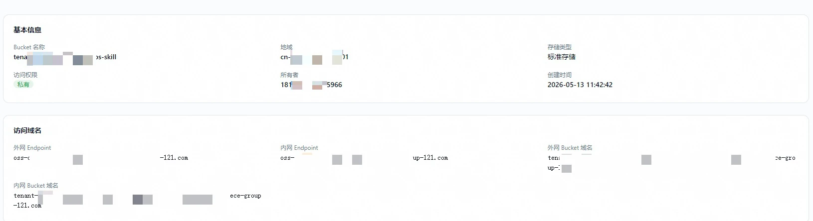

# 6.系统设置

本文介绍 OpenTrek-Ops 平台系统设置模块的功能和配置方法，包含租户管理、云平台管理、频道管理以及系统配置四个功能。

> **重要**
>
> 请使用系统管理员登录进行系统设置。

## 6.1. 组织管理

本文介绍如何在 OpenTrek-Ops 平台中管理租户。

**使用场景**

租户管理功能适用于以下场景：

- 多租户环境下的资源隔离和权限管理，实现不同租户间的独立性。

- 为不同部门或业务单元创建专属租户，实现分级管理。

- 管理租户的生命周期，包括创建、启用、停用和删除操作。

- 配置租户与云平台的对接关系，实现资源的统一调度。

**前提条件**

- 已登录 OpenTrek-Ops 平台。

- 已获得系统管理员权限。

**操作步骤**

1. 登录 OpenTrek-Ops 平台。

2. 系统默认展示**组织管理**界面，在**组织管理**页面，可以查看租户列表，包含以下字段：

   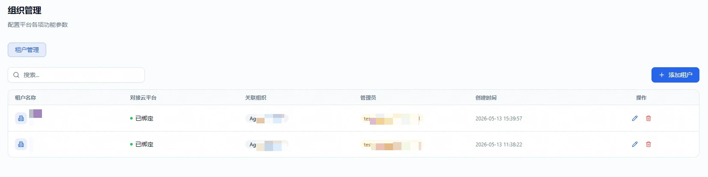

   | 字段 | 说明 |
   | --- | --- |
   | 租户名称 | 租户的显示名称和标识。 |
   | 对接云平台 | 显示是否对接云平台。 |
   | 关联组织 | 租户关联的组织名称。 |
   | 管理员 | 租户管理员用户名。 |
   | 创建时间 | 租户创建日期。 |
   | 操作 | 提供编辑、删除操作。 |

3. 添加租户。

   <ol type="i">

   <li>

   在**组织管理**页面，单击**添加租户**按钮。

   </li>

   <li>

   在弹出的表单中填写以下信息：

   | 参数名称 | 是否必填 | 说明 |
   | --- | --- | --- |
   | 租户名称 | 是 | 租户的显示名称。 |
   | 租户编码 | 是 | 租户的唯一标识符，仅支持字母、数字和连字符。 |
   | 描述 | 否 | 输入租户的描述信息。 |
   | 是否对接云平台 | 是 | 选择是或者否。 |
   | 选择组织 | 是 | 是否对接云平台选择“是”时，需要选择关联的组织，可在同一个一级组织下选择任意二级组织，不支持跨一级组织。 |
   | 指定管理员 | 是 | 是否对接云平台选择“是”时，需要设置租户管理员，在选择的一级组织下选择一个或多个人员。 |

   </li>

   <li>

   单击**确认创建**完成创建。

   </li>

   </ol>

4. 编辑租户。

   <ol type="i">

   <li>

   在租户列表中找到目标租户。

   </li>

   <li>

   单击**操作**列的编辑图标  ，可修改租户名称、描述等配置信息。

   </li>

   <li>

   单击**保存修改**完成租户的更新。

   </li>

   </ol>

5. 删除租户。

   > **警告**
   >
   > 删除租户为高危操作，请谨慎执行。删除后该租户下的所有数据将无法恢复。

   <ol type="i">

   <li>

   在租户列表中找到目标租户。

   </li>

   <li>

   单击**操作**列的删除图标  。

   </li>

   <li>

   在弹出的确认对话框中单击**确认删除**，删除成功后该租户将从列表中移除。

   </li>

   </ol>

**后续操作**

使用创建好的租户管理员登录，进行租户初始化配置，即录入模型服务、导入K8s集群，可参考Agent Infra。

> **说明**
>
> 首次登录，系统提示初始化密码，按照提示设置新的密码并谨慎保存。

## 6.2. 平台管理

本文介绍如何在 OpenTrek-Ops 平台中管理云平台配置。

**使用场景**

云平台管理功能适用于以下场景：

- 配置和管理 OpenTrek-Ops 平台对接的云平台资源以及通知频道，配置 Agent 运行状态和告警消息的推送目标。

- 实现多云平台环境下的统一管理和资源调度。

- 实现运维消息的实时推送，确保运维人员及时获取关键信息。

- 配置多种通知渠道，如钉钉、邮件、短信等，满足不同场景的通知需求。

- 管理云平台连接信息和认证凭证，确保数据互通的稳定性。

**前提条件**

- 已登录 OpenTrek-Ops 平台。

- 已获得系统管理员权限。

**云平台管理**

1. 登录 OpenTrek-Ops 平台。

2. 在左侧导航栏，选择**系统设置** >**平台管理**。

3. 在平台管理页面选择**云平台管理**。

   进入云平台管理页面，可以查看已配置的云平台列表。

   

4. 添加云平台配置。

   <ol type="i">

   <li>

   在**云平台管理**页面，单击**新增云平台**。

   </li>

   <li>

   在弹出的表单中填写云平台连接信息。

   <table>
     <tr>
       <th>字段</th>
       <th>是否必填</th>
       <th>说明</th>
     </tr>
     <tr>
       <td>云平台名称</td>
       <td>是</td>
       <td>自定义名称，建议填写有意义的名称。</td>
     </tr>
     <tr>
       <td>云平台编码</td>
       <td>是</td>
       <td>平台唯一标识符。</td>
     </tr>
     <tr>
       <td>云供应商</td>
       <td>是</td>
       <td>默认选择阿里云飞天企业版</td>
     </tr>
     <tr>
       <td>云平台OpenAPI地址</td>
       <td>是</td>
       <td>ASCM OpenAPI域名，请联系阿里云技术支持获取。</td>
     </tr>
     <tr>
       <td>Access Key（AK）</td>
       <td>是</td>
       <td rowspan="2">a. 使用admin 登录Apsara Uni-manager运营控制台。 b. 单击右上角的图标，选择个人信息。 c. 查看admin用户的AK、SK。</td>
     </tr>
     <tr>
       <td>Secret Key（SK）</td>
       <td>是</td>
     </tr>
     <tr>
       <td>启用网络代理</td>
       <td>否</td>
       <td>默认关闭。</td>
     </tr>
   </table>

   </li>

   <li>

   单击**确认创建**完成创建。

   </li>

   </ol>

5. 编辑云平台配置。

   单击目标云平台**操作**列的编辑图标  ，可编辑云平台名称、云平台OpenAPI地址，更新完成后，单击**确认**

   **更新**。

6. 删除云平台配置。

   单击目标云平台**操作**列的删除图标  ，在弹框中单击**确认删除**。

   > **警告**
   >
   > 删除操作不可逆，云平台下的所有配置将被永久删除，请谨慎操作。

7. 禁用或启用云平台。

   单击目标云平台操作列的禁用或者启用图标，即可完成操作。

**频道管理**

1. 登录 OpenTrek-Ops 平台。

2. 在左侧导航栏，选择**系统设置**>**平台管理**。

3. 在平台管理页面选择**频道管理**。

   进入频道管理页面，可以查看已配置的频道列表。

   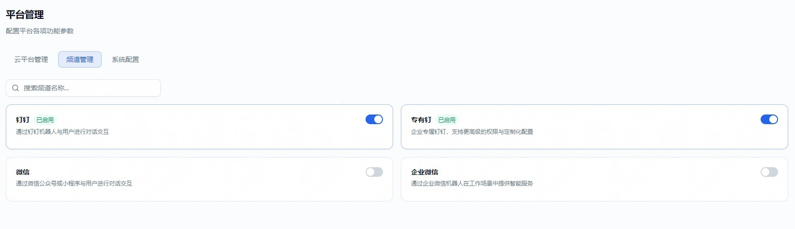

4. 启用频道。

   单击目标频道卡片右上角的开启开关，以启用频道，开关打开后，状态变为**已启用**。

   

**系统配置**

1. 登录 OpenTrek-Ops 平台。

2. 在左侧导航栏，选择**系统设置**>**平台管理**。

3. 在平台管理页面选择**系统配置**，系统预置技能包体积配置项，可修改。

4. 单击**操作**列的**编辑**，修改配置值。

   > **说明**
   >
   > 修改后将对所有租户立即生效，请谨慎调整，防止过大的Skill影响加载性能。

5. 单击**保存**。

# 7.多租户管理

本文介绍如何切换和管理租户。

**前提条件**

已使用租户管理员登录 OpenTrek-Ops 平台。

**操作步骤**

1. 登录 OpenTrek-Ops 平台。

2. 在左侧菜单栏下方单击当前租户，可切换租户，不同的租户进行资源隔离，实现不同租户间的独立性。

   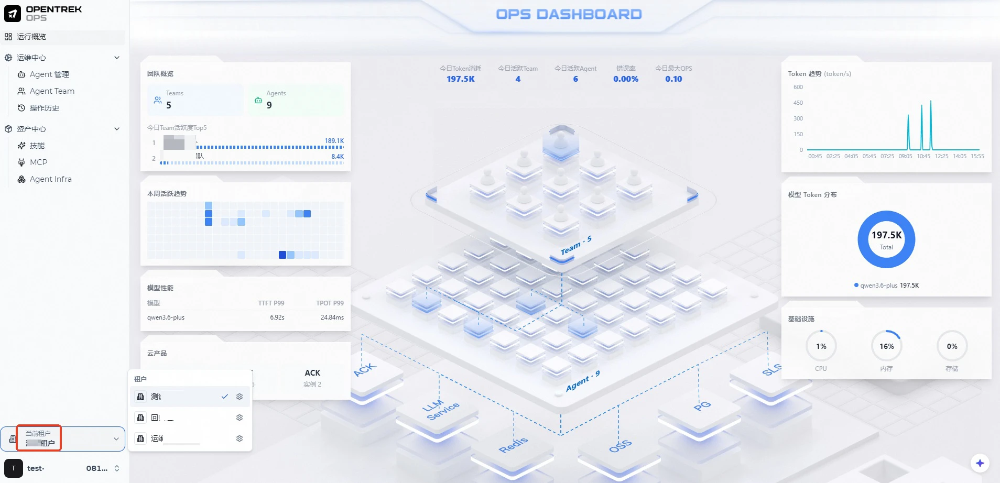

3. 租户设置。

   在切换租户框，单击目标租户的设置按钮  ，在输入框输入制定管理员，授权为当前租户的运维管理员。

   > **说明**
   >
   > 确保所选用户的所属组织已经被租户管理员添加至本平台中。

   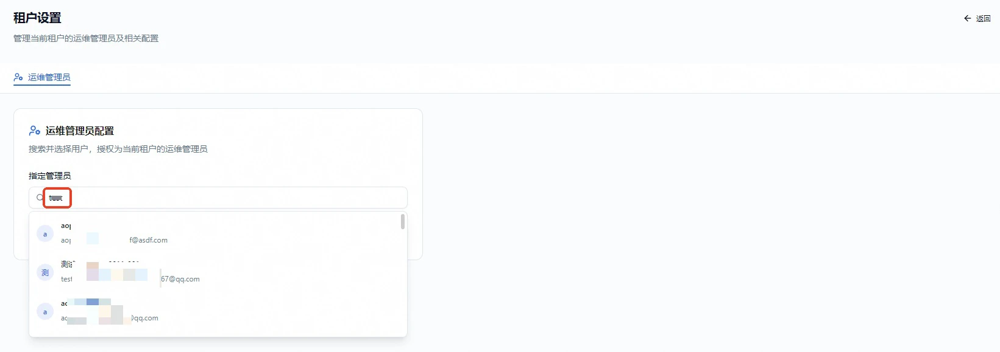

   单击**确认授权**，然后单击界面右上角的**返回**。

# 8.智能运维助手

通过智能运维助手实现自动化运维管理，本文为您介绍智能运维助手的使用。

**操作步骤**

1. 登录 OpenTrek-Ops 平台。

2. 单击界面右下角的图标  唤起智能运维助手。

3. 在智能运维助手输入框输入需要咨询的问题，单击  。

   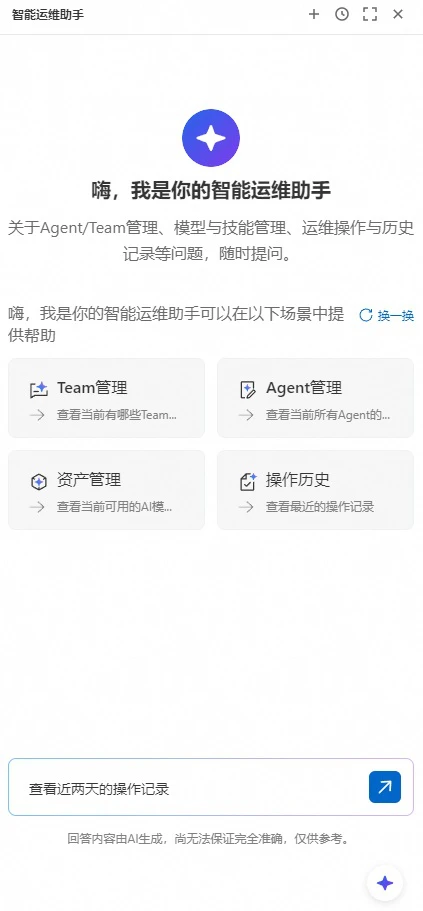

   - 新建对话：单击对话框上方的  ，可新开对话。

   - 历史对话：单击对话框上方的  ，可查看历史对话记录。

   - 窗口全屏：单击对话框上方的  ，全屏展示对话框。

   - 关闭对话：单击对话框上方的  ，可关闭智能运维助手。

# 9.常见问题

**登录问题**

**Q：忘记密码怎么办？**

A：请联系系统管理员重置密码。

**Q：登录后页面显示异常？**

A：请清除浏览器缓存后重新登录，或尝试使用 Chrome 浏览器。

**Agent 相关问题**

**Q：创建 Agent 时找不到所需类型？**

A：请联系管理员确认是否已安装对应的 Agent 类型插件。

**Q：Agent 无法启动？**

A：请检查 Agent 的配置是否完整，以及依赖的基础设施服务是否正常运行。

**技能相关问题**

**Q：技能创建后无法被 Agent 使用？**

A：请确认技能已启用，且 Agent 已安装该技能。
