阿里云  
专有云  
实时数仓 Hologres  
开发指南  
产品版本：V3.18.6  
文档版本：20260528

**目录**

- [1.Hologres SQL](#section-1)
    - [1.1. SQL事务能力](#section-1-1)
    - [1.2. Explain和Explain Analyze](#section-1-2)
    - [1.3. 数据类型](#section-1-3)
        - [1.3.1. 数据类型汇总](#section-1-3-1)
        - [1.3.2. 自增序列Serial](#section-1-3-2)
        - [1.3.3. JSON和JSONB类型](#section-1-3-3)
    - [1.4. PostgreSQL兼容函数](#section-1-4)
        - [1.4.1. 查看表和DB的存储大小](#section-1-4-1)
        - [1.4.2. 有序聚集函数](#section-1-4-2)
        - [1.4.3. 数学函数](#section-1-4-3)
        - [1.4.4. 三角函数](#section-1-4-4)
        - [1.4.5. 字符串函数](#section-1-4-5)
        - [1.4.6. 模式匹配函数](#section-1-4-6)
        - [1.4.7. 时间和日期转换函数](#section-1-4-7)
        - [1.4.8. 条件函数](#section-1-4-8)
        - [1.4.9. 数组函数](#section-1-4-9)
        - [1.4.10. 通用聚合函数](#section-1-4-10)
        - [1.4.11. 有序集合函数](#section-1-4-11)
        - [1.4.12. 窗口函数](#section-1-4-12)
        - [1.4.13. 子查询函数](#section-1-4-13)
        - [1.4.14. 比较函数](#section-1-4-14)
        - [1.4.15. 集合返回函数](#section-1-4-15)
        - [1.4.16. 账号和权限管理函数](#section-1-4-16)
        - [1.4.17. 连接函数](#section-1-4-17)
    - [1.5. 扩展函数](#section-1-5)
        - [1.5.1. 概览](#section-1-5-1)
        - [1.5.2. PostGIS地理信息分析](#section-1-5-2)
        - [1.5.3. 漏斗和留存函数（Beta）](#section-1-5-3)
        - [1.5.4. 聚合视图](#section-1-5-4)
        - [1.5.5. 向量Proxima](#section-1-5-5)
        - [1.5.6. Oracle兼容函数](#section-1-5-6)
        - [1.5.7. Clickhouse兼容函数](#section-1-5-7)
        - [1.5.8. 流量分析函数](#section-1-5-8)
            - [1.5.8.1. 漏斗分析函数](#section-1-5-8-1)
            - [1.5.8.2. 明细圈人函数](#section-1-5-8-2)
            - [1.5.8.3. Roaring Bitmap函数](#section-1-5-8-3)
        - [1.5.9. 聚合函数](#section-1-5-9)
            - [1.5.9.1. APPROX_COUNT_DISTINCT](#section-1-5-9-1)
            - [1.5.9.2. UNIQ](#section-1-5-9-2)
            - [1.5.9.3. MAX_BY与MIN_BY](#section-1-5-9-3)
        - [1.5.10. 账号与安全函数](#section-1-5-10)
            - [1.5.10.1. USER_DISPLAY_NAME](#section-1-5-10-1)
            - [1.5.10.2. HG_DISPLAY_NAME_TO _ID](#section-1-5-10-2)
        - [1.5.11. Hive兼容函数](#section-1-5-11)
            - [1.5.11.1. JSON函数](#section-1-5-11-1)
        - [1.5.12. MaxCompute兼容函数](#section-1-5-12)
            - [1.5.12.1. 最大分区函数](#section-1-5-12-1)
        - [1.5.13. 工具函数](#section-1-5-13)
            - [1.5.13.1. HG_SHARD_ID_FOR_DISTRIBUTION_KEY](#section-1-5-13-1)
            - [1.5.13.2. HG_UPDATE_DATABASE_PROPERTY](#section-1-5-13-2)
            - [1.5.13.3. SET_TABLE_PROPERTY](#section-1-5-13-3)
            - [1.5.13.4. HG_CREATE_TABLE_LIKE](#section-1-5-13-4)
    - [1.6. DDL](#section-1-6)
        - [1.6.1. DATABASE](#section-1-6-1)
            - [1.6.1.1. CREATE DATABASE](#section-1-6-1-1)
            - [1.6.1.2. ALTER DATABASE](#section-1-6-1-2)
            - [1.6.1.3. DROP DATABASE](#section-1-6-1-3)
        - [1.6.2. SCHEMA](#section-1-6-2)
            - [1.6.2.1. CREATE SCHEMA](#section-1-6-2-1)
            - [1.6.2.2. ALTER SCHEMA](#section-1-6-2-2)
            - [1.6.2.3. IMPORT FOREIGN SCHEMA](#section-1-6-2-3)
            - [1.6.2.4. DROP SCHEMA](#section-1-6-2-4)
        - [1.6.3. TABLE](#section-1-6-3)
            - [1.6.3.1. CREATE TABLE](#section-1-6-3-1)
                - [1.6.3.1.1. 分布键Distribution Key](#section-1-6-3-1-1)
            - [1.6.3.2. CREATE TABLE AS](#section-1-6-3-2)
            - [1.6.3.3. CREATE TABLE LIKE](#section-1-6-3-3)
            - [1.6.3.4. ALTER TABLE](#section-1-6-3-4)
            - [1.6.3.5. DROP TABLE](#section-1-6-3-5)
            - [1.6.3.6. 生成列（3.2内核）](#section-1-6-3-6)
        - [1.6.4. 分区表](#section-1-6-4)
            - [1.6.4.1. 逻辑分区表（3.2内核）](#section-1-6-4-1)
                - [1.6.4.1.1. CREATE LOGICAL PARTITION TABLE（3.2内核）](#section-1-6-4-1-1)
                - [1.6.4.1.2. ALTER LOGICAL PARTITION TABLE（3.2内核）](#section-1-6-4-1-2)
                - [1.6.4.1.3. DROP LOGICAL PARTITION TABLE（3.2内核）](#section-1-6-4-1-3)
            - [1.6.4.2. 物理分区表](#section-1-6-4-2)
                - [1.6.4.2.1. CREATE PARTITION TABLE](#section-1-6-4-2-1)
                - [1.6.4.2.2. ALTER PARTITION TABLE](#section-1-6-4-2-2)
                - [1.6.4.2.3. DROP PARTITION TABLE](#section-1-6-4-2-3)
                - [1.6.4.2.4. 动态分区管理（3.2内核）](#section-1-6-4-2-4)
        - [1.6.5. FOREIGN TBALE](#section-1-6-5)
            - [1.6.5.1. CREATE FOREIGN TABLE](#section-1-6-5-1)
            - [1.6.5.2. ALTER FOREIGN TABLE](#section-1-6-5-2)
            - [1.6.5.3. DROP FOREIGN TABLE](#section-1-6-5-3)
        - [1.6.6. CAST](#section-1-6-6)
            - [1.6.6.1. CREATE CAST](#section-1-6-6-1)
            - [1.6.6.2. DROP CAST](#section-1-6-6-2)
        - [1.6.7. VIEW](#section-1-6-7)
    - [1.7. DML&DQL](#section-1-7)
        - [1.7.1. COPY](#section-1-7-1)
        - [1.7.2. INSERT](#section-1-7-2)
        - [1.7.3. SELECT](#section-1-7-3)
        - [1.7.4. DELETE](#section-1-7-4)
        - [1.7.5. UPDATE](#section-1-7-5)
        - [1.7.6. INSERT ON CONFLICT](#section-1-7-6)
        - [1.7.7. TRUNCATE](#section-1-7-7)
        - [1.7.8. Fixed Plan加速SQL执行](#section-1-7-8)
    - [1.8. 高级命令](#section-1-8)
        - [1.8.1. Auto Analyze](#section-1-8-1)
        - [1.8.2. 订阅Hologres Binlog](#section-1-8-2)
        - [1.8.3. Flink实时消费Hologres Binlog](#section-1-8-3)
        - [1.8.4. 通过JDBC消费Hologres Binlog](#section-1-8-4)
        - [1.8.5. 实时物化视图（Beta）](#section-1-8-5)
        - [1.8.6. 列式JSONB](#section-1-8-6)
        - [1.8.7. Table Group与Shard Count](#section-1-8-7)
            - [1.8.7.1. 基本概念](#section-1-8-7-1)
            - [1.8.7.2. Table Group与Shard Count操作指南](#section-1-8-7-2)
            - [1.8.7.3. Table Group设置最佳实践](#section-1-8-7-3)
    - [1.9. 其他语句](#section-1-9)
        - [1.9.1. CANCEL QUERY](#section-1-9-1)
        - [1.9.2. UNNEST](#section-1-9-2)
        - [1.9.3. 存储过程（3.2内核）](#section-1-9-3)
        - [1.9.4. 其他SQL语句](#section-1-9-4)
- [2.API参考](#section-2)
    - [2.1. API](#section-2-1)
        - [2.1.1. ListInstances - 获取实例列表](#section-2-1-1)
        - [2.1.2. GetInstance - 获取实例详情](#section-2-1-2)
        - [2.1.3. UpdateInstanceName - 修改实例名称](#section-2-1-3)
        - [2.1.4. ListBackupData - 获取快照列表](#section-2-1-4)
    - [2.2. API（3.2内核）](#section-2-2)
        - [2.2.1. EnableInstanceAudit-启用实例审计日志](#section-2-2-1)
        - [2.2.2. DisableInstanceAudit-禁用数据库审计日志](#section-2-2-2)
        - [2.2.3. ListEncryptionRules-查询实例表级别加密情况](#section-2-2-3)

<a id="section-1"></a>

# 1.Hologres SQL

<a id="section-1-1"></a>

## 1.1. SQL事务能力

Hologres支持完整的DDL事务以及部分DML事务，默认支持单条SQL事务。本文将会为您介绍Hologres的事务支持能力。

**事务的支持场景**

Hologres对事务的支持场景和使用说明如下：

- 支持多条DDL语句事务

  事务内多个表的创建与回滚支持事务保障，示例如下：

  ```sql
  begin;
  drop table if exists  ddl_test;
  create table ddl_test(
            uid   text not null,
            name  text not null);
  commit;
  ```

- 支持多条DML混合事务（Beta）

  Hologres从V2.0版本开始支持同一个事务内的混合DML。通过混合DML事务的支持，可以保证同一个SQL中混合DML的原子性和一致性，尤其使数据写入时能保证一致性，从而使得Hologres也适用轻TP的场景。但需要注意的是：一个事务中如果有混合DML，无法最大程度的利用Hologres的分布式能力，会使得混合DML无法支撑高QPS的场景。

  - 应用场景：混合DML在同一个事务中，可以保证数据写入、更新、删除的一致性。

  - 注意事项：

    - 混合DML事务只支持低QPS场景，不适用于高并发场合，具体QPS支持请进行实际业务测试。

    - 如果一个事务中，既有写入又有查询，查询性能会低于不使用事务，具体性能损失请以实际为准。

    - 同一个事务中，读、写、删除、更新等请求均在表级别加写锁，会导致同一个表的多个事务只能串行执行，示例如下。

      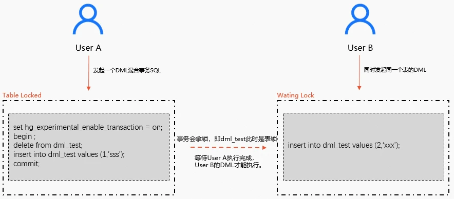

  - 使用说明：

    目前混合DML事务默认关闭，需要通过如下GUC参数开启：

    ```text
    set hg_experimental_enable_transaction = on;
    ```

    开启混合DML事务后，在一个事务中可包含多个DML：

    - 如果其中一个DML失败，那么系统会自动将事务内的DML进行回滚，其余DML会自动失败。

    - 如果DML正在正常执行中，因为某种原因想回滚，可以对事务执行回滚，这样就会自动将事务中的DML回滚。

      ```sql
      set hg_experimental_enable_transaction = on;
      begin ;
      delete from dml_test;
      insert into dml_test values (1,'sss');
      rollback;
      ```

- 暂不支持DDL和DML混合事务。

  如下示例，DDL和DML在同一个事务中会报错： `ERROR: INSERT in ddl transaction is not supported now` 。

  ```sql
  begin;
  drop table if exists dml_test;
  create table dml_test
  (
            uid   text not null,
            name  text not null);
  insert into dml_test values('1','tom');
  commit;
  ```

<a id="section-1-2"></a>

## 1.2. Explain和Explain Analyze

当SQL查询性能不佳或查询结果不符合预期时，Hologres提供了Explain和Explain Analyze命令用于分析查询语句执行计划，可以帮助您了解Hologres如何执行查询语句，以便您对查询语句或数据库结构进行调整优化。本文介绍在Hologres中通过Explain和Explain Analyze查看执行计划及每个算子的含义。

**执行计划简介**

在Hologres中，优化器（Query Optimizer，QO）会为每一条SQL生成一个执行计划，执行引擎（Query Engine，QE）会根据该执行计划生成最终的执行计划，然后执行并获取SQL结果。执行计划中会反映出SQL的统计信息、执行算子、算子耗时等信息，一个好的执行计划，能够用最少的资源更快的返回结果。因此对于日常开发来说，执行计划至关重要，它可以反应出SQL的问题，从而去针对性优化。

Hologres兼容Postgres，可以根据Explain和Explain Analyze语法了解SQL的执行计划。

- Explain：代表优化器QO根据SQL特征**预估**的SQL执行计划，并非实际的执行计划，对SQL的运行有一定参考意义。

- Explain Analyze：代表SQL真实的运行计划，相比Explain会包含更多的实际运行信息，能**准确**的反映出SQL的执行算子和算子耗时，可以根据算子耗时去做针对性的SQL优化。

> **说明**
>
> 从Hologres V1.3.4x版本开始，支持通过Explain和Explain Analyze查看更加清晰且阅读性更高的执行计划，本文档基于V1.3.4x版本撰写，建议将实例升级至V1.3.4x及以上版本。

**Explain**

- 语法格式

  Explain可以反应出优化器的预估执行计划，语法如下：

  ```text
  explain <sql>;
  ```

- 使用示例

  以TPC-H中的SQL为例。

  > **说明**
  >
  > 该示例引用TPC-H的SQL，但是不代表TPC-H的测试结果。

  ```text
  explain select
          l_returnflag,
          l_linestatus,
          sum(l_quantity) as sum_qty,
          sum(l_extendedprice) as sum_base_price,
          sum(l_extendedprice * (1 - l_discount)) as sum_disc_price,
          sum(l_extendedprice * (1 - l_discount) * (1 + l_tax)) as sum_charge,
          avg(l_quantity) as avg_qty,
          avg(l_extendedprice) as avg_price,
          avg(l_discount) as avg_disc,
          count(*) as count_order
  from
          lineitem
  where
          l_shipdate <= date '1998-12-01' - interval '120' day
  group by
          l_returnflag,
          l_linestatus
  order by
          l_returnflag,
          l_linestatus;
  ```

- 返回结果

  ```text
  QUERY PLAN
  Sort  (cost=0.00..7795.30 rows=3 width=80)
    Sort Key: l_returnflag, l_linestatus
    ->  Gather  (cost=0.00..7795.27 rows=3 width=80)
          ->  Project  (cost=0.00..7795.27 rows=3 width=80)
                ->  Project  (cost=0.00..7794.27 rows=3 width=104)
                      ->  Final HashAggregate  (cost=0.00..7793.27 rows=3 width=76)
                            Group Key: l_returnflag, l_linestatus
                            ->  Redistribution  (cost=0.00..7792.95 rows=1881 width=76)
                                  Hash Key: l_returnflag, l_linestatus
                                  ->  Partial HashAggregate  (cost=0.00..7792.89 rows=1881 width=76)
                                        Group Key: l_returnflag, l_linestatus
                                        ->  Local Gather  (cost=0.00..7791.81 rows=44412 width=76)
                                              ->  Decode  (cost=0.00..7791.80 rows=44412 width=76)
                                                    ->  Partial HashAggregate  (cost=0.00..7791.70 rows=44412 width=76)
                                                          Group Key: l_returnflag, l_linestatus
                                                          ->  Project  (cost=0.00..3550.73 rows=584421302 width=33)
                                                                ->  Project  (cost=0.00..2585.43 rows=584421302 width=33)
  ```

  ```text
                                                                      ->  Index Scan using Clustering_index on lineitem  (cost=0.00..261.36 rows=
  ```

  ```text
  84421302 width=25)
  ```

  ```text
                                                                            Segment Filter: (l_shipdate <= '1998-08-03 00:00:00+08'::timestamp wi
  ```

  ```text
  h time zone)
  ```

  ```text
                                                                            Cluster Filter: (l_shipdate <= '1998-08-03 00:00:00+08'::timestamp wi
  ```

  ```text
  h time zone)
  ```

- 结果解释

  执行计划需要从下往上看，每个箭头（->）代表一个节点，每个子节点会返回使用的算子，以及预估的行数等。需要关注的算子包括：

  | 参数 | 描述 |
  | --- | --- |
  | cost | 算子的<strong>预估</strong>耗时，父节点的cost也包含子节点的cost。包含<strong>预估启动cost</strong>和<strong>预估总cost</strong>，中间使用<code> .. </code>分割。<br>• 预估启动cost：输出阶段开始之前的cost。<br>• 预估总cost：是假设算子运行完成的总cost。例如上述返回结果中的Final HashAggregate节点，预估启动cost是<code> 0.00 </code>，总cost是<code> 7793.27 </code>。 |
  | rows | 算子的预估输出行数，主要基于统计信息进行估算。对于上述返回结果中Scan的预估值，默认值为<code> 1000 </code>。<br>说明通常情况下如果出现<code> rows=1000 </code>则说明表的统计信息不正确，没有根据统计信息进行估算，可以通过执行<code> analyze </code> <code>&lt;tablename&gt; </code>命令对表进行统计信息更新。 |
  | width | 算子的预估输出平均宽度（单位：字节），值越大说明列越宽。 |

**Explain Analyze**

- 语法格式

  Explain Analyze可以反应出SQL的实际执行计划，以及对应的算子耗时，从而帮助诊断SQL性能。语法如下：

  ```text
  explain analyze <sql>;
  ```

- 使用示例

  以TPC-H中的SQL为例。

  ```text
  explain analyze select
          l_returnflag,
          l_linestatus,
          sum(l_quantity) as sum_qty,
          sum(l_extendedprice) as sum_base_price,
          sum(l_extendedprice * (1 - l_discount)) as sum_disc_price,
          sum(l_extendedprice * (1 - l_discount) * (1 + l_tax)) as sum_charge,
          avg(l_quantity) as avg_qty,
          avg(l_extendedprice) as avg_price,
          avg(l_discount) as avg_disc,
          count(*) as count_order
  from
          lineitem
  where
          l_shipdate <= date '1998-12-01' - interval '120' day
  group by
          l_returnflag,
          l_linestatus
  order by
          l_returnflag,
          l_linestatus;
  ```

- 返回结果

  ```text
  QUERY PLAN
  Sort  (cost=0.00..7795.30 rows=3 width=80)
    Sort Key: l_returnflag, l_linestatus
  [id=21 dop=1 time=2427/2427/2427ms rows=4(4/4/4) mem=3/3/3KB open=2427/2427/2427ms get_next=0/0/0ms]
    ->  Gather  (cost=0.00..7795.27 rows=3 width=80)
        [20:1 id=100003 dop=1 time=2426/2426/2426ms rows=4(4/4/4) mem=1/1/1KB open=0/0/0ms get_next=2426/2426/2426ms]
          ->  Project  (cost=0.00..7795.27 rows=3 width=80)
              [id=19 dop=20 time=2427/2426/2425ms rows=4(1/0/0) mem=87/87/87KB open=2427/2425/2425ms get_next=1/0/0ms]
                ->  Project  (cost=0.00..7794.27 rows=0 width=104)
                      ->  Final HashAggregate  (cost=0.00..7793.27 rows=3 width=76)
                            Group Key: l_returnflag, l_linestatus
                          [id=16 dop=20 time=2427/2425/2424ms rows=4(1/0/0) mem=574/570/569KB open=2427/2425/2424ms get_next=1/0/0ms]
                            ->  Redistribution  (cost=0.00..7792.95 rows=1881 width=76)
                                  Hash Key: l_returnflag, l_linestatus
                                [20:20 id=100002 dop=20 time=2427/2424/2423ms rows=80(20/4/0) mem=3528/1172/584B open=1/0/0ms 
  get_next=2426/2424/2423ms]
                                  ->  Partial HashAggregate  (cost=0.00..7792.89 rows=1881 width=76)
                                        Group Key: l_returnflag, l_linestatus
                                      [id=12 dop=20 time=2428/2357/2256ms rows=80(4/4/4) mem=574/574/574KB open=2428/2357/2256ms 
  get_next=1/0/0ms]
                                        ->  Local Gather  (cost=0.00..7791.81 rows=44412 width=76)
                                            [id=11 dop=20 time=2427/2356/2255ms rows=936(52/46/44) mem=7/6/6KB open=0/0/0ms 
  get_next=2427/2356/2255ms pull_dop=9/9/9]
                                              ->  Decode  (cost=0.00..7791.80 rows=44412 width=76)
                                                  [id=8 dop=234 time=2435/1484/5ms rows=936(4/4/4) mem=0/0/0B open=2435/1484/5ms 
  get_next=4/0/0ms]
                                                    ->  Partial HashAggregate  (cost=0.00..7791.70 rows=44412 width=76)
                                                          Group Key: l_returnflag, l_linestatus
  ```

  ```text
                                                        [id=5 dop=234 time=2435/1484/3ms rows=936(4/4/4) mem=313/312/168KB open=2435/1484/3ms get
  ```

  ```text
  _next=0/0/0ms]
                                                          ->  Project  (cost=0.00..3550.73 rows=584421302 width=33)
                                                              [id=4 dop=234 time=2145/1281/2ms rows=585075720(4222846/2500323/3500) 
  mem=142/141/69KB open=10/1/0ms get_next=2145/1280/2ms]
                                                                ->  Project  (cost=0.00..2585.43 rows=584421302 width=33)
                                                                    [id=3 dop=234 time=582/322/2ms rows=585075720(4222846/2500323/3500) 
  mem=142/142/69KB open=10/1/0ms get_next=582/320/2ms]
  ```

  ```text
                                                                      ->  Index Scan using Clustering_index on lineitem  (cost=0.00..261.36 rows=
  ```

  ```text
  84421302 width=25)
  ```

  ```text
                                                                            Segment Filter: (l_shipdate <= '1998-08-03 00:00:00+08'::timestamp wi
  ```

  ```text
  h time zone)
  ```

  ```text
                                                                            Cluster Filter: (l_shipdate <= '1998-08-03 00:00:00+08'::timestamp wi
  ```

  ```text
  h time zone)
  ```

  ```text
                                                                          [id=2 dop=234 time=259/125/1ms rows=585075720(4222846/2500323/3500) mem
  ```

  ```text
  1418/886/81KB open=10/1/0ms get_next=253/124/0ms]

  ADVICE: 
  [node id : 1000xxx] distribution key miss match! table lineitem defined distribution keys : l_orderkey; request distribution columns : l_returnflag, l_linestatus; 
  shuffle data skew in different shards! max rows is 20, min rows is 0

  Query id:[300200511xxxx]
  ======================cost======================
  Total cost:[2505] ms
  Optimizer cost:[47] ms
  Init gangs cost:[4] ms
  Build gang desc table cost:[2] ms
  Start query cost:[18] ms
  - Wait schema cost:[0] ms
  - Lock query cost:[0] ms
  - Create dataset reader cost:[0] ms
  - Create split reader cost:[0] ms
  Get the first block cost:[2434] ms
  Get result cost:[2434] ms
  ====================resource====================
  Memory: 921(244/230/217) MB,  straggler worker id: 72969760xxx
  CPU time: 149772(38159/37443/36736) ms, straggler worker id: 72969760xxx
  Physical read bytes: 3345(839/836/834) MB, straggler worker id: 72969760xxx
  Read bytes: 41787(10451/10446/10444) MB, straggler worker id: 72969760xxx
  DAG instance count: 41(11/10/10), straggler worker id: 72969760xxx
  Fragment instance count: 275(70/68/67), straggler worker id: 72969760xxx
  ```

- 结果解释

  Explain Analyze的执行结果反应的是真实执行路径，其结果是一个由多个算子组成的树状结构，会反应出每个阶段每个算子的详细执行信息。Explain Analyze的结果主要包括Query Plan、Advice、Cost耗时、Resource资源消耗情况。

**Query Plan**

在Query Plan中，会反应每个算子的详细执行信息。同Explain一样，Explain Analyze中的Query Plan需要从下往上看，每个箭头（->）代表一个节点。

| 示例 | 说明 |
| --- | --- |
| (cost=0.00..2585.43 rows=584421302 width=33) | 都代表优化器的预估值，非真实值，同Explain含义一致。<br>• cost：算子的预估耗时。<br>• rows：算子的预估输出行数，如果rows的值与实际行数相差较大，大部分原因是表的统计信息未更新，建议对表执行一次<code> analyze &lt;tablename&gt; </code>命令。<br>• width：算子的预估输出平均宽度（单位：字节），值越大说明列越宽。 |
| \[20:20 id=100002 dop=20 time=2427/2424/2423ms rows=80(20/4/0) mem=3528/1172/584B open=1/0/0ms get_next=2426/2424/2423ms\] | 代表实际执行的消耗值，即真实数据。<br>• <code> 20:20 </code>：输入并发度与输出并发度（dag dop）之比，比值代表该算子的输入和输出之间的并行度对应关系。通常来说该值会跟算子结果一起看，比如：<br>• gather算子21:1，表示21个输入合成1个输出；<br>• Redistribution算子21:21，表示21个并行度间Shuffle；<br>• broadcast算子1:21，表示输入并行度为1，输出并行度为21。<br>• id：代表算子的ID，每个算子都有一个唯一的ID。例如示例返回结果中<code> id=100002 </code>。<br>• dop：dop（degree of parallelism）表示当前算子实际运行时的并行度，与实例的Shard数保持一致，例如<code> dop=20 </code>。但是Local Gather节点下的dop都代表扫描的文件数。<br>• time：表示open和get_next两个阶段的实际执行时间（单位：毫秒），Hologres中，每个算子都会有一个open和get next接口。例如time=2427/2424/2423ms ，代表time=max/avg/min ms。<br>• open：代表算子的初始化操作，某些算子的open阶段会依赖下游算子的数据并进行计算。例如Hash算子的open阶段会进行哈希表构建， 拖取完所有下游算子节点的数据。而<code> open=1/0/0ms </code>则代表<code> open=max/avg/min ms </code>，表示该算子open阶段的耗时（单位：毫秒）。<br>• get next：每次从下游算子获取一批数据（record batch）并进行计算，不同类型的算子会有不同的实现，get next会被调用多次，直到下游算子的数据被拖取完。而<code> get_next=2426/2424/2423ms </code>则代表<code> get_next=max/avg/min </code> <code>ms </code>，表示该算子next阶段的耗时（单位：毫秒）。<br>• rows：表示从该算子输出的行数，通过对比最大值、最小值、与平均值的差异， 如果差异过大，说明数据分布不均匀，有倾斜。例如<code> rows=80(20/4/0) </code>，为<code> total_rows(max/avg/min) </code>。<br>• mem：代表算子运行时的内存消耗最大值、平均值、最小值。例如<code> mem=3528/1172/584B </code>，为<code> mem=max/avg/min </code>。 |

由于一条SQL语句可能涉及到多个算子，下面将会有单独章节对算子进行详细介绍，请参见算子含义。

> **说明**
>
> 对于time、row、mem这类数值：
>
> - 当前算子的time值是下方算子耗时的累加，所以当前算子的耗时需要用当前算子的time值减去下方算子的耗时。
>
> - 对于row、mem则是每个算子的独立计算，不是累加值。

**Advice**

Advice中主要系统根据当前Explain Analyze的执行结果，自动生成的调优建议如下：

- 建议为表设置distribution key，clustering key，bitamp等，如 `Table xxx misses bitmap index` 。

- 表缺少统计信息： `Table xxx Miss Stats! please run 'analyze xxx';` 。

- 数据可能存在倾斜： `shuffle data xxx in different shards! max rows is 20, min rows is 0` 。

> **说明**
>
> Advice的结果只是根据当前SQL的Explain Analyze结果给出的建议，不一定完全适用，需要根据业务具体分析，并合理采取相应的操作。

**Cost耗时**

Cost代表Query的总耗时以及在每个阶段运行的详细耗时，可以通过每个阶段的耗时初步判断性能瓶颈。

Total cost：代表Query执行的总耗时, 单位毫秒（ms），其中：

- Optimizer cost：代表优化器（QO）生成执行计划的耗时，单位毫秒（ms）。

- Build gang desc table cost：将查询优化器生成的执行计划，转换为执行引擎所需的数据结构所花费的时间，单位毫秒（ms）。

- Init gangs cost：将QO生成的执行计划进一步预处理，并将请求发送给执行引擎，从而开始Start Query阶段的耗时，单位毫秒（ms）。

- Start query cost：从Init gangs步骤执行完成时开始计算，真正开始执行Query前的初始化阶段，包括了加锁，对齐Schema版本等过程，主要有以下几个节点：

  - Wait schema cost：存储引擎（Storage Engine，SE）和Frontend（FE）对齐Schema版本所耗时间。当表的Schema发生变化时，FE会更新节点版本，同理SE也会更新节点版本，如果FE和SE的版本不对齐，则会出现Schema延迟。如果延迟较高，一般原因是因为SE处理慢，尤其是分区父表的DDL较多时，延迟较高，导致数据写入/查询慢，建议针对性优化DDL频率。

  - Lock query cost：Query加锁所耗时间，如果耗时较高，则说明Query在等锁。

  - Create dataset reader cost：创建索引数据读取器的耗时，耗时较高有可能是未命中Cache。

  - Create split reader cost：打开文件消耗的时间，耗时高则说明文件meta没有命中缓存，IO开销较高。

- Get result cost：从Start Query阶段结束开始计算，到所有结果均返回所花费的时间。Get result cost包含Get the first block cost，单位毫秒（ms）。

  - Get the first block cost：从Start Query阶段结束开始计算，到返回第一批数据（即第一个record batch）为止的时间。某些场景下该指标会与比Get result cost指标非常接近或者一致。例如当查询计划的顶部是Hash Agg算子，建立Hash Table做聚合运算需要依赖下游算子的全量数据。而对于普通带过滤条件的查询，数据流式进行计算和返回，此场景下，该指标通常会与Get result cost数值有较大的差距（取决于数据量）。

**Resource资源消耗情况**

Resource代表Query运行的资源消耗，格式为： `total(max/avg/min)` ，包含总的资源累加和消耗资源的最大值、平均值和最小值。

因为Hologres是分布式引擎，一个实例有多个Worker节点，每个Worker节点计算完成会进行结果合并，并最终返回给客户端。因此在资源消耗中，会使用 `total(max worker/avg worker/min worker)` 的格式来反应整体消耗，其中：

- total：代表Query的总消耗。

- max：代表单个Worker节点消耗的最大值。

- avg：代表平均Worker节点的消耗（avg=total/worker节点数）。

- min：代表单个Worker节点消耗的最小值。

以下为各资源消耗指标的详细解释：

| 指标 | 描述 |
| --- | --- |
| Memory | Query运行过程中所消耗的内存，包括消耗总内存、以及Worker节点消耗的最大内存、平均内存和最小内存。 |
| CPU time | Query运行时消耗的总CPU时间（单位毫秒，非精确值）。体现所有计算任务所耗费的CPU时间，是多个CPU Core计算时间的累加，粗略地体现复杂度。 |
| Physical read bytes | 从磁盘上读取的数据量，单位Bytes，当Query没有命中缓存Cache时，则需要去磁盘读取数据。 |
| Read bytes | Query读取的总字节大小，单位Bytes，包括物理读（Physical Read）和从内存Cache中读取的数据大小。反应Query执行获取的数据量的大小。 |
| Affected rows | DML影响的行数, 只有DML才会展示该指标。 |
| Dag instance count | 查询计划DAG instance数量，数值越大表示查询越复杂，并行度越高。 |
| Fragment instance count | 查询计划Fragment instance数量，数值越大表示计划越多，文件数越多。 |
| straggler_worker_id | 表示该资源指标消耗最大的Worker节点的id。 |

**算子含义**

**SCAN**

- **seq scan**

  Seq Scan表示顺序地从表中读取数据，**会进行全表扫描**。 `on` 后对应的是所扫描的表名。

  示例：对一张普通内表查询，在执行计划中会有Seq scan。

  ```text
  EXPLAIN SELECT * FROM public.holo_lineitem_100g;
  ```

  返回结果：

  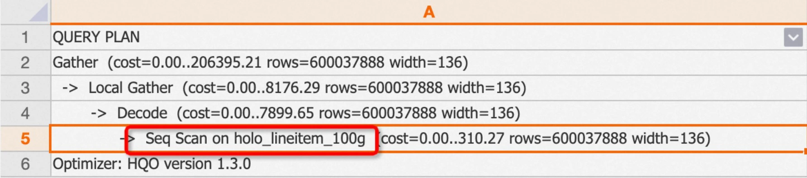

  - 查询分区表

    如果是分区表，执行计划中则是 `Seq Scan on Partitioned Table` ，且会通过Partitions selected: x out of y来展示SQL中扫描了多少分区。

    示例：查询一个分区父表，且只扫描了一个分区。

    ```text
    EXPLAIN SELECT * FROM public.hologres_parent;
    ```

    返回结果：

    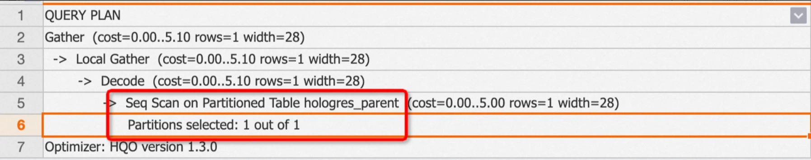

  - 查询外部表

    如果查询的是外部表，执行计划中则会有 `Foreign Table Type` 区分外部表的来源。type分类包括：MaxCompute、OSS、Hologres。

    示例：查询MaxCompute外部表。

    ```text
    EXPLAIN SELECT * FROM public.odps_lineitem_100;
    ```

    返回结果：

    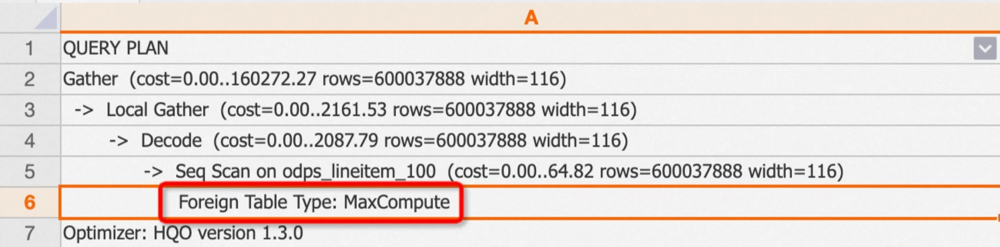

- **Index Scan和 Index Seek**

  如果扫描表有命中索引，根据表的存储格式（行存或列存）不同，Hologres在底层使用的索引也不同，根据索引扫描时主要有Clustering_index和Index Seek（又名pk_index）两种索引。其中：

  - Clustering_index：表示使用了列存表的索引（例如segment 、clustering等），只要查询命中索引就会使用Clustering_index。 `Seq Scan Using Clustering_index` 通常会跟Filter一起出现，Fliter是子节点，会列出命中的索引，包括clusteirng filter、segment filter、bitmap filter等。

    - 示例1：查询命中索引。

      ```sql
      begin;
      create table column_test (
       "id" bigint not null ,
       "name" text not null ,
       "age" bigint not null 
      );
      call set_table_property('column_test', 'orientation', 'column');
      call set_table_property('column_test', 'distribution_key', 'id');
      call set_table_property('column_test', 'clustering_key', 'id');
      commit;

      insert into column_test values(1,'tom',10),(2,'tony',11),(3,'tony',12);

      explain select * from column_test where id>2;
      ```

      返回结果：

      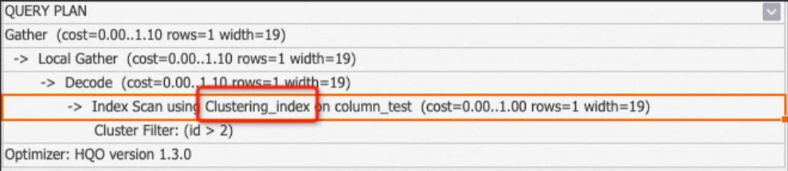

    - 示例2：假如查询没有命中索引，则不会使用clustering_index。

      ```text
      explain select * from column_test where age>10;
      ```

      返回结果：

      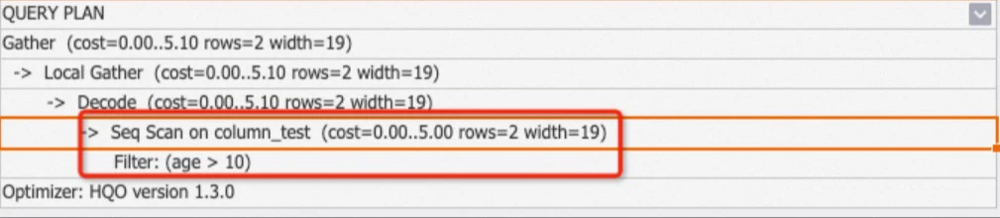

  - Index Seek（又名pk_index）：表示使用了行存表的索引，主要是主键索引。一般情况下，基于主键的行存表点查是走Fixed Plan，但是未走Fixed Plan的行存表且带有主键的查询就会走pk_index。

    示例：查询行存表。

    ```sql
    begin;
    create table row_test_1 (
        id bigint not null,
        name text not null,
        class text ,
    PRIMARY KEY (id)
    );
    call set_table_property('row_test_1', 'orientation', 'row');
    call set_table_property('row_test_1', 'clustering_key', 'name');
    commit;
    insert into row_test_1 values ('1','qqq','3'),('2','aaa','4'),('3','zzz','5');

    begin;
    create table row_test_2 (
        id bigint not null,
        name text not null,
        class text ,
    PRIMARY KEY (id)
    );
    call set_table_property('row_test_2', 'orientation', 'row');
    call set_table_property('row_test_2', 'clustering_key', 'name');
    commit;
    insert into row_test_2 values ('1','qqq','3'),('2','aaa','4'),('3','zzz','5');

    --pk_index
    explain select * from (select id from row_test_1 where id = 1) t1 join row_test_2 t2 on t1.id = t2.id;
    ```

    返回结果：

    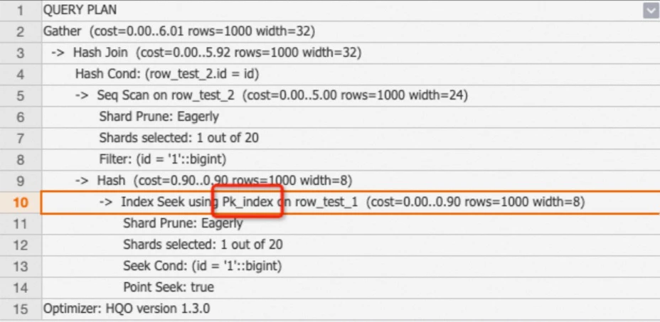

**Filter**

Filter代表将数据根据SQL条件进行过滤，一般会跟随seq scan on table一起，是seq scan的子节点，表示扫描表时是否有过滤，以及过滤条件是否命中索引。主要包括以下几种Filter：

- **Filter**

  如果执行计划中，仅包含Filter，则说明过滤条件没有命中任何索引。此时需要去检查表索引，重新为SQL设置合理的索引，从而提升查询性能。

  > **说明**
  >
  > 如果执行计划中存在 `One-Time Filter: false` ，说明输出结果为空集。

  示例：

  ```sql
  begin;
  create table clustering_index_test (
   "id" bigint not null ,
   "name" text not null ,
   "age" bigint not null 
  );
  call set_table_property('clustering_index_test', 'orientation', 'column');
  call set_table_property('clustering_index_test', 'distribution_key', 'id');
  call set_table_property('clustering_index_test', 'clustering_key', 'age');
  commit;

  insert into clustering_index_test values(1,'tom',10),(2,'tony',11),(3,'tony',12);

  explain select * from clustering_index_test where id>2;
  ```

  返回结果：

  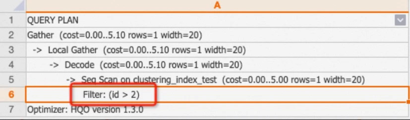

- **Segment Filter**

  Segment Filter表示查询时命中了segment索引，与index_scan一起出现。

- **Cluster Filter**

  Cluster Filter表示查询时命中了clustering索引。

- **Bitmap Filter**

  Bitmap Filter表示查询时命中了Bitmap索引。

- **Join Filter**

  join完后还需要对数据做一遍filter。

**Decode**

Decode表示对数据进行解码或者编码，以加速text等文本类数据的计算。

**Local Gather和Gather**

在Hologres中，数据会在shard内按照文件的形式存储。Local Gather代表数据从多个文件合并到一个shard上。Gather则代表将多个shard的数据合并汇总成最终结果。

示例：

```text
explain select * from public.lineitem;
```

返回结果：其执行计划如下，代表数据被扫描出来后，会先通过Local Gather在shard级汇总，然后通过Gather合并成最终数据。

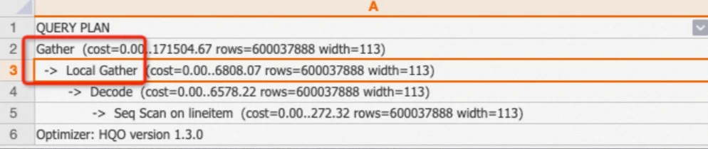

**Redistribution**

Redistribution表示数据通过哈希分布或者随机分布，查询时shuffle到一个或者多个shard。redistribution算子一般出现在join、count distinct（本质上也是join）以及group by的场景中。

当出现redistribution时，说明表的distribution key没有设置，或者设置不合理，导致查询时数据在多个shard间shuffle。尤其是在多表join的场景，如果出现redistribution，则说明没有利用local join的能力，导致查询性能不佳。

示例：两表join。

```sql
begin;
create table tbl1(
a int not null,
b text not null
);
call set_table_property('tbl1', 'distribution_key', 'a');
create table tbl2(
c int not null,
d text not null
);
call set_table_property('tbl2', 'distribution_key', 'd');
commit;

explain select * from tbl1  join tbl2 on tbl1.a=tbl2.c;
```

返回结果：执行计划如下，出现redistribution，说明distribution key设置不合理（SQL中join条件是 `tbl1.a=tbl2.c` ，而两个表的distribution key分别为a和d，join时数据就会shuffle）。

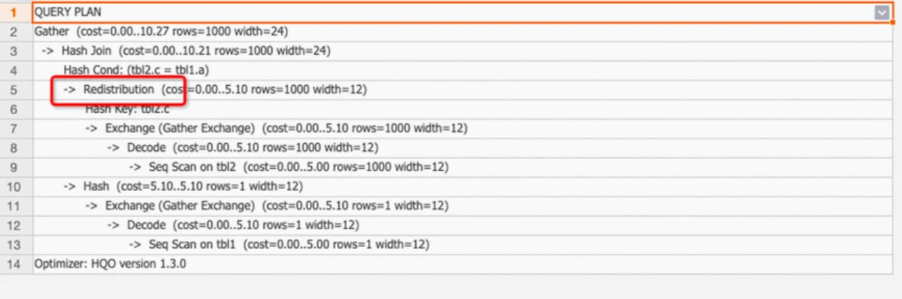

调优建议：如果出现redistribution算子，建议关注表的distribution key设置是否合理。更多关于redistribution的场景和distribution key的设置请参见分布键Distribution Key。

**Join**

与标准数据库的定义一致，多表关联（Join）根据SQL的书写方式又分为hash join、nested loop和merge join。

- **Hash Join**

  hash join是指两个表或者多表join时，基于其中一个表（一般为小表）在内存中构建一个hash表，并把join的列值进行hash计算后放进hash表中，之后逐行的读取另外的表，计算出其hash值并在hash表中查找，最终返回匹配的数据。根据hash join的细分类，还可以继续划分，如下表：

  <table>
    <tr>
      <th width="148">分类</th>
      <th>描述</th>
    </tr>
    <tr>
      <td>Hash Left Join</td>
      <td>多表关联时，根据join条件从左表中返回所有满足条件的行，然后匹配右表，如果没有匹配到数据，则返回null。</td>
    </tr>
    <tr>
      <td>Hash Right Join</td>
      <td>多表关联时，返回右表的全部行和左边满足join条件的行，如果右表的行在左表中没有匹配数据，那么左表则返回null。</td>
    </tr>
    <tr>
      <td>Hash Inner Join</td>
      <td>多表关联时，只返回满足join条件的行。</td>
    </tr>
    <tr>
      <td>Hash Full Join</td>
      <td>多表关联时，从左表和右表返回所有的行，如果其中一个表的数据在另外一个表中没有匹配，则无法匹配的表返回null。</td>
    </tr>
    <tr>
      <td>Hash Anti Join</td>
      <td>仅返回未匹配到的数据，多用于not exists查询条件。</td>
    </tr>
    <tr>
      <td>Hash Semi Join</td>
      <td>有任意匹配则返回一项，通常是由exists查询，结果不会产生重复项。</td>
    </tr>
  </table>

  当查看hash join相关的执行计划时，还需要关注其子节点：

  - hash cond：代表join的关联条件，如 `hash cond`（`tmp.a=tmp1.b`） 。

  - hash key：一般出现在group by场景中，表示将group by的key在多个shard上进行hash计算。

  <strong>当出现hash join时，我们需要额外关注join表中的小表（数据量较小的表）是否是做了hash表，</strong>可以通过如下几种方式查看：

  - 执行计划中，有**hash**字样的表是hash表。

  - 执行计划中，从下往上看，最下面的表则是hash表。

  **调优建议：**

  - 更新统计信息

    **hash join的核心调优思路就是尽可能的将小表作为hash表**，如果是大表作为hash表，因为要在内存中构建hash表，那么就会消耗较多的资源，大多数情况都是因为表的统计信息没有更新导致优化器QO将大表作为了hash表。

    示例：因为统计信息未更新（rows=1000），两表join时大表hash_join_test_2作为hash表（tbl2数据量有100万，tbl1数据量只有1万），导致查询效率较低。

    ```sql
    BEGIN ;
    CREATE TABLE public.hash_join_test_1 (
        a integer not null,
        b text not null
    );
    CALL set_table_property('public.hash_join_test_1', 'distribution_key', 'a');
    CREATE TABLE public.hash_join_test_2 (
        c integer not null,
        d text not null
    );
    CALL set_table_property('public.hash_join_test_2', 'distribution_key', 'c');
    COMMIT ;

    insert into hash_join_test_1 select i, i+1 from generate_series(1, 10000) as s(i);
    insert into hash_join_test_2 select i, i::text from generate_series(10, 1000000) as s(i);

    explain select * from hash_join_test_1 tbl1  join hash_join_test_2 tbl2 on tbl1.a=tbl2.c;
    ```

    执行计划中大表hash_join_test_2作为hash表，如下：

    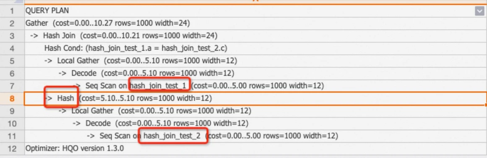

    如果统计信息没有及时更新，可以手动执行 `analyze <tablename>` 更新统计信息。示例如下：

    ```text
    analyze hash_join_test_1;
    analyze hash_join_test_2;
    ```

    更新后的执行计划如下，小表hash_join_test_1变成了hash表，且优化器预估的行数正确。

    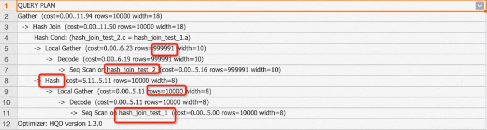

  - 调整join order

    通常情况下，更新统计信息能解决大部分的join关联问题。但是当SQL比较复杂且是多表关联时（至少5张表），Hologres优化器（QO）的默认机制会根据SQL选择更加合理的执行计划，导致优化器在选择执行计划上会耗费较多时间。我们可以通过如下GUC控制join order，以降低QO的耗时。

    ```text
    set optimizer_join_order = '<value>'; 
    ```

    value参数的取值如下：

    <table>
      <tr>
        <th width="178">value取值</th>
        <th>描述</th>
      </tr>
      <tr>
        <td>exhaustive（默认）</td>
        <td>通过算法进行Join Order转换，会生成最优的执行计划，但多表关联时会导致优化器开销变高。</td>
      </tr>
      <tr>
        <td>query</td>
        <td>按照SQL的方式生成执行计划，优化器不做任何改变，仅适用于多表关联且表数据量不大（低于亿级）的场景，从而降低QO开销。同时不建议将该参数设置成DB级别，否则会影响其余join的性能。</td>
      </tr>
      <tr>
        <td>greedy</td>
        <td>通过贪心算法生成Join Order，优化器开销适中。</td>
      </tr>
    </table>

- **Nested Loop Join和Materialize**

  Nested Loop代表嵌套循环连接，多表关联时，先从一张表中读取数据，成为外层表，再将外层驱动表的每条数据遍历另外的表（即内层表），然后内外层表嵌套循环进行Join，相当于计算笛卡尔积。在执行计划中第一内层表通常有Materialize算子。

  优化建议：

  - Nested Loop的原理是内层表被外层表驱动，外层表返回的每一行都要在内层表中检索与之匹配的行，因此返回的结果集不能太大，否则会消耗较多资源，尽量将返回结果较小的表作为外层表。

  - 非等值的join通常会生成Nested Loop join，在SQL书写中尽量避免非等值join<strong>。</strong>

  - Nested Loop join的示例如下：

    ```sql
    begin;
    create table public.nestedloop_test_1 (
        a integer not null,
        b integer not null
    );
    call set_table_property('public.nestedloop_test_1', 'distribution_key', 'a');
    create table public.nestedloop_test_2 (
        c integer not null,
        d text not null
    );
    call set_table_property('public.nestedloop_test_2', 'distribution_key', 'c');
    commit;

    insert into nestedloop_test_1 select i, i+1 from generate_series(1, 10000) as s(i);
    insert into nestedloop_test_2 select i, i::text from generate_series(10, 1000000) as s(i);

    explain select * from nestedloop_test_1 tbl1,nestedloop_test_2 tbl2 where tbl1.a>tbl2.c;
    ```

    从下述执行计划中可以看出存在Materialize和Nested Loop算子，说明该SQL走的是Nested Loop join路径。

    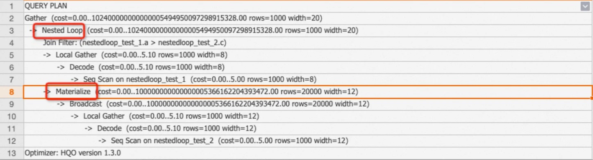

**Broadcast**

Broadcast指通过广播的方式将数据分发到各个shard，通常用在Broadcast Join的场景中，一般是小表join大表。下发SQL时，优化器QO会比较redistribution和Broadcast的代价，然后根据算法生成执行计划。

调优建议：

- 当查询表的数据量较小且实例的shard数比较少时（比如shard count=5）时，走Broadcast比较划算。

  示例：两表join，broadcast_test_1和broadcast_test_2的数据量差异比较明显。

  ```sql
  begin;
  create table broadcast_test_1 (
      f1 int, 
      f2 int);
  call set_table_property('broadcast_test_1','distribution_key','f2');
  create table broadcast_test_2 (
      f1 int,
      f2 int);
  commit;

  insert into broadcast_test_1 select i as f1, i as f2 from generate_series(1, 30)i;
  insert into broadcast_test_2 select i as f1, i as f2 from generate_series(1, 30000)i;

  analyze broadcast_test_1;
  analyze broadcast_test_2;

  explain select * from broadcast_test_1 t1, broadcast_test_2 t2 where t1.f1=t2.f1;
  ```

  返回结果：

  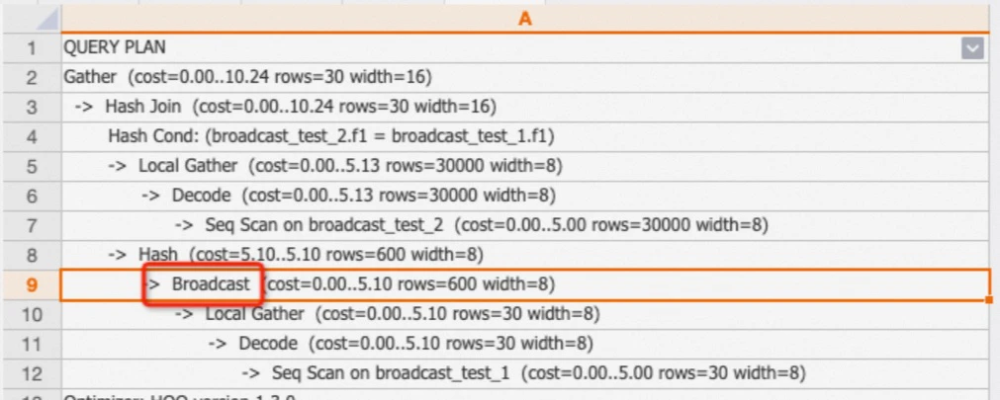

- 如果不是小表但又生成了Broadcast算子，通常情况是因为统计信息未及时更新导致（比如统计信息中rows=1000，实际扫描100万），需要及时更新统计信息，执行 `analyze <tablename>` 。

**ExecuteExternalSQL**

如Hologres的产品架构介绍，Hologres的计算引擎会分为HQE、PQE、SQE等，其中PQE是原生Postgres引擎，部分Hologres自研引擎HQE还没有支持的算子和函数，会通过PQE执行，相比于HQE，PQE的执行效率会更低。当我们在执行计划中看到有ExecuteExternalSQL算子，说明有函数或者算子走了PQE。

- 示例1：走PQE的SQL示例如下。

  ```sql
  create table pqe_test(a text);
  insert into pqe_test values ('2023-01-28 16:25:19.082698+08');
  explain select a::timestamp from pqe_test;
  ```

  执行计划如下：有ExecuteExternalSQL说明 `::timestamp` 算子走的是PQE。

  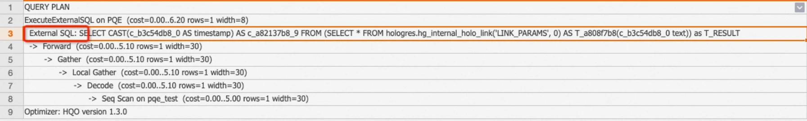

- 示例2：将 `::timestamp` 改写成 `to_timestamp` ，可以走HQE，SQL示例如下。

  ```text
  explain select to_timestamp(a,'YYYY-MM-DD HH24:MI:SS') from pqe_test;
  ```

  执行计划如下，结果中没有ExecuteExternalSQL，表明没有走PQE。

  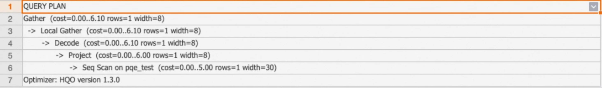

调优建议：通过执行计划找到SQL走了PQE的函数或者算子，并通过改写使其走到HQE，提升查询效率。常见的算子改写列表请参见优化内部表的性能。

> **说明**
>
> Hologres的每个版本在不断优化PQE的支持，将更多的PQE下推至HQE实现，因此部分函数可以通过升级版本实现自动下推，详情请参见函数功能发布记录。

**Aggregate**

Aggregate代表将数据聚合，可以是一个聚合函数或者多个聚合函数的组合。根据SQL书写，系统又会将Aggregate分为HashAggregate，GroupAggregate等。其中：

- GroupAggregate：表示数据已经按照group by进行了预排序。

- HashAggregate（最常见）：表示数据先进行hash计算，然后通过hash值分发至不同的shard进行聚合，最终通过Gather算子聚合。

  ```text
  EXPLAIN SELECT l_orderkey,count(l_linenumber) FROM public.holo_lineitem_100g group by l_orderkey;
  ```

- 多阶段HashAggregate：数据是在shard中按照文件存储的，文件有不同的层级，当数据量多时，聚合的阶段也会分为多个阶段。主要的子算子包括：

  - Partial HashAggregate：文件和shard内的聚合。

  - Final HashAggregate：多个shard上的数据聚合在一起。

  示例：TPC-H Q6查询，走了多阶段HashAggregate。

  ```text
  explain select
          sum(l_extendedprice * l_discount) as revenue
  from
          lineitem
  where
          l_shipdate >= date '1996-01-01'
          and l_shipdate < date '1996-01-01' + interval '1' year
          and l_discount between 0.02 - 0.01 and 0.02 + 0.01
          and l_quantity < 24;
  ```

  返回结果：

  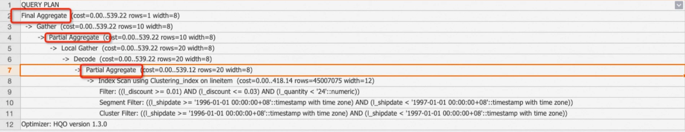

  调优建议：一般情况下，优化器会根据数据量决定是单阶段HashAggregate还是多阶段HashAggregate，如果Explain Analyze中Aggregate算子的耗时较高，通常情况是数据量较大，但是优化器只让Aggregate只做了shard级别的聚合，没有在文件级别聚合，可以通过如下GUC参数执行多阶段HashAggregate。如果本身SQL已经是多阶段Aggregate了，则不需要去做额外的调整。

  ```text
  set optimizer_force_multistage_agg = on;
  ```

**Sort**

sort表示将数据按顺序排序（升序ASC或者降序DESC），通常是order by子句的结果。

示例：对TPC-H lineitem表的l_shipdate列进行排序输出。

```text
EXPLAIN SELECT l_shipdate FROM public.lineitem order by l_shipdate;
```

返回结果：

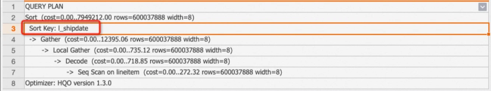

调优建议：如果order by的数据量较大，将会消耗较多的资源，需要尽量避免大数据量的排序查询。

**Limit**

limit表示SQL最终允许返回的数据行数。但需要注意的是，limit仅代表最终返回的行数，并不代表实际计算中扫描的行数，实际扫描的行数要看limit是否下推至Seq Scan节点。如果下推至Seq Scan节点，才是扫描limit N的数据。

示例：如下SQL，有limit 1且下推到了Seq Scan节点，只需要扫描一行数据即可出结果。

```text
explain select * from public.lineitem limit 1;
```

返回结果：

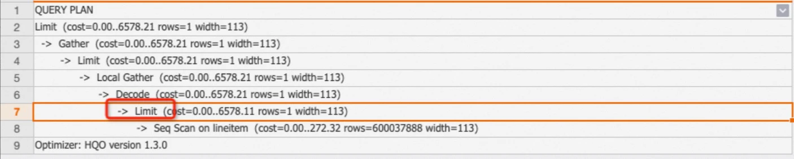

调优建议：

- 并不是所有的limit都会被下推，所以在SQL查询中，尽量避免全表扫描，尽量多增加过滤条件。

- 尽量避免limit N时，N为超大值（例如，N为十万或百万）场景，否则即使limit下推了，也会因为扫描过多的数据量而增加耗时。

**Append**

子查询的结果合并，通常为Union All操作。

**Exchange**

shard内的数据交换。无需过多关注。

**Forward**

Forward代表将算子的数据在HQE与PQE或者SQE之间传输，一般是HQE+PQE或者HQE+SQE的组合会出现。

**Project**

Project一般表示子查询与外层查询的映射关系，无需过多关注。

**相关文档**

HoloWeb可视化查看执行计划，请参见查看执行计划。

<a id="section-1-3"></a>

## 1.3. 数据类型

<a id="section-1-3-1"></a>

### 1.3.1. 数据类型汇总

Hologres的数据类型与PostgreSQL的数据类型兼容。本文为您介绍Hologres支持的数据类型及数组类型。

**数据类型**

当前Hologres版本支持的数据类型是PostgreSQL的一个子集。Hologres已支持的数据类型列表如下。

| 名称 | 支持的版本 | 存储大小 | 说明 | 取值范围 | 示例 |
| --- | --- | --- | --- | --- | --- |
| INTEGER（别名INT或INT4） | Hologres所有版本 | 4字节 | 常用的整数 | -2147483648～+2147483647 | 2147483647 |
| BIGINT（别名INT8） | Hologres所有版本 | 8字节 | 大范围整数 | -9223372036854775808～+922337203685477580 7 | 9223372036854775807 |
| BOOLEAN（别名BOOL） | Hologres所有版本 | 1字节 | 布尔类型 | • True<br>• False | True |
| REAL（别名FLOAT4） | Hologres所有版本 | 4字节 | 可变精度，不精确。<br>说明在PostgreSQL生态中FLOAT不设置精度默认对应的是DOUBLE PRECISION（FLOAT8）。 | 精度为6位的十进制数字。 | 123.123 |
| DOUBLE PRECISION（别名FLOAT8） | Hologres所有版本 | 8字节 | 可变精度，不精确。 | 精度为15位的十进制数字。 | 123.123456789123 |
| TEXT | Hologres所有版本 | 可变长 | 可变长度字符串。TEXT类型相比VARCHAR(n)、CHAR(n)具备更高的灵活性，建议使用TEXT类型，而不是VARCHAR(n)、CHAR(n)。 | 无 | abcdefg |
| TIMESTAMP WITH TIME ZONE（别名TIMESTAMPTZ） | Hologres所有版本 | 8字节 | 带时区的时间戳。存储精度为毫秒。<br>说明标准PostgreSQL使用<code> TIMESTAMPTZ </code>的+或者-符号，以及符号后的时区偏移来识别<code> TIMESTAMP WITH TIME </code> <code>ZONE </code>的时区。如果未表明时区偏移，则系统自动给数据添加默认时区。 | 4713 BC～294276 AD | 2004-10-19 10:23:54+02 |
| DECIMAL（别名NUMERIC） | Hologres所有版本 | 可变长 | 需要指定PRECISION和SCALE：<br>• PRECISION：表示数字的位数，取值范围为0~38。<br>• SCALE：表示小数部分的位数，取值范围为0~PRECISION。 | 可以指定数据到小数点前的38位和小数点后的38位。 | DECIMAL(38, 10) |
| DATE | Hologres 0.8版本新增 | 4字节 | 单位为一天。 | 4713 BC ~ 5874897 AD | 2004-10-19 |
| TIMESTAMP | Hologres 0.8版本新增 | 8字节 | 不包含时区的时间戳，存储精度为微秒。 | 4713 BC ~ 5874897 AD | 2020-01-01 01:01:01.123456 |
| CHAR(n) | Hologres 0.8版本新增 | 固定字符长度，最长n个字符。 | 存储字节不大于1 GB。 | 固定字符长度的字符串。 | • abcd<br>• 中国人民 |
| VARCHAR(n) | Hologres 0.8版本新增 | 可变长，不超过n个字符。 | 存储字节不大于1 GB。 | 有限字符长度的可变字符串。 | abcdefg |
| SERIAL（自增序列） | Hologres 0.8版本新增 | 详情请参见自增序列Serial。 | 无 | 无 | 无 |
| SMALLINT | Hologres 0.9版本新增 | 2字节 | 小范围整数 | -32768~+32767 | 32767 |
| JSON和JSONB | Hologres 0.9版本新增 | 详情请参见JSON和JSONB类型。 | 无 | 无 | 无 |
| BYTEA | Hologres 0.9版本新增 | 可变长，详情请参见Binary Data Types。 | 可变长的二进制串。 | 存储字节不超过1 GB。 | 无 |
| RoaringBitmap | Hologres 0.10版本新增 | 可变长，详情请参见Roaring Bitmap函数。 | 高效的INT类型数组，支持常量数组位图计算。 | 无 | 无 |
| BIT(n) | Hologres 0.9版本新增 | 长度为n个bit的二进制串 | 固定长度的二进制串。 | 存储字节不超过1 GB。 | 无 |
| VARBIT(n) | Hologres 0.9版本 | 可变长，长度不超过n个bit的二进制串 | 有限bit长度的二进制串 | 存储字节不超过1 GB。 | 无 |
| INTERVAL | Hologres 所有版本 | 16字节 | 无 | -178000000 years~178000000 years | interval '1 year' |
| TIMETZ | Hologres 0.9版本新增 | 12字节 | 一天中的时间（带时区），解析度为微秒。 | 00:00:00~24:00:00 | 12:00:00+08 |
| TIME | Hologres 0.9版本新增 | 8字节 | 一天中的时间（不带时区），解析度为微秒。 | 00:00:00~24:00:00 | 12:00:00 |
| INET | Hologres 0.9版本新增 | 详情请参见网络地址类型。 | INE在一个数据域里保存一个IPv4 或IPv6主机地址。 | 无 | 192.168.100.128/25 |
| MONEY | Hologres 0.9版本新增 | 8字节，详情请参见货币类型。 | money类型存储固定小数精度的货币数字。 | -92233720368547758.08 ~+92233720368547758.07 | 12.34美元 |
| OID | Hologres 0.9版本新增 | 4字节 | 数字形式的对象标识符。 | 无 | 1024 |
| UUID | Hologres 0.9版本新增 | 16字节 | 通用唯一标识符，定长128位。<br>说明目前还不支持uuid-ossp中实现的算法。详情请参见uuid。 | 00000000-0000-0000-0000-000000000000~ffffffff-ffff-ffff-ffff-ffffffffffff | a0eebc99-9c0b-4ef8-bb6d-6bb9bd380a11 |

TIMESTAMP WITH TIME ZONE、DATE和DECIMAL的示例SQL语句如下。

```sql
CREATE TABLE test_data_type (
  tswtz_column TIMESTAMP WITH TIME ZONE,
  date_column date,
  decimal_column decimal(38, 10),
  char_column char(20),
  varchar_volumn varchar(225)
);

INSERT INTO test_data_type
VALUES ('2004-10-19 08:08:08', '2004-10-19', 123.456, 'abcd', 'a');

SELECT * FROM test_data_type;
      tswtz_column      | date_column | decimal_column |     char_column      | varchar_volumn 
------------------------+-------------+----------------+----------------------+----------------
 2004-10-19 08:08:08+08 | 2004-10-19  | 123.4560000000 | abcd                 | a
(1 row)
```

BIT、VARBIT和BYTEA的示例SQL语句如下。

```sql
//BIT、VARBIT

CREATE TABLE test (a BIT(3), b BIT VARYING(5));
INSERT INTO test VALUES (B'101', B'00');
INSERT INTO test VALUES (B'10', B'101');

ERROR:  bit string length 2 does not match type bit(3)

INSERT INTO test VALUES (B'10'::bit(3), B'101');
SELECT * FROM test;

  a  |  b
-----+-----
 101 | 00
 100 | 101

//BYTEA

SET bytea_output = 'escape';

SELECT 'abc \153\154\155 \052\251\124'::bytea;
     bytea
----------------
 abc klm *\251T
 
RESET bytea_output;  -- 'hex' by default

SELECT 'abc \153\154\155 \052\251\124'::bytea;
          bytea
--------------------------
 \x616263206b6c6d202aa954
(1 row)
```

**数组类型**

Hologres当前版本仅支持如下一维数组：

- int4[]

- int8[]

- float4[]

- float8[]

- boolean[]

- text[]

使用示例：

- 声明数组。

  ```sql
  CREATE TABLE array_example(
  int4_array int4[],
  int8_array int8[],
  float4_array float4[],
  float8_array float8[],
  boolean_array boolean[],
  text_array text[]);
  ```

- 插入数组。

  - 使用ARRAY关键字。

    ```sql
    INSERT INTO array_example(
    int4_array,
    int8_array,
    float4_array,
    float8_array,
    boolean_array,
    text_array)
    VALUES (ARRAY[1, 2, 3, 4],
    ARRAY[1, 2, 3, 4],
    ARRAY[1.0, 2.0],
    ARRAY[1.0, 2.0, 3.0],
    ARRAY[true, true, false],
    ARRAY['foo1', 'foo2', 'foo3']);
    ```

  - 使用 `{}` 表达式。

    ```sql
    INSERT INTO array_example(
    int4_array,
    int8_array,
    float4_array,
    float8_array,
    boolean_array,
    text_array)
    VALUES ('{1, 2, 3, 4}',
    '{1, 2, 3, 4}',
    '{1.0, 2.0}',
    '{1.0, 2.0, 3.0}',
    '{true, true, false}',
    '{"foo1", "foo2", "foo3"}');
    ```

- 查询数组。

  - 查询数组中单个元素。

    ```sql
    SELECT int4_array[3] FROM array_example;
    ```

  - 查询数组中多个元素。

    ```sql
    SELECT int4_array[1:2] FROM array_example;
    ```

**MaxCompute与Hologres的数据类型映射**

创建MaxCompute外部表时，MaxCompute与Hologres的数据类型映射如下表所示。

| MaxCompute数据类型 | Hologres数据类型 | 支持映射的版本 | 说明 |
| --- | --- | --- | --- |
| • STRING<br>• VARCHAR | TEXT | Hologres所有版本 | 无 |
| BIGINT | INT8 | Hologres所有版本 | 无 |
| INT | • INT4<br>• INT | Hologres所有版本 | 无 |
| FLOAT | • FLOAT4<br>• REAL | Hologres所有版本 | 无 |
| DOUBLE | • FLOAT<br>• FLOAT8 | Hologres所有版本 | 无 |
| BOOLEAN | BOOL | Hologres所有版本 | 无 |
| DATETIME | TIMESTAMP WITH TIME ZONE | Hologres所有版本 | MaxCompute的DATETIME是日期时间类型，使用东八区时间作为系统标准时间。范围从0000年1月1日到9999年12月31日，精确到毫秒 。 |
| DECIMAL | NUMERIC | Hologres所有版本 | MaxCompute的DECIMAL如果未指定精度，则默认为（38，18），使用IMPORT FOREIGN SCHEMA创建表时系统会自动转换精度。 |
| TIMESTAMP | TIMESTAMP WITH TIME ZONE | Hologres 0.8新增 | • MaxCompute的TIMESTAMP取值范围为0000-01-01 00:00:00.000000000~9999-12-31 23.59:59.999999999，精确到纳秒。<br>• Hologres支持的TIMESTAMPTZ精确到毫秒。Hologres内部已做精度转换，在读取过程中会自动处理成毫秒。 |
| CHAR(n) | 默认为CHAR(n)。Hologres也支持映射MaxCompute的CHAR(n)为TEXT类型。您需要设置参数<code> set </code> <code>hg_enable_convert_type_for_foreign_table</code> <code>= true </code>，并在建表时将字段类型修改为TEXT。 | Hologres 0.8新增 | MaxCompute的CHAR(n)为固定长度字符类型，n为长度。最大取值为255。长度不足则使用空格填充。 |
| VARCHAR(n) | 默认为VARCHAR(n)。Hologres也支持映射MaxCompute的CHAR(n)为TEXT类型。您需要设置参数<code> set </code> <code>hg_enable_convert_type_for_foreign_table</code> <code>= true </code>，并在建表时将字段类型修改为TEXT。 | Hologres 0.8新增 | MaxCompute的VARCHAR(n)为变长字符类型，n为长度。取值范围为1~65535。 |
| DATE | DATE | Hologres 0.8新增 | 无 |
| SMALLINT | 默认为INT2。Hologres也支持映射MaxCompute的SMALLINT为INT8类型。您需要设置参数<code> set </code> <code>hg_enable_convert_type_for_foreign_table</code> <code>= true </code>，并在建表时将字段类型修改为INT8。 | Hologres所有版本（0.8版本为 int4, 0.9版本为int2） | 无 |
| TINYINT | 默认为INT2。Hologres也支持映射MaxCompute的SMALLINT为INT8类型。您需要设置参数<code> set </code> <code>hg_enable_convert_type_for_foreign_table</code> <code>= true </code>，并在建表时将字段类型修改为INT8。 | Hologres所有版本（0.8版本为 int4, 0.9版本为int2） | 无 |
| CHAR | 不支持 | 不支持 | 无 |
| ARRAY&lt;INT&gt; | INT4\[\] | Hologres 0.8新增 | 无 |
| ARRAY&lt;BIGINT&gt; | INT8\[\] | Hologres 0.8新增 | 无 |
| ARRAY&lt;FLOAT&gt; | FLOAT4\[\] | Hologres 0.8新增 | 无 |
| ARRAY&lt;DOUBLE&gt; | FLOAT8\[\] | Hologres 0.8新增 | 无 |
| ARRAY&lt;BOOLEAN&gt; | BOOLEAN\[\] | Hologres 0.8新增 | 无 |
| ARRAY&lt;STRING&gt; | TEXT\[\] | Hologres 0.8新增 | 无 |
| BINARY | BYTEA | Hologres 0.9新增 | 无 |
| ARRAY&lt;TINYINT&gt; | 不支持 | 不支持 | 无 |
| ARRAY&lt;SMALLINT&gt; | 不支持 | 不支持 | 无 |

> **说明**
>
> 当MaxCompute数据表中含有Hologres不支持的类型字段时，如果Hologres不访问该字段，则可以正常查询所支持的类型字段。

**Blink/Flink与Hologres的数据类型映射**

Blink/Flink与Hologres的数据类型映射如下表所示。

> **说明**
>
> Binlog源表目前只支持部分数据类型，详情请参见Flink/Blink实时消费Hologres Binlog。

| Flink数据类型 | Hologres数据类型 | 支持映射的Hologres版本 | 支持映射的Flink版本 |
| --- | --- | --- | --- |
| INT | • INT4<br>• INT | Hologres所有版本 | 所有版本 |
| BIGINT | INT8 | Hologres所有版本 | 所有版本 |
| VARCHAR | TEXT | Hologres所有版本 | 所有版本 |
| DOUBLE | • FLOAT<br>• FLOAT8<br>• DOUBLE PRECISION | Hologres所有版本 | 所有版本 |
| BOOLEAN | BOOL | Hologres所有版本 | 所有版本 |
| DECIMAL | NUMERIC | Hologres所有版本 | 所有版本 |
| DATE | DATE | Hologres 0.8新增 | 所有版本 |
| TIMESTAMP | TIMESTAMP WITH TIME ZONE | Hologres所有版本 | 所有版本 |
| FLOAT | • FLOAT4<br>• REAL | Hologres所有版本 | 所有版本 |
| TIME | TIME | Hologres所有版本 | • 结果表：Flink引擎VVR-4.0.13-Flink-1.13版本开始支持，RPC模式暂不支持。<br>说明由于Fixed Plan暂不支持TIME类型，暂不推荐使用该类型，详情请参见Fixed Plan加速SQL执行。<br>• 源表：Flink引擎VVR-6.0.3-Flink-1.15版本开始支持，RPC模式暂不支持。<br>• 维表：Flink引擎VVR-4.0.13-Flink-1.13版本开始支持，RPC模式暂不支持。 |
| VARCHAR | JSONB | Hologres 0.10新增 | • 结果表：Flink引擎VVR-4.0.12-Flink-1.13版本开始支持，RPC模式暂不支持。<br>• 源表：Flink引擎VVR-6.0.3-Flink-1.15版本开始支持，RPC模式暂不支持。<br>• 维表：Flink引擎VVR-4.0.12-Flink-1.13版本开始支持，RPC模式暂不支持。 |
| VARCHAR | JSON | Hologres 0.9新增 | • 结果表：Flink引擎VVR-4.0.12-Flink-1.13版本开始支持，RPC模式暂不支持。<br>• 源表：Flink引擎VVR-6.0.3-Flink-1.15版本开始支持，RPC模式暂不支持。<br>• 维表：Flink引擎VVR-4.0.12-Flink-1.13版本开始支持，RPC模式暂不支持。 |
| BYTES | RoaringBitmap | Hologres 0.10新增 | • 结果表：Flink引擎VVR-4.0.12-Flink-1.13版本开始支持，RPC模式暂不支持。<br>• 源表：Flink引擎VVR-6.0.3-Flink-1.15版本开始支持，RPC模式暂不支持。<br>• 维表：Flink引擎VVR-4.0.12-Flink-1.13版本开始支持，RPC模式暂不支持。 |
| TINYINT | SMALLINT | Hologres所有版本 | • 结果表：Flink引擎VVR-4.0.13-Flink-1.13版本开始支持，RPC模式暂不支持。<br>• 源表：Flink引擎VVR-6.0.3-Flink-1.15版本开始支持，RPC模式暂不支持。<br>• 维表：Flink引擎VVR-4.0.13-Flink-1.13版本开始支持，RPC模式暂不支持。 |
| SMALLINT | SMALLINT | Hologres所有版本 | • 结果表：所有版本支持。<br>• 源表：Flink引擎VVR-6.0.3-Flink-1.15版本开始支持，RPC模式暂不支持。<br>• 维表：所有版本支持。 |
| ARRAY&lt;INT&gt; | int4\[\] | Hologres 0.8新增 | • 结果表：所有版本支持。<br>• 源表：Flink引擎VVR-6.0.3-Flink-1.15版本开始支持，RPC模式暂不支持。<br>• 维表：所有版本支持。 |
| ARRAY&lt;BIGINT&gt; | int8\[\] | Hologres 0.8新增 | • 结果表：所有版本支持。<br>• 源表：Flink引擎VVR-6.0.3-Flink-1.15版本开始支持，RPC模式暂不支持。<br>• 维表：所有版本支持。 |
| ARRAY&lt;FLOAT&gt; | float4\[\] | Hologres 0.8新增 | • 结果表：所有版本支持。<br>• 源表：Flink引擎VVR-6.0.3-Flink-1.15版本开始支持，RPC模式暂不支持。<br>• 维表：所有版本支持。 |
| ARRAY&lt;DOUBLE&gt; | float8\[\] | Hologres 0.8新增 | • 结果表：所有版本支持。<br>• 源表：Flink引擎VVR-6.0.3-Flink-1.15版本开始支持，RPC模式暂不支持。<br>• 维表：所有版本支持。 |
| ARRAY&lt;BOOLEAN&gt; | boolean\[\] | Hologres 0.8新增 | • 结果表：所有版本支持。<br>• 源表：Flink引擎VVR-6.0.3-Flink-1.15版本开始支持，RPC模式暂不支持。<br>• 维表：所有版本支持。 |
| ARRAY&lt;VARCHAR&gt; | TEXT\[\] | Hologres 0.8新增 | • 结果表：所有版本支持。<br>• 源表：Flink引擎VVR-6.0.3-Flink-1.15版本开始支持，RPC模式暂不支持。<br>• 维表：所有版本支持。 |
| CHAR | 不支持 | 不支持 | 不支持 |
| BINARY | 不支持 | 不支持 | 不支持 |

**MySQL与Hologres数据类型映射**

MySQL与Hologres数据类型映射如下表所示。

| MySQL数据类型 | Hologres数据类型 |
| --- | --- |
| BIGINT | BIGINT |
| BINARY(n) | BYTEA |
| BIT | BOOLEAN |
| • CHAR(n)<br>• CHARACTER(n) | • CHAR(n)<br>• CHARACTER(n) |
| DATE | DATE |
| DATETIME | TIMESTAMP \[WITHOUT TIME ZONE\] |
| • DECIMAL(p,s)<br>• DEC(p,s) | • DECIMAL(p,s)<br>• DEC(p,s) |
| DOUBLE | DOUBLE PRECISION |
| FLOAT | REAL |
| • INT<br>• INTEGER | • INT<br>• INTEGER |
| MEDIUMINT | INTEGER |
| NUMERIC(p,s) | NUMERIC(p,s) |
| SMALLINT | SMALLINT |
| • TINYBLOB<br>• BLOB<br>• MEDIUMBLOB<br>• LONGBLOB | BYTEA |
| TINYINT | SMALLINT |
| • TINYTEXT<br>• TEXT<br>• MEDIUMTEXT<br>• LONGTEXT | TEXT |
| TIME | TIME \[WITHOUT TIME ZONE\] |
| TIMESTAMP | TIMESTAMP \[WITH TIME ZONE\] |
| • VARBINARY(n)<br>• VARBINARY(max) | BYTEA |
| VARCHAR(n) | VARCHAR(n) |
| VARCHAR(max) | TEXT |

<a id="section-1-3-2"></a>

### 1.3.2. 自增序列Serial

实时数仓Hologres兼容PostgreSQL生态，支持在建表时将字段的类型定义为Serial和Bigserial来定义自增的字段。

**数据类型简介**

Hologres在建表时可以将字段的数据类型定义为**Serial**和**Bigserial**。其中，**Serial**表示INT4类型的自增字段，**Bigserial**表示INT8类型的自增字段。

配置Serial类型的自增序列。如下以Serial类型为例，对表格中的colname字段实现自增，Bigserial类型同样适用。

```sql
CREATE TABLE tablename (
    colname serial
);
```

**使用限制**

- Hologres不能指定Serial和Bigserial的额外参数，包括**递增步长**及**初始值**参数，**递增步长**为1，**初始值**默认设置为1。

- Hologres暂不支持Smallserial类型的数据。

- 首次创建Serial和Bigserial类型的表，需要Superuser在当前DB创建。例如Superuser执行 `create table test(a serial);`  ，然后其余用户就能按照业务逻辑创建有关Serial和Bigserial类型的表。创建Serial和Bigserial类型的表是DB级别的，如果切换数据库， Superuser需要再次执行该操作。

- 当前Flink和数据集成SDK模式暂不支持写入Serial和Bigserial类型，仅支持使用 `insert into xxx select` 方式写入Serial和Bigserial类型。

**使用示例**

- 使用SQL语句实现自增序列。如下以Serial类型为例，使用SQL语句实现自增序列，Bigserial类型同样适用。

  ```sql
  //创建表，包含id和f1两个字段。
  create table if not exists test_tb(id serial primary key, f1 text);

  //在insert语句中，给f1字段插入数据。
  insert into test_tb(f1) values('1');
  insert into test_tb(f1) values('2');
  insert into test_tb(f1) values('3');

  //查询test_tb表，按照id增序排列。
  select * from test_tb order by id asc;
  ```

- 使用JDBC连接Hologres，实现自增序列。如下以Serial类型为例，使用JDBC连接Hologres实现自增序列，Bigserial类型同样适用。

  ```java
  package test;

  import java.sql.*;

  public class HoloSerial {

  //创建表，包含id和f1两个字段。
      private static void Init(Connection conn) throws Exception {
          try (Statement stmt = conn.createStatement()) {
              stmt.execute("drop table if exists test_tb;");
              stmt.execute("create table if not exists test_tb(id serial primary key, f1 text);");
          }
      }

  //给f1字段插入数据。
      private static void TestSerial(Connection conn) throws Exception {
          try (PreparedStatement stmt = conn.prepareStatement("insert into test_tb(f1) values(?)")) {
              for (int i = 0; i < 100; ++i) {
                  stmt.setString(1, String.valueOf(i + 1));
                  int affected_rows = stmt.executeUpdate();
                  System.out.println("affected rows => " + affected_rows);
              }
          }

  //查询test_tb表，按照id增序排列。
          try (PreparedStatement stmt = conn.prepareStatement("select * from test_tb order by id asc")) {
              try(ResultSet rs = stmt.executeQuery()) {
                  while(rs.next()) {
                      String res = rs.getObject(1).toString() + "\t" + rs.getObject(2).toString();
                      System.out.println(res);
                  }
              }
          }
      }

  //使⽤JDBC连接Hologres。
      public static void main(String[] args) throws Exception {
          Class.forName("org.postgresql.Driver").newInstance();
          String host = "127.0.0.1:13737";
          String db = "postgres";
          String user = "xx";
          String password = "xx";
          String url = "jdbc:postgresql://" + host + "/" + db;
          try (Connection conn = DriverManager.getConnection(url, user, password)) {
              Init(conn);

              TestSerial(conn);
          }
      }
  }
  ```

<a id="section-1-3-3"></a>

### 1.3.3. JSON和JSONB类型

文将为你介绍Hologres中JSON和JSONB数据类型的语法和使用方法。

**JSON和JSONB介绍**

近年来随着移动端应用的普及，应用埋点、用户标签计算等场景开始诞生，为了更好地支撑这类场景，越来越多的大数据系统开始使用半结构化格式来存储此类数据，以获得更加灵活的开发和处理。常用的半结构化类型为JSON和JSONB，在实际业务中，JSON和JSONB的区别如下：

- JSON储存的是文本格式的数据，JSONB储存的是Binary格式的数据。

- JSON插入速度快，查询速度慢，原因是处理函数必须在每次执行时重新解析该数据。JSONB插入速度慢，而查询速度快，原因是JSONB数据被存储在一种分解好的二进制格式中，因为需要做附加的转换，它在输入时要稍慢一些。但是JSONB在查询数据时快很多，因为不需要重新解析。

- JSON储存的数据是对数据的完整拷贝，会保留源数据的空格、重复键和顺序等，如果一个值中的JSON对象包含同一个键超过一次，所有的键、值对都会被保留。而JSONB在解析时会删除掉不必要的空格、重复键和数据的顺序等，如果在输入中指定了重复的键，只有最后一个值会被保留。

JSON和JSONB两种JSON数据类型，主要的区别之一是效率，具体说明如下：

- JSON类型数据存储输入文本的精准拷贝，处理函数在每次执行时必须重新解析该数据。由于JSON类型数据存储的是输入文本的准确拷贝，因此可能会保留因为语法使用而存在的空格等内容。如果一个值中的JSON对象包含同一个键超过一次，所有的键值对都会被保留（ 处理函数会把最后的值当作有效值）。

- JSONB类型数据被存储在一种分解好的二进制格式中，因为需要做附加的转换，在输入时要稍慢一些。由于不需要解析，因此在处理时要快很多。JSONB不保留空格、不保留对象键的顺序并且不保留重复的对象键。如果在输入中指定了重复的键，只有最后一个值会被保留。

**使用限制**

Hologres支持JSON和JSONB两种JSON数据类型，在使用时需要注意的事项如下：

- 仅Hologres V0.9及以上版本支持JSON类型，如果您的实例是V0.9以下版本，请您升级实例。

- 仅Hologres V1.1及以上版本支持JSONB类型创建GIN索引。

- 仅Hologres V1.3及以上版本支持JSONB类型开启列式存储，且JSONB的列存优化仅能用于列存表，行存表暂不支持，并且至少1000条数据才会触发列存优化。

- 暂不支持的函数包括：json_each/jsonb_each、json_each_text/jsonb_each_text、json_extract_path/jsonb_extract_path、jsonb_agg/jsonb_each/jsonb_to_record。

  如果您需要使用jsonb_extract_path和json_extract_path函数可以使用如下等价写法。

  ```text
  SELECT json_extract_path(
                          '{"key":{"key1":"key1","key2":"key2"}}'::json
                          , 'key'
                          , 'key1'
  );
  --json_extract_path函数的等价写法如下
  SELECT
      '{"key":{"key1":"key1","key2":"key2"}}'::json #> '{"key","key1"}';
  ```

  ```text
  SELECT jsonb_extract_path(
              '{"key":{"key1":"key1","key2":"key2"}}'::jsonb
              , 'key'
              , 'key1'
  );
  -- jsonb_extract_path函数的等价写法如下
  SELECT
      '{"key":{"key1":"key1","key2":"key2"}}'::jsonb #> '{"key","key1"}';                                    
  ```

**JSON和JSONB操作符**

**常用JSON和JSONB操作符**

常用的JSON和JSONB操作符如下表所示：

| 操作符 | 右操作数类型 | 描述 | 操作示例 | 执行结果 |
| --- | --- | --- | --- | --- |
| -&gt; | int | 获得JSON数组元素（索引从0开始，负整数从末尾开始计）。 | <code>select '[{"a":"foo"},{"b":"bar"},</code><br><code>{"c":"baz"}]'::json-&gt;2</code> | <code>{"c":"baz"}</code> |
| -&gt; | text | 通过键获得JSON对象域。 | <code>select '{"a": {"b":"foo"}}'::json-&gt;'a'</code> | <code>{"b":"foo"}</code> |
| -&gt;&gt; | int | 以TEXT形式获得JSON数组元素。 | <code>select '[1,2,3]'::json-&gt;&gt;2</code> | <code>3</code> |
| -&gt;&gt; | text | 以TEXT形式获得JSON对象域。 | <code>select '{"a":1,"b":2}'::json-&gt;&gt;'b'</code> | <code>2</code> |
| #&gt; | text\[\] | 获取在指定路径的JSON对象。 | <code>select '{"a": {"b":{"c":</code><br><code>"foo"}}}'::json#&gt;'{a,b}'</code> | <code>{"c":"foo"}</code> |
| #&gt;&gt; | text\[\] | 以TEXT形式获取指定路径的JSON对象。 | <code>select '{"a":[1,2,3],"b":</code><br><code>[4,5,6]}'::json#&gt;&gt;'{a,2}'</code> | <code>3</code> |

**额外的JSON和JSONB操作符**

除了常用的JSON和JSONB操作符之外，也支持如下额外操作符，满足不同业务开发需求。

| 操作符 | 右操作数类型 | 描述 | 操作示例 | 执行结果 |
| --- | --- | --- | --- | --- |
| @&gt; | jsonb | 左侧的JSON值是否包含右侧的JSON路径或值。 | <code>select '{"a":1, "b":2}'::jsonb @&gt;</code><br><code>'{"b":2}'::jsonb</code> | <code>true</code> |
| &lt;@ | jsonb | 左侧的JSON路径或值是否被包含在右侧的JSON值中。 | <code>select '{"b":2}'::jsonb &lt;@ '{"a":1,</code><br><code>"b":2}'::jsonb</code> | <code>true</code> |
| ? | text | 键或元素字符串是否存在于JSON值中。 | <code>select '{"a":1, "b":2}'::jsonb ? 'b'</code> | <code>true</code> |
| ?\| | text\[\] | 数组字符串中的任何一个键或元素字符串是否存在于JSON值中。 | <code>select '{"a":1, "b":2, "c":3}'::jsonb ?&#124;</code><br><code>array['b', 'c']</code> | <code>true</code> |
| ?&amp; | text\[\] | 是否所有数组字符串都存在于JSON值中。 | <code>select '["a", "b"]'::jsonb ?&amp; array['a', 'b']</code> | <code>true</code> |
| \|\| | jsonb | 将两个JSONB值串接成一个新的JSONB值。<br>说明<code> &#124;&#124; </code>操作符将其每一个JSON中的操作元素串接起来，但不会递归操作。例如：两个操作数都是具有相同键字段名称的对象，则结果中字段的值将恰好是右侧操作数的值。 | <code>select '["a", "b"]'::jsonb &#124;&#124; '["c",</code><br><code>"d"]'::jsonb</code> | <code>["a", "b", "c",</code><br><code>"d"]</code> |
| - | text | 根据键值从左操作数开始删除键或者值。 | <code>select '{"a": "b"}'::jsonb - 'a'</code> | <code>{}</code> |
| - | text\[\] | 根据键值从左操作数开始删除多个键或者值。 | <code>select '{"a": "b", "c": "d"}'::jsonb -</code><br><code>'{a,c}'::text[]</code> | <code>{}</code> |
| - | integer | 删除指定位置的数组元素（负值表示倒数）。如果JSON不是数组则抛出一个错误。 | <code>select '["a", "b"]'::jsonb - 1</code> | <code>["a"]</code> |
| #- | text\[\] | 删除具有指定路径元素（对于JSON数组，负值表示倒数）。 | <code>select '["a", {"b":1}]'::jsonb #- '{1,b}'</code> | <code>["a", {}]</code> |

**JSON和JSONB函数**

**JSON和JSONB处理函数**

如下为可以用于处理JSON值的函数描述及操作示例。

**函数**

**返回值**

**描述**

**操作示例**

**执行结果**

**json_array_length(json)**

```text
 select 
```

返回最外层JSON数组中的元素数量。

int

```text
json_array_length('[1,2,3,           5 
```

```json
{"f1":1,"f2":[5,6]},4]') 
```

**jsonb_array_length(jsonb)**

**json_object_keys(json)**

```text
json_object_key
s
---------------
```

```text
 select 
```

返回最外层JSON对象中的键集合。

```text
---
```

setof text

```text
json_object_keys('{"f1":"abc","f2
```

```text
 f1
```

```text
":{"f3":"a", "f4":"b"}}') 
```

**jsonb_object_keys(jsonb)**

```text
 f2
```

**json_populate_record(base**

```text
begin;
```

**anyelement, from_json json)**

```sql
create table 
```

```text
 a |   b       
```

```text
myrowtype( a text, b text, c 
```

```text
|      c
```

```text
text);commit;
```

```text
---+-----------
```

```sql
select * from 
```

```text
+-------------
```

扩展from_json中的对象成一个行，它的列

anyelement

匹配由base定义的记录类型。

```text
json_populate_record(null::myr
```

```text
 1 | {2,"a b"} 
```

**jsonb_populate_record(base**

```text
owtype, '{"a": 1, "b": ["2", 
```

```text
| {"d": 4, 
```

**anyelement, from_json jsonb)**

```text
"a b"], "c": {"d": 4, "e": "a 
```

```text
"e": "a b c"}
```

```text
b c"}}')
```

**json_populate_recordset(base**

```text
begin;
```

**anyelement, from_json json)**

```sql
create table 
myrowtype(a text,b text);
commit;
```

```text
 a | b
```

```sql
select * from 
```

```text
---+---
```

```text
json_populate_recordset(null::
```

```text
 1 | 2
```

```text
myrowtype, '[{"a":1,"b":2},
```

```text
 3 | 4
```

```json
{"a":3,"b":4}]')
```

扩展from_json中最外的对象数组为一个集合，该集合的列匹配由base定义的记录类

setof anyelement

型。

**jsonb_populate_recordset(base anyelement, from_json jsonb)**

**json_array_elements(json)**

setof json

```text
   value
-----------
```

```sql
 select * from 
```

```text
 1
```

把一个JSON数组扩展成一个JSON值的集

```text
json_array_elements('[1,true, 
```

合。

```text
 true
```

```text
[2,false]]') 
```

**jsonb_array_elements(jsonb)**

setof jsonb

```json
 [2,false]
```

**json_array_elements_text(json)**

```text
 value
-----------
```

```sql
 select * from 
```

把一个JSON数组扩展成一个text值集合。

```text
 foo
```

setof text

```text
json_array_elements_text('["foo",
```

```text
 bar
```

**jsonb_array_elements_text(json**

```text
"bar"]') 
```

**b)**

**json_typeof(json)**

把最外层的JSON值的类型作为一个文本字符串返回。可能的类型是： object、array、

text

```text
 select json_typeof('-123.4')       number 
```

**jsonb_typeof(jsonb)**

string、number、 boolean以及null。

<table>
  <tr>
    <td>json_strip_nulls(from_json json)</td>
    <td>json</td>
    <td rowspan="2">返回from_json，其中所有具有空值的对象域都被省略。其他空值不动。</td>
    <td rowspan="2"><code>select</code><br><code>json_strip_nulls('[{"f1":1,"f2":n</code><br><code>ull},2,null,3]')</code></td>
    <td rowspan="2"><code>[{"f1":1},2,null</code><br><code>,3]</code></td>
  </tr>
  <tr>
    <td>jsonb_strip_nulls(from_json jsonb)</td>
    <td>jsonb</td>
  </tr>
  <tr>
    <td rowspan="2">jsonb_set(target jsonb, path text[], new_value jsonb[,create_missing boolean])</td>
    <td rowspan="2">jsonb</td>
    <td rowspan="2">返回target，其中由path指定的节用new_value替换，如果path指定的项不存在并且create_missing为真（默认为true）则加上new_value。正如面向路径的操作符一样，出现在path中的负整数表示从JSON数组的末尾开始数。</td>
    <td><code>select</code><br><code>jsonb_set('[{"f1":1,"f2":null},2,</code><br><code>null,3]', '{0,f1}','[2,3,4]',</code><br><code>false);</code></td>
    <td><code>[{"f1":</code><br><code>[2,3,4],"f2":null}</code><br><code>,2,null,3]</code></td>
  </tr>
  <tr>
    <td><code>select</code><br><code>jsonb_set('[{"f1":1,"f2":null},2]</code><br><code>', '{0,f3}','[2,3,4]')</code></td>
    <td><code>[{"f1": 1, "f2":</code><br><code>null, "f3": [2,</code><br><code>3, 4]}, 2]</code></td>
  </tr>
  <tr>
    <td rowspan="2">jsonb_insert(target jsonb, path text[], new_value jsonb, [insert_after boolean])</td>
    <td rowspan="2">jsonb</td>
    <td rowspan="2">返回被插入了new_value的target。如果path指定的target节在一个JSONB数组中，new_value将被插入到目标之前（insert_after为false，默认情况）或者之后（insert_after为真）。如果path指定的target节在一个JSONB对象内，则只有当target不存在时才插入new_value。对于面向路径的操作符来说，出现在path中的负整数表示从JSON数组的末尾开始计数。</td>
    <td><code>select jsonb_insert('{"a":</code><br><code>[0,1,2]}', '{a, 1}',</code><br><code>'"new_value"')</code></td>
    <td><code>{"a": [0,</code><br><code>"new_value", 1,</code><br><code>2]}</code></td>
  </tr>
  <tr>
    <td><code>select jsonb_insert('{"a":</code><br><code>[0,1,2]}', '{a, 1}',</code><br><code>'"new_value"', true)</code></td>
    <td><code>{"a": [0, 1,</code><br><code>"new_value",</code><br><code>2]}</code></td>
  </tr>
  <tr>
    <td>jsonb_pretty(from_json jsonb)</td>
    <td>text</td>
    <td>把from_json返回成一段缩进后的JSON文本。</td>
    <td><code>select</code><br><code>jsonb_pretty('[{"f1":1,"f2":null}</code><br><code>,2,null,3]')</code></td>
    <td><code>[</code><br><code>{</code><br><code>"f1":</code><br><code>1,</code><br><code>"f2":</code><br><code>null</code><br><code>},</code><br><code>2,</code><br><code>null,</code><br><code>3</code><br><code>]</code></td>
  </tr>
  <tr>
    <td>jsonb_agg</td>
    <td>jsonb</td>
    <td>将值（包括空值）聚合为JSON数组。</td>
    <td><code>DROP TABLE IF EXISTS t;</code><br><code>CREATE TABLE t (</code><br><code>k int PRIMARY KEY,</code><br><code>class int NOT NULL,</code><br><code>v text NOT NULL</code><br><code>);</code><br><code>INSERT INTO t (k, class, v)</code><br><code>SELECT</code><br><code>(1 + s.v),</code><br><code>CASE (s.v) &lt; 3</code><br><code>WHEN TRUE THEN</code><br><code>1</code><br><code>ELSE</code><br><code>2</code><br><code>END,</code><br><code>chr(97 + s.v)</code><br><code>FROM</code><br><code>generate_series(0, 5) AS</code><br><code>s (v);</code><br><code>SELECT</code><br><code>class,</code><br><code>jsonb_agg(v ORDER BY v</code><br><code>DESC) FILTER (WHERE v &lt;&gt; 'b')</code><br><code>AS "jsonb_agg",</code><br><code>jsonb_object_agg(v, k</code><br><code>ORDER BY v DESC) FILTER</code><br><code>(WHERE v &lt;&gt; 'e') AS</code><br><code>"jsonb_object_agg(v, k)"</code><br><code>FROM</code><br><code>t</code><br><code>GROUP BY</code><br><code>class;</code></td>
    <td><code>class &#124;</code><br><code>jsonb_agg    &#124;</code><br><code>jsonb_object_ag</code><br><code>g(v, k)</code><br><code>-------+-------</code><br><code>----------+----</code><br><code>---------------</code><br><code>-------</code><br><code>1 &#124; ["c",</code><br><code>"a"]      &#124;</code><br><code>{"a": 1, "b":</code><br><code>2, "c": 3}</code><br><code>2 &#124; ["f",</code><br><code>"e", "d"] &#124;</code><br><code>{"d": 4, "f":</code><br><code>6}</code></td>
  </tr>
  <tr>
    <td>jsonb_object_agg</td>
    <td>jsonb</td>
    <td>将Key/Value对聚合为JSON对象，值可以为空，但名称不能为空。</td>
    <td><code>DROP TABLE IF EXISTS t;</code><br><code>CREATE TABLE t (</code><br><code>k int PRIMARY KEY,</code><br><code>class int NOT NULL,</code><br><code>v text NOT NULL</code><br><code>);</code><br><code>INSERT INTO t (k, class, v)</code><br><code>SELECT</code><br><code>(1 + s.v),</code><br><code>CASE (s.v) &lt; 3</code><br><code>WHEN TRUE THEN</code><br><code>1</code><br><code>ELSE</code><br><code>2</code><br><code>END,</code><br><code>chr(97 + s.v)</code><br><code>FROM</code><br><code>generate_series(0, 5) AS</code><br><code>s (v);</code><br><code>SELECT</code><br><code>class,</code><br><code>jsonb_agg(v ORDER BY v</code><br><code>DESC) FILTER (WHERE v &lt;&gt; 'b')</code><br><code>AS "jsonb_agg",</code><br><code>jsonb_object_agg(v, k</code><br><code>ORDER BY v DESC) FILTER</code><br><code>(WHERE v &lt;&gt; 'e') AS</code><br><code>"jsonb_object_agg(v, k)"</code><br><code>FROM</code><br><code>t</code><br><code>GROUP BY</code><br><code>class;</code></td>
    <td><code>class &#124;</code><br><code>jsonb_agg    &#124;</code><br><code>jsonb_object_ag</code><br><code>g(v, k)</code><br><code>-------+-------</code><br><code>----------+----</code><br><code>---------------</code><br><code>-------</code><br><code>1 &#124; ["c",</code><br><code>"a"]      &#124;</code><br><code>{"a": 1, "b":</code><br><code>2, "c": 3}</code><br><code>2 &#124; ["f",</code><br><code>"e", "d"] &#124;</code><br><code>{"d": 4, "f":</code><br><code>6}</code></td>
  </tr>
  <tr>
    <td>is_valid_json</td>
    <td>BOOLEAN</td>
    <td>IS_VALID_JSON函数用于验证JSON字符串，如果字符串格式是正确的JSON字符串，则该函数返回布尔值<code> true </code>（t）；如果字符串格式不正确，函数将返回<code> false </code>（f）。<br>说明<br>• 仅Hologres V1.3.12及以上版本支持此函数。<br>• ARRAY类型也算是一种JSON类型，也可以被写入JSON/JSONB类型的列。</td>
    <td><code>DROP TABLE IF EXISTS</code><br><code>test_json;</code><br><code>CREATE TABLE test_json (</code><br><code>id int,</code><br><code>json_strings text</code><br><code>);</code><br><code>INSERT INTO test_json</code><br><code>VALUES (1, '{"a":2}'),</code><br><code>(2, '{"a":{"b":{"c":1}}}'),</code><br><code>(3, '{"a": [1,2,"b"]}');</code><br><code>INSERT INTO test_json</code><br><code>VALUES (4, '{{}}'), (5,</code><br><code>'{1:"a"}'), (6, '[1,2,3]');</code><br><code>SELECT</code><br><code>id,</code><br><code>json_strings,</code><br><code>is_valid_json</code><br><code>(json_strings)</code><br><code>FROM</code><br><code>test_json</code><br><code>ORDER BY</code><br><code>id;</code></td>
    <td><code>id &#124;</code><br><code>json_strings</code><br><code>&#124;</code><br><code>is_valid_json</code><br><code>---+-----------</code><br><code>----------+----</code><br><code>----------</code><br><code>0 &#124; {"a":2}</code><br><code>&#124; true</code><br><code>2 &#124; {"a":</code><br><code>{"b":{"c":1}}}</code><br><code>&#124; true</code><br><code>4 &#124; {"a":</code><br><code>[1,2,"b"]}</code><br><code>&#124; true</code><br><code>6 &#124; {{}}</code><br><code>&#124; false</code><br><code>8 &#124; {1:"a"}</code><br><code>&#124; false</code><br><code>10 &#124; [1,2,3]</code><br><code>&#124; true</code></td>
  </tr>
</table>

**解析函数**

<table>
  <tr>
    <th>函数</th>
    <th>描述</th>
    <th>操作示例</th>
    <th>执行结果</th>
  </tr>
  <tr>
    <td>try_cast_to_jsonb(text)</td>
    <td>将TEXT类型转换为JSONB类型。如果文本字段不符合JSONB格式，将返回NULL值。<br>说明仅Hologres V2.0.24及以上版本支持该函数。</td>
    <td><code>• select</code><br><code>try_cast_to_jsonb('{"key":</code><br><code>1}');</code><br><code>• select</code><br><code>try_cast_to_jsonb('{"key":</code><br><code>1');</code></td>
    <td><code>• {"key": 1}</code><br>• NULL</td>
  </tr>
  <tr>
    <td>to_json(anyelement)</td>
    <td rowspan="2">此函数可以将该值返回为JSON。数组和组合会被（递归）转换成数组和对象，对于不是数组和组合的值，如果有从该类型到JSON的造型，造型函数将被用来执行该转换，否则将产生一个标量值。对于任何不是数字、布尔、空值的标量类型，将使用文本表达，使其是一个有效的JSON值。</td>
    <td rowspan="2"><code>select to_json('Fred said</code><br><code>"Hi."'::text)</code></td>
    <td rowspan="2"><code>"Fred said \"Hi.\""</code></td>
  </tr>
  <tr>
    <td>to_jsonb(anyelement)</td>
  </tr>
  <tr>
    <td>array_to_json(anyarray [, pretty_bool])</td>
    <td>此函数可以将数组作为一个JSON数组返回。一个PostgreSQL多维数组会成为一个数组的JSON数组。如果<em>pretty_bool</em>为真，将在第1维度的元素之间增加换行。</td>
    <td><code>select array_to_json('{{1,5},</code><br><code>{99,100}}'::int[])</code></td>
    <td><code>[[1,5],[99,100]]</code></td>
  </tr>
  <tr>
    <td>json_build_array(VARIADIC "any")</td>
    <td rowspan="2">此函数可以从一个可变参数列表构造一个可能包含异质类型的JSON数组。</td>
    <td rowspan="2"><code>select</code><br><code>json_build_array(1,2,'3',4,5)</code></td>
    <td rowspan="2"><code>[1, 2, "3", 4, 5]</code></td>
  </tr>
  <tr>
    <td>jsonb_build_array(VARIADIC "any")</td>
  </tr>
  <tr>
    <td>json_build_object(VARIADIC "any")</td>
    <td rowspan="2">此函数可以从一个可变参数列表构造一个JSON对象。通过转换，该参数列表由交替出现的键和值构成。</td>
    <td rowspan="2"><code>select</code><br><code>json_build_object('foo',1,'bar',2</code><br><code>)</code></td>
    <td rowspan="2"><code>{"foo": 1, "bar": 2}</code></td>
  </tr>
  <tr>
    <td>jsonb_build_object(VARIADIC "any")</td>
  </tr>
  <tr>
    <td>json_object(text[])</td>
    <td rowspan="2">此函数可以从一个文本数组构造一个JSON对象。该数组必须可以是具有偶数个成员的一维数组（成员被当做交替出现的键/值对），或者是一个二维数组（每一个内部数组刚好有2个元素，可以被看做是键/值对）。</td>
    <td><code>select json_object('{a, 1, b,</code><br><code>"def", c, 3.5}');</code></td>
    <td><code>{"a": "1", "b": "def", "c":</code><br><code>"3.5"}</code></td>
  </tr>
  <tr>
    <td>jsonb_object(text[])</td>
    <td><code>select jsonb_object('{a, 1, b,</code><br><code>"def", c, 3.5}');</code></td>
    <td><code>{"a": "1", "b": "def", "c":</code><br><code>"3.5"}</code></td>
  </tr>
  <tr>
    <td>json_object(keys text[], values text[])</td>
    <td rowspan="2">json_object的这种形式从两个独立的数组得到键/值对。在其他方面和一个参数的形式相同。</td>
    <td rowspan="2"><code>select json_object('{a, b}',</code><br><code>'{1,2}')</code></td>
    <td rowspan="2"><code>{"a": "1", "b": "2"}</code></td>
  </tr>
  <tr>
    <td>jsonb_object(keys text[], values text[])</td>
  </tr>
</table>

**JSONB索引**

从Hologres V1.1版本开始，在查询层支持JSONB类型的GIN, BTree索引加速查询。在JSONB上创建GIN索引的方式有两种：使用默认的**jsonb_ops**操作符创建和使用**jsonb_path_ops**操作符创建。

> **说明**
>
> 当前索引都是针对JSONB类型，请尽量使用JSONB类型而不是JSON类型。

- 使用默认的**jsonb_ops**操作符创建索引

  ```sql
  CREATE INDEX idx_name ON table_name USING gin (idx_col);
  ```

- 使用**jsonb_path_ops**操作符创建索引

  ```sql
  CREATE INDEX idx_name ON table_name USING gin (idx_col jsonb_path_ops);
  ```

两者的区别为：在**jsonb_ops**的GIN索引中，JSONB数据中的每个key和value都是作为一个单独的索引项的，而**jsonb_path_ops**则只为每个value创建一个索引项。

GIN索引可以通过原生PostgreSQL操作符和Hologres操作符实现，使用示例如下。

**原生PostgreSQL操作符**

- 创建**jsonb_ops**操作符索引。

  ```sql
  --1、创建表
  BEGIN;
  DROP TABLE IF EXISTS json_table;

  CREATE TABLE IF NOT EXISTS json_table
  (
      id INT
      ,j jsonb
  );
  COMMIT;

  --2、创建jsonb_ops操作符索引
  CREATE INDEX index_json on json_table USING GIN(j);

  --3、插入数据
  INSERT INTO json_table VALUES
  (1, '{"key1": 1, "key2": [1, 2], "key3": {"a": "b"}}') ,
  (1, '{"key1": 1}'),
  (2, '{"key2": [1, 2], "key3": {"a": "b"}}') ;

  --4、查询数据
  SELECT  * FROM    json_table WHERE   j ? 'key1';
  --返回结果
   id |                        j
  ----+-------------------------------------------------
    1 | {"key1": 1, "key2": [1, 2], "key3": {"a": "b"}}
    1 | {"key1": 1}

                      
  ```

  使用 `explain` 命令查看执行计划如下。

  ```text
  explain SELECT  * FROM    json_table WHERE   j ? 'key1';

  QUERY PLAN
  Gather  (cost=0.00..0.26 rows=1000 width=12)
    ->  Local Gather  (cost=0.00..0.23 rows=1000 width=12)
          ->  Decode  (cost=0.00..0.23 rows=1000 width=12)
                ->  Bitmap Heap Scan on json_table  (cost=0.00..0.13 rows=1000 width=12)
                      Recheck Cond: (j ? 'key1'::text)
                      ->  Bitmap Index Scan on index_json  (cost=0.00..0.00 rows=0 width=0)
                            Index Cond: (j ? 'key1'::text)
  Optimizer: HQO version 1.3.0
  ```

  执行计划中出现了 `Index Scan` 步骤，表明查询过程使用了索引。

- 创建**jsonb_path_ops**操作符索引。

  ```sql
  --1、创建表
  BEGIN;
  DROP TABLE IF EXISTS json_table;

  CREATE TABLE IF NOT EXISTS json_table
  (
      id INT
      ,j jsonb
  );
  COMMIT;

  --2、创建jsonb_ops操作符索引
  CREATE INDEX index_json on json_table USING GIN(j jsonb_path_ops);

  --3、插入数据
  INSERT INTO json_table (
      SELECT
          i,
          ('{
              "key1": "'||i||'"
              ,"key2": "'||i%100||'"
              ,"key3": "'||i%1000 ||'"
              ,"key4": "'||i%10000||'"
              ,"key5": "'||i%100000||'"
          }')::jsonb
      FROM generate_series(1, 1000000) i
  ) ;

  --4、查询包含'{"key1": "10"}'的数据
  SELECT  * FROM    json_table WHERE   j @> '{"key1": "10"}'::JSONB;
  --返回结果
   id |                                   j
  ----+------------------------------------------------------------------------
   10 | {"key1": "10", "key2": "10", "key3": "10", "key4": "10", "key5": "10"}
  (1 row)
                      
  ```

  使用 `explain` 命令查看执行计划如下。

  ```text
  explain SELECT  * FROM    json_table WHERE   j @> '{"key1": "10"}'::JSONB;

                                          QUERY PLAN
  -------------------------------------------------------------------------------------------
   Gather  (cost=0.00..0.26 rows=1000 width=12)
     ->  Local Gather  (cost=0.00..0.23 rows=1000 width=12)
           ->  Decode  (cost=0.00..0.23 rows=1000 width=12)
                 ->  Bitmap Heap Scan on json_table  (cost=0.00..0.13 rows=1000 width=12)
                       Recheck Cond: (j @> '{"key1": "10"}'::jsonb)
                       ->  Bitmap Index Scan on index_json  (cost=0.00..0.00 rows=0 width=0)
                             Index Cond: (j @> '{"key1": "10"}'::jsonb)
   Optimizer: HQO version 1.3.0
  (8 rows)
                      
  ```

  执行计划中出现了 `Index Scan` 步骤，表明查询过程使用了索引。

**Hologres操作符**

由于原生PostgreSQL的JSONB的GIN索引是非精确的索引，所以检索数据后需要进行recheck动作。最终导致创建索引后性能不一定提升。针对上述情况，Hologres实现了一种新的ops_class，可以省去recheck的动作，且若不指定索引操作符，系统会默认使用该操作符，具体使用方式如下。

> **说明**
>
> 使用该操作符时，由于最大存储127个字节，超过该长度的索引会被截断，所以JSONB字段超长时还是会被截断，从而发生recheck的操作。是否有recheck行为，可以使用EXPLAIN ANALYZE语句查看物理执行计划验证。

其中**jsonb_holo_ops**对应**jsonb_ops**，支持 `?, ?|, ?&, @>` 的过滤操作。其中**jsonb_holo_path_ops**对应**jsonb_path_ops**，仅支持 `@>` 的过滤操作。

- 创建**jsonb_holo_ops**操作符号索引。

  ```sql
  --1、创建表
  BEGIN ;
  DROP TABLE IF EXISTS json_table;
  CREATE TABLE IF NOT EXISTS json_table
  (
      id INT
      ,j jsonb
  );
  COMMIT ;

  --2、创建索引，使⽤jsonb_holo_ops操作符
  CREATE INDEX index_json on json_table USING GIN(j jsonb_holo_ops);

  --3、插入数据
  INSERT INTO json_table VALUES
  (1, '{"key1": 1, "key2": [1, 2], "key3": {"a": "b"}}') ,
  (1, '{"key1": 1}'),
  (2, '{"key2": [1, 2], "key3": {"a": "b"}}') ;

  --4、查询
  SELECT  * FROM    json_table WHERE   j ? 'key1';
  --返回结果
   id |                        j
  ----+-------------------------------------------------
    1 | {"key1": 1}
    1 | {"key1": 1, "key2": [1, 2], "key3": {"a": "b"}}
  (2 rows)
  ```

- 创建**jsonb_holo_path_ops**操作符号索引。

  ```sql
  --1、创建表
  BEGIN ;
  DROP TABLE IF EXISTS json_table;
  CREATE TABLE IF NOT EXISTS json_table
  (
      id INT
      ,j jsonb
  );

  --2、创建索引，使⽤jsonb_holo_path_ops操作符
  CREATE INDEX index_json on json_table USING GIN(j jsonb_holo_path_ops);

  --3、插入数据
  INSERT INTO json_table (
      SELECT
          i,
          ('{
              "key1": "'||i||'"
              ,"key2": "'||i%100||'"
              ,"key3": "'||i%1000 ||'"
              ,"key4": "'||i%10000||'"
              ,"key5": "'||i%100000||'"
          }')::jsonb
      FROM generate_series(1, 1000000) i
  ) ;

  --4、查询，筛选包含'{"key1": "10"}'的数据
  SELECT  * FROM  json_table WHERE j @> '{"key1": "10"}'::JSONB ;
  --返回结果
   id |                                   j
  ----+------------------------------------------------------------------------
   10 | {"key1": "10", "key2": "10", "key3": "10", "key4": "10", "key5": "10"}
  (1 row)
  ```

**数据导入示例：通过Flink实时导入JSONB数据**

通过Flink将数据导入Hologres时，在Flink的SQL作业中，需要将字段定义为Flink的数据类型；只有在Hologres中创建内部表时，才需要将字段定义为Hologres的数据类型，Flink与Hologres数据类型映射请参见Blink/Flink与Hologres的数据类型映射。

如果您期望使用Flink将JSON数据写入Hologres，则需要在Flink SQL作业中，将源表、结果表中的JSON数据字段定义为VARCHAR类型，仅在Hologres内部表中将其定义为JSONB类型，示例如下：

- Hologres中创建内部表，将 `message` 字段定义为JSONB类型：

  ```sql
  BEGIN ;
  DROP TABLE IF EXISTS holo_internal_table;
  CREATE TABLE IF NOT EXISTS holo_internal_table
  (
      id BIGINT NOT NULL,
      message JSONB NOT NULL
  );
  CALL set_table_property('holo_internal_table', 'distribution_key', 'id');
  COMMIT ;
  ```

- Flink作业中将源表、结果表的 `message` 字段定义为VARCHAR类型，并写入Hologres：

  ```sql
  CREATE TEMPORARY TABLE randomSource (
      id BIGINT,
      message VARCHAR
    )
  WITH ('connector' = 'datagen');

  CREATE TEMPORARY TABLE sink_holo (
      id BIGINT,
      message VARCHAR
    )
  WITH (
       'connector' = 'hologres',
      'dbname'='<yourDBname>',  --Hologres的数据库名称。
      'tablename'='<holo_internal_table>',  --Hologres⽤于接收数据的表名称。
      'username'='<yourUsername>',  --当前阿⾥云账号的AccessKey ID。
      'password'='<yourPassword>',  --当前阿⾥云账号的AccessKey Secret。
      'endpoint'='<yourEndpoint>',  --当前Hologres实例VPC⽹络的Endpoint。
    );

  INSERT INTO sink_holo
  SELECT 
    1,
    '{"k":"v"}'
  FROM
    randomSource;
  ```

**高级调优：列式JSONB存储**

GIN索引只是计算层的优化，实际计算时还需要扫描整个JSON内容。为了提升JSONB数据的查询效率，Hologres从 V1.3版本开始支持JSONB数据的列式存储，通过存储层的优化，使得JSONB数据能够像结构化数据一样按列式存储，有效提高数据的压缩效率，同时也提升JSONB数据的查询效率。

JSONB列式存储详情请参见列式JSONB。

<a id="section-1-4"></a>

## 1.4. PostgreSQL兼容函数

<a id="section-1-4-1"></a>

### 1.4.1. 查看表和DB的存储大小

Hologres兼容PostgreSQL，当前支持查看表或者DB的存储大小。本文将会为您介绍如何使用SQL语句查看表和DB的存储大小。

**注意事项**

在Hologres中查看表和DB的存储大小需要注意如下事项：

- 在查看表和DB的存储规格之前，您需要开通Hologres实例并连接开发工具。

- 仅Hologres V0.9及以上版本支持查看对象的存储大小，如果您的实例是V0.9以下版本，请您升级实例。

- 仅支持查看内部表的存储规格大小，不支持直接查看分区父表（查看分区父表返回结果是0），需要指定分区子表进行查看。如果查询到表的规格大小是0，则返回空值。

- 仅Hologres V1.3.24及以上版本支持使用 `pg_relation_size` 函数查看已经开启Hologres Binlog表的Binlog存储量。

- `pg_relation_size` 函数统计的是表的存储量，监控指标采集的是实例在整个Pangu目录的文件存储量，Pangu文件包括表的存储量、元数据文件以及因写入、更新、删除产生的临时文件等，因此监控指标的存储量会稍微多于使用 `pg_relation_size` 函数查询的结果。

**查看表的存储大小**

- 使用说明

  仅支持查看内部表的存储规格大小，不支持直接查看分区父表（查看分区父表返回结果是0），需要指定分区子表进行查看。如果查询到表的规格大小是0，则返回空值。

- 函数语法

  ```text
  select pg_relation_size('table_name');--返回单位是Byte
  ```

- 参数说明

  table_name：表示待查询的当前数据库下的表名称。

- 返回值：返回值的单位是 Byte，类型为字符串。返回的数据为该表此刻的内存所占空间和物理磁盘空间。如果您需要提高可读性，可以使用**pg_size_pretty**函数进行查询，具体语法如下：

  ```text
  --查看单表存储
  SELECT pg_size_pretty(pg_relation_size('table_name'));

  --查看所有表⼤⼩
  SELECT table_schema || '.' || table_name AS table_full_name, pg_size_pretty(pg_relation_size('"' || table_schema || '"."' || table_name || '"
  ')) AS table_size
  FROM information_schema.tables
  WHERE table_schema NOT IN ('pg_catalog','information_schema','hologres')
  ORDER BY table_size DESC;
  ```

**查看schema存储大小**

- 使用说明

  您可以通过执行SQL语句查看对应schema下面的所有表的大小。

- 函数语法

  ```text
  SELECT table_schema, pg_size_pretty(SUM(pg_relation_size( table_schema  || '.' || table_name)::bigint)) AS schema_size
  FROM information_schema.tables 
  WHERE table_schema = 'schema_name'
  GROUP BY table_schema;
  ```

- 参数说明

  schema_name：表示当前表所对应的schema名称。

- 返回值：返回值的单位是 Byte。

**查看DB的存储大小**

- 使用说明

  仅支持查看当前连接DB和该DB下内部表的存储规格大小。

- 函数语法

  ```text
  select pg_database_size(current_database()); --返回单位是Byte
  ```

- 参数说明

  current_database：指代当前DB。您无需替换参数，直接执行函数命令语句即可查询当前DB的存储规格大小。

- 返回值：返回值的单位是 Byte。返回的数据为指定DB下面所有Hologres表的大小和DB下面产生的WAL（Write-Ahead Log）日志大小。如果您需要提高可读性，可以使用**pg_size_pretty**函数进行查询，具体语法如下：

  ```text
  select pg_size_pretty(pg_database_size(current_database())); --返回单位是KB或者MB等单位
  ```

<a id="section-1-4-2"></a>

### 1.4.2. 有序聚集函数

实时数仓（Hologres）兼容PostgreSQL，使用标准的PostgreSQL语法开发。

当前Hologres版本支持的函数是PostgreSQL的一个子集，Hologres已支持的有序聚集函数列表如下。

| 函数 | 描述 | 直接参数类型 | 聚集参数类型 | 示例 | 返回类型 |
| --- | --- | --- | --- | --- | --- |
| <code>mode() WITHIN GROUP</code><br><code>(ORDER BY</code><br><code>sort_expression)</code> | 返回最频繁的输入值。如果有多个频度相同的值，则返回第一个。 | 无 | 任何可排序类型。 | • 示例<code>select mode() WITHIN GROUP</code><br><code>(ORDER BY user_id ) from</code><br><code>testtable;</code><br>• 结果<code>293890</code> | 与排序表达式相同。 |
| <code>percentile_cont(frac</code><br><code>tion) WITHIN GROUP</code><br><code>(ORDER BY</code><br><code>sort_expression)</code> | 连续百分率：返回一个对应于排序中指定分数的值，如有必要就在相邻的输入项之间插值。 | <code>double</code><br><code>precision</code> | <code>double</code> <code>precision </code>或者<code> interval </code> | • 示例<code>select percentile_cont(0.5)</code><br><code>WITHIN GROUP (ORDER BY</code><br><code>cust_id) from testtable;</code><br>• 结果<code>1105639996.5</code> | 与排序表达式相同。 |
| <code>percentile_cont(frac</code><br><code>tions) WITHIN GROUP</code><br><code>(ORDER BY</code><br><code>sort_expression)</code> | 多重连续百分率：返回一个匹配fractions参数形状的结果数组， 其中每一个非空元素都用对应于那个百分率的值替换。 | <code>double</code><br><code>precision[]</code> | <code>double</code> <code>precision </code>或者<code> interval </code> | • 示例<code>select percentile_cont(0.5)</code><br><code>WITHIN GROUP (ORDER BY</code><br><code>member_id) from testtable;</code><br>• 结果<code>96727903.5</code> | 排序表达式类型的数组。 |
| <code>percentile_disc(frac</code><br><code>tion) WITHIN GROUP</code><br><code>(ORDER BY</code><br><code>sort_expression)</code> | 离散百分率：返回第一个在排序中位置等于或者超过指定分数的输入值。 | <code>double</code><br><code>precision</code> | 一种可排序类型。 | • 示例<code>select percentile_disc(0.6)</code><br><code>WITHIN GROUP (ORDER BY</code><br><code>(impression_id) from</code><br><code>testtable;</code><br>• 结果<code>0.0</code> | 与排序表达式相同。 |
| <code>percentile_disc(frac</code><br><code>tions) WITHIN GROUP</code><br><code>(ORDER BY</code><br><code>sort_expression)</code> | 多重离散百分率：返回一个匹配fractions参数形状的结果数组， 其中每一个非空元素都用对应于那个百分率的输入值替换。 | <code>double</code><br><code>precision[]</code> | 任何可排序类型。 | • 示例<code>select percentile_disc(0.6)</code><br><code>WITHIN GROUP (ORDER</code> <code>BY</code>（<code>impr_id) from </code> <code>testtable;</code><br>• 结果<code>0.0</code> | 排序表达式类型的数组。 |

<a id="section-1-4-3"></a>

### 1.4.3. 数学函数

Hologres兼容PostgreSQL，支持使用标准的PostgreSQL语法进行开发。

Hologres已支持的数学函数列表如下。当前Hologres版本支持的函数是PostgreSQL的一个子集，函数的使用方法请参见数学函数。

| 函数名 | 描述 | 用例 | 结果 |
| --- | --- | --- | --- |
| abs(bigint) | 返回BIGINT类型表达式的绝对值。 | abs(-17) | 17 |
| abs(int) | 返回INT类型表达式的绝对值。 | abs(-17) | 17 |
| abs(float8) | 返回FLOAT8类型表达式的绝对值。 | abs(-17.4) | 17.4 |
| abs(float4) | 返回FLOAT4类型表达式的绝对值。 | abs(-17.4) | 17.4 |
| abs(numeric) | 返回NUMERIC类型表达式的绝对值。 | abs(-17.4) | 17.4 |
| cbrt(dp) | 返回DP类型表达式的立方根。 | cbrt(27.0) | 3.0000000000000004 |
| ceil(dp ) | 对DP类型的表达式向上取整。 | ceil(-42.8) | -42.0 |
| ceil(numeric) | 对NUMERIC类型的表达式向上取整。 | ceil(-42.8) | -42.0 |
| ceiling(dp ) | 对DP类型的表达式向上取整。 | ceil(-42.8) | -42.0 |
| ceiling(numeric) | 对NUMERIC类型的表达式向上取整。 | ceil(-42.8) | -42.0 |
| degrees(dp) | 将DP类型表达式的弧度转换为角度。 | degrees(0.5) | 28.64788975654116 |
| exp(dp) | 返回DP类型表达式的指数。 | exp(1.0) | 2.718281828459045 |
| exp(numeric) | 返回NUMERIC类型表达式的指数。 | exp(1.0) | 2.718281828459045 |
| floor(dp ) | 对DP类型表达式向下取整。 | floor(-42.8) | -43.0 |
| floor(numeric) | 对NUMERIC类型表达式向下取整。 | floor(-42.8) | -43.0 |
| ln(dp) | 返回DP类型表达式的自然对数。 | ln(2.0) | 0.6931471805599453 |
| ln(numeric) | 返回NUMERIC类型表达式的自然对数。 | ln(2.0) | 0.6931471805599453 |
| log(dp) | 返回DP类型表达式的常用对数。 | log(100.0) | 2.0 |
| log(numeric) | 返回NUMERIC类型表达式的常用对数。 | log(100.0) | 2.0 |
| log(b numeric, x numeric) | 返回NUMERIC类型表达式的对数。 | log(2.0, 64.0) | 6.0 |
| mod(bigint, x) | 求BIGINT类型表达式除以x的余数。 | mod(9,4) | 1 |
| mod(int, x) | 求INT类型表达式除以x的余数。 | mod(9,4) | 1 |
| pi() | 返回π常量。 | pi() | 3.141592653589793 |
| power(a dp, b dp) | 求a的b次幂，a和b使用DP类型的表达式。 | power(9.0, 3.0) | 729.0 |
| power(a numeric, b numeric) | 求a的b次幂，a和b使用NUMERIC类型的表达式。 | power(9.0, 3.0) | 729.0 |
| radians(dp) | 将DP类型表达式的角度转换为弧度。 | radians(45.0) | 0.7853981633974483 |
| round(dp ) | 返回DP类型表达式四舍五入后的整数值。 | round(42.4) | 42.0 |
| round(numeric) | 返回NUMERIC类型表达式四舍五入后的整数值。 | round(42.4) | 42.0 |
| round(v numeric, s int) | 保留小数位数字到s位。 | round(42.4382, 2) | 42.44 |
| sign(dp ) | 返回DP类型表达式的符号。参数值大于0返回1，小于0返回 -1 ，等于0返回0。 | sign(-8.4) | -1.0 |
| sign(numeric) | 返回NUMERIC类型表达式的符号。参数值大于0返回1，小于0返回 -1 ，等于0返回0。 | sign(-8.4) | -1.0 |
| sqrt(dp) | 返回DP类型表达式的平方根。 | sqrt(2.0) | 1.414213562373095 |
| sqrt(numeric) | 返回NUMERIC类型表达式的平方根。 | sqrt(2.0) | 1.414213562373095 |
| trunc(dp) | 去掉DP类型表达式的小数位。 | trunc(42.8) | 42.0 |
| trunc(numeric) | 去掉NUMERIC类型表达式的小数位。 | trunc(42.8) | 42.0 |
| trunc(v numeric, s int) | 截断NUMERIC类型表达式的小数位置到s位。 | trunc(42.4382, 2) | 42.43 |
| width_bucket(operand numeric, b1 numeric,...) | 返回OPERAND在BUCKET中的位置。 | width_bucket(5.35, 0.024, 10.06, 5) | 3 |
| random() | 获取一个随机数，返回值范围为\[0.0,1.0)。 | random() | 0.3977345246821642 |

<a id="section-1-4-4"></a>

### 1.4.4. 三角函数

Hologres兼容PostgreSQL，支持使用标准的PostgreSQL语法进行开发。

Hologres已支持的三角函数列表如下。当前Hologres版本支持的函数是PostgreSQL的一个子集，函数的使用方法请参见三角函数。

| 函数名 | 描述 | 用例 | 结果 |
| --- | --- | --- | --- |
| acos(bigint) | 返回BIGINT类型表达式的反余弦值。 | acos(1) | 0.0 |
| acos(int) | 返回INT类型表达式的反余弦值。 | acos(1) | 0.0 |
| acos(float8) | 返回FLOAT8类型表达式的反余弦值。 | acos(0.9) | 0.45102681179626236 |
| acos(float4) | 返回FLOAT4类型表达式的反余弦值。 | acos(0.9) | 0.45102681179626236 |
| acos(numeric) | 返回NUMERIC类型表达式的反余弦值。 | acos(0.9) | 0.45102681179626236 |
| asin(bigint) | 返回BIGINT类型表达式的反正弦值。 | asin(1) | 1.5707963267948966 |
| asin(int) | 返回INT类型表达式的反正弦值。 | asin(1) | 1.5707963267948966 |
| asin(float8) | 返回FLOAT8类型表达式的反正弦值。 | asin(1.0) | 1.5707963267948966 |
| asin(float4) | 返回FLOAT4类型表达式的反正弦值。 | asin(1.0) | 1.5707963267948966 |
| asin(numeric) | 返回NUMERIC类型表达式的反正弦值。 | asin(1.0) | 1.5707963267948966 |
| atan(bigint) | 返回BIGINT类型表达式的反正切值。 | atan(2) | 1.1071487177940904 |
| atan(int) | 返回INT类型表达式的反正切值。 | atan(2) | 1.1071487177940904 |
| atan(float8) | 返回FLOAT8类型表达式的反正切值。 | atan(2.0) | 1.1071487177940904 |
| atan(float4) | 返回FLOAT4类型表达式的反正切值。 | atan(2.0) | 1.1071487177940904 |
| atan(numeric) | 返回NUMERIC类型表达式的反正切值。 | atan(2.0) | 1.1071487177940904 |
| atan2(bigint y, bigint x) | 取y/x的反正切值。y和x的数据类表达式为BIGINT。 | atan2(2, 1) | 1.1071487177940904 |
| atan2(int y, int x) | 取y/x的反正切值。y和x的数据类表达式为INT。 | atan2(2, 1) | 1.1071487177940904 |
| atan2(float8 y, float8 x) | 取y/x的反正切值。y和x的数据类表达式为FLOAT8。 | atan2(2.0, 1.0) | 1.1071487177940904 |
| atan2(float4 y, float4 x) | 取y/x的反正切值。y和x的数据类表达式为FLOAT4。 | atan2(2.0, 1.0) | 1.1071487177940904 |
| atan2(numeric y, numeric x) | 取y/x的反正切值。y和x的数据类表达式为NUMERIC。 | atan2(2.0, 1.0) | 1.1071487177940904 |
| cos(bigint) | 返回BIGINT类型表达式的余弦值。 | cos(2) | -0.4161468365471424 |
| cos(int) | 返回INT类型表达式的余弦值。 | cos(2) | -0.4161468365471424 |
| cos(float8) | 返回FLOAT8类型表达式的余弦值。 | cos(2.0) | -0.4161468365471424 |
| cos(float4) | 返回FLOAT4类型表达式的余弦值。 | cos(2.0) | -0.4161468365471424 |
| cos(numeric) | 返回NUMERIC类型表达式的余弦值。 | cos(2.0) | -0.4161468365471424 |
| cot(bigint) | 返回BIGINT类型表达式的余切值。 | cot(2) | -0.45765755436028577 |
| cot(int) | 返回INT类型表达式的余切值。 | cot(2) | -0.45765755436028577 |
| cot(float8) | 返回FLOAT8类型表达式的余切值。 | cot(2.0) | -0.45765755436028577 |
| cot(float4) | 返回FLOAT4类型表达式的余切值。 | cot(2.0) | -0.45765755436028577 |
| cot(numeric) | 返回NUMERIC类型表达式的余切值。 | cot(2.0) | -0.45765755436028577 |
| sin(bigint) | 返回BIGINT类型表达式的正弦值。 | sin(2) | 0.9092974268256817 |
| sin(int) | 返回INT类型表达式的正弦值。 | sin(2) | 0.9092974268256817 |
| sin(float8) | 返回FLOAT8类型表达式的正弦值。 | sin(2.0) | 0.9092974268256817 |
| sin(float4) | 返回FLOAT4类型表达式的正弦值。 | sin(2.0) | 0.9092974268256817 |
| sin(numeric) | 返回NUMERIC类型表达式的正弦值。 | sin(2.0) | 0.9092974268256817 |
| tan(bigint) | 返回BIGINT类型表达式的正切值。 | tan(2) | -2.185039863261519 |
| tan(int) | 返回INT类型表达式的正切值。 | tan(2) | -2.185039863261519 |
| tan(float8) | 返回FLOAT8类型表达式的正切值。 | tan(2.0) | -2.185039863261519 |
| tan(float4) | 返回FLOAT4类型表达式的正切值。 | tan(2.0) | -2.185039863261519 |
| tan(numeric) | 返回NUMERIC类型表达式的正切值。 | tan(2.0) | -2.185039863261519 |

<a id="section-1-4-5"></a>

### 1.4.5. 字符串函数

当您需要转换或截取Hologres中存储的字符串时，Hologres兼容PostgreSQL，支持使用标准的PostgreSQL字符串函数进行开发。本文为您介绍Hologres已支持的字符串转换函数和字符串截取函数列表及使用用例。

**字符串转换函数**

Hologres已支持的字符串转换函数列表如下。当前Hologres版本支持的函数是PostgreSQL的一个子集，函数的使用方法请参见类型转换函数。

| 函数名 | 返回类型 | 描述 | 用例 | 结果 |
| --- | --- | --- | --- | --- |
| to_number(text, text) | NUMERIC | 转换字符串为数字。 | <code>select</code><br><code>to_number('12,454.8-',</code><br><code>'99G999D9S');</code> | -12454.8 |
| string_agg(expression,delimiter) | TEXT | 使用指定分隔符将指定表达式的非空值串联成字符串。可作为列转行使用。 | <code>create table city_test(</code><br><code>country text,</code><br><code>city text</code><br><code>);</code><br><code>insert into city_test</code> <code>values ('</code>中国<code>' ,'</code>上海<code>'),</code> <code>('</code>中国<code>','</code>台湾<code>'),('</code>日本<code>','</code>东京<code>'),('</code>法国<code>','</code>巴黎<code>'),('</code>英国<code>','</code>伦敦<code>');</code> <code>select</code><br><code>string_agg(city,',')</code><br><code>from city_test;</code> | <code>string_agg</code><br><code>------------------------</code>上海<code>,</code>台湾<code>,</code>东京<code>,</code>巴黎<code>,</code>伦敦 |
| string_agg (expression \[order_by_clause \] ) \[ FILTER (WHERE filter_clause ) \] | TEXT | 使用指定分隔符将指定表达式的非空值串联成字符串。可作为列转行使用，同时在表达式中支持filter过滤条件。<br>说明Hologres V1.3及以上版本支持。 | <code>create table</code><br><code>name_text(student_id</code><br><code>int,name text)</code><br><code>insert into name_text</code> <code>values (1,'</code>张三<code>'),(2,'</code>李四<code>'),(3,'</code>王五<code>'),(4,'</code>周六<code>');</code> <code>select</code><br><code>string_agg(name,',')</code><br><code>filter (where</code><br><code>student_id &gt;2) from</code><br><code>name_text ;</code> | <code>string_agg</code><br><code>----------</code>王五<code>,</code>周六 |
| regexp_split_to_array(string text, pattern text) | ARRAY | 字符串分割函数，将分割出的数据转换成数组，可作为行转数组使用。 | <code>create table</code><br><code>interests_test(name</code><br><code>text,intrests text);</code><br><code>insert into</code><br><code>interests_test values</code> <code>('</code>张三<code>','</code>唱歌<code>,</code>跳舞<code>'),('</code>李四<code>','</code>踢球<code>,</code>跑步<code>,</code>画画<code>'),('</code>王五<code>','</code>插花<code>,</code>书法<code>,</code>弹琴<code>,</code>睡觉<code>');</code> <code>select</code><br><code>name,regexp_split_to_arr</code><br><code>ay(intrests, ',') from</code><br><code>interests_test;</code> | <code>name &#124;</code><br><code>regexp_split_to_array</code><br><code>------------------------</code><br><code>----</code>张三<code> &#124; {</code>唱歌<code>,</code>跳舞<code>}</code>李四<code> &#124; {</code>踢球<code>,</code>跑步<code>,</code>画画<code>}</code>王五<code> &#124; {</code>插花<code>,</code>书法<code>,</code>弹琴<code>,</code>睡觉<code>}</code> |
| replace(string text, old_text, new_text) | TEXT | 将字符串中原有的子字串替换成新的子字串。 | <code>create table</code><br><code>animal_test(</code><br><code>animal text,</code><br><code>color text );</code><br><code>insert into animal_test</code> <code>values ('</code>狗<code>','</code>白色<code>'),</code> <code>('</code>猫<code>','</code>白色<code>'),('</code>老虎<code>','</code>黄色<code>');</code> <code>select</code> <code>animal,replace(color,'</code>白<code>','</code>五彩斑斓<code>') from </code> <code>animal_test;</code> | <code>animal &#124;  replace</code><br><code>-------------------</code>狗<code>     &#124; </code>五彩斑斓色猫<code>     &#124; </code>五彩斑斓色老虎<code>   &#124; </code>黄色 |
| regexp_replace(string, regex, replacement\[, flags\]) | TEXT | 通过POSIX 正则表达式将子字符串替换为新的子字符串。 | <code>create table a_test(a</code><br><code>text);</code><br><code>insert into a_test</code><br><code>values</code><br><code>('Abcd1234abCd');</code><br><code>SELECT</code><br><code>regexp_replace(a,</code><br><code>'1234.', '77', 'ig')</code><br><code>from a_test;</code> | <code>regexp_replace</code><br><code>--------------</code><br><code>Abcd77bCd</code> |
| regexp_match(string text, pattern text) | ARRAY | 对字符串按正则表达式进行匹配，如果存在则会在结果数组中表示出来。 | <code>select</code><br><code>regexp_match('foobarbequ</code><br><code>ebaz', '(bar)(beque)')</code> | <code>regexp_match</code><br><code>------------</code><br><code>{bar,beque}</code> |
| row_to_json | JSON | 将一行数据转换为JSON格式。<br>说明<br>• Hologres V1.3及以上版本支持。<br>• Hologres从 V1.3.52版本开始，JSON中的Key支持根据列名生成。<br>• 最多支持50列。 | <code>create table</code><br><code>interests_test(name</code><br><code>text,intrests text);</code><br><code>insert into</code><br><code>interests_test values</code> <code>('</code>张三<code>','</code>唱歌<code>,</code>跳舞<code>'),('</code>李四<code>','</code>踢球<code>,</code>跑步<code>,</code>画画<code>'),('</code>王五<code>','</code>插花<code>,</code>书法<code>,</code>弹琴<code>,</code>睡觉<code>');</code> <code>select row_to_json(t)</code><br><code>from (select</code><br><code>name,intrests from</code><br><code>interests_test) as t;</code> | • V1.3.52以下版本返回结果：<br><code>row_to_json</code><br><code>----------------------</code><br><code>--------</code><code>{"f1":"</code>张三<code>","f2":"</code>唱歌<code>,</code>跳舞<code>"}</code> <code>{"f1":"</code>李四<code>","f2":"</code>踢球<code>,</code>跑步<code>,</code>画画<code>"}</code> <code>{"f1":"</code>王五<code>","f2":"</code>插花<code>,</code>书法<code>,</code>弹琴<code>,</code>睡觉<code>"}</code><br>• V1.3.52及以上版本返回结果示例：<br><code>row_to_json</code><br><code>----------------------</code><br><code>--------</code><code>"{"name" : "</code>王五<code>", </code> <code>"intrests" : "</code>插花<code>,</code>书法<code>,</code>弹琴<code>,</code>睡觉<code>"}"</code> <code>"{"name" : "</code>张三<code>", </code> <code>"intrests" : "</code>唱歌<code>,</code>跳舞<code>"}"</code> <code>"{"name" : "</code>李四<code>", </code> <code>"intrests" : "</code>踢球<code>,</code>跑步<code>,</code>画画<code>"}"</code> |
| row() | ARRAY/TEX T | 返回公式所在的行号。<br>说明Hologres V1.3及以上版本支持。 | <code>create table row_test(a</code><br><code>text,b text);</code><br><code>insert into row_test</code><br><code>values('0','0'),</code><br><code>('1','0');</code><br><code>select a,b from</code><br><code>row_test where</code><br><code>row(a,b)=row(b,a);</code> | <code>a &#124; b</code><br><code>------</code><br><code>0 &#124; 0</code> |

**字符串截取函数**

Hologres已支持的字符串截取函数列表如下。当前Hologres版本支持的函数是PostgreSQL的一个子集，函数的使用方法请参见字符串截取函数。

| 函数名 | 返回类型 | 描述 | 用例 | 结果 |
| --- | --- | --- | --- | --- |
| split_part(string text ,delimiter text,n int) | TEXT | 使用指定的分隔符拆分字符串，并返回第n个字串。 | <code>create table</code><br><code>split_part_test(a text);</code><br><code>insert into</code><br><code>split_part_test values</code><br><code>('a/b/c/d/e'),</code><br><code>('a1/b1/c1/d1/e1');</code><br><code>select split_part(a,</code><br><code>'/', 2) from</code><br><code>split_part_test;</code> | <code>split_part</code><br><code>----------</code><br><code>b</code><br><code>b1</code> |
| concat(str "any" \[, str "any" \[, ...\] \]) | TEXT | 连接所有参数。忽略NULL参数。 | <code>select concat('abcde',</code><br><code>2, NULL, 22);</code> | <code>concat</code><br><code>---------</code><br><code>abcde222</code> |
| concat_ws(sep text, str "any" \[, str "any" \[, ...\] \]) | TEXT | 使用分隔符连接除第一个参数外的所有参数。<br>说明第一个参数用作分隔符字符串。忽略NULL参数。 | <code>select concat_ws(',',</code><br><code>'abcde', 2, NULL, 22);</code> | <code>concat_ws</code><br><code>----------</code><br><code>abcde,2,22</code> |
| substring(string \[from int\] \[for int\]) | TEXT | 从字符串中找出指定的子字符串。 | <code>select</code><br><code>substring('Thomas' from</code><br><code>2 for 3);</code> | <code>substring</code><br><code>----------</code><br><code>hom</code> |
| substring(string from pattern) | TEXT | 从字符串中找出与POSIX正则表达式匹配的子字符串。 | <code>select</code><br><code>substring('Thomas' from</code><br><code>'...$');</code> | <code>substring</code><br><code>----------</code><br><code>mas</code> |
| substring(string from pattern for escape) | TEXT | 从字符串中找出与SQL正则表达式匹配的子字符串。 | <code>select</code><br><code>substring('Thomas' from</code><br><code>'%#"o_a#"_' for '#');</code> | <code>substring</code><br><code>----------</code><br><code>oma</code> |
| left(string text, n int) | TEXT | 返回字符串的前n个字符。n为负数时，返回除最后<code> -n </code>个字符之外的所有字符。 | <code>select left('hologres',</code><br><code>4);</code> | <code>left</code><br><code>----</code><br><code>holo</code> |
| right(string text, n int) | TEXT | 返回字符串的后n个字符。n为负数时，返回除前<code> -n </code>个字符之外的所有字符。 | <code>select right('hologres',</code><br><code>4);</code> | <code>right</code><br><code>----------</code><br><code>gres</code> |
| string \|\| string | TEXT | 连接两个字符串。 | <code>select 'Holo' &#124;&#124;</code><br><code>'greSQL';</code> | HologreSQL |
| bit_length(string) | TEXT | 获取字符串的位长度。 | <code>select</code><br><code>bit_length('jose');</code> | 32 |
| char_length(string) | TEXT | 获取字符串的字符长度。 | <code>select</code><br><code>char_length('jose');</code> | 4 |
| length(string) | TEXT | 获取字符串的字节长度，使用utf8编码字符集时，一个汉字是3字节，一个数字或字母算一个字节。<br>说明length函数的计算结果和char_length函数相同，因为英文字符的个数和所占字节相同，一个字符占一个字节。 | <code>select length('jose');</code> | 4 |
| lower(string) | TEXT | 转换字符串为小写格式。 | <code>select lower('TOM');</code> | tom |
| upper(string) | TEXT | 转换字符串为大写格式。 | <code>select upper('tom');</code> | TOM |
| initcap(string) | TEXT | 将每个单词的第一个字母转换为大写，其余字母转换为小写。<br>说明单词是由一系列字母和数字组成的字符，使用非字母或数字分隔。 | <code>select initcap('hi</code><br><code>THOMAS');</code> | Hi Thomas |
| octet_length(string) | TEXT | 返回字符串的字节数。 | <code>select</code><br><code>octet_length('jose');</code> | 4 |
| position(substring in string) | TEXT | 查找子字符串在字符串中的位置。 | <code>select position('om' in</code><br><code>'Thomas');</code> | 3 |
| strpos(string, substring) | TEXT | 查找子字符串在目标字符串中的位置。 | <code>select strpos('high',</code><br><code>'ig');</code> | 2 |
| trim(\[leading \| trailing \| both\] \[characters\] from string) | TEXT | 从字符串String的开始、结尾或两端删除仅包含Characters中字符的最长字符串。<br>说明<br>• 默认从两端删除。<br>• 默认仅包含Characters中字符的最长字符串为空格。 | <code>select trim(both 'xyz'</code><br><code>from 'yxTomxx');</code> | Tom |
| btrim(string text \[, characters text\]) | TEXT | 从字符串String的开始和结尾删除仅包含Characters中字符的最长字符串。<br>说明默认仅包含Characters中字符的最长字符串为空格。 | <code>select</code><br><code>btrim('xyxtrimyyx',</code><br><code>'xyz');</code> | trim |
| ltrim(string text \[, characters text\]) | TEXT | 从字符串String的开始删除只包含Characters 中字符的最长的字符串。<br>说明如果没有指定Characters的值，则Characters默认是空格。 | <code>select ltrim('zzzytest',</code><br><code>'xyz');</code> | test |
| rtrim(string text \[, characters text\]) | TEXT | 从字符串String的末尾删除只包含Characters中字符的最长的字符串。<br>说明如果没有指定Characters的值，则Characters默认是空格。 | <code>select rtrim('testxxzx',</code><br><code>'xyz');</code> | test |
| lpad(string text, length int \[, fill text\]) | TEXT | 用Fill填充在String头部，将String填充为长度是Length的字符串。<br>说明<br>• 如果String的长度已经超过Length，则从右侧将String截断为长度是Length的字符串。<br>• 如果没有指定Fill的值，则Fill默认为空格。 | <code>select lpad('hi', 5,</code><br><code>'xy');</code> | xyxhi |
| rpad(string text, length int \[, fill text\]) | TEXT | 对字符串的右边进行填充，填充内容为指定长度的字符串。 | <code>select rpad('hi', 5,</code><br><code>'xy');</code> | hixyx |
| md5(string) | TEXT | 计算String的MD5哈希值。结果表示为十六进制的形式。 | <code>select md5('abc');</code> | 900150983cd2 4fb0d6963f7d2 8e17f72 |
| parse_ident(quali_iden text \[,...\] ) | TEXT | 解析字符串。 | <code>select</code><br><code>parse_ident('"SomeSchema"</code><br><code>.someTable');</code> | {SomeSchema, sometable} |
| quote_ident(string text) | TEXT | 使用String作为合法的SQL标识符。<br>说明当字符串包含非标识符字符或者字符串会转换大小写时，需要添加引号。 | <code>select quote_ident('Foo</code><br><code>bar');</code> | "Foo bar" |
| quote_literal(string text) | TEXT | 将String转换为合法的SQL语句字符串的常量形式。 | <code>select</code><br><code>quote_literal(E'O\'Reilly</code><br><code>');</code> | 'O''Reilly' |
| ascii(string) | TEXT | 返回参数第一个字符的ASCII码。 | <code>select ascii('x');</code> | 120 |
| chr(int) | TEXT | 返回指定编码值对应的字符。<br>说明参数必须是合法的ASCII或UTF8编码值，并且参数值不能为0。 | <code>select chr(65);</code> | A |
| repeat(string text, number int) | TEXT | 将String重复指定number次。 | <code>select repeat('Pg', 4);</code> | PgPgPgPg |
| starts_with(string, prefix) | BOOLEAN | 如果字符串以前缀开头，则返回<code> t </code>（true）；否则返回<code> f </code>（false）。 | <code>select</code><br><code>starts_with('alphabet',</code><br><code>'alph');</code> | t |
| to_hex(number int or bigint) | TEXT | 将数字转换为十六进制的表示形式。 | <code>select</code><br><code>to_hex(2147483647);</code> | 7fffffff |
| translate(string text, from text, to text) | TEXT | 使用字符串To中的字符替换From中的字符。 | <code>select</code><br><code>translate('12345',</code><br><code>'143', 'ax');</code> | a2x5 |

<a id="section-1-4-6"></a>

### 1.4.6. 模式匹配函数

Hologres兼容PostgreSQL，支持用标准的PostgreSQL语法进行开发。

Hologres已支持的模式匹配函数列表如下。当前Hologres版本支持的函数是PostgreSQL的一个子集，函数的使用方法请参见模式匹配函数。

| 函数名 | 描述 | 用例 | 结果 |
| --- | --- | --- | --- |
| like | 使用LIKE操作符判断字符串与模式是否匹配：<br>• 匹配则返回true。<br>• 不匹配则返回false。 | 'abc' LIKE 'a%' | true |
| not like | 使用NOT LIKE操作符判断字符串与模式是否匹配：<br>• 不匹配则返回true。<br>• 匹配则返回false。 | 'abc' NOT LIKE 'c' | true |
| similar to | 使用SIMILAR TO操作符判断字符串与模式是否匹配：<br>• 匹配则返回true。<br>• 不匹配则返回false。 | 'abc' SIMILAR TO '%(b\|d)%' | true |
| not similar to | 使用NOT SIMILAR TO操作符判断字符串与模式是否匹配：<br>• 不匹配则返回true。<br>• 匹配则返回false。 | 'abc' NOT SIMILAR TO '(b\|c)%' | true |
| rlike ~ | 使用正则表达式判断字符串与模式是否匹配：<br>• 匹配则返回true。<br>• 不匹配则返回false。<br>说明区分大小写。 | 'abc' ~ '(b\|d)' | true |
| rlike !~\* | 使用正则表达式判断字符串与模式是否不匹配：<br>• 不匹配则返回true。<br>• 匹配则返回false。<br>说明不区分大小写。 | 'abc' !~\* '(B\|D)' | false |
| rlike ~\* | 使用正则表达式判断字符串与模式是否匹配：<br>• 匹配则返回true。<br>• 不匹配则返回false。<br>说明不区分大小写。 | 'abc' ~\* '(B\|D)' | true |
| rlike !~ | 使用正则表达式判断字符串与模式是否不匹配：<br>• 不匹配则返回true。<br>• 匹配则返回false。<br>说明区分大小写。 | 'abc' !~ '(b\|d)' | false |

<a id="section-1-4-7"></a>

### 1.4.7. 时间和日期转换函数

Hologres支持使用标准的PostgreSQL语法对时间及日期函数进行转换或计算。本文为您介绍Hologres支持的时间和日期函数列表及使用用例。

当前Hologres版本支持的函数是PostgreSQL的一个子集，PostgreSQL函数的使用方法请参见时间和日期函数和时间格式化函数。

**时间日期转换函数**

**to_char(timestamp/timestamptz, text)**

- 返回类型：TEXT

- 描述：

  将时间戳转换为字符串，默认支持时间范围为1925~2282年。

  - `YYYY` 对应年， `MM` 对应月， `DD` 对应日， `HH` 对应时， `MI` 对应分， `SS` 对应秒。

  - 可以使用to_char函数进行24小时制和12小时制的转换，HH24对应24小时制，HH12对应12小时制，默认为12小时制。

  - 从Hologres V1.1.31版本开始，在SQL前执行 `set hg_experimental_functions_use_pg_implementation = 'to_char';` 或者 `set hg_experimental_functions_use_pg_implementation = 'to_char,to_date,to_timestamp';` 可支持所有时间。

  > **说明**
  >
  > 使用该GUC参数后，查询性能约有50%的损失，升级至Hologres V1.1.42及以上版本后，约有20%的损失。

- 使用示例：

  | 示例场景 | 示例请求 | 返回结果 |
  | --- | --- | --- |
  | 将时间戳转换为24小时制 | <code>SELECT to_char(current_timestamp, 'HH24:MI:SS');</code><br><code>SELECT to_char(current_timestamp, 'YYYY-MM-DD');</code> | <code>18:26:33</code><br><code>2022-12-08</code> |
  | 将时间戳转换为12小时制 | <code>SELECT to_char(current_timestamp, 'HH12:MI:SS AM');</code><br><code>SELECT to_char(time '00:30:00', 'HH12:MI:SS AM');</code> | <code>18:26:33 PM</code><br><code>12:30:00 AM</code> |
  | 带字段的时间戳转换 | <code>CREATE TABLE time_test(</code><br><code>a text,</code><br><code>b TIMESTAMPTZ );</code><br><code>INSERT INTO time_test VALUES ('2001-09-28 03:00:00','2004-10-19</code><br><code>10:23:54+08');</code><br><code>SELECT to_char(b, 'HH24:MI:SS') FROM time_test;</code> <code>--</code>将<code>text</code>的字段转换为日期<code>SELECT to_char(to_timestamp(a, 'YYYY-MM-DD'),'YYYY-MM-DD')FROM time_test;</code> | <code>10:23:54</code><br><code>2001-09-28</code> |
  | 跨时区的时间戳转换 | <code>CREATE TABLE timestamptz_test(</code><br><code>a TIMESTAMPTZ);</code><br><code>INSERT INTO timestamptz_test VALUES ('2023-03-21 10:23:54+02');</code><br><code>--</code>不指定时区，则默认将<code>a</code>转为系统时区（东八区）后转换为字符串<code>SELECT to_char(a, 'YYYY-MM-DD HH24:MI:SS') FROM timestamptz_test;</code> <code>--</code>指定时区为美东时区后转换为字符串<code>SELECT to_char(a at time zone 'US/Eastern', 'YYYY-MM-DD HH24:MI:SS') FROM</code><br><code>timestamptz_test;</code> | <code>2023-03-21 16:23:54</code><br><code>2023-03-21 04:23:54</code> |

**to_char(int, text)**

- 返回类型：TEXT

- 描述：

  将整数转换为字符串。

- 使用示例

  | 请求命令 | 返回结果 |
  | --- | --- |
  | <code>SELECT to_char(125, '999');</code> | <code>125</code> |

**to_char(double precision, text)**

- 返回类型：TEXT

- 描述：

  将实数或双精度数转换为字符串。

- 使用示例

  | 请求命令 | 返回结果 |
  | --- | --- |
  | <code>SELECT to_char(125.8::real, '999D9');</code> | <code>125.8</code> |

**to_date(text, text)**

- 返回类型：DATE

- 描述：

  将字符串转换为日期，默认支持时间范围为1925~2282年。

  从Hologres V1.1.31版本开始，在SQL前执行 `set hg_experimental_functions_use_pg_implementation = 'to_date';` 或者 `set hg_experimental_functions_use_pg_implementation = 'to_char,to_date,to_timestamp';` 可支持所有时间。

  > **说明**
  >
  > 使用该GUC参数后，查询性能约有50%的损失，升级至Hologres V1.1.42及以上版本后，约有20%的损失。

- 使用示例：

  | 示例场景 | 示例请求 | 返回结果 |
  | --- | --- | --- |
  | 字符串转换为日期 | <code>SELECT to_date('05 Dec 2000', 'DD Mon YYYY');</code><br><code>SELECT to_date('2001 03 24', 'YYYY-MM-DD');</code> | <code>2000-12-05</code><br><code>2001-03-24</code> |
  | text类型的表字段转换为日期 | <code>CREATE TABLE time_test(a text);</code><br><code>INSERT INTO time_test values ('2001-09-28 03:00:00');</code><br><code>SELECT to_date(a, 'YYYY-MM-DD') FROM time_test;</code> | <code>2001-09-28</code> |

**to_timestamp(text, text)**

- 返回类型：TIMESTAMPTZ

- 描述：

  将字符串转换为时间戳，默认支持时间范围为1925~2282年。

  - 执行结果包含+08。

  - 从Hologres V1.1.31版本开始，在SQL前执行

    ```text
    set hg_experimental_functions_use_pg_implementation = 'to_timestamp';
    ```

    或者

    ```text
    set hg_experimental_functions_use_pg_implementation = 'to_char,to_date,to_timestamp';
    ```

    可支持所有时间。

    > **说明**
    >
    > 使用该GUC参数后，查询性能约有50%的损失，升级至Hologres V1.1.42及以上版本后，约有20%的损失。

- 使用示例：

  | 示例场景 | 示例请求 | 返回结果 |
  | --- | --- | --- |
  | 字符串转换为时间 | <code>SELECT to_timestamp('05 Dec 2000', 'DD Mon YYYY');</code> | <code>2000-12-05 00:00:00+08</code> |
  | 将字符串类型转换为时间戳 | <code>CREATE TABLE time_test(a text);</code><br><code>INSERT INTO time_test values ('2001-09-28 03:00:00');</code><br><code>SELECT to_timestamp(a, 'YYYY-MM-DD') FROM time_test;</code> | <code>2001-01-09 00:00:00+08</code> |

**to_timestamp(double precision)**

- 返回类型：TIMESTAMPTZ

- 描述：

  将时间戳转换为日期。

  > **说明**
  >
  > 从1970-01-01 00:00:00+00的秒数开始转换。

- 使用示例：

  | 示例场景 | 示例请求 | 返回结果 |
  | --- | --- | --- |
  | 时间戳为秒的转换 | <code>SELECT to_timestamp(163280296);</code> | <code>1975-03-06 03:38:16+08</code> |
  | 时间戳为毫秒的转换 | <code>SELECT to_timestamp(1632802961000/1000);</code> | <code>2021-09-28 12:22:41+08</code> |

**时间日期加减乘除函数**

**按指定的单位和幅度计算日期/时间**

| 函数名 | 返回类型 | 描述 | 用例 | 结果 |
| --- | --- | --- | --- | --- |
| dateadd(date/timesta mp/timestamptz, bigint, text) | date/timestamp/timestamptz | 按指定的单位和幅度加/减日期。<br>• 支持指定的单位包括yyyy/year（年）、mm/month/mon（月）、dd/day（日）、hh/hour（时）、mi（分）、ss（秒）。<br>• 仅支持1925-2282范围内的时间计算。<br>• Hologres V2.0.31及以上版本支持该函数，暂不支持常量入参。 | <code>CREATE TABLE test_dateadd (a</code><br><code>timestamp);</code><br><code>INSERT INTO test_dateadd values</code><br><code>('2005-02-28 00:00:00');</code><br><code>-- </code>指定日期增加一个月<code>SELECT dateadd(a , 1, 'mm') FROM</code><br><code>test_dateadd;</code> | 2005-03-28 00:00:00 |
| datediff(date/timesta mp/timestamptz, date/timestamp/time stamptz, text) | bigint | 按指定的单位计算两个时间的差值。<br>• 支持指定的单位包括yyyy/year（年）、mm/month/mon（月）、dd/day（日）、hh/hour（时）、mi（分）、ss（秒）。<br>• 仅支持1925-2282范围内的时间计算。<br>• Hologres V2.0.31及以上版本支持该函数，暂不支持常量入参。 | <code>CREATE TABLE test_datediff (a</code><br><code>timestamp);</code><br><code>INSERT INTO test_datediff values</code><br><code>('2005-02-28 00:00:00');</code><br><code>-- </code>计算两个日期的分钟差值<code>SELECT datediff(a , '2005-03-02</code><br><code>00:00:00', 'mi') FROM test_datediff;</code> | -2880 |

**日期/时间相加：** **`+`**

<table>
  <tr>
    <th>返回类型</th>
    <th>用例</th>
    <th>结果</th>
  </tr>
  <tr>
    <td rowspan="3">DATE</td>
    <td>从指定日期开始向前加7天，返回日期类型<br><code>SELECT date '2001-09-28' + integer '7';</code></td>
    <td>2001-10-05</td>
  </tr>
  <tr>
    <td>当前日期向前加3天，返回日期类型<br><code>SELECT current_date+ integer '3 ';</code></td>
    <td>2022-12-10</td>
  </tr>
  <tr>
    <td>当前时间向前加1天，返回日期类型<br><code>SELECT to_char(current_date+ interval '1 day','yyyy-mm-dd');</code></td>
    <td>2022-12-09</td>
  </tr>
  <tr>
    <td rowspan="2">TIMESTAMP</td>
    <td>从指定日期开始向前加3个小时（0点开始计算），返回timestamp类型<br><code>SELECT date '2001-09-28' + time '03:00';</code></td>
    <td>2001-09-28 03:00:00</td>
  </tr>
  <tr>
    <td>从指定日期开始向前加1个小时（0点开始计算），返回timestamp类型<br><code>SELECT date '2001-09-28' + interval '1 hour';</code></td>
    <td>2001-09-28 01:00:00</td>
  </tr>
  <tr>
    <td rowspan="3">TIMESTAMPTZ</td>
    <td>当前时间向前加1天，返回timestamptz类型<br><code>SELECT now()+interval '1 day';</code></td>
    <td>2022-12-08 20:09:19.388465+08</td>
  </tr>
  <tr>
    <td>当前时间向前加1个月，返回timestamptz类型<br><code>SELECT now()+interval '1 month';</code></td>
    <td>2023-01-08 20:21:50.993481+08</td>
  </tr>
  <tr>
    <td>当前时间向前加2年，返回timestamptz类型<br><code>SELECT now()+interval '2 year';</code></td>
    <td>2024-12-08 20:22:49.416343+08</td>
  </tr>
</table>

**日期/时间相减：** **`-`**

<table>
  <tr>
    <th>返回类型</th>
    <th>用例</th>
    <th>结果</th>
  </tr>
  <tr>
    <td>INTEGER</td>
    <td>指定日期相减，返回integer类型<br><code>SELECT date '2001-10-01' - date '2001-09-28';</code></td>
    <td>3</td>
  </tr>
  <tr>
    <td>DATE</td>
    <td>指定日期减7天，返回日期类型<br><code>SELECT date '2001-10-01' - integer '7';</code></td>
    <td>2001-09-24</td>
  </tr>
  <tr>
    <td rowspan="3">TIMESTAMP</td>
    <td>指定日期减3个小时<br><code>SELECT date '2001-09-28' - time '03:00';</code></td>
    <td>2001-09-27 21:00:00</td>
  </tr>
  <tr>
    <td>指定日期减1个小时<br><code>SELECT date '2001-09-28' - interval '1 hour';</code></td>
    <td>2001-09-27 23:00:00</td>
  </tr>
  <tr>
    <td>当前时间减2天<br><code>SELECT now()-interval '2 day';</code></td>
    <td>2022-12-06 20:27:21.094258+08</td>
  </tr>
</table>

**日期/时间相乘：** **`*`**

| 返回类型 | 用例 | 结果 |
| --- | --- | --- |
| INTERVAL | 时间相乘<br><code>SELECT 21 * interval '3 day';</code> | 0 years 0 mons 63 days 0 hours 0 mins 0.0 secs |

**日期/时间相除：** **`/`**

| 返回类型 | 用例 | 结果 |
| --- | --- | --- |
| INTERVAL | 时间相除<br><code>SELECT interval '1 hour' / double precision '1.5';</code> | 0 years 0 mons 0 days 0 hours 40 mins 0.0 secs |

**当前日期/时间**

| 函数名 | 返回类型 | 描述 | 用例 | 结果 |
| --- | --- | --- | --- | --- |
| current_date | DATE | 获取当前日期。 | <code>SELECT current_date;</code> | 2020-05-03 |
| current_timestamp | TIMESTAMPTZ | 获取当前事务的开始时刻。<br>说明在事务的整个运行周期内不改变。 | <code>SELECT current_timestamp;</code> | 2020-05-03 06:33:36.113682+08 |
| clock_timestamp() | TIMESTAMPTZ | 获取当前时刻。<br>说明在同一条命令中也会发生变化。 | <code>SELECT clock_timestamp();</code> | 2020-05-03 06:32:28.814918+08 |
| localtimestamp | TIMESTAMP | 获取不包含时区的当前时间。 | <code>SELECT localtimestamp;</code> | 2020-08-21 12:02:21.178031 |
| now() | TIMESTAMPTZ | 获取当前事务的开始时刻，等效于<strong>transaction_timestamp()</strong>。<br>说明在事务的整个运行周期内不改变。 | <code>SELECT now();</code> | 2020-05-03 06:38:48.492168+08 |
| statement_timestam p() | TIMESTAMPTZ | 获取当前语句的开始时刻。<br>说明在事务的不同命令中返回值不同。 | <code>SELECT statement_timestamp();</code> | 2020-05-05 06:39:11.125957+08 |
| timeofday() | TEXT | 获取当前时刻。<br>说明与<strong>clock_timestamp()</strong>类似，但时间使用格式化文本字符串格式。 | <code>SELECT timeofday();</code> | Tue May 03 06:39:43.195368 2020 CST |
| transaction_timestam p() | TIMESTAMPTZ | 获取当前事务的开始时刻，等效于<strong>current_timestamp</strong>。<br>说明在事务的整个运行周期内不改变。 | <code>SELECT transaction_timestamp();</code> | 2020-05-03 06:40:08.023623+08 |

**时间日期截取函数**

**last_day(date/timestamp/timestamptz)**

- 返回类型：DATE

- 描述：

  返回该日期所在月份的最后一天日期。

  - 仅支持1925-2282范围内的时间。

  - Hologres V2.0.31及以上版本支持该函数，暂不支持常量入参。

- 使用示例

  | 示例场景 | 请求示例 | 返回结果 |
  | --- | --- | --- |
  | 获取<code> 2004-02-28 00:00:00 </code>所在月份的最后一天日期 | <code>CREATE TABLE test_last_day (a timestamp);</code><br><code>INSERT INTO test_last_day values ('2004-02-28 00:00:00');</code><br><code>SELECT last_day(a) FROM test_last_day;</code> | <code>2004-02-29</code> |

**extract(field FROM timestamp)**

- 返回类型：DOUBLE PRECISION

- 描述：

  从时间戳中获取子字段。

  > **说明**
  >
  > 输入的field常量值包括century、day、decade、dow（一周中的第几天，周日为0）、isodow（一周中的第几天，周日为7）、doy（一年中的第几天）、epoch、hour、minute、month、quarter、second、week、year等。

- 使用示例

  | 示例场景 | 请求示例 | 返回结果 |
  | --- | --- | --- |
  | 获取指定日期的小时数 | <code>SELECT extract(hour FROM timestamp '2001-02-16 20:38:40');</code> | 20 |
  | 获取当前时间的分钟数 | <code>SELECT extract(minute FROM now());</code> | 55 |
  | 带表字段的计算 | <code>CREATE TABLE time_test(a text);</code><br><code>INSERT INTO time_test values ('2001-09-28 03:00:00');</code> <code>--1970</code>年到字段值时间的秒数<code>SELECT extract(epoch FROM to_timestamp(a, 'YYYY-MM-DD')) FROM time_test;</code> | 978969600 |

**date_part(text, timestamp)**

- 返回类型：DOUBLE PRECISION

- 描述：

  从时间戳中获取子字段，等效于**extract(field FROM timestamp)**。

  > **说明**
  >
  > 输入的field常量值包括century、day、decade、dow（一周中的第几天，周日为0）、isodow（一周中的第几天，周日为7）、doy（一年中的第几天）、epoch、hour、minute、month、quarter、second、week、year等。

- 使用示例

  | 示例场景 | 请求示例 | 返回结果 |
  | --- | --- | --- |
  | 获取指定日期的小时数 | <code>SELECT date_part('hour', timestamp '2001-02-16 16:38:40');</code> | <code>16</code> |
  | 从1月1日到指定日期的周数 | <code>SELECT date_part('week', to_date('2022-10-11', 'YYYY-MM-DD'));</code> | <code>41</code> |
  | 从1月1日到指定日期的月数 | <code>SELECT date_part('month', to_date('2022-10-11', 'YYYY-MM-DD'));</code> | <code>10</code> |

**date_trunc(text,time/timestamp/timestamptz)**

- 返回类型：TIMESTAMP/TIMESTAMPTZ

- 描述：

  截断时间戳到指定精度。

  > **说明**
  >
  > 输入的text常量值包括century、decade、year、quarter、month、week、day、hour、minute、second等。

- 使用示例

  | 示例场景 | 请求示例 | 返回结果 |
  | --- | --- | --- |
  | 截断指定时间戳到小时 | <code>SELECT date_trunc('hour', time '12:38:40');</code> | <code>0 years 0 mons 0 days 12</code><br><code>hours 0 mins 0.0 secs</code> |
  | 截断指定时间戳到天 | <code>SELECT date_trunc('day', timestamptz'2001-02-16 20:38:40+08');</code> | <code>2001-02-16 00:00:00+08</code> |
  | 截断指定时间戳到月 | <code>SELECT date_trunc('month', timestamp '2001-02-16 18:38:40');</code> | <code>2001-02-01 00:00:00</code> |
  | 每月1号 12点 | <code>SELECT date_trunc('month',now()) +interval '12h';</code> | <code>2022-12-01 12:00:00+08</code> |
  | 每天9点 | <code>SELECT date_trunc('day',now()) + interval '9h';</code> | <code>2022-12-09 09:00:00+08</code> |
  | 每周的今天 | <code>SELECT date_trunc('day',now()) + interval '7d';</code> | <code>2022-12-16 00:00:00+08</code> |
  | 每30分钟 | <code>SELECT date_trunc('minute',now()) + interval '30minute 30second';</code> | <code>2022-12-09 11:55:30+08</code> |

**isfinite(date)**

- 返回类型：BOOLEAN

- 描述

  判断日期是否为有限值，有限值返回 `true` ，无限值返回 `false` 。

- 使用示例

  | 请求示例 | 返回结果 |
  | --- | --- |
  | <code>SELECT isfinite(date '2001-02-16');</code> | <code>true</code> |

**isfinite(timestamp)**

- 返回类型：BOOLEAN

- 描述

  判断时间戳是否为有限值，有限值返回 `true` ，无限值返回 `false` 。

- 使用示例

  | 请求示例 | 返回结果 |
  | --- | --- |
  | <code>SELECT isfinite(timestamp '2001-02-16 21:28:30');</code> | <code>true</code> |

**make_date(year int, month int, day int)**

- 仅支持1925-2282范围内的时间

- Hologres V2.0.29起支持该函数，暂不支持常量入参

- 返回类型：DATE

- 描述

  使用年、月、日创建日期。

- 使用示例：

  | 请求示例 | 返回结果 |
  | --- | --- |
  | <code>SELECT make_date(2013, 7, 15);</code> | <code>2013-07-15</code> |

**常用SQL示例**

- N小时内的计算。

  ```text
  SELECT now()+interval '2 hour';
  ```

  运行结果：

  ```text
  ?column?
  ---------------------
  2022-12-29 13:43:58.321104+08
  ```

- 日期转换为时间戳。

  ```sql
  SELECT extract(epoch FROM current_timestamp);
  ```

  运行结果：

  ```text
  date_part
  ---------------------
  1672285506.296279
  ```

- 日期字段和数字字段相加。

  ```sql
  CREATE TABLE date_test1(
      a DATE,
      b INT );
  INSERT INTO date_test1 VALUES ('2021-09-28','12');
  SELECT a + (b || ' month')::interval FROM date_test1;   
  ```

  运行结果：

  ```text
  ?column?
  --------------------
   2022-09-28 00:00:00
  ```

- 时间戳转换timestamp。

  ```text
  SELECT to_timestamp(to_char(20211027172045,'9999-99-99 99:99:99'),'YYYY-MM-DD HH24:MI:SS');
  ```

  运行结果：

  ```text
  to_timestamp
  ----------------------
  2021-10-27 17:20:45+08
  ```

- 时间的截取。

  ```sql
  SELECT extract(mon FROM now());
  ```

  运行结果：

  ```text
  date_part
  ---------
  12
  ```

- 整数相除场景

  两个整数相除有余数的场景中，Hologres会返回整数舍弃余数。示例： `10/3` ，结果是3，如果需要显示余数，需要显式做类型转换，转成float再计算，如下所示：

  ```text
  SELECT 10/3::float;
  ```

  运行结果：

  ```text
  ?column?
  ---------
  3.3333333333333335
  ```

<a id="section-1-4-8"></a>

### 1.4.8. 条件函数

Hologres兼容PostgreSQL，支持使用标准的PostgreSQL语法进行开发。

Hologres已支持的条件函数列表如下。当前Hologres版本支持的函数是PostgreSQL的一个子集，函数的使用方法请参见条件函数。

| 函数名 | 描述 | 用例 | 结果 |
| --- | --- | --- | --- |
| case | 在指定的条件表达式为TRUE时执行一组单个或多个语句。 | CASE WHEN a=1 THEN 'one' WHEN a=2 THEN 'two' ELSE 'other' END | onetwoother |
| coalesce | 返回参数列表中第一个非空表达式的值。说明仅当所有表达式为NULL时，结果返回NULL。 | COALESCE(null, 'a', 'b') | a |
| nullif | 如果两个表达式的值相等，则结果返回NULL，反之返回第一个表达式的值。 | nullif('a','a') | null |
| greatest | 选择表达式列表中的最大值。 | greatest('a','b','c') | c |
| least | 选择表达式列表中的最小值。 | least('a','b','c') | a |

<a id="section-1-4-9"></a>

### 1.4.9. 数组函数

Hologres兼容PostgreSQL，支持使用标准的PostgreSQL语法进行开发。

Hologres已支持的数组函数列表如下。当前Hologres版本支持的函数是PostgreSQL的一个子集，函数的使用方法请参见数组函数。

**使用限制**

`array_max` 、 `array_min` 、 `array_contains` 、 `array_except` 、 `array_distinct` 、 `array_union` 函数暂不支持常量查询，例如： `select array_max(ARRAY[-2, NULL, -3, -12, -7]);` 。

**操作符**

| 操作符 | 返回类型 | 描述 | 用例 | 结果 |
| --- | --- | --- | --- | --- |
| @&gt; | BOOLEAN | 判断两个数组是否为包含关系。 | SELECT ARRAY\[1,2,3\] @&gt; ARRAY\[1,2\]; | t |
| &lt;@ | BOOLEAN | 判断两个数组是否为被包含关系。 | SELECT ARRAY\[1,2,3\] &lt;@ ARRAY\[1,2\]; | f |
| &amp;&amp; | BOOLEAN | 判断两个数组是否有相同元素。<br>说明Hologres从V1.3.37版本开始支持Array列作为输入。 | SELECT ARRAY\[1,2,3\] &amp;&amp; ARRAY\[1,2\]; | t |

**函数列表**

| 函数名 | 返回类型 | 描述 | 用例 | 结果 |
| --- | --- | --- | --- | --- |
| array_to_string(anyarray,text\[, text\]) | TEXT | 使用提供的定界符和可选的空串连接数组元素。 | array_to_string(ARRAY\[1, 2, 3\], ',') | 1,2,3 |
| array_agg(anyelement) | ARRAY | 将表达式的值串联到数组中。<br>• Hologres从V1.3版本开始支持DECIMAL、DATE、TIMESTAMP、TIMESTAMPTZ数据类型。<br>• 暂不支持JSON、JSONB、TIMETZ、INTERVAL、INET、OID、UUID数据类型。<br>• 暂不支持数组类型。 | <code>CREATE TABLE</code><br><code>test_array_agg_int (</code><br><code>c1 int</code><br><code>);</code><br><code>INSERT INTO</code><br><code>test_array_agg_int</code><br><code>VALUES (1), (2);</code><br><code>SELECT</code><br><code>array_agg (c1)</code><br><code>FROM</code><br><code>test_array_agg_int;</code> | <code>array_agg</code><br><code>-----------</code><br><code>{1,2}</code><br><code>(1 row)</code> |
| array_agg (expression\[order_by_clause \] ) \[ FILTER (WHERE filter_clause ) \] | ARRAY | 将表达式的值串联到数组中。Hologres从V1.3版本开始支持filter过滤 | <code>CREATE TABLE</code><br><code>test_array_agg_int (</code><br><code>c1 int</code><br><code>);</code><br><code>INSERT INTO</code><br><code>test_array_agg_int</code><br><code>VALUES (1), (2);</code><br><code>SELECT</code><br><code>array_agg (c1)</code><br><code>filter (where c1 &gt;1)</code><br><code>FROM</code><br><code>test_array_agg_int;</code> | <code>array_agg</code><br><code>-----------</code><br><code>{2}</code> |
| array_cat(anyarray,anyarray) | ARRAY | 连接两个数组。 | array_cat(ARRAY\[1,2,3\], ARRAY\[4,5\]) | {1,2,3,4,5} |
| array_ndims(anyarray) | ARRAY | 返回数组的维度数。 | array_ndims(ARRAY\[\[1,2,3\], \[4,5,6\]\]) | 2 |
| array_dims(anyarray) | ARRAY | 使用文本形式表示数组的维度。 | array_dims(ARRAY\[\[1,2,3\], \[4,5,6\]\]) | \[1:2\]\[1:3\] |
| array_length(anyarray, int) | ARRAY | 返回被请求的数组维度的长度。 | array_length(ARRAY\[1,2,3\], 1) | 3 |
| array_lower(anyarray, int) | ARRAY | 返回ANYARRAY数组维度的下限。 | array_lower('\[0:2\]= {1,2,3}'::int\[\], 1) | 0 |
| array_positions(anyarray, anyelement) | ARRAY | 返回在第一个参数给定的数组（数组必须是一维的）中， 第二个参数所有出现位置的下标组成的数组。 | array_positions(ARRAY\['A','A',' B','A'\], 'A') | {1,2,4} |
| array_prepend(anyelement, anyarray) | ARRAY | 添加元素至数组的头部。 | array_prepend(1, ARRAY\[2,3\]) | {1,2,3} |
| array_remove(anyarray, anyelement) | ARRAY | 从数组中移除所有等于给定值的所有元素。 | array_remove(ARRAY\[1,2,3,2\], 2) | {1,3} |
| array_sort(anyarray) | ARRAY | 对数组元素进行排序。<br>• Hologres从 V1.1.46版本开始支持text类型数组，且text数组将会被转为int8数组进行排序，返回排序后的text数组。<br>• Hologres从 V1.3.18版本开始支持int4、int8、float4、float8、boolean类型数组，且对text类型数组按字典序排序。 | array_sort(ARRAY\[1,3,2,1\]) | {1,1,2,3} |
| array_upper(anyarray, int) | INT | 返回ANYARRAY数组维度的上限。 | array_upper(ARRAY\[1,8,3,7\], 1) | 4 |
| unnest(anyarray) | TEXT | 将数组的每个元素扩展为单独行。 | unnest(ARRAY\[1,2\]) | 1 2 (2 rows) |
| array_max(array) | INT | 返回数组中所有数据的最大值。计算过程中会跳过NULL值。<br>说明Hologres V1.3.19及以上版本支持。 | <code>CREATE TABLE</code><br><code>test_array_max_int (</code><br><code>c1 int[]</code><br><code>);</code><br><code>INSERT INTO</code><br><code>test_array_max_int</code><br><code>VALUES (NULL),</code><br><code>(ARRAY[-2, NULL, -3, -</code><br><code>12, -7]);</code><br><code>SELECT</code><br><code>c1,</code><br><code>array_max (c1)</code><br><code>FROM</code><br><code>test_array_max_int;</code> | <code>c1</code><br><code>&#124; array_max</code><br><code>-----------------</code><br><code>-+-----------</code><br><code>&#124;</code><br><code>{-2,0,-3,-12,-</code><br><code>7} &#124;         0</code><br><code>(2 rows)</code> |
| array_min(array) | INT | 返回数组中所有数据的最小值。<br>说明Hologres V1.3.19及以上版本支持。 | <code>CREATE TABLE</code><br><code>test_array_min_text (</code><br><code>c1 text[]</code><br><code>);</code><br><code>INSERT INTO</code><br><code>test_array_min_text</code><br><code>VALUES (NULL),</code><br><code>(ARRAY['hello', 'holo',</code><br><code>'blackhole', 'array']);</code><br><code>SELECT</code><br><code>c1,</code><br><code>array_min (c1)</code><br><code>FROM</code><br><code>test_array_min_text;</code> | <code>c1</code><br><code>&#124; array_min</code><br><code>-----------------</code><br><code>-------------+---</code><br><code>--------</code><br><code>&#124;</code><br><code>{hello,holo,black</code><br><code>hole,array} &#124;</code><br><code>array</code><br><code>(2 rows)</code> |
| array_contains(array, target_value) | BOOLEAN | 如果数组包含<code> target_value </code>，则返回<code> true </code>，反之返回<code> false </code>。<br>说明Hologres V1.3.19及以上版本支持。 | <code>CREATE TABLE</code><br><code>test_array_contains_text</code><br><code>(</code><br><code>c1 text[],</code><br><code>c2 text</code><br><code>);</code><br><code>INSERT INTO</code><br><code>test_array_contains_text</code><br><code>VALUES (ARRAY[NULL,</code><br><code>'cs', 'holo', 'sql',</code><br><code>'a', NULL, ''], 'holo')</code><br><code>,</code><br><code>(ARRAY['holo', 'array',</code><br><code>'FE', 'l', NULL, ''],</code><br><code>'function');</code><br><code>SELECT</code><br><code>c1,</code><br><code>c2,</code><br><code>array_contains (c1,</code><br><code>c2)</code><br><code>FROM</code><br><code>test_array_contains_text</code><br><code>;</code> | <code>c1</code><br><code>&#124;    c2    &#124;</code><br><code>array_contains</code><br><code>-----------------</code><br><code>---------+-------</code><br><code>---+-------------</code><br><code>---</code><br><code>{holo,array,FE,l,</code><br><code>"",""}  &#124;</code><br><code>function &#124; f</code><br><code>{"",cs,holo,sql,a</code><br><code>,"",""} &#124; holo</code><br><code>&#124; t</code><br><code>(2 rows)</code> |
| array_except(array1, array2) | ARRAY | 返回属于<code> array1 </code>而不属于<code> array2 </code>的元素组成的数组。<br>说明Hologres V1.3.19及以上版本支持。 | <code>CREATE TABLE</code><br><code>test_array_except_text</code><br><code>(</code><br><code>c1 text[],</code><br><code>c2 text[]</code><br><code>);</code><br><code>INSERT INTO</code><br><code>test_array_except_text</code><br><code>VALUES (ARRAY['o',</code><br><code>'y', 'l', 'l', NULL,</code><br><code>''], NULL),</code><br><code>(ARRAY['holo', 'hello',</code><br><code>'hello', 'SQL', '',</code><br><code>'blackhole'],</code><br><code>ARRAY['holo', 'SQL',</code><br><code>NULL, 'kk']);</code><br><code>SELECT</code><br><code>c1,</code><br><code>c2,</code><br><code>array_except (c1,</code><br><code>c2)</code><br><code>FROM</code><br><code>test_array_except_text;</code> | <code>c1</code><br><code>&#124;        c2</code><br><code>&#124;   array_except</code><br><code>-----------------</code><br><code>-----------------</code><br><code>---+-------------</code><br><code>-----+-----------</code><br><code>--------</code><br><code>{o,y,l,l,"",""}</code><br><code>&#124;</code><br><code>&#124; {o,l,y,""}</code><br><code>{holo,hello,hello</code><br><code>,SQL,"",blackhole</code><br><code>} &#124;</code><br><code>{holo,SQL,"",kk}</code><br><code>&#124;</code><br><code>{blackhole,hello}</code><br><code>(2 rows)</code> |
| array_distinct(array) | ARRAY | 从<code> array </code>中去除重复项。<br>说明Hologres V1.3.19及以上版本支持。 | <code>CREATE TABLE</code><br><code>test_array_distinct_text</code><br><code>(</code><br><code>c1 text[]</code><br><code>);</code><br><code>INSERT INTO</code><br><code>test_array_distinct_text</code><br><code>VALUES</code><br><code>(ARRAY['holo', 'hello',</code><br><code>'holo', 'SQL',</code><br><code>'SQL']),</code><br><code>(ARRAY[]::text[]);</code><br><code>SELECT</code><br><code>c1,</code><br><code>array_distinct (c1)</code><br><code>FROM</code><br><code>test_array_distinct_text</code><br><code>;</code> | <code>c1</code><br><code>&#124;  array_distinct</code><br><code>-----------------</code><br><code>----------+------</code><br><code>------------</code><br><code>{holo,hello,holo,</code><br><code>SQL,SQL} &#124;</code><br><code>{SQL,hello,holo}</code><br><code>{}</code><br><code>&#124; {NULL}</code><br><code>(2 rows)</code> |
| array_union(array1, array2) | ARRAY | 返回<code> array1 </code>和<code> array2 </code>元素并集构成的数组，不含重复项。<br>说明Hologres V1.3.19及以上版本支持。 | <code>CREATE TABLE</code><br><code>test_array_union_int (</code><br><code>c1 int[],</code><br><code>c2 int[]</code><br><code>);</code><br><code>INSERT INTO</code><br><code>test_array_union_int</code><br><code>VALUES (NULL,</code><br><code>ARRAY[2, -3, 2, 7]),</code><br><code>(ARRAY[2, 7, -3, 2,</code><br><code>7], ARRAY[12, 9, 8,</code><br><code>7]);</code><br><code>SELECT</code><br><code>c1,</code><br><code>c2,</code><br><code>array_union (c1,</code><br><code>c2)</code><br><code>FROM</code><br><code>test_array_union_int;</code> | <code>c1      &#124;</code><br><code>c2     &#124;</code><br><code>array_union</code><br><code>--------------+--</code><br><code>----------+------</code><br><code>-----------</code><br><code>&#124;</code><br><code>{2,-3,2,7} &#124;</code><br><code>{2,7,-3}</code><br><code>{2,7,-3,2,7} &#124;</code><br><code>{12,9,8,7} &#124;</code><br><code>{9,2,7,8,12,-3}</code><br><code>(2 rows)</code> |

<a id="section-1-4-10"></a>

### 1.4.10. 通用聚合函数

Hologres兼容PostgreSQL，支持使用标准的PostgreSQL语法进行开发。

Hologres已支持的通用聚合函数列表如下。当前Hologres版本支持的函数是PostgreSQL的一个子集，函数的使用方法请参见通用聚合函数。

| 函数名 | 描述 | 用例 | 结果 |
| --- | --- | --- | --- |
| array_agg(bigint) | 将BIGINT类型表达式的值串联到数组中。 | array_agg(c1) | {1,2} |
| array_agg(bool) | 将BOOL类型表达式的值串联到数组中。 | array_agg(c1) | {true,false} |
| array_agg(text) | 将TEXT类型表达式的值串联到数组中。 | array_agg(c1) | {a,b} |
| array_agg(float8) | 将FLOAT8类型表达式的值串联到数组中。 | array_agg(c1) | {1.1,2.2} |
| array_agg(float4) | 将FLOAT4类型表达式的值串联到数组中。 | array_agg(c1) | {1.1,2.2} |
| array_agg(int) | 将INT类型表达式的值串联到数组中。 | array_agg(c1) | {1, 2} |
| avg(bigint) | 求BIGINT类型表达式中非空值的平均值。 | avg(c1) | 2.000000 |
| avg(float8) | 求FLOAT8类型表达式中非空值的平均值。 | avg(c1) | 2.000000 |
| avg(float4) | 求FLOAT4类型表达式中非空值的平均值。 | avg(c1) | 2.000000 |
| avg(int) | 求INT类型表达式中非空值的平均值。 | avg(c1) | 2.000000 |
| bit_and(bigint) | 对BIGINT类型表达式中的非空值执行按位与运算。 | bit_and(c1) | 0 |
| bit_and(int) | 对INT类型表达式中的非空值执行按位与运算。 | bit_and(c1) | 0 |
| bit_or(bigint) | 对BIGINT类型表达式中的非空值执行按位或运算。 | bit_or(c1) | 3 |
| bit_or(int) | 对INT类型表达式中的非空值执行按位或运算。 | bit_or(c1) | 3 |
| bool_and(bool) | 如果BOOL表达式的值均为TRUE，则函数结果返回TRUE，否则返回FALSE。 | bool_and(c1) | f |
| bool_or(bool) | 如果BOOL表达式的值包含TRUE，则函数结果返回TRUE，否则返回FALSE。 | bool_or(c1) | t |
| cout(\*) | 返回指定表的行数。 | count(\*) | 3 |
| cout(bigint) | 求BIGINT类型表达式的输入行数。说明BIGINT类型表达式的值不为NULL。 | count(c1) | 3 |
| cout(numeric) | 求NUMERIC类型表达式的输入行数。说明NUMERIC类型表达式的值不为NULL。 | count(c1) | 3 |
| every(bool) | 如果BOOL表达式的值均为TRUE，则函数结果返回TRUE，否则返回FALSE。 | 无 | 无 |
| max(bigint) | 求BIGINT类型表达式的最大值。 | max(c1) | 3 |
| max(float8) | 求FLOAT8类型表达式的最大值。 | max(c1) | 3.0 |
| max(float4) | 求FLOAT4类型表达式的最大值。 | max(c1) | 3.0 |
| max(int) | 求INT类型表达式的最大值。 | max(c1) | 3 |
| max(numeric) | 求NUMERIC类型表达式的最大值。 | max(c1) | 3.0 |
| min(bigint) | 求BIGINT类型表达式的最小值。 | min(c1) | 1 |
| min(float8) | 求FLOAT8类型表达式的最小值。 | min(c1) | 1.0 |
| min(float4) | 求FLOAT4类型表达式的最小值。 | min(c1) | 1.0 |
| min(int) | 求INT类型表达式的最小值。 | min(c1) | 1 |
| min(numeric) | 求NUMERIC类型表达式的最小值。 | min(c1) | 1.0 |
| sum(bigint) | 求BIGINT类型表达式所有值的总和。 | sum(c1) | 6 |
| sum(float8) | 求FLOAT8类型表达式所有值的总和。 | sum(c1) | 6.0 |
| sum(float4) | 求FLOAT4类型表达式所有值的总和。 | sum(c1) | 6.0 |
| sum(int) | 求INT类型表达式所有值的总和。 | sum(c1) | 6 |
| sum(numeric) | 求NUMERIC类型表达式所有值的总和。 | sum(c1) | 6.0 |
| string_agg(expression, delimiter) | 使用指定分隔符将指定表达式的非空值串联成字符串。 | string_agg(c1, '-') | a-b-c |
| corr(Y, X) | 求相关系数。 | corr(c1, c2) | 无 |
| covar_pop(Y, X) | 求总体协方差。 | covar_pop(c1, c2) | 无 |
| covar_samp(Y, X) | 求样本协方差。 | covar_samp(c1, c2) | 无 |
| regr_avgx(Y, X) | 求自变量的平均值。 | reg_avgx(c1, c2) | 无 |
| regr_avgy(Y, X) | 求因变量的平均值。 | reg_avgy(c1, c2) | 无 |
| regr_count(Y, X) | 求两个输入参数中都不为空的行数。 | regr_count(c1, c2) | 无 |
| regr_intercept(Y, X) | 求由(X,Y)确定的最小方差拟合的纵轴截距。 | reg_intercept(c1, c2) | 无 |
| regr_r2(Y, X) | 求相关系数的平方。 | regr_r2(c1, c2) | 无 |
| regr_slope(Y, X) | 求由(X,Y)确定的最小方差拟合的斜率。 | regr_slope(c1, c2) | 无 |
| regr_sxx(Y, X) | 求自变量的平方和<code> sum(X^2) - sum(X)^2/N </code> 。 | regr_sxx(c1, c2) | 无 |
| regr_sxy(Y, X) | 求自变量和因变量的乘积和<code> sum(X*Y) - sum(X) * </code> <code>sum(Y)/N </code>。 | regr_sxy(c1, c2) | 无 |
| regr_syy(Y, X) | 求因变量的平方和<code> sum(Y^2) - sum(Y)^2/N </code>。 | regr_syy(c1, c2) | 无 |
| stddev(int) | 求INT类型表达式的样本标准差。 | stddev(c1) | 无 |
| stddev(numeric) | 求NUMERIC类型表达式的样本标准差。 | stddev(c1) | 无 |
| stddev(float8) | 求FLOAT8类型表达式的样本标准差。 | stddev(c1) | 无 |
| stddev_pop(int) | 求INT类型表达式的总体标准差。 | stddev_pop(c1) | 无 |
| stddev_pop(numeric) | 求NUMERIC类型表达式的总体标准差。 | stddev_pop(c1) | 无 |
| stddev_pop(float8) | 求FLOAT8类型表达式的总体标准差。 | stddev_pop(c1) | 无 |
| stddev_samp(int) | 求INT类型表达式的样本标准差。 | stddev_samp(c1) | 无 |
| stddev_samp(numeric) | 求NUMERIC类型表达式的样本标准差。 | stddev_samp(c1) | 无 |
| stddev_samp(float8) | 求FLOAT8类型表达式的样本标准差。 | stddev_samp(c1) | 无 |
| variance(int) | 求INT类型表达式的样本方差。 | variance(c1) | 无 |
| variance(numeric) | 求NUMERIC类型表达式的样本方差。 | variance(c1) | 无 |
| var_pop(float8) | 求FLOAT8类型表达式的总体方差。 | var_pop(c1) | 无 |
| var_pop(int) | 求INT类型表达式的总体方差。 | var_pop(c1) | 无 |
| var_pop(numeric) | 求NUMERIC类型表达式的总体方差。 | var_pop(c1) | 无 |
| var_samp(float8) | 求FLOAT8类型表达式的样本方差。 | var_samp(c1) | 无 |
| var_samp(int) | 求INT类型表达式的样本方差。 | var_samp(c1) | 无 |
| var_samp(numeric) | 求NUMERIC类型表达式的样本方差。 | var_samp(c1) | 无 |

<a id="section-1-4-11"></a>

### 1.4.11. 有序集合函数

Hologres兼容PostgreSQL，支持使用标准的PostgreSQL语法进行开发。

**命令语法**

当前Hologres版本支持的函数是PostgreSQL的一个子集，函数的使用方法请参见有序集合函数。

Hologres已支持的有序集合函数表达式如下。

```text
GROUPING( <expr1> [ , <expr2> , ... ] )
```

**参数说明**

GROUPING不是聚合函数，而是可以与聚合一起使用的实用程序函数，用于确定针对如下行生成行的聚合级别：

- GROUPING( `expr` ) 若返回0，表示按照 `expr` 行进行了聚合，若返回1，表示未按照 `expr` 行进行聚合。

- GROUPING( `expr1`，`expr2,...exprN` ) 将会返回包含GROUPING( `expr1` )，GROUPING(  )，...，GROUPING( `exprN` )的位向量的整数表示。

**使用示例**

- 创建表并插入数据

  ```sql
  CREATE TABLE t1
  (
      col_x INT
      ,col_y INT
      ,col_z INT
  )
  ;

  INSERT INTO t1 VALUES(1, 2, 1), (1, 2, 3) ;

  INSERT INTO t1 VALUES(2, 1, 10), (2, 2, 11), (2, 2, 3) ;
  ```

  生成的数据如下所示：

  ```sql
  select * from t1 order by col_x, col_y, col_z;
   col_x | col_y | col_z 
  -------+-------+-------
       1 |     2 |     1
       1 |     2 |     3
       2 |     1 |    10
       2 |     2 |     3
       2 |     2 |    11
  (5 rows)
  ```

- 使用样例

  ```text
  SELECT  col_x
          ,col_y
          ,SUM(col_z)
          ,grouping(col_x)
          ,grouping(col_y)
          ,grouping(col_x, col_y)
  FROM    t1
  GROUP BY grouping sets ((col_x), (col_y), ())
  ORDER BY 1,2;
  ```

  如下内容为输出结果，其中，3表示二进制数11转换为的整数。

  ```text
   col_x | col_y | sum | grouping | grouping | grouping 
  -------+-------+-----+----------+----------+----------
       1 |       |   4 |        0 |        1 |        1
       2 |       |  24 |        0 |        1 |        1
         |     1 |  10 |        1 |        0 |        2
         |     2 |  18 |        1 |        0 |        2
         |       |  28 |        1 |        1 |        3
  (5 rows)
  ```

<a id="section-1-4-12"></a>

### 1.4.12. 窗口函数

Hologres兼容PostgreSQL，支持使用标准的PostgreSQL语法进行开发。

Hologres已支持的窗口函数列表如下。当前Hologres版本支持的函数是PostgreSQL的一个子集，函数的使用方法请参见窗口函数。

| 函数名 | 描述 | 用例 | 结果 |
| --- | --- | --- | --- |
| row_number() | 返回当前行在分区中的编号。说明从1开始计数。 | row_number() over (order by c1) | c1 \| row_number ----+------------ a \| 1 a \| 2 b \| 3 c \| 4(4 rows) |
| rank() | 返回当前行在分区中的排名。说明Rank函数是跳跃排序，生成的序号有可能不连续。 | rank() over (order by c1) | c1 \| rank ----+------ a \| 1 a \| 1 b \| 3 c \| 4(4 rows) |
| dense_rank() | 返回当前行在分区中的排名。说明Dense_Rank函数生成的序号是连续的。 | dense_rank() over (order by c1) | c1 \| dense_rank ----+------------ a \| 1 a \| 1 b \| 2 c \| 3(4 rows) |
| percent_rank() | 求当前行在分区中的百分比排名<code> </code>（<code>rank-1</code>）<code>/</code>（总分区行<code>-</code><code>1</code>）<code> </code>。 | percent_rank() over (order by c1) | c1 \| percent_rank ----+------------------- a \| 0 a \| 0 b \| 0.666666666666667 c \| 1(4 rows) |
| lag() | 返回分区中当前行的前Offset行的值。说明如果当前行没有前Offset行，则返回默认值。 | c1, lag(c1) over (order by c1) | c1 \| lag ----+----- a \| a \| a b \| a c \| b(4 rows) |
| lead() | 返回分区中当前行的后Offset行的值。说明如果当前行没有后Offset行，则返回默认值。 | c1, lead(c1) over (order by c1) | c1 \| lead ----+------ a \| a a \| b b \| c c \| (4 rows) |
| first_value() | 返回在窗口框架的第一行计算出的值。 | c1, first_value(c1) over (order by c1) | c1 \| first_value ----+------------- a \| a a \| a b \| a c \| a(4 rows) |
| last_value() | 返回在窗口框架的最后一行计算出的值。 | c1, last_value(c1) over (order by c1) | c1 \| last_value ----+------------ a \| a a \| a b \| b c \| c(4 rows) |

<a id="section-1-4-13"></a>

### 1.4.13. 子查询函数

Hologres兼容PostgreSQL，支持使用标准的PostgreSQL语法进行开发。

Hologres已支持的子查询函数列表如下。当前Hologres版本支持的函数是PostgreSQL的一个子集，函数的使用方法请参见子查询函数。

<table>
  <tr>
    <th width="175">函数名</th>
    <th>描述</th>
  </tr>
  <tr>
    <td>EXISTS (subquery)</td>
    <td>判断子查询结果是否返回行：<br>• 如果至少返回一行，则EXISTS的结果为TRUE。<br>• 如果没有返回行，则EXISTS的结果为FALSE。<br>说明Subquery参数为任意的SELECT语句。</td>
  </tr>
  <tr>
    <td>IN (subquery)</td>
    <td>逐行比较指定表达式的值与子查询结果是否相等：<br>• 如果存在相等行，则IN的结果返回TRUE。<br>• 如果不存在相等行，则IN的结果返回FALSE。<br>说明指定表达式的值与子查询结果的列数目必须相同。</td>
  </tr>
  <tr>
    <td>NOT IN (subquery)</td>
    <td>逐行比较指定表达式的值与子查询结果是否相等：<br>• 如果不存在相等行，则NOT IN的结果返回TRUE。<br>• 如果存在相等行，则NOT IN的结果返回FALSE。<br>说明指定表达式的值与子查询结果的列数目必须相同。</td>
  </tr>
  <tr>
    <td>ANY (subquery)</td>
    <td>使用指定操作符逐行运算指定表达式的值与子查询结果：<br>• 如果运算结果存在TRUE，则ANY的结果返回TRUE。<br>• 如果运算结果均为FALSE，则ANY的结果返回FALSE。<br>说明指定表达式的值与子查询结果的列数目必须相同。</td>
  </tr>
  <tr>
    <td>SOME (subquery)</td>
    <td>无</td>
  </tr>
</table>

<a id="section-1-4-14"></a>

### 1.4.14. 比较函数

Hologres兼容PostgreSQL，支持使用标准的PostgreSQL语法进行开发。

Hologres已支持的比较函数列表如下。当前Hologres版本支持的函数是PostgreSQL的一个子集，函数的使用方法请参见比较函数。

| 函数名 | 描述 |
| --- | --- |
| expression NOT IN (values,...) | 如果Expression表达式的值与所有Value的值都不相等，则结果返回TRUE，反之返回FALSE。 |
| expression IN (values,...) | 如果Expression表达式的值与任意Value的值相等，则结果返回TRUE，反之返回FALSE。 |

<a id="section-1-4-15"></a>

### 1.4.15. 集合返回函数

Hologres兼容PostgreSQL，支持使用标准的PostgreSQL语法进行开发。

Hologres已支持的集合返回函数列表如下。当前Hologres版本支持的函数是PostgreSQL的一个子集，函数的使用方法请参见集合返回函数。

| 函数 | 功能 |
| --- | --- |
| GENERATE_SERIES | 从起始值到结束值生成一个固定步长的数值或日期序列。 |
| GENERATE_SUBSCRIPTS | 为给定数组的指定维度生成有效下标集。 |

**GENERATE_SERIES**

```text
 GENERATE_SERIES(start, stop [,step]) 
```

- 描述：从 `start` 到 `stop` 生成一个固定步长的数值序列。

  ```text
  GENERATE_SERIES(start, stop[, step])
  ```

- 参数说明

  `start` ：必填，起始值，数据类型为INT、BIGINT或NUMERIC。

  `stop` ：必填，结束值，数据类型为INT、BIGINT或NUMERIC。

  `step` ：可选，步长值，数据类型为INT、BIGINT或NUMERIC。不填则默认步长为1。

- 返回值说明

  返回与入参类型一致的一组序列。

- 示例

  - 示例1：

    ```text
    SELECT GENERATE_SERIES(2, 4);
    ```

    返回值结果如下。

    ```text
     generate_series
    -----------------
                   2
                   3
                   4
    ```

  - 示例2：

    ```text
    SELECT GENERATE_SERIES(5, 1, -2);
    ```

    返回结果如下。

    ```text
     generate_series
    -----------------
                   5
                   3
                   1
    ```

```text
 GENERATE_SERIES(start, stop, step INTERVAL) 
```

- 描述：从 `start` 到 `stop` 生成一个步长为 `step` 的日期序列。

  ```text
  GENERATE_SERIES(start, stop, step INTERVAL)
  ```

- 参数说明

  `start` ：必填，起始值，数据类型为TIMESTAMP和TIMESTAMP WITH TIME ZONE。

  `stop` ：必填，结束值，数据类型为TIMESTAMP和TIMESTAMP WITH TIME ZONE。

  `step` ：必填，步长值（即时间间隔），数据类型为INTERVAL。

- 返回值说明

  返回与入参类型一致的一组日期序列。

- 示例

  ```text
  SELECT GENERATE_SERIES('2024-10-01 00:00'::timestamp, '2024-10-01 12:00', '10 hours');
  ```

  返回结果如下。

  ```text
     generate_series
  ---------------------
   2024-10-01 00:00:00
   2024-10-01 10:00:00
  ```

**GENERATE_SUBSCRIPTS**

- 描述：为给定数组的指定维度生成有效下标集。

  ```text
  GENERATE_SUBSCRIPTS(anyarray, dim)
  ```

- 参数说明

  anyarray：必填，任何类型的多维数组。

  dim：必填，多维数组的维度，INT类型。

- 返回值说明

  返回整型的集合。

- 示例

  ```text
  SELECT GENERATE_SUBSCRIPTS('{NULL,1,NULL,2}'::int[], 1);
  ```

  返回结果如下。

  ```text
   generate_subscripts
  ---------------------
                     1
                     2
                     3
                     4
  ```

<a id="section-1-4-16"></a>

### 1.4.16. 账号和权限管理函数

本文介绍Hologres支持的账号和权限管理函数。

<table>
  <tr>
    <th>类型</th>
    <th>函数</th>
    <th>功能</th>
  </tr>
  <tr>
    <td rowspan="2">账号管理函数</td>
    <td>HG_DISPLAY_NAME_TO_ID</td>
    <td>将邮箱形式或RAM形式的阿里云账号转换为阿里云账号ID。</td>
  </tr>
  <tr>
    <td>USER_DISPLAY_NAME</td>
    <td>将阿里云账号ID转换为邮箱形式或RAM形式的阿里云账号。</td>
  </tr>
  <tr>
    <td>授权函数</td>
    <td>APPLY_PRIVILEGES</td>
    <td>用于在专家权限模型下，将源表给用户授予的权限复制到目标表，目标表保持与源表一致的权限。</td>
  </tr>
  <tr>
    <td rowspan="11">权限查询函数</td>
    <td>HAS_ANY_COLUMN_PRIVILEGE</td>
    <td>确认当前用户或指定用户是否有指定表的任意列的特定权限。</td>
  </tr>
  <tr>
    <td>HAS_COLUMN_PRIVILEGE</td>
    <td>确认当前用户是否有指定列的特定权限。</td>
  </tr>
  <tr>
    <td>HAS_DATABASE_PRIVILEGE</td>
    <td>确认当前用户或指定用户是否有指定数据库的特定权限。</td>
  </tr>
  <tr>
    <td>HAS_FOREIGN_DATA_WRAPPER_P RIVILEGE</td>
    <td>确认当前用户或指定用户是否有外部数据包装器的特定权限。</td>
  </tr>
  <tr>
    <td>HAS_FUNCTION_PRIVILEGE</td>
    <td>确认当前用户或指定用户是否有指定函数的特定权限。</td>
  </tr>
  <tr>
    <td>HAS_LANGUAGE_PRIVILEGE</td>
    <td>确认当前用户或指定用户是否有指定语言的特定权限。</td>
  </tr>
  <tr>
    <td>HAS_SCHEMA_PRIVILEGE</td>
    <td>确认当前用户或指定用户是否有指定的Schema的特定权限。</td>
  </tr>
  <tr>
    <td>HAS_SERVER_PRIVILEGE</td>
    <td>确认当前用户或指定用户是否有指定外部服务器的特定权限。</td>
  </tr>
  <tr>
    <td>HAS_TABLE_PRIVILEGE</td>
    <td>确认当前用户或指定用户是否有指定表的特定权限。</td>
  </tr>
  <tr>
    <td>HAS_TABLESPACE_PRIVILEGE</td>
    <td>确认当前用户或指定用户是否有指定表空间的特定权限。</td>
  </tr>
  <tr>
    <td>HAS_TYPE_PRIVILEGE</td>
    <td>确认当前用户或指定用户是否有特定类型（如表、视图、序列等）的特定权限。</td>
  </tr>
</table>

**账号管理函数**

**USER_DISPLAY_NAME**

- 描述：将阿里云账号ID转换为邮箱形式或RAM形式的阿里云账号。

  ```text
  SELECT USER_DISPLAY_NAME (user_name);
  ```

- 参数说明

  user_name：必填，阿里云账号ID。通常为数字形式，例如 `13532241323xxx` 或RAM用户 `p4_23402030200xxx` 。

- 返回值说明

  返回值为邮箱形式或RAM形式的阿里云账号，例如 `xx@aliyun.com` ， `RAM$mainaccount:subuser` 或 `RAM$public` 。

- 示例

  ```text
  --将指定账号转换为邮箱形式或RAM形式的阿⾥云账号
  SELECT USER_DISPLAY_NAME ('13532241323xxx');
  ```

**HG_DISPLAY_NAME_TO_ID**

- 描述：将邮箱形式或RAM形式的阿里云账号转换为阿里云账号ID。

  ```text
  SELECT HG_DISPLAY_NAME_TO_ID (aliyun_id);
  ```

- 参数说明

  aliyun_id：必填，阿里云账号。通常为邮箱形式或RAM形式，例如 `xx@aliyun.com` ， `RAM$mainaccount:subuser` 或 `RAM$public` 。

- 返回值说明

  返回值为阿里云账号ID，通常为数字形式，例如 `13532241323xxx` 或 `p4_23402030200xxx` 。

- 示例

  ```text
  SELECT HG_DISPLAY_NAME_TO_ID ('RAM$main:subuser');
  ```

**授权函数**

**APPLY_PRIVILEGES**

- 描述：用于在专家权限模型下，将源表给用户授予的权限复制到目标表，目标表保持与源表一致的权限。

  ```text
  -- 将源表的权限复制给⽬标表，并且不回收⽬标表的权限，即不删除⽬标表之前具有的权限规则
  CALL APPLY_PRIVILEGES('<old_table>','<new_table>', false);


  -- 将源表的权限复制给⽬标表，并且回收⽬标表的权限，即删除⽬标表之前具有的权限规则
  CALL APPLY_PRIVILEGES('<old_table>','<new_table>');
  ```

  > **说明**
  >
  > 专家权限模型下，当使用 `CREATE TABLE LIKE` 、 `INSERT OVERWRITE`  、自动分区等创建新表时，新表的权限还需要重新再授予给用户，通过 `APPLY_PRIVILEGES` 函数可以复制源表的所有用户权限至新表，简化授权操作。

- 使用限制

  - 仅Hologres V1.1.48及以上版本支持 `APPLY_PRIVILEGES` 函数，如果您的实例是V1.1.48以下版本，请您使用常见升级准备失败报错或加入Hologres钉钉交流群反馈，详情请参见如何获取更多的在线支持？。

  - 需要数据库开启专家权限模型，如果您开启的是SPM或者SLPM请转换为专家权限模型，详情请参见权限模型转换。

  - 调用函数需要具有目标表的GRANT、REVOKE权限。

  - `APPLY_PRIVILEGES` 的目标表是分区表时，只对父表复制权限，不影响子表访问控制权限。

- 参数说明

  - old_table：必填，源表名称，即被复制权限的表名称。

  - new_table：必填，目标表名称，即获得权限的表名称。

- 示例

  ```text
  -- 将test_table1 ACL授权信息、owner信息应⽤到test_table2上， false代表不对test_table2之前具有的权限规则进⾏删除
  CALL APPLY_PRIVILEGES('test_table1','test_table2', false);

  -- 将test_table1 ACL授权信息、owner信息应⽤到test_table2上，对test_table2之前具有的权限规则进⾏删除，保持两表的权限完全⼀致
  CALL APPLY_PRIVILEGES('test_table1','test_table2');
  ```

**权限查询函数**

**示例数据**

权限查询函数相关的示例均基于 `test` 示例数据。以下是创建表 `test` 并添加数据的命令示例。

```sql
CREATE TABLE test (
    a INT
);
INSERT INTO test (a) VALUES (1);
INSERT INTO test (a) VALUES (2);
INSERT INTO test (a) VALUES (3);
```

**HAS_ANY_COLUMN_PRIVILEGE**

- 描述：确认当前用户或指定用户是否有指定表的任意列的特定权限。

  ```text
  HAS_ANY_COLUMN_PRIVILEGE([user, ]table, privilege)
  ```

- 参数说明

  - user：可选，账号名称或账号ID。

  - table：必填，表名称。

  - privilege：必填，权限类型，也可以用逗号分隔列出的多个权限类型。取值为：SELECT、INSERT、UPDATE、REFERENCES。

- 返回值说明

  返回BOOLEAN类型，若当前用户或指定用户有访问表任何列的权限，则返回true（t）；反之返回false（f）。

- 示例

  ```text
  SELECT HAS_ANY_COLUMN_PRIVILEGE('139699392458****', 'test' , 'SELECT,INSERT,UPDATE,REFERENCES');
  ```

  返回结果如下。

  ```text
   has_any_column_privilege
  --------------------------
   t
  ```

**HAS_COLUMN_PRIVILEGE**

- 描述：确认当前用户是否有指定列的特定权限。

  ```text
  HAS_COLUMN_PRIVILEGE(table, column, privilege)
  ```

- 参数说明

  - table：必填，表名称。

  - column：必填，列名称。

  - privilege：必填，权限类型，也可以用逗号分隔列出的多个权限类型。取值为：SELECT、INSERT、UPDATE、REFERENCES。

- 返回值说明

  返回BOOLEAN类型，若当前用户有访问列的权限，则返回true（t）；反之返回false（f）。

- 示例

  ```text
  SELECT HAS_COLUMN_PRIVILEGE('test' , 'a', 'SELECT,INSERT,UPDATE,REFERENCES');
  ```

  返回结果如下。

  ```text
   has_column_privilege
  ----------------------
   t
  ```

**HAS_DATABASE_PRIVILEGE**

- 描述：确认当前用户或指定用户是否有指定数据库的特定权限。

  ```text
  HAS_DATABASE_PRIVILEGE([user, ]database, privilege)
  ```

- 参数说明

  - user：可选，账号名称或账号ID。

  - database：必填，数据库名称。

  - privilege：必填，权限类型，也可以用逗号分隔列出的多个权限类型。取值如下：CREATE、TEMPORARY、TEMP。

- 返回值说明

  返回BOOLEAN类型，若当前用户或指定用户有指定数据库的权限，则返回true（t）；反之返回false（f）。

- 示例

  ```text
  SELECT HAS_DATABASE_PRIVILEGE('glz', 'CREATE,TEMPORARY,TEMP');---替换为⾃⼰创建的数据库名称
  ```

  返回结果如下。

  ```text
   has_database_privilege
  ------------------------
   t
  ```

**HAS_FOREIGN_DATA_WRAPPER_PRIVILEGE**

- 描述：确认当前用户或指定用户是否有外部数据包装器的特定权限。

  ```text
  HAS_FOREIGN_DATA_WRAPPER_PRIVILEGE([user, ]fdw, privilege)
  ```

- 参数说明

  - user：可选，账号名称或账号ID。

  - fdw：必填，外部数据封装器名字或ID。

  - privilege：必填，权限类型，也可以用逗号分隔列出的多个权限类型。取值为：USAGE。

- 返回值说明

  返回BOOLEAN类型，若当前用户或指定用户有外部数据包装器的权限，则返回true（t）；反之返回false（f）。

- 示例

  ```text
  SELECT HAS_FOREIGN_DATA_WRAPPER_PRIVILEGE('dlf_fdw', 'USAGE');--将dlf_fdw替换为⾃⼰已创建外部数据封装器。
  ```

  返回结果如下。

  ```text
   has_foreign_data_wrapper_privilege
  ------------------------------------
   t
  ```

**HAS_FUNCTION_PRIVILEGE**

- 描述：确认当前用户或指定用户是否有指定函数的特定权限。

  ```text
  has_function_privilege([user, ]function, privilege)
  ```

- 参数说明

  - user：可选，账号名称或账号ID。

  - function：必填，函数名称。

  - privilege：必填，权限类型，也可以用逗号分隔列出的多个权限类型。取值为：EXECUTE。

- 返回值说明

  返回BOOLEAN类型，若当前用户或指定用户有指定函数的操作权限，则返回true（t）；反之返回false（f）。

- 示例

  ```text
  SELECT has_function_privilege('now()', 'EXECUTE');
  ```

  返回结果如下。

  ```text
   has_function_privilege
  ------------------------
   t
  ```

**HAS_LANGUAGE_PRIVILEGE**

- 描述：确认当前用户或指定用户是否有指定语言的特定权限。

  ```text
  HAS_LANGUAGE_PRIVILEGE([user, ]language, privilege)
  ```

- 参数说明

  - user：可选，账号名称或账号ID。

  - language：必填，语言名称。

  - privilege：必填，权限类型，也可以用逗号分隔列出的多个权限类型。取值为：USAGE。

- 返回值说明

  返回BOOLEAN类型，若当前用户或指定用户有语言权限，则返回true（t）；反之返回false（f）。

- 示例

  ```text
  SELECT HAS_LANGUAGE_PRIVILEGE('plpgsql', 'USAGE');
  ```

  返回结果如下。

  ```text
   has_language_privilege
  ------------------------
   t
  ```

**HAS_SCHEMA_PRIVILEGE**

- 描述：确认当前用户或指定用户是否有指定的Schema的特定权限。

  ```text
  HAS_SCHEMA_PRIVILEGE([user, ]schema, privilege)
  ```

- 参数说明

  - user：可选，账号名称或账号ID。

  - schema：必填，Schema名称。

  - privilege：必填，权限类型，也可以用逗号分隔列出的多个权限类型。取值为：CREATE、USAGE。

- 返回值说明

  返回BOOLEAN类型，若当前用户或指定用户有指定的Schema权限，则返回true（t）；反之返回false（f）。

- 示例

  ```text
  SELECT HAS_SCHEMA_PRIVILEGE('public', 'CREATE,USAGE');
  ```

  返回结果如下。

  ```text
   has_schema_privilege
  ----------------------
   t
  ```

**HAS_SERVER_PRIVILEGE**

- 描述：确认当前用户或指定用户是否有指定外部服务器的特定权限。

  ```text
  HAS_SERVER_PRIVILEGE([user, ]server, privilege)
  ```

- 参数说明

  - user：可选，账号名称或账号ID。

  - server：必填，外部服务器名称。

  - privilege：必填，权限类型，也可以用逗号分隔列出的多个权限类型。取值为：USAGE。

- 返回值说明

  返回BOOLEAN类型，若当前用户或指定用户有外部服务器的权限，则返回true（t）；反之返回false（f）。

- 示例

  ```text
  SELECT HAS_SERVER_PRIVILEGE('meta_warehouse_server', 'USAGE');
  ```

  返回结果如下。

  ```text
   has_server_privilege
  ----------------------
   t
  ```

**HAS_TABLE_PRIVILEGE**

- 描述：确认当前用户或指定用户是否有指定表的特定权限。

  ```text
  HAS_TABLE_PRIVILEGE([user, ]table, privilege)
  ```

- 参数说明

  - user：可选，账号名称或账号ID。

  - table：必填，表名称。

  - privilege：必填，权限类型，也可以用逗号分隔列出的多个权限类型。取值为：SELECT、INSERT、UPDATE、DELETE、TRUNCATE。

- 返回值说明

  返回BOOLEAN类型，若当前用户或指定用户有指定表的操作权限，则返回true（t）；反之返回false（f）。

- 示例

  ```text
  SELECT HAS_TABLE_PRIVILEGE('test', 'SELECT,INSERT');
  ```

  返回结果如下。

  ```text
   has_table_privilege
  ---------------------
   t
  ```

**HAS_TABLESPACE_PRIVILEGE**

- 描述：确认当前用户或指定用户是否有指定表空间的特定权限。

  ```text
  HAS_TABLESPACE_PRIVILEGE([user, ]tablespace, privilege)
  ```

- 参数说明

  - user：可选，账号名称或账号ID。

  - tablespace：必填，表空间名称。

  - privilege：必填，权限类型，也可以用逗号分隔列出的多个权限类型。取值为：CREATE。

- 返回值说明

  返回BOOLEAN类型，若当前用户或指定用户有表空间权限，则返回true（t）；反之返回false（f）。

- 示例

  ```text
  SELECT HAS_TABLESPACE_PRIVILEGE('pg_default', 'CREATE');
  ```

  返回结果如下。

  ```text
   has_table_privilege
  ---------------------
   t
  ```

**HAS_TYPE_PRIVILEGE**

- 描述：确认当前用户或指定用户是否有特定类型（如表、视图、序列等）的特定权限。

  ```text
  HAS_TYPE_PRIVILEGE([user, ]type, privilege)
  ```

- 参数说明

  - user：可选，账号名称或账号ID。

  - type：必填，类型名称。

  - privilege：必填，权限类型，也可以用逗号分隔列出的多个权限类型。

- 返回值说明

  返回BOOLEAN类型，若当前用户或指定用户有特定类型（如表、视图、序列等）的权限，则返回true（t）；反之返回false（f）。

- 示例

  ```text
  SELECT HAS_TYPE_PRIVILEGE('test', 'USAGE');
  ```

  返回结果如下。

  ```text
   has_type_privilege
  --------------------
   t
  ```

<a id="section-1-4-17"></a>

### 1.4.17. 连接函数

Hologres兼容PostgreSQL，支持使用标准的PostgreSQL语法进行开发。

Hologres已支持的连接函数列表如下。当前Hologres版本支持的函数是PostgreSQL的一个子集，函数的使用方法请参见连接函数。

| 函数 | 功能 |
| --- | --- |
| CURRENT_CATALOG | 获取当前目录名称。 |
| CURRENT_DATABASE | 获取当前数据库名称。 |
| CURRENT_QUERY | 获取当前正在执行查询语句。 |
| CURRENT_ROLE | 获取当前正在执行数据库操作的账号ID。 |
| CURRENT_SCHEMA | 获取当前模式名称。 |
| CURRENT_SCHEMAS | 获取搜索路径中所有模式的名称的数组。 |
| CURRENT_USER | 获取当前账户的账号ID。 |
| INET_CLIENT_ADDR | 获取当前用户的远程连接地址。 |
| INET_CLIENT_PORT | 获取当前用户的远程连接端口。 |
| INET_SERVER_ADDR | 获取当前服务器的地址。 |
| INET_SERVER_PORT | 获取当前服务器的端口。 |
| PG_BACKEND_PID | 获取当前会话所在服务器进程的进程ID。 |
| PG_BLOCKING_PIDS | 获取阻止指定服务器进程ID获取锁定的进程ID。 |
| SESSION_USER | 获取当前会话的用户的账号ID。 |
| USER | 获取当前登录用户的账号ID。 |
| VERSION | 获取PostgreSQL的版本信息。 |

**CURRENT_CATALOG**

- 描述：获取当前目录名称。

  ```text
  CURRENT_CATALOG
  ```

- 返回值

  返回当前目录名称。

- 示例

  ```text
  SELECT CURRENT_CATALOG;
  ```

  返回结果如下。

  ```text
   current_catalog
  -----------------
   hologrestest
  ```

**CURRENT_DATABASE**

- 描述：获取当前数据库名称。

  ```text
  CURRENT_DATABASE()
  ```

- 返回值

  返回当前数据库名称。

- 示例

  ```text
  SELECT CURRENT_DATABASE();
  ```

  返回结果如下。

  ```text
   current_database
  ------------------
   hologrestest
  ```

**CURRENT_QUERY**

- 描述：获取当前正在执行的查询语句。

  ```text
  CURRENT_QUERY()
  ```

- 返回值

  返回当前正在执行的查询语句。

- 示例。

  ```text
  SELECT CURRENT_QUERY();
  ```

  返回结果如下。

  ```text
        current_query
  -------------------------
   SELECT CURRENT_QUERY();
  ```

**CURRENT_ROLE**

- 描述：获取当前正在执行数据库操作的账号ID。

  ```text
  CURRENT_ROLE
  ```

- 返回值

  返回当前执行数据库操作的账号ID。

- 示例。

  ```text
  SELECT CURRENT_ROLE;
  ```

  返回结果如下。

  ```text
     current_role
  ------------------
   139699392458****
  ```

**CURRENT_SCHEMA**

- 描述：获取当前模式名称。

  ```text
  CURRENT_SCHEMA[()]
  ```

- 返回值

  返回当前模式名称。

- 示例。

  ```text
  SELECT CURRENT_SCHEMA();
  ```

  返回结果如下。

  ```text
   current_schema
  ----------------
   public
  ```

**CURRENT_SCHEMAS**

- 描述：获取搜索路径中所有模式的名称的数组。

  ```text
  CURRENT_SCHEMAS(FLAG)
  ```

- 参数说明

  FLAG：取值为TRUE或FALSE。

- 返回值

  返回当前搜索路径中所有模式的名称的数组。

  - 输入参数为TRUE时，返回的模式名称数组中包含隐式Schema（pg_catalog）。

  - 输入参数为FALSE时，返回的模式名称数组中不包含隐式Schema（pg_catalog）。

- 示例

  - 示例1：

    ```text
    SELECT CURRENT_SCHEMAS(TRUE);
    ```

    返回结果如下。

    ```text
       current_schemas
    ---------------------
     {pg_catalog,public}
    ```

  - 示例2：

    ```text
    SELECT CURRENT_SCHEMAS(FALSE);
    ```

    返回结果如下。

    ```text
       current_schemas
    ---------------------
     {public}
    ```

**CURRENT_USER**

- 描述：获取当前账户的账号ID。

  ```text
  CURRENT_USER
  ```

- 返回值

  返回当前账户的账号ID。

- 示例

  ```text
  SELECT CURRENT_USER;
  ```

  返回结果如下。

  ```text
     current_user
  ------------------
   139699392458****
  ```

**INET_CLIENT_ADDR**

- 描述：获取当前用户的远程连接地址。

  ```text
  INET_CLIENT_ADDR()
  ```

- 返回值

  返回当前用户的远程连接地址。

- 示例

  ```text
  SELECT INET_CLIENT_ADDR();
  ```

  返回结果如下。

  ```text
  inet_client_addr
  ------------------
   124.8*.1**.1**
  ```

**INET_CLIENT_PORT**

- 描述：获取当前用户的远程连接端口。

  ```text
  INET_CLIENT_PORT()
  ```

- 返回值

  返回当前用户的远程连接端口。

- 示例

  ```text
  SELECT INET_CLIENT_PORT();
  ```

  返回结果如下。

  ```text
  inet_client_port
  ------------------
               5823
  ```

**INET_SERVER_ADDR**

- 描述：获取当前服务器的地址。

  ```text
  INET_SERVER_ADDR()
  ```

- 返回值：返回当前服务器的地址。

- 示例

  ```text
  SELECT INET_SERVER_ADDR();
  ```

  返回结果如下。

  ```text
   inet_server_addr
  ------------------
   10.**.4*.4*
  ```

**INET_SERVER_PORT**

- 描述：获取当前服务器的端口。

  ```text
  INET_SERVER_PORT()
  ```

- 返回值

  返回当前服务器的端口。

- 示例

  ```text
  SELECT INET_SERVER_PORT();
  ```

  返回结果如下。

  ```text
   inet_server_port
  ------------------
              42581
  ```

**PG_BACKEND_PID**

- 描述：获取当前会话所在服务器进程的进程ID。

  ```text
  PG_BACKEND_PID()
  ```

- 返回值

  返回当前会话所在服务器进程的进程ID。

- 示例

  ```text
  SELECT PG_BACKEND_PID();
  ```

  返回结果如下。

  ```text
   pg_backend_pid
  ----------------
         53674002
  ```

**PG_BLOCKING_PIDS**

- 描述：获取阻止指定服务器进程ID获取锁定的进程ID。

  ```text
  PG_BLOCKING_PIDS(INT)
  ```

- 返回值：返回阻止指定服务器进程ID获取锁定的进程ID。

- 示例

  ```text
  SELECT PG_BLOCKING_PIDS(1);
  ```

  返回结果如下。

  ```text
   pg_blocking_pids
  ------------------
   {}
  ```

**SESSION_USER**

- 描述：获取当前会话的用户的账号ID。

  ```text
  SESSION_USER
  ```

- 返回值返回当前会话的用户的账号ID。

- 示例

  ```text
  SELECT SESSION_USER;
  ```

  返回结果如下。

  ```text
     session_user
  ------------------
   139699392458****
  ```

**USER**

- 描述：获取当前登录用户的账号ID。

  ```text
  USER
  ```

- 返回值：返回当前登录用户的账号ID。

- 示例

  ```text
  SELECT USER;
  ```

  返回结果如下。

  ```text
         user
  ------------------
   139699392458****
  ```

**VERSION**

- 描述：查询PostgreSQL的版本信息。

  ```text
  VERSION()
  ```

- 返回值：返回PostgreSQL的版本信息。

- 示例

  ```text
  SELECT VERSION();
  ```

  返回结果如下。

  ```text
                                                                                                 version                  
  ```

  ```text
  -----------------------------------------------------------------------------------------------------------------------------------------------
  ```

  ```text
  --------------------------------------------------
   PostgreSQL 11.3 (Release-build@6feee25dff7 on release-3.0.x) on x86_64-linux, compiled by clang version 13.0.1 (Alibaba 13.0.1-
  2.fix20240305102602.alios7 193811f571966bccce929b0f457df345c4fca5ed)
  ```

<a id="section-1-5"></a>

## 1.5. 扩展函数

<a id="section-1-5-1"></a>

### 1.5.1. 概览

本文为您介绍实时数仓Hologres支持的扩展函数。

Hologres兼容PostgreSQL，支持的函数以及用法同标准的PostgreSQL。

Hologres支持的函数是PostgreSQL的子集。在实际业务场景中，标准的PostgreSQL函数并不能完全满足您的业务需求。因此，Hologres丰富了支持的函数，您可以根据业务需求通过调用函数来简化开发流程。

Hologres支持的扩展函数如下表所示。

**函数类型**

**函数名称**

**是否支持内部表**

**是否支持外部表**

聚合函数

是

是

APPROX_COUNT_DISTINCT

不涉及

不涉及

USER_DISPLAY_NAME

账号转换函数

不涉及

不涉及

HG_USER_DISPLAY_NAME_TO_ID

不涉及

不涉及

HG_GET_IP_WHITELIST

IP白名单函数

不涉及

不涉及

HG_SET_IP_WHITELIST

Hive兼容函数

是

否

GET_JSON_OBJECT

MaxCompute兼容函数

否

是

MAX_PT

向量函数

是

否

PROXIMA

不涉及

不涉及

HG_CREATE_TABLE_LIKE

不涉及

不涉及

HG_UPDATE_DATABASE_PROPERTY

工具函数

是

是

SET_TABLE_PROPERTY

是

否

HG_SHARD_ID_FOR_DISTRIBUTION_KEY

<a id="section-1-5-2"></a>

### 1.5.2. PostGIS地理信息分析

PostGIS是数据库PostgreSQL的空间扩展，PostGIS可以提供空间对象、空间索引、空间操作函数和空间操作符等空间信息服务功能。本文为您介绍PostGIS在Hologres中的使用方法。

**使用限制**

- 不支持将Geometry、Geography两种数据类型作为主键（Primary Key）约束。

- 不支持PostGIS索引。

- Hologres从 V1.3版本开始，大部分函数已通过Hologres自研引擎HQE支持，提供更好的性能；如果实例版本低于V1.3，将会使用PQE引擎支持，但性能稍弱。

**安装PostGIS**

在使用PostGIS之前，需要Superuser在DB内执行以下语句安装扩展包才可以正常使用。一个DB只需执行一次即可，如果创建新的DB，还需要再次执行如下语句。

```text
-- 加载PostGIS插件
create extension if not exists postgis;
```

> **说明**
>
> - 不支持将postgis extension创建在pg_catalog schema下。
>
> - 如需卸载extension请执行如下命令。
>
> ```text
> DROP extension  postgis;
> ```

在安装完成后，您可以执行如下SQL语句查看当前PostGIS版本。Hologres中目前使用的PostGIS版本是3.0.0。

```text
select postgis_full_version();
```

**创建并查询包含空间数据类型的表**

目前在Hologres中使用PostGIS，支持两类空间数据类型，即几何类型（Geometry Type）和地理类型（Geography Type）。

在实际使用过程中，几何类型（Geometry Type）是使用较频繁的类型，如下内容将以几何类型为例，指导您创建包含Geometry数据类型的表并进行典型空间查询。更多关于地理类型（Geography Type）的参数和使用说明，请参见PostGIS Geography Type。

1. **创建包含Geometry数据类型的表**

   > **说明**
   >
   > 创建包含几何类型的表时，您可以指定创建的几何体类型。包括Point、MultiPoint、Linestring、MultiLinestring、Polygon、MultiPolygon等。

   - 创建不指定几何类型的表。

     ```sql
     CREATE TABLE holo_gis_1 ( id int, geom geometry, PRIMARY KEY (id)) ;
     ```

     以上示例中，创建了包含几何类型的表，但是该表中不指定具体的几何类型。

   - 创建指定几何体类型和SRID的表。

     ```sql
     CREATE TABLE holo_gis_2 ( id int, geom geometry(point, 4326), PRIMARY KEY (id)) ;
     ```

     以上示例中，Geometry类型指定为Point，SRID为4326，SRID不指定默认为0。更多关于SRID释义，请参见PostGIS官方文档。

2. **向表中插入数据**

   您可以通过如下方式向表中插入数据，其中，关于空间函数的使用说明，请参见空间函数。关于SRID释义，请参见PostGIS官方文档。

   - 不指定SRID值。

     ```sql
     insert into holo_gis_1 values (1, ST_GeomFromText('point(116 39)'));
     ```

   - 指定SRID值。

     ```sql
     insert into holo_gis_2 values (1, ST_GeomFromText('point(116 39)', 4326));
     ```

3. **执行数据查询**

   您可以在创建表并插入数据后，执行矩形范围查询和多边形相交判定两种典型场景的查询。如下示例中，更多关于空间函数的使用说明，请参见空间函数。

   - 矩形范围查询

     - 不指定SRID值。

       ```sql
       select st_astext(geom) from holo_gis_1
       where ST_Contains(ST_MakeBox2D(ST_Point(116, 39),ST_Point(117, 40)), geom);
       ```

     - 指定SRID值。

       ```sql
       select st_astext(geom) from holo_gis_2 
       where ST_Contains(ST_SetSRID(ST_MakeBox2D(ST_Point(116, 39),ST_Point(117, 40)), 4326), geom);
       ```

   - 多边形相交判定（在内部或在边界上）

     - 不指定SRID值。

       ```sql
       select st_astext(geom) from holo_gis_1
       where ST_Contains(ST_MakeBox2D(ST_Point(116, 39),ST_Point(117, 40)), geom);
       ```

     - 指定SRID值。

       ```sql
       select st_astext(geom) from holo_gis_2 
       where ST_Contains(ST_SetSRID(ST_MakeBox2D(ST_Point(116, 39),ST_Point(117, 40)), 4326), geom);
       ```

**空间函数**

PostGIS为您提供了一些空间函数， 每种函数可以将一种数据类型的值转换为另一种类型。空间函数说明具体见下表，关于函数语法，部分参数说明如下：

- geom：表格中涉及的geom均表示一个GEOMETRY类型的值，或一个计算结果为GEOMETRY类型的表达式。

- precision：表格中涉及的precision均表示一个INTEGER类型的值。坐标系geom将使用指定的精度1~20显示。如果未指定精度，则默认值为15。

- index：表格中涉及的index为索引，均表示一个INTEGER类型的值。

- srid：表格中涉及srid均表示一个INTEGER类型的值，它是空间参考标识符SRID。

更多关于空间函数的说明，请参见PostGIS官方文档。

- Geometry Constructors函数

  | 函数 | 函数语法 | 返回类型 | 说明 | 支持的引擎 |
  | --- | --- | --- | --- | --- |
  | ST_LineFromMultiPoint | ST_LineFromMultiPoint(geom) | GEOMETRY | ST_LineFromMultiPoint 返回输入多点几何体中的线串。点的顺序将保留。返回的几何体的空间参考系统标识符（SRID）与输入几何体的相同。 | V1.3版本HQE支持。 |
  | ST_MakeEnvelope | ST_MakeEnvelope(xmin, ymin, xmax, ymax)ST_MakeEnvelope(xmin, ymin, xmax, ymax, srid) | GEOMETRY子类型的EMR集群POINT、LINESTRING或者POLYGON。 | ST_MakeEnvelope 包络返回一个几何，如下所示：如果输入坐标指定一个点，则返回的几何体是一个点。如果输入坐标指定一条线，则返回的几何为线串。否则，返回的几何为面，其中输入坐标指定框的左下角和右上角。如果提供，返回的几何体的空间参考系统标识符（SRID）值将设置为输入 SRID 值。 | V1.3版本HQE支持。 |
  | ST_MakeLine | ST_MakeLine(geom1, geom2) | 子类型 LINESTRING的GEOMETRY。 | ST_MakeLine从输入几何体创建线串。 | V1.3版本HQE支持。 |
  | ST_MakePoint | ST_MakePoint(x, y) | 子类型POINT的GEOMETRY。 | ST_MakePoint返回其坐标值为输入值的点几何体。 | V1.3版本HQE支持。 |
  | ST_Point | ST_Point(x, y) | 子类型POINT的GEOMETRY。 | ST_Point从输入坐标值返回点几何体。 | V1.3版本HQE支持。 |
  | ST_Polygon | ST_Polygon(linestring, srid) | 子类型POLYGON的GEOMETRY。 | ST_Polygon返回一个多边形几何体，其外部环形是输入线串，其值是空间参考系统标识符（SRID）的输入值。 | V1.3版本HQE支持。 |

- Geometry Accessors函数

  | 函数 | 函数语法 | 返回类型 | 说明 | 支持的引擎 |
  | --- | --- | --- | --- | --- |
  | GeometryType | GeometryType(geom) | VARCHAR | GeometryType以字符串形式返回输入几何体的子类型。 | V1.3版本HQE支持。 |
  | ST_Boundary | ST_Boundary(geom) | GEOMETRY | ST_Boundary返回输入几何体的边界，如下所示：如果输入几何为空（即不包含点），则按原样返回。如果输入几何是点或非空多点，则返回空几何集合。如果输入是线串或多线串，则返回包含边界上所有点的多点，多点可能为空）。如果输入是一个没有任何内环的面，则返回一个表示其边界的闭合线串。如果输入是具有内环的面，或者是多面，则返回多线串。多线串包含面积几何中所有环的所有边界作为闭合线串。 | V1.3版本HQE支持。 |
  | ST_Dimension | ST_Dimension(geom) | INTEGER | ST_Dimension 返回输入几何体的固有维度。固有维度是几何体中定义的子类型的维度值。 | V1.3版本HQE支持。 |
  | ST_Envelope | ST_Envelope(geom) | GEOMETRY | ST_Envelope 返回输入几何体的最小边界框，如下所示：如果输入几何体为空，则返回的几何体是输入几何体的副本。如果输入几何体的最小边界框退化为一个点，则返回的几何体是一个点。如果输入几何体的最小边界框是一维的，则返回两点线串。如果上述条件都不成立，则函数将返回一个顺时针方向的多边形，其顶点为最小边界框的角。返回的几何体的空间参考系统标识符（SRID）与输入几何体的相同。 | V1.3版本HQE支持。 |
  | ST_ExteriorRing | ST_ExteriorRing(geom) | 子类型 LINESTRING的GEOMETRY。 | ST_ExteriorRing返回一个表示输入面外环的闭合线串。 | V1.3版本HQE支持。 |
  | ST_GeometryN | ST_GeometryN(geom, index) | GEOMETRY | ST_GeometryN返回由输入几何体的输入索引指向的几何体，如下所示：当输入是点、线串或多边形时，如果索引等于一 (1)，则按原样返回几何体；如果索引不是一 (1)，则返回 null。如果输入是多点、多线串、多边形或几何体集合，则返回由输入索引指向的点、线串、多边形或几何体集合。索引是从 1 开始的。结果的空间参考系统标识符(SRID) 与输入几何体的相同。 | V1.3版本HQE支持。 |
  | ST_GeometryType | ST_GeometryType(geom) | VARCHAR | ST_GeometryType以字符串形式返回输入几何体的子类型。 | V1.3版本HQE支持。 |
  | ST_InteriorRingN | ST_InteriorRingN(geom, index) | 子类型LINESTRING的GEOMETRY。 | ST_InteriorRingN返回与索引位置处输入多边形的内环相对应的闭合线串。 | V1.3版本HQE支持。 |
  | ST_IsClosed | ST_IsClosed(geom) | BOOLEAN | 如果输入几何体已闭合，则 ST_IsClosed 返回 true。以下规则定义闭合的几何体：输入的几何体是一个点或一个多点。输入几何体是一个线串，并且该线串的起点和终点是重合的。输入几何体是一个非空的多线串，并且其所有线串均已闭合。输入几何体是一个非空多边形，所有多边形的环都是非空的，并且所有环的起点和终点都是重合的。输入几何体是一个非空的多边形集合，并且其所有多边形均已闭合。输入几何体是一个非空几何体集合，并且其所有组件均已闭合。 | V1.3版本HQE支持。 |
  | ST_IsCollection | ST_IsCollection(geom) | BOOLEAN | 如果输入几何体为下列子类型之一，则 ST_IsCollection返回true：GEOMETRYCOLLECTION、MULTIPOINT、MULTILINESTRING或者MULTIPOLYGON。 | V1.3版本HQE支持。 |
  | ST_IsEmpty | ST_IsEmpty(geom) | BOOLEAN | 如果输入几何体是空的，则ST_IsEmpty返回true。如果一个几何体不包含点，则该几何体为空。 | V1.3版本HQE支持。 |
  | ST_IspolyGonCW | ST_IsPolygonCCW(geom) | BOOLEAN | 如果输入多边形或多边形是逆时针的，则ST_IspolyGonCW返回true。如果输入几何是点、线串、多点或多线串，则返回true。对于几何体集合，如果集合中的所有几何体均为逆时针方向，ST_IspolygonCW将返回true。 | V1.3版本HQE支持。 |
  | ST_IsSimple | ST_IsSimple(geom) | BOOLEAN | 如果输入几何体是简单的，则ST_IsSimple返回 true。 | V1.3版本HQE支持。 |
  | ST_NPoints | ST_NPoints(geom) | INTEGER | ST_NPoints 返回输入几何体中的点数。 | V1.3版本HQE支持。 |
  | ST_NRings | ST_NRings(geom) | INTEGER | ST_NRings 返回输入几何体中的环形数。 | V1.3版本HQE支持。 |
  | ST_NumGeometries | ST_NumGeometries(geom) | INTEGER | ST_NumGeometries返回输入几何体中的几何体数。 | V1.3版本HQE支持。 |
  | ST_NumInteriorRings | ST_NumInteriorRings(geom) | INTEGER | ST_NumInteriorRings返回输入多边形几何体中的环形数。 | V1.3版本HQE支持。 |
  | ST_NumPoints | ST_NumPoints(geom) | INTEGER | ST_NumPoints返回输入几何体中的点数。 | V1.3版本HQE支持。 |
  | ST_PointN | ST_PointN(geom, index) | 子类型POINT的GEOMETRY。 | ST_PointN返回由索引值指定的线串中的点。负索引值从线串的末尾开始倒计数，因此-1是最后一个点。 | V1.3版本HQE支持。 |
  | ST_Points | ST_Points(geom) | 子类型MULTIPOINT的GEOMETRY。 | ST_Points返回包含输入几何中所有非空点的多点几何。ST_Points不会移除输入中重复的点，包括环形几何的起点和终点。 | V1.3版本HQE支持。 |
  | ST_StartPoint | ST_StartPoint(geom) | GEOMETRY | ST_StartPoint返回输入线串的第一个点。结果的空间参考系统标识符（SRID）值与输入几何体的相同。 | V1.3版本HQE支持。 |
  | ST_X | ST_X(point) | DOUBLE | ST_X返回输入点的第一个坐标。 | V1.3版本HQE支持。 |
  | ST_Y | ST_Y(point) | DOUBLE | ST_Y返回输入点的第二个坐标。 | V1.3版本HQE支持。 |

- Geometry Editors函数

  | 函数 | 函数语法 | 返回类型 | 说明 | 支持的引擎 |
  | --- | --- | --- | --- | --- |
  | ST_AddPoint | ST_AddPoint(geom1, geom2) | GEOMETRY | ST_AddPoint返回一个线串几何体，它与添加了点的输入几何体相同。 | V1.3版本HQE支持。 |
  | ST_Multi | ST_Multi(geom) | GEOMETRY带子类型MULTIPOINT、MULTILINESTRING、MULTIPOLYGON或者GEOMETRYCOLLEC TION。 | ST_multi将几何转换为相应的多类型。如果输入几何已经是多类型或几何集合，则返回其副本。如果输入几何体是点、线串或多边形，则分别返回包含输入几何体的多点、多线串或多边形。 | V1.3版本HQE支持。 |
  | ST_RemovePoint | ST_RemovePoint(geom, index) | GEOMETRY | ST_RemovePoint返回一个线串几何体，该几何体已删除输入几何体在索引位置的点。索引是从零开始的。结果的空间参考系统标识符 (SRID) 与输入几何体的相同。 | V1.3版本HQE支持。 |
  | ST_Reverse | ST_Reverse(geom) | GEOMETRY | ST_Reverse可反转线性和面积几何的折点顺序。对于点或多点几何，将返回原始几何的副本。对于几何体集合，ST_Reverse将反转集合中每个几何体的折点顺序。 | V1.3版本HQE支持。 |
  | ST_setPoint | ST_SetPoint(geom1, index, geom2) | GEOMETRY | ST_setPoint返回与索引指定的输入线串位置相对于输入线串位置的更新坐标的线串。新坐标是输入点的坐标。 | V1.3版本HQE支持。 |

- Geometry Validation函数

  | 函数 | 函数语法 | 返回类型 | 说明 | 支持的引擎 |
  | --- | --- | --- | --- | --- |
  | ST_IsValid | ST_IsValid(geom) | BOOLEAN | 如果输入几何体有效，则ST_IsVALID返回true。<br>说明通过PQE支持。 | PQE |

- Spatial Reference System函数

  | 函数 | 函数语法 | 返回类型 | 说明 | 支持的引擎 |
  | --- | --- | --- | --- | --- |
  | ST_SetSRID | ST_SetSRID(geom, srid) | GEOMETRY | ST_SetSRID返回一个与输入几何体相同的几何体，只不过使用空间参考系统标识符（SRID）的输入值进行了更新。 | V1.3版本HQE支持。 |
  | ST_SRID | ST_SRID(geom) | INTEGER | ST_SRID返回输入几何体的空间参考系统标识符（SRID）。 | V1.3版本HQE支持。 |

- Geometry Input函数

  | 函数 | 函数语法 | 返回类型 | 说明 | 支持的引擎 |
  | --- | --- | --- | --- | --- |
  | ST_GeomFromText | • ST_GeomFromText(wkt_string)<br>• ST_GeomFromText(wkt_string, srid) | GEOMETRY。 | ST_GeomFromText从输入几何体的已知文本（WKT）表示形式构造几何体对象。<br>说明通过PQE支持。 | PQE |

- Geometry Output函数

  | 函数 | 函数语法 | 返回类型 | 说明 | 支持的引擎 |
  | --- | --- | --- | --- | --- |
  | ST_AsBinary | ST_AsBinary(geom) | BYTEA | ST_AsBinary 使用 ASCII 十六进制字符（0—9，A—F）返回输入几何体的十六进制已知二进制 (WKB) 表示形式。 | V1.3版本HQE支持。 |
  | ST_AsEWKB | ST_AsEWKB(geom) | BYTEA | ST_AsEWKB 使用 ASCII 十六进制字符（0—9，A—F）返回输入几何体的扩展的已知二进制 (EWKB) 表示形式。 | V1.3版本HQE支持。 |
  | ST_AsEWKT | ST_AsEWKT(geom) | VARCHAR | ST_AsEWKT 返回输入几何体的扩展的已知文本 (EWKT)表示形式。 | V1.3版本HQE支持。 |
  | ST_AsGeoJSON | ST_AsGeoJSON(geom)ST_AsGeoJSO N(geom, precision) | VARCHAR | ST_AsGeoJSON 返回输入几何体的 GeoJSON 表示形式。有关 GeoJSON 的更多信息，请参阅 Wikipedia 中的GeoJSON。 | V1.3版本HQE支持。 |
  | ST_AsText | ST_AsText(geom)ST_AsText(geom, precision) | VARCHAR | ST_AsText 返回输入几何体的已知文本 (WKT) 表示形式。 | V1.3版本HQE支持。 |

- Spatial Relationships函数

  | 函数 | 函数语法 | 返回类型 | 说明 | 支持的引擎 |
  | --- | --- | --- | --- | --- |
  | ST_Contains | ST_Contains(geom1, geom2) | BOOLEAN | 如果第一个输入几何体包含第二个输入几何体，则ST_Contains 返回 true。如果 B 中的每个点均为 A 中的一个点，并且其内部有非空相交区域，则几何体 A 包含几何体 B。ST_Contains(A, B) 与 ST_Within(B, A) 等效。<br>说明通过PQE支持。 | PQE |
  | ST_ContainsProperly | ST_ContainsProperly(geom1, geom2) | BOOLEAN | 如果两个输入几何都是非空的，并且第二个几何的所有点都是第一个几何的内部点，则 ST_ContainsProperly 返回true。<br>说明通过PQE支持。 | PQE |
  | ST_CoveredBy | ST_CoveredBy(geom1, geom2) | BOOLEAN | 如果第一个输入几何体被第二个输入几何体覆盖，则ST_CoveredBy 返回 true。如果几何体 A 和几何体 B 都是非空的，并且 A 中的每个点均为 B 中的一个点，则前者被后者覆盖。ST_CoveredBy(A, B) 与 ST_Covers(B, A)等效。<br>说明通过PQE支持。 | PQE |
  | ST_Covers | ST_Covers(geom1, geom2) | BOOLEAN | 如果第一个输入几何体被第二个输入几何体覆盖，则ST_Covers 返回 true。如果几何体 A 和几何体 B 都是非空的，并且 B 中的每个点均为 A 中的一个点，则前者覆盖了后者。ST_Covers(A, B) 与 ST_CoveredBy(B, A) 等效。<br>说明通过PQE支持。 | PQE |
  | ST_Crosses | ST_Crosses(geom1, geom2) | BOOLEAN | 如果两个输入几何体相互交叉，则 ST_Crosses返回true。 | 不涉及 |
  | ST_Disjoint | ST_Disjoint(geom1, geom2) | BOOLEAN | 如果两个输入几何体没有共同点，则 ST_Disjoint 返回true。 | 不涉及 |
  | ST_DWithin | ST_DWithin(geom1, geom2, threshold) | BOOLEAN | 如果两个输入几何体值之间的欧氏距离不大于阈值，则ST_DWithin 返回 true。<br>说明通过PQE支持。 | PQE |
  | ST_DWithin_S2 | ST_DWithin_S2(x1, y1, x2, y2, threshold) | BOOLEAN | 如果两个地理位置之间的球面距离不大于阈值<strong>threshold</strong>（单位：米），则ST_DWithin_S2返回<code> true </code>。入参依次为位置1的经度和纬度、位置2的经度和纬度、距离阈值。<br>说明Hologres V2.0.8版本支持，暂不支持常量查询。 | HQE |
  | ST_Equals | ST_Equals(geom1, geom2) | BOOLEAN | 如果输入几何体在几何上相等，则 ST_Equals 返回 true。如果几何体具有相等的点集且其内部具有非空相交区域，则将几何体视为在几何上相等。 | PQE |
  | ST_Intersects | ST_Intersects(geom1, geom2) | BOOLEAN | 如果两个输入几何体至少有一个共同点，则 ST_Intersects返回 true。<br>说明通过PQE支持。 | PQE |
  | ST_Touches | ST_Touches(geom1, geom2) | BOOLEAN | 如果两个输入几何体接触，则 ST_Touches 返回 true。如果两个几何体是非空的、相交并且没有共同的内部点，则它们是接触的。 | PQE |
  | ST_Within | ST_Within(geom1, geom2) | BOOLEAN | 如果第一个输入几何体在第二个输入几何体中，则ST_Within 返回 true。例如，如果几何体 A 中的每个点均为几何体 B 中的一个点，并且其内部有非空相交区域，则几何体 A 在几何体 B 中。ST_Within(A, B) 与ST_Contains(B, A) 等效。<br>说明通过PQE支持。 | PQE |

- Measurement函数

  | 函数 | 函数语法 | 返回类型 | 说明 | 支持的引擎 |
  | --- | --- | --- | --- | --- |
  | ST_Angle | • ST_Angle(geom1, geom2, geom3)<br>• ST_Angle(geom1, geom2, geom3, geom4) | DOUBLE | ST_Angle返回顺时针方向测量的点之间的角度（返回值以弧度为单位且在 \[0, 2π) 范围内）。例如：<br>• 如果输入三个点，则测量P1P2P3三个点顺时针组成的角度。<br>• 如果输入四个点，则测量有向线P1P2和P3P4顺时针形成的角度。如果输入为两条线平行（即，P1等于P2，或P3等于P4），则返回 null。 | PQE |
  | ST_Area | ST_Area(geom) | DOUBLE | ST_Area 返回输入几何体的笛卡尔面积。面积单位与用于表示输入几何体坐标的单位相同。对于点、线串、多点和多线串，此函数返回 0。对于几何体集合，它返回集合中几何体的面积之和。 | V1.3版本HQE支持。 |
  | ST_Azimuth | ST_Azimuth(point1, point2) | DOUBLE | ST_Azimuth返回两个输入点的基于北向的笛卡尔方位。 | V1.3版本HQE支持。 |
  | ST_Distance | ST_Distance(geom1, geom2) | DOUBLE | ST_Distance返回两个输入几何体值之间的欧氏距离。 | V1.3版本HQE支持。 |
  | ST_Distance_Sphere_S2 | ST_Distance_Sphere_S2(x1, y1, x2, y2) | DOUBLE | ST_Distance_Sphere_S2返回两个地理位置的球面距离（单位：米）。入参依次为位置1的经度和纬度、位置2的经度和纬度。<br>说明Hologres V2.0.8版本支持，暂不支持常量查询。 | HQE |
  | ST_Length | ST_Length(geom) | DOUBLE | ST_Length返回输入线性几何体的笛卡尔长度。长度单位与用于表示输入几何体坐标的单位相同。对于点、多点和平面几何体，此函数返回零 (0)。当输入为几何体集合时，此函数返回集合中的几何体长度之和。 | V1.3版本HQE支持。 |
  | ST_Perimeter | ST_Perimeter(geom) | DOUBLE | ST_Perimeter返回输入平面几何体的笛卡尔周长（边界长度）。周长单位与用于表示输入几何体坐标的单位相同。对于点、多点和线性几何体，此函数返回零 (0)。当输入为几何体集合时，此函数返回集合中的几何体周长之和。 | V1.3版本HQE支持。 |

- Overlay函数

  | 函数 | 函数语法 | 返回类型 | 说明 | 支持的引擎 |
  | --- | --- | --- | --- | --- |
  | ST_Intersection | ST_Intersection(geom1, geom2) | GEOMETRY。 | 返回几何之间的交集。 | V1.3版本HQE支持。 |

- Geometry Processing函数

  | 函数 | 函数语法 | 返回类型 | 说明 | 支持的引擎 |
  | --- | --- | --- | --- | --- |
  | ST_Buffer | ST_Buffer(geography,float8) | GEOMETRY | 用于指定与围绕其计算缓冲区的几何图形实例的距离。<br>说明通过PQE支持。 | PQE |
  | ST_Convexhull | ST_ConvexHull(geom) | GEOMETRY | ST_convexhull 返回一个几何，该几何表示输入几何中包含的非空点的凸壳。 | V1.3版本HQE支持。 |
  | ST_Simplify | ST_Simplify(geom, tolerance) | GEOMETRY | ST_Simplify中使用带有给定容差的 Ramer-Douglas-Peucker 算法返回输入几何的简化副本。输入几何的拓扑可能不会保留。有关该算法的详细信息，请参阅拉默-道格拉斯-普克算法在维基百科。 | V1.3版本HQE支持。 |

- Bounding Box函数

  | 函数 | 函数语法 | 返回类型 | 说明 | 支持的引擎 |
  | --- | --- | --- | --- | --- |
  | ST_XMax | ST_XMax(geom) | DOUBLE | ST_XMax返回输入几何体的最大的第一个坐标。<br>说明通过PQE支持。 | PQE |
  | ST_XMin | ST_XMin(geom) | DOUBLE | ST_XMin返回输入几何体的最小的第一个坐标。<br>说明通过PQE支持。 | PQE |
  | ST_YMax | ST_YMax(geom) | DOUBLE | ST_YMax返回输入几何体的最大的第二个坐标。<br>说明通过PQE支持。 | PQE |
  | ST_YMin | ST_YMin(geom) | DOUBLE | ST_YMin返回输入几何体的最小的第二个坐标。<br>说明通过PQE支持。 | PQE |

- Linear Referencing函数

  | 函数 | 函数语法 | 返回类型 | 说明 | 支持的引擎 |
  | --- | --- | --- | --- | --- |
  | ST_LineInterpolatePoint | ST_LineInterpolatePoint(geom, fraction) | 子类型POINT的GEOMETRY。 | ST_LineInterpolatePoint为插值点，即返回一个距离线起点为小数距离的点。 | V1.3版本HQE支持。 |

<a id="section-1-5-3"></a>

### 1.5.3. 漏斗和留存函数（Beta）

本文将会为您介绍在Hologres中漏斗（windowFunnel）和留存（retention）函数的使用。

**背景信息**

漏斗分析是常见的转化分析的方法，是黑客增长中著名的理论模型。它常被用于电商，互联网等行业。它用于反映用户从起点到终点的各个阶段的行为转化率。漏斗分析被广泛应用于用户行为分析和APP数据分析的流量分析、产品目标转化等日常数据运营与数据分析的工作中。

**使用限制**

仅Hologres V0.9及以上版本支持使用漏斗函数和留存函数，如果您的实例是V0.9以下版本，请您升级实例。

**漏斗函数**

- 函数说明

  漏斗函数（windowFunnel）可以搜索滑动时间窗口中的事件列表，并计算条件匹配的事件列表的最大长度。

  搜索事件列表，从第一个事件开始匹配，依次做最长、有序匹配，返回匹配的最大长度。一旦匹配失败，结束整个匹配。

  假设在窗口足够大的条件下：

  - 条件事件为c1，c2，c3，而用户数据为c1，c2，c3，c4，最终匹配到c1，c2，c3，函数返回值为3。

  - 条件事件为c1，c2，c3，而用户数据为c4，c3，c2，c1，最终匹配到c1，函数返回值为1。

  - 条件事件为c1，c2，c3，而用户数据为c4，c3，最终没有匹配到事件，函数返回值为0。

- 函数语法

  ```text
  windowFunnel(window, mode, timestamp, cond1, cond2, ..., condN)
  ```

- 参数说明

  <table>
    <tr>
      <th width="113">参数</th>
      <th>说明</th>
    </tr>
    <tr>
      <td>window</td>
      <td>窗口大小，即从指定的第一个事件开始，往后推移一个窗口来提取相关事件数据。</td>
    </tr>
    <tr>
      <td>mode</td>
      <td>模式。支持 default和strict两种模式 ，默认为default。当设置strict时，windowFunnel()仅对唯一值应用匹配条件。</td>
    </tr>
    <tr>
      <td>timestamp</td>
      <td>包含时间的列，支持timestamp、int、bigint类型。</td>
    </tr>
    <tr>
      <td>cond</td>
      <td>事件的每个步骤。</td>
    </tr>
  </table>

- 使用示例在开始操作示例之前，您需要执行以下语句开启extension，开启之后可以通过语句调用函数。extension是DB级别的，一个DB只需要开启一次即可。

  ```text
  create extension flow_analysis;
  ```

  - 创建一张数据表，SQL 语句如下。

    ```sql
    CREATE TABLE IF NOT EXISTS funnel_test
    (
        user_id INT ,
        event_type text,
        event_time TIMESTAMP 
    );
    ```

  - 导入数据。该数据为一个用户购买商品的全过程数据，主要路径为浏览页面、点击商品、加入购物车、支付货款。具体表格和SQL语句如下所示。

    | user_id | event_type | event_time |
    | --- | --- | --- |
    | 1 | 浏览页面 | 2021-01-31 11:00:00 |
    | 1 | 点击商品 | 2021-01-31 11:10:00 |
    | 1 | 加入购物车 | 2021-01-31 11:20:00 |
    | 1 | 支付货款 | 2021-01-31 11:30:00 |
    | 2 | 加入购物车 | 2021-01-31 11:00:00 |
    | 2 | 支付货款 | 2021-01-31 11:10:00 |
    | 1 | 浏览页面 | 2021-01-31 11:00:00 |
    | 3 | 浏览页面 | 2021-01-31 11:20:00 |
    | 3 | 点击商品 | 2021-01-31 12:00:00 |
    | 4 | 浏览页面 | 2021-01-31 11:50:00 |
    | 4 | 点击商品 | 2021-01-31 12:00:00 |
    | 5 | 浏览页面 | 2021-01-31 11:50:00 |
    | 5 | 点击商品 | 2021-01-31 12:00:00 |
    | 5 | 加入购物车 | 2021-01-31 11:10:00 |
    | 6 | 浏览页面 | 2021-01-31 11:50:00 |
    | 6 | 点击商品 | 2021-01-31 12:00:00 |
    | 6 | 加入购物车 | 2021-01-31 12:10:00 |

    ```sql
    INSERT INTO funnel_test VALUES
    (1,'浏览⻚⾯','2021-01-31 11:00:00'),
    (1,'点击商品','2021-01-31 11:10:00'),
    (1,'加入购物⻋','2021-01-31 11:20:00'),
    (1,'⽀付货款','2021-01-31 11:30:00'),
    (2,'加入购物⻋','2021-01-31 11:00:00'),
    (2,'⽀付货款','2021-01-31 11:10:00'),
    (1,'浏览⻚⾯','2021-01-31 11:00:00'),
    (3,'浏览⻚⾯','2021-01-31 11:20:00'),
    (3,'点击商品','2021-01-31 12:00:00'),
    (4,'浏览⻚⾯','2021-01-31 11:50:00'),
    (4,'点击商品','2021-01-31 12:00:00'),
    (5,'浏览⻚⾯','2021-01-31 11:50:00'),
    (5,'点击商品','2021-01-31 12:00:00'),
    (5,'加入购物⻋','2021-01-31 11:10:00'),
    (6,'浏览⻚⾯','2021-01-31 11:50:00'),
    (6,'点击商品','2021-01-31 12:00:00'),
    (6,'加入购物⻋','2021-01-31 12:10:00');
    ```

    - 以30分钟（即1800秒）间隔为例，主要路径为浏览页面、点击商品、加入购物车、支付货款，统计各个用户的漏斗情况。

      ```text
      SELECT
          user_id,
        windowFunnel(
          1800
          ,'default'
          ,event_time
          ,event_type = '浏览⻚⾯'
          ,event_type = '点击商品'
          ,event_type = '加入购物⻋'
          ,event_type = '⽀付货款'
        ) AS level
      FROM funnel_test
      GROUP BY user_id
      ORDER BY user_id ASC
      ;
      ```

      显示结果：

      ```text
       user_id | level 
      ---------+-------
             1 |     4
             2 |     0
             3 |     1
             4 |     2
             5 |     2
             6 |     3
      (6 rows)
      ```

    - 如果需分析2021-01-31 11:00:00至2021-01-31 12:00:00的数据，对应的SQL语句如下：

      ```text
      SELECT
          user_id,
        windowFunnel(
          1800
          ,'default'
          ,event_time
          ,event_type = '浏览⻚⾯'
          ,event_type = '点击商品'
          ,event_type = '加入购物⻋'
          ,event_type = '⽀付货款'
        ) AS level
      FROM funnel_test
      WHERE (event_time >= '2021-01-31 11:00:00') 
          AND (event_time <= '2021-01-31 12:00:00')
      GROUP BY user_id
      ORDER BY user_id ASC
      ;
      ```

      显示结果：

      ```text
       user_id | level 
      ---------+-------
             1 |     4
             2 |     0
             3 |     1
             4 |     2
             5 |     2
             6 |     2
      (6 rows)
      ```

    - 一般漏斗图会按照level进行统计，对应的SQL语句如下：

      ```text
      SELECT
          level,
        COUNT(1) AS count_user
      FROM
      (
          SELECT
            user_id,
          windowFunnel(
              1800,
            'default',
            event_time,
            event_type = '浏览⻚⾯',
            event_type = '点击商品',
            event_type = '加入购物⻋',
            event_type = '⽀付货款'
            ) AS level
          FROM    funnel_test
          GROUP BY user_id
        ) AS basic_table
      GROUP BY level
      ORDER BY level ASC
      ;
      ```

      显示结果：

      ```text
       level | count_user 
      -------+------------
           0 |          1
           1 |          1
           2 |          2
           3 |          1
           4 |          1
      (5 rows)
      ```

    - 一般漏斗分析均为累计结果，对应的SQL语句如下：

      ```text
      WITH
          test AS ( 
            SELECT
                level, 
                COUNT(1) AS count_user 
            FROM ( 
              SELECT 
              user_id, 
              windowFunnel( 
                1800, 
                'default', 
                event_time, 
                event_type = '浏览⻚⾯', 
                event_type = '点击商品', 
                event_type = '加入购物⻋', 
                event_type = '⽀付货款' 
              ) AS level 
              FROM funnel_test 
              GROUP BY user_id 
            ) AS basic_table 
            GROUP BY level 
            ORDER BY level ASC 
          )
      SELECT
          level,
        SUM(count_user) over( ORDER BY level DESC )
      FROM test
      GROUP BY level,
                       count_user
      ORDER BY level ASC
      ;
      ```

      显示结果：

      ```text
       level | sum 
      -------+-----
           0 |   6
           1 |   5
           2 |   4
           3 |   2
           4 |   1
      (5 rows)
      ```

  - 使用BI即可得到一张漏斗图。

    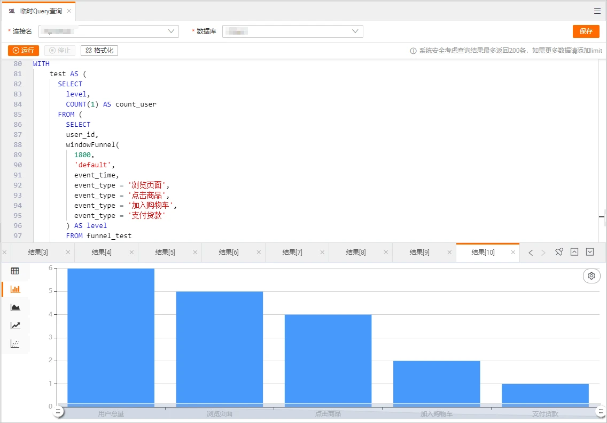

**留存函数**

- 函数说明

  该函数将一组条件作为参数，类型为1到32个UInt8类型的参数，用来表示事件是否满足特定条件。

- 函数语法

  ```text
  retention(cond1, cond2, ..., cond32);
  ```

- 参数说明

  | 参数 | 说明 |
  | --- | --- |
  | cond | 返回结果的表达式。返回值包括：<br>• 1，条件满足。<br>• 0，条件不满足。 |

- 使用示例

  - 创建一张数据表，以用户访问APP为例，SQL 语句如下：

    ```sql
    CREATE TABLE IF NOT EXISTS login_log
    (
        user_id INT ,
        log_time TIMESTAMP 
    );
    ```

  - 导入相关数据，具体表格和示例语句如下：

    | user_id | log_time |
    | --- | --- |
    | 1101 | 2019-06-21 22:00:00 |
    | 1101 | 2019-06-20 22:00:00 |
    | 1101 | 2019-06-19 22:00:00 |
    | 1101 | 2019-06-17 22:00:00 |
    | 1101 | 2019-06-16 22:00:00 |
    | 1101 | 2019-06-21 22:00:00 |
    | 1101 | 2019-06-21 23:00:00 |
    | 1101 | 2019-06-20 23:00:00 |
    | 1101 | 2019-06-19 23:00:00 |
    | 1101 | 2019-06-17 23:00:00 |
    | 1101 | 2019-06-16 23:00:00 |
    | 1101 | 2019-06-21 23:00:00 |
    | 4101 | 2019-06-20 22:00:00 |
    | 4101 | 2019-06-19 22:00:00 |
    | 4101 | 2019-06-17 22:00:00 |
    | 4101 | 2019-06-16 22:00:00 |
    | 2201 | 2019-06-21 22:00:00 |
    | 2201 | 2019-06-20 22:00:00 |
    | 2201 | 2019-06-21 23:00:00 |
    | 2201 | 2019-06-20 23:00:00 |
    | 3301 | 2019-06-21 22:00:00 |
    | 3301 | 2019-06-19 22:00:00 |
    | 3301 | 2019-06-18 23:00:00 |
    | 3301 | 2019-06-17 23:00:00 |
    | 3301 | 2019-06-16 23:00:00 |
    | 3301 | 2019-06-15 23:00:00 |

    ```sql
    INSERT INTO login_log VALUES
    (1101,'2019-06-21 22:00:00'),
    (1101,'2019-06-20 22:00:00'),
    (1101,'2019-06-19 22:00:00'),
    (1101,'2019-06-17 22:00:00'),
    (1101,'2019-06-16 22:00:00'),
    (1101,'2019-06-21 22:00:00'),
    (1101,'2019-06-21 23:00:00'),
    (1101,'2019-06-20 23:00:00'),
    (1101,'2019-06-19 23:00:00'),
    (1101,'2019-06-17 23:00:00'),
    (1101,'2019-06-16 23:00:00'),
    (1101,'2019-06-21 23:00:00'),
    (4101,'2019-06-20 22:00:00'),
    (4101,'2019-06-19 22:00:00'),
    (4101,'2019-06-17 22:00:00'),
    (4101,'2019-06-16 22:00:00'),
    (2201,'2019-06-21 22:00:00'),
    (2201,'2019-06-20 22:00:00'),
    (2201,'2019-06-21 23:00:00'),
    (2201,'2019-06-20 23:00:00'),
    (3301,'2019-06-21 22:00:00'),
    (3301,'2019-06-19 22:00:00'),
    (3301,'2019-06-18 23:00:00'),
    (3301,'2019-06-17 23:00:00'),
    (3301,'2019-06-16 23:00:00'),
    (3301,'2019-06-15 23:00:00');
    ```

    - 如需查询用户在2019-06-17至2019-06-21登录流失情况，则SQL语句如下：

      ```text
      SELECT
          user_id,
        retention(
          date(log_time) = '2019-06-21',
          date(log_time) = '2019-06-20',
          date(log_time) = '2019-06-19',
          date(log_time) = '2019-06-18',
          date(log_time) = '2019-06-17'
          ) AS r
      FROM login_log 
      GROUP BY user_id
      ORDER BY user_id ASC;
      ```

    - 具体结果如下，其中数组r表示用户每天登录情况，1和0表示该用户登录或未登录，user_id为4101的用户，在2019-06-17 至 2019-06-21期间有登录记录，但数据全是0。这是因为在retention(cond1, cond2, …) 函数中，第一个表达 cond1 如果不满足，那么后面所有的结果就都是0。由于user_id为4101的用户2019-06-21当天没登录，所有后面的数据全部为0。

      ```text
       user_id |      r      
      ---------+-------------
          1101 | {1,1,1,0,1}
          2201 | {1,1,0,0,0}
          3301 | {1,0,1,1,1}
          4101 | {0,0,0,0,0}
      (4 rows)
      ```

    - 若不希望出现如上情况，仅需将cond1变为true即可。

      ```text
      SELECT
          user_id,
        retention(
          true,
          date(log_time) = '2019-06-21',
          date(log_time) = '2019-06-20',
          date(log_time) = '2019-06-19',
          date(log_time) = '2019-06-18',
          date(log_time) = '2019-06-17'
          ) AS r
      FROM login_log 
      GROUP BY user_id
      ORDER BY user_id ASC;
      ```

      查询结果如下：

      ```text
       user_id |       r       
      ---------+---------------
          1101 | {1,1,1,1,0,1}
          2201 | {1,1,1,0,0,0}
          3301 | {1,1,0,1,1,1}
          4101 | {1,0,1,1,0,1}
      (4 rows)
      ```

  - 使用留存函数能便捷地计算用户的留存率。例如我们想计算用户的次日留存、3日留存、7日留存，样例SQL如下：

    ```text
    -- 根据计算数组中SUM(r[index])获取2019-06-15活跃⽤户在第2、3、7⽇的留存数，以此计算留存率。
    SELECT
        DATE(TIMESTAMP '2019-06-15 00:00:00') AS first_date,
        CAST(SUM(r[1]) AS NUMERIC) AS "第⼀天活跃⽤户",
        CAST(SUM(r[2]) AS NUMERIC)/CAST(SUM(r[1]) AS NUMERIC) AS "次⽇留存",
        CAST(SUM(r[3]) AS NUMERIC)/CAST(SUM(r[1]) AS NUMERIC) AS "3⽇留存",
        CAST(SUM(r[4]) AS NUMERIC)/CAST(SUM(r[1]) AS NUMERIC) AS "7⽇留存"
    FROM
    -- 计算2019-06-15活跃⽤户在第2、3、7⽇的登录情况，1代表登录，0代表未登录。
        (
            WITH 
                first_day_table AS ( SELECT TIMESTAMP '2019-06-15 00:00:00' AS first_day)
            SELECT
                user_id,
                retention(
                    DATE(log_time) = (SELECT DATE(first_day) FROM first_day_table),
                    DATE(log_time) = (SELECT DATE(first_day + INTERVAL '1 day') FROM first_day_table),
                    DATE(log_time) = (SELECT DATE(first_day + INTERVAL '2 day') FROM first_day_table),
                    DATE(log_time) = (SELECT DATE(first_day + INTERVAL '6 day') FROM first_day_table)
                    ) AS r
    -- 过滤2019-06-15活跃⽤户在后续 1～7 ⽇登录数据
                FROM    login_log
                WHERE   (log_time >= TIMESTAMP '2019-06-15 00:00:00')
                AND     (log_time <= TIMESTAMP '2019-06-15 00:00:00' + INTERVAL '6 day')
                GROUP BY user_id
            ) AS basic_table
    GROUP BY first_date
    ;
    ```

<a id="section-1-5-4"></a>

### 1.5.4. 聚合视图

聚合视图实现了对单张表在固定维度列上的预聚合能力，通过预聚合和自动的查询重写，使得统计类查询可以利用预聚合的结果加速查询。本文将会为您介绍在Hologres中聚合视图的用法。

**使用限制**

在Hologres中使用聚合视图，具体限制如下：

- 该功能仅Hologres V0.10及以上版本支持，请在Hologres管控台的实例详情页查看当前实例版本。

- 在使用聚合视图功能之前，需要Superuser在DB内执行以下语句安装扩展包才可以使用聚合视图。一个DB只需执行一次即可，如果创建新的DB，还需要再次执行如下语句。

  ```text
  create extension  aggregate_view;
  ```

**创建聚合视图**

聚合视图通过函数**hg_aggregate_view_create**创建，具体内容如下：

- **语法说明**

  ```text
  call hg_aggregate_view_create(
      aggregate_dst_view , /*⽬标view名*/
      aggregate_src_table , /*待聚合表名*/
      aggregate_keys_non_time , /*非时间粒度待聚合key*/
      aggregate_key_time , /*时间粒度聚合key*/
      aggregate_values ,/*待聚合的列名*/
      aggregate_funcs ,/*聚合函数，⽀持sum,min,max,count,avg,approx_count_distinct*/
      aggregate_timestamp_column , /*刷新时间列，精确时间列，类型须是timestamptz*/
      aggregate_allowed_lateness ,/*允许晚到时间*/
      aggregate_base_table_ttl /*聚合数据保存时间 second*/)按照顺序排列，不可重复
  ```

- **参数说明**

  | 参数 | 类型 | 说明 |
  | --- | --- | --- |
  | aggregate_dst_view | text | 目标View名。 |
  | aggregate_src_table | text | 待聚合表名。 |
  | aggregate_keys_non_time | text\[\] | 非时间粒度待聚合key。 |
  | aggregate_key_time | text | 时间粒度待聚合key。时间维度，查询时展示的时间维度，同时也是查询指定的时间范围。 |
  | aggregate_values | text\[\] | 待聚合value。按照顺序排列，不可重复。 |
  | aggregate_funcs | text\[\] | 聚合函数。支持的聚合函数具体如下：<br>• sum：求和函数。<br>• min：最小值函数。<br>• max：最大值函数。<br>• count：计数函数。<br>• avg：平均值函数。<br>• approx_count_distinct：计算某一列去重后的行数，但为近似值，结果为二进制类型，需调用approx_count_distinct_final返回数值，支持使用approx_count_distinct_merge聚合。<br>• rb_count_distinct：计算某一列去重后行数值，只支持int32类型，结果为二进制类型，需调用rb_cardinality返回数值，支持用rb_or_agg聚合，使用前需要创建roaringbitmap extention。如下所示：<br><code>create extension roaringbitmap_hqe;</code> |
  | aggregate_timestamp_column | text | 精确时间列，按照该列定时刷新。这一列在源表中必须非空。 |
  | aggregate_allowed_lateness | interval | 允许数据晚到的时间，数据最晚刷新的时间不超过该时间。需要和精确时间搭配使用，当不指定截止时间调用refresh时，用源表max(aggregate_timestamp_column)-aggregate_allowed_lateness做截止时间。 |
  | aggregate_base_table_ttl | int | 聚合视图内数据保存的时间，单位为秒（s），超过该时间，数据将会被清除。 |

- **使用示例**本样例提供的样本数据具体如下：

  | event_id | uid | user_id | event_time | province | city | PV | charge | event_count |
  | --- | --- | --- | --- | --- | --- | --- | --- | --- |
  | 1002 | User10011 | 10011 | 2020-11-11 00:01:11 | hebei | tangshan | 1 | 10 | 10 |
  | 1002 | User10012 | 10012 | 2020-11-11 00:01:12 | shandong | qingdao | 2 | 11 | 11 |
  | 1003 | User10013 | 10013 | 2020-11-11 00:01:13 | hunan | changsha | 2 | 11.9 | 11 |
  | 1002 | User10012 | 10012 | 2020-11-11 00:01:14 | shandong | qingdao | 1 | 1.1 | 9 |
  | 1002 | User10012 | 10012 | 2020-11-11 00:01:14 | shandong | qingdao | 1 | 1.1 | 9 |

  对应数据创建如下表：

  ```sql
  --建表并插入样本数据
  CREATE TABLE agg_src_table
  (
      event_id INT
      ,user_id TEXT
      ,uid INT
      ,event_time timestamptz NOT NULL
      ,province TEXT
      ,city TEXT
      ,pv INT
      ,charge NUMERIC(15,2)
      ,event_count INT
  );

  insert into agg_src_table values 
  (1002, 'User10011', 10011, '2020-11-11 00:01:11', 'hebei', 'tangshan', 1, 10,10 ),
  (1002, 'User10012', 10012, '2020-11-11 00:01:12', 'shandong', 'qingdao', 2, 11,11 ),
  (1003, 'User10013', 10013, '2020-11-11 00:01:13', 'hunan', 'changsha', 2, 11.9, 11 ),
  (1002, 'User10012', 10012, '2020-11-11 00:01:14', 'shandong', 'qingdao', 1, 1.1, 9 ),
  (1002, 'User10012', 10012, '2020-11-11 00:01:14', 'shandong', 'qingdao', 1, 1.1, 9 );

  --对表初步加⼯，主要是创建⼀个view并将时间事件截取到⼩时粒度。
  CREATE view agg_src_view AS
  SELECT  province
          ,city
          ,event_time
          ,date_trunc('hour', event_time) AS event_date
          ,pv
          ,charge
          ,event_count
          ,user_id
          ,uid
  FROM    agg_src_table ;
  ```

  对应创建聚合视图示例如下：

  ```text
  --创建聚合视图扩展
  create extension  aggregate_view;

  --创建聚合视图
  call hg_aggregate_view_create(
    'agg_dst_view', --⽬标view名
    'agg_src_view', --待聚合的表名，此处以初步加⼯后的view代替
    ARRAY['province', 'city'], --按照省份province和城市city聚合
    'event_date', --按照事件时间粒度聚合
    ARRAY['event_count', 'charge', 'pv', 'user_id'], 
    ARRAY['count','avg', 'sum', 'approx_count_distinct'],--计算event_count列的count，charge列的avg，pv列的sum，user_id列的近似去重，
    'event_time', --按照该列进⾏定时刷新
    '600 sec', --允许数据晚到600s
    '2592000'--聚合数据保存时间
      );
      
   --查询视图
   SELECT * FROM agg_dst_view
  ```

**刷新聚合视图**

刷新聚合视图可以将实时写入的新数据更新到聚合视图中，主要包括截止时间刷新和区间刷新。同一时间同一个View，只可以有一个刷新任务。具体内容如下：

- **截止时间刷新**

  - 功能说明截止时间刷新可以将指定的截止时间数据刷新。如果是增量刷新（默认），上次截止时间到本次截止时间的数据会被刷新，如果是全量刷新，截止时间之前的数据都会被刷新。具体语法如下：

    ```text
    call hg_aggregate_view_refresh('aggregate_dst_view', 'refresh_until_timestamp','delta');
    ```

  - 参数说明

    | 参数 | 类型 | 说明 |
    | --- | --- | --- |
    | aggregate_dst_view | text | 目标View名。 |
    | refresh_until_timestamp | timestamptz | 刷新截止时间戳。aggregate_timestamp_column小于此值的记录都会被聚合写入basetable。缺省情况下refresh_until_timestamp取max(aggregate_timestamp_column)-aggregate_allowed_lateness的值。 |
    | delta | bool | 是否增量更新。<br>• true：默认为true，增量更新，上次截止时间到这次截止时间的数据会被刷新。<br>• false：全量刷新，截止时间之前的数据都会被刷新，会将basetable中的数据清空再写入。 |

  - 使用示例如下示例将刷新截止到2020-11-11 01:00:00之前写入的数据。

    ```sql
    --插入新的数据
    insert into agg_src_table values 
    (1002, 'User10998', 10320, '2020-11-11 00:01:15', 'sichuan', 'chengdu', 2, 3,1 ),
    (1003, 'User10007', 10343, '2020-11-12 00:01:15', 'zhejiang', 'hangzhou', 7, 2,4 ),
    (1003, 'User10073', 10221, '2020-11-12 00:01:16', 'anhui', 'huangshan', 3, 8,4 );

    --增量刷新
    call hg_aggregate_view_refresh('agg_dst_view', '2020-11-11 01:00:00'::timestamptz,'true');

    --全量刷新
    call hg_aggregate_view_refresh('agg_dst_view', '2020-11-11 00:00:00'::timestamptz,'false');
    ```

- **区间刷新**

  - 功能说明区间刷新可以将指定某个时间区间内的数据更新到聚合视图中。具体语法如下：

    ```text
    call hg_aggregate_view_range_refresh('aggregate_dst_view','refresh_start_timestamp','refresh_until_timestamp');   
    ```

  - 参数说明

    | 参数 | 类型 | 说明 |
    | --- | --- | --- |
    | aggregate_dst_view | text | 目标View名。 |
    | refresh_until_timestamp | timestamptz | 刷新截止时间戳。 |
    | refresh_start_timestamp | timestamptz | 刷新开始时间戳。 |

  - 使用示例如下示例指定将2020-11-11 01:00:00到2020-11-12 01:00:00期间写入的数据进行刷新。

    ```text
    --刷新截⽌到(当前时间-允许晚到区间)
    call hg_aggregate_view_range_refresh('agg_dst_view','2020-11-11 01:00:00'::timestamptz,'2020-11-12 01:00:00'::timestamptz);
    ```

**删除聚合视图**

当您不需要聚合视图的时候可以对其进行删除。

- 语法示例

  ```text
  call hg_aggregate_view_delete('aggregate_dst_view');   
  ```

- 参数说明

  aggregate_dst_view：表示需要删除的聚合视图名。

- 使用示例如下示例将删除名称为agg_dst_view的聚合视图。

  ```text
  call hg_aggregate_view_delete('agg_dst_view');
  ```

**使用示例**

本次示例以某网站访问数据为例，通过聚合视图定期计算，对用户id做近似去重和精确去重，计算事件类型event_count的访问量、平均收费情况（charge列的avg）、总PV（pv列的sum）。该聚合视图通过事件时间event_time列刷新，累计600秒之前的汇聚结果，视图的数据保存2592000秒，过期将会被删除。

- 建表并插入样本数据。

  ```sql
  CREATE TABLE agg_src_table
  (
      event_id INT
      ,user_id TEXT
      ,uid INT
      ,event_time timestamptz NOT NULL
      ,province TEXT
      ,city TEXT
      ,pv INT
      ,charge NUMERIC(15,2)
      ,event_count INT
  );

  insert into agg_src_table values 
  (1002, 'User10011', 10011, '2020-11-11 00:01:11', 'hebei', 'tangshan', 1, 10,10 ),
  (1002, 'User10012', 10012, '2020-11-11 00:01:12', 'shandong', 'qingdao', 2, 11,11 ),
  (1003, 'User10013', 10013, '2020-11-11 00:01:13', 'hunan', 'changsha', 2, 11.9, 11 ),
  (1002, 'User10012', 10012, '2020-11-11 00:01:14', 'shandong', 'qingdao', 1, 1.1, 9 ),
  (1002, 'User10012', 10012, '2020-11-11 00:01:14', 'shandong', 'qingdao', 1, 1.1, 9 );
                          
  ```

- 对表初步加工，主要是创建一个view并将时间事件截取到小时粒度。

  ```text
  CREATE view agg_src_view AS
  SELECT  province
          ,city
          ,event_time
          ,date_trunc('hour', event_time) AS event_date
          ,pv
          ,charge
          ,event_count
          ,user_id
          ,uid
  FROM    agg_src_table ;
                          
  ```

- 创建聚合视图。

  > 对用户ID精确去重，需要开启RoaringBitmap扩展使用rb_count_distinct函数。更多关于RoaringBitmap函数的说明，请参见Roaring Bitmap函数。
  >
  > **说明**

  ```text
  --创建聚合视图扩展
  create extension  aggregate_view;
  --创建Roaringbitmap扩展
  create extension  roaringbitmap;

  --创建聚合视图，在dim，city维度聚合，基于event_date⽇期粒度，计算event_count列的count、charge列的avg，pv列的sum，user_id列的approx_count_distinct、uid列
  的rb_count_distinct算⼦，刷新时间戳为event_time列，累计600秒之前的汇聚结果，数据保存2592000秒
  call hg_aggregate_view_create(
    'agg_dst_view', 
    'agg_src_view', 
    ARRAY['province', 'city'], 
    'event_date', 
    ARRAY['event_count', 'charge', 'pv', 'user_id', 'uid'], 
    ARRAY['count','avg', 'sum', 'approx_count_distinct', 'rb_count_distinct'],
    'event_time', 
    '600 sec', 
    '2592000');
  ```

- 数据查询和插入处理。

  ```sql
  --业务查询语句
  SELECT  province
          ,city
          ,event_date
          ,event_count
          ,charge
          ,pv
          ,approx_count_distinct_final(user_id) AS user_id
          ,rb_cardinality(uid) AS uid
  FROM    agg_dst_view
  WHERE   event_date > '2020-11-01'::timestamptz
  AND     event_date < '2020-11-12'::timestamptz;

  --插入新的数据
  insert into agg_src_table values 
  (1002, 'User10998', 10320, '2020-11-11 00:01:15', 'sichuan', 'chengdu', 2, 3,1 ),
  (1003, 'User10007', 10343, '2020-11-12 00:01:15', 'zhejiang', 'hangzhou', 7, 2,4 ),
  (1003, 'User10073', 10221, '2020-11-12 00:01:16', 'anhui', 'huangshan', 3, 8,4 );

  --刷新截⽌到(当前表最⼤时间-允许晚到区间)  '2020-11-12 00:01:16' - '600 sec' = '2020-11-12 00:01:06'
  call hg_aggregate_view_refresh('agg_dst_view');

  --刷新截⽌到2020-11-12 01:20:00之前的数据
  call hg_aggregate_view_refresh('agg_dst_view', '2020-11-12 01:20:00'::timestamptz,'true');

  --带有近似去重函数的查询语句
  SELECT  city
          ,approx_count_distinct_final(approx_count_distinct_merge(user_id)) AS user_id
  FROM    agg_dst_view
  WHERE   event_date > '2020-11-11'::timestamptz
  AND     event_date < '2020-11-13'::timestamptz
  GROUP BY city;

  --带有精确去重函数的查询语句
    SELECT  city
          ,SUM(pv)
          ,rb_cardinality(rb_or_agg(uid)) AS uid
  FROM    agg_dst_view
  WHERE   event_date > '2020-11-10'::timestamptz
  AND     event_date < '2020-11-12'::timestamptz
  GROUP BY city;

  --再聚合查询
  SELECT  province
          ,SUM(event_count)
          ,SUM(pv)
          ,approx_count_distinct_final(approx_count_distinct_merge(user_id)) AS user_id
          ,rb_cardinality(rb_or_agg(uid)) AS uid
  FROM    agg_dst_view
  WHERE   event_date > '2020-11-10'::timestamptz
  AND     event_date < '2020-11-15'::timestamptz
  GROUP BY province;
  ```

- 删除聚合视图。

  ```text
  --删除聚合视图
  call hg_aggregate_view_delete('agg_dst_view');
  ```

<a id="section-1-5-5"></a>

### 1.5.5. 向量Proxima

Proxima向量检索引擎是运用于大数据领域，实现向量近邻搜索的高性能软件库，相比Fassi等开源产品，稳定性和性能较好，提供了行业相关的基础方法模块，支持图像、视频及人脸等各种应用场景的搜索。交互式分析Hologres的向量查询功能与Proxima深度整合，为您提供高性能的向量查询服务。本文为您介绍在Hologres中如何使用向量计算功能。

**使用Proxima进行向量计算**

使用Proxima进行向量计算的操作步骤如下：

1. 安装Proxima插件。

   Proxima是以一个extension的方式与Hologres连通，因此在使用之前需要执行如下命令安装Proxima插件。

   ```text
   CREATE EXTENSION proxima;
   ```

   Proxima插件是针对数据库级别使用的，一个数据库仅需要安装一次即可，如需卸载Extension请执行如下命令。

   ```text
   DROP EXTENSION proxima;
   ```

   > **重要**
   >
   > 不推荐使用 `DROP EXTENSION <extension_name> CASCADE;` 命令级联卸载Extension。CASCADE（级联）删除命令不仅会删除指定扩展本身，还会一并清除扩展数据（例如PostGIS数据、RoaringBitmap数据、Proxima数据、Binlog数据、BSI数据等）以及依赖该扩展的对象（包括元数据、表、视图、Server数据等）。

2. 向量查询。

   在Hologres中，向量使用FLOAT4类型的数组表示，向量查询的API场景如下：

   - **精确查询**

     以 `pm_xxx` 开头的UDF均为精准查询。

     <ol type="a">

     <li>

     使用精准的API来做Top N的查询，需要您在表中定义好对应的向量字段，示例语句如下。

     ```sql
     CREATE TABLE feature_tb (
         id bigint,
         feature float4[] check(array_ndims(feature) = 1 AND array_length(feature, 1) = 4)
     );
     ```

     </li>

     <li>

     查询Top N，示例语句如下。

     ```sql
     SELECT pm_squared_euclidean_distance(feature, '{0.1,0.1,0.1,0.1}') AS distance FROM feature_tb ORDER BY distance ASC limit 10;
     ```

     </li>

     </ol>

   - **近似查询**

     以 `pm_approx` 开头的UDF均为近似查询。

     <ol type="a">

     <li>

     使用近似查询的API来做Top N查询，您需要在表中定义好对应的向量字段，并为对应的字段设置Proxima索引，示例语句如下。

     ```sql
     BEGIN;
     CREATE TABLE feature_tb (
         id bigint,
         feature float4[] check(array_ndims(feature) = 1 AND array_length(feature, 1) = 4)
     );
     CALL set_table_property('feature_tb', 'proxima_vectors', '{"feature":
     {"algorithm":"Graph","distance_method":"Euclidean","builder_params":
     {"min_flush_proxima_row_count" : 1000}, "searcher_init_params":{}}}');
     END;
     ```

     参数描述如下表所示。

     <table>
       <tr>
         <th width="164">参数</th>
         <th>描述</th>
       </tr>
       <tr>
         <td>algorithm</td>
         <td>用于指定构建向量索引的算法，目前仅支持Graph。</td>
       </tr>
       <tr>
         <td>distance_method</td>
         <td>用于定义构建向量索引使用的距离计算方法。Hologres目前仅支持如下三种距离计算函数：<br>• Euclidean 开方的欧式距离<br>• SquaredEuclidean 不开方的欧式距离<br>• InnerProduct 内积距离</td>
       </tr>
     </table>

     </li>

     <li>

     查询Top N，示例语句如下。

     > **说明**
     >
     > 近似查询中的第二个参数必须为常量值。

     ```sql
     SELECT pm_approx_euclidean_distance(feature, '{0.1,0.2,0.3,0.4}') AS distance FROM feature_tb ORDER BY distance ASC limit 10 ; //计算内积
     的TOPK，此时建表语句中的proxima_vector参数的distance_method需要设置为Euclidean。
     SELECT pm_approx_inner_product_distance(feature, '{0.1,0.2,0.3,0.4}') AS distance FROM feature_tb ORDER BY distance DESC limit 10 ; //计
     算内积的TOPK，此时建表语句中的proxima_vector参数的distance_method需要设置为InnerProduct。
     ```

     </li>

     </ol>

**使用示例**

使用Proxima进行向量计算的示例语句如下。

```sql
CREATE extension proxima;
BEGIN;
CREATE TABLE feature_tb (
    id bigint,
    feature float4[] check(array_ndims(feature) = 1 AND array_length(feature, 1) = 4)
);
CALL set_table_property('feature_tb', 'proxima_vectors', '{"feature":{"algorithm":"Graph","distance_method":"InnerProduct","builder_params":
{"min_flush_proxima_row_count" : 1000}, "searcher_init_params":{}}}');
END;
INSERT INTO feature_tb SELECT i, array[random(), random(), random(), random()]::float4[] FROM generate_series(1, 10000) i;
SELECT pm_approx_inner_product_distance(feature, '{0.1,0.2,0.3,0.4}') AS distance FROM feature_tb ORDER BY distance DESC limit 10 ;
```

**向量计算UDF**

- Hologres支持的三种向量距离评估函数如下：

  - 不开方的欧式距离，计算公式如下。

    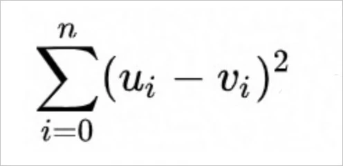

  - 开方的欧氏距离，计算公式如下。

    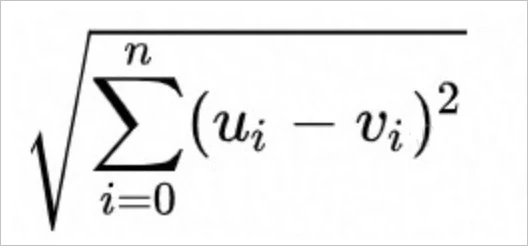

  - 内积距离，计算公式如下。

    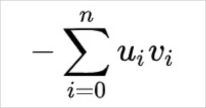

  > **说明**
  >
  > 如果您选用欧式距离进行向量计算，不开方的欧式距离与开方的欧式距离相比，可以少一个开方的计算，并且计算出的Top K记录一致。因此，不开方的欧式距离性能更好，在满足功能需求的情况下，一般建议您使用不开方的欧式距离。

- Hologres支持的向量计算UDF如下：

  - 精准向量计算UDF

    ```text
    float4 pm_euclidean_distance(float4[], float4[])
    float4 pm_squared_euclidean_distance(float4[], float4[])
    float4 pm_inner_product_distance(float4[], float4[])
    ```

  - 近似向量计算UDF

    ```text
    float4 pm_approx_euclidean_distance(float4[], float4[])
    float4 pm_approx_squared_euclidean_distance(float4[], float4[])
    float4 pm_approx_inner_product_distance(float4[], float4[])
    ```

**常见问题**

- 报错 `ERROR: function pm_approx_inner_product_distance(real[], unknown) does not exist` 。

  原因：通常是因为未在数据库中执行 `create extension proxima;` 语句来初始化Proxima插件。

  解决方法：执行 `create extension proxima;` 语句初始化Proxima插件。

- 报错 `Writting column: feature with array size: 5 violates fixed size list (4) constraint declared in schema` 。

  原因：由于写入到特征向量列的数据维度与表中定义的维度数不一致，导致出现该报错。

  解决方法：可以排查下是否有脏数据。

- 报错 `The size of two array must be the same in DistanceFunction, size of left array: 4, size of right array:` 。

  原因：由于pm_xx_distance(left, right)中，left的维度与right的维度不一致所致。

  解决方法：调整pm_xx_distance(left, right)中，left的维度与right的维度一致。

<a id="section-1-5-6"></a>

### 1.5.6. Oracle兼容函数

Hologres从V1.3版本开始，通过增加orafce扩展包，引入Oracle兼容函数。本文为您介绍Oracle内置函数在Hologres中的使用方法及支持的函数详情。

**安装Oracle**

在使用Oracle之前，需要Superuser在数据库内执行以下语句安装扩展包才可以正常使用。一个数据库只需执行一次即可，如果创建新的数据库，还需要再次执行如下语句。

```text
-- 加载orafce插件
create extension if not exists orafce; 
-- 卸载orafce插件
DROP EXTENSION orafce;    
```

> 加载orafce插件时会自动创建多个Schema来代替Oracle中的Package，分别
>
> **说明**

为 `dbms_alert` 、 `dbms_assert` 、 `dbms_output` 、 `dbms_pipe` 、 `dbms_random` 、 `dbms_utility` 、 `oracle` 、 `plunit` 、 `plvchr` 、 `plvdate` 、 `plv`

> 在您安装Oracle前，请确保您的数据库中没有同名Schema，否则会加载失败。

**Oracle函数**

Hologres已支持的Oracle函数列表如下。

- Date函数

  | 函数名称 | 描述 | 用例 | 结果 |
  | --- | --- | --- | --- |
  | add_months(day date, value int) | 返回第一个月份参数加上第二个月份参数，返回类型为DATE。 | <code>SELECT add_months(current_date,</code><br><code>2);</code> | 2022-05-21 |
  | last_day(value date) | 返回该日期所在月份的最后一天，返回类型为DATE。 | <code>SELECT last_day('2022-05-01');</code> | 2022-05-31 |
  | next_day(value date, weekday text) | 返回开始日期后的下一个星期几所在的日期。参数一：开始的日期。参数二：包含星期几的英文字符串，如Friday。 | <code>SELECT next_day('2022-05-01',</code><br><code>'FRIDAY');</code> | 2022-05-06 |
  | next_day(value date, weekday integer) | 返回开始日期后的下一个星期几所在的日期。参数一：开始的日期。参数二：星期几的数字，取值为1到7，1为星期日，2为星期一，以此类推。 | <code>SELECT next_day('2022-05-01',</code><br><code>1);</code><br><code>SELECT next_day('2022-05-01',</code><br><code>2);</code> | • 2022-05-08<br>• 2022-05-02 |
  | months_between(date1 date, date2 date) | 返回date1和date2之间的月数。如果date1晚于date2，结果为正。如果date1早于date2，结果为负。 | <code>SELECT months_between('2022-01-</code><br><code>01', '2021-11-01');</code><br><code>SELECT months_between('2021-11-</code><br><code>01', '2022-01-01');</code> | • 2<br>• -2 |
  | trunc(value timestamp with time zone, fmt text) | 返回被截取的时间。参数一：要被截断的timestamp。参数二：应用于截断的度量单位。Y：截断成日期年份的第一天。Q：返回季度的第一天。 | <code>SELECT TRUNC(current_date,'Y');</code><br><code>SELECT TRUNC(current_date,'Q');</code> | • 2022-01-01<br>• 2022-01-01 |
  | trunc(value timestamp with time zone) | 返回被截取的时间，默认截断时分秒。 | <code>SELECT TRUNC('2022-03-</code><br><code>01'::timestamp);</code> | 2022-03-01 00:00:00 |
  | round(value timestamp with time zone, fmt text) | 将timestamp圆整到最近的unit_of_measure（日，周等）。 | <code>SELECT round('2022-02-22</code><br><code>13:11:22'::timestamp, 'YEAR');</code> | 2022-01-01 00:00:00 |
  | round(value timestamp with time zone) | 默认圆整到天。 | <code>SELECT round('2022-02-22</code><br><code>13:11:22'::timestamp);</code> | 2022-02-23 00:00:00 |
  | round(value date, fmt text) | 参数类型为date。 | <code>SELECT round(TO_DATE('27-OCT-</code><br><code>00','DD-MON-YY'), 'YEAR');</code><br><code>SELECT round(TO_DATE('27-FEB-</code><br><code>00','DD-MON-YY'), 'YEAR');</code> | • 2001-01-01<br>• 2000-01-01 |
  | round(value date) | 参数类型为date。 | <code>SELECT round(TO_DATE('27-FEB-</code><br><code>00','DD-MON-YY'));</code> | 2000-02-27 |

- String函数

  | 函数名称 | 描述 | 用例 | 结果 |
  | --- | --- | --- | --- |
  | instr(str text, patt text, start integer, nth integer) | 在一个字符串中搜索一个substring，若搜索到则返回substring在字符串中位置，若没有搜索到，则返回0。start：搜索的起始位置。nth：搜索第几次出现的位置。 | <code>SELECT instr('Hologres',</code><br><code>'o',1,2);</code><br><code>SELECT instr('Hologres',</code><br><code>'o',1,1);</code> | • 4<br>• 2 |
  | instr(str text, patt text, start integer) | 未提供nth参数，默认是第一次出现的位置。 | <code>SELECT instr('Hologres', 'o',4);</code> | 4 |
  | instr(str text, patt text) | 未提供start参数，默认从头开始搜索。 | <code>SELECT instr('Hologres', 'o');</code> | 2 |
  | plvstr.rvrs(str text, start integer, end integer) | 对输入字符串str从start位置到end位置进行逆序。 | <code>SELECT plvstr.rvrs('Hologres',</code><br><code>5,6);</code> | rg |
  | plvstr.rvrs(str text, start integer) | 对输入字符串str从start位置到字符串结束进行逆序。 | <code>SELECT plvstr.rvrs('Hologres', 4);</code> | sergo |
  | plvstr.rvrs(str text) | 逆序整个字符串。 | <code>SELECT plvstr.rvrs('Hologres');</code> | sergoloH |
  | substr(str text, start integer) | 从start字符开始到字符串结束，获取输入字符串str的子串。 | <code>SELECT substr('Hologres', 1);</code><br><code>SELECT substr('Hologres', 4);</code> | • Hologres<br>• ogres |
  | substr(str text, start integer, len integer) | 从start字符开始，获取长度为len字符的输入字符串str的子串。 | <code>SELECT substr('Hologres', 5, 5);</code><br><code>SELECT substr('Oracle</code>函数<code>', 5, </code> <code>5);</code> | • gres<br>• le函数 |

- 其他函数

  | 函数名称 | 描述 | 用例 | 结果 |
  | --- | --- | --- | --- |
  | listagg(str text) | 将文本值聚合为一个字符串。 | <code>SELECT listagg(t) FROM</code><br><code>(VALUES('holo'), ('gres')) as l(t);</code> | hologres |
  | listagg(str text, str text) | 将文本值聚集成一个串，第二个参数执行了分割符。 | <code>SELECT listagg(t, '.') FROM</code><br><code>(VALUES('holo'), ('gres')) as l(t);</code> | holo.gres |
  | concat(str text, str text) | 将两个字符串拼接在一起。 | <code>SELECT concat('holo','gres');</code> | hologres |
  | • concat(str text, anyarray)<br>• concat(anyarray, str text)<br>• concat(anyarray, anyarray) | 拼接任意类型的数据。 | <code>SELECT concat('hologres', 123);</code><br><code>SELECT concat(123, 123);</code><br><code>SELECT concat(current_date, 123);</code> | • hologres123<br>• 123123<br>• 2022-03-21123 |
  | • nanvl(num real, num real)<br>• nanvl(num decimal, num decimal) | 如果第一个参数为数值类型，则返回第一个参数；如果不为数值类型，则返回第二参数。 | <code>SELECT nanvl('NaN', 1.1);</code><br><code>SELECT nanvl('1.2', 1.1);</code> | • 1.1<br>• 1.2 |
  | bitand(num bigint, num bigint) | 将两个整型的二进制进行与操作，并返回与之后的结果，只输出一行。 | <code>SELECT bitand(1,3);</code><br><code>SELECT bitand(2,6);</code><br><code>SELECT bitand(4,6);</code> | • 1<br>• 2<br>• 4 |
  | nvl2(anyelement, anyelement, anyelement) | 如果第一个参数不为null，那么返回第二个参数；如果第一个参数为null，则返回第三个参数。 | <code>SELECT nvl2(null, 1, 2);</code><br><code>SELECT nvl2(0, 1, 2);</code> | • 2<br>• 1 |
  | lnnvl(boolean) | 如果参数为null或者false，则返回true；如果为true，则返回false。 | <code>SELECT lnnvl(null);</code><br><code>SELECT lnnvl(false);</code><br><code>SELECT lnnvl(true);</code> | • t<br>• t<br>• f |
  | sinh(num double precision) | 双曲正弦值。 | <code>SELECT sinh(0.1);</code> | 0.10016675001984 4 |
  | tanh(num double precision) | 双曲正切值。 | <code>SELECT tanh(3);</code> | 0.99505475368673 1 |
  | cosh(num double precision) | 双曲余弦值。 | <code>SELECT cosh(0.2);</code> | 1.02006675561908 |
  | decode(expression, value, return \[,value,return\]... \[, default\]) | 在表达式中寻找一个搜索值，搜索到则返回指定的值；如果没有搜索到，返回默认值。 | <code>CREATE TABLE t1(id int, name</code><br><code>varchar(20));</code><br><code>INSERT INTO t1 values(1,'alibaba');</code><br><code>INSERT INTO t1</code><br><code>values(2,'hologres');</code><br><code>SELECT decode(id, 1, 'alibaba',</code><br><code>2, 'hologres', 'not found') from</code><br><code>t1;</code><br><code>SELECT decode(id, 3, 'alibaba',</code><br><code>4, 'hologres', 'not found') from</code><br><code>t1;</code> | <code>hologres</code><br><code>alibaba</code><br><code>not found</code><br><code>not found</code> |
  | dump(anyelement) | 返回一个文本值，该文本中包含第一个参数的数据类型代码、以字节计的长度和内部表示。 | <code>SELECT dump('hologres');</code> | Typ=25 Len=12: 48,0,0,0,104,111,10 8,111,103,114,101, 115 |
  | dump(anyelement, num integer) | 第二个参数表示返回文本值内部表示的进位制。 | <code>SELECT dump('hologres', 10);</code><br><code>SELECT dump('hologres', 16);</code> | • Typ=25 Len=12: 48,0,0,0,104,111, 108,111,103,114, 101,115<br>• Typ=25 Len=12: 30,0,0,0,68,6f,6c, 6f,67,72,65,73 |
  | nlssort(str text, str text) | 指定排序规则的排序数据函数。 | 创建表格并插入数据。<br><code>CREATE TABLE t1 (name text); INSERT</code><br><code>INTO t1 VALUES('Anne'), ('anne'),</code><br><code>('Bob'), ('bob');</code><br><code>SELECT * FROM t1 ORDER BY</code><br><code>nlssort(name, 'en_US.UTF-8');</code><br><code>SELECT*FROM t1 ORDER BY</code><br><code>nlssort(name, 'C');</code> | <code>anne</code><br><code>Anne</code><br><code>bob</code><br><code>Bob</code><br><code>Anne</code><br><code>Bob</code><br><code>anne</code><br><code>bob</code> |

<a id="section-1-5-7"></a>

### 1.5.7. Clickhouse兼容函数

Hologres已支持部分Clickhouse函数或其同语义函数。本文为您介绍Clickhouse函数在Hologres中的支持情况与使用方法，以及部分常见函数的同语义改写方法。

**字符串函数**

Clickhouse常用字符串函数与Hologres语法基本一致，包括length、lower、upper、concat、substring、trim等函数，具体函数及使用方法请参见字符串函数。

**数学函数**

Clickhouse常用数学函数与Hologres语法基本一致，包括cbrt、degrees、exp、ln、log、pi、radians、sign、sqrt等函数，具体函数及使用方法请参见数学函数。

**类型转换函数**

Hologres从V1.3.36版本起支持如下Clickhouse类型转换函数，暂不支持常量入参。其他数据类型转换场景请使用 `CAST(col AS type)` 或 `col::type` 语法。

建表及数据插入语句如下，函数用例基于此表进行查询。

```sql
CREATE TABLE public.tb1 (
 id bigint NOT NULL,
 id_text text,
 data_date text,
 data_float text,
 data_text text
);
INSERT INTO public.tb1 VALUES (1234,'123','20190102','1.23','hologres');
```

**toString(anyelement)**

- 描述<strong>：</strong>将任一类型转换为text类型。

- 返回类型：text。

- 使用示例：

  ```sql
  SELECT toString(id) from public.tb1;

  --返回结果
  1234
  ```

**toInt64(anyelement)**

- 描述<strong>：</strong>将其他数字类型转换为bigint类型。

  > **说明**
  >
  > 如果非数字类型使用此函数进行转换，数据类型不兼容将会导致报错。

- 返回类型：bigint。

- 使用示例：

  ```sql
  SELECT toInt64(id_text) from public.tb1;

  --返回结果
  1234
  ```

**toInt32(anyelement)**

- 描述<strong>：</strong>将其他数字类型转换为int类型。

  > **说明**
  >
  > 如果非数字类型使用此函数进行转换，数据类型不兼容将会导致报错。

- 返回类型：int。

- 使用示例：

  ```sql
  SELECT toInt32(id_text) from public.tb1;

  --返回结果
  123
  ```

**toDate(text)**

- 描述<strong>：</strong>将text类型转换为date类型。

- 返回类型：date。

- 使用示例：

  - 转换成功。

    ```sql
    SELECT toDate(data_date) from public.tb1;

    --返回结果
    2019-01-02
    ```

  - 数据类型不兼容导致报错。

    ```sql
    SELECT toDate(data_text) from public.tb1;

    --返回结果
    ERROR: *** invalid input syntax for type date ***
    ```

**toFloat64(anyelement)**

- 描述<strong>：</strong>将其他数字类型转换为double类型。

- 返回类型：double precision。

- 使用示例：

  ```sql
  SELECT toFloat64(data_float) from public.tb1;

  --返回结果
  1.23
  ```

**时间和日期函数**

Hologres更多时间和日期函数及其使用方法请参见时间和日期转换函数。

**toYear、toMonth、toQuarter等**

- 描述<strong>：</strong>从时间戳中获取年、月、季度等子字段。

- Hologres实现： `extract(field from timestamp)`  或  `date_part(text, timestamp)` ，详情请参见时间日期截取函数。

- 使用示例：

  ```sql
  SELECT extract(month FROM timestamp '2001-02-16 20:38:40');

  --返回结果
  2
  ```

  ```sql
  SELECT extract(quarter FROM timestamp '2001-02-16 20:38:40');

  --返回结果
  1
  ```

**addDays、addMonths、addYears等**

- 描述<strong>：</strong>将时间戳增加一段时间间隔。

- Hologres实现： 操作符`+` 。

- 使用示例：

  ```text
  SELECT date '2001-09-28' + interval '1 hour';

  --返回结果
  2001-09-28 01:00:00
  ```

**subtractDays、subtractMonths、subtractYears等**

- 描述<strong>：</strong>将时间戳减去一段时间间隔。

- Hologres实现： 操作符`-` 。

- 使用示例：

  ```text
  SELECT date '2001-09-28' - interval '1 day';

  --返回结果
  2001-09-27 00:00:00
  ```

**聚合函数**

Hologres更多聚合函数及其使用方法请参见通用聚合函数、APPROX_COUNT_DISTINCT、UNIQ、MAX_BY与MIN_BY。

**argMin(x, y)**

- 描述：计算y列最小值对应x列的值。

- Hologres实现：min_by(x, y)。

  > **说明**
  >
  > - 当y列最小值对应多个不同的x值，输出其中的最小值。
  >
  > - Hologres V1.3.36版本起支持。

- 使用示例： `test` 表建表语句请参见示例。

  ```sql
  SELECT min_by(name, cost) FROM test;

  --返回结果
   min_by
  --------
   cc
  (1 row)
  ```

**argMax(x, y)**

- 描述：计算y列最大值对应x列的值。

- Hologres实现：max_by(x, y)。

  > **说明**
  >
  > - 当y列最大值对应多个不同的x值，输出其中的最大值。
  >
  > - Hologres V1.3.36版本起支持。

- 使用示例： `test` 表建表语句请参见示例。

  ```sql
  SELECT id, max_by(name, cost) FROM test GROUP BY id;

  --返回结果
   id | max_by
  ----+--------
    2 | bb
    1 | aaa
    3 | c
  (3 rows)
  ```

**groupArray(anyelement)**

- 描述：将表达式的值串联到数组中。

- Hologres实现：array_agg(anyelement)。

- 使用示例：

  ```sql
  CREATE TABLE test_array_agg_int (c1 int);
  INSERT INTO test_array_agg_int VALUES (1), (2);

  SELECT array_agg (c1) FROM test_array_agg_int;

  --返回结果
   array_agg 
  -----------
   {1,2}
  (1 row)
  ```

**数组函数**

Hologres更多数组函数及其使用方法请参见数组函数。

**arrayJoin(anyarray)**

- 描述：将数组的每个元素扩展到单独行。

- Hologres实现：unnest(anyarray) 。

- 使用示例：

  ```text
  SELECT unnest(ARRAY[1,2]);

  --返回结果
  1
  2
  ```

**arrayConcat(anyarray, anyarray...)**

- 描述：合并所有数组。

- Hologres实现：array_cat(anyarray,anyarray)，支持合并2个数组。

- 使用示例：

  ```text
  SELECT array_cat(array_cat(ARRAY[1,2], ARRAY[3,4]), ARRAY[5,6]);

  --返回结果
  {1,2,3,4,5,6}
  ```

**arrayDistinct(anyarray)**

- 描述：返回数组中去重后的元素组成的新数组。

- Hologres实现：array_distinct(anyarray)。

  > **说明**
  >
  > Hologres V1.3.19版本起支持array_distinct函数，暂不支持常量入参。

- 使用示例：

  ```sql
  CREATE TABLE test_array_distinct_text ( c1 text[]);
  INSERT INTO test_array_distinct_text
      VALUES (ARRAY['holo', 'hello', 'holo', 'SQL', 'SQL']), (ARRAY[]::text[]);

  SELECT c1, array_distinct (c1) FROM test_array_distinct_text;

  --返回结果
              c1             |  array_distinct
  ---------------------------+------------------
   {holo,hello,holo,SQL,SQL} | {SQL,hello,holo}
   {}                        | {NULL}
  (2 rows)
  ```

**arrayMin(anyarray)**

- 描述：返回数组元素的最小值。

- Hologres实现：array_min(anyarray)。

  > **说明**
  >
  > Hologres 1.3.19起支持array_min函数，暂不支持常量入参。

- 使用示例：

  ```sql
  CREATE TABLE test_array_min_text ( c1 text[]);
  INSERT INTO test_array_min_text
      VALUES (NULL), (ARRAY['hello', 'holo', 'blackhole', 'array']);

  SELECT c1, array_min (c1) FROM test_array_min_text;

  --返回结果
                c1              | array_min
  ------------------------------+-----------
                                |
   {hello,holo,blackhole,array} | array
  (2 rows)
  ```

**arrayMax(anyarray)**

- 描述：返回数组元素的最大值。

- Hologres实现：array_max(anyarray)。

  > **说明**
  >
  > Hologres 1.3.19起支持array_max函数，暂不支持常量入参。

- 使用示例：

  ```sql
  CREATE TABLE test_array_max_int ( c1 int[]);
  INSERT INTO test_array_max_int VALUES (NULL), (ARRAY[-2, NULL, -3, -12, -7]);

  SELECT c1, array_max (c1)FROM test_array_max_int;

  --返回结果
          c1        | array_max
  ------------------+-----------
                    |
   {-2,0,-3,-12,-7} |         0
  (2 rows)
  ```

**arraySum(anyarray)**

- 描述：返回数组元素的和。

- Hologres实现：

  - uunest函数计算。

  - func函数计算。

  - 求和。

- 使用示例：

  ```sql
  SELECT sum(ele) FROM (SELECT unnest(ARRAY[1,2,4]) AS ele) a;

  --返回结果
  7
  ```

**Bitmap函数**

Hologres更多Bitmap函数及其使用方法请参见Roaring Bitmap函数。

**bitmapToArray(roaringbitmap)**

- 描述：返回Bitmap对应整型数组。

- Hologres实现：rb_to_array(roaringbitmap)。

- 使用示例：

  ```text
  SELECT rb_to_array(rb_build('{1,2,3}'));

  --返回结果
  {1,2,3}
  ```

**groupBitmapState(integer)**

- 描述：将表达式的值聚合成Bitmap。

- Hologres实现：rb_build_agg(integer)。

- 使用示例：

  ```text
  SELECT rb_build_agg(1);

  --返回结果
  \x3a3000000100000000000000100000000100
  ```

**groupBitmap(integer)**

- 描述：计算表达式的值聚合成的bitmap的基数。

- Hologres实现：先使用rb_build_agg函数将表达式的值聚合成bitmap，再使用rb_cardinality函数计算基数： `rb_cardinality(rb_build_agg(integer))` 。

- 使用示例：

  ```text
  SELECT rb_cardinality(rb_build_agg(1));

  --返回结果
  1
  ```

**groupBitmapAndState(roaringbitmap)**

- 描述：Bitmap的And聚合计算。

- Hologres实现：rb_and_agg(roaringbitmap)。

- 使用示例：

  ```text
  SELECT rb_and_agg(rb_build('{1,2,3}'));

  --返回结果
  \x3a300000010000000000020010000000010002000300
  ```

**groupBitmapOrState(roaringbitmap)**

- 描述：Bitmap的Or聚合计算。

- Hologres实现：rb_or_agg(roaringbitmap)。

- 使用示例：

  ```text
  SELECT rb_or_agg(rb_build('{1,2,3}'));

  --返回结果
  \x3a300000010000000000020010000000010002000300
  ```

**groupBitmapAnd(roaringbitmap)**

- 描述：Bitmap的And聚合计算并返回其基数。

- Hologres实现：rb_and_cardinality_agg(roaringbitmap)。

- 使用示例：

  ```text
  SELECT rb_and_cardinality_agg(rb_build('{1,2,3}'));

  --返回结果
  3
  ```

**groupBitmapOr(roaringbitmap)**

- 描述：Bitmap的Or聚合计算并返回其基数。

- Hologres实现：rb_or_cardinality_agg(roaringbitmap)。

- 使用示例：

  ```text
  SELECT rb_or_cardinality_agg(rb_build('{1,2,3}'));

  --返回结果
  3
  ```

**Hash函数**

**sipHash64(text)**

- 描述：返回text对应的64位SipHash值，返回类型为UInt64。

- Hologres实现：hg_sip_hash_64(text)。

  > **说明**
  >
  > - 返回类型为BIGINT。
  >
  > - Hologres V2.0.1版本起支持sipHash64函数。
  >
  > - 暂不支持常量入参。

- 使用示例：

  ```sql
  CREATE TABLE test_hg_sip_hash_64_text (c1 text);
  INSERT INTO test_hg_sip_hash_64_text VALUES ('abc');

  SELECT hg_sip_hash_64 (c1) FROM test_hg_sip_hash_64_text;

  --返回结果
  4596069200710135518
  ```

<a id="section-1-5-8"></a>

### 1.5.8. 流量分析函数

<a id="section-1-5-8-1"></a>

#### 1.5.8.1. 漏斗分析函数

漏斗分析是常见的转化分析方法，它用于反映用户各个阶段行为的转化率。漏斗分析被广泛应用于用户行为分析和APP数据分析的流量分析、产品目标转化等数据运营与数据分析。本文将为您介绍在Hologres中漏斗分析相关函数的使用。

**使用限制**

Hologres针对各场景的漏斗分析提供了漏斗函数（windowFunnel）、留存函数（retention）、range_retention_count和range_retention_sum四个函数，用于帮助用户进行漏斗分析。具体使用限制如下：

- 仅Hologres V0.9 及以上版本支持漏斗函数（windowFunnel）和留存函数（retention）函数，请前往Hologres管控台的实例详情页查看当前实例版本。

- 仅Hologres V0.10 及以上版本支持range_retention_count和range_retention_sum函数。

- 在使用之前，需要执行以下语句才可以通过语句调用函数。extension是DB级别的函数，一个DB只需执行一次即可。

  ```text
  create extension flow_analysis; --开启extension
  ```

**场景说明**

本文以一个简化的购买场景为例，介绍漏斗分析相关的函数用法。一般用户完整的购买流程如下：

- 浏览商品

- 收藏商品

- 加入购物车

- 购买商品

其对应的样例数据具体如下：

| 用户ID（user_id） | 事件类型（event_type） | 发生事件时间（event_time） |
| --- | --- | --- |
| 4913 | 浏览商品 | 2014-11-18 00:00:00 |
| 501286 | 浏览商品 | 2014-11-18 00:00:00 |
| 501286 | 加入购物车 | 2014-11-18 00:00:00 |
| 632347 | 浏览商品 | 2014-11-18 00:00:00 |
| 814199 | 浏览商品 | 2014-11-18 00:00:00 |
| 814199 | 收藏商品 | 2014-11-18 00:00:00 |
| 1259845 | 浏览商品 | 2014-11-18 00:00:00 |
| 1259845 | 购买商品 | 2014-11-18 00:00:00 |
| 1498131 | 浏览商品 | 2014-11-18 00:00:00 |
| 1498131 | 收藏商品 | 2014-11-18 00:00:00 |
| 1857066 | 浏览商品 | 2014-11-18 00:00:00 |
| 1926899 | 浏览商品 | 2014-11-18 00:00:00 |
| 3318666 | 浏览商品 | 2014-11-18 00:00:00 |
| 3324323 | 浏览商品 | 2014-11-18 00:00:00 |
| 3442818 | 浏览商品 | 2014-11-18 00:00:00 |

对应的建表语句如下所示：

```sql
BEGIN;
DROP TABLE IF EXISTS public.user_analysis;
CREATE TABLE IF NOT EXISTS public.user_analysis
(
    user_id INT NOT NULL ,
      event_type    TEXT ,
    event_time TIMESTAMP NOT NULL 
);
call set_table_property('user_analysis', 'distribution_key', 'user_id');
call set_table_property('user_analysis', 'segment_key', 'event_time');
call set_table_property('user_analysis', 'clustering_key', 'event_time');
call set_table_property('user_analysis', 'bitmap_columns', 'event_type');
COMMIT;
```

**漏斗函数（windowFunnel）**

- **函数说明**

  漏斗函数（windowFunnel）可以搜索滑动时间窗口中的事件列表，并计算条件匹配的事件列表的最大长度。

  搜索事件列表，从第一个事件开始匹配，依次做最长、有序匹配，返回匹配的最大长度。一旦匹配失败，结束整个匹配。

  假设在窗口足够大的条件下：

  - 条件事件为c1，c2，c3，而用户数据为c1，c2，c3，c4，最终匹配到c1，c2，c3，函数返回值为3。

  - 条件事件为c1，c2，c3，而用户数据为c4，c3，c2，c1，最终匹配到c1，函数返回值为1。

  - 条件事件为c1，c2，c3，而用户数据为c4，c3，最终没有匹配到事件，函数返回值为0。

- **函数语法**

  ```text
  windowFunnel(window, mode, timestamp, cond1, cond2, ..., condN)
  ```

- **参数说明**

  <table>
    <tr>
      <th width="113">参数</th>
      <th>说明</th>
    </tr>
    <tr>
      <td>window</td>
      <td>窗口大小，即从指定的第一个事件开始，往后推移一个窗口来提取相关事件数据。</td>
    </tr>
    <tr>
      <td>mode</td>
      <td>模式。支持default和strict两种模式 ，默认为default。当设置strict时，windowFunnel()仅对唯一值应用匹配条件。</td>
    </tr>
    <tr>
      <td>timestamp</td>
      <td>包含时间的列，支持timestamp、int、bigint类型。</td>
    </tr>
    <tr>
      <td>cond</td>
      <td>事件的每个步骤。</td>
    </tr>
  </table>

- **使用示例**如果您希望分析一段时间内，用户按照固定转化路径的转化漏斗情况，可以参照如下SQL进行分析，SQL中的各个条件如下：

  - 统计间隔：30分钟（即1800秒）

  - 统计时间段：2014-11-25 00:00:00至2014-11-26 00:00:00

  - 转化路径：浏览商品>收藏商品>加入购物车>购买商品

  ```text
  WITH
      level_detail AS ( 
          SELECT 
              level
              ,COUNT(1) AS count_user 
          FROM ( 
              SELECT 
                  user_id 
                  ,windowFunnel( 
                      1800
                      ,'default'
                      ,event_time
                      ,event_type = '浏览商品'
                      ,event_type = '收藏商品'
                      ,event_type = '加入购物⻋'
                      ,event_type = '购买商品' 
                      ) AS level 
              FROM public.user_analysis
              WHERE event_time >= TIMESTAMP '2014-11-25 00:00:00'
                  AND event_time < TIMESTAMP '2014-11-26 00:00:00'
              GROUP BY user_id 
              ) AS basic_table 
          GROUP BY level 
          ORDER BY level ASC )
  SELECT  CASE level    WHEN 0 THEN '⽤户总量'
                        WHEN 1 THEN '浏览商品'
                        WHEN 2 THEN '收藏商品'
                        WHEN 3 THEN '加入购物⻋'
                        WHEN 4 THEN '购买商品' 
                END
          ,SUM(count_user) over ( ORDER BY level DESC )
  FROM    level_detail
  GROUP BY level
           ,count_user
  ORDER BY level ASC
  ;
  ```

  显示结果如下所示：

  ```text
      case    | sum  
  ------------+------
   ⽤户总量   | 6351
   浏览商品   | 6346
   收藏商品   |  997
   加入购物⻋ |   88
   购买商品   |    9
  (5 rows)
  ```

  如果您使用HoloWeb执行查询，即可直接得到一张漏斗图。

  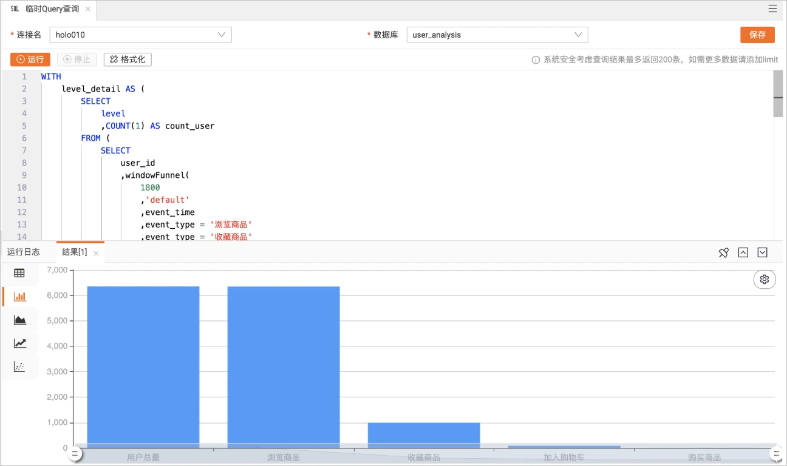

**留存函数（retention）**

- **函数说明**该函数将一组条件作为参数，类型为1到32个UInt8类型的参数，用来表示事件是否满足特定条件。

- **函数语法**

  ```text
  retention(cond1, cond2, ..., cond32);
  ```

- **参数说明**

  | 参数 | 说明 |
  | --- | --- |
  | cond | 返回结果的表达式。返回值包括：<br>• 1，条件满足。<br>• 0，条件不满足。 |

- **使用示例**如果您希望分析从某一天开始，用户的留存情况，可以使用如下SQL进行分析，SQL中的场景如下：

  - 开始分析日期是2014年11月25日。

  - 分别统计了第一天活跃数、次日留存、3日留存和7日留存。

  ```text
  -- 根据计算数组中SUM(r[index])获取2014-11-25活跃⽤户在第2、3、7⽇的留存数，以此计算留存率
  SELECT
      DATE '2014-11-25 00:00:00' AS "访问⽇期",
      SUM(r[1])::NUMERIC AS "第1天活跃⽤户",
      SUM(r[2])::NUMERIC/SUM(r[1])::NUMERIC AS "次⽇留存",
      SUM(r[3])::NUMERIC/SUM(r[1])::NUMERIC AS "3⽇留存",
      SUM(r[4])::NUMERIC/SUM(r[1])::NUMERIC AS "7⽇留存"
  FROM
  -- 计算2014-11-25活跃⽤户在第2、3、7⽇的登录情况。r数组表示每天登录情况，1表示登录，0 表示未登录。
      (
          WITH 
              first_day_table AS ( SELECT TIMESTAMP '2014-11-25 00:00:00' AS first_day)
          SELECT
              user_id,
              retention(
                  DATE(event_time) = (SELECT DATE(first_day) FROM first_day_table),
                  DATE(event_time) = (SELECT DATE(first_day + INTERVAL '1 day') FROM first_day_table),
                  DATE(event_time) = (SELECT DATE(first_day + INTERVAL '2 day') FROM first_day_table),
                  DATE(event_time) = (SELECT DATE(first_day + INTERVAL '6 day') FROM first_day_table)
                  ) AS r
  -- 过滤2014-11-25活跃⽤户在后续1～7⽇登录数据
              FROM    public.user_analysis
              WHERE   (event_time >= TIMESTAMP '2014-11-25 00:00:00')
              AND     (event_time <= TIMESTAMP '2014-11-25 00:00:00' + INTERVAL '6 day')
              GROUP BY user_id
          ) AS basic_table
  GROUP BY "访问⽇期"
  ;
  ```

  显示结果如下所示：

  ```text
    访问⽇期  | 第1天活跃⽤户 | 次⽇留存 | 3⽇留存  | 7⽇留存  
  ------------+---------------+----------+----------+----------
   2014-11-25 |          6351 | 0.796410 | 0.769013 | 0.088647
  (1 row)
  ```

**留存场景扩展函数**

- **函数说明**留存分析是最常见的典型用户增长分析场景，用户经常需要绘制数据可视化图形，分析用户的留存情况。

  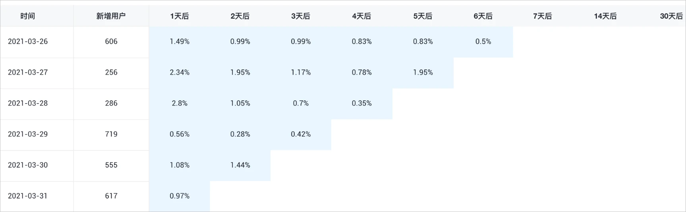

  基于该场景，Hologres构造了**range_retention_count**和**range_retention_sum**两个函数用于服务该场景。**range_retention_count**返回值为bigint数组，不支持直接读取，但可以作为**range_retention_sum**的输入，**range_retention_sum**返回值为text数组，示例如下：

  ```text
   {
    "20210306,562574,413024,343126,291178,215240,0,0,0,0,0,0,0,0,0,0,0", 
    "20210309,502617,376019,332303,273917,208421,0,0,0,0,0,0,0,0,0,0,0",
     "20210305,550118,412264,357542,297458,216549,0,0,0,0,0,0,0,0,0,0,0",
     "20210307,560659,402810,344581,291851,214705,0,0,0,0,0,0,0,0,0,0,0",
     "20210308,527392,383356,346084,282764,212309,0,0,0,0,0,0,0,0,0,0,0"
   }
  ```

- **函数语法**

  ```text
  range_retention_count(is_first,is_active,dt,retention_interval,retention_granularity)
  ```

- **参数说明**

  | 参数 | 类型 | 说明 |
  | --- | --- | --- |
  | is_first | bool | 是否符合初始行为。<br>• true：符合初始行为。<br>• false：不符合初始行为。 |
  | is_active | bool | 是否符合后续留存行为。<br>• true：符合后续留存行为。<br>• false：不符合后续留存行为。 |
  | dt | date | 发生行为日期。如2020-12-12 |
  | retention_interval | int\[\] | 留存间隔，最多支持15个留存间隔。如ARRAY\[1,3,5,7,15,30\] |
  | retention_granularity | text | 留存粒度，支持如下三种：<br>• day<br>• week<br>• month |

- **使用示例**如果您需要分析一段时间内用户的留存情况，且希望将浏览商品作为用户的初始行为，您可以使用如下SQL：

  ```sql
  WITH tbl_detail AS (
          SELECT range_retention_count(is_first, is_active, dt, ARRAY[1, 3, 7],'day' ) AS detail
          FROM (
              SELECT user_id, event_time::DATE AS dt
                  , CASE 
                      WHEN 
                      event_time >= timestamp '2014-11-25 00:00:00'
                      AND event_time < timestamp '2014-11-25 00:00:00' + INTERVAL '7' day
                      and event_type = '浏览商品'  --将浏览作为初始⾏为
                      THEN true
                      ELSE false
                  END AS is_first
                  , CASE 
                      WHEN event_time >= timestamp '2014-11-25 00:00:00' + INTERVAL '1' day
                      AND event_time < timestamp '2014-11-25 00:00:00' + INTERVAL '7' day + INTERVAL '7' day   --此处为从'2014-11-25 00:00:00'开
  始的第7天的7⽇留存，INTERVAL需要加2次
                      THEN true
                      ELSE false
                  END AS is_active
              FROM public.user_analysis
          ) tbl
          GROUP BY user_id
      ),
      tbl_sum AS (
          SELECT regexp_split_to_array(unnest(range_retention_sum(detail)), ',') AS s
          FROM tbl_detail
      )
  SELECT s[1] AS 访问⽇期
          ,s[3]::numeric / s[2]::numeric AS 第1天
          ,s[4]::numeric / s[2]::numeric AS 第3天
          ,s[5]::numeric / s[2]::numeric AS 第7天
  FROM tbl_sum
  ORDER BY s[1];
  ```

  显示结果如下所示：

  ```text
    访问⽇期|    第1天     |    第3天     |    第7天     
  ----------+--------------+--------------+--------------
   20141125 | 0.7962496060 | 0.7533879609 | 0.7666246454
   20141126 | 0.7904926806 | 0.7547615299 | 0.7684558476
   20141127 | 0.7711184521 | 0.7651407896 | 0.7564889098
   20141128 | 0.7799514955 | 0.7801131770 | 0.7414713015
   20141129 | 0.7946945337 | 0.7770096463 | 0.7500000000
   20141130 | 0.7944496707 | 0.7754782063 | 0.7483537158
   20141201 | 0.8017728870 | 0.7780834479 | 0.7545468439
  (7 rows)
  ```

<a id="section-1-5-8-2"></a>

#### 1.5.8.2. 明细圈人函数

本文将为您介绍明细圈人函数bit_construct和bit_match的具体使用语法。

**背景信息**

在圈人场景中，通常会有通过明细表圈人的需求，例如一个用户有多条记录，不同的记录满足不同的条件，明细圈人通常需要找出满足某些条件组合的用户列表。

示例明细表如下，需要在明细表中找出有过 `click`购物车 和 `view`收藏页 行为的user列表（此处满足条件的是user A）。

| user | action | page |
| --- | --- | --- |
| A | click | 购物车 |
| B | click | 首页 |
| A | view | 收藏页 |
| B | click | 购物车 |
| A | click | 收藏页 |

传统的查询方法是采用多轮条件过滤并使用JOIN语句来筛选出符合条件的结果，这种方法需要写复杂的SQL，同时多个JOIN语句也会消耗大量的资源。从Hologres V0.10版本开始，针对明细表圈人场景提供bit_construct和bit_match函数，只需要通过一轮过滤筛选和函数计算即可得到结果人群数据，降低明细圈人场景开发复杂度，快速得到结果。

**使用限制**

在Hologres中使用明细圈人函数，具体限制如下：

- 该函数仅Hologres V0.10及以上版本支持，请在Hologres管控台查看当前实例版本。

- 明细圈人函数在使用之前，需要执行以下语句开启extension。extension是DB级别的函数，一个DB只需执行一次即可，新建DB需要重新执行。

  ```text
  CREATE EXTENSION flow_analysis;
  ```

**bit_construct**

Hologres在V0.10及以上版本提供了bit_construct函数用于明细表圈人场景。

- **函数说明**

  bit_construct通过设置筛选条件，返回一个最多32位integer类型的bitmap。

- **语法示例**

  ```text
  bit_construct(
    a ,
    b ,
    ....,
    a6
  )
  ```

- **参数说明**

  - 参数a和b等，代表筛选条件，为bool类型，最多支持32个条件，取值范围为a~z,a1~a6。

  - 函数返回值类型为int。

**bit_match**

Hologres在V0.10及以上版本提供了bit_match函数用于明细表圈人场景。

- **函数说明**

  bit_match用于对bit_construct筛选的结果进行进一步计算。

- **语法示例**

  ```text
  bit_match('expression', bitmask)
  ```

- **参数说明**

  | 参数 | 说明 | 示例 |
  | --- | --- | --- |
  | expression | bit_construct函数中的条件表达式，支持<code> &amp; </code>(and)、<code>  &#124; </code> <code> </code>(or)、 <code> ! </code>(not)、<code> ^ </code>(XOR) 和<code> </code>（）<code> </code>。 | a&amp;b |
  | bitmask | bit_construct构造的bitmap名。 | 无 |

**使用示例**

使用明细圈人函数，完整语法示例如下：

1. 开启extension。Superuser在DB中执行如下语句开启extension：

   ```text
   CREATE EXTENSION flow_analysis;
   ```

2. 准备表和数据。如下为一张记录用户购物行为的明细表，该表记录了用户的uid以及购物路径的行为，同时对该表插入部分数据。

   ```sql
   create table ods_app_dwd(
   event_time timestamptz,
   uid bigint,
   action text,
   page text,
   product_code text,
   from_days int
   );

   insert into ods_app_dwd values('2021-04-03 10:01:30', 274649163, 'click', '购物⻋', 'MDS', 1);
   insert into ods_app_dwd values('2021-04-03 10:04:30', 274649163, 'view', '收藏⻚', 'MDS', 4);
   insert into ods_app_dwd values('2021-04-03 10:06:30', 274649165, 'click', '购物⻋', 'MMS', 8);
   insert into ods_app_dwd values('2021-04-03 10:09:30', 274649165, 'view', '购物⻋', 'MDS', 10);
   ```

3. 数据查询。

   查询出满足“某个时间范围内将商品既加入购物车又添加至收藏页”条件的精准用户。

   您可以使用如下两种方式进行数据查询：

   - 使用WHERE语句查询。

     > 在查询语句中WHERE条件筛选后的数据越少，查询性能越好。
     >
     > **说明**

     ```sql
     WITH tbl as (
     SELECT uid, bit_or(bit_construct(
       a := (action='click' and page='购物⻋'),
       b := (action='view' and page='收藏⻚'))) as uid_mask
       FROM ods_app_dwd
     WHERE event_time > '2021-04-03 10:00:00' AND event_time < '2021-04-04 10:00:00'
     GROUP BY uid )
     SELECT uid from tbl where bit_match('a&b', uid_mask);
     ```

     其中关于SQL语句的释义如下：

     - bit_construct：筛选出加入购物车的用户为条件a，筛选出添加至收藏夹的用户为条件b。

     - bit_or：将筛选出的条件a和b取或，在该SQL语句示例中，同一个用户只要有一行符合条件，即认为符合条件。

     - bit_match：a&b取满足条件a和b的交集。

   - 使用HAVING子句调用查询。

     ```sql
     SELECT uid FROM (
         SELECT uid, bit_or(bit_construct(
           a := (action='click' AND page='购物⻋'),
           b := (action='view' AND page='收藏⻚'))) as uid_mask
         FROM ods_app_dwd
         WHERE event_time > '2021-04-03 10:00:00' AND event_time < '2021-04-04 10:00:00'
         GROUP BY uid 
         HAVING bit_match('a&b', bit_or(bit_construct(
           a := (action='click' and page='购物⻋'),
           b := (action='view' and page='收藏⻚'))))
     ) t
     ```

<a id="section-1-5-8-3"></a>

#### 1.5.8.3. Roaring Bitmap函数

本文将为您介绍在Hologres中Roaring Bitmap函数的具体参数和使用。

**背景信息**

Roaring Bitmap是一种高效的Bitmap压缩算法，目前已被广泛应用在各种语言和各种大数据平台。适合计算超高基维的，常用于去重、标签筛选、时间序列等计算中。

Roaring Bitmap算法是将32位的INT类型数据划分为216个数据块（Chunk），每一个数据块对应整数的高16位，并使用一个容器（Container）来存放一个数值的低16位。Roaring Bitmap将这些容器保存在一个动态数组中，作为一级索引。容器使用两种不同的结构：数组容器（Array Container）和位图容器（Bitmap Container）。数组容器存放稀疏的数据，位图容器存放稠密的数据。如果一个容器里面的整数数量小于4096，就用数组容器来存储值。若大于4096，就用位图容器来存储值。

采用这种存储结构，Roaring Bitmap可以快速检索一个特定的值。在做位图计算（AND、OR、XOR）时，Roaring Bitmap提供了相应的算法来高效地实现在两种容器之间的运算。使得Roaring Bitmap无论在存储和计算性能上都表现优秀。

**使用限制**

在Hologres中使用Roaring Bitmap函数，具体限制如下：

- 该函数仅Hologres V0.10及以上版本支持，请在Hologres管控台查看当前实例版本。

- Roaring Bitmap函数在使用之前，需要执行以下语句开启extension才可以调用。extension是DB级别的函数，一个DB只需执行一次即可，新建DB需要重新执行。

  ```text
  CREATE EXTENSION roaringbitmap;
  ```

**Bitmap函数列表**

Bitmap函数主要包括的函数及说明如下表所示：

| 函数名 | 输入 | 输出 | 描述 | 示例 |
| --- | --- | --- | --- | --- |
| rb_build | integer\[\] | roaringbitmap | 通过数组创建一个Bitmap。 | <code>rb_build('{1,2,3,4,5}')</code> |
| rb_and | roaringbitmap，roaringbitmap | roaringbitmap | And计算。 | <code>rb_and(rb_build('{1,2,3}'</code><br><code>),rb_build('{3,4,5}'))</code> |
| rb_or | roaringbitmap，roaringbitmap | roaringbitmap | Or计算。 | <code>rb_or(rb_build('{1,2,3}')</code><br><code>,rb_build('{3,4,5}'))</code> |
| rb_xor | roaringbitmap，roaringbitmap | roaringbitmap | Xor计算。 | <code>rb_xor(rb_build('{1,2,3}'</code><br><code>),rb_build('{3,4,5}'))</code> |
| rb_andnot | roaringbitmap，roaringbitmap | roaringbitmap | AndNot计算。 | <code>rb_andnot(rb_build('{1,2,</code><br><code>3}'),rb_build('{3,4,5}'))</code> |
| rb_cardinality | roaringbitmap | integer | 统计基数。 | <code>rb_cardinality(rb_build('</code><br><code>{1,2,3,4,5}'))</code> |
| rb_and_cardinality | roaringbitmap，roaringbitmap | integer | And计算并返回基数。 | <code>rb_and_cardinality(rb_bui</code><br><code>ld('{1,2,3}'),rb_build('{3,</code><br><code>4,5}'))</code> |
| rb_or_cardinality | roaringbitmap，roaringbitmap | integer | Or计算并返回基数。 | <code>rb_or_cardinality(rb_buil</code><br><code>d('{1,2,3}'),rb_build('{3,4</code><br><code>,5}'))</code> |
| rb_xor_cardinality | roaringbitmap，roaringbitmap | integer | Xor计算并返回基数。 | <code>rb_xor_cardinality(rb_bui</code><br><code>ld('{1,2,3}'),rb_build('{3,</code><br><code>4,5}'))</code> |

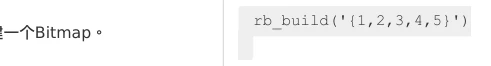

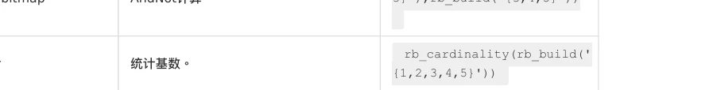

<table>
  <tr>
    <td>rb_andnot_cardinality</td>
    <td>roaringbitmap，roaringbitmap</td>
    <td>integer</td>
    <td>AndNot计算并返回基数。</td>
    <td><code>rb_andnot_cardinality(rb_</code><br><code>build('{1,2,3}'),rb_build('</code><br><code>{3,4,5}'))</code></td>
  </tr>
  <tr>
    <td>rb_is_empty</td>
    <td>roaringbitmap</td>
    <td>boolean</td>
    <td>判断是否为空的Bitmap。</td>
    <td><code>rb_is_empty(rb_build('{1,</code><br><code>2,3,4,5}'))</code></td>
  </tr>
  <tr>
    <td>rb_equals</td>
    <td>roaringbitmap，roaringbitmap</td>
    <td>boolean</td>
    <td>判断两个Bitmap是否相等。</td>
    <td><code>rb_equals(rb_build('{1,2,</code><br><code>3}'),rb_build('{3,4,5}'))</code></td>
  </tr>
  <tr>
    <td>rb_intersect</td>
    <td>roaringbitmap，roaringbitmap</td>
    <td>boolean</td>
    <td>判断两个Bitmap是否相交。</td>
    <td><code>rb_intersect(rb_build('{1</code><br><code>,2,3}'),rb_build('{3,4,5}')</code><br><code>)</code></td>
  </tr>
  <tr>
    <td>rb_remove</td>
    <td>roaringbitmap,integer</td>
    <td>roaringbitmap</td>
    <td>从Bitmap移除特定的Offset。</td>
    <td><code>rb_remove(rb_build('{1,2,</code><br><code>3}'),3)</code></td>
  </tr>
  <tr>
    <td>rb_flip</td>
    <td>roaringbitmap,integer,integer</td>
    <td>roaringbitmap</td>
    <td>翻转Bitmap中特定的Offset段。</td>
    <td><code>rb_flip(rb_build('{1,2,3}</code><br><code>'),2,3)</code></td>
  </tr>
  <tr>
    <td>rb_minimum</td>
    <td>roaringbitmap</td>
    <td>integer</td>
    <td>返回Bitmap中最小的Offset，如果Bitmap为空则返回-1。</td>
    <td><code>rb_minimum(rb_build('{1,2</code><br><code>,3}'))</code></td>
  </tr>
  <tr>
    <td>rb_maximum</td>
    <td>roaringbitmap</td>
    <td>integer</td>
    <td>返回Bitmap中最大的Offset，如果Bitmap为空则返回0。</td>
    <td><code>rb_maximum(rb_build('{1,2</code><br><code>,3}'))</code></td>
  </tr>
  <tr>
    <td>rb_rank</td>
    <td>roaringbitmap,integer</td>
    <td>integer</td>
    <td>返回Bitmap中小于等于指定Offset的基数。</td>
    <td><code>rb_rank(rb_build('{1,2,3}</code><br><code>'),3)</code></td>
  </tr>
  <tr>
    <td>rb_iterate</td>
    <td>roaringbitmap</td>
    <td>setof integer</td>
    <td>返回Offset List。</td>
    <td><code>rb_iterate(rb_build('{1,2</code><br><code>,3}'))</code></td>
  </tr>
</table>

**Bitmap聚合函数列表**

Bitmap聚合函数主要包括的函数及说明如下表所示：

| 函数名 | 输入数据类型 | 输出数据类型 | 描述 | 示例 |
| --- | --- | --- | --- | --- |
| rb_build_agg | integer | roaringbitmap | 将Offset聚合成bitmap。 | <code>rb_build_agg(1)</code> |
| rb_or_agg | roaringbitmap | roaringbitmap | Or聚合计算。 | <code>rb_or_agg(rb_build('{1,2,</code><br><code>3}'))</code> |
| rb_and_agg | roaringbitmap | roaringbitmap | And聚合计算。 | <code>rb_and_agg(rb_build('{1,2</code><br><code>,3}'))</code> |
| rb_xor_agg | roaringbitmap | roaringbitmap | Xor聚合计算。 | <code>rb_xor_agg(rb_build('{1,2</code><br><code>,3}'))</code> |
| rb_or_cardinality_agg | roaringbitmap | integer | Or聚合计算并返回其基数。 | <code>rb_or_cardinality_agg(rb_</code><br><code>build('{1,2,3}'))</code> |
| rb_and_cardinality_agg | roaringbitmap | integer | And聚合计算并返回其基数。 | <code>rb_and_cardinality_agg(rb</code><br><code>_build('{1,2,3}'))</code> |
| rb_xor_cardinality_agg | roaringbitmap | integer | Xor聚合计算并返回其基数。 | <code>rb_xor_cardinality_agg(rb</code><br><code>_build('{1,2,3}'))</code> |

**使用示例**

如下内容将为您介绍Roaring Bitmap函数完整的使用示例。

1. 加载RoaringBitmap函数插件。

   ```text
   CREATE EXTENSION roaringbitmap;
   ```

2. 创建带有RoaringBitmap数据类型的表。

   ```sql
   --创建名称为t1的表
   CREATE TABLE public.t1 (id integer, bitmap roaringbitmap);
   ```

3. 使用rb_build函数插入RoaringBitmap的数据。

   ```sql
   --数组位置对应的BIT值为1
   INSERT INTO public.t1 SELECT 1,RB_BUILD(ARRAY[1,2,3,4,5,6,7,8,9,200]);

   --将输入的多条记录的值对应位置的BIT值设置为1，最后聚合为⼀个RoaringBitmap  
   INSERT INTO public.t1 SELECT 2,RB_BUILD_AGG(e) FROM GENERATE_SERIES(1,100) e;
   ```

4. 进行Bitmap计算（OR、AND、XOR、ANDNOT）。

   ```text
   SELECT  RB_OR(a.bitmap,b.bitmap)
   FROM    (
               SELECT  bitmap
               FROM    public.t1
               WHERE   id = 1
           ) AS a
           ,(
               SELECT  bitmap
               FROM    public.t1
               WHERE   id = 2
           ) AS b
   ;
   ```

5. 进行Bitmap聚合计算（OR、AND、XOR、BUILD），并生成新的RoaringBitmap类型。

   ```sql
   SELECT RB_OR_AGG(bitmap) FROM public.t1;
   SELECT RB_AND_AGG(bitmap) FROM public.t1;
   SELECT RB_XOR_AGG(bitmap) FROM public.t1;
   SELECT RB_BUILD_AGG(id) FROM public.t1;
   ```

6. 统计基数（Cardinality），即统计RoaringBitmap中包含多少个位置为1的BIT位。

   ```sql
   SELECT RB_CARDINALITY(bitmap) FROM public.t1;
   ```

7. 从RoaringBitmap中返回位置为1的BIT下标（即位置值）。

   ```sql
   SELECT RB_ITERATE(bitmap) FROM public.t1 WHERE id = 1;
   ```

<a id="section-1-5-9"></a>

### 1.5.9. 聚合函数

<a id="section-1-5-9-1"></a>

#### 1.5.9.1. APPROX_COUNT_DISTINCT

APPROX_COUNT_DISTINCT是聚合函数。本文为您介绍在实时数仓Hologres中APPROX_COUNT_DISTINCT函数的用法。

**语法**

`APPROX_COUNT_DISTINCT` 函数用于计算某一列去重后的行数，结果只能返回一个值，并且该值为近似值。

```text
APPROX_COUNT_DISTINCT ( <column> )
```

参数说明如下表所示。

| 参数 | 描述 |
| --- | --- |
| column | 需要近似计算去重后行数的列。 |

`APPROX_COUNT_DISTINCT` 采用HyperLogLog基数估计的方式进行非精确的COUNT DISTINCT计算。非精确的COUNT DISTINCT计算能提升查询性能，尤其是对于column的离散值比较大的情况，误差率平均可以控制在 `0.1%-1%` 以内。该函数适用于对性能敏感并且可以接受误差的场景。

同时，您也可以通过 `COUNT DISTINCT ( column )` 的方式进行精确的COUNT DISTINCT计算，使用时资源开销会比较大。

**调整误差率**

通过使用以下参数调整误差率。

```text
set hg_experimental_approx_count_distinct_precision = 20;
```

- 支持取值范围为[12,20]，默认值为17。

- 精度参数含义为HyperLogLog算法的分桶bit位个数，参数越大，代表分桶越多，理论精度越高。

- 精度参数取值越高，计算时间和内存开销也会相应增大，但都远远小于精确的 `COUNT DISTINCT ( column )` 语句带来的开销，因此，推荐选用APPROX_COUNT_DISTINCT替换 `COUNT DISTINCT ( column )` 。

- 当精度参数设置为17以上时，Hologres采用<strong>HyperLogLog++</strong>算法，会对返回值做误差修正，以进一步降低误差、稳定误差。例如**hg_experimental_approx_count_distinct_precision**取值为20时，多数情况下，可以将误差率降低到0.01%至0.2%不等。

**示例**

计算**O_CUSTKEY**列去重后行数的近似值，示例语句如下。

```sql
SELECT APPROX_COUNT_DISTINCT ( O_CUSTKEY ) FROM ORDERS;

--全局设置精度20，计算O_CUSTKEY列去重后⾏数的近似值
ALTER DATABASE dbname SET hg_experimental_approx_count_distinct_precision = 20;
SELECT APPROX_COUNT_DISTINCT ( O_CUSTKEY ) FROM ORDERS;

--在Session级别设置精度20
SET hg_experimental_approx_count_distinct_precision = 20;
SELECT APPROX_COUNT_DISTINCT ( O_CUSTKEY ) FROM ORDERS;
```

<a id="section-1-5-9-2"></a>

#### 1.5.9.2. UNIQ

UNIQ是计算非重复值个数的聚合函数，与COUNT DISTINCT函数类似，本文为您介绍在Hologres如何使用UNIQ函数。

**使用限制**

仅Hologres V1.3及以上版本支持使用UNIQ函数。

**语法**

`UNIQ` 函数用于计算某一列去重后的行数，结果返回一个去重值。

```text
UNIQ ( < column > );
```

参数说明如下。

<table>
  <tr>
    <th width="85">参数</th>
    <th>描述</th>
  </tr>
  <tr>
    <td>column</td>
    <td>需要计算去重后行数的列。支持SMALLINT、INTEGER、BIGINT、REAL、DOUBLE PRECISION、TEXT、VARCHAR、TIMESTAMP、TIMESTAMPTZ、DATE、TIMETZ、UUID类型。</td>
  </tr>
</table>

使用说明如下。

- 一般来说，UNIQ在GROUP BY KEY的KEY基数较高时，比COUNT DISTINCT性能更好，同时UNIQ比COUNT DISTINCT更节省内存，如果使用COUNT DISTINCT遇到内存超限时，可以换用UNIQ。

- Hologres从 V1.3版本开始，针对多个Count Distinct场景进行了优化，当Count Distinct数量大于1个时，后端会自动改写为UNIQ实现（结果、语义与当前实现是一样的，对上层透明），提升查询性能。

**示例**

计算**ORDERS**表的**O_CUSTKEY**列去重后行的数值语句如下。

```sql
SELECT UNIQ ( O_CUSTKEY ) FROM ORDERS;

--不同O_ORDERSTATUS下O_CUSTKEY去重数
SELECT O_ORDERSTATUS, UNIQ ( O_CUSTKEY ) FROM ORDERS GROUP BY O_ORDERSTATUS;
```

<a id="section-1-5-9-3"></a>

#### 1.5.9.3. MAX_BY与MIN_BY

Hologres从V1.3.36版本开始支持MAX_BY与MIN_BY函数，用于获取当某一列（y列）的值为最大值或最小值时，对应着的另外一列（x列）的取值。本文为您介绍MAX_BY与MIN_BY函数的用法。

**使用限制**

该函数适用于Hologres V1.3.36及以上版本的实例，若实例低于该版本，请您升级实例。

**语法**

MAX_BY与MIN_BY函数用于比较某一列（y列）取值的大小，当y列取值为最大值或最小值时，返回对应着的另外一列（x列）的取值。语法如下。

> **说明**
>
> 数字类型按数字大小进行比较，非数字类型按照字典排序进行比较。

```text
MAX_BY(x, y);
MIN_BY(x, y);
```

参数说明如下。

| 参数 | 描述 |
| --- | --- |
| y | 需要比较大小的列。 |
| x | 另外一列的字段名。<br>• 当y列取值为最大值时，MAX_BY函数返回此列的取值结果。<br>• 当y列取值为最小值时，MIN_BY函数返回此列的取值结果。 |

使用说明如下。

- 当MAX_BY函数中y列的最大值存在多个时，则返回对应的多个x值中的最大值。

- 当MIN_BY函数中y列的最小值存在多个时，则返回对应的多个x值中的最小值。

- y列的NULL值不参与计算。当y列所有值均为NULL时，函数返回值为NULL。

**示例数据**

```sql
DROP TABLE IF EXISTS test;
CREATE TABLE IF NOT EXISTS test (
    id int,
    name text,
    cost int
);
INSERT INTO test
    VALUES (1, 'a', 100), (1, 'aa', 200), (1, 'aaa', 300), (2, 'b', 150), (2, 'bb', 300), (3, 'c', 150), (3, 'cc', 50);
```

**示例**

- 使用 `MAX_BY` 函数，通过 `GROUP BY` 对**id**进行分组，查询每组**cost**最大值对应的**name**值。示例语句如下。

  ```sql
  SELECT id, max_by(name, cost) FROM test GROUP BY id;

   id | max_by
  ----+--------
    2 | bb
    1 | aaa
    3 | c
  (3 rows)
  ```

- 使用 `MAX_BY` 函数，查询**cost**最大值（存在多个）对应的**name**值。示例语句如下。

  ```sql
  select max_by(name, cost) from test;

   max_by
  --------
   bb
  (1 row)
  ```

- 使用 `MIN_BY` 函数，查询**cost**最小值对应的**name**值。示例语句如下。

  ```sql
  SELECT min_by(name, cost) FROM test;

   min_by
  --------
   cc
  (1 row)
  ```

<a id="section-1-5-10"></a>

### 1.5.10. 账号与安全函数

<a id="section-1-5-10-1"></a>

#### 1.5.10.1. USER_DISPLAY_NAME

USER_DISPLAY_NAME用于转换Hologres账号为邮箱形式或RAM形式的阿里云账号。本文为您介绍在实时数仓Hologres中USER_DISPLAY_NAME的用法。

**命令语法**

USER_DISPLAY_NAME的命令语法如下所示：

```text
SELECT user_display_name (user_name);
```

**参数说明**

参数说明如下表所示。

<table>
  <tr>
    <th width="115">参数</th>
    <th>描述</th>
  </tr>
  <tr>
    <td>user_name</td>
    <td>阿里云账号ID。通常为数字形式，例如<code> 13532241323xxx </code>或RAM用户<code> p4_23402030200xxx </code>。</td>
  </tr>
</table>

返回值为邮箱形式或RAM形式的阿里云账号，例如 `*****@aliyun.com` ， `RAM$mainaccount:subuser` 或 `RAM$public` 。

**使用示例**

转换Hologres账号为邮箱形式或RAM形式的阿里云账号的示例语句如下。

```sql
SELECT user_display_name ('13532241323xxx');
SELECT rolname, user_display_name(rolname) FROM pg_roles;
```

<a id="section-1-5-10-2"></a>

#### 1.5.10.2. HG_DISPLAY_NAME_TO _ID

HG_DISPLAY_NAME_TO _ID用于转换阿里云账号ID为Hologres账号。本文为您介绍在实时数仓Hologres中HG_DISPLAY_NAME_TO _ID的用法。

**语法**

```text
SELECT hg_display_name_to_id (aliyun_id);
```

参数说明如下表所示。

<table>
  <tr>
    <th width="97">参数</th>
    <th>描述</th>
  </tr>
  <tr>
    <td>aliyun_id</td>
    <td>阿里云账号。通常为邮箱形式或RAM形式，例如<code> ****@aliyun.com </code>，<code> RAM$mainaccount:subuser </code>或<code> RAM$public </code>。</td>
  </tr>
</table>

返回值user_name为阿里云账号ID，通常为数字形式，例如 `13532241323xxx` 或 `p4_23402030200xxx` 。

**示例**

转换阿里云账号ID为Hologres账号的示例语句如下。

```text
SELECT hg_display_name_to_id ('RAM$main:subuser');
```

<a id="section-1-5-11"></a>

### 1.5.11. Hive兼容函数

<a id="section-1-5-11-1"></a>

#### 1.5.11.1. JSON函数

本文为您介绍实时数仓Hologres相关的JSON函数。

**GET_JSON_OBJECT**

- 语法

  GET_JSON_OBJECT用于解析JSON对象。在使用GET_JSON_OBJECT函数前，需要先创建加载扩展（Extension），详情请参见Extension扩展。

  ```text
  --创建Extension
  CREATE EXTENSION IF NOT EXISTS hive_compatible SCHEMA <schema_name>;
  SELECT get_json_object ( json_string, path );
  ```

- 参数说明

  <table>
    <tr>
      <th width="113">参数</th>
      <th>描述</th>
    </tr>
    <tr>
      <td>json_string</td>
      <td>JSON对象变量，TEXT类型。格式为合法JSON格式字符串。</td>
    </tr>
    <tr>
      <td>path</td>
      <td>JSON内层对象访问变量。使用<code> $ </code>表示JSON变量标识，通过<code> . </code>或<code> [] </code>读取JSON内层对象或数组。如果您输入的JSON字符串无效，则系统返回NULL。</td>
    </tr>
  </table>

- 示例

  准备示例数据。

  ```sql
  --创建Extension
  CREATE EXTENSION IF NOT EXISTS hive_compatible SCHEMA pg_catalog;
  --准备示例数据
  BEGIN;
  CREATE TABLE hive_json_example (
      col_json text
  );
  COMMIT;
  INSERT INTO hive_json_example VALUES 
  ('{"store":{"fruit":[{"weight":8,"type":"apple"}, {"weight":9,"type":"pear"}],"bicycle":
  {"price":19.95,"color":"red"}},"email":"amy@only_for_json_udf_test.net","owner":"amy"}');
  ```

  - 示例1：从 `col_json` 列中查询JSON对象中 `$.owner` 路径下的数据。

    ```text
    --返回结果为：amy
    SELECT
        get_json_object (col_json, '$.owner')
    FROM
        hive_json_example;
    ```

  - 示例2：从 `col_json` 列中查询JSON对象中 `$.store.bicycle.price` 路径下的数据。

    ```text
    --返回结果为：19.95
    SELECT
        get_json_object (col_json, '$.store.bicycle.price')
    FROM
        hive_json_example;
    ```

  - 示例3：从 `col_json` 列中查询JSON对象中 `$.store.fruit` 路径下 `fruit` 数组的第一个元素（索引为0）。

    ```text
    -- 返回结果为：{"weight":8, "type":"apple"}
    SELECT
        get_json_object (col_json, '$.store.fruit[0]')
    FROM
        hive_json_example;
    ```

  - 示例4：查看非JSON对象变量的数据。

    ```text
    --返回值为：NULL
    SELECT
        get_json_object (col_json, '$.no_key')
    FROM
        hive_json_example;
    ```

**ROW_TO_JSON**

ROW_TO_JSON函数支持将多个字符串或列（最多50列）拼接成一个JSON并返回。

> **说明**
>
> 仅Hologres V1.3及以上版本支持ROW_TO_JSON函数，若想要使用该函数您可以通过加入实时数仓Hologres交流群申请升级实例或实例升级，加群方式请参见如何获取更多的在线支持？。

- 语法

  ```text
  SELECT ROW_TO_JSON(record)
  ```

- 参数说明

  record：是一个行类型的参数，可以是表名、视图名或者查询结果。

- 示例

  ```sql
  --准备测试数据
  CREATE TABLE interests_test (
      name text,
      intrests text
  );

  INSERT INTO interests_test 
    VALUES 
    ('张三', '唱歌,跳舞'), ('李四', '踢球,跑步,画画'), ('王五', '插花,书法,弹琴,睡觉');

  SELECT
      ROW_TO_JSON(t)
  FROM (
      SELECT
          name,
          intrests
      FROM
          interests_test) AS t;
  ```

  Hologres从V1.3.52版本开始，JSON中的Key支持根据列名生成。

  - V1.3.52以下版本返回结果如下。

    ```text
    row_to_json                
    ------------------------------
    {"f1":"张三","f2":"唱歌,跳舞"}
    {"f1":"李四","f2":"踢球,跑步,画画"}
    {"f1":"王五","f2":"插花,书法,弹琴,睡觉"}
    ```

  - V1.3.52及以上版本返回结果如下。

    ```text
    row_to_json                
    ------------------------------
    "{"name" : "王五", "intrests" : "插花,书法,弹琴,睡觉"}"
    "{"name" : "张三", "intrests" : "唱歌,跳舞"}"
    "{"name" : "李四", "intrests" : "踢球,跑步,画画"}"
    ```

**常见报错**

- 报错： `ERROR`：`function get_json_object (text, unknown) does not exist` 。

  - 可能原因一

    在SLPM模式下RAM用户没有创建extension所在Schema的查询权限（例如extension指定创建在名称为**public**的Schema下，RAM用户没有**public**的查询权限）。

  - 解决方法一

    - 授予RAM用户Schema的查询权限。

    - 使用如下命令重新创建extension在**pg_catalog**下，所有账号都可查询。

      ```text
      DROP EXTENSION hive_compatible;
      CREATE EXTENSION hive_compatible schema pg_catalog;
      ```

  - 可能原因二

    GET_JSON_OBJECT的第一个参数不是TEXT类型。

  - 解决方法二

    将第一个参数转换为TEXT类型。

- 报错： `ERROR: get_json_object for fe, should not be evaluated` 。

  - 可能原因一

    GET_JSON_OBJECT的第一个参数是常量。

  - 解决方法一

    第一个参数使用表的列。

  - 可能原因二

    GET_JSON_OBJECT的第一个参数含有为NULL的值。

  - 解决方法二

    将第一个参数为NULL的值删除。

<a id="section-1-5-12"></a>

### 1.5.12. MaxCompute兼容函数

<a id="section-1-5-12-1"></a>

#### 1.5.12.1. 最大分区函数

MAX_PT用于查询实时数仓Hologres表最大的分区表名称。

**命令语法**

```text
SELECT MAX_PT('<table_name>');
```

参数说明如下表所示。

| 参数 | 描述 |
| --- | --- |
| table_name | Hologres的表名称。 |

**使用示例**

```text
SELECT MAX_PT('holo_table');
```

<a id="section-1-5-13"></a>

### 1.5.13. 工具函数

<a id="section-1-5-13-1"></a>

#### 1.5.13.1. HG_SHARD_ID_FOR_DISTRIBUTION_KEY

HG_SHARD_ID_FOR_DISTRIBUTION_KEY用于获取指定键或组合键的数据片ID（Shard ID）。本文为您介绍在实时数仓Hologres中HG_SHARD_ID_FOR_DISTRIBUTION_KEY的用法。

**命令语法**

```text
SELECT HG_SHARD_ID_FOR_DISTRIBUTION_KEY ( 'schemaname.tablename' , columnname [...] ] ) 
FROM schemaname.tablename
```

**参数说明**

参数说明如下表所示。

<table>
  <tr>
    <th width="134">参数</th>
    <th>描述</th>
  </tr>
  <tr>
    <td>schemaname</td>
    <td>对应schema名称。</td>
  </tr>
  <tr>
    <td>tablename</td>
    <td>需要获取Shard ID的表名称。</td>
  </tr>
  <tr>
    <td>columnname</td>
    <td>单column或组合column的表名，作为计算所落到的数据分片ID（Shard ID）上。</td>
  </tr>
</table>

**使用示例**

您可以使用如下示例步骤获取指定键或组合键的数据片ID（Shard ID）。

1. 安装插件。您可以执行以下语句安装插件。该命令是DB级别的，在一个DB内执行一次即可。切换到新的DB需要再次执行。

   ```text
   create extension hg_toolkit;
   ```

2. 获取lineitem表中l_shipmode列的Shard ID。

   ```text
   SELECT  HG_SHARD_ID_FOR_DISTRIBUTION_KEY ( 'public.lineitem', l_shipmode)
   FROM public.lineitem ;
   ```

3. 获取执行结果。

   ```text
    hg_shard_id_for_distribution_key 
   ----------------------------------
                                  24
                                  24
                                  24
                                  24
                                  31
                                  24
                                  12
                                  25
                                  25
                                  25
   (10 rows)
   ```

<a id="section-1-5-13-2"></a>

#### 1.5.13.2. HG_UPDATE_DATABASE_PROPERTY

HG_UPDATE_DATABASE_PROPERTY用于更新数据库的属性。本文为您介绍在实时数仓Hologres中HG_UPDATE_DATABASE_PROPERTY的用法。

**使用限制**

- Hologres仅支持使用 `HG_UPDATE_DATABASE_PROPERTY` 更改默认Table Group的shard_count属性。

- 仅实例的Superuser和数据库的Owner可以调用 `HG_UPDATE_DATABASE_PROPERTY` 函数。

**语法**

```text
CALL HG_UPDATE_DATABASE_PROPERTY ( 'property', 'value' );
```

参数说明如下表所示。

| 参数 | 描述 |
| --- | --- |
| property | 属性名称 |
| value | 属性值 |

**示例**

示例是将默认Table Group的**shard count**设置为 `120` ，语句如下。

```text
CALL HG_UPDATE_DATABASE_PROPERTY ( 'shard_count', '120' );
```

<a id="section-1-5-13-3"></a>

#### 1.5.13.3. SET_TABLE_PROPERTY

本文为您介绍在实时数仓Hologres中SET_TABLE_PROPERTY的用法。

**函数概述**

SET_TABLE_PROPERTY用于设置表的属性，包括索引、分布列、行存储、列存储以及生命周期等属性。如果您需要对创建的表进行修改、更新和删除，具体操作请参见ALTER TABLE或DROP TABLE。

**命令格式**

```text
CALL SET_TABLE_PROPERTY ( table_name, property, value )
WHERE PROPERTY IN
    orientation
  clustering_key
  segment_key
  bitmap_columns
  dictionary_encoding_columns
  time_to_live_in_seconds
  distribution_key
```

**参数说明**

SET_TABLE_PROPERTY参数说明如下表所示。

| 参数 | 描述 |
| --- | --- |
| table_name | 表名称。您也可以使用Schema限定表名称。表名称只能是小写英文字母<code> a~z </code>、大写英文字母<code> A~Z </code>、数字以及下划线<code> (_) </code>的组合，并且以字母开头。如果表名称有特殊字符，则需要使用双引号<code> "" </code>转义。由于系统对大小写不敏感，大写字母<code> A~Z </code>会被认为是小写字母<code> a~z </code>。 |
| property | 属性名称。 |
| orientation | 用于指定数据库的表在Hologres中是列存储还是行存储。该参数仅支持和CREATE TABLE在同一事务中执行。 |
| clustering_key | 用于在指定的列建立聚簇索引。该参数仅支持和CREATE TABLE在同一事务中执行。 |
| segment_key | 用于指定某些列作为分段键，例如，指定时间列作为分段键。当查询条件包含分段列时，查询可以通过分段键快速找到相应数据对应的存储位置。该参数仅支持和CREATE TABLE在同一事务中执行。 |
| bitmap_columns | 用于在指定列构建比特编码，快速过滤分段内部的数据。您可以单独使用该参数。 |
| dictionary_encoding_columns | 用于为指定列的值构建字典映射。字典编码可以将字符串的比较转换为数字的比较，加速Group By、Filter等查询。您可以单独使用该参数。 |
| distribution_key | 用于指定数据库中表的分布策略。该参数仅支持和CREATE TABLE在同一事务中执行。 |
| time_to_live_in_seconds | 表数据的生命周期，单位为秒。取值为非负数、整数或浮点数。您可以单独使用该参数。 |
| value | 属性值。如果该参数包含列名，并且列名包含大写字母，则需要添加双引号<code> "" </code>。 |

**使用示例**

```sql
BEGIN;
CREATE TABLE ORDERS ( 
  O_ORDERKEY              INTEGER NOT NULL,
  O_CUSTKEY        INTEGER NOT NULL,
  O_ORDERSTATUS    TEXT NOT NULL,
  O_TOTALPRICE     DECIMAL(15,2) NOT NULL,
  O_ORDERDATE      DATE NOT NULL,
  O_ORDERPRIORITY  TEXT NOT NULL,  
  O_CLERK          TEXT NOT NULL, 
  O_SHIPPRIORITY   INTEGER NOT NULL,
  O_COMMENT        TEXT NOT NULL);
CALL SET_TABLE_PROPERTY ('ORDERS', 'clustering_key', 'O_ORDERKEY:asc,O_CUSTKEY:asc');
CALL SET_TABLE_PROPERTY ('ORDERS', 'segment_key', 'O_ORDERDATE');
CALL SET_TABLE_PROPERTY ('ORDERS', 'bitmap_columns', 'O_ORDERSTATUS,O_ORDERPRIORITY,O_CLERK,O_SHIPPRIORITY');
CALL SET_TABLE_PROPERTY ('ORDERS', 'dictionary_encoding_columns', 'O_ORDERSTATUS,O_ORDERPRIORITY,O_CLERK,O_SHIPPRIORITY');
CALL SET_TABLE_PROPERTY ('ORDERS', 'time_to_live_in_seconds', '172800');
COMMIT;
```

<a id="section-1-5-13-4"></a>

#### 1.5.13.4. HG_CREATE_TABLE_LIKE

本文将为您介绍在实时数仓Hologres中HG_CREATE_TABLE_LIKE函数的具体用法，包括函数简介、参数说明和使用示例，方便您快速了解和使用。

**函数简介**

HG_CREATE_TABLE_LIKE用于创建一个以查询结果字段组成的表。该函数只能用于创建表，不能同步复制数据，数据信息需要您手动导入。函数命令格式如下：

```text
CALL HG_CREATE_TABLE_LIKE ( 'table_name', 'query_sql' [, 'partition_clause'])
```

**参数说明**

HG_CREATE_TABLE_LIKE函数的参数包括 `table_name` 、 `query_sql` 、 `partition_clause` ，具体说明如下表所示。

<table>
  <tr>
    <th width="154">参数</th>
    <th>描述</th>
  </tr>
  <tr>
    <td>table_name</td>
    <td>表名称。您也可以使用Schema限定表名称。表名称只能是小写英文字母（a~z）、大写英文字母（A~Z）、数字以及下划线（_）的组合，并且以字母开头。如果表名称有特殊字符，则需要使用双引号（""）转义。由于系统对大小写不敏感，大写字母（A~Z）会被认为是小写字母（a~z）。</td>
  </tr>
  <tr>
    <td>query_sql</td>
    <td>执行查询的SQL语句。如果SQL语句中有较多单引号，您可以根据实际使用情况通过如下方式对单引号进行转义：<br>• 使用终端或者JDBC等开发工具，推荐您按照如下示例，在SQL语句前后添加两个美元符号（$$），通过<code> $$query_sql$$ </code>改写，实现单引号转义。<br><code>CALL HG_CREATE_TABLE_LIKE ('table_name', $$query_sql$$ [, 'partition_clause'])</code><br>• 使用HoloWeb中的SQL编辑器，请对SQL语句单引号中的内容再加单引号进行转义。</td>
  </tr>
  <tr>
    <td>partition_clause</td>
    <td>分区表的分区子句。该参数为可选参数。</td>
  </tr>
</table>

**使用示例**

如下示例将指导您使用HG_CREATE_TABLE_LIKE函数进行一些简单操作。

- 创建一个普通表

  ```text
  //将holotest表的a、b字段⽣成表my_table。
  CALL HG_CREATE_TABLE_LIKE ('my_table', 'select a, b from holotest'); 
  ```

- 创建一个分区表

  ```text
  //将holotest表的a、b字段⽣成表my_table，并且a为分区字段。
  CALL HG_CREATE_TABLE_LIKE ('my_table', 'select a, b from holotest', 'partition by list (a)' );
  ```

- 使用单引号对查询语句单引号中的内容进行转义

  ```text
  CALL HG_CREATE_TABLE_LIKE ('holo_table', 'select id,name from my_test where ds =''2020-10-10''' );
  ```

- 使用 `$$query_sql$$` 对单引号进行转义

  ```text
  CALL HG_CREATE_TABLE_LIKE ('holo_table', $$select id,name from my_test where ds ='2020-10-10'$$ );                                     
  ```

<a id="section-1-6"></a>

## 1.6. DDL

<a id="section-1-6-1"></a>

### 1.6.1. DATABASE

<a id="section-1-6-1-1"></a>

#### 1.6.1.1. CREATE DATABASE

CREATE DATABASE语句用于创建数据库。本文为您介绍CREATE DATABASE的用法。

**语法**

```sql
CREATE DATABASE db_name
    [ [ WITH ] [ OWNER [=] user_name ]
;
```

参数说明如下表所示。

<table>
  <tr>
    <th width="115">参数</th>
    <th>描述</th>
  </tr>
  <tr>
    <td>db_name</td>
    <td>创建的数据库名称，遵循SQL标识符的一般规则。</td>
  </tr>
  <tr>
    <td>user_name</td>
    <td>被授权为数据库管理员的账号名称。执行该语句的账号默认成为新数据库的Owner，拥有Superuser权限，该账号也可以授予其他用户Superuser权限。数据库的Owner拥有删除该数据库的权限。删除数据库时，系统会同时删除数据库中的表或数据等对象。</td>
  </tr>
</table>

> 开通Hologres实例后，系统自动创建**postgres**数据库。该数据库分配到的资源较少，仅用于管理，开发实际业务建议您新建数据库。
>
> **说明**
>
> Superuser可以为其他用户创建数据库，并授权该用户为新数据库的Owner，方便用户自行管理和配置该数据库。

**示例**

新建数据库的示例语句如下。

```sql
CREATE DATABASE testdb;
```

<a id="section-1-6-1-2"></a>

#### 1.6.1.2. ALTER DATABASE

ALTER DATABASE语句用于修改数据库。本文为您介绍ALTER DATABASE的用法。

**语法**

```text
ALTER DATABASE <dbname> SET configuration_parameter { TO | = } { value | DEFAULT }
ALTER DATABASE <dbname> SET configuration_parameter FROM CURRENT
ALTER DATABASE <dbname> RESET configuration_parameter
ALTER DATABASE <dbname> RESET ALL
```

参数说明如下表所示。

| 参数 | 描述 |
| --- | --- |
| configuration_parameter | Hologres的配置参数。 |
| value | 配置参数的取值。 |
| DEFAULT | 设置配置参数为缺省值。 |
| RESET | 重置指定配置参数。 |
| RESET ALL | 重置数据库的所有配置参数。 |
| SET FROM CURRENT | 设置配置参数为当前Session的配置值。 |

**示例**

设置时区为晚格林威治标准时间（北京时区）8个小时的时区，SQL语句如下。

```text
ALTER DATABASE postgres SET timezone='GMT+8:00';
```

<a id="section-1-6-1-3"></a>

#### 1.6.1.3. DROP DATABASE

DROP DATABASE语句用于删除数据库。本文为您介绍DROP DATABASE的用法。

**使用限制**

- 只有数据库的Superuser，或被Superuser授权为数据库Owner的用户，才可以删除该数据库。

- 删除数据库时会同时删除数据库中的所有对象。

- 您不能再连接使用已删除的数据库。

**语法**

```text
DROP DATABASE [ IF EXISTS ] db_name;
```

**示例**

删除数据库，示例语句如下。

```text
DROP DATABASE mydb;
```

<a id="section-1-6-2"></a>

### 1.6.2. SCHEMA

<a id="section-1-6-2-1"></a>

#### 1.6.2.1. CREATE SCHEMA

Hologres支持跨Schema创建表。本文为您介绍如何在Hologres中创建Schema，以及跨Schema创建表。

**背景信息**

Hologres兼容PostgreSQL，支持的Schema功能与PostgreSQL相同。

Hologres新增Schema功能后，表的存储结构由 `database.table` 变为 `database.schema.table` 。

Hologres当前版本主要支持创建Schema、重命名Schema以及在Schema中创建表等功能。

在Hologres中，每张表归属于一个Schema，一个数据库可以包含多个Schema，方便您管理。同时，多个用户使用同一个数据库时不会互相干扰。

不同的Schema可以包含相同的表名称或数据类型。

创建数据库时系统默认创建一个**public** Schema。如果您不创建其它Schema，则在该数据库创建的所有表默认存储在**public** Schema中。您可以执行以下语句查看当前Schema。

```text
select current_schema(); //查看当前Schema。
\d tablename; //查看⽬标表所属的Schema。该语句只适⽤于终端。
```

Hologres实例对象的层级关系如下图所示。

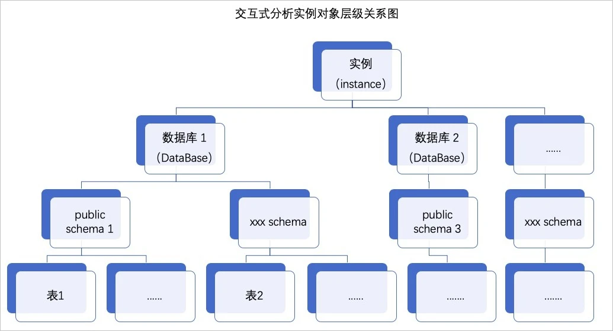

**操作步骤**

1. 创建Schema。在数据库中创建Schema的示例SQL语句如下。

   ```sql
   create schema schemaname; //创建Schema。
   set search_path to schemaname; //切换⾄⽬标Schema。
   create table blink_demo (id text); //在⽬标Schema中创建表。
   select current_schema(); //查看当前Schema。
   ```

2. 跨Schema创建表。您可以使用 `schema.table` 语句，添加Schema名称至表名称之前，即可跨Schema创建表。具体如下：

   - 在目标Schema中为**public** Schema创建表。示例SQL语句如下。

     ```sql
     create table public.mytest (
       name text,
       id int);
     ```

   - 在**public** Schema中为目标Schema创建表。示例SQL语句如下。

     ```sql
     set search_path to public;
     create table my_schema.mytest (
       name text,
       id int,
       age int
     );
     ```

<a id="section-1-6-2-2"></a>

#### 1.6.2.2. ALTER SCHEMA

ALTER SCHEMA语句用于修改数据库中的模式。本文为您介绍ALTER SCHEMA的用法及使用限制。

**使用限制**

仅支持修改模式的名称。

**语法**

修改模式名称的SQL语句如下。

```text
ALTER SCHEMA oldschema RENAME TO newschema; 
```

**示例**

```text
ALTER SCHEMA my_schema RENAME TO new_schema;
SET search_path TO new_schema; --进入重命名的Schema。
```

<a id="section-1-6-2-3"></a>

#### 1.6.2.3. IMPORT FOREIGN SCHEMA

IMPORT FOREIGN SCHEMA语句用于批量创建外部表。本文为您介绍IMPORT FOREIGN SCHEMA语句的用法和使用限制。

**使用限制**

- 使用 `IMPORT FOREIGN SCHEMA` 语句时，建议您添加 `LIMIT TO` 限制，并使用括号将需要添加限制的表名称括起来。如果不添加该限制，系统则将目标MaxCompute工作空间中的所有表批量创建至Hologres中。

- 仅Hologres V1.1.26及以上版本支持对使用 `IMPORT FOREIGN SCHEMA` 创建的外部表名称增加前缀和后缀，如果您的实例是V1.1.26以下版本，请您升级实例。

- 仅Hologres V1.3及以上版本支持MaxCompute的三层模型模式（即在原先的Project和Table之间增加了一层Schema的概念），如果您想在Hologres中使用MaxCompute的三层模型的项目创建外部表，且您的Hologres版本较低，请您升级实例。

**语法**

语法如下。

```text
IMPORT FOREIGN SCHEMA remote_schema
    [ { LIMIT TO | EXCEPT } ( table_name [, ...] ) ]
    FROM SERVER server_name
    INTO local_schema 
    [ OPTIONS ( option 'value' [, ... ] ) ]
```

参数说明如下表所示。

<table>
  <tr>
    <th width="155">参数</th>
    <th>描述</th>
  </tr>
  <tr>
    <td>remote_schema</td>
    <td>• MaxCompute两层模型：需要导入的MaxCompute表所在的项目名称。<br>• MaxCompute三层模型：需要导入的MaxCompute的项目名称和Schema名称，格式为<code> odps_project_name#odps_schema_name </code>。如果您MaxCompute的Project是三层模型模式，您仍使用两层模型的写法调用，则会报错，报错样例如下。<br><code>failed to import foreign schema:Table not found - table_xxx</code></td>
  </tr>
  <tr>
    <td>table_name</td>
    <td>需要导入的MaxCompute表名称。</td>
  </tr>
  <tr>
    <td>server_name</td>
    <td>MaxCompute表所在的外部服务器名称。您可以直接调用Hologres底层已创建的名为<strong>odps_server</strong>的外部表服务器。详细原理请参见Postgres FDW。</td>
  </tr>
  <tr>
    <td>local_schema</td>
    <td>Hologres外部表所在的schema名（如public）。</td>
  </tr>
  <tr>
    <td>options</td>
    <td>Hologres支持如下两个option：<br>• if_table_exist：表示导入时已经存在该表。取值如下：<br>• error：默认值，表示已有同名外部表，不再重复创建。<br>• ignore：忽略该同名表，跳过该表的导入，使导入的表不重复。<br>• update：更新并重新导入该表。<br>• if_unsupported_type：表示导入的外部表中存在Hologres不支持的数据类型。取值如下：<br>• error：报错，导入失败， 并提示哪些表存在不支持的类型。<br>• skip：默认值，表示跳过导入的存在不支持类型的表，并提示哪些表被跳过。</td>
  </tr>
</table>

> **说明**
>
> Hologres仅支持创建MaxCompute外部表。新建的外部表名称需要同MaxCompute表的名称一致。

**示例**

在Hologres中批量创建外部表，示例语句如下。

```text
//在public Schema中创建⼀张外部表。
IMPORT FOREIGN SCHEMA <odpsproject_name> LIMIT TO (bank_data) FROM server odps_server INTO PUBLIC; 

//新建testdemo Schema，并批量创建外部表。
CREATE Schema testdemo;
IMPORT FOREIGN SCHEMA odps_4_holoworkshop LIMIT TO (customer,lightning_cat_industry) FROM server odps_server INTO testdemo;
SET search_path TO testdemo;
\d

//设定option。
IMPORT FOREIGN SCHEMA <odpsproject_name> LIMIT TO (customer) FROM server odps_server INTO testdemo options( if_table_exist 'error');
IMPORT FOREIGN SCHEMA <odpsproject_name> LIMIT TO (customer) FROM server odps_server INTO testdemo options( if_table_exist 'ignore');
IMPORT FOREIGN SCHEMA <odpsproject_name> LIMIT TO (customer) FROM server odps_server INTO testdemo options( if_table_exist 'update');
```

**使用示例**

- MaxCompute两层模型。

  示例选取MaxCompute公共数据集**public_data**中的表，在Hologres中批量创建外部表。您可以参照公开数据集参考描述，登录并查询数据集 。

  - 示例1：为public schema新建一张外部表，若表存在则更新表。

    ```text
    IMPORT FOREIGN SCHEMA public_data LIMIT to
    (customer) 
      FROM server odps_server INTO PUBLIC options(if_table_exist 'update');
    ```

  - 示例2：为public schema批量新建外部表。

    ```text
     IMPORT FOREIGN SCHEMA public_data LIMIT to(
      customer,
      customer_address,
      customer_demographics,
      inventory,item,
      date_dim,
      warehouse) 
      FROM server odps_server INTO PUBLIC options(if_table_exist 'update');
    ```

  - 示例3：新建一个testdemo schema并批量新建外部表。

    ```text
    create schema testdemo;

    IMPORT FOREIGN SCHEMA public_data LIMIT to(
      customer,
      customer_address,
      customer_demographics,
      inventory,item,
      date_dim,
      warehouse) 
      FROM server odps_server INTO testdemo options(if_table_exist 'update');
      
    set search_path to testdemo;
    ```

  - 示例4：在public schema批创建外部表，已有外表则报错。

    ```text
    IMPORT FOREIGN SCHEMA public_data LIMIT to
    (customer,
      customer_address) 
      FROM server odps_server INTO PUBLIC options(if_table_exist 'error');
    ```

  - 示例5：在public schema批量创建外部表，已有外表则跳过该外部表。

    ```text
    IMPORT FOREIGN SCHEMA public_data LIMIT to
    (customer,
      customer_address) 
      FROM server odps_server INTO PUBLIC options(if_table_exist 'ignore');
    ```

- MaxCompute三层模型。

  基于MaxCompute `odps_hologres` 项目的 `tpch_10g` 这个Schema中的 `odps_region_10g` 表创建Hologres中的外部表。

  ```text
  IMPORT FOREIGN SCHEMA "odps_hologres#tpch_10g" LIMIT to
  (
      odps_region_10g
  )
  FROM SERVER odps_server INTO public OPTIONS(if_table_exist 'error',if_unsupported_type 'error');
  ```

**数据类型映射**

批量创建的MaxCompute外部表与Hologres的数据类型映射，详情请参见批量创建MaxCompute外部表与Hologres的数据类型映射。

<a id="section-1-6-2-4"></a>

#### 1.6.2.4. DROP SCHEMA

DROP SCHEMA语句用于删除数据库中的模式。本文为您介绍DROP SCHEMA的用法及使用限制。

**使用限制**

您不能删除系统默认创建的命名为**public**的Schema。

**语法**

```text
DROP SCHEMA [ IF EXISTS ] name [, ...] [ CASCADE | RESTRICT ]
```

参数说明如下表所示。

| 参数 | 描述 |
| --- | --- |
| CASCADE | 系统自动删除目标Schema中的所有对象，例如表、函数或数据等。 |
| RESTRICT | 如果Schema中包含任意对象，则系统默认不删除该Schema。 |

**示例**

```text
DROP SCHEMA mystuff CASCADE;
```

<a id="section-1-6-3"></a>

### 1.6.3. TABLE

<a id="section-1-6-3-1"></a>

#### 1.6.3.1. CREATE TABLE

CREATE TABLE语句用于创建表。本文为您介绍在交互式分析Hologres中CREATE TABLE的用法。

**使用限制**

- 支持将多个字段设置为primary key（即复合主键）。被设置为primary key的字段是唯一且非空的列或者列组合，同时只能在一个语句里设置多列为表的primary key。目前primary key不支持Float、Double、Numeric、Array、Json、Date及其他复杂数据类型，不支持修改主键，如需修改主键请重新建表。如下示例指导您将**id**和**ds**设置为表的primary key。

  ```sql
  --正确示例
  BEGIN;
  CREATE TABLE public.test (
   "id" text NOT NULL,
   "ds" text NOT NULL,
  PRIMARY KEY (id,ds)
  );
  CALL SET_TABLE_PROPERTY('public.test', 'orientation', 'column');
  COMMIT;
  ```

- 表名和列名均对大小写不敏感，如需定义大写表名、大写列名、特殊字符表名或列名，可使用双引号（""）进行转义。示例如下：

  ```sql
  create table "TBL" (a int);
  select relname from pg_class where relname = 'TBL';
  insert into "TBL" values (-1977);
  select * from "TBL";
  ------------------------------------------------------------------
  begin;
  create table tbl ("C1" int not null);
  call set_table_property('tbl', 'clustering_key', '"C1"');
  commit;
  ------------------------------------------------------------------
  begin;
  create table tbl ("C1" int not null, c2 text not null);
  call set_table_property('tbl', 'clustering_key', '"C1,c2:desc"');  -- set_table_property ⻅下⽂
  commit;
  ------------------------------------------------------------------
  create table "Tab_$A%*" (a int);
  select relname from pg_class where relname = 'Tab_$A%*';
  insert into "Tab_$A%*" values (-1977);
  select * from "Tab_$A%*";
  ```

- `IF NOT EXISTS` ：在创建表时，如果不存在同名表且语义正确，表创建都会返回成功。如果不指定 `IF NOT EXISTS` 选项而存在同名表，则返回异常。如果指定 `IF NOT EXISTS` 选项，Hologres会提示信息，跳过表创建步骤，返回成功，直观的规则如下。

  | 配置项 | 指定if not exists | 不指定if not exists |
  | --- | --- | --- |
  | 存在同名表 | <code> NOTICE</code>：<code>relation “xx“already </code> <code>exists</code>，<code>skippingSUCCEED </code> | <code> ERROR</code>：<code>relation is already exists. </code> |
  | 不存在同名表 | <code>SUCCEED</code> | <code>SUCCEED</code> |

- 表名的长度不超过64字节，超过64字节将被截断。

- 不支持修改数据类型，如果必须修改，请重新建表。

- 行存表必须设置主键，行列共存表必须设置主键，列存表不要求有主键。

- orientation、distribution_key、clustering_key、event_time_column属性在建表后不支持更改，如需修改，需要重新建表；bitmap和dictionary属性可以在建表后更改。

**建表**

- **命令格式**

  目前Hologres 语法是PostgreSQL的一个子集，支持的建表语法如下。

  > **说明**
  >
  > 当前Hologres仅DDL支持事务处理，DML不支持事务处理。

  ```sql
  begin;
  create table [if not exists] [schema_name.]table_name ([
    {
     column_name column_type [column_constraints, [...]]
     | table_constraints
     [, ...]
    }
  ]);
  call set_table_property('<table_name>', property, value);
  commit;
  ```

- **参数说明**

  <ol type="i">

  <li>

  column_type：为字段的数据类型，已支持的数据类型可以参见数据类型汇总。

  </li>

  <li>

  列约束 `column_constraints` 和表约束 `table_constraints` 的支持情况如下。

  | 参数 | column_constraints | table_constraints |
  | --- | --- | --- |
  | primary key | 支持 | 支持 |
  | not null | 支持 | - |
  | null | 支持 | - |
  | unique | 不支持 | 不支持 |
  | check | 不支持 | 不支持 |
  | default | 支持 | 不支持 |

  > **说明**
  >
  > `column_constraints` 不能有多列为 `primary key` ，但 `table_constraints` 允许设置多列为表 `primary key` 。

  <ol type="i" start="3">

  <li>

  set_table_property为表设置属性，详见下文。

  </li>

  </ol>

  </li>

  </ol>

**设置表属性**

在Hologres中，可以通过set_table_property为表设置多种属性，合理的表属性设置可以有助于系统高效地组织和查询数据。与数据存储布局有关的参数需要和建表语句同时执行，其中orientation、distribution_key、clustering_key和event_time_column创建后当前版本不支持修改。

1. **命令格式**

   ```text
   call set_table_property('<table_name>', property, value)
   ```

   > **说明**
   >
   > ： `set_table_property` 的调用需要与 `create table` 在同一事务中执行。

   Hologres当前版本支持的设置表属性有以下几种。

   ```text
   call set_table_property('table_name', 'orientation', '[column | row]'); 
   call set_table_property('table_name', 'clustering_key', '[columnName{:[desc|asc]} [,...]]'); 
   call set_table_property('table_name', 'segment_key', '[columnName [,...]]');
   call set_table_property('table_name', 'bitmap_columns', '[columnName [,...]]');
   call set_table_property('table_name', 'dictionary_encoding_columns', '[columnName [,...]]');
   call set_table_property('table_name', 'time_to_live_in_seconds', '<non_negative_literal>');
   call set_table_property('table_name', 'distribution_key', '[columnName[,...]]');
   ```

2. **参数说明**

   具体参数和相关内容如下表所示：

   | 参数 | 列存表 | 行存表 | 行列共存表 | 建表后是否可修改 |
   | --- | --- | --- | --- | --- |
   | orientation | column（默认值） | row | row,column | 否，如需修改请重新建表。 |
   | distribution_key | 默认为主键，根据业务场景修改。 | 默认为主键。 | 默认为主键。 | 否，如需修改请重新建表。 |
   | clustering_key | 默认为空。 | 默认为主键。 | 默认为空。 | 否，如需修改请重新建表。 |
   | event_time_column | 默认为第一个非空时间戳字段。 | 不支持。 | 默认为第一个非空时间戳字段。 | 否，如需修改请重新建表。 |
   | bitmap_columns | 按需使用。 | 不支持。 | 按需使用。 | 是，详情请参见ALTER TABLE。 |
   | dictionary_encoding_columns | 按需使用。 | 不支持。 | 按需使用。 | 是，详情请参见ALTER TABLE。 |
   | time_to_live_in_seconds | 按需使用。 | 按需使用。 | 按需使用。 | 是，详情请参见ALTER TABLE。 |

   - **orientation**

     ```text
     call set_table_property('tbl', 'orientation', '[column | row |row,column]');
     ```

     - **orientation**：指定了数据库表在Hologres中的存储模式是列存还是行存，从HologresV1.1版本开始支持行列共存的格式。

     - 在Hologres中表默认为列存（column store）形式，表的存储格式说明如下。

       | 存储格式 | 适用场景 | 使用说明 |
       | --- | --- | --- |
       | 列存 | 适用于OLAP场景，适合各种复杂查询、数据关联、扫描、过滤和统计。 | 列存会默认创建更多的索引，包括对字符串类型创建bitmap索引，这些索引可以显著加速查询过滤和统计，因此列比较多的表，会占用更多的存储空间，您可以通过修改表属性关闭这些默认创建的索引，释放存储空间。 |
       | 行存 | 适用于 KV（key-value）场景 ，适合基于primary key的点查和扫描。 | 行存默认仅对主键创建索引，仅支持主键的快速查询，因此使用的存储空间更少，但使用场景也受到限制。 |
       | 行列共存 | 同时适用列存和行存的场景，既支持高效点查也支持OLAP分析，但也带来了更多的存储开销，以及内部数据状态同步的开销。 | 在行列共存中，必须有主键，其他类型的索引与列存的行为对齐。 |

     - 使用示例

       ```sql
       --建⾏存表
       begin;
       create table public.tbl_row (
           a integer NOT NULL,
           b text NOT NULL
           ,PRIMARY KEY (a)
       );
       call set_table_property('public.tbl_row', 'orientation', 'row');
       commit;


       --建列存表
       begin;
       create table tbl_col (
         a int not null,
         b text not null);
       call set_table_property('tbl_col', 'orientation', 'column');
       commit;

       --建⾏列共存
       begin;
       create table tbl_col_row (
           pk  text  not null,
           col1 text,
           col2 text,
           col3 text,
           PRIMARY KEY (pk));
       call set_table_property('tbl_col_row', 'orientation', 'row,column');
       commit;
       ```

   - **distribution_key**

     ```text
     call set_table_property('table_name', 'distribution_key', '[columnName[,...]]');
     ```

     - **distribution_key**：指定了数据库表分布策略。数据根据**distribution_key**被分配到各个shard上。系统保证**distribution_key**相同的记录会被分配到同一个shard上。

     - columnName部分如设置单列，不要有多余空格。如设置多列，则以逗号分隔，同样不要有多余的空格。

     - **distribution_key**指定的列或列组合不支持Float、Double、Numeric、Date、Timestamp、Timestamptz、Array、Json、Serial、Bytea及其他复杂数据类型。

     - 当表中有primary key时，**distribution_key**默认为primary key。**distribution_key**必须为primary key或者primary key中的部分字段（不能为空），同一记录的数据只能属于一个shard。当表中没有primary key时，对**distribution_key**没有限制，可以为空（不指定任何列）。如果**distribution_key**为空，即随机shuffle，数据随机分布到不同shard上。当**distribution_key**对应列的值为空时，当作 `""` （空串）看待。

     - Hologres中，**distribution_key**是非常重要的分布式概念。合理的设置**distribution_key**可以达到如下效果：

       - 提高性能。不同的Shard可以进行并行计算，从而提高性能。

       - 提高QPS。当您以**distribution_key**做过滤条件时，Hologres可以直接筛选出数据相关的Shard进行扫描。否则，Hologres需要让所有的Shard参与计算，会影响QPS。

       - 提高Join性能。当两张表在同一个Table Group内，并且Join key是**distribution_key**时，那么数据分布已保证表A一个Shard内的数据和表B同一Shard内的数据对应，只需要直接在本节点Join本节点数据（Local Join）即可，可以大大提高执行效率。

     - 使用示例

       ```sql
       begin;
       create table tbl (a int not null, b text not null);
       call set_table_property('tbl', 'distribution_key', 'a');
       commit;

       begin;
       create table tbl (a int not null, b text not null);
       call set_table_property('tbl', 'distribution_key', 'a,b');
       commit;

       begin;
       create table tbl1(a int not null, b text not null);
       call set_table_property('tbl1', 'distribution_key', 'a');
       create table tbl2(c int not null, d text not null);
       call set_table_property('tbl2', 'distribution_key', 'c');
       commit;

       select b, count(*) from tbl1 join tbl2 on tbl1.a = tbl2.c group by b;
       ```

   - **clustering_key**

     ```text
     call set_table_property('tbl', 'clustering_key', '[columnName{:asc} [,...]]');
     ```

     - **clustering_key**：在指定的列上建立聚簇索引。Hologres会在聚簇索引上对数据进行排序，建立聚簇索引能够加速在索引列上的range和filter查询。

     - 必须为 `not nullable` 的列或者列组合，不支持Float、Double、Array、Json及其他复杂数据类型。

     - **clustering_key**指定列时，可在列名后添加  `:asc` （升序）来表明构建索引时的排序方式。

     - 行存表的**clustering_key**默认为主键 （V0.9之前的版本默认不设置）。如果设置为和主键不同的**clustering_key**，那么Hologres会为这张表生成两个排序（ `primary_key` 排序和 `clustering_key` 排序），造成数据冗余。

     - 列存表的**clustering_key**默认为空。

     - 由于**clustering_key**用于排序，所以**clustering_key**里的列组合排在前面的优先级更高，**clustering_key**建议仅保留1～2列。

     - **clustering_key**可以用于在**clustering index**最开始几列的range和filter的加速查询，即**查询具备左匹配原则，不匹配则无法利用clustering_key查询加速**。

       假设表table1的**clustering_key**设置为col1和col2，那么下面的query可以被加速：

       ```sql
       -- 可加速
       select * from table1 where col1='abc'; 
       -- 可加速
       select * from table1 where col1>'xxx' and col1<'abc';
       -- 可加速
       select * from table1 where col1 in ('abc','def');
       -- 可加速
       select * from table1 where col1='abc' and col2='def'; 
       -- 不可加速
       select col1,col4 from table1 where col2='def';
       ```

     - 使用示例

       ```sql
       begin;
       create table tbl (a int not null, b text not null);
       call set_table_property('tbl', 'clustering_key', 'a,b');
       commit;
       -------------------------------------------------------------
       begin;
       create table tbl (a int not null, b text not null);
       call set_table_property('tbl', 'clustering_key', 'a,b:asc');
       commit;
       ```

   - **event_time_column**

     ```text
     call set_table_property('table_name', 'event_time_column', '[columnName [,...]]');
     ```

     - **event_time_column**：指定时间列作为分段键，必须为时间类型强相关的列 （如果数据有更新的话，需要和update time强相关）。当查询条件包含**event_time_column**时，查询可以通过**event_time_column**快速找到相应数据对应的存储位置。适用于日志、流量等和时间强相关的数据，合理设置可极大提升性能。

     - **event_time_column**必须为not nullable的列或者列组合，不支持Float、Double、Array、Json及其他复杂数据类型。

     - 行存表不可设置**event_time_column**。

     - 设置**event_time_column**要求**orienta**为column，即列存表。

     - 列存表默认将table schema中的第一个非空的timestamp/timestamptz的字段作为**event_time_column**，如果不存在这样的字段，则默认将第一个非空的date类型的字段作为**event_time_column** （V0.9之前的版本默认为空）。

     - **event_time_column**原名为**segment_key**，在0.9版本默认改名为**event_time_column**，**segment_key**依旧向下兼容使用。

     - 使用示例

       ```sql
       begin;
       create table tbl (a int not null, b text not null);
       call set_table_property('tbl', 'event_time_column', 'a,b');
       commit;
       ```

   - **bitmap_columns**

     ```text
     call set_table_property('tbl', 'bitmap_columns', '[columnName{:[on|off]}[,...]]');
     ```

     其中，参数说明如下表所示：

     | 参数 | 说明 |
     | --- | --- |
     | table_name | 表名称。 |
     | on | 当前字段打开bitmap_columns。 |
     | off | 当前字段关闭bitmap_columns。 |

     - **bitmap_columns**：比特编码列。bitmap可以对存储文件内部的数据进行快速过滤，所以建议把filter条件的数据建成比特编码。

     - 设置**bitmap_columns**要求表的存储形式为column，即列存表。

     - **bitmap_columns**适合取值不多的列，对于每个取值构造一个二进制串，表示取值所在位置的bitmap。

     - **bitmap_columns**指定的列可以为空。

     - 当前版本默认所有text列都会被隐式地设置到**bitmap_columns**中（Hologres V0.8和Hologres V0.9版本行为一致）。

     - <strong>可以在事务之外单独使用，表示修改bitmap_columns列，修改之后非立即生效，比特编码构建和删除在后台异步执行。</strong>详情参见ALTER TABLE。

     - 使用示例

       ```sql
       --创建tbl并设置bitmap索引
       begin;
       create table tbl (
         a int not null, 
         b text not null);
       call set_table_property('tbl', 'bitmap_columns', 'a:on,b:off');
       commit;

       --修改bitmap索引
       call set_table_property('tbl', 'bitmap_columns', 'a:off');//全量修改
       call update_table_property('tbl', 'bitmap_columns', 'b:off');//增量修改
       ```

   - **dictionary_encoding_columns**

     ```text
     call set_table_property('tbl', 'dictionary_encoding_columns', '[columnName{:[on|off|auto]}[,...]]');
     ```

     其中，参数说明如下表所示：

     <table>
       <tr>
         <th width="120">参数</th>
         <th>说明</th>
       </tr>
       <tr>
         <td>table_name</td>
         <td>表名称。</td>
       </tr>
       <tr>
         <td>on</td>
         <td>表示当前字段打开dictionary_encoding_columns。</td>
       </tr>
       <tr>
         <td>off</td>
         <td>表示当前字段关闭dictionary_encoding_columns。</td>
       </tr>
       <tr>
         <td>auto</td>
         <td>表示自动。如果设置了auto，Hologres会根据所在列数值的重复程度自动选择是否进行dictionary_encoding_columns，值的重复度越高，字典编码的收益越大。在Hologres V0.8版本及更早版本中默认所有text列都会被设置为dictionary_encoding_columns，在Hologres V0.9版本及之后版本，会根据数据特征自动选择是否创建字典编码。</td>
       </tr>
     </table>

     - **dictionary_encoding_columns**：字典编码列，为指定列的值构建字典映射。字典编码可以将字符串的比较转成数字的比较，加速group by、filter等查询。

     - 设置**dictionary_encoding_columns**要求表的存储形式为column，即列存表。

     - **dictionary_encoding_columns**指定的列可以为null。

     - 取值较少的列适合设置**dictionary_encoding_columns**，可以压缩存储。

     - V0.8及更早版本中默认所有text列都会被隐式地设置到**dictionary_encoding_columns**中。V0.9及之后的版本会根据数据特征自动选择是否创建字典编码。

     - <strong>可以在事务之外单独使用。表示修改dictionary_encoding_columns列，修改之后非立即生效，字典编码构建和删除在后台异步执行。</strong>详情参见ALTER TABLE。

     - 使用示例

       ```sql
       --创建表tbl并设置dictionary_encoding_columns索引
       begin;
       create table tbl (
         a int not null, 
         b text not null,
         c text not null
       );
       call set_table_property('tbl', 'dictionary_encoding_columns', 'a:on,b:off,c:auto');
       commit;

       --修改dictionary_encoding_columns索引
       call set_table_property('tbl', 'dictionary_encoding_columns', 'a:off');--全量修改

       call update_table_property('tbl', 'dictionary_encoding_columns', 'b:off');--增量修改
       ```

   - **time_to_live_in_seconds**

     ```text
     call set_table_property('tbl', 'time_to_live_in_seconds', '<non_negative_literal>');
     ```

     **time_to_live_in_seconds**：表数据的生存时间TTL，单位为秒，必须是非负数字类型，整数或浮点数均可。

     - 注意事项

       - 若是没有显示指定TTL，则默认数据永久保留（100年）。

       - TTL过期时间以数据第一次写入的时间开始计算，而不是数据最后一次修改的时间；当到达TTL后，表数据会在某一段时间内被清除（没有固定时间段），只是数据被清除，表不会被删除。

       - 可以在事务之外单独使用，表示修改表数据生存时间。

       - TTL功能类似于定期执行 `delete from tbl where xxx_time + TTL < now();` ，但是执行该命令比较占资源，并且SQL执行期间会锁表，阻塞其他写入操作，能保证数据一致性。

       - TTL相比于 `delete from tbl where xxx_time + TTL < now();` 几乎不占资源，也不会锁表，但是对于过期的数据不能保证数据一致性。这意味着：

         - 读取过期数据，可能能读到，可能读不到，也可能读到某个历史版本。

         - 修改或删除过期数据，可能正常工作，也可能出现PK重复之类的意外结果。

         - 使用TTL功能，最好要保证不会读取或修改过期的数据，或者对过期数据的一致性不关心。

     - 使用示例

       ```sql
       --建表时指定TTL
       begin;
       create table tbl (a int not null, b text not null);
       call set_table_property('tbl', 'time_to_live_in_seconds', '3.14159');
       commit;

       --修改TTL
       call set_table_property('tbl', 'time_to_live_in_seconds', '86400');
       ```

       > **说明**
       >
       > 表数据的TTL并不是精确的时间，当超过设置的TTL后，系统会在某一个时间自动删除表数据，所以业务逻辑不能强依赖TTL。若是想精确的删除表数据，可以使用DataWorks，进行调度任务配置来删除数据。

**增加注释**

Hologres支持给表、外表、列等增加注释（comment）的功能。

增加注释的使用示例如下：

- 新建表时添加注释。

  ```sql
  BEGIN;
  CREATE TABLE public."user" (
   "id" text NOT NULL,
   "name" text NOT NULL
  );
  COMMENT ON TABLE public."user" is '⽤户属性表';
  COMMENT ON COLUMN public."user".id is '⾝份证号';
  COMMENT ON COLUMN public."user".name is '姓名';
  COMMIT;
  ```

- 已有表添加注释。

  ```text
  -- 给表增加注释
  COMMENT ON TABLE table_name IS 'my comments on table table_name.';

  -- 给列增加注释
  COMMENT ON COLUMN table_name.col1 IS 'This my first col1';

  -- 给外部表增加注释
  COMMENT ON FOREIGN TABLE foreign_table IS ' comments on my foreign table';
  ```

更多关于注释的用法请参见PostgreSQL comment。

**查看表结构**

您可以执行如下命令查看TABLE的具体DDL：

```text
create extension hg_toolkit; --该命令是DB级别，⼀个DB执⾏⼀次即可
select hg_dump_script('tablename');
```

> **说明**
>
> 也可以通过HoloWeb，在元数据管理模块进行DDL查看。

**使用示例**

- 新建普通列存表并指定Primary Key。

  > **说明**
  >
  > Distribution Key必须是Primary Key的子集。

  ```sql
  begin;
  CREATE TABLE tbl (
   "id" bigint NOT NULL,
   "name" text NOT NULL,
   "age" bigint,
   "class" text NOT NULL,
   "reg_timestamp" timestamptz NOT NULL,
  PRIMARY KEY (id,age)
  );
  call set_table_property('tbl', 'orientation', 'column');
  call set_table_property('tbl', 'distribution_key', 'id');
  call set_table_property('tbl', 'clustering_key', 'age');
  call set_table_property('tbl', 'event_time_column', 'reg_timestamp');
  call set_table_property('tbl', 'bitmap_columns', 'name,class');
  call set_table_property('tbl', 'dictionary_encoding_columns', 'class:auto');
  commit;
  ```

- 新建分区表并指定Primary Key。

  > **说明**
  >
  > 分区表有主键时，主键里面必须包含分区字段。

  ```sql
  begin;
  CREATE TABLE www (
   name text NOT NULL,
   ds text NOT NULL,
   age text NOT NULL,
  PRIMARY KEY (name,ds)
  )
  PARTITION BY LIST(ds);
  CALL SET_TABLE_PROPERTY('www', 'orientation', 'column');
  commit;
  ```

- 新建普通表并设置默认值。

  ```sql
  --设置当前时间
  CREATE TABLE test(
    id TIMESTAMPTZ DEFAULT now()
  );

  --设置数据的默认值
  CREATE TABLE products (
      product_no integer,
      name text,
      price FLOAT  DEFAULT 1.99
  );
  ```

**HoloWeb可视化新建内部表**

HoloWeb提供可视化一键建表功能，无需写SQL命令就能创建表，步骤如下。

1. 进入**HoloWeb**页面，详情请参见数据连接。

2. 在**HoloWeb**页面顶部菜单栏，单击**元数据管理 > 表**。

   您也可以在**元数据管理**界面的**已登录实例**列表。单击目标数据库，鼠标右击数据库下已创建的目标模式，选择**新建内部表**。

3. 在**新建内部表**页面，配置各项参数。

   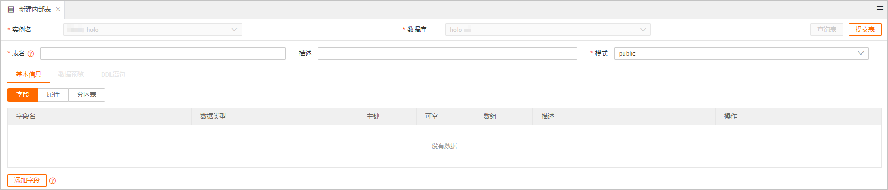

   **类别**

   **参数**

   **描述**

   实例名

   已登录的实例名称。

   数据库

   当前已登录实例的数据库名称。

   表名

   新建的Hologres内部表名称。

   基本属性

   描述

   新建的Hologres内部表描述。

   模式名称。

   模式

   您可以选择默认创建的**public**模式，也可以选择新建的模式名称。

   字段名

   表中每一列的标识。

   数据类型

   字段取值的类型。

   主键

   表中每条数据的唯一标识。

   字段

   可空

   字段是否可以设置为空。

   数组

   有序的元素序列。

   描述

   字段的描述信息。

   操作

   包括**删除**、**上移**和**下移**。

   包括**列存**和**行存**两种存储模式。

   存储模式

   默认为**列存**。

   如果数据在指定时间内未被修改，则系统将自动删除数据。

   生命周期（秒）

   默认生命周期为**永久**。

   表是否开启Binlog，详情请参见订阅Hologres Binlog。

   Binlog

   Binlog生命周期

   Binlog的生命周期，详情请参见订阅Hologres Binlog。默认生命周期为**永久**。

   属性

   分布列

   **distribution_key**，使用详情请参见上文。

   分段列

   **event_time_column** ，使用详情请参见上文。

   聚簇列

   **clustering_key**，使用详情请参见上文。

   字典编码列

   **dictionary_encoding_columns**，使用详情请参见上文。

   位图列

   **bitmap_columns**，使用详情请参见上文。

   分区表

   无

   选择分区字段。

4. 在页面右上角，单击**提交表**。提交之后，您可以在左侧对应模式下，刷新出新建的内部表。

5. （可选）表数据预览

   <ol type="i">

   <li>

   在**已登录实例**列表，双击目标内部表。

   </li>

   <li>

   进入表信息页签，单击**数据预览**，则可以预览表数据。

   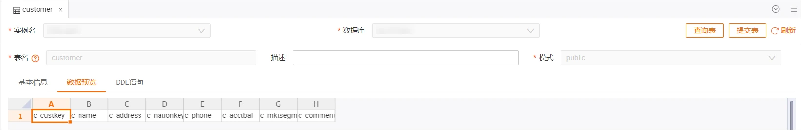

   </li>

   </ol>

6. （可选）DDL预览

   在目标表信息页签，单击**DDL语句**，则可以预览DDL语句。

   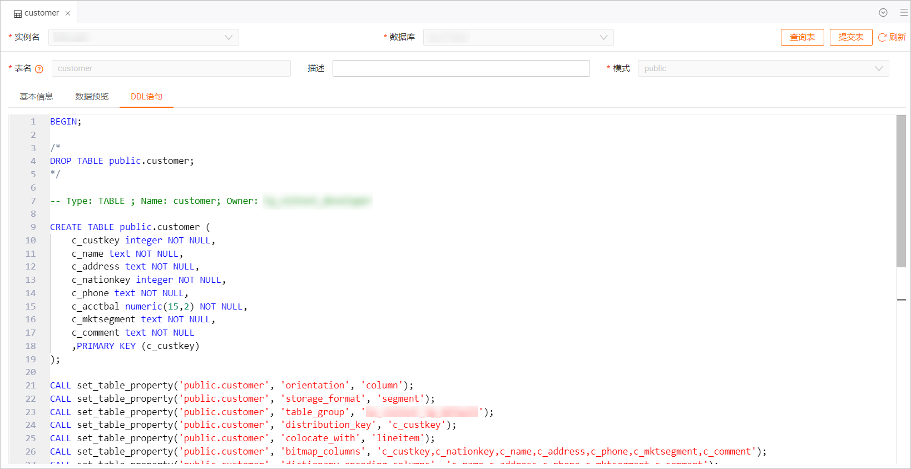

<a id="section-1-6-3-1-1"></a>

##### 1.6.3.1.1. 分布键Distribution Key

如果您的数据表经常需要进行GROUP BY、JOIN操作或为了避免数据倾斜，您可以在建表时设置分布键（Distribution Key），合适的分布键可以帮助数据均匀分布在所有计算节点上，显著提高计算和查询性能。本文为您介绍Hologres中为表设置Distribution Key。

**Distribution Key介绍**

在Hologres中，Distribution Key属性指定了表数据的分布策略，系统会保证Distribution Key相同的记录被分配到同一个Shard上。建表时设置语法如下：

```sql
BEGIN;
CREATE TABLE <table_name> (...);
call set_table_property('<table_name>', 'distribution_key', '[<columnName>[,...]]');
COMMIT;
```

参数说明如下：

| 参数 | 说明 |
| --- | --- |
| table_name | 设置分布键的表名称。 |
| columnName | 设置分布键的字段名称。 |

Distribution Key是非常重要的分布式概念，合理设置Distribution Key可以达到如下效果：

- 显著提高计算性能。

  不同的Shard可以进行并行计算，从而提高计算性能。

- 显著提高每秒查询率（QPS）。

  当您以Distribution Key作为过滤条件时，Hologres可以直接筛选出数据相关的Shard进行扫描。否则Hologres需要让所有的Shard参与计算，影响QPS。

- 显著提高Join性能。

  当两张表在同一个Table Group内，并且Join的字段是Distribution Key时，那么数据分布保证表A一个Shard内的数据和表B同一Shard内的数据对应，只需要直接在本节点Join本节点数据（Local Join）即可，可以显著提高执行效率。

**使用建议**

Distribution Key设置原则总结如下：

- Distribution Key尽量选择分布均匀的字段，否则容易因为数据倾斜导致负载倾斜，使得查询效率变低，排查数据倾斜请参见**监控与运维 > 查看Worker倾斜关系**章节。

- 选择 `Group By` 频繁的字段作为Distribution Key。

- Join场景中，设置Join字段为Distribution Key，实现Local Join，避免数据Shuffle。同时进行Join的表需要在同一个Table Group内。

- 不建议为一个表设置多个Distribution Key，建议设置的Distribution Key不超过两个字段。设置多字段为Distribution Key，查询时若没有全部命中，容易出现数据Shuffle。

**使用限制**

- 设置Distribution Key需要在建表时设置，建表后如需修改Distribution Key需要重新建表并导入数据。

- 支持单列或者多列设置为Distribution Key，指定列时如设置单列，命令语句中不要保留多余空格；如设置多个列，则以半角逗号（,）分隔，同样不要保留多余空格。指定多列为Distribution Key时，列的顺序不影响数据的布局和查询性能。

- 不支持将Float、Double、Numeric、Array、Json及其他复杂数据类型的字段设为Distribution Key。

- 表设置了主键（PK）时，Distribution Key必须为PK或者PK中的部分字段（不能为空，即不指定任何列），因为要求同一记录的数据只能属于一个Shard。如果没有额外指定Distribution Key，默认将PK设置为Distribution Key。

- 表未设置PK时，Distribution Key没有限制，可以为空（不指定任何列）。如果为空，即随机Shuffle，数据随机分布到不同Shard上。示例用法如下：

  ```text
  CALL SET_TABLE_PROPERTY('<tablename>', 'distribution_key', '');
  ```

- Distribution Key列的值中有 `null` 时，当作 `“”` （空串）看待，即Distribution Key为空。

**技术原理**

Distribution Key指定了表的分布策略。根据实际的业务场景，存在以下情形。

**设置Distribution Key**

为表设置了Distribution Key之后，数据会根据Distribution Key被分配到各个Shard上，算法为 `Hash(distribution_key)%shard_count` ，结果为对应的Shard。系统会保证Distribution Key相同的记录会被分配到同一个Shard上，示例如下。

```sql
--设置a列为distribution key，系统会对a列的值做hash操作，再取模，即hash(a)%shard_count = shard_id，结果相同的⼀组数据分布在同⼀个Shard内
begin;
create table tbl (
a int not null,
b text not null
);
call set_table_property('tbl', 'distribution_key', 'a');
commit;

--设置a、b两列为distribution key，系统对a,b两个列的值做hash操作，再取模，即hash(a,b)%shard_count = shard_id，结果相同的⼀组数据分布在同⼀个Shard内
begin;
create table tbl (
  a int not null,
  b text not null
);
call set_table_property('tbl', 'distribution_key', 'a,b');
commit;
                            
```

数据分布示意图如下：

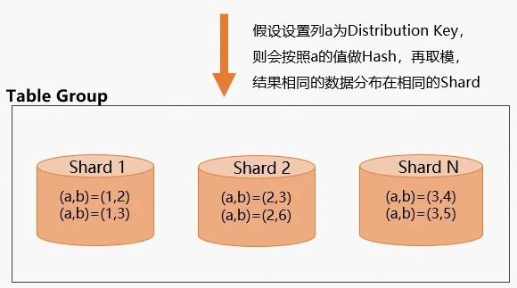

但在设置Distribution Key时，需要关注设置为Distribution Key字段的数据最好是分布均匀的。Hologres的Shard数和Worker节点数有一定的关联关系，详情请参见基本概念。如果设置了数据分布不均匀的字段作为Distribution Key之后，那么数据会集中分布在某些Shard上，导致大部分的计算集中到部分Worker上，出现长尾效应，查询效率降低。排查以及处理数据的倾斜情况详情请参见《用户指南》的**监控与运维 > 查看Worker倾斜关系**章节。

**不设置Distribution Key**

不设置Distribution Key时，数据将会被随机分布在各个Shard，相同的数据可能会在相同Shard，也可能在不同的Shard，示例如下。

```sql
--不设置distribution key
begin;
create table tbl (
a int not null,
b text not null
);
commit;
```

数据分布示意图如下：

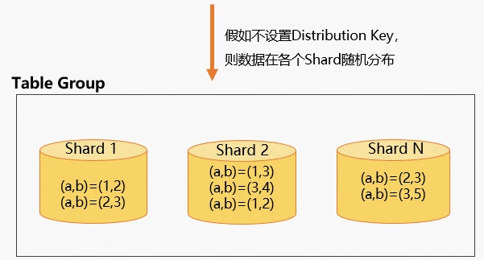

**Group By聚合场景设置Distribution Key**

为表设置了Distribution Key，那么相同的数据就分布在相同的Shard上，同时对于Group By聚合场景，数据在计算时按照设置的Distribution Key重新分布，因此可以将Group By频繁的字段设置为Distribution Key，这样数据在Shard内就已经聚合，减少数据在Shard间的重分配，提高查询性能，示例如下。

```sql
begin;
create table agg_tbl (
a int not null,
b int not null
);
call set_table_property('agg_tbl', 'distribution_key', 'a');
commit;

--示例查询，对a列做聚合查询
select a,sum(b) from agg_tbl group by a;
```

通过查看执行计划（explain SQL），如下所示执行计划结果中没有 `redistribution` 算子，说明数据没有重分布。

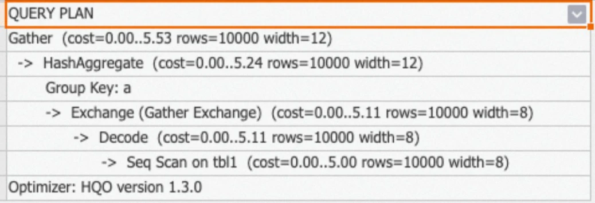

**两表关联场景设置Distribution Key**

- 两表Join字段设置为Distribution Key

  在两表关联（Join）的场景中，如果两表的Join字段分别在对应表里都设置为Distribution Key，那么Join字段相同的数据就会分布在相同的Shard，这样就能实现Local Join，从而实现查询加速的效果，示例如下。

  - 建表DDL。

    ```sql
    --tbl1按照a列分布，tbl2按照c列分布，当tbl1与tbl2以a=c关联条件join时，对应的数据分布在同⼀个Shard内，这种查询可以实现Local Join的加速效果
    begin;
    create table tbl1(
    a int not null,
    b text not null
    );
    call set_table_property('tbl1', 'distribution_key', 'a');

    create table tbl2(
    c int not null,
    d text not null
    );
    call set_table_property('tbl2', 'distribution_key', 'c');
    commit;
                                        
    ```

  - 查询语句。

    ```sql
    select * from tbl1  join tbl2 on tbl1.a=tbl2.c;
    ```

  数据分布示意图如下。

  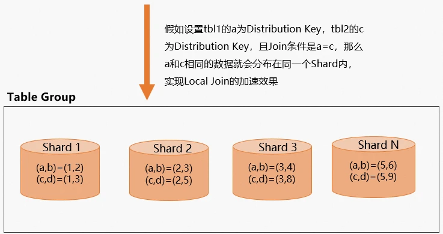

  通过查看执行计划（explain SQL），如下所示执行计划结果中没有 `redistribution` 算子，说明数据没有重分布。

  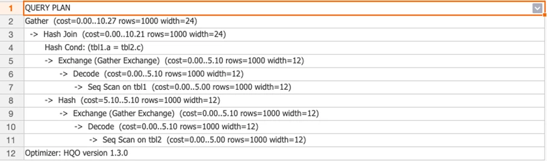

- 两表Join字段未都设置为Distribution Key

  在两表关联（Join）的场景，如果两表Join字段在对应表里未都设置为Distribution Key，那么查询时数据就会在各个Shard Shuffle（执行计划会根据关联的两个表大小，来判断是进行Shuffle还是Broadcast）。如下示例，设置 `tbl1` 的 `a` 字段为Distribution Key， `tbl2` 的 `d` 字段为Distribution Key，而Join条件是 `a=c` ，那么 `c` 字段就会在每个Shard Shuffle一遍，从而导致查询效率变低。

  - 建表DDL。

    ```sql
    begin;
    create table tbl1(
    a int not null,
    b text not null
    );
    call set_table_property('tbl1', 'distribution_key', 'a');
    create table tbl2(
    c int not null,
    d text not null
    );
    call set_table_property('tbl2', 'distribution_key', 'd');
    commit;
    ```

  - 查询语句。

    ```sql
    select * from tbl1  join tbl2 on tbl1.a=tbl2.c;
    ```

  数据分布示意图如下。

  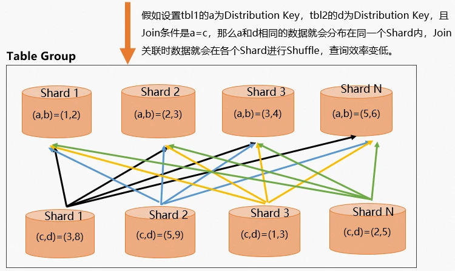

  通过查看执行计划（explain SQL），如下所示执行计划中有 `redistribution` 算子，说明数据进行了重分布，表明Distribution Key设置的不合理，需要重新设置。

  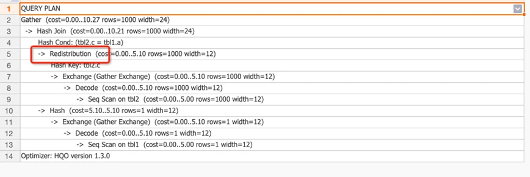

**多表关联场景设置Distribution Key**

多表关联的场景比较复杂，可以遵循如下原则：

- 每个表的Join字段都相同，那么将Join字段都设置为Distribution Key。

- 每个表的Join字段不同，优先考虑大表间的Join，将大表的Join字段设置为Distribution Key。

通过以下几种情况举例说明（本文中以三个表Join为例说明，大于三个表的Join情况可以参考本示例）。

- 三个表的Join字段相同

  在三个表Join的场景中，三个表的Join字段都相同，那么这种情况是最简单的，可以直接将三个表的Join字段都设置为Distribution Key，实现Local Join的能力。

  支持的建表语法：

  ```sql
  begin;
  create table join_tbl1(
  a int not null,
  b text not null
  );
  call set_table_property('join_tbl1', 'distribution_key', 'a');

  create table join_tbl2(
  a int not null,
  d text not null,
  e text not null
  );
  call set_table_property('join_tbl2', 'distribution_key', 'a');

  create table join_tbl3(
  a int not null,
  e text not null,
  f text not null,
  g text not null
  );
  call set_table_property('join_tbl3', 'distribution_key', 'a');
  commit;

  --3表join查询
  SELECT * FROM join_tbl1
  INNER JOIN join_tbl2 ON join_tbl2.a = join_tbl1.a
  INNER JOIN join_tbl3 ON join_tbl2.a = join_tbl3.a;
  ```

  通过查看执行计划（explain SQL），如下所示执行计划中：

  - 没有 `redistribution` 算子，说明数据没有重分布，实现了Local Join。

  - `exchange` 算子代表文件级别聚合到Shard级别聚合，这样就只需要对应Shard的数据，提升数据的查询效率。

  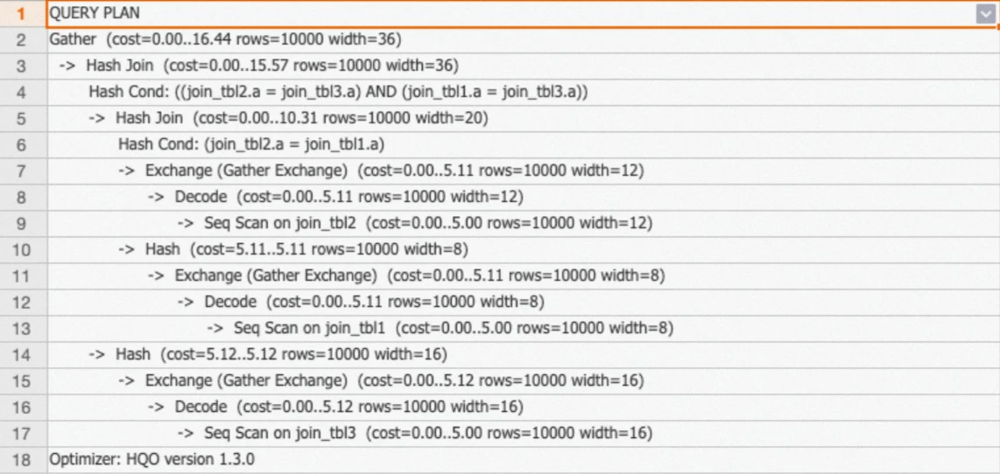

- 三个表的Join字段不同

  在实际业务中，多表关联时会有Join字段不相同的场景，这个时候可以根据如下原则来设置Distribution Key：

  - 核心优化原则是优先考虑大表间的Join，设置大表的Join字段为Distribution Key；小表因其数据量较少，无需过多考虑。

  - 表数据量大致相同的情况，可以设置Group By频繁的Join字段为Distribution Key。

  如下示例，有三个表相互Join，Join的字段不完全一样，这个时候选择大表的Join字段为Distribution Key， `join_tbl_1` 这个表数据量有一千万条， `join_tbl_2` 和 `join_tbl_3` 分别有一百万条，以 `join_tbl_1` 为主要优化对象。

  支持的建表语法：

  ```sql
  begin;
  --join_tbl_1为1kw数据量
  create table join_tbl_1(
  a int not null,
  b text not null
  );
  call set_table_property('join_tbl_1', 'distribution_key', 'a');

  --join_tbl_2为100w数据量
  create table join_tbl_2(
  a int not null,
  d text not null,
  e text not null
  );
  call set_table_property('join_tbl_2', 'distribution_key', 'a');

  --join_tbl_3为100w数据量
  create table join_tbl_3(
  a int not null,
  e text not null,
  f text not null,
  g text not null
  );
  --call set_table_property('join_tbl_3', 'distribution_key', 'a');
  commit;

  --join key不相同时，选择⼤表的join key为distribution key。
  SELECT * FROM join_tbl_1
  INNER JOIN join_tbl_2 ON join_tbl_2.a = join_tbl_1.a
  INNER JOIN join_tbl_3 ON join_tbl_2.d = join_tbl_3.f;
  ```

  通过查看执行计划（explain SQL），如下所示执行计划表明：

  - 在 `join_tbl_2` 和 `join_tbl_3` 表之间有 `redistribution` 算子，因为 `join_tbl_3` 是小表，Join字段与Distribution Key不一致，所以数据进行了重分布。

  - `join_tbl_1` 和 `join_tbl_2` 表之间没有 `redistribution` 算子，因为两表将Join字段都设置为Distribution Key，因此数据不会重分布。

  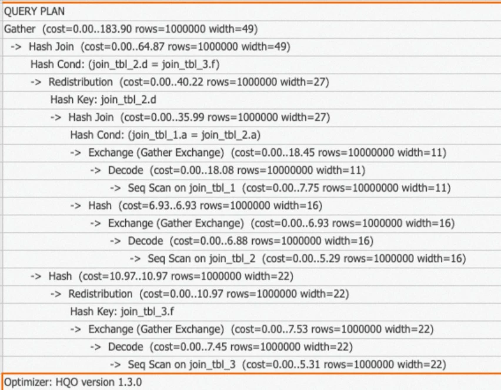

**使用示例**

支持的建表语法：

```sql
--设置⼀个distribution key
begin;
create table tbl (a int not null, b text not null);
call set_table_property('tbl', 'distribution_key', 'a');
commit;

--设置多个distribution key
begin;
create table tbl (a int not null, b text not null);
call set_table_property('tbl', 'distribution_key', 'a,b');
commit;

--join场景，设置join key为distribution key
begin;
create table tbl1(a int not null, b text not null);
call set_table_property('tbl1', 'distribution_key', 'a');
create table tbl2(c int not null, d text not null);
call set_table_property('tbl2', 'distribution_key', 'c');
commit;

select b, count(*) from tbl1 join tbl2 on tbl1.a = tbl2.c group by b;
```

<a id="section-1-6-3-2"></a>

#### 1.6.3.2. CREATE TABLE AS

Hologres从V1.3.21版本开始，支持使用CREATE TABLE AS语句创建表，复制表结构的同时也可以选择复制数据。本文为您介绍在Hologres中CREATE TABLE AS的用法。

**背景信息**

CREATE TABLE AS的功能为：创建一个与源表结构或者查询Query结果相同的新表，同时支持自动同步源表数据，但不会复制表属性。

CREATE TABLE AS与CREATE TABLE LIKE语法的区别如下，您可以根据实际业务场景选择合适的语法。

| 对比项 | CREATE TABLE AS | CREATE TABLE LIKE（函数） |
| --- | --- | --- |
| 复制表结构（Schema和数据类型） | 支持 | 支持 |
| 复制表属性（可空、默认值、索引、主键或注释） | 不支持 | 有限支持 |
| 复制源表数据 | 支持 | 不支持 |
| 复制源表并同时手动设置新属性（索引、主键等） | 有限支持，其中主键不支持 | 有限支持，其中主键不支持 |
| 复制分区表结构为非分区表 | 支持 | 支持 |
| 复制成分区表 | 不支持 | 有限支持（通过<code> partition_clause </code>手动创建） |

**使用限制**

- 仅Hologres V1.3.21及以上版本支持 `CREATE TABLE AS` 语句，若您的实例是V1.3.21以下版本，请您升级实例。

- `CREATE TABLE AS` 语句支持复制表结构，不能复制表属性（主键，索引等）。

- `CREATE TABLE AS` 语句支持创建新表时自动同步源表数据，但不保证数据导入的原子性。

- 使用 `CREATE TABLE AS` 语句时，如果源表中包含VARCHR、BPCHAR、NUMERIC（DECIMAL）、BIT、VARBIT类型的列，那么必须手动在SQL语句中显式指定精度，否则会提示报错。

- 使用 `CREATE TABLE AS` 语句时，如果源表中包含INTERVAL、TIME、TIMETZ、TIMESTAMP、TIMESTAMPTZ的列，那么不可以对这些列指定精度，否则会提示报错。

- `CREATE TABLE AS` 语句支持从分区主表或分区子表创建新的非分区表，只能复制表结构并同步数据（从分区主表复制，会同步所有子表的数据），不支持复制分区结构（分区键约束、继承关系等）成为一张分区表。

- `CREATE TABLE AS` 语句支持复制列COMMENT（注释），支持复制Binlog属性，不支持复制表COMMENT。

**命令语法**

Hologres中 `CREATE TABLE AS` 的命令语法如下。

```sql
--从⼀张源表复制⼀张新表
CREATE TABLE [ IF NOT EXISTS ] <new_table_name> AS TABLE <src_table_name> [ WITH [ NO ] DATA ]

--从select query复制⼀张新表
CREATE TABLE [ IF NOT EXISTS ] <new_table_name> AS <select_query> [ WITH [ NO ] DATA ]
```

**参数说明**

<table>
  <tr>
    <th width="193">参数</th>
    <th>说明</th>
  </tr>
  <tr>
    <td>new_table_name</td>
    <td>创建表的表名称（不能创建外部表），只支持固定字符串，不支持字符拼接或函数生成。</td>
  </tr>
  <tr>
    <td>[ IF NOT EXISTS ]</td>
    <td>判断新创建的表是否已存在，若存在则跳过。</td>
  </tr>
  <tr>
    <td>src_table_name</td>
    <td>源表名称，即要复制的表名称。</td>
  </tr>
  <tr>
    <td>select_query</td>
    <td>查询的SQL语句串，详情请参见SELECT。</td>
  </tr>
  <tr>
    <td>[ WITH [ NO ] DATA ]</td>
    <td>指定是否在创建表时自动同步源表数据，含义如下。<br>• <code> WITH DATA </code>：自动同步数据<br>• <code> WITH NO DATA </code>：不自动同步数据。如果不指定，默认为<code> WITH DATA </code>。</td>
  </tr>
</table>

**使用示例**

- 将非分区表复制成一张新的非分区表。

  - 准备一张源表和数据。

    ```sql
    BEGIN;
    CREATE TABLE public.src_table (
     "a" int8 NOT NULL,
     "b" text NOT NULL,
    PRIMARY KEY (a)
    );
    CALL SET_TABLE_PROPERTY('public.src_table', 'orientation', 'column');
    CALL SET_TABLE_PROPERTY('public.src_table', 'bitmap_columns', 'b');
    CALL SET_TABLE_PROPERTY('public.src_table', 'dictionary_encoding_columns', 'b:auto');
    CALL SET_TABLE_PROPERTY('public.src_table', 'time_to_live_in_seconds', '3153600000');
    CALL SET_TABLE_PROPERTY('public.src_table', 'distribution_key', 'a');
    CALL SET_TABLE_PROPERTY('public.src_table', 'storage_format', 'segment');
    COMMIT;
    INSERT INTO public.src_table VALUES (1,'qaz'),(2,'wsx');
    ```

  - 场景1：从源表创建新表，并自动同步数据。

    ```sql
    CREATE TABLE public.new_table AS TABLE public.src_table;
    ```

    执行完成后，查看新表的数据：

    ```sql
    SELECT * FROM public.new_table;

    -------
    a | b
    --|-----
    1 | qaz
    2 | wsx
    ```

    查看新表的DDL，可以看到，如果源表有主键、not null属性，复制出的新表将不会继承：

    ```sql
    --新表的DDL如下：
    select hg_dump_script('public.new_table');
    -------------------------------------------
    BEGIN;
    CREATE TABLE public.new_table (
        a int,
        b text
    );
    CALL set_table_property('public.new_table', 'orientation', 'column');
    CALL set_table_property('public.new_table', 'storage_format', 'orc');
    CALL set_table_property('public.new_table', 'bitmap_columns', 'b');
    CALL set_table_property('public.new_table', 'dictionary_encoding_columns', 'b:auto');
    CALL set_table_property('public.new_table', 'time_to_live_in_seconds', '3153600000');
    COMMENT ON TABLE public.new_table IS NULL;
    END;
    ```

  - 场景2：从源表创建新表，并自动同步数据。若表已经存在则跳过，数据也不会同步。

    ```sql
    CREATE TABLE IF NOT EXISTS public.new_table AS TABLE public.src_table;

    NOTICE: relation "new_table" already exists, skipping
    ```

  - 场景3：仅复制表结构，不同步数据。

    ```sql
    CREATE TABLE public.new_table AS TABLE public.src_table WITH NO DATA;
    ```

  - 场景4：复制新表并同步 `select` 查询的数据。

    ```sql
    CREATE TABLE public.new_table_2 AS SELECT * FROM public.src_table WHERE a = 1 ;
    ```

- 从分区父表或者子表复制出一张新的非分区表，分区表只能复制成非分区表。

  - 准备一张分区表、分区子表以及表数据。

    ```sql
    BEGIN;
    CREATE TABLE public.src_table_partitioned (
     "a" int NOT NULL,
     "b" text ,
    PRIMARY KEY (a)
    ) PARTITION BY LIST(a);
    CREATE TABLE public.src_table_child1 PARTITION OF public.src_table_partitioned FOR VALUES IN (1);
    CREATE TABLE public.src_table_child2 PARTITION OF public.src_table_partitioned FOR VALUES IN (2);
    CREATE TABLE public.src_table_child3 PARTITION OF public.src_table_partitioned FOR VALUES IN (3);
    COMMIT;

    INSERT INTO src_table_child1 VALUES (1,'aaa');
    INSERT INTO src_table_child2 VALUES (2,'bbb');
    INSERT INTO src_table_child3 VALUES (3,'ccc');
    ```

  - 场景1：将分区父表复制成一张非分区表，并同步所有分区的数据。

    ```sql
    CREATE TABLE public.new_table_2 AS TABLE public.src_table_partitioned;
    ```

    查询新表，将会有所有分区的数据，且新表是非分区表：

    ```sql
    SELECT * FROM public.new_table_2;
    ----------------------------------
    a | b
    --|-----
    2 | bbb
    1 | aaa
    3 | ccc
    ```

  - 场景2：复制某个分区子表及其数据到新的非分区表。

    ```sql
    --从分区⼦表创建新表，并⾃动同步数据，新表只会同步这⼀张⼦表的数据
    CREATE TABLE public.new_table_3 AS TABLE public.src_table_child1;
    ```

- 从Select Query的结果复制一张新表，同时设置新表属性。

  ```sql
  --创建源表
  BEGIN;
  CREATE TABLE public.src_table (
   "a" int8 NOT NULL,
   "b" text NOT NULL,
  PRIMARY KEY (a)
  );
  CALL SET_TABLE_PROPERTY('public.src_table', 'orientation', 'column');
  COMMIT;

  --从select query创建新表，并设置新表属性，⾃动同步数据
  BEGIN;
  CREATE TABLE public.new_table AS select * from public.src_table;
  CALL SET_TABLE_PROPERTY('public.new_table', 'bitmap_columns', 'b');
  CALL SET_TABLE_PROPERTY('public.new_table', 'dictionary_encoding_columns', 'b:auto');
  CALL SET_TABLE_PROPERTY('public.new_table', 'time_to_live_in_seconds', '3153600');
  CALL SET_TABLE_PROPERTY('public.new_table', 'distribution_key', 'a');
  COMMIT;
  ```

<a id="section-1-6-3-3"></a>

#### 1.6.3.3. CREATE TABLE LIKE

CREATE TABLE LIKE语句用于创建一个同Select Query结果相同的表。本文为您介绍CREATE TABLE LIKE的用法。

**使用限制**

- Hologres V0.9及以下版本， `CREATE TABLE LIKE` 语句仅支持复制表结构，不支持复制表属性（主键、索引等）。请在Hologres管理控制台的实例详情页查看当前版本。

- Hologres V0.10版本开始，支持 `CREATE TABLE LIKE` 语句复制表结构和表属性（主键、索引等）。但仅限于 `SELECT * FROM TABLE` 语法。通过执行以下命令可以复制表属性：

  ```text
  SET hg_experimental_enable_create_table_like_properties=true;
  ```

- 使用 `CREATE TABLE LIKE` 创建的表不会自动同步源表的数据。

- 查询语句中的每一个目标列都要有一个不重复的别名，否则建表语句就会生成同列名的语句导致执行报错。示例如下：

  ```text
  CALL hg_create_table_like('new_table', 'select *, 1 as c, ''a'' as c from src_table');
  ERROR:  column "c" specified more than once
  CONTEXT:  SQL statement "create table new_table (
  "a"     integer,
  "b"     text,
  "c"     integer,
  "c"     text
  );"
  PL/pgSQL function hg_create_table_like(text,text) line 22 at EXECUTE
  ```

- Hologres 2.0及以上版本的 `CREATE TABLE LIKE` 语句支持复制源表的列注释（COMMENT）和Binlog属性。从Hologres 3.0.33版本开始支持复制表COMMENT。

- `CREATE TABLE LIKE` 语句不支持复制表的动态分区属性。

**普通表**

1. **命令格式**

   在Hologres中，普通表 `CREATE TABLE LIKE` 的命令格式如下：

   ```text
   --复制⼀张普通表，但不能复制表属性
   CALL hg_create_table_like('new_table_name', 'select_query');

   --复制⼀张表并复制表属性
   SET hg_experimental_enable_create_table_like_properties=true;--开关参数，session级别
   CALL hg_create_table_like('new_table_name', 'select * from old_table_name');
   ```

   > **说明**
   >
   > 通过调用 `hg_create_table_like` ，系统会根据 `select_query` 结果的 `schema` 创建一个表名为 `new_table_name` 的表，但不会插入任何数据。

2. **参数说明**

   - `new_table_name` ：要创建表的表名（不支持创建外部表），只支持固定字符串，不支持字符拼接或函数生成等。

   - `select_query` ：查询的SQL语句串。当SQL中的内容完全为 `select * from tablename` 时， `CREATE TABLE LIKE` 会自动同步创建原表的所有属性，包括pk、索引等。如果SQL语句中有较多单引号，可以将$$符号置于SQL语句前后，通过 `$$query_sql$$` 改写（推荐使用该用法，操作更简便）自动实现单引号转义，用法如下：

     ```text
     CALL HG_CREATE_TABLE_LIKE ('table_name', $$query_sql$$ [, 'partition_clause'])
     ```

   - old_table_name：需要复制的原表名。

3. **使用示例**

   如在Hologres中存在如下源表：

   ```sql
   BEGIN;
   CREATE TABLE public.src_table (
    "a" int8 NOT NULL,
    "b" text NOT NULL,
   PRIMARY KEY (a)
   );
   CALL SET_TABLE_PROPERTY('public.src_table', 'orientation', 'column');
   CALL SET_TABLE_PROPERTY('public.src_table', 'bitmap_columns', 'b');
   CALL SET_TABLE_PROPERTY('public.src_table', 'dictionary_encoding_columns', 'b:auto');
   CALL SET_TABLE_PROPERTY('public.src_table', 'time_to_live_in_seconds', '3153600000');
   CALL SET_TABLE_PROPERTY('public.src_table', 'distribution_key', 'a');
   CALL SET_TABLE_PROPERTY('public.src_table', 'storage_format', 'segment');
   COMMIT;
   ```

   在Hologres中 `CREATE TABLE LIKE` 的示例用法如下：

   - 创建一个同源表结构和属性相同的表

     ```text
     --复制表及属性
     SET hg_experimental_enable_create_table_like_properties=true;
     CALL hg_create_table_like('new_table', 'select * from src_table');
     ```

   - 创建一个在源表的基础上再增加字段的表

     ```text
     --新增⼀个同b⼀样的字段c
     CALL hg_create_table_like('holo_table_1', $$SELECT *, "b" AS c FROM src_table$$);
     ```

**分区表**

1. **命令格式**

   在Hologres中，分区表的 `CREATE TABLE LIKE` 的命令格式如下：

   ```text
   --复制⼀张分区表，但不能复制表属性
   CALL hg_create_table_like('new_table_name', 'select_query', 'partition_clause');
   ```

2. **参数说明**

   - new_table_name：要创建表的表名（不支持创建外部表），只支持固定字符串，不支持字符拼接或函数生成等。

   - select_query：查询的SQL语句串。当SQL中的内容完全为 `select * from tablename` 时， `CREATE TABLE LIKE` 会自动同步创建原表的所有属性，包括pk、索引等。如果SQL语句中有较多单引号，可以将$$符号置于SQL语句前后，通过 `$$query_sql$$` 改写（推荐使用该用法，操作更简便）自动实现单引号转义，用法如下：

     ```text
     CALL HG_CREATE_TABLE_LIKE ('table_name', $$query_sql$$ [, 'partition_clause'])
     ```

   - partition_clause：分区相关的语法定义。用于指定分区键，不会自动创建分区子表，需要手动建分区子表。

3. **使用示例**

   如在Hologres中存在如下源表：

   ```sql
   BEGIN;
   CREATE TABLE public.src_table (
    "a" int8 NOT NULL,
    "b" text NOT NULL,
   PRIMARY KEY (a)
   );
   CALL SET_TABLE_PROPERTY('public.src_table', 'orientation', 'column');
   CALL SET_TABLE_PROPERTY('public.src_table', 'bitmap_columns', 'b');
   CALL SET_TABLE_PROPERTY('public.src_table', 'dictionary_encoding_columns', 'b:auto');
   CALL SET_TABLE_PROPERTY('public.src_table', 'time_to_live_in_seconds', '3153600000');
   CALL SET_TABLE_PROPERTY('public.src_table', 'distribution_key', 'a');
   CALL SET_TABLE_PROPERTY('public.src_table', 'storage_format', 'segment');
   COMMIT;
   ```

   在Hologres中使用 `CREATE TABLE LIKE` 创建一张分区表示例如下：

   - 创建一个分区表

     ```text
     --新增⼀个字段ds，并将表设置为以ds为分区的分区表
     CALL hg_create_table_like('new_table', $$SELECT *, "b" AS ds FROM src_table$$, 'partition by list(ds)');
     ```

   - 给对应的分区表创建分区子表

     ```sql
     CREATE TABLE new_table_child_20201213 PARTITION OF new_table FOR VALUES IN('20201213');--以20201213为分区值
     CREATE TABLE new_table_child_20201214 PARTITION OF new_table FOR VALUES IN('20201214');--以20201214为分区值
     ```

**HoloWeb可视化复制表**

HoloWeb提供可视化复制表功能，无需写SQL命令就能复制表，步骤如下。

1. 进入**HoloWeb**页面，详情请参见<strong>《Hologres开发指南》</strong>的**连接开发工具 > HoloWeb**章节。

2. 在**HoloWeb**页面顶部菜单栏，单击**元数据管理**。

3. 在**元数据管理**页面左侧的**已登录实例**列表，鼠标右击要复制的表，选择**复制表结构**。

4. 在**复制表结构**页签，配置如下参数。

   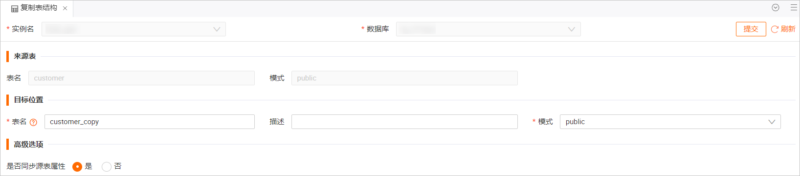

   <table>
     <tr>
       <th>类别</th>
       <th>参数</th>
       <th>说明</th>
     </tr>
     <tr>
       <td rowspan="3">目标位置</td>
       <td>表名</td>
       <td>目标表的表名称，可自定义命名。默认为：源表_copy。</td>
     </tr>
     <tr>
       <td>描述</td>
       <td>对目标表的描述，可选择是否配置。</td>
     </tr>
     <tr>
       <td>模式</td>
       <td>目标表所在的SCHEMA，默认为：public。</td>
     </tr>
     <tr>
       <td>高级选项</td>
       <td>是否同步源表属性</td>
       <td>选择目标表是否同步源表的属性。<br>说明仅Hologres V0.10及以上版本实例支持同步源表属性，如果您的实例低于V0.10版本，请选择<strong>否</strong>或升级实例。</td>
     </tr>
   </table>

5. 单击右上角**提交**，完成表复制。

<a id="section-1-6-3-4"></a>

#### 1.6.3.4. ALTER TABLE

ALTER TABLE语句用于修改表，其中对分区父表的修改会自动应用到分区子表中。本文为您介绍ALTER TABLE的用法。

**使用限制**

Hologres当前对修改表的支持情况如下：

- 目前支持对表进行重命名、增加列和修改表数据生存时间的操作。

- 支持修改字段的默认值、dictionary_encoding_columns和bitmap_columns属性。

- 目前不支持修改数据类型。

**注意事项**

进行修改dictionary_encoding_columns、bitmap_columns、time_to_live_in_seconds等表属性操作时，可能会触发后台异步执行Compaction，占用一定的CPU资源，同时实例的存储量可能会出现先上升后回落的情况。

**重命名**

ALTER TABLE语句可以对表进行重命名，如果目标表不存在，或者重命名目标表为已存在的表名称，系统均会返回异常。

> **说明**
>
> 目前不支持跨Schema对表进行重命名操作。

- 使用语法

  ```sql
  --内部表重命名
  ALTER TABLE [schema_name.]<table_name> RENAME TO <new_table_name>;

  --外部表重命名
  ALTER FOREIGN TABLE [schema_name.]<foreign_table_name> RENAME TO <new_foreign_table_name>;
  ```

- 使用示例

  ```sql
  --将表holo_test重命名为holo_test_1
  ALTER TABLE public.holo_test RENAME TO holo_test_1 ;

  --将外部表foreign_holo_test重命名为foreign_holo_test_1
  ALTER FOREIGN TABLE public.foreign_holo_test RENAME TO foreign_holo_test_1;
  ```

**增加列**

ALTER TABLE语句可以给表增加列，仅支持在表的最后一列之后增加新的列。

- 使用语法

  ```sql
  --新增⼀列
  ALTER TABLE IF EXISTS [schema_name.]<table_name> ADD COLUMN <new_column> <data_type>;

  --新增多列
  ALTER TABLE IF EXISTS [schema_name.]<table_name> ADD COLUMN <new_column_1> <data_type>, ADD COLUMN <new_column_2> <data_type>; 
  ```

- 使用示例

  ```sql
  --在表holo_test中增加id列
  ALTER TABLE IF EXISTS public.holo_test ADD COLUMN id int;
  ```

**删除列（Beta）**

Hologres从V2.0版本开始，支持删除列，具体语法如下。

- 使用限制

  - 仅适用于Hologres V2.0及以上版本，如果您的实例是V2.0以下版本，请升级实例。

  - 若您的表是分区表，仅能删除分区父表的列，无法直接删除分区子表的列。对于分区子表，在父表的列删除后自动删除。此操作开销较高，建议在业务低峰期执行。

  - 仅只有表Owner才能删除列，若您的数据库使用的是简单权限模型，需要设置为developer用户组权限。

  - 设置了Primary Key、Distribution Key、Clustering Key、Event_time_column属性的列无法删除。

  - 不支持删除外部表的列。

  - 删除JSONB相关列后，相关JSONB索引会一并删除。

  - 删除proxima_vector列时，需要指定 `cascade` 参数。

  - 删除Serial列时，如果Sequence是基于这一列创建的，则Sequence会一并被删除。

  - 如果表创建了物化视图，不支持删除源表，也不支持删除源表中被物化视图引用的列。

- 使用语法

  > **重要**
  >
  > Hologres V2.0以下版本不支持删除列。

  ```sql
  set hg_experimental_enable_drop_column = on; --通过该GUC打开功能
  ALTER TABLE IF EXISTS <table_name> DROP COLUMN  [ IF EXISTS ] <column> [ RESTRICT | CASCADE ]
  ```

- 使用示例

  ```sql
  --建表
  begin;
  CREATE TABLE tbl (
   "id" bigint NOT NULL,
   "name" text NOT NULL,
   "age" bigint,
   "class" text NOT NULL,
   "reg_timestamp" timestamptz NOT NULL,
  PRIMARY KEY (id,age)
  );
  call set_table_property('tbl', 'orientation', 'column');
  call set_table_property('tbl', 'distribution_key', 'id');
  call set_table_property('tbl', 'clustering_key', 'age');
  call set_table_property('tbl', 'event_time_column', 'reg_timestamp');
  call set_table_property('tbl', 'bitmap_columns', 'name,class');
  call set_table_property('tbl', 'dictionary_encoding_columns', 'class:auto');
  commit;

  --删除指定列
  set hg_experimental_enable_drop_column = on;--Beta阶段，需要通过GUC参数打开这个功能
  ALTER TABLE IF EXISTS tbl DROP COLUMN name;
  ```

  查询表：

  ```text
  SELECT*FROMtbl;

  --返回结果
  id    age    class    reg_timestamp
  ----+-----+---------+--------------
                      
  ```

**重命名列**

Hologres从V1.1版本开始，支持重命名列，具体语法如下。

> **说明**
>
> - 如果您的实例是V1.1以下版本，请您升级实例。
>
> - 若您的表是分区表，由于存在分区子表和父表数据结构一致性的要求，仅支持重命名分区父表的列，不支持单独重命名某个分区子表的列。重命名分区父表的列，所有子表自动生效。
>
> - 不支持同时重命名多个表的列名称。
>
> - 仅只有表Owner才能重命名列，若您的数据库使用的是简单权限模型，需要设置为developer用户组权限。

- 使用语法

  ```sql
  ALTER TABLE [schema_name.]<table_name> RENAME COLUMN <old_column_name> TO <new_column_name>;
  ```

- 使用示例

  ```sql
  --将表holo_test的id列重命名为name
  ALTER TABLE public.holo_test RENAME COLUMN id TO name; 
  ```

**修改默认值**

ALTER TABLE语句支持修改默认值设置（常量或常量表达式），该默认值仅对设置之后新写入/更新数据有效，不会更新表中已有数据的默认值。当前仅Hologres V0.9.23及以上版本支持修改默认值。具体修改方式说明如下：

- 使用语法

  ```sql
  --修改表字段的默认值
  ALTER TABLE [schema_name.]<table_name> ALTER COLUMN <column> SET DEFAULT <expression>;

  --删除表字段的默认值
  ALTER TABLE [schema_name.]<table_name> ALTER COLUMN <column> DROP DEFAULT;
  ```

- 使用示例

  ```sql
  --修改表holo_test中id列的默认值为0
  ALTER TABLE holo_test ALTER COLUMN id SET DEFAULT 0;

  --删除表holo_test中id列的默认值
  ALTER TABLE holo_test ALTER COLUMN id DROP DEFAULT;
  ```

**修改表属性**

Hologres支持通过执行语句修改参数，达到修改表属性的目的。具体修改方式说明如下：

- 修改**dictionary_encoding_columns**字典编码列。修改Dictionary Encoding设置，会引起数据文件重新编码存储，会在一段时间内消耗一部分CPU和内存资源，建议在业务低峰期执行变更。

  - 使用语法

    ```text
    -- 修改dictionary_encoding_columns（所有版本）
    --修改全量
    CALL SET_TABLE_PROPERTY('[schema_name.]<table_name>', 'dictionary_encoding_columns', '[columnName{:[on|off|auto]}[,...]]');

    --修改增量，只修改call⾥⾯的指定字段，其余字段不变
    CALL UPDATE_TABLE_PROPERTY('[schema_name.]<table_name>', 'dictionary_encoding_columns', '[columnName{:[on|off|auto]}[,...]]');
    ```

    > **重要**
    >
    > Hologres V2.0版本起，针对UPDATE_TABLE_PROPERTY语法进行了优化，运行如下语句时，表的 `dictionary_encoding_columns` 属性保持不变。Hologres V2.0以前版本则是会清空表的 `dictionary_encoding_columns` 属性。
    >
    > ```text
    > CALL UPDATE_TABLE_PROPERTY('<table_name>','dictionary_encoding_columns','');
    > ```

  - 参数说明

    <table>
      <tr>
        <th width="120">参数</th>
        <th>说明</th>
      </tr>
      <tr>
        <td>table_name</td>
        <td>需要和待修改的表名大小写保持一致，可以携带Schema信息。</td>
      </tr>
      <tr>
        <td>on</td>
        <td>表示当前字段打开<strong>dictionary_encoding_columns</strong>。</td>
      </tr>
      <tr>
        <td>off</td>
        <td>表示当前字段关闭<strong>dictionary_encoding_columns</strong>。</td>
      </tr>
      <tr>
        <td>auto</td>
        <td>表示自动。如果是设置了auto，Hologres会根据所在列数值的重复程度自动选择是否进行<strong>dictionary_encoding_columns</strong>，值的重复度越高，字典编码的收益越大。在Hologres V0.8版本及更早版本中默认所有text列都会被设置为<strong>dictionary_encoding_columns</strong>，在Hologres V0.9版本及之后版本，会根据数据特征自动选择是否创建字典编码。</td>
      </tr>
    </table>

  - 使用示例

    - 对a列显示创建dictionary，b列自动选择是否创建dictionary，c、d两列不创建dictionary。

      ```sql
      CREATE TABLE dwd.holo_test (
       a text NOT NULL,
       b text NOT NULL,
       c text NOT NULL,
       d text
      );
      CALL UPDATE_TABLE_PROPERTY('dwd.holo_test','dictionary_encoding_columns','a:on,b:auto');
      ```

    - 对a列显式关闭dictionary，系统也会自动给b、c、d字段加上dictionary索引。

      ```sql
      CREATE TABLE dwd.holo_test (
       a text NOT NULL,
       b text NOT NULL,
       c text NOT NULL,
       d text
      );
      CALL SET_TABLE_PROPERTY('dwd.holo_test','dictionary_encoding_columns','a:off');
      ```

- 修改**bitmap_columns**比特编码列

  Hologres从V0.9版本开始支持通过执行以下语句修改**bitmap_columns**，无需再重新建表即可修改表属性。

  - 使用语法

    ```text
    -- 修改bitmap_columns（所有版本）
    --修改全量
    CALL SET_TABLE_PROPERTY('[schema_name.]<table_name>', 'bitmap_columns', '[columnName{:[on|off]}[,...]]');

    --修改增量，只修改call⾥⾯的指定字段，其余字段不变
    CALL UPDATE_TABLE_PROPERTY('[schema_name.]<table_name>', 'bitmap_columns', '[columnName{:[on|off]}[,...]]');
    ```

    > **重要**
    >
    > Hologres V2.0版本起，针对UPDATE_TABLE_PROPERTY语法进行了优化，运行如下语句时，表的 `bitmap_columns` 属性保持不变。Hologres V2.0以前版本则是会清空表的 `bitmap_columns` 属性。
    >
    > ```text
    > CALL UPDATE_TABLE_PROPERTY('<table_name>','bitmap_columns','');
    > ```

  - 参数说明

    | 参数 | 说明 |
    | --- | --- |
    | table_name | 需要和待修改的表名大小写保持一致，可以携带Schema信息。 |
    | on | 当前字段打开<strong>bitmap_columns</strong>。 |
    | off | 当前字段关闭<strong>bitmap_columns</strong>。 |

  - 使用示例

    - 对a列启动bitmap索引，对b、c、d不启动bitmap索引。

      ```sql
      CREATE TABLE dwd.holo_test (
       a text NOT NULL,
       b text NOT NULL,
       c text NOT NULL,
       d text
      );
      CALL UPDATE_TABLE_PROPERTY('dwd.holo_test','bitmap_columns','a:on');
      ```

    - 对b关闭bitmap索引，系统会自动给a、c、d创建bitmap索引。

      ```sql
      CREATE TABLE dwd.holo_test_1 (
       a text NOT NULL,
       b text NOT NULL,
       c text NOT NULL,
       d text
      );
      CALL SET_TABLE_PROPERTY('dwd.holo_test_1','bitmap_columns','b:off');
      ```

- 修改表数据的生存时间

  - 使用语法

    ```text
    call set_table_property('[schema_name.]<table_name>', 'time_to_live_in_seconds', '<non_negative_literal>');
    ```

  - 参数说明

    | 参数 | 说明 |
    | --- | --- |
    | time_to_live_in_seconds | 简称TTL，表数据的生存时间，单位为秒，必须是正整数。 |

    > **说明**
    >
    > 表数据生存时间是按照数据写入Hologres开始，超过该指定时间，表数据将会在某个时间内被删除，但并不是精准的时间。

  - 使用示例

    ```text
    call set_table_property('dwd.holo_test', 'time_to_live_in_seconds', '600');
    ```

**修改表所在Schema**

Hologres从 V1.3版本开始，支持修改表所在的Schema，例如将表从**schema1**移动至**schema2**，无须重新建表导数据，实现快速表路径切换。

- 使用语法

  ```sql
  ALTER TABLE [ IF EXISTS ] [<schema>.]<table_name>
      SET SCHEMA <new_schema>;
  ```

  **schema**为表所在的Schema名称；**table_name**为修改表的名称；**new_schema**为移动至新Schema的名称。

- 使用示例

  将表名称为**tb1**的表从**public**Schema移动至**testschema**Schema下。

  ```sql
  ALTER TABLE IF EXISTS public.tbl
      SET SCHEMA testschema;
  ```

**HoloWeb可视化修改表**

HoloWeb提供可视化编辑表功能，无需写SQL命令就能修改表字段和部分表属性，步骤如下。

1. 进入**HoloWeb**页面，详情请参见HoloWeb简介。

2. 在**HoloWeb**页面顶部菜单栏，单击**元数据管理**。

3. 在**元数据管理**页面左侧的**已登录实例**列表，双击要修改的目标表。

4. 在表的详情页面，可视化修改表的字段和部分表属性。

   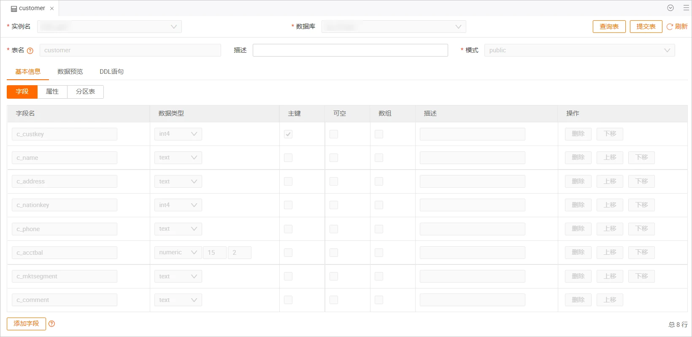

5. 单击右上角的**提交表**，完成表修改。

<a id="section-1-6-3-5"></a>

#### 1.6.3.5. DROP TABLE

DROP TABLE语句用于删除表。本文为您介绍DROP TABLE用法。

**语法**

```text
DROP TABLE [ IF EXISTS ] table_name [, ...];
```

> `DROP TABLE` 支持一次删除多个表。
>
> **说明**

参数说明如下表所示。

<table>
  <tr>
    <th width="120">参数</th>
    <th>描述</th>
  </tr>
  <tr>
    <td>IF EXISTS</td>
    <td>• 如果指定<code> IF EXISTS </code>，无论目标表是否存在，执行删除语句后系统都会返回成功。<br>• 如果不指定<code> IF EXISTS </code>，当目标表不存在时，系统会返回<code> ERROR: table </code> <code>"non_exist_table" does not exist </code>报错。</td>
  </tr>
  <tr>
    <td>table_name</td>
    <td>需要删除的表名称。</td>
  </tr>
</table>

**示例**

删除表的示例语句如下。

```text
DROP TABLE holo_test;
```

<a id="section-1-6-3-6"></a>

#### 1.6.3.6. 生成列（3.2内核）

生成列（Generated Columns）是由其他列计算得到的特殊的列，分为存储生成列（Stored Generated Columns）和虚拟生成列（Virtual Generated Columns）。Hologres支持存储生成列，即在数据写入或更新时自动进行计算，并实际占用存储空间。目前暂不支持虚拟生成列。本文为您介绍Hologres中存储生成列的使用方法。

**使用场景**

- 实现对所需字段的自动计算：消除手动处理计算逻辑的业务需求。

- 保障数据的一致性：避免人为操作或代码逻辑的错误，而导致数据不一致。

- 优化查询性能：对于高频查询的场景，存储生成列的读取等同于普通列。

- 简化业务逻辑：对于固定常用数据转换操作，能够降低SQL复杂度。

根据您的业务需要，合理使用生成列能显著提升开发效率并保障数据的可靠性。

**语法**

通过GENERATED ALWAYS AS子句声明生成列，并通过STORED关键字来指定存储生成列。

- 创建包含生成列的表。

  ```sql
  CREATE TABLE generated_col_t (
      [...,]
      col1 INT,
      col2 INT GENERATED ALWAYS AS (col1 + 1) STORED
  );
  ```

- 创建包含生成列的逻辑分区表，并将生成列作为分区键。

  ```sql
  CREATE TABLE generated_col_logical_part (
      a TEXT,
      b INT,
      ts TIMESTAMP NOT NULL,
      d TIMESTAMP GENERATED ALWAYS AS (date_trunc('day', ts)) STORED NOT NULL
  )
  LOGICAL PARTITION BY LIST(d);
  ```

**注意事项**

- CREATE TABLE时

  - 定义生成列时，只支持使用IMMUTABLE的函数或表达式，不支持非IMMUTABLE函数，如CURRENT_DATE、RANDOM等。

  - 定义生成列时，表达式不支持引用其他生成列，不支持对生成列定义 `default` 关键字。

  - 创建分区表时，支持将逻辑分区表的分区键设为生成列，不支持将物理分区表的分区键设为生成列。而分区表中的普通列均支持设为生成列。

  - 创建外部表（CREATE FOREIGN TABLE）时，不支持定义生成列。

  - 支持将生成列设为Hologres各类索引，包括主键、分布键、分段键、聚簇索引、位图索引和字典编码列。

- ALTER TABLE时

  - 不支持ADD的Column为生成列。

  - 支持DROP生成列。但在生成列未被DROP之前，不支持DROP该生成列的引用列。

  - 支持RENAME生成列名。

- DML/DQL时

  - 数据写入或更新含生成列的表时，允许不指定生成列或使用 `default` 关键字，但不支持指定生成列直接写入。

  - 数据更新时，如果生成列或其引用的列是分布键（distribution_key），则不支持更新该列。

  - 通过Fixed Plan进行数据更新时，如果主键为生成列，则不支持更新生成列的引用列。

  - 通过Fixed Plan进行部分列更新时，如果生成的列引用多个普通列，则不支持只更新其中的部分列。

  - 其他方式的操作均支持包含生成列的表，包括通过HQE引擎执行的读写、通过Fixed Plan执行的读写以及Copy等方式。

- 其他操作

  - CREATE TABLE LIKE创建时，支持原表有生成列，需开启 `hg_experimental_enable_create_table_like_properties` 参数，以保留生成列属性。

  - CREATE TABLE AS创建时，不支持原表有生成列。

**使用示例**

1. 新建带有生成列的表。

   ```sql
   CREATE TABLE generated_col_t (
       id INT PRIMARY KEY,
       col1 INT,
       col2 INT GENERATED ALWAYS AS (col1 + 1) STORED
   );
   ```

2. 数据导入。

   - 支持数据导入全部非生成列。示例如下：

     ```sql
     INSERT INTO generated_col_t VALUES (1, 1);
     INSERT INTO generated_col_t(id, col1) VALUES (2, 2);
     ```

     通过查询命令 `SELECT * FROM generated_col_t;` 显示结果如下。

     ```text
     id col1 col2
     1 1 2
     2 2 3
     ```

   - 支持数据导入时对生成列使用 `default` 关键字。示例如下：

     ```sql
     INSERT INTO generated_col_t VALUES (3, 3, default);
     INSERT INTO generated_col_t(id, col1, col2) VALUES (4, 4, default);
     ```

     通过查询命令 `SELECT * FROM generated_col_t;` 显示结果如下。

     ```text
     id col1 col2
     4 4 5
     2 2 3
     3 3 4
     1 1 2
     ```

   - **不支持**对指定生成列进行导入。示例如下：

     ```sql
     INSERT INTO generated_col_t VALUES (5, 5, 6);
     INSERT INTO generated_col_t(id, col1, col2) VALUES (6, 6, 7);
     ```

     > **重要**
     >
     > 会返回报错信息 `ERROR: cannot insert into column "col2" Detail: Column "col2" is a generated column.`

3. 数据更新。

   - 支持更新非生成列数据。示例如下：

     ```sql
     UPDATE generated_col_t SET col1 = 2 WHERE id = 1;
     ```

     通过查询命令 `SELECT * FROM generated_col_t;` 显示结果如下。

     ```text
     id col1 col2
     2 2 3
     3 3 4
     4 4 5
     1 2 3     -- 该列数据已发⽣变化 
     ```

   - 支持更新数据时对生成列使用 `default` 关键字。示例如下：

     ```sql
     UPDATE generated_col_t SET col1 = 3, col2 = default WHERE id = 2;
     ```

     通过查询命令 `SELECT * FROM generated_col_t;` 显示结果如下。

     ```text
     id col1 col2
     3 3 4
     2 3 4    -- 该列数据已发⽣变化
     4 4 5
     1 2 3
     ```

   - **不支持**对指定生成列进行更新。示例如下：

     ```sql
     UPDATE generated_col_t SET col2 = 4 WHERE id = 3;
     ```

     > **重要**
     >
     > 会返回报错信息 `ERROR: column "col2" can only be updated to DEFAULT Detail: Column "col2" is a generated column.`

可通过以下SQL查询函数在特定参数类型下是否为 `IMMUTABLE` 。例如： `TO_CHAR` 函数仅在输入为 `TIMESTAMP WITH TIME ZONE` 类型时为 `IMMUTABLE` ，因此在生成列中使用该函数时，必须确保参数类型匹配。

```text
SELECT n.nspname AS "Schema",
  p.proname AS "Name",
  pg_catalog.pg_get_function_result(p.oid) AS "Result data type",
  pg_catalog.pg_get_function_arguments(p.oid) AS "Argument data types",
 CASE p.prokind
  WHEN 'a' THEN 'agg'
  WHEN 'w' THEN 'window'
  WHEN 'p' THEN 'proc'
  ELSE 'func'
 END AS "Type",
 CASE
  WHEN p.provolatile = 'i' THEN 'immutable'
  WHEN p.provolatile = 's' THEN 'stable'
  WHEN p.provolatile = 'v' THEN 'volatile'
 END AS "Volatility",
 CASE
  WHEN p.proparallel = 'r' THEN 'restricted'
  WHEN p.proparallel = 's' THEN 'safe'
  WHEN p.proparallel = 'u' THEN 'unsafe'
 END AS "Parallel",
 pg_catalog.pg_get_userbyid(p.proowner) AS "Owner",
 CASE WHEN prosecdef THEN 'definer' ELSE 'invoker' END AS "Security",
 pg_catalog.array_to_string(p.proacl, E'\n') AS "Access privileges",
 l.lanname AS "Language",
 p.prosrc AS "Source code",
 pg_catalog.obj_description(p.oid, 'pg_proc') AS "Description"
FROM pg_catalog.pg_proc p
     LEFT JOIN pg_catalog.pg_namespace n ON n.oid = p.pronamespace
     LEFT JOIN pg_catalog.pg_language l ON l.oid = p.prolang
-- ⽬标函数
WHERE p.proname OPERATOR(pg_catalog.~) '^(TO_CHAR)$' COLLATE pg_catalog.default
  AND pg_catalog.pg_function_is_visible(p.oid)
ORDER BY 1, 2, 4;
```

<a id="section-1-6-4"></a>

### 1.6.4. 分区表

<a id="section-1-6-4-1"></a>

#### 1.6.4.1. 逻辑分区表（3.2内核）

<a id="section-1-6-4-1-1"></a>

##### 1.6.4.1.1. CREATE LOGICAL PARTITION TABLE（3.2内核）

Hologres 3.2内核版本支持逻辑分区表（LOGICAL PARTITION TABLE），即父表属于物理表，而子表为逻辑概念。本文介绍CREATE LOGICAL PARTITION TABLE的用法。

**使用限制**

- 仅Hologres 3.2内核版本的实例支持逻辑分区表。

- 逻辑分区表仅支持 `LIST` 分区，支持选择不超过两列的分区键。

- 逻辑分区表的分区键支持的类型为：INT、TEXT、VARCHAR、DATE、TIMESTAMP、TIMESTAMPTZ。

- 逻辑分区表的分区键需要设为非空（NOT NULL）属性。

- 逻辑分区表的分区键支持生成列。

- 逻辑分区表单表支持的分区数量上限为5200个，数据库支持的逻辑分区总数上限为20万个。

- 由于逻辑分区表写入数据时会自动创建对应分区，存在以下限制与建议：

  - 建议优化数据写入任务和数据质量，尽可能避免脏数据（如按天分区时避免有非 `00:00:00` 时刻的数据出现），以免分区数量过度膨胀。

  - 建议按分区串行写入，避免同时写入过多分区。

  - 单表的导入任务有如下限制：

    - 批量导入时，单个导入任务支持导入的分区数上限为50个，超出将报错 `Bulkload partition count exceed limit, partition count is xxx, limit is xxx` 。

    - 通过Fixed Plan导入时，单表同时写入的分区数超过30时，新的写入分区请求将触发流控，等待若干秒后自动提交

    - 通过Fixed Plan导入时，单表同时写入的分区数超过100时，新的写入分区请求将报错 `mem partition count exceed reject limit` 。

  - 实例/计算组级别有如下流控机制：

    - 每分钟新建分区数超过50时，新的新建分区请求将触发流控，等待若干秒后自动提交。

    - 每分钟新建分区数超过100时，新的新建分区请求将报错 `mem partition count exceed reject limit` 。

    - 内存表中，通过Fixed Plan同时写入的分区总数（单表写入分区数 × Shard数 ÷ Worker数，行列共存表需要再乘2，按表求和）达到500时，新的写入分区请求将触发流控，等待若干秒后自动提交。

    - 内存表中，通过Fixed Plan同时写入的分区总数（单表写入分区数 × Shard数 ÷ Worker数，行列共存表需要再乘2，按表求和）达到5000时，新的写入分区请求将报错 `mem partition count exceed reject limit` 。

**注意事项**

- 不建议单分区数据量过小（如小于1亿条），否则查询加速效果不明显，且更容易生成较多小文件。可以选择更大粒度的分区。

- 如果您需要经常对某分区数据进行整体替换，包括执行TRUNCATE操作或INSERT OVERWRITE操作，建议使用分区表，效果更好，且可以避免大范围的删除操作。

- TRUNCATE操作不支持生成Binlog，您需要在Session级别执行 `SET hg_experimental_generate_binlog = off` 命令。

- 逻辑分区表无需手动创建分区，其分区是否存在取决于分区中是否有数据。当分区中数据均被删除后，分区自动删除。

  > **说明**
  >
  > 由于Hologres的数据清理为异步操作，因此分区也会异步删除。

**创建逻辑分区表**

**命令格式**

> **说明**
>
> 逻辑分区表拥有哪些分区，由表中的数据决定。因此，您无需手动创建或删除分区。

```sql
-- 创建逻辑分区⽗表语句
CREATE TABLE [IF NOT EXISTS] [<schema_name>.]<table_name>  ([
  {
   <column_name> <column_type> [ <column_constraints>, [...]]
   | <table_constraints>
   [, ...]
  }
])
LOGICAL PARTITION BY LIST(<partition_column_1> [, <partition_column_2>])
[WITH(
  <property_name> = <property_value>
 [, ...]
)];
```

**参数说明**

<table>
  <tr>
    <th width="182">参数名</th>
    <th>描述</th>
  </tr>
  <tr>
    <td>schema_name</td>
    <td>表所在的Schema名称。若是在同一个Schema下创建父表和子表，可以无需指定Schema名称。若是跨Schema创建父表和子表，则需要指定Schema名称。</td>
  </tr>
  <tr>
    <td>table_name</td>
    <td>需要创建的分区父表的名称。</td>
  </tr>
  <tr>
    <td>column_name</td>
    <td>新表中要创建的字段名。</td>
  </tr>
  <tr>
    <td>column_type</td>
    <td>字段的数据类型。</td>
  </tr>
  <tr>
    <td>column_constraints</td>
    <td>列约束的名称。</td>
  </tr>
  <tr>
    <td>table_constraints</td>
    <td>表约束的名称。</td>
  </tr>
  <tr>
    <td>partition_column</td>
    <td>逻辑分区表的分区键，支持设置1或2个。</td>
  </tr>
  <tr>
    <td>property_name</td>
    <td>需要对逻辑分区表设置的表属性名称。</td>
  </tr>
  <tr>
    <td>property_value</td>
    <td>表属性设置的值。</td>
  </tr>
</table>

**表属性说明**

逻辑分区父表支持如下表属性。

> **说明**
>
> 由于逻辑分区表的父表为物理表，分区仅为逻辑概念，因此不支持为分区单独设置下列表属性。

| 表属性 | 说明 |
| --- | --- |
| partition_expiration_time | 分区到期时长，到期后分区数据会异步清理。<br>• 默认无到期时长，数据不自动清理。<br>• 可设<code> '30 day' </code>、<code> '12 month' </code>等，建议该参数时间单位与分区键单位一致。<br>说明仅支持单个分区键，且仅对时间类型的分区键生效。 |
| partition_keep_hot_window | 分区数据保持热存的时长，到期后分区数据会异步转为冷存。冷存及热存详情请参见数据分层存储。<br>• 默认数据全为热存储，不自动转冷。<br>• 可设<code> '30 day' </code>、<code> '12 month' </code>等，建议该参数时间单位与分区键单位一致。<br>说明仅支持单个分区键，且仅对时间类型的分区键生效。 |
| partition_require_filter | 查询父表时是否需要分区过滤条件。取值如下：<br>• <code> TRUE </code>：要求分区过滤条件，否则报错。<br>• <code> FALSE </code>（默认值）：不要求分区过滤条件，可以直接查询父表。 |
| binlog_level | 父表是否开启Binlog。Binlog功能详情请参见订阅Hologres Binlog。取值如下：<br>• <code> 'none' </code>（默认值）：不开启Binlog。<br>• <code> 'replica' </code>：开启Binlog。 |
| binlog_ttl | Binlog数据生命周期，单位为秒。默认值为2592000（即30天）。 |
| partition_generate_binlog_window | 父表数据生成Binlog的时间窗口，仅在“当前时间-该参数值”范围内的分区数据会生成Binlog。<br>• 默认不设时间窗口，即父表的全部数据都生成Binlog。<br>• 可设<code> '3 day' </code>、<code> '12 hour' </code>等，建议该参数时间单位与分区键单位一致。<br>说明仅支持单个分区键，且仅对时间类型的分区键生效。 |
| 索引等其他重要属性 | 逻辑分区表同样支持distribution_key、clustering_key等索引，以及orientation、time_to_live_in_seconds等其他重要属性。属性详情请参见CREATE TABLE。逻辑分区表不支持原物理分区表的动态分区管理属性，详情请参见动态分区管理（3.2内核）。 |

**分区属性说明**

逻辑分区表的分区支持如下分区属性，您可通过ALTER LOGICAL PARTITION TABLE修改分区属性。

<table>
  <tr>
    <th width="156">分区属性</th>
    <th>说明</th>
  </tr>
  <tr>
    <td>keep_alive</td>
    <td>分区是否自动清理。取值如下：<br>• TRUE：不自动清理，即不受父表的partition_expiration_time参数影响。<br>• FALSE（默认值）：受父表的partition_expiration_time参数影响，到期自动清理。仅父表设置了partition_expiration_time参数时生效。</td>
  </tr>
  <tr>
    <td>generate_binlog</td>
    <td>分区是否生成Binlog。默认不设置，不设置时会受父表的partition_generate_binlog_window参数控制。取值如下：<br>• 'on'：分区会生成Binlog，不受父表的partition_generate_binlog_window参数控制。<br>• 'off'：分区不会生成Binlog，不受父表的partition_generate_binlog_window参数控制。</td>
  </tr>
</table>

**使用示例**

- 将普通列ds设置为分区键。

  ```sql
  CREATE TABLE public.hologres_logical_parent_1 (
      a TEXT,
      b INT,
      c TIMESTAMP,
      ds DATE NOT NULL,
      PRIMARY KEY (b, ds)) 
  LOGICAL PARTITION BY LIST (ds) 
  WITH (
      orientation = 'column',
      distribution_key = 'b',
      partition_expiration_time = '30 day', 
      partition_keep_hot_window = '15 day', 
      partition_require_filter = TRUE,
      binlog_level = 'replica',
      partition_generate_binlog_window = '3 day'
  );
  ```

- 将生成列ds设置为分区键。

  ```sql
  CREATE TABLE public.hologres_logical_parent_2 (
      a TEXT,
      b INT,
      c TIMESTAMP,
      ds TIMESTAMP GENERATED ALWAYS AS (date_trunc('day', c)) STORED NOT NULL,
      PRIMARY KEY (b, ds)) 
  LOGICAL PARTITION BY LIST (ds) 
  WITH (
      orientation = 'column',
      distribution_key = 'b',
      partition_expiration_time = '30 day', 
      partition_keep_hot_window = '15 day', 
      partition_require_filter = TRUE,
      binlog_level = 'replica',
      partition_generate_binlog_window = '3 day'
  );
  ```

- 设置两列分区键。

  ```sql
  CREATE TABLE public.hologres_logical_parent_3 (
      a TEXT,
      b INT,
      yy TEXT NOT NULL,
      mm TEXT NOT NULL)
  LOGICAL PARTITION BY LIST (yy, mm) 
  WITH (
      orientation = 'column',
      distribution_key = 'b',
      partition_require_filter = TRUE
  );
  ```

**逻辑分区表数据管理**

对逻辑分区表进行数据管理时，会产生如下锁：

- 指定分区批量导入/更新、指定分区Truncate：分区锁，不影响其他分区的数据管理。

- 不指定分区批量导入/更新、不指定分区Truncate、任意Delete：表锁，其他数据管理操作需等待锁。

- 通过Fixed Plan的数据写入/更新/删除：行锁，会和分区或表的批量导入/更新/删除互相影响，不影响其他通过Fixed Plan的数据写入/更新/删除。

**父表数据管理**

针对逻辑分区表的父表，数据写入、更新、清理等操作与普通表完全相同。Hologres存储引擎会根据分区数据情况自动新增或清理对应分区。

- **写入数据至父表**

  ```sql
  INSERT INTO public.hologres_logical_parent_2 
  VALUES 
      ('a', 1, '2025-03-16 10:00:00'), 
      ('b', 2, '2025-03-17 11:00:00'), 
      ('c', 3, '2025-03-18 12:00:00'), 
      ('d', 4, '2025-03-19 13:00:00'), 
      ('e', 5, '2025-03-20 14:00:00');
  ```

- **清理父表数据**

  ```text
  -- 使⽤DELETE命令清理
  DELETE FROM public.hologres_logical_parent_2 WHERE ds = '2025-03-20';

  -- 使⽤TRUNCATE命令清理
  SET hg_experimental_generate_binlog = off;
  TRUNCATE public.hologres_logical_parent_2;
  ```

**分区数据管理**

逻辑分区表也支持指定分区进行数据管理操作。

- 导入数据至逻辑分区。如果待导入的数据与指定的分区不匹配，则忽略不符合指定分区的数据。

  ```sql
  -- 指定分区并导入
  INSERT INTO public.hologres_logical_parent_1 
  PARTITION (ds = '2025-03-16')
  VALUES 
      ('a', 1, '2025-03-16 10:00:00', '2025-03-16');

  -- 数据与分区不匹配时，不符合指定分区的数据不写入，不产⽣报错
  INSERT INTO public.hologres_logical_parent_1 
  PARTITION (ds = '2025-03-16')
  VALUES 
      ('a', 3, '2025-03-16 10:00:00', '2025-03-16'), 
      ('b', 2, '2025-03-17 11:00:00', '2025-03-17');
  ```

- 清理分区数据。

  计算组DML自动路由功能暂不支持自动路由指定分区的TRUNCATE，需要使用主（Leader）计算组执行。

  ```text
  -- 使⽤DELETE命令清理
  DELETE FROM public.hologres_logical_parent_1 WHERE ds = '2025-03-16' or ds = '2025-03-17';

  -- 使⽤TRUNCATE命令清理
  SET hg_experimental_generate_binlog = off;
  TRUNCATE public.hologres_logical_parent_1 PARTITION (ds = '2025-03-16') PARTITION (ds = '2025-03-17');
  ```

**逻辑分区表查询**

与物理分区表不同的是，逻辑分区表支持配置partition_require_filter属性，如果该属性配置为 `TRUE` ，则该逻辑分区表在查询时，查询语句必须包含分区过滤条件。

- 包含分区过滤条件的逻辑分区表查询。

  ```sql
  SELECT * FROM public.hologres_logical_parent_1 WHERE ds = '2025-03-16';
  ```

- 不含分区过滤条件的逻辑分区表查询，要求父表的partition_require_filter属性为 `FALSE` 。

  ```sql
  SELECT * FROM public.hologres_logical_parent_1;
  ```

**其他操作**

Hologres提供如下系统表或系统函数，用于查询逻辑分区表的元数据信息。

- <strong>hologres.hg_list_logical_partition('&lt;table_name>')：</strong>列出逻辑分区表的所有分区。

- <strong>hologres.hg_logical_partitioned_table_properties：</strong>当前实例下的所有逻辑分区及对应分区属性配置。

使用示例：

- 查看表的所有逻辑分区。

  ```sql
  SELECT * FROM hologres.hg_list_logical_partition ('<schema_name>.<table_name>');
  ```

- 查看表的所有逻辑分区属性配置。

  > **重要**
  >
  > 此处仅显示子分区和父表不一致的配置，如果返回结果为空，表示子分区没有特殊配置。

  ```text
  SELECT
      *
  FROM
      hologres.hg_logical_partitioned_table_properties
  WHERE 
      table_namespace = '<schema_name>'
      AND table_name = '<table_name>'
  ORDER BY partition DESC;
  ```

除上述系统表外，逻辑分区作为物理表，也可兼容其他Hologres系统表，兼容普通表的元数据查询方式。使用示例如下：

- 查看逻辑分区表的DDL。

  ```text
  SELECT hg_dump_script('<schema_name>.<table_name>');
  ```

- 查看逻辑分区表的父表属性。

  ```text
  SELECT
      *
  FROM
      hologres.hg_table_properties
  WHERE 
      table_namespace = '<schema_name>'
      AND table_name = '<table_name>';
  ```

- 查看逻辑分区表的最大分区。

  > **说明**
  >
  > 由于逻辑分区表的数据清理和分区清理为异步操作，因此如果您的最大分区数据需要被清空，推荐使用INSERT OVERWRITE进行数据删除操作，否则可能导致MAX_PT函数的结果不正确。

  ```text
  SELECT MAX_PT('<schema_name>.<table_name>');
  ```

<a id="section-1-6-4-1-2"></a>

##### 1.6.4.1.2. ALTER LOGICAL PARTITION TABLE（3.2内核）

Hologres 3.2内核版本支持逻辑分区表（LOGICAL PARTITION TABLE），本文为您介绍如何使用ALTER LOGICAL PARTITION TABLE修改逻辑分区表配置。

**修改逻辑分区表**

Hologres支持ALTER TABLE语法，非分区表的ALTER TABLE使用详情，请参见ALTER TABLE。逻辑分区表作为物理表，同样支持ALTER TABLE语法，并具备非分区表的所有ALTER TABLE功能。此外，逻辑分区表还支持按分区修改分区属性。

**修改表属性**

```sql
ALTER TABLE <table_name> SET (<property_name> = <property_value> [, ...]);
```

**重置表属性**

```sql
ALTER TABLE <table_name> RESET (<property_name> [, ...]);
```

**修改分区属性**

```sql
ALTER TABLE <table_name> PARTITION(<partition_key> = '<partition_value>') [...] SET (<property_name> = <property_value> [, ...]);
```

**重置分区属性**

```sql
ALTER TABLE <table_name> PARTITION(<partition_key> = '<partition_value>') [...] RESET (<property_name> [, ...]);
```

> **说明**
>
> 与物理分区表相比，逻辑分区表无需创建分区，也无需通过ALTER TABLE语法绑定与解绑分区。

**使用示例**

**准备数据**

```sql
-- 创建逻辑分区表
CREATE TABLE public.hologres_logical_parent_1 (
    a TEXT,
    b INT,
    c TIMESTAMP,
    ds DATE NOT NULL,
    PRIMARY KEY (b, ds)) 
LOGICAL PARTITION BY LIST (ds) 
WITH (
    orientation = 'column',
    distribution_key = 'b',
    partition_expiration_time = '30 day', 
    partition_keep_hot_window = '15 day', 
    partition_require_filter = TRUE,
    binlog_level = 'replica',
    partition_generate_binlog_window = '3 day'
);

-- 写入数据
INSERT INTO public.hologres_logical_parent_1 
VALUES 
    ('a', 1, '2025-03-16 10:00:00', '2025-03-16'), 
    ('b', 2, '2025-03-17 11:00:00', '2025-03-17');
```

**修改逻辑分区表的表属性**

```sql
ALTER TABLE public.hologres_logical_parent_1 
SET (
    partition_expiration_time = '60 day', 
    partition_keep_hot_window = '30 day', 
    partition_require_filter = FALSE);
```

**修改逻辑分区表多个分区的分区属性**

```sql
ALTER TABLE public.hologres_logical_parent_1 
PARTITION (ds = '2025-03-16') PARTITION (ds = '2025-03-17')
SET (
    keep_alive = TRUE, 
    generate_binlog = 'on');
```

<a id="section-1-6-4-1-3"></a>

##### 1.6.4.1.3. DROP LOGICAL PARTITION TABLE（3.2内核）

DROP LOGICAL PARTITION TABLE语句用于删除分区表。删除逻辑分区表与删除非分区表的方法完全一致。逻辑分区表不涉及删除分区操作，如需清理分区，只需删除分区数据即可。

**语法**

```text
DROP TABLE [ IF EXISTS ] table_name [, ...];
```

> **说明**
>
> `DROP TABLE` 支持一次删除多个表。

参数说明如下表所示。

<table>
  <tr>
    <th width="120">参数</th>
    <th>描述</th>
  </tr>
  <tr>
    <td>IF EXISTS</td>
    <td>• 如果指定<code> IF EXISTS </code>，无论目标表是否存在，执行删除语句后系统都会返回成功。<br>• 如果不指定<code> IF EXISTS </code>，当目标表不存在时，系统会返回<code> ERROR: table "non_exist_table" does not exist </code>报错。</td>
  </tr>
  <tr>
    <td>table_name</td>
    <td>需要删除的表名称。</td>
  </tr>
</table>

**示例**

删除表的示例语句如下。

```text
DROP TABLE holo_test;
```

<a id="section-1-6-4-2"></a>

#### 1.6.4.2. 物理分区表

<a id="section-1-6-4-2-1"></a>

##### 1.6.4.2.1. CREATE PARTITION TABLE

CREATE PARTITION TABLE语句用于创建分区表。本文为您介绍CREATE PARTITION TABLE的用法。

**命令说明**

Partition Table，也叫分区表。父表按分区键（Partition Key）的值划分为不同的子表，子表对外可见。下文无特殊说明的父表和子表皆指分区父表和子表。

分区表在使用时，需要提前创建子表。 `create partition table` 命令被用于创建分区表。也可以使用动态分区表管理功能自动创建分区子表。

分区表的不同分区子表采用不同的文件存储，查询时带上分区条件，指定所需查询的分区，避免全表扫描，快速定位存储文件，提高处理效率。通常将事实表按照日期划分为不同的分区表。分区表的任何一个子表在元数据存储上等同于一个非分区表，因此分区多会造成一定程度的元数据膨胀，以及小文件碎片。

如果您的数据来源于数据库，不建议使用分区表。过多的分区表会引起额外的IO资源浪费，为改善此问题并实现索引过滤加速查询的效果，您可以将常用分区条件作为segment_key。

**使用限制**

- Hologres暂不支持插入数据至分区表父表，只支持插入数据至具体的分区表子表。

  > **说明**
  >
  > 实时计算Flink版支持实时写入数据至Hologres的分区表父表。

- 只有TEXT、VARCHAR以及INT类型的数据才可以作为分区键（Partition Key）。

- 一个分区规则只能创建一个分区表。

- `PARTITION BY` 类型仅支持 `LIST` 分区，切分 `PARTITION BY LIST` 只能取唯一值。

- 若是表有主键，分区键必须是主键的一个子集。

- 动态分区管理功能仅Hologres V1.3及以上版本支持，并且暂不支持Date类型作为分区键时的动态分区管理。请在Hologres管理控制台查看当前实例版本，如果您的实例是V1.3以下版本，请升级实例。

**注意事项**

- 如果单日分区数据小于1亿条，不建议使用日作为分区条件，或创建分区表。分区表太小，查询加速效果不明显，可以选择较大粒度的分区。

- 如果您需要经常对某分区数据进行整体替换，包括执行truncate操作或者drop操作，建议使用分区表。针对该场景，执行truncate或者drop效果更好，可以避免大范围的删除操作。

**创建分区表**

- 命令格式。

  创建分区表的命令格式如下。

  ```sql
  --创建分区⽗表语句
  CREATE TABLE [if not exists] [<schema_name>.]<table_name>  ([
    {
     <column_name> <column_type> [ <column_constraints>, [...]]
     | <table_constraints>
     [, ...]
    }
  ])
  PARTITION BY LIST(<column_name>);

  --创建分区⼦表语句
  CREATE TABLE [if not exists] [<schema_name>.]<table_name> PARTITION OF <parent_table>
    FOR VALUES IN (<string_literal>);
  ```

- 参数说明。

  创建分区表的参数说明如下。

  <table>
    <tr>
      <th width="182">参数</th>
      <th>说明</th>
    </tr>
    <tr>
      <td>if not exists</td>
      <td>如果已经存在相同名称的表，不会抛出一个错误，而会发出一个通知，告知表关系已存在。</td>
    </tr>
    <tr>
      <td>schema_name</td>
      <td>表所在的schema名称，若是在同一个schema创建父表和子表，可以不需要指定schema名称。若是需要跨schema创建父表和子表，需要指定schema名称。</td>
    </tr>
    <tr>
      <td>table_name</td>
      <td>需要创建的分区父表或分区子表的名称。</td>
    </tr>
    <tr>
      <td>column_name</td>
      <td>新表中要创建的字段名。</td>
    </tr>
    <tr>
      <td>column_type</td>
      <td>字段的数据类型。</td>
    </tr>
    <tr>
      <td>column_constraints</td>
      <td>列约束的名称。</td>
    </tr>
    <tr>
      <td>table_constraints</td>
      <td>表约束的名称。</td>
    </tr>
    <tr>
      <td>parent_table</td>
      <td>子表对应的父表名称。</td>
    </tr>
    <tr>
      <td>string_literal</td>
      <td>分区键。</td>
    </tr>
  </table>

- 支持将TEXT、VARCHAR以及INT类型的数据作为分区键（Partition Key），V1.3.22及以上版本支持将DATE类型设为分区键。

- 使用示例。

  创建分区表的SQL语句示例如下。

  - 示例1：在public schema下创建不带主键的分区父表和对应的分区子表。

    ```sql
    BEGIN;
    CREATE TABLE public.hologres_parent(
      a text, 
      b int, 
      c timestamp, 
      d text
    ) 
      PARTITION BY LIST(a);
    CALL set_table_property('public.hologres_parent', 'orientation', 'column');           
    CREATE TABLE public.hologres_child1 PARTITION OF public.hologres_parent FOR VALUES IN('v1');
    CREATE TABLE public.hologres_child2 PARTITION OF public.hologres_parent FOR VALUES IN('v2');
    CREATE TABLE public.hologres_child3 PARTITION OF public.hologres_parent FOR VALUES IN('v3');
    COMMIT;
    ```

  - 示例2：在public schema下创建带主键的分区父表和对应的分区子表。

    ```sql
    BEGIN;
    CREATE TABLE public.hologres_parent_2(
      a text , 
      b int, 
      c timestamp, 
      d text,
      ds text,
      primary key(ds,b)
      )
      PARTITION BY LIST(ds);
    CALL set_table_property('public.hologres_parent_2', 'orientation', 'column');
    CREATE TABLE public.holo_child_1 PARTITION OF public.hologres_parent_2 FOR VALUES IN('20201215');
    CREATE TABLE public.holo_child_2 PARTITION OF public.hologres_parent_2 FOR VALUES IN('20201216');
    CREATE TABLE public.holo_child_3 PARTITION OF public.hologres_parent_2 FOR VALUES IN('20201217');
    COMMIT;
    ```

**查看所有分区子表**

您可以通过如下两种方法查看当前分区父表下所有的分区子表：

- 通过HoloWeb可视化查看，HoloWeb会展示分区父表下面的所有分区子表。

- 通过执行如下命令语句，查看当前分区父表下所有的分区子表。其中，您可以将**parent_table_name**修改为实际的父表名称。

  ```text
  SELECT
      nmsp_parent.nspname AS parent_schema,
      parent.relname      AS parent,
      nmsp_child.nspname  AS child_schema,
      child.relname       AS child
  FROM pg_inherits
      JOIN pg_class parent            ON pg_inherits.inhparent = parent.oid
      JOIN pg_class child             ON pg_inherits.inhrelid   = child.oid
      JOIN pg_namespace nmsp_parent   ON nmsp_parent.oid  = parent.relnamespace
      JOIN pg_namespace nmsp_child    ON nmsp_child.oid   = child.relnamespace
  WHERE parent.relname='parent_table_name'; 
  ```

**分区子表和父表约束一览表**

分区子表在绑定父表时，其约束关系如下表所示。其中：

- **与父表保持一致**：即对应的属性分区子表必须和父表保持一致，若不一致，在分区子表绑定（ATTACH）父表时会报错，需要重新创建分区子表。

- **不要求与父表一致**：即对应的属性分区子表可以与父表不一致，如果子表没有显式指定属性，则会继承父表的属性，若是子表显式指定属性，则会保留子表的属性。

- **索引列必须包含父表的索引列**：即分区子表的索引列必须包含父表的索引列，还能显式再指定其他列。

<table>
  <tr>
    <th>分类</th>
    <th>表属性</th>
    <th>描述</th>
    <th>create table partition of 时是否继承父表属性</th>
    <th>ATTACH时与父表的约束关系</th>
  </tr>
  <tr>
    <td rowspan="3">表属性</td>
    <td>orientation</td>
    <td>表存储格式。</td>
    <td>继承</td>
    <td>与父表保持一致。</td>
  </tr>
  <tr>
    <td>table_group</td>
    <td>Table Group属性包含Shard Count。</td>
    <td>继承</td>
    <td>与父表保持一致。</td>
  </tr>
  <tr>
    <td>time_to_live_in_seco nds</td>
    <td>表数据生命周期。</td>
    <td>继承</td>
    <td>不要求与父表一致。<br>• 子表属性未赋值，继承父表属性。<br>• 子表属性已赋值，保留子表属性。</td>
  </tr>
  <tr>
    <td rowspan="8">索引</td>
    <td>primary key</td>
    <td>主键。</td>
    <td>继承</td>
    <td>与父表保持一致。</td>
  </tr>
  <tr>
    <td>distribution_key</td>
    <td>分布键。</td>
    <td>继承</td>
    <td>与父表保持一致。</td>
  </tr>
  <tr>
    <td>clustering_key</td>
    <td>聚簇索引。</td>
    <td>继承</td>
    <td>与父表保持一致。</td>
  </tr>
  <tr>
    <td>event_time_column</td>
    <td>分段键。</td>
    <td>继承</td>
    <td>与父表保持一致。</td>
  </tr>
  <tr>
    <td>bitmap_columns</td>
    <td>比特编码。</td>
    <td>继承</td>
    <td>索引列必须包含父表的索引列。</td>
  </tr>
  <tr>
    <td>dictionary_encoding _columns</td>
    <td>字段编码。</td>
    <td>继承</td>
    <td>索引列必须包含父表的索引列。</td>
  </tr>
  <tr>
    <td>binlog_level</td>
    <td>是否开启Binlog。</td>
    <td>继承</td>
    <td>与父表保持一致。</td>
  </tr>
  <tr>
    <td>proxima_vectors</td>
    <td>向量检索索引。</td>
    <td>继承</td>
    <td>索引列必须包含父表的索引列。</td>
  </tr>
  <tr>
    <td rowspan="2">列约束</td>
    <td>nullable</td>
    <td>非空约束。</td>
    <td>继承</td>
    <td>与父表保持一致。</td>
  </tr>
  <tr>
    <td>default value</td>
    <td>默认值。</td>
    <td>继承</td>
    <td>与父表保持一致。</td>
  </tr>
</table>

**动态分区管理**

从Hologres V1.3版本开始支持根据用户指定的规则自动增删分区，减少用户管理分区生命周期的负担，系统会根据用户预设的规则定期运行任务，提前创建分区子表和删除过期分区子表。

- **配置动态分区**

  - **语法说明**

    动态分区管理配置既支持在创建分区表时配置动态分区管理属性，也支持建表后修改动态分区管理属性，语法如下所示。

    ```sql
    -- 创建分区表时配置动态分区管理属性
    BEGIN;
    CREATE TABLE [if not exists] [<schema_name>.]<table_name>  ([
      {
       <column_name> <column_type> [ <column_constraints>, [...]]
       | <table_constraints>
       [, ...]
      }
    ])
    PARTITION BY LIST(<column_name>);
    CALL set_table_property('[<schema_name>.]<table_name>', 'auto_partitioning.enable', 'xxx');
    CALL set_table_property('[<schema_name>.]<table_name>', 'auto_partitioning.time_unit', 'xxx');
    CALL set_table_property('[<schema_name>.]<table_name>', 'auto_partitioning.time_zone', 'xxx');
    CALL set_table_property('[<schema_name>.]<table_name>', 'auto_partitioning.num_precreate', 'xxx');
    CALL set_table_property('[<schema_name>.]<table_name>', 'auto_partitioning.num_retention', 'xxx');
    COMMIT;

    -- 修改动态分区管理属性
    CALL set_table_property('[<schema_name>.]<table_name>', 'auto_partitioning.enable', 'xxx');
    CALL set_table_property('[<schema_name>.]<table_name>', 'auto_partitioning.time_unit', 'xxx');
    CALL set_table_property('[<schema_name>.]<table_name>', 'auto_partitioning.time_zone', 'xxx');
    CALL set_table_property('[<schema_name>.]<table_name>', 'auto_partitioning.num_precreate', 'xxx');
    CALL set_table_property('[<schema_name>.]<table_name>', 'auto_partitioning.num_retention', 'xxx');
    ```

  - **参数说明**

    | 参数 | 是否必选 | 说明 | 是否可更新 |
    | --- | --- | --- | --- |
    | auto_partitioning.enable | 否 | 是否启用动态分区管理，取值如下。<br>• true：启用动态分区管理。<br>• （默认）false：关闭动态分区管理。 | 是 |
    | auto_partitioning.time_u nit | 是 | 动态分区的时间单位，取值如下。<br>• HOUR<br>• DAY<br>• MONTH<br>• QUARTER<br>• YEAR例如配置为DAY则系统将按天进行分区的预创建、删除。 | 否 |
    | auto_partitioning.time_z one | 否 | 动态分区时区设置，配置后将按照对应时区时间点进行动态分区管理。您可以使用如下SQL查看可选的时区和offset等。返回结果中的<strong>name</strong>列即为<strong>timezone</strong>值，例如Asia/Shanghai。<br><code>SELECT * FROM pg_timezone_names;</code><br>默认值为当前连接的时区。 | 否 |
    | auto_partitioning.num_p recreate | 否 | 预创建分区数量，有如下取值。<br>• 0: 不进行预创建。<br>• \[1, 512\]：以当前时间点为基准创建分区，建议该值需要大于等于2，默认值为4。例如<code> time_unit = DAY</code>，<code>num_precreate = 3 </code> ：如果当前时间为2022-01-10将创建2022-01-10、2022-01-11、2022-01-12三个分区。 | 是 |
    | auto_partitioning.num_r etention | 否 | 保留历史分区数量，有如下取值。<br>• 0：不保留历史分区。<br>• （默认）-1：不清理历史分区。<br>• 正数 ： 保留N个历史分区，最大值为512。<br>说明可通过<code> set hg_experimental_auto_part_max_maintained_partitions=&lt;value&gt;; </code>调整保留分区的数量，最大值为8760。<br>例如<code> &lt;time_unit = DAY, num_retention = 3&gt; </code> ：如果当前时间为2022-01-10，将保留 2022-01-09、2022-01-08 、2022-01-07三个分区；早于2022-01-07的历史分区将被删除。 | 是 |

  - **分区表名生成规则**

    自动分区表时间单位**time_unit**可以配置为 `day`、`month`、`quarter`、`year` ，自动分区将使用分区父表名加上时间后缀作为新创建分区的表名；分区表名的生成格式形如： `{parent_table}_{time_suffix}` ， 其中时间后缀将依据自动分区的调度时间和时间单位对应的格式模板生成。具体的对应关系如下。

    | time_unit | 时间后缀格式 | 样例 | 执行时间 |
    | --- | --- | --- | --- |
    | hour | YYYYMMDDHH24 | 2022030117。 | 每个整点的开始，例如2022年3月1日 01:00:01执行任务。 |
    | day | YYYYMMDD | 20220301。 | 每天00:00:01开始，例如2022年3月1日 00:00:01。 |
    | quarter | YYYYQ | 20221、20222、20223、20224分别表示2022年的四个季度。 | 每天00:00:01开始，例如2022年3月1日 00:00:01。 |
    | year | YYYY | 2022、2023分别表示2022年、2023年的分区。 | 每天00:00:01开始，例如2022年3月1日 00:00:01。 |

  - **使用样例**

    如下SQL将以天为时间单位，预先创建未来3天的分区，保留近2天的历史分区，并将时区设置为'Asia/Shanghai'。

    <ol type="a">

    <li>

    创建分区表 `tbl1` ：

    ```sql
    -- 创建分区表，并配置动态分区管理：
    BEGIN;
    CREATE TABLE tbl1 (
        c1 text NOT NULL,
        c2 text 
    )
    PARTITION BY LIST (c2);
    CALL set_table_property ('tbl1', 'auto_partitioning.enable', 'true');
    CALL set_table_property ('tbl1', 'auto_partitioning.time_unit', 'DAY');
    CALL set_table_property ('tbl1', 'auto_partitioning.time_zone', 'Asia/Shanghai');
    CALL set_table_property ('tbl1', 'auto_partitioning.num_precreate', '3');
    CALL set_table_property ('tbl1', 'auto_partitioning.num_retention', '2');
    COMMIT;
    ```

    </li>

    <li>

    待子分区生成后插入数据：

    ```sql
    INSERT INTO tbl1 (c1, c2) VALUES ('Data 1', '20231212');
    INSERT INTO tbl1 (c1, c2) VALUES ('Data 2', '20231213');
    INSERT INTO tbl1 (c1, c2) VALUES ('Data 3', '20231214');
    ```

    </li>

    </ol>

    <ol type="i" start="100">

    <li>

    查询数据：

    ```sql
    SELECT * FROM tbl1 WHERE c2='20231212';
    ```

    返回结果如下：

    ```text
    c1         c2
    Data 1   20231212
    ```

    </li>

    </ol>

    分区增减的逻辑如下：

    | 时间 | 事件 | 结果 |
    | --- | --- | --- |
    | 2023-12-12 09:00:00 | 执行如上SQL，创建分区表。 | 系统创建分区父表：tbl1；系统创建分区子表：tbl1_20231212、tbl1_20231213、tbl1_20231214。 |
    | 2023-12-13 00:00:00 | 系统自动创建分区子表。 | 系统创建分区子表：tbl1_20231215。 |
    | 2023-12-14 00:00:00 | 系统自动创建分区子表。 | 系统创建分区子表：tbl1_20231216。 |
    | 2023-12-15 00:00:00 | 系统自动创建分区子表，并清理分区子表。 | 系统创建分区子表：tbl1_20231217；系统清理分区子表：tbl1_20231212。 |
    | 2023-12-16 00:00:00 | 系统自动创建分区子表，并清理分区子表。 | 系统创建分区子表：tbl1_20231218；系统清理分区子表：tbl1_20231213。 |

- **保留指定分区子表**

  - **语法说明**

    默认情况下，系统将按动态分区配置自动创建和删除分区子表，不在保留范围内的分区子表将被自动删除。但在一些特殊场景中，可能需要保留重要分区的数据（例如在电商场景中，需要保留历年双11数据进行同环比分析），改场景就可以使用保留指定分区子表的功能，通过给表增加**keep_alive**属性的方式避免需要保留的分区子表被自动清理。

    ```text
    -- 增加保留分区
    call set_table_property('[<schema_name>.]<table_name>', 'keep_alive', 'true');

    -- 删除保留分区：删除保留属性后，动态分区管理会立即触发过期数据清理
    call set_table_property('[<schema_name>.]<table_name>', 'keep_alive', 'false');
    ```

    **schema_name**为需要保留的分区子表所在的Schema名称；**table_name**为需要保留的分区子表的表名称。

  - **使用示例**

    - 使用如下SQL将**tbl1_20220111**保留，使其不会被动态分区机制自动清理。

      ```text
      -- 增加保留分区
      call set_table_property('pulbic.tbl1_20220111', 'keep_alive', 'true');
      ```

    - 使用如下SQL将**tbl1_20220111**解除保留，使其会被动态分区机制自动清理。

      ```text
      -- 删除保留分区：删除保留属性后，动态分区管理会立即触发过期数据清理
      call set_table_property('pulbic.tbl1_20220111', 'keep_alive', 'false');
      ```

- **查看配置动态分区配置和调度情况**

  可以使用如下SQL查询当前数据库中配置了分区表和对应的动态分区策略参数。

  ```text
  SELECT
      nsp_name AS schema_name,
      tbl_name AS table_name,
      enable,
      time_unit,
      time_zone,
      num_precreate,
      num_retention,
      b.usename AS create_user,
      cret_time,
      schd_time,
      options
  FROM
      hologres.hg_partitioning_config AS a
      LEFT JOIN pg_user AS b ON a.cret_user = b.usesysid;
  ```

  查询结果样例如下。

  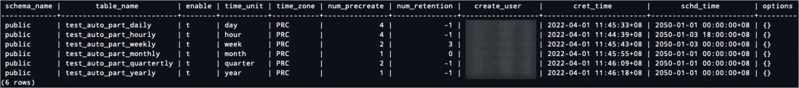

  样例结果列的含义如下。

  | 列名称 | 说明 |
  | --- | --- |
  | schema_name | Schema名称。 |
  | table_name | 表名称。 |
  | ENABLE | 是否启用动态分区管理。 |
  | time_unit | 动态分区的时间单位。 |
  | time_zone | 动态分区时区设置。 |
  | num_precreate | 预创建分区数量。 |
  | num_retention | 保留历史分区数量。 |
  | cret_time | 创建时间。 |
  | schd_time | 最近一次计划调度时间。 |
  | options | 其他。 |

- 查看创建和清除分区子表日志

  创建和清除分区子表的日志不会出现在Query Log中，您可以使用如下SQL查询创建和清除分区子表日志。

  ```text
  SELECT
      relname,
      relowner,
      schdtime,
      trigtime,
      status,
      message,
      precreate,
      discard
  FROM
      hologres.hg_partitioning_log;
  ```

  查询结果样例如下。

  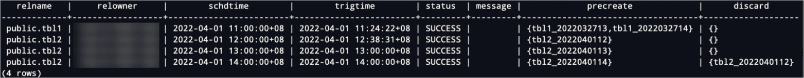

  样例结果列的含义如下。

  | 列名 | 说明 |
  | --- | --- |
  | relname | <code> schema.table </code>即<code> {Schema</code>名称<code>}.{</code>表名称<code>} </code>。 |
  | relowner | 表的Owner。 |
  | schdtime | 计划调度时间。 |
  | trigtime | 实际触发时间。 |
  | status | 状态。 |
  | message | 备注。 |
  | precreate | 创建的分区子表名。 |
  | discard | 清理的分区子表名。 |

**常见问题**

- 对于存量分区表如何开启动态分区？

  对于存量分区表您可以使用如下SQL打开动态分区。

  > **重要**
  >
  > 由于 `auto_partitioning.time_unit` 和 `auto_partitioning.time_zone` 为动态分区功能的核心配置，所以升级后仅允许设置一次，设置后不能再更改。

  ```text
  -- SQL样例
  BEGIN;
  CALL set_table_property('auto_part_old', 'auto_partitioning.enable', 'true');
  CALL set_table_property('auto_part_old', 'auto_partitioning.time_unit', 'HOUR');
  CALL set_table_property('auto_part_old', 'auto_partitioning.time_zone', 'PRC');
  CALL set_table_property('auto_part_old', 'auto_partitioning.num_precreate', '4');
  CALL set_table_property('auto_part_old', 'auto_partitioning.num_retention', '-1');
  CALL set_table_property('auto_part_old', 'auto_partitioning.num_hot', '-1');
  COMMIT;
  ```

- 对于存量表开启动态分区后，历史存在的分区子表是否会受到自动清理逻辑的影响？

  系统根据分区子表的名称进行分区子表清理，若分区子表的名称满足 `{parent_table}_{time_suffix}` 此类命名规则，则会被清理，如果不满足则不会被清理。

- 创建动态分区，指定了 `auto_partitioning_num_precreate` 值为 `3` ，但是执行完SQL后分区父表创建成功，为什么没有创建三个分区子表？

  对于首次创建动态分区的任务，后台默认每10分钟检查一次，因此分区子表会在10分钟内被创建，请稍后查看。

<a id="section-1-6-4-2-2"></a>

##### 1.6.4.2.2. ALTER PARTITION TABLE

ALTER PARTITION TABLE语句用于修改分区表。本文为您介绍ALTER PARTITION TABLE的用法。

**命令格式**

Hologres支持以下3种修改分区表的操作。

```sql
ALTER TABLE [IF EXISTS] table_name RENAME to new_table_name;
ALTER TABLE [IF EXISTS] table_name ATTACH PARTITION new_partition_name FOR VALUES in (<string_literal>);
ALTER TABLE [IF EXISTS] table_name DETACH PARTITION paritition_name;
```

**参数说明**

修改分区表命令的参数说明如下。

| 参数 | 描述 |
| --- | --- |
| <code>RENAME</code> | 重命名分区表。 |
| <code>ATTACH PARTITION new_partition_name FOR VALUES in</code><br><code>(&lt;string_literal&gt;)</code> | 用于将当前表绑定为目标表的分区。说明如下：<br>• 绑定分区的规范必须与目标表的分区策略和分区键相对应。<br>• 需要绑定的表与目标表的列数量必须相同，并且列类型必须匹配。<br>• 需要绑定的表必须具有目标表的所有NOT NULL约束。如果您添加了一个不接受NULL值的列表分区，除非它是一个表达式，否则您需要添加NOT NULL约束至分区键列。 |
| <code>DETACH PARTITION partition_name</code> | 分离目标表的指定分区。被分离的分区作为独立表继续存在，但不再与目标表相关联。 |

**使用限制**

- 分区子表在绑定父表时，其约束关系如下表所示。其中：

  - 与父表保持一致：即对应的属性分区子表必须和父表保持一致，若不一致，在分区子表绑定（ATTACH）父表时会报错，需要重新创建分区子表。

  - 不要求与父表一致：即对应的属性分区子表可以与父表不一致，如果子表没有显式指定属性，则会继承父表的属性，若是子表显式指定属性，则会保留子表的属性。

  - 索引列必须包含父表的索引列：即分区子表的索引列必须包含父表的索引列，还能显式再指定其他列。

  <table>
    <tr>
      <th>分类</th>
      <th>表属性</th>
      <th>描述</th>
      <th>create table partition of时是否继承父表属性</th>
      <th>ATTACH时与父表的约束关系</th>
      <th>DETACH时是否继承父表属性</th>
    </tr>
    <tr>
      <td rowspan="3">表属性</td>
      <td>orientation</td>
      <td>表存储格式。</td>
      <td>继承</td>
      <td>与父表保持一致。</td>
      <td>继承</td>
    </tr>
    <tr>
      <td>table_group</td>
      <td>Table Group属性包含Shard Count。</td>
      <td>继承</td>
      <td>与父表保持一致。</td>
      <td>继承</td>
    </tr>
    <tr>
      <td>time_to_live_in_seconds</td>
      <td>表数据生命周期。</td>
      <td>继承</td>
      <td>不要求与父表一致。<br>• 子表属性未赋值，继承父表属性。<br>• 子表属性已赋值，保留子表属性。</td>
      <td>继承</td>
    </tr>
    <tr>
      <td rowspan="8">索引</td>
      <td>primary key</td>
      <td>主键。</td>
      <td>继承</td>
      <td>与父表保持一致。</td>
      <td>继承</td>
    </tr>
    <tr>
      <td>distribution key</td>
      <td>分布键。</td>
      <td>继承</td>
      <td>与父表保持一致。</td>
      <td>继承</td>
    </tr>
    <tr>
      <td>clustering_key（包括列和排序）</td>
      <td>聚簇索引。</td>
      <td>继承</td>
      <td>与父表保持一致。</td>
      <td>继承</td>
    </tr>
    <tr>
      <td>event_time_column</td>
      <td>分段键。</td>
      <td>继承</td>
      <td>与父表保持一致。</td>
      <td>继承</td>
    </tr>
    <tr>
      <td>bitmap_columns</td>
      <td>比特编码。</td>
      <td>继承</td>
      <td>索引列必须包含父表的索引列。</td>
      <td>继承</td>
    </tr>
    <tr>
      <td>dictionary_encoding_colum ns</td>
      <td>字段编码。</td>
      <td>继承</td>
      <td>索引列必须包含父表的索引列。</td>
      <td>继承</td>
    </tr>
    <tr>
      <td>binlog_level</td>
      <td>是否开启Binlog。</td>
      <td>继承</td>
      <td>与父表保持一致。</td>
      <td>继承</td>
    </tr>
    <tr>
      <td>proxima_vectors</td>
      <td>向量检索索引。</td>
      <td>继承</td>
      <td>索引列必须包含父表的索引列。</td>
      <td>继承</td>
    </tr>
    <tr>
      <td rowspan="2">列约束</td>
      <td>nullable</td>
      <td>非空约束。</td>
      <td>继承</td>
      <td>与父表保持一致。</td>
      <td>继承</td>
    </tr>
    <tr>
      <td>default value</td>
      <td>默认值。</td>
      <td>继承</td>
      <td>与父表保持一致。</td>
      <td>继承</td>
    </tr>
  </table>

- Attach的表必须与目标表具有相同的列，而不能多或者少列。

- Attach时列的类型必须匹配。

**使用示例**

修改分区表的示例语句如下。

```sql
--修改分区表的名称
alter table holo_test rename to my_holo_test;

--添加my_table为holo_table的分区表
alter table holo_table attach partition my_table for values in ('2015');

--将holo_test从all_test分区表中解除绑定，分离为独立表
alter table all_test detach partition holo_test; 
            
```

您也可以参见如下完整示例进行分区表替换。

```sql
-- 创建新的分区表
begin;
drop table if exists "table_20210101_new";
CREATE TABLE "table_20210101_new" (
  "colA" integer NOT NULL,
  "colB" text NOT NULL,
  "colC" numeric(38,10) NOT NULL,
  "ds" text NOT NULL,
  "process_time" timestamptz NOT NULL DEFAULT now()
);
call set_table_property('table_20210101_new', 'orientation','column');
call set_table_property('table_20210101_new', 'distribution_key','"colA"');
call set_table_property('table_20210101_new', 'event_time_column','process_time');
commit;

---导入数据
insert into "table_20210101_new" select * from ...;

---替换⼦表
begin;
--解除绑定⼦分区为独立的表
ALTER TABLE table_parent DETACH PARTITION table_20210101;
--重命名解绑定后独立的表
ALTER TABLE table_20210101 RENAME to table_20210101_backup;
--把临时表更名为分区表名
ALTER TABLE table_20210101_new RENAME to table_20210101;
--绑定新的分区表
ALTER TABLE table_parent ATTACH PARTITION table_20210101 FOR VALUES in ("20210101");
commit;
```

<a id="section-1-6-4-2-3"></a>

##### 1.6.4.2.3. DROP PARTITION TABLE

DROP PARTITION TABLE语句用于删除分区表。本文为您介绍DROP PARTITION TABLE的用法。

**使用限制**

删除分区表父表时，默认同时删除分区表子表。

`PARTITION TABLE` 为需要删除的目标分区表。

**语法**

删除分区表的语法如下。

```text
DROP TABLE [ IF EXISTS ] table_name [, ...];
```

> `DROP TABLE` 支持一次删除多个表。
>
> **说明**

参数说明如下表所示。

<table>
  <tr>
    <th width="120">参数</th>
    <th>描述</th>
  </tr>
  <tr>
    <td>IF EXISTS</td>
    <td>• 如果指定<code> IF EXISTS </code>，无论目标表是否存在，执行删除语句后系统都会返回成功。<br>• 如果不指定<code> IF EXISTS </code>，当目标表不存在时，系统会返回<code> ERROR: table </code> <code>"non_exist_table" does not exist </code>报错。</td>
  </tr>
  <tr>
    <td>table_name</td>
    <td>需要删除的表名称。</td>
  </tr>
</table>

**示例**

删除分区表的示例SQL语句如下。

```text
DROP TABLE hologres_child2;
```

<a id="section-1-6-4-2-4"></a>

##### 1.6.4.2.4. 动态分区管理（3.2内核）

Hologres的动态分区功能无需预先设定所有分区信息，可依据创建分区表时配置的动态分区规则，自动创建并管理分区子表。同时，还支持将符合条件的分区数据迁移到低频存储设备，在保证查询性能的同时，有效降低存储费用。

**注意事项**

- Hologres暂不支持插入数据至分区表父表，只支持插入数据至具体的分区表子表。

- 一个分区规则只能创建一个分区表。

- `PARTITION BY` 类型仅支持 `LIST` 分区，切分 `PARTITION BY LIST` 只能取唯一值。

- 若是表有主键，分区键必须是主键的一个子集。

- 动态分区能力仅支持对分区父表设置调度时间（ `schd_start_time` ），不支持对分区子表设置。

**配置动态分区**

**语法说明**

动态分区管理配置既支持在创建分区表时配置动态分区管理属性，也支持在建表后修改动态分区管理属性，语法如下所示。

**使用WITH语法示例**

- 创建分区表时，配置动态分区管理属性。

  ```sql
  -- 创建分区表时配置动态分区管理属性
  CREATE TABLE [IF NOT EXISTS] [<schema_name>.]<table_name>  ([
    {
     <column_name> <column_type> [ <column_constraints>, [...]]
     | <table_constraints>
     [, ...]
    }
  ])
  PARTITION BY LIST(<column_name>)
  WITH (
     auto_partitioning_enable = 'xxx',
     auto_partitioning_time_unit = 'xxx',
     auto_partitioning_time_zone = 'xxx',
     auto_partitioning_num_precreate = 'xxx',
     auto_partitioning_num_retention = 'xxx'
  );
  ```

- 创建分区表后，修改动态分区管理属性。

  ```sql
  -- 修改动态分区管理属性
  ALTER TABLE [<schema_name>.]<table_name> SET (
     auto_partitioning_enable = 'xxx',
     auto_partitioning_time_unit = 'xxx',
     auto_partitioning_time_zone = 'xxx',
     auto_partitioning_num_precreate = 'xxx',
     auto_partitioning_num_retention = 'xxx'
  );
  ```

**使用CALL语法示例**

- 创建分区表时，配置动态分区管理属性。

  ```sql
  -- 创建分区表时配置动态分区管理属性
  BEGIN;
  CREATE TABLE [IF NOT EXISTS] [<schema_name>.]<table_name>  ([
    {
     <column_name> <column_type> [ <column_constraints>, [...]]
     | <table_constraints>
     [, ...]
    }
  ])
  PARTITION BY LIST(<column_name>);
  CALL set_table_property('[<schema_name>.]<table_name>', 'auto_partitioning.enable', 'xxx');
  CALL set_table_property('[<schema_name>.]<table_name>', 'auto_partitioning.time_unit', 'xxx');
  CALL set_table_property('[<schema_name>.]<table_name>', 'auto_partitioning.time_zone', 'xxx');
  CALL set_table_property('[<schema_name>.]<table_name>', 'auto_partitioning.num_precreate', 'xxx');
  CALL set_table_property('[<schema_name>.]<table_name>', 'auto_partitioning.num_retention', 'xxx');
  CALL set_table_property('[<schema_name>.]<table_name>', 'auto_partitioning.num_retention', 'xxx');
  COMMIT;
  ```

- 创建分区表后，修改动态分区管理属性。

  ```text
  -- 修改动态分区管理属性
  CALL set_table_property('[<schema_name>.]<table_name>', 'auto_partitioning.enable', 'xxx');
  CALL set_table_property('[<schema_name>.]<table_name>', 'auto_partitioning.num_precreate', 'xxx');
  CALL set_table_property('[<schema_name>.]<table_name>', 'auto_partitioning.num_retention', 'xxx');
  ```

**参数说明**

> **重要**
>
> 使用 `CREATE TABLE WITH` 语法配置动态分区时，需要将参数名中的 `.` 改为 `_` 。例如使用CREATE TABLE WITH语法配置动态分区时， `auto_partitioning.enable` 参数名需改为 `auto_partitioning_enable` 。

| 参数名称 | 是否必选 | 说明 | 是否可更新 |
| --- | --- | --- | --- |
| <code> auto_partitioning_enable </code>/<code> auto_part</code> <code>itioning.enable</code> | 否 | 是否启用动态分区管理，取值说明如下：<br>• true：启用动态分区管理。<br>• false（默认值）：关闭动态分区管理。 | 是 |
| <code> auto_partitioning_time_unit </code>/<code> auto_p</code> <code>artitioning.time_unit</code> | 是 | 动态分区的时间单位，取值说明如下：<br>• HOUR<br>• DAY<br>• MONTH<br>• QUARTER<br>• YEAR例如配置为DAY，则将按天进行分区的预创建、删除。 | 否 |
| <code> auto_partitioning_time_zone </code>/<code> auto_p</code> <code>artitioning.time_zone</code> | 否 | 动态分区时区设置，默认值为当前连接的时区。配置后将按照对应时区时间点进行动态分区管理。您可以使用如下SQL查看可选的时区和offset等。返回结果中的<strong>name</strong>列即为<strong>timezone</strong>值，例如Asia/Shanghai。<br><code>SELECT * FROM pg_timezone_names;</code> | 否 |
| <code> auto_partitioning_num_precreate </code>/<code> au</code> <code>to_partitioning.num_precreate</code> | 否 | 预创建分区的数量，取值说明如下：<br>• 0：不进行预创建。<br>• \[1, 512\]：以当前时间点为基准创建分区，建议该值需要大于等于2，默认值为4。<br>说明以当前时间为2022-01-10为例，<code> time_unit = DAY</code>，<code>num_precreate = 3 </code> 参数配置即表示将创建2022-01-10、2022-01-11、2022-01-12三个分区。<br>重要预创建分区行为会影响最大分区函数的函数行为，请配置前检查是否依赖MAX_PT函数。 | 是 |
| <code> auto_partitioning_num_retention </code>/<code> au</code> <code>to_partitioning.num_retention</code> | 否 | 保留历史分区数量，取值说明如下：<br>• 0：不保留历史分区。<br>• -1（默认值）：不清理历史分区。<br>• 正数：保留N个历史分区，最大值为512。可通过<code> set hg_experimental_auto_part_max_maintained_partitions=</code> <code>&lt;value&gt;; </code>调整保留分区的数量，最大值为8760。<br>说明以当前时间为2022-01-10为例，<code> &lt;time_unit = DAY, num_retention = 3&gt; </code> 参数配置即表示将保留 2022-01-09、2022-01-08 、2022-01-07三个分区，早于2022-01-07的历史分区将被删除。 | 是 |

**表名生成规则**

动态分区表时间单位 `auto_partitioning.time_unit` 取值为HOUR、DAY、MONTH、QUARTER、YEAR，动态分区将使用分区父表名加上时间后缀作为新创建分区的表名。格式如： `{parent_table}_{time_suffix}` ， 其中时间后缀将依据自动分区的调度时间和时间单位对应的格式模板生成。具体的对应关系如下。

<table>
  <tr>
    <th>时间单位</th>
    <th>时间后缀格式</th>
    <th>示例</th>
    <th>执行时间</th>
  </tr>
  <tr>
    <td rowspan="2">HOUR</td>
    <td>YYYYMMDDHH24</td>
    <td>2024112221。</td>
    <td rowspan="2">每个整点的开始，例如2024年11月22日 21:00:01执行任务。</td>
  </tr>
  <tr>
    <td>YYYY-MM-DD-HH24</td>
    <td>2024-11-22-21。</td>
  </tr>
  <tr>
    <td rowspan="2">DAY</td>
    <td>YYYYMMDD</td>
    <td>20241122。</td>
    <td rowspan="2">每天00:00:01开始，例如2024年11月22日 00:00:01。</td>
  </tr>
  <tr>
    <td>YYYY-MM-DD</td>
    <td>2024-11-22。</td>
  </tr>
  <tr>
    <td rowspan="2">MONTH</td>
    <td>YYYYMM</td>
    <td>202411。</td>
    <td rowspan="2">每个月的第一天00:00:01开始，例如2024年11月1日的00:00:01。</td>
  </tr>
  <tr>
    <td>YYYY-MM</td>
    <td>2024-11。</td>
  </tr>
  <tr>
    <td rowspan="2">QUARTER</td>
    <td>YYYYQ</td>
    <td>20241、20242、20243、20244分别表示2024年的四个季度。</td>
    <td rowspan="2">每个季度的第一天00:00:01开始，例如2024年1月1日 00:00:01。</td>
  </tr>
  <tr>
    <td>YYYY-Q</td>
    <td>2024-1、2024-2、2024-3、2024-4 分别表示2024年的四个季度。</td>
  </tr>
  <tr>
    <td>YEAR</td>
    <td>YYYY</td>
    <td>2023、2024分别表示2023年、2024年的分区。</td>
    <td>每年的第一天00:00:01开始，例如2023年1月1日 00:00:01。</td>
  </tr>
</table>

**使用示例**

以天（DAY）为时间单位，预先创建未来3天的分区，保留近2天的历史分区，并将时区设置为 `Asia/Shanghai` 的代码示例如下。

**使用WITH语法示例**

1. 创建分区表 `tbl1` 。

   ```sql
   -- 2.1版本创建分区表，并配置动态分区管理：

   CREATE TABLE tbl1 (
       c1 TEXT NOT NULL,
       c2 TEXT 
   )
   PARTITION BY LIST (c2)
   WITH (
      auto_partitioning_enable = 'true',
      auto_partitioning_time_unit = 'DAY',
      auto_partitioning_time_zone = 'Asia/Shanghai',
      auto_partitioning_num_precreate = '3',
      auto_partitioning_num_retention = '2'
   );
   ```

2. 待子分区生成后插入数据。

   ```sql
   INSERT INTO tbl1 (c1, c2) VALUES ('Data 1', '20251211');
   INSERT INTO tbl1 (c1, c2) VALUES ('Data 2', '20251212');
   INSERT INTO tbl1 (c1, c2) VALUES ('Data 3', '20251213');
   ```

   > **说明**
   >
   > 参数 `20251211` 、 `20251212` 和 `20251213` 需替换为实际生成的分区值。

3. 查询数据。

   ```sql
   SELECT * FROM tbl1 WHERE c2='20251211';
   ```

   > **说明**
   >
   > 参数 `20251211` 需替换为您所需查询的分区值。

   返回结果如下：

   ```text
   c1      c2
   Data 1   20251211
   ```

**使用CALL语法示例**

1. 创建分区表 `tbl1` 。

   ```sql
   -- 创建分区表，并配置动态分区管理：
   BEGIN;
   CREATE TABLE tbl1 (
       c1 TEXT NOT NULL,
       c2 TEXT 
   )
   PARTITION BY LIST (c2);
   CALL set_table_property ('tbl1', 'auto_partitioning.enable', 'true');
   CALL set_table_property ('tbl1', 'auto_partitioning.time_unit', 'DAY');
   CALL set_table_property ('tbl1', 'auto_partitioning.time_zone', 'Asia/Shanghai');
   CALL set_table_property ('tbl1', 'auto_partitioning.num_precreate', '3');
   CALL set_table_property ('tbl1', 'auto_partitioning.num_retention', '2');
   COMMIT;
   ```

2. 待子分区生成后插入数据。

   ```sql
   INSERT INTO tbl1 (c1, c2) VALUES ('Data 1', '20251211');
   INSERT INTO tbl1 (c1, c2) VALUES ('Data 2', '20251212');
   INSERT INTO tbl1 (c1, c2) VALUES ('Data 3', '20251213');
   ```

3. 查询数据。

   ```sql
   SELECT * FROM tbl1 WHERE c2='20251211';
   ```

   返回结果如下：

   ```text
   c1      c2
   Data 1   20251211
   ```

分区增减的逻辑如下：

| 时间 | 事件 | 结果 |
| --- | --- | --- |
| 2025-12-11 09:00:00 | 执行如上SQL，创建分区表。 | • 创建分区父表：tbl1<br>• 创建分区子表：tbl1_20251211、tbl1_20251212、tbl1_20251213 |
| 2025-12-12 00:00:00 | 系统自动创建分区子表。 | • 创建分区子表：tbl1_20251214 |
| 2025-12-13 00:00:00 | 系统自动创建分区子表。 | • 系统创建分区子表：tbl1_20251215 |
| 2025-12-14 00:00:00 | 系统自动创建分区子表，并清理分区子表。 | • 创建分区子表：tbl1_20251216<br>• 清理分区子表：tbl1_20251211 |
| 2025-12-15 00:00:00 | 系统自动创建分区子表，并清理分区子表。 | • 创建分区子表：tbl1_20251217<br>• 清理分区子表：tbl1_20251212 |

**常见场景**

**保留指定分区子表**

默认情况下，系统会按照已配置的动态分区规则，自动创建和删除分区子表，不在保留范围内的分区子表将被自动删除。但在某些特殊场景中（例如在电商场景中，需要保留历年双11数据进行同环比分析），可能需要保留重要分区的数据，您可以通过给表增加 `keep_alive` 属性的方式，保留指定分区子表。使用语法介绍如下。

- V2.1版本起支持的语法：

  ```sql
  -- 增加保留分区
  ALTER TABLE [<schema_name>.]<table_name> SET (keep_alive = 'true');

  -- 删除保留分区：删除保留属性后，动态分区管理会立即触发过期数据清理
  ALTER TABLE [<schema_name>.]<table_name> SET (keep_alive = 'false');
  ```

- 所有版本支持的语法：

  ```text
  -- 增加保留分区
  CALL set_table_property('[<schema_name>.]<table_name>', 'keep_alive', 'true');

  -- 删除保留分区：删除保留属性后，动态分区管理会立即触发过期数据清理
  CALL set_table_property('[<schema_name>.]<table_name>', 'keep_alive', 'false');
  ```

**查看配置动态分区配置和调度情况**

您可以通过如下SQL，查询当前数据库中配置了动态分区表信息和动态分区配置信息。

```text
SELECT
    nsp_name AS schema_name,
    tbl_name AS table_name,
    ENABLE,
    time_unit,
    time_zone,
    num_precreate,
    num_retention,
    b.usename AS create_user,
    cret_time,
    schd_start_time,
    options
FROM
    hologres.hg_partitioning_config AS a
    LEFT JOIN pg_user AS b ON a.cret_user = b.usesysid;
```

以上字段名称介绍如下。

| 字段名称 | 说明 |
| --- | --- |
| schema_name | schema名称。 |
| table_name | 表名称。 |
| enable | 是否启用动态分区管理。 |
| time_unit | 动态分区的时间单位。 |
| time_zone | 动态分区时区设置。 |
| num_precreate | 预创建分区数量。 |
| num_retention | 保留历史分区数量。 |
| create_user | 创建用户。 |
| cret_time | 创建时间。 |
| schd_start_time | 最近一次计划调度时间。 |

查询结果如下。

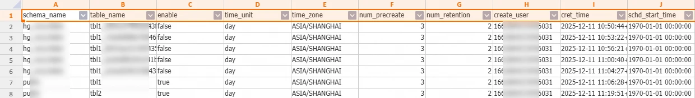

**查看创建和清除分区子表日志**

Query Log中不记录创建和清除分区子表的日志，您可以使用如下SQL查询创建和清除分区子表日志。

```text
SELECT                           
    relname,
    relowner,
    schdtime,
    trigtime,
    status,
    message,
    precreate,
    discard
FROM
    hologres.hg_partitioning_log 
```

以上字段名称介绍如下。

| 字段名称 | 说明 |
| --- | --- |
| relname | schema.table |
| relowner | 分区表的Owner。 |
| schdtime | 计划调度时间。 |
| trigtime | 实际触发时间。 |
| status | 状态。 |
| message | 备注。 |
| precreate | 创建的分区子表名。 |
| discard | 清理的分区子表名。 |

查询结果如下。

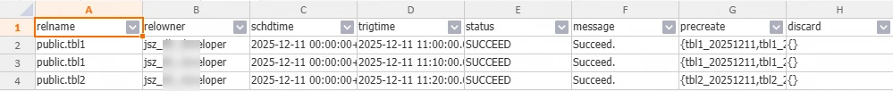

**常见问题**

**对于存量分区表如何开启动态分区？**

对于存量分区表您可以使用如下SQL开启动态分区。

```sql
-- Hologres V2.1及以上版本SQL示例
ALTER TABLE auto_part_old SET (
   auto_partitioning_enable = 'true',
   auto_partitioning_time_unit = 'HOUR',
   auto_partitioning_time_zone = 'PRC',
   auto_partitioning_num_precreate = '4',
   auto_partitioning_num_retention = '-1',
   auto_partitioning_num_hot = '-1'
);

-- Hologres所有版本SQL示例
BEGIN;
CALL set_table_property('auto_part_old', 'auto_partitioning.enable', 'true');
CALL set_table_property('auto_part_old', 'auto_partitioning.time_unit', 'HOUR');
CALL set_table_property('auto_part_old', 'auto_partitioning.time_zone', 'PRC');
CALL set_table_property('auto_part_old', 'auto_partitioning.num_precreate', '4');
CALL set_table_property('auto_part_old', 'auto_partitioning.num_retention', '-1');
COMMIT;
```

> **重要**
>
> 和
>
> 为动态分区功能的核心配置，
>
> 升级后仅允许设置一次，设置后不能再更改。
>
> `auto_partitioning.time_unit` 和 `auto_partitioning.time_zone` 为动态分区功能的核心配置，Hologres升级后仅允许设置一次，设置后不能再更改。

**存量分区表开启动态分区后，历史存在的分区子表是否会受到自动清理逻辑的影响？**

系统根据分区子表的名称进行分区子表清理，若分区子表的名称满足 `{parent_table}_{time_suffix}` 命名规则，将会被清理，如果不满足则不会被清理。

**创建动态分区指定了** **`num_precreate`** **为3，执行完SQL后父表创建成功，但并没有创建三个分区子表？**

对于首次创建动态分区地任务，系统默认每10分钟检查一次，因此分区子表会在10分钟内被创建，请稍后查看。

<a id="section-1-6-5"></a>

### 1.6.5. FOREIGN TBALE

<a id="section-1-6-5-1"></a>

#### 1.6.5.1. CREATE FOREIGN TABLE

CREATE FOREIGN TABLE语句用于创建外部表。本文为您介绍CREATE FOREIGN TABLE的用法。

**使用限制**

仅Hologres V1.3及以上版本支持MaxCompute的三层模型模式（即在原先的Project和Table之间增加了一层Schema的概念），如果您想在Hologres中使用MaxCompute的三层模型的项目创建外部表，且您的Hologres版本较低，请升级实例。

**语法**

```text
CREATE FOREIGN TABLE [ IF NOT EXISTS ] table_name ( [
  { column_name data_type }
  [, ... ]
  ] )
SERVER odps_server
[ OPTIONS ( option 'value' [, ... ] ) ]
```

参数说明如下表所示。

<table>
  <tr>
    <th width="98">参数</th>
    <th>描述</th>
  </tr>
  <tr>
    <td>SERVER</td>
    <td>连接MaxCompute外部数据源的服务器。您可以直接调用Hologres底层已创建的名为<strong>odps_server</strong>的外部表服务器。详细原理请参见Postgres FDW。</td>
  </tr>
  <tr>
    <td>OPTIONS</td>
    <td>您需要指定<strong>project_name</strong>和<strong>table_name</strong>。如果您MaxCompute的Project是三层模型模式，您仍使用两层模型的写法调用，则会报错，报错样例如下。<code>failed to import foreign schema:Table not found - table_xxx</code><br>• MaxCompute两层模型：<br>• <strong>project_name</strong>为MaxCompute的项目名称。<br>• <strong>table_name</strong>为需要查询的MaxCompute表名称。<br>• MaxCompute三层模型：<br>• <strong>project_name</strong>为MaxCompute的项目名称和Schema名称，格式为<code> odps_project_name#odps_schema_name </code>。<br>• <strong>table_name</strong>为需要查询的MaxCompute表名称。</td>
  </tr>
</table>

> Hologres创建的外部表的字段类型必须与MaxCompute的字段类型一一对应。
>
> **说明**

**示例**

- 直接查询外部表数据。Hologres新建外部表后，您可以直接查询MaxCompute外部表数据。示例SQL语句如下。

  ```sql
  --两层模型模式
  CREATE FOREIGN TABLE src_pt(
    id text, 
    pt text) 
  SERVER odps_server 
  OPTIONS(project_name '<odps_project>', table_name '<odps_table>');

  --三层模型模式
  CREATE FOREIGN TABLE src_pt(
    id text,
    pt text)
  SERVER odps_server
  OPTIONS(project_name '<odps_project>#<odps_schema>', table_name '<odps_table>');

  SELECT * FROM src_pt;
  ```

  在Hologres中直接查询MaxCompute外部表数据。

- 导入外部表并查询数据。您可以导入MaxCompute的数据至Hologres，再进行查询。示例语句如下。

  ```sql
  CREATE FOREIGN TABLE src_pt_odps(
    id text,
    pt text) 
  SERVER odps_server 
  OPTIONS (project_name'<odps_project>', table_name'<odps_table>');

  BEGIN;
  CREATE TABLE src_pt(
   id text, 
    pt text);
  COMMIT;

  INSERT INTO src_pt SELECT * FROM src_pt_odps;
  ```

  导入MaxCompute数据至Hologres后，再进行查询。

**MaxCompute与Hologres的数据类型映射**

创建MaxCompute外部表时，MaxCompute与Hologres的数据类型映射如下表所示。

| MaxCompute数据类型 | Hologres数据类型 | 是否支持映射 |
| --- | --- | --- |
| • STRING<br>• VARCHAR | TEXT | 支持 |
| BIGINT | INT8 | 支持 |
| INT | • INT4<br>• INT | 支持 |
| SMALLINT | • INT2<br>• INT8<br>说明执行<code> set </code> <code>hg_enable_convert_type_for_foreign_table = true </code>定义数据类型为INT8。 | 不支持 |
| TINYINT | 无 | 不支持 |
| FLOAT | • FLOAT4<br>• REAL | 支持 |
| DOUBLE | • FLOAT<br>• FLOAT8 | 支持 |
| BOOLEAN | BOOL | 支持 |
| DATETIME | TIMESTAMPTZ | 支持 |
| DECIMAL | NUMERIC | 支持 |
| CHAR | 无 | 不支持 |
| BINARY | 无 | 不支持 |

> **说明**
>
> - `DATETIME` 使用东八区时间作为系统的标准时间。取值范围为0000年1月1日～9999年12月31日，精确到毫秒。
>
> - `TIMESTAMPTZ` 包含时区，取值范围为4713BC～294276AD，精确到微秒。
>
> - 当MaxCompute数据表中含有Hologres不支持的类型字段时，如果Hologres不访问该字段，则可以正常查询所支持的类型字段。

<a id="section-1-6-5-2"></a>

#### 1.6.5.2. ALTER FOREIGN TABLE

ALTER FOREIGN TABLE语句用于修改外部表。本文为您介绍如何使用ALTER FOREIGN TABLE，为外部表重命名、增加列及删除列。

**使用限制**

Hologres仅支持为外部表重命名、增加列及删除列等修改外部表操作。

**重命名**

语法如下。

```text
ALTER FOREIGN TABLE [ IF EXISTS ] name RENAME TO new_name;    
```

示例SQL语句如下。

```text
ALTER FOREIGN TABLE test RENAME TO new_test_table; 
```

**增加列**

使用Hologres创建外部表查询数据时，当MaxCompute表增加字段后，Hologres不会自动更新Schema，需要您在Hologres中手动增加列。

> 大集群暂不支持使用如下语法增加列，关于大集群增加列的操作请参见IMPORT FOREIGN SCHEMA。
>
> **说明**

语法如下。

```text
ALTER FOREIGN TABLE IF EXISTS table_name ADD COLUMN new_column_name data_type;
```

示例SQL语句如下。

```text
ALTER FOREIGN TABLE bank
 ADD COLUMN  cons_conf_idx float8,
 ADD COLUMN  euribor3m float8;
```

**删除列**

语法如下。

```text
ALTER FOREIGN TABLE IF EXISTS table_name DROP COLUMN column_name;
```

示例SQL语句如下。

```text
ALTER FOREIGN TABLE bank
 DROP COLUMN  cons_conf_idx,
 DROP COLUMN  euribor3m;
```

<a id="section-1-6-5-3"></a>

#### 1.6.5.3. DROP FOREIGN TABLE

DROP FOREIGN TABLE语句用于删除外部表。本文为您介绍DROP FOREIGN TABLE的用法。

**语法**

```text
DROP FOREIGN TABLE [ IF EXISTS ] name [, ...] [ CASCADE | RESTRICT ]
```

参数说明如下表所示。

| 参数 | 描述 |
| --- | --- |
| IF EXISTS | 如果指定的表不存在，则系统提示一个Notice，而不会提示一个报错。 |
| name | 需要删除的表名称。 |
| CASCADE | 删除表时，级联删除依赖于表的对象，例如视图。 |
| RESTRICT | 如果目标表存在依赖对象，则系统拒绝删除该表。 |

**示例**

删除外部表，示例SQL语句如下。

```text
DROP FOREIGN TABLE holo_test;
```

<a id="section-1-6-6"></a>

### 1.6.6. CAST

<a id="section-1-6-6-1"></a>

#### 1.6.6.1. CREATE CAST

CREATE CAST用于定义数据类型之间的转换。本文为您介绍CREATE CAST的用法。

**语法**

```text
CREATE CAST (source_type AS target_type)
    WITH INOUT
    [ AS ASSIGNMENT | AS IMPLICIT ]
```

参数说明如下表所示。

<table>
  <tr>
    <th width="158">参数</th>
    <th>描述</th>
  </tr>
  <tr>
    <td>source_type</td>
    <td>该转换的源数据类型。</td>
  </tr>
  <tr>
    <td>target_type</td>
    <td>该转换的目标数据类型。</td>
  </tr>
  <tr>
    <td>WITH INOUT</td>
    <td>表示该转换为I/O转换。该转换通过调用源数据类型的输出函数来执行，并将结果传给目标数据类型的输入函数。</td>
  </tr>
  <tr>
    <td>AS ASSIGNMENT</td>
    <td>表示该转换可以在赋值模式下隐含调用。</td>
  </tr>
  <tr>
    <td>AS IMPLICIT</td>
    <td>表示该转换可以在任意环境里隐含调用。</td>
  </tr>
</table>

**示例**

通常，在Filter中比较字符类型和数值类型时，默认不进行转换。您可以使用 `CREATE CAST` 语句，创建一个支持比较字符类型和数值类型的CAST，示例语句如下。

```sql
CREATE TABLE test_cast(id text);
INSERT INTO test_cast VALUES(888);
SELECT * FROM test_cast aa WHERE id > 888;
CREATE CAST (text AS integer) WITH INOUT AS IMPLICIT;
SELECT * FROM test_cast aa WHERE id > 888;
```

更多关于 `CREATE CAST` 的详情，请参见PostgreSQL CREATE CAST。

<a id="section-1-6-6-2"></a>

#### 1.6.6.2. DROP CAST

DROP CAST语句用于删除已定义的类型转换。本文为您介绍DROP CAST的用法。

**使用限制**

您必须拥有源或目标数据类型的权限，才可以删除类型转换。

**语法**

```text
DROP CAST [ IF EXISTS ] (source_type AS target_type) 
```

参数说明如下表所示。

| 参数 | 描述 |
| --- | --- |
| IF EXISTS | 如果指定的转换不存在，则系统提示一个Notice，而不会提示一个报错。 |
| source_type | 类型转换的源数据类型。 |
| target_type | 类型转换的目标数据类型。 |

**示例**

删除类型转换，示例语句如下。

```text
DROP CAST IF EXISTS (text AS timestamptz);
DROP CAST IF EXISTS (text AS integer);
```

更多关于 `DROP CAST` 的详情，请参见PostgreSQL DROP CAST。

<a id="section-1-6-7"></a>

### 1.6.7. VIEW

Hologres支持基于内部表及外部表创建视图VIEW，您可以使用单张表、多张表或者其他视图来创建视图。本文为您介绍在Hologres中如何创建视图。

**创建视图**

创建视图的语法格式如下。

```text
CREATE [TEMP | TEMPORARY] VIEW view_name AS
SELECT column1, column2.....
FROM table_name
WHERE [condition];
```

如果TEMPORARY或者TEMP被指定，视图会被创建为一个临时视图。当前会话结束时将会自动删掉临时视图。

**创建内部表视图**

1. 创建内部表，示例语句如下。

   ```sql
   create table holo_test (
     amount decimal(10, 2), 
     rate decimal(10, 2)
   );
   insert into holo_test values 
   (12.12,13.13),
   (14.14,15.15),
   (16.16,17.17),
   (17.1,17),
   (18.01,19);
   ```

2. 基于内部表创建视图并查询表数据，示例语句如下。

   ```sql
   create view holo_view as select * from holo_test;

   select * from holo_view;
    amount | rate
   --------+-------
     12.12 | 13.13
     14.14 | 15.15
     16.16 | 17.17
     17.10 | 17.00
     18.01 | 19.00
   (5 rows)
   ```

**创建外部表视图**

1. 创建外部表，示例语句如下。

   ```sql
   create foreign table if not exists holo_foreign_test (
     amount decimal(10, 2), 
     rate decimal(10, 2)) 
     server odps_server 
     options(project_name '<projectname>', table_name '<odps_name>')
     );
     
   select * from holo_foreign_test limit 2;
   ```

2. 基于外部表创建视图并查询表数据，示例语句如下。

   ```sql
   create view foreign_view as select * from holo_foreign_test;

   select * from foreign_view limit 2;
    amount | rate
   --------+-------
     12.12 | 13.13
     14.14 | 15.15
   ```

**创建内部表及外部表的联合视图**

基于内部表和外部表创建联合视图并查询表数据，示例语句如下。

```sql
create view view1 as select * from holo_view union all  select * from foreign_view;

select * from view1;
 amount | rate
--------+-------
  12.12 | 13.13
  14.14 | 15.15
  16.16 | 17.17
   17.1 |    17
  18.01 |    19
  12.12 | 13.13
  14.14 | 15.15
  16.16 | 17.17
  17.10 | 17.00
  18.01 | 19.00
  12.12 | 13.13
  14.14 | 15.15
  16.16 | 17.17
   17.1 |    17
  18.01 |    19
  12.12 | 13.13
  14.14 | 15.15
  16.16 | 17.17
   17.1 |    17
  18.01 |    19
(20 rows)
```

**删除视图**

删除视图的语法格式如下。

```text
drop view <view_name>;
```

**查看所有视图和视图的DDL**

您可以执行如下命令查看所有视图，如果您通过psql客户端查看所有视图，也可以执行 `\dv` 进行查看。

```text
--sql命令
SELECT n.nspname as "Schema",
  c.relname as "Name",
  CASE c.relkind WHEN 'r' THEN 'table' WHEN 'v' THEN 'view' WHEN 'm' THEN 'materialized view' WHEN 'i' THEN 'index' WHEN 'S' THEN 'sequence' W
HEN 's' THEN 'special' WHEN 'f' THEN 'foreign table' WHEN 'p' THEN 'table' WHEN 'I' THEN 'index' END as "Type",
  pg_catalog.pg_get_userbyid(c.relowner) as "Owner"
FROM pg_catalog.pg_class c
     LEFT JOIN pg_catalog.pg_namespace n ON n.oid = c.relnamespace
WHERE c.relkind IN ('v','')
      AND n.nspname <> 'pg_catalog'
      AND n.nspname <> 'information_schema'
      AND n.nspname !~ '^pg_toast'
  AND pg_catalog.pg_table_is_visible(c.oid)
ORDER BY 1,2;
```

您可以执行如下命令查看VIEW的具体DDL：

```text
create extension hg_toolkit;
select public.hg_dump_script('viewname');
```

<a id="section-1-7"></a>

## 1.7. DML&DQL

<a id="section-1-7-1"></a>

### 1.7.1. COPY

本文为您介绍在Hologres中如何使用COPY命令进行数据导入与导出。

**使用限制**

使用COPY命令的限制说明如下：

- 如果导入的是分区表数据，则Hologres只支持导入数据至分区表子表，不支持导入数据至分区表父表。

- 在v1.1.43+版本中，当使用 `COPY FROM STDIN` 命令时，支持表中有DEFAULT关键字以及serial类型字段，早期版本不支持。

**命令介绍**

`COPY FROM` 命令用于从客户端的标准输入导入数据至Hologres； `COPY TO` 命令用于导出Hologres数据。

> **说明**
>
> - 当前COPY命令支持的数据类型与Hologres引擎支持的数据类型一致，详情请参见数据类型汇总。
>
> - Hologres仅支持使用 `COPY FROM STDIN` 命令导入数据和 `COPY ( query ) TO STDOUT` 命令导出数据。
>
> - COPY命令保障数据导入与导出的原子性。FIXED COPY模式由于将表级锁优化为行级锁，因此不保障原子性，当业务出现脏数据时，仅会针对该条数据报错，其余数据可能部分写入或未写入。

**命令格式**

Hologres支持的COPY语句格式如下：

```text
COPY table_name [ ( column_name [, ...] ) ]
    FROM STDIN
    [ [ WITH ] ( option [, ...] ) ]

COPY { ( query ) }
    TO STDOUT
    [ [ WITH ] ( option [, ...] ) ]

where option can be one of:

    FORMAT format_name
    DELIMITER 'delimiter_character'
    NULL 'null_string'
    HEADER [ boolean ]
    QUOTE 'quote_character'
    ESCAPE 'escape_character'
    FORCE_QUOTE { ( column_name [, ...] ) | * }
    FORCE_NOT_NULL ( column_name [, ...] )
    ENCODING 'encoding_name'
    STREAM_MODE [ boolean]
    ON_CONFLICT 'none/ignore/update'
```

**参数说明**

<table>
  <tr>
    <th width="172">参数</th>
    <th>描述</th>
  </tr>
  <tr>
    <td>table_name</td>
    <td>Hologres接收数据的表名称。</td>
  </tr>
  <tr>
    <td>query</td>
    <td>查询语句。</td>
  </tr>
  <tr>
    <td>STDIN</td>
    <td>指定从客户端使用标准输入。</td>
  </tr>
  <tr>
    <td>STDOUT</td>
    <td>导出至指定客户端。</td>
  </tr>
  <tr>
    <td>FORMAT</td>
    <td>支持TEXT、CSV和BINARY格式。默认为TEXT格式。仅导出数据、FIXED COPY模式导入数据支持BINARY格式。</td>
  </tr>
  <tr>
    <td>DELIMITER</td>
    <td>指定的字段分隔符。文本格式默认为制表符，CSV格式默认为半角逗号（,）。例如<code> DELIMITER AS ',' </code>。</td>
  </tr>
  <tr>
    <td>NULL</td>
    <td>指定表示一个空值的字符串。<br>• TEXT格式：默认是<code> \N </code>。<br>• CSV格式：默认是一个未加引用符的空串。<br>• BINARY格式：不支持该选项。</td>
  </tr>
  <tr>
    <td>HEADER</td>
    <td>指定文件包含标题行，其中包含每一列的名称。<br>说明仅CSV格式支持该选项。</td>
  </tr>
  <tr>
    <td>QUOTE</td>
    <td>指定一个数据值被引用时使用的引用字符，必须是一个单一的单字节字符。<br>说明仅CSV格式支持该选项。默认为双引号。</td>
  </tr>
  <tr>
    <td>ESCAPE</td>
    <td>指定应该出现在一个匹配<code> QUOTE </code>值的数据字符之前的字符，必须是一个单一的单字节字符。<br>说明仅CSV格式支持该选项。默认和<code> QUOTE </code>值相同。</td>
  </tr>
  <tr>
    <td>FORCE_QUOTE</td>
    <td>强制对指定列中的所有值使用引号（NULL除外）。<br>说明仅<code> COPY TO </code>命令使用CSV格式时支持该选项。</td>
  </tr>
  <tr>
    <td>FORCE_NOT_NULL</td>
    <td>不将指定列的值与空字符串匹配。空值会被读取为零长度字符串，而非NULL。<br>说明仅<code> COPY FROM </code>命令使用CSV格式时支持该选项。</td>
  </tr>
  <tr>
    <td>ENCODING</td>
    <td>指定文件按照encoding_name编码。默认使用当前的客户端编码。</td>
  </tr>
  <tr>
    <td>STREAM_MODE</td>
    <td>指定是否使用FIXED COPY模式，默认为FALSE。详情请参见使用COPY导入数据至Hologres中的<strong>FIXED COPY</strong>，取值如下：<br>• TRUE：使用FIXED COPY模式，仅支持导入数据至Hologres。<br>• FALSE：不使用FIXED COPY模式。</td>
  </tr>
  <tr>
    <td>ON_CONFLICT</td>
    <td>主键冲突时的策略，仅<strong>STREAM_MODE</strong>为TRUE时生效，默认为NONE。<br>• NONE：主键发生冲突时报错。<br>• IGNORE：主键发生冲突时，对该数据执行跳过操作。<br>• UPDATE：主键发生冲突时，对该数据执行更新操作。</td>
  </tr>
</table>

**使用COPY导入数据至Hologres**

**本地文件导入**

Hologres支持使用COPY命令进行本地文件的导入与导出。更多关于COPY命令的原理与用法请参见PostgreSQL官网COPY。

使用示例：

- 使用STDIN导入数据至Hologres，命令如下。

  ```sql
  --创建Hologres表。
  CREATE TABLE copy_test (
    id    int,
    age   int,
    name  text
  ) ;

  --导入数据⾄Hologres表。
  COPY copy_test FROM STDIN WITH DELIMITER AS ',' NULL AS '';
  53444,24,wangming
  55444,38,ligang
  55444,38,luyong
  \.

  --查询表中的数据。
  SELECT * FROM copy_test;
  ```

  > **说明**
  >
  > PSQL客户端仅支持使用STDIN（标准输入）方式导入数据，HoloWeb暂不支持使用命令行方式导入数据。

- 使用STDIN方式导入CSV格式的文件至Hologres，命令如下。

  ```sql
  --创建Hologres表。
  CREATE TABLE partsupp ( ps_partkey     integer NOT NULL,
                          ps_suppkey     integer NOT NULL,
                          ps_availqty    integer NOT NULL,
                          ps_supplycost  float  NOT NULL,
                          ps_comment     text NOT NULL );

  --导入CSV格式的⽂件⾄Hologres表。
  COPY partsupp FROM STDIN WITH DELIMITER '|' CSV;
  1|2|3325|771.64|final theodolites
  1|25002|8076|993.49|ven ideas
  \.

  --查询表中的数据。
  SELECT * FROM partsupp;
  ```

  > **说明**
  >
  > PSQL客户端支持使用STDIN导入数据，HoloWeb暂不支持使用命令行方式通过STDIN导入CSV格式的文件。

- 导入本地文件至Hologres，命令如下。

  ```text
  psql -U <username> -p <port> -h <endpoint> -d <databasename> -c "COPY <table> FROM STDIN WITH DELIMITER '|' CSV;" <<filename>;
  ```

  > **说明**
  >
  > 由于PSQL客户端支持使用STDIN（标准输入）方式导入数据，因此需要将文件数据转换为标准输入格式。HoloWeb暂不支持使用命令行方式通过STDIN导入本地文件。

  参数说明：

  <table>
    <tr>
      <th width="146">参数</th>
      <th>描述</th>
    </tr>
    <tr>
      <td>username</td>
      <td>• 阿里云账号：当前阿里云账号的AccessKey ID。建议使用环境变量的方式调用用户名和密码，降低密码泄露风险。<br>• 自定义账号：自定义账号的用户名，例如BASIC$abc。</td>
    </tr>
    <tr>
      <td>port</td>
      <td>Hologres实例的公共网络端口。示例取值<code> 80 </code>。</td>
    </tr>
    <tr>
      <td>endpoint</td>
      <td>Hologres实例的公共网络地址。示例取值<code> xxx-cn-hangzhou.hologres.aliyuncs.com </code>。</td>
    </tr>
    <tr>
      <td>databasename</td>
      <td>Hologres的数据库名称。详情请参见psql客户端。示例取值<code> mydb </code>。</td>
    </tr>
    <tr>
      <td>table</td>
      <td>Hologres数据库中待导入数据的表名。</td>
    </tr>
    <tr>
      <td>filename</td>
      <td>需要导入的本地文件路径。示例取值<code> D:\tmp\copy_test.csv </code>。</td>
    </tr>
  </table>

  如下示例将指导您在PSQL客户端执行命令导入本地文件至Hologres。

  - 输入命令导入本地文件copy_test至Hologres。

    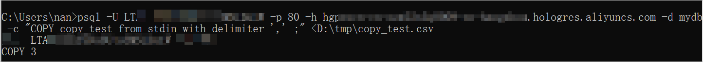

    其中，插入的标准文件内容如下：

    ```text
    01,01,name1
    02,01,name2
    03,01,name3
    04,01,name4
    ```

  - 执行完成后，回到psql客户端可以查询新插入的数据，如下图所示。

    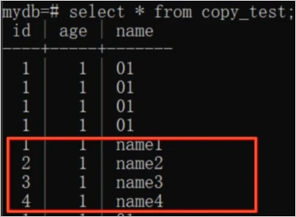

**CopyManager导入JDBC客户端文件**

针对JDBC客户端文件，可以使用CopyManager工具进行数据复制。

CopyManager是JDBC针对PostgreSQL的COPY场景封装的API。Hologres兼容PostgreSQL协议，可以直接使用CopyManager进行JDBC客户端文件的导入与导出。更多关于CopyManager的信息请参见JDBC官网文档CopyManager。

使用示例：使用CopyManager导入JDBC客户端的文件至Hologres，代码样例如下。

```java
package com.aliyun.hologram.test.jdbc;

import java.io.FileInputStream;
import java.io.FileOutputStream;
import java.io.IOException;
import java.sql.*;
import java.util.Properties;

import org.postgresql.copy.CopyManager;
import org.postgresql.core.BaseConnection;

public class jdbcCopyFile {

    public static void main(String args[]) throws Exception {
        System.out.println(copyFromFile(getConnection(), "/Users/feng/Workspace/region.tbl", "region"));
    }

    public static Connection getConnection() throws Exception {
        Class.forName("org.postgresql.Driver");
        String url = "jdbc:postgresql://endpoint:port/dbname";
        Properties props = new Properties();
    //set db user
        props.setProperty("user", "AAA");//当前账号的AccessKey ID，建议通过环境变量调⽤，降低密码泄露⻛险。
    //set db password
        props.setProperty("password", "BBB");//当前账号的AccessKey SECRET，建议通过环境变量调⽤，降低密码泄露⻛险。
        return DriverManager.getConnection(url, props);
    }

    /**
     * 导入⽂件⾄数据库。
     *
     * @param connection
     * @param filePath
     * @param tableName
     * @return
     * @throws SQLException
     * @throws IOException
     */
    public static long copyFromFile(Connection connection, String filePath, String tableName)
            throws SQLException, IOException {
        long count = 0;
        FileInputStream fileInputStream = null;

        try {
            CopyManager copyManager = new CopyManager((BaseConnection) connection);
            fileInputStream = new FileInputStream(filePath);
            count = copyManager.copyIn("COPY " + tableName + " FROM STDIN delimiter '|' csv", fileInputStream);
        } finally {
            if (fileInputStream != null) {
                try {
                    fileInputStream.close();
                } catch (IOException e) {
                    e.printStackTrace();
                }
            }
        }
        return count;
    }
}
```

**FIXED COPY**

FIXED COPY是使用Fixed Plan优化COPY命令执行的新模式，是Hologres特有的执行引擎优化方式，仅支持导入数据至Hologres。更多关于Fixed Plan的原理请参见Fixed Plan加速SQL执行。

从Hologres V1.3.17版本起，支持FIXED COPY模式导入数据至Hologres。与未经Fixed Plan优化的COPY命令相比，有如下不同：

| 类别 | FIXED COPY | COPY |
| --- | --- | --- |
| 锁力度 | 行级锁 | 表级锁 |
| 数据可见行 | 写入即可见 | COPY结束后可见 |
| 性能 | 高 | 非常高 |
| 格式支持 | TEXT、BINARY | TEXT |
| 主键冲突策略 | NONE（冲突则报错）、UPDATE、IGNORE | NONE（冲突则报错） |

针对非全列COPY的场景，FIXED COPY的表现如下：

- 如果COPY写入的列不是全列，则为局部更新，表现如下：

  ```sql
  CREATE TABLE t0 (id int NOT NULL, name text, age int, primary key(id));

  COPY t0(id, name) FROM STDIN
  WITH (
    STREAM_MODE TRUE,
    ON_CONFLICT UPDATE);

  -- 上述COPY等价与如下INSERT INTO
  INSERT INTO t0(id, name) VALUES(?,?)
  ON CONFLICT(id) DO UPDATE SET
  id = excluded.id, name = excluded.name;
  ```

- 如果COPY写入的列不是全列，且未参与写入的列包含default value，表现如下：

  ```sql
  CREATE TABLE t0 (id int not null, name text, age int DEFAULT 0, primary key(id));

  COPY t0(id, name) FROM STDIN
  WITH (
    STREAM_MODE TRUE,
    ON_CONFLICT UPDATE);

  -- 上述COPY等价与如下INSERT INTO
  -- 若id数据不存在，age列赋值default value；
  -- 若id数据已存在，age列不更新
  INSERT INTO t0(id, name, age) VALUES(?, ?, default)
  ON CONFLICT(id) DO UPDATE SET
  id = excluded.id, name = excluded.name;
  ```

**使用COPY从Hologres中导出数据**

**导出至本地文件**

使用示例：

- 使用 `\copy` 导出Hologres的数据至本地文件。

  > **说明**
  >
  > 仅支持PSQL客户端使用该方式导出数据。

  ```sql
  -- 建表
  CREATE  TABLE copy_to_local (
    id    int,
    age   int,
    name  text
  ) ;

  -- 写入数据
  INSERT INTO copy_to_local VALUES
  (1,1,'a'),
  (1,2,'b'),
  (1,3,'c'),
  (1,4,'d');

  -- 查数据
  SELECT * FROM copy_to_local;

  -- 导出数据⾄本地⽂件
  \copy (SELECT * FROM copy_to_local) TO '/root/localfile.txt';
  ```

- 使用STDOUT导出Hologres数据至本地文件。

  > **说明**
  >
  > 仅支持PSQL客户端使用该方式导出数据。

  ```xml
  psql -U <username> -p <port> -h <endpoint> -d <databasename> -c "COPY (SELECT * FROM <tablename>) TO STDOUT WITH DELIMITER '|' CSV;" >
  <filename>;
  ```

**导出至OSS**

阿里云对象存储（Object Storage Service，简称OSS）是阿里云提供的安全、低成本及高可靠的云存储服务。Hologres支持通过以COPY命令语句的方式将查询的数据导出到指定的OSS。

- 使用限制

  - 仅当前Hologres实例的Superuser或拥有**pg_execute_server_program**权限的用户，才可以使用 `hg_dump_to_oss` 导出Hologres的数据至OSS。Superuser可以授予其他用户**pg_execute_server_program**权限，命令如下。

    ```text
    --DB开启简单权限模型，执⾏以下语句
    CALL spm_grant('pg_execute_server_program','云账号ID/云邮箱/RAM账号');

    --DB使⽤的是专家权限模型，执⾏以下语句
    GRANT pg_execute_server_program TO 云账号ID/云邮箱/RAM账号;
    ```

  - 单次导入至OSS的数据量不能超过5GB。

- 命令介绍

  - `COPY TO` 命令：

    ```text
    COPY ( query ) TO { PROGRAM 'command' | STDOUT }
        [ [ WITH ] ( option [, ...] ) ]
    ```

    其中，PROGRAM指一个需要执行的命令，输出会写入到该命令的标准输入。其余参数说明请参见上文中的参数说明。

  - `hg_dump_to_oss` 命令（需要与 `COPY TO` 命令组合使用）：

    ```xml
    COPY (query) TO PROGRAM 'hg_dump_to_oss --AccessKeyId <accessid> --AccessKeySecret <accesskey> --Endpoint <ossendpoint> --BucketName 
    <bucketname> --DirName <dirname> --FileName <filename> --BatchSize <xxx> ' (DELIMITER ',', HEADER true, FORMAT CSV);
    ```

    > **重要**
    >
    > &lt;dirname>前请不要添加斜杠（/）、反斜杠（\\）等字符。

    参数说明：

    | 参数 | 描述 | 示例 |
    | --- | --- | --- |
    | query | 输入的查询语句 | <code>select * from dual;</code> |
    | AccessKeyId | 当前账号的AccessKey ID。建议您使用环境变量的方式调用用户名和密码，降低密码泄露风险。 | 无 |
    | AccessKeySecret | AccessKey ID对应的AccessKey Secret。建议您使用环境变量的方式调用用户名和密码，降低密码泄露风险。 | 无 |
    | Endpoint | OSS的经典网络访问域名。获取方式如下：<br>• 您可以单击Bucket列表页面的目标Bucket名称，进入Bucket详情页查看。<br>• 您可以根据实例所属地域获取。 | <code>oss-cn-beijing-internal.aliyuncs.com</code> |
    | BucketName | OSS对应的bucket名字。 | dummy_bucket |
    | DirName | OSS存放输出结果的目录。 | <code>testdemo/</code> |
    | FileName | （可选）OSS对应的文件名称。 | file_name |
    | BatchSize | 每次执行<code> hg_dump_to_oss </code>的行数，默认为1000。 | 5000 |
    | DELIMITER | 结果列之间的分隔符，默认为制表符（Tab-separated Values，简称TSV）。 | <code>,</code> |

  - 使用示例

    在Hologres中 `hg_dump_to_oss` 命令与 `COPY TO` 命令的使用示例如下。

    ```text
    -- 将Hologres内部表数据dump到指定OSS
    COPY (select * from holo_test LIMIT 2) TO PROGRAM 'hg_dump_to_oss --AccessKeyId <access id> --AccessKeySecret <access key> --Endpoint oss-cn-hangzhou-internal.aliyuncs.com --BucketName hologres-demo --DirName holotest/ --FileName file_name --BatchSize 3000' DELIMITER ',';

    -- 将Hologres外部表数据dump到指定OSS
    COPY (select * from foreign_holo_test LIMIT 20) TO PROGRAM 'hg_dump_to_oss --AccessKeyId <access id> --AccessKeySecret <access key> --
    Endpoint oss-cn-hangzhou-internal.aliyuncs.com --BucketName hologres-demo --DirName holotest/ --FileName file_name --BatchSize 3000' 
    (DELIMITER ',', HEADER true);

    -- 跨region dump到指定OSS
    COPY (select * from holo_test_1 LIMIT 20) TO PROGRAM 'hg_dump_to_oss --AccessKeyId <access id> --AccessKeySecret <access key> --Endpoint oss-cn-beijing-internal.aliyuncs.com --BucketName hologres-demo --DirName holotest/ --FileName file_name --BatchSize 3000' (DELIMITER ',', 
    HEADER true, FORMAT CSV);
    ```

    > **说明**
    >
    > Hologres支持跨地域导出数据至指定的OSS。例如，可以导出杭州地域的实例数据至北京地域的OSS。

  - 常见问题

    常见的报错内容及解决方法如下：

    | 报错信息 | 解决方法 |
    | --- | --- |
    | <code>ERROR: syntax error at or near ")"LINE 1: COPY (select 1,2,3</code><br><code>from ) TO PROGRAM 'hg_dump_to_oss2 --Acce...</code> | 输入的<strong>query</strong>有误，请检查对应的查询语句。 |
    | <code>DETAIL: child process exited with exit code 255</code> | 选择的OSS网络类型有误。如果您使用的是公共云，请选择<strong>经典网络</strong>。 |
    | <code>DETAIL: command not found</code> | 您需要配置<strong>DUMP TO OSS</strong>的<strong>program</strong>为hg_dump_to_oss，否则会出现该报错。 |
    | <code>ERROR: program "hg_dump_to_oss ..." failed DETAIL: child process</code><br><code>exited with exit code 101</code> | 输入的<strong>AccessKeyId</strong>不合法，请使用当前账号的AccessKey ID。 |
    | <code>ERROR: program "hg_dump_to_oss ..." failed DETAIL: child process</code><br><code>exited with exit code 102</code> | 输入的<strong>AccessKeySecret</strong>不合法，请使用当前账号的AccessKey Secret。 |
    | <code>ERROR: program "hg_dump_to_oss ..." failed DETAIL: child process</code><br><code>exited with exit code 103</code> | 输入的<strong>Endpoint</strong>不合法，请确认对应OSS经典网络的Endpoint。 |
    | <code>ERROR: program "hg_dump_to_oss ..." failed DETAIL: child process</code><br><code>exited with exit code 104</code> | 输入的<strong>BucketName</strong>不合法，请确认对应的Bucket名称。 |
    | <code>ERROR: program "hg_dump_to_oss ..." failed DETAIL: child process</code><br><code>exited with exit code 105</code> | 缺少参数，请对照参数说明，检查必选参数是否均已配置。 |
    | <code>ERROR: program "hg_dump_to_oss ..." failed DETAIL: child process</code><br><code>exited with exit code 255</code> | 一般情况下是由于holo server与指定的OSS网络不通导致该报错，可以更换OSS域名（例如：OSS网络类型选择经典网络）。 |

**CopyManager导出至JDBC客户端文件**

使用示例：使用CopyManager导出Hologres的数据至JDBC客户端的文件，代码样例如下。

```java
import org.postgresql.copy.CopyManager;
import org.postgresql.core.BaseConnection;

import java.io.FileOutputStream;
import java.io.IOException;
import java.sql.Connection;
import java.sql.DriverManager;
import java.sql.SQLException;
import java.util.Properties;

public class copy_to_local_file {

    public static void main(String args[]) throws Exception {
        System.out.println(copyToFile(getConnection(), "/Users/feng/Workspace/region.tbl", "select * from region"));
    }

    public static Connection getConnection() throws Exception {
        Class.forName("org.postgresql.Driver");
        String url = "jdbc:postgresql://endpoint:port/dbname";
        Properties props = new Properties();
    //set db user
        props.setProperty("user", "AAA");//当前账号的AccessKey ID，建议通过环境变量调⽤，降低密码泄露⻛险。
    //set db password
        props.setProperty("password", "BBB");//当前账号的AccessKey SECRET，建议通过环境变量调⽤，降低密码泄露⻛险。
        return DriverManager.getConnection(url, props);
    }

    /**
     * 导出数据⾄JDBC客户端⽂件。
     *
     * @param connection
     * @param filePath
     * @param SQL_Query
     * @return
     * @throws SQLException
     * @throws IOException
     */
    public static String copyToFile(Connection connection, String filePath, String SQL_Query)
            throws SQLException, IOException {

        FileOutputStream fileOutputStream = null;

        try {
            CopyManager copyManager = new CopyManager((BaseConnection)connection);
            fileOutputStream = new FileOutputStream(filePath);
            copyManager.copyOut("COPY " + "(" + SQL_Query + ")" + " TO STDOUT DELIMITER '|' csv ", fileOutputStream);
        } finally {
            if (fileOutputStream != null) {
                try {
                    fileOutputStream.close();
                } catch (IOException e) {
                    e.printStackTrace();
                }
            }
        }
        return filePath;
    }
}
```

<a id="section-1-7-2"></a>

### 1.7.2. INSERT

INSERT语句用于插入新的行数据至表中。本文为您介绍在实时数仓Hologres中如何使用INSERT插入数据。

**语法**

您可以插入一个或多个由表达式指定的行，以及插入来自一个查询的零行或多行数据至Hologres。语句如下。

```sql
INSERT INTO table [( column [, ...] )]
   VALUES ( {expression}  [, ...] ) 
   [, ...] | query}
```

参数说明如下表所示。

<table>
  <tr>
    <th width="113">参数</th>
    <th>描述</th>
  </tr>
  <tr>
    <td>schema</td>
    <td>表所在的Schema名称。</td>
  </tr>
  <tr>
    <td>table</td>
    <td>已创建的表名称。通过Flink写入时可以插入父表并自动路由到子表。从Hologres V1.3版本起，支持符合FixedPlan的Insert语句直接写入分区表父表，详情请参见Fixed Plan加速SQL执行。</td>
  </tr>
  <tr>
    <td>column</td>
    <td>table表中的某个列的名称。您也可以使用子域名或者数组下标限定列名称。（指向一个组合列的某些列中插入会让其他域为空）。</td>
  </tr>
  <tr>
    <td>expression</td>
    <td>赋予相应列的表达式或值。</td>
  </tr>
  <tr>
    <td>query</td>
    <td>需要被插入行的SELECT查询语句。 语法详情请参见SELECT语句。</td>
  </tr>
</table>

目标列的名称可以以任意顺序列出。如果没有给出列名列表，则有两种确定目标列的可能性。第一种是以被声明的顺序列出该表的所有列。另一种可能性是，如果VALUES子句或者query只提供N个列，则以被声明的顺序列出该表的前N列。VALUES子句或者query提供的值会被从左至右关联到这些显式或者隐式给出的目标列。

每一个没有出现在显式或者隐式列列表中的列都将被默认填充，如果为该列声明过默认值则用默认值填充，否则用空值填充。如果任意列的表达式不是正确的数据类型，将会尝试自动转换类型。

目前INSERT只支持以下两种数据写入方式：

```sql
 INSERT INTO VALUES 
```

```sql
INSERT INTO rh_holo2mysqltest (cate_id, cate_name) VALUES
    (3, 'true'),
    (3, 'fale'),
    (3, 'trxxue'),
    (3, 'x'),
    (4, 'The Dinner Game');
```

```sql
 INSERT INTO SELECT 
```

```sql
INSERT INTO test2
SELECT 2,'two';
```

**技术原理**

Hologres表的存储结构分为行存、列存和行列共存，但三者的写入原理一致。

如下图所示，INSERT是以Append Only的方式写入WAL，并实时更新到内存表（MemTable），保证数据实时可见。但Mem Table有一定的大小，写满了之后会切换新的MemTable，并触发后台的异步Flush过程，将其中的数据逐渐Flush到文件中，文件存储在Pangu中。在Flush的过程中会产生很多小文件，后台会将这些小文件做合并和整理，即Compaction。为了写速度尽可能的快，后台会先将数据写完，待异步Compaction时再执行压缩和整理，因此会看到在数据写入过程中，数据的存储会一定的膨胀，等数据写入之后，Compaction完成后存储会下降。

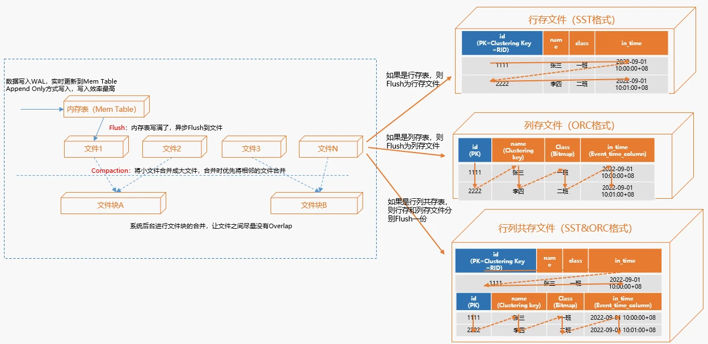

对于行存、列存、行列共存表的区别一方面是内存的Mem Table的索引格式不同，另外一方面在Flush到文件的过程中：

- 行存表：会Flush成行存储的文件，即SST格式。

- 列存表：会Flush成列存文件，即ORC格式。

- 行列共存表：会分别Flush为行存和列存两种文件，SST和ORC格式，在Flush过程中会保证数据的一致性，只有行存、列存都同时Flush完成才会返回成功，同时在存储上行列共存相当于是两份存储，因此行列共存的表在存储上会有一定的牺牲。

**使用示例**

- 插入普通表。

  ```sql
  CREATE TABLE  holotest (
      a int,
      b bigint,
      c bool,
      e decimal(38,10),
      f text,
      g timestamp,
      h timestamptz,
      i jsonb,
      j int[]
  );

  INSERT INTO holotest VALUES (1,9223372036854775807,false,123.123456789123,'john','2020-01-01 01:01:01.123456',
  '2004-10-19 10:23:54+08','{"a":2}',ARRAY[1, 2, 3, 4]);
  ```

- 从a表插入数据至b表。

  ```sql
  CREATE TABLE holotest2(
      a int,
      b bigint,
      c bool)

  INSERT INTO holotest2 (a,b,c) SELECT a,b,c FROM holotest;
  ```

- 插入分区表数据。

  ```sql
  --示例：在public schema下创建不带主键的分区⽗表和对应的分区⼦表
  begin;
  create table public.hologres_parent(
    a text,
    b int,
    c timestamp,
    d text
  )
    partition by list(a);
  call set_table_property('public.hologres_parent', 'orientation', 'column');

  create table public.hologres_2022 partition of public.hologres_parent for values in('2022');

  create table public.hologres_2021 partition of public.hologres_parent for values in('2021');

  create table public.hologres_2020 partition of public.hologres_parent for values in('2020');
  commit;

  --插入分区⼦表
  INSERT INTO public.hologres_2022 values('2022',1,now(),'a')
  ```

**常见问题**

- 问题一：数据在写入时，为什么监控指标中存储用量上涨非常多，写入完成后存储用量又下降？

  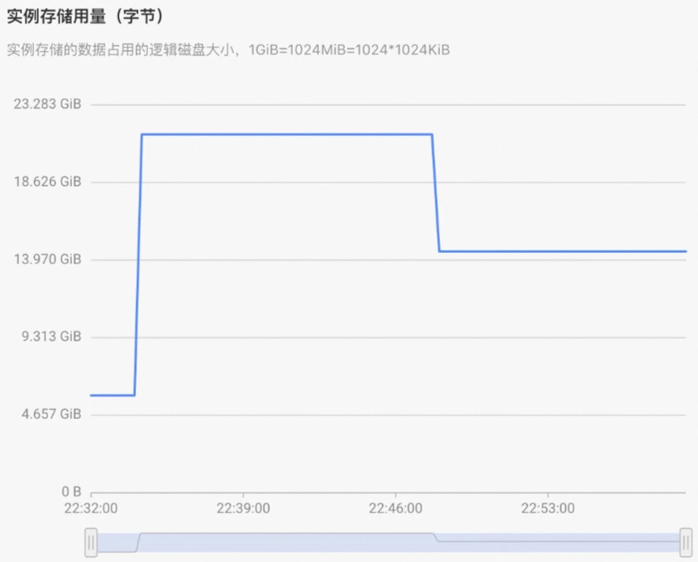

  根据写入的技术原理，为了尽可能快的写入数据，后台会先将数据写完，待异步Compaction时再执行压缩和整理，因此会看到在数据写入过程中，数据的存储会一定的膨胀，等数据写入之后，Compaction完成后存储会下降。

- 问题二：同一张表并行执行 `insert` 命令时，延迟增加。

  没有走Fixed Plan的 `insert` 是表锁，并行执行 `insert` 会导致等锁时间增加，从而造成延迟增加。

- 问题三：数据写入分区父表报错： `ERROR: no partition of relation "<table_name>" found for row` 。

  - 报错信息： `ERROR: no partition of relation "<table_name>" found for row` 。

  - 问题原因：分区子表不存在。

  - 解决方法：写入数据前，需创建对应的分区子表，命令示例如下。

    ```sql
    create table <child_table_name> partition of <parent_table_name> for values in (<value>);
    ```

- 问题四：在导入数据的时候报错： `Currently inserting into parent table is not supported` 。

  - 报错信息：导入数据时报错： `Currently inserting into parent table is not supported` 。

  - 问题原因：当前Insert的表，是一张分区父表，Hologres不支持直接写入分区父表。

  - 解决方法：需要写入对应的分区子表。

<a id="section-1-7-3"></a>

### 1.7.3. SELECT

本文将会为您介绍在交互式分析（Hologres） 中数据查询SELECT的用法。

**命令介绍**

SELECT：从零或更多表中以多种形式的数据查询。主要包含的参数如下表所示：

**参数列表**

WITH列表

SELECT列表

FROM子句

WHERE子句

GROUP BY子句

CUBE子句

DISTINCT 子句

COUNT DISTINCT子句

UNION子句

INTERSECT子句

EXCEPT子句

ORDER BY子句

LIMIT子句

**命令格式**

SELECT语句的基本语法具体如下。

```text
[ WITH with_query [, ...] ]
SELECT [ALL | DISTINCT [ON (expression [, ...])]]
  * | expression [[AS] output_name] [, ...]
  [FROM from_item [, ...]]
  [WHERE condition]
  [GROUP BY grouping_element [, ...]]
  [HAVING condition [, ...]]
  [{UNION | INTERSECT | EXCEPT} [ALL] select]
  [ORDER BY expression [ASC | DESC | USING operator] [, ...]]
  [LIMIT {count | ALL}]
```


其中， `grouping_element` 和 `from_item` 包含的内容如下：

- grouping_element包含 `expression  expression` 可能是列名、常数、函数或者是列名或常数的任意组合，以及以算术运算符或逐位运算符连接的函数。

- from_item包含

  ```text
  table_name [[AS] alias [( column_alias [, ...] )]]
  (select) [AS] alias [( column_alias [, ...] )]
  from_item [NATURAL] join_type from_item
            [ON join_condition | USING ( join_column [, ...] )]
  ```

**命令用法**

SELECT的常用方法如下：

1. FROM列表中的所有元素都会被计算（ FROM中的每一个元素都是一个真实表或者虚拟表）。如果在FROM列表中指定了多于一个元素，得到的结果做并集。

2. 如果指定了WHERE子句，所有不满足该条件的行都会被从输出中消除。

3. 如果指定了 `GROUP BY` 子句或者如果有聚集函数，输出会被组合成由在一个或者多个值上匹配的行构成的分组，并且在其上计算聚集函数的结果。如果出现了HAVING子句，它会消除不满足给定条件的分组。

4. 对于每一个被选中的行或者行组，会使用SELECT输出表达式计算实际的输出行。

   5. `SELECT DISTINCT` 从结果中消除重复的行。  `SELECT DISTINCT ON` 消除在所有指定表达式上匹配的行。 `SELECT ALL` （默认）将返回所有候选行， 包括重复的行。

6. 通过使用操作符UNION、INTERSECT和EXCEPT，多于一个SELECT语句的输出可以被整合形成一个结果集。UNION操作符返回位于一个或者两个结果集中的全部行。INTERSECT操作符返回同时位于两个结果集中的所有行。EXCEPT操作符返回位于第一个结果集但不在第二个结果集中的行。在所有三种情况下，重复行都会被消除（除非指定ALL）。可以增加DISTINCT来显式的消除重复行。注意虽然ALL是SELECT自身的默认行为，但这里DISTINCT是默认行为。

7. 如果指定了 `ORDER BY` 子句，被返回的行会以指定的顺序排序。如果没有给定 `ORDER BY` ，系统会以能最快产生行的顺序返回它们。

8. 如果指定了LIMIT（或FETCH FIRST） 或者OFFSET子句，SELECT语句只返回结果行的一个子集。

**参数说明**

- **WITH列表**

  - 命令简介WITH列表是位于SELECT之前或者作为SELECT子句的subquery存在，通常位于SELECT之前，用于定义子查询，并为子查询声明一个名字和返回的列名，定义每一个WITH子句为一个CTE（Common Table Expression），定义语法如下：

    ```text
    with_query_name [ ( column_name [, ...] ) ] AS ( select )
    ```

  - 参数说明

    <table>
      <tr>
        <th width="168">参数</th>
        <th>说明</th>
      </tr>
      <tr>
        <td>with_query_name</td>
        <td>指定当前CTE的名字，可以是任意有效的标识符。</td>
      </tr>
      <tr>
        <td>column_name</td>
        <td>列表对应着子查询返回值的列名，类似于SELECT子句中的AS的语义，子查询可以是一个常规的SELECT查询。</td>
      </tr>
    </table>

    CTE之间通过逗号分隔，后面出现的CTE定义可以引用前面定义的CTE，但是目前暂时不支持递归的CTE调用，在之后的查询中，可以直接将 `with_query_name` 作为一个视图（view）出现在查询中，如果没有指定 `column_name` 列表，该view的 `column_name` 为对应子查询返回列的列名，如果指定 `column_name` 列表，则需要使用定义 `column_name` ，并且 `column_name` 列表需要和SELECT返回值列表个数相同。

- **SELECT列表**

  - 命令简介

    SELECT列表（位于关键词 SELECT和FROM之间）指定构成SELECT语句输出行的表达式。这些表达式可以（并且通常确实会）引用FROM子句中计算得到的列。

  - 参数说明

    SELECT的每一个输出列都有一个名称。 在一个简单的SELECT中，该名称只用来标记要显示的列，当SELECT为一个大型查询的子查询时，大型查询会把该名称看做子查询产生的虚表的列名。要指定用于输出列的名称，在该列的表达式后面添加 `AS output_name` （可以省略AS，但只能在期望的输出名称不匹配任何PostgreSQL关键词时省略。为了避免和未来增加的关键词冲突， 推荐您添加AS或者用双引号引用输出名称）。如果不指定列名，PostgreSQL会自动选择一个名称。如果列的表达式是一个简单的列引用，那么被选择的名称就和该列的名称相同。在使用函数或者类型名称的更复杂的情况中，系统可能会生成诸如  `?column?` 之类的名称。

    一个输出列的名称可以被用来在 `ORDER BY` 以及 `GROUP BY` 子句中引用该列的值，但是不能用于 WHERE和HAVING子句（在其中必须写出表达式）。

    可以在输出列表中写\*来取代表达式，它是被选中行的所有列的一种简写方式。还可以写  `%table_name*;` ，它是只来自那个表的所有列的简写形式。在这些情况中无法用AS指定新的名称，输出行的名称将和表列的名称相同。

- **FROM子句**

  - 命令简介

    FROM子句为SELECT 指定一个或者更多源表。如果指定了多个源表，结果将是所有源表的笛卡尔积（交叉连接）。但是通常会增加限定条件（通过 WHERE）来把返回的行限制为该笛卡尔积的一个小子集。

  - 参数说明FROM子句可以包含下列元素：

    <table>
      <tr>
        <th width="160">元素</th>
        <th>说明</th>
      </tr>
      <tr>
        <td>table_name</td>
        <td>一个现有表或视图的名称（可以限定表的schma模式）。</td>
      </tr>
      <tr>
        <td>alias</td>
        <td>一个包含别名的FROM项的替代名称。别名被用于让书写简洁或者消除自连接中的混淆（其中同一个表会被扫描多次）。当提供一个别名时，表或者函数的实际名称会被隐藏。例如，给定<code> FROM foo AS f </code>，SELECT的剩余部分就必须以f而不是foo来引用这个 FROM项。</td>
      </tr>
      <tr>
        <td>select</td>
        <td>一个子SELECT可以出现在 FROM子句中。这就好像把它的输出创建为一个存在于该SELECT命令期间的临时表。注意子-SELECT必须用圆括号包围，并且必须为它提供一个别名。</td>
      </tr>
      <tr>
        <td>function_name</td>
        <td>函数调用可以出现在FROM子句中（对于返回结果集合的函数特别有用，但是可以使用任何函数）。这就好像把该函数的输出创建为一个存在于该SELECT命令期间的临时表。可以用和表一样的方式提供一个别名。如果写了一个别名，还可以写一个列别名列表来为该函数的组合返回类型的一个或者多个属性提供替代名称，包括由ORDINALITY（如果有）增加的新列。通过把多个函数调用包围在<code> ROWS FROM</code>（。）<code> </code>中可以把它们整合在单个FROM-子句项中。这样一个项的输出是把每一个函数的第一行串接起来，然后是每个函数的第二行，以此类推。如果有些函数产生的行比其他函数少，则在缺失数据的地方放上 NULL，这样被返回的总行数总是和产生最多行的函数一样。</td>
      </tr>
      <tr>
        <td>join_type</td>
        <td>包含如下5种类型：<br>• [ INNER ] JOIN对于INNER和OUTER连接类型，必须指定一个连接条件，即 <code> NATURAL</code>、<code>ON join_condition</code>或者<code> USING </code>（<code>join_column [, </code><code>...]</code>）<code> </code>之一（只能有一种）。其含义见下文。对于<code> CROSS JOIN </code>，上述子句不能出现。一个JOIN子句联合两个FROM项（为了方便我们称之为“表“，尽管实际上它们可以是任何类型的FROM项）。如有必要可以使用圆括号确定嵌套的顺序。 在没有圆括号时，JOIN会从左至右嵌套。在任何情况下，JOIN的联合比用逗号分隔FROM-列表项更强。<br>• LEFT [ OUTER ] JOIN <code> LEFT OUTER JOIN </code>返回被限制过的笛卡尔积中的所有行（即所有通过了其连接条件的组合行），以及左表中每行的一个副本，因为没有右行通过了连接条件。通过在右手列中插入空值，这种左手行会被扩展为连接表的完整行。注意在决定哪些行匹配时，只考虑JOIN子句自身的条件。之后才应用外条件。<br>• RIGHT [ OUTER ] JOIN <code> RIGHT OUTER JOIN </code>返回所有连接行，外加每一个没有匹配上的右手行（在左端用空值扩展）。这只是为了记号上的方便，因为可以通过交换左右表把它转换成一个<code> LEFT OUTER JOIN </code>。<br>• FULL [ OUTER ] JOIN <code> FULL OUTER JOIN </code>返回所有连接行，外加每一个没有匹配上的左手行（在右端用空值扩展），再外加每一个没有匹配上的右手行（在左端用空值扩展）<br>• CROSS JOIN <code> CROSS JOIN </code>和<code> INNER JOIN  </code>会产生简单的笛卡尔积，也就是与在FROM列出两个表得到的结果相同，但是要用连接条件（如果有）约束该结果。 <code> CROSS JOIN </code>与<code> INNER JOIN ON </code>（<code>TRUE</code>）<code> </code>等效，也就是说条件不会移除任何行。这些连接类型只是一种记号上的方便，因为没有什么是用纯粹的FROM和 WHERE能做而它们不能做的。</td>
      </tr>
      <tr>
        <td>join_condition</td>
        <td><code> join_condition </code>是一个会得到boolean类型值的表达式（类似于一个WHERE子句），它说明一次连接中哪些行被认为相匹配。</td>
      </tr>
      <tr>
        <td>USING ( a, b, ... )</td>
        <td>形式<code> USING </code>（<code>a</code>，<code> b...</code>）<code> </code>的子句是 <code> ON left_table.a = right_table.a AND left_table.b = right_table.b ... </code>的简写。还有， USING表示每一对相等列中只有一个会被包括在连接输出中。</td>
      </tr>
      <tr>
        <td>NATURAL</td>
        <td>列出在两个表中所有具有相同名称的列的USING的简写。</td>
      </tr>
    </table>

- **WHERE子句**

  - 命令简介可选的WHERE子句的形式 ：

    ```text
    WHERE condition
    ```

  - 参数说明

    <table>
      <tr>
        <th width="100">参数</th>
        <th>说明</th>
      </tr>
      <tr>
        <td>condition</td>
        <td>condition是任一计算得到布尔类型结果的表达式。任何不满足这个条件的行都会从输出中被消除。如果用一行的实际值替换其中的变量引用后，该表达式返回真，则该行符合条件。</td>
      </tr>
    </table>

- **GROUP BY子句**

  - 命令简介 `GROUP BY` 将会把所有被选择的行中共享相同分组表达式值的那些行压缩成一个行。可选的 `GROUP BY` 子句的形式：

    ```text
    GROUP BY grouping_element [, ...]
    ```

  - 参数说明

    `grouping_element` 中使用的expression可以是输入列名、输出列（SELECT列表项） 的名称或序号或者由输入列值构成的任意表达式。在出现歧义时，  `GROUP BY` 名称将被解释为输入列名而不是输出列名。

    如果任何 `GROUPING SETS`、`ROLLUP` 或者CUBE作为分组元素存在，则 `GROUP BY` 子句整体上定义了数个独立的分组集。其效果等效于在具有独立分组集作为它们的 `GROUP BY` 子句的子查询间构建一个UNION ALL。

    聚集函数（如果使用）会在组成每一个分组的所有行上进行计算，从而为每一个分组产生一个单独的值（如果有聚集函数但是没有 `GROUP BY` 子句，则查询会被当成是由所有选中行构成的一个单一分组）。传递给每一个聚集函数的行集合可以通过在聚集函数调用附加一个FILTER子句来进一步过滤。当存在一个FILTER子句时，只有那些匹配它的行才会被包括在该聚集函数的输入中。

    当存在 `GROUP BY` 子句或者任何聚集函数时， SELECT列表表达式不能引用非分组列（除非它出现在聚集函数中或者它函数依赖于分组列），因为这样做会导致返回非分组列的值时会有多种可能的值。如果分组列是包含非分组列的表的主键（ 或者主键的子集），则存在函数依赖。

    所有的聚集函数都是在HAVING子句或者 SELECT列表中的任何“标量“表达式之前被计算。 这意味着一个CASE表达式不能被用来跳过一个聚集表达式的计算。

- **CUBE子句**

  - 命令简介

    - CUBE CUBE是自动对GROUP BY子句中列出的字段进行分组汇总，结果集将包含维度列中各值的所有可能组合，以及与这些维度值组合相匹配的基础行中的聚合值。它会为每个分组返回一行汇总信息，用户可以使用CUBE来产生交叉表值。例如，在CUBE子句中给出三个表达式 （`n = 3`） ，运算结果为2n = 23 = 8组。 以n个表达式的值分组的行称为常规行，其余的行称为超级聚集行。具体表达式如下：

      ```text
      CUBE ( { expression | ( expression [, …] ) } [, …] )
      ```

    - ROLLUP ROLLUP 函数是聚合函数，它是GROUP BY语句的简单扩展。在数据统计和报表生成过程中，它可以为每个分组返回一个小计，同时为所有分组返回总计。具体表达式如下：

      ```text
      ROLLUP ( { expression | ( expression [, …] ) } [, …] ) 
      ```

    - GROUPING SETS GROUPING SETS子句是GROUP BY子句的进一步扩展，它可以使用户指定多个GROUP BY选项。 这样做可以通过裁剪用户不需要的数据组来提高效率。 当用户指定了所需的数据组时，数据库不需要执行完整CUBE或ROLLUP生成的聚合集合。具体表达式如下：

      ```text
      GROUPING SETS ( grouping_element [, …] ) 
      ```

- **DISTINCT子句**如果指定了SELECT DISTINCT，所有重复的行会被从结果集中移除（为每一组重复的行保留一行）。

  ```sql
  SELECT DISTINCT accountid FROM table;
  ```

- **COUNT DISTINCT子句**

  - 命令简介

    `COUNT DISTINCT` 支持计算去重之后的某一个column的个数，对于该列中出现多次的值只会被计算一次，和COUNT的计算类似，如果该列包含NULL值，它将不会计算在内。

  - 语法说明

    - 精确计算的语法示例如下：

      ```sql
      SELECT c1, COUNT(DISTINCT c2) FROM table GROUP BY c1
      ```

    - 由于精确计算的 `COUNT DISTINCT` 需要消耗较大的资源，因此交互式分析还支持非精确的 `COUNT DISTINCT` 计算，语法示例如下：

      ```sql
      SELECT c1, approx_count_distinct(c2) FROM table GROUP BY c1
      ```

- **UNION子句**

  - 命令简介UNION子句语法如下：

    ```text
    select_statement UNION [ ALL | DISTINCT ] select_statement
    ```

  - 参数说明

    <table>
      <tr>
        <th width="164">参数</th>
        <th>说明</th>
      </tr>
      <tr>
        <td>select_statement</td>
        <td><code> select_statement </code>是任何没有<code> ORDER BY</code>、<code>LIMIT</code>、<code> FOR NO KEY UPDATE</code>、<code>FOR UPDATE</code>、<code> FOR SHARE </code>和<code> FOR KEY </code> <code>SHARE </code>子句的SELECT语句（如果子表达式被包围在圆括号内， <code> ORDER BY </code>和LIMIT可以被附着到其上。如果没有圆括号，这些子句将被应用到UNION的结果而不是右手边的表达式上）。</td>
      </tr>
      <tr>
        <td>UNION</td>
        <td>UNION操作符计算所涉及的SELECT语句所返回的行的并集。如果一至少出现在两个结果集中的一个内，它就会在并集中。作为UNION两个操作数的SELECT语句必须产生相同数量的列并且对应位置上的列必须具有兼容的数据类型。UNION的结果不会包含重复行，除非指定了ALL选项。ALL会阻止消除重复（因此，UNION ALL通常显著地快于UNION，尽量使用ALL）。可以写DISTINCT来显式地指定消除重复行的行为。除非用圆括号指定计算顺序，同一个SELECT语句中的多个UNION操作符会从左至右计算。</td>
      </tr>
    </table>

- **INTERSECT子句**

  - 命令简介INTERSECT子句具有下面的形式：

    ```text
    select_statement INTERSECT [ ALL | DISTINCT ] select_statement
    ```

  - 参数说明

    <table>
      <tr>
        <th width="164">参数</th>
        <th>说明</th>
      </tr>
      <tr>
        <td>select_statement</td>
        <td><code> select_statement </code>是任何没有<code> ORDER BY LIMIT </code>子句的SELECT语句。</td>
      </tr>
      <tr>
        <td>INTERSECT</td>
        <td>INTERSECT操作符计算所涉及的 SELECT语句返回的行的交集。如果一行同时出现在两个结果集中，它就在交集中。INTERSECT的结果不会包含重复行，除非指定了 ALL选项。如果有ALL，一个在左表中有m次重复并且在右表中有n 次重复的行将会在结果中出现min（m，n）次。 DISTINCT可以写DISTINCT来显式地指定消除重复行的行为。除非用圆括号指定计算顺序， 同一个SELECT语句中的多个 INTERSECT操作符会从左至右计算。 INTERSECT的优先级比UNION更高。也即， <code> A UNION B INTERSECT C </code>将被读成<code> A UNION</code>（<code>B INTERSECT C</code>）<code> </code>。</td>
      </tr>
    </table>

- **EXCEPT子句**

  - 命令简介EXCEPT子句具有下面的形式：

    ```text
    select_statement EXCEPT [ ALL | DISTINCT ] select_statement
    ```

  - 参数说明

    <table>
      <tr>
        <th width="164">参数</th>
        <th>说明</th>
      </tr>
      <tr>
        <td>select_statement</td>
        <td><code> select_statement </code>是任何没有<code> ORDER BY LIMIT </code>子句的SELECT语句。</td>
      </tr>
      <tr>
        <td>EXCEPT</td>
        <td>EXCEPT操作符计算位于左SELECT语句的结果中但不在右SELECT语句结果中的行集合。EXCEPT的结果不会包含重复行，除非指定了 ALL选项。如果有ALL，一个在左表中有 m次重复并且在右表中有n次重复的行将会在结果集中出现max（m-n，0） 次。 DISTINCT可以写DISTINCT来显式地指定消除重复行的行为。除非用圆括号指定计算顺序， 同一个SELECT语句中的多个 EXCEPT操作符会从左至右计算。 EXCEPT的优先级与 UNION相同。当前，<code> FOR NO KEY UPDATE</code>、<code>FOR UPDATE</code>、<code> FOR SHARE </code>和<code> FOR KEY SHARE </code>不能用于EXCEPT结果或者 EXCEPT的任何输入。</td>
      </tr>
    </table>

- **ORDER BY子句**

  - 命令简介可选的 `ORDER BY` 子句的形式如下：

    ```text
    ORDER BY expression [ ASC | DESC | USING operator ] [ NULLS { FIRST | LAST } ] [, ...]
    ```

  - 参数说明

    `ORDER BY` 子句导致结果行被按照指定的表达式排序。 如果两行按照最左边的表达式是相等的，则会根据下一个表达式比较它们， 以此类推。如果按照所有指定的表达式它们都是相等的，则它们被返回的顺序取决于实现。

    每一个expression 可以是输出列（SELECT列表项）的名称或者序号，它也可以是由输入列值构成的任意表达式。

    序号指的是输出列的顺序（从左至右）位置。这种特性可以为不具有唯一名称的列定义一个顺序。但这不是必要操作，因为可以使用 AS子句为输出列赋予一个名称。

    也可以在ORDER BY子句中使用任意表达式，包括没有出现在SELECT输出列表中的列。因此， 下面的语句是合法的：

    ```sql
    SELECT name FROM distributors ORDER BY code;
    ```

    这种特性的一个限制是一个应用在UNION、 INTERSECT或EXCEPT子句结果上的  `ORDER BY` 只能指定输出列名称或序号，但不能指定表达式。

    如果一个ORDER BY表达式是一个既匹配输出列名称又匹配输入列名称的简单名称，ORDER BY将把它解读成输出列名称。这与在同样情况下GROUP BY会做出的选择相反。这种不一致是为了与SQL标准兼容。

    可以为ORDER BY子句中的任何表达式之后增加关键词 ASC（上升）或者DESC（下降）。如果没有指定， ASC被假定为默认值。或者，可以在USING 子句中指定一个特定的排序操作符名称。一个排序操作符必须是某个 B-树操作符族的小于或者大于成员。ASC通常等价于 USING <而DESC通常等价于 USING >（但是一种用户定义数据类型的创建者可以准确地定义默认排序顺序是什么，并且它可能会对应于其他名称的操作符）。

    如果指定 `NULLS LAST` ，空值会排在非空值之后；如果指定 `NULLS FIRST` ，空值会排在非空值之前。如果都没有指定， 在指定或者隐含ASC时的默认行为是 `NULLS LAST` ， 而指定或者隐含DESC时的默认行为是 `NULLS FIRST` （因此，默认行为是空值大于非空值）。 当指定USING时，默认的空值顺序取决于该操作符是否为小于或者大于操作符。

    注意顺序选项只应用到它们所跟随的表达式上。例如 `ORDER BY x`， `y DESC` 和 `ORDER BY x DESC`，`y DESC` 是不同的。

    字符串数据会被根据引用到被排序列上的排序规则排序。根据需要可以通过在 expression中包括一个 COLLATE子句来覆盖，例如 `ORDER BY mycolumn COLLATE “en_US“` 。

- **LIMIT子句**

  - 命令简介LIMIT子句由两个独立的子句构成：

    ```text
    LIMIT { count | ALL }
    OFFSET start
    ```

  - 参数说明

    count指定要返回的最大行数，而start指定在返回行之前要跳过的行数。在两者都被指定时，在开始计算要返回的count行之前会跳过 start行。

    如果count表达式计算为NULL，它会被当成 `LIMIT ALL` ，即没有限制。如果 start计算为 NULL，它会被当作OFFSET 0。

    在使用LIMIT时，用一个 `ORDER BY` 子句把结果行约束到一个唯一顺序是个好办法。否则讲得到该查询结果行的一个不可预测的子集 — 可能要求从第 10 到第 20 行，但是在什么顺序下的第10到第20呢？除非指定 `ORDER BY` ，否则是不知道顺序的。

    查询规划器在生成一个查询计划时会考虑LIMIT，因此根据使用的LIMIT和OFFSET，很可能得到不同的计划（得到不同的行序）。所以，使用不同的LIMIT/OFFSET值来选择一个查询结果的不同子集将会给出不一致的结果，除非用ORDER BY强制一种可预测的结果顺序。这不是一个缺陷，它是SQL不承诺以任何特定顺序（除非使用 `ORDER BY` 来约束顺序）给出一个查询结果这一事实造成的必然后果。

    如果没有一个 `ORDER BY` 来强制选择一个确定的子集， 重复执行同样的LIMIT查询甚至可能会返回一个表中行的不同子集。同样，这也不是一种缺陷，再这样一种情况下也无法保证结果的确定性。

**使用示例**

- 两表JOIN

  ```sql
  SELECT f.title, f.did, d.name, f.date_prod, f.kind FROM 
  distributors d, films f WHERE f.did = d.did
  ```

- WITH子句

  ```sql
  WITH distributor_name(name) AS SELECT name from distributors
  SELECT name FROM distributor_name ORDER BY name;
  ```

- GROUP BY分组

  ```sql
  SELECT kind, sum(length) AS total FROM films GROUP BY kind;
  ```

- HAVING过滤

  ```sql
  SELECT kind, sum(length) AS total FROM films GROUP BY kind 
  HAVING sum(length) < interval '5 hours';
  ```

- GROUP BY CUBE

  ```text
  SELECT  l_returnflag
          ,l_shipmode
          ,SUM(l_quantity)
  FROM    public.lineitem
  GROUP BY cube((l_returnflag),(l_shipmode))
  ORDER BY l_returnflag
           ,l_shipmode
  ```

- GROUP BY ROLLUP

  ```text
  SELECT  l_returnflag
          ,l_shipmode
          ,SUM(l_quantity)
  FROM    public.lineitem
  GROUP BY ROLLUP ((l_returnflag),(l_shipmode))
  ORDER BY l_returnflag
           ,l_shipmode
  ```

- GROUP BY GROUPING SETS

  ```text
  SELECT  l_returnflag
          ,l_shipmode
          ,SUM(l_quantity)
  FROM    public.lineitem
  GROUP BY GROUPING SETS ((l_returnflag,l_shipmode),())
  ORDER BY l_returnflag
           ,l_shipmode
  ```

- ORDER BY

  ```sql
  SELECT * FROM distributors ORDER BY name;
  ```

<a id="section-1-7-4"></a>

### 1.7.4. DELETE

DELETE语句用于删除目标表指定列的行数据。本文为您介绍在Hologres中DELETE语句的用法。

**使用限制**

Hologres暂不支持直接删除分区表父表。您需要删除具体的分区表子表后，才可以删除分区表父表。

**语法**

DELETE命令的语法如下所示。

```text
DELETE FROM table_name [ * ] [ [ AS ] alias ]
    [ WHERE condition  ]
```

参数说明如下表所示。

| 参数 | 描述 |
| --- | --- |
| alias | 别名。目标表的替代名称。 |
| condition | 删除目标表的条件。 |

**示例**

删除表的示例语句如下。

```sql
CREATE TABLE delete_test (
    id INT PRIMARY KEY,
    a INT,
    b text 
);

INSERT INTO delete_test VALUES 
(1, 10, 'a'),
(2, 30, 'b'),
(3, 50,  ''),
(4, 70, null);

DELETE FROM delete_test AS dt WHERE dt.a = 10;
DELETE FROM delete_test AS dt WHERE dt.b is null;
DELETE FROM delete_test AS dt WHERE dt.b='';
```

更多关于DELETE的详情，请参见PostgreSQL DELETE。

<a id="section-1-7-5"></a>

### 1.7.5. UPDATE

UPDATE语句用于更新目标表指定列的行数据。本文为您介绍在Hologres中UPDATE语句的用法。

**使用限制**

- Hologres不支持更新Shard Key。

- Hologres不支持直接更新分区表父表，您只能更新具体的分区表子表。

**语法**

UPDATE命令的语法如下所示。

```text
UPDATE table [ * ] [ [ AS ] alias ]
    SET { column = { expression } |
          ( column [, ...] ) = ( { expression } [, ...] ) } [, ...]
    [ FROM from_list ]
    [ WHERE condition ]
```

参数说明如下表所示。

| 参数 | 描述 |
| --- | --- |
| alias | 别名。目标表的替代名称。 |
| expression | 表达式 |
| condition | 更新目标表的条件。 |

**示例**

更新表的示例语句如下。

```sql
CREATE TABLE update_test (
  a text primary key, 
  b int not null, 
  c text not null, 
  d text);  

INSERT INTO update_test VALUES ('b1', 10, '', '');

UPDATE update_test SET b = b + 10 where a = 'b1';
UPDATE update_test SET c = 'new_' || a, d = null where b = 20;
UPDATE update_test SET (b,c,d) = (1, 'test_c', 'test_d'); 

CREATE TABLE tmp(a int);
INSERT INTO tmp VALUES (2);
UPDATE update_test SET b = tmp.a FROM tmp;
```

更多关于UPDATE命令的详情，请参见PostgreSQL官网文档。

<a id="section-1-7-6"></a>

### 1.7.6. INSERT ON CONFLICT

INSERT ON CONFLICT语句用于在指定列插入某行数据时，如果主键存在重复的行数据，则对该数据执行更新或跳过操作。本文为您介绍在Hologres中INSERT ON CONFLICT语句的语法。

**使用限制**

- `INSERT ON CONFLICT` 语句的条件必须包含所有主键。

- 如果系统提示实例版本过低不支持该功能。您可以执行如下命令升级实例至0.8版本。

  ```text
  set hg_experimental_enable_insert_on_conflict = on; 
  ```

**应用场景**

`INSERT ON CONFLICT` 命令适用于通过SQL方式导入数据的场景。

使用数据集成或Flink写入数据时，如果需要对主键重复的行数据执行更新或跳过操作，则需进行如下配置：

- 通过DataWorks的数据集成导入数据数据集成已内置 `INSERT ON CONFLICT` 功能，该功能的实现原理请参见<strong>《DataWorks的HoloWrtier》</strong>文档。同时，您需要进行如下配置：

  - 离线同步数据时选择<strong>SDK（极速写入）</strong>写入模式，并根据业务逻辑选择**写入冲突策略**为<strong>忽略（Ignore）</strong>或者**更新（Replace）**。

  - 实时同步数据时**写入冲突策略**选择<strong>忽略（Ignore）</strong>或者**更新（Replace）**。

  > 同步数据时，Hologres的表均需要设置主键，才能更新数据。
  >
  > **说明**

- 通过Flink写入数据

  通过Flink写入数据默认**写入冲突策略**使用**更新（Replace）**，但是需要您在Hologres建表时设置主键。

**语法**

`INSERT ON CONFLICT` 的语法格式如下。

```sql
INSERT INTO table_name [ AS alias ] [ ( column_name [, ...] ) ]
    {  VALUES ( { expression } [, ...] ) [, ...] | query }
    [ ON CONFLICT [ conflict_target ] conflict_action ]

where conflict_target is pk

    ON CONSTRAINT constraint_name

and conflict_action is one of:

    DO NOTHING
    DO UPDATE SET { column_name = { expression } |
                    ( column_name [, ...] ) = ( { expression } [, ...] ) |
                    ( column_name [, ...] ) = ( sub-SELECT )
                  } [, ...]
              [ WHERE condition ]
```

参数说明如下表所示。

| 参数 | 描述 |
| --- | --- |
| DO NOTHING | 在指定列插入某行数据时，如果主键存在重复的行数据，则对该数据执行跳过操作。 |
| DO UPDATE | 在指定列插入某行数据时，如果主键存在重复的行数据，则对该数据执行更新操作。 |
| \[ AS alias \] \[ ( column_name \[, ...\] ) \] | <strong>AS alias</strong>为插入的源数据表的别名。<strong>column_name</strong>为插入数据至目标表指定列的列名称。假设column_name为源数据插入至目标表的第N列，则AS alias.column_name为相应源数据表的第N列。 |

**示例**

`INSERT ON CONFLICT` 语句的示例用法如下。

```sql
create table conflict_1(
  a int not null primary key, 
  b int ,
  c int);
insert into conflict_1 values
(1,1,1),
(2,3,4);

create table conflict_2(
  a int not null primary key, 
  b int ,
  c int);
insert into conflict_2 values(1,5,6);

insert into conflict_1 select * from conflict_2 on conflict(a) do update set b = excluded.b; //主键相同时，将表conflict_2的某列数据更新到表conflict_1中。

insert into conflict_1 values(2,7,8) on conflict(a) do update set b = excluded.b, c = excluded.c where conflict_1.c = 4; //主键相同时，将表conflict_2的某⼀⾏数据全部插入⾄表conflict_1中。

insert into conflict_1 select * from conflict_2 on conflict(a) do nothing; //主键相同时，向表conflict_1插入表conflict_2的数据，系统直接跳过表conflict_2的数据（即插入数据不成功）。

insert into conflict_1 select * from conflict_2 on conflict do nothing; //do nothing不指定冲突列时，默认冲突列为主键。

insert into conflict_1 select * from conflict_2 on conflict on constraint conflict_1_pkey do update set a = excluded.a; //指定主键constrain的名称
。

insert into tmp1_on_conflict values(1,2,3) on conflict(a) do update set (a, b ,c )= ROW(excluded.*); //更新整⾏数据。
```

更多用法请参见PG文档Insert on conflict。

> PostgresSQL中，执行 `DO UPDATE` 操作时，数据源不能包含重复数据。
>
> **说明**
>
> 如果数据源包含重复数据，您需要配置 `set hg_experimental_affect_row_multiple_times_keep_first = on;` ，保留数据源重复数据的第一条。如果不配置上述语句，则会报错 `insert into tmp1_on_conflict values(1,2,3),(1,2,3) on conflict(a) do update set (a, b ,c )= ROW(excluded.*);` 。

<a id="section-1-7-7"></a>

### 1.7.7. TRUNCATE

TRUNCATE语句用于清空目标表。本文为您介绍Hologres中TRUNCATE的语法。

**使用限制**

`TRUNCATE` 语句的使用限制如下：

- Hologres支持Sequence，但目前仅支持CONTINUE IDENTITY，不支持RESTART IDENTITY。

- Hologres支持对普通表、分区父表及分区子表执行 `TRUNCATE` 语句。

- Hologres不支持对外部表执行 `TRUNCATE` 语句。

**语法**

`TRUNCATE` 的语法格式如下。

```text
TRUNCATE [ TABLE ] name [, ... ]
    [CONTINUE IDENTITY ] 
```

**CONTINUE IDENTITY**参数不修改当前Sequence的值。

**使用示例**

`TRUNCATE` 的使用示例如下。

- 示例一。

  ```sql
  CREATE TABLE event (
      id int,
      name text,
      tag text
  );
  INSERT INTO event (id,name,tag) values (23,'buy', 'num');

  SELECT * FROM event;

  TRUNCATE TABLE event ;
  ```

- 示例二。

  ```sql
  CREATE TABLE event_1 (
      id serial,
      name text,
      tag text
  );

  INSERT INTO event_1 (name,tag) values ('buy', 'num');

  SELECT * FROM event_1;

  #默认为CONTINUE IDENTITY
  TRUNCATE TABLE event_1 CONTINUE IDENTITY;
  ```

<a id="section-1-7-8"></a>

### 1.7.8. Fixed Plan加速SQL执行

Fixed Plan是Hologres独有的执行引擎优化方式，本文将为您介绍可以被Fixed Plan选中的SQL需要符合的条件和参数配置。

**背景信息**

Fixed Plan是Hologres独有的执行引擎优化方式，传统的SQL执行要经过优化器、协调器、查询引擎、存储引擎等多个组件，而Fixed Plan选择了短路径（Short-Cut）优化执行SQL，绕过了优化器、协调器、部分查询引擎的开销。通过Fixed FrontEnd直接对接Fixed Query Engine，实现SQL执行效率的成倍提升，是支持高吞吐实时写入，高并发查询的关键优化方法。关于Fixed Plan的介绍请参见产品架构。

在Hologres中，默认走Fixed Plan的场景如下：

- Flink实时写入数据至Hologres。

- DataWorks数据集成实时写入数据至Hologres。

- Holo Client写入Hologres。

其余写入场景可根据SQL进行一定的配置让其走Fixed Plan，详情请参见下文。

> 以上场景会默认保证符合条件的SQL走Fixed Plan，但是以上场景的SQL不一定都符合条件即不一定都能走Fixed Plan。
>
> **说明**

**相关GUC参数**

- GUC列表

  以下为Fixed Plan需要用到的参数配置，所有参数取值为**on**或者**off**。所有参数已经在Holo Client中默认打开，session级别生效。

  | GUC名称 | 适用场景 | 默认值 | GUC变更记录 |
  | --- | --- | --- | --- |
  | hg_experimental_enable_fixed_dispatcher | 查看实例的Fixed Plan是否打开。支持Insert、Update、Delete、PrefixScan场景单行记录的Fixed Plan写入、更新、删除、查询。 | on | 不涉及。 |
  | hg_experimental_enable_fixed_dispatcher_for_mult i_values | 控制Insert多行记录的Fixed Plan写入。说明不保证原子性，即一次性写入多条的时候，如果没报错就是全部正常写入了，如果报错了只会报一条的错误，有可能全部没写入也有可能部分写入了部分没写入，没有写入的部分会将错误反馈给上层应用端，由应用端进行重试。 | on | Hologres从 V1.3.35版本开始，通过该GUC支持Insert、Update、Delete多行记录的Fixed Plan写入、更新、删除。 |
  | hg_experimental_enable_fixed_dispatcher_autofill_series | 支持含有Serial类型列的Fixed Plan写入。建议客户端session级别打开。 | off | Hologres从 V1.3.25版本开始，该GUC参数的默认值为<code> on </code>。 |
  | hg_experimental_enable_fixed_dispatcher_for_upd ate | 支持更新（UPDATE）场景的Fixed Plan更新。建议客户端session级别打开。 | off | Hologres从 V1.3.25版本开始，<code> hg_experimental_enable_fixed_d</code> <code>ispatcher_for_update </code>废弃使用即符合条件的UPDATE语句会默认走Fixed Plan，但UPDATE多行记录需要配置<code> set </code> <code>hg_experimental_enable_fixed_dispat</code> <code>cher_for_multi_values =on </code>。 |
  | hg_experimental_enable_fixed_dispatcher_for_dele te | 支持删除（DELETE）场景的Fixed Plan删除。建议客户端session级别打开。 | off | Hologres从 V1.3.25版本开始，<code> hg_experimental_enable_fixed_d</code> <code>ispatcher_for_delete </code>废弃使用即符合条件的DELETE语句会默认走Fixed Plan，但DELETE多行记录需要配置<code> set </code> <code>hg_experimental_enable_fixed_dispat</code> <code>cher_for_multi_values =on </code>。 |
  | hg_experimental_enable_fixed_dispatcher_for_scan | 支持PrefixScan场景的Fixed Plan查询。说明PrefixScan是指多列主键，查询条件只给前面几列主键。目前不支持列存表PrefixScan场景的Fixed Plan查询。 | off | 推荐从1.3.35版本开始使用。 |
  | hg_experimental_enable_bhclient_cache_on_sessio n | 支持更改缓存模式，存在以下两种情况。<br>• on：使用<strong>cached on session</strong>模式。<br>• off：使用<strong>cached on fe</strong>模式。<br>说明<strong>cached on session</strong>和<strong>cached on</strong> <strong>fe</strong>的区别如下。<br>• <strong>cached on session</strong>是每个连接拥有自己的Writer、Reader，单连接的吞吐更好，但启动会更慢（每个表第一次进行读或写时需要有启动时间）。<br>• <strong>cached on fe</strong>是FE（Frontend）节点上所有连接共享Writer、Reader，连接断开后Writer、Reader不会关闭，所以总体上没有启动时间。 | off | 不涉及。 |

- GUC使用

  - 查看GUC是否开启通过show命令查看GUC是否开启，命令语句如下。

    ```text
    show <GUC_name>;
    ```

    使用示例如下。

    ```text
    -- 查看实例级别是否开启Fixed Plan
    show hg_experimental_enable_fixed_dispatcher;
    ```

  - 开启GUC

    - session级别开启GUC通过 `set` 命令可以在session级别设置GUC参数。session级别的参数只在当前session生效，当连接断开之后，将会失效，建议加在SQL前一起执行，语法示例如下。

      ```text
      set <GUC_name> = <values>;
      ```

      **GUC_name**为GUC参数的名称；**values**为GUC参数的值。使用示例如下。

      ```text
      -- insert on conflict多⾏记录⽀持Fixed Plan写入
      set hg_experimental_enable_fixed_dispatcher_for_multi_values =on;
      ```

    - 数据库级别开启GUC通过 `alter database xx set xxx` 命令来设置数据库级别的GUC参数，执行完成后在整个数据库生效，设置完成后当前连接需要重新断开连接才能生效。新建数据库不会生效，需要重新手动设置，语法示例如下。

      ```text
      alter database <db_name> set <GUC_name> = <values>;
      ```

      **db_name**为数据库名称，**GUC_name**为GUC参数的名称，**values**为GUC参数的值。使用示例如下。

      ```text
      --DB级别开启fixed plan
      alter database <db_name> set
       hg_experimental_enable_fixed_dispatcher =on;
      ```

**数据类型要求**

- 表的每一列都不能是MONEY或MONEY ARRAY类型。

- 进行DML（INSERT、UPDATE、DELETE）操作的列和进行SELECT（select的target列和where里的列都要满足）操作的列支持的类型如下。

  - BOOLEAN（别名BOOL）

  - SMALLINT

  - INTEGER（别名INT或INT4）

  - BIGINT（别名INT8）

  - FLOAT（别名FLOAT4）

  - DOUBLE PRECISION（别名FLOAT8）

  - CHAR(n)

  - VARCHAR(n)

  - BYTEA

  - JSON和JSONB

  - TEXT（别名VARCHAR）

  - TIMESTAMP WITH TIME ZONE（别名TIMESTAMPTZ）

  - DATE

  - TIMESTAMP

  - DECIMAL（别名NUMERIC）

  - ROARINGBITMAP

  - 数组类型

    - boolean[]

    - smallint[]

    - int4[]

    - int8[]

    - float4[]

    - float8[]

    - char(n)[]

    - varchar(n)[]

    - text[]

**INSERT场景**

- INSERT表达式Fixed Plan支持以下INSERT表达式。

  ```sql
  -- 写入单⾏
  insert into table(col1,col2,col3..) values(?,?,?..) on conflict xxx;
  -- 写入多⾏
  insert into table(col1,col2,col3..) values(?,?,?..),(?,?,?..) on conflict xxx;
  ```

  > **说明**
  >
  > - 支持使用INSERT命令写入内部表，不支持外部表。
  >
  > - 支持使用INSERT命令写入分区表，Hologres V1.3及以上版本支持写入分区父表。

- Insert on conflict单行

  - 支持场景如下。

    - 支持没有 `on conflict` 的表达式。

    - 支持含有 `on conflict do nothing` 的表达式。

    - 支持 `on conflict do update` ，必须更新所有insert的非PK（Primary Key，主键，以下简称PK）列，PK是否更新都可以，并且只能是 `col = excluded.col` 方式更新。Hologres V1.3及以上版本支持更新部分非PK列，但是仍仅支持 `col = excluded.col` 方式更新

  - 使用示例如下。

    ```sql
    begin;
    create table test_insert_oneline(
      pk1 int,
      pk2 int,
      col1 int,
      col2 int,
      primary key(pk1, pk2)
    );
    commit;

    --update所有非PK列，可以Fixed Plan
    insert into test_insert_oneline values(1,2,3,4) on conflict(pk1,pk2) do update set col1 = excluded.col1, col2 = excluded.col2;

    --update所有列(包含PK和非PK)，可以Fixed Plan
    insert into test_insert_oneline values(1,2,3,4) on conflict(pk1,pk2) do update set col1 = excluded.col1, col2 = excluded.col2, pk1 = excluded.pk1, pk2 = excluded.pk2;

    --必须update所有非pk的要insert的列，此例⼦不包含col2，仅Hologres V1.3仅以上版本⽀持Fixed Plan
    insert into test_insert_oneline values(1,2,3,4) on conflict(pk1,pk2) do update set col1 = excluded.col1;

    --必须是set col = excluded.col⽅式更新，因此不能Fixed Plan
    insert into test_insert_oneline values(1,2,3,4) on conflict(pk1,pk2) do update set col1 = excluded.col1, col2 = 5;
    ```

- Insert on conflict多行

  - insert on conflict多行时，表达式如下。

    ```sql
    set hg_experimental_enable_fixed_dispatcher_for_multi_values =on;
    insert into table(col1,col2,col3..) values(?,?,?..),(?,?,?..) on conflict xxx;
    ```

    - 需要配置GUC参数： `hg_experimental_enable_fixed_dispatcher_for_multi_values=on;` 。Hologres从1.3.35开始，该参数默认为 `on` 。

    - 不保证原子性，即一次性写入多条的时候，如果没报错就是全部正常写入了，如果报错了有可能全部没写入也有可能部分写入了部分没写入。

  - 写入多行另一种写法表达式如下。

    ```sql
    set hg_experimental_enable_fixed_dispatcher_for_multi_values =on;
    insert into table select
    unnest(ARRAY[true, false, true]::bool[]),
    unnest(ARRAY[1,2,3]::int4[]),
    unnest(ARRAY[1.11,2.222,3]::float4[]) on conflict xxx;
    ```

    - 需要配置GUC参数： `hg_experimental_enable_fixed_dispatcher_for_multi_values=on;` 。

    - 写入的列不能是数组类型。

    - unnest里ARRAY必须显式转换为对应列类型的数组类型。

    使用示例如下。

    ```sql
    begin;
    create table test_insert_multiline(
      pk1 int8,
      col1 float4,
      primary key(pk1)
    );
    commit;

    --⽀持Fixed Plan
    set hg_experimental_enable_fixed_dispatcher_for_multi_values =on;
    insert into test_insert_multiline select unnest(ARRAY[1,2,3]::int8[]), unnest(ARRAY[1.11,2.222,3]::float4[]) on conflict do nothing;

    --unnest⾥ARRAY没有显式cast，不⽀持Fixed Plan
    insert into test_insert_multiline select unnest(ARRAY[1,2,3]), unnest(ARRAY[1.11,2.222,3]) on conflict do nothing;

    --第⼀列是int8,所以应该cast为int8[],这⾥例⼦是int4[]，因此不⽀持Fixed Plan
    insert into test_insert_multiline select unnest(ARRAY[1,2,3]::int4[]), unnest(ARRAY[1.11,2.222,3]::float4[]) on conflict do nothing;
    ```

- 局部更新场景Hologres支持通过主键，对表的部分列更新，Fixed Plan同样支持局部更新场景，需要满足如下条件。

  - Insert的列需要与Update的列一一对应，包括数量和顺序。

  - 只能是 `col = excluded.col` 方式更新。

- 带有条件判断的Upsert为了应对上游数据同PK行的乱序需求，支持类HBase CheckAndPut接口，Hologres支持带有条件判断的 `Insert` 或 `Update` 语句走Fixed Plan，条件如下。

  - 插入单条数据时支持；插入多条数据时，需要设置GUC参数： `set hg_experimental_enable_fixed_dispatcher_for_multi_values=on;` 。

  - `where` 条件仅支持单个非PK字段且比较符需在 `=`、`<>`、`>`、`>=`、`<`、`<=`、`IS NULL`、`IS NOT NULL` 范围内 ，可对该非PK字段使用 `coalesce` 函数。

  使用示例如下。

  ```sql
  begin;
  create table test_check_and_insert(
    pk int,
    col int,
    scn int,
    primary key(pk)
  );
  commit;

  --⽀持Fixed Plan
  --列已有值和常量比较
  insert into test_check_and_insert as old values(1, 1, 1) on conflict (k) do update set col = excluded.col, scn = excluded.scn where old.scn 
  > 0;

  --列已有值和写入值比较
  insert into test_check_and_insert as old values(1, 1, 1) on conflict (k) do update set col = excluded.col, scn = excluded.scn where old.scn 
  > excluded.scn;

  --若已有值可能为null，可⽤coalesce
  insert into test_check_and_insert as old values(1, 1, 1) on conflict (k) do update set col = excluded.col, scn = excluded.scn where 
  coalesce(old.scn,3) > 2;

  insert into test_check_and_insert as old values(1, 1, 1) on conflict (k) do update set col = excluded.col, scn = excluded.scn where 
  coalesce(old.scn,3) > excluded.scn;

  --⽀持Fixed Plan
  set hg_experimental_enable_fixed_dispatcher_for_multi_values =on;
  --列已有值和常量比较
  insert into test_check_and_insert as old values(1, 1, 1),(2, 3, 4) on conflict (k) do update set col = excluded.col, scn = excluded.scn where old.scn > 3;

  --也⽀持unnest写法
  insert into test_check_and_insert as old select unnest(ARRAY[5,6,7]::int[]), unnest(ARRAY[1,1,1]::int[]), unnest(ARRAY[1,1,1]::int[])on 
  conflict (k) do update set col = excluded.col, scn = excluded.scn where old.scn > 3;
  ```

- Default列表中含有Default列时，可以进行Fixed Plan的条件如下。

  - 插入单条数据时支持；插入多条数据时，需要Hologres实例在V1.1.36及以上版本，若低于此版本请升级实例。同时需要设置GUC参数： `set hg_experimental_enable_fixed_dispatcher_for_multi_values=on;`  。

  - Hologres V1.3及以上版本支持有Default列的表 `insert on conflict` 表达式的Fixed Plan。之前版本实例有Default列的表，不支持 `insert on conflict` 表达式的Fixed Plan。

  使用示例如下。

  ```sql
  begin;
  create table test_insert_default(
    pk1 int,
    col1 int default 99,
    primary key(pk1)
  );
  commit;

  --⽀持Fixed Plan
  insert into test_insert_default(pk1) values(1);

  --需要V1.1.36及以上版本⽀持
  set hg_experimental_enable_fixed_dispatcher_for_multi_values =on;
  insert into test_insert_default(pk1) values(1),(2),(3);
  ```

- Serial列表带有自增序列Serial时，支持单条或者多条写入进行Fixed Plan的条件如下。

  - 需要配置GUC参数： `set hg_experimental_enable_fixed_dispatcher_autofill_series=on;` ，从Hologres V1.3.25版本开始，该GUC参数默认为 `on` 。

  - 插入多条数据时，还需配置GUC参数： `set hg_experimental_enable_fixed_dispatcher_for_multi_values=on;` 。

  - 有Serial列的表，不支持 `insert on conflict` 表达式的Fixed Plan。

  使用示例如下。

  ```sql
  begin;
  create table test_insert_serial(
    pk1 int,
    col1 serial,
    primary key(pk1)
  );
  commit;

  --⽀持Fixed Plan
  set hg_experimental_enable_fixed_dispatcher_autofill_series =on;
  insert into test_insert_serial (pk1) values(1);

  --⽀持Fixed Plan
  set hg_experimental_enable_fixed_dispatcher_autofill_series =on;
  set hg_experimental_enable_fixed_dispatcher_for_multi_values =on;
  insert into test_insert_serial (pk1) values(1),(2),(3);
  ```

**UPDATE场景**

- Update表达式Update时能进行Fixed Plan的表达式如下。

  ```sql
  set hg_experimental_enable_fixed_dispatcher_for_update =on;
  update table set col1 = ?, col2 = ? where pk1 = ? and pk2 = ?;
  ```

- Update场景使用Update场景支持进行Fixed Plan的条件如下。

  - 支持更新内部表，不支持更新外部表；支持更新分区子表，不支持更新分区父表；表必须有主键（PK）。

  - 需要配置GUC参数： `hg_experimental_enable_fixed_dispatcher_for_update=on;`  。Hologres从 V1.3.25版本开始，该参数废弃使用，符合条件的 `Update` 则会默认走Fixed Plan，但如果是Update更新多行时，需要配置GUC参数： `set hg_experimental_enable_fixed_dispatcher_for_multi_values =on` 。

  - `set` 的列不能是主键（PK）。

  - where条件里有且只能有全部的PK。

  - 可以使用 `pk in (?,?,?)` 或 `pk = ANY()`  一次修改多条。示例： `pk1 in (1,2) and pk2 = any('{3,4}') and pk3 = 5` ，改 `(1,3,5),(1,4,5),(2,3,5), (2,4,5)` 四条。

  - where条件里同一列只能有一个条件（一模一样的视为一个条件）。

  使用示例如下。

  ```sql
  begin;
  create table test_update(
    pk1 int,
    pk2 int,
    col1 int,
    col2 int,
    primary key(pk1, pk2)
  );
  commit;

  --⽀持Fixed Plan
  set hg_experimental_enable_fixed_dispatcher_for_update =on;

  update test_update set col1 = 1, col2 = 2 where pk1 = 3 and pk2 = 4;

  --⽀持Fixed Plan
  set hg_experimental_enable_fixed_dispatcher_for_update =on;
  update test_update set col1 = 1 where pk1 = 3 and pk2 = 4;

  --⽀持Fixed Plan
  set hg_experimental_enable_fixed_dispatcher_for_update =on;
  update test_update set col1 = 1, col2 = 2 where pk1 in (1,2) and pk2 = any('{3,4}');

  --pk1多个过滤条件，不⽀持Fixed Plan
  update test_update set col1 = 1, col2 = 2 where pk1 = 3 and pk1 = 4;

  --pk1多个过滤条件，不⽀持Fixed Plan
  update test_update set col1 = 1, col2 = 2 where pk1 in (1,2) and pk1 = 1;

  --pk1多个过滤条件，但过滤条件相同，⽀持Fixed Plan
  set hg_experimental_enable_fixed_dispatcher_for_update =on;
  update test_update set col1 = 1, col2 = 2 where pk1 in (1,2) and pk1 in (1,2) and pk2 =4;
  ```

**DELETE场景**

- Delete表达式Delete时能进行Fixed Plan的表达式如下。

  ```text
  set hg_experimental_enable_fixed_dispatcher_for_delete =on;
  delete from table where pk1 = ? and pk2 = ? and pk3 = ?;
  ```

- Delete场景使用Delete场景支持进行Fixed Plan的条件如下。

  - 支持Delete内部表，不支持Delete外部表；支持Delete分区子表，不支持Delete分区父表；表必须有主键（PK）。

  - 需要配置GUC参数： `hg_experimental_enable_fixed_dispatcher_for_delete=on;`  。Hologres从 V1.3.25版本开始，该参数废弃使用，符合条件的 `Delete` 则会默认走Fixed Plan，但如果是Delete多行时，需要配置GUC参数： `set hg_experimental_enable_fixed_dispatcher_for_multi_values =on` 。

  - `where` 条件里有且只能有全部的PK，从Hologres V1.3版本开始，支持 `where` 过滤条件的最后一个字段为非PK字段，该非PK字段支持 `=`、`<>`、`>`、`>=`、`<`、`<=`、`IS NULL`、`IS NOT NULL`  比较符以及使用 `coalesce` 函数。

  - 可以使用 `pk in (?,?,?)` 或 `pk = ANY()`   一次删除多条。示例： `pk1 in (1,2) and pk2 = any('{3,4}') and pk3 = 5`  ，删除 `(1,3,5),(1,4,5),(2,3,5), (2,4,5)` 四条。

  - 同一列只能有一个条件（一模一样的视为一个条件）。

  使用示例如下。

  ```sql
  begin;
  create table test_delete(
    pk1 int,
    pk2 int,
    col1 int,
    col2 int,
    primary key(pk1, pk2)
  );
  commit;

  --⽀持Fixed Plan，更多场景与Update样例⼀致
  set hg_experimental_enable_fixed_dispatcher_for_delete =on;
  delete from test_delete where pk1 = 1 and pk2 = 2;
  ```

**SELECT场景**

- SELECT表达式SELECT时能进行Fixed Plan的表达式如下。

  ```sql
  select col1,col2,col3,... from table where pk1 = ? and pk2 = ? and pk3 = ?;
  ```

  - 支持Select内部表，不支持外部表。

  - 支持分区子表，不支持分区父表。

  - 表必须有主键（PK）。

- 点查（key/value）场景点查场景支持的情况如下。

  - where条件里有且只能有全部的PK。

  - 可以使用 `pk in (?,?,?)` 或 `pk = ANY()`  一次查多条。示例：  `pk1 in (1,2) and pk2 = any('{3,4}') and pk3 = 5` ，查 `(1,3,5),(1,4,5),(2,3,5), (2,4,5)` 四条。

  - 同一列只能有一个条件（一模一样的视为一个条件）。

  - 如果有limit，limit的值必须 `>0` 。

  使用示例如下。

  ```sql
  begin;
  create table test_select(
    pk1 int,
    pk2 int,
    col1 int,
    col2 int,
    primary key(pk1, pk2)
  );
  commit;

  --⽀持Fixed Plan
  select * from test_select where pk1 = 1 and pk2 = 2;
  ```

- PrefixScan场景

  - PrefixScan场景表达式PrefixScan场景是指表有多个主键，查询时按照左匹配原则只查几列主键，查询表达式如下。

    ```sql
    set hg_experimental_enable_fixed_dispatcher_for_scan = on;
    select col1,col2,col3,... from table where pk1 = ? and pk2 = ?;
    select col1,col2,col3,... from table where pk1 = ? and pk2 < ?;--从1.1.48版本开始⽀持pk最后⼀列条件为range
    select col1,col2,col3,... from table where pk1 = ? and pk2 between ? and ?;--从1.1.48版本开始⽀持pk最后⼀列条件为range                          
    ```

  - PrefixScan使用PrefixScan的使用条件如下。

    - 需要配置GUC参数： `hg_experimental_enable_fixed_dispatcher_for_scan=on;` ，且实例在V1.1.24及以上版本 。推荐从V1.3.35版本开始使用。

    - 表必须有Distribution Key，且 `where` 语句里必须包含所有的Distribution Key。

    - `where` 语句里有且只有PK的Prefix。PrefixScan从V1.1.48版本开始支持主键最后一列条件设置为范围。

      > Prefix定义： 若PK为 `(pk1,pk2,pk3)` ，则 `(pk1),(pk1,pk2)` 为Prefix。
      >
      > **说明**

    - 列存表不支持走PrefixScan。

    - 同一列只能有一个条件（一模一样的视为一个条件）。

    - 如果含有limit条件，limit的值必须大于0。

    > PrefixScan一次性返回所有结果行，如果结果的字节数大于 `hg_experimental_fixed_scan_bytesize_limit` 会报错： `scan result size larger`
    >
    > **说明**
    >
    > `than fixed scan size limit`  ，可以通过配置 `hg_experimental_fixed_scan_bytesize_limit` 参数设置更符合场景的值，默认值为1048576，即1MB。

    示例如下，若表PK为 `(pk1,pk2,pk3,pk4)` , Distribution Key为 `pk1,pk3` 。

    ```sql
    begin;
    create table test_select_prefix(
      pk1 int,
      pk2 int,
      pk3 int,
      pk4 int,
      primary key(pk1, pk2,pk3,pk4)
    );
    call set_table_property('test_select_prefix', 'orientation', 'row');
    call set_table_property('test_select_prefix', 'distribution_key', 'pk1,pk3');
    commit;


    --没有包含所有distribution key，不能走fixed plan
    select * from test_select_prefix where pk1 = ? and pk2 = ?;

    --不是pk的prefix，不能走fixed plan
    select * from test_select_prefix where pk1 = ? and pk3 =?;

    --可以走fixed plan
     set hg_experimental_enable_fixed_dispatcher_for_scan = on;
    select * from test_select_prefix where pk1 = ? and pk2 = ? and pk3 = ?;

                                    
    ```

    可以使用 `pk in (?,?,?)`  或 `pk = ANY()` 一次性查多条，命令如下。

    ```text
    pk1 in (1,2) and pk2 = 3 <=> scan(1,3),(2,3)两组
    pk2 =any('{3,4}') and pk1 in (1,2) <=> scan(1,3),(1,4),(2,3),(2,4)四组
    ```

  - 使用示例

    ```sql
    begin;
    create table test_scan(
      pk1 int,
      pk2 int,
      pk3 int,
      col1 int,
      primary key(pk1, pk2, pk3)
    );
    call set_table_property('test_scan', 'orientation', 'row');
    call set_table_property ('test_scan', 'distribution_key', 'pk1,pk2');
    commit;
    INSERT INTO test_scan values (1,2,3,4);

    --⽀持Fixed Plan
    set hg_experimental_enable_fixed_dispatcher_for_scan = on;
    select * from test_scan where pk1 = 1 and pk2 = 2;

    --⽀持Fixed Plan
    set hg_experimental_enable_fixed_dispatcher_for_scan = on;
    select * from test_scan where pk1 = 1 and pk2 in (2,3);

    --⽀持Fixed Plan
    set hg_experimental_enable_fixed_dispatcher_for_scan = on;
    select * from test_scan where pk1 = ANY('{3,4}') and pk2 in (2,3);

    --⽀持fixed plan,pk最后⼀列是range条件，需要1.1.48及以上版本⽀持
    set hg_experimental_enable_fixed_dispatcher_for_scan = on;
    select * from test_scan where pk1 = 1 and pk2 = 1 and pk3 > 1 and pk3 < 4;

    --⽀持fixed plan,pk最后⼀列是range条件，需要1.1.48及以上版本⽀持
    set hg_experimental_enable_fixed_dispatcher_for_scan = on;
    select * from test_scan where pk1 = 1 and pk2 = 1 and pk3 between 1 and 4;

    --不包含所有的distribution key，不⽀持Fixed Plan
    select * from test_scan where pk1 = 1;

    --不符合主键前缀Prefix，不⽀持Fixed Plan
    select * from test_scan where pk2 = 2;
    ```

**COPY场景**

Hologres从1.3.17版本开始， `COPY` 语句支持走Fixed Plan，与非Fixed Plan相比差异如下。

| 对比项 | Fixed Plan | 非Fixed Plan |
| --- | --- | --- |
| 锁类型 | 行锁 | 表锁 |
| 数据可见行 | 写入即可见。 | Copy命令执行结束后可见。 |
| 性能 | 高 | 非常高 |
| 支持类型 | TEXT或BINARY | TEXT |
| 支持的主键冲突策略 | 支持如下策略：<br>• NONE：主键发生冲突报错。<br>• NOTHING：主键发生冲突则对该数据执行跳过操作。<br>• UPDATE：主键发生冲突则对该数据执行更新操作。 | NONE（冲突则报错） |

`COPY` 语句新增如下参数。

<table>
  <tr>
    <th width="136">参数</th>
    <th>说明</th>
  </tr>
  <tr>
    <td>stream_mode</td>
    <td>是否走Fixed Plan，取值如下。<br>• true：走Fixed Plan。<br>• false：不走Fixed Plan。</td>
  </tr>
  <tr>
    <td>on_conflict</td>
    <td>冲突策略，取值如下：<br>• NONE：主键发生冲突报错。<br>• NOTHING：主键发生冲突则对该数据执行跳过操作。<br>• UPDATE：主键发生冲突则对该数据执行更新操作。</td>
  </tr>
</table>

命令示例如下。

```text
COPY table_name(column0,column1,column2) FROM STDIN
WITH (
  format binary,
  stream_mode true,
  on_conflict update);
```

非全列表现说明。

- 如果Copy写入的列不是全列，则为局部更新，表现如下：

  ```sql
  CREATE TABLE t0 (id int not null, name text, age int, primary key(id));

  COPY t0(id, name) FROM STDIN
  WITH (
    stream_mode true,
    on_conflict update);

  -- 上述COPY等价与如下INSERT INTO
  INSERT INTO t0(id, name) VALUES(?,?)
  ON CONFLICT(id) DO UPDATE SET
  id = excluded.id, name = excluded.name;
  ```

- 如果Copy写入的列不是全列，且未参与写入的列设置了默认值属性，表现如下：

  ```sql
  CREATE TABLE t0 (id int not null, name text, age int DEFAULT 0, primary key(id));

  COPY t0(id, name) FROM STDIN
  WITH (
    stream_mode true,
    on_conflict update);

  -- 上述COPY等价与如下INSERT INTO
  -- 若id数据不存在，age列赋值default value；
  -- 若id数据已存在，age列不更新
  INSERT INTO t0(id, name, age) VALUES(?, ?, default)
  ON CONFLICT(id) DO UPDATE SET
  id = excluded.id, name = excluded.name;
  ```

**验证Fixed Plan**

通过查看SQL执行计划（explain sql），如果返回的执行计划中含有 `FixedXXXNode` ，既表示触发了Fixed Plan，如下图所示。如未生成含有 `FixedXXXNode` 的执行计划，请对照上文场景支持条件， 查看是否满足条件。


**性能调优**

在某些场景上若是已经开启Fixed Plan但还需要做性能调优时，可选择如下方式。

- Hologres V1.1.49版本开始针对Fixed Plan点查场景进行了优化，在大规模点查的情况下提升了30%以上吞吐。若有需要请升级实例至V1.1.49及以上版本。

- 客户端合理的攒批（使用Holo Client会自动攒批），即一次执行SQL命令的数量，实践证明数量为512或者512的倍数性能会更好。

<a id="section-1-8"></a>

## 1.8. 高级命令

<a id="section-1-8-1"></a>

### 1.8.1. Auto Analyze

本文将为你介绍Hologres中Auto Analyze的相关机制。

**功能概述**

Analyze命令用于收集数据库中表内容的统计信息，优化器会根据这些统计信息生成最佳的查询计划，从而提高查询效率。

从Hologres V0.10版本开始，将支持Auto Analyze机制，无需再手动对表进行Analyze。您可以通过命令语句开启Auto Analyze，系统会根据用户的数据写入、修改或者查询的情况来判断是否需要对相关的表自动进行Analyze，降低操作复杂度。

**使用语法**

- 查看是否开启Auto Analyze

  ```text
  SHOW hg_enable_start_auto_analyze_worker;  -- V1.1语法，查看当前开启/关闭状态

  SHOW hg_experimental_enable_start_auto_analyze_worker;  -- V0.10语法，查看当前开启/关闭状态
  ```

- 开启/关闭语法如下，需要Superuser执行。

  ```text
  -- DB级别，执⾏后整个DB⽣效，V1.1开启/关闭语法
  ALTER DATABASE dbname SET hg_enable_start_auto_analyze_worker = ON;  -- 开启（默认）
  ALTER DATABASE dbname SET hg_enable_start_auto_analyze_worker = OFF; -- 关闭

  -- DB级别，执⾏后整个DB⽣效，V0.10开启/关闭语法
  ALTER DATABASE dbname SET hg_experimental_enable_start_auto_analyze_worker = ON;  -- 开启（默认）
  ALTER DATABASE dbname SET hg_experimental_enable_start_auto_analyze_worker = OFF; -- 关闭
  ```

**使用限制**

在Hologres中使用Auto Analyze，具体限制如下：

- 该功能仅Hologres V0.10及以上版本支持，请在Hologres管理控制台的实例详情页查看当前版本。

- 仅支持Superuser执行开启或关闭Auto Analyze操作。

- 开启或关闭Auto Analyze的操作仅针对数据库级别生效，不针对单表。

- Auto Analyze对分区表的限制如下。

  - 分区子表发生改变，需要Auto Analyze时，会统一Analyze其父表。

  - 分区表有扫描行数限制，采样数据时默认扫描的最大记录数是224条（16,777,216条），即若所有分区子表的记录数总和超过16,777,216条，会做一定的分区裁剪，只对其中若干分区（总和不超过16,777,216条）进行采样。

    > 分区列统计信息总是全的，不受裁剪影响，但是这可能会影响与分区列同分布的列（例如极端情况是，与分区列数据一样的列）的统计信息，即一部分
    >
    > **说明**
    >
    > 值采样不到，行数估计可能不准确。

- Auto Analyze默认最大收集256列的统计信息，如表超过256列，取前256列。可通过调整 `hg_experimental_auto_analyze_max_columns_count` 改变此值。

- Auto Analyze默认单个Worker限制的内存是8 GB，如果存在超宽的列，采样可能超出内存而导致Analyze失败。可调整 `auto_analyze_work_memory_mb` 参数改变其大小，但是要注意对系统内存的影响。实例规格越大，Worker数越多，Auto Analyze可用内存限制越大。

**工作原理**

当开始Auto Analyze后，系统后台会定期巡检是否有表需要执行Analyze。

- 普通表（内部表，包括单表和分区表）

  - 每隔1分钟巡检是否有表的最新动作（主要是INSERT、UPDATE、DELETE等DML操作，可能改变了数据量）。满足以下条件，系统后台触发表的Analyze，收集表的统计信息。

    - 表有DML执行完成且数据条数变化超过当前表的数据条数的10%。若表是分区子表，则是指变化条数超过此分区数据条数的10%。

    - TRUNCATE TABLE清空表。

    - 表的DDL发生变更。例如CREATE TABLE新建表，ALTER TABLE修改表结构等，不包括CALL SET_TABLE_PROPERTY修改表属性。

  - 每隔10分钟检测所有内部表的数据变化，如果满足数据条数变化超过上一次检测的10%，则后台触发该表的Analyze。

    > 这一步骤是为了检测到非显式DML（例如通过Flink、数据集成、HoloClient实时写入）更新的数据。
    >
    > **说明**

- 外部表

  - 当前仅支持Analyze MaxCompute外部表，其他引擎的外部表暂不支持Analyze和Auto Analyze。

  - 每隔4小时定期巡检外部表元数据或数据变化情况。满足以下条件，系统后台触发表的Analyze，收集统计信息。

    外部表对应的外部系统的表（例如MaxCompute表）在两次巡检间隔（例如4小时内）改变过，改变的标准是对应MaxCompute表的 `last_modify_time` 处于巡检间隔之间。

> 巡检和执行在同一个调度任务中，所以下一次巡检调度开始依赖Analyze执行结束，只要离上一次开始巡检的时间满足调度周期，就可以进入下一次巡检。
>
> **说明**

**配置参数**

开启Auto Analyze后，系统默认会自动周期性巡检，决定需要执行Analyze的表，并进行采样计算，收集统计信息，对系统资源有一定的消耗。

在某些业务场景下，默认的机制可能不适用于业务场景，例如数据写入更新不频繁场景，可以通过修改默认参数来减少自动Analyze的频率。诸如此类可以根据业务情况更改默认参数，以此达到部分性能调优的目的。

> 只有Superuser能调整Auto Analyze的默认行为，且都需要数据库级别设置参数，且在下一分钟后生效。
>
> **说明**

- 使用语法

  ```text
  --Superuser修改Auto Analyze参数的默认值
  ALTER DATABASE <dbname> SET <GUC>=<values>;
  ```

  **dbname**为数据库名称；**GUC**为参数名称；**values**为参数值。

- 参数列表

  <table>
    <tr>
      <th>参数</th>
      <th>参数描述</th>
      <th>支持版本</th>
      <th>默认值</th>
      <th>使用示例</th>
    </tr>
    <tr>
      <td>autovacuum_naptime</td>
      <td>巡检是否有表的最新动作的周期，单位是秒（s）。</td>
      <td>V1.1.0及以上版本说明需后台调整，如需调整请搜索（钉钉群号：32314975）加入实时数仓Hologres交流群申请。</td>
      <td>60s</td>
      <td><code>• ALTER DATABASE &lt;dbname&gt; SET</code><br><code>autovacuum_naptime = 60;</code><br><code>• ALTER DATABASE &lt;dbname&gt; SET</code><br><code>autovacuum_naptime = '60s';</code><br><code>• ALTER DATABASE &lt;dbname&gt; SET</code><br><code>autovacuum_naptime =</code><br><code>'10min';</code></td>
    </tr>
    <tr>
      <td>hg_auto_check_table_changes_interv al</td>
      <td>检查所有内部表的数据变化的周期，单位是秒（s）。</td>
      <td>V1.1.0及以上版本</td>
      <td>600s（10min）</td>
      <td><code>--V1.1</code>及以上版本命令语法<code>ALTER DATABASE &lt;dbname&gt; SET</code><br><code>hg_auto_check_table_changes_i</code><br><code>nterval = '600s';</code> <code>--V0.10</code>版本命令语法<code>ALTER DATABASE &lt;dbname&gt; SET</code><br><code>hg_experimental_auto_check_ta</code><br><code>ble_changes_interval =</code><br><code>'600s';</code></td>
    </tr>
    <tr>
      <td>hg_auto_check_foreign_table_chang es_interval</td>
      <td>检查所有外部表的数据变化的周期，单位是秒（s）。</td>
      <td>V1.1.0及以上版本</td>
      <td>14400s（4小时）</td>
      <td><code>--V1.1</code>及以上版本命令语法<code>ALTER DATABASE &lt;dbname&gt; SET</code><br><code>hg_auto_check_foreign_table_c</code><br><code>hanges_interval = '14400s';</code> <code>--V0.10</code>版本命令语法<code>ALTER DATABASE &lt;dbname&gt; SET</code><br><code>hg_experimental_auto_check_fo</code><br><code>reign_table_changes_interval</code><br><code>= '14400s';</code></td>
    </tr>
    <tr>
      <td>hg_experimental_auto_analyze_max _columns_count</td>
      <td>自动收集统计信息的列数，单位是个。</td>
      <td>V1.1.0及以上版本</td>
      <td>256个</td>
      <td><code>ALTER DATABASE &lt;dbname&gt; SET</code><br><code>hg_experimental_auto_analyze_</code><br><code>max_columns_count =300;</code></td>
    </tr>
    <tr>
      <td>auto_analyze_work_memory_mb</td>
      <td>Auto Analyze单个表的内存限制，单位是MB。</td>
      <td>V1.1.54及以上版本</td>
      <td>默认单个Worker 8192 MB，即8GB，实例规格越大，Worker越多，真实内存限制越大。</td>
      <td>Auto Analyze单个表的内存限制修改为9GB。<br><code>ALTER DATABASE &lt;dbname&gt;</code><br><code>SETauto_analyze_work_memory_m</code><br><code>b =9216;</code></td>
    </tr>
    <tr>
      <td>hg_experimental_auto_analyze_start _time</td>
      <td>Auto-Analyze在每天运行的开始时间说明需要与<strong>end_time</strong>是同一时区，并且<strong>start time</strong>要小于等于<strong>end_time</strong>。</td>
      <td>V1.1.54及以上版本</td>
      <td>00:00 +0800</td>
      <td rowspan="2">修改为仅需要在0～6点执行Auto-Analyze，白天内外部表数据不变，无需Analyze的情况。<br><code>ALTER DATABASE &lt;dbname&gt;</code><br><code>SET</code><br><code>hg_experimental_auto_analyz</code><br><code>e_start_time = '00:00</code><br><code>+0800';</code><br><code>ALTER DATABASE &lt;dbname&gt;</code><br><code>SET</code><br><code>hg_experimental_auto_analyz</code><br><code>e_end_time = '06:00</code><br><code>+0800';</code></td>
    </tr>
    <tr>
      <td>hg_experimental_auto_analyze_end_time</td>
      <td>Auto Analyze在每天运行的结束时间。</td>
      <td>V1.1.54及以上版本</td>
      <td>23:59 +0800</td>
    </tr>
    <tr>
      <td>autovacuum_enabled</td>
      <td>表Auto Analyze的开启状态。</td>
      <td>V1.1.54及以上版本</td>
      <td>true，即默认全部开启。</td>
      <td>关闭某表的Auto Analyze，以后Analyze将跳过此表。说明仅支持使用如下命令为Hologres内部表关闭Auto Analyze。<br><code>ALTER TABLE &lt;tablename&gt; SET</code><br><code>(autovacuum_enabled =</code><br><code>false);</code></td>
    </tr>
  </table>

**常见问题**

出现如下情况，代表Auto Analyze工作未正常，请参照解决方法进行处理。

- 表的统计信息是0条

  - 问题现象：通过**hologres_statistic.hg_table_statistic**表查看表的统计信息，没有数据。

  - 可能原因：

    - Auto Analyze没有工作，或者该表不符合Auto Analyze触发条件。

    - Auto Analyze本身的问题导致，需要具体排查原因。

  - 解决方法：手动触发一次Analyze。

- `analyze_timestamp` 过小

  - 问题现象：查询结果中 `analyze_timestamp` 过小（即比当前时间小很多），代表长时间没有进行过Analyze。

  - 可能原因：

    - 某种原因未能正常执行Auto Analyze。

    - 手动关闭过Auto Analyze。

  - 解决方法：先手动触发Analyze，再排查原因。

<a id="section-1-8-2"></a>

### 1.8.2. 订阅Hologres Binlog

当您需要捕获Hologres数据库事件，用于数据之间的复制、同步或将这些事件作为消息流转发给不同的消费者处理时，Hologres支持Binlog功能，消费Hologres Binlog来提升数据复用能力，缩短数据加工端到端延迟。本文为您介绍在Hologres订阅Hologres Binlog及相关操作。

**Binlog介绍**

Hologres同传统MySQL数据库一样，支持通过Binlog记录数据库中所有数据的变化事件日志。通过Hologres Binlog，可以非常方便灵活的实现数据之间的复制、同步。但是Hologres Binlog一般只用于数据同步，而传统数据库Binlog还应用于主从实例同步和数据恢复等高可用场景。因此两者地实现存在一定差别，主要体现在以下方面：

- Hologres Binlog不会记录DDL操作。

- Hologres Binlog较为灵活，是表级别的，可以按需打开和关闭，且可以为不同的表设置不同的TTL。

- Hologres作为分布式的实时数仓，Binlog同样也是分布式的。

- Hologres Binlog可以非常方便地进行查询。

同时在大数据场景上，支持Flink直接消费Hologres Binlog，相较于传统数仓分层，Flink+Hologres Binlog可以实现完整的事件驱动，完成操作数据存储层（ODS）向数据仓库维度层（DWD）、DWD向数据服务层（DWS）等的全实时加工作业，满足分层治理的前提下统一存储，提升数据复用能力，并且缩短数据加工端到端延迟，为用户提供一站式的实时数据仓库解决方案。关于Binlog的更多介绍请参见技术揭秘文档。

**使用限制**

在Hologres中订阅Hologres Binlog需要注意如下事项：

- 仅Hologres V0.9及以上版本支持订阅Hologres Binlog，如果您的实例是V0.9以下版本，请升级实例。

- Hologres V0.9以及V0.10版本，已存在的表无法修改表属性开启Binlog，需重新建表。从V1.1版本开始，可以按需开启Binlog。

- Hologres V1.3.14和V1.1.82之前的版本仅支持Superuser消费Binlog，如果使用其他低权限账号消费Binlog会出现没有权限的报错： `permission denied for table hg_replication_slot_properties` 。从Hologres V1.3.14和V1.1.82版本开始，若使用Flink消费Binlog，仅需账号具备查询表的权限即可。对于使用JDBC消费Hologres Binlog需要账号在Replication Role中。

- Hologres支持单表级别的Binlog功能，支持行存表和列存表。当前订阅Hologres Binlog支持的情况如下表。

  | Flink分类 | Hologres行存表Binlog | Hologres列存表Binlog | Hologres行列共存表Binlog（从Hologres V1.1版本开始支持） |
  | --- | --- | --- | --- |
  | 全托管Flink | 支持 | 支持 | 支持 |
  | 开源Flink | 不支持 | 不支持 | 不支持 |
  | JDBC | Hologres V1.1版本开始支持 | Hologres V1.1版本开始支持 | Hologres V1.1版本开始支持 |

- Blink消费Hologres Binlog暂不支持Hologres的TIMESTAMP类型，在Hologres建表时，请使用TIMESTAMPTZ类型。同时也不支持SMALLINT等特殊类型。

- 不支持消费分区表父表的Binlog，请使用分区子表或者普通表（非分区表）。Hologres从 V1.3.24版本开始，支持按需修改分区子表的Binlog TTL，若是没有显式指定分区子表的Binlog TTL，则与父表的Binlog TTL保持一致。同时需要注意Binlog TTL不是精准的时间，系统不会强保证Binlog到期后立马删除Binlog，将会在过期后的某个时间删除。

- 对于更新频繁的场景，理论上列存表开启Binlog的开销要大于行存表的开销，所以建议使用行存表开启Binlog。

- 仅Hologres内部表支持开启Binlog，外部表不支持开启Binlog。

**Binlog格式与原理**

Binlog记录由Binlog系统字段和用户Table字段组成，具体字段定义如下表。

| 字段名称 | 字段类型 | 说明 |
| --- | --- | --- |
| hg_binlog_lsn | BIGINT | Binlog的系统字段，表示Binlog序号。Shard内部单调递增不保证连续，不同Shard之间不保证唯一和有序。 |
| hg_binlog_event_type | BIGINT | Binlog的系统字段，表示当前Record所表示的修改类型。<br>• <strong>hg_binlog_event_type</strong>有如下五种可能的取值：<br>• INSERT=5，表示当前Binlog为插入一条新的记录。<br>• DELETE=2，表示当前Binlog为删除一条已有的记录。<br>• BEFORE_UPDATE=3，表示当前Binlog为一条已有记录其更新前的记录。<br>• AFTER_UPDATE=7，表示当前Binlog为一条已有记录其更新后的记录。<br>• HEARTBEAT_LOG_EVENT= 27，表示当前Shard截止到<strong>hg_binlog_timestamp_us</strong>的Binlog均已消费完毕（仅当JDBC和Holo-Client消费Binlog，且设置GUC：<code> hg_experimental_enable_binlog_heartbeat_record=on </code>时有效），详情请参见通过JDBC消费Hologres Binlog。 |
| hg_binlog_timestamp_us | BIGINT | Binlog的系统字段，系统时间戳，单位为us。 |
| user_table_column_1 | 用户自定义 | 用户Table字段。 |
| ... | ... | ... |
| user_table_column_n | 用户自定义 | 用户Table字段。 |

- UPDATE操作会产生两条Binlog记录，分别为更新前和更新后的记录。订阅Binlog功能会保证这两条记录是连续的且更新前的Binlog记录在前，更新后的Binlog记录在后。

- 用户字段的顺序与DDL定义的顺序一致。

Hologres的Binlog可以看作是一张特殊的行存表，**为某张表打开Binlog，可以理解为是新创建了一张以** `hg_binlog_lsn` **为Key, 业务表原有字段、** `hg_binlog_event_type` **以及** `hg_binlog_timestamp_us` <strong>字段则组合起来作为Value的行存表。</strong>Binlog表的字段是固定的，也可以说是强Schema的，用户字段顺序与业务表DDL定义的顺序一致。因此建议开启Binlog的表使用行存表或者行列共存表，会使得读Binlog时会有更好的性能。

**开启Binlog**

Hologres中，Binlog功能默认关闭，您可以通过设置表属性**binlog.level**和**binlog.ttl**开启该功能。如下示例开启Binlog，更多关于创建表的参数说明，请参见CREATE TABLE。

> **说明**
>
> 理论上列存表开启Binlog功能的成本要大于行存表。如果您对表的更新比较频繁，建议您使用行存表开启Binlog功能。

所有版本支持的语法：

```sql
begin;
create table test_message_src(
  id int primary key, 
  title text not null, 
  body text);
call set_table_property('test_message_src', 'orientation', 'row');--创建⾏存表test_message_src
call set_table_property('test_message_src', 'clustering_key', 'id');--在id列建立聚簇索引
call set_table_property('test_message_src', 'binlog.level', 'replica');--设置表属性开启Binlog功能
call set_table_property('test_message_src', 'binlog.ttl', '86400');--binlog.ttl，Binlog的TTL，单位为秒
commit;
```

参数说明如下。

| 参数 | 说明 |
| --- | --- |
| <code> binlog_level </code>或<code> binlog.level </code> | 是否开启Binlog，可选择：<br>• replica：开启。<br>• none：关闭。 |
| <code> binlog_ttl </code>或<code> binlog.ttl </code> | Binlog的TTL，单位秒。默认为30天，即默认值为2592000。 |

**按需开启Binlog**

从Hologres V1.1版本开始，可以根据业务需要选择开启/关闭Binlog能力，同时支持配置TTL满足不同业务场景对Binlog保留时间的诉求，已有表无需重新建表就能开启Binlog，操作方便快捷。

> **说明**
>
> 以下功能仅针对Hologres V1.1及以上版本，如果您的实例是V1.1以下版本，请升级实例。

- 开启Binlog

  可以使用以下语句对已有表开启Binlog并设置Binlog TTL时间。

  ```text
  -- 设置表属性开启Binlog功能
  begin;
  call set_table_property('<table_name>', 'binlog.level', 'replica');
  commit;

  -- 设置表属性，配置Binlog TTL时间，单位秒
  begin;
  call set_table_property('<table_name>', 'binlog.ttl', '2592000');
  commit;
  ```

  **table_name**为开启Binlog的表名称。

- 关闭Binlog

  可以使用以下语句对已开启Binlog的表关闭Binlog。

  ```text
  -- 设置表属性关闭Binlog功能
  begin; 
  call set_table_property('<table_name>', 'binlog.level', 'none'); 
  commit; 
  ```

  **table_name**为需要关闭Binlog的表名称。

- 修改Binlog的TTL

  通过以下语句可以对已开启Binlog的表修改TTL，满足业务对Binlog不同保留时间的诉求。

  > **说明**
  >
  > Hologres从 V1.3.24版本开始，支持按需开启分区子表的Binlog TTL。如果没有显示修改子表的Binlog TTL，则默认与父表的Binlog TTL保持一致。

  ```text
  call set_table_property('<table_name>', 'binlog.ttl', '8640000'); --单位秒
  ```

  **table_name**为修改Binlog TTL的表名称。

**查询Binlog**

Hologres表的Binlog是一种强Schema格式的数据，如果要查询某个表的Binlog，可以使用Binlog内置额外字段与表原有字段组合的方式查询Binlog。查询**test_message_src**表Binlog的示例如下。

```sql
select hg_binlog_lsn,hg_binlog_event_type,hg_binlog_timestamp_us,* from test_message_src;
```

查询结果示例如下。


**实时消费Hologres Binlog**

当前支持通过Flink、Blink以及JDBC（包括Holo Client）消费Hologres Binlog，详情请参见文档：

- Flink和Blink实时消费Binlog，请参见Flink/Blink实时消费Hologres Binlog。

- 有关JDBC如何实时消费Binlog，请参见通过JDBC消费Hologres Binlog。

**查看开启了Binlog的表**

您可以使用如下SQL查看哪些表开启了Binlog。

```text
SELECT
    *
FROM
    hologres.hg_table_properties
WHERE
    property_key = 'binlog.level'
    AND property_value = 'replica';
```

返回结果示例如下。


**查看Binlog存储空间大小**

Hologres支持通过 `pg_relation_size` 函数获取表存储空间的大小，该大小包括了Binlog存储空间的大小，详情请参见查看表的存储大小。

**关闭表DML过程中的Binlog**

通过如下GUC可以使某个表在DML过程中不产生Binlog。Session级别开启，需添加在DML前一起执行。

```text
--session级别开启
SET hg_experimental_generate_binlog=off;
```

<a id="section-1-8-3"></a>

### 1.8.3. Flink实时消费Hologres Binlog

本文将会为您介绍如何通过Flink实时消费Hologres Binlog。

**注意事项**

消费Hologres Binlog需要注意如下事项：

- 仅Hologres V0.9及以上版本支持消费Hologres Binlog；仅Hologres V1.3.21及以上版本支持配置引擎白名单，HologresV1.3.21以下版本当前暂不支持配置引擎白名单，开启白名单后，会造成Binlog消费失败。如果您的实例版本低于所要求的版本，请升级实例。

- Hologres支持单表级别的Binlog功能，支持行存表和列存表，以及从Hologres V1.1版本开始支持行列共存表。开启Binlog后，理论上列存表的开销要大于行存表的开销。因此对于数据更新频繁的场景，建议为使用行存存储格式的表开启Binlog。

- Hologres Binlog的支持情况以及开启、配置Hologres Binlog，请参见订阅Hologres Binlog。

- 仅阿里云Flink支持消费Hologres Binlog。Holohub模式下Flink消费Hologres Binlog只支持简单数据类型，从Flink 6.0.3版本开始，支持通过JDBC模式消费Hologres Binlog，相比Holohub，JDBC支持更多的数据类型，详情请参见Flink与Hologres的数据类型映射。同时增加了部分权限限制，详情请参见权限说明。

- 目前不支持消费分区父表的Binlog。

- Hologres V2.0版本起有限支持Holohub模式。在您升级Hologres版本前，请参考Holohub模式切换到JDBC模式，查看您当前正在使用Holohub模式的Flink任务，并按步骤升级Flink VVR作业版本，然后升级Hologres实例。

**权限说明**

- Flink通过JDBC模式消费Hologres Binlog支持使用Hologres自定义账号，通过Holohub模式不支持使用Hologres自定义账号。

- Flink通过Holohub模式消费Hologres Binlog需要表的读写权限。

- Flink通过JDBC模式消费Hologres Binlog需要如下前提条件，详情请参见通过JDBC消费Hologres Binlog。

  <ol type="i">

  <li>

  已创建 `hg_binlog` Extension（Hologres V2.0版本起默认创建）。

  </li>

  <li>

  用户为实例的Superuser或用户同时拥有目标表的Owner权限和实例的Replication Role权限。

  </li>

  </ol>

**Flink实时消费Binlog**

VVP-2.4及以上版本支持Hologres Connector实时消费Binlog，使用方法如下。

**源表DDL（非CDC模式）**

该模式下Source消费的Binlog数据是作为普通的Flink数据传递给下游节点的，即所有数据都是作为Insert类型的数据，可以根据业务情况选择如何处理特定 `hg_binlog_event_type` 类型的数据。Hologres表开启Binlog后，在Flink中源表（非CDC模式）使用如下DDL可以实时消费Binlog。

```sql
create table test_message_src_binlog_table(
  hg_binlog_lsn BIGINT,
  hg_binlog_event_type BIGINT,
  hg_binlog_timestamp_us BIGINT,
  id INTEGER,
  title VARCHAR,
  body VARCHAR
) with (
  'connector'='hologres',
  'dbname'='<yourDbname>',
  'tablename'='<yourTablename>',
  'username'='<yourAccessID>',
  'password'='<yourAccessSecret>',
  'endpoint'='<yourEndpoint>',
  'binlog' = 'true',
  'binlogMaxRetryTimes' = '10',
  'binlogRetryIntervalMs' = '500',
  'binlogBatchReadSize' = '100'
);
```

- 三个 `binlogxxx`  参数表示Binlog系统字段，命名和类型是固定的不能修改。

- 其他字段是跟用户字段一一对应，必须是全小写。

**源表DDL（CDC模式）**

该模式下Source消费的Binlog数据，将根据 `hg_binlog_event_type` 自动为每行数据设置准确的Flink RowKind类型（INTERT、DELETE、UPDATE_BEFORE、UPDATE_AFTER)，这样就能完成表的数据的镜像同步，类似MySQL和Postgres的CDC功能。

> **说明**
>
> Hologres Binlog源表（CDC模式）暂不支持定义Watermark。如果您需要进行窗口聚合，可以采用非窗口聚合的方式。

Hologres表开启Binlog后，在Flink中源表（CDC模式）使用如下DDL可以实时消费Binlog。

```sql
create table test_message_src_binlog_table(
  id INTEGER,
  title VARCHAR,
  body VARCHAR
) with (
  'connector'='hologres',
  'dbname'='<yourDbname>',//Hologres的DB名
  'tablename'='<yourTablename>',//Hologres的表名
  'username'='<yourAccessID>',//当前账号的access id
  'password'='<yourAccessSecret>',//当前账号的access key
  'endpoint'='<yourEndpoint>',//Hologres的vpc⽹络地址
  'binlog' = 'true',
  'cdcMode' = 'true',
  'binlogMaxRetryTimes' = '10',
  'binlogRetryIntervalMs' = '500',
  'binlogBatchReadSize' = '100'
);
```

**全增量一体源表**

VVR引擎1.13-vvr-4.0.13版本，Hologres实例0.10及以上版本开始，Hologres Binlog CDC源表支持全增量一体的消费，这种方式会先读取数据库的历史全量数据，并平滑切换到Binlog读取增量数据。

**JDBC模式Binlog源表**

从Flink 6.0.3版本开始，支持通过JDBC模式消费Hologres Binlog，JDBC模式相比Holohub支持更多的数据类型和支持自定义账号。

**Holohub模式切换到JDBC模式**

Hologres从V2.0版本起逐步下线Holohub模式。如果您需要升级Hologres版本，需要将Holohub模式的作业切换到JDBC模式。请参考如下方式进行。

**Hologres实例升级为V2.0版本**

- 如果您的Flink VVR版本低于8.0.4，您可以直接将Hologres实例升级至V2.0版本。

- 如果您的Flink VVR版本为8.0.4及以上版本，Hologres会自动将您的Holohub模式的任务切换为JDBC模式。您需要先授予用户**如下权限选项其中之一**，然后再将Hologres实例升级至V2.0版本。

  - （选项一）实例的Superuser权限。

  - （选项二）目标表的Owner权限，CREATE DATABASE权限及实例的Replication Role权限。

<a id="section-1-8-4"></a>

### 1.8.4. 通过JDBC消费Hologres Binlog

本文为您介绍如何通过JDBC和Holo-Client这两种方式消费Hologres Binlog。

**前提条件**

- 需提前开启和配置Hologres Binlog，详情请参见订阅Hologres Binlog。

- 需创建hg_binlog extension。

  - Hologres V2.0版本前，需要实例的Superuser执行以下语句创建extension才可以使用该功能，extension针对整个DB生效，一个DB只需执行一次，新建DB需要再次执行。

    ```text
    --创建
    CREATE extension hg_binlog;
    --删除
    DROP extension hg_binlog;
    ```

  - Hologres从 V2.0版本起，无需手动创建extension即可使用。

**使用限制**

- 仅Hologres V1.1及以上版本支持通过JDBC消费Hologres Binlog，如果您的实例是V1.1以下版本，请升级实例。

- 仅以下数据类型支持消费Hologres Binlog：INTEGER、BIGINT、SMALLINT、TEXT、CHAR(n)、VARCHAR(n)、REAL、DOUBLE PRECISION、BOOLEAN、NUMERIC(38,8)、DATE、TIME、TIMETZ、TIMESTAMP、TIMESTAMPTZ、BYTEA、JSON、SERIAL、OID、int4[]、int8[]、float4[]、float8[]、boolean[]、text[]，从HologresV1.3.36版本开始支持JSONB类型。如果表中有以上类型之外的数据类型，会造成消费失败。

  > **说明**
  >
  > Hologres从V1.3.36版本开始支持JSONB数据类型消费Hologres Binlog，消费之前需要开启如下GUC参数：
  >
  > ```text
  > -- Session级别开启GUC
  > set hg_experimental_enable_binlog_jsonb = on;
  >
  > -- DB级别开启GUC
  > alter database <db_name> set hg_experimental_enable_binlog_jsonb = on;
  > ```

- 同普通连接类似，在使用JDBC进行Binlog的消费时，所消费的每张表的每个Shard都会使用1个Walsender连接，Walsender连接与普通连接独立，互不影响。

- Walsenders数也有使用上限，可以通过以下命令查看单个Frontend节点的最大Walsender数（V2.0版本起默认值调整为1000，V1.1.26至V2.0版本之间默认为100），总的数目需要乘实例的Frontend节点数，不同规格实例的Frontend节点数请参见实例规格概述。

  ```text
  show max_wal_senders;
  ```

  > **说明**
  >
  > Hologres实例支持的同时消费Binlog的表数量可以通过以下方式计算： 表数量`<=(max_wal_senders(100`或`1000) * FrontEnd`节点数`)/`表的`Shard Count` 。
  >
  > 例如：
  >
  > - 表a和表b的Shard Count都为20，表c的Shard Count为30，则三张表同时进行消费Binlog占用的Walsenders数量为 `20 + 20 + 30 = 70` 。
  >
  > - 表a和表b的Shard Count都为20，表a同时有两个作业在进行Binlog消费，同时进行消费占用的Walsenders数量为 `20 *2 + 20 = 60` 。
  >
  > - 一个实例有两个Frontend节点，则其最大Walsenders数为 `100*2 = 200` ，最多支持同时消费10张Shard Count为20的表同时进行消费Binlog。
  >
  > 如果使用JDBC进行Binlog消费的连接数达到上限，会提示 `FATAL: sorry, too many wal senders already` 的错误信息，可以按照如下思路进行排查处理：
  >
  > <ol type="i">
  >
  > <li>
  >
  > 检查使用JDBC进行Binlog消费的作业，减少其中非必要的Binlog消费。
  >
  > </li>
  >
  > <li>
  >
  > 检查Table Group与Shard数设计是否合理，详情请参见Table Group设置最佳实践。
  >
  > </li>
  >
  > <li>
  >
  > 如连接数仍超出限制，则须考虑扩容实例。
  >
  > </li>
  >
  > </ol>

- Hologres V2.0.18版本前，只读从实例不支持通过JDBC消费Binlog功能。从V2.0.18版本起，只读从实例支持通过JDBC消费Hologres Binlog，但不支持记录消费进度。

**注意事项**

Hologres实例版本和Flink引擎版本不同支持消费Binlog的方式也不同，说明如下：

| Hologres实例版本 | Flink引擎版本 | 说明 |
| --- | --- | --- |
| V2.0版本 | 8.0.5及以下版本 | 默认使用JDBC模式，需要为目标表创建Publication、为Publication创建Replication Slot后，再进行目标表的Binlog消费。 |
| V1.3及以下版本 | 8.0.5及以下版本 | 默认使用Holohub模式，有表的读取权限即可消费Binlog。 |

> **说明**
>
> Hologres V2.0版本后不再支持Holohub模式消费Binlog，升级Hologres实例到 V2.0及以上版本之前，建议先升级Flink版本至8.0.5，此后消费Binlog会自动使用JDBC模式。

**准备工作：创建Publication和Replication Slot**

Hologres V2.0版本前，需要先为目标表创建Publication、为Publication创建Replication Slot后，才可以进行Binlog消费。

**Publication**

**简介**

本质上是一组表，这些表的数据更改旨在通过逻辑复制进行表中数据复制，详细内容请参见Publication。当前Hologres支持的Publication只支持绑定一张物理表，且该表需要开启Binlog功能。

**创建Publication**

- 语法示例

  ```text
  CREATE PUBLICATION name FOR TABLE table_name;
  ```

- 参数说明

  | 参数 | 说明 |
  | --- | --- |
  | name | 自定义Publication名称。 |
  | table_name | 数据库中表名称。 |

- 使用示例

  ```text
  --示例创建⼀个名为hg_publication_test_1的Publication，且将表test_message_src添加⾄该Publication下
  create publication hg_publication_test_1 for table test_message_src;
  ```

**查询已经创建的Publication**

- 语法示例

  ```sql
  select * from pg_publication;
  ```

- 查询结果

  ```text
          pubname        | pubowner | puballtables | pubinsert | pubupdate | pubdelete | pubtruncate
  -----------------------+----------+--------------+-----------+-----------+-----------+-------------
   hg_publication_test_1 |    16728 | f            | t         | t         | t         | t
  (1 row)
  ```

  <table>
    <tr>
      <th width="125">参数</th>
      <th>说明</th>
    </tr>
    <tr>
      <td>pubname</td>
      <td>Publication名称。</td>
    </tr>
    <tr>
      <td>pubowner</td>
      <td>Publication拥有者。</td>
    </tr>
    <tr>
      <td>puballtables</td>
      <td>绑定多个物理表，默认为False，目前暂不支持。</td>
    </tr>
    <tr>
      <td>pubinsert</td>
      <td>是否发布INSERT类型的Binlog，默认为True，Binlog类型请参考Binlog格式与原理。</td>
    </tr>
    <tr>
      <td>pubupdate</td>
      <td>是否发布UPDATE类型的Binlog，默认为True。</td>
    </tr>
    <tr>
      <td>pubdelete</td>
      <td>是否发布DELETE类型的Binlog，默认为True。</td>
    </tr>
    <tr>
      <td>pubtruncate</td>
      <td>是否发布TRUNCATE类型的Binlog，默认为True。</td>
    </tr>
  </table>

**查询Publication关联的表**

- 语法示例

  ```sql
  select * from pg_publication_tables;
  ```

- 查询结果

  ```text
          pubname        | schemaname |    tablename
  -----------------------+------------+------------------
   hg_publication_test_1 | public     | test_message_src
  (1 row) 
  ```

  | 参数 | 说明 |
  | --- | --- |
  | pubname | Publication名称。 |
  | schemaname | 表所属schema的名称。 |
  | tablename | 表名称。 |

**删除Publication**

- 语法示例

  ```text
  DROP PUBLICATION name;
  ```

- **name**为已创建的Publication名称。

- 使用示例

  ```text
  DROP PUBLICATION hg_publication_test_1;
  ```

**Replication Slot**

**简介**

在逻辑复制场景下，一个Replication Slot表示一个数据的更改流，该Replication Slot也与当前消费进度绑定，用于断点续传，详细内容可以参见Postgres文档Replication Slot。Replicaiton Slot用于维护Binlog消费的点位信息，使得消费端Failover之后可以从之前已经Commit的点位进行恢复。

**权限说明**

只有Superuser和Replication Role拥有创建和使用Replication Slot的权限。可以通过执行如下语句创建或移除Replication Role。

```text
-- 使⽤superuser将普通⽤户设置为replication role：
alter role <user_name> replication;

-- 使⽤superuser将replication role设置回普通⽤户：
alter role <user_name> noreplication;
```

**user_name**为阿里云账号ID或RAM用户，详情请参见账号概述。

**创建Replication Slot**

- 语法示例

  ```text
  call hg_create_logical_replication_slot('replication_slot_name', 'hgoutput', 'publication_name');
  ```

- 参数说明

  | 参数 | 说明 |
  | --- | --- |
  | replication_slot_name | 自定义Replication Slot的名称。 |
  | hgoutput | Binlog输出格式的插件，当前仅支持hgoutput内置插件。 |
  | publication_name | Replication Slot所绑定的Publication名称。 |

- 使用示例

  ```text
  --创建⼀个名称为hg_replication_slot_1的Replication Slot，并且绑定名称为hg_publication_test_1的Publication。
  call hg_create_logical_replication_slot('hg_replication_slot_1', 'hgoutput', 'hg_publication_test_1');
  ```

**查询已经创建的Replication Slot**

- 语法示例

  ```sql
  select * from hologres.hg_replication_slot_properties;
  ```

- 查询结果

  ```text
         slot_name       | property_key |    property_value
  -----------------------+--------------+-----------------------
   hg_replication_slot_1 | plugin       | hgoutput
   hg_replication_slot_1 | publication  | hg_publication_test_1
   hg_replication_slot_1 | parallelism  | 1
  (3 rows)
  ```

  <table>
    <tr>
      <th width="147">参数</th>
      <th>说明</th>
    </tr>
    <tr>
      <td>slot_name</td>
      <td>Replication Slot名称。</td>
    </tr>
    <tr>
      <td>property_key</td>
      <td>包含如下三个参数。<br>• plugin：Replication Slot使用的插件，目前只支持hgoutput。<br>• publication：Replication Slot对应的Publication。<br>• parallelism：通过Replication Slot消费整张表Binlog所需的并发数，其值等于目标表所在Table Group的Shard数。</td>
    </tr>
    <tr>
      <td>property_value</td>
      <td>property_key包含参数对应的值。</td>
    </tr>
  </table>

**查询通过Replication Slot消费整张表Binlog所需的并发数**

Hologres是一个分布式数仓，所以一张表的数据会分布在多个Shard上，所以使用JDBC消费Binlog的时候，需要启动多个客户端连接，才能消费到完整的Binlog数据。通过以下命令可以查询消费hg_replication_slot_1所需要的并发数。

- 语法示例

  ```text
  select hg_get_logical_replication_slot_parallelism('hg_replication_slot_1');
  ```

- 查询结果

  ```text
  hg_get_logical_replication_slot_parallelism  
  ------------------------------------------------
                                          20 
  ```

**查询Replication Slot的消费进度（Hologres侧记录的Binlog消费进度）**

- 语法示例

  ```sql
  select * from hologres.hg_replication_progress;
  ```

- 查询结果

  ```text
         slot_name       | parallel_index | lsn 
  -----------------------+----------------+-----
   hg_replication_slot_1 |              0 |  66
   hg_replication_slot_1 |              1 | 122
   hg_replication_slot_1 |              2 | 119

  (0 rows)
  ```

  | 参数 | 说明 |
  | --- | --- |
  | slot_name | Replication Slot名称。 |
  | parallel_index | 并发序号。 |
  | lsn | 当前消费到最后的Binlog序号。 |

  > **重要**
  >
  > - 表hologres.hg_replication_progress在第一次消费Binlog后才会创建。
  >
  > - 表hologres.hg_replication_progress实际记录的是用户主动commit的消费位点，需要用户在代码中手动调用commit lsn相关函数来提交Binlog点位信息。由于该表实际记录的内容完全取决于用户最后一次commit，因此该值并不能完全真实正确地反映用户侧实际的消费位点。因此，建议在消费端自行记录lsn，并将其作为消费终止时的恢复位点。下述JDBC消费Binlog与Holo-client消费Binlog的示例代码中，均不包含commit lsn的相关代码。
  >
  > - 手动Commit Binlog点位信息，仅当使用replication slot消费Binlog时有效。当通过table name消费Binlog时，表hologres.hg_replication_progress中不会记录和保留该点位结果。

**删除Replication Slot**

- 语法示例

  ```text
  call hg_drop_logical_replication_slot('<replication_slot_name>');
  ```

- **replication_slot_name**为已经创建的Replication Slot名称。

- 使用示例

  ```text
  call hg_drop_logical_replication_slot('hg_replication_slot_1');
  ```

**使用JDBC消费Binlog**

1. 添加POM依赖

   使用如下语句添加POM依赖。

   > **说明**
   >
   > 添加POM依赖，请使用42.2.18及以上版本的JDBC。

   ```xml
           <dependency>
               <groupId>org.postgresql</groupId>
               <artifactId>postgresql</artifactId>
               <version>42.3.8</version>
           </dependency>
           <!-- ⽤于获取表schema以及解析binlog -->
           <dependency>
               <groupId>com.alibaba.hologres</groupId>
               <artifactId>holo-client</artifactId>
               <version>2.2.10</version>
       </dependency>
   ```

2. Java代码示例

   ```java
   import com.alibaba.hologres.client.HoloClient;
   import com.alibaba.hologres.client.HoloConfig;
   import com.alibaba.hologres.client.impl.binlog.HoloBinlogDecoder;
   import com.alibaba.hologres.client.model.Record;
   import com.alibaba.hologres.client.model.TableSchema;

   import org.postgresql.PGConnection;
   import org.postgresql.PGProperty;
   import org.postgresql.replication.LogSequenceNumber;
   import org.postgresql.replication.PGReplicationStream;

   import java.nio.ByteBuffer;
   import java.sql.Connection;
   import java.sql.DriverManager;
   import java.util.Arrays;
   import java.util.List;
   import java.util.Properties;

   public class Test {

       public static void main (String[] args) throws Exception {

           String username = "";
           String password = "";
           String url = "jdbc:postgresql://Endpoint:Port/db_test";

           // 创建JDBC连接
           Properties properties = new Properties();
           PGProperty.USER.set(properties, username);
           PGProperty.PASSWORD.set(properties, password);
           PGProperty.ASSUME_MIN_SERVER_VERSION.set(properties, "9.4");
           // 消费Binlog，务必加上以下参数
           PGProperty.REPLICATION.set(properties, "database");
           try (Connection connection = DriverManager.getConnection(url, properties)) {
               // 创建PGReplicationStream并绑定Replicaiton slot，需要指定shardId
               int shardId = 0;
               PGConnection pgConnection = connection.unwrap(PGConnection.class);
               PGReplicationStream pgReplicationStream = pgConnection.getReplicationAPI().replicationStream()
                       .logical()
                       .withSlotName("slot_name")
                       .withSlotOption("table_name","public.test_messsage_src") // 消费的表名
                       .withSlotOption("parallel_index", shardId)
                       .withSlotOption("batch_size", "1024")
                       .withSlotOption("start_time", "2021-01-01 00:00:00")
                       .withSlotOption("start_lsn","0")
                       .start();
    
               // 尽管我们不直接使⽤holo-client的接⼝消费binlog，但是需要holo-client的接⼝去解析消费到的数据。        
               // 创建holo-client
               HoloConfig holoConfig = new HoloConfig();
               holoConfig.setJdbcUrl(url);
               holoConfig.setUsername(username);
               holoConfig.setPassword(password);
               HoloClient client = new HoloClient(holoConfig);

               // 创建Binlog decoder⽤于Decode binary数据，schema需要通过HoloClient获取
               TableSchema schema = client.getTableSchema("test_message_src", true);
               HoloBinlogDecoder decoder = new HoloBinlogDecoder(schema);

               // ⽤于记录当前消费位点，⽤以在消费中断后，⽤该值进⾏继续消费
               Long currentLsn = 0;
               // 消费数据
               ByteBuffer byteBuffer = pgReplicationStream.readPending();
               while (true) {
                   if (byteBuffer != null) {
                       List<BinlogRecord> records = decoder.decode(shardId, byteBuffer);
                       Long latestLsn = 0L;
                       for (BinlogRecord record : records) {
                           latestLsn = record.getBinlogLsn();
                           // Do Something
                           System.out.println( "lsn: " + latestLsn + ", record: " + Arrays.toString(record.getValues()));
                       }
                       // 保存消费位点
                       currentLsn = latestLsn;                    
                       pgReplicationStream.forceUpdateStatus();
                   }
                   byteBuffer = pgReplicationStream.readPending();
               }
           }
           // pgReplicationStream.close();
           // connection.close();
       }
   ```

   创建PGReplicationStream时，需要通过withSlotName指定已创建的Replication Slot名称，withSlotOption可以指定如下参数。

   | 参数 | 是否必须 | 说明 |
   | --- | --- | --- |
   | table_name | 当不指定withSlotName时必须，否则为无效参数。 | 当不指定withSlotName时，table_name代表了想要消费的目标表名。格式为schema_name.table_name或table_name。 |
   | parallel_index | 是 | • 在使用PGReplicationStream进行Binlog消费时，一个PGReplicationStream会建立1个Walsender连接，对目标表的1个Shard的Binlog进行消费。parallel_index即代表了消费目标表的第parallel_index个Shard的数据。<br>• 假设某个表有3个Shard，则通过Replication Slot消费Binlog所需要的并发数为3，则用户最多可以创建3个PGReplicationStream，每个PGReplicationStream的parallel_index参数分别是0、1、2。<br>• 当前JDBC消费Hologres Binlog并不支持类似Kafka Consumer Group的实现，所以需要用户自行创建多个PGReplicationStream。 |
   | start_time | 否 | 表示从某个时间点位开始消费Binlog，示例参数格式为：2021-01-01 12:00:00+08。如果未指定start_lsn或start_time，分为如下三种情况：<br>• 第一次开始消费Replication Slot的Binlog，则从头开始消费，类似Kafka的Oldest。<br>• 曾经消费过Replication Slot的Binlog，则尝试从之前Commit过的点位开始消费。<br>• 对于不指定withSlotName但指定了table_name的使用场景，不论是否曾经消费过该表的Binlog，都会从头开始消费。 |
   | start_lsn | 否 | 表示从某个lsn之后开始消费Binlog，同时设置优先级高于start_time。 |
   | batch_size | 否 | 单次获取的Binlog最大批大小，单位为行，默认值为1024。 |

   > **说明**
   >
   > - BinlogRecord 是decoder返回的Record类型，可以通过以下接口获取这条数据对应的binlog系统字段，详情见订阅Hologres Binlog。
   >
   >   - getBinlogLsn() 获取binlog的序号。
   >
   >   - getBinlogTimestamp() 获取Binlog的系统时间戳。
   >
   >   - getBinlogEventType() 获取Binlog的事件类型。
   >
   > - 消费Binlog之后，用户需要手动Commit点位信息，确保下次Failover能够恢复。

**使用Holo Client消费Binlog**

- 消费Hologres Binlog功能已经集成至Holo Client中，您可以通过指定需要消费的物理表，方便的消费所有Shard的Binlog数据。

- 使用Holo Client消费Binlog，需要占用与物理表shard数（slot并发数）相同的连接数，请保证连接数充足。

- 使用Holo Client消费Binlog过程中，推荐您根据Shard自行保存消费点位，在由于网络连接失败等原因导致消费终止时，可以通过消费点位进行恢复，详情请参见下方代码示例。

1. 添加POM依赖

   使用如下语句添加POM依赖。

   > **说明**
   >
   > 添加POM依赖，推荐使用2.2.10及以上版本的Holo Client，2.2.9及之前的版本存在内存泄露的问题。

   ```xml
   <dependency>
     <groupId>com.alibaba.hologres</groupId>
     <artifactId>holo-client</artifactId>
     <version>2.2.10</version>
   </dependency>
   ```

2. Java代码示例

   ```java
   import com.alibaba.hologres.client.BinlogShardGroupReader;
   import com.alibaba.hologres.client.Command;
   import com.alibaba.hologres.client.HoloClient;
   import com.alibaba.hologres.client.HoloConfig;
   import com.alibaba.hologres.client.Subscribe;
   import com.alibaba.hologres.client.exception.HoloClientException;
   import com.alibaba.hologres.client.impl.binlog.BinlogOffset;
   import com.alibaba.hologres.client.model.binlog.BinlogHeartBeatRecord;
   import com.alibaba.hologres.client.model.binlog.BinlogRecord;

   import java.util.HashMap;
   import java.util.Map;

   public class HoloBinlogExample {

       public static BinlogShardGroupReader reader;

       public static void main(String[] args) throws Exception {
           String username = "";
           String password = "";
           String url = "jdbc:postgresql://ip:port/database";
           String tableName = "test_message_src";
           String slotName = "hg_replication_slot_1";

           // 创建client的参数
           HoloConfig holoConfig = new HoloConfig();
           holoConfig.setJdbcUrl(url);
           holoConfig.setUsername(username);
           holoConfig.setPassword(password);
           holoConfig.setBinlogReadBatchSize(128);
           holoConfig.setBinlogIgnoreDelete(true);
           holoConfig.setBinlogIgnoreBeforeUpdate(true);
           holoConfig.setBinlogHeartBeatIntervalMs(5000L);
           HoloClient client = new HoloClient(holoConfig);

           // 获取表的shard数
           int shardCount = Command.getShardCount(client, client.getTableSchema(tableName));

           // 使⽤map保存每个shard的消费进度, 初始化为0
           Map<Integer, Long> shardIdToLsn = new HashMap<>(shardCount);
           for (int i = 0; i < shardCount; i++) {
               shardIdToLsn.put(i, 0L);
           }

           // 消费binlog的请求，tableName和slotname为必要参数
           Subscribe subscribe = Subscribe.newStartTimeBuilder(tableName, slotName)
                   .setBinlogReadStartTime("2021-01-01 12:00:00")
                   .build();
           // 创建binlog reader
           reader = client.binlogSubscribe(subscribe);

           BinlogRecord record;

           int retryCount = 0;
           long count = 0;
           while(true) {
               try {
                   if (reader.isCanceled()) {
                       // 根据保存的消费点位重新创建reader
                       reader = client.binlogSubscribe(subscribe);
                   }
                   while ((record = reader.getBinlogRecord()) != null) {
                       // 消费到最新
                       if (record instanceof BinlogHeartBeatRecord) {
                           // do something
                           continue;
                       }
       
                       // 处理读取到的binlog record，这⾥只做打印
                       System.out.println(record);
       
                       // 处理之后保存消费点位，异常时可以从此点位恢复
                       shardIdToLsn.put(record.getShardId(), record.getBinlogLsn());
                       count++;
                       
                       // 读取成功，重置重试次数
                       retryCount = 0;
                   }
               } catch (HoloClientException e) {
                   if (++retryCount > 10) {
                       throw new RuntimeException(e);
                   }
                   // 发⽣异常时推荐打印warn级别⽇志
                   System.out.println(String.format("binlog read failed because %s and retry %s times", e.getMessage(), retryCount));
       
                   // 重试期间进⾏⼀定时间的等待
                   Thread.sleep(5000L * retryCount);
       
                   // ⽤OffsetBuilder创建Subscribe，从⽽为每个shard指定起始消费点位
                   Subscribe.OffsetBuilder subscribeBuilder = Subscribe.newOffsetBuilder(tableName, slotName);
                   for (int i = 0; i < shardCount; i++) {
                       // BinlogOffset通过setSequence指定lsn，通过setTimestamp指定时间，两者同时指定lsn优先级⼤于时间戳
                       // 这⾥根据shardIdToLsn这个Map中保存的消费进度进⾏恢复
                       subscribeBuilder.addShardStartOffset(i, new BinlogOffset().setSequence(shardIdToLsn.get(i)));
                   }
                   subscribe = subscribeBuilder.build();
                   // 关闭reader
                   reader.cancel();
               }
           }
       }
   }
   ```

   使用Holo Client消费Binlog时可以指定如下参数。

   | 参数 | 是否必须 | 默认值 | 说明 |
   | --- | --- | --- | --- |
   | binlogReadBatchSize | 否 | 1024 | 从每个Shard单次获取的Binlog最大批次大小，单位为行。 |
   | binlogHeartBeatIntervalMs | 否 | -1 | binlogRead发送BinlogHeartBeatRecord的间隔，<code> -1 </code>表示不发送。当Binlog没有新数据，每间隔binlogHeartBeatIntervalMs会下发一条BinlogHeartBeatRecord，此record的timestamp表示截止到这个时间这个Shard上的数据都已经消费完成。 |
   | binlogIgnoreDelete | 否 | false | 是否忽略Delete类型的Binlog。 |
   | binlogIgnoreBeforeUpdate | 否 | false | 是否忽略BeforeUpdate类型的Binlog。 |

**常见问题**

消费Binlog并提交消费进度后，发现表hologres.hg_replication_progress不存在，或表中没有消费进度数据，可能原因如下：

- 消费时不通过Replication Slot进行，即不指定参数withSlotName，该场景不支持记录消费进度。

- 使用了只读从实例，且该DB是第一次被消费Binlog，此时hologres.hg_replication_progress表创建失败。Hologres V2.0.18版本起已修复，从实例可以正常消费Binlog。Hologres V2.0.18版本前，需要使用主实例先消费一次Binlog，从实例即可正常消费。

- 如果不是上述原因，请联系Hologres技术支持处理。

<a id="section-1-8-5"></a>

### 1.8.5. 实时物化视图（Beta）

实时物化视图将对明细表的数据进行预先聚合，存储为物化视图，通过查询物化视图，减少计算量，显著提升查询性能。本文为您介绍在Hologres中如何使用物化视图。

**背景信息**

Hologres实时物化视图不需要手动刷新物化数据，明细表实时写入，会实时反映在对物化视图的查询上，写入即可见，写入即聚合。


在实时物化视图中，实时写入的表叫明细表，也称Base Table，用户的Insert、Update、Delete都执行在明细表上，物化视图基于明细表的聚合规则定义，当明细表发生变更时，变更会实时同步到物化视图中。当前仅支持Insert类变更，后续会逐步增加更多类型的变更。

物化视图（Materialized View） 是一种将复杂查询结果预先计算并持久化存储的数据库对象，与普通视图不同的是：

- **普通视图**：只是一个虚拟表，每次查询时都会重新执行定义它的SQL。

- **物化视图**：是真实存储的数据表，保存了查询结果，查询速度快，但需要定期刷新以保持数据新鲜。

**使用限制**

- 当前实时物化视图不支持对明细表进行Delete或Update操作，所以需要将明细表设置 `appendonly` 属性，当前对明细表任何的Delete或Update操作会提示：  `Table XXX is append-only` 。Flink实时写入时 `mutateType` 也只支持InsertOrIgnore。

- 当前不支持异步创建物化视图，需要创建明细表的同时创建基于该表的物化视图。

- 当前仅支持单表的物化视图，不支持CTE、多表JOIN、子查询、WHERE条件、ORDER BY、LIMIT、HAVING语句。

- 实时物化视图的GROUP BY Key和Value都不支持表达式，比如不支持 `SUM(CASE WHEN COND THEN A ELSE B END)` 、 `SUM(col1 + col2)` 、 `GROUP BY date_trunc('hour', ts)` 。

- 每张明细表最多创建10个物化视图，物化视图数量和资源消耗成正比。

- 如果基于分区表创建物化视图，物化视图的GROUP BY Key必须包含分区表的分区列，且不能对分区表的子表创建物化视图，只能针对分区表父表创建。

- 如果基于分区表创建物化视图，不支持 `ATTACH PARTITION` 至父表语法，支持 `CREATE TABLE PARTITION OF` 语法。

- 对于创建了物化视图的明细表，暂不支持 `DROP COLUMN` 。

- 物化视图的底层数据与明细表的TTL一致，不可以手动设置物化视图的TTL，否则会出现物化视图数据和明细表数据不一致的情况。

**支持的聚合函数**

物化视图当前支持如下聚合函数。

- SUM

- COUNT

- AVG

- MIN

- MAX

- RB_BUILD_CARDINALITY_AGG（只支持BIGINT，需创建Extension roaringbitmap）

**SQL示例**

- 创建实时物化视图

  ```sql
  BEGIN;
  CREATE TABLE base_sales(
    day text not null,
    hour int ,
    ts timestamptz,
    amount float,
    pk text not null primary key
  );
  CALL SET_TABLE_PROPERTY('base_sales', 'mutate_type', 'appendonly');

  --当实时物化视图被Drop后，可以取消明细表的appendonly属性，执⾏以下命令
  --CALL SET_TABLE_PROPERTY('base_sales', 'mutate_type', 'none');

  CREATE MATERIALIZED VIEW mv_sales AS
    SELECT
      day,
      hour,
      avg(amount) AS amount_avg
    FROM base_sales
    GROUP BY day, hour;

  COMMIT;

  insert into base_sales values(to_char(now(),'YYYYMMDD'),'12',now(),100,'pk1');
  insert into base_sales values(to_char(now(),'YYYYMMDD'),'12',now(),200,'pk2');
  insert into base_sales values(to_char(now(),'YYYYMMDD'),'12',now(),300,'pk3');
  ```

  > **说明**
  >
  > - `mutate_type` ：表示该表的数据变更类型。
  >
  > - `appendonly` ：设置为仅追加模式。
  >
  > - 在启用  `appendonly`  模式的前提下，Hologres 支持对该表进行高效写入（适用于日志、事件流等仅追加、不可变的场景），这也是创建实时增量刷新物化视图的必要条件。
  >
  > - 实时物化视图依赖 WAL（Write-Ahead Logging）捕获数据变更。当表启用  `appendonly`  模式时，Hologres 会自动开启 WAL 写入功能，使物化视图能够监听新增数据并触发自动增量刷新。

- 分区表创建物化视图

  ```sql
  BEGIN;
  CREATE TABLE base_sales_p(
    day text not null,
    hour int,
    ts timestamptz,
    amount float,
    pk text not null,
    primary key (day, pk)
  ) partition by list(day);
  CALL SET_TABLE_PROPERTY('base_sales_p', 'mutate_type', 'appendonly');

  --day是分区列，要出现在视图的group by的条件中
  CREATE MATERIALIZED VIEW mv_sales_p AS
    SELECT
      day,
      hour,
      avg(amount) AS amount_avg
    FROM base_sales_p
    GROUP BY day, hour;
  COMMIT;

  create table base_sales_20220101 partition of base_sales_p for values in('20220101');
  ```

- 查询物化视图

  ```sql
  SELECT * FROM mv_sales WHERE day = to_char(now(),'YYYYMMDD') AND hour = 12;
  ```

- 删除物化视图

  ```text
  DROP MATERIALIZED VIEW mv_sales;
  ```

- 查询物化视图占用存储空间

  ```text
  select pg_relation_size('mv_sales');
  ```

- 查询所有物化视图底层占用空间

  ```text
  SELECT schemaname || '.' || matviewname AS mv_full_name,
  pg_size_pretty(pg_relation_size('"' || schemaname || '"."' || matviewname || '"')) AS mv_size,
  pg_relation_size('"' || schemaname || '"."' || matviewname || '"') AS  order_size
  FROM pg_matviews
  ORDER BY order_size DESC;
  ```

**使用物化视图提升精确UV计算性能**

精确UV计算是计算复杂度非常高的算子，通常是系统的性能瓶颈部分。Hologres支持 `RB_BUILD_CARDINALITY_AGG` 聚合函数，通过利用RoaringBitmap数据结构，可以对BIGINT类数据（通常是表示业务ID字段）进行物化视图预聚合，实现UV统计实时去重，可按照如下方式创建物化视图，当前仅支持BIGINT类字段的聚合去重。

```sql
--UV计算依赖RoaringBitmap数据类型，需要提前创建RoaringBitmap extension
CREATE EXTENSION if not exists roaringbitmap;

BEGIN;
CREATE TABLE base_sales_r(
  day text not null,
  hour int ,
  ts timestamptz,
  amount float,
  userid bigint,
  pk text not null primary key
);
CALL SET_TABLE_PROPERTY('base_sales_r', 'mutate_type', 'appendonly');

CREATE MATERIALIZED VIEW mv_sales_r AS
  SELECT
    day,
    hour,
    avg(amount) AS amount_avg,
    rb_build_cardinality_agg(userid) as user_count
  FROM base_sales_r
  GROUP BY day, hour;

COMMIT;

insert into base_sales_r values(to_char(now(),'YYYYMMDD'),'12',now(),100,1,'pk1');
insert into base_sales_r values(to_char(now(),'YYYYMMDD'),'12',now(),200,2,'pk2');
insert into base_sales_r values(to_char(now(),'YYYYMMDD'),'12',now(),300,3,'pk3');
select user_count as UV from mv_sales_r where day = to_char(now(),'YYYYMMDD') AND hour = 12;
```

通过 `rb_build_cardinality_agg` 计算去重数， `mv_sales_r` 中 `user_count` 代表 `userid` 去重数，查询 `user_count` 可获得去重数。

**使用物化视图支持多维度聚合查询**

假设定义了上述的 `mv_sales` 物化视图，且明细表 `base_sales` 中当前含有以下明细数据。

| Day | Hour | Amount | PK |
| --- | --- | --- | --- |
| 20210101 | 12 | 2 | pk1 |
| 20210101 | 12 | 4 | pk2 |
| 20210101 | 13 | 6 | pk3 |

直接查询 `sales_mv` 将会有如下结果。

```text
postgres=> select * from mv_sales;
    day    |   hour  |   amount_avg
-----------+---------+--------------
  20210101 |    12   |     3
  20210101 |    13   |     6
```

这时如果想更改查询物化视图的聚合维度，例如使用维度**day**进行avg聚合计算，则得到的会是一个错误的结果，因为avg的avg不等于total的avg。

```text
postgres=> select day, avg(amount_avg) from mv_sales group by day;
    day    |   avg
-----------+--------
  20210101 |   4.5
```

这时候一种办法是再建一张以day为维度进行聚合的物化视图，但这样会导致物化视图的数量膨胀，Hologres提供了一种基于聚合中间状态的实现，使得用户仅用一张物化视图，实现不同维度聚合查询。这里以Avg为例，修改聚合视图的定义如下。

```sql
BEGIN;
CREATE TABLE base_sales(
  day text not null,
  hour int ,
  ts timestamptz,
  amount float,
  pk text not null primary key
);
CALL SET_TABLE_PROPERTY('base_sales', 'mutate_type', 'appendonly');

CREATE MATERIALIZED VIEW mv_sales_partial AS
  SELECT
    day,
    hour,
    avg(amount) as avg,
    avg_partial(amount) AS amt_avg_partial
  FROM base_sales
  GROUP BY day, hour;

COMMIT;
```

原先的avg聚合函数重新定义为avg_partial聚合函数，amount_avg_partial列存储的是聚合结果的中间状态，查询时需要修改查询函数，将avg聚合函数改写为avg_final最终聚合函数，声明是对聚合结果中间状态的最终聚合。

```text
postgres=> select day, avg(avg) as avg_avg, avg_final(amt_avg_partial) as real_avg from mv_sales_partial group by day;
    day    |   avg_avg |  real_avg
-----------+-----------+----------
  20210101 |    4.5    |     4
```

目前支持以下聚合函数及对应的partial聚合函数。

| 普通聚合函数 | Partial聚合函数 | 最终聚合函数 |
| --- | --- | --- |
| AVG | AVG_PARTIAL | AVG_FINAL |
| RB_BUILD_CARDINALITY_AGG | RB_BUILD_AGG | RB_OR_CARDINALITY_AGG |

**TTL说明**

如果明细表设置了TTL，并创建了物化视图，那么在TTL临界点附近的数据，Hologres无法保证明细表和物化视图查询结果的一致性，查询TTL临界点附近的物化视图数据的结果，是个未定义行为。下面以明细表 `base_sales_table` 和物化视图 `sales_mv` 为例。

为 `base_sales_table` 设置了TTL，如果数据由于TTL到期被回收掉，那么此时查询明细表的结果如下所示。

```text
postgres=> SELECT
    day,
    hour,
    avg(amount) AS amount_avg
  FROM base_sales
  GROUP BY day, hour;

--查询结果
    day    |   hour  |   amount_avg
-----------+---------+--------------
  20210101 |    12   |     4
  20210101 |    13   |     6
```

但是由于被回收的数据，已经物化到了物化视图的数据中，所以查询物化视图时有可能得到的结果如下。

```text
postgres=> select * from mv_sales;
--查询结果
    day    |   hour  |   amount_avg
-----------+---------+--------------
  20210101 |    12   |     3
  20210101 |    13   |     6
```

此时查询结果不一致，建议改进方案如下。

- 明细表不要设置TTL。

- 明细表设置TTL，但是物化视图的GROUP BY含有数据的时间字段，且查询物化视图的时候，不会去查询在TTL临界点附近的数据。

- 明细表建成分区表，不设置TTL，回收数据通过删除（Drop）分区表来实现。

**实时物化视图使用最佳实践**

- 建表时建议将物化视图的GROUP BY Key设置为明细表的Distribution Key，这样能进一步提升数据的压缩率，提升查询性能。

- 查询时建议将查询物化视图时常用的过滤条件，放在GROUP BY Key的前列（符合Clustering Key左匹配原则）。

**物化视图的智能路由**

查询时不需要显式指定物化视图表名称，可以像之前一样基于基础表进行查询。如果有匹配的物化视图表，优化器会智能路由到最佳的物化视图表来加速查询。在查询时，物化视图表的选择规则如下：

- 选择包含所有查询列或可以通过间接计算得到的物化视图表。

- 选择包含原始查询GROUP BY所有列的物化视图表。

- 当有多个物化视图表符合条件时，选择GROUP BY列字段少的物化视图表。

当前支持智能路由的聚合函数有SUM、COUNT、AVG、MIN和MAX。

<a id="section-1-8-6"></a>

### 1.8.6. 列式JSONB

为了提升JSONB数据的查询效率，Hologres从 V1.3版本开始支持对于JSONB类型开启列式存储优化，能够降低JSONB数据的存储大小并加速查询。本文将会为您介绍Hologres中列式JSONB的使用。

**列式JSONB原理介绍**

如下图所示开启JSONB列式存储优化后，系统会在底层自动将JSONB的列转换为强Schema的列式存储，查询JSONB中某一个Value时就可以直接命中指定列，从而提升查询性能。同时因为JSONB中的Value是按列式存储的，在存储层可以达到像普通结构化数据一样的存储和压缩效率，从而有效降低存储，实现降本增效。

> **说明**
>
> JSONB列式存储优化功能对JSON类型数据不适用，实际使用过程中请不要对JSON类型开启列式存储优化。


**使用限制**

- 仅Hologres V1.3及以上版本支持JSONB类型开启列式存储，建议将Hologres实例版本升级至1.3.37及以上版本再开始使用列式JSONB功能，会获取更好的性能和更优的体验。

- JSONB的列存优化仅能用于列存表，行存表暂不支持，并且至少1000条数据才会触发列存优化。

- 当前仅支持如下操作符的列式存储优化，并且如果查询中使用不支持的操作符，反而可能会导致查询性能下降。

  | 操作符 | 右操作数据类型 | 描述 | 操作与结果 |
  | --- | --- | --- | --- |
  | -&gt; | text | 通过键获得JSON对象域。 | • 操作示例：<br><code>select '{"a": {"b":"foo"}}'::json-&gt;'a'</code><br>• 返回结果：<br><code>{"b":"foo"}</code> |
  | -&gt;&gt; | text | 以TEXT形式获得JSON对象域。 | • 操作示例：<br><code>select '{"a":1,"b":2}'::json-&gt;&gt;'b'</code><br>• 返回结果：<br><code>2</code> |

**列式JSONB使用**

**开启列式JSONB**

通过以下语句对某张表的某个JSONB列打开JSONB列存优化。

```sql
-- 打开xx表的xx列的JSONB列式存储优化
ALTER TABLE <table_name> ALTER COLUMN <column_name> SET (enable_columnar_type = ON);
```

**table_name**为表名称；**column_name**为列名称。

> **重要**
>
> - 打开JSONB列存优化后，系统在Compaction时将历史数据都转为列存，待Compaction完毕即完成历史数据的列存化。
>
> - Compaction会消耗系统资源（比如内存），建议该操作在业务低峰期操作。可以使用 `vacuum table_name;` 命令强制触发Compaction操作，待vacuum命令执行完毕，Compaction操作就执行完毕了。
>
> - Compaction完成后新写入的数据会按照列存存储。

**开启Decimal类型推导**

> **重要**
>
> 开启Decimal类型推导前，请确保已开启JSONB列存优化。

Hologres从 V2.0.11版本开始，支持将DECIMAL类型的数据进行列存优化。例如如下的JSON数据：

```json
{
  "name":"Mike",
  "statistical_period":"2023-01-01 00:00:00+08",
  "balance":123.45
}
```

`balance` 的数据在开启Decimal推导后，也支持按照列存优化。开启方法如下：

```sql
-- 打开xx表的xx列的Decimal列存优化
ALTER TABLE <table_name> ALTER COLUMN <column_name> SET (enable_decimal = ON);
```

**table_name**为表名称；**column_name**为列名称。

**查看某张表的列式JSONB开启情况**

通过以下语句查看某张表的列式JSONB开启情况。

- Hologres V1.3.37及以上版本支持如下命令。

  > **说明**
  >
  > 该命令在Hologres V2.0.17及以下版本只支持看 `public` Schema下的表，从2.0.18版本开始支持查看其他Schema下的表开启情况。

  ```sql
  --2.0.17及以下版本仅⽀持查看public schma的表，2.0.18版本可以查询其他schema的表
  select * from hologres.hg_column_options where table_name = '<schema.table_name>';
  ```

  其中**table_name**为表名称。

- Hologres V1.3.10~V1.1.36版本使用如下命令。

  ```text
  SELECT DISTINCT
      a.attnum as num,
      a.attname as name,
      format_type(a.atttypid, a.atttypmod) as type,
      a.attnotnull as notnull, 
      com.description as comment,
      coalesce(i.indisprimary,false) as primary_key,
      def.adsrc as default,
      a.attoptions
  FROM pg_attribute a 
  JOIN pg_class pgc ON pgc.oid = a.attrelid
  LEFT JOIN pg_index i ON 
      (pgc.oid = i.indrelid AND i.indkey[0] = a.attnum)
  LEFT JOIN pg_description com on 
      (pgc.oid = com.objoid AND a.attnum = com.objsubid)
  LEFT JOIN pg_attrdef def ON 
      (a.attrelid = def.adrelid AND a.attnum = def.adnum)
  WHERE a.attnum > 0 AND pgc.oid = a.attrelid
  AND pg_table_is_visible(pgc.oid)
  AND NOT a.attisdropped
  AND pgc.relname = '<table_name>' 
  ORDER BY a.attnum;
  ```

  其中**table_name**为表名称。

- 示例返回结果。

  返回结果可以看到某个列的**attoptions**或**option**属性为 `enable_columnar_type = ON` ，则表示已经配置成功。

  

**关闭列式JSONB**

通过以下命令关闭某张表的某个列的JSONB列存优化。

```sql
-- 关闭xx表的xx列的JSONB列式存储优化
ALTER TABLE <table_name> ALTER COLUMN <column_name> SET (enable_columnar_type = OFF);
```

**table_name**为表名称；**column_name**为列名称。

> **重要**
>
> - 关闭JSONB列存优化后，系统在Compaction时将历史数据都转为标准的JSONB存储方式，待Compaction完毕即完成历史数据的转换。
>
> - Compaction会消耗系统资源（比如内存），建议在业务低峰期进行该操作。可以使用 `vacuum table_name;` 命令强制触发Compaction操作，待vacuum命令执行完毕，Compaction操作就执行完毕了。
>
> - Compaction完成后，新写入的数据会按照JSONB格式存储。

**关闭Decimal类型推导**

通过以下命令关闭某张表的某个列的Decimal类型列存优化推导。

```sql
-- 关闭xx表的xx列的Decimal列存优化
ALTER TABLE <table_name> ALTER COLUMN <column_name> SET (enable_decimal = OFF);
```

**table_name**为表名称；**column_name**为列名称。

> **说明**
>
> Decimal类型推导关闭后，会立刻触发Compaction，将原来已经列存优化后的Decimal类型的数据转换为原有模式。

**设置Bitmap索引**

在Hologres中， `bitmap_columns` 属性指定位图索引，是数据存储之外的独立索引结构，以位图向量结构加速等值比较场景，能够对文件块内的数据进行快速的等值过滤，适用于等值过滤查询的场景。Hologres从V2.0版本开始支持对开启了列存的JSONB设置Bitmap索引。开启列存JSONB后，系统会解析出int、int[]、bigint、bigint[]、text、text[]、jsonb这7种数据类型。开启Bitmap索引后，系统会对推导成int、int[]、bigint、bigint[]、text、text[]类型的数据建立Bitmap索引。

使用语法如下：

```text
call set_table_property('<table_name>', 'bitmap_columns', '[<columnName>{:[on|off]}[,...]]');
```

参数说明：

| 参数 | 说明 |
| --- | --- |
| table_name | 表名称。 |
| columnName | 列名称。 |
| on | 当前字段打开位图索引。<br>重要仅支持开启了列存的JSONB设置Bitmap索引。 |
| off | 当前字段关闭位图索引。 |

**使用示例**

1. 创建表。

   ```sql
   DROP TABLE IF EXISTS user_tags;

   -- 创建数据表
   BEGIN;
   CREATE TABLE IF NOT EXISTS user_tags (
       ds timestamptz,
       tags jsonb
   );
   COMMIT;
   ```

2. 打开 `tags` 列的JSONB列存优化。

   ```sql
   ALTER TABLE user_tags ALTER COLUMN tags SET (enable_columnar_type = ON);
   ```

3. 查看JSONB列式存储开启情况。

   ```sql
   select * from hologres.hg_column_options where table_name = 'user_tags';
   ```

   如下返回结果中可以看到**tags**行的**options**属性是**enable_columnar_type = on**，表示已经配置成功。

   ```text
    schema_name | table_name | column_id | column_name |       column_type        | notnull | comment | default |          options
   -------------+------------+-----------+-------------+--------------------------+---------+---------+---------+---------------------------
    public      | user_tags  |         1 | ds          | timestamp with time zone | f       |         |         |
    public      | user_tags  |         2 | tags        | jsonb                    | f       |         |         | {enable_columnar_type=on}
   (2 rows)
   ```

4. 导入数据。

   ```sql
   INSERT INTO user_tags (ds, tags)
   SELECT
       '2022-01-01 00:00:00+08'
       , ('{"id":' || i || ',"first_name" :"Sig",  "gender" :"Male"}')::jsonb
   FROM
       generate_series(1, 10001) i;
   ```

5. （可选）强制触发数据落盘。

   写入数据后，系统会在数据落盘时进行JSONB的列存优化，为了尽快看到效果，此处使用如下后台命令，强制触发数据落盘。

   ```text
   VACUUM user_tags;
   ```

6. 样例查询。

   使用如下SQL查询 `id` 为 `10` 的 `first_name` 。

   ```text
   SELECT
       (tags -> 'first_name')::text AS first_name
   FROM
       user_tags
   WHERE (tags -> 'id')::int = 10;
   ```

7. 通过执行计划检查列存优化是否使用。

   ```text
   -- 显示详细的统计信息
   SET hg_experimental_show_execution_statistics_in_explain = ON;
   -- 查看执⾏计划
   EXPLAIN ANALYZE
   SELECT
       (tags -> 'first_name')::text AS first_name
   FROM
       user_tags
   WHERE (tags -> 'id')::int = 10;
   ```

   结果中有 `columnar_access_used` ，表示JSONB使用了列存优化。

   

8. 针对步骤6中的查询，还可以对 `tags` 设置Bitmap索引，以提升针对某个key等值查询的效率，设置方法如下。

   ```text
   call set_table_property('user_tags', 'bitmap_columns', 'tags');
   ```

9. 通过执行计划检查Bitmap索引是否生效。

   ```text
   -- 查看执⾏计划
   EXPLAIN ANALYZE
   SELECT
       (tags -> 'first_name')::text AS first_name
   FROM
       user_tags
   WHERE (tags -> 'id')::int = 10;
   ```

   返回结果如下：

   

   结果中有 `bitmap_used` ，表示使用了Bitmap索引。

**列式JSONB不推荐的使用场景**

使用列式JSONB不仅会降低存储，还会显著提升查询效率。但是列式JSONB并不是所有场景都适用，以下场景不建议使用，否则会事倍功半。

**查询会带出完整JSONB列**

Hologres的列式JSONB方案对于大部分使用场景都有比较好的优化效果，需要注意的是：对于查询结果需要带出完整JSONB列的场景，性能相较于直接存储原始格式的JSONB会有降低，比如以下SQL：

```sql
--建表DDL
CREATE TABLE TBL(key int, json_data jsonb); 
SELECT json_data FROM TBL WHERE key = 123;
SELECT * FROM TBL limit 10;
```

原因在于底层已经将JSONB数据转成了列式存储，所以当需要查询出完整JSON数据的时候，就需要将那些已经列式存储的数据再重新拼装成原来的JSONB格式：


这个步骤就会产生大量的IO以及转换开销，如果涉及到的数据量很大，列数又很多，甚至可能成为性能瓶颈，所以此场景下建议不要开启列式优化。

**极稀疏的JSONB数据**

当Hologres列式化JSONB数据遇到稀疏的字段时，Hologres会将这部分字段合并至一个叫做 `holo.remaining` 的特殊列中，以此来避免列数膨胀的问题。所以如果JSONB数据包含的都是稀疏字段，比如极端情况下每个字段都只会出现一次，那么列式化将不会起效，因为所有字段都是稀疏的，那么所有字段都会合并至 `holo.remaining` 字段，等于没有进行列式化，这种情况下不会有查询性能的提升。

**包含复杂嵌套结构的JSONB数据**

如下JSONB数据的根节点就是一个数组，且该数组中存放的是非同构的JSONB数据，当前Hologres在列式化JSONB数据的时候，遇到类似复杂的嵌套结构，会将这部分数据退化成一列，所以此JSONB数据开启列式JSONB优化，将不会带来明显的查询性能收益。

```text
'[
  {"key1": "value1"}, 
  {"key2": 123},
  {"key3": 123.01}
]'
```

**列式JSONB最佳实践**

**慢查询诊断**

如果开启列式JSONB后，发现查询性能反而比不开启性能还要差很多，首先排查查询是否带出了完整JSONB列，如果SQL过于复杂，可以使用 `Explain Analyze` 方式来诊断，SQL命令示例如下：

```sql
CREATE TABLE TBL(key int, json_data json); --建表DDL
ALTER TABLE TBL ALTER COLUMN json_data SET (enable_columnar_type = on);
Explain Analyze SELECT json_data FROM TBL WHERE key = 123;
```

Explain Analyze的结果中会有Hint的信息，如果在Hint信息中有以下内容则代表查询带出了完整的JSONB列，导致了性能的退化：

```text
Column 'json_data' has enabled columnar jsonb, but the query scanned the entire Jsonb value
```

**更优的SQL写法**

- 将JSONB字段数据转成TEXT格式有不同的写法，但是使用 `->>` 操作符的性能会更好，比如要获取**json_data**列中的**name**属性：

  ```sql
  --性能更好
  SELECT json_data->>'name' FROM tbl; 
  --性能⼀般
  SELECT (json_data->'name')::text FROM tbl;
  ```

- 如果JSON的某个字段中存储的是TEXT数组，需要判断数组中是否包含特定值，建议使用以下写法：

  ```sql
  SELECT key FROM tbl WHERE jsonb_to_textarray(json_data->'phones') && ARRAY['123456'];
  ```

**常见问题**

**开启列存化后为什么存储上涨？**

开启列式JSONB优化后，原JSONB数据中的字段名都不会再存储了，而只需存储每个字段对应的具体值，且列式化后每列的数据类型都是一样的，列式存储能有比较好的数据压缩率，理论上数据的存储空间会有明显的下降。

但如果JSONB数据中的字段比较稀疏，列数膨胀比较厉害，那么列式化后的每一列都会带来额外的存储开销（列的统计信息、索引等），且如果列式化后每一列的类型都是TEXT类型，压缩效果就不会很好。所以实际的存储压缩效率与实际业务的数据有关（比如稀疏度等），不一定所有的数据都有很好的压缩效果。

<a id="section-1-8-7"></a>

### 1.8.7. Table Group与Shard Count

<a id="section-1-8-7-1"></a>

#### 1.8.7.1. 基本概念

Hologres是一款高性能的、计算存储分离的分布式一站式实时数仓引擎，数据存储在位于底层存储系统的数据分片（又称Shard）上。本文为您介绍Hologres中Table Group和Shard Count的概念。

**Table Group和Shard**

在Hologres中数据存储在Pangu系统上，Shard表示数据分片，Table Group则是用于管理这些Shard，类似于存储逻辑概念。一个表的数据将会存储在固定的一组Shard上，数据写入时会按照Distribution Key将数据分发到具体的Shard上。从创建表开始，负责存储表数据的这一组Shard就已经分配好了，Table Group则负责管理这一组Shard。

Table Group是Hologres特有的一个存储逻辑概念（PostgreSQL无此概念）。Table Group与PostgreSQL中的TABLESPACE是不一样的：TABLESPACE唯一标识了数据库对象的存储位置，类似一个目录的概念。而Table Group代表的是底层的逻辑Shard组。

Table Group布局图如下：


通过Table Group布局图，可以看出：

- Table Group与Schema的区别

  Schema是一个标准的数据库概念，而Table Group是一个逻辑存储概念，并非数据库标准。不同Schema下的表可以位于同一个Table Group，即底层使用同一组Shard存储。

- Table Group与数据库（DB）的关系

  一个DB可以包含一个或者多个Table Group，但是一个DB只能有一个默认Table Group。在创建DB之后，系统会创建一个默认Table Group，可以根据业务情况增加Table Group或者修改默认Table Group。

- 不同Table Group的区别

  一个DB可以存在多个Table Group，但Table Group之间的Shard互不相交，每个Shard在实例级别拥有单独的编号。

- Shard Count

  一个Table Group中Shard的数量称为Shard Count。Shard Count在创建Table Group时指定，所以Table Group一旦建立，Shard Count就不能调整，如需调整Shard Count，需要重新创建Table Group并指定Shard数。

- Shard与Table的关系

  - Shard负责表数据的存储和查询，系统根据Distribution Key决定表数据分布在哪些Shard，如果没有设置Distribution Key，那么数据就会被随机分配到各个Shard。

  - 一个Table Group中可以有多个Table，即多个Table可以分布在同一组Shard上。但是一个Table只能属于一个Table Group，如果Table Group中没有Table，那么Table Group会被系统自动删除。

  - 如果Table的数据要从一个Table Group迁移至另外一个Table Group，那么需要重新建表指定Table Group，或者通过迁移函数将数据进行迁移。

**Shard与计算节点Worker的关系**

在Hologres中，存储引擎（Storage Engine，SE）主要负责管理和处理数据，在DML的功能上，SE提供了单条或者批量的创建、查询、更新、和删除（CRUD操作）访问方法的接口，查询引擎（QE）可以通过这些接口访问Shard上的数据，从而实现数据的高性能写入或者读取。

计算节点Worker、SE、Shard的布局关系图如下。


从图中可以看出Table Group和Shard不仅与数据的存储分布有关系，还与计算Worker有一定的关系：

- 当创建Table Group并设置Shard数后（如果没有显式设置Table Group和Shard数，那么Hologres会在创建数据库时创建一个默认Table Group并为其设置默认的Shard Count，详情请参见实例规格概述），每个计算节点Worker会在内部创建多个SE，一个SE负责一个Shard数据的读取和写入。

- 系统机制会尽量保证每个Worker中的SE数量均匀，这样能够让Worker计算资源均匀分配。

- 系统会保证一个Table Group内的Shard一定分配给多个Worker，不会出现一个Table Group仅对应一个Worker，其余Worker空置的情况。但如果Table Group的Shard数较少，但是实例规格较大即Worker较多，则会导致某些Worker无法分配Shard，导致某些Worker空置，因此在设计Shard数时一定要充分考虑业务情况，确保Worker的个数与实例总的Shard数有一定的均衡关系。

  从上图中能很容易看出一个问题：假如Table Group的Shard数与Worker个数不成比例关系（如上图 `Table Group 1` 有3个Shard，但是只有2个Worker），那么就一定会存在某个Worker比其他Worker多分配一个SE给Table Group的情况，这样在计算时，就非常容易造成Worker资源倾斜，容易出现计算长尾。因此我们建议若是要修改Shard Count，建议Shard Count与计算Worker成一定的比例关系。如下图所示 `Table Group 1` 和 `Table Group 2` 的Shard数都与Worker个数存在倍数关系，计算资源能够均匀的分配。

  

  在实际业务中，可能会存在某个Worker因为OOM等原因出现Failover的情况，那么该Worker对应的Shard将会在Worker Failover之后自动挂载在其他Worker上，系统会保证每个Worker新分配得Shard均匀。如下示例，实例一共有4个Worker，2个Table Group共8个Shard，其中每个Worker有2个SE均匀对应Shard，当 `Worker 4` Failover后，假设 `Worker 4` 对应 `Shard 7` 和 `Shard 8` ，那么 `Shard 7` 和 `Shard 8` 就会被快速分配给其他3个Worker，因为只有2个Shard，所以系统会随机选择2个Worker进行分配，尽量保证Worker的SE数量均匀。

  

**总结**

Worker数量与Shard数有着非常紧密的联系。合理的设置Table Group与Shard Count，其数据写入和查询分析处理可以得到更大的并行度，将计算资源充分使用，从而从根本上提高数据的存储与计算效率。反之如果Table Group和Shard数制定不当，很容易出现性能不如预期的情况，且无法从根本上调优到最佳性能：

- 一定范围内Shard数多的Table Group，其数据写入和查询分析处理可以得到更大的并行度。但Shard数也并非越多越好，更多的Shard数需要更多的节点间通信资源、计算资源以及内存资源，在资源不满足的时候，或者Query很小时可能会导致适得其反的效果。

- Shard数下限是1，在数据量只有几百几千条等很小的情况下，可以设置Shard数为1。一个Table Group上，Shard数的上限建议是实例的总计算Core数，这样是为了保证每个Shard在计算时，至少可以占据1个Core用于计算。如果Shard数超过计算Core数，那么运行查询时，将有部分Shard无法一直分到CPU资源，可能带来长尾和切换开销。

- 除Shard数量外，Table Group本身的数量也不是越多越好。每个Shard无论是否正在使用，都会占据一定的内存空间，用于存放表元数据、Schema等信息，在表有写入时则会占据更多内存空间。因此，如果Table Group越多，则实例内总Shard数越多，内存空间占用越大。另外多个表之间有一些特殊的关系（例如需要Local Join）时，这些表必须要处在同一Table Group下才行。

- 从磁盘上来看，Shard数越多，对于同样的一张表，数据会分的越散，越容易出现小文件，从而文件个数更多。如果表多并且Shard也多，那文件数量就会非常庞大。在查询时Failover时都需要更多的开销，造成查询I/O增多，恢复时间变长。

<a id="section-1-8-7-2"></a>

#### 1.8.7.2. Table Group与Shard Count操作指南

在Hologres中合理的Table Group选择与Shard Count制定能够从根本上提升数据的存储与计算效率。本文将为您介绍在Hologres中设置Table Group与Shard Count。

**Table Group与Shard Count设置建议**

Hologres拥有灵活指定Shard和Table Group的特性，相比一些同类产品，具备更加灵活、易用、方便根据具体场景定制化Schema的能力，更加灵活应对业务需求，加上用户对自身业务的理解，能够比较高效、充分地利用Hologres的高性能。推荐设置Table Group基本原则如下：

- 如无必要不建议新建Table Group，使用默认Table Group即可，规格详情请参见实例规格概述。

- 对于大规格实例（大于256 Core）建议根据业务情况拆分多个Table Group，以使得业务使用更加均衡。

  - 数据量过大，可新建独立较大Shard数的Table Group。

  - 表的数据量很小但数量很多，可独立出一个小Shard数的Table Group，减小Query启动开销。

- 需要Join在一起的表（Local Join），必须放在同一个Table Group中。

- 不要为每个表都设置一个Table Group。

- 设置Shard数时，充分考虑Worker个数以及后续的扩容情况，尽量使得Shard数与Worker个数为倍数关系，以此让资源分配更加平衡。

- 不支持修改已经创建Table Group的Shard数。如果您需要修改Shard数量，请新建Table Group。

- 不建议Shard数设置过多，否则会导致无法分配计算资源，带来额外开销。Hologres从2.0版本开始，将会默认为单个Table Group的Shard数设置上限，并为整个实例设置Shard数上限，防止出现Shard数设置过多导致无法分配计算资源的问题，当超过约定的Shard总数上限时，会提示异常too many shards in this instance，具体Shard数上限规则如下：

  单个`Table Group`的`Shard`数上限`=`单个`Table Group`默认`Shard`数 `* 2`

  实例总的`Shard`数上限`=`单个`Table Group`默认`Shard`数 `* 8`

  - 如需调整单Table Group的Shard数上限和实例总Shard数上限，需要使用如下GUC参数取消Shard数上限，但是不建议使用，否则可能会因为Shard数过多导致无法分配计算资源。

    ```text
    set hg_experimental_enable_shard_count_cap =off;
    ```

  - Shard数上限一览表：

    | 计算节点数量 | 默认Shard数（适用于V0.10.31及以上版本） | 单个Table Group的shard count上限（适用于V2.0及以上版本） | 实例总的shard count上限（适用于V2.0及以上版本） |
    | --- | --- | --- | --- |
    | 2 | 20 | 40（20\*2） | 160（20\*8） |
    | 4 | 40 | 80（40\*2） | 320（40\*8） |
    | 6 | 60 | 120（60\*2） | 480（60\*8） |
    | 8 | 80 | 160（80\*2） | 640（80\*8） |
    | 10 | 80 | 160（80\*2） | 640（80\*8） |
    | 12 | 80 | 160（80\*2） | 640（80\*8） |
    | 16 | 120 | 240（120\*2） | 960（120\*8） |
    | 24 | 160 | 320（160\*2） | 1280（160\*8） |
    | 32 | 160 | 320（160\*2） | 1280（160\*8） |
    | ...... | M | M\*2 | M\*8 |

**权限说明**

- 新建Table Group、修改默认Table Group、删除Table Group、迁移表的Table Group（Resharding）需要实例的Superuser账号进行操作。使用Superuser账号执行如下语句为普通用户授予Superuser权限。

  ```text
  --将“云账号ID”替换为实际⽤户名。如果是RAM⽤户，账号ID前需要添加“p4_”。
  ALTER USER "云账号ID" SUPERUSER; 
  ```

- 将新建表放入指定Table Group操作需要账号有新建表权限。

**获取Table Group元数据**

1. 查看默认Table Group

   ```sql
   SELECT * FROM hologres.hg_table_group_properties
   WHERE tablegroup_name IN (
     SELECT tablegroup_name FROM hologres.hg_table_group_properties
     WHERE property_key = 'is_default_tg' AND property_value = '1'
   );
   ```

   结果：

   > **说明**
   >
   > 结果中**is_default_tg**代表为默认Table Group，**shard_count**代表Table Group对应的Shard数。

   ```text
   tablegroup_name |   property_key   | property_value
   -----------------+------------------+----------------
    test_tg_default | tg_version       | 1
    test_tg_default | table_num        | 1               
    test_tg_default | is_default_tg    | 1               
    test_tg_default | shard_count      | 3
    test_tg_default | replica_count    | 1
    test_tg_default | created_manually | 0
   (6 rows)
   ```

2. 查看当前数据库有哪些Table Group

   ```text
   SELECT tablegroup_name
   FROM hologres.hg_table_group_properties GROUP BY tablegroup_name;
   ```

   结果：

   ```text
   tablegroup_name
   -----------------
    test_tg_default
   (1 row)
   ```

3. 查看某Table Group设置的Shard数

   ```text
   SELECT property_value AS shard_count
   FROM hologres.hg_table_group_properties
   WHERE property_key = 'shard_count' AND tablegroup_name ='<tg_name>';
   ```

   结果：

   ```text
   shard_count
   -------------
    3
   (1 row)
   ```

4. 查看某Table Group下有哪些表

   ```text
   SELECT table_namespace AS schema_name, table_name
   FROM hologres.hg_table_properties
   WHERE property_key = 'table_group' AND property_value = '<tg_name>';
   ```

   结果：

   ```text
   schema_name | table_name
   -------------+------------
    public      | a
   (1 row)
   ```

5. 查看某张表所在的Table Group

   ```text
   SELECT property_value AS table_group_name
   FROM hologres.hg_table_properties
   WHERE property_key = 'table_group' AND table_name = '<table_name>';
   ```

   结果：

   ```text
   table_group_name
   ------------------
    test_tg_default
   (1 row)
   ```

**新建Table Group**

若是有新上的业务或者需要重新创建Table Group并指定新的Shard数，可以使用以下命令语句。

> **说明**
>
> - 新建Table Group后，原来的表和数据还会在原Table Group中，不会默认迁移到新的Table Group中。
>
> - 需要将原来表和数据都迁移至新的Table Group或者删除，原Table Group才会失效。

```text
CALL HG_CREATE_TABLE_GROUP ('<new_tg_name>', <shard_count>);
```

参数说明如下：

| 参数 | 类型 | 说明 |
| --- | --- | --- |
| new_tg_name | Text | 新建的Table Group名。 |
| shard_count | INT4 | Table Group对应的Shard数。 |

使用示例：

```text
-- 新建⼀个Shard数为8的新Table Group，命名为tg_8
CALL HG_CREATE_TABLE_GROUP ('tg_8', 8);
```

**修改默认Table Group**

新建一个数据库后，实例会有一个默认Table Group，以及默认的Shard数。详情请参见实例规格概述。若是数据库中有多个Table Group，想要修改默认Table Group，使得后续新建的表存放于新的Table Group中，可以使用如下命令语句。

> **说明**
>
> Hologres实例 V0.9及以上版本执行以下命令语句修改默认Table Group，0.9以下版本请先升级到更高版本。

```text
CALL HG_UPDATE_DATABASE_PROPERTY ('default_table_group', '<tg_name>');
```

参数说明：

| 参数 | 类型 | 说明 |
| --- | --- | --- |
| tg_name | TEXT | 默认Table Group名称，设置后，其Shard count为设置的Table Group的Shard数。 |

使用示例：

```text
-- 将新创建TG设为默认Table Group，后续新建的表，将默认使⽤新的Table Group (v0.9以上）
CALL HG_UPDATE_DATABASE_PROPERTY ('default_table_group', 'tg_8');
```

**将新建表放入指定Table Group**

可以通过以下命令语句将新建表，显示放入指定的Table Group中。

```sql
BEGIN;
CREATE TABLE table_name (
    col type,
  ....
);
CALL SET_TABLE_PROPERTY('table_name', 'table_group', '<tg_name>');
COMMIT;
```

参数说明：

| 参数 | 类型 | 说明 |
| --- | --- | --- |
| table_name | TEXT | 新建的表名。 |
| tg_name | TEXT | 默认Table Group名称，设置后，其Shard Count为设置的Table Group的Shard数。 |

使用示例：

```sql
-- 新建表tbl1并直接关联名为tg_8的Table Group
BEGIN;
CREATE TABLE tbl1 (
    col1 text
);
CALL SET_TABLE_PROPERTY('tbl1', 'table_group', 'tg_8');
COMMIT;
```

**（Resharding）迁移表至新建Table Group**

在Hologres中，Shard用于提升数据处理的并发度，合理的设置Shard数，有利于提高查询或者写入的性能。一般情况下，Hologres实例默认的shard数已经能满足大部分场景，无需再手动修改。

当实例扩容后，例如32core扩容到128core，该数据库的Shard数不会随着扩容默认更改，因此建议您针对该数据库增加Shard数，以获取更好的性能。如果是该实例下新建的DB，其Shard数为当前规格的默认数量。实例规格与Shard的相关描述，请参见实例规格概述。

当实例扩容或者缩容后，其之前DB的Shard数不会自动随之增加或减少，需要通过命令语句设置Shard数，并重新进行数据导入。Resharding功能用于修改Shard数后，自动实现Rebalance的功能，无需再重新建表导数据，即可将原来的表和数据Resharding到各Shard上，简化操作步骤，实现最优性能。

- 使用限制

  - 仅Hologres V0.10 及以上版本支持Resharding，请前往Hologres管控台的实例详情页查看当前实例版本，如果您的实例是V0.10以下版本，请升级实例

  - 目前Resharding是单表级别，当使用Resharding时，需要停止该表的写入（如Flink、数据集成等写入），对表的查询不受影响。V1.1 版本开始，支持 `set table readonly` ，实时任务写入自动Failover。

  - Resharding会消耗CPU资源，且在Resharding过程中会导致存储增加，建议在业务低峰期处理。

  - 如果表开启了Binlog，请在Resharding之前关闭Binlog，待Resharding完成后再开启Binlog，详细操作请参见订阅Hologres Binlog。

  - 暂不支持表字段带有Serial自增序列以及Default值进行Resharding，带Serial字段的表在Resharding时会报错，带Default字段的表Resharding后会丢失Default属性。

  - 表在Resharding时不能有其他的依赖比如view等，若存在请在Resharding前删除相关依赖。

  - Resharding只适用简单模型，不适用于专家模型。

  - 仅Hologres V2.0及以上版本的Resharding操作支持保留列COMMENTS。如果您的实例版本低于V2.0，请提前备份列COMMENTS，并在Resharding完成后手动设置。

- 语法示例

  - 如果您的实例为V2.0.24及以上版本，推荐使用HoloWeb进行Resharding操作。

  - 如果您的实例版本低于V2.0.24，可以通过以下命令将业务的部分表迁移至新建的Table Group。如果实例版本低于V0.10，请先升级到更高版本。

  > **说明**
  >
  > - 在迁移之前，需要有一个新建的Table Group，若是没有新建Table Group，请参见新建Table Group进行新建。
  >
  > - 表迁移时需要停止对该表的写入，查询不受影响。
  >
  > - 原Table Group的表全部迁移后，原Table Group将会被自动删除。若是因为业务需求需要建立多个Table Group，建议合理设置每个Table Group的Shard数。
  >
  > - 表迁移时，分区表只需要操作父表即可。

  ```text
  -- V1.1及以上版本命令语法
  CALL HG_MOVE_TABLE_TO_TABLE_GROUP('<table_name>','<new_table_group_name>');

  -- V.10版本命令语法
  CALL HG_UPDATE_TABLE_SHARD_COUNT('<table_name>','<new_table_group_name>');
  ```

- 参数说明

  | 参数 | 说明 | 示例 |
  | --- | --- | --- |
  | table_name | 需要迁移的表名。一次命令仅支持单表迁移，若有多个表，需要多次执行。分区表只需要操作父表即可。 | new_table |
  | table_group_name | 新的Table Group名。 | new_tg |

- 异常处理

  Table Resharding过程中，会先将表设为只读状态，而后通过临时表的方式进行Table Group迁移。由于Resharding任务涉及数据导入，可能需要执行较长时间，因此可能会出现多种异常情况，如OOM、手动终止任务等，此时原表会仍处于只读状态，且数据库中出现名为<strong>&lt;initial_table_name>_xxxxxxxx</strong>的临时表，此时需要根据如下情况进行操作：

  - Hologres实例版本低于V2.0.24，请您升级实例。

  - Hologres实例版本为 V2.0.24及以上：

    - 如果您通过HoloWeb进行Resharding操作，请单击继续运行或取消任务。

    - 如果您通过执行上述命令进行Resharding操作，请按以下步骤操作：

      <ol type="a">

      <li>

      如果您希望继续对该表进行Resharding：对中断原因进行处理后，重新对该表运行HG_MOVE_TABLE_TO_TABLE_GROUP命令即可。

      </li>

      <li>

      如果您希望取消Resharding并恢复初始状态：请依次运行如下命令进行恢复：

      ```text
      -- 取消原表的readonly属性
      CALL set_table_property('schema_name.table_name','readonly','false');

      -- 清理临时表
      CALL hologres.hg_clear_resharding_temp_tables('schema_name.table_name');

      -- 清理系统表。系统表中会记录当前表的Resharding进度，如果希望取消任务，需要清理系统表中的对应数据
      CALL hologres.hg_internal_clear_resharding_properties('schema_name.table_name'); 
      ```

      </li>

      </ol>

**删除Table Group**

可以通过以下命令语句删除空的Table Group。如果Table Group有表存在，则无法删除。

```text
CALL HG_DROP_TABLE_GROUP('<tg_name>');
```

使用示例：

```text
--删除名为tg_8的Table Group
CALL HG_DROP_TABLE_GROUP('tg_8');
```

**查看Shard与Worker的倾斜关系**

Shard数与Worker个数存在一定的分配关系，详情请参见Shard与计算节点Worker的关系。如果Worker个数与Shard分配不均，那么很容易出现Worker资源倾斜，导致负载不均，资源得不到高效利用。因此在Hologres V1.3版本提供**worker_info**系统视图查询当前数据库的Worker、Table Group和Shard之间的关系，从而帮助排查解决倾斜问题，详细的Worker资源倾斜排查请参见查看Worker倾斜关系。

**使用最佳实践**

Table Group是比较高级的功能，一般情况下，不建议业务新建Table Group以及修改Shard数。若是因为业务有不同的需求，可以按照最佳实践合理规划，详情请参见Table Group设置最佳实践。

**常见问题**

Resharding是个比较复杂的过程，涉及到创建临时表、修改原始表只读状态、写入目标表、更换表名称和记录同步状态等多个环节，如果中间环节因为某些原因出现异常，可能造成系统状态不确定等问题，可通过以下方法进行排查。

当出现 `internal error: Get rundown is not allowed in recovering state.` 异常时，说明当前正在更新的表处于Read Only状态，不能执行Insert、Update、Delete等操作，此时需要退出Read Only状态。

1. 执行如下命令检索当前处于Read Only状态的表。

   ```sql
   select * from hologres.hg_table_properties where property_key ='readonly' and property_value='true';
   ```

2. 执行如下命令退出Read Only状态。

   ```text
   call set_table_property('<table_name>','readonly','false');
   ```

   **table_name**为需要退出Read Only状态的表名称。

<a id="section-1-8-7-3"></a>

#### 1.8.7.3. Table Group设置最佳实践

本文为您介绍Hologres中Table Group和Shard Count选定的基本原则、适用场景、设置策略以及常见问题，以助您获取更优的查询性能。

**实例规格推荐**

在实践过程中存在数据量可预估，最适宜的Shard数区间应该设置为多少的问题，由于最适宜Shard数不仅和数据存储量有关，还和实际访问频率、实际数据访问量、计算负载的类型（点查、分析等）、写入吞吐、Table Group上表的个数等因素有关，该问题无法给出准确答案。您可参见下表中根据数据量估算的所需Shard数和实例规格的推荐数，选择适合您的参数配置。

| 数据总规模 | 推荐Shard数 | 推荐规格 |
| --- | --- | --- |
| 4000万行以下 | 10～20 | 32Core以上 |
| 4000万行～4亿行 | 20～40 | 64Core以上 |
| 4亿行～40亿行 | 40～80 | 128Core以上 |
| 40亿行～400亿行 | 80～240 | 256Core以上，考虑创建新的Table Group |
| 400亿行～4000亿行 | 160～400 | 512Core以上，通常配置多个Table Group |

> **说明**
>
> - 上表根据数据量估算的所需Shard数和实例规格的推荐数不是唯一标准，小数据量的表也可以放在多的Shard Count之上，大数据量的表也可以放在单个Shard上。请您根据实际业务场景选择一个合适的Shard Count，既满足有较高的并发度，带来更高计算效率，又满足数据较集中，从而避免不必要的Shuffle开销。
>
> - 建议一个Table Group下不要超过10000张表（包括分区子表，不包括外部表），同一个Table Group中的表数量过多，会导致元数据堆积，从而降低DDL操作的执行速度

您可以根据以下Table Group规划的最佳实践，来决定是否需要新建以及如何放置Table Group。

- 规划一：使用默认Table Group

  如果您使用Hologres满足下列条件，建议您直接使用默认Table Group即可。Hologres实例升配或降配后，默认Table Group的Shard数不会变，因此可以通过如下命令语句，查看Table Group的Shard数。

  ```sql
  SELECT * FROM hologres.hg_table_group_properties;

  --结果示例 
   tablegroup_name | property_key  | property_value
  -----------------+---------------+----------------
   test_tg_default | is_default_tg | 1
   test_tg_default | shard_count   | 40
   test_tg_default | tg_version    | 1
   test_tg_default | table_num     | 1
  (4 rows)
  ```

  - 数据量：

    当前默认Table Group的Shard数，符合目前数据量大小的需求。可以使用默认Table Group直接建表。

  - 总体规模：

    全部表的数据量规模总和可控，可预估，使用方式没有大的变化。

  - Local Join：

    需要与已在默认Table Group的表进行高效的Local Join。

- 规划二：新建Table Group

  如果默认Table Group不能满足您的需求，那么您可能需要多个Table Group。通常在如下条件下，在您的实例中可能需要多个Table Group：

  - 数据量

    已有Table Group的Shard数不适合当前表的预估数据量，例如，数据量小的表一般不适合放在大Table Group中，会造成小文件太多，IO开销变大，数据量大的表一般也不适合放在小Table Group中，造成查询并发度下降。这是最常见的需要划分多个Table Group的原因。

  - 负载分离

    已有的Table Group容纳的表数量很多，且大多数表需要同时写入，导致实例的负载很高，而即将创建的新表又需要较高的查询和写入吞吐，这时多个Table Group可以实现写入和查询一定程度上的独立，不受其他表写入查询影响（更准确的负载分离请参考计算资源隔离章节）。或者经过问题排查，确定是已有的Table Group无法满足写入和查询需求时，也需要多个Table Group。

  - 表的相关性

    业务上有一系列具有独特写入或查询模式的表，且这一系列表之间具有（或未来具有）Local Join的需求（Local Join需要左右表同在一个Table Group才能实现，并且Join Key是各自的分布列），同时这些表和其他Table Group的表具有很浅的联系或根本没有联系。这种情况下可以创建多个独立的Table Group。也就是说，如果您有一组表之间相关性很强的表，而这组表与其他表相关性很低、联合查询的概率很低，可以考虑创建多个Table Group。

  - 实例资源扩缩容

    如果实例进行过扩、缩容超过5倍以上，原来定的Shard数很可能不再满足需求，可以考虑更换默认Table Group。Shard数应大于计算节点数，小于实例总Core数的60%（即计算总Core数）。

- 规划三：多个Table Group放置

  如果需要规划多个Table Group，那么最好是能够在压测和生产之前，提前规划好多个Table Group的作用与意义，以及每个表所属的Table Group。规划时可以考虑如下因素：

  - 数据量

    首先应该考虑的是数据量，也就是大表放更多的Shard，中小表放更少的Shard。

  - 写入性能需求

    Shard数和数据写入性能呈一定的正相关性，单个Shard的写入能力是有上限的。Shard越多，写入的并发越多，写入的吞吐越高。因此，如果表有较高RPS的写入需求，那么可能需要增大Shard数。Hologres单Shard将单core打满时，写入RPS为3000-5000条/秒（1KB/条），可以据此估算所需Shard数。考虑到每个shard还需要进行查询等读操作，一般不能使写入打满CPU，因此可以说，使用1/3core的shard，写入RPS为1000条/秒（每条1KB）。因此，举例而言，如果您要求写入RPS 6W/s，每条1KB，则应该选择的Shard数约在60Shard之上，视情况增减。

  - Table Group负载

    在建立一个新的Table Group时，需要考虑当前Table Group需要承载的表数量。例如，如果未来放在此Table Group的表很多，并且多数表都需要经常访问，那么Shard数很小将会存在并发不够的风险。

**常见问题**

- 我有512Core规格实例，主要针对一张实时事件表进行OLAP分析，表规模约200～400亿，该怎么设计Table Group和Shard Count？

  计算负载比较单一，可以使用一个Table Group。512的默认Shard数为160，如果事件表列比较多，例如达到数百列，那么为了加强OLAP分析的并发度，可以适当增大Shard数。例如更改DB的默认Table Group的Shard数为200，或200以上，以放置事件表。

- 我有256Core规格实例，有很多张列存表，主要进行毫秒级快速OLAP分析，每张表数据量千万条级别，主要场景为group by多个字段，以及按条件查明细，该怎么设计Table Group和Shard Count？

  计算负载比较单一，可以使用一个Table Group解决。256Core规格实例，默认Table Group的Shard数为120，而对于千万级别的表，我们的建议是10-20shard，尤其对于group by等聚合操作，shard越多会有更多的shuffle开销，无法应对毫秒级分析。因此，默认Table Group可能无法应对我们的需求，可以视具体情况，更改DB的默认Table Group的Shard Count为16～40之间，并进行压测，效果会更好。

- 通过哪些手段排查慢Query是否为Shard Count不合适的原因？

  Shard数不合适分为过多和过少两种情况。

  - Shard数过多，一般会表现为：start query cost高，可以通过explain analyze后的start query cost行看出来；或者表现为shuffle开销大，这点可以通过explain analyze后，查看Redistribution Motion的Max_GetNext_Time的大小来判定。v0.10以上，可以通过慢查询日志查看历史Query的这些开销。

  - Shard数过少，一般会表现为：长时间计算时CPU也无法打满；或者scan数据的开销比较大（因为并发度不足），这点可以通过explain analyze后，查看Scan Node的Max_GetNext_Time大小来判定；或者数据写入的性能不足，上文提到Hologres单shard打满单core时，写入RPS为3000-5000，可据此估算Shard数是否过少。

- 我是点查的服务场景，我的QPS还不够高，是不是Shard不够的原因？

  首先要判断是不是别的原因引起的，例如并非点查而是分析查询、未走索引、未做Shard裁剪以及CPU已经打满等原因。当排查完后，不属于上述情况，且单SQL性能达到极致后，如果QPS仍不满足要求，则考虑增大shard数，以增大点查的后端并发。

- 如何排查Shard倾斜？

  Hologres提供了内部字段hg_shard_id，即数据所在的Shard编号。可以通过SQL查看Shard倾斜情况。

  ```sql
  SELECT hg_shard_id, COUNT(1) FROM <Table_Name> GROUP BY hg_shard_id ORDER BY COUNT(1) DESC;
  ```

  如果有Shard上的数据量显著高于其他Shard，则存在数据倾斜，可能需要调整分布列。

<a id="section-1-9"></a>

## 1.9. 其他语句

<a id="section-1-9-1"></a>

### 1.9.1. CANCEL QUERY

CANCEL QUERY语句用于取消正在执行的查询。本文为您介绍在Hologres中CANCEL QUERY语句的用法。

**语法**

CANCEL QUERY命令的语法如下所示。

```text
SELECT pg_cancel_backend(pid);
```

**示例**

1. 查询正在执行的query。

   ```sql
   SELECT pid,query FROM pg_stat_activity WHERE length(query) >0;
   ```

2. 寻找指定query的pid，并取消query。

   ```text
   select pg_cancel_backend(192910);
   ```

<a id="section-1-9-2"></a>

### 1.9.2. UNNEST

UNNEST语句用于将数组的行记录展开为列的形式。本文为您介绍在Hologres中UNNEST语句的用法。

**语法**

UNNEST命令的语法如下所示。

```sql
CREATE TABLE T(keys text[], price double);
SELECT UNNEST(keys) FROM T WHERE price > 10;
SELECT UNNEST(keys), COUNT(1), SUM(price) FROM T GROUP BY UNNEST(keys);
```

表达式的输入可以是任意类型的数组列，返回值则是该列展开后的成员值列表。

**示例**

展开数组的行记录为列的形式，示例语句如下。

```sql
SELECT UNNEST(ARRAY['1', '1']);

CREATE TABLE t(keys text[], value int);
INSERT INTO t VALUES(ARRAY['1', '2'], 10), (ARRAY['1', '3'], 20), (ARRAY['1', '1'], 30);
SELECT UNNEST(keys), count(1), sum(value) FROM t GROUP BY UNNEST(keys);
```

<a id="section-1-9-3"></a>

### 1.9.3. 存储过程（3.2内核）

存储过程（PROCEDURE）是由一组预编译的SQL语句组成的集合，可以在数据库中进行存储并反复调用。本文为您介绍在Hologres中使用存储过程的方法。

**使用限制**

Hologres从V3.0版本起支持PL/pgSQL语法的存储过程。

**功能介绍**

- **使用说明**

  存储过程是一组为实现特定功能而预编译并存储在数据库中的SQL语句集合。它类似于自定义函数或脚本，支持接收输入参数、执行复杂逻辑（如条件判断与循环），以及批量执行多个DML操作。

- **工作原理**

  存储过程通过  `CREATE PROCEDURE`  定义、 `CALL`  触发，在数据库内完成业务逻辑处理，不仅减少网络往返，还能保证多步操作的原子性与一致性。

- **适用场景**

  - <strong>复杂的ETL任务：</strong>将数据抽取、转换、加载的多个步骤封装在一个原子操作中<strong>。</strong>

  - <strong>定时批处理任务：</strong>结合Hologres的定时任务功能，每天凌晨调用存储过程来清理数据、更新状态等。

  - **实现特定业务规则**：例如一个用户下单的存储过程，会依次执行：扣减库存、生成订单、增加积分等操作。

**命令参考**

Hologres支持的存储过程语法兼容PostgreSQL，具体语法如下：

**创建存储过程**

```text
CREATE [ OR REPLACE ] PROCEDURE
    <procedure_name> ([<argname> <argtype>])
LANGUAGE 'plpgsql'
AS <definition>;
```

| 参数 | 说明 |
| --- | --- |
| procedure_name | 存储过程名称。 |
| argname | 参数名称。参数可选，取决于存储过程设计。 |
| argtype | 参数类型。 |
| definition | 定义存储过程的具体实现，可以是一个SQL语句或者代码块。 |

更多参数详情请参见SQL-CREATE PROCEDURE。

**修改存储过程**

```text
ALTER PROCEDURE <procedure_name> ([<argname> <argtype>])
    OWNER TO <new_owner> | CURRENT_USER | SESSION_USER;
```

| 参数 | 说明 |
| --- | --- |
| new_owner | 新用户名。 |
| CURRENT_USER | 当前用户。 |
| SESSION_USER | 会话用户。 |

参数详情请参见SQL-ALTER PROCEDURE。

**删除存储过程**

```text
DROP PROCEDURE [ IF EXISTS ] <procedure_name> ([<argname> <argtype>]); 
```

参数详情请参见SQL-DROP PROCEDURE。

**执行存储过程**

```text
CALL <procedure_name> ([<argument>]);
```

| 参数 | 说明 |
| --- | --- |
| argument | 存储过程所需的参数。参数可选，取决于存储过程设计。 |

参数详情请参见SQL-CALL。

**使用示例**

订单归档存储过程示例。

1. 创建主订单表和归档表。

   ```sql
   -- 创建主订单表（存储当前活跃订单）
   CREATE TABLE orders (
       order_id BIGINT PRIMARY KEY,
       user_id BIGINT NOT NULL,
       order_amount DECIMAL(10,2) NOT NULL,
       status TEXT NOT NULL,
       created_time TIMESTAMPTZ DEFAULT NOW(),
       updated_time TIMESTAMPTZ DEFAULT NOW()
   );

   -- 创建订单归档表（存储历史过期订单）
   CREATE TABLE orders_archive (
       order_id BIGINT PRIMARY KEY,
       user_id BIGINT NOT NULL,
       order_amount DECIMAL(10,2) NOT NULL,
       status TEXT NOT NULL,
       created_time TIMESTAMPTZ,
       updated_time TIMESTAMPTZ,
       archive_time TIMESTAMPTZ DEFAULT NOW()  -- 新增归档时间字段
   );

   -- 创建任务⽇志表（记录存储过程执⾏情况）
   CREATE TABLE job_log (
       log_id BIGSERIAL PRIMARY KEY,
       job_name TEXT NOT NULL,
       run_time TIMESTAMPTZ DEFAULT NOW(),
       rows_archived INT DEFAULT 0,
       status TEXT DEFAULT 'success'
   );

   -- 插入测试数据
   INSERT INTO orders (order_id, user_id, order_amount, status, created_time) VALUES
   (1, 1001, 150.50, 'completed', NOW() - INTERVAL '5 days'),
   (2, 1002, 89.99, 'expired', NOW() - INTERVAL '10 days'),
   (3, 1003, 200.00, 'active', NOW() - INTERVAL '1 day'),
   (4, 1001, 75.25, 'expired', NOW() - INTERVAL '15 days'),
   (5, 1004, 300.00, 'completed', NOW() - INTERVAL '3 days'),
   (6, 1002, 45.50, 'expired', NOW() - INTERVAL '20 days'),
   (7, 1005, 125.75, 'active', NOW() - INTERVAL '2 hours');

   -- 查看初始数据
   SELECT * FROM orders ORDER BY order_id;
   ```

2. 创建存储过程

   ```text
   -- 创建订单归档存储过程
   CREATE OR REPLACE PROCEDURE archive_orders()
   LANGUAGE plpgsql
   AS '
   DECLARE
       archived_count INT := 0;
       error_message TEXT;
   BEGIN
       -- 开始事务
       BEGIN
           -- 步骤1: 将过期订单插入归档表
           INSERT INTO orders_archive (order_id, user_id, order_amount, status, created_time, updated_time)
           SELECT order_id, user_id, order_amount, status, created_time, updated_time
           FROM orders 
           WHERE status = ''expired'';
           
           -- 获取归档的⾏数
           GET DIAGNOSTICS archived_count = ROW_COUNT;
           
           -- 步骤2: 从主表中删除已归档的订单（只有成功插入后才删除）
           DELETE FROM orders 
           WHERE status = ''expired'';
           
           -- 步骤3: 记录成功⽇志
           INSERT INTO job_log (job_name, rows_archived, status) 
           VALUES (''archive_orders'', archived_count, ''success'');
           
           -- 提交事务
           COMMIT;
           
           -- 输出执⾏结果
           RAISE NOTICE ''成功归档 % 条过期订单'', archived_count;
           
       EXCEPTION
           WHEN OTHERS THEN
               -- 回滚事务
               ROLLBACK;
               
               -- 获取错误信息
               GET STACKED DIAGNOSTICS error_message = MESSAGE_TEXT;
               
               -- 记录错误⽇志
               INSERT INTO job_log (job_name, status) 
               VALUES (''archive_orders'', ''failed: '' || error_message);
               
               -- 重新抛出异常
               RAISE EXCEPTION ''归档过程失败: %'', error_message;
       END;
   END;
   ';
   ```

3. 执行存储过程

   ```text
   CALL archive_orders();
   ```

4. 验证执行结果

   ```sql
   -- 检查主订单表（应该只剩下非expired状态的订单）
   SELECT '当前订单表' as table_name, * FROM orders ORDER BY order_id;

   -- 检查归档表（应该包含所有expired状态的订单）
   SELECT '订单归档表' as table_name, * FROM orders_archive ORDER BY order_id;

   -- 检查任务⽇志
   SELECT '任务⽇志' as table_name, * FROM job_log ORDER BY log_id;
   ```

**管理存储过程**

- 查看已创建的存储过程。

  ```text
  SELECT
      p.proname AS procedure_name,
      pg_get_function_identity_arguments(p.oid) AS argument_types,
      REPLACE(pg_get_functiondef(p.oid),'$procedure$','$$') AS procedure_detail,
      n.nspname AS schema_name,
      r.rolname AS owner_name,
      d.description AS description
  FROM
      pg_proc p
      INNER JOIN pg_namespace n ON p.pronamespace = n.oid
      INNER JOIN pg_roles r ON p.proowner = r.oid
      LEFT JOIN pg_description d ON p.oid = d.objoid
  WHERE
      r.rolname != 'holo_admin'
      AND p.prokind = 'p'
  ORDER BY
      n.nspname,
      p.proname;
  ```

- 查看存储过程定义。

  ```text
  SELECT pg_get_functiondef('<procedure_name>'::regproc);
  ```

<a id="section-1-9-4"></a>

### 1.9.4. 其他SQL语句

实时数仓Hologres兼容PostgreSQL，除了支持创建、查询及更新数据库的表和Schema等对象的SQL语句外，同时还支持其他SQL语句。本文为您介绍Hologres支持的其他SQL语句。

Hologres已支持的其他PostgreSQL功能语句如下表所示，您可以参考PostgreSQL官网文档的用法示例进行使用。

| 命令 | 说明 |
| --- | --- |
| ALTER TABLE | 修改表，仅支持PostgreSQL的部分功能，详情请参见如下：<br>• ALTER TABLE<br>• ALTER PARTITION TABLE<br>• ALTER FOREIGN TABLE |
| ALTER ROLE | 修改角色。 |
| ANALYZE | 更新统计信息。 |
| BEGIN | 事务开始，Hologres的<code> BEGIN </code>仅对DDL语句生效。 |
| COMMIT | 事务确认，Hologres的<code> COMMIT </code>仅对DDL语句生效。 |
| CREATE DATABASE | 创建数据库。 |
| CREATE EXTENSION | 创建扩展。 |
| CREATE FOREIGN DATA WRAPPER | 创建外部访问接口。 |
| CREATE FOREIGN TABLE | 创建外部表，Hologres仅支持创建MaxCompute外部表。 |
| CREATE GROUP | 创建组。 |
| CREATE SERVER | 创建外部服务器。 |

<table>
  <tr>
    <td>CREATE TABLE</td>
    <td>创建表，Hologres仅支持PostgreSQL中<code> CREATE TABLE </code>语句的部分功能。其中，不支持的功能如下：<br>• UNLOGGED<br>• TEMP<br>• IF NOT EXISTS<br>• LIKE<br>• CHECK<br>• DEFAULT<br>• GENERATED<br>• UNIQUE<br>• EXCLUDE<br>• FOREIGN KEY<br>• DEFERRABLE<br>• WITH OIDS<br>• GLOBAL<br>• LOCAL Hologres的PARTITION仅支持LIST类型，并且PARTITION LIST只能取类型为STRING的唯一值。</td>
  </tr>
  <tr>
    <td>CREATE VIEW</td>
    <td>创建视图。</td>
  </tr>
  <tr>
    <td>CREATE USER</td>
    <td>创建用户。</td>
  </tr>
  <tr>
    <td>CREATE USER MAPPING</td>
    <td>创建用户映射。</td>
  </tr>
  <tr>
    <td>DROP DATABASE</td>
    <td>删除数据库。</td>
  </tr>
  <tr>
    <td>DROP FOREIGN DATA WRAPPER</td>
    <td>删除外部访问接口。</td>
  </tr>
  <tr>
    <td>DROP FOREIGN TABLE</td>
    <td>删除外部表。</td>
  </tr>
  <tr>
    <td>DROP GROUP</td>
    <td>删除组。</td>
  </tr>
  <tr>
    <td>DROP OWNED</td>
    <td>删除所有权。</td>
  </tr>
  <tr>
    <td>DROP ROLE</td>
    <td>删除角色。</td>
  </tr>
  <tr>
    <td>DROP SERVER</td>
    <td>删除外部服务器。</td>
  </tr>
  <tr>
    <td>DROP TABLE</td>
    <td>删除表。</td>
  </tr>
  <tr>
    <td>DROP USER</td>
    <td>删除用户。</td>
  </tr>
  <tr>
    <td>DROP USER MAPPING</td>
    <td>删除用户映射。</td>
  </tr>
  <tr>
    <td>END</td>
    <td>事务结束，Hologres的<code> END </code>仅支持与DDL语句配合使用。</td>
  </tr>
  <tr>
    <td>EXPLAIN</td>
    <td>查看执行计划。</td>
  </tr>
  <tr>
    <td>INSERT</td>
    <td>导入。</td>
  </tr>
  <tr>
    <td>ROLLBACK</td>
    <td>事务回滚。</td>
  </tr>
  <tr>
    <td>SELECT</td>
    <td>Hologres仅支持PostgreSQL中<code> SELECT </code>语句的部分语句功能。其中，不支持的功能如下：<br>• 递归查询<br>• TABLESAMPLE<br>• LOCKING<br>• ONLY</td>
  </tr>
  <tr>
    <td>SET</td>
    <td>执行GUC参数。</td>
  </tr>
  <tr>
    <td>CALL set_table_property('&lt;tablename&gt;', 'time_to_live_in_seconds', '&lt;values&gt;');</td>
    <td>设置表数据生命周期，表数据的生存时间TTL的单位为秒，必须是非负数字类型，整数或浮点数均可。使用限制如下：<br>• 若是没有显式指定TTL，则默认数据保留永久（100年），从1.3.24版本开始，允许设置的TTL最小值是1天，即86400秒。<br>• TTL过期时间以数据第一次写入的时间为准，而不是数据最后一次修改的时间；当到达TTL后，表数据会在某一段时间内被清除（没有固定时间段），只是数据被清除，表不会被删除。<br>• 可以单独执行该语句，表示修改表数据生命周期。<br>• TTL相比于<code> DELETE FROM </code>命令几乎不占资源，也不会锁表。但是对于过期的数据不能保证数据一致性。这意味着：<br>• 读取过期数据，可能读到或读不到，也可能读到某个历史版本。<br>• 修改或删除过期数据，有可能正常工作，也可能出现PK重复之类的意外结果。<br>• 所以使用TTL功能，最好要保证不会读取或修改过期的数据，或者对过期数据的一致性不关心。</td>
  </tr>
</table>

<a id="section-2"></a>

# 2.API参考

<a id="section-2-1"></a>

## 2.1. API

<a id="section-2-1-1"></a>

### 2.1.1. ListInstances - 获取实例列表

调用ListInstances接口，用于获取当前用户下的Hologres实例列表。支持按实例ID、实例状态进行筛选，并支持分页查询。

**注意事项**

- 默认分页大小为10，最大支持500条记录。

- 如果不指定分页参数，则默认返回前500条记录。

- 可通过instanceId参数精确查询单个实例。

- 可通过instanceStatus参数筛选特定状态的实例（如Running、Stopped等）。

- 接口支持GET和POST两种请求方式。

**请求头**

该接口使用公共请求头，无特殊请求头。请参见公共请求参数文档。

**请求语法**

```text
GET/POST /api/v1/instances
```

**请求参数**

| 参数名称 | 类型 | 位置 | 是否必选 | 示例 | 说明 |
| --- | --- | --- | --- | --- | --- |
| RegionId | String | Query | 否 | cn-wulan-env200-d01 | 地域。 |
| instanceId | String | Query | 否 | holo-cn-\*\*\*\*2b011c27 | 实例ID，用于精确查询特定实例。 |
| instanceStatus | String | Query | 否 | Running | 实例状态，用于筛选特定状态的实例。 |
| pageSize | String | Query | 否 | 10 | 分页大小，默认为10，最大为500。 |
| pageNumber | String | Query | 否 | 1 | 页码，默认为1。 |

**返回数据**

| 参数名称 | 类型 | 示例 | 说明 |
| --- | --- | --- | --- |
| InstanceList | Array | \[\] | 实例列表。 |
| -Tags | Array | \[\] | 实例标签列表。 |
| --Key | String | tag_key | 标签键。 |
| --Value | String | tag_value | 标签值。 |
| -Endpoints | Array | \[\] | 域名列表。 |
| --Endpoint | String | hgpostcn-cn-xxxx9ad2d8fb-cn-hangzhou-internal.hologres.aliyuncs.com:80 | 域名。 |
| --Type | String | Internet | 网络类型。<br>• VPCSingleTunnel：专有网络。<br>• Intranet：经典网。 |
| --Enabled | Boolean | true | 是否开启。<br>• true：开启。<br>• false：关闭。 |
| --VSwitchId | String | vsw-bp1jqxxxxs6kp7tc9t983 | 虚拟交换机ID。 |
| --VpcId | String | vpc-uf66jjbxxxxgvwhki3wna | 虚拟网络ID。 |
| --VpcInstanceId | String | hgprecn-cn-uqm3xxxxb001-frontend-st | 虚拟网络实例ID。 |
| -Cpu | Long | 17 | 处理器核心数。 |
| -CommodityCode | String | "" | 商品Code。 |
| -CreationTime | String | "2023-02-22T07:24:44.637Z" | 创建时间。 |
| -ExpirationTime | String | "2022-11-14T16:00:00Z" | 到期时间。 |
| -InstanceId | String | "holo-cn-xxxx2b011c27" | 实例ID。 |
| -InstanceName | String | "testread" | 实例名称。 |
| -InstanceStatus | String | "Running" | 实例状态。<br>• Running：运行中。<br>• Allocating：处理中。<br>• Suspended：停机。 |
| -InstanceType | String | "Standard" | 实例类型。<br>• Standard：标准型。<br>• Follower：从实例。<br>• Warehouse：计算组。 |
| -InstanceChargeType | String | "" | 实例付费类型。 |
| -LeaderInstanceId | String | "holo-cn-xxxx6ebcbc0d" | 主实例Id。 |
| -SuspendReason | String | "Manual" | 停机原因（Manual：手动停机）。 |
| -EnableHiveAccess | String | false | 是否开启数据湖加速。 |
| -Version | String | "r3.2.16-pvt-7536416" | 实例版本。 |
| -ResourceGroupId | String | "5" | 资源组ID。 |
| -Cluster | String | "HologresSSDHybridTianjiCluster-A-20251127-xxxx" | 集群。 |
| -CpuArch | String | "x86_64" | CPU架构。 |
| -CpuBrand | String | "Intel(x86)" | CPU品牌。 |
| -SupportReplica | Boolean | true | • true：支持只读和备份。<br>• false：不支持只读和备份。 |
| RequestId | String | EA667AC4-71A4-\*\*\*\*-AB8E-05250957BF53 | 请求唯一ID。 |
| Success | String | true | 调用接口是否成功。 |
| ErrorCode | String | 500 | 错误码。 |
| ErrorMessage | String | 系统异常 | 错误信息。 |
| HttpStatusCode | String | 200 | HTTP状态码。 |
| PageSize | String | 10 | 分页大小。 |
| PageNumber | String | 1 | 页码。 |
| TotalCount | String | 100 | 总数。 |

**示例**

请求示例

```text
GET /api/v1/instances
&公共请求参数
```

正常返回示例

`JSON`  格式

```json
{
 "TotalCount":"100",
 "RequestId":"EA667AC4-71A4-****-AB8E-05250957BF53",
 "PageSize":"10",
 "PageNumber":"1",
 "HttpStatusCode":"200",
 "ErrorCode":"500",
 "InstanceList":[
  {
   "LeaderInstanceId":"holo-cn-****6ebcbc0d",
   "SuspendReason":"Manual",
   "ResourceGroupId":"5",
   "InstanceId":"holo-cn-****2b011c27",
   "Endpoints":[
    {
     "Type":"Internet",
     "Endpoint":"hgpostcn-cn-****9ad2d8fb-cn-hangzhou-internal.hologres.aliyuncs.com:80",
     "VpcId":"vpc-uf66jjb****gvwhki3wna",
     "VSwitchId":"vsw-bp1jq****s6kp7tc9t983",
     "Enabled":true,
     "VpcInstanceId":"hgprecn-cn-uqm3****b001-frontend-st"
    }
   ],
   "InstanceChargeType":"",
   "Tags":[
    {
     "Value":"tag_value",
     "Key":"tag_key"
    }
   ],
   "Cpu":17,
   "Cluster":"HologresSSDHybridTianjiCluster-A-20251127-****",
   "SupportReplica":true,
   "EnableHiveAccess":"false",
   "ExpirationTime":"2022-11-14T16:00:00Z",
   "CpuArch":"x86_64",
   "InstanceName":"testread",
   "Version":"r3.2.16-pvt-7536416",
   "InstanceStatus":"Running",
   "CommodityCode":"",
   "CreationTime":"2023-02-22T07:24:44.637Z",
   "CpuBrand":"Intel(x86)",
   "InstanceType":"Standard"
  }
 ],
 "ErrorMessage":"系统异常",
 "Success":"true"
}
```

`XML`  格式

```xml
<TotalCount>100</TotalCount>
<RequestId>EA667AC4-71A4-****-AB8E-05250957BF53</RequestId>
<PageSize>10</PageSize>
<PageNumber>1</PageNumber>
<HttpStatusCode>200</HttpStatusCode>
<ErrorCode>500</ErrorCode>
<InstanceList>
 <LeaderInstanceId>&quot;holo-cn-****6ebcbc0d&quot;</LeaderInstanceId>
 <SuspendReason>&quot;Manual&quot;</SuspendReason>
 <ResourceGroupId>&quot;5&quot;</ResourceGroupId>
 <InstanceId>&quot;holo-cn-****2b011c27&quot;</InstanceId>
 <Endpoints>
  <Type>Internet</Type>
  <Endpoint>hgpostcn-cn-****9ad2d8fb-cn-hangzhou-internal.hologres.aliyuncs.com:80</Endpoint>
  <VpcId>vpc-uf66jjb****gvwhki3wna</VpcId>
  <VSwitchId>vsw-bp1jq****s6kp7tc9t983</VSwitchId>
  <Enabled>true</Enabled>
  <VpcInstanceId>hgprecn-cn-uqm3****b001-frontend-st</VpcInstanceId>
 </Endpoints>
 <InstanceChargeType>&quot;&quot;</InstanceChargeType>
 <Tags>
  <Value>tag_value</Value>
  <Key>tag_key</Key>
 </Tags>
 <Cpu>17</Cpu>
 <Cluster>&quot;HologresSSDHybridTianjiCluster-A-20251127-****&quot;</Cluster>
 <SupportReplica>true</SupportReplica>
 <EnableHiveAccess>false</EnableHiveAccess>
 <ExpirationTime>&quot;2022-11-14T16:00:00Z&quot;</ExpirationTime>
 <CpuArch>&quot;x86_64&quot;</CpuArch>
 <InstanceName>&quot;testread&quot;</InstanceName>
 <Version>&quot;r3.2.16-pvt-7536416&quot;</Version>
 <InstanceStatus>&quot;Running&quot;</InstanceStatus>
 <CommodityCode>&quot;&quot;</CommodityCode>
 <CreationTime>&quot;2023-02-22T07:24:44.637Z&quot;</CreationTime>
 <CpuBrand>&quot;Intel(x86)&quot;</CpuBrand>
 <InstanceType>&quot;Standard&quot;</InstanceType>
</InstanceList>
<ErrorMessage>系统异常</ErrorMessage>
<Success>true</Success>
```

**错误码**

| HttpCode | 错误码 | 错误信息 | 描述 |
| --- | --- | --- | --- |
| 403 | NoPermission | NoPermission | You are not authorized to perform this operation. |

<a id="section-2-1-2"></a>

### 2.1.2. GetInstance - 获取实例详情

调用GetInstance接口，用于获取具体的Hologres实例详情。

**请求头**

该接口使用公共请求头，无特殊请求头。请参见公共请求参数文档。

**请求语法**

```text
GET /api/v1/instances/[instanceId] 
```

**请求参数**

| 参数名称 | 类型 | 位置 | 是否必选 | 示例 | 说明 |
| --- | --- | --- | --- | --- | --- |
| RegionId | String | Query | 否 | "cn-wulan-env17e-d01" | （必填）地域ID。 |
| instanceId | String | Path | 否 | hgprecn-cn-i7m2\*\*\*\*u00a | （必填）实例ID。 |

**返回数据**

| 参数名称 | 类型 | 示例 | 说明 |
| --- | --- | --- | --- |
| RequestId | String | 865A02C2-B374-\*\*\*\*-9B34-0CA15DA1AEBD | 请求ID。 |
| Success | Boolean | true | 请求结果，表示此次请求是否发生异常，和业务无关。 |
| ErrorCode | String | null | 错误码。 |
| ErrorMessage | String | null | 错误信息。 |
| HttpStatusCode | String | 200 | HTTP状态码。 |
| Instance | Struct | {} | 实例信息。 |
| -Endpoints | Array | \[\] | 网络列表。 |
| --Endpoint | String | holo-cn-d303\*\*\*\*deb8-cn-qingdao-env17e-d01-vpc-st.hologres.intra.env17e.shuguan g.com:80 | 域名。 |
| --Type | String | VPCSingleTunnel | 网络类型。<br>• VPCSingleTunnel：专有网络。<br>• Intranet：经典网络。 |
| --Enabled | Boolean | true | 是否开启。 |
| --VSwitchId | String | vsw-9gda\*\*\*\*vnxamkw0lagwa | 交换机。 |
| --VpcId | String | vpc-9gdv\*\*\*\*gpo057tpx87j6 | 虚拟网络。 |
| --VpcInstanceId | String | holo-cn-908c\*\*\*\*97b4-frontend-st | 虚拟网络实例ID。 |
| -Tags | Array | \[\] | 标签。 |
| --Key | String | my_key | 标签键。 |
| --Value | String | my_value | 标签值。 |
| -InstanceChargeType | String | PrePaid | 付费类型。 |
| -CommodityCode | String | "" | 商品Code。 |
| -Cpu | Long | 32 | CPU核数。 |
| -CreationTime | String | 2024-01-18T03:55:20.592Z | 创建时间。 |
| -Disk | String | 0 | 已付费存储。 |
| -ExpirationTime | String | "" | 过期时间。 |
| -InstanceId | String | holo-cn-b2a\*\*\*\*b1 | 实例ID。 |
| -InstanceName | String | my_hologres | 实例名称。 |
| -InstanceType | String | Standard | 实例类型。<br>• Standard：标准型。<br>• Follower：从实例。<br>• Warehouse：计算组。 |
| -Memory | Long | 128 | 内存。 |
| -InstanceOwner | String | 123456789 | 实例拥有者。 |
| -InstanceStatus | String | Running | 实例状态。<br>• Running：运行中。<br>• Allocating：处理中。<br>• Suspended：停机。 |
| -Version | String | r2.0.34-pvt-5074488 | 版本。 |
| -SuspendReason | String | manual | 停机原因（manual：手动停机）。 |
| -LeaderInstanceId | String | holo-cn-b2af\*\*\*\*1865475 | 主实例ID。 |
| -EnableHiveAccess | String | true | 是否开启数据湖加速。 |
| -ResourceGroupId | String | 2 | 资源组ID。 |
| -ComputeNodeCount | Long | 2 | 计算节点数，16 CU为一个节点。 |
| -ZoneId | String | cn-qingdao-env17e-am\*\*\*\*17001-a | 可用区ID。 |
| -MasterInstanceId | String | holo-cn-b2af\*\*\*\*1241234 | 同城容灾主实例ID。 |
| -RPO | Long | 0 | 恢复目标时间点。 |
| -TrafficEntry | String | master | 同城容灾流量入口。<br>• master：主实例。<br>• recover：容灾实例。 |
| -Cluster | String | HologresSSDCluster-A-20240301-\*\*\*\* | 集群。 |
| -CpuArch | String | x86_64 | CPU架构。 |
| -CpuBrand | String | intel | CPU品牌。 |
| -SupportReplica | Boolean | true | 是否支持从实例。 |
| -Organization | String | astbigdata | 组织。 |

**示例**

请求示例

```text
GET /api/v1/instances/[instanceId] 
&公共请求参数
```

正常返回示例

`JSON`  格式

```json
{
 "RequestId":"865A02C2-B374-****-9B34-0CA15DA1AEBD",
 "Instance":{
  "LeaderInstanceId":"holo-cn-b2af****1865475",
  "Organization":"astbigdata",
  "ResourceGroupId":"2",
  "TrafficEntry":"master",
  "InstanceChargeType":"PrePaid",
  "Memory":128,
  "Tags":[
   {
    "Value":"my_value",
    "Key":"my_key"
   }
  ],
  "Cpu":32,
  "ExpirationTime":"",
  "CpuArch":"x86_64",
  "ComputeNodeCount":2,
  "RPO":0,
  "Version":"r2.0.34-pvt-5074488",
  "InstanceStatus":"Running",
  "CommodityCode":"",
  "InstanceType":"Standard",
  "Disk":"0",
  "SuspendReason":"manual",
  "ZoneId":"cn-qingdao-env17e-am****17001-a",
  "InstanceId":"holo-cn-b2a****b1",
  "Endpoints":[
   {
    "Type":"VPCSingleTunnel",
    "Endpoint":"holo-cn-d303****deb8-cn-qingdao-env17e-d01-vpc-st.hologres.intra.env17e.shuguang.com:80",
    "VpcId":"vpc-9gdv****gpo057tpx87j6",
    "VSwitchId":"vsw-9gda****vnxamkw0lagwa",
    "Enabled":true,
    "VpcInstanceId":"holo-cn-908c****97b4-frontend-st"
   }
  ],
  "InstanceOwner":"123456789",
  "Cluster":"HologresSSDCluster-A-20240301-xxxx",
  "SupportReplica":true,
  "EnableHiveAccess":"true",
  "InstanceName":"my_hologres",
  "MasterInstanceId":"holo-cn-b2af****1241234",
  "CreationTime":"2024-01-18T03:55:20.592Z",
  "CpuBrand":"intel"
 },
 "HttpStatusCode":"200",
 "ErrorCode":"null",
 "ErrorMessage":"null",
 "Success":true
}
```

<a id="section-2-1-3"></a>

### 2.1.3. UpdateInstanceName - 修改实例名称

调用UpdateInstanceName接口，用于修改实例名称。

**请求头**

该接口使用公共请求头，无特殊请求头。请参见公共请求参数文档。

**请求语法**

```text
POST /api/v1/instances/[instanceId]/instanceName 
```

**请求参数**

| 参数名称 | 类型 | 位置 | 是否必选 | 示例 | 说明 |
| --- | --- | --- | --- | --- | --- |
| instanceId | String | Path | 否 | hgpostcn-cn-zpr30\*\*\*\*004 | （必填）实例ID。 |
| body | String | Body | 否 | update-instance-name | （必填）请求体。修改后实例名称。 |
| RegionId | String | Query | 否 | cn-wulan-env200-d01 | （必填）地域ID。 |

**返回数据**

| 参数名称 | 类型 | 示例 | 说明 |
| --- | --- | --- | --- |
| RequestId | String | C6B55032-D41A-\*\*\*\*-9C07-8BD81C88422E | 请求唯一ID。 |
| HttpStatusCode | String | 200 | HTTP状态码。 |
| Data | Boolean | true | 返回结果,表示操作是否成功。 |
| ErrorCode | String | null | 错误码。 |
| ErrorMessage | String | null | 错误信息。 |
| Success | Boolean | true | 请求结果，表示此次请求是否发生异常。 |

**示例**

请求示例

```http
POST /api/v1/instances/[instanceId]/instanceName HTTP/1.1
{

}
```

正常返回示例

`JSON`  格式

```json
{
 "RequestId":"C6B55032-D41A-****-9C07-8BD81C88422E",
 "HttpStatusCode":"200",
 "Data":true,
 "ErrorCode":"null",
 "ErrorMessage":"null",
 "Success":true
}
```

<a id="section-2-1-4"></a>

### 2.1.4. ListBackupData - 获取快照列表

调用ListBackupData 接口，用于获取实例的快照列表。

**请求头**

该接口使用公共请求头，无特殊请求头。请参见公共请求参数文档。

**请求语法**

```text
GET /api/v1/backups 
```

**请求参数**

| 参数名称 | 类型 | 位置 | 是否必选 | 示例 | 说明 |
| --- | --- | --- | --- | --- | --- |
| RegionId | String | Query | 否 | cn-wulan-env200-d01 | （必填）RegionId。 |
| instanceId | String | Query | 否 | holo-cn-df30\*\*\*\*e42a | （必填）实例ID。 |

**返回数据**

| 参数名称 | 类型 | 示例 | 说明 |
| --- | --- | --- | --- |
| BackupDataList | Array | \[\] | 快照列表。 |
| -BackupType | String | full | 快照类型（full：全量备份）。 |
| -DataGran | String | instance | 数据级别。 |
| -DataPath | String | pangu://HologresSSDHybridTianji Cluster-A-20251127-01a4/hologres/backup_datasets/h olo-cn-8b74\*\*\*\*bc0d/08\*\*\*\* | 数据路径。 |
| -ExpireTime | String | 2025-12-10T07:26:25.000+00:00 | 过期时间。 |
| -Id | Long | 199868\*\*\*\*448897026 | 快照ID。 |
| -InstanceId | String | holo-cn-68b1\*\*\*\*d05a | 实例ID。 |
| -StartTime | String | 2025-12-10T07:26:25.000+00:00 | 快照生成开始时间。 |
| -Status | String | completed | 快照状态。<br>• processing：处理中。<br>• completed：已完成。<br>• deleting：删除中。<br>• deleted：已删除。 |
| -TriggerType | String | manual | 快照生成类型（manual：手动的）。 |
| -DataDesc | String | 备注 | 快照描述。 |
| -DataTime | String | 2025-12-10T01:16:14.000+00:00 | 快照数据时间。 |
| -DataSize | Long | 38356975 | 快照数据大小。 |
| -EndTime | String | 2025-12-10T01:18:04.000+00:00 | 快照生成结束时间。 |
| -ErrorMessage | String | 无法创建备份 - 集群资源不足 | 错误信息。 |
| RequestId | String | DCF82B81-727B-\*\*\*\*-B07E-917405C74AB2 | 请求唯一ID。 |
| Success | Boolean | true | 请求结果，表示此次请求是否发生异常。 |
| ErrorCode | String | 500 | 错误码。 |
| ErrorMessage | String | UnknownError | 错误信息。 |
| HttpStatusCode | String | 200 | HTTP状态码。 |

**示例**

请求示例

```text
GET /api/v1/backups
&公共请求参数
```

正常返回示例

`JSON`  格式

```json
{
 "RequestId":"DCF82B81-727B-****-B07E-917405C74AB2",
 "HttpStatusCode":"200",
 "ErrorCode":"500",
 "ErrorMessage":"UnknownError",
 "BackupDataList":[
  {
   "Status":"completed",
   "TriggerType":"manual",
   "EndTime":"2025-12-10T01:18:04.000+00:00",
   "InstanceId":"holo-cn-68b1****d05a",
   "StartTime":"2025-12-10T07:26:25.000+00:00",
   "DataTime":"2025-12-10T01:16:14.000+00:00",
   "DataDesc":"备注",
   "DataPath":"pangu://HologresSSDHybridTianjiCluster-A-20251127-01a4/hologres/backup_datasets/holo-cn-8b74****bc0d/08****",
   "DataGran":"instance",
   "DataSize":38356975,
   "BackupType":"full",
   "Id":199868****448897026,
   "ExpireTime":"2025-12-10T07:26:25.000+00:00",
   "ErrorMessage":"无法创建备份 - 集群资源不⾜"
  }
 ],
 "Success":true
}
```

<a id="section-2-2"></a>

## 2.2. API（3.2内核）

<a id="section-2-2-1"></a>

### 2.2.1. EnableInstanceAudit-启用实例审计日志

调用EnableInstanceAudit接口，启用实例审计功能，用于记录和监控数据库实例的操作行为，便于安全审计和合规性检查。

**请求头**

该接口使用公共请求头，无特殊请求头。请参见公共请求参数文档。

**请求参数**

| 参数名称 | 类型 | 位置 | 是否必选 | 示例 | 说明 |
| --- | --- | --- | --- | --- | --- |
| instanceId | String | Path | 是 | holo-cn-df30\*\*\*\*e42a | （必填）实例ID。 |

**返回数据**

| 参数名称 | 类型 | 示例 | 说明 |
| --- | --- | --- | --- |
| RequestId | String | 865A02C2-B374-\*\*\*\*-9B34-0CA15DA1AEBD | 请求唯一ID。 |
| Data | Boolean | {} | 返回结果,表示操作是否成功。 |
| Success | Boolean | true | 请求结果，表示此次请求是否发生异常。 |
| ErrorCode | String | 500 | 错误码。 |
| ErrorMessage | String | "" | 错误信息。 |
| HttpStatusCode | String | 200 | HTTP状态码。 |

**示例**

`JSON`  格式

```json
{
 "RequestId":"865A02C2-B374-****-9B34-0CA15DA1AEBD",
 "HttpStatusCode":"200",
 "Data":false,
 "ErrorCode":"500",
 "ErrorMessage":"",
 "Success":true
}
```

`XML`  格式

```xml
<RequestId>865A02C2-B374-****-9B34-0CA15DA1AEBD</RequestId>
<HttpStatusCode>200</HttpStatusCode>
<Data>false</Data>
<ErrorCode>500</ErrorCode>
<ErrorMessage  />
<Success>true</Success>
```

<a id="section-2-2-2"></a>

### 2.2.2. DisableInstanceAudit-禁用数据库审计日志

调用DisableInstanceAudit接口，用于禁用数据库审计，停止对该实例的审计记录。

**请求头**

该接口使用公共请求头，无特殊请求头。请参见公共请求参数文档。

**请求参数**

| 参数名称 | 类型 | 位置 | 是否必选 | 示例 | 说明 |
| --- | --- | --- | --- | --- | --- |
| instanceId | String | Path | 是 | holo-cn-df30\*\*\*\*e42a | （必填）实例ID。 |

**返回数据**

| 参数名称 | 类型 | 示例 | 说明 |
| --- | --- | --- | --- |
| RequestId | String | 865A02C2-B374-\*\*\*\*-9B34-0CA15DA1AEBD | 请求唯一ID。 |
| Data | Boolean | {} | 返回结果,表示操作是否成功。 |
| Success | Boolean | true | 请求结果，表示此次请求是否发生异常。 |
| ErrorCode | String | 500 | 错误码。 |
| ErrorMessage | String | "" | 错误信息。 |
| HttpStatusCode | String | 200 | HTTP状态码。 |

**示例**

`JSON`  格式

```json
{
 "RequestId":"865A02C2-B374-****-9B34-0CA15DA1AEBD",
 "HttpStatusCode":"200",
 "Data":false,
 "ErrorCode":"500",
 "ErrorMessage":"",
 "Success":true
}
```

`XML`  格式

```xml
<RequestId>865A02C2-B374-****-9B34-0CA15DA1AEBD</RequestId>
<HttpStatusCode>200</HttpStatusCode>
<Data>false</Data>
<ErrorCode>500</ErrorCode>
<ErrorMessage  />
<Success>true</Success>
```

<a id="section-2-2-3"></a>

### 2.2.3. ListEncryptionRules-查询实例表级别加密情况

调用ListEncryptionRules，用于查询指定实例的加密规则列表。

该接口用于查询指定实例的加密规则列表。

**注意事项**

- 确保 `instanceId` 参数正确填写，且对应实例存在。

- 本接口仅支持 `GET` 方法。

- 请求地址格式为 `/api/v1/instances/[instanceId]/encryptionRules` 。

**请求头**

该接口使用公共请求头，无特殊请求头。请参见公共请求参数文档。

**请求语法**

```http
GET /api/v1/instances/[instanceId]/encryptionRules HTTP/1.1
```

**请求参数**

| 参数名称 | 类型 | 位置 | 是否必选 | 示例 | 说明 |
| --- | --- | --- | --- | --- | --- |
| RegionId | String | Query | 否 | cn-wulan-env200-d01 | RegionId。 |
| instanceId | String | Path | 是 | holo-instance-12345 | 实例ID，用于标识具体实例。 |

**返回数据**

| 参数名称 | 类型 | 示例 | 说明 |
| --- | --- | --- | --- |
| EncryptionRules | Array | \[{...}\] | 加密规则列表。 |
| -TableNamespace | String | default | 表所属命名空间。 |
| -TableName | String | table_001 | 表名。 |
| -PropertyKey | String | encryption_key | 属性键。 |
| -PropertyValue | String | AES256,3ba7163a-a12f-\*\*\*\*-b8d8-facc9bd5971c,rolekms,16\*\*\*\*803 7623020 | 属性值。 |
| RequestId | String | 0000-ABCD-1234-EFGH | 请求唯一标识符。 |
| Success | Boolean | true | 操作是否成功。 |
| ErrorCode | String | InvalidParameter | 错误码。 |
| ErrorMessage | String | The parameter is invalid. | 错误信息。 |
| HttpStatusCode | String | 200 | HTTP状态码。 |

**示例**

请求示例

```http
GET /api/v1/instances/[instanceId]/encryptionRules HTTP/1.1
&instanceId=holo-instance-12345
&公共请求参数
```

正常返回示例

`JSON`  格式

```json
{
 "RequestId":"0000-ABCD-1234-EFGH",
 "EncryptionRules":[
  {
   "TableName":"table_001",
   "PropertyValue":"AES256,3ba7163a-a12f-****-b8d8-facc9bd5971c,rolekms,16****8037623020",
   "TableNamespace":"default",
   "PropertyKey":"encryption_key"
  }
 ],
 "HttpStatusCode":"200",
 "ErrorCode":"InvalidParameter",
 "ErrorMessage":"The parameter is invalid.",
 "Success":true
}
```

`XML`  格式

```xml
<RequestId>0000-ABCD-1234-EFGH</RequestId>
<EncryptionRules>
  <TableName>table_001</TableName>
  <PropertyValue>AES256,3ba7163a-a12f-****-b8d8-facc9bd5971c,rolekms,16****8037623020</PropertyValue>
  <TableNamespace>default</TableNamespace>
  <PropertyKey>encryption_key</PropertyKey>
</EncryptionRules>
<HttpStatusCode>200</HttpStatusCode>
<ErrorCode>InvalidParameter</ErrorCode>
<ErrorMessage>The parameter is invalid.</ErrorMessage>
<Success>true</Success>
```
