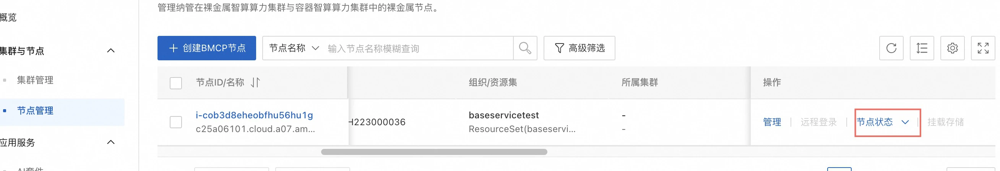
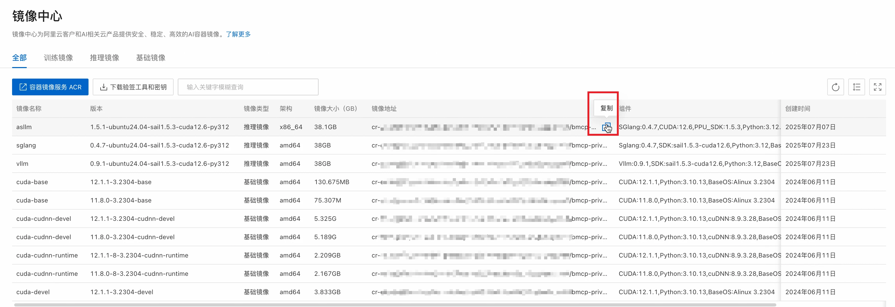
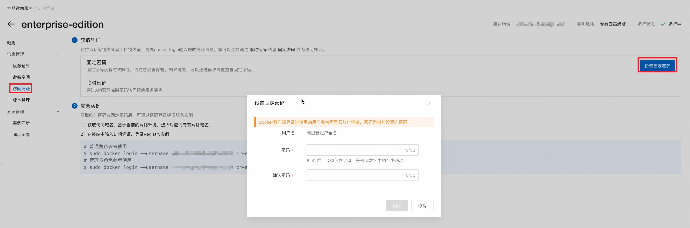
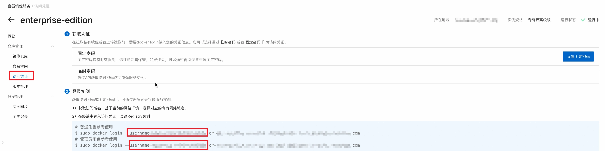
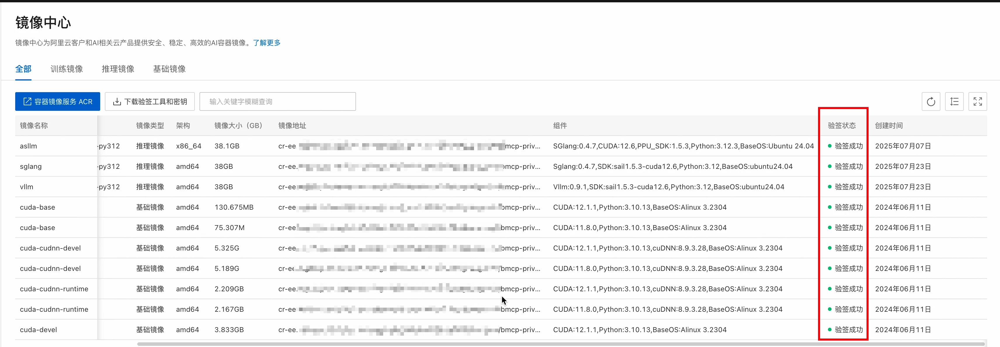
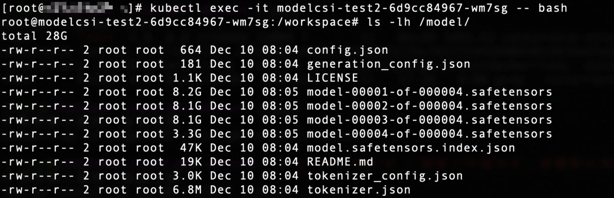
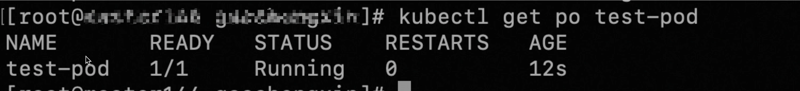

阿里云  
专有云  
裸金属算力平台BMCP  
用户指南  
产品版本：V3.18.6  
文档版本：20260528

**目录**

- [1.什么是裸金属算力平台 BMCP](#section-1)
- [2.快速入门](#section-2)
    - [2.1. 使用流程](#section-2-1)
    - [2.2. 登录裸金属算力平台BMCP](#section-2-2)
- [3.概览](#section-3)
- [4.集群与节点](#section-4)
    - [4.1. 集群管理](#section-4-1)
        - [4.1.1. 创建集群](#section-4-1-1)
            - [4.1.1.1. 创建裸金属-智算算力集群](#section-4-1-1-1)
            - [4.1.1.2. 创建容器-智算算力集群](#section-4-1-1-2)
            - [4.1.1.3. 创建裸金属-超算算力集群](#section-4-1-1-3)
        - [4.1.2. 查看集群详情](#section-4-1-2)
        - [4.1.3. 集群扩容](#section-4-1-3)
        - [4.1.4. 集群缩容](#section-4-1-4)
        - [4.1.5. 查看集群任务](#section-4-1-5)
        - [4.1.6. 存储管理](#section-4-1-6)
        - [4.1.7. 开启和关闭弹性缓存加速](#section-4-1-7)
        - [4.1.8. 跳转ACK控制台](#section-4-1-8)
        - [4.1.9. 连接信息](#section-4-1-9)
            - [4.1.9.1. 通过kubectl连接Kubernetes集群](#section-4-1-9-1)
            - [4.1.9.2. 吊销集群的KubeConfig凭证](#section-4-1-9-2)
        - [4.1.10. 软件实例](#section-4-1-10)
        - [4.1.11. 查询操作记录](#section-4-1-11)
        - [4.1.12. 查询集群监控信息](#section-4-1-12)
        - [4.1.13. 删除集群](#section-4-1-13)
    - [4.2. 节点管理](#section-4-2)
        - [4.2.1. 查看节点详情](#section-4-2-1)
        - [4.2.2. 管理节点状态](#section-4-2-2)
        - [4.2.3. 为节点挂载第三方存储](#section-4-2-3)
        - [4.2.4. 查看操作记录](#section-4-2-4)
        - [4.2.5. 查看节点监控信息](#section-4-2-5)
        - [4.2.6. 远程登录](#section-4-2-6)
        - [4.2.7. GPU虚拟化](#section-4-2-7)
- [5.回收站](#section-5)
- [6.应用服务](#section-6)
    - [6.1. 镜像中心](#section-6-1)
        - [6.1.1. 镜像验签](#section-6-1-1)
    - [6.2. 数据加速](#section-6-2)
        - [6.2.1. 镜像加速](#section-6-2-1)
        - [6.2.2. 缓存加速](#section-6-2-2)
        - [6.2.3. 配置Dragonfly的镜像仓库以实现加速](#section-6-2-3)
    - [6.3. 数据分发](#section-6-3)
        - [6.3.1. 创建数据分发任务](#section-6-3-1)
        - [6.3.2. 删除数据分发任务](#section-6-3-2)
        - [6.3.3. OSS数据P2P分发使用](#section-6-3-3)
    - [6.4. 应用中心](#section-6-4)
        - [6.4.1. 安装组件](#section-6-4-1)
        - [6.4.2. 添加自定义组件](#section-6-4-2)
        - [6.4.3. KGPU的使用](#section-6-4-3)
- [7.机型与镜像](#section-7)
    - [7.1. 节点机型](#section-7-1)
        - [7.1.1. 查询机型](#section-7-1-1)
        - [7.1.2. 修改机型](#section-7-1-2)
        - [7.1.3. 删除机型](#section-7-1-3)
    - [7.2. 裸机镜像](#section-7-2)
        - [7.2.1. 上传自定义镜像](#section-7-2-1)
        - [7.2.2. 查看公共镜像](#section-7-2-2)
        - [7.2.3. 查询自定义镜像](#section-7-2-3)
        - [7.2.4. 删除镜像](#section-7-2-4)
        - [7.2.5. 镜像状态管理](#section-7-2-5)
        - [7.2.6. 镜像导出](#section-7-2-6)
        - [7.2.7. 验证公共镜像完整性](#section-7-2-7)
- [8.网络与安全](#section-8)
    - [8.1. 专有网络VPC](#section-8-1)
    - [8.2. EVPC管理](#section-8-2)
    - [8.3. 通信库管理](#section-8-3)
    - [8.4. 安全组](#section-8-4)
        - [8.4.1. 安全组概述](#section-8-4-1)
        - [8.4.2. 管理安全组](#section-8-4-2)
        - [8.4.3. 管理安全组规则](#section-8-4-3)
        - [8.4.4. 管理安全组实例](#section-8-4-4)
    - [8.5. 密钥对](#section-8-5)
    - [8.6. 裸机网络](#section-8-6)
        - [8.6.1. 绑定专线网关](#section-8-6-1)
        - [8.6.2. 解绑专线网关](#section-8-6-2)
- [9.标签管理](#section-9)
    - [9.1. 查询标签](#section-9-1)
    - [9.2. 创建标签并绑定资源](#section-9-2)
- [10.计量数据](#section-10)
    - [10.1. 查看计量数据](#section-10-1)
- [11.运维管理](#section-11)
    - [11.1. 集群监控](#section-11-1)
    - [11.2. 事件监控](#section-11-2)
    - [11.3. 一键诊断](#section-11-3)
    - [11.4. 性能评测](#section-11-4)
        - [11.4.1. 创建评测任务](#section-11-4-1)
        - [11.4.2. 查看评测任务详情](#section-11-4-2)
    - [11.5. 弹性容错任务](#section-11-5)

<a id="section-1"></a>

# 1.什么是裸金属算力平台 BMCP

裸金属算力（Bare Metal Computing Platform，简称BMCP）平台是一个前沿的技术解决方案，旨在为高性能计算需求的企业和开发人员提供强大、灵活且高效的计算资源。该平台通过构建基于服务器的裸金属集群，为用户提供了一种无虚拟化层的直接硬件访问方式，从而确保了最大程度的性能输出和优化的资源利用率。

**特点和优势**

- 高性能：裸金属服务器提供不受虚拟化技术影响的原生硬件性能，使得计算密集型和存储密集型应用可以实现更高的执行效率。

- 专属资源使用：用户获得专属的物理服务器资源，这意味着不会有“邻居”干扰，保证了更稳定的计算和存储性能。

- 灵活配置：根据不同的应用需求，用户可以选择最适合的硬件配置，包括处理器、内存、存储和网络资源等，以实现最优的性能与成本平衡。

- 即时可用性：与传统的物理服务器部署相比，裸金属算力平台能够提供更快的部署速度，让用户能够迅速启动项目，缩短项目上线时间。

- 安全与隔离：由于用户对硬件资源具有完全的控制权，这提供了更高级别的安全性和隔离性，尤其适合对安全性和合规性要求较高的业务场景。

> **说明**
>
> 该裸金属算力平台是面向未来的企业级解决方案，适合需要处理大规模计算任务的科研机构、智能计算任务、大型互联网公司和金融行业等，为他们提供了一个既强大又灵活的计算环境。

**功能特性**

**概览**

- 概览页针对裸金属-智算算力集群、容器-智算算力集群和裸金属-超算算力集群提供资源大盘信息监控展示的能力，用于全局总览BMCP实例资源运营信息，助您优化资源配置，精确布局。汇聚资源操作入口，高效运营，便捷管理。

- 概览页用于展示**实例概览**、**算力资源统计**、**组织使用率排行**、**配额统计**、**资源告警**、**告警统计**和**告警趋势**。

  - **实例概览**包括：

    - **集群总数**：展示当前集群的总数量，并支持显示不同类型集群的数量。

    - **节点数**：展示节点的总数量，并支持显示各个芯片实例的节点数量。

    - **镜像数**：展示镜像的总数量，并支持显示不同类型镜像的数量。

  - **算力资源统计**包括GPU总算力、GPU卡数和CPU总算力。

  - **组织使用率排行**：

    - 支持按照芯片分类。

    - 支持按照实例分类，实例类型包括：智算基础实例、智算高网实例、智算纳管实例、高性能计算高网实例。

    - 支持查看近7天、近15天、近30天的资源使用率。

    - 支持查看组织使用率排行。

  - **配额统计**：

    - 支持按照实例规格（每个规格对应一台物理机）的配额展示。

    - 支持按照实例分类展示。

    - 包括算力使用情况、GPU 使用情况、CPU 使用情况及内存使用情况等。

  - **资源告警**：

    - 列出了资源告警信息。

    - 支持跳转至云监控的**报警历史**页面查看报警的详细信息。

  - **告警统计**：列出P1、P2、P3等级的告警数量及告警总数量。

  - **告警趋势**：支持查看近期的（近7天、近15天或近30天）告警趋势。

**集群与节点**

**集群**

**集群**是BMCP裸金属算力平台面向用户提供的一个很重要的管理对象，通过“集群管理”，用户可基于不同实例规格，构建业务所需的裸金属或者容器算力集群，配套提供集群的生命周期管理能力以及存储挂载、应用部署等增值能力。

- 支持一键创建裸金属、容器、高性能计算和训推优化等集群。

- 支持多种实例规格，包括智算通用、智算纳管、智算基础、高性能计算通用型和智算训推优化等。用户可根据自身业务特点选择合适的规格实例，以构建算力集群。

- 支持集群的创建、删除、扩容、缩容及集群监控等生命周期管理功能。

- 集群状态查看，包括集群的ID、名称、标签、状态、数量、资源情况及网络配置等基础信息。

- 支持并行文件系统的客户端集群部署及文件系统挂载等能力。

- 在创建及使用容器集群时，支持按需增量部署各类容器addon组件，包括数据缓存加速、镜像加速和弹性容错等组件。

**节点**

节点是BMCP裸金属算力平台面向用户提供的最小粒度的管理单元，通过“节点管理”，用户可查看当前集群各个节点的属性、运行状态等，支持节点操作，用于管理和使用节点资源。

- 支持远程登录、节点的启用与停用、重启以及节点监控等管理功能。

- 支持节点状态的查看，包括节点的ID、名称、状态、标签、所属集群及网络配置等基础信息。

- 针对智算纳管算力集群，支持基于NFS和iSCSI协议的远程文件系统挂载。

**应用服务**

**应用服务**是BMCP裸金属算力平台面向用户AI场景用户提供的一系列增值服务能力，包括镜像中心、数据加速等，基于阿里高性能算力集群能力的深度优化和迭代，可结合自身业务场景和属性，选择对应服务内容。

**镜像中心**

**镜像中心**提供了面向AI场景的各类基础镜像服务，包括**训练镜像**、**推理镜像**和**基础镜像**等，它是基于飞天企业版BMCP裸金属算力平台构建的高性能IaaS基础设施能力，并通过面向不同AI场景用户提供的一系列经过阿里深度优化的容器镜像服务市场。基于这些镜像构建的AI算力服务，能够更好地发挥算力集群的能力，保证业务、资源的兼容性和性能。

- **镜像中心**支持对全部、训练镜像、推理镜像和基础镜像的展示和搜索。

  - 训练镜像：提供可用于上层AI PaaS平台进行训练的标准镜像，集成BMCP算力平台集群能力，包括操作系统、训练框架、CUDA/ROCm、高网驱动等。

  - 推理镜像：提供可用于上层AI PaaS平台做推理的标准镜像，集成BMCP算力平台集群能力，包括操作系统、训练框架、CUDA/ROCm等。

  - 基础镜像：提供可用于上层AI PaaS平台训练与推理场景使用的基础模块/镜像，如NCCL优化等能力。

- 在**数据加速**页面中**创建镜像转换任务**后生成的DADI镜像会在镜像中心中透出，若要使用该镜像，需要确保所属ACK集群已部署“DADI镜像加速”Addon组件。

- 支持跳转至**容器镜像服务ACR**控制台。

**数据加速**

**数据加速**面向AI场景提供了一系列数据相关的加速服务能力，包括镜像加速、数据缓存加速等能力，用户可基于实际业务使用场景，按需开通相关服务能力。

- **镜像加速**功能支持DADI镜像加速，通过镜像加速按需加载功能，允许仅下载和解压容器启动所必需的部分，而不是整个镜像，从而大幅提高容器应用部署速度和提升弹性体验。

- **缓存加速**功能是面向典型AI场景如训练、推理等，提供镜像加速、数据缓存加速等训推优化的增值能力。

**机型与镜像**

**机型与镜像**功能属于BMCP裸金属算力平台管理的基础资源，包括当前平台可支持的实例规格对应的机型信息和裸机镜像信息等。

- **节点机型**：

  - 支持设置可管理裸金属的机型范围，添加机型后，方可在创建裸金属集群及实例时选到已经添加的机型。

  - 支持对机型进行增加、删除、修改及查询等操作。

- **裸机镜像**：

  - 裸机镜像用于维护裸机装机或创建集群时使用的镜像元数据，目前提供了多种选择，包括**自定义镜像**和**公共镜像**。

  - 提供了**自定义镜像**的查询、状态管理、删除、导出等功能。

  - 提供了**公共镜像**的查询、状态管理、导出等功能，您可以根据需求自定义上传所需的镜像。

**网络与安全**

**网络与安全**提供用于创建或维护算力集群时所需的网络信息，包括：

- **专有网络VPC**：用于BMCP裸金属算力平台创建集群时所依赖的VPC网络管理服务，支持跳转至专有网络VPC的控制台。

- **EVPC管理**：

  - EVPC（Enterprise Virtual Private Cloud）用于管理智算节点的RDMA网络。通过EVPC，可实现智算节点RDMA网段和子网的管理，以及不同智算集群间RDMA网络的隔离。

  - 支持创建、编辑、删除以及查询和查看EVPC功能。

  - 只有通用智算集群型实例支持配置EVPC。

- **安全组**：安全组是一种虚拟防火墙，用于控安全组内实例的入流量和出流量，实现对裸机实例流量细粒度的控制，阻止非法访问，从而提高实例的安全性。

- **密钥对**：提供一种安全便捷的登录认证方式，由公钥和私钥组成，可用于用户权限的有效管理。

**标签管理**

裸金属算力平台BMCP接入了Apsara Uni-manager运营控制台的标签管理，标签用于从不同维度对资源分类管理。

- 面向裸金属和容器资源的标签管理功能，支持按需进行自定义标签配置。

- 支持跳转至ASCM**资源运营 > 标签管理**功能。

**计量数据**

裸金属算力平台BMCP接入了Apsara Uni-manager运营控制台的计量管理，提供裸金属算力平台的资源数据统计功能。

- 支持基于容器、裸金属及节点级别的计量能力，能够提供GPU卡、CPU、内存等资源层面的计量。

- 支持跳转至ASCM**资源运营 > 计量管理**功能。

**运维管理**

运维管理提供**集群监控**、**事件监控**和**一键诊断**的功能，监控裸金属智算算力集群与容器智算算力集群中的各种性能指标（包括实例、GPU、RDMA等资源）和事件，帮助维护智算平台状态。

- **集群监控**提供集群层面的监控能力，包括基础监控、GPU监控、RDMA监控等多个监控项。

- **事件监控**对裸金属智算算力集群与容器智算算力集群中的各种事件进行监控，并支持配置事件报警。

  - 支持事件告警功能，包括算力集群GPU PCIE/驱动掉卡、计算引擎异常、PCIE链路带宽下降、NVLink故障等多项事件监控指标。

  - 支持配置事件报警，包括严重、警告、提示不同等级的事件监控。用户可按需创建不同的报警规则，可以定向告知不同权限人员。

  - 支持查看事件报警历史。

- **一键诊断**

  - 提供面向算力、网络、容器等资源的一键诊断能力，通过一键创建巡检任务，帮助用户快速定位集群故障。

  - 一键诊断支持多种巡检场景，及时对集群进行巡检可以帮助维护智算平台状态。

  - 裸金属集群算力巡检针对裸金属节点硬件问题，提供整机巡检和GPU巡检两部分功能，展示实时的健康状态信息。通过定期巡检物理服务器，可以发现潜在的硬件故障、性能瓶颈或其他问题，帮助及时解决和预防系统故障，保证智算集群的稳定性和可靠性。

  - 容器集群算力巡检针对容器集群的IaaS和PaaS层故障，提供了整机巡检、GPU巡检和k8s底座巡检，能够及时发现容器运行异常或健康状态指标异常。

<a id="section-2"></a>

# 2.快速入门

<a id="section-2-1"></a>

## 2.1. 使用流程

本节介绍裸金属算力平台 BMCP的基本使用流程，使用集群服务首先需要已具备可用的裸机（请在BMCP运维控制台上进行查看），然后根据需求选择裸金属-智算算力集群、容器-智算算力集群、裸金属-超算算力集群创建使用，可对集群进行扩容、缩容、删除等操作实现集群及节点的管理运维。

**操作说明**

- **创建集群**：用户可选择创建裸金属-智算算力集群、容器-智算算力集群、裸金属-超算算力集群，通过配置集群基本信息，选择组织资源集信息、网络信息、裸机实例、ECS实例规格、制定安装镜像等来完成集群的创建。

- <strong>集群扩容：</strong>支持用户对已创建的集群进行扩容操作，用户可在裸机管理BMS控制台中提前配置好需要裸机，在BMCP控制台中通过集群扩容功能添加所需裸机节点，并配置用户名及密码完成集群的扩容操作。

- **集群缩容**：支持用户对指定集群进行缩容操作，在BMCP控制台中通过集群缩容功能对指定的裸机节点进行缩容，裸机被缩容释放后，系统会自动删除裸机的OS并清理磁盘数据，重新释放回裸机资源池中。

> **说明**
>
> 以上仅为智算算力集群的操作说明。

<a id="section-2-2"></a>

## 2.2. 登录裸金属算力平台BMCP

本节为您介绍如何登录到Apsara Uni-manage运营控制台，并进入裸金属算力平台BMCP。

**前提条件**

- 您需要登录Apsara Uni-manage运营控制台后进入裸金属算力平台BMCP，请提前确认您已从部署人员处获取Apsara Uni-manage运营控制台的服务域名地址。

- 推荐使用Chrome浏览器。

**操作步骤**

1. 在浏览器地址栏中，输入Apsara Uni-manage运营控制台的访问地址，按回车键。

2. 输入正确的用户名及密码。

   *请向运营管理员获取登录控制台的用户名和密码。*

   > **说明**
   >
   > 首次登录ASCM控制台时，需要修改登录用户名的密码，请按照提示完成密码修改。为提高安全性，密码长度必须为 8~20 位，且至少包含以下两种类型：
   >
   > - 英文大写或小写字母（A~Z、a~z）
   >
   > - 阿拉伯数字（0~9）
   >
   > - 特殊符号（感叹号（！）、at（@）、井号（#）、美元符号（$）、百分号（%）等）
   >
   > *admin管理员账号具有所有权限，操作不受限，在运营管理中请慎重操作！*

3. 单击**登录**，进入Apsara Uni-manage运营控制台页面。

4. 在页面顶部的菜单栏中，选择**产品 > 计算 > 裸金属算力平台 BMCP**。

<a id="section-3"></a>

# 3.概览

本文介绍BMCP裸金属算力平台概览页的核心指标，包括算力资源、资源使用趋势、配额统计以及资源告警等关键信息。

<table>
  <tr>
    <th width="137">区域</th>
    <th>描述</th>
  </tr>
  <tr>
    <td>实例概览</td>
    <td>• 列出了该账号在所选组织、资源集、地域下的实例信息，包括<strong>集群总数</strong>、<strong>节点数</strong>、<strong>镜像</strong><strong>数</strong>。<br>• <strong>集群总数</strong>：展示当前集群的总数量，并支持显示不同类型集群的数量。<br>• <strong>镜像数</strong>：展示镜像的总数量，并支持显示不同类型镜像的数量。<br>• <strong>节点数</strong>：展示节点的总数量，并支持显示各个芯片实例的节点数量。<br>说明节点数量受到配额限制，需要先确认配额管理中是否已经进行对应配置。详情请参见<strong>《Apsara Uni-manager运营控制台用户指南》</strong>中的<strong>《配额管理》</strong>章节。<br>• 您可以单击<strong>集群总数</strong>、<strong>镜像数</strong>，分别查看集群信息和镜像信息。</td>
  </tr>
  <tr>
    <td>算力资源统计</td>
    <td>列出了该账号在所选组织、资源集、地域下的算力资源信息，包括<strong>GPU总算力</strong>、<strong>GPU卡</strong><strong>数</strong>、<strong>CPU总算力</strong>。</td>
  </tr>
  <tr>
    <td>组织使用率排行</td>
    <td>列出了该组织及其下属组织近期的（近7天、近15天或近30天）<strong>资源使用趋势</strong>。支持分别查看<strong>智算高网型实例</strong>、<strong>智算纳管型实例</strong>、<strong>智算基础型实例</strong>、<strong>智算训推优化实例</strong>、<strong>高性能计算</strong><strong>高网型实例</strong>和<strong>高性能计算纳管型</strong>实例的资源使用趋势。此外，还支持按照芯片分类。<br>说明该模块受到配额限制，需要先确认配额管理中是否已经进行对应配置。详情请参见<strong>《Apsara Uni-manager运营控制台用户指南》</strong>中的<strong>《配额管理》</strong>章节。</td>
  </tr>
  <tr>
    <td>资源告警</td>
    <td>列出了该账号在所选组织、资源集、地域下的所有资源告警信息。您可以单击<strong>去处理</strong>，跳转至云监控的<strong>报警历史</strong>页面查看报警的详细信息。</td>
  </tr>
  <tr>
    <td>配额统计</td>
    <td>您可以在<strong>配额统计</strong>右侧的下拉框中选择GPU卡型号，并在该区域的右侧选择对应的集群实例类型。您将能够看该卡的算力总量、已分配量和已使用量，以及GPU的总量、已分配量和已使用量。同时，您也可以查看CPU的总量、已分配量和已使用量，以及内存的总量、已分配量和已使用量。<br>说明'-'为未设置，需要进入配额管理页进行对应配置。详情请参见<strong>《Apsara Uni-</strong><strong>manager运营控制台用户指南》</strong>中的<strong>《配额管理》</strong>章节。</td>
  </tr>
  <tr>
    <td>告警统计</td>
    <td>列出了该账号在所选组织、资源集、地域下的告警总数、P1告警数、P2告警数、P3告警数。</td>
  </tr>
  <tr>
    <td>告警趋势</td>
    <td>列出了该账号在所选组织、资源集、地域下近期的（近7天、近15天或近30天）告警趋势。</td>
  </tr>
</table>

<a id="section-4"></a>

# 4.集群与节点

<a id="section-4-1"></a>

## 4.1. 集群管理

<a id="section-4-1-1"></a>

### 4.1.1. 创建集群

<a id="section-4-1-1-1"></a>

#### 4.1.1.1. 创建裸金属-智算算力集群

本节介绍如何创建裸金属-智算算力集群。

**前提条件**

- 已经在BMCP运维控制台注册BMCP实例。

- 裸金属节点运行状态正常。

**操作步骤**

1. 登录裸金属算力平台BMCP。

2. 在左侧导航栏中，单击**集群与节点 > 集群管理**。

3. 单击**创建集群**。

4. （条件可选）选择**产品**为**裸金属算力平台BMCP**，**资源**为**裸金属-智算算力集群**的服务目录。

   服务管理用于在企业或组织内对某些产品的特定规格进行一定的管理与控制。若拥有多个服务目录权限，开通资源前必须选择一个服务目录，系统将按所选目录进行后续开通。关于服务管理的更多信息，请参见<strong>《Apsara Uni-manager运营控制台 用户指南》</strong>中的<strong>《服务管理》</strong>章节。

5. 配置集群参数。

   **配置项**

   **说明**

   支持**按量计费**和**包年包月**两种方式：

   - **按量付费**：用户先使用服务，然后根据实际使用的资源量在事后生成费用。这种方式适用于业务用量经常变化的场景，用户可以根据实际需求灵活使用资源，避免浪费。

   - **包年包月**：用户直接按固定周期订购资源，根据开通订购量和周期直接生成费用，后续使用不再产生费用，适用于业务用量相对稳定的场景。

   **计费配置**

   **计费方式**

   > **说明**
   >
   > 仅当您的管理员在运营中心中配置了计费规则时才会展示此选项。关于计费规则的详细说明，请参见<strong>《Apsara Uni-manager运营控制台 用户指南》</strong>中的<strong>《计费规则》</strong>章节。

   集群所属的组织。

   **组织**

   集群所属的资源集。

   **资源集**

   集群所属的地域。

   **地域**

   集群所属的可用区

   **可用区**

   - 如果提示：该组织尚未进行云接入网关RAM角色授权，请单击右侧按钮进行授权，继续操作需要该组织先进行云接入网关RAM角色授权，授权完成后可单击右侧刷新按钮刷新状态。

   **云接入网关RAM角色授权**

   - 如果提示：该组织已经进行了云接入网关RAM角色授权，可以继续操作集群创建。

   **基本信息**

   输入集群的名称。

   **集群名称**

   名称长度为1~63个字符，可包含数字、中文字符、英文字符或短划线（-）。

   设置用户登录密码和确认密码。

   密码要求为8~30个字符，且至少同时包含大写字母、小写字母、数字、特

   **登录密码**和**确认密码**

   殊字符中的三项，支持的特殊字符包括 ``()`~!@#$%^&*-_+=|{} []:;'<>,.?/`` 。

   对于所创建集群的简短描述。长度为0~1000个字符。

   **描述**

   设置标签对集群进行简单说明，后期可以根据标签快速筛选对应集群。

   **标签**

   选择**智算集群**。

   **集群类型**

   实例类型包括**智算高网**、**智算训推**、**智算纳管**和**智算基础型**。

   - **智算高网**：基于原生RDMA网络和高性能存储的GPU类型通用智算计算集群，支持云内RDMA网络及高性能存储服务（包括CPFS和APFS）。

   - **智算训推**：基于APG硬件的深度优化的高性能算力集群，支持CPN网络和高性能存储服务（包括CPFS和APFS）。

   **实例类型**

   - **智算基础**：不带高网/高性能存储，支持基础网络的GPU基础型裸金属实例。

   - **智算纳管**：基于利旧纳管RDMA（IB/RoCE）网络和传统存储的GPU类型纳管智算计算集群，用于接入云外RDMA网络和第三方文件存储。

   可选**CHSW接入**和**HSW接入**。仅当**实例类型**为**智算纳管**时才有此参数。

   **接入方式**

   根据业务需要，选择是否启用**IPv6**。

   **IPv6**

   选择已创建的专有网络，或者单击**创建专有网络**即时创建专有网络，创建完

   

   成后，返回集群创建页面并单击

   图标，查看专有网络列表。创建专有网

   **专有网络**

   络的具体操作，请参见专有云文档中心<strong>《专有网络VPC用户指南》</strong>中的<strong>《创建和管理专有网络》</strong>章节。

   选择已创建的交换机，或者单击**创建交换机**即时创建交换机，创建完成后，

   

   返回集群创建页面并单击

   图标，查看交换机列表。

   **监控通道交换机**

   创建交换机的具体操作，请参见专有云文档中心<strong>《专有网络VPC用户指</strong>

   **集群配置**

   <strong>南》</strong>中的<strong>《创建和管理交换机》</strong> 章节。

   **实例类型**为**智算高网型**和**智算训推**可以选择是否启用**EVPC IPv6**。

   **EVPC IPv6**

   **实例类型**为**智算高网型**和**智算训推**可以配置**RDMA网络 EVPC**。

   **RDMA网络 EVPC**

   选择已创建的裸机交换机，或者单击**创建交换机**即时创建交换机，创建完成

   

   后，返回集群创建页面并单击

   图标，查看交换机列表。

   **裸机专用交换机**

   创建交换机的具体操作，请参见专有云文档中心<strong>《专有网络VPC用户指南》</strong>中的<strong>《创建和管理交换机》</strong> 章节。

   节点配置选项与**实例类型**有关。

   - **智算高网**：选择**规格**，配置**节点数量**。

   - **智算纳管**：可以选择**节点**。

   **节点配置**

   - **智算基础**：可以选择**规格**，配置**节点数量**和镜像。

   - <strong>智算训推：</strong>可以选择**规格**，配置**节点数量**。

   当镜像创建类型选择为**重新安装镜像**时，可指定公共镜像进行安装。

   > **说明**
   >
   > - 仅**智算基础**在节点配置时可配置。

   **镜像创建类型**

   > - 仅PG8AP6M7S4G5VB2X7.32、PG8AP6M7S4G5VB2X7.03CH及QPG88P4M10G26B2.32机型支持指定公共镜像安装。

   如创建集群时未选择服务目录，将会展示该选项，请保持开关关闭。

   **容器集群**

   **启用容器集群服务**

   **配置**

   启用**启用容器集群服务**后，创建的集群为容器-智算算力集群。

   加载安骑士默认策略，支持提供网站漏洞检查、云产品安全配置检查、主机

   **高级配置**

   **安全加固**

   登录异常告警等安全功能。

   **实例类型**为**智算高网**和**智算训推**支持配置**高性能存储**。

   **高性能存储**和**高性能存储类型**

   启用后，**高性能存储类型**支持**CPFS**和**APFS**。

   **智算纳管型实例**支持挂载三方存储。

   **挂载三方存储**

   启用**挂载三方存储**后，根据界面显示配置相应的存储信息。存储类型支持ISCSI、NFS和直接挂载，不同存储类型需要配置的参数不同。

   - **ISCSI**

     - **服务端IP/域名**

     - **服务端IQN**

     - **客户端IQN**

   **存储配置**

   - **客户端挂载路径**

   - **LunID**

   - **CHAP校验**

   **三方存储配置**

   - **NFS**

     - **服务端IP/域名**

     - **服务端挂载路径**

     - **客户端挂载路径**

   - **直接挂载**

     - **服务端挂载路径**

     - **客户端挂载路径**

     - **挂载方式**

6. （可选）配置完成后，请在页面右侧**配置概览**面板检查集群的配置参数，确保符合您的要求。

7. 创建集群。

   - 服务管理中已创建云产品为**裸金属算力平台BMCP**、资源项为**裸金属-智算算力集群**的服务：确认相关参数，单击**确认订单**。

   - 服务管理中未创建云产品为**裸金属算力平台BMCP**、资源项为**裸金属-智算算力集群**的服务：确认相关参数，单击**提交**。

   关于服务管理的更多信息，请参见<strong>《Apsara Uni-manager运营控制台 用户指南》</strong> 中的<strong>《服务管理》</strong>章节。

<a id="section-4-1-1-2"></a>

#### 4.1.1.2. 创建容器-智算算力集群

本文介绍如何创建容器-智算算力集群。

**操作步骤**

1. 登录裸金属算力平台BMCP。

2. 在左侧导航栏中，单击**集群与节点 > 集群管理**。

3. 单击**创建集群**。

4. （条件可选）选择**产品**为**裸金属算力平台BMCP**，**资源**为**容器-智算算力集群**的服务目录。

   服务管理用于在企业或组织内对某些产品的特定规格进行一定的管理与控制。若拥有多个服务目录权限，开通资源前必须选择一个服务目录，系统将按所选目录进行后续开通。关于服务管理的更多信息，请参见<strong>《Apsara Uni-manager运营控制台 用户指南》</strong>中的<strong>《服务管理》</strong>章节。

5. 配置集群参数。

   | 配置项 | 说明 |
   | --- | --- |

   仅支持**按量计费**。用户先使用服务，然后根据实际使用的资源量在事后生成费用。这种方式适用于业务用量经常变化的场景，用户可以根据实际需求灵活使用资源，避免浪费。

   **计费配置**

   **计费方式**

   > **说明**
   >
   > 仅当您的管理员在运营中心中配置了计费规则时才会展示此选项。关于计费规则的详细说明，请参见<strong>《Apsara Uni-manager运营控制台 用户指南》</strong>中的<strong>《计费规则》</strong>章节。

   集群所属的组织。

   **组织**

   集群所属的资源集。

   **资源集**

   集群所属的地域。

   **地域**

   集群所属的可用区

   **可用区**

   - 如果提示：该组织尚未进行容器服务RAM角色授权，请单击右侧按钮进行授权，继续操作需要该组织先进行容器服务RAM角色授权，在新页面

   **容器服务RAM角色**

   授权完成后可单击右侧刷新按钮刷新状态。

   **授权**

   - 如果提示：该组织已经进行了容器服务RAM角色授权，可以继续操作。

   - 如果提示：该组织尚未进行云接入网关RAM角色授权，请单击右侧按钮进行授权，继续操作需要该组织先进行云接入网关RAM角色授权，授权完成后可单击右侧刷新按钮刷新状态。

   **云接入网关RAM角**

   **基本信息**

   **色授权**

   - 如果提示：该组织已经进行了云接入网关RAM角色授权，可以继续操作集群创建。

   输入集群的名称。

   **集群名称**

   名称长度为1~63个字符，可包含数字、中文字符、英文字符或短划线（-）。

   设置用户登录密码和确认密码。

   密码要求为8~30个字符，且至少同时包含大写字母、小写字母、数字、特

   **登录密码**和**确认密码**

   殊字符中的三项，支持的特殊字符包括 ``()`~!@#$%^&*-_+=|{} []:;'<>,.?/`` 。

   对于所创建集群的简短描述。长度为0~1000个字符。

   **描述**

   设置标签对集群进行简单说明，后期可以根据标签快速筛选对应集群。

   **标签**

   选择**智算集群**。

   **集群类型**

   实例类型包括**智算高网**、**智算训推**、**智算纳管**和**智算基础型**。

   - **智算高网**：基于原生RDMA网络和高性能存储的GPU类型通用智算计算集群，支持云内RDMA网络及高性能存储服务（包括CPFS和APFS）。

   - **智算训推**：基于APG硬件的深度优化的高性能算力集群，支持CPN网络

   **集群配置**

   和高性能存储服务（包括CPFS和APFS）。

   **实例类型**

   - **智算基础**：不带高网/高性能存储，支持基础网络的GPU基础型裸金属实例。

   - **智算纳管**：基于利旧纳管RDMA（IB/RoCE）网络和传统存储的GPU类型纳管智算计算集群，用于接入云外RDMA网络和第三方文件存储。

   可选**CHSW接入**和**HSW接入**。仅当**实例类型**为**智算纳管**时才有此参数。

   **接入方式**

   根据业务需要，选择是否启用**IPv6**。

   **IPv6**

   选择已创建的专有网络，或者单击**创建专有网络**即时创建专有网络，创建完

   

   成后，返回集群创建页面并单击

   图标，查看专有网络列表。创建专有网

   络的具体操作，请参见专有云文档中心<strong>《专有网络VPC用户指南》</strong>中的<strong>《创建和管理专有网络》</strong>章节。

   **专有网络**

   选择已创建的交换机，或者单击**创建交换机**即时创建交换机，创建完成后，

   

   返回集群创建页面并单击

   图标，查看交换机列表。

   **监控通道交换机**

   创建交换机的具体操作，请参见专有云文档中心<strong>《专有网络VPC用户指南》</strong>中的<strong>《创建和管理交换机》</strong> 章节。

   **实例类型**为**智算高网型**和**智算训推**可以选择是否启用**EVPC IPv6**。

   **EVPC IPv6**

   **实例类型**为**智算高网型**和**智算训推**可以配置**RDMA网络 EVPC**。

   **RDMA网络 EVPC**

   选择已创建的裸机交换机，或者单击**创建交换机**即时创建交换机，创建完成

   **网络配置**

   

   后，返回集群创建页面并单击

   图标，查看交换机列表。

   **裸机专用交换机**

   创建交换机的具体操作，请参见专有云文档中心<strong>《专有网络VPC用户指南》</strong>中的<strong>《创建和管理交换机》</strong> 章节。

   可选规格与**实例类型**有关。

   - **智算高网**：选择**规格**，配置**节点数量**。

   - **智算纳管**：可以选择**节点**。

   **选择规格**

   - **智算基础**：可以选择**规格**，配置**节点数量**和镜像。

   - <strong>智算训推：</strong>可以选择**规格**，配置**节点数量**。

   当镜像创建类型选择为**重新安装镜像**时，可指定公共镜像进行安装。

   > **说明**
   >
   > - 仅智算基础型实例在节点配置时可配置。

   **镜像创建类型**

   > - 仅PG8AP6M7S4G5VB2X7.32、PG8AP6M7S4G5VB2X7.03CH及QPG88P4M10G26B2.32机型支持指定公共镜像安装。

   启用后，创建的集群为**容器-智算算力集群**。

   **启用容器集群服务**

   创建集群时已选择**产品**为**裸金属算力平台BMCP**，**资源**为**容器-智算算力集群**的服务目录时，**启用容器集群服务**默认开启，不支持关闭。

   设置节点池名称。

   **节点池配置**

   选择已创建的交换机，或者单击**创建交换机**即时创建交换机，创建完成后，

   

   返回集群创建页面并单击

   图标，查看交换机列表。

   **容器集群**

   **虚拟交换机**

   **配置**

   创建交换机的具体操作，请参见专有云文档中心<strong>《专有网络VPC用户指南》</strong>中的<strong>《创建和管理交换机》</strong> 章节。

   选择Kubernetes版本。

   具体支持的版本和功能说明，请参见专有云文档中心<strong>《容器服务</strong>

   **Kubernetes版本**

   <strong>Kubernetes版 用户指南》</strong>中的<strong>《发布Kubernetes 1.32版本说明》</strong>或<strong>《发布Kubernetes 1.30版本说明》</strong>章节。

   选择容器运行时。

   **容器运行时**

   Master节点实例数量支持3个或5个。

   **Master节点数量**

   节点规格仅与上方虚拟交换机数量对应，n个虚拟交换机对应n种实例规

   **Master节点规格**

   格，n的最大值与Master节点数量一致。

   **Master**

   配置系统盘类型和大小。

   **Master节点系统盘**

   **节点配置**

   系统盘类型：**高效云盘**、**SSD 云盘**、**高性能云盘**和**普通性能云盘**。

   选择操作系统。

   **操作系统**

   **Worker节点选型**可选**ECS Worker节点**和**BMCP Worker节点**。

   **Worker节点选型**

   - **Worker节点选型**选择**ECS Worker节点**后需配置。

   - 您可以选择多个实例规格（最多10个）作为备选，每个节点创建时，将

   **ECS Worker节点**

   从第一个规格开始尝试购买，直到创建成功。最终购买的实例规格可能随

   **规格**

   库存变化而不同。

   - 您可以单击**上移**、**下移**、**删除**对已选的规格进行管理。

   **ECS Worker节点**

   配置ECS Worker节点数量。

   **数量**

   **ECS Worker节点配置**

   配置ECS Worker节点系统盘，配置系统盘类型和大小。

   **ECS Worker节点系统盘**

   系统盘类型：**高效云盘**、**SSD 云盘**、**高性能云盘**和**普通性能云盘**。

   - 配置ECS Worker节点数据盘，配置数据盘类型、数据盘大小、加密。

     数据盘类型：**高效云盘**、**SSD 云盘**、**高性能云盘**和**普通性能云盘**。

   **ECS Worker节点数据盘**

   - 集群创建过程中，将自动格式化最后一块数据盘，并将  `/var/lib/docker`  挂载到该数据盘。

   - 请填写有效的私有网段，即以下网段及其子网：10.0.0.0/8，172.16～31.0.0/12～16，192.168.0.0/16。

   **Pod 网络 CIDR**

   - 不能与 VPC 网段 192.168.0.0/16 及 VPC 内已有 Kubernetes 集群使用的网段重复。创建成功后不能修改。

   - 可选范围：10.0.0.0/16～24,172.16～31.0.0/16～24,192.168.0.0/16～24。

   **Service CIDR**

   - 不能与 VPC 网段 192.168.0.0/16 及 VPC 内已有 Kubernetes 集群使用的网段重复，创建成功后不能修改。

   - **为专有网络配置SNAT**：若取消勾选该项，您需要自行为 VPC 创建 NAT网关并配置 SNAT 规则以保证 VPC 具有公网访问能力。如果您集群内的节点、应用等需要访问公网，建议您勾选此项。

   **配置SNAT**

   - **使用EIP暴露API Server**：选择不开放时，则无法通过外网访问集群API Server。

   - 不开启日志服务时，将无法使用集群审计功能。

   - **使用日志服务**：

   **日志服务**

   - **使用已有Project**：在列表中选择已有的Project.

   - **创建新Project**：将自动创建名称为 k8s-log-{ClusterID} 的Project。

   **高级配置**

   防止通过控制台或者API误删除集群。

   **集群删除保护**

   保证集群可用性，为防止其他产品通过控制台或API直接对集群中的裸机节

   **实例保护**

   点进行误删除释放 ，**实例保护**选项默认打开且无法变更。

   默认开启CPN网络监控服务，可以监控集群<strong>网络下载带宽 (MB/s)</strong>和**网络流**

   **网络监控服务**

   **入带宽 (MB/s)**。

   需要启用集群运维服务并安装Fluid 数据缓存加速AI组件。

   **弹性数据缓存加速**

   > **说明**
   >
   > 智算纳管型实例不支持。

   加载安骑士默认策略，支持提供网站漏洞检查、云产品安全配置检查、主机

   **安全加固**

   登录异常告警等安全功能。

   **实例类型**为**智算高网**和**智算训推**支持配置**高性能存储**。

   **高性能存储**和**高性能存储类型**

   启用后，**高性能存储类型**支持**CPFS**和**APFS**。

   **智算纳管型实例**支持挂载三方存储。

   **挂载三方存储**

   启用**挂载三方存储**后，根据界面显示配置相应的存储信息。存储类型支持ISCSI、NFS和直接挂载，不同存储类型需要配置的参数不同。

   - **ISCSI**

     - **服务端IP/域名**

     - **服务端IQN**

     - **客户端IQN**

     - **客户端挂载路径**

   **存储配置**

   - **LunID**

   - **CHAP校验**

   **三方存储配置**

   - **NFS**

     - **服务端IP/域名**

     - **服务端挂载路径**

     - **客户端挂载路径**

   - **直接挂载**

     - **服务端挂载路径**

     - **客户端挂载路径**

     - **挂载方式**

   如果在**容器配置**启用了**弹性数据缓存加速**，**集群运维服务**默认开启，并且不

   **集群运维服务**

   支持关闭。

   - 您可以选择多个实例规格（最多10个）作为备选，每个节点创建时，将从第一个规格开始尝试购买，直到创建成功。最终购买的实例规格可能随

   **软件实例节点规格**

   库存变化而不同。

   - 您可以单击**上移**、**下移**、**删除**对已选的规格进行管理。

   软件实例节点数量默认为2，不支持修改。

   **软件实例节点数量**

   **AI应用配置**

   配置软件实例节点系统盘，配置系统盘类型和大小。

   **软件实例节点系统盘**

   系统盘类型：**高效云盘**、**SSD 云盘**、**高性能云盘**和**普通性能云盘**。

   当前仅支持**性能保障型**。

   **SLB规格类型**

   选择SLB规格。

   **SLB规格**

   当前仅支持**内网-经典网络**。

   **SLB网络与实例类型**

   负责 GPU 设备的识别、驱动管理、虚拟化及基础监控。缺少此套件时，上层 AI 任务无法调度 GPU 资源。

   - **bmcp-gpu-operator**：BMCP平台设备插件（包括DevicePlugin、Exporter等）的统一管理控制器，部署后可统一管理、编排容器侧GPU插件以及安装节点标签NFD组件。

   **智算基础套件**

   - **gpu-deploy-engine**：BMCP平台的GPU部署引擎支持更灵活、可适应且可升级的GPU组件部署。用户需基于自定义资源（CR）-BMCPClusterPolicy创建GPU组件部署任务。

   - **kgpu**：一个提供APG用户空间虚拟化的云原生组件，支持计算能力与GPU内存隔离。目前仅支持APG。使用前需先安装BMCP GPU工具包。

   解决大模型训练和加载过程中的“IO 瓶颈”。涵盖数据集缓存、文件 P2P 分发、镜像层分发及按需加载。将加速组件耦合一起组成套件避免，因用户自定义安装导致短板成为性能瓶颈

   - **dadi**：containerd 容器社区支持的基于 overlaybd 块存储的镜像格式，在容器拉起时，从数据源站按需读取业务所需要的块数据来实现加速效果，开启后可构建DADI镜像服务。

   - dragonfly：一个业界成熟的基于P2P的镜像、文件分发组件，以镜像

   **高性能数据与镜像加**

   layer 为粒度进行节点之间镜像互传，加速节点镜像下载，降低 registry

   **速套件**

   带宽压力。

   - **fluid**：一个开源的Kubernetes原生的分布式数据集编排和加速引擎，开启后可用于云原生场景下的数据密集型应用的数据访问加速。

   - **model-oss-p2p**：模型 OSS P2P 挂载组件，支持 AI 模型数据的 OSS挂载和 P2P 分发。

   **AI应用组件**

   稳定性的保障，数据用于策略匹配+人工巡检识别。自愈负责有效降低MTTR。提供故障自愈、节点黑名单管理、任务拓扑可视及性能测评，保障算力稳定性。

   - **ai-operator**：基于开源K8s-Operator标准，用于节点加黑解黑，部署该模块后，可针对容器算力集群进行自愈操作。

   **集群运维与稳定性套**

   - **ai-profiling**：AI 性能分析与调优工具，提供训练和推理性能分析。

   **件**

   - **ai-task-inspector**：部署该模块后，基于BMCP租户&运维控制台，可针对容器算力集群提供AI任务拓扑展示、模型性能测评等功能。

   - **kea**：基于弹性容错框架（KEA）提交和管理分布式训练任务，通过协同底层基础设施的故障感知与自愈机制，实现节点异常时的自动恢复与资源动态调整，保障训练任务的连续性与平台整体健壮性。

   专为大模型推理场景设计，提供请求调度、并行优化及显存管理，显著提升推理吞吐和降低延迟。

   **大模型推理优化套件**

   aspeed：包含ASpeed推理服务管控、推理请求调度、集群并行组件等深度优化组件， 可提供P/D分离、EP并行、多级KVCache缓存等特性。

   在**AI应用组件**中选中**nanhu-insight**时，需填写**加速器供应商**和**Nanhu**

   **AI组件参**

   **nanhu-insight**

   **数配置**

   **Insight集群ID**.

6. （可选）配置完成后，请在页面右侧**配置概览**面板检查集群的配置参数，确保符合您的要求。

7. 创建集群。

   - 服务管理中已创建云产品为**裸金属算力平台BMCP**、资源项为**裸金属-智算算力集群**的服务：确认相关参数，单击**确认订单**。

   - 服务管理中未创建云产品为**裸金属算力平台BMCP**、资源项为**裸金属-智算算力集群**的服务：确认相关参数，单击**提交**。

   关于服务管理的更多信息，请参见<strong>《Apsara Uni-manager运营控制台 用户指南》</strong> 中的<strong>《服务管理》</strong>章节。

<a id="section-4-1-1-3"></a>

#### 4.1.1.3. 创建裸金属-超算算力集群

裸金属-超算算力集群通过集群化管理，实现客户统一登录和运维，并针对集群力度提供资源水位和集群状态的监控管理。用于构建HPC场景的高性能超算算力集群。本节介绍如何创建裸金属-超算算力集群。

**前提条件**

- 已经在BMCP运维控制台注册BMCP实例。

- 裸金属节点运行状态正常。

**操作步骤**

1. 登录裸金属算力平台BMCP。

2. 在左侧导航栏中，单击**集群与节点 > 集群管理**。

3. 单击**创建集群**。

4. （条件可选）选择**产品**为**裸金属算力平台BMCP**，**资源**为**裸金属-超算算力集群**的服务目录。

   服务管理用于在企业或组织内对某些产品的特定规格进行一定的管理与控制。若拥有多个服务目录权限，开通资源前必须选择一个服务目录，系统将按所选目录进行后续开通。关于服务管理的更多信息，请参见<strong>《Apsara Uni-manager运营控制台 用户指南》</strong>中的<strong>《服务管理》</strong>章节。

5. 配置集群参数。

   **配置项**

   **说明**

   支持**按量计费**和**包年包月**两种方式：

   - **按量付费**：用户先使用服务，然后根据实际使用的资源量在事后生成费用。这种方式适用于业务用量经常变化的场景，用户可以根据实际需求灵活使用资源，避免浪费。

   - **包年包月**：用户直接按固定周期订购资源，根据开通订购量和周期直接生成费用，后续使用不再产生费用，适用于业务用量相对稳定的场景。

   **计费配置**

   **计费方式**

   > **说明**
   >
   > 仅当您的管理员在运营中心中配置了计费规则时才会展示此选项。关于计费规则的详细说明，请参见<strong>《Apsara Uni-manager运营控制台 用户指南》</strong>中的<strong>《计费规则》</strong>章节。

   集群所属的组织。

   **组织**

   集群所属的资源集。

   **资源集**

   集群所属的地域。

   **地域**

   集群所属的可用区

   **可用区**

   - 如果提示：该组织尚未进行云接入网关RAM角色授权，请单击右侧按钮进行授权，继续操作需要该组织先进行云接入网关RAM角色授权，授权

   **云接入网关RAM角**

   完成后可单击右侧刷新按钮刷新状态。

   **色授权**

   - 如果提示：该组织已经进行了云接入网关RAM角色授权，可以继续操作集群创建。

   输入集群的名称。

   **基本信息**

   **集群名称**

   名称长度为1~63个字符，可包含数字、中文字符、英文字符或短划线（-）。

   设置用户登录密码和确认密码。

   密码要求为8~30个字符，且至少同时包含大写字母、小写字母、数字、特殊字符中的三项，支持的特殊字符包括 ``()`~!@#$%^&*-_+=|{}``

   **登录密码**和**确认密码**

   `[]:;'<>,.?/` 。

   对于所创建集群的简短描述。长度为0~1000个字符。

   **描述**

   设置标签对集群进行简单说明，后期可以在高级搜索里根据标签快速筛选对

   **标签**

   应集群。

   <table>
     <tr>
       <th rowspan="9">集群配置</th>
       <th>集群类型</th>
       <th>选择<strong>高性能计算集群</strong>。</th>
     </tr>
     <tr>
       <td>实例类型</td>
       <td>实例类型包括<strong>高性能计算高网</strong>和<strong>高性能计算纳管</strong>。<br>• <strong>高性能计算高网型</strong>：基于原生RoCE网络和并行文件存储（CPFS/APFS）的CPU类型的通用高性能计算集群。<br>• <strong>高性能计算纳管型</strong>：基于利旧纳管IB/RoCE网络和传统存储的CPU类型纳管高性能计算集群。</td>
     </tr>
     <tr>
       <td>接入方式</td>
       <td>可选<strong>CHSW接入</strong>和<strong>HSW接入</strong>。仅当<strong>实例类型</strong>为<strong>高性能计算纳管</strong>时才有此参数。</td>
     </tr>
     <tr>
       <td>IPv6</td>
       <td>根据业务需要，选择是否启用<strong>IPv6</strong>。</td>
     </tr>
     <tr>
       <td>专有网络</td>
       <td>选择已创建的专有网络，或者单击<strong>创建专有网络</strong>即时创建专有网络，创建完<br>成后，返回集群创建页面并单击图标，查看专有网络列表。创建专有网<br>络的具体操作，请参见专有云文档中心<strong>《专有网络VPC用户指南》</strong>中的<strong>《创</strong><strong>建和管理专有网络》</strong>章节。</td>
     </tr>
     <tr>
       <td>监控通道交换机</td>
       <td>选择已创建的交换机，或者单击<strong>创建交换机</strong>即时创建交换机，创建完成后，<br>返回集群创建页面并单击图标，查看交换机列表。<br>创建交换机的具体操作，请参见专有云文档中心<strong>《专有网络VPC用户指</strong><strong>南》</strong>中的<strong>《创建和管理交换机》</strong> 章节。</td>
     </tr>
     <tr>
       <td>EVPC IPv6</td>
       <td><strong>实例类型</strong>为<strong>高性能计算高网</strong>可以选择是否启用<strong>EVPC IPv6</strong>。</td>
     </tr>
     <tr>
       <td>RDMA网络 EVPC</td>
       <td><strong>实例类型</strong>为<strong>高性能计算高网</strong>可以配置<strong>RDMA网络 EVPC</strong>。</td>
     </tr>
     <tr>
       <td>实例与镜像</td>
       <td><strong>实例与镜像</strong>选项与<strong>实例类型</strong>有关。<br>• <strong>高性能计算高网型实例</strong>：选择<strong>裸机专用VSwitch</strong>和规格。<br>• <strong>高性能计算纳管型实例</strong>：选择<strong>裸机专用VSwitch</strong>和节点。</td>
     </tr>
     <tr>
       <td rowspan="2">超算集群配置</td>
       <td>集群部署模式</td>
       <td>当前仅支持Tiny。仅当<strong>实例类型</strong>为<strong>高性能计算高网</strong>时才有此参数。</td>
     </tr>
     <tr>
       <td>调度器类型</td>
       <td>调度器是指E-HPC集群上部署的作业调度软件。当前仅支持<strong>pbs</strong>和<strong>slurm</strong>。仅当<strong>实例类型</strong>为<strong>高性能计算高网</strong>时才有此参数。</td>
     </tr>
     <tr>
       <td>高级配置</td>
       <td>安全加固</td>
       <td>加载安骑士默认策略，支持提供网站漏洞检查、云产品安全配置检查、主机登录异常告警等安全功能。</td>
     </tr>
   </table>

   <table>
     <tr>
       <th rowspan="3">存储配置</th>
       <th><strong>高性能存储</strong>和<strong>高性能</strong>存储类型</th>
       <th><strong>实例类型</strong>为<strong>高性能计算高网</strong>支持配置<strong>高性能存储</strong>。启用后，<strong>高性能存储类型</strong>支持<strong>CPFS</strong>和<strong>APFS</strong>。</th>
     </tr>
     <tr>
       <td>挂载三方存储</td>
       <td><strong>高性能计算纳管</strong>支持挂载三方存储。</td>
     </tr>
     <tr>
       <td>三方存储配置</td>
       <td>启用<strong>挂载三方存储</strong>后，根据界面显示配置相应的存储信息。存储类型支持ISCSI、NFS和直接挂载，不同存储类型需要配置的参数不同。<br>• ISCSI<br>• 服务端IP/域名<br>• 服务端IQN<br>• 客户端IQN<br>• 客户端挂载路径<br>• LunID<br>• CHAP校验<br>• NFS<br>• 服务端IP/域名<br>• 服务端挂载路径<br>• 客户端挂载路径<br>• 直接挂载<br>• 服务端挂载路径<br>• 客户端挂载路径<br>• 挂载方式</td>
     </tr>
   </table>

6. （可选）配置完成后，请在页面右侧**配置概览**面板检查集群的配置参数，确保符合您的要求。

7. 创建集群。

   - 服务管理中已创建云产品为**裸金属算力平台BMCP**、资源项为**裸金属-智算算力集群**的服务：确认相关参数，单击**确认订单**。

   - 服务管理中未创建云产品为**裸金属算力平台BMCP**、资源项为**裸金属-智算算力集群**的服务：确认相关参数，单击**提交**。

   关于服务管理的更多信息，请参见<strong>《Apsara Uni-manager运营控制台 用户指南》</strong> 中的<strong>《服务管理》</strong>章节。

**执行结果**

创建完成后，当集群列表中出现**集群类型**为**裸金属-超算算力集群**的集群，并且集群状态为运行中，说明集群已创建完成。

<a id="section-4-1-2"></a>

### 4.1.2. 查看集群详情

本节介绍如何查询集群以及查看集群详细信息。

**前提条件**

已创建集群。

**操作步骤**

1. 登录裸金属算力平台BMCP。

2. 在左侧导航栏中，单击**集群与节点 > 集群管理**。

3. 在搜索框中，通过**集群ID**、**集群名称**、**专有网络ID**或**EVPC网络ID**查找集群，或通过标签筛选集群。

   也可以集群列表中，通过**集群类型**和**集群实例规格**筛选不同类型的集群。

4. 单击目标集群ID或**操作**列**详情**，可查看集群的**基本信息**、**集群节点**、**连接信息**、**软件实例**、**集群日志**、**集群任务**、**操作记录**和**监控**。

   <ol type="i">

   <li>

   基本信息

   基本信息页包含的信息如下表所示。

   <table>
     <tr>
       <th width="89">信息分类</th>
       <th>描述</th>
     </tr>
     <tr>
       <td>基本信息</td>
       <td>集群基本信息包括<strong>集群ID</strong>、<strong>集群名称</strong>、<strong>集群状态</strong>、<strong>集群实例规格</strong>和<strong>节点数</strong>等信息。</td>
     </tr>
     <tr>
       <td>配置信息</td>
       <td>不同类型集群配置信息不同：<br>• <strong>裸金属-智算算力集群</strong>、<strong>裸金属-超算算力集群</strong>和<strong>融合算力集群</strong>：包括<strong>CPU(核)</strong>、<strong>内存(GB)</strong>、<strong>GPU显存(GB)</strong>和<strong>算力(TFLOPS)</strong>。<br>• <strong>容器-智算算力集群</strong>：包括<strong>裸金属总CPU(核)</strong>、<strong>裸金属总内存(GB)</strong>、<strong>裸金属总</strong><strong>GPU显存(GB)</strong>、<strong>裸金属总算力(TFLOPS)</strong>和<strong>Kubernetes版本</strong>。</td>
     </tr>
     <tr>
       <td>网络信息</td>
       <td>仅<strong>裸金属-智算算力集群</strong>、<strong>裸金属-超算算力集群</strong>和<strong>融合算力集群</strong>会展示网络信息：包括<strong>专有网络ID</strong>、<strong>专有网络名称</strong>、<strong>RDMA网络 EVPC ID</strong>和<strong>RDMA网络</strong><strong>EVPC名称</strong>。</td>
     </tr>
     <tr>
       <td>存储信息</td>
       <td>仅实例规格为<strong>高网实例</strong>和<strong>训推优化实例</strong>的支持展示高性能存储状态。</td>
     </tr>
     <tr>
       <td>集群资源</td>
       <td>仅<strong>容器-智算算力集群</strong>会展示容器服务集群管理的资源。<br>警告请勿删除或自行修改，以避免引发集群异常，影响集群内应用的正常运行。</td>
     </tr>
   </table>

   </li>

   <li>

   **集群节点**

   单击**集群节点**页签，即可查看当前集群中所有节点的信息，包括**节点名称/ID**、**在线状态**、**SN**、**节点IP**、**主机名**等。此页面还提供了查看节点详细信息、修改节点的状态、GPU虚拟化、移除节点等功能。更多节点管理功能，请参见管理节点状态。

   </li>

   <li>

   **集群任务**

   查看集群任务页面展示了创建集群、删除集群、扩容集群、缩容集群等任务的任务状态和执行结果等信息。

   </li>

   <li>

   **连接信息**（仅**容器-智算算力集群**支持）

   连接信息页面提供了通过kubectl连接Kubernetes集群的配置方法，并可吊销集群的KubeConfig凭证，以保证集群的安全。

   </li>

   <li>

   **软件实例**（仅**容器-智算算力集群**支持）

   软件实例可查看已安装组件名称及组件说明，并可根据需要，升级或卸载组件。

   </li>

   <li>

   **集群日志**（仅**容器-智算算力集群**支持）

   单击**集群日志**页签，即可查看集群系统运行日志。

   </li>

   <li>

   操作记录

   单击**操作记录**页签，即可查看集群的操作日志，操作日志分为**聚合日志**和**操作日志**。

   </li>

   <li>

   监控

   单击**监控**页签，即可查询集群监控信息，包括**基础监控**、**GPU监控**和**RDAM监控**。更多集群监控信息，请参见查看集群监控信息。

   </li>

   </ol>

<a id="section-4-1-3"></a>

### 4.1.3. 集群扩容

当集群裸金属实例或ECS实例资源不足时，可扩容集群。

**前提条件**

- 待扩容的集群状态为**运行中**。

- 资源池中有状态为**运行中**的裸金属实例。

**操作步骤**

1. 登录裸金属算力平台BMCP。

2. 在左侧导航栏中，单击**集群与节点 > 集群管理**。

3. 单击目标集群**操作**列的**扩容**。

4. （条件可选）选择服务目录。

   服务管理用于在企业或组织内对某些产品的特定规格进行一定的管理与控制。仅当服务管理中配置了将**产品**为**裸金属算力平台BMCP**，资源项为对应类型集群的服务授权给当前组织或用户，并且该服务已上架，才会显示此选项。关于服务管理的更多信息，请参见<strong>《Apsara Uni-manager运营控制台 用户指南》</strong>中的<strong>《服务管理》</strong>章节。

5. 在弹出的**集群扩容**对话框，核对集群基本信息，进行扩容配置。

   不同类型集群配置不同，请根据实例情况配置：

   | 集群类型 | 操作步骤 |
   | --- | --- |

   <table>
     <tr>
       <td>裸金属-智算算力集群裸金属-超算算力集群融合算力集群</td>
       <td>i. 在节点配置区域，单击<strong>添加配置</strong>。ii. 选择<strong>裸机专用VSwitch</strong>，然后配置需要扩容的节点。<br>说明不同集群实例规格配置的节点不同：<br>• 高网实例、基础实例、训推优化实例：选择<strong>规格</strong>，配置<strong>节点数</strong><strong>量</strong>。<br>• 纳管实例：选择<strong>节点</strong>，配置<strong>镜像</strong>。<br>• 在选择规格后，可配置已选择规格的<strong>镜像创建类型</strong>。当镜像创建类型选择为<strong>重新安装镜像</strong>时，可指定公共镜像进行安装。<br>• 仅PG8AP6M7S4G5VB2X7.32、PG8AP6M7S4G5VB2X7.03CH及QPG88P4M10G26B2.32机型支持指定公共镜像安装。</td>
     </tr>
   </table>

   <table>
     <tr>
       <td>容器-智算算力集群</td>
       <td>i. 在<strong>ECS Worker节点配置</strong>区域，选择<strong>虚拟交换机</strong>、<strong>实例规格，</strong>配置<strong>实例数</strong><strong>量、系统盘</strong>、<strong>操作系统</strong>和<strong>数据盘</strong>。ii. 在<strong>BMCP Worker节点配置</strong>区域，单击<strong>添加配置</strong>，选择<strong>节点池</strong>、<strong>裸机专用</strong><strong>VSwitch</strong>、<strong>数据盘挂载</strong>，然后选择需要扩容的节点。<br>说明不同集群实例规格配置的节点不同：<br>• 高网实例、基础实例、训推优化实例：选择<strong>规格</strong>，配置<strong>节点数</strong><strong>量</strong>。<br>• 纳管实例：选择<strong>节点</strong>，配置<strong>镜像</strong>。<br>• 在选择规格后，可配置已选择规格的<strong>镜像创建类型</strong>。当镜像创建类型选择为<strong>重新安装镜像</strong>时，可指定公共镜像进行安装。<br>• 仅PG8AP6M7S4G5VB2X7.32、PG8AP6M7S4G5VB2X7.03CH及QPG88P4M10G26B2.32机型支持指定公共镜像安装。<br>数据盘挂载功能支持将容器和镜像存储在数据盘。<br>重要<br>• 如果BMCP节点已挂载数据盘，且最后一块数据盘的文件系统尚未初始化，系统将自动将该数据盘格式化为ext4，用来存放内容/var/lib/docker和/var/lib/kubelet。数据盘内原有数据将会丢失，请务必注意备份数据。<br>• 如果BMCP节点未挂载数据盘，则不会挂载新的数据盘。</td>
     </tr>
   </table>

6. 集群扩容。

   - 服务管理中已创建云产品为**裸金属算力平台BMCP**、资源项为对应集群类型的服务：单击**确认订单**。

   - 服务管理中未创建云产品为**裸金属算力平台BMCP**、资源项为对应集群类型的服务：单击**提交**。

   关于服务管理的更多信息，请参见<strong>《Apsara Uni-manager运营控制台 用户指南》</strong> 中的<strong>《服务管理》</strong>章节。

<a id="section-4-1-4"></a>

### 4.1.4. 集群缩容

当集群中的裸金属实例或ECS实例资源超额时，可实施缩容操作以优化资源分配并减少不必要的实例数量。

**前提条件**

待缩容的集群状态为**运行中**，并且集群中具备可缩容的裸机实例或ECS实例。

**使用限制**

启用高性能存储的集群，缩容后的节点有数量限制，CPFS不能少于3个，APFS不能少于1个。

> **警告**
>
> 对集群中的裸机节点进行缩容存在一定的风险，请谨慎操作！

**操作步骤**

1. 登录裸金属算力平台BMCP。

2. 在左侧导航栏中，单击**集群与节点 > 集群管理**。

3. 单击目标集群**操作**列的**缩容**。

4. （条件可选）选择服务目录。

   服务管理用于在企业或组织内对某些产品的特定规格进行一定的管理与控制。仅当服务管理中配置了将**产品**为**裸金属算力平台BMCP**，资源项为对应类型集群的服务授权给当前组织或用户，并且该服务已上架，才会显示此选项。关于服务管理的更多信息，请参见<strong>《Apsara Uni-manager运营控制台 用户指南》</strong>中的<strong>《服务管理》</strong>章节。

5. 在弹出的**集群缩容**对话框，核对集群基本信息，进行缩容配置。

   不同类型集群配置不同，请根据实例情况配置：

   - **裸金属-智算算力集群**、**裸金属-超算算力集群**、**融合算力集群**

     | 参数项 | 是否必选 | 说明 |
     | --- | --- | --- |
     | 选择节点 | 是 | 在<strong>选择节点</strong>列表中勾选待缩容的裸机节点。 |
     | 清理数据盘 | 否 | 若勾选，在缩容时会清理数据盘数据。 |
     | 冷冻时长（小时） | 否 | • BMCP节点在集群缩容后会被放置于回收站中。在冷冻时长内，您可以从回收站中将节点恢复至原集群；超过冷冻时长，节点将自动释放回资源池。<br>• 参数范围：1～720。 |

   - **容器-智算算力集群**

     | 参数项 | 是否必选 | 说明 |
     | --- | --- | --- |
     | 选择BMCP Worker节点 | 是 | 在选择<strong>BMCP Worker节点</strong>，选择需要缩容的BMCP节点。 |
     | 选择ECS Worker节点 | 否 | 在<strong>选择ECS Worker节点</strong>，选择需要缩容的ECS节点。 |
     | 清理数据盘 | 否 | 若勾选，在缩容时会清理数据盘数据。 |
     | 冷冻时长（小时） | 否 | • BMCP节点在集群缩容后会被放置于回收站中。在冷冻时长内，您可以从回收站中将节点恢复至原集群；超过冷冻时长，节点将自动释放回资源池。<br>• 参数范围：1～720。 |

6. 集群缩容。

   - 服务管理中已创建云产品为**裸金属算力平台BMCP**、资源项为对应集群类型的服务：单击**确认订单**。

   - 服务管理中未创建云产品为**裸金属算力平台BMCP**、资源项为对应集群类型的服务：单击**提交**。

   关于服务管理的更多信息，请参见<strong>《Apsara Uni-manager运营控制台 用户指南》</strong> 中的<strong>《服务管理》</strong>章节。

<a id="section-4-1-5"></a>

### 4.1.5. 查看集群任务

本文介绍如何查看集群任务。

**操作步骤**

1. 登录裸金属算力平台BMCP。

2. 在左侧导航栏中，单击**集群与节点 > 集群管理**。

3. 单击目标集群ID或**操作**列的**详情**。

4. 在集群详情页，单击**集群任务**页签。

5. 查看集群任务，包括**任务名称**、**任务状态**、**执行结果**、**描述信息**等。

   支持根据**操作类型**和**操作时间**进行筛选。

   <table>
     <tr>
       <th width="89">筛选选项</th>
       <th>说明</th>
     </tr>
     <tr>
       <td>操作类型</td>
       <td>操作类型包括创建集群、删除集群、扩容集群、缩容集群、启用高性能存储客户端集群和停用高性能存储客户端集群等。<br>说明不同类型集群操作类型有所不同，以控制台实际显示为准。</td>
     </tr>
     <tr>
       <td>操作时间</td>
       <td>支持通过设置<strong>起始日期</strong>和<strong>结束日期</strong>进行筛选。</td>
     </tr>
   </table>

6. 单击目标任务行右侧的**任务详情**，查看任务详细信息，包括**任务类型**、**子项**、**开始时间**、**执行状态**和**描述信息**等。

   - 单击目标任务**任务类型**或**子项**列的**重试**，可重新执行失败的操作。

   - 单击失败任务**操作**列的  ，可对该任务进行诊断。

     诊断结果包括**异常分析**和**解决方案**，您可以根据诊断结果处理失败任务。

     > **说明**
     >
     > 诊断功能依赖底座已部署AI Base，并且AI Base在线。

<a id="section-4-1-6"></a>

### 4.1.6. 存储管理

本文旨在介绍高性能存储的启用、停用、挂载与卸载操作。

**前提条件**

已创建集群，详情请参见创建集群。

**启用高性能存储使用限制**

- **集群实例规格**为**高网实例**和**训推优化实例**的集群支持启用高性能存储。

- BMCP节点数量的限制取决于存储类型：

  - CPFS：最小节点数量为3。

  - APFS：最小节点数量为1。

- 需要部署对应的高性能存储。

**操作步骤**

1. 登录裸金属算力平台BMCP。

2. 在左侧导航栏中，单击**集群与节点 > 集群管理**。

3. 在**集群管理**页面中，**集群类型**选择**容器-智算算力集群**。

4. 找到目标集群，单击**操作**列的  。

5. 单击**存储管理 > 启用高性能存储**。

6. 选择**高性能存储类型**。

   支持CPFS和APFS类型的高性能存储。

7. 单击**确定**。

**停用高性能存储**

> **重要**
>
> 停用操作会默认卸载当前客户端集群下挂载的所有高性能存储文件系统，建议您在停用前，优先完成文件系统卸载动作。

**操作步骤**

1. 登录裸金属算力平台BMCP。

2. 在左侧导航栏中，单击**集群与节点 > 集群管理**。

3. 找到目标集群，单击**操作**列的  。

4. 单击**存储管理 > 停用高性能存储**。

5. 单击**确定**。

**挂载高性能存储**

**使用前提**

已启用高性能存储。

**操作步骤**

1. 登录裸金属算力平台BMCP。

2. 在左侧导航栏中，单击**集群与节点 > 集群管理**。

3. 找到目标集群，单击**操作**列的  。

4. 单击**存储管理 > 挂载**。

5. 在**挂载**页面选择**高性能存储**，并填写**挂载路径**。

   > **说明**
   >
   > - 设置挂载路径后，系统将自动创建目录，您无需手动操作。
   >
   > - 推荐格式：/[业务名称]_[用途]（例如： `/ai_model_training` ）。
   >
   > - 请避免使用以下路径以确保稳定性：
   >
   >   - 系统关键目录（如：  `/` 、 `/bin` 、 `/etc` 、 `/tmp` ）。
   >
   >   - 以 `/efs` 开头的路径（包括 `/efs/` 自定义路径）
   >
   >   - 系统保留路径（如：当文件系统id为 `efs-123456` 时，默认挂载路径为 `/efs/123456` ）。
   >
   > - 若目录已存在文件，挂载后原文件将暂时不可见，卸载后可恢复。

6. 单击**确定**。

**卸载高性能存储**

> **重要**
>
> 卸载文件系统时，会终止当前集群内所有正在使用该文件系统的进程，可能导致未保存的数据丢失或服务中断，请谨慎操作。

**操作步骤**

1. 登录裸金属算力平台BMCP。

2. 在左侧导航栏中，单击**集群与节点 > 集群管理**。

3. 在页面中查找到目标集群所在的行，然后单击该行**操作**列的  。

4. 单击**存储管理 > 卸载**。

5. 单击**确定**。

<a id="section-4-1-7"></a>

### 4.1.7. 开启和关闭弹性缓存加速

弹性缓存加速基于ack-fluid实现，ack-fluid是云原生AI套件提供的Kubernetes环境下的分布式数据集编排和数据访问加速组件。本文介绍如何开启和关闭弹性缓存加速。

**开启弹性缓存加速**

**使用限制**

- 仅**集群实例规格**为**高网实例**、**基础实例**和**训推优化实例**的**容器-智算算力集群**支持开启弹性缓存加速。

- 集群已启用集群运维服务并安装ack-fluid组件，如未安装，请参见<strong>《容器服务Kubernetes版用户指南》</strong>中的**Kubernetes集群 > 组件 > 组件介绍 > ack-fluid**章节。

- 集群中BMCP节点已配置LVM。

**操作步骤**

1. 登录裸金属算力平台BMCP。

2. 在左侧导航栏中，单击**集群与节点 > 集群管理**。

3. 在集群列表中，**集群类型**选择**容器-智算算力集群**，**集群实例规格**选择**高网实例**、**基础实例**和**训推优化实例**。

4. 找到目标集群，单击**操作**列的  。

5. 单击**弹性缓存加速 > 启用弹性缓存加速**。

6. 在弹出的对话框，单击**确定**。

   当**集群详情**页中**集群任务**页签下，**启用弹性缓存加速集群**任务状态为**成功**时，说明弹性缓存加速已开启。

**关闭弹性缓存加速**

1. 登录裸金属算力平台BMCP。

2. 在左侧导航栏中，单击**集群与节点 > 集群管理**。

3. 在集群列表中，**集群类型**选择**容器-智算算力集群**，**集群实例规格**选择**高网实例**、**基础实例**和**训推优化实例**。

4. 找到目标集群，单击**操作**列的  。

5. 单击**弹性缓存加速 > 停用弹性缓存加速**。

6. 在弹出的对话框，单击**确定**。

   当**集群详情**页中**集群任务**页签下，**停用弹性缓存加速集群**任务状态为**成功**时，说明弹性缓存加速已关闭。

<a id="section-4-1-8"></a>

### 4.1.8. 跳转ACK控制台

本节介绍如何跳转容器-智算算力集群的ACK控制台。

**前提条件**

已创建容器-智算算力集群。

**操作步骤**

1. 登录裸金属算力平台BMCP。

2. 在左侧导航栏中，单击**集群与节点 > 集群管理**。

3. 在**集群管理**页面中，**集群类型**选择**容器-智算算力集群**。

4. 找到目标集群，单击**操作**列的  。

5. 在弹出的下拉菜单中，单击**跳转ACK控制台**。

6. 在跳转的**容器服务**页面中，选择**组织**、**地域**，并按需选择**角色授权访问**或**管理员权限访问**进行ACK控制台的访问。

   > **说明**
   >
   > - 角色授权访问：以当前用户的角色进行控制台跳转访问（高安全性，推荐使用）。
   >
   > - 管理员权限访问，以云产品管理员账号进行控制台跳转访问。

<a id="section-4-1-9"></a>

### 4.1.9. 连接信息

<a id="section-4-1-9-1"></a>

#### 4.1.9.1. 通过kubectl连接Kubernetes集群

通过kubectl连接集群时，需先获取包含当前用户身份信息的集群KubeConfig。

**前提条件**

确定待安装kubectl的客户端机器，根据运行环境和集群版本安装kubectl。

**操作步骤**

1. 登录裸金属算力平台BMCP。

2. 在左侧导航栏中，单击**集群与节点 > 集群管理**。

3. 单击目标集群ID或**操作**列的**详情**。

4. 在集群详情页，单击**连接信息**页签。

5. 配置集群凭据。

   如果 `$HOME/.kube/config`  文件不存在，可通过 `mkdir -p $HOME/.kube` 和 `touch $HOME/.kube/config` 来创建。

   <table>
     <tr>
       <th width="89">访问方式</th>
       <th>说明</th>
     </tr>
     <tr>
       <td>公网访问</td>
       <td>单击<strong>复制</strong>，将配置信息复制到计算机<code> $HOME/.kube/config </code>文件下。<br>说明获取公网访问的KubeConfig，通过公网中的任意机器作为客户端来连接集群。依赖EIP 连接 API Server，适用于本地开发或远程运维。</td>
     </tr>
     <tr>
       <td>内网访问</td>
       <td>单击<strong>复制</strong>，将配置信息复制到计算机<code> $HOME/.kube/config </code>文件下。<br>说明获取内网访问的KubeConfig，此时kubectl客户端机器必须与集群位于同一VPC。通过阿里云内网连接时，延迟更低，更安全。</td>
     </tr>
     <tr>
       <td>SSH</td>
       <td>请复制<strong>SSH</strong>页签中的命令并在机器上执行。</td>
     </tr>
   </table>

6. 配置完成后，执行kubectl命令以验证集群连通性。

   以查询命名空间为例。

   ```bash
   kubectl get namespaces
   ```

   预期输出：

   ```text
   NAME              STATUS   AGE
   default           Active   4h39m
   kube-node-lease   Active   4h39m
   kube-public       Active   4h39m
   kube-system       Active   4h39m
   ```

<a id="section-4-1-9-2"></a>

#### 4.1.9.2. 吊销集群的KubeConfig凭证

在常见的多租场景下，容器服务会为不同角色的用户签发带有其身份信息的KubeConfig凭证用于连接集群。当企业内部员工离职或是某签发KubeConfig遭到疑似泄露等情况发生时，吊销该集群的KubeConfig可有效保障集群的安全。本文主要介绍在容器服务中如何吊销自身的KubeConfig凭证。

**操作步骤**

> **重要**
>
> 吊销KubeConfig后，您将无法使用原KuberConfig连接集群，请谨慎操作。

1. 登录裸金属算力平台BMCP。

2. 在左侧导航栏中，单击**集群与节点 > 集群管理**。

3. 在**集群管理**页面中，**集群类型**选择**容器-智算算力集群**。

4. 单击目标集群ID或**操作**列的**详情**。

5. 在集群详情页，单击**连接信息**页签。

6. 单击**吊销KubeConfig**。

7. 在弹出的对话框中单击**确定**。

   > **说明**
   >
   > 吊销当前账号下该集群的KubeConfig凭证后，系统将自动为您分配新的KubeConfig凭证。

<a id="section-4-1-10"></a>

### 4.1.10. 软件实例

本节介绍如何查看容器-智算算力集群的软件实例详细信息。

**前提条件**

已创建创建容器-智算算力集群。

**操作步骤**

1. 登录裸金属算力平台BMCP。

2. 在左侧导航栏中选择**集群与节点 > 集群管理**。

3. 在**集群管理**页面中，**集群类型**选择**容器-智算算力集群**。

4. 单击目标集群ID或**操作**列的**详情**。

5. 在集群详情页，单击**软件实例**页签。

6. 启用集群运维服务。

   <ol type="i">

   <li>

   开启集群运维服务开关。

   </li>

   <li>

   在弹出的软件实例配置对话框，设置

   <table>
     <tr>
       <th width="170">配置项</th>
       <th>说明</th>
     </tr>
     <tr>
       <td>虚拟交换机</td>
       <td>选择已创建的交换机，或者单击<strong>创建交换机</strong>即时创建交换机，创建完成后，返回集群<br>创建页面并单击图标，查看交换机列表。<br>创建交换机的具体操作，请参见专有云文档中心<strong>《专有网络VPC用户指南》</strong>中的<strong>《创建和管理交换机》</strong> 章节。</td>
     </tr>
     <tr>
       <td>ECS实例规格</td>
       <td>• 您可以选择多个实例规格（最多10个）作为备选，每个节点创建时，将从第一个规格开始尝试购买，直到创建成功。最终购买的实例规格可能随库存变化而不同。<br>• 您可以单击<strong>上移</strong>、<strong>下移</strong>、<strong>删除</strong>对已选的规格进行管理。</td>
     </tr>
     <tr>
       <td>实例数量</td>
       <td>软件实例节点数量默认为2，不支持修改。</td>
     </tr>
     <tr>
       <td>系统盘</td>
       <td>配置软件实例节点系统盘，配置系统盘类型和大小。系统盘类型：<strong>高效云盘</strong>、<strong>SSD 云盘</strong>、<strong>高性能云盘</strong>和<strong>普通性能云盘</strong>。</td>
     </tr>
     <tr>
       <td>操作系统</td>
       <td>选择操作系统。</td>
     </tr>
     <tr>
       <td>SLB规格类型</td>
       <td>当前仅支持<strong>性能保障型</strong>。</td>
     </tr>
     <tr>
       <td>SLB规格</td>
       <td>选择SLB规格。</td>
     </tr>
     <tr>
       <td>SLB网络与实例类型</td>
       <td>当前仅支持<strong>内网-经典网络</strong>。</td>
     </tr>
   </table>

   </li>

   </ol>

7. 查看已安装组件名称及组件说明。

   如果已为集群安装组件，**软件实例**页签下可查看已安装组件详情，并可以升级或卸载组件。

<a id="section-4-1-11"></a>

### 4.1.11. 查询操作记录

本节介绍如何集群的操作记录信息，包括聚合日志和操作日志。

**前提条件**

已创建集群。

**操作步骤**

1. 登录裸金属算力平台BMCP。

2. 在左侧导航栏中，单击**集群与节点 > 集群管理**。

3. 单击目标集群ID或**操作**列的**详情**。

4. 单击**操作记录**页签，可查询操作日志。

   您可以在筛选项或高级筛选中，筛选符合您要求的操作日志。

   | 筛选选项 | 说明 |
   | --- | --- |
   | 操作人 | 支持输入操作人进行精准查询。 |
   | 操作名称 | 支持输入操作名称进行精准查询。 |
   | 执行状态 | 下拉列表选择执行状态<strong>成功</strong>或<strong>失败</strong>进行查询。 |
   | 操作源IP | 支持输入操作源IP进行精准查询。 |
   | 操作时间 | 选择操作的起始日期和结束日期进行查询。 |

   > **说明**
   >
   > - 默认操作日志保存时长为7天，如需调整，需联系管理员在配置 > 日志转存设置中修改保存时长。具体操作，请参见专有云文档中心《Apsara Uni-manager运营控制台 用户指南》文档的**配置中心 > 日志转储设置**章节。
   >
   > - 若通过转存设置延长保存时长，日志数据不会做前序时间的数据补充。
   >
   > - 高级筛选方式支持选择多个筛选选项进行逐级过滤。

5. 单击目标操作记录的**操作详情**，可查看详情信息。

<a id="section-4-1-12"></a>

### 4.1.12. 查询集群监控信息

在集群管理中提供了集群监控的功能，您可以查看集群的基础监控信息、GPU监控信息、RDMA监控信息、Aspeed推理服务监控信息等。本文将介绍如何查看集群的监控信息。

**背景信息**

- 集群监控功能仅支持查看**裸金属-智算算力集群**与**容器-智算算力集群**中的各种性能指标，包括实例、GPU、RDMA等资源的监控。

  > **说明**
  >
  > 展示的监控指标以您实际部署环境上的裸金属算力平台BMCP控制台显示为准。

- 监控指标数据来源于云监控CMS平台。

**操作步骤**

1. 登录裸金属算力平台BMCP。

2. 在左侧导航栏中，单击**集群与节点 > 集群管理**。

3. 单击目标集群ID或**操作**列的**详情**。

4. 查看集群监控信息。

   | 查看监控信息 | 操作步骤 |
   | --- | --- |
   | 查看<strong>基础监控</strong> | 单击<strong>基础监控</strong>页签，可以查看CPU使用率、内存使用率、磁盘使用率、系统负载、TCP连接数、网络带宽等信息。此外，您还可以选择查看监控数据的时间范围。 |
   | 查看<strong>GPU监控</strong> | 单击<strong>GPU监控</strong>页签，您可以查看所有<strong>GPU温度</strong>、<strong>GPU利用率</strong>、<strong>GPU功率</strong>等信息。此外，您还可以选择查看监控数据的时间范围。 |
   | 查看<strong>RDMA监控</strong> | 单击<strong>RDMA监控</strong>页签，您可以查看<strong>RDMA网络发送吞吐</strong>、<strong>RDMA网络接收吞</strong><strong>吐</strong>、<strong>RDMA网络缓冲区溢出数</strong>、<strong>RDMA网络数据报文乱序数</strong>等信息。此外，您还可以选择查看监控数据的时间范围。 |
   | 查看<strong>Aspeed监控</strong> | 单击<strong>Aspeed监控</strong>页签，您可以查看到推理服务相关的核心指标，例如每秒请求数、端到端延迟、首字延迟等。 |
   | 查看<strong>Aspeed管控监</strong>控 | 切换到<strong>Aspeed管控监控</strong>页签，您可以查看到API每秒请求数、API端到端延迟、API请求成功率等指标。 |

   > **说明**
   >
   > - **Aspeed监控**和**Aspeed管控监控**仅支持**集群实例规格**为**训推优化实例**，且安装了Aspeed组件的**容器-智算算力集群**。
   >
   > - Aspeed监控和Aspeed管控监控数据的采集依赖于产品可观测监控 Prometheus版。如需使用Aspeed监控和Aspeed管控监控功能，请您先购买并部署可观测监控 Prometheus版，以确保监控数据能够正常采集与展示。
   >
   > - 更多指标监控说明，请参见集群监控。

<a id="section-4-1-13"></a>

### 4.1.13. 删除集群

当集群不再使用时可以进行删除，集群删除后，集群中的裸机节点将被放置到回收站，冷冻时长到期后会释放进入资源池并重装。

> **警告**
>
> 删除集群存在一定的风险，请谨慎操作！

**前提条件**

- 待删除的集群状态需处于稳定状态（运行中、创建失败、扩容失败、缩容失败）。

- 待删除的集群为**容器-智算算力集群**时，请先在集群详情页右上角关闭**删除保护**开关。

**操作步骤**

1. 登录裸金属算力平台BMCP。

2. 在左侧导航栏中选择**集群与节点 > 集群管理**。

3. 单击目标集群**操作**列的**删除**或

   **> 删除**。

   

   也可以在集群详情页，单击右上角的**删除**。

4. 在弹出对话框上确认待删除的集群信息，配置删除信息。

   <table>
     <tr>
       <th width="105">参数项</th>
       <th>说明</th>
     </tr>
     <tr>
       <td>清理数据盘</td>
       <td>若勾选，在缩容时会清理数据盘数据。</td>
     </tr>
     <tr>
       <td>冷冻时长</td>
       <td>• BMCP节点在集群缩容后会被放置于回收站中。在冷冻时长内，您可以从回收站中将节点恢复至原集群；超过冷冻时长，节点将自动释放回资源池。<br>• 参数范围：1～720小时。</td>
     </tr>
   </table>

5. 删除集群 。

   - 服务管理中已创建云产品为**裸金属算力平台BMCP**、资源项为对应集群类型的服务：单击**确认订单**。

   - 服务管理中未创建云产品为**裸金属算力平台BMCP**、资源项为对应集群类型的服务：单击**释放**。

   关于服务管理的更多信息，请参见<strong>《Apsara Uni-manager运营控制台 用户指南》</strong> 中的<strong>《服务管理》</strong>章节。

6. 在弹出的二次确认框中，输入**确认删除**，并单击**确认删除**，完成删除集群操作。

<a id="section-4-2"></a>

## 4.2. 节点管理

节点是对应裸金属算力平台产品规格定义的最小单元，对应的是计算节点，是支持高性能的GPU服务器，用户可以选择其上部署的操作系统和其他云产品服务。

<a id="section-4-2-1"></a>

### 4.2.1. 查看节点详情

**操作步骤**

1. 登录裸金属算力平台BMCP。

2. 在左侧导航栏中，单击**集群与节点 > 节点管理**。

3. 在右侧操作栏单击**管理**，进入**节点管理**界面。

   在该页面，您可以查看节点的基本信息和配置信息，进行存储的挂载与卸载，以及查看操作记录和监控信息。

   <ol type="i">

   <li>

   **节点**

   节点信息页包含的信息如下表所示。

   | 信息分类 | 描述 |
   | --- | --- |
   | 基本信息 | 基本信息包括<strong>节点ID</strong>、<strong>节点名称</strong>、<strong>在线状态</strong>、<strong>电源状态</strong>、<strong>主机名</strong>等信息。 |
   | 配置信息 | 配置信息包括<strong>机型</strong>、<strong>CPU</strong>、<strong>操作系统</strong>、<strong>网络</strong>、<strong>网卡</strong>、<strong>磁盘</strong>、<strong>GPU</strong>等信息。 |

   </li>

   <li>

   **存储**

   支持挂载第三方存储，快速实现存储资源的灵活扩展与高效管理。更多内容，请参见为节点挂载第三方存储。

   </li>

   <li>

   **操作记录**

   单击**操作记录**页签，即可查看集群的操作日志，操作日志分为**聚合日志**和**操作日志**。更多操作记录信息，请参见查看操作记录。

   </li>

   <li>

   **监控**

   单击**监控**页签，即可查看集群的监控信息，包括**基础监控**、**GPU监控**和**RDAM监控**。更多集群监控信息，请参见查看节点监控信息。

   </li>

   </ol>

<a id="section-4-2-2"></a>

### 4.2.2. 管理节点状态

您可以对节点执行启动、重启和停止等操作。本文将介绍在裸金属-智算算力集群、容器-智算算力集群以及裸金属-超算算力集群中对裸金属节点状态的管理。

**前提条件**

- 已创建裸金属-智算算力集群、容器-智算算力集群或裸金属-超算算力集群，详情请参见创建集群、创建集群或创建集群。

- 集群中存在裸机节点。

**操作步骤**

1. 登录裸金属算力平台BMCP。

2. 在左侧导航栏中，单击**集群与节点 > 节点管理**。

3. 在节点列表右侧的操作栏中，单击**节点状态**。

   

4. 根据需求对节点进行**启动**、**重启**和**停止**操作。

<a id="section-4-2-3"></a>

### 4.2.3. 为节点挂载第三方存储

BMCP支持对第三方存储进行挂载。通过此功能，您可以无缝集成外部存储，快速实现存储资源的灵活扩展与高效管理。挂载完成后在节点详情页面能够看到挂载情况。本文将介绍如何为节点挂载第三方存储。

**前提条件**

- 已创建裸金属-智算算力集群、容器-智算算力集群或裸金属-超算算力集群，详情请参见创建集群、创建集群或创建集群。

- 集群中存在裸机节点。

- **智算纳管**和**智算基础**类型的节点支持**挂载存储**。

**操作步骤**

1. 登录裸金属算力平台BMCP。

2. 在左侧导航栏中，单击**集群与节点 > 节点管理**。

3. 单击目标**节点ID/名称**或操作列的**管理**，进入节点详情页。

4. 切换到**存储**页签。

5. 单击**挂载存储**。

6. 在批量挂载页配置存储信息，选择**存储类型**后，配置对应的参数。

   <table>
     <tr>
       <th>存储类型</th>
       <th>参数</th>
       <th>是否必选</th>
       <th>说明</th>
     </tr>
     <tr>
       <td rowspan="6">ISCSI</td>
       <td>服务端IP/域名</td>
       <td>是</td>
       <td>输入服务端的IP或域名。</td>
     </tr>
     <tr>
       <td>服务端IQN</td>
       <td>是</td>
       <td>输入服务端IQN。</td>
     </tr>
     <tr>
       <td>客户端IQN</td>
       <td>否</td>
       <td>默认值：iqn.2023-04.com.alibaba.bms:cl ient-{sn}</td>
     </tr>
     <tr>
       <td>客户端挂载路径</td>
       <td>否</td>
       <td>输入值表示对发现的LUN进行分区、格式化和挂载；若不输入，则表示仅发现iSCSI服务，且不进行挂载。</td>
     </tr>
     <tr>
       <td>LunID</td>
       <td>否</td>
       <td>可选值：数字0～100，默认为0。</td>
     </tr>
     <tr>
       <td>CHAP校验</td>
       <td>否</td>
       <td>启用CHAP校验后，仅授权用户方可建立连接，增强系统的安全性。</td>
     </tr>
     <tr>
       <td rowspan="3">NFS</td>
       <td>服务端IP/域名</td>
       <td>是</td>
       <td>输入服务端的IP或域名。</td>
     </tr>
     <tr>
       <td>服务端挂载路径</td>
       <td>是</td>
       <td>输入服务端挂载路径。</td>
     </tr>
     <tr>
       <td>客户端挂载路径</td>
       <td>是</td>
       <td>输入客户端挂载路径。</td>
     </tr>
     <tr>
       <td rowspan="3">直接挂载</td>
       <td>服务端挂载路径</td>
       <td>是</td>
       <td>输入服务端挂载路径。</td>
     </tr>
     <tr>
       <td>客户端挂载路径</td>
       <td>是</td>
       <td>输入客户端挂载路径。</td>
     </tr>
     <tr>
       <td>挂载方式</td>
       <td>是</td>
       <td>选择挂载方式。<br>• 设备挂载：将已经分区格式化的设备挂载到指定目录。<br>• 路径挂载：将文件系统目录挂载到指定目录。</td>
     </tr>
   </table>

7. 单击**添加存储**，可以配置多块存储信息，以实现批量挂载。

8. 单击**提交**。

> **说明**
>
> 您也可以在**节点管理**页面，找到对应节点，在操作列中单击**挂载存储**，以完成第三方存储的挂载。

<a id="section-4-2-4"></a>

### 4.2.4. 查看操作记录

本节介绍如何查看节点的操作记录信息，包括聚合日志和操作日志。

**操作步骤**

1. 登录裸金属算力平台BMCP。

2. 在左侧导航栏中，单击**集群与节点 > 节点管理**。

3. 单击**节点ID/名称**或**管理**，进入**节点详情**页面。

4. 切换到**操作记录**页签，可查询**操作日志**或者**聚合日志**。

   <ol type="i">

   <li>

   聚合日志。

   <ol type="a">

   <li>

   查看**聚合日志**信息，包括操作类型、操作状态、描述信息和操作时间等。

   支持根据操作类型和操作时间进行筛选。

   <table>
     <tr>
       <th width="89">筛选选项</th>
       <th>说明</th>
     </tr>
     <tr>
       <td>操作类型</td>
       <td>操作类型包括<strong>申请实例</strong>、<strong>重新申请</strong>、<strong>运维实例</strong>、<strong>挂载存储</strong>、<strong>卸载存储</strong>、<strong>巡检诊断</strong>、<strong>关</strong><strong>闭节点租户侧认证</strong>、<strong>注册裸金属</strong>、<strong>申请裸金属</strong>、<strong>初始化裸金属</strong>和<strong>删除裸金属</strong>等。</td>
     </tr>
     <tr>
       <td>操作时间</td>
       <td>支持通过设置起始日期和结束日期进行聚合日志筛选。</td>
     </tr>
   </table>

   </li>

   <li>

   单击目标聚合日志的**操作详情**，查看聚合日志的详细信息，包括任务类型、子项、开始时间、执行状态和描述信息等。

   - 单击目标任务**任务类型**或**子项**列的**重试**，可重新执行失败的操作。

   - 单击失败任务**操作**列的  ，可对该任务进行诊断。

     诊断结果包括**异常分析**和**解决方案**，您可以根据诊断结果处理失败任务。

     > **说明**
     >
     > 诊断功能依赖底座已部署AI Base，并且AI Base在线。

   </li>

   </ol>

   </li>

   <li>

   操作日志。

   <ol type="a">

   <li>

   单击**操作日志**页签。

   查看**操作日志**信息，包括操作名称、操作人、执行状态、操作源IP等。您可以在筛选项或高级筛选中，筛选符合您要求的操作日志。

   | 筛选选项 | 说明 |
   | --- | --- |
   | 操作人 | 支持输入操作人进行精准查询。 |
   | 操作名称 | 支持输入操作名称进行精准查询。 |
   | 执行状态 | 下拉列表选择执行状态<strong>成功</strong>或<strong>失败</strong>进行查询。 |
   | 操作源IP | 支持输入操作源IP进行精准查询。 |
   | 操作时间 | 选择操作的起始日期和结束日期进行查询。 |

   > **说明**
   >
   > - 默认操作日志保存时长为7天，如需调整，需联系管理员在配置 > 日志转存设置中修改保存时长。具体操作，请参见专有云文档中心《Apsara Uni-manager运营控制台 用户指南》文档的**配置中心 > 日志转储设置**章节。
   >
   > - 若通过转存设置延长保存时长，日志数据不会做前序时间的数据补充。
   >
   > - 高级筛选方式支持选择多个筛选选项进行逐级过滤。

   </li>

   <li>

   单击目标操作记录的**操作详情**，可查看详情信息。

   </li>

   </ol>

   </li>

   </ol>

<a id="section-4-2-5"></a>

### 4.2.5. 查看节点监控信息

在节点管理中提供了节点监控的功能，您可以查看节点的基础监控信息、GPU监控信息、RDMA监控信息等。

**操作步骤**

1. 登录裸金属算力平台BMCP。

2. 在左侧导航栏中，单击**集群与节点 > 节点管理**。

3. 单击目标节点操作列的**管理**。

4. 切换到**监控**页签。

5. 查看节点监控信息。

   > **说明**
   >
   > - 展示的监控指标以您实际部署环境上的裸金属算力平台BMCP控制台显示为准。
   >
   > - 详细的监控内容，请参见监控指标说明。

   <ol type="i">

   <li>

   查看**基础监控**。

   默认进入**基础监控**页签，您可以查看CPU使用率、内存使用率、磁盘使用率、系统负载、TCP连接量、网络带宽等信息。此外，您还可以选择查看监控数据的时间范围。

   </li>

   <li>

   查看GPU监控。

   切换到**GPU监控**页签，您可以查看**所有SM的平均值**、**PCIe总线传输的数据速率**、**NVLink传输的数据速率**、**NVLink接收的数据速率**、**GPU温度**、**GPU利用率**、**GPU功率**等信息。此外，您还可以选择查看监控数据的时间范围。

   </li>

   <li>

   查看RDMA监控。

   切换到**RDMA监控**页签，您可以查看**RDMA网络发送吞吐**、**RDMA网络接收吞吐**、**RDMA网络缓冲区溢出数**、**RDMA网络数据报文乱序数**等信息。此外，您还可以选择查看监控数据的时间范围。

   </li>

   </ol>

<a id="section-4-2-6"></a>

### 4.2.6. 远程登录

**前提条件**

- 已创建裸金属-智算算力集群、容器-智算算力集群或裸金属-超算算力集群，详情请参见创建集群、创建集群或创建集群。

- 集群中存在裸机节点。

**操作步骤**

1. 登录裸金属算力平台BMCP。

2. 在左侧导航栏中，单击**集群与节点 > 节点管理**。

3. 单击目标节点操作列的**远程登录**可远程登录节点，进行运维操作。

4. 在弹出的workbench登录页，输入正确的端口、用户名和密码完成登录。

<a id="section-4-2-7"></a>

### 4.2.7. GPU虚拟化

本文介绍GPU虚拟化的使用和注意事项。

**注意事项**

- 当前仅支持以下GPU启用GPU虚拟化功能。

  | GPU | 支持的GPU虚拟化策略 |
  | --- | --- |
  | APG | 用户态虚拟化策略 |
  | 海光K100-AI | 硬件虚拟化策略 |
  | 海光BW1000 | 硬件虚拟化策略、用户态虚拟化策略 |
  | 部分A系列NVIDIA显卡 | 硬件虚拟化策略、内核虚拟化策略 |

- 开启硬件虚拟化时，请确保GPU上没有正在执行的任务，否则会开启失败。

- 同一节点，仅支持开启一种虚拟化策略。例如开启硬件虚拟化策略后，不能再开启内核态虚拟化或用户态虚拟化。

**启用GPU虚拟化**

**操作步骤**

1. 登录裸金属算力平台BMCP。

2. 在左侧导航栏中，单击**集群与节点 > 节点管理**。

3. 单击目标**节点ID/名称**，进入节点详情页。

4. 在**GPU虚拟化**区域，单击右侧的**编辑**。

5. 在弹出的**GPU虚拟化**页面，修改虚拟化策略为**开启**。

6. 配置GPU虚拟化参数。

   <table>
     <tr>
       <th width="137">虚拟化策略类型</th>
       <th>说明</th>
     </tr>
     <tr>
       <td>硬件虚拟化策略</td>
       <td>• 结合GPU厂商提供的底层能力，实现单块GPU更细粒度规格的切分与使用。<br>• 在选择硬件虚拟化策略时，应注意：<br>• 每块GPU卡均需要启用虚拟化功能。<br>• 允许GPU不完全切分。<br>• 允许单机切分出多种虚拟化规格。<br>• 不允许单卡切分出多种虚拟化规格，即单卡只能有一种虚拟化规格。<br>• 开启虚拟化后，每块GPU卡的未切分资源无法通过K8s申请使用。例如：某块GPU显存共 96 GB，仅切分为两个 1/3 规格的 vGPU 后，则剩余的 32 GB显存资源将无法通过 K8s 申请和分配使用。</td>
     </tr>
     <tr>
       <td>内核虚拟化策略</td>
       <td>阿里云自研方案，通过内核态拦截调用实现资源隔离。</td>
     </tr>
     <tr>
       <td>用户态虚拟化</td>
       <td>• 通过在用户态应用程序拦截 CUDA 调用实现虚拟化。<br>• 启用用户态虚拟化需要先安装 KGPU 套件和 BMCP GPU Toolkit 套件。</td>
     </tr>
   </table>

7. 配置完成后，单击**确定**。

8. 您也可以在**集群与节点 > 集群管理**中开启GPU虚拟化。

   <ol type="i">

   <li>

   单击目标**集群ID/名称**或目标集群操作栏的**详情**，进入**集群详情**页面。

   </li>

   <li>

   单击**集群节点**页签。

   </li>

   <li>

   单击目标节点操作列的**GPU虚拟化**。

   </li>

   </ol>

**关闭GPU虚拟化**

1. 登录裸金属算力平台BMCP。

2. 在左侧导航栏中，单击**集群与节点 > 节点管理**。

3. 单击目标**节点ID/名称**，进入节点详情页。

4. 在**GPU虚拟化**区域，单击右侧的**编辑**。

5. 在弹出的**GPU虚拟化**页面，修改虚拟化策略为**关闭**。

6. 在弹出的确认框中，单击**确定**。

7. 单击**确定**。

8. 您也可以在**集群与节点 > 集群管理**中关闭GPU虚拟化。

   <ol type="i">

   <li>

   单击目标**集群ID/名称**或目标集群操作栏的**详情**，进入**集群详情**页面。

   </li>

   <li>

   单击**集群节点**页签。

   </li>

   <li>

   单击目标节点操作列的**GPU虚拟化**。

   </li>

   </ol>

<a id="section-5"></a>

# 5.回收站

回收站提供资源删除保护功能，防止误删操作对业务影响，提升运维安全防护，护航安全生产。

**彻底删除节点**

1. 登录裸金属算力平台BMCP。

2. 在左侧导航栏中，单击**回收站**。

3. 在回收站节点列表中，您可以查看处于回收站的节点的基本信息，包括**节点ID/名称**、**节点类型**及**回收站状态**等。

4. 筛选符合您要求的节点。

   <ol type="i">

   <li>

   方法一：在页面左上方，选择筛选选项，并在搜索栏中输入相关信息，系统将自动筛选符合条件的节点，并支持自动识别搜索条件以筛选出匹配的节点。

   </li>

   <li>

   方法二：单击高级筛选，选择多个筛选选项进行逐级过滤，然后单击**搜索**。

   </li>

   </ol>

5. 在目标节点的操作列，单击**彻底删除**。

6. 在弹出的**删除节点**框中确认节点信息，按需勾选**清理数据盘**。

7. 单击**确定**。

**恢复节点**

1. 登录裸金属算力平台BMCP。

2. 在左侧导航栏中，单击**回收站**。

3. 在回收站节点列表中，您可以查看处于回收站的节点的基本信息，包括**节点ID/名称**、**节点类型**及**回收站状态**等。

4. 筛选符合您要求的节点。

   <ol type="i">

   <li>

   方法一：在页面左上方，选择筛选选项，并在搜索栏中输入相关信息，系统将自动筛选符合条件的节点，并支持自动识别搜索条件以筛选出匹配的节点。

   </li>

   <li>

   方法二：单击高级筛选，选择多个筛选选项进行逐级过滤，然后单击**搜索**。

   </li>

   </ol>

5. 在目标节点的操作列，单击**恢复**。

6. 在弹出的确认信息框中，单击**恢复**。

**其他操作**

**批量彻底删除**：选中多个节点后，单击节点列表底部的**批量彻底删除**。

**批量恢复**：选中多个节点后，单击节点列表底部的**批量恢复**。

<a id="section-6"></a>

# 6.应用服务

基于裸金属算力平台可提供的AI相关PAAS、MAAS服务。

<a id="section-6-1"></a>

## 6.1. 镜像中心

镜像中心为阿里云客户和AI相关云产品提供安全、稳定、高效的AI容器镜像。裸金属算力平台BMCP接入了Apsara Uni-manager运营控制台的中的容器镜像服务，便于客户对集群所需的容器镜像进行全生命周期管理。

**操作步骤**

1. 登录裸金属算力平台BMCP。

2. 在左侧导航栏中，单击**应用服务 > 镜像中心**。

3. 在**镜像中心**页面中，可以查看全部镜像、**训练镜像**、**推理镜像**和**基础镜像**。

4. 在**全部**/**训练镜像**/**推理镜像**/**基础镜像**页签的搜索框中输入关键字进行模糊查询。

**其他操作**

您可以单击**镜像中心**左上角的**容器镜像服务ACR**跳转至容器镜像服务控制台。

> **说明**
>
> 容器镜像服务相关指南文档请参考《*飞天企业版 容器镜像服务 用户指南*》，如果具有专有云帮助中心权限，可以在专有云帮助中心以下地址查找：**专有云帮助中心 > 飞天企业版 > 计算服务 > 容器镜像服务** 。

<a id="section-6-1-1"></a>

### 6.1.1. 镜像验签

镜像验签可保障您在AI训练与推理场景中使用的容器镜像的完整性和安全性，我们对所有官方发布的容器镜像进行了数字签名。在拉取并运行镜像之前，您可以进行签名验签，以防止镜像被篡改或替换。本文介绍如何进行镜像验签。

**操作步骤**

1. 登录裸金属算力平台BMCP。

2. 在左侧导航栏中，单击**应用服务 > 镜像中心**。

3. 单击**下载验签工具和密钥**。

   下载的文件包括：

   <ol type="i">

   <li>

   cosign-linux-\*：验签工具。

   </li>

   <li>

   bmcp.pub：公钥。

   </li>

   </ol>

4. 获取镜像地址。

   在目标镜像**镜像地址**列，单击复制按钮即可复制镜像地址。

   

5. 获取用户名和密码。

   <ol type="i">

   <li>

   单击**容器镜像服务ACR**，跳转至容器镜像服务控制台。

   </li>

   <li>

   获取密码。

   单击**设置固定密码**。详细的访问凭证内容可参见<strong>《容器镜像服务 用户指南》</strong>的<strong>《配置访问凭证》</strong>章节。

   

   </li>

   <li>

   获取用户名。

   

   </li>

   </ol>

6. 验证镜像签名。

   - 平台会定时签名验证自检，验证结果将体现在**验签状态**中。请在使用前务必进行即时验证，以确保镜像的完整性和安全性。

     > **重要**
     >
     > 若签名验证失败，验签状态将显示为**未知**，请勿运行该镜像。

     

   - 使用cosign verify进行手动签名验证。

     ```text
     cosign verify \
       --registry-username=your_username \
       --registry-password=your_password \
       --key bmcp.pub \
       your_image_name:your_image_tag
     ```

     > **说明**
     >
     > your_username和your_password请参见获取用户名和密码。
     >
     > your_image_name:your_image_tag请替换成需要验证的镜像地址，获取镜像地址请参见获取镜像地址。

**其他验签方法**

1. 配置 Docker 启用签名校验。

   通过配置 Docker 的 notary 或使用 cosign policy controller 实现自动拦截未签名镜像。

   > **说明**
   >
   > Docker Content Trust (DCT) 与 cosign 不兼容，推荐使用 cosign 单独验证。

2. 结合K8s等集成到 CI/CD 流程在部署前加入验证步骤，自动化场景。

   ```yaml
   name: Verify image signature
   run: |
    cosign verify 
     --registry-username=your_username \
     --registry-password=your_password \
     --key bmcp.pub \
     {{ your_image_name:your_image_tag }}  
   ```

   > **说明**
   >
   > your_username和your_password请参见获取用户名和密码。
   >
   > your_image_name:your_image_tag请替换成需要验证的镜像地址，获取镜像地址请参见获取镜像地址。

**常见问题验签失败怎么办？**

- 检查网络是否能访问公钥 URL。

- 确认镜像名称和标签是否正确。

- 如需进一步协助，请联系技术支持并提供错误日志。

**能否跳过验证？**

未经过验证的镜像可能存在安全风险，因此不建议用户跳过此步骤。

**如何确认某个镜像已被签名？**

执行验证命令后，如返回有效签名，则表明已成功签名。

<a id="section-6-2"></a>

## 6.2. 数据加速

本文介绍镜像加速、数据缓存加速等训推优化的增值功能。

<a id="section-6-2-1"></a>

### 6.2.1. 镜像加速

本文介绍如何创建镜像转换任务。

**操作步骤**

1. 登录裸金属算力平台BMCP。

2. 在左侧导航栏中，单击**应用服务 > 数据加速**。

3. 在**镜像加速**页签中，支持原镜像地址模糊查询。

4. 单击  进行模糊查询。

5. 单击**创建镜像转换任务**，在弹窗中输入原镜像地址。

6. 单击**确定**即可完成镜像转换任务。

<a id="section-6-2-2"></a>

### 6.2.2. 缓存加速

本文介绍创建缓存加速实例、删除缓存加速实例和查看缓存加速实例。

**前提条件**

缓存加速功能依赖于ACK的ack-fluid组件。在使用缓存加速前，请确保ACK集群中已安装ack-fluid组件，具体步骤请参见<strong>《容器服务Kubernetes版用户指南》</strong>中的**Kubernetes集群 > 组件 > 组件介绍 > ack-fluid**章节。

**创建缓存加速实例**

1. 登录裸金属算力平台BMCP。

2. 在左侧导航栏中，单击**应用服务 > 数据加速**。

3. 单击**缓存加速**页签。

4. 单击**创建缓存加速实例**。

5. 在**基本信息**区域，配置**组织**、**资源集**、**地域**、**可用区**、**对象存储RAM角色授权**、**集群**、**缓存实例名称**、**描述**、**标签**。

6. 在实例配置区域，配置**规格**、**缓存实例容量（GB）**、**OSS域名**、**OSS挂载路径**、**实例命名空间**。

7. 单击**提交**。

**查看缓存加速实例**

1. 登录裸金属算力平台BMCP。

2. 在左侧导航栏中，单击**应用服务 > 数据加速**。

3. 单击**缓存加速**页签。

4. 在缓存加速实例列表，您可以查看缓存实例等**实例规格**、**所属集群ID**、**实例命名空间**等信息。

5. 选择筛选项，查找实例。

   支持通过**缓存实例ID**、**缓存实例名称**、**所属集群ID**、**实例命名空间**、标签进行筛选。

   您也可以单击高级筛选，选择多个筛选项进行过滤，然后单击搜索。

6. 单击目标实例**操作**列的**详情**，可以查看目标实例的详细信息。

**删除缓存加速实例**

> **重要**
>
> 该操作不可逆，有可能导致数据丢失，请谨慎操作。

1. 登录裸金属算力平台BMCP。

2. 在左侧导航栏中，单击**应用服务 > 数据加速**。

3. 单击**缓存加速**页签。

4. 删除一台或多台实例。

   - 删除一台实例：

     - 单击目标实例**操作**列的**删除**。

     - 在弹出的确认框，单击**删除**。

   - 批量删除实例：

     - 选中一台或多台待删除的实例，在实例列表底部，单击**删除**。

     - 在弹出的确认框，单击**删除**。

**创建应用容器体验加速效果**

您可以通过创建应用容器来使用缓存加速服务，或者提交机器学习作业来体验相关功能。本文以创建一个应用容器多次访问同一数据，并通过比较访问时间来展示缓存加速的效果。

**注意事项**

创建的缓存必须与Pod具有相同的组织、资源集、地域、可用区、集群、namespace。

**操作步骤**

1. 使用以下YAML文件样例，创建名为app.yaml 的文件。

   ```yaml
   apiVersion: v1
   kind: Pod
   metadata:
     name: demo-app
   spec:
     containers:
       - name: demo
         image: anolis-registry.cn-****.cr.aliyuncs.com/openanolis/nginx:1.14.1-8.6
         volumeMounts:
           - mountPath: /data
             name: hadoop
     volumes:
       - name: hadoop
         persistentVolumeClaim:
           claimName: hadoop
   ```

   > **说明**
   >
   > persistentVolumeClaim下的claimName需要与缓存创建时的缓存实例ID保持一致。

2. 执行以下命令，创建应用容器。

   ```bash
   kubectl create -f app.yaml
   ```

3. 执行以下命令，查看文件大小。

   ```bash
   kubectl exec -it demo-app -- bash
   du -sh /data/spark-3.0.1-bin-hadoop2.7.tgz
   ```

   预期输出：

   ```text
   210M    /data/spark-3.0.1-bin-hadoop2.7.tgz
   ```

4. 执行如下命令，查看文件的拷贝时间。

   ```text
   time cp /data/spark-3.0.1-bin-hadoop2.7.tgz /dev/null
   ```

   预期输出：

   ```text
   real    0m18.386s
   user    0m0.002s
   sys     0m0.105s
   ```

   从上述输出信息，可以知道文件拷贝时间消耗了18s。

5. 执行以下命令，查看此时Dataset的缓存情况。

   ```bash
   kubectl get dataset hadoop
   ```

   预期输出：

   ```text
   NAME     UFS TOTAL SIZE   CACHED   CACHE CAPACITY   CACHED PERCENTAGE   PHASE   AGE
   hadoop   210.00MiB       210.00MiB    2.00GiB        10.25%             Bound   1h
   ```

   从上述输出信息，可以知道210 MiB的数据已经都缓存到了本地。

6. 执行以下命令，删除之前的应用容器，新建相同的应用容器。

   > **说明**
   >
   > 这样做的目的是为了避免其他因素（例如：Page Cache）对结果造成影响。

   ```bash
   kubectl delete -f app.yaml && kubectl create -f app.yaml
   ```

7. 执行如下命令，查看文件拷贝时间。

   ```bash
   kubectl exec -it demo-app -- bash
   time cp /data/spark-3.0.1-bin-hadoop2.7.tgz /dev/null
   ```

   预期输出：

   ```text
   real    0m0.048s
   user    0m0.001s
   sys     0m0.046s
   ```

   从上述输出信息，可以知道进行文件的cp拷贝观察时间消耗48 ms，整个拷贝的时间缩短了300多倍。

   > **说明**
   >
   > 由于文件已经被缓存，第二次访问所需时间远小于第一次。

<a id="section-6-2-3"></a>

### 6.2.3. 配置Dragonfly的镜像仓库以实现加速

使用Dragonfly可以显著提高文件传输效率，本文将介绍如何指定Dragonfly的镜像仓库以实现加速。

**操作步骤**

在BMCP节点进行如下操作，本文以镜像仓库example.com为例，请根据实际镜像仓库进行替换：

> **重要**
>
> 请务必替换所有的example.com。

1. 修改 `/etc/containerd/config.toml` 。

   <ol type="i">

   <li>

   添加 `config_path = "/etc/containerd/certs.d"` ，如果已添加，此步骤请忽略。

   > **说明**
   >
   > `/etc/containerd/certs.d` 为containerd 社区的默认路径，您可自行调整至合适路径。

   </li>

   <li>

   配置加速镜像仓库。

   ```text
   [plugins."io.containerd.grpc.v1.cri".registry]

     #如需使⽤镜像加速功能，请⼿动添加config_path，并注释
   [plugins."io.containerd.grpc.v1.cri".registry]中其他配置。
     config_path = "/etc/containerd/certs.d"  
     
     #[plugins."io.containerd.grpc.v1.cri".registry.auths]
       # 配置加速镜像仓库 
       #[plugins."io.containerd.grpc.v1.cri".registry.configs."example.com"]   
   ```

   </li>

   </ol>

2. 配置hosts.toml文件。

   > **说明**
   >
   > 如存在多个镜像仓库，请对每个镜像仓库执行此步骤。

   <ol type="i">

   <li>

   创建加速镜像仓库目录。

   ```bash
   mkdir -p /etc/containerd/certs.d/example.com
   ```

   </li>

   <li>

   在该目录下，创建文件 `hosts.toml` ，并按照以下代码进行配置。

   ```text
   server = "https://example.com"

   [host]

     [host."http://127.0.0.1:65001"]
       capabilites = ["pull", "resolve"]
       skip_verify = true

       [host."http://127.0.0.1:65001".header]
         X-Dragonfly-Registry = ["https://example.com"]

     [host."https://example.com"]
       capabilites = ["pull", "resolve"]
       skip_verify = true
   ```

   </li>

   </ol>

3. 执行以下代码，重启containerd。

   ```bash
   systemctl restart containerd
   ```

**后续操作**

安装Dragonfly的具体步骤请参见<strong>《容器服务Kubernetes版用户指南》</strong>中的**Kubernetes集群 > 组件> 组件介绍 > ack-dragonfly**章节。您也可以按需修改数据库组件MySQL和Redis资源参数的方法，可参见同一章节中的相关配置说明。

<a id="section-6-3"></a>

## 6.3. 数据分发

数据分发为阿里云客户和AI相关产品提供包括模型文件、训练数据集等文件在集群内 P2P 分发的增值功能。

<a id="section-6-3-1"></a>

### 6.3.1. 创建数据分发任务

本文将介绍创建数据分发任务的前提条件和具体操作步骤。

**前提条件**

- 请确认您已按照KB执行过 NVMe 盘组 LVM 的操作。如需获取详细的KB内容，请联系阿里云技术支持工程师。

- 集群已安装OSS数据P2P分发套件。

**操作步骤**

1. 登录裸金属算力平台BMCP。

2. 在左侧导航栏中，单击**应用服务 > 数据分发**。

3. 单击**创建数据分发任务**。

4. 在创建数据分发任务页面配置参数。

   | 配置项 | 说明 |
   | --- | --- |
   | 任务名称 | 请输入任务的名称。 |
   | 集群 | 选择需要分发到的集群。 |
   | RRSA RAM角色授权 | 选择已授权的角色或者单击<strong>去授权</strong>即时授权角色，完成授权后返回<strong>创建数据分发任务</strong>页面并<br>单击图标，查看授权角色列表。 |
   | 选择节点 | 选择需将数据分发到的 BMCP 节点，同一集群可以选择多个节点。您可以通过<strong>节点名称</strong>、<strong>SN</strong>、<strong>主机名</strong>或者<strong>IP</strong>，也可以单击<strong>高级筛选</strong>，快速查找节点。 |
   | 数据文件OSS存储路径 | 支持填写文件或目录，目录请以/结尾。 |
   | 预热并发数 | • 单次并发预热的文件数，若数据服务为开启了 TP，建议设置为 TP 数。<br>• 取值范围：1～100之间的整数。 |
   | 预热超时时间 | • 预热超时的时间。<br>• 单位：分钟。<br>说明预热超时时间请根据数据大小进行合理设置，建议每 30 GB至少设置一分钟。 |

5. 单击**确定**。

**执行结果**

创建成功后，在数据分发列表页可以看到新创建的任务，且其状态为**完成**。

<a id="section-6-3-2"></a>

### 6.3.2. 删除数据分发任务

当您不再需要这项数据分发任务时，可随时删除，避免不必要的管理开销。本文介绍删除数据分发任务的相关步骤。

**操作步骤**

1. 登录裸金属算力平台BMCP。

2. 在左侧导航栏中，单击**应用服务 > 数据分发**。

3. 在数据分发列表**操作**列，单击**删除**。

4. 在弹出的确认框，单击**确定**。

<a id="section-6-3-3"></a>

### 6.3.3. OSS数据P2P分发使用

本文以启动推理服务为例，详细介绍如何在后续业务中使用分发的文件。

**准备工作**

请将模型文件上传至OSS上。有关OSS的更多信息，请参见《对象存储 用户指南》。

**操作步骤**

1. 登录裸金属算力平台BMCP。

2. 在左侧导航栏中选择**集群与节点 > 集群管理**。

3. 在**集群管理**页面中选择**容器-智算算力集群**页签。

4. 查找到目标集群，然后单击该集群所在行**操作**列的**详情**。

5. 单击**软件实例**页签。

6. 在OSS数据P2P分发套件卡片上，单击**安装**。

7. 在弹出的确认框中，单击**确定**。

   > **说明**
   >
   > 此时，除了安装OSS数据P2P分发套件外，还将在 ACK 集群中开启 RRSA 并安装 ack-pod-identity-webhook 组件。

8. 模型分发预热。

   具体操作步骤请参见创建数据分发任务。

9. 启动推理服务。

   <ol type="i">

   <li>

   执行命令启动推理服务。

   ```bash
   kubectl apply -f modelcsi-test.yaml
   ```

   modelcsi-test.yaml示例：

   ```yaml
   apiVersion: apps/v1
   kind: Deployment
   metadata:
     name: modelcsi-test
   spec:
     replicas: 1
     selector:
       matchLabels:
         model-pvname: modelcsi-test
     template:
       metadata:
         labels:
           model-pvname: modelcsi-test
         name: modelcsi-test
       spec:
         containers:
         - command:
           - sh
           - -c
           - sleep 360000
           env:
           - name: NVIDIA_VISIBLE_DEVICES
             value: "all"
           image: cr-ee.****/acr-aipaas/nvidia-vllm-lws:0.11.0-torch2.8-cuda12.8.1-py312-ubuntu22.04-lws
           name: llm
           ports:
           - containerPort: 8070
             protocol: TCP
           resources:
             limits:
               nvidia.com/gpu: "1"
             requests:
               cpu: "1"
               memory: 1Gi
               nvidia.com/gpu: "1"
           volumeMounts:
           - mountPath: /model/
             name: model-1
         tolerations:
         - effect: NoSchedule
           key: node-role.alibabacloud.com/bmcp
           operator: Exists
         - effect: NoSchedule
           key: node-role.alibabacloud.com/bmcp-managed
           operator: Exists
         volumes:
         - name: model-1
           csi:
             driver: "model.csi.modelpack.org" # 固定值
             volumeAttributes:
               "model.csi.modelpack.org/type": "ossFile" # 固定值
               # 下⾯ reference 格式为：https://<bucket>.<oss endpoint>/<subPath>/
               "model.csi.modelpack.org/reference": "https://evan.oss-****/Qwen3-8B/"
   ```

   </li>

   <li>

   进入到推理服务 Pod 中可以看到挂载点的模型文件。

   

   </li>

   <li>

   验证模型加载的性能。

   > **说明**
   >
   > 表格中所呈现的结果仅代表此次演示所获得的数据。

   | 模型加载时间/s | Qwen3-32B | Qwen3-8B |
   | --- | --- | --- |
   | TP=1 | 13.66 | 8.20 |
   | TP=2 | 9.26 | 5.53 |

   </li>

   </ol>

<a id="section-6-4"></a>

## 6.4. 应用中心

应用中心集成了多种类型的套件组，不同套件组适用不同智算场景。您可以根据套件组能力统一管理套件。

**智算基础套件**

**适用场景**

负责 GPU 设备的识别、驱动管理、虚拟化及基础监控。缺少此套件时，上层 AI 任务无法调度 GPU 资源。

**组件说明**

- **bmcp-gpu-operator**：BMCP平台设备插件（包括DevicePlugin、Exporter等）的统一管理控制器，部署后可统一管理、编排容器侧GPU插件以及安装节点标签NFD组件。

- **gpu-deploy-engine**：BMCP平台的GPU部署引擎支持更灵活、可适应且可升级的GPU组件部署。用户需基于自定义资源（CR）-BMCPClusterPolicy创建GPU组件部署任务。

- **kgpu**：一个提供APG用户空间虚拟化的云原生组件，支持计算能力与GPU内存隔离。目前仅支持APG。使用前需先安装BMCP GPU工具包。

**高性能数据与镜像加速套件**

**适用场景**

解决大模型训练和加载过程中的“IO 瓶颈”。涵盖数据集缓存、文件 P2P 分发、镜像层分发及按需加载。将加速组件耦合一起组成套件避免，因用户自定义安装导致短板成为性能瓶颈

**组件说明**

- **dadi**：containerd 容器社区支持的基于 overlaybd 块存储的镜像格式，在容器拉起时，从数据源站按需读取业务所需要的块数据来实现加速效果，开启后可构建DADI镜像服务。

- dragonfly：一个业界成熟的基于P2P的镜像、文件分发组件，以镜像 layer 为粒度进行节点之间镜像互传，加速节点镜像下载，降低 registry 带宽压力。

- **fluid**：一个开源的Kubernetes原生的分布式数据集编排和加速引擎，开启后可用于云原生场景下的数据密集型应用的数据访问加速。

- **model-oss-p2p**：模型 OSS P2P 挂载组件，支持 AI 模型数据的 OSS 挂载和 P2P 分发。

**集群运维与稳定性套件**

**适用场景**

稳定性的保障，数据用于策略匹配+人工巡检识别。自愈负责有效降低MTTR。提供故障自愈、节点黑名单管理、任务拓扑可视及性能测评，保障算力稳定性。

**组件说明**

- **ai-operator**：基于开源K8s-Operator标准，用于节点加黑解黑，部署该模块后，可针对容器算力集群进行自愈操作。

- **ai-profiling**：AI 性能分析与调优工具，提供训练和推理性能分析。

- **ai-task-inspector**：部署该模块后，基于BMCP租户&运维控制台，可针对容器算力集群提供AI任务拓扑展示、模型性能测评等功能。

- **kea**：基于弹性容错框架（KEA）提交和管理分布式训练任务，通过协同底层基础设施的故障感知与自愈机制，实现节点异常时的自动恢复与资源动态调整，保障训练任务的连续性与平台整体健壮性。

**大模型推理优化套件**

**适用场景**

专为大模型推理场景设计，提供请求调度、并行优化及显存管理，显著提升推理吞吐和降低延迟。

**组件说明**

aspeed：包含ASpeed推理服务管控、推理请求调度、集群并行组件等深度优化组件， 可提供P/D分离、EP并行、多级KVCache缓存等特性。

<a id="section-6-4-1"></a>

### 6.4.1. 安装组件

本文介绍如何为智算-算力集群安装组件。

**操作步骤**

1. 登录裸金属算力平台BMCP。

2. 在左侧导航栏中，单击**应用服务 > 应用中心**。

   默认进入**全部应用**页签。

3. 单击不同组件套件页签，查询需要安装的组件。

   还可以根据架构筛选组件。

4. 单击需要安装的组件卡片，进入应用详情页，然后单击**安装组件**。

5. 在**安装组件**面板，选择集群和命名空间，设置发布名称和参数，单击**确定**。

**执行结果**

安装完成后，在对应集群详情页，单击**软件实例**页签，当目标组件的状态由**安装中**变为**运行中**时，说明组件已安装成功。

<a id="section-6-4-2"></a>

### 6.4.2. 添加自定义组件

当已有组件不满足您的业务需求时，您可以添加自定义组件。

**操作步骤**

1. 登录裸金属算力平台BMCP。

2. 在左侧导航栏中，单击**应用服务 > 应用中心**。

   默认进入**全部应用**页签。

3. 单击页面右上角的**添加自定义组件**。

4. 在**添加自定义组件**面板，设置组件信息，然后单击**确定**。

   <table>
     <tr>
       <th>文件类型</th>
       <th>配置项</th>
       <th>说明</th>
     </tr>
     <tr>
       <td rowspan="3">YAM L</td>
       <td>组件名称</td>
       <td>设置组件名称。</td>
     </tr>
     <tr>
       <td>Char包版本</td>
       <td>设置Char包版本。</td>
     </tr>
     <tr>
       <td>YAML配置</td>
       <td>• 支持上传单个或多个 Kubernetes 资源定义的 YAML 文件。<br>• YAML 文件内容需符合 Kubernetes API 规范，语法正确，能够被正常解析。<br>• 若一个 YAML 文件中包含多个资源，请使用 <code> --- </code> 进行分隔。<br>• 每个资源定义需包含 <code> apiVersion </code> 和 <code> kind </code> 字段。<br>• YAML 中不得包含非法字段或无效配置，资源定义不得与平台限制冲突。如存在上述问题，将在安装部署时报错并返回失败原因。<br>• 使用的资源类型需在 Kubernetes 中有效，若资源类型不存在，将在部署时报错并返回失败原因。<br>• YAML 中引用的镜像、存储、配置项等资源需确保完整且可用，否则将在部署时报错。</td>
     </tr>
     <tr>
       <td>TGZ</td>
       <td>文件上传</td>
       <td>• 上传文件需为 Helm Chart 格式的压缩包，通常为 <code> .tgz </code> 文件。<br>• Chart 包需为合法的 Helm Chart 包，能够通过 <code> helm lint </code> 校验，包括：<br>• 包含 <code> Chart.yaml </code> 文件，其中需正确定义应用名称（<code> name </code>）和版本号（<code> version </code>）。<br>• 包含 <code> values.yaml </code> 文件。<br>• 包含 <code> templates/ </code> 目录，其中的模板文件需符合 Helm 模板语法。<br>• <code> description </code> 字段为简短的一句话描述，将从 Chart.yaml 中自动提取。<br>• <code> Details </code> 字段为 Markdown 格式的详细说明内容，需通过上传表单单独提供。<br>• 若 Chart 依赖其他子 Chart，需确保依赖关系配置完整，否则将在安装时报错。<br>• Chart 包内容需与平台运行环境兼容，包括 Kubernetes 版本、镜像地址、存储类型等，不兼容的将在部署时报错。</td>
     </tr>
   </table>

**执行结果**

添加完成后，当**自定义套件**页签下展示该组件时，说明已添加成功。

<a id="section-6-4-3"></a>

### 6.4.3. KGPU的使用

本文介绍了 KGPU 的验证与配置隔离策略、配置共享 APG 调度节点选卡策略、修改共享 APG 调度显存最小分配单位的操作步骤。

**前提条件**

- 集群中存在ECS实例并且已启用集群运维服务。

- 已安装 KGPU 套件和 BMCP GPU Toolkit 套件。

- 已启用用户态虚拟化，更多内容请参见GPU虚拟化。

- 仅支持APG和海光BW1000。

**使用限制**

特权容器无法使用 KGPU。

**创建作业以测试KGPU运行正常**

1. 创建一个名为 pod-test.yaml 的文件，以验证 KGPU 的资源调度功能。该文件定义了一个 Pod，用于申请和使用 KGPU 资源。

   > **说明**
   >
   > - 请根据实际填写image的值。
   >
   > - 当gpu-count为0或1时，将调度到一张物理显卡，其中0必须有其他资源配合申请；当gpu-count大于1时，将调度到更多物理显卡。

   pod-test.yaml 示例：

   ```yaml
   apiVersion: v1
   kind: Pod
   metadata:
     name: test-pod
   spec:
     tolerations:
       - operator: Exists
     containers:
       - name: test-container
         image: cr-ee.registry.cn-wulan-****.com/bmcp-private/cuda-base:12.1.1-3.2304-base
         command:
           - /bin/sleep
           - "inf"
         resources:
           requests:
             kgpu.com/gpu-count: 1
             kgpu.com/gpu-mem: 48
             kgpu.com/gpu-core.percentage: 50
           limits:
             kgpu.com/gpu-count: 1
             kgpu.com/gpu-mem: 48
             kgpu.com/gpu-core.percentage: 50
   ```

2. 执行下述命令部署 Pod。

   ```bash
   kubectl apply -f pod-test.yaml
   ```

3. 执行下述命令查看 Pod 的状态，状态为Running 则代表KGPU 运行正常。

   ```bash
   kubectl get po test-pod
   ```

   预期输出：

   

**配置隔离策略**

KGPU 安装后默认提供显存和算力的双重隔离能力。若仅需配置显存隔离或不启用隔离，可以通过修改配置文件并重启device plugin（简称，dp）组件实现。

安装完成后，KGPU 会在 kube-system 命名空间中创建一个名为 kgpu-dp 的 ConfigMap，其中包含所有用户可自定义的配置项。在 KGPU 中，隔离能力由 shareModel 字段控制，该字段位于上述ConfigMap 中。其取值及含义如下：

| shareModel的值 | 含义 |
| --- | --- |
| 0 | 不启用 |
| 1 | 显存隔离 |
| 3 | 显存、算力隔离 |

您可根据实际需求，修改 ConfigMap 中的 shareModel 值，并重启 kgpu 的 DaemonSet 以使配置生效。本示例将演示如何将隔离模式从“仅显存隔离”调整为“显存与算力同时隔离”。

**操作步骤**

1. 执行命令查询当前 kgpu-dp 是否已创建。

   ```bash
   kubectl get cm -n kube-system | grep kgpu
   ```

   预期输出：

   ```text
   kgpu-dp                                                1      17h
   ```

2. 将 ConfigMap 中的 shareModel 修改为3。

   ```yaml
   apiVersion: v1
   data:
     device-config.yaml: |-
     ...
       apg1:
         resourceCountName: kgpu.com/gpu-count
         ...
         shareModel: 3
   ```

3. 执行以下命令可以查看到kgpu-scheduler，其Pod的值为1/1。

   ```bash
   kubectl get deploy -n kube-system | grep kgpu
   ```

   预期输出：

   

4. 执行以下命令可以看到kgpu-device-plugin，Pod个数为开启了kgpu虚拟化的节点数量。

   ```bash
   kubectl get ds -n kube-system | grep kgpu
   ```

5. 执行以下命令重启dp。

   ```bash
   kubectl rollout restart ds -n kube-system kgpu-device-plugin
   ```

   预期输出：

   ```text
   daemonset.apps/kgpu-device-plugin restarted
   ```

6. 执行以下命令查询Pod状态为运行中，AGE为最近启动的时间。

   ```bash
   kubectl get po -n kube-system | grep kgpu-device-plugin
   ```

   预期输出：

   

**配置共享APG调度节点选卡策略**

KGPU 在资源调度过程中分为两个阶段：节点调度和在选定节点上的设备调度。KGPU 支持对这两个阶段分别配置调度策略，包括binpack和spread。

<table>
  <tr>
    <th width="89">调度策略</th>
    <th>说明</th>
  </tr>
  <tr>
    <td>binpack</td>
    <td>优先选择资源占用率高的节点或设备，以减少资源碎片，提高资源利用率。适用于希望集中使用少数节点/设备的场景。</td>
  </tr>
  <tr>
    <td>spread</td>
    <td>优先选择资源占用率低的节点或设备，实现负载均衡，避免单点过载。适用于高可用或性能敏感型任务。</td>
  </tr>
</table>

**操作步骤**

1. 执行命令查询 kgpu-scheduler 组件是否存在。

   ```bash
   kubectl get deploy -n kube-system | grep kgpu
   ```

   预期输出：

   ```bash
   # 查询组件
   # kubectl get deploy -n kube-system | grep kgpu
   kgpu-scheduler                      1/1     1            1           17h
   ```

2. 执行以下命令编辑配置。

   ```bash
   kubectl edit deploy -n kube-system kgpu-scheduler
   ```

3. 根据name: extender找到调度器扩展这个容器，定位到需要修改的内容。

   ```yaml
   apiVersion: apps/v1
   kind: Deployment
   metadata:
     ...
     name: kgpu-scheduler
     namespace: kube-system
   spec:
     template:
       ...
       spec:
         containers:
         ...
         - command:
           - scheduler
           ...
           - --node-scheduler-policy=binpack
           - --gpu-scheduler-policy=spread
           name: extender
   ```

   上述 YAML 文件中可修改的参数含义如下：

   | 参数项 | 说明 |
   | --- | --- |
   | node-scheduler-policy | 节点间调度策略，可选值：<br>• binpack<br>• spread |
   | gpu-scheduler-policy | 节点内 GPU 设备调度策略，可选值：<br>• binpack<br>• spread |

   > **说明**
   >
   > KGPU支持的默认策略是节点间选节点时尽量聚集、节点上多卡选卡时尽量分散。

**更改共享APG调度显存最小分配单位**

在 kube-system 下的 kgpu-dp 配置文件里包含一些 APG 资源的配置内容，修改 APG 调度的最小分配单位的相关配置也在其中。

1. 执行命令查看kgpu-dp的ConfigMap资源，并以YAML格式输出。

   ```bash
   kubectl get cm -n kube-system kgpu-dp -o yaml
   ```

   预期输出：

   ```yaml
   apiVersion: v1
   data:
     device-config.yaml: |-
       ...
       apg1:
         ...
         deviceSplitCount: 100
         deviceMemoryUnit: 1Gi
         deviceCoreSplitCount: 100
   ```

   参数说明如下表所示：

   <table>
     <tr>
       <th width="199">参数项</th>
       <th>说明</th>
     </tr>
     <tr>
       <td>deviceSplitCount</td>
       <td>单张物理 GPU 最多可切分为的虚拟设备数量，即最大并发任务数。示例中 <code> 100 </code> 表示一张卡最多支持 100 个共享任务。</td>
     </tr>
     <tr>
       <td>deviceMemoryUnit</td>
       <td>显存切分的最小单位。填写的内容需要满足 K8s 的资源格式定义，并且以二进制单位为准。示例中值代表显存最小切分单位是1 GiB，最小粒度支持32 MiB。<br>说明单位使用Mi而非M，前者是二进制以1024为基数，而后者是十进制以1000为基数。</td>
     </tr>
     <tr>
       <td>deviceCoreSplitCount</td>
       <td>算力切分最小单位。</td>
     </tr>
   </table>

<a id="section-7"></a>

# 7.机型与镜像

<a id="section-7-1"></a>

## 7.1. 节点机型

节点机型主要提供了机型的新增、查询、修改和删除功能，用户可新增、查询、修改和删除机型。

<a id="section-7-1-1"></a>

### 7.1.1. 查询机型

本节介绍如何查询机型以及查看机型的详细信息。

**前提条件**

已在BMCP运维控制台添加机型。

**操作步骤**

1. 登录裸金属算力平台BMCP。

2. 在左侧导航栏中，单击**机型与镜像 > 节点机型**。

3. 在**节点机型**页面中，支持输入机型名称和架构查询。

4. 单击  进行模糊查询。

<a id="section-7-1-2"></a>

### 7.1.2. 修改机型

本节介绍如何修改机型的配置信息。

**前提条件**

已创建机型。

**操作步骤**

1. 登录裸金属算力平台BMCP。

2. 在左侧导航栏中，单击**机型与镜像 > 节点机型。**

3. 在**节点机型**页面中，查找到需要修改的机型，然后单击该行**操作**列的**修改**。

4. 在弹出的**修改机型**对话框中，除**规格**和**机型名称**不能修改外，其他参数可以根据实际需要重新配置。

5. 完成上述参数配置后，单击**确定**，完成机型的修改。

<a id="section-7-1-3"></a>

### 7.1.3. 删除机型

本节介绍如何删除机型。

**前提条件**

- 已创建机型。

- 被实例引用的机型无法删除。

**背景信息**

支持用户删除指定名称的机型，如果该机型已经在BMCP运维控制台注册BMCP实例中被引用，则不允许删除。

> **警告**
>
> 删除机型具有一定的风险且操作不可逆，请谨慎操作！

**操作步骤**

1. 登录裸金属算力平台BMCP。

2. 在左侧导航栏中，单击**机型与镜像 > 节点机型。**

3. 在**节点机型**页面中，查找到需要修改的机型，然后单击该行**操作**列的**删除**。

4. 在弹出的对话框中，单击**确定**。

<a id="section-7-2"></a>

## 7.2. 裸机镜像

裸机镜像用于维护裸机装机或创建集群时使用的镜像元数据，提供了自定义镜像的查询、状态管理、删除、导出等功能，公共镜像的查询、状态管理、导出等功能，用户可根据需求自定义上传所需的镜像。

<a id="section-7-2-1"></a>

### 7.2.1. 上传自定义镜像

本节介绍如何上传自定义镜像。

**前提条件**

- 本地具有符合规格的tgz、qcow2自定义镜像文件。

- 所登录环境的证书文件没有过期。

**背景信息**

用户可以根据实际需求上传自定义的镜像文件，格式限制为tgz、qcow2。

**操作步骤**

1. 登录裸金属算力平台BMCP。

2. 在左侧导航栏中，单击**机型与镜像 > 裸机镜像。**

3. 在**裸机镜像**页面中，选择**自定义镜像**页签，单击**自定义镜像上传**。

4. 在弹出的对话框中，选择**地域**、**可用区**、**系统架构**、**平台**，输入**内核版本**和**镜像描述**等。

5. 单击**镜像上传**右侧的**选择文件**，选择本地保存的tgz或qcow2镜像文件，镜像文件上传后**镜像名称**会自动生成。

6. 单击**确定**，完成镜像上传。

   > **说明**
   >
   > 环境证书会影响到镜像上传，如果遇上传失败，请单击环境中的**单击此处**信任证书。

**异常问题处理**

如果所登录环境证书已过期，上传镜像时会提示**镜像上传失败**，请参考以下方案进行解决：

1. 上传镜像文件报错后，打开浏览器开发者模式。

2. 在开发者控制台找到报错信息，并复制“https…”报错链接。

3. 将报错链接在浏览器的新的标签页打开。

4. 在弹出的告警页面中，单击**高级**，并选择继续，之后会跳转至新的页面。

5. 完成上述操作后，请重新上传本地镜像文件。

<a id="section-7-2-2"></a>

### 7.2.2. 查看公共镜像

本节介绍公共镜像如何使用。

**前提条件**

目前所登录环境中已具备相关预制的公共镜像资源。

**背景信息**

- 目前平台提供.tgz和.qcow2两种格式的公共镜像。

- 平台默认会提供部分已经适配的公共镜像，如果公共镜像页面镜像信息为空或者公共镜像状态不是“可用”状态，请联系开发人员。

- 公共镜像的启用状态为**禁用**时，在创建集群会查不到相应的镜像信息，需要在镜像管理页面通过镜像状态操作修改为“启用”。

- 部分公共镜像仅为兼容历史版本产品迁移使用，不支持镜像导出。

**操作步骤**

1. 登录裸金属算力平台BMCP。

2. 在左侧导航栏中，单击**机型与镜像 > 裸机镜像**。

3. 在**裸机镜像**页面中，单击**公共镜像**页签。

4. 在公共镜像列表页面中展示了目前能获取到的所有公共镜像资源，并提供了镜像状态管理与镜像导出功能。

<a id="section-7-2-3"></a>

### 7.2.3. 查询自定义镜像

本节介绍如何查询自定义镜像以及查看镜像的详细信息。

**前提条件**

已创建自定义镜像，详情请参见上传自定义镜像。

**操作步骤**

1. 登录裸金属算力平台BMCP。

2. 在左侧导航栏中，单击**机型与镜像 > 裸机镜像**。

3. 在**裸机镜像**页面中，输入**镜像名称**或**镜像ID**。

4. 单击  ，模糊查询符合条件的自定义镜像。

<a id="section-7-2-4"></a>

### 7.2.4. 删除镜像

本节介绍如何删除镜像。

**前提条件**

已创建自定义镜像，详情请参见上传自定义镜像。

> **说明**
>
> 删除镜像操作仅支持自定义镜像，公共镜像不支持删除。

**操作步骤**

1. 登录裸金属算力平台BMCP。

2. 在左侧导航栏中，单击**机型与镜像 > 裸机镜像**。

3. 在**裸机镜像**页面查询到需要删除的镜像，然后单击其**操作**列的**删除镜像**。

4. 在弹出的对话框中，单击**确定**。

<a id="section-7-2-5"></a>

### 7.2.5. 镜像状态管理

本节介绍如何更改镜像状态。

**前提条件**

- 已具有公共镜像资源或已上传自定义镜像。

- 待更改镜像状态的镜像未被引用。

**背景信息**

支持更改指定镜像的状态，更改镜像状态为禁用后，该镜像则不能在装机时被引用；如果镜像已被引用，则不允许更改状态为禁用。

**操作步骤**

- 禁用镜像

  <ol type="i">

  <li>

  登录裸金属算力平台BMCP。

  </li>

  <li>

  在左侧导航栏中，单击**机型与镜像 > 裸机镜像**。

  </li>

  <li>

  在**裸机镜像**页面查询到需要更改状态的镜像，然后单击**操作**列的**启用状态**。

  </li>

  <li>

  在弹出的下拉菜单中单击**禁用镜像**。

  禁用后该镜像**可用状态**变为**不可用，启用状态**变为**禁用**。

  </li>

  </ol>

- 启用镜像

  <ol type="i">

  <li>

  在**裸机镜像**页面查询到需要更改状态且已被禁用的镜像，然后单击**操作**列的**启用状态**。

  </li>

  <li>

  在弹出的下拉菜单中单击**启用镜像**。

  启用后该镜像**可用状态**变为**可用，启用状态**变为**启用**。

  </li>

  </ol>

<a id="section-7-2-6"></a>

### 7.2.6. 镜像导出

本节介绍如何导出镜像，支持将公共镜像和上传的自定义镜像导出到本地。

**前提条件**

已具有公共镜像资源或已创建自定义镜像，详情请参见上传自定义镜像。

**操作步骤**

1. 登录裸金属算力平台BMCP。

2. 在左侧导航栏中，单击**机型与镜像 > 裸机镜像**。

3. 单击**自定义镜像**页签或**公共镜像**页签。

4. 参考查询自定义镜像章节查询到需要导出的镜像，然后单击**操作**列的**镜像导出**。

5. 在弹框上选择本地保存的地址后，单击**下载**，等待镜像下载完成。

<a id="section-7-2-7"></a>

### 7.2.7. 验证公共镜像完整性

BMCP支持用户自验证公共镜像是否被篡改，本文介绍相关的操作步骤。

**操作步骤**

1. 登录裸金属算力平台BMCP。

2. 在左侧导航栏中，单击**机型与镜像 > 裸机镜像**。

3. 单击**公共镜像**页签。

4. 单击镜像列表上方的**下载公钥**。

5. 单击目标镜像**操作**列的**签名文件导出**。

6. 您可以使用如下命令查看镜像是否被篡改： `openssl dgst -sha256 -verify public.key -signature`

   ```text
   signature.bin imagefile 
   ```

   > **说明**
   >
   > - 在执行命令前，请确保公钥、签名文件、待验证的镜像都已下载。
   >
   > - 请根据实际替换如下三个参数：
   >
   >   - `public.key` 为下载的公钥。
   >
   >   - `signature.bin` 为下载的签名文档。
   >
   >   - `imagefile` 为需要验证的镜像文件名。

<a id="section-8"></a>

# 8.网络与安全

<a id="section-8-1"></a>

## 8.1. 专有网络VPC

**操作步骤**

1. 登录裸金属算力平台BMCP。

2. 在左侧导航栏中单击**网络与安全 > 专有网络VPC**，跳转到**专有网络**页面。

3. 在跳转的**专有网络**页面中，可进行专有网络管理。

4. 专有网络VPC相关指南文档请参考《*飞天企业版 专有网络* VPC *用户指南*》，如果具有专有云帮助中心权限，可以在专有云帮助中心以下地址查找：**专有云帮助中心 > 飞天企业版 > 网络服务 > 专有网络 VPC**。

<a id="section-8-2"></a>

## 8.2. EVPC管理

EVPC（Express Virtual Private Cloud）用于管理智算节点RDMA网络，通过EVPC实现智算节点RDMA网段和子网的管理、以及不同智算集群间RDMA网络的隔离，同时，基于不同芯片，结合阿里云自身网络特点以及丰富的大模型任务通信调优经验，提供优化后的集合通信库服务。本文介绍如何创建、编辑和删除EVPC。

**使用限制**

仅以下类型集群支持配置EVPC。

| 集群类型 | 集群实例规格 |
| --- | --- |
| 裸金属-智算算力集群 | 智算高网型实例、智算训推优化实例 |
| 容器-智算算力集群 | 智算高网型实例、智算训推优实例 |
| 裸金属-超算算力集群 | 高性能计算高网型实例 |
| 融合算力集群 | 融合高网 |

**创建EVPC**

1. 登录裸金属算力平台BMCP。

2. 在左侧导航栏中，单击**网络与安全 > EPVC管理**。

3. 在EVPC管理页单击**创建EVPC**。

4. 在弹出的**创建EVPC**页面，配置参数。

   <table>
     <tr>
       <td>配置项</td>
       <td></td>
       <td>说明</td>
     </tr>
     <tr>
       <td>计费配置</td>
       <td>计费方式</td>
       <td>仅支持按量计费。用户先使用服务，然后根据实际使用的资源量在事后生成费用。这种方式适用于业务用量经常变化的场景，用户可以根据实际需求灵活使用资源，避免浪费。<br>说明仅当您的管理员在运营中心中配置了计费规则时才会展示此选项。关于计费规则的详细说明，请参见<strong>《Apsara Uni-manager运营控制台 用户指</strong><strong>南》</strong>中的<strong>《计费规则》</strong>章节。</td>
     </tr>
     <tr>
       <td rowspan="3">基本信息</td>
       <td>组织</td>
       <td>EVPC所属的组织。</td>
     </tr>
     <tr>
       <td>资源集</td>
       <td>EVPC所属的资源集。</td>
     </tr>
     <tr>
       <td>地域</td>
       <td>EVPC所属的地域。</td>
     </tr>
     <tr>
       <td rowspan="4">配置信息</td>
       <td>IPv6</td>
       <td>EVPC是否开通IPv6。</td>
     </tr>
     <tr>
       <td>EVPC名称</td>
       <td>长度为2～128个字符，必须以字母或中文开头，可包含数字、半角句号（.）、下划线（_）和短划线（-）。</td>
     </tr>
     <tr>
       <td>描述</td>
       <td>长度为2~256个字符，不能以http://和https://开头。</td>
     </tr>
     <tr>
       <td>标签</td>
       <td>标签由区分大小写的键值对组成，您最多可以设置20个标签。 标签键不可以重复，最长为64个字符； 标签值可以为空，最长为128个字符。标签键和标签值都不能以“aliyun”、“acs:”、“https://”或“http://”开头。</td>
     </tr>
   </table>

5. 创建EVPC。

   - 服务管理中已创建云产品为**裸金属算力平台 BMCP**、资源项为**EVPC**的服务：确认相关参数，单击**确认订单**。

   - 服务管理中未创建云产品为**裸金属算力平台 BMCP、资源项为EVPC的服务**：确认相关参数，单击**提交**。

**编辑EVPC**

1. 在EVPC管理页面，单击目标EVPC**操作**列的**编辑**。

2. 修改**EVPC名称**和**描述**，然后单击**确定**。

**删除EVPC**

> **警告**
>
> 删除EVPC会对通用智算集群型实例的网络产生影响，请谨慎操作。

1. 在EVPC管理页面，单击目标EVPC**操作**列的**删除**。

2. 在弹出的**删除EVPC**对话框，确认资源信息，单击**释放**。

<a id="section-8-3"></a>

## 8.3. 通信库管理

本文介绍通信库的查询、下载和复制文件地址的操作。

**查询通信库**

**操作步骤**

1. 登录裸金属算力平台BMCP。

2. 在左侧导航栏中，单击**网络与安全 > EPVC管理**

3. 单击**通信库管理**页签。

4. 在通信库管理页左上方的搜索框中输入关键字进行模糊查找。

**复制文件地址**

**操作步骤**

1. 登录裸金属算力平台BMCP。

2. 在左侧导航栏中，单击**网络与安全 > EPVC管理**

3. 单击**通信库管理**页签。

4. 单击目标文件操作列的**复制文件地址**。

**下载**

**操作步骤**

1. 登录裸金属算力平台BMCP。

2. 在左侧导航栏中，单击**网络与安全 > EPVC管理**

3. 单击**通信库管理**页签。

4. 单击目标文件操作列的**下载**，即可开始下载。

<a id="section-8-4"></a>

## 8.4. 安全组

<a id="section-8-4-1"></a>

### 8.4.1. 安全组概述

安全组是一种虚拟防火墙，用于控制安全组内BMCP实例的入流量和出流量，从而提高BMCP实例的安全性。安全组具备数据包过滤能力，您可以基于安全组的特性和安全组规则的配置在云端划分安全域。

**基本概念**

- 安全组是BMCP实例的虚拟防火墙，用于设置单个或多个BMCP实例的网络访问控制。

- 安全组规则是您自定义的访问规则，用于控制安全组内实例的入方向访问和出方向访问。您可以根据业务需求，添加、修改安全组规则更精细地控制出入流量。

**背景信息**

- 新增、修改安全组规则后，会自动应用于安全组内所有实例。安全组规则支持针对IP地址、CIDR地址块、其他安全组。

- 如果一台实例加入了多个安全组，则所有安全组的安全组规则均应用于该实例。在检测到访问请求时，系统会逐一检查适用于实例的安全组规则，根据安全组规则的协议、端口、优先级等属性进行判断，匹配到允许访问的安全组规则时才会建立会话。

**安全组使用指导**

使用安全组控制实例流量的典型使用流程如下：

1. 创建安全组。

2. 添加安全组规则。

3. 将实例加入安全组。

4. 按需管理已有安全组和安全组规则。

> **说明**
>
> - 一个实例最多加入5个安全组。
>
> - 一个安全组内出方向和入方向规则数量总和不超过200条。
>
> - BMCP安全组默认放行所有流量，若要配置推荐使用黑名单方式，即配置需要禁止的流量规则。

<a id="section-8-4-2"></a>

### 8.4.2. 管理安全组

本文介绍如何创建、删除、修改安全组。

**创建安全组**

1. 登录裸金属算力平台BMCP。

2. 在左侧导航栏，单击**网络与安全 > 安全组**。

3. 在密钥对管理页单击**创建安全组**。

4. 在弹出的**创建密钥对**页面中的**区域**区域，根据页面提示选择**组织**、**资源集**、**地域**。

5. 在**基本配置**区域，填写**安全组名称**、**共享范围**、**VPC**、**安全组名称**、**描述**。

6. 点击**创建**。

> **说明**
>
> - 安全组名称要求2-128个字符，以字母或中文开头，支持数字和"_"、"-"、":"特殊字符，不能以http:// 或https://开头
>
> - 描述内容要求2-256个字符，以字母或中文开头，支持数字和"_"、"-"、"。"、"，"、"："特殊字符，不能以http:// 或https://开头

**修改安全组**

1. 登录裸金属算力平台BMCP。

2. 在左侧导航栏，单击**网络与安全 > 安全组**。

3. 在顶部菜单栏处，选择组织、资源集和地域。

4. 找到需要操作的安全组，在**操作**列中，单击**修改**。

5. 在弹出的**修改安全组**栏中，输入新的**安全组名称**和**描述**

6. 单击**确定**。

**删除安全组**

1. 登录裸金属算力平台BMCP。

2. 在左侧导航栏，单击**网络与安全 > 安全组**。

3. 在顶部菜单栏处，选择组织、资源集和地域。

4. 选择一种方式删除安全组。

   <ol type="i">

   <li>

   删除一个安全组；找到待删除的安全组，在操作列中，选择<strong>... > 删除</strong>

   </li>

   <li>

   批量删除安全组：选中一个或多个待删除的安全组 ，在安全组列表页面底部，单击**删除**。

   </li>

   </ol>

> **说明**
>
> - 当安全组内存在BMCP实例时不允许删除，请移除实例后再删除
>
> - 当安全组被其他安全组授权访问时不允许删除，请解除授权后再删除。

<a id="section-8-4-3"></a>

### 8.4.3. 管理安全组规则

本文介绍安全组添加、删除、修改、克隆规则的用法。

**前提条件**

添加安全组规则时，已对BMCP实例需要禁止访问的VPC网络进行了详细规划。

**背景信息**

安全组负责管理是否放行来自VPC内网络的访问请求。

添加安全组规则之前，请了解以下内容：

- 安全组出方向和入方向默认允许访问，您可以根据实际情况添加禁止访问的安全组规则。

- 安全组规则支持IPv4安全组规则和安全组授权访问规则。

- 每个安全组的入方向规则与出方向规则的总数不能超过200条。

**添加安全组规则**

1. 登录裸金属算力平台BMCP。

2. 在左侧导航栏，单击**网络与安全 > 安全组**。

3. 在顶部菜单栏处，选择组织、资源集和地域。

4. 找到需要操作的安全组，**操作**列中，单击**配置规则。**

5. 单击**入方向**或**出方向**添加规则。

6. 在**添加安全组规则**对话框，配置安全组规则和属性。

   <table>
     <tr>
       <td>配置项</td>
       <td>是否必选</td>
       <td>说明</td>
     </tr>
     <tr>
       <td>规则方向</td>
       <td>是</td>
       <td>• <strong>出方向</strong>：指BMCP实例访问VPC中其他实例上的资源。<br>• <strong>入方向</strong>：指VPC中其他实例上的资源访问BMCP实例。</td>
     </tr>
     <tr>
       <td>授权策略</td>
       <td>是</td>
       <td>• <strong>允许</strong>：放行该端口相应的访问请求。<br>• <strong>拒绝</strong>：直接丢弃数据包，不会返回任何回应信息。如果两个安全组规则其他都相同，只有授权策略不同，则<strong>拒绝</strong>策略生效，<strong>允</strong><strong>许</strong>策略不生效。</td>
     </tr>
     <tr>
       <td>协议类型</td>
       <td>是</td>
       <td>协议类型包括：<br>• <strong>ALL</strong>：可用于完全互相信任的应用场景。<br>• <strong>TCP</strong>：可用于允许或拒绝一个或几个连续的端口。<br>• <strong>UDP</strong>：可用于允许或拒绝一个或几个连续的端口。<br>• <strong>ICMP</strong>：使用<code> ping </code>程序检测实例之间的通信状况。<br>• <strong>GRE</strong>：用于VPN服务。</td>
     </tr>
     <tr>
       <td>端口范围</td>
       <td>是</td>
       <td>端口范围的设置受协议类型影响。<br>• 协议类型为<strong>ALL</strong>：显示为<strong>-1/-1</strong>，表示不限制端口。不能设置。<br>• 协议类型为<strong>TCP</strong>：自定义端口范围，有效的端口值是1~65535。必须采用&lt;开始端口&gt;/&lt;结束端口&gt;的格式。例如80/80表示端口80，1/22表示1到22端口。<br>• 协议类型为<strong>UDP</strong>：自定义端口范围，有效的端口值是1~65535。必须采用&lt;开始端口&gt;/&lt;结束端口&gt;的格式。例如80/80表示端口80，1/22表示1到22端口。<br>• 协议类型为<strong>ICMP</strong>：显示为<strong>-1/-1</strong>，表示不限制端口。不能设置。<br>• 协议类型为<strong>GRE</strong>：显示为<strong>-1/-1</strong>，表示不限制端口。不能设置。</td>
     </tr>
     <tr>
       <td>优先级</td>
       <td>是</td>
       <td>设置优先级。默认值为1，即最高优先级，可设置范围1~100。</td>
     </tr>
     <tr>
       <td>授权类型</td>
       <td>是</td>
       <td>• <strong>IPv4地址段访问</strong>：授权IPv4地址或地址段访问本安全组中的ECS实例。<br>• <strong>安全组访问</strong>：授权本账号下某个安全组中的BMCP实例访问本安全组中的BMCP实例。</td>
     </tr>
     <tr>
       <td>授权对象</td>
       <td>是</td>
       <td>授权对象的设置受授权类型影响。授权类型为<strong>IPv4地址段访问</strong>：<br>• 填写单一IP地址或者CIDR网段格式，例如：<br><br><code>192.0.2.1</code>或<br><br><code>192.0.2.0/24</code>。<br>• 支持多组授权对象，用英文逗号（,）隔开。<br>• 如果填写<br><br><code>0.0.0.0/0</code>表示允许或拒绝所有IP地址的访问，设置时请务必谨慎。授权类型为<strong>安全组访问</strong>：选择安全组ID。必须为同一个专有网络VPC中的安全组。</td>
     </tr>
     <tr>
       <td>描述</td>
       <td>否</td>
       <td>安全组规则描述信息，方便后续管理。长度为1~512个英文或中文字符，不能以http://和https://开头。完成添加安全组规则后，您可以找到对应安全组规则，单击<strong>操作</strong>列中的<strong>修改</strong><strong>描述</strong>进行修改。</td>
     </tr>
   </table>

7. 单击**确定**。

**修改安全组属性**

1. 登录裸金属算力平台BMCP。

2. 在左侧导航栏，单击**网络与安全 > 安全组**。

3. 在顶部菜单栏处，选择组织、资源集和地域。

4. 找到需要操作的密钥对，在**操作**列中，单击**配置规则**。

5. 在安全组规则列表中，选择安全组规则的**入方向**或**出方向**。

6. 找到待修改的安全组规则，在**操作**列中，单击**修改属性**。

7. 在**修改属性**对话框，修改安全组规则属性。

8. 单击**确定**。

**修改安全组描述**

1. 登录裸金属算力平台BMCP。

2. 在左侧导航栏，单击**网络与安全 > 安全组**。

3. 在顶部菜单栏处，选择组织、资源集和地域。

4. 找到需要操作的密钥对，在**操作**列中，单击**配置规则**。

5. 在安全组规则列表中，选择安全组规则的**入方向**或**出方向**。

6. 找到待修改的安全组规则，在**操作**列中，单击**修改描述**。

7. 在**修改描述**对话框，修改安全组规则描述。

8. 单击**确定**。

**克隆安全组**

1. 登录裸金属算力平台BMCP。

2. 在左侧导航栏，单击**网络与安全 > 安全组**。

3. 在顶部菜单栏处，选择组织、资源集和地域。

4. 找到需要操作的密钥对，在**操作**列中，单击**配置规则**。

5. 在安全组规则列表中，选择安全组规则的**入方向**或**出方向**。

6. 找到待修改的安全组规则，在**操作**列中，单击**克隆**。

**删除安全组**

1. 登录裸金属算力平台BMCP。

2. 在左侧导航栏，单击**网络与安全 > 安全组**。

3. 在顶部菜单栏处，选择组织、资源集和地域。

4. 找到需要操作的密钥对，在**操作**列中，单击**配置规则**。

5. 在安全组规则列表中，选择安全组规则的**入方向**或**出方向**。

6. 找到待修改的安全组规则，选择一种方式删除安全组规则。

   <ol type="i">

   <li>

   删除一个规则：在**操作**列中，单击**删除**。

   </li>

   <li>

   批量删除规则：选中一个或多个待删除的规则 ，在安全组规则列表页面底部，单击**删除**。

   </li>

   </ol>

<a id="section-8-4-4"></a>

### 8.4.4. 管理安全组实例

本文主要介绍将BMCP加入安全组，移出安全组的步骤。

**前提条件**

加入安全组实例时，已规划安全组内控制网络访问的规则。

**背景信息**

安全组用于设置单台或多台BMCP实例的网络访问控制，它是重要的网络安全隔离手段。1台BMCP实例最多不能超过5个安全组。

**BMCP实例加入安全组**

1. 登录裸金属算力平台BMCP。

2. 在左侧导航栏，单击**网络与安全 > 安全组**。

3. 在顶部菜单栏处，选择组织、资源集和地域。

4. 找到需要操作的安全组，**操作**列中，选择<strong>... > 管理实例</strong>。

5. 进入**安全组内实例**页签。您可以在实例列表中查看已加入当前安全组内的BMCP实例信息。

6. 单击**添加实例**。

7. 在实例列表中选择待加入安全组的实例。

8. 单击**确定**。

**BMCP实例移出安全组**

1. 登录裸金属算力平台BMCP。

2. 在左侧导航栏，单击**网络与安全 > 安全组**。

3. 在顶部菜单栏处，选择组织、资源集和地域。

4. 找到需要操作的安全组，**操作**列中，选择<strong>... > 管理实例</strong>。

5. 进入**安全组内实例**页签。您可以在实例列表中查看已加入当前安全组内的BMCP实例信息。

6. 选择一个或多个需要移出安全组的实例。在实例列表底部单击**移出安全组**。

7. 单击**确定**。

<a id="section-8-5"></a>

## 8.5. 密钥对

本文介绍如何创建、删除密钥对及密钥对如何绑定、解绑实例。

密钥对是一种安全便捷的登录认证方式，由公钥和私钥组成，仅支持Linux实例。

**创建密钥对**

1. 登录裸金属算力平台BMCP

2. 在左侧导航栏，单击**网络与安全 > 密钥对**。

3. 在密钥对管理页单击**创建密钥对**，

4. 在弹出的**创建密钥对**页面中的**区域**区域，根据页面提示选择**组织**、**资源集**、**地域**。

5. 在**基本配置**区域，填写**密钥对名称**，选择**自动创建密钥对**。

6. 点击**创建**，创建成功后，浏览器自动下载私钥文件到本地电脑。

> **说明**
>
> - 密钥对名称长度为2-128个字符，不能以特殊字符及数字开头，只可包含特殊字符中的"."、"_"、"-"和":"。

**导入密钥对**

1. 登录裸金属算力平台BMCP

2. 在左侧导航栏，单击**网络与安全 > 密钥对**。

3. 在密钥对管理页单击**创建密钥对**。

4. 在弹出的**创建密钥对**页面中的**区域**区域，根据页面提示选择**组织**、**资源集**、**地域**。

5. 在**基本配置**区域，填写**密钥对名称**，选择**导入密钥对**。

6. 在**公钥内容**中填入自己的密钥对的公钥。

7. 点击**创建**。

> **说明**
>
> - 密钥对名称长度为2-128个字符，不能以特殊字符及数字开头，只可包含特殊字符中的"."、"_"、"-"和":"

**绑定实例**

1. 登录裸金属算力平台BMCP

2. 在左侧导航栏，单击**网络与安全 > 密钥对**。

3. 在顶部菜单栏处，选择组织、资源集和地域。

4. 找到需要操作的密钥对，在**操作**列中，单击**绑定密钥对**。

5. 在**选择BMCP实例**栏中，单击需要绑定该密钥对的BMCP实例名称，该实例将移入右侧栏中。

> **说明**
>
> 如果您需要选中或移动所有实例，则可以单击列表下方的**移动全部**。

6. 单击**确定**。

> **说明**
>
> - 一台实例只能绑定一个密钥对。如果实例已经绑定了密钥对，绑定新密钥对后，新密钥自动替换原有的密钥。
>
> - 完成绑定后，您可以找到对应密钥对，单击**操作**列中的**相关实例**，查看已绑定该密钥对的所有实例。
>
> - 完成绑定后，原密码仍然有效，此时同时支持密码和私钥登录。

**解绑实例**

1. 登录裸金属算力平台BMCP。

2. 在左侧导航栏，单击**网络与安全 > 密钥对**。

3. 在顶部菜单栏处，选择组织、资源集和地域。

4. 找到需要操作的密钥对，在**操作**列中，单击**解绑密钥对**。

5. 在**选择BMCP实例**栏中，单击需要绑定该密钥对的BMCP实例名称，该实例将移入右侧栏中。

   <ol type="i">

   <li>

   如果您需要选中或移动所有实例，则可以单击列表下方的**移动全部**。

   </li>

   </ol>

6. 单击**确定**。

**删除密钥对**

1. 登录裸金属算力平台BMCP。

2. 在左侧导航栏，单击**网络与安全 > 密钥对**。

3. 在顶部菜单栏处，选择组织、资源集和地域。

4. 找到需要操作的密钥对，在**操作**列中，单击**解绑密钥对**。

5. 选择一种方式删除密钥对。

   <ol type="i">

   <li>

   删除一个密钥对；找到待删除的密钥对，在操作列中，选择<strong>... > 删除</strong>。

   </li>

   <li>

   批量删除密钥对：选中一个或多个待删除的密钥对 ，在密钥对列表页面底部，单击**删除**。

   </li>

   </ol>

- 在弹出的对话框，单击**删除**。

> **说明**
>
> 当密钥对当前有绑定的BMCP实例时不允许删除，请解绑后再删除。

**查看绑定实例**

1. 登录裸金属算力平台BMCP。

2. 在左侧导航栏，单击**网络与安全 > 密钥对**。

3. 在顶部菜单栏处，选择组织、资源集和地域。

4. 找到需要操作的密钥对，在**操作**列中，单击**相关实例**。

5. 界面跳转至管理节点状态页面。并将筛选条件置为该密钥对。

6. 可查看绑定该密钥对的所有BMCP实例。

<a id="section-8-6"></a>

## 8.6. 裸机网络

裸机网络提供了解堆叠HSW和CHSW场景下，VSwitch与专线网关之间的绑定关系管理功能。

<a id="section-8-6-1"></a>

### 8.6.1. 绑定专线网关

**注意事项**

- 同一个 VSwitch 不能同时用于跨堆叠和去堆叠的交换机组网环境。

  - 如果堆叠的 HSW 或者 CHSW 上的机器使用了这个 VSwitch，则该 VSwitch 就不能再绑定专线网关。

  - 如果一个 VSwitch 已经绑定了专线网关，则连接堆叠 HSW 或 CHSW 的机器就不能再使用这个VSwitch。

- 同一个 VSwitch 只能绑定一个专线网关。

- 同一个 VSwitch 不能同时用于 HSW 和 CHSW 交换机组网环境。

  - 如果 VSwitch 绑定了 HSW 类型的专线网关，则 CHSW 上的机器不能再使用该 VSwitch。

  - 如果 VSwitch 绑定了 CHSW 类型的专线网关，则 HSW 上的机器不能再使用该 VSwitch。

**操作步骤**

1. 登录裸金属算力平台BMCP。

2. 在左侧导航栏，单击**网络与安全 > 裸机网络**。

3. 单击**绑定专线网关**。

4. 在**基本信息**区域，选择**组织**、**资源集**和**地域**。

5. 在**绑定专线网关**区域选择**VPC**、**VSwitch**和**专线网关设备**。

6. 单击**提交**。

**执行结果**

单击**提交**后，在裸机网络界面可以看到绑定的专线网关信息，状态为**绑定中**。绑定成功后，状态变为**生效**。

**相关操作**

重试绑定专线网关：单击**操作**列的**重试绑定**可以对绑定失败的专线网关进行再次绑定。

<a id="section-8-6-2"></a>

### 8.6.2. 解绑专线网关

**操作步骤**

1. 登录裸金属算力平台BMCP。

2. 在左侧导航栏，单击**网络与安全 > 裸机网络**。

3. 查找专线网关。

   支持通过**裸机网络ID**、**交换机ID**、**专线网关设备1**和**专线网关设备2**进行筛选。

4. 在目标专线网关**操作**列，单击**解绑**。

5. 单击**确定**。

**执行结果**

解绑成功后，在裸机网络页面查询不到该条信息。

<a id="section-9"></a>

# 9.标签管理

裸金属算力平台 BMCP接入了Apsara Uni-manager运营控制台的标签管理。标签用于从不同维度对资源分类管理。

<a id="section-9-1"></a>

## 9.1. 查询标签

标签由标签键和标签值组成。您可以在标签管理中，查看标签键中包含的所有标签值及其绑定资源的相关信息。

**操作步骤**

1. 登录裸金属算力平台BMCP。

2. 在左侧导航栏中，单击**标签管理**。

3. 在跳转的**标签管理**页面，在左侧的**标签键**列表中单击目标标签键的名称。

4. 单击  可查看当前标签键的全部标签值及其绑定云产品的个数。

5. （可选）在**标签管理**页面左侧的标签键列表中，单击  图标，在**筛选条件**对话框中，分别选择**资源所在的**

   **组织**、**资源所在的资源集**、**资源所在的地域**或**关键字**，单击**确认**筛选目标标签键。

<a id="section-9-2"></a>

## 9.2. 创建标签并绑定资源

本文为您介绍如何创建标签并绑定资源。

**操作步骤**

1. 登录裸金属算力平台BMCP。

2. 在左侧导航栏中单击**标签管理**。

3. 在跳转的**标签管理**页面左侧的**标签键**列表中，单击**创建标签并绑定资源**。

   <ol type="i">

   <li>

   在**创建标签并绑定资源**对话框中，选择已有或输出入新的**标签键**和**标签值**，完成后单击**下一步**。

   > **说明**
   >
   > 可同时创建最多20个标签，并绑定资源。标签键不能重复。

   </li>

   <li>

   在**创建标签并绑定资源**对话框中，**选择资源所在的组织和资源集**、**选择资源所在的区域**、**选择云产品**，完成后单击**下一步**。

   > **说明**
   >
   > 最多可选择50个云产品实例。

   </li>

   <li>

   确认所创建的标签及所选的云产品实例信息，完成后单击**确认**。

   </li>

   </ol>

<a id="section-10"></a>

# 10.计量数据

裸金属算力平台 BMCP接入了Apsara Uni-manager运营控制台的计量管理，提供裸金属算力平台的资源数据统计。

<a id="section-10-1"></a>

## 10.1. 查看计量数据

裸金属算力平台BMCP接入Apsara Uni-manager运营控制台计量管理，提供裸金属算力平台 BMCP产品的资源实例数量，按照时间维度、组织维度、资源集维度和地域维度进行统计展示和导出。

**操作步骤**

1. 登录裸金属算力平台BMCP。

2. 在左侧导航栏中单击**计量数据**，跳转到**计量管理**页面。

3. 在跳转的**计量管理**页面中，在**云产品**下拉列表中选择**裸金属-智算算力集群**，单击**搜索**，查看集群资源的明细计量数据。

   您可以根据实际需要继续设置**组织**、**资源集**、**地域**、**时间**、**实例ID**进行筛选；单击页面右上角  图标，

   可将当前查询接口以xlsx文件格式导出至本地。

   > **说明**
   >
   > 在控制台查看和导出.xlsx文件时，最多只能查看或导出1000条计量数据。如需查询更多计量数据，需要调用计量查询接口进行获取。

<a id="section-11"></a>

# 11.运维管理

<a id="section-11-1"></a>

## 11.1. 集群监控

本文介绍如何查看裸金属智算算力集群与容器智算算力集群的集群监控。

**背景信息**

- 该页面提供**裸金属-智算算力集群**与**容器-智算算力集群**中的各种性能指标，包括实例、GPU、RDMA等资源的监控。

  > **说明**
  >
  > 展示的监控指标以您实际部署环境上的裸金属算力平台BMCP控制台显示为准。

- 监控指标数据来源于云监控CMS平台。

**查看集群监控**

**操作步骤**

1. 登录裸金属算力平台BMCP。

2. 在左侧导航栏中选择**运维管理**，跳转到**集群监控**页面。

3. 当前页面包含以下三个部分，从不同角度分析和统计集群监控信息。在页面最上方下拉框中可以选择目标集群，查看对应的集群监控信息，支持自定义时间段。

4. 查看**基础监控**。

   | 监控项 | 说明 |
   | --- | --- |
   | CPU使用率 | 当前CPU的使用百分比，反映CPU负载情况，过高可能导致任务延迟。 |
   | 内存使用率 | 已使用内存占总内存的比例，持续过高可能引发内存溢出（OOM）。 |
   | 磁盘使用率 | 已用磁盘空间占总磁盘空间的百分比，用于预警磁盘满风险。 |
   | 系统负载load1 | 过去1分钟内的平均系统负载，反映系统繁忙程度。 |
   | 系统负载load5 | 过去5分钟内的平均系统负载，比load1更平滑，反映中期趋势。 |
   | 系统负载load15 | 过去15分钟内的平均系统负载，反映长期系统负载趋势。 |
   | tcp连接数 | 当前系统建立的TCP连接总数，过高可能表示网络压力大或存在异常连接。 |
   | 网络下载带宽 | 网络接口每秒接收的数据量，反映下行流量压力。 |
   | 网络流入带宽 | 同“网络下载带宽”，指数据从网络进入本机的速度。 |

5. 查看**GPU监控**。

   | 监控项 | 说明 |
   | --- | --- |
   | GPU温度 | 当前GPU温度，温度过高可能影响性能。 |
   | GPU功率 | 当前GPU功率，反映负载强度。 |
   | GPU利用率 | 当前GPU利用率。 |
   | GPU编码器利用率 | 当前GPU编码器的利用率。 |
   | GPU解码器利用率 | 当前GPU解码器的利用率。 |
   | GPU帧缓存使用率 | 当前显存使用量占总显存容量的百分比。 |
   | GPU SM占用率 | GPU流多处理器（SM）的计算资源使用比例。 |
   | GPU Tensor Core利用率 | Tensor Core 处于活跃计算状态的时间比例。 |
   | GPU DRAM利用率 | GPU 显存（HBM 或 GDDR）的数据读写带宽占理论最大带宽的比例。 |
   | GPU PCIe发送带宽 | GPU 通过 PCIe 向主机方向发送数据的带宽。 |
   | GPU PCIe接收带宽 | GPU 通过 PCIe 从主机方向接收数据的带宽。 |
   | GPU NVLink发送带宽 | 当前 GPU 通过 NVLink 向其他 GPU 发送数据的速率。 |
   | GPU NVLink接收带宽 | 当前 GPU 通过 NVLink 向其他 GPU 接收数据的速率。 |

6. 查看**RDMA监控**。

   | 监控项 | 说明 |
   | --- | --- |
   | RDMA网络发送吞吐 | RDMA网络每秒发送的数据量，反映发送性能。 |
   | RDMA网络接收吞吐 | RDMA网络每秒接收的数据量，反映接收性能。 |
   | RDMA网络缓冲区溢出数 | 接收端缓冲区不足导致数据包被丢弃的次数，过高表示接收能力不足。 |
   | RDMA网络数据报文乱序数 | RDMA传输中报文未按序到达的次数，可能导致性能下降或重传。 |
   | RDMA本机CQE错误数 | 本机完成队列（CQE）中记录的错误数量，如无效请求、资源不足等，反映本地RDMA操作异常。 |
   | 对端RNR NAK包数 | 对端设备因资源未就绪（Receive Not Ready）而返回的NAK（否定确认）包数量，过多表示接收端处理不及时。 |

7. 查看**Aspeed监控**。

   选择维度指标和实例名称。

   | 监控项 | 说明 |
   | --- | --- |
   | 每秒请求数 (QPS) | 在过去2分钟内，服务平均每秒接收的请求数。 |
   | 端到端延迟 | 在过去2分钟内，所有推理请求的端到端延迟的平均值。 |
   | 首字延迟 | 在过去2分钟内，每个实例的首个 Token 平均生成时间。 |
   | 词间延迟 | 在过去2分钟内，每个实例的平均词间生成时间。 |
   | 在途请求数 | 实时反映每个实例正在处理的请求数量。 |
   | 排队请求数 | 实时反映每个实例在队列中等待处理的请求数量。 |
   | 平均 Prompt 长度 | 在过去2分钟内，每个实例收到的请求的 Prompt 平均长度。 |
   | 前缀缓存命中率 | 每个实例的前缀缓存命中率。 |
   | 平均生成长度 | 在过去2分钟内，每个实例生成的回复的平均长度。 |
   | 生成吞吐率 | 每个实例的生成吞吐率。 |
   | KV 缓存使用率 | 实时反映每个实例的 KV 缓存使用率。。 |

8. 查看**Aspeed管控监控**。

   | 监控项 | 说明 |
   | --- | --- |
   | API每秒请求数 (QPS) | 在过去2分钟内，所有 API 的平均每秒请求数。 |
   | API端到端延迟 | 在过去2分钟内，每个 API 的平均请求延迟。 |
   | API请求成功率 | 在过去2分钟内，每个 API 的请求成功率。 |
   | API工作流失败总数 | 在过去2分钟内，每个 API 触发的工作流失败次数的总和。 |

> **说明**
>
> - Aspeed监控和Aspeed管控监控仅在集群类型为容器-智算算力集群、集群实例规格为智算训推优化集群，且安装了Aspeed组件才支持。
>
> - Aspeed监控和Aspeed管控监控数据的采集依赖于产品可观测监控 Prometheus版。如需使用Aspeed监控和Aspeed管控监控功能，请您先购买并部署可观测监控 Prometheus版，以确保监控数据能够正常采集与展示。

<a id="section-11-2"></a>

## 11.2. 事件监控

本文介绍如何查看裸金属智算算力集群与容器智算算力集群的事件监控以及配置事件报警规则的相关操作。

**查看事件监控**

1. 登录裸金属算力平台BMCP。

2. 在左侧导航栏中选择**运维管理 > 事件监控**。

3. 在最上方可以根据**事件等级**、**事件名称**、关键字和**起始时间**对事件进行搜索。

4. 在**系统事件分布图**区域，可以查看各时间点的事件数量分布情况。

5. 在**系统事件**区域，单击事件操作列的详情，可以查看事件的名称、等级、资源ID等信息。

**事件报警规则**

**创建事件报警规则**

1. 登录裸金属算力平台BMCP。

2. 在左侧导航栏中选择**运维管理 > 事件监控**。

3. 选择**事件报警规则**页签，单击左上角**创建事件报警规则**。

4. 配置参数。

   | 配置项 | 说明 |
   | --- | --- |
   | 报警规则名称 | 必填项，长度不超过255个字符。 |
   | 产品 | 默认值为<strong>裸金属算力平台BMCP</strong>，且不可更改。 |
   | 事件等级 | 支持选择<strong>提示</strong>、<strong>严重</strong>和<strong>警告</strong>三种等级，若不选择则为所有事件等级。 |
   | 事件名称 | 默认为所有事件。 |
   | 报警回调 | 必须使用域名（以http://或https://开头），不能使用IP。 |
   | 报警联系人 | 支持选择多个报警联系人。 |

5. 单击**确认**。

**查看事件报警规则**

1. 登录裸金属算力平台BMCP。

2. 在左侧导航栏中选择**运维管理 > 事件监控**。

3. 在**事件报警规则**页，您可以查看已有的事件报警规则。

   您可以根据**规则名称**查询事件报警规则。

**相关操作**

您还可以单击目标事件报警规则**操作**列的**编辑**、**启用**、**禁用**和**删除**按钮对事件报警规则进行管理。

**查看事件报警历史**

1. 登录裸金属算力平台BMCP。

2. 在左侧导航栏中选择**运维管理 > 事件监控**。

3. 选择**事件报警历史**页签，在最上方根据事件的**规则ID**，**规则名称**和**起始时间**进行筛选，查看对应的报警历史。

4. 单击右上角  图标可以进行刷新，设置展示格式和规则等操作。

**自愈事件单**

**背景知识**

使用此功能需要先安装 AI Operator 套件。更多内容，请参见安装软件实例。

**操作步骤**

1. 登录裸金属算力平台BMCP。

2. 在左侧导航栏中选择**运维管理 > 事件监控**。

3. 选择**自愈事件单**页签。

4. 单击自愈事件列表上方的集群下拉框。

5. 在弹出的选择集群页面，选择集群，单击**确定**。

6. 管理自愈事件。

   <ol type="i">

   <li>

   查看事件详情。

   在**已结单**、**超时单**、**已通过**、**已拒绝**的页签下，单击目标事件**操作**列的**详情**即可查看事件的详细信息。

   事件的详细信息如下表所示。

   | 信息分类 | 描述 |
   | --- | --- |
   | 流程信息 | 包括事件的处理流程及各个阶段的处理状态。 |
   | 基本信息 | 包括<strong>事件单编号</strong>、<strong>状态</strong>、<strong>节点 ID</strong>、<strong>节点名称</strong>等。 |
   | 问题描述 | 包括事件单的<strong>问题说明</strong>和<strong>问题影响</strong>。 |
   | 操作记录 | 包括事件单的<strong>操作内容</strong>、<strong>操作事件</strong>和<strong>描述</strong>等。 |

   </li>

   <li>

   审批事件。

   <ol type="a">

   <li>

   默认进入**待审批**页，单击目标事件**操作**列的**审批**。

   </li>

   <li>

   在弹出的**事件单详情**页中，单击**处理**。

   <table>
     <tr>
       <th width="89">选择结果</th>
       <th>操作步骤</th>
     </tr>
     <tr>
       <td>通过</td>
       <td>a. 单击<strong>确定</strong>。<br>b. 在<strong>请输入确认信息</strong>框中输入“<strong>我确认已知悉运维操作风险，仍要继续执行</strong>”。<br>重要通过审批后实例将进入运维状态，运维状态下实例不可用，运行在该实例上的所有作业状态均会受到影响，请务必谨慎确认是否审批通过。<br>c. 单击<strong>确定</strong>。</td>
     </tr>
     <tr>
       <td>拒绝</td>
       <td>单击<strong>确定</strong>。</td>
     </tr>
   </table>

   </li>

   </ol>

   </li>

   </ol>

<a id="section-11-3"></a>

## 11.3. 一键诊断

本文介绍如何对裸金属-智算算力集群与容器-智算算力集群进行一键巡检。

**背景信息**

- 一键诊断支持多种巡检场景，及时对集群进行巡检可以帮助维护智算平台状态。

- 裸金属集群算力巡检针对裸金属节点硬件问题，提供整机巡检和GPU巡检两部分功能，向用户展示实时的健康状态信息。通过定期巡检物理服务器，可以发现潜在的硬件故障、性能瓶颈或其他问题，帮助及时解决和预防系统故障，保证智算集群的稳定性和可靠性。

- 容器集群算力巡检针对容器集群的IaaS和PaaS层故障，提供了整机巡检、GPU巡检和k8s底座巡检，能够及时发现容器运行异常或健康状态指标异常。

> **重要**
>
> 若本次检测包含耗时诊断项或压力测试，会占用GPU资源，请确认本次操作不会对业务造成影响。

**操作步骤**

1. 登录裸金属算力平台BMCP。

2. 在左侧导航栏中选择**运维管理 > 一键诊断**。

3. 在**一键诊断**页面左上方，单击**一键巡检**。

4. 依次输入**任务名称**，选择**集群类型**和对应的集群，并配置**巡检项**。

5. 单击**确定**。

<a id="section-11-4"></a>

## 11.4. 性能评测

性能评测是通过收集机器学习模型在复杂拓扑下的关键性能指标来测算集群的算力利用率和加速比，帮助识别潜在的性能问题。

<a id="section-11-4-1"></a>

### 11.4.1. 创建评测任务

性能评测通过收集机器学习模型在复杂拓扑下的关键性能指标来测算集群的算力利用率和加速比，帮助识别潜在的性能问题。

**前提条件**

当前仅支持NVIDIA和APG卡的**容器-智算算力集群**，并且集群安装了**容器运维服务**。如未安装，请在**集群详情**页的**软件实例**页签下安装。

**操作步骤**

1. 登录裸金属算力平台BMCP。

2. 在左侧导航栏中选择**性能评测**。

3. 单击性能评测任务列表上方的**创建评测任务**。

4. 在基本信息区域，配置参数。

   <table>
     <tr>
       <th width="89">参数项</th>
       <th>描述</th>
     </tr>
     <tr>
       <td>组织</td>
       <td>选择待评测集群所属的组织。</td>
     </tr>
     <tr>
       <td>资源集</td>
       <td>选择待评测集群所属的资源集。</td>
     </tr>
     <tr>
       <td>地域</td>
       <td>选择待评测集群所属的地域。</td>
     </tr>
     <tr>
       <td>任务名称</td>
       <td>评测任务的名称，长度为2～128个字符，必须以字母或中文开头，可包含数字、半角句号（.）、下划线（_）和短划线（-）。</td>
     </tr>
     <tr>
       <td>任务类型</td>
       <td>选择评测的任务类型，取值范围：<br>• 训练<br>• 推理</td>
     </tr>
     <tr>
       <td>描述</td>
       <td>评测任务的描述，长度为2~256个字符，不能以http://和https://开头。</td>
     </tr>
     <tr>
       <td>标签</td>
       <td>选择已有的标签，或者填写标签键和标签值即时创建标签。 标签由一对标签键和标签值组成。使用标签标识具有相同特征的资源后，例如所属组织或用途相同的资源，您可以基于标签方便地检索和管理资源。 最多支持设置20对标签。</td>
     </tr>
   </table>

5. 在任务配置区域，配置参数。

   <table>
     <tr>
       <th width="121">参数项</th>
       <th>描述</th>
     </tr>
     <tr>
       <td>评测集群</td>
       <td>选择需要评测性能的集群。</td>
     </tr>
     <tr>
       <td>容器运维服务</td>
       <td>该集群已经安装了容器运维服务，可以继续操作。该集群未安装容器运维服务，单击右侧<strong>去安装</strong>即时安装。</td>
     </tr>
     <tr>
       <td>选择模型</td>
       <td>选择模型，支持输入<strong>模型名称</strong>精确搜索。也可以通过<strong>模型名称</strong>和<strong>框架</strong>进行<strong>高级筛选</strong>。</td>
     </tr>
     <tr>
       <td>任务训练规模</td>
       <td>选择任务训练规模，规模不能为空，且不大于评测可用卡数或模型推荐规模。支持添加多个子任务。</td>
     </tr>
   </table>

6. 单击**提交**。

<a id="section-11-4-2"></a>

### 11.4.2. 查看评测任务详情

**操作步骤**

1. 登录裸金属算力平台BMCP。

2. 在左侧导航栏中选择**性能评测**。

3. 查询性能评测任务。

   <ol type="i">

   <li>

   基础查询：

   <ol type="a">

   <li>

   支持自动识别，根据输入的值，自动识别匹配的字段。

   </li>

   <li>

   支持输入**任务ID**、**任务名称**、**创建人**或下拉选择标签。

   </li>

   </ol>

   <ol type="i" start="100">

   <li>

   单击  ，查询符合条件的任务。

   </li>

   </ol>

   </li>

   <li>

   高级筛选：

   <ol type="a">

   <li>

   单击**高级筛选**。

   </li>

   <li>

   支持自动识别，根据输入的值，自动识别匹配的字段。

   </li>

   </ol>

   <ol type="i" start="100">

   <li>

   支持同时输入**任务ID**、**任务名称**、**创建人**，选择标签。

   </li>

   <li value="500">

   单击**搜索**，进行查询。

   </li>

   </ol>

   </li>

   </ol>

4. 在目标评测任务操作列，单击**详情**。

   <ol type="i">

   <li>

   默认进入**基本信息**页。

   基本信息页包含的信息如下表所示。

   <table>
     <tr>
       <th width="105">信息分类</th>
       <th>描述</th>
     </tr>
     <tr>
       <td>基本信息</td>
       <td>任务的基本信息，包括<strong>任务名称</strong>、<strong>任务ID</strong>、<strong>状态</strong>、<strong>任务类型</strong>等。</td>
     </tr>
     <tr>
       <td>配置信息</td>
       <td>任务的配置信息，包括<strong>评测集群ID</strong>、<strong>评测集群名称</strong>、<strong>模型</strong>、<strong>框架</strong>、<strong>数据集</strong>、<strong>GPU数</strong><strong>量</strong>等。</td>
     </tr>
     <tr>
       <td>吞吐</td>
       <td>单位：samples/s。表示单位时间内处理的样本数量。</td>
     </tr>
     <tr>
       <td>GPU显存</td>
       <td>单位：GB。GPU显存包括<strong>峰值显存分配</strong>、<strong>峰值显存占用</strong>和<strong>显存总量</strong>。<br>• 峰值显存分配：运行期间由训练任务向驱动请求的显存峰值容量（GB），包含已保留但尚未实际占用的缓存块，反映训练任务从系统层面请求的最大显存。<br>• 峰值显存占用：运行期间实际被张量/上下文等训练时实际使用的显存峰值容量（GB），不含分配器空闲缓存，反映业务真实最高内存需求。<br>• 显存总量：GPU可供分配的物理显存总容量（GB）。</td>
     </tr>
     <tr>
       <td>Tflops</td>
       <td>单位时间内训练任务中模型有效执行的浮点运算次数。</td>
     </tr>
     <tr>
       <td>算力利用率</td>
       <td>• mfu模型算力利用率：模型每秒有效执行的浮点运算次数（FLOPs）占理论每秒最大浮点运算次数的比例。<br>• hfu硬件算力利用率：硬件每秒执行的浮点运算次数（FLOPs）占理论每秒最大浮点运算次数的比例。</td>
     </tr>
     <tr>
       <td>加速比</td>
       <td>吞吐量随卡数的变化与规模拓展的比率，体现模型在集群上的性能扩展性。加速比值越接近1，性能拓展性越好。</td>
     </tr>
   </table>

   </li>

   <li>

   单击**子任务**页签，您可以对子任务进行管理。

   <ol type="a">

   <li>

   删除子任务：在目标子任务**操作**列，单击**删除任务**。

   </li>

   <li>

   查看运行配置：在目标子任务**操作**列，单击**运行配置**。

   </li>

   </ol>

   <ol type="i" start="100">

   <li>

   查看任务日志：在目标子任务**操作**列，单击**任务日志**。

   </li>

   </ol>

   </li>

   <li>

   单击**事件流水线**页签。

   查看子任务的**前向计算**、**后向计算**和**优化器步进**的阶段耗时数据、**阶段耗时分布**以及**阶段耗时走势等**。

   </li>

   </ol>

<a id="section-11-5"></a>

## 11.5. 弹性容错任务

弹性容错任务基于弹性容错框架（KEA）提交和管理分布式训练任务，通过协同底层基础设施的故障感知与自愈机制，实现节点异常时的自动恢复与资源动态调整，保障训练任务的连续性与平台整体健壮性。

**前提条件**

仅支持**容器-智算算力集群**，并且集群安装了**集群运维服务**和**KEA 弹性容错训练套件**。如未安装，请在**集群详情**页的**软件实例**页签下安装。

**创建弹性容错任务**

1. 登录裸金属算力平台BMCP。

2. 在左侧导航栏中选择**运维管理 > 弹性容错任务**。

3. 单击**创建容错评测任务**。

4. 配置评测任务，然后单击**提交**。

   **配置项**

   **说明**

   评测任务所属组织。

   **组织**

   评测任务所属资源集。

   **资源集**

   评测任务所属地域。

   **地域**

   **基本信息**

   长度为2～128个字符，必须以字母或中文开头，可包含数字、半角句号（.）、

   **任务名称**

   下划线（_）和短划线（-）。

   标签由区分大小写的键值对组成，您最多可以设置20个标签。 标签键不可以重复，最长为64个字符； 标签值可以为空，最长为128个字符。标签键和标签值都

   **标签**

   不能以“aliyun”、“acs:”、“https://”或“http://”开头。

   选择评测集群，当前仅支持**容器-智算算力集群**。

   **评测集群**

   选择需要评测的GPU类型。当前仅支持NVIDIA GPU和PPU。

   **GPU类型**

   选择需要评测的GPU节点数量。

   **节点数量**

   如未安装，请单击**去安装**，跳转到**集群详情**页的**软件实例**页签下安装。

   **容器运维服务**

   **任务配置**

   如未安装，请单击**去安装**，跳转到**集群详情**页的**软件实例**页签下安装。

   **弹性容错服务**

   当前仅支持Qwen3-32B和Qwen3-32B-VL。

   **选择模型**

   根据需要，选择是否启用YAML配置。启用后，可修改YAML配置。

   **高级功能**

**管理弹性容错任务**

1. 登录裸金属算力平台BMCP。

2. 在左侧导航栏中选择**运维管理 > 弹性容错任务**。

3. 在页面右上角，根据**任务ID**或**任务名称**查询评测任务。

4. 管理弹性容错任务。

   | 管理任务 | 操作 |
   | --- | --- |
   | 停止任务 | i. 单击目标任务<strong>操作</strong>列的<strong>停止</strong>。ii. 在弹出的对话框，单击<strong>关闭</strong>。 |
   | 删除任务 | i. 单击目标任务<strong>操作</strong>列的<strong>删除</strong>。ii. 在弹出的对话框，单击<strong>关闭</strong>。 |
   | 查看任务详情 | i. 单击目标任务<strong>操作</strong>列的<strong>详情</strong>。默认进入<strong>基本信息</strong>页签。ii. 在弹性容错任务详情页，查看任务详情。<br>• <strong>基本信息</strong>：包括任务名称、任务ID、状态、任务源、创建时间、结束时间、持续时间等。<br>• <strong>配置信息</strong>：包括评测集群ID、包括评测集群名称、模型和副本数。<br>• <strong>模型性能</strong>：包括Tflops/s/GPU和MFU。<br>• <strong>容错信息</strong>：包括进程重启次数和POD重启次数。iii. 单击<strong>监控数据</strong>页签，查看<strong>模型监控</strong>、<strong>基础监控</strong>、<strong>GPU监控</strong>和<strong>RDMA监控</strong>。<br>• <strong>模型监控</strong>包括<strong>单GPU每秒浮点运算次数</strong>和<strong>训练损失值</strong>。<br>• <strong>基础监控</strong>、<strong>GPU监控</strong>和<strong>RDMA监控</strong>的监控指标说明，请参见集群监控。 |
