阿里云  
专有云  
Quick BI  
用户指南  
产品版本：V3.18.6  
文档版本：20250423

**目录**

- [1.什么是Quick BI](#section-1)
- [2.登录Quick BI控制台](#section-2)
- [3.访问模式](#section-3)
- [4.数据建模](#section-4)
    - [4.1. 概述](#section-4-1)
    - [4.2. 数据源](#section-4-2)
        - [4.2.1. 概述](#section-4-2-1)
        - [4.2.2. 云数据源](#section-4-2-2)
            - [4.2.2.1. 查看Quick BI集群的IP地址](#section-4-2-2-1)
            - [4.2.2.2. 新建MaxCompute云数据源](#section-4-2-2-2)
            - [4.2.2.3. 新建MySQL云数据源](#section-4-2-2-3)
            - [4.2.2.4. 新建SQL Server云数据源](#section-4-2-2-4)
            - [4.2.2.5. 新建AnalyticDB for MySQL 2.0云数据源](#section-4-2-2-5)
            - [4.2.2.6. 新建HybridDB for MySQL云数据源](#section-4-2-2-6)
            - [4.2.2.7. 新建AnalyticDB for PostgreSQL云数据源](#section-4-2-2-7)
            - [4.2.2.8. 新建PostgreSQL云数据源](#section-4-2-2-8)
            - [4.2.2.9. 新建PPAS云数据源](#section-4-2-2-9)
            - [4.2.2.10. 新建Data Lake Analytics云数据源](#section-4-2-2-10)
            - [4.2.2.11. 新建Hive云数据源](#section-4-2-2-11)
            - [4.2.2.12. 新建DRDS云数据源](#section-4-2-2-12)
            - [4.2.2.13. 新建Presto云数据源](#section-4-2-2-13)
            - [4.2.2.14. 新建AnalyticDB for MySQL 3.0云数据](#section-4-2-2-14)
            - [4.2.2.15. 新建PolarDB for MySQL云数据源](#section-4-2-2-15)
            - [4.2.2.16. 新建Hologres云数据源](#section-4-2-2-16)
            - [4.2.2.17. 新建PolarDB for PostgreSQL云数据源](#section-4-2-2-17)
        - [4.2.3. 自建数据源](#section-4-2-3)
            - [4.2.3.1. 新建MySQL自建数据源](#section-4-2-3-1)
            - [4.2.3.2. 新建SQL Server自建数据源](#section-4-2-3-2)
            - [4.2.3.3. 新建PostgreSQL自建数据源](#section-4-2-3-3)
            - [4.2.3.4. 新建Oracle自建数据源](#section-4-2-3-4)
            - [4.2.3.5. 新建Hive自建数据源](#section-4-2-3-5)
            - [4.2.3.6. 新建Vertica自建数据源](#section-4-2-3-6)
            - [4.2.3.7. 新建IBM DB2 LUW自建数据源](#section-4-2-3-7)
            - [4.2.3.8. 新建SAP IQ (Sybase IQ)自建数据源](#section-4-2-3-8)
            - [4.2.3.9. 新建SAP HANA自建数据源](#section-4-2-3-9)
            - [4.2.3.10. 新建Presto自建数据源](#section-4-2-3-10)
            - [4.2.3.11. 新建Gbase自建数据源](#section-4-2-3-11)
            - [4.2.3.12. 新建Impala自建数据源](#section-4-2-3-12)
            - [4.2.3.13. 新建Snowflake自建数据源](#section-4-2-3-13)
        - [4.2.4. 进入数据源列表页面](#section-4-2-4)
        - [4.2.5. 新建数据源](#section-4-2-5)
        - [4.2.6. 编辑数据源](#section-4-2-6)
        - [4.2.7. 替换数据源](#section-4-2-7)
        - [4.2.8. 删除数据源](#section-4-2-8)
        - [4.2.9. 查询数据源](#section-4-2-9)
        - [4.2.10. 查询数据源中包含的表](#section-4-2-10)
        - [4.2.11. 查询数据源中表的详情](#section-4-2-11)
    - [4.3. 数据集](#section-4-3)
        - [4.3.1. 概述](#section-4-3-1)
        - [4.3.2. 创建数据集](#section-4-3-2)
            - [4.3.2.1. 从数据源创建数据集](#section-4-3-2-1)
            - [4.3.2.2. 从上传文件创建数据集](#section-4-3-2-2)
            - [4.3.2.3. 即席分析SQL建模创建数据集](#section-4-3-2-3)
        - [4.3.3. 设置数据集维度和度量的默认名称](#section-4-3-3)
        - [4.3.4. 编辑数据集](#section-4-3-4)
            - [4.3.4.1. 编辑维度](#section-4-3-4-1)
            - [4.3.4.2. 编辑度量](#section-4-3-4-2)
            - [4.3.4.3. 工具按钮](#section-4-3-4-3)
            - [4.3.4.4. 预览数据](#section-4-3-4-4)
            - [4.3.4.5. 表关联及示例](#section-4-3-4-5)
            - [4.3.4.6. 计算字段](#section-4-3-4-6)
                - [4.3.4.6.1. 概述](#section-4-3-4-6-1)
                - [4.3.4.6.2. 计算字段的使用规则](#section-4-3-4-6-2)
                - [4.3.4.6.3. 计算度量的类型](#section-4-3-4-6-3)
                - [4.3.4.6.4. 计算字段表达式示例](#section-4-3-4-6-4)
                - [4.3.4.6.5. 新建计算字段](#section-4-3-4-6-5)
            - [4.3.4.7. 添加分组字段](#section-4-3-4-7)
        - [4.3.5. 重命名数据集](#section-4-3-5)
        - [4.3.6. 管控数据集授权范围](#section-4-3-6)
        - [4.3.7. 查询数据集](#section-4-3-7)
        - [4.3.8. 申请数据集权限](#section-4-3-8)
        - [4.3.9. 转让数据集](#section-4-3-9)
        - [4.3.10. 跨空间复制数据集](#section-4-3-10)
        - [4.3.11. 配置数据集缓存](#section-4-3-11)
        - [4.3.12. 配置脱敏字段](#section-4-3-12)
        - [4.3.13. 新建数据集文件夹](#section-4-3-13)
        - [4.3.14. 重命名数据集文件夹](#section-4-3-14)
        - [4.3.15. 删除数据集](#section-4-3-15)
        - [4.3.16. 设置行级权限](#section-4-3-16)
- [5.仪表板](#section-5)
    - [5.1. 仪表板简介](#section-5-1)
        - [5.1.1. 仪表板特点](#section-5-1-1)
        - [5.1.2. 数据图表类型和使用场景](#section-5-1-2)
        - [5.1.3. 数据图表的数据要素](#section-5-1-3)
    - [5.2. 进入仪表板](#section-5-2)
    - [5.3. 仪表板分区](#section-5-3)
        - [5.3.1. 概述](#section-5-3-1)
        - [5.3.2. 数据集选择区](#section-5-3-2)
            - [5.3.2.1. 切换数据集](#section-5-3-2-1)
            - [5.3.2.2. 搜索维度字段和度量字段](#section-5-3-2-2)
        - [5.3.3. 仪表板配置区 （配置画板）](#section-5-3-3)
            - [5.3.3.1. 选择字段](#section-5-3-3-1)
            - [5.3.3.2. 启用颜色图例](#section-5-3-3-2)
            - [5.3.3.3. 排序字段数据](#section-5-3-3-3)
            - [5.3.3.4. 配置高级计算](#section-5-3-3-4)
            - [5.3.3.5. 配置同环比](#section-5-3-3-5)
            - [5.3.3.6. 过滤字段](#section-5-3-3-6)
            - [5.3.3.7. 钻取图表](#section-5-3-3-7)
            - [5.3.3.8. 联动图表](#section-5-3-3-8)
            - [5.3.3.9. 跳转图表](#section-5-3-3-9)
            - [5.3.3.10. 交互式分析](#section-5-3-3-10)
            - [5.3.3.11. 分析预警](#section-5-3-3-11)
        - [5.3.4. 仪表板展示区（画布）](#section-5-3-4)
            - [5.3.4.1. 概述](#section-5-3-4-1)
            - [5.3.4.2. 工具栏](#section-5-3-4-2)
            - [5.3.4.3. 调整图表位置](#section-5-3-4-3)
            - [5.3.4.4. 查看图表数据](#section-5-3-4-4)
            - [5.3.4.5. 切换图表](#section-5-3-4-5)
            - [5.3.4.6. 收藏功能](#section-5-3-4-6)
            - [5.3.4.7. 删除图表](#section-5-3-4-7)
            - [5.3.4.8. 控件](#section-5-3-4-8)
                - [5.3.4.8.1. 概述](#section-5-3-4-8-1)
                - [5.3.4.8.2. 查询控件](#section-5-3-4-8-2)
                    - [5.3.4.8.2.1. 新建查询控件](#section-5-3-4-8-2-1)
                    - [5.3.4.8.2.2. 图表内创建查询控件](#section-5-3-4-8-2-2)
                    - [5.3.4.8.2.3. Tab内创建查询控件](#section-5-3-4-8-2-3)
                    - [5.3.4.8.2.4. 级联查询](#section-5-3-4-8-2-4)
                    - [5.3.4.8.2.5. SQL参数在查询控件中的使用](#section-5-3-4-8-2-5)
                    - [5.3.4.8.2.6. 日期查询](#section-5-3-4-8-2-6)
                    - [5.3.4.8.2.7. 文本查询](#section-5-3-4-8-2-7)
                    - [5.3.4.8.2.8. 数值查询](#section-5-3-4-8-2-8)
                - [5.3.4.8.3. 复合查询控件](#section-5-3-4-8-3)
                    - [5.3.4.8.3.1. 添加查询条件](#section-5-3-4-8-3-1)
                    - [5.3.4.8.3.2. 查询日期](#section-5-3-4-8-3-2)
                    - [5.3.4.8.3.3. 查询文本](#section-5-3-4-8-3-3)
                    - [5.3.4.8.3.4. 查询数值](#section-5-3-4-8-3-4)
                - [5.3.4.8.4. 富文本](#section-5-3-4-8-4)
                - [5.3.4.8.5. 内嵌页面](#section-5-3-4-8-5)
                - [5.3.4.8.6. Tab](#section-5-3-4-8-6)
                - [5.3.4.8.7. 图片](#section-5-3-4-8-7)
            - [5.3.4.9. Data Storytelling](#section-5-3-4-9)
                - [5.3.4.9.1. Story Builder](#section-5-3-4-9-1)
                - [5.3.4.9.2. 动态条形图](#section-5-3-4-9-2)
                - [5.3.4.9.3. 标注](#section-5-3-4-9-3)
    - [5.4. 创建仪表板图表](#section-5-4)
        - [5.4.1. 创建线图](#section-5-4-1)
        - [5.4.2. 创建面积图](#section-5-4-2)
        - [5.4.3. 创建柱图](#section-5-4-3)
        - [5.4.4. 创建瀑布图](#section-5-4-4)
        - [5.4.5. 创建条形图](#section-5-4-5)
        - [5.4.6. 创建进度条](#section-5-4-6)
        - [5.4.7. 创建组合图](#section-5-4-7)
        - [5.4.8. 创建饼图](#section-5-4-8)
        - [5.4.9. 创建气泡地图](#section-5-4-9)
        - [5.4.10. 创建色彩地图](#section-5-4-10)
        - [5.4.11. 创建交叉表](#section-5-4-11)
        - [5.4.12. 创建新交叉表](#section-5-4-12)
        - [5.4.13. 创建透视表](#section-5-4-13)
        - [5.4.14. 创建仪表盘](#section-5-4-14)
        - [5.4.15. 创建雷达图](#section-5-4-15)
        - [5.4.16. 创建分面散点图](#section-5-4-16)
        - [5.4.17. 创建散点图](#section-5-4-17)
        - [5.4.18. 创建气泡图](#section-5-4-18)
        - [5.4.19. 创建漏斗图](#section-5-4-19)
        - [5.4.20. 创建指标看板](#section-5-4-20)
        - [5.4.21. 创建指标趋势图](#section-5-4-21)
        - [5.4.22. 创建矩形树图](#section-5-4-22)
        - [5.4.23. 创建玫瑰图](#section-5-4-23)
        - [5.4.24. 创建词云图](#section-5-4-24)
        - [5.4.25. 创建对比漏斗图](#section-5-4-25)
        - [5.4.26. 创建来源去向图](#section-5-4-26)
        - [5.4.27. 创建桑基图](#section-5-4-27)
        - [5.4.28. 创建排行榜](#section-5-4-28)
        - [5.4.29. 创建翻牌器](#section-5-4-29)
    - [5.5. 主题设计](#section-5-5)
    - [5.6. 全屏模式](#section-5-6)
    - [5.7. 查询仪表板](#section-5-7)
    - [5.8. 新建仪表板文件夹](#section-5-8)
    - [5.9. 重命名仪表板文件夹](#section-5-9)
    - [5.10. 查看仪表板](#section-5-10)
    - [5.11. 分享仪表板](#section-5-11)
    - [5.12. 公开仪表板](#section-5-12)
    - [5.13. 发布仪表板](#section-5-13)
- [6.电子表格](#section-6)
    - [6.1. 概述](#section-6-1)
    - [6.2. 新建电子表格](#section-6-2)
    - [6.3. 切换数据集](#section-6-3)
    - [6.4. 搜索维度字段和度量字段](#section-6-4)
    - [6.5. 配置电子表格](#section-6-5)
    - [6.6. 管理电子表格](#section-6-6)
    - [6.7. 发布电子表格](#section-6-7)
    - [6.8. 新建电子表格文件夹](#section-6-8)
    - [6.9. 重命名电子表格文件夹](#section-6-9)
    - [6.10. 删除电子表格文件夹](#section-6-10)
- [7.数据门户](#section-7)
    - [7.1. 概述](#section-7-1)
    - [7.2. 新建数据门户](#section-7-2)
    - [7.3. 配置门户](#section-7-3)
    - [7.4. 配置菜单](#section-7-4)
    - [7.5. 管理数据门户](#section-7-5)
    - [7.6. 数据门户菜单权限](#section-7-6)
- [8.组织](#section-8)
    - [8.1. 概述](#section-8-1)
    - [8.2. 创建组织](#section-8-2)
    - [8.3. 修改组织信息](#section-8-3)
    - [8.4. 退出组织](#section-8-4)
    - [8.5. 添加组织成员](#section-8-5)
    - [8.6. 标签管理](#section-8-6)
    - [8.7. 编辑组织成员](#section-8-7)
    - [8.8. 移除组织成员](#section-8-8)
    - [8.9. 查看用户所在的工作空间](#section-8-9)
    - [8.10. 查询组织成员](#section-8-10)
    - [8.11. 创建用户组](#section-8-11)
    - [8.12. 管理主题模板](#section-8-12)
    - [8.13. 报表全局配置](#section-8-13)
    - [8.14. 导出控制](#section-8-14)
    - [8.15. 工作空间](#section-8-15)
        - [8.15.1. 概述](#section-8-15-1)
        - [8.15.2. 什么是工作空间](#section-8-15-2)
        - [8.15.3. 个人空间和群空间的差异](#section-8-15-3)
    - [8.16. 新建工作空间](#section-8-16)
    - [8.17. 修改工作空间](#section-8-17)
    - [8.18. 退出工作空间](#section-8-18)
    - [8.19. 转让工作空间](#section-8-19)
    - [8.20. 删除工作空间](#section-8-20)
    - [8.21. 添加工作空间成员](#section-8-21)
    - [8.22. 编辑工作空间成员](#section-8-22)
    - [8.23. 查询工作空间成员](#section-8-23)
    - [8.24. 删除工作空间成员](#section-8-24)
- [9.权限](#section-9)
    - [9.1. 概述](#section-9-1)
    - [9.2. 管理数据对象](#section-9-2)
    - [9.3. 管理行级权限](#section-9-3)
    - [9.4. 数据门户菜单权限设置](#section-9-4)
    - [9.5. 分享个人空间下的数据对象](#section-9-5)
    - [9.6. 分享工作空间（群空间）下的数据对象](#section-9-6)
    - [9.7. 公开个人空间下的数据对象](#section-9-7)
    - [9.8. 公开工作空间（群空间）下数据的对象](#section-9-8)
- [10.报表使用分析](#section-10)
    - [10.1. 报表使用统计](#section-10-1)
    - [10.2. 用户访问统计](#section-10-2)
    - [10.3. 报表血缘分析](#section-10-3)

<a id="section-1"></a>

# 1.什么是Quick BI

本节将为您介绍Quick BI产品的概念及特点。

Quick BI是一个基于云计算的、灵活的、轻量级的自助商业智能BI （Business Intelligence）工具服务平台。Quick BI支持连接多种数据源：

- 大数据计算服务MaxCompute（原名 ODPS）、云数据库RDS版、分析型数据库MySQL版（AnalyticDB for MySQL）和云数据库HybridDB for MySQL （原名PetaData）。

- ECS上自建的MySQL数据库和SQL Server数据库。

- VPC数据源。

Quick BI可以对海量数据进行实时在线分析，您无需提前进行大量的数据预处理就可以得到秒级回应。Quick BI 还支持每天TB级的增量数据处理。

通过提供智能化的数据建模工具以及丰富的可视化图表工具，Quick BI极大地降低了数据的获取成本和使用门槛，帮助您轻松地完成数据透视分析、业务数据查询和报表制作等工作。

图 1. Quick BI 产品架构

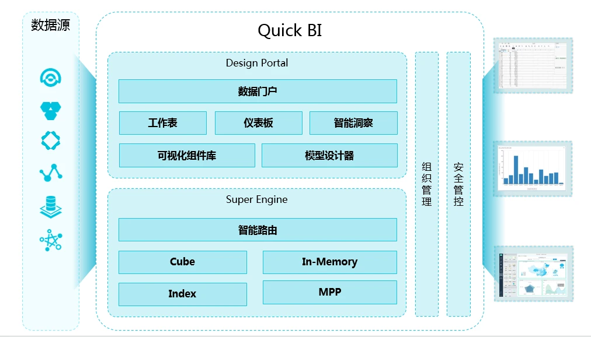

<a id="section-2"></a>

# 2.登录Quick BI控制台

本章节将为您介绍如何登录Quick BI。

**前提条件**

- 登录Apsara Uni-manager运营控制台前，确认您已从部署人员处获取Apsara Uni-manager运营控制台的IP地址或服务域名地址。Apsara Uni-manager运营控制台访问地址为：http:// *Apsara Uni-mana ger运营控制台的IP地址或服务域名地址*/manage。

- 推荐使用Chrome浏览器。

**背景信息**

当您的账号为阿里云RAM子账号时，请通过域名直接登录Quick BI；当您的账号为阿里云主账号时，请通过以下步骤登录Quick BI：

**操作步骤**

1. 在浏览器地址栏中，输入Apsara Uni-manager运营控制台的访问地址，按回车键。

2. 输入正确的用户名及密码。

   请向运营管理员获取登录控制台的用户名和密码。

   > 首次登录Apsara Uni-manager运营控制台时，需要修改登录用户名的密码，请按照提
   >
   > **说明**
   >
   > 示完成密码修改。为提高安全性，密码长度必须为 8~20 位，且至少包含以下两种类型：
   >
   > - 英文大写或小写字母（A~Z、a~z）
   >
   > - 阿拉伯数字（0~9）
   >
   > - 特殊符号（感叹号（！）、at（@）、井号（#）、美元符号（$）、百分号（%）等）

3. 单击**登录**，进入Apsara Uni-manager运营控制台页面。

4. 在页面顶部菜单栏中，单击**产品 > 大数据**中的**Quick BI**。

5. 在页面下拉框中，选择需要进入的组织和地域，单击**QuickBI**或者单击**QuickBI 管理控制台**，即可进入**Quick BI**页面。

   - 单击**QuickBI**， 您可以直接进入Quick BI产品页面。

   - 单击**QuickBI 管理控制台**， 您可以进行添加组织成员和管理工作空间的操作。

     > 通过该方式登录Quick BI，无论选择哪个部门，都映射为同一个主账号：
     >
     > **说明**
     >
     > quickbi_admin@aliyun.com。

   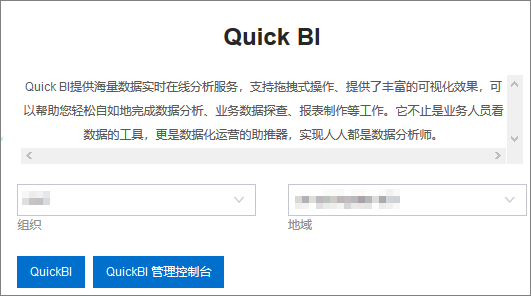

<a id="section-3"></a>

# 3.访问模式

当前Quick BI首页以开发模式为主，作为访问者没有一个集中界面可以查看可访问的报表，访问模式让访问者可以快速查看报表，提升数据访问效率和体验，本章节为您介绍二者的详细信息。

- 访问模式：可浏览跟自己相关的报表，包括**常用**、**我的收藏**、**与我分享**、**我的足迹**、**业务导航**。单击对应页签下的**更多**图标可展示当前页签下所有报表。单击**我的应用**可跳转至对应应用模块并可查看其数据等。

  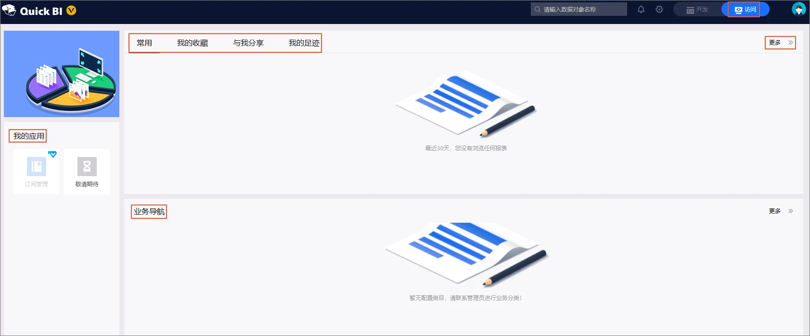

  - **我的足迹**可查看最近30天内访问过的报表。

  - **业务导航**可以查看个人访问报表次数最多的4个类目。

  > 访问模式下不支持配置面板功能。
  >
  > **说明**

- 开发模式：仅开发者和分析师可在工作空间内编辑报表，访问者无法访问开发模式。

  

<a id="section-4"></a>

# 4.数据建模

<a id="section-4-1"></a>

## 4.1. 概述

数据建模可以辅助数据最终以可视化的方式呈现，让读者能够更快速、便捷地读取出数据中的关键信息，从而掌握数据的发展走向，做出较为准确有效的决策与判断。

数据建模的基本流程可分为以下两个步骤：

1. 新建数据源。

2. 创建数据集。

<a id="section-4-2"></a>

## 4.2. 数据源

<a id="section-4-2-1"></a>

### 4.2.1. 概述

创建数据集、电子表格、仪表板和数据门户等操作都需要数据源作为基础。Quick BI支持的数据源来自云数据库和自建数据源。

云数据源包括：

- MaxCompute

- MySQL

- SQL Server

- AnalyticDB for MySQL 2.0

- HybirdDB for MySQL

- AnalyticDB for PostgreSQL

- PostgreSQL

- PPAS

- Data Lake Analytics

- Hive

- DRDS

- Presto

- AnalyticDB for MySQL 3.0

- PolarDB for MySQL

> 专有网络VPC下的数据源只支持MySQL和SQL Server。
>
> **说明**

自建数据源包括：

- MySQL

- SQL Server

- PostgreSQL

- Oracle

- Hive

- Vertica

- IBM DB2 LUW

- SAP IQ (SybaseIQ)

- SAP HANA

- Presto

> SQL Server数据源暂不支持使用视图。
>
> **说明**

<a id="section-4-2-2"></a>

### 4.2.2. 云数据源

<a id="section-4-2-2-1"></a>

#### 4.2.2.1. 查看Quick BI集群的IP地址

本节将为您介绍如何查看设置数据库白名单的IP地址。

**前提条件**

您已购买Quick BI服务。

**背景信息**

受限于云数据库RDS版的白名单策略，您在Quick BI添加某些数据源时，需要先查询到机器可用的IP地址，并手动将IP地址添加到RDS数据库白名单中。

**操作步骤**

1. 登录天基控制台。请确保已从部署人员或管理员处获取Apsara Uni-manager运维控制台的访问地址、用户名和密码。

   <ol type="i">

   <li>

   在地址栏中，输入Apsara Uni-manager运维控制台的访问地址*ops*.asconsole.*intranet-domain-id*.com，按回车键。

   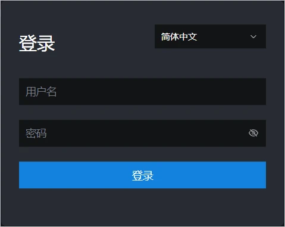

   > 推荐使用Chrome浏览器。
   >
   > **说明**
   >
   > 您可以单击页面右上角的下拉按钮来进行语言切换。

   </li>

   <li>

   输入正确的用户名及密码。首次登录Apsara Uni-manager运维控制台时，需要修改登录用户名的密码，请按照提示完成密码修改。

   为提高安全性，密码必须满足以下要求：

   - 英文大小写字母

   - 阿拉伯数字（0~9）

   - 特殊符号，包括感叹号（！）、at（@）、井号（#）、美元符号（$）、百分号（%）等

   - 密码长度10~20个字符

   </li>

   <li>

   单击**登录**。

   </li>

   <li>

   在顶部菜单栏中，单击**运维**。

   </li>

   <li>

   在左侧导航栏中，单击**产品运维管理 > 产品列表**。

   </li>

   <li>

   在**云平台运维 > 基础运维**区域，单击**天基**图标。

   </li>

   </ol>

2. 在**基础设施运营平台**首页的左侧导航栏中，选择**运维 > 集群运维**。

3. 在搜索框中选择对应的Project或者直接输入集群名称，查找对应的集群。

4. 找到待查看配置的集群，单击集群名称或者**操作**列中的**运维**，进入**集群详情**页面。

5. 在集群详情页面的**机器管理**页签，可以看到Quick BI的IP地址。

   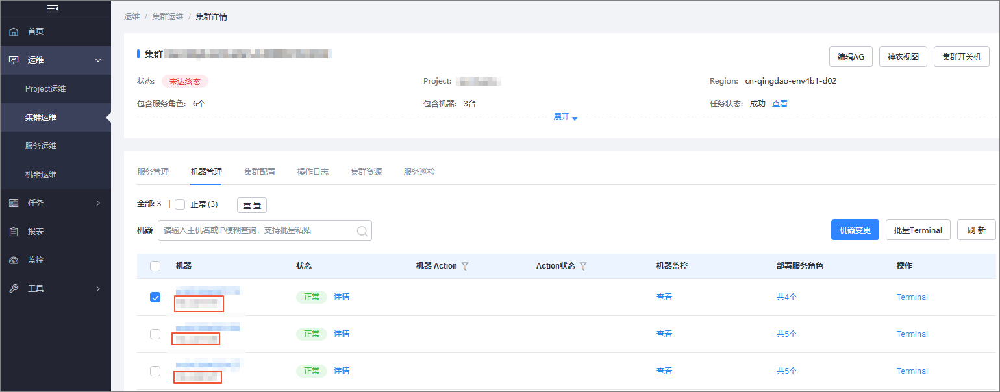

**后续步骤**

添加IP地址至RDS的白名单中。

获取到IP地址后，将集群中所有机器的IP地址最后一段更改为0/24，例如机器的IP地址为10.10.10.10，您需要更改为10.10.10.0 /24。并添加到RDS白名单中。具体操作步骤请参见《RDS用户指南》中的设置白名单 。

<a id="section-4-2-2-2"></a>

#### 4.2.2.2. 新建MaxCompute云数据源

本节介绍如何新建大数据计算服务MaxCompute云数据源。

**前提条件**

- 在大数据计算服务控制台创建一个MaxCompute（原名ODPS）项目。

- 获取MaxCompute数据源的相关参数信息。

**操作步骤**

1. 新建数据源。

2. 单击**MaxCompute**图标，系统会自动弹出**添加MaxCompute数据源**的对话框。

   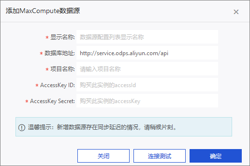

3. 输入所需要的数据源连接信息。

   | 配置 | 说明 |
   | --- | --- |
   | 显示名称 | 数据源配置列表的显示名称。 |
   | 数据库地址 | 此处有默认地址，无需修改。 |
   | 项目名称 | 项目名称。 |
   | AccessKey ID | 用于标识访问者身份。 |
   | AccessKey Secret | 用于加密签名字符串和服务器端验证签名字符串的密钥，必须严格保密。 |

4. 单击**连接测试**，进行数据源连通性测试。

   

5. 连接测试通过后，单击**确定**。添加成功后，页面会自动跳转到数据源列表页，并在页面右侧展示数据源所包含的数据表列表。

<a id="section-4-2-2-3"></a>

#### 4.2.2.3. 新建MySQL云数据源

本节介绍如何新建MySQL云数据源。

**前提条件**

1. 创建一个RDS（MySQL版）实例。具体操作步骤请参见《RDS用户指南》中的创建实例。

2. 查询到可用的机器IP地址，具体操作步骤请参见查看Quick BI集群的IP地址，然后手动添加IP地址到RDS数据库实例的白名单中，具体操作步骤请参见《RDS用户指南》中的设置白名单。

3. 获取连接MySQL数据源的相关参数。

**操作步骤**

1. 新建数据源。

2. 单击**MySQL**图标，输入所需要的数据源连接信息。

   图 1. 添加MySQL数据源

   

   > 如果该数据源为VPC连接，请选中**vpc数据源**选项并输入相关参数。
   >
   > **说明**

   | 配置 | 说明 |
   | --- | --- |
   | 显示名称 | 输入数据源显示名称（可自定义）。 |
   | 数据库地址 | 输入主机名或IP地址。 |
   | 端口 | 输入端口号，默认为3306。 |
   | 数据库 | 输入数据库名称。 |
   | 用户名 | 输入用户名。 |
   | 密码 | 输入密码。<br>说明如果您不确定您的用户名和密码，请联系您的数据仓库管理员获取。 |
   | 购买者accessId | 购买此实例的AccessKey ID。 |
   | 购买者accesskey | 购买此实例的AccessKey Secret。 |
   | 实例id | 购买此实例的ID。 |

3. 单击**连接测试**，进行数据源连通性测试。

4. 连通性测试成功后，单击**确定**。

   数据源不能重复添加，如果该数据源已经存在，系统会给出错误提示。

<a id="section-4-2-2-4"></a>

#### 4.2.2.4. 新建SQL Server云数据源

本节介绍如何新建SQL Server云数据源。

**前提条件**

1. 创建一个云数据库RDS（SQL Server版）实例。创建RDS实例的具体操作步骤请参见《RDS用户指南》中的创建实例。

2. 查询到可用的机器IP地址，具体操作步骤请参见查看Quick BI集群的IP地址，然后手动添加机器IP地址到RDS实例的白名单中，具体操作步骤请参见《RDS用户指南》中的设置白名单。

3. 获取连接SQL Server数据源的相关参数。

**背景信息**

SQL Server数据源的配置方法与MySQL数据源的配置方法类似。SQL Server数据源多了一个特有的配置项：Schema。

**操作步骤**

1. 新建数据源。

2. 单击**SQL Server**图标，输入所需要的数据源连接信息。

   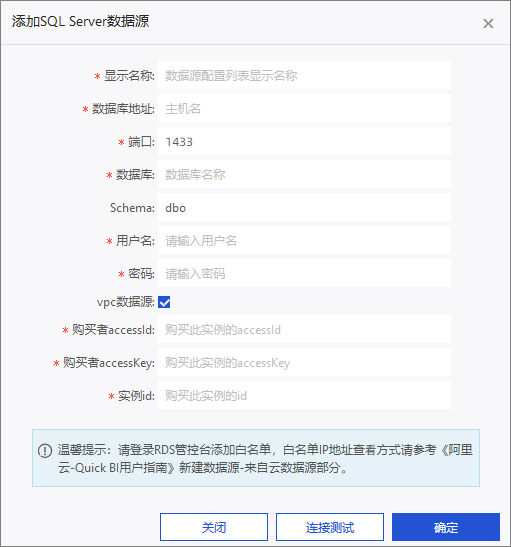

   > 如果该数据源为VPC连接，请勾选**vpc数据源**选项并输入相关参数。
   >
   > **说明**

   | 配置 | 说明 |
   | --- | --- |
   | 显示名称 | 输入数据源显示名称（可自定义）。 |
   | 数据库地址 | 输入主机名或IP地址。 |
   | 端口 | 输入端口号，默认为1433。 |
   | 数据库 | 输入数据库名称。 |
   | Schema | 输入Schema，默认为dbo。 |
   | 用户名 | 输入用户名。 |
   | 密码 | 输入密码。 |
   | 购买者accessId | 购买此实例的AccessKey ID。 |
   | 购买者accessKey | 购买此实例的AccessKey Secret。 |
   | 实例id | 购买此实例的ID。 |

3. 单击**连接测试**，进行数据源连通性测试。

4. 连接性测试成功后，单击**确定**。

<a id="section-4-2-2-5"></a>

#### 4.2.2.5. 新建AnalyticDB for MySQL 2.0云数据源

本节介绍如何新建分析型数据库AnalyticDB for MySQL 2.0云数据源。

**前提条件**

在AnalyticDB控制台创建一个AnalyticDB数据库，具体操作步骤请参见《分析型数据库MySQL版》中的创建数据库，并获取连接AnalyitcDB数据源的相关参数信息。

**背景信息**

分析型数据库MySQL版（AnalyticDB for MySQL），原名AnalyticDB。

**操作步骤**

1. 新建数据源。

2. 单击**AnalyticDB for MySQL 2.0**图标，输入所需要的数据源连接信息。

   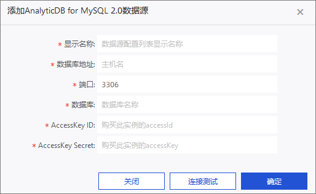

   | 配置 | 说明 |
   | --- | --- |
   | 显示名称 | 输入数据源显示名称（可自定义）。 |
   | 数据库地址 | 输入主机名或IP地址。 |
   | 端口 | 输入端口号。 |
   | 数据库 | 输入数据库名称。 |
   | AccessKey ID | 用于标识访问者身份。 |
   | AccessKey Secret | 用于加密签名字符串和服务器端验证签名字符串的密钥，必须严格保密。 |

3. 单击**连接测试**按钮，进行数据源连通性测试。

4. 连接性测试成功后，单击**确定**。

<a id="section-4-2-2-6"></a>

#### 4.2.2.6. 新建HybridDB for MySQL云数据源

本节介绍如何新建HybridDB for MySQL云数据源。

**前提条件前提条件**

1. 创建一个HybridDB for MySQL数据库实例。

2. 查询到可用的机器IP地址，具体操作步骤请参见查看Quick BI集群的IP地址，然后手动添加机器IP地址到HybridDB for MySQL数据库实例的白名单中 。

3. 获取连接HybridDB for MySQL数据源的相关参数信息。

**背景信息**

HybridDB for MySQL数据源的配置方法与SQL Server数据源的配置方法类似。默认端口会变成HybridDB for MySQL特有的端口。

**操作步骤**

1. 新建数据源。

2. 单击**HybridDB for MySQL**，输入所需要的数据源连接信息。

   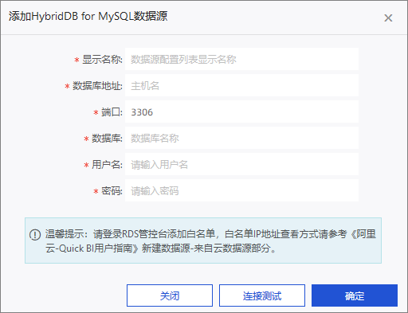

   | 配置 | 说明 |
   | --- | --- |
   | 显示名称 | 输入数据源显示名称（可自定义）。 |
   | 数据库地址 | 输入主机名或IP地址。 |
   | 端口 | 输入端口号，默认为3306。 |
   | 数据库 | 输入数据库名称。 |
   | 用户名 | 输入用户名。 |
   | 密码 | 输入密码。 |

3. 单击**连接测试**，进行数据源连通性测试。

4. 连接性测试成功后，单击**确定**。

<a id="section-4-2-2-7"></a>

#### 4.2.2.7. 新建AnalyticDB for PostgreSQL云数据源

本节介绍如何新建分析型数据库 PostgreSQL版（AnalyticDB for PostgreSQL）云数据源。

**前提条件**

1. 创建一个AnalyticDB for PostgreSQL数据库实例。具体操作步骤请参见《分析型数据库PostgreSQL版》中的创建实例。

2. 查询到可用的机器IP地址，具体操作步骤请参见查看Quick BI集群的IP地址，然后手动添加机器的IP地址到AnalyticDB for PostgreSQL数据库实例的白名单中，具体操作步骤请参见《分析型数据库PostgreSQL版》中的设置白名单。

3. 获取连接AnalyticDB for PostgreSQL数据源的相关参数信息。

**背景信息**

AnalyticDB for PostgreSQL数据源的添加方法与SQL Server数据源的添加方法类似。默认端口会变成AnalyticDB for PostgreSQL特有的端口。

**操作步骤**

1. 新建数据源。

2. 单击**AnalyticDB for PostgreSQL**图标，输入所需要的数据源连接信息。

   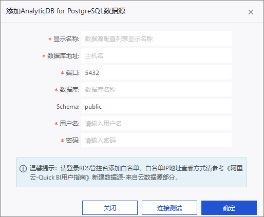

   | 配置 | 说明 |
   | --- | --- |
   | 显示名称 | 输入数据源显示名称（可自定义）。 |
   | 数据库地址 | 输入主机名或IP地址。 |
   | 端口 | 输入端口号，默认为5432。 |
   | 数据库 | 输入数据库名称。 |
   | Schema | 默认public。 |
   | 用户名 | 输入用户名。 |
   | 密码 | 输入密码。 |

3. 单击**连接测试**，进行数据源连通性测试。

4. 连接性测试成功后，单击**确定**。

<a id="section-4-2-2-8"></a>

#### 4.2.2.8. 新建PostgreSQL云数据源

本节介绍如何新建PostgreSQL云数据源。

**前提条件**

1. 创建一个RDS （PostgreSQL版）数据库实例。具体操作步骤请参见《RDS用户指南》中的创建实例。

2. 查询到可用的机器IP地址，具体操作步骤请参见查看Quick BI集群的IP地址，然后手动添加IP地址到RDS数据库实例的白名单中，具体操作步骤请参见《RDS用户指南》中的设置白名单。

3. 获取连接PostgreSQL数据源的相关参数信息。

**操作步骤**

1. 新建数据源。

2. 单击**PostgreSQL**图标，输入所需要的数据源连接信息。

   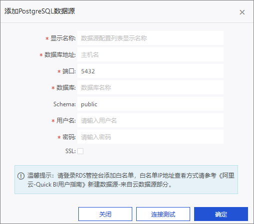

   > 选中**SSL**选项后，支持MaxCompute产品的MaxCompute Lightning交互式查询服
   >
   > **说明**
   >
   > 务。

   | 配置 | 说明 |
   | --- | --- |
   | 显示名称 | 输入数据源显示名称（可自定义）。 |
   | 数据库地址 | 输入主机名或IP地址。 |
   | 端口 | 输入端口号，默认为5432。 |
   | 数据库 | 输入数据库名称。 |
   | Schema | 默认public。 |
   | 用户名 | 输入用户名。 |
   | 密码 | 输入密码。 |

3. 单击**连接测试**，进行数据源连通性测试。

4. 连接性测试成功后，单击**确定**。

<a id="section-4-2-2-9"></a>

#### 4.2.2.9. 新建PPAS云数据源

本节介绍如何新建PPAS云数据源。

**前提条件**

1. 创建一个RDS （PPAS版）数据库实例。具体操作步骤请参见《RDS用户指南》中的创建实例。

2. 查询到可用的机器IP地址，具体操作步骤请参见查看Quick BI集群的IP地址，然后手动添加IP地址到RDS数据库实例的白名单中，具体操作步骤请参见《RDS用户指南》中的设置白名单。

3. 获取连接PPAS数据源的相关参数信息。

**操作步骤**

1. 新建数据源。

2. 单击**PPAS**图标，输入所需要的数据源连接信息。

   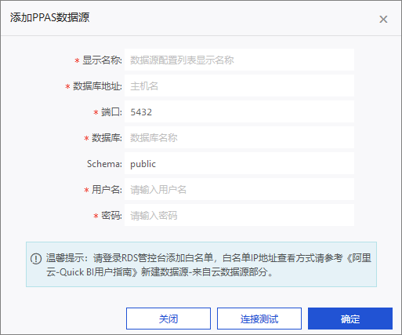

   | 配置 | 说明 |
   | --- | --- |
   | 显示名称 | 输入数据源显示名称（可自定义）。 |
   | 数据库地址 | 输入主机名或IP地址。 |
   | 端口 | 输入端口号，默认为5432。 |
   | 数据库 | 输入数据库名称。 |
   | Schema | 默认public。 |
   | 用户名 | 输入用户名。 |
   | 密码 | 输入密码。 |

3. 单击**连接测试**，进行数据源连通性测试。

4. 连接性测试成功后，单击**确定**。

<a id="section-4-2-2-10"></a>

#### 4.2.2.10. 新建Data Lake Analytics云数据源

本节介绍如何新建Data Lake Analytics云数据源。

**前提条件**

获取连接Data Lake Analytics数据源的相关参数信息。

**操作步骤**

1. 新建数据源。

2. 单击**Data Lake Analytics**图标，输入所需要的数据源连接信息。

   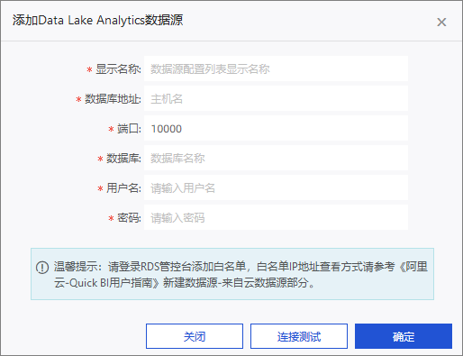

   | 配置 | 说明 |
   | --- | --- |
   | 显示名称 | 输入数据源显示名称（可自定义）。 |
   | 数据库地址 | 输入主机名或IP地址。 |
   | 端口 | 输入端口号，默认为10000。 |
   | 数据库 | 输入数据库名称。 |
   | 用户名 | 数据库对应的用户名。 |
   | 密码 | 数据库对应的密码。 |

3. 单击**连接测试**，进行数据源连通性测试。

4. 连接性测试成功后，单击**确定**。

<a id="section-4-2-2-11"></a>

#### 4.2.2.11. 新建Hive云数据源

本节介绍如何新建Hive云数据源。

**前提条件**

获取连接Hive数据源的相关参数信息。

**操作步骤**

1. 新建数据源。

2. 单击**Hive**图标，输入所需要的数据源连接信息。

   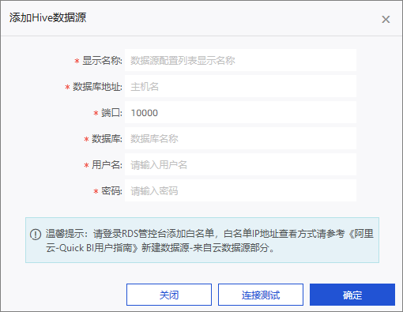

   | 配置 | 说明 |
   | --- | --- |
   | 显示名称 | 输入数据源显示名称（可自定义）。 |
   | 数据库地址 | 输入主机名或IP地址。 |
   | 端口 | 输入端口号，默认为10000。 |
   | 数据库 | 输入数据库名称。 |
   | 用户名 | 输入用户名。 |
   | 密码 | 输入密码。 |

3. 单击**连接测试**，进行数据源连通性测试。

4. 连接性测试成功后，单击**确定**。

<a id="section-4-2-2-12"></a>

#### 4.2.2.12. 新建DRDS云数据源

本节介绍如何新建分布式关系型数据库DRDS云数据源。

**前提条件**

- 创建一个DRDS数据库实例。具体操作步骤请参见《分布式关系型数据库服务》中的创建实例。

- 查询到可用的机器IP地址，具体操作步骤请参见查看Quick BI集群的IP地址，并手动添加机器IP地址到DRDS数据库实例的白名单中，具体操作步骤请参见《分布式关系型数据库服务》中的设置白名单 。

- 获取连接DRDS数据源的相关参数信息。

**操作步骤**

1. 新建数据源。

2. 单击**DRDS**图标，输入所需要的数据源连接信息。

   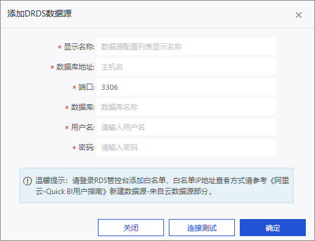

   | 配置 | 说明 |
   | --- | --- |
   | 显示名称 | 输入数据源显示名称（可自定义）。 |
   | 数据库地址 | 输入主机名或IP地址。 |
   | 端口 | 输入端口号，默认为3306。 |
   | 数据库 | 输入数据库名称。 |
   | 用户名 | 输入用户名。 |
   | 密码 | 输入密码。 |

3. 单击**连接测试**，进行数据源连通性测试。

4. 连接性测试成功后，单击**确定**。

<a id="section-4-2-2-13"></a>

#### 4.2.2.13. 新建Presto云数据源

本节介绍如何新建Presto云数据源。

**前提条件**

获取连接Presto数据源的相关参数信息。

**操作步骤**

1. 新建数据源。

2. 单击**Presto**图标，输入所需要的数据源连接信息。

   

   | 配置 | 说明 |
   | --- | --- |
   | 显示名称 | 输入数据源显示名称（可自定义）。 |
   | 数据库地址 | 输入主机名或IP地址。 |
   | 端口 | 输入端口号，默认为3306。 |
   | catalog | Presto指向的数据源名称。 |
   | Schema | 默认是登录户名。 |
   | 用户名 | 对应用户名。 |
   | 密码 | 对应密码。 |

3. 单击**连接测试**，进行数据源连通性测试。

4. 连接性测试成功后，单击**确定**。

<a id="section-4-2-2-14"></a>

#### 4.2.2.14. 新建AnalyticDB for MySQL 3.0云数据

本节介绍如何新建分析型数据库AnalyticDB for MySQL 3.0云数据源。

**前提条件**

在AnalyticDB控制台创建一个AnalyticDB数据库，具体操作步骤请参见《分析型数据库MySQL版》中的创建数据库，并获取连接AnalyitcDB数据源的相关参数信息。

**背景信息**

分析型数据库MySQL版（AnalyticDB for MySQL），原名AnalyticDB。

**操作步骤**

1. 新建数据源。

2. 单击**AnalyticDB for MySQL 3.0**图标，输入所需要的数据源连接信息。

   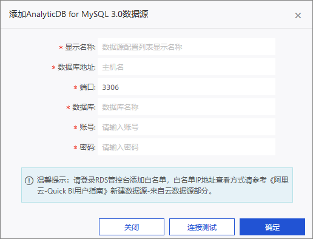

   | 配置 | 说明 |
   | --- | --- |
   | 显示名称 | 输入数据源显示名称（可自定义）。 |
   | 数据库地址 | 输入主机名或IP地址。 |
   | 端口 | 输入端口号。 |
   | 数据库 | 输入数据库名称。 |
   | 账号 | 数据库对应账号。 |
   | 密码 | 数据库对应密码。 |

3. 单击**连接测试**按钮，进行数据源连通性测试。

4. 连接性测试成功后，单击**确定**。

<a id="section-4-2-2-15"></a>

#### 4.2.2.15. 新建PolarDB for MySQL云数据源

本节介绍如何新建PolarDB for MySQL云数据源。

**前提条件**

获取连接PolarDB for MySQL数据源的相关参数信息。

**操作步骤**

1. 新建数据源。

2. 单击**PolarDB for MySQL**图标，输入所需要的数据源连接信息。

   > 如果该数据源为vpc连接，请勾选vpc数据源选项并输入相关参数。
   >
   > **说明**

   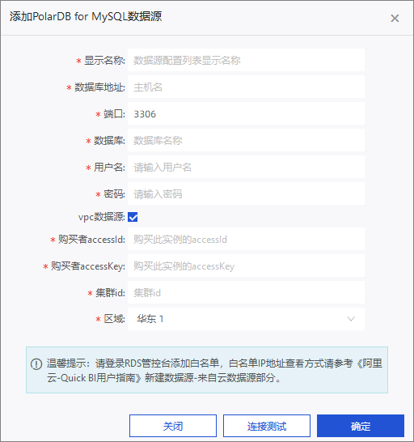

   | 配置 | 说明 |
   | --- | --- |
   | 显示名称 | 输入数据源显示名称（可自定义）。 |
   | 数据库地址 | 输入主机名或IP地址。 |
   | 端口 | 输入端口号，默认为3306。 |
   | 数据库 | 输入数据库名称。 |
   | 用户名 | 对应用户名 |
   | 密码 | 对应密码 |
   | 购买者accessId | 购买此实例的AccessKey ID。 |
   | 购买者accessKey | 购买此实例的AccessKey Secret。 |
   | 集群id | 集群ID。 |
   | 区域 | 此集群所在区域。 |

3. 单击**连接测试**，进行数据源连通性测试。

4. 连接性测试成功后，单击**确定**。

<a id="section-4-2-2-16"></a>

#### 4.2.2.16. 新建Hologres云数据源

Hologres是阿里巴巴自主研发的一款交互式分析产品，兼容PostgreSQL 11协议，与大数据生态无缝连接，支持高并发和低延时地分析处理PB级数据。本文为您介绍如何使用交互式分析（Hologres）连接Quick BI。

**前提条件**

- 开通Hologres。

- 获取Hologres数据库的地址和端口。

- 获取Hologres数据库的用户名和密码。

**操作步骤**

1. 新建数据源。

2. 单击**Hologres**图标，输入所需要的数据源连接信息。

   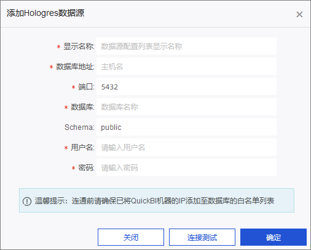

   | 名称 | 描述 |
   | --- | --- |
   | 显示名称 | 数据源配置列表的显示名称。 |
   | 数据库地址 | 连接的交互式分析实例的网络地址。 |
   | 端口 | 连接的交互式分析实例的网络端口。 |
   | 数据库 | 连接的Hologres实例的数据库名称。 |
   | Schema | 需要连接的Schema名称。默认public。 |
   | 用户名 | 数据库对应的用户名。 |
   | 密码 | 数据库对应的密码。 |

3. 单击**连接测试**，进行数据源连通性测试。

4. 测试成功后，单击**确定**，添加数据源。

<a id="section-4-2-2-17"></a>

#### 4.2.2.17. 新建PolarDB for PostgreSQL云数据源

本文为您介绍如何新建PolarDB for PostgreSQL云数据源。

**前提条件**

- 已创建阿里云PolarDB for PostgreSQL数据库。

- 已获取PolarDB for PostgreSQL数据库的用户名和密码。

- 已获取鉴权的**AccessKey ID**和**AccessKey Secret**。

**操作步骤**

1. 新建数据源。

2. 单击**PolarDB for PostgreSQL**图标，输入所需要的数据源连接信息。

   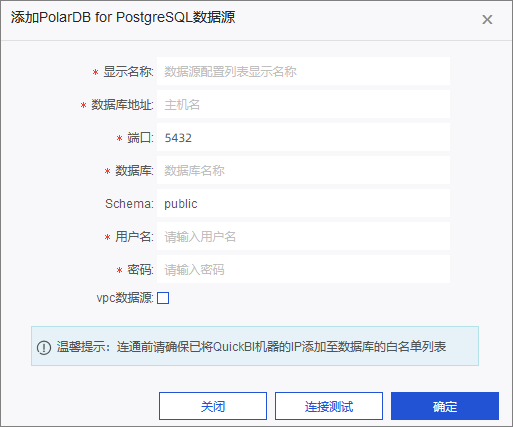

   | 名称 | 描述 |
   | --- | --- |
   | 显示名称 | 数据源配置列表的显示名称。 |
   | 数据库地址 | 填写主机名或IP地址。 |
   | 端口 | 填写正确的端口号即可。 |
   | 数据库 | 连接数据库名称。 |
   | Schema | 需要连接的Schema名称。默认为public。 |
   | 用户名 | 数据库对应的用户名。 |
   | 密码 | 数据库对应的密码。 |

   | vpc数据源 | 如果您选中<strong>vpc数据源</strong>，则需要配置如下参数：<br>• <strong>购买者accessId</strong>：购买此实例的AccessKey ID。<br>• <strong>购买者accessKey</strong>：购买此实例的AccessKey Secret。<br>• <strong>集群id</strong>：集群ID。<br>• <strong>区域</strong>：此实例所在区域。 |
   | --- | --- |

3. 单击**连接测试**，进行数据源连通性测试。

4. 测试成功后，单击**确定**，完成数据源的添加。

<a id="section-4-2-3"></a>

### 4.2.3. 自建数据源

<a id="section-4-2-3-1"></a>

#### 4.2.3.1. 新建MySQL自建数据源

本章节介绍如何新建MySQL自建数据源。

**前提条件**

获取连接MySQL自建数据源的相关参数信息。

**背景信息**

自建数据源下的MySQL数据源的配置方法与云数据库中的MySQL数据源的配置方法类似。您需要通过以下方法打开自建数据库下的防火墙才能允许外部访问MySQL。

1. 输入以下命令进入防火墙的配置文件。

   ```text
   vi /etc/sysconfig/iptables
   ```

2. 在防火墙配置文件中增加以下命令。

   ```text
   -A RH-Firewall-1-INPUT -m state –state NEW -m tcp -p tcp –dport 3306 -j ACCEPT
   ```

3. 配置成功后，重新启动 iptable。

   ```text
   service iptables restart
   ```

**操作步骤**

1. 新建数据源。

2. 单击**MySQL**图标，输入所需要的数据源连接信息。

   

   > 选中**ssh**选项后，支持通过ssh隧道访问。
   >
   > **说明**

   | 配置 | 说明 |
   | --- | --- |
   | 显示名称 | 输入数据源显示名称。 |
   | 数据库地址 | 输入主机名或IP地址。 |
   | 端口 | 输入端口号，默认为3306。 |
   | 数据库 | 输入数据库名称。 |
   | 用户名 | 输入用户名。 |
   | 密码 | 输入密码。 |
   | SSH Host | 主机名或者IP地址。 |
   | SSH 用户名 | 对应的SSH用户名。 |
   | SSH 密码 | 对应用户名密码。 |
   | SSH 端口 | 22。 |

3. 单击**连接测试**，进行数据源连通性测试。

4. 连接性测试成功后，单击**确定**。

<a id="section-4-2-3-2"></a>

#### 4.2.3.2. 新建SQL Server自建数据源

本章节介绍如何新建SQL Server自建数据源。

**前提条件**

获取连接SQL Server自建数据源的相关参数信息。

**背景信息**

自建数据源下的SQL Server数据源的配置方法与云数据库中的SQL Server数据源的配置方法类似。您需要通过以下方法打开自建数据库下的防火墙才能允许外部访问SQL Server。

1. 输入以下命令进入防火墙的配置文件：

   ```text
   vi /etc/sysconfig/iptables
   ```

2. 在防火墙配置文件中增加以下命令：

   ```text
   -A RH-Firewall-1-INPUT -m state –state NEW -m tcp -p tcp –dport 1433 -j ACCEPT
   ```

3. 配置成功后，重新启动 iptable：

   ```text
   service iptables restart
   ```

**操作步骤**

1. 新建数据源。

2. 单击**SQL Server**图标 ，输入所需要的数据源连接信息。

   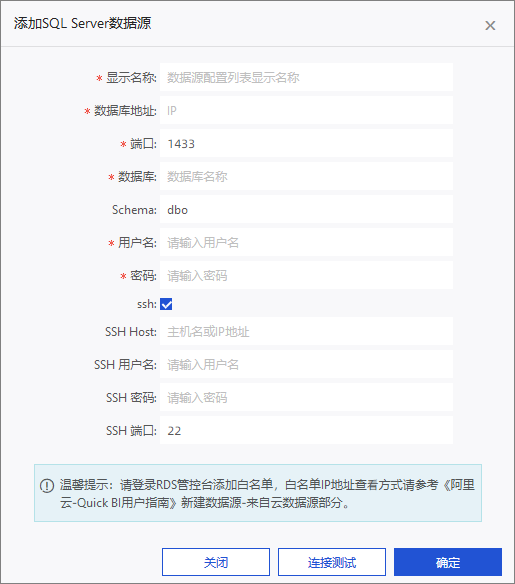

   > 选中**ssh**选项后，支持通过ssh隧道访问。
   >
   > **说明**

   | 配置 | 说明 |
   | --- | --- |
   | 显示名称 | 输入数据源显示名称。 |
   | 数据库地址 | 输入IP地址。 |
   | 端口 | 输入端口地址，默认为1433。 |
   | 数据库 | 输入数据库名称。 |
   | Schema | 输入Schema，默认为dbo。 |
   | 用户名 | 输入用户名。 |
   | 密码 | 输入密码。 |
   | SSH Host | 主机名或者IP地址。 |
   | SSH 用户名 | 对应的SSH用户名。 |
   | SSH 密码 | 对应用户名密码。 |
   | SSH 端口 | 22。 |

3. 单击**连接测试**按钮，进行数据源连通性测试。

4. 连接性测试成功后，单击**确定**。

   > 数据源不可重复添加，否则系统会给出错误提示。
   >
   > **说明**

<a id="section-4-2-3-3"></a>

#### 4.2.3.3. 新建PostgreSQL自建数据源

本节介绍如何新建PostgreSQL自建数据源。

**前提条件**

获取连接PostgreSQL自建数据源的相关参数信息。

**背景信息**

自建数据源下的PostgreSQL数据源的配置方法与云数据库中的PostgreSQL数据源的配置方法类似。您需要通过以下方法打开自建数据库下的防火墙才能允许外部访问PostgreSQL。

1. 输入以下命令进入防火墙的配置文件：

   ```text
   vi /etc/sysconfig/iptables
   ```

2. 在防火墙配置文件中增加以下命令：

   ```text
   -A RH-Firewall-1-INPUT -m state –state NEW -m tcp -p tcp –dport 5432 -j ACCEPT
   ```

3. 配置成功后，重新启动 iptable：

   ```text
   service iptables restart
   ```

**操作步骤**

1. 新建数据源。

2. 单击**PostgreSQL**图标，输入所需要的数据源连接信息。

   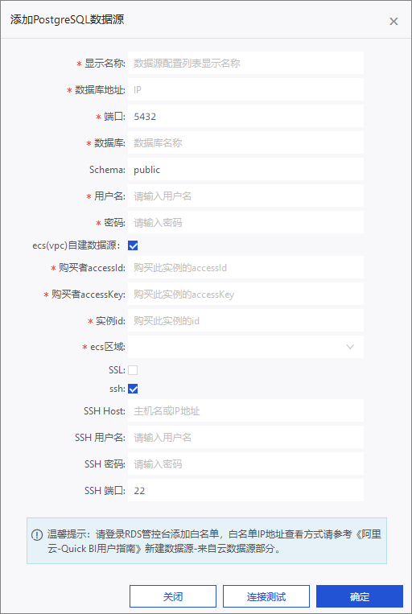

   > 如果该数据源为VPC连接，请选中**vpc数据源**选项并输入相关参数；选中**SSL**选项后，
   >
   > **说明**
   >
   > 支持MaxCompute产品的MaxCompute Lightning交互式查询服务；选中**ssh**选项后，支持通过ssh隧道访问。

   | 配置 | 说明 |
   | --- | --- |
   | 显示名称 | 输入数据源显示名称。 |
   | 数据库地址 | 输入IP地址。 |
   | 端口 | 输入端口地址，默认为5432。 |
   | 数据库 | 输入数据库名称。 |
   | Schema | 默认为public。 |
   | 用户名 | 输入用户名。 |
   | 密码 | 输入密码。 |
   | 购买者accessId | 购买此实例的AccessKey ID。 |
   | 购买者accessKey | 购买此实例的AccessKey Secret。 |
   | 实例id | 购买此实例的ID。 |
   | ecs区域 | 数据源所在区域。 |
   | SSH Host | 主机名或者IP地址。 |
   | SSH 用户名 | 对应的SSH用户名。 |
   | SSH 密码 | 对应用户名密码。 |
   | SSH 端口 | 22。 |

3. 单击**连接测试**按钮，进行数据源连通性测试。

4. 连接性测试成功后，单击**确定**。

<a id="section-4-2-3-4"></a>

#### 4.2.3.4. 新建Oracle自建数据源

本节介绍如何新建Oracle自建数据源。

**前提条件**

获取连接Oracle自建数据源的相关参数信息。

**操作步骤**

1. 新建数据源。

2. 单击**Oracle**图标，输入所需要的数据源连接信息。

   

   > 选中**ssh**选项后，支持通过ssh隧道访问。
   >
   > **说明**

   <table>
     <tr>
       <th width="105">配置</th>
       <th>说明</th>
     </tr>
     <tr>
       <td>显示名称</td>
       <td>输入数据源显示名称。</td>
     </tr>
     <tr>
       <td>数据库地址</td>
       <td>输入IP地址。</td>
     </tr>
     <tr>
       <td>端口</td>
       <td>输入端口地址，默认为1521。</td>
     </tr>
     <tr>
       <td>数据库</td>
       <td>输入数据库名称。</td>
     </tr>
     <tr>
       <td>Schema</td>
       <td>默认为public。</td>
     </tr>
     <tr>
       <td>用户名</td>
       <td>输入用户名。</td>
     </tr>
     <tr>
       <td>密码</td>
       <td>输入密码。</td>
     </tr>
     <tr>
       <td>字符编码</td>
       <td>默认为GBK。</td>
     </tr>
     <tr>
       <td>vpc数据源</td>
       <td>如果您选中<strong>vpc数据源</strong>，则需要配置如下参数：<br>• <strong>购买者accessId</strong>：购买此实例的AccessKey ID。<br>• <strong>购买者accessKey</strong>：购买此实例的AccessKey Secret。<br>• <strong>实例id</strong>：购买此实例的ID。<br>• <strong>区域</strong>：此实例所在区域。</td>
     </tr>
   </table>

   | ssh | 如果您选中<strong>ssh</strong>，则需要配置如下参数：<br>• <strong>SSH Host</strong>：主机名或者IP地址。<br>• <strong>SSH 用户名</strong>：数据库对应的SSH用户名。<br>• <strong>SSH 密码</strong>：数据库对应的用户名密码。<br>• <strong>SSH 端口</strong>：数据库对应的端口。默认为<strong>22</strong>。 |
   | --- | --- |

3. 单击**连接测试**按钮，进行数据源连通性测试。

4. 连接性测试成功后，单击**确定**。

<a id="section-4-2-3-5"></a>

#### 4.2.3.5. 新建Hive自建数据源

本节介绍如何新建Hive自建数据源。

**前提条件**

获取连接Hive自建数据源的相关参数信息。

**操作步骤**

1. 新建数据源。

2. 单击**Hive**图标，输入所需要的数据源连接信息。

   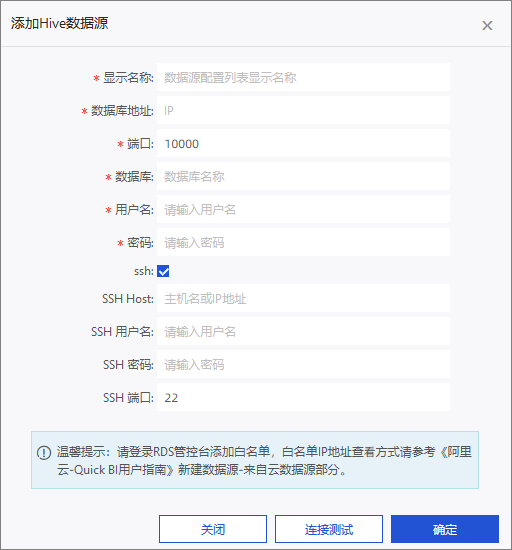

   | 配置 | 说明 |
   | --- | --- |
   | 显示名称 | 输入数据源显示名称（可自定义）。 |
   | 数据库地址 | 输入IP地址。 |
   | 端口 | 输入端口号，默认为10000。 |
   | 数据库 | 输入数据库名称。 |
   | 用户名 | 输入用户名。 |
   | 密码 | 输入密码。 |
   | SSH Host | 主机名或者IP地址。 |
   | SSH 用户名 | 对应的SSH用户名。 |
   | SSH 密码 | 对应用户名密码。 |
   | SSH 端口 | 22。 |

3. 单击**连接测试**，进行数据源连通性测试。

4. 连接性测试成功后，单击**确定**。

<a id="section-4-2-3-6"></a>

#### 4.2.3.6. 新建Vertica自建数据源

本节介绍如何新建Vertica自建数据源。

**前提条件**

获取连接Vertica自建数据源的相关参数信息。

**操作步骤**

1. 新建数据源。

2. 单击**Vertica**图标，输入所需要的数据源连接信息。

   

   | 配置 | 说明 |
   | --- | --- |
   | 显示名称 | 输入数据源显示名称。 |
   | 数据库地址 | 输入主机名或IP地址。 |
   | 端口 | 输入端口地址，默认为5433。 |
   | 数据库 | 输入数据库名称。 |
   | Schema | 默认为public。 |
   | 用户名 | 输入用户名。 |
   | 密码 | 输入密码。 |
   | SSH Host | 主机名或者IP地址。 |
   | SSH 用户名 | 对应的SSH用户名。 |
   | SSH 密码 | 对应用户名密码。 |
   | SSH 端口 | 22。 |

3. 单击**连接测试**按钮，进行数据源连通性测试。

4. 连接性测试成功后，单击**确定**。

<a id="section-4-2-3-7"></a>

#### 4.2.3.7. 新建IBM DB2 LUW自建数据源

本章节介绍如何新建IBM DB2 LUW自建数据源。

**前提条件**

获取连接IBM DB2 LUW自建数据源的相关参数信息。

**操作步骤**

1. 新建数据源。

2. 单击**IBM DB2 LUW**图标，输入所需要的数据源连接信息。

   

   | 配置 | 说明 |
   | --- | --- |
   | 显示名称 | 输入数据源显示名称。 |
   | 数据库地址 | 输入IP地址。 |
   | 端口 | 输入端口地址，默认为50000。 |
   | 数据库 | 输入数据库名称。 |
   | Schema | 默认为DB2INST1。 |
   | 用户名 | 输入用户名。 |
   | 密码 | 输入密码。 |
   | SSH Host | 主机名或者IP地址。 |
   | SSH 用户名 | 对应的SSH用户名。 |
   | SSH 密码 | 对应用户名密码。 |
   | SSH 端口 | 22。 |

3. 单击**连接测试**按钮，进行数据源连通性测试。

4. 连接性测试成功后，单击**确定**。

<a id="section-4-2-3-8"></a>

#### 4.2.3.8. 新建SAP IQ (Sybase IQ)自建数据源

本章节介绍如何新建SAP IQ (Sybase IQ)自建数据源。

**前提条件**

获取连接SAP IQ (Sybase IQ)自建数据源的相关参数信息。

**操作步骤**

1. 新建数据源。

2. 单击<strong>SAP IQ (Sybase IQ)</strong>图标，输入所需要的数据源连接信息。

   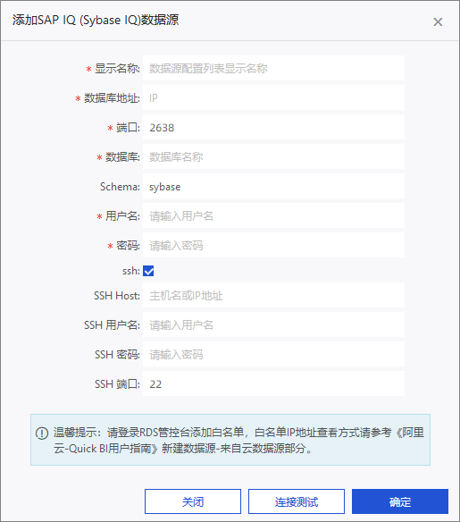

   | 配置 | 说明 |
   | --- | --- |
   | 显示名称 | 输入数据源显示名称。 |
   | 数据库地址 | 输入IP地址。 |
   | 端口 | 输入端口地址，默认为2638。 |
   | 数据库 | 输入数据库名称。 |
   | Schema | 默认为sybase。 |
   | 用户名 | 输入用户名。 |
   | 密码 | 输入密码。 |
   | SSH Host | 主机名或者IP地址。 |
   | SSH 用户名 | 对应的SSH用户名。 |
   | SSH 密码 | 对应用户名密码。 |
   | SSH 端口 | 22。 |

3. 单击**连接测试**按钮，进行数据源连通性测试。

4. 连接性测试成功后，单击**确定**。

<a id="section-4-2-3-9"></a>

#### 4.2.3.9. 新建SAP HANA自建数据源

本节介绍如何新建SAP HANA自建数据源。

**前提条件**

获取连接SAP HANA自建数据源的相关参数信息。

**操作步骤**

1. 新建数据源。

2. 单击**SAP HANA**图标，输入所需要的数据源连接信息。

   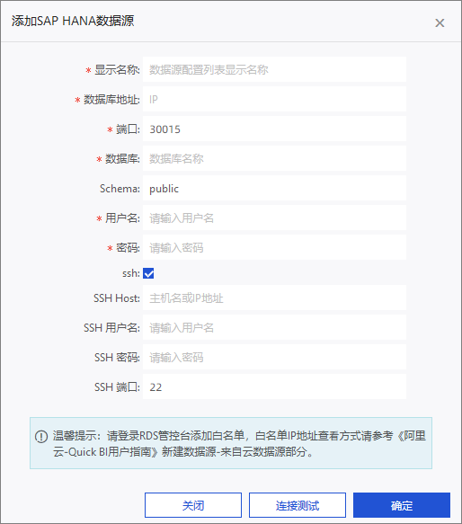

   > 选中**ssh**选项后，支持通过ssh隧道访问。
   >
   > **说明**

   | 配置 | 说明 |
   | --- | --- |
   | 显示名称 | 输入数据源显示名称。 |
   | 数据库地址 | 输入主机名或IP地址。 |
   | 端口 | 输入端口地址，默认为30015。 |
   | 数据库 | 输入数据库名称。 |
   | Schema | 默认为public。 |
   | 用户名 | 输入用户名。 |
   | 密码 | 输入密码。 |
   | SSH Host | 主机名或者IP地址。 |
   | SSH 用户名 | 对应的SSH用户名。 |
   | SSH 密码 | 对应用户名密码。 |
   | SSH 端口 | 22。 |

3. 单击**连接测试**按钮，进行数据源连通性测试。

4. 连接性测试成功后，单击**确定**。

<a id="section-4-2-3-10"></a>

#### 4.2.3.10. 新建Presto自建数据源

本节介绍如何新建Presto自建数据源。

**前提条件**

获取连接Presto数据源的相关参数信息。

**操作步骤**

1. 新建数据源。

2. 单击**Presto**图标，输入所需要的数据源连接信息。

   

   > 勾选**ssh**选项后，支持通过ssh隧道访问。
   >
   > **说明**

   | 配置 | 说明 |
   | --- | --- |
   | 显示名称 | 输入数据源显示名称（可自定义）。 |
   | 数据库地址 | 输入IP地址。 |
   | 端口 | 输入端口号，默认为3306。 |
   | catalog | Presto指向的数据源名称。 |
   | Schema | 默认是登录户名。 |
   | 用户名 | 对应用户名。 |
   | 密码 | 对应密码。 |
   | SSH Host | 主机名或者IP地址。 |
   | SSH 用户名 | 对应的SSH用户名。 |
   | SSH 密码 | 对应用户名密码。 |
   | SSH 端口 | 22。 |

3. 单击**连接测试**，进行数据源连通性测试。

4. 连接性测试成功后，单击**确定**。

<a id="section-4-2-3-11"></a>

#### 4.2.3.11. 新建Gbase自建数据源

本文为您介绍如何新建Gbase自建数据源。

**前提条件**

- 已自建Gbase数据库。

- 已获取自建Gbase数据库的用户名和密码。

**操作步骤**

1. 新建数据源。

2. 在**添加数据源**页面的**自建数据源**页签，单击**Gbase**图标。

3. 在**添加Gbase数据源**页面，完成以下配置。

   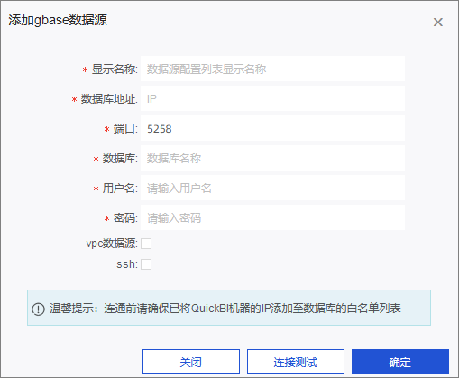

   > 选中**ssh**选项后，支持通过ssh隧道访问。
   >
   > **说明**

   <table>
     <tr>
       <th width="105">名称</th>
       <th>描述</th>
     </tr>
     <tr>
       <td>显示名称</td>
       <td>数据源配置列表的显示名称。本示例中为<strong>自建数据源Gbase</strong>。</td>
     </tr>
     <tr>
       <td>数据库地址</td>
       <td>填写IP地址。</td>
     </tr>
     <tr>
       <td>端口</td>
       <td>填写正确的端口号。默认为<strong>5258</strong>。</td>
     </tr>
     <tr>
       <td>数据库</td>
       <td>连接数据库名称。本示例中为<strong>Gbase</strong>。</td>
     </tr>
     <tr>
       <td>用户名</td>
       <td>数据库对应的用户名。</td>
     </tr>
     <tr>
       <td>密码</td>
       <td>数据库对应的密码。</td>
     </tr>
     <tr>
       <td>vpc数据源</td>
       <td>如果您选中<strong>vpc数据源</strong>，则需要配置如下参数：<br>• <strong>购买者accessId</strong>：购买此实例的AccessKey ID。<br>• <strong>购买者accessKey</strong>：购买此实例的AccessKey Secret。<br>• <strong>实例id</strong>：购买此实例的ID。<br>• <strong>区域</strong>：此实例所在区域。</td>
     </tr>
     <tr>
       <td>ssh</td>
       <td>如果您选中<strong>ssh</strong>，则需要配置如下参数：<br>• <strong>SSH Host</strong>：主机名或者IP地址。<br>• <strong>SSH 用户名</strong>：数据库对应的SSH用户名。<br>• <strong>SSH 密码</strong>：数据库对应的用户名密码。<br>• <strong>SSH 端口</strong>：数据库对应的端口。默认为<strong>22</strong>。</td>
     </tr>
   </table>

4. 单击**连接测试**，进行数据源连通性测试。

5. 测试成功后，单击**确定**。

<a id="section-4-2-3-12"></a>

#### 4.2.3.12. 新建Impala自建数据源

本文为您介绍如何新建Impala自建数据源。

**前提条件**

- 已自建Impala数据库。

- 已获取自建Impala数据库的用户名和密码。

**操作步骤**

1. 新建数据源。

2. 在**添加数据源**页面的**自建数据源**页签，单击**Impala**图标。

3. 在**添加Impala数据源**页面，完成以下配置。

   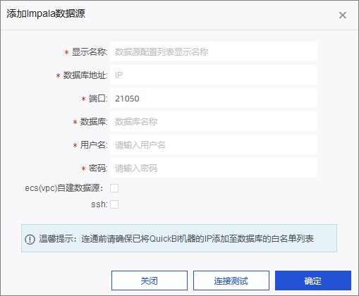

   > 选中**ssh**选项后，支持通过ssh隧道访问。
   >
   > **说明**

   <table>
     <tr>
       <th width="181">名称</th>
       <th>描述</th>
     </tr>
     <tr>
       <td>显示名称</td>
       <td>数据源配置列表的显示名称。本示例中为<strong>自建数据源Impala</strong>。</td>
     </tr>
     <tr>
       <td>数据库地址</td>
       <td>填写IP地址。</td>
     </tr>
     <tr>
       <td>端口</td>
       <td>填写正确的端口号。默认为<strong>21050</strong>。</td>
     </tr>
     <tr>
       <td>数据库</td>
       <td>连接数据库名称。本示例中为<strong>Impala</strong>。</td>
     </tr>
     <tr>
       <td>用户名</td>
       <td>数据库对应的用户名。</td>
     </tr>
     <tr>
       <td>密码</td>
       <td>数据库对应的密码。</td>
     </tr>
     <tr>
       <td>ecs(vpc)自建数据源</td>
       <td>如果您选中<strong>ecs(vpc)自建数据源</strong>，则需要配置如下参数：<br>• <strong>购买者accessId</strong>：购买此实例的AccessKey ID。<br>• <strong>购买者accessKey</strong>：购买此实例的AccessKey Secret。<br>• <strong>实例id</strong>：购买此实例的ID。</td>
     </tr>
     <tr>
       <td>ssh</td>
       <td>如果您选中<strong>ssh</strong>，则需要配置如下参数：<br>• <strong>SSH Host</strong>：主机名或者IP地址。<br>• <strong>SSH 用户名</strong>：数据库对应的SSH用户名。<br>• <strong>SSH 密码</strong>：数据库对应的用户名密码。<br>• <strong>SSH 端口</strong>：数据库对应的端口。默认为<strong>22</strong>。</td>
     </tr>
   </table>

4. 单击**连接测试**，进行数据源连通性测试。

5. 测试成功后，单击**确定**。

<a id="section-4-2-3-13"></a>

#### 4.2.3.13. 新建Snowflake自建数据源

本文为您介绍如何新建Snowflake自建数据源。

**前提条件**

- 已自建Snowflake数据库。

- 已获取自建Snowflake数据库的用户名和密码。

**操作步骤**

1. 新建数据源。

2. 在**添加数据源**页面的**自建数据源**页签，单击**Snowflake**图标。

3. 在**添加Snowflake数据源**页面，完成以下配置。

   

   > 选中**ssh**选项后，支持通过ssh隧道访问。
   >
   > **说明**

   | 名称 | 描述 |
   | --- | --- |
   | 显示名称 | 数据源配置列表的显示名称。本示例中为<strong>自建数据源Snowflake</strong>。 |
   | 数据库地址 | 填写IP地址。 |
   | 端口 | 填写正确的端口号。默认为<strong>443</strong>。 |
   | 数据库 | 连接数据库名称。本示例中为<strong>Snowflake</strong>。 |
   | Schema | 默认为Public |
   | 用户名 | 数据库对应的用户名。 |
   | 密码 | 数据库对应的密码。 |

   <table>
     <tr>
       <th width="181">ecs(vpc)自建数据源</th>
       <th>如果您选中<strong>ecs(vpc)自建数据源</strong>，则需要配置如下参数：<br>• <strong>购买者accessId</strong>：购买此实例的AccessKey ID。<br>• <strong>购买者accessKey</strong>：购买此实例的AccessKey Secret。<br>• <strong>实例id</strong>：购买此实例的ID。</th>
     </tr>
     <tr>
       <td>ssh</td>
       <td>如果您选中<strong>ssh</strong>，则需要配置如下参数：<br>• <strong>SSH Host</strong>：主机名或者IP地址。<br>• <strong>SSH 用户名</strong>：数据库对应的SSH用户名。<br>• <strong>SSH 密码</strong>：数据库对应的用户名密码。<br>• <strong>SSH 端口</strong>：数据库对应的端口。默认为<strong>22</strong>。</td>
     </tr>
   </table>

4. 单击**连接测试**，进行数据源连通性测试。

5. 测试成功后，单击**确定**。

<a id="section-4-2-4"></a>

### 4.2.4. 进入数据源列表页面

本节介绍如何进入数据源列表页面。

**操作步骤**

1. 登录Quick BI控制台。

2. 在控制台页面上方，单击**工作空间**，进入工作空间管理页面。

3. 在工作空间管理页面左侧导航栏中，单击**数据源**。在数据源列表可以集中管理所有的数据源，并在列表页上提供**新建数据源**、**编辑数据源**、**替换数据源**、**删除数据源**等操作入口。

   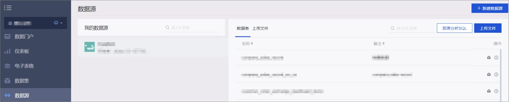

<a id="section-4-2-5"></a>

### 4.2.5. 新建数据源

本节为您介绍如何新建数据源。

**前提条件**

您已购买Quick BI服务。

**背景信息**

仅组织管理员才支持新建数据源。

**操作步骤**

1. 登录Quick BI控制台。

2. 在控制台页面上方，单击**工作空间**，进入工作空间管理页面。

3. 在工作空间管理页面左侧导航栏中，单击**数据源**，进入数据源管理页面。

4. 在数据源管理页面右上方，单击**新建数据源**。

   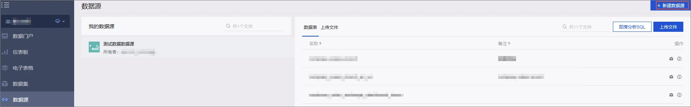

5. 在新弹出的**添加数据源**对话框中选择一个数据源的来源。

   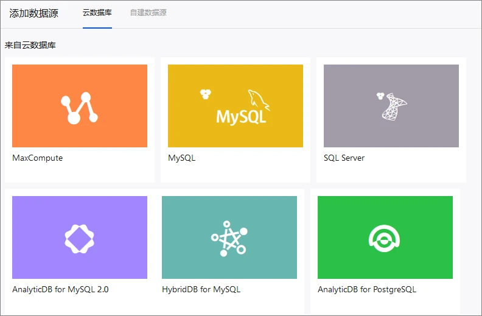

   - 如果数据源来自云数据源，单击**云数据库**页签。

   - 如果数据源来自自建数据源，单击**自建数据源**页签。

6. 根据系统提示，填写连接数据源所需的各种信息，然后单击**确定**。

<a id="section-4-2-6"></a>

### 4.2.6. 编辑数据源

本节介绍如何编辑已创建的数据源。

**前提条件**

- 您已购买Quick BI服务。

- 您已创建数据源。

**操作步骤**

1. 登录Quick BI控制台。

2. 在控制台页面上方，单击**工作空间**。

3. 在工作空间管理页面左侧导航栏中，单击**数据源**。

4. 在数据源列表中，选择一个数据源。

5. 单击  图标，可以对该数据源进行编辑。

   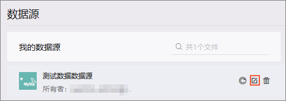

<a id="section-4-2-7"></a>

### 4.2.7. 替换数据源

本节介绍如何替换已创建的数据源。

**前提条件**

- 您已购买Quick BI服务。

- 您已创建数据源。

**操作步骤**

1. 登录Quick BI控制台。

2. 在控制台页面上方，单击**工作空间**。

3. 在工作空间管理页面左侧导航栏中，单击**数据源**。

4. 在数据源列表中，选择一个数据源。

5. 单击  图标，可以对该数据源进行替换。

   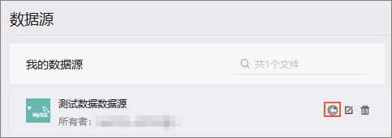

6. 在**替换数据源**页面，选择目标数据源对如下信息进行编辑。

   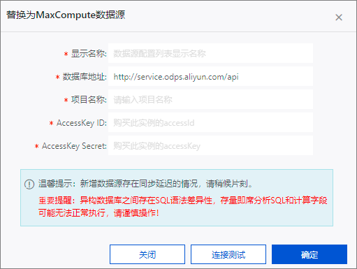

   

7. 编辑完成后，单击**连接测试**。

8. 连通性测试成功后，单击**确定**。

<a id="section-4-2-8"></a>

### 4.2.8. 删除数据源

本章节介绍如何删除数据源。

**前提条件**

- 您已购买Quick BI服务。

- 您已创建数据源。

**背景信息**

如果基于该数据源创建了数据集，则此数据源将无法被删除。


**操作步骤**

1. 登录Quick BI控制台。

2. 在控制台页面上方，单击**工作空间**，进入工作空间管理页面。

3. 在工作空间管理页面左侧导航栏中，单击**数据源**，进入数据源管理页面。

4. 在数据源列表中，选择一个数据源。

5. 单击

   图标，可以删除该数据源。

   

   

<a id="section-4-2-9"></a>

### 4.2.9. 查询数据源

数据源创建后可对其进行查询，查询详情如本章节所示。

**前提条件**

- 您已购买Quick BI服务。

- 您已创建数据源。

**操作步骤**

1. 登录Quick BI控制台。

2. 在控制台页面上方，单击**工作空间**，进入工作空间管理页面。

3. 在工作空间管理页面左侧导航栏中，单击**数据源**，进入数据源管理页面。

4. 在搜索框中输入关键字查询需要的数据源。

   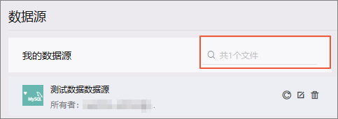

5. 单击  图标，进行数据源查询。

<a id="section-4-2-10"></a>

### 4.2.10. 查询数据源中包含的表

本章节介绍如何对数据源中包含的表进行查询。

**前提条件**

您已购买Quick BI服务。

**操作步骤**

1. 登录Quick BI控制台。

2. 在控制台页面上方，单击**工作空间**，进入工作空间管理页面。

3. 在工作空间管理页面左侧导航栏中，单击**数据源**，进入数据源管理页面。

4. 选择一个数据源，该数据源下所包含的表会自动列在页面右侧。

5. 在右侧页面的搜索框中输入关键字段搜索需要的表。

   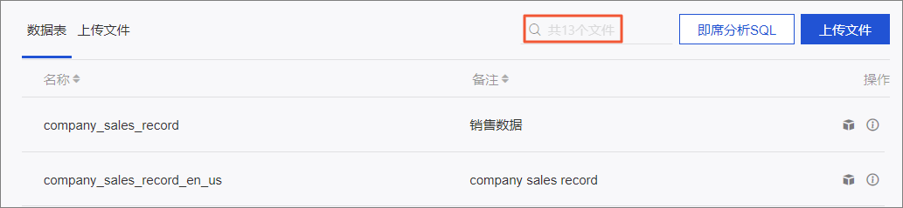

6. 单击

   图标，进行表查询。

   

<a id="section-4-2-11"></a>

### 4.2.11. 查询数据源中表的详情

除了可以查询数据源中的表，您还可以查询数据源中表的详情，详细信息如本章节所示。

**前提条件**

您已购买Quick BI服务。

**操作步骤**

1. 登录Quick BI控制台。

2. 在控制台页面上方，单击**工作空间**，进入工作空间管理页面。

3. 在工作空间管理页面左侧导航栏中，单击**数据源**，进入数据源管理页面。

4. 在列表中选择一个数据源，该数据源下所包含的表会自动列在页面右侧。

5. 选择一张表，单击后面的  图标，可以查看表以及字段详情。

   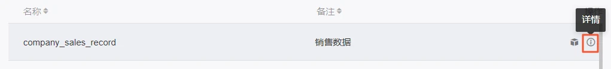

<a id="section-4-3"></a>

## 4.3. 数据集

<a id="section-4-3-1"></a>

### 4.3.1. 概述

数据源中，各种不同的表可以创建为数据集。本章节将为您介绍数据集的创建、编辑、查询等操作。

数据集可通过以下三种方式创建：

- 通过数据源创建数据集。

- 通过上传文件创建数据集。

- 通过即席分析SQL创建数据集。

<a id="section-4-3-2"></a>

### 4.3.2. 创建数据集

<a id="section-4-3-2-1"></a>

#### 4.3.2.1. 从数据源创建数据集

本文为您介绍如何基于数据源创建数据集。

**前提条件**

您已购买Quick BI服务。

**操作步骤**

1. 登录Quick BI控制台。

2. 在控制台页面上方，单击**工作空间**，进入工作空间管理页面。

3. 在工作空间管理页面左侧导航栏中，单击**数据源**，进入数据源管理页面。

4. 选择一个数据源，该数据源下所有的表会自动列在页面右侧。

5. 选中其中一个表，单击后面的 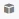 图标。

   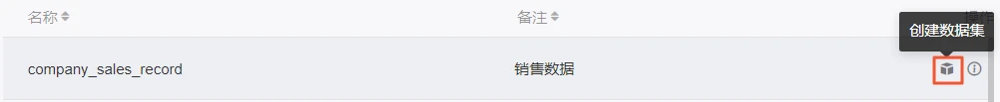

6. 在创建数据集页面，自定义数据集名称和位置后，单击**确定**。

   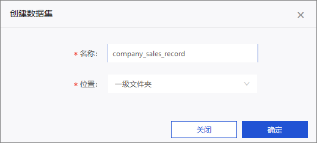

   创建成功后，页面会自动跳转到**数据集**，新创建的数据集会显示在数据集列表中，并且带有New的图标，方便您快速定位到新的数据集。

   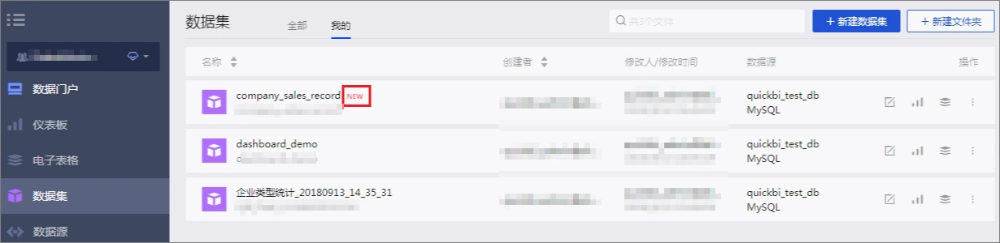

<a id="section-4-3-2-2"></a>

#### 4.3.2.2. 从上传文件创建数据集

您可以通过上传文件来创建数据集。

**前提条件**

- 您已购买Quick BI服务。

- 您已创建数据源。

1. 登录Quick BI控制台。

2. 在控制台页面上方，单击**工作空间**，进入工作空间管理页面。

3. 在工作空间管理页面左侧导航栏中，单击**数据源**，进入数据源管理页面。

4. 单击**上传文件**。

5. 在**上传文件**对话框中，选择需要上传的文件及名称并单击**确定**。

   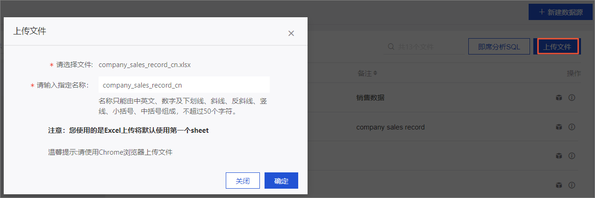

   > 上传文件完成后，系统自动跳转至上传文件管理页面。
   >
   > **说明**

6. 在上传文件管理页面，选择新上传的文件并单击  图标创建数据集。

<a id="section-4-3-2-3"></a>

#### 4.3.2.3. 即席分析SQL建模创建数据集

在数据建模过程中，一些复杂逻辑可以通过使用即席分析SQL创建数据集实现。即席分析SQL支持动态传参。基于SQL传参实现建模分析，扩展敏捷BI支撑的场景深度，满足复杂的数据分析场景诉求。

**前提条件**

您已购买Quick BI服务。

**操作步骤**

1. 登录Quick BI控制台。

2. 在控制台页面上方，单击**工作空间**，进入工作空间管理页面。

3. 在工作空间管理页面左侧导航栏中，单击**数据源**，进入数据源管理页面。

4. 在**数据源**页面单击右上角**即席分析SQL**。

   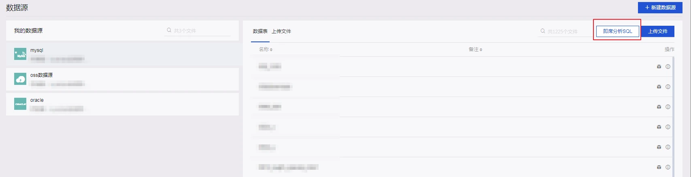

5. 在**即席查询SQL**页面，您可以进行如下操作，创建数据集。

   - 普通SQL：通过SQL在指定数据源中获取数据表。

     <ol type="a">

     <li>

     在**即席查询SQL**页面，您可以修改指定数据源。

     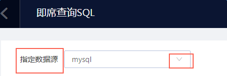

     </li>

     <li>

     确定数据源后输入SQL语句。

     示例：

     ```sql
     SELECT  * FROM    company_sales_record;
     ```

     </li>

     </ol>

     <ol type="i" start="100">

     <li>

     单击**执行**，运行SQL语句。

     </li>

     <li value="500">

     在执行结果页签，查看执行结果。

     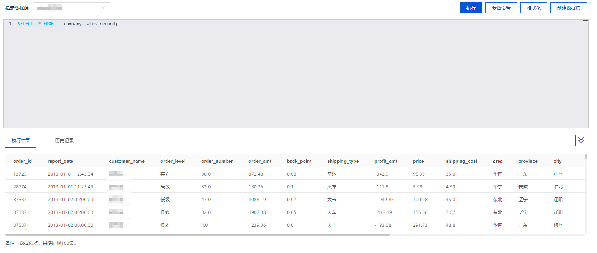

     </li>

     </ol>

     <ol type="a" start="5">

     <li>

     单击**创建数据集**填写数据集名称和保存位置后，单击**确定**。

     创建成功后，页面会自动跳转到数据集管理页面，新创建的数据集会带有New的图标，方便快速定位新的数据集。

     </li>

     </ol>

   - 参数SQL：通过SQL在数据源的表中增加参数。

     <ol type="a">

     <li>

     在**即席查询SQL**页面，您可以修改指定数据源。

     

     </li>

     <li>

     确定数据源后输入SQL语句。

     示例：

     ```text
     SELECT  report_date,
             order_level,
             shipping_type,
             area,
             price,
             order_number
     from    company_sales_record
     where   ${report_date :report_date}
     and     ${order_level :order_level}
     and     ${order_number :order_number}
     ```

     </li>

     </ol>

     <ol type="i" start="100">

     <li>

     单击**执行**，运行SQL语句。

     </li>

     <li value="500">

     查看执行结果。

     在执行结果界面您可以查看SQL执行结果。

     <ol type="a">

     <li>

     单击**执行结果**页签。

     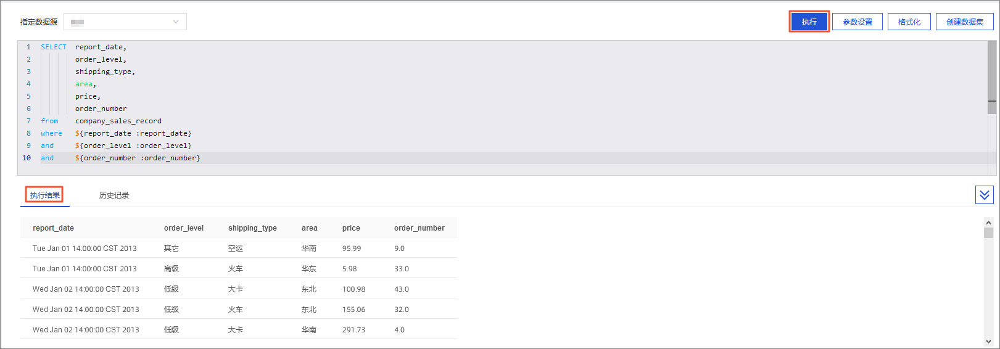

     </li>

     <li>

     单击**历史记录**页签可查看当前即席分析SQL执行时间、对应的SQL语句以及SQL执行耗时。

     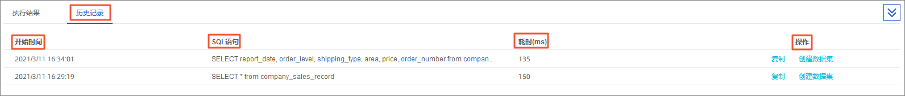

     - 单击**复制**，复制对应SQL语句，可将其粘贴到SQL输入框中。

     - 单击**创建数据集** 可直接将历史SQL语句创建为数据集。

     - 单击  收起执行结果。

     </li>

     </ol>

     即席分析SQL支持动态参数，在SQL建模时，在where语句后面追加SQL参数，参数格式为${物理字段名:参数别名}，该参数可以在查询控件中被引用。

     > 参数字段在数据集中不显示，在查询控件中会显示。
     >
     > **说明**

     SQL示例：

     ```text
     SELECT  report_date,
             order_level,
             shipping_type,
             area,
             price,
             order_number
     from    company_sales_record
     where   ${report_date :report_date}
     and     ${order_level :order_level}
     and     ${order_number :order_number}
     ```

     </li>

     </ol>

     <ol type="a" start="5">

     <li>

     在**即席分析SQL**页面，单击**参数设置**。

     可新增参数变量和修改变量类型。目前支持文本、数值、日期-年月日、日期-年月、日期-年周、日期-年、日期-年月日时分秒七种变量类型。

     - 单击**新增参数变量**新增参数别名和变量类型，此参数别名需要以 `${`物理字段名`:`参数变量名`}` 格式添加到SQL语句where条件中。

     - 单击**快速提取**自动获取SQL语句中的参数别名，变量类型默认为文本，可手动修改。

       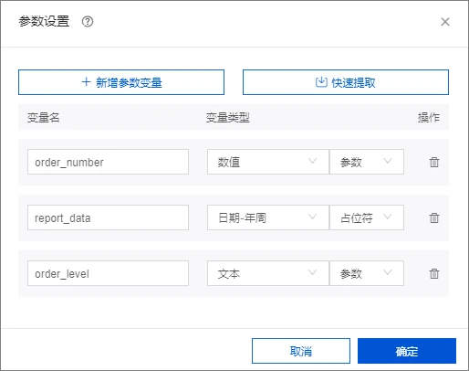

     </li>

     <li>

     参数在查询控件中的应用：

     <ol type="a">

     <li>

     在数据集管理页面，单击目标数据集所在行的  图标。

     </li>

     <li>

     在**新建仪表板**对话框中，选择选择仪表板类型后，单击**确定**。

     </li>

     </ol>

     <ol type="i" start="100">

     <li>

     在仪表板编辑页面，单击顶部菜单栏的  图标。

     </li>

     <li value="500">

     单击查询控件中部或者鼠标悬浮在查询控件上右上角出现的**新建筛选项**图标，对查询控件进行设置。

     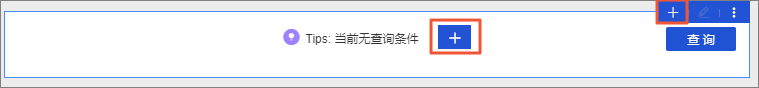

     - SQL参数在查询控件中的使用。

       在**查询条件设置**页面，设置查询条件名称并选择基于包含SQL参数的数据集的图表进行关联设置。在筛选字段选择区域除展示对应的维度、度量外还会展示数据集中的SQL参数。

       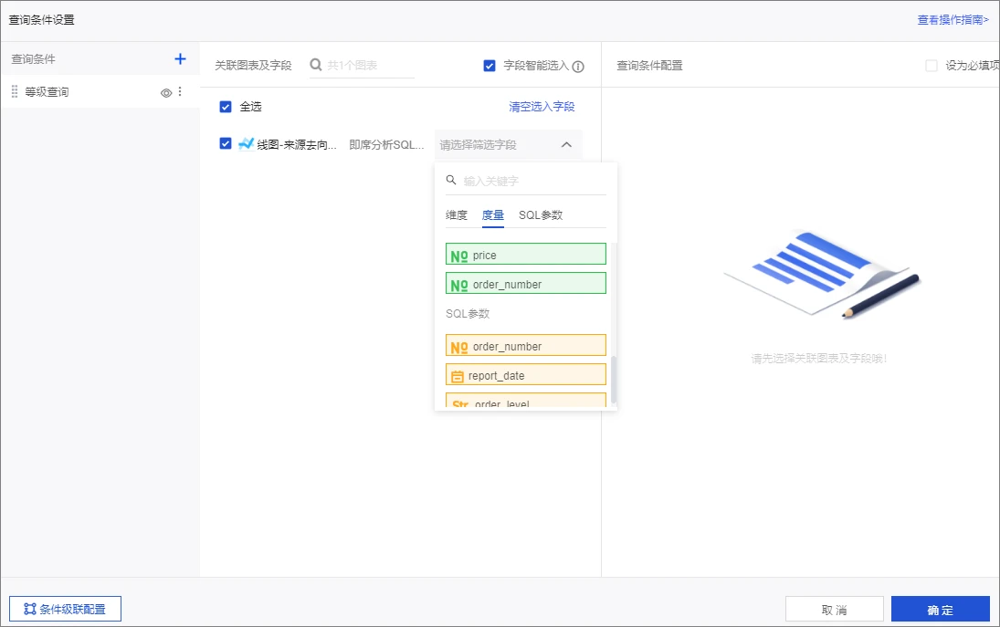

       > 当关联字段为文本型SQL参数字段且展示类型为下拉列表（原枚举筛选）时，
       >
       > **说明**
       >
       > 选项值来源不支持自动解析方式。如果设置为该方式，在查询控件中无查询值。

     - SQL占位符在查询控件中的使用。

       占位符支持情况如下：

       - 如果是文本字段，需要手动输入单引号（''）。

       - 如果是数值字段，直接填入数值内容。

       - 如果是日期字段，可以在配置占位符时设置日期格式，在SQL运行时被当作文本替换。

       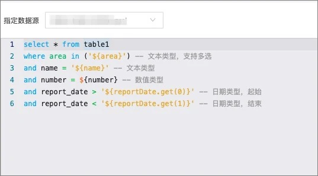

       在**查询条件设置**页面，设置查询条件名称并选择基于包含占位符的数据集的图表进行关联设置。在筛选字段选择区域除展示对应的维度、度量外还会展示数据集中的占位符。

       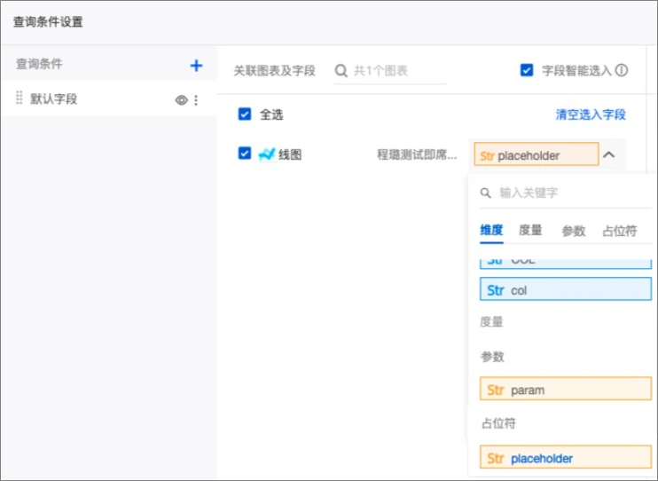

     </li>

     </ol>

     </li>

     </ol>

   - 执行SQL语句前，可进行参数设置和格式化；执行SQL语句后，可进行创建数据集操作。

     <ol type="a">

     <li>

     单击**格式化**可格式化SQL语句。

     </li>

     <li>

     单击**创建数据集**可基于当前SQL语句查询结果创建数据集。

     

     </li>

     </ol>

有关参数在查询控件中的使用方法请参见SQL参数在查询控件中的使用。

<a id="section-4-3-3"></a>

### 4.3.3. 设置数据集维度和度量的默认名称

Quick BI会自动根据物理表的元数据信息创建数据集，将物理表中的字段转换为数据集中的维度或度量。维度和度量的名字是自动生成的，名字可以取自物理字段名，也可以取自字段名的注释。

**前提条件**

您已购买Quick BI服务。

**背景信息**

在头像处的**个人设置**中，您可以根据自己的需求来选择偏好。后续新创建的数据集中的维度和度量的命名就按照偏好的设置进行自动命名。

**操作步骤**

1. 登录Quick BI控制台。

2. 单击头像图标，进入个人信息页面并单击**个人设置**。

   

3. 在**个人设置**页面，单击**偏好设置**页签，选择数据集字段的默认名称。

   

<a id="section-4-3-4"></a>

### 4.3.4. 编辑数据集

<a id="section-4-3-4-1"></a>

#### 4.3.4.1. 编辑维度

本文介绍如何编辑维度，包含编辑日期维度、地理信息维度和图片维度的字段。

**前提条件**

- 您已购买Quick BI服务。

- 您已创建数据集。

**进入维度编辑页面**

1. 登录Quick BI控制台。

2. 在控制台页面上方，单击**工作空间**，进入工作空间管理页面。

3. 在工作空间管理页面左侧导航栏中，单击**数据集**，进入数据集管理页面。

4. 选择一个数据集，单击数据集名称所在行的  图标，进入数据集编辑页面。

5. 在维度列表中找到目标字段，单击右侧的

   图标，可以对字段进行以下配置。

   

   本例中目标字段为**订单等级**。

   

   | 操作 | 说明 |
   | --- | --- |
   | 编辑 | 修改维度显示名以及备注信息。 |
   | 克隆维度 | 快速复制一个维度，生成的维度将会自动带上<strong>副本</strong>以做提示。 |
   | 在分析中隐藏 | 根据需要隐藏某些维度。 |
   | 取消全部隐藏 | 取消对相关维度的隐藏。 |
   | 删除 | 删除该字段。 |
   | 新建计算字段（维度） | 新创建一个维度字段，并且可以自定义其计算方式。 |
   | 移动到 | 快速将维度纳入到已有层次结构中。通常使用钻取功能时，需要进行此操作。 |
   | 新建层次结构 | 快速将维度纳入到新建的层次结构中。 |
   | 上移/下移 | 移动字段位置，支持鼠标拖拽和右键单击。 |
   | 转换为度量 | 将当前维度字段转换为度量字段。 |
   | 维度类型切换 | 支持<strong>日期（源数据格式）</strong>、<strong>地理信息</strong>、<strong>文本</strong>、<strong>数字</strong>以及<strong>图片</strong>的切换。 |

   > 层次结构中的维度可以单独克隆、隐藏和删除。
   >
   > **说明**

**编辑日期维度**

- 支持对周（week）字段自定义周开始时间。

  

- 支持**同步日期粒度**。日期类型数据新增一个维度<strong>report_date(ymdhms)</strong>类型。

  

- 设置<strong>report_date(ymdhms)</strong>的**日期显示格式**。

  

  > 日期显示格式支持以下三种格式：
  >
  > **说明**
  >
  > - yyyyMMdd HH:mm:ss
  >
  > - yyyy-MM-dd HH:mm:ss：默认格式
  >
  > - yyyy/MM/dd HH:mm:ss

  编辑该字段时设置日期显示格式不会影响源数据的日期格式，只会影响查询条件中的日期显示格式。例如，设置**日期显示格式**为**yyyy/MM/dd HH:mm:ss**时，查询条件的日期格式如下图红框所示。

  您可以查询某个时间区间内， 某个省份的利润金额。

  

**编辑地理信息维度**

您需要制作地图类的图表，例如气泡地图和色彩地图，则需要包含地理信息的维度字段（area、province、city），且字段类型为地理信息。

> 如果地理维度的标识  为红框显示时，则表示该字段已切换为地理信息。
>
> **说明**

1. 在数据集编辑页面，在维度列表中找到目标字段并单击右侧的

   图标。

   

   - 如果是**area**字段，则选择**维度类型切换 > 地理信息 > 区域**。

     

   - 如果是**province**字段，则选择**维度类型切换 > 地理信息 > 省/直辖市**。

     

   - 如果是**city**字段，则选择**维度类型切换 > 地理信息 > 市**。

     

2. <strong>可选：</strong>新建层次结构。如果有层级钻取结构，可以进行本操作。

   <ol type="i">

   <li>

   在维度列表中找到目标地理信息字段，单击右侧的

   图标选择**新建层次结构**。

   

   

   </li>

   <li>

   在**新建层级结构**页面，自定义层级结构名称后，单击**确定**。

   </li>

   <li>

   单击目标字段右侧的

   图标，选择**移动到 > area_层级结构**，依次将其他地理信息维度字段移动到

   

   该层级结构中。

   

   移动完成后如下所示。

   

   </li>

   </ol>

3. 数据集编辑完成后，单击**保存**。

   

4. 单击**刷新预览**。

   系统会自动将数据显示在表格中。

   

**编辑图片维度**

目标数据集中存在图片字段，图片字段的存储方式为图片链接URL，您需要将图片上传在图片服务器中以获取图片URL链接地址。

您需要制作交叉表或排行榜，则可以包含图片的维度字段（商品图片），且字段类型为图片。

> 如果图片维度的标识  为红框显示时，则表示该字段已切换为图片。
>
> **说明**
>
> 交叉表若图片显示不出来，需要在图片存储服务器中配置允许跨域访问，例如OSS配置跨域访问。

1. 在数据集编辑页面的维度列表中，找到目标字段并单击右侧的

   图标。

   

2. 选择**维度类型切换 > 图片**。本例中，目标字段为**商品图片**。

   

3. 数据集编辑完成后，单击**保存**。

   

4. 单击**刷新预览**。系统会自动将数据显示在表格中。

   

<a id="section-4-3-4-2"></a>

#### 4.3.4.2. 编辑度量

如果数据集中表的字段类型是数值，系统会默认其属于度量范畴。您可以在度量列表中，对字段进行编辑。

**前提条件**

您已购买Quick BI服务。

**操作步骤**

1. 登录Quick BI控制台。

2. 在控制台页面上方，单击**工作空间**，进入工作空间管理页面。

3. 在工作空间管理页面左侧导航栏中，单击**数据集**，进入数据集管理页面。

4. 选择一个数据集，单击数据集名称进入数据集编辑页面。

5. 在度量列表中，选择一个字段。

6. 单击鼠标右键，出现该字段的编辑菜单。

   

   - 编辑：修改度量显示名称以及备注信息。

   - 克隆度量：快速复制一个度量，生成的度量将会自动带上**副本**以做提示。

   - 在分析中隐藏：可根据需要隐藏某些度量。

   - 取消全部隐藏：取消对相关度量的隐藏。

   - 删除：删除该字段。

   - 新建计算字段（度量）：可新建一个度量字段，并且可自定义其计算方式。

   - 移动到：快速将度量归纳到已有文件夹中。

   - 上移和下移：移动字段位置，支持鼠标拖拽和右键。

   - 转换为维度：可将当前度量字段转换为维度字段。

   - 数字格式化：可决定数字的显示格式。

   - 默认聚合方式：可在菜单中选择聚合方式，如求和，最大值，最小值等。

   - 度量类型切换：支持文本和数字。

<a id="section-4-3-4-3"></a>

#### 4.3.4.3. 工具按钮

Quick BI在数据集编辑页面提供工具按钮区和快捷工作区，供您来编辑数据集和创建报表。

**工具按钮区**


- 锁机制：同一数据集在同一时间可以被多个用户同时进行更新操作，但是只能有一个用户可以保存，其他用户需要先解锁并刷新界面获取最新内容后再进行更新和保存操作，如果其他用户只解锁不刷新界面直接编辑，会覆盖上一个解锁用户的更新内容。

- 同步表结构：此操作同步线上物理表新增的字段。

  如果线上表字段被删除或者被更改，系统将不会对数据集的维度和度量做相应删除处理。

  图 1. 同步表结构

  

- 刷新预览：刷新数据集的预览数据。如果您需要实时查看最新的数据，请保存数据集后刷新数据。

- 设置过滤条件：对该数据集数据进行数据过滤，减少在使用数据集时对全表的搜索。

- 另存为：把当前的数据集另存为新的数据集，此操作可以用于快速复制一个新的数据集或备份数据集等场景。

- 保存：保存数据集。

  当您在数据集编辑界面进行新建字段（度量）、删除字段、维度度量转化等操作后，需要保存数据集，进行刷新数据查看效果。

**快捷工作区**

在编辑数据集页面，单击左下方的  按钮，展开快捷工作区。

图 2. 快捷工作区


- 仪表板：单击**仪表板**可进入**新建仪表板**页面。

- 电子表格：单击**电子表格**可进入新建电子表格编辑页面。

- 数据集：单击**数据集**可进入数据源管理界面来创建数据集。

- 数据门户：单击**数据门户**可进去新建数据门户编辑页面。

- 获取数据：单击**获取数据**可进入**添加数据源**页面。

<a id="section-4-3-4-4"></a>

#### 4.3.4.4. 预览数据

在数据集编辑页面可以对数据进行预览。

单击  图标，可切换到数据预览模式。


<a id="section-4-3-4-5"></a>

#### 4.3.4.5. 表关联及示例

在编辑数据集的过程中，可以对数据集中的表进行关联。

**操作步骤**

1. 登录Quick BI控制台。

2. 在控制台页面上方，单击**工作空间**，进入工作空间管理页面。

3. 在工作空间管理页面左侧导航栏中，单击**数据集**，进入数据集管理页面。

4. 选择一个数据集，单击数据集名称进入数据集编辑页面。

5. 单击**关联**图标  ，可切换到关联模式。

   

6. 单击  图标，打开构建关联模型对话框。

   目前支持5层横向关联数据表，如下图所示：

   

7. 选择需要关联的字段和关联方式。

   图1构建关联模型图 1. 构建关联模型

   

   关联方式有以下三种。

   - 内关联（inner join）  ：返回两个表中关联字段相等的记录。

   - 左外关联（left outer join）  ：返回包含左表中的全部记录以及左表和右表中关联字段相等的记

     录。

   - 全关联  ：返回两个表中的所有记录。

     > MySQL数据源暂不支持全关联。
     >
     > **说明**

8. 单击**添加关联条件**按钮可关联多个表字段。

9. 单击**确定**按钮，完成关联模型构建。

0. 单击**保存**。

1. 保存成功后，通过单击预览图标

   切换至预览模式，单击**刷新预览**即可查看数据表关联效果。

   

   

<a id="section-4-3-4-6"></a>

#### 4.3.4.6. 计算字段

<a id="section-4-3-4-6-1"></a>

##### 4.3.4.6.1. 概述

计算字段就是符合当前数据源SQL列定义语法规则的，用已有字段和SQL支持函数构造出的新的列。

编辑计算字段的时候需要注意以下几点：

- 从维度列表中新建的计算字段将自动设置为计算维度；从度量列表中新建的计算字段将自动设置为计算度量。

- 在计算字段的表达式编辑框中，当前所在数据源支持的函数和列表达式语法都可以使用。

- 函数的名称需要您手动输入。字段名也可以手动输入，格式是 **[字段名]**，也可以通过在英文键盘模式下输入<strong>[</strong>，选择列表中的字段或双击左侧维度或度量树中的节点来插入维度或度量字段名到表达式的编辑框中。正确输入的SQL表达式在编辑框中会自动有语法着色。

- 您在编写计算字段表达式的时候，中英文引号、逗号和小括号等标点符号混用，导致语法解析出错。只有英文的标点符号作为词法符号出现在SQL表达式中。如果计算字段报错，您需要首先检查是否引入了中文的符号。

- 在编辑页面进行操作后，需要先保存数据集，再进行数据刷新。

- 已添加的计算字段目前不可以作为表达式再被使用在其他计算字段中。但若计算字段中所使用的原始基础字段物理层被删除，则该计算字段也将失效。

<a id="section-4-3-4-6-2"></a>

##### 4.3.4.6.2. 计算字段的使用规则

本节介绍计算字段的使用规则。

- 未聚合的计算字段可以用作维度，也可以在设置聚合方式后用作度量。已聚合的计算度量只能用作度量，不能再转为维度。

- 计算字段可以设置数据类型。目前维度字段支持文本、数值和日期时间三种数据类型；度量字段支持文本和数值两种类型。

- 与数据源中的原生字段生成的维度和度量相同，计算维度或计算度量可以被使用在行列，属性面板以及过滤器中。您还可以将计算字段进行维度和度量的转换。

> 如果设置计算字段的数据类型为文本，实际内容也为文本，然后其聚合方式为sum，avg
>
> **说明**
>
> 等聚合方法之一，最后实际执行查询的时候会报告类型转换错误而无法得到查询结果。

<a id="section-4-3-4-6-3"></a>

##### 4.3.4.6.3. 计算度量的类型

属于度量范畴的计算字段称为计算度量。计算度量根据表达式类型不同分两种：普通度量和聚合度量。

普通度量和聚合度量的区别如下：

| 普通度量 | 聚合度量 |
| --- | --- |
| 没有使用聚合函数表达式构成的度量为普通度量。 | 使用了聚合函数的表达式构成的度量为聚合度量。 |
| 可以更改聚合方式。 | 没有更改聚合方式的菜单选项。 |
| 可以转换为维度类型。 | 不能转换为维度类型。 |
| 支持的聚合函数：无。 | 支持的聚合函数：SUM，AVG，MIN，MAX，COUNT，COUNT distinct。 |

您可以使用count ( )或count ( distinct )函数将维度字段作为函数参数来构成去重聚合度量。

聚合度量的例子：人均购买金额sum(购买金额)/countd(用户ID)；订单成本占比sum(订单成本)/sum(订单金额)，如果用avg(订单成本/订单金额) 计算，计算结果会出错。

> 普通度量和聚合度量表达式不能混合使用。错误示例如，sum(订单成本)/订单金额。
>
> **说明**

<a id="section-4-3-4-6-4"></a>

##### 4.3.4.6.4. 计算字段表达式示例

本节介绍计算字段中可以使用的各种函数与运算。

计算字段的表达式中可以直接使用当前数据库支持的各种函数：

- MySQL的函数列表，适用Analytic DB。

- Greenplum的函数列表。

- SQL Server的函数列表。

**聚合方式**

- 求和聚合：sum([订单金额])

- 平均值聚合：avg([订单金额])

- 最大值聚合：max([订单金额])

- 最小值聚合：min([订单金额])

- 计数聚合：count([客户名称])

- 计数（去重）聚合：count(distinct[客户名称])

**四则运算**

订单成本 ([订单金额]-[利润金额])/100

**字符串截取**

Substring([客户名称],1,1)

**Case度量区间分组**

- 订单金额区间

  Case when[订单金额] < 500 then ‘小订单’ when [订单金额] >= 500 and [订单金额] < 2000 then ‘中订单’when [订单金额] >= 2000 and [订单金额] < 5000 then ‘大订单’else ‘超大订单’ end

- Case 维度成员组合分组（对特定省份组合后的省份区域）

  case when [省份] in ( ‘黑龙江’,’辽宁’, ‘吉林’ ) then ‘东北地区’ else [省份] end

- 复合聚合度量 —— 人均订单

  sum([订单金额]) / count( distinct [客户名称] )

- Unix时间戳制作

  from_unixtime([订单编号]+1234567890)

- 提取每月中不同的天

  day([订单日期])

  返回1-31区间的数字

- 提取一天中不同的小时段

  hour([订单日期])

  返回0-23区间内的数字

- 广告效果转化率

  case when sum([来访次数]) >0 then sum([转化次数])/sum([来访次数])else 0 end

  下面是转化率错误的写法：sum(case when [来访次数] >0 then [转化次数]/[来访次数] else 0 end)。因为比率型指标不能先除法运算再合计，要先合计再施加除法运算。

<a id="section-4-3-4-6-5"></a>

##### 4.3.4.6.5. 新建计算字段

本节介绍如何创建计算字段。

**前提条件**

熟悉计算字段的使用规则和表达式，请参见计算字段的使用规则和计算字段表达式示例。

**背景信息**

本节以company_sales_record数据集为例，求每份订单的平均利润。

**操作步骤**

1. 登录Quick BI控制台。

2. 在控制台页面上方，单击**工作空间**，进入工作空间管理页面。

3. 在工作空间管理页面左侧导航栏中，单击**数据集**，进入数据集管理页面。

4. 选择company_sales_record数据集，进入数据集编辑页面。

5. 在度量列表，单击  图标，进入<strong>编辑计算字段（度量）</strong>的对话框。

   

6. 填写度量名称及表达式。例如，求订单平均利润，那么表达式就是订单总利润除以订单数量。

   

   > 填写表达式时，必需使用英文输入法。
   >
   > **说明**

7. 选择一个数据类型。例如，平均值为一个数值，那么在数据类型中，请选择**数值**选项。

8. 单击**确定**，完成字段新建。

9. 单击**保存**，保存数据集。

0. 单击**刷新预览**，查看新建的计算字段。

   

<a id="section-4-3-4-7"></a>

#### 4.3.4.7. 添加分组字段

在数据集编辑页面，可以通过**添加分组字段**功能对已有数据根据需求进行分组，在创建的分组字段中存储分组信息。

1. 登录Quick BI控制台。

2. 在控制台页面上方，单击**工作空间**，进入工作空间管理页面。

3. 在工作空间管理页面左侧导航栏中，单击**数据集**，进入数据集管理页面。

4. 单击company_sales_record数据集，进入数据集编辑页面。

5. 单击维度区域的  图标，选择**添加分组字段**。

   

6. 在**编辑分组**页面，输入相关信息并单击**确定**。

   

7. 单击**保存**并**刷新预览**，新建分组字段出现在维度列表中。

<a id="section-4-3-5"></a>

### 4.3.5. 重命名数据集

本节介绍如何重命名数据集。

**前提条件**

已创建数据集。

**操作步骤**

1. 登录Quick BI控制台。

2. 在控制台页面上方，单击**工作空间**，进入工作空间管理页面。

3. 在工作空间管理页面左侧导航栏中，单击**数据集**。

4. 在数据集管理页面，找到目标数据集并单击**操作**列的  图标，选择**属性**。

5. 在**属性**面板，对数据集进行如下操作。

   <table>
     <tr>
       <th width="121">参数名称</th>
       <th>说明</th>
     </tr>
     <tr>
       <td>名称</td>
       <td>自定义当前数据集的名称完成重命名。</td>
     </tr>
     <tr>
       <td>所有者</td>
       <td>单击下拉图标选择所有者完成数据集的转让。</td>
     </tr>
     <tr>
       <td>描述</td>
       <td>为数据集添加必要的说明信息。</td>
     </tr>
     <tr>
       <td>安全策略</td>
       <td>支持<strong>私密</strong>和<strong>协同编辑</strong>。<br>• <strong>私密</strong>：仅所有者可以编辑该数据集。<br>• <strong>协同编辑</strong>：允许工作空间内的成员同时编辑该数据集。多用户同时编辑该数据集时，请遵循抢锁机制。</td>
     </tr>
     <tr>
       <td>是否全表扫描</td>
       <td>开启此功能后，系统支持对全表进行扫描。<br>说明仅基于MaxCompute数据源创建的数据集，才支持开启全表扫描功能。</td>
     </tr>
     <tr>
       <td>授权范围</td>
       <td>协同编辑时，支持授权给<strong>空间成员</strong>或<strong>指定人</strong>。<br>• <strong>空间成员</strong>：支持授权给该空间下的开发者。<br>• <strong>指定人</strong>：在该空间开发者中，授权给指定人并协同编辑。<br>说明仅当<strong>安全策略</strong>选择<strong>协同编辑</strong>时，才需配置该参数。</td>
     </tr>
   </table>

6. 单击**保存**。

<a id="section-4-3-6"></a>

### 4.3.6. 管控数据集授权范围

添加某用户为工作空间成员，且权限范围为**开发权限**或**分析权限**后，则该用户可以查看并使用该空间下所有数据集。基于安全的考虑，本文为您介绍如何给指定的空间成员授予数据集的操作权限。

**前提条件**

您已购买Quick BI服务。

**背景信息**

该功能仅适用于群空间。

**操作步骤**

1. 登录Quick BI控制台。

2. 在控制台页面上方，单击**工作空间**，进入工作空间管理页面。

3. 在工作空间管理页面左侧导航栏中，单击**数据集**，进入数据集管理页面。

4. 在**数据集**管理页面，找到目标数据集并单击**操作**列的  图标，选择**使用授权**。

   您也可以右键单击目标数据集并选择**使用授权**。

5. 在**数据集使用授权**页面，选择授权范围。

   

   - **空间成员**：工作空间下的所有分析师和开发者均可以访问并操作该数据集。

   - **指定使用人**：您可以指定工作空间下的分析师或开发者访问并操作该数据集。

6. 单击**确定**。

<a id="section-4-3-7"></a>

### 4.3.7. 查询数据集

本节介绍如何查询数据集。

**前提条件**

您已购买Quick BI服务。

**操作步骤**

1. 登录Quick BI控制台。

2. 在控制台页面上方，单击**工作空间**。

3. 在工作空间管理页面左侧导航栏中，单击**数据集**。

4. 在**数据集**列表页面，找到搜索框。

5. 输入关键词，单击  图标，查询数据集。

   

<a id="section-4-3-8"></a>

### 4.3.8. 申请数据集权限

本文为您介绍如何申请数据集操作权限。

**背景信息**

如果某工作空间成员不能操作该数据集，则数据集列表中的数据集标识为灰色，如下图所示。


**操作步骤**

1. 登录Quick BI控制台。

2. 在控制台页面上方，单击**工作空间**，进入工作空间管理页面。

3. 在工作空间管理页面左侧导航栏中，单击**数据集**，进入数据集管理页面。

4. 在**数据集**列表中，找到目标数据集并单击**操作**列的

   图标。

   

   您也可以右键单击目标数据集并选择**新建仪表板**。

5. 在**数据集使用权限申请**页面，填写**审批人**信息和**申请理由**后，单击**确定**。

   

<a id="section-4-3-9"></a>

### 4.3.9. 转让数据集

在数据集管理页面，数据集创建者可以通过更改所有者的方式将数据集进行转让。

**前提条件**

您已购买Quick BI服务。

**背景信息**

数据集可以转让给其他阿里云账户，转让对象是同工作空间下的成员。

**操作步骤**

1. 登录Quick BI控制台。

2. 在控制台页面上方，单击**工作空间**。

3. 在工作空间管理页面左侧导航栏中，单击**数据集**。

4. 在**数据集**列表页面，找到目标数据集并单击**操作**列的

   图标，选择**属性**。

   

   您也可以右键单击目标数据集并选择**属性**。

5. 在**属性**编辑页面，对数据集进行如下操作。

   

   <table>
     <tr>
       <th width="121">参数名称</th>
       <th>说明</th>
     </tr>
     <tr>
       <td>名称</td>
       <td>自定义当前数据集的名称完成重命名。</td>
     </tr>
     <tr>
       <td>所有者</td>
       <td>单击下拉图标选择所有者完成数据集的转让。</td>
     </tr>
     <tr>
       <td>描述</td>
       <td>为数据集添加必要的说明信息。</td>
     </tr>
     <tr>
       <td>安全策略</td>
       <td>支持<strong>私密</strong>和<strong>协同编辑</strong>。<br>• <strong>私密</strong>：仅所有者可以编辑该仪表板。<br>• <strong>协同编辑</strong>：允许工作空间内的成员同时编辑该仪表板。多用户同时编辑该仪表板时，请遵循抢锁机制。</td>
     </tr>
     <tr>
       <td>是否全表扫描</td>
       <td>开启此功能后，系统支持对全表进行扫描。<br>说明仅基于MaxCompute数据源创建的数据集，才支持开启全表扫描功能。</td>
     </tr>
     <tr>
       <td>授权范围</td>
       <td>协同编辑时，支持授权给<strong>空间成员</strong>或<strong>指定人</strong>进行编辑。<br>• 空间成员：支持授权给该空间下的开发者。<br>• 指定人：在该空间开发者中，授权给指定人并协同编辑。<br>说明仅当<strong>安全策略</strong>选择<strong>协同编辑</strong>时，才需配置该参数。</td>
     </tr>
   </table>

6. 单击**保存**。

<a id="section-4-3-10"></a>

### 4.3.10. 跨空间复制数据集

跨空间复制功能可将数据集从源空间复制到目的空间。

**前提条件**

您已购买Quick BI服务。

**背景信息**

该功能仅适用于群空间，并且用户必须同时为源空间和目的空间的空间管理员。

**操作步骤**

1. 登录Quick BI控制台。

2. 在控制台页面上方，单击**工作空间**，进入工作空间管理页面。

3. 在工作空间管理页面左侧导航栏中，单击**数据集**，进入数据集管理页面。

4. 在**数据集**列表页面，右键单击要复制的数据集并选择**跨空间复制**。

5. 在**跨空间复制数据集**页面，选择目的工作空间、保存位置并输入数据集在目的工作空间中的名称。

   

   > 如果该数据集依赖的数据源在目的工作空间中不存在，数据集复制完成后，该数据集依
   >
   > **说明**
   >
   > 赖的数据源也会被同步复制到目的工作空间。

6. 单击**确定**。

<a id="section-4-3-11"></a>

### 4.3.11. 配置数据集缓存

数据集支持配置和清除缓存；一旦开启缓存，相同SQL在一定周期内查询缓存数据。

**前提条件**

- 您已购买Quick BI服务。

- 您已创建数据集。

**背景信息**

开启缓存后，缓存时间可设置为5分钟、30分钟、1小时、2小时、4小时、12小时。

- 超过预设的缓存时间后，缓存失效，此时在报表页面触发查询才会有新的缓存，相同SQL查询语句从缓存中取数。

- 缓存以数据集为粒度，清理缓存时会清理该数据集关联的所有图表缓存数据。超过预设的缓存时间后，此数据集的所有图表缓存都会被清除。

**缓存配置**

1. 登录Quick BI控制台。

2. 在控制台页面上方，单击**工作空间**。

3. 在工作空间管理页面左侧导航栏中，单击**数据集**。

4. 在数据集管理页面，找到目标数据集并单击**操作**列的  图标，选择**缓存配置**。

5. 在**缓存配置**页面，选中**开启缓存**并配置缓存时间。

   

6. 单击**确定**。

**清除缓存**

1. 在数据集管理页面，找到目标数据集并单击**操作**列的  图标，选择**清除缓存**。

2. 在弹出的提示框中单击**确定**。

   

<a id="section-4-3-12"></a>

### 4.3.12. 配置脱敏字段

如果您的业务有数据安全的需求，可以设置数据脱敏功能。在数据集中设置需要脱敏的字段，系统将该字段中的敏感数据进行模糊化处理，使得该字段在仪表板或电子表格中以脱敏的形式展示，保护数据安全。

**前提条件**

您已购买Quick BI服务。

**设置脱敏字段**

1. 登录Quick BI控制台。

2. 在控制台页面上方，单击**工作空间**。

3. 在工作空间管理页面左侧导航栏中，单击**数据集**。

4. 在**数据集**管理页面，找到目标数据集并单击**操作**列的  图标，选择**数据脱敏**。

   您也可以右键单击目标数据集并选择**数据脱敏**。

5. 选中**启用数据脱敏**，启用该功能。

6. 选择受控字段、脱敏规则并设置**脱敏范围**后，单击**保存**。当有多个受控字段需要脱敏时，可以单击**新增受控字段**并设置参数。

   

   - **受控字段选择**：支持模糊搜索度量或维度字段的名称。

     支持选择当前数据集的字段，包含关联数据集的字段（文本、数字、地理），以及计算字段等。不支持选择时间类型字段。

   - **脱敏规则**：支持以下三种脱敏规则。其中，XXX表示显示的实际文本，\*\*\*表示隐藏部分。

     - **\*\*\*\*\*\***：表示始终显示为6个\*，结果完全隐藏。脱敏规则默认为<strong>\*\*\*\*\*\*</strong>

     - **XXX\*\*\*XXX**：表示中间均隐藏，头尾保留3个字符。

       当受控字段为手机号码时，推荐使用**XXX\*\*\*XXX**。

     - **\*\*\*XXX\*\*\***：表示隐藏头尾各三个字符（显示为\*\*\*）。

   - **脱敏范围**：您可以设置权限为<strong>对谁不脱敏（即有权查看）</strong>和**对谁脱敏（即无权查看）**。

     您可以给相应的用户或用户组授权是否脱敏。

   > 设置字段脱敏后，当选择的数据中包含脱敏字段时：
   >
   > **说明**
   >
   > - 旧交叉表、翻牌器中支持脱敏显示。
   >
   > - 电子表格中的图表、全屏仪表板中图表均报错显示。
   >
   > - 新交叉表会有特别提示。

**脱敏效果展示**

下面以脱敏字段为**customer_name**、**order_id**对某用户不可见为例，查看在旧版交叉表中的效果。

1. 在**数据集**管理页面，找到已设置脱敏的数据集并单击**操作**列的  图标。

2. 在**新建仪表板**对话框，选择仪表板类型为**常规模式**并单击**确定**。

3. 在仪表板编辑页面，按照下图的步骤创建一个旧交叉表。

   

4. 单击**更新**。可以看到**customer_name**和**order_id**已脱敏。

   

<a id="section-4-3-13"></a>

### 4.3.13. 新建数据集文件夹

您可以在**数据集**列表页创建多个文件夹以便更好的管理数据集。

**前提条件**

您已购买Quick BI服务。

**操作步骤**

1. 登录Quick BI控制台。

2. 在控制台页面上方，单击**工作空间**。

3. 在工作空间管理页面左侧导航栏中，单击**数据集**。

4. 在**数据集**页面右上方，单击**新建文件夹**。

5. 在**新建文件夹**对话框中输入文件夹名称，单击**确定**。数据集文件夹最多支持创建5级目录。

   

<a id="section-4-3-14"></a>

### 4.3.14. 重命名数据集文件夹

本章节介绍如何重命名数据集文件夹。

**前提条件**

您已购买Quick BI服务。

**操作步骤**

1. 登录Quick BI控制台。

2. 在顶部菜单栏，单击**工作空间**。

3. 在工作空间管理页面左侧导航栏中，单击**数据集**。

4. 在**数据集**列表页面的**全部**页签，选择一个文件夹。

5. 单击鼠标右键，在下拉菜单中，选择**重命名**，或者单击文件夹右边的

   图标。

   

   

6. 输入新名字后，单击**确定**即可。

<a id="section-4-3-15"></a>

### 4.3.15. 删除数据集

本章节介绍如何删除数据集以及在删除过程中可能出现的问题。

**前提条件**

已创建数据集。

**背景信息**

如果有基于该数据集的工作表，删除该数据集的时候系统会给出错误提示，如数据集删除失败提示一所示。

删除数据集后，如果有基于该数据集所创建的仪表板，打开仪表板的时候，系统也会给出错误提示，如数据集删除失败提示二所示。

图 1. 数据集删除失败提示一


图 2. 数据集删除失败提示二


**操作步骤**

1. 登录Quick BI控制台。

2. 在顶部菜单栏，单击**工作空间**，进入工作空间管理页面。

3. 在工作空间管理页面左侧导航栏中，单击**数据集**，进入数据集管理页面。

4. 在**数据集**页面中**我的**页签，选择一个数据集。

5. 单击**操作**列的  图标，选择**删除**，可删除当前数据集。

   您也可以单击右键选择**删除**，删除当前数据集。

<a id="section-4-3-16"></a>

### 4.3.16. 设置行级权限

行级权限的控制需要在数据集上进行。Quick BI支持用户 / 用户组授权和标签授权两种授权模式。

用户/用户组授权模式适用于组织成员较少的场景，而标签授权模式适用于组织成员较多的场景。当组织成员较多时，通过使用标签授权可以避免对用户、用户组单独授权，实现一次性为所有用户授权，降低成本和复杂度，方便后续管理。有关数据集行级权限设置请参见管理行级权限。

<a id="section-5"></a>

# 5.仪表板

<a id="section-5-1"></a>

## 5.1. 仪表板简介

<a id="section-5-1-1"></a>

### 5.1.1. 仪表板特点

本节介绍Quick BI仪表板的特点。

- 支持查询控件、文本框、内嵌页面和图片五大控件。通过拖拽控件的方式完成各类产品的页面制作。

- 提供丰富的图表组件。通过设置图表的构成要素轻松完成各类报表的制作。图表呈现方式分为常规模式和全屏模式。

- 磁贴式布局。它不仅可以将数据的交互以可视化的方式呈现，还支持通过各种数据筛选和查询，使用各种数据展现方式，突出数据中的关键字段。

- 从数据的展示层面看，仪表板通过引导、拖拽和单击字段，让数据展示得更直观明了；从数据分析层面看，通过页面提示，提升您的交互体验。

<a id="section-5-1-2"></a>

### 5.1.2. 数据图表类型和使用场景

不同的数据需要不同的图表类型来展示。目前Quick BI支持多种数据图表，包括线图、柱图、气泡地图、漏斗图等。

各种图表的制作流程，请参见创建仪表板图表。

下表为您提供了各个图表的分析类型及其常见的使用场景。 表 1. 数据图表类型和使用场景

| 分析类型 | 说明 | 场景举例 | 可用图表 |
| --- | --- | --- | --- |
| 比较 | 对比各个值之间的差别，或按类别区分度量。 | 比较不同国家或地区的销售或收入差别。 | 柱图、雷达图、漏斗图、交叉表、极坐标图、对比漏斗图和词云图 |
| 百分比 | 显示某个部分占整体的百分比，或某个值相对于整体的比例。 | 显示哪位销售人员的销售额，在总销售额中所占的比率最大。 | 饼图、漏斗图、仪表盘和矩阵树图 |
| 相关 | 显示各个值之间的关系，或比较多个度量值。 | 可以查看两个度量之间的相关性，了解第一个度量对第二个度量的影响。 | 散点图、矩阵树图、指标看板、树图和来源去向图 |
| 趋势 | 显示数据值的趋势（尤其是基于时间变化的趋（例如年/月/日）；或数据指标进展以及可能具有的模式。 | 可以查看某一个产品在一定时间范围内的销售或收入趋势。 | 线图 |
| 地理图 | 在地图上直观显示国家或地区的相关数据指标大小和分布范围。使用的数据集必需包含地理数据。 | 可以查看某一个国家各个地区的收入情况。 | 气泡地图和色彩地图 |

<a id="section-5-1-3"></a>

### 5.1.3. 数据图表的数据要素

本节介绍数据图表的数据要素。

每一个图表都配有**数据**，**样式**和**高级**三个标签页。


- **数据**标签页决定了图表展示的数据内容。

- **样式**标签页决定了图表的外观所要显示的细节。

- **高级**标签页决定了多个图表之间是否能形成联动，并根据您的需求动态展示数据之间的互动和对比。

每一个图表之所以能区分其它的图表而单独存在，其原因就在于核心数据要素与其它图表不同，如地图图表，核心要素是必须有一个地理纬度字段，否则将无法在地图上展示数据。

下表展示了各个图表所需要的核心数据要素。 表 1. 图表的数据要素

| 图表名称 | 数据图表要素 | 数据要素构成 |
| --- | --- | --- |
| 线图 | 类别轴、值轴、颜色图例 | 类别轴上最少1个维度；值轴上最少1个度量；颜色图例上最多1个维度。 |
| 堆积线图 | 类别轴，值轴 | 类别轴上最少1个维度；值轴上最少1个度量。 |
| 面积图 | 类别轴、值轴、颜色图例 | 类别轴上最少1个维度；值轴上最少1个度量；颜色图例上最多1个维度。 |
| 堆积面积图 | 类别轴、值轴、颜色图例 | 类别轴上最少1个维度；值轴上最少1个度量；颜色图例上最多1个维度。 |
| 百分比堆叠面积图 | 类别轴、值轴、颜色图例 | 类别轴上最少1个维度；值轴上最少1个度量；颜色图例上最多1个维度。 |
| 柱图 | 类别轴、值轴、颜色图例 | 类别轴上最少1个维度；值轴上最少1个度量；颜色图例上最多1个维度。 |
| 堆积柱状图 | 类别轴、值轴、颜色图例 | 类别轴上最少1个维度；值轴上最少1个度量；颜色图例上最多1个维度。 |
| 百分比堆积柱状图 | 类别轴、值轴、颜色图例 | 类别轴上最少1个维度；值轴上最少1个度量；颜色图例上最多1个维度。 |
| 环形柱状图 | 类别轴、值轴 | 类别轴上最多1个维度；值轴上最多1个度量。 |
| 条形图 | 类别轴、值轴、颜色图例 | 类别轴上最少1个维度；值轴上最少1个度量；颜色图例上最多1个维度。 |
| 堆积条形图 | 类别轴，值轴、颜色图例 | 类别轴上最少1个维度；值轴上最少1个度量；颜色图例上最多1个维度。 |
| 百分比堆积条形图 | 类别轴，值轴、颜色图例 | 类别轴上最少1个维度；值轴上最少1个度量；颜色图例上最多1个维度。 |
| 瀑布图 | 类别轴，值轴 | 类别轴上最少1个维度；值轴上最少1个度量。 |
| 组合图 | 类别轴、值轴 | 类别轴上最少1个维度；值轴上最少1个度量。 |
| 饼图 | 扇区标签、扇区角度 | 扇区标签上有且仅有1个维度；扇区角度上有且仅有1个度量。 |
| 交叉表 | 行、列 | 行对维度无限制；列对度量无限制。 |
| 透视表 | 行、值 | 行对维度无限制；值对度量无限制。 |
| 气泡地图 | 地理区域、气泡大小、气泡颜色 | 地理区域有且仅有1个维度，并且为地理纬度；气泡大小最少1个最多5个度量；气泡颜色最多取1个度量。 |
| 色彩地图 | 地理区域、色彩饱和度 | 地理区域有且仅有1个维度，并且为地理纬度；色彩饱和度至少取1个，最多取5个度量。 |
| 仪表盘 | 指针角度 | 指针角度有且仅有1个度量。 |
| 水波图 | 进度指示 | 进度指示最少1个，最多5个度量。 |
| 进度条 | 进度指示 | 进度指示最少1个，最多5个度量。 |
| 雷达图 | 分支标签、分支长度 | 分支标签最少1个最多2个维度，分支长度最少1个度量。 |
| 散点图 | 颜色、类别、X 轴、Y 轴 | 颜色有且仅有1个维度或度量；X 轴最多1个度量；Y 轴 有且仅有1个度量；类别最多选择1个维度。 |
| 气泡图 | X轴、Y轴、颜色、类别、尺寸 | X 轴最多1个维度或度量；Y 轴有且仅有1个度量；颜色有且仅有1个度量或维度；类别最多取1个维度；尺寸最多取1个度量。 |
| 分面散点图 | X轴、Y轴、颜色图例 | X轴至少取1个度量，最多取3个度量；Y轴最多1个度量；颜色图例最多选择1个维度。 |
| 漏斗图 | 漏斗分层，漏斗层宽 | 漏斗层宽至少取1个度量，最多取10个度量；漏斗分层有且仅有1个维度。 |
| 指标看板 | 看板标签、看板指标 | 看板标签最多1个维度；看板指标最少1个，最多10个度量。 |
| 矩阵树图 | 色块标签、色块大小 | 色块标签有且仅有1个维度；色块大小有且仅有1个度量。 |
| 极坐标图 | 扇区标签、扇区长度 | 扇区标签上有且仅有1个维度；扇区长度上有且仅有1个度量。 |
| 词云图 | 文本大小、文本标签 | 文本大小有且仅有1个度量；文本标签有且仅有1个维度。 |
| 对比漏斗图 | 对比指标、漏斗层宽 | 漏斗层宽最少取1个度量，最多取10个度量；对比指标最少1个维度。 |
| 树图 | 树父子节点标签、树父子节点指标 | 树父子节点标签最少2个维度，树父子节点指标最少1个度量。 |
| 来源去向 | 中心节点、节点类型、节点名称、节点指标 | 所有数据要素，分别只取1个维度或者1个度量。 |
| 瀑布图 | 类别轴、值轴 | 类别轴上最少一个维度；值轴有且仅有一个度量。 |
| 指标趋势图 | 日期、指标 | 日期最多1个维度；指标至少1个度量。 |
| 桑基图 | 节点类别、节点高度 | 节点类别最少2个最多5个维度；节点高度最多一个度量 |
| 排行榜 | 类别、指标 | 类别有且仅有1个维度；指标有且仅有1个度量。 |
| 翻牌器 | 展示指标 | 展示指标有且仅有1个度量。 |

<a id="section-5-2"></a>

## 5.2. 进入仪表板

本节介绍如何进入仪表板。

**前提条件**

您已购买Quick BI服务。

**操作步骤**

1. 登录Quick BI控制台。

2. 在控制台页面上方，单击**工作空间**，进入工作空间管理页面。

3. 在左侧导航栏中，单击**仪表板**图标，进入仪表板列表页面。

4. 选择 **新建仪表板 > 常规模式**，进入仪表板。

   

<a id="section-5-3"></a>

## 5.3. 仪表板分区

<a id="section-5-3-1"></a>

### 5.3.1. 概述

本章节介绍仪表板的功能分区。

仪表板编辑页面可分为以下三个区域，如仪表板所示。

图 1. 仪表板


| 序号 | 区域 | 说明 |
| --- | --- | --- |
| ① | 数据集选择区 | 您可以在数据集选择区内切换已有的数据集。数据集中字段按照系统的预设分别展示在维度和度量列表中。您根据数据图表的构成要素，在列表中选择维度和度量字段。 |
| ② | 仪表板配置区 | 您可以在仪表板配置区选择需要制作的图表数据，并根据展示需要，编辑图表的显示标题、布局和显示图例等。通过高级功能，您也可以关联多张图表，多视角展示数据分析结果。您还可以设置过滤数据内容，也可以插入一个查询控件，帮助您查询图表中的关键数据。 |
| ③ | 仪表板展示区 | 您可以在仪表板展示区，通过拖拽的方式调整图表的位置。您还可以随意切换图表的样式。例如，切换柱图为气泡地图，系统会根据不同图表的构成要素，提示缺失或错误的要素信息。仪表板还提供了引导功能，供您学习如何制作仪表板。 |

<a id="section-5-3-2"></a>

### 5.3.2. 数据集选择区

<a id="section-5-3-2-1"></a>

#### 5.3.2.1. 切换数据集

本节介绍在仪表板中如何切换数据集。

**前提条件**

您已购买Quick BI服务。

**背景信息**

如果您在下拉菜单中找不到需要的数据集，您可以返回到数据集列表页面，检查数据集是否创建成功。 创建数据集详情参见创建数据集。

**操作步骤**

1. 进入仪表板。

2. 在数据集选择区，单击**切换**图标。

3. 在下拉菜单中，选择需要的数据集。

   

<a id="section-5-3-2-2"></a>

#### 5.3.2.2. 搜索维度字段和度量字段

本节介绍如何搜索维度字段和度量字段。

**前提条件**

您已购买Quick BI服务。

**操作步骤**

1. 进入仪表板。

2. 在**图表设计**区域的**数据**页签，找到字段搜索框并输入字段关键字，例如**订单**。

3. 单击  图标。

   

   如果您想编辑维度字段和度量字段，具体操作方式请参见编辑维度和编辑度量。

<a id="section-5-3-3"></a>

### 5.3.3. 仪表板配置区 （配置画板）

<a id="section-5-3-3-1"></a>

#### 5.3.3.1. 选择字段

本节介绍如何选择数据集的字段。

**前提条件**

- 您已购买Quick BI服务。

- 您已在数据集选择区选择好了数据集，并对该数据集做了需要的编辑。关于编辑数据集的详细信息请参见编辑数据集。

**操作步骤**

1. 进入仪表板。

2. 在数据集选择区，选择目标数据集。

3. 在仪表板配置区，选择一个图表。

4. 单击该图表图标，图表会自动显示在仪表板展示区内。如果想切换成其他样式的图表，单击**更改图表类型**并选择目标图标即可。

5. 在**数据**页签，选择需要的字段，如选择字段所示。双击选中的字段，字段会自动显示在维度和度量的显示区域，或者将选中的字段拖拽至显示区域。

   > 你也可以按**Shift**并点选字段后，将选中的字段批量拖拽至显示区域。
   >
   > **说明**

   图 1. 选择字段

   

   - 单击度量字段后面的  图标，可以批量设置字段的别名、聚合方式、数值展示格式等。

   - 单击字段后面的  图标，可将字段从区域中删除。

   - 单击维度字段后面的  图标，可以通过钻取来改变维度的层次，变换分析的粒度。

   - 单击维度字段后面的  图标，可以对维度字段设置排序。

   - 单击度量字段后面的  图标，可以对度量字段进行求和、计数、最值、平均值、去重计数、

     中位数、百分比位数、方差、标准差等聚合计算和同环比计算。

6. 单击**更新**，系统会自动绘制图表。

<a id="section-5-3-3-2"></a>

#### 5.3.3.2. 启用颜色图例

本节介绍如何启用颜色图例。

**前提条件**

- 您已购买Quick B服务。

- 您已在数据集选择区选择好了数据集，并对该数据集做了需要的编辑。关于编辑数据集的详细信息请参见编辑数据集。

**背景信息**

颜色图例功能可以将选中的字段以不同的颜色展示在图表中。

颜色图例区域只能添加维度字段。

**操作步骤**

1. 进入仪表板。

2. 选择一个维度字段，拖拽至**颜色图例**区域，例如产品类型。

   

3. 单击**更新**，字段会以不同颜色分列在图表中。

   

4. 在**样式 > 系列设置**中可以更改该产品类型的配色方案。

<a id="section-5-3-3-3"></a>

#### 5.3.3.3. 排序字段数据

本章节介绍如何在**数据**页签对选定的字段数据进行排序。

**前提条件**

- 您已购买Quick BI服务。

- 您已在数据集选择区选择好了数据集，并对该数据集做了需要的编辑。关于编辑数据集的详细信息请参见编辑数据集。

**操作步骤**

1. 进入仪表板。

2. 选中一个字段并进行排序。

   - 如果该字段为维度字段，请参考以下步骤操作：

     <ol type="a">

     <li>

     单击字段后面向上的小三角图标，选择**排序**，并根据需要选择不排序、升序、降序或自定义。本例中给区域字段选择自定义排序，如自定义排序所示。

     图 1. 自定义排序

     

     </li>

     <li>

     在自定义排序页面，鼠标悬浮在目标区域上，单击左键拖动调整区域顺序，单击**确认**。

     

     </li>

     </ol>

     <ol type="i" start="100">

     <li>

     配置完成后单击**更新**

     

     </li>

     </ol>

   - 如果该字段为度量字段，请参考以下步骤操作：

     <ol type="a">

     <li>

     单击字段后面向上的小三角图标，选择**排序**，并根据需要选择升序、降序或不排序。本例中给订单数量字段选择升序排序，如设置排序所示。

     图 2. 设置排序

     

     > 也支持对同环比和高级计算结果进行排序。
     >
     > **说明**

     </li>

     <li>

     选择完成后，单击**更新**。

     

     </li>

     </ol>

<a id="section-5-3-3-4"></a>

#### 5.3.3.4. 配置高级计算

本章节介绍如何在**数据**页签对选定的字段数据配置高级计算。

**前提条件**

- 您已购买Quick BI服务。

- 维度字段中有且只有一个DAY字段时，才支持设置累计计算。

**操作步骤**

1. 进入仪表板。

2. 在数据集选择区选择数据集，并添加相关字段到数据面板中。

   该数据集做了需要的编辑。请参见编辑数据集。

3. 在数据面板选中一个字段，例如订单金额。

4. 单击字段后面向上的小三角图标，选择**高级计算 > 累计计算**，并根据需要选择YTD、MTD和QTD。如设置高级计算所示。

   - YTD：年度至今累计。即，从本年度的第一天开始累计，截止到本年度的最后一天，从下一年开始重新累计。本例中为订单金额从2020年01月01日至今的数据累计。

   - MTD：月初至今累计。

   - QTD：季度至今累计。

     图 1. 设置高级计算

     

5. 选择完成后，单击**更新**。

   

<a id="section-5-3-3-5"></a>

#### 5.3.3.5. 配置同环比

本章节为您介绍如何在数据页签对选定的字段数据配置同环比。

**前提条件**

- 您已购买Quick BI服务。

- 您已在数据集选择区选择好数据集，并对该数据集进行需要的编辑。

- 您已创建仪表板。

- 您已添加查询控件。

**背景信息**

环比：与上个统计周期相比的变化比。例如，2021年1月份与2020年12月份相比较称其为环比。

同比：与去年同时期相比的变化比。例如，2021年1月份与2020年1月份相比较称其为同比。

日期字段的同环比支持情况如下：

- 若日期字段为日粒度字段（即yyyymmdd格式的字段），支持如下对比方式：

  - 日环比：今天与昨天相比较，例如2021年1月13日与2021年1月12日相比较。

  - 周同比：今天与上周同一天相比较，例如2021年1月13日与2021年1月6日相比较。

  - 月同比：今天与上个月同一天比较，例如2021年1月13日与2020年12月13日相比较。

  - 年同比：今天与去年同一天比较，例如2021年1月13日与2020年1月13日相比较。

- 若日期字段为周粒度字段（即yyyy-ww格式的字段），支持如下对比方式：

  - 周环比：本周与上周相比较，例如2021年第2周与2021年第1周相比较。

  - 年同比：本周与去年同一周比较，例如2021年第1周与2020年第1周相比较。

- 若日期字段为月粒度字段（即yyyymm格式的字段），支持如下对比方式：

  - 月环比：本月与上个月相比较，例如2021年1月与2020年12月相比较。

  - 年同比：本月与去年同月比较，例如2021年1月与2020年1月相比较。

- 若日期字段为季粒度字段（即yyyyqq格式的字段），支持如下对比方式：

  - 季环比：本季度与上季相比较，例如2021年Q1与2020年Q4相比较。

  - 年同比：本季度与去年同季比较，例如2021年Q1与2020年Q1相比较。

- 若日期字段为年粒度字段（即yyyy格式的字段），支持如下对比方式：

  - 年同比：今年与去年比较，例如2021年与2020年相比较。

- 若日期字段为时（即hh格式的字段）、分（即hh:mm格式的字段）、秒（即hh:mm:ss格式的字段），年月日时分秒（即yyyymmdd hh:mm:ss格式的字段），不支持配置同环比。

| 日期字段类别 | 示例 | 同环比 |
| --- | --- | --- |
| Year字段 | 订单日期（year） | • 年环比<br>• 自定义<br>• 无 |
| Quarter字段 | 订单日期（quarter） | • 季环比<br>• 年同比<br>• 自定义<br>• 无 |
| Month字段 | 订单日期（month） | • 月环比<br>• 年同比<br>• 自定义<br>• 无 |
| Day字段 | 订单日期（day） | • 日环比<br>• 周同比<br>• 月同比<br>• 年同比<br>• 自定义<br>• 无 |
| 时分秒字段 | 订单日期（hour）、订单日期（minute）或订单日期（second） | 不支持配置同环比 |
| 年月日时分秒字段 | 订单日期（ymdhms） | • 自定义<br>• 无 |

**使用限制**

- 如果度量字段上已配置**高级计算**，则同环比为置灰状态不可用。

- 如果度量字段上已配置**同环比**，则高级计算为置灰状态不可用。

**维度包含1个日期字段（日粒度）**

维度中仅包含1个日期字段时，度量字段的同环比选择该日期字段粒度的同环比。

下面以交叉表为例配置同环比。

1. 进入仪表板。本文以创建常规仪表板为例介绍。

2. 在仪表板编辑页面的数据面板，添加数据并配置同环比。

   <ol type="i">

   <li>

   从维度和度量区域，拖拽字段<strong>订单日期（day）</strong>和5个**订单金额**至数据面板中。

   </li>

   <li>

   鼠标悬浮在度量字段**订单金额**上，单击右侧的

   图标，选择**同环比 > 日环比**。

   

   参考本操作修改度量字段**订单金额**的同环比为日环比、周同比、月同比、年同比。

   

   > 设置同环比时，默认数据设置为**差值百分比**。您可以通过**同环比 > 自定义**，在同环比
   >
   > **说明**
   >
   > 设置页面，修改数据设置。具体参数解释请参见同环比计算实现说明。

   </li>

   <li>

   单击**更新**。

   </li>

   </ol>

3. <strong>可选：</strong>配置筛选条件。如果您需要筛选某个时间区间数据，请执行本步骤。请按照下图步骤添加查询控件并配置<strong>订单日期（day）</strong>字段。

   

   > 查询控件配置的日期字段必须与环比日期字段为同一个字段。
   >
   > **说明**

4. 在仪表板编辑页面，单击**查询**。您也可以修改日期区间并进行查询。

   

**维度包含1个日期字段（月粒度）**

维度中仅包含1个日期字段时，度量字段的同环比选择该日期字段粒度的同环比。

下面以交叉表为例配置同环比。

1. 进入仪表板。本文以创建常规仪表板为例介绍。

2. 在仪表板编辑页面的数据面板，添加数据并配置同环比。

   <ol type="i">

   <li>

   从维度和度量区域，拖拽字段<strong>订单日期（month）</strong>和3个**订单金额**至数据面板中。

   </li>

   <li>

   鼠标悬浮在度量字段**订单金额**上，单击右侧的

   图标，选择**同环比 > 月环比**。

   

   参考本操作修改度量字段**订单金额**的同环比为月环比、年同比。

   

   > 设置同环比时，默认数据设置为**差值百分比**。您可以通过**同环比 > 自定义**，在同环比
   >
   > **说明**
   >
   > 设置页面，修改数据设置。具体参数解释请参见同环比计算实现说明。

   </li>

   <li>

   单击**更新**。

   </li>

   </ol>

3. <strong>可选：</strong>配置筛选条件。如果您需要筛选某个时间区间数据，请执行本步骤。请按照下图步骤添加查询控件并配置<strong>订单日期（month）</strong>字段。

   

   > 查询控件配置的日期字段必须与环比日期字段为同一个字段。
   >
   > **说明**

4. 在仪表板编辑页面，选择时间区间并单击**查询**。本例中，筛选出2014-01～2014-12的数据，系统会自动计算出月环比、年同比的数据。

   

**维度包含多个日期字段**

维度中包含多个日期字段时，系统以最小粒度日期字段来配置同环比。

下面以交叉表为例配置同环比。

1. 进入仪表板。本文以创建常规仪表板为例介绍。

2. 在仪表板编辑页面，添加并配置交叉表。请按照下图步骤添加交叉表，并在维度中添加<strong>订单日期（day）</strong>和<strong>订单日期（month）</strong>字段。

   

3. 鼠标悬浮在度量字段上，单击右侧的

   图标。

   

4. 选择**同环比 > 自定义**。

5. 在**同环比设置**页面，配置以下参数。

   | 配置项 | 取值 | 说明 |
   | --- | --- | --- |
   | 对比日期 | 订单日期（day） | 当维度中包含多个日期字段时，同环比以粒度最小的日期字段为准。本例中仅支持选择<strong>订单日期</strong><strong>（day）</strong>。 |

   | 对比类型 | • 日环比<br>• 周同比<br>• 月同比<br>• 年同比 | <strong>对比类型</strong>的取值随<strong>对比日期</strong>中取值变化。本例中为<strong>日环比</strong>。 |
   | --- | --- | --- |
   | 数据设置 | • 具体数值<br>• 对比差值<br>• 差值百分比 | 当取值为<strong>差值百分比</strong>时，单击<strong>高级</strong><strong>设置</strong>，选择数据的计算公式。 |
   | 计算公式 | • (本期数据/上期数据-<strong>1)\*100%</strong>：默认取值<br>• 1-(本期数据/上期数据)\*100%<br>• 展示为- | 当<strong>数据设置</strong>为<strong>差值百分比</strong>，且仅当上期数据&lt;0时，计算公式才会生效。 |

6. 单击**确认**。

7. 添加并配置查询控件。请按照下图步骤添加并配置查询控件。

   

8. 在仪表板编辑页面，选择查询区间并单击**查询**。

   

**维度不包含日期字段（日粒度）**

维度中不包含日期字段时，需要在与之关联的查询控件中选择日期字段，并在**同环比设置**页面选择与查询控件中同日期字段同时间粒度的对比日期，来配置同环比。

下面以交叉表为例配置同环比。

1. 进入仪表板。本文以创建常规仪表板为例介绍。

2. 在仪表板编辑页面的数据面板，添加数据并配置同环比。

   <ol type="i">

   <li>

   从维度和度量区域，拖拽字段**区域**和**订单金额**至数据面板中。

   </li>

   <li>

   鼠标悬浮在度量字段**订单金额**上，单击右侧的

   图标，选择**同环比 > 自定义**。

   

   </li>

   <li>

   在**同环比设置**页面，配置对比日期、对比类型和数据设置。本例中，对比日期选择**订单日期（day）**，对比类型为**日环比**，数据设置为**差值百分比**。

   

   > 设置同环比时，默认数据设置为**差值百分比**。具体参数解释请参见同环比计算实现说
   >
   > **说明**
   >
   > 明。

   </li>

   <li>

   单击**确认**。

   </li>

   </ol>

3. 配置筛选条件。请按照下图步骤添加查询控件并配置<strong>订单日期（day）</strong>字段。

   

   > 查询控件配置的日期字段必须与环比日期字段为同一个字段。
   >
   > **说明**

4. 在仪表板编辑页面，单击**查询**。您也可以修改日期区间并进行查询。

   

**维度不包含日期字段（年粒度）**

维度中不包含日期字段时，需要在与之关联的查询控件中选择日期字段，并在**同环比设置**页面选择与查询控件中同日期字段同时间粒度的对比日期，来配置同环比。

下面以交叉表为例配置同环比。

1. 进入仪表板。本文以创建常规仪表板为例介绍。

2. 在仪表板编辑页面的数据面板，添加数据并配置同环比。

   <ol type="i">

   <li>

   从维度和度量区域，拖拽字段**区域**和**订单金额**至数据面板中。

   </li>

   <li>

   鼠标悬浮在度量字段**订单金额**上，单击右侧的

   图标，选择**同环比 > 自定义**。

   

   </li>

   <li>

   在**同环比设置**页面，配置对比日期、对比类型和数据设置。本例中，对比日期选择**订单日期（year）**，对比类型为**年环比**，数据设置为**对比差值**。

   

   > 数据设置支持**具体数值**、**对比差值**和**差值百分比**。详细参数解释请参见同环比计算实
   >
   > **说明**
   >
   > 现说明。

   </li>

   <li>

   单击**确认**。

   </li>

   </ol>

3. 配置筛选条件。请按照下图步骤添加查询控件并配置<strong>订单日期（year）</strong>字段。

   

   > 查询控件配置的日期字段必须与环比日期字段为同一个字段。
   >
   > **说明**

4. 在仪表板编辑页面，选择查询区间并单击**查询**。您也可以修改日期区间并进行查询。

   

**维度不包含日期字段（动态环比）**

维度中不包含日期字段时，需要在**同环比设置**页面选择日期字段并配置同比环。

与维度包含多个日期字段类似，维度不包含日期字段时，系统还支持配置**动态环比**。下面以交叉表为例配置动态环比。

1. 进入仪表板。本文以创建常规仪表板为例介绍。

2. 在仪表板编辑页面的数据面板，添加数据并配置同环比。

   <ol type="i">

   <li>

   从维度和度量区域，拖拽字段**产品包箱**和**利润金额**至数据面板中。

   </li>

   <li>

   鼠标悬浮在度量字段**利润金额**上，单击右侧的

   图标，选择**同环比 > 自定义**。

   

   </li>

   <li>

   在**同环比设置**页面，配置对比日期、对比类型和数据设置。本例中，对比日期选择**订单日期（day）**，对比类型为**动态环比**，数据设置为**差值百分比**。

   

   > 数据设置支持**具体数值**、**对比差值**和**差值百分比**。详细参数解释请参见同环比计算实
   >
   > **说明**
   >
   > 现说明。

   </li>

   <li>

   单击**确认**。

   </li>

   </ol>

3. 配置筛选条件。请按照下图步骤添加查询控件并配置<strong>订单日期（day）</strong>字段。

   

   > 查询控件配置的日期字段必须与环比日期字段为同一个字段。
   >
   > **说明**

4. 在仪表板编辑页面，选择查询区间并单击**查询**。您也可以修改日期区间并进行查询。

   

5. 查看SQL。当**对比类型**为**动态环比**时，根据筛选条件选择的日期区间，动态计算环比的值。系统先计算出统计日期之前的差值，再往前去减环对应的日期。例如：

   - 日期筛选条件为2020-01-10，则环比为2020-01-09。

   - 日期筛选条件为2020-01-01至2020-01-10，则环比的日期为2019-12-22至2019-12-31。

   <ol type="i">

   <li>

   鼠标悬浮至交叉表右上角，单击

   图标。

   

   </li>

   <li>

   选择**查看SQL**。可以看到动态环比的区间。

   

   </li>

   </ol>

**同环比计算实现说明**

1. 鼠标悬浮在度量字段上，单击右侧的

   图标。

   

2. 选择**同环比 > 自定义**。

3. 在**同环比设置**页面，您可以更改数据设置。数据设置支持**具体数值**、**对比差值**和**差值百分比**，其中：

   - 具体数值显示上一期的具体数值

   - 对比差值=本期值-上期值

   - 差值百分比=（本期值-上期值）/上期值\*100%若差值百分比为负数，系统支持三个计算公式供用户选择。

     

   **实际案例1：**

   若今天的GMV为100，昨天的GMV为80，选择对比类型为日环比，则数据设置选择：

   - GMV_日环比（具体数值）=80

   - GMV_日环比（对比差值）=100-80=20

   - GMV_日环比（差值百分比）=（100-80）/80\*100%=25%

   **实际案例2：**

   若今天的GMV=100，昨天的GMV为120，选择对比类型为日环比，则数据设置选择：

   - GMV_日环比（具体数值）=120

   - GMV_日环比（对比差值）=100-120=-20

   - GMV_日环比（差值百分比）=（100-120）/120\*100%=-16.67%

**异常case排查：同环比没有数据**

- 排查一：确保数据集中的对比日期有数据，例如数据集中只有2020年的数据，没有2019年的数据，则年同比将全部显示<strong>-</strong>。

- 排查二：确保查询控件的日期字段与同环比的对比日期字段为同一个粒度的日期字段，例如都是月字段。如果一个为年粒度，一个为月粒度，会导致无数据。

- 排查三：若数据配置中没有配置日期字段，需要将查询控件与自定义对比日期字段同时配置，同环比才能生效。

<a id="section-5-3-3-6"></a>

#### 5.3.3.6. 过滤字段

本节介绍如何使用过滤器进行字段过滤。

**前提条件**

- 您已购买Quick B服务。

- 您已在数据集选择区选择好了数据集，并对该数据集做了需要的编辑。关于编辑数据集的详细信息请参见编辑数据集。

**背景信息**

本节以**订单金额**字段为例展示如何过滤字段。

**操作步骤**

1. 进入仪表板。

2. 将**订单金额**字段拖拽至过滤器区域。

3. 单击  图标，弹出**设置过滤器**的对话框。

   

4. 选择需要的过滤条件，如，大于、小于或等于。

   

5. 设置完成后，单击**确定**。

6. 单击**更新**，系统会按照过滤器的设置，将图表重新绘制。

<a id="section-5-3-3-7"></a>

#### 5.3.3.7. 钻取图表

在报表的制作中，用户经常需要进行钻取来改变维度的层次，变换分析的粒度，来对数据进行更深入了解。例如：单击区域，可以进一步查看区域下的各省份信息，单击省份进而查看各省下的市区信息。本示例基于数据集company_sales_record。

**前提条件**

您已开通Quick BI服务。

**编辑数据集**

1. 进入仪表板。

2. 在数据集选择区，找到目标数据集并单击  图标。

3. 在数据集编辑页面，鼠标悬浮至目标字段右侧，单击  图标，选择**维度类型切换 > 地理信息**，根据需要

   将area、province、city字段切换为对应的地理信息，如下图所示。

   

4. 基于area字段创建层次结构**area_层级结构**，并将province和city移入该层次结构中，如下图所示。

   

   

5. 保存该数据集。

**创建仪表板实现钻取**

仪表板中的钻取功能可通过手动设置实现。

1. 在数据集选择区，选择已编辑好的数据集。

   此处的数据集请选择上文编辑好的数据集，请参见编辑数据集。

2. 在仪表板编辑页面，单击  图标。

3. 在**数据**页签添加area 和order_amt字段。

4. 鼠标悬浮至area字段右侧，单击  图标，如下图所示。

   

在**钻取 /维度**中可以进行钻取层级的自定义设置。若所选维度已在数据集中设置好层级结构，在设置时默认显示已有的层级结构，您也可以根据具体需求进行更改，如下图所示可对钻取层级进行手动设置：


> 维度钻取层级最多可设置6个。
>
> **说明**

设置完成后，在图表标题左侧出现可钻取图标，单击华北区域，数据下钻到省份，在图表左下角出现下钻层级信息。


单击上图中左下角的area，上钻到区域。


<a id="section-5-3-3-8"></a>

#### 5.3.3.8. 联动图表

当仪表板中有多张图表时，可启用多图联动功能。本节详细介绍了此功能。

**前提条件**

- 您已开通Quick BI服务。

- 仪表板展示区至少有两张可用图表。

**操作步骤**

1. 进入仪表板。

2. 选中一个图表，如，漏斗图。

3. 在仪表板配置区，单击**高级**。

4. 在**高级**标签页中，单击联动后面的  图标。

5. 在**图表联动设置**对话框中，选择被关联的维度字段及图表，并单击**确定**。

   

6. 在仪表板展示区上方，单击**预览**，进入预览页面。

   

7. 在漏斗图中单击**华北**，与之关联的交叉表会自动显示出华北区域的相关数据。

   

8. 在漏斗图中，鼠标悬停在任一空白区域出现**点击取消关联**提示，单击鼠标左键后，被关联的交叉表会恢复到最初的状态。

   

<a id="section-5-3-3-9"></a>

#### 5.3.3.9. 跳转图表

单击仪表板中某个图表中的某个字段时，会跳转到与被单击部分相关联的报表。跳转有参数跳转和外部链接两种方式，参数跳转需结合全局参数使用。

**前提条件**

您已创建两个仪表板。

**操作步骤**

1. 进入仪表板。

2. 设置全局参数。

   > 本示例使用参数跳转功能，需要先设置全局参数。
   >
   > **说明**

   <ol type="i">

   <li>

   在仪表板**订单利润详情**的编辑页面，单击**全局参数**图标。

   

   </li>

   <li>

   在**参数项**页面，输入下图中信息并单击**确定**。

   

   </li>

   </ol>

3. 跳转设置与展示。图表跳转设置分为**参数跳转**和**外部链接**。本例中为**参数跳转**。

   <ol type="i">

   <li>

   在仪表板**公司大盘数据**的编辑页面，选择交叉表**订单信息**，单击**图表设计**中的**高级**标签。

   </li>

   <li>

   单击**跳转**后面的笔形图标。

   

   </li>

   <li>

   在**跳转**页面，进行如下图中设置并单击**确定**。

   

   设置完成后，交叉表**订单信息**中的**产品类型**列数据将呈现超链接形式，如下图所示。

   

   您也可以通过绑定日期字段，通过日期字段完成参数传递。

   </li>

   <li>

   跳转展示。单击交叉表**订单信息**中的**办公用品**，将自动跳转至仪表板**订单利润详情**并只显示**产品类型**为**办公用品**的所有订单。

   

   </li>

   </ol>

4. 当图表跳转设置为**外部链接**跳转时，您可以通过外部链接功能可以跳转至指定的URL或关联用户系统中相关参数。

   <ol type="i">

   <li>

   选择需要设置的图表，例如交叉表**订单信息**，单击**图表设计**中的**高级**标签。

   </li>

   <li>

   单击**跳转**后面的笔形图标。

   

   </li>

   <li>

   在**跳转**页面，选择需要绑定的字段和跳转方式**外部链接**，输入URL并单击**确定**。

   > 在URL输入框中可以直接输入要跳转到的页面URL，也可以将图表中的维度字段通过
   >
   > **说明**
   >
   > 双击的方式添加至URL中。

   

   </li>

   <li>

   单击绑定好的字段，系统将跳转至指定的URL或用户系统。

   </li>

   </ol>

<a id="section-5-3-3-10"></a>

#### 5.3.3.10. 交互式分析

本文通过设置图表钻取和联动的两个路径，为您呈现同一图表中联动和钻取的功能，并进行数据分析。

**前提条件**

- 已编辑好数据集，请参见编辑数据集。

- 已创建好相关图表。

  本示例基于数据集company_sales_record，您需要创建饼图、交叉表和色彩地图。

**编辑数据集**

本例中需要使用到**区域**、**省份**和**城市**，请确保字段已转换为地理信息，并添加至同一个层次结构中，具体操作如下。


> 如果目标数据集中的**区域**、**省份**和**城市**已转换为地理信息，请跳过此步骤。
>
> **说明**

1. 登录Quick BI控制台。

2. 在控制台页面上方，单击**工作空间**，进入工作空间管理页面。

3. 在工作空间管理页面左侧导航栏中，单击**数据集**。

4. 在**数据集**列表中，单击目标数据集company_sales_record。

5. 在数据集编辑页面，进行以下操作。

   <ol type="i">

   <li>

   <strong>可选：</strong>修改字段名称。

   在目标字段右侧找到并单击  图标，选择**编辑**。你可以根据下表找到字段的对应关系。下面以中文字段

   名称为例为您介绍。

   | 字段名称 | 字段类型 | 字段描述 |
   | --- | --- | --- |
   | order_id | varchar | 订单编号 |
   | report_date | datetime | 订单日期 |
   | customer_name | varchar | 客户名称 |
   | order_level | varchar | 订单等级 |
   | order_number | double | 订单数量 |
   | order_amt | double | 订单金额 |
   | back_point | double | 折扣点 |
   | shipping_type | varchar | 运输方式 |
   | profit_amt | double | 利润金额 |
   | price | double | 单价 |
   | shipping_cost | double | 运输成本 |
   | area | varchar | 区域 |
   | province | varchar | 省份 |
   | city | varchar | 城市 |
   | product_type | varchar | 产品类型 |
   | product_sub_type | varchar | 产品小类 |
   | product_name | varchar | 产品名称 |
   | product_box | varchar | 产品包箱 |
   | shipping_date | datetime | 运输日期 |

   </li>

   <li>

   新建层次结构。

   在维度中找到**区域**字段，在其右侧找到并单击  图标，选择**新建层次结构**后单击**确定**。

   </li>

   <li>

   将**省份**和**城市**迁移到新建的层级结构文件夹区域_层级结构中。

   在维度中分别找到**省份**和**城市**字段，在其右侧找到并单击  图标，选择**移动到 > 区域_层级结构**后，

   单击**保存**。

   </li>

   <li>

   转换地理信息。

   - 在**区域**字段右侧找到并单击  图标，选择**维度类型切换 > 地理信息 > 区域**。

   - 在**省份**字段右侧找到并单击  图标，选择**维度类型切换 > 地理信息 > 省/直辖市**。

   - 在**城市**字段右侧找到并单击  图标，选择**维度类型切换 > 地理信息 > 市**。

   </li>

   <li>

   单击**保存**。

   </li>

   </ol>

**设置路径一：先钻取后联动**

以company_sales_record数据集创建饼图为例，请参见创建饼图。

1. 进入仪表板。

2. 在数据集选择区，选择目标数据集。

3. 在仪表板配置区，单击饼图对应的**数据**页签，在目标维度**区域**右侧单击

   图标。

   

   

4. 在饼图**区域订单数量占比分析**对应的**高级**页签，单击**联动**后面的笔形图标。

   

5. 在**图表联动设置**页面，选择被关联的维度字段**区域**，并关联图表后单击**确定**。

   

   - 当前图表与同数据集和非同数据集的图表均支持关联。

   - 设置单击关联图表时，联动与钻取功能是**同时生效**或**浮层选择联动或钻取**。

6. 在饼图**区域订单数量占比分析**中，单击**华东 > 联动**。此时，交叉表**订单信息**和色彩地图**区域销售情况**将同时显示**华东**区域的订单和销售情况。

   

**设置路径二：先联动后钻取**

以company_sales_record数据集创建饼图为例，请参见创建饼图。

1. 在仪表板配置区，单击饼图对应的**高级**页签。

2. 在**高级设置**页面，单击**联动**后面的笔形图标。

   

3. 在**图表联动设置**页面，选择被关联的维度字段**区域**，并关联图表后单击**确定**。当前图表与同数据集和非同数据集的图表均支持关联。

   

4. 在饼图**区域订单数量占比分析**对应的**数据**页签，在目标维度**区域**右侧单击

   图标。

   

   

5. 在弹出的提示框中，选择图表功能呈现方式并单击**确定**。设置单击关联图表时，联动与钻取功能是**同时生效**或**浮层选择联动或钻取**。

   

6. 在饼图**区域订单数量占比分析**中，单击**华东**扇区。此时，交叉表**订单信息**和色彩地图**区域销售情况**将同时显示**华东**区域的订单和销售情况。饼图**区域订单数量占比分析**显示华东各省份的订单数量。

   

<a id="section-5-3-3-11"></a>

#### 5.3.3.11. 分析预警

本章节介绍辅助线、趋势线、预测、异常检测和波动分析五种分析方式。

**前提条件**

- 您已购买Quick BI服务。

- 您已在数据集选择区选择好了数据集，并对该数据集做了需要的编辑。

**背景信息**

- 分析预警支持从多个角度对当前数据进行分析，通过该功能可以直观了解数据的变化趋势、异常点等。

- 分析预警目前支持辅助线、趋势线、预测、异常检测和波动分析五种分析方式。

**辅助线**

通过辅助线可以查看当前度量值与辅助线设定值之间的差异。辅助线设定值分为固定值和计算值两种。计算值包含平均值、最大值、最小值和中位数四类。

1. 登录Quick BI控制台。

2. 在工作空间 > 仪表板页面，单击待编辑仪表板右侧的  图标。

3. 在仪表板编辑页面单击目标图表。

4. 在**图表设计 > 高级**页面，单击**分析预警 > 辅助线**所在行的  图标。

5. 在**辅助线**页面，单击**添加辅助线**并配置辅助线。

   

6. 单击**确定**，辅助线效果图如下。

   

**趋势线**

通过趋势线可以展示当前数据的整体发展趋势。趋势线分为智能推荐、线性、对数、指数、多项式、幂函数六种。

1. 在**图表设计 > 高级**页面，单击**分析预警 > 趋势线**所在行的  图标。

2. 在**趋势线**页面，选择要分析的度量、趋势线类型、后推的趋势周期。

   

3. 单击**确定**，趋势线效果图如下：

   

**预测**

通过预测可以查看当前数据的发展趋势，对数据进行分析预测。

1. 在**图表设计 > 高级**页面，单击**分析预警 > 预测**后面的  图标。

2. 在**预测**页面，选择要分析的度量和线条颜色。

   

3. 单击**确定**，预测效果图如下：

   

**异常检测**

通过异常检测可以查看当前数据的异常数据点。

1. 在**图表设计 > 高级**页面，单击**分析预警 > 异常检测**后面的  图标。

2. 在**异常检测**页面，选择要检测的度量。

   

3. 单击**确定**，异常检测效果图如下：

   

   > 如果是线图中的异常点，则以红色圆点标识；如果是柱图中的异常点，则以整条红色柱
   >
   > **说明**
   >
   > 图标识。

**波动分析**

波动分析利用机器智能算法自动拆解维度分析维度对度量变化的影响。可查看维度取值对度量波动的变化贡献百分比和对比变化具体值。

1. 在**图表设计 > 高级**页面，单击**分析预警 > 波动分析**后面的  图标。

   > 可进行波动原因分析的图表需满足以下两个条件：
   >
   > **说明**
   >
   > - 类别轴/维度必须是一个时间字段（非时、分、秒）。
   >
   > - 至少有一个度量是求和、计数的聚合方式。

2. 在 **波动分析原因分析设置**页面，选择对比对象和分析维度并单击**确定**。

   

3. 在图表中单击某一时间出现**波动分析**功能入口，单击该入口。

   

4. 在波动分析页面，选择可分析的度量查看关键影响因素和反向影响因素。

   

<a id="section-5-3-4"></a>

### 5.3.4. 仪表板展示区（画布）

<a id="section-5-3-4-1"></a>

#### 5.3.4.1. 概述

本章节介绍仪表板展示区的功能。

仪表板展示区可对单个或多个图表进行以下操作：

- 调整图表位置。

- 查看图表数据。

- 切换图表。

- 收藏图标。

- 删除图表。

<a id="section-5-3-4-2"></a>

#### 5.3.4.2. 工具栏

本节介绍仪表板工具栏的相关功能。

仪表板工具栏提供了仪表板的保存、预览、编辑等功能，如仪表板工具栏所示。

图 1. 仪表板工具栏


<a id="section-5-3-4-3"></a>

#### 5.3.4.3. 调整图表位置

仪表板的展示区（画布），可以展示单个或多个图表，并通过拖拽的方式，调整各个图表的位置。

**前提条件前提条件**

您已购买Quick BI服务。

**操作步骤**

1. 进入仪表板。

2. 选择一个图表或一个控件。

3. 用鼠标点住该图表，并将其拖拽到指定区域。

   > 图表可拖拽的区域仅限于仪表板展示区（画布）内。
   >
   > **说明**

<a id="section-5-3-4-4"></a>

#### 5.3.4.4. 查看图表数据

本节为您介绍在图表中如何查看数据详情。

**前提条件**

您已购买Quick BI服务。

**操作步骤**

1. 进入仪表板。

2. 在仪表板展示区域，选中一个图表，例如漏斗图。

3. 鼠标悬浮在图表右上方并单击

   图标，选择**查看数据**。

   

4. 在数据信息页面，单击**导出Excel**，下载数据到本地。

   

   > 从图表导出数据为Excel时，最多支持导出1万行数据。
   >
   > **说明**

<a id="section-5-3-4-5"></a>

#### 5.3.4.5. 切换图表

在仪表板展示区（画布），您可随意切换图表样式。

**前提条件**

您已购买Quick BI服务。

**操作步骤**

1. 进入仪表板。

2. 选择一个图表，例如交叉表。

3. 在图表设计区域单击**更改图表类型**，选择另一个图表，例如柱图。

4. 单击**柱图**图标，切换图表。图表会根据您所选择的图表样式，自动完成切换。

   

   如果不能正常切换，说明所选择的图表要素与当前的图表要素不匹配。系统会根据图表的切换样式，来提示您需要调整的要素名称。

   

   您可以根据系统提示，手动调整维度和度量的字段，从而完成图表切换。

<a id="section-5-3-4-6"></a>

#### 5.3.4.6. 收藏功能

在仪表板展示区（画布），可使用收藏功能。

**前提条件**

您已购买Quick BI服务。

**操作步骤**

1. 进入仪表板。

2. 在仪表板展示区（画布），在顶部菜单栏单击

   图标。

   

   

3. 在Quick BI控制台首页，单击**我的收藏**，查看收藏的仪表板。

   

<a id="section-5-3-4-7"></a>

#### 5.3.4.7. 删除图表

当不需要某个图表时，可按照本节示例将其删除。

**前提条件**

您已购买Quick BI服务。

**操作步骤**

1. 进入仪表板。

2. 选中一个图表，例如雷达图。

3. 鼠标悬浮在图表右上方并单击

   图标，选择**删除**，删除图表。

   

<a id="section-5-3-4-8"></a>

#### 5.3.4.8. 控件

<a id="section-5-3-4-8-1"></a>

##### 5.3.4.8.1. 概述

本节介绍仪表板的控件。

仪表板展示区域支持以下五种控件：

- 查询控件

- 文本框

- 内嵌页面

- Tab

- 图片

<a id="section-5-3-4-8-2"></a>

##### 5.3.4.8.2. 查询控件

在仪表板配置区域，您可以选择查询条件控件来查询单个或多个图表中的数据。

<a id="section-5-3-4-8-2-1"></a>

###### 5.3.4.8.2.1. 新建查询控件

通过查询控件可以查询单个或多个图表中的数据，一个仪表板中可以添加多个查询控件，但只支持一个查询控件置顶。

**前提条件**

已创建好仪表板。

**背景信息**

控件支持同数据集的图表关联，也支持非同数据集的图表关联。

**添加查询控件**

1. 进入仪表板。

2. 在仪表板配置区，创建线图。

   请参见创建线图。

   

3. 在顶部菜单栏单击  图标，添加查询控件。

4. 在仪表板编辑区域，找到该查询控件并单击  图标。

   

5. 在**查询条件设置**页面，完成以下三部分内容的设置。

   <ol type="i">

   <li>

   **查询条件**

   当您在**查询条件**区域单击  图标，新增查询条件时，默认名称为**未命名**，您可以输入查询条件名称。

   

   > **说明**
   >
   > - 输入查询条件名称后离开该区域命名即生效。
   >
   > - 查询条件可通过  图标隐藏，隐藏后配置内容保留，在仪表板中不再显示。
   >
   > - 单击  图标，重命名或删除查询条件。

   </li>

   <li>

   **关联图表及字段**

   选中要关联的图表并选择关联的字段，可开启字段智能选入功能，同数据集下所选图表的关联字段将被自动填入。如果图表过多，可通过筛选功能选择需要的图表。

   

   不支持不同类型的字段同时关联，如下图中同时关联日期类型和数值类型字段，会有以下提示。

   

   </li>

   <li>

   **查询条件配置**

   查询条件配置因选择关联字段的类型不同而不同，以下为时间类型字段年粒度的查询条件配置，更多类型配置详情请参见查询类型配置展示。

   

   </li>

   <li>

   **条件级联配置**

   请参见级联查询。

   </li>

   </ol>

**样式**

查询条件设置完成后，在样式中对查询控件展示样式进行设置。

1. 在**基础设置**中，设置显示标题、是否全局置顶、是否隐藏查询按钮、显示清空按钮、显示重置按钮和控件类型。

   

   > 仅当选中**显示清空按钮**和**显示重置按钮**时，才会出现**重置**和**清空**按钮。
   >
   > **说明**
   >
   > - **重置**：表示查询条件恢复到设置的默认值。
   >
   > - **清空**：表示清除查询条件中显示的值。
   >
   > 假设控件A级联控件B，则表示控件A是控件B的上层关系。若重置或清空的控件A，则控件B也会被重置或清空；反之，若重置或清空的控件B，则控件A不会被影响。

2. 在**控件样式**中，设置控件高度、内容排版和显示字段标签。

   

3. 在**字段样式**中，设置字段的取值样式和筛选器宽度。

   日期字段和数值字段只能设置筛选器宽度，文本字段还支持设置取值样式，包含下拉和平铺两种样式。

   

   如果您在设置过滤条件时选择**排除**功能，则在查询控件中选中的选项即为排除的选项。

**查询类型配置展示**

下面主要为您介绍以下**展示类型**所进行的配置。

- **日期选择**

  一旦关联了日期类型的字段，查询控件会自动推荐日期选择作为展示类型，同时根据所关联的不同粒度的日期字段来推荐时间粒度。目前支持多种时间粒度，例如**年**、**年-季度**、**年-月**、**年-周**、**年-月-日**、**年-月-日-时-分-秒**、**时**、**时-分**和**时-分-秒**。

  本例中，选择的**时间粒度**为**年**。当筛选方式为**年区间**时，区间类型包含**开始于**、**结束于**、**时间区间**和**快捷区间**。

  在区间范围的筛选方式中，**开始于**、**结束于**两种区间类型选项，不需要填写完整的起止时间也能发起查询。

  

- **数值输入框**当关联字段为度量时，可以在查询控件中选择聚合方式，默认为求和，也可以选择无聚合或其他聚合方式，本次优化将聚合方式改为了平均值。

  > 聚合查询控件无法查询明细数据。在条件形式中，我们可以选择不同的展现形式，可以
  >
  > **说明**
  >
  > 选择单个条件和且或条件。如果想让报表的预览者只能使用固定的条件形式如只可以使用**等于**的条件，则需要选中**锁定筛选条件**。

  

- **文本输入框**

  与数值输入框类似，文本框可以选择**单条件**、**或条件**、**且条件**三种条件形式。

  

- **下拉列表（原枚举筛选）**

  当展示类型为<strong>下拉列表（原枚举筛选）</strong>时，**选项值来源**为查询条件字段可供选择的筛选值，支持**自动解析**、**单个数据集**、**手工输入**三种方式。

  - 当选项值来源为**自动解析**时，自动解析左侧关联图表区域选中的字段值的合集，界面仅展示1000条。

    当**查询方式**选择**多选**时，选中**设定筛选默认值**并配置默认值。

    在**字段**页面，您可以进行以下操作：

    - 在搜索框输入关键字，并单击下方关键字，将左侧目标字段值添加到右侧的**已添加**列表中。

    - 单击**添加左侧全部字段值**，将左侧全部字段值添加到右侧的**已添加**列表中。

    - 选中左侧字段值，将选中的字段值添加到右侧的**已添加**列表中。

    - 单击**排除**，添加到右侧的**已添加**列表中的字段值被排除。

      > **说明**
      >
      > - 如果您配置默认值时选择排除该字段值，又将下拉列表的样式切换为平铺，则在查询控件中选择该字段值，表示排除该字段。
      >
      > - 如果您先配置的平铺样式，又在配置默认值时选择排除该字段值，则将普通平铺样式替换成平铺排除的样式。

    - 单击**清空**，添加到右侧的**已添加**列表中的字段值被清空。

    

  - 当选项值来源为**单个数据集**时，选择当前仪表板所在空间内的所有数据集，推荐的数据集为关联图表来源的数据集。图表中关联字段和单个数据集中查询值字段以及显示名称字段的关系如下。

    

    - **关联字段**为图表中待关联字段。

    - **查询值字段**为选项值来源数据集中要与关联字段匹配的字段。

    - **显示名称字段**为选项值来源数据集中要进行筛选的字段，即查询控件中显示的字段。

      > **说明**
      >
      > - 当**显示名称字段**与**查询值字段**一致时，选择**查询值字段**后，系统将自动填入显示名称字段。
      >
      > - 当**显示名称字段**与**查询值字段**不一致时，需要手动修改显示名称字段。

    - **排序字段**：支持按照选定字段进行排序。可选项，不填写则默认按照数据集中顺序排序。

      

  - 当选项值来源为**手工输入**时，需要通过单击

    图标，在**手工录入**页面，手工输入

    查询值字段和显示名称字段：

    - 当第一次进行手工录入且查询值与显示名称一致时，需要输入查询值并单击**确定**后，系统会自动输入显示名称。

    - 当第一次进行手工录入且查询值与显示名称不一致时，需要手工输入查询值和显示名称。

    - 当非第一次进行手工录入时，新增查询值和显示名称均需手工输入。只输入查询值会收到以下提示。

      

- **树形下拉**

  当展示类型为**树形下拉**时，选择数据集支持同数据集和非同数据集，展示形式支持**树形展示**和**平铺展示**，查询方式支持**单选**和**多选**。

  快捷关联功能默认开启，通过该功能可以为树形结构的子层级自动选入同数据集下的关联图表及字段。单击树形结构中的**关联图表**，或单击左侧查询项中子层级的名称，为树形结构的子层级关联其他数据集下的图表和字段。

  

  例如，下图中设置第二层级**province**进行关联图表及字段时，同数据集的图表**线图**和**饼图**的关联字段可以自动选入，非同数据集的图表**指标看板**的关联字段需要手动录入。

  

<a id="section-5-3-4-8-2-2"></a>

###### 5.3.4.8.2.2. 图表内创建查询控件

您可以在仪表板中为某个图表创建查询条件。

**前提条件**

已创建好仪表板,并且该仪表板中至少包含两个图表。

**背景信息**

当仪表板中存在多个图表时，您可以在某图表内创建查询条件。

**添加查询控件**

以线图创建查询条件为例进行介绍。

1. 进入仪表板。

2. 在仪表板配置区，鼠标悬浮在目标图表右上方，单击

   图标，选择**查询条件**。

   

   

3. 在**图表内查询条件**页面，完成以下三部分内容的设置。

   <ol type="i">

   <li>

   **查询条件**

   当您在**查询条件**区域单击  图标，新增查询条件时，默认名称为**未命名**，您可以输入查询条件名称。

   

   > **说明**
   >
   > - 输入查询条件名称后离开该区域命名即生效。
   >
   > - 查询条件可通过  图标隐藏，隐藏后配置内容保留，在仪表板中不再显示。
   >
   > - 单击  图标，重命名或删除查询条件。

   </li>

   <li>

   **关联图表及字段**选择该图表关联的字段。

   

   </li>

   <li>

   **查询条件配置**查询条件配置因选择关联字段的类型不同而不同，请参见查询类型配置展示。

   

   </li>

   <li>

   **条件级联配置**单击页面左下角的**条件级联配置**，配置条件级联关系。

   配置级联后，上层关系能级联下层关系，同一层级的条件之间可以建立级联。当您配置了全局查询控件、Tab内查询控件和图表内查询控件时，则级联关系为全域查询控件>Tab内查询控件>图表内查询控件。

   </li>

   </ol>

**样式**

查询条件设置完成后，在样式中对查询控件展示样式进行设置。

- 在**模板配置**中，已为您定义好模板，您可以根据需要选择，快捷地完成查询条件样式的设置。模板样式支持**标题右侧查询**、**标题下方下拉**和**标题下方平铺**三种。

  

  

  您可以通过切换模板，一键切换查询条件的样式，节约时间成本。当您切换完成后，还可以继续在**基础设置**、**控件样式**或**字段样式**中，设置查询条件的样式。

- 在**基础设置**中，配置以下参数：

  - 如果**模板配置**选择**标题下方下拉**或**标题下方平铺**方式时，可设置展示位置、是否隐藏查询按钮、是否展开全部筛选条件、控件类型。

    

  - 如果**模板配置**选择**标题右侧查询**方式时，可设置展示位置。

    

- 在**控件样式**中，设置条件名称展示位置。

  - 如果**模板配置**选择**标题下方下拉**或**标题下方平铺**方式时，条件名称支持上方和左侧两种显示。

  - 如果**模板配置**选择**标题右侧查询**方式时，条件名称的位置支持上方两种显示。

- 在**字段样式**中，设置字段的取值样式和筛选器宽度。

  日期字段和数值字段只能设置筛选器宽度，文本字段还支持设置取值样式，包含下拉和平铺两种样式。

<a id="section-5-3-4-8-2-3"></a>

###### 5.3.4.8.2.3. Tab内创建查询控件

通过查询控件可以查询单个或多个图表中的数据，一个Tab中可以添加多个查询控件。

**前提条件**

- 已创建仪表板。

- 已创建Tab控件。

**在Tab中添加查询控件**

以给Tab1中添加查询控件为例进行介绍。

1. 进入仪表板。

2. 在仪表板编辑页面，添加Tab控件。您可以通过以下两种方式添加Tab控件。

   - 鼠标悬浮至Tab1页签，单击页签右侧  图标选择**查询条件**。

     

   - 在**样式**页签的**标签**区域，单击Tab1右侧的  图标。

     

3. 在**Tab内查询条件设置**页面，完成以下三部分内容的设置。

   <ol type="i">

   <li>

   **查询条件**

   当您在**查询条件**区域单击  图标，新增查询条件时，默认名称为**未命名**，您可以输入查询条件名称。

   

   > **说明**
   >
   > - 输入查询条件名称后离开该区域命名即生效。
   >
   > - 查询条件可通过  图标隐藏，隐藏后配置内容保留，在仪表板中不再显示。
   >
   > - 单击  图标，重命名或删除查询条件。

   </li>

   <li>

   **关联图表及字段**选中要关联的图表并选择关联的字段，可开启字段智能选入功能，同数据集下所选图表的关联字段将被自动填入。如果图表过多，可通过筛选功能选择需要的图表。

   

   </li>

   <li>

   **查询条件配置**查询条件配置因选择关联字段的类型不同而不同，以下为时间类型字段年粒度的查询条件配置，更多类型配置详情请参见查询类型配置展示。

   

   </li>

   <li>

   **条件级联配置**配置级联后，上层关系能级联下层关系，同一层级的条件之间可以建立级联。当您配置了全域查询控件、Tab内查询控件和图表内查询控件时，则级联关系为**全域查询控件 > Tab内查询控件 > 图表内查询控件**。

   </li>

   </ol>

**样式**

查询条件设置完成后，在样式中对查询控件展示样式进行设置。

- 在**模板配置**中，已为您定义好模板，您可以根据需要选择，快捷地完成查询条件样式的设置。

  模板样式支持**标题右侧查询**、**标题下方下拉**和**标题下方平铺**三种。

  

  

  您可以通过切换模板，一键切换查询条件的样式，节约时间成本。当您切换完成后，还可以继续在**基础设置**、**控件样式**或**字段样式**中，设置查询条件的样式。

- 在**基础设置**中，配置以下参数：

  - 如果**模板配置**选择**标题下方下拉**或**标题下方平铺**方式时，可设置展示位置、是否隐藏查询按钮、是否展开全部筛选条件、控件类型。

    

  - 如果**模板配置**选择**标题右侧查询**方式时，可设置展示位置。

    

- 在**控件样式**中，设置条件名称展示位置。

  - 如果**模板配置**选择**标题下方下拉**或**标题下方平铺**方式时，条件名称支持上方和左侧两种显示。

  - 如果**模板配置**选择**标题右侧查询**方式时，条件名称的位置支持左侧显示。当Tab样式居右时，控件样式不支持居右显示。

    

- 在**字段样式**中，设置字段的取值样式和筛选器宽度。

  日期字段和数值字段只能设置筛选器宽度，文本字段还支持设置取值样式，包含下拉和平铺两种样式。

<a id="section-5-3-4-8-2-4"></a>

###### 5.3.4.8.2.4. 级联查询

查询控件支持级联查询功能，通过该功能可以简化多筛选条件的设置过程。

**前提条件**

- 购买Quick BI服务。

- 该仪表板至少已有两个文本查询控件，且展示类型为下拉列表（来源于单个数据集）。请参见新建查询控件

**操作步骤**

1. 进入仪表板。

2. 在仪表板编辑页面创建线图。

   请参见创建线图。

   

3. 添加并配置查询控件，完成后单击**确定**保存配置。

   

4. 在**查询条件设置**页面，单击**条件级联配置**。

   

5. 在**字段级联配置**对话框的**级联配置项**区域，选择目标字段**区域**，并单击右侧的

   图标。

6. 添加需要级联的条件字段和关联字段。

   

   如果有多个查询条件需要关联，请单击**新增级联配置**。

7. 配置完成后，单击**确认并返回**。

8. 在查询控件中单击**查询**。

   

   > 级联的详细信息可以通过鼠标悬停在图表右上角级联图标处查看。
   >
   > **说明**

<a id="section-5-3-4-8-2-5"></a>

###### 5.3.4.8.2.5. SQL参数在查询控件中的使用

在即席分析SQL中设置好参数后，您可以在查询控件中使用该参数。

**前提条件**

您已在即席分析SQL数据集中创建好参数。

**操作步骤**

1. 单击查询控件选择数据集，若数据集中含有SQL参数，在数据集选择区除展示对应的维度、度量外还会展示数据集中的SQL参数，并且SQL参数显示为橙色。

   > SQL参数不支持设置级联查询。
   >
   > **说明**

2. 选择参数项，单击设置**过滤条件**图标，对筛选项进行设置。

   

   日期类型、数值类型及文本型的**按条件筛选**参数查询设置请参见日期查询、数值查询、文本查询。

   文本型**按枚举筛选**参数项设置需先设定枚举值范围，手动输入参数项。

   

   查询时选择对应参数即可。

   

<a id="section-5-3-4-8-2-6"></a>

###### 5.3.4.8.2.6. 日期查询

查询控件支持查询日期字段，本文为您介绍如何设置包含日期字段的查询控件。

**前提条件**

- 已创建仪表板，并且仪表板图表中包含日期字段。

- 已为该仪表板添加一个空的查询控件。

**查询某月订单数量**

1. 进入仪表板。

2. 在仪表板管理页面，选择已创建好的仪表板，该仪表板包含以下图表和查询控件。仪表板图表中需要包含日期字段。

   

3. 在查询条件设置页面，设置查询条件。以月粒度为例进行设置。

   <ol type="i">

   <li>

   设置查询条件名称为**月度查询**。

   </li>

   <li>

   选择关联图表**线图-month**和关联字段**report_data(month)**。

   

   > 系统会根据关联字段的日期粒度，在右侧查询条件配置区域选择对应的时间粒度。例
   >
   > **说明**
   >
   > 如，关联字段选择**report_data(month)**，**基础配置**区域的**时间粒度**中，系统自动填入**年-月**。

   </li>

   <li>

   在查询条件配置区域，设置**展示类型**、**时间粒度**、**设定时间筛选范围**、**筛选方式**、**区间类型**和**设定为默认筛选值**。

   - **设定时间筛选范围**：限定可以输入的时间查询范围。配置该选项，在时间框内选择的时间必须在设定好的时间筛选范围内；如果选中**动态查询时间窗口**，则可以限制单次查询的时间段。

     

   - **筛选方式**：支持单粒度和区间两种方式。

     在日期的时间粒度为年、季、月、周、日，且筛选方式为单粒度的日期而非日期区间时，只需要在配置页面选中**开启日期前后快捷切换**，则在报表页面的日期筛选框就可以新增一个快捷切换。

     - 当**筛选方式**选择为**单月**，且**开启日期前后快捷切换**功能，则报表页面对应的日期控件处会新增一个快捷箭头，单击可以快速切换月份。

       > **说明**
       >
       > - 快捷箭头必须在日期控件框内有具体日期时才可以操作。
       >
       > - 如果已设置时间筛选范围，则通过左右箭头快速切换日期时，不能超出设置的日期筛选范围。

     - 当**筛选方式**选择为**月区间**，**区间类型**为**时间区间**。

       

   - **时间区间**：当选择**筛选方式**为**月区间**时，区间类型支持**开始于**、**结束于**、**时间区间**、**快捷区间**四种。以月粒度为例，通过设置快捷区间快速设置筛选的时间区间。

     

     配置完成后，您可以在仪表板中选择配置好的快捷区间或**自定义**选项，当选择**自定义**时，您可以切换为手动输入区间值。

     

   - **设为默认筛选值**：该筛选项设定值后，才能进行条件查询。

   </li>

   </ol>

4. 单击**确定**。

5. 在查询控件中，选择查询时间区间并单击**查询**，控件所作用的图表会自动更新。

   

**查询时分秒订单数量**

1. 在仪表板管理页面，选择已创建好的仪表板，该仪表板包含以下图表和查询控件。仪表板图表中需要包含日期字段。

   

2. 在查询条件设置页面，设置查询条件。以年月日时分秒粒度为例进行设置。

   <ol type="i">

   <li>

   设置查询条件名称为**年月日时分秒**。

   </li>

   <li>

   选择关联图表**线图-ymdhms**和关联字段**report_data(ymdhms)**。

   

   日期显示格式支持以下三种格式：

   - **yyyyMMdd HH:mm:ss**

   - **yyyy-MM-dd HH:mm:ss**（默认格式）

   - **yyyy/MM/dd HH:mm:ss**

   在查询条件中设置日期显示格式只影响查询条件中的日期显示格式，不会修改源数据的日期格式。例如，设置**日期显示格式**为**yyyy/MM/dd HH:mm:ss**时，查询条件的日期格式如下图所示。

   

   </li>

   <li>

   在查询条件配置区域，设置**展示类型**、**时间粒度**、**设定时间筛选范围**、**筛选方式**、**区间类型**和**设定为默认筛选值**。

   - **设定时间筛选范围**：限定可以输入的时间查询范围。配置该选项后，在时间框内选择的时间必须在设定好的时间筛选范围内。例如下图中，您可以设置年月日时分秒。先设置年月日。

     

     单击**选择时间**，设置时分秒。

     

     > 设置时分秒时，如果需要重新设置日期，可以单击**选择日期**重新设置日期。
     >
     > **说明**

   - **筛选方式**：支持**单秒**和**秒区间**两种。本示例中选择**筛选方式**为**秒区间**，**区间类型**为**时间区间**。

     

   - **区间类型**：当选择**筛选方式**为**秒区间**时，区间类型支持**开始于**、**结束于**、**时间区间**。

   - **设为默认筛选值**：该筛选项设定值后，才能进行条件查询。

   </li>

   </ol>

3. 单击**确定**。

4. 在查询控件中，选择查询时间区间并单击**查询**，控件所作用的图表会自动更新。

   

<a id="section-5-3-4-8-2-7"></a>

###### 5.3.4.8.2.7. 文本查询

查询控件支持查询文本字段，本文为您介绍如何设置包含文本字段的查询控件。

**前提条件**

- 已创建好仪表板，并且仪表板图表中包含文本字段。

- 已为该仪表板添加一个空的查询控件。

**配置查询条件**

1. 进入仪表板。

2. 在仪表板管理页面，找到并单击目标仪表板。仪表板图表中需要包含文本字段。请参见创建线图。

   

3. 按照下图步骤，添加并设置查询控件。

   

   <ol type="i">

   <li>

   设置查询条件名称为**等级查询**。

   </li>

   <li>

   选中关联图表**线图**和关联字段**order_level**。

   </li>

   <li>

   设置展示类型并完成查询条件的配置。

   - 如果您选择**展示类型**为**下拉列表（原枚举筛选）**：请参见下拉列表。

   - 如果您选择**展示类型**为**文本输入框（原条件筛选）**：请参见文本输入框。

   - 如果您选择**展示类型**为**树形下拉**：请参见树形下拉。

   </li>

   </ol>

4. 单击**确定**。

**下拉列表**

当展示类型为<strong>下拉列表（原枚举筛选）</strong>时，选项值来源支持**自动解析**、**单个数据集**和**手工输入**。以**自动解析**为例。


> **说明**
>
> - **关联图表及字段**区域选择的图表是同一个数据集，则选择自动解析表示系统自动获取该数据集的值。
>
> - **关联图表及字段**区域选择的图表是多个数据集，则选择自动解析表示系统自动获取多个数据集的值。即，下拉列表中的值是关联的多个数据集的合集。

表 1. 自动解析

| 配置项 | 说明 | 示例 |
| --- | --- | --- |
| 查询方式 | 支持单选和多选。 | 多选 |
| 设定筛选默认值 | 选中该选项，查询条件中会显示预设值。 | 选中该选项，并设置默认值为中级和高级。 |

**具体示例如下：**

当**查询方式**选择**多选**时，选中**设定筛选默认值**并配置默认值。


在**字段**页面，您可以进行以下操作：

- 在搜索框输入关键字，并单击下方关键字，将左侧目标字段值添加到右侧的**已添加**列表中。

- 单击**添加左侧全部字段值**，将左侧全部字段值添加到右侧的**已添加**列表中。

- 勾选左侧字段值，将选中的字段值添加到右侧的**已添加**列表中。

- 单击**排除**，添加到右侧的**已添加**列表中的字段值被排除。

  > **说明**
  >
  > - 如果您配置默认值时选择排除该字段值，又将下拉列表的样式切换为平铺，则在查询控件中选择该字段值，表示排除该字段。
  >
  > - 如果您先配置的平铺样式，又在配置默认值时选择排除该字段值，则将普通平铺样式替换成平铺排除的样式。

- 单击**清空**，添加到右侧的**已添加**列表中的字段值被清空。

表 2. 单个数据集

| 配置项 | 说明 | 示例 |
| --- | --- | --- |
| 选择数据集 | 选择当前仪表板所在空间内的所有数据集，推荐的数据集为关联图表来源的数据集。 | company_sales_record |
| 查询值字段 | 所选数据集中要与关联字段匹配的字段。 | order_level |
| 显示名称字段 | 所选数据集中需要筛选的字段，即查询控件中显示的字段。<br>• 当<strong>显示名称字段</strong>与<strong>查询值字段</strong>一致时，选择<strong>查询值字段</strong>后，系统将自动填入显示名称字段。<br>• 当<strong>显示名称字段</strong>与<strong>查询值字段</strong>不一致时，需要手动修改显示名称字段。 | order_level |
| 排序字段 | 支持按照选定字段进行排序。可选项，不填写则默认按照数据集中顺序排序。如果需要设置按照某一个字段排序，可以在下拉选择排序字段（例如按照度量排序，或按照日期的先后顺序进行排序）。设置生效后，可以影响查询控件的下拉列表的排序，不影响图表内的维值排序，图表内的维值排序仍然通过数据集或者各个图表内的数据面板来实现。 | province |
| 查询方式 | 支持单选和多选。 | 多选 |
| 设定筛选默认值 | 选中该选项，查询条件中会显示预设值。 | 选中该选项，并设置默认值为中级和高级。 |


表 3. 手工输入

| 配置项 | 说明 | 示例 |
| --- | --- | --- |
| 手工输入 | 单击该选项，手动输入<strong>查询值</strong>和<strong>显示</strong><strong>名称</strong>。 | 无 |
| 查询方式 | 支持单选和多选。 | 多选 |
| 设定筛选默认值 | 选中该选项，查询条件中会显示预设值。 | 选中该选项，并设置默认值为中级和高级。 |

- 当第一次进行手工录入且查询值与显示名称一致时，需要输入查询值并单击**确定**后，系统会自动输入显示名称。

- 当第一次进行手工录入且查询值与显示名称不一致时，需要手工输入查询值和显示名称。

- 当非第一次进行手工录入时，新增查询值和显示名称均需要手工输入。只输入查询值会收到以下提示。

  

查询条件显示如下。


**文本输入框**

当展示类型为<strong>文本输入框（原条件筛选）</strong>时，条件形式支持**单条件**、**或条件**、**且条件**三种。以**或条件**为例。


| 配置项 | 说明 | 示例 |
| --- | --- | --- |
| 条件形式 | 支持<strong>单条件</strong>、<strong>或条件</strong>和<strong>且条件</strong> | 或条件 |
| 设定默认值 | 根据条件形式的取值而不同。 | <strong>包含</strong>的字符为<strong>中</strong>，或者<strong>开头是</strong>的字符为<strong>高</strong> |
| 设定筛选默认值 | 选中该选项，查询条件中会显示预设值。<br>说明选中<strong>设定默认</strong><strong>值</strong>时，才会出现该选项。 | 选中该选项 |

查询条件显示如下。


**树形下拉**

当展示类型为**树形下拉**时，支持同数据集和非同数据集取值，展示形式支持**树形展示**和**平铺展示**两种。

1. 选择数据集**company_sales_record**并单击**开始配置**。

2. 在**树形结构设计**页面，配置各层级**查询值字段**和**显示名称字段**并单击**确定**。

   - 选择**查询值字段**时，系统会自动填入**显示名称字段**。

   - **显示名称字段**与**查询值字段**默认一致，如果不一致需要手动修改。

   - 树形下来最多支持四级查询。

3. 配置展示形式和查询方式。

   展示形式支持树形展示和平铺展示。查询方式支持单选和多选方式。

   图 1. 树形单选展示

   

   图 2. 树形多选展示

   

   当数据超过1000条时，建议您选择展示形式为**平铺展示**。

   

4. 选中并设置默认值。

5. <strong>可选：</strong>选中并设置**快捷关联**。**快捷关联**为树形结构的子层级自动选入同数据集下的关联图表及字段。单击树形结构中的**关联图表**，或单击左侧查询项中子层级的名称，可以为树形结构的子层级关联其他数据集下的图表和字段。

   

   例如，下图中对第二层级**province**进行关联图表及字段设置时，系统自动填入同数据集的图表**线图**和**饼图**的关联字段，非同数据集的图表**指标看板**的关联字段需要手动录入。

   

6. 单击**确定**。配置完成后，在**查询条件设置**页面的左侧区域，查看配置的查询层级：

   - 单击  图标，可以隐藏或显示查询层级。

   - 单击  图标，在查询控件界面中隐藏此筛选条件。

7. 在查询控件中，单击**查询**，控件所作用的图表会自动更新。以展示类型**树形下拉**为例，查询结果如下。

   

<a id="section-5-3-4-8-2-8"></a>

###### 5.3.4.8.2.8. 数值查询

在查询控件中支持对数值类数据的查询。

**前提条件**

- 已创建仪表板，并且仪表板图表中包含数值字段。

- 已为该仪表板添加一个空的查询控件。

**操作步骤**

1. 进入仪表板。

2. 在仪表板编辑页面添加线图和查询控件。

   

3. 在查询条件设置页面，设置查询条件。

   <ol type="i">

   <li>

   设置查询条件名称为**订单数量查询**。

   </li>

   <li>

   选择关联图表线图和关联字段**订单数量**。

   </li>

   <li>

   当关联字段为数值类型时，**展示类型**仅可选**数值输入框**，聚合方式支持多种聚合函数、方差、标准差，**条件形式**支持**单条件**、**或条件**、**且条件**三种。

   

   </li>

   </ol>

4. 配置完成后，单击**确定**。

5. 在查询控件页面，设置筛选条件，单击**查询**。

   

<a id="section-5-3-4-8-3"></a>

##### 5.3.4.8.3. 复合查询控件

<a id="section-5-3-4-8-3-1"></a>

###### 5.3.4.8.3.1. 添加查询条件

**前提条件**

- 购买Quick BI服务。

- 进入仪表板。

**操作步骤**

1. 单击**复合查询**。

   

2. 在**数据**页签，进行以下设置：

   - 在数据集下拉列表，选择所需数据集。

   - 单击  图标，跳转至该数据集编辑页面，可对维度、度量进行编辑。

3. 单击**配置查询字段**为控件添加需要查询的字段。

   

4. 在复合查询控件配置页面**样式**页签，对控件进行以下设置：

   - **基础设置**：可设置控件名称以及是否显示标题、是否隐藏查询按钮。

     

   - **控件样式**：可设置控件高度、字段标签显示方式。

     

   - **字段样式**：可设置字段的显示宽度。

     

5. 单击**配置查询字段**，在查询条件设置页签，选择关联的图表。

   > 复合查询控件只支持同源数据集图表关联。不支持级联查询。
   >
   > **说明**

   

6. 在**设置筛选条件**页签选择筛选字段，进行以下设置：

   <ol type="i">

   <li>

   单击**添加条件**，在该层级下新增一个筛选条件。

   - 搜索或下拉选择需要设置筛选条件的字段，修改标签名，选择筛选方式，填写默认值。

   - 单击筛选条件尾部的删除图标可删除该筛选条件。

   </li>

   <li>

   单击**添加关系**，在该层级关系的内层添加一层新的关系节点。

   

   - 单击最外层关系节点，可选择关系类型，修改当前关系。

     

   - 外层关系为**且**，下一层关系添加时默认为**或**；外层关系为**或**，下一层关系添加时默认为**且**；内层的关系节点类型永远与外层相反，即 **且-或**、**或-且**、**且-或-且**、**或-且-或**。

   - 单击删除图标可删除该节点下对应的所有筛选字段和筛选关系。

     

     > 一条链路上最多添加三层关系节点。
     >
     > **说明**

   </li>

   </ol>

7. 单击**确定**完成复合查询配置。

<a id="section-5-3-4-8-3-2"></a>

###### 5.3.4.8.3.2. 查询日期

在复合查询控件中支持对日期类数据的查询。日期类型数据支持快捷区间和日期粒度两种筛选方式。

**前提条件**

- 您已购买Quick BI服务。

- 进入仪表板。

**操作步骤**

1. 单击**复合查询控件**，在数据标签页为复合查询控件选择数据集。

2. 单击**配置查询字段**，选择需要关联的图表。

3. 单击**添加条件**，设置筛选条件。

   > 筛选一段时间范围时，需先添加一个筛选字段设置**默认值**为**大于**或**大于等于**，再添加相
   >
   > **说明**
   >
   > 同日期筛选字段设置**默认值**为**小于等于**或**小于**。

   - 单击**添加条件**，**筛选字段**选择**report_date(year)**，修改**标签名**为**日期**，默认值选择**大于，2010**。

   - 单击**添加条件**，**筛选字段**选择**report_date(year)**，修改**标签名**为**日期**，默认值选择**小于等于，2011**。

   

   > 目前仅支持对month和day时间类型定制快捷区间。
   >
   > **说明**

4. 单击**确定**。

5. 在复合查询中单击**查询**，控件所作用的图表会自动更新。

   

<a id="section-5-3-4-8-3-3"></a>

###### 5.3.4.8.3.3. 查询文本

在复合查询控件中支持对文本类数据的查询。文本类型数据支持枚举筛选-单选、枚举筛选-多选、条件筛选三种筛选方式。

**前提条件**

- 您已购买Quick BI服务。

- 进入仪表板。

**操作步骤**

1. 单击**复合查询控件**，在数据标签页为复合查询控件选择数据集。

2. 单击**配置查询字段**，选择需要关联的图表。

3. 在**设置筛选条件**页签，设置筛选条件。

   <ol type="i">

   <li>

   单击**添加条件**，**筛选字段**选择**area**，修改**标签名**为**区域**，**筛选方式**选择**枚举筛选-单选**，默认值选择**东北**。

   </li>

   <li>

   单击**添加条件**，**筛选字段**选择**order_leve**l，修改**标签名**为**订单等级**，**筛选方式**选择**条件筛选**，默认值选择**精确匹配，高级**。

   </li>

   </ol>

   

4. 单击**确定**。

5. 在复合查询中单击**查询**，控件所作用的图表会自动更新。

   

<a id="section-5-3-4-8-3-4"></a>

###### 5.3.4.8.3.4. 查询数值

在复合查询控件中支持对数值类数据的查询。

**前提条件**

- 您已购买Quick BI服务。

- 进入仪表板。

**操作步骤**

1. 单击**复合查询控件**，在数据标签页为复合查询控件选择数据集。

2. 单击**配置查询字段**，选择需要关联的图表。

3. 在**设置筛选条件**页签，设置筛选条件。

   <ol type="i">

   <li>

   单击**添加条件**，**筛选字段**选择**order_number**，修改**标签名**为**订单数量**，默认值选择**大于，30**。

   </li>

   <li>

   单击**添加条件**，**筛选字段**选择**order_amt**，修改**标签名**为**订单金额**，默认值选择**大于，10000**。

   </li>

   </ol>

   

4. 单击**确定**。

5. 在复合查询中单击**查询**，控件所作用的图表会自动更新。

   

   > 筛选条件目前只支持筛选数值型字段的数值，根据图表中度量选择的聚合方式展示数
   >
   > **说明**
   >
   > 据。例如交叉表中订单数量字段聚合方式为sum，复合查询控件中筛选订单数量大于30的数据，则交叉表中展示所有订单数量大于30且聚合方式为sum的数据。

<a id="section-5-3-4-8-4"></a>

##### 5.3.4.8.4. 富文本

富文本可以输入固定文本，也支持插入指标，实时呈现指标变化情况，便于大促实时播报、周报邮件订阅、自动生成数据报告等场景。本文为您介绍如何添加并设置富文本控件。

**前提条件**

已创建好仪表板。

**背景信息**

文本框创建入口下线，原文本框升级为富文本。其中，旧版文本框以下功能下线。

- 下线字体：保留线上已有的文本框配置，但不允许修改，只能删除。

- 下线删除线：保留线上已有的文本框配置，但不允许修改，只能删除。

**添加富文本控件**

1. 进入仪表板。

2. 在顶部菜单栏单击  图标，添加富文本控件。

3. 在**数据**页签，选择需要的维度字段和度量字段：

   - 在**维度**列表中，找到**区域**，双击或拖拽至**维度**区域。

   - 在**度量**列表中，找到**订单数量**、**订单金额**和**利润金额**，依次双击或拖拽至**度量**区域。

4. 单击**更新**，系统自动更新控件。

5. 在仪表板编辑页面，您可以进行以下操作：

   - 编辑富文本内容。

     单击富文本并输入标题名称。

   - 设置富文本内容的格式。支持设置富文本的内容样式、文字字号、文字样式、文字颜色、文字背景色、对齐方式字体和添加指标等。

     

   - 在富文本中添加链接。

     在富文本工具栏，单击  图标，添加链接。

     

     添加成功后，按**Ctrl**并单击链接文字，可以跳转至目标页面。

6. 在**样式**页签，更改图表的**样式配置**和**条件格式**。

   请参见配置样式。

7. 在**高级**页签，设置控件中指标数据自动刷新的周期。

   选中**自动刷新**并设置时长为**5**，单位为**分**，则每间隔5分钟，系统自动刷新该指标数据。

**配置样式**

- 在**样式配置**中，设置**背景颜色**和**控件高度**。

  **控件高度**支持**自适应高度**和**手动设定**。

- 在**条件格式**中，设置度量数据的条件格式。

  | 图表配置项 | 配置项说明 |
  | --- | --- |
  | 请选择系列 | 添加到<strong>数据</strong>页签的数据。 |
  | 快捷样式 | 从指定的样式中，设置标记图标和字体显示颜色。 |
  | 自定义样式 | 自定义文本和图标样式，并设置标记图标、范围值和字体显示颜色等。 |
  | 同步样式到 | 同步当前的条件格式到其他度量指标中。 |

**删除富文本**

1. 单击富文本右上方  图标。

2. 选择**删除**，当前富文本即可被删除。

<a id="section-5-3-4-8-5"></a>

##### 5.3.4.8.5. 内嵌页面

通过内嵌页面，您可以在仪表板中插入您需要的网页，用来实时查询网络数据或浏览有关当前数据的网页或者网站。

**前提条件**

您已购买Quick BI服务。

**操作步骤**

1. 进入仪表板。

2. 单击**内嵌页面**图标。

3. 在链接地址区域，输入网页地址。

   

   > 网页地址必须以https的方式输入。
   >
   > **说明**

   鼠标指向**内嵌页面**控件右上角**更多操作**图标，在弹出的菜单中选择**删除**，可删除当前控件。

<a id="section-5-3-4-8-6"></a>

##### 5.3.4.8.6. Tab

通过添加Tab控件，您可以在仪表板中以页签的形式展示多张图表。本文为您介绍如何创建并设置Tab控件。

**前提条件**

已创建好仪表板。

**添加Tab控件**

1. 进入仪表板。

2. 在顶部菜单栏单击  图标，添加Tab控件。

3. 在仪表板编辑页面，您可以进行以下操作：

   - 将已有图表拖拽至和拖拽出Tab中。

   - 编辑Tab控件。

   - 设置Tab控件样式。

   - 复制Tab控件。

   - 删除Tab控件。

**编辑Tab控件**

- 自定义Tab页签名称。在画布上单击Tab标题，输入标题名称。

  

- 新增Tab页签。

  在画布上单击  图标，在所有标签右侧新增Tab页签。

  

- 调整页签位置。

  鼠标悬浮至目标Tab页签，当页签左侧出现  图标时，拖拽调整页签的位置。

  

- 复制当前Tab页签。

  鼠标悬浮至目标Tab页签，单击页签右侧  图标选择**复制**，复制页签。

  

- 删除当前Tab页签。

  鼠标悬浮至目标Tab页签，单击页签右侧  图标选择**删除**，删除页签。

  

- 在指定位置新增Tab页签。

  鼠标悬浮至目标Tab页签，单击页签右侧  图标选择**在右侧新增标签**，在当前页签右侧新增页签。

  

**设置Tab控件样式**

- 在**基础信息**中，设置Tab的标题和颜色。

  - 主标题：可以自定义图表的主标题，建议命名为图表类型-图表名称。

     ：可以设置主标题的字体颜色。

  - 备注：用于对主标题的补充说明。

- 在**布局**中，设置**自定义Tab样式**、**Tab位置**、**Tab高度**和**Tab标题置顶**。

  - 支持的**自定义Tab样式**为**下划线**、**分割线**和**选中块**。

  - 支持的**Tab位置**为居左、居中和居右显示。

  - 支持的**Tab高度**为**自适应高度**和**手动设定**。

    - 选择**自适应高度**时，系统会根据Tab内容自动调整Tab高度，不支持手动调整。

    - 选择**手动设定**时，您可以拖拽调整Tab高度。

  - 支持Tab标题置顶。

    当仪表板内容较多需要滚动查询时，对应Tab页签的标题会置顶在仪表板顶部。

- 在**标签**中，设置Tab页签：

  - 单击**新增Tab标签**，在所有页签的右侧新增一个标签。

  - 单击  图标，复制当前页签。

  - 单击  图标，隐藏当前页签。

  - 单击  图标，删除当前页签。

  - 鼠标悬停至目标Tab页签的  图标，拖拽调整页签的位置。

**复制Tab控件**

1. 单击控件右上方  图标。

   

2. 选择**复制**，复制当前Tab控件。

**删除Tab控件**

1. 单击控件右上方  图标。

   

2. 选择**删除**，删除当前Tab控件。

<a id="section-5-3-4-8-7"></a>

##### 5.3.4.8.7. 图片

您可以通过图片功能，在仪表板中插入图片，并根据展示的需求，调整图片的位置和效果。

**前提条件**

您已购买Quick BI服务。

**操作步骤**

1. 进入仪表板。

2. 单击**图片**图标。

3. 在样式中输入图片的链接地址和跳转链接地址，并选择**图片显示设置**。

   

<a id="section-5-3-4-9"></a>

#### 5.3.4.9. Data Storytelling

<a id="section-5-3-4-9-1"></a>

##### 5.3.4.9.1. Story Builder

Story Builder可以将仪表板中已创建的图表故事线展示，通常用于展示单个报表中的分析思路。本文为您介绍如何添加并配置Story Builder控件。

**前提条件**

已创建好仪表板。

**背景信息**

Quick BI支持三种故事线：

- 数据门户：已支持将多个报表对象按照业务分析报表按照逻辑组织起来，通常用于展示多报表的场景。

- Tab组件：已支持将多个图表放置同一个Tab组件内作为一个整体查看，通常用于展示单个报表内多图表的场景。

- Story Builder：本节介绍将页面内的数据分析动向通过故事线展示出来，通常用于单个报表的场景。

**添加Story Builder控件**

1. 进入仪表板。

2. 在数据集选择区，选择目标数据集。

3. 在仪表板展示区，单击顶部菜单栏的  图标，添加Story Builder控件。

4. 在仪表板编辑页面右侧的**Story Bulider**区域，更改Story Builder控件的基础信息和故事节点。

   - 在**基础信息**中，设置**组件位置**、**组件样式**和**默认状态**。**组件位置**支持设置为**顶部横向**和**右侧纵向**。

     - 当配置**组件位置**为**右侧纵向**时，您可以配置**组件样式**和**默认状态**。

       - **组件样式**支持设置为**菜单树式**和**Tab式**。

       - **默认状态**支持设置为**默认收起**和**默认展开**。

         默认状态设置后，您可以在仪表板浏览页面看到设置后的效果。

         图 1. 默认收起

         

         图 2. 默认展开

         

     - 当配置**组件位置**为**顶部横向**时，您可以配置**翻页模式**和**标题**。

       翻页模式支持设置为**横向翻页**和**纵向滚动**。

   - 在**故事节点**中，单击  图标，设置节点模式和编辑故事节点的描述。

     - 节点模式支持**自动勾选**和**手动勾选**：

       - 当**节点模式**设置为**自动勾选**时，则系统默认根据页面的布局生成相应的故事节点列表，且故事节点列表的顺序会随着仪表板中图表布局的变化而自动调整。

       - 当**节点模式**设置为**手动勾选**时，您可以手动选择缩略图中的图表，设置为故事节点列表。此时未被选中的图表或设置后新增的图表不会显示在故事节点列表中。

     - 在**故事节点文案编辑**中，修改故事节点的名称。

       在故事节点编辑页面，支持绑定查询控件和添加标注说明。

       > 故事节点列表中最多包含20个故事节点。
       >
       > **说明**

5. 当选择**组件位置**为**右侧纵向**时，在仪表板编辑页面，单击  图标，展开故事节点列表。

   单击  图标，在故事节点列表中选择故事节点，可以定位到目标图表。

    ：显示故事节点列表。

    ：隐藏故事节点列表。

6. 在仪表板编辑页面，单击  图标，删除Story Builder控件。

<a id="section-5-3-4-9-2"></a>

##### 5.3.4.9.2. 动态条形图

动态条形图可以动态地展示出随着时间播放的TOP条数。

**前提条件**

- 您已购买Quick BI服务。

- 已创建数据集。

**背景信息**

动态条形图由**值轴/度量**、**类别/维度**和**播放轴/时间维度**组成：

- 值轴由数据的度量决定，最多选择1个度量。例如订单数量。

- 类别由数据的维度决定，最多选择1个维度。例如省份或产品类型。

- 播放轴由数据的维度决定，只能选择1个维度，且维度必须为日期信息。例如订单日期。

**操作步骤**

以company_sales_record数据集为例，查看不同年份各省份的订单数量。

1. 进入仪表板。

2. 在仪表板配置区，单击顶部菜单栏的  图标。

3. 选择需要的维度字段和度量字段。

   - 在**度量**列表中，找到**订单数量**，双击或拖拽至**值轴/度量**区域。

   - 在**维度**列表中，找到**省份**，双击或拖拽至**类别/维度**区域。

   - 在**维度**列表中，找到**订单日期（year）**，双击或拖拽至**播放轴/时间维度**区域。

4. 单击**更新**，系统自动更新图表。

   

   - 您可以单击**值轴/度量**右侧的  图标，调整度量字段的别名、聚合方式和数值展示格式。

   - 您可以单击图表上  图标，动态呈现不同年份各个省份的订单数量。

5. 在**样式**标签页，更改图表的**基本信息**、**图表样式**、**功能配置**和**坐标轴**。请参见配置样式。

6. 在**高级**标签页，设置图表的**高级设置**和**分析预警**。

   | 配置项 | 名称 | 说明 |
   | --- | --- | --- |
   | 高级设置 | 联动 | 设置该选项后，单击仪表板中某个图表中的区域或字段时，仪表板中和这个图表相关的其他图表的内容会发生联动变化。 |
   | 分析预警 | 辅助线 | 通过辅助线可以查看当前度量值与辅助线设定值之间的差异。辅助线设定值分为固定值和计算值两种。计算值包含平均值、最大值、最小值和中位数四类。 |

7. 单击**保存**，保存该仪表板。

**配置样式**

- 在**基础信息**中，设置**显示主标题/备注**和**展示跳转链接**。

  <table>
    <tr>
      <th width="142">基础配置项</th>
      <th>配置项说明</th>
    </tr>
    <tr>
      <td>显示主标题/备注</td>
      <td>• 主标题：可以自定义图表的主标题，建议命名为图表类型-图表名称。<br>：可以设置主标题的字体颜色。<br>• 备注：用于对主标题的补充说明。</td>
    </tr>
    <tr>
      <td>展示跳转链接</td>
      <td>通过<strong>展示跳转链接</strong>功能，您可以在图表界面中直接跳转至需要的报表和外部链接，只需在基本信息中添加相关的显示文案和链接即可。</td>
    </tr>
  </table>

- 在**图表样式**中，设置动态条形图样式。

  | 图表配置项 | 配置项说明 |
  | --- | --- |
  | 维值标签展示位置 | 设置<strong>类别/维度</strong>的值呈现在垂直坐标轴或呈现在数据条。 |
  | 显示图表标签 | 设置是否展示数据标签。 |
  | 数据配色 | 支持配置图表的颜色。 |

- 在**功能配置**中，设置**播放轴**。

  <table>
    <tr>
      <th width="122">名称</th>
      <th>配置项</th>
    </tr>
    <tr>
      <td>播放设置</td>
      <td>• 页面加载时自动播放：选中该选项，当加载该仪表板时，系统会自动播放动态条形图。<br>• 循环播放：选中该选项，系统会循环播放该图表。</td>
    </tr>
    <tr>
      <td>显示当前时间</td>
      <td>选中该选项，在图表上呈现当前年份的数据。<br></td>
    </tr>
  </table>

- 在**坐标轴**中，设置坐标轴样式。

  **名称**

  **配置项**

  **说明**

  设置水平轴的标题。

  **轴标题**

  设置水平轴的单位。

  **单位**

  显示水平轴的坐标轴最值。

  > 选中**自动**，表示
  >
  > **说明**
  >
  > 智能显示该坐标轴的最值。清除**自动**后，可以手动设置该坐

  **最小值**、**最大值**

  > 标轴的最值。

  **水平轴**

  在水平轴上自动放大数值差异。

  > 选中该选项时，
  >
  > **说明**

  **自动放大数值差异**

  > 坐标轴上**最小值**和**最大值**使用实际值。

  设置水平轴上是否显示**轴标题**和**单**

  **显示标题和单位**

  **位**。

  设置垂直轴的标题。

  **轴标题**

  **垂直轴**

  设置垂直轴的单位。

  **单位**

  设置垂直轴上是否显示**轴标题**和**单**

  **显示标题和单位**

  **位**。

  更新后图表如下图所示。

  

<a id="section-5-3-4-9-3"></a>

##### 5.3.4.9.3. 标注

您可以使用图标、背景色以及维值颜色高亮的方式来对图表上特定部分进行标注。

**前提条件**

已创建仪表板。

**背景信息**

线图、柱形图、堆积柱形图、百分比堆积柱形图，条形图、堆积条形图、百分比堆积条形图、面积图、堆积面积图、百分比堆积面积图和组合图支持标注功能。

**新增标注**

1. 进入仪表板。

2. 在数据集选择区，选择目标数据集。

3. 在仪表板配置区，选择一个图表。

4. 单击**图表设计**的**高级**页签。

5. 在**标注**区域，单击**新增标注**，并配置以下参数。

   

   - 标注名称：用于区分标注。

   - 选择维度：需要标注的维度项。

   - 标注类型：支持**颜色**、**图标**和**注释**。

     

6. 单击**完成**，标注效果图如下。

   

**编辑标注**

1. 在仪表板配置区，选择一个图表。

2. 单击**图表设计**的**高级**页签。

3. 在**标注**区域，单击目标标注右侧的  图标，编辑标注。

   

**删除标注**

1. 在仪表板配置区，选择一个图表。

2. 单击**图表设计**的**高级**页签。

3. 在**标注**区域，单击目标标注右侧的  图标，删除标注。

   

<a id="section-5-4"></a>

## 5.4. 创建仪表板图表

<a id="section-5-4-1"></a>

### 5.4.1. 创建线图

线图显示数据的变化趋势，也可用来分析多组数据随时间变化的相互作用和相互影响。例如，用来分析某类商品或是某几类相关的商品随时间变化的销售数量，从而进一步预测未来的销售情况。

**前提条件**

- 您已购买Quick BI服务。

- 已创建数据集。

**背景信息**

线图由**值轴/度量**、**类别轴/维度**和**颜色图例/维度**组成：

- 类别轴由数据的维度决定，至少选择1个维度。例如日期、省份或产品类型。

- 值轴由数据的度量决定，至少选择1个度量。例如订单数量。

- 颜色图例由数据的维度决定，只能选择1个维度。例如运输方式。

  > 当值轴上选择1个度量字段时，才可以启用颜色图例。
  >
  > **说明**

本节以company_sales_record数据集为例，用线图展示每年各省份各类产品的订单数量。

**操作步骤**

1. 登录Quick BI控制台。

2. 按照下图步骤新建仪表板。

   

3. 在**新建仪表板**对话框，选择**常规模式**或**全屏模式**后，单击**确定**。

   

4. 在仪表板配置区，在顶部菜单栏单击  图标，选择**线图**图标。

   

5. 在仪表板右侧的**数据**标签页，选择需要的维度字段和度量字段：

   - 在维度列表中，找到**订单日期（year）**、**省份**，并依次添加到类别轴区域中。

   - 在维度列表中，找到**产品类型**，并添加到颜色图例区域中。

   - 在度量列表中，找到**订单数量**，并添加到值轴区域中。

   如需切换维度字段类型，请参见编辑维度。

   图 1. 选择线图字段

   

6. 单击**更新**，绘制图表。

7. 单击**样式**标签页，更改图表的标题、图表样式、坐标轴、显示缩略轴、显示标记点和最值等。

   

8. 单击**高级**标签页，为图表设置联动、跳转、趋势线、标注等。

9. 单击仪表板页面右上方的**保存**。

   如果您想删除当前图表，将鼠标悬停在图表上并单击右上方  图标，选择**删除**即可。

<a id="section-5-4-2"></a>

### 5.4.2. 创建面积图

面积图通过展示面积的方式来分析和显示在相等的时间间隔下数据的趋势走向。面积图也可用来分析多组数据随时间变化的相互作用和相互影响，例如用来分析某类商品或是某几类相关的商品随时间变化的销售数量，从而进一步预测未来的销售情况。

**背景信息**

面积图由**值轴/度量**、**类别轴/维度**和**颜色图例/维度**组成：

- 类别轴由数据的维度决定，至少选择1个维度。例如日期、省份或产品类型。

- 值轴由数据的度量决定，至少选择1个度量。例如订单数量。

- 颜色图例由数据的维度决定，只能选择1个维度。例如运输方式。

  > 当值轴上仅有1个度量字段时，才可以启用颜色图例。
  >
  > **说明**

**操作步骤**

以company_sales_record数据集为例，展示各省份各类产品的订单数量。

1. 登录Quick BI控制台。

2. 在**工作空间**页签的左侧导航栏中，单击**数据集**图标。

3. 在**数据集**管理页面，选择company_sales_record数据集，单击数据集所在行的  图标。

4. 在**新建仪表板**页面，选择**常规模式**或**全屏模式**后，并单击**确定**。

5. 在仪表板配置区，单击**面积图**图标。

6. 在仪表板左侧的**数据**标签页，选择需要的维度字段和度量字段。

   - 在维度列表中，找到**省份**并添加到类别轴区域。

   - 在度量列表中，找到**订单数量**并添加到值轴区域。

   - 在维度列表中，找到**产品类型**并拖拽至颜色图例区域。

7. 单击**更新**。

8. 在**样式**标签页，可更改图表的标题、图表样式、显示图例、坐标轴样式等，更新后图表如下图所示。

   

   > 您也可以根据具体需求选择其他展现形式的面积图，例如堆积面积图、百分比堆叠面积
   >
   > **说明**
   >
   > 图等。

9. 单击**高级**标签页，为图表设置联动、跳转、趋势线、标注等。

0. 单击**保存**，保存该仪表板。

如果您想删除当前图表，在图表右上方选择**更多操作 > 删除**即可。

<a id="section-5-4-3"></a>

### 5.4.3. 创建柱图

柱图可以用来显示一段时间内的数据变化或显示各项之间的比较情况，例如展示某个路口不同时间段的车流量对比。

**前提条件**

- 您已购买Quick BI服务。

- 已创建数据集。

**背景信息**

柱图的构成要素与线图类似，都是由类别轴、值轴和颜色图例构成。

本节以下两个场景介绍何使用过滤器和如何实现柱图的双Y轴显示。

- 场景一：华东各省不同产品的运输成本比较。

- 场景二：各省各类产品的订单数量和平均利润金额比较。

柱图的类别轴上至少取1个维度，如**省份**，**产品类型**等；值轴上至少取1个度量，如**订单数量**，**利润金额**等；颜色图例上只能取维度字段，并且最多取1个维度。

> 只有当值轴上仅有1个度量字段的时候，才可以启用颜色图例，否则，该功能将不可用。
>
> **说明**

**操作步骤**

1. 登录Quick BI控制台。

2. 在**工作空间**页签的左侧导航栏中，单击**数据集**图标，进入数据集管理页面。

3. 在**数据集**管理页面，选择company_sales_record数据集，单击数据集所在行的  图标。

4. 在**新建仪表板**页面，选择**常规模式**或**全屏模式**后，并单击**确定**。

5. 在仪表板配置区，单击**柱图**图标。场景一：用柱图展示华东各省不同产品的运输成本比较。

   <ol type="i">

   <li>

   拖拽**区域**字段至过滤器中，单击**区域**右侧的  图标，设置过滤区域后，单击**确定**。

   本例中，选择**过滤方式**为**按枚举过滤**，选择**查询方式**为**单选**，选择**过滤条件**为**华东**。

   

   </li>

   <li>

   在维度列表中找到**省份**字段，并添加到类别轴区域中。

   </li>

   <li>

   在度量列表中找到**运输成本**字段，并添加到值轴区域中。

   </li>

   <li>

   在维度列表中找到**产品类型**字段，并拖拽至颜色图例中。

   

   </li>

   <li>

   单击**更新**，更新图表。

   </li>

   <li>

   单击**样式**页签的**基础信息**区域中，选择**图表类型**为**堆积柱状图**。

   

   </li>

   </ol>

   场景二：以company_sales_record数据集为例，用柱图展示各省各类产品的订单数量和平均利润金额比较。

   > 此场景中有可能会涉及到数据建模过程。实现数据建模，请参见新建计算字段。
   >
   > **说明**

   <ol type="i">

   <li>

   在**数据**页签，选择需要的维度字段和度量字段。

   在维度列表中，找到**省份**和**产品类型**，并将它们依次添加到类别轴区域中；在度量列表中，找到**订单数量**和**平均利润金额**，并将它们依次添加到值轴区域中。

   </li>

   <li>

   单击**更新**，更新图表。

   </li>

   <li>

   单击**样式**页签的**图表样式**区域，选择**显示双Y轴**。

   

   </li>

   <li>

   单击**高级**页签，为图表设置联动、跳转、趋势线、标注等。

   </li>

   <li>

   单击仪表板右上方的**保存**图标，完成柱图的创建。

   </li>

   </ol>

<a id="section-5-4-4"></a>

### 5.4.4. 创建瀑布图

瀑布图采用绝对值与相对值结合的方式，直观地反映出数据的增减变化过程，反映数据在不同时期或受不同因素影响下的结果，多用于经营分析和财务分析。

**前提条件**

- 您已购买Quick BI服务。

- 已创建数据集。

**背景信息**

瀑布图由**类别轴/维度**和**值轴/度量**组成：

- 类别轴由数据的维度决定，至少选择1个维度。例如省份和产品类型。

- 值轴由数据的度量决定，最多选择1个度量。例如订单数量和利润金额。

**创建瀑布图**

以华东各省的运输成本比较为例展示瀑布图。以下场景均以*company_sales_record*数据集为例。

1. 登录Quick BI控制台。

2. 在**工作空间**页签的左侧导航栏中，单击**数据集**图标。

3. 在**数据集**管理页面，选择company_sales_record数据集，单击数据集所在行的  图标。

4. 在**新建仪表板**页面，选择**常规模式**或**全屏模式**后，并单击**确定**。

5. 在仪表板配置区，单击**瀑布图**图标。

6. 在**数据**标签页，选择需要的度量字段。在维度列表中，找到**省份**并添加到类别轴区域；在度量列表中，找到**运输成本**并添加到值轴区域中；将维度列表中的**区域**拖拽至到过滤器区域。

7. 在区域右侧单击

   图标。

   

   

8. 在**设置过滤器**页面，单击**按枚举筛选复选**并在下拉框中选择**华北**，单击**确定**。

9. 单击**更新**，更新图表。

0. 单击**样式**标签页，编辑瀑布图的**基础信息**、**数值设置**、**图表样式**、**坐标轴**和**系列设置**。

   

1. 单击**确定**，保存仪表板。

   如果您想删除当前图表，将鼠标悬停在图表上并单击右上方**更多操作**图标  ，选择**删除**即可。

<a id="section-5-4-5"></a>

### 5.4.5. 创建条形图

与柱图类似，条形图用横向的展示来比较数据之间的大小以及各项之间的差距。

**背景信息**

- 条形图可以显示某段时间内的数据变化或比较各项数据之间的差距，例如展示某个项目组不同人员的工作进度。

- 条形图由**值轴/度量**、**类别轴/维度**和**颜色图例/维度**组成：

  - 值轴由数据的度量决定，至少选择1个度量。例如订单数量和利润金额。

  - 类别轴由数据的维度决定，至少选择1个维度。例如省份和产品类型。

  - 颜色图例由数据的维度决定，最多选择1个维度。例如运输方式。

    > 当值轴上选择1个度量字段时，才可以启用颜色图例。
    >
    > **说明**

**操作步骤**

以company_sales_record数据集为例比较各直辖市不同产品的运输成本。

1. 登录Quick BI控制台。

2. 按照下图步骤新建仪表板。

   

3. 在**新建仪表板**对话框，选择**常规模式**或**全屏模式**后，并单击**确定**。下面以**常规模式**为例介绍。

   

4. 在仪表板配置区，在顶部菜单栏单击  图标，选择**条形图**图标。

   

5. 将**城市**字段添加到过滤器中，并筛选出四个直辖市。

   

6. 在维度列表中，找到**城市**并添加到类别轴区域；在度量列表中，找到**运输成本**并添加到值轴区域；在维度列表中，找到**产品类型**并添加到颜色图例区域。

7. 单击**更新**，系统自动更新图表如下图所示。

   

   您也可以根据具体需求选择其他展现形式的条形图，例如堆积条形图、百分比堆积条形图。

   

8. 单击**保存**图标，保存该仪表板。

如果您想删除当前图表，将鼠标悬停在图表上并单击右上方  图标，选择**删除**即可。

<a id="section-5-4-6"></a>

### 5.4.6. 创建进度条

与仪表盘类似，进度条可以用来展示某个指标的完成进度。

**前提条件**

使用进度条前，您需要在**样式 > 功能设置**中设定目标值。

**背景信息**

- 进度条可以清晰地展示出某个任务当前的完成状态。

- 进度指示由数据的度量决定，至少选择1个度量，最多选择5个度量。例如订单数量。

**操作步骤**

以company_sales_record数据集为例，用进度条展示订单数量完成情况。

1. 登录Quick BI控制台。

2. 在**工作空间**页签的左侧导航栏中，单击**数据集**图标。

3. 在**数据集**管理页面，选择company_sales_record数据集，单击数据集所在行的  图标。

4. 在**新建仪表板**页面，选择**常规模式**或**全屏模式**后，并单击**确定**。

5. 在仪表板配置区，单击**进度条**图标。

6. 在**数据**页签，选择需要的度量字段。

   在度量列表中，找到**订单数量**，并将其添加到进度指标区域。

7. 单击**更新**，系统自动更新图表如下图所示。

   

8. 在**样式**页签，更改图表的**基础信息**、**功能设置**和**样式配置**。

   - 在**基础信息**中，设置**显示主标题/备注**、**展示跳转链接**和**可视化样式**。目前支持条形、环形、水波图三种样式。

   - 在**功能设置**中，设置度量指标的**目标类型**、**目标值**、**完成占比计算方式**和**设置完成占比小数位数**。

     **目标类型**包含**固定值**和**动态值**。动态值为所选度量的聚合计算值。

     完成占比支持两种计算方式：

     - 完成占比=**实际值/目标值\*100%**

     - 完成占比=**[1-(实际值/目标值-1)]\*100%**

       > 仅当目标值为负数时，该计算方式才生效。且完成占比默认值为<strong>[1-(实际值/目标</strong>
       >
       > **说明**
       >
       > **值-1)]\*100%**。

   - 在**样式配置**中，设置每行最多显示进度条的个数、**标签当前值/目标值展示方式**和**配色设置**。

     **标签当前值/目标值展示方式**包含**仅显示标签值**和**标签当前值/目标值展示方式**。

     **标签当前值/目标值展示方式**为**展示标签名称+值**时，显示如下。

     

9. 单击**保存**图标，保存该仪表板。

如果您想删除当前图表，单击图表右上方  图标，选择**删除**即可。

<a id="section-5-4-7"></a>

### 5.4.7. 创建组合图

组合图用来展示不同量级的数据。

**前提条件**

- 您已购买Quick BI服务。

- 已创建数据集。

**背景信息**

组合图支持双轴展示不同量级数据，并在单边下支持常规线图柱图面积图组合、堆积混合、百分比堆积的复杂场景展示。例如用于表示不同项目间的变化趋势。

组合图由类别轴、主值轴、副值轴构成的。

> 组合图的类别轴上至少取1个维度，如订单日期（year）；主值轴和副值轴上至少取1个度
>
> **重要**
>
> 量，如订单金额，利润金额等；颜色图例上只能取维度字段，并且最多取1个维度，只有当主值轴上或副值轴仅有1个度量字段的时候，才可以启用颜色图例，否则该功能将不可用。

**操作步骤**

1. 登录Quick BI控制台。

2. 在**工作空间**页签的左侧导航栏中，单击**数据集**图标。

3. 在**数据集**管理页面，选择company_sales_record数据集，单击数据集所在行的  图标。

4. 在**新建仪表板**页面，选择**常规模式**或**全屏模式**后，并单击**确定**。

5. 在仪表板配置区，单击  图标。

6. 在**数据**标签页，选择需要的维度字段和度量字段。

   在度量列表中，找到**订单日期（year）**，并将其添加到类别轴/维度中；在度量列表中，找到**订单金额**和**利润金额**，并将其分别添加到主值轴/度量和副值轴/度量中。

   - 在主值轴和副值轴中，您可以通过图表类型的  图标，对图表进行柱图、线图、面积图的切换。

     

   - 通过单击常规图标，可更改图表的堆积方式。

     

7. 单击**更新**，系统自动更新图表如下图所示：

   

8. 单击**保存**，弹出**保存仪表板**对话框。输入**名称**、选择保存**位置**。

9. 单击**确定**，保存仪表板。

   如果您想删除当前图表，在图表右上方选择**更多操作 > 删除**即可。

<a id="section-5-4-8"></a>

### 5.4.8. 创建饼图

饼图显示的是一个数据系列，每个数据系列具有唯一的颜色或图案。饼图可用来展示数据中各项的大小与各项总和的比例，例如展示五险一金在个人收入中的支出比例，或者展示某一种汽车品牌在汽车总销量中占有的销售比。

**前提条件**

- 您已购买Quick BI服务。

- 已创建数据集。

**背景信息**

饼图由**扇区标签/维度**和**扇区角度/度量**组成：

- 扇区标签由数据的维度决定，最多选择1个维度。例如区域和产品类型。

- 扇区角度由数据度量决定，最多选择1个度量。例如订单数量和订单金额。

以company_sales_record数据集为例，用饼图展示，不同区域的运输成本比较。

**操作步骤**

1. 登录Quick BI控制台。

2. 在**工作空间**页签的左侧导航栏中，单击**数据集**图标。

3. 在**数据集**管理页面，选择company_sales_record数据集，单击数据集所在行的  图标。

4. 在**新建仪表板**页面，选择**常规模式**或**全屏模式**后，并单击**确定**。

5. 在仪表板配置区，单击**饼图**图标。

6. 在**数据**标签页，选择需要的维度字段和度量字段。

   在维度列表中，找到区域，并将其添加到扇区标签区域；在度量列表中，找到运输成本，并将其添加到扇区角度区域，如选择饼图字段所示。

   图 1. 选择饼图字段

   

7. 单击**更新**，更新图表。

   

8. 单击**样式**标签页，更改图表的标题、标签显示、配色和数值显示格式等。本例中，选中**显示总计**、**合并数据为其他**并设置合并为其他的扇区数量为4个。

   

9. 单击**保存**图标，输入一个仪表板名称。

0. 单击**确定**，保存仪表板。

   如果您想删除当前图表，在图表右上方单击  图标，选择**删除**即可。

<a id="section-5-4-9"></a>

### 5.4.9. 创建气泡地图

气泡地图以一个地图轮廓为背景，用附着在地图上面的气泡来反映数据的大小，而且，还可以直观地显示国家或地区的相关数据指标大小和分布范围。如展示各地旅游景点的客流量，或者展示各地区的人均收入等。

**前提条件**

- 您已购买Quick BI服务。

- 已创建数据集。

**背景信息**

气泡地图是由地理区域和气泡大小构成的。地理区域由数据的维度决定，如省份；气泡的大小由数据的度量决定，如运输成本、订单数量等。

气泡地图由**地理区域/维度**、**气泡大小/度量**和**气泡颜色/度量**组成：

- 地理区域由数据的维度决定，最多选择1个维度，且维度必须为地理信息。例如省份。

- 气泡颜色由数据度量决定，最多选择1个度量。例如订单金额。

- 气泡大小由数据的度量决定，至少选择1个维度，最多选择5个维度。例如运输成本和订单数量。

> 区域气泡地图创建入口下线，原区域气泡地图升级为气泡地图。
>
> **说明**

以company_sales_record数据集为例，用气泡地图展示各省份订单数量和利润金额。

**操作步骤**

1. 登录Quick BI控制台。

2. 按照下图步骤新建仪表板。

   

3. 在**新建仪表板**对话框，选择**常规模式**或**全屏模式**后，单击**确定**。下面以**常规模式**为例介绍。

   

4. 在仪表板配置区，在顶部菜单栏单击  图标，选择**气泡地图**图标。

   

5. 在**数据**页签，选择需要的维度字段和度量字段：

   - 在**维度**列表中，找到**省份**，双击或拖拽至**地理区域/维度**。

   - 在**度量**列表中，找到**订单数量**，双击或拖拽至**气泡大小/度量**。

   - 在**度量**列表中，找到**利润金额**，双击或拖拽至**气泡颜色/度量**。

   > 请确保省份字段的维度类型已经从字符串切换为了地理信息，切换维度字段类型，请参
   >
   > **说明**
   >
   > 见编辑维度。

6. 单击**更新**，更新图表。

   

7. 单击**样式**页签，更改图表的**基础信息**、**地图样式**、**图表样式**和**功能配置**。您可以设置地图的模板样式，支持默认、极简底图和3D填充三种模板。

   

   单击  或  图标，可放大或缩小地图。

8. 单击**保存**图标，输入一个仪表板名称。

9. 单击**确定**，保存仪表板。

   如果您想删除当前图表，单击图表右上方  图标，选择**删除**即可。

<a id="section-5-4-10"></a>

### 5.4.10. 创建色彩地图

与气泡地图类似，色彩地图用色彩的深浅来展示数据的大小和分布范围。

**前提条件**

- 您已购买Quick BI服务。

- 已创建数据集。

**背景信息**

色彩地图由**地理区域/维度**和**色彩饱和度/度量**组成：

- 地理区域由数据的维度决定，最多选择1个维度，且维度必须为地理信息。例如省份。

- 色彩饱和度由数据的度量决定，至少选择1个维度，最多选择5个维度。例如订单金额和利润金额。

> 区域色彩地图创建入口下线，原区域色彩地图升级为色彩地图。
>
> **说明**

以company_sales_record数据集为例，用色彩地图展示各区域运输成本、订单金额、利润金额的比较。

**操作步骤**

1. 登录Quick BI控制台。

2. 按照下图步骤新建仪表板。

   

3. 在**新建仪表板**对话框，选择**常规模式**或**全屏模式**后，单击**确定**。下面以**常规模式**为例介绍。

   

4. 在仪表板配置区，单击**色彩地图**图标。

5. 在**数据**页签，选择需要的维度字段和度量字段。

   - 在**维度**列表中，找到**区域**，双击或拖拽至**地理区域/维度**区域。

   - 在**度量**列表中，找到**订单金额**、**利润金额**和**运输成本**，依次双击或拖拽至**色彩饱和度/度量**区域。

   > 请确保区域字段的维度类型已经从字符串切换为了地理信息，切换维度字段类型，请参
   >
   > **说明**
   >
   > 见编辑维度。

6. 单击**更新**，更新图表。

   图 1. 编辑后的色彩地图

   

7. 单击**样式**页签，更改图表的**基础信息**、**地图样式**、**图表样式**和**功能配置**。您可以设置地图的模板样式，支持默认、极简底图和3D填充三种模板。

   

   单击  或  图标，可放大或缩小地图。

8. 单击**保存**图标，输入一个仪表板名称。

9. 单击**确定**，保存仪表板。

   如果您想删除当前图表，单击图表右上方  图标，选择**删除**即可。

<a id="section-5-4-11"></a>

### 5.4.11. 创建交叉表

交叉表可以用来显示表中某个字段的汇总值，并将它们分组；其中一组列在数据表的左侧，另一组列在数据表的上部。行和列的交叉处可以对数据进行多种汇总计算，例如求和、平均值、记数、最大值、最小值等。

**前提条件**

- 您已购买Quick BI服务。

- 已创建数据集。

**背景信息**

交叉表由**行**和**列**组成：

- 行由数据的维度决定，例如省份和产品类型。

- 列由数据的度量决定，例如订单数量和利润金额。

> 交叉表的行和列对维度和度量的取值个数无限制。
>
> **说明**

以company_sales_record数据集为例，用交叉表展示各省份不同类型产品的包装，以及他们的运输成本、订单数量、平均利润金额。

**操作步骤**

1. 登录Quick BI控制台。

2. 在**工作空间**页签的左侧导航栏中，单击**数据集**图标。

3. 在**数据集**管理页面，选择company_sales_record数据集，单击数据集所在行的  图标。

4. 在**新建仪表板**页面，选择**常规模式**或**全屏模式**后，并单击**确定**。

5. 在仪表板配置区，单击**交叉表**图标。

6. 在**数据**页签，为交叉表选择需要的维度字段和度量字段。

   - 在**维度**列表中，找到**省份**、**产品类型**和**产品包箱**，依次双击或拖拽至**行**区域。

   - 在**度量**列表中，找到**订单数量**、**运输成本**和**利润金额**，依次双击或拖拽至**列**区域。

7. 单击**更新**，更新图表。

   

8. 单击**样式**页签，您可以进行如下设置。

   - 在**基础信息**中，设置**显示主标题/备注**和**展示跳转链接**。

     > 选中**展示跳转链接**，在**链接文案**中添加显示的文案，并在**链接地址**中填入链接URL。
     >
     > **说明**
     >
     > 当您单击图表界面中的文案，可以直接跳转至需要的报表或外部链接。

   - 在**展示型配置**中，设置**自定义表格主题**、**显示序号**、**合并同类单元格**、**冻结**、**自动换行**和**显示分页**。其中，您可以通过<strong>智能（表头）</strong>冻结所有维度列。

     

     > 选中**合并同类单元格**复选框后，**显示分页**功能不可用。
     >
     > **说明**

   - 在**功能型配置**中，设置**条件格式**、**展示列设置**和**显示整体列总计**。条件格式包含**图标**和**数据条**。**图标**：

     <ol type="a">

     <li>

     在**条件格式**区域，设置**系列**和**请选择格式**。本例中，选择**系列**为**利润金额**，**请选择格式**为**图标**。

     

     </li>

     <li>

     单击  图标，选择标记图标。

     

     </li>

     </ol>

     <ol type="i" start="100">

     <li>

     手动输入需要被特殊标记出的数据数值，并且根据系统提示，单击  图标，编辑数值的颜色和单元格

     底色。

     

     - 当数值＞1000时，该数值所在区域为绿色，且有绿色向上的箭头标识。

     - 当500≤数值≤1000时，该数值所在的区域为灰色，且有橙色的横线标识。

     - 当数值＜500时，该数值所在区域为黄色，且有红色向下的箭头标识。

     更新后的图表显示如下：

     

     </li>

     </ol>

     **数据条格式**

     <ol type="a">

     <li>

     选择要进行条件设置的字段和条件格式**数据条**。

     </li>

     <li>

     设置最大值、最小值和填充颜色。

     > 最值可通过自动和手动两种方式设置。
     >
     > **说明**

     

     </li>

     </ol>

     **展示列设置**

     通过该功能，可以对相关类型的不同列进行分组并设置组名，若不设置组名，拖拽只调整列之间的顺序。

     

     **显示整体列总计**

     您可以设置整体列小计、总计、总计函数，总计函数可以选择SUM、AVG、MAX等聚合函数，也可以自定义设置求和表达式。

     > 设置整体列小计时，需要先选中**展示型配置**中的**合并同类单元格**选项。
     >
     > **说明**

9. 单击**保存**图标，输入一个仪表板名称。

0. 单击**确定**，保存仪表板。

   如果您想删除当前图表，单击图表右上方  图标，选择**删除**即可。

<a id="section-5-4-12"></a>

### 5.4.12. 创建新交叉表

交叉表可以用来显示表中某个字段的汇总值，并将它们分组；其中一组列在数据表的左侧，另一组列在数据表的上部。行和列的交叉处可以对数据进行多种汇总计算，例如求和、平均值、记数、最大值、最小值等。

**背景信息**

与旧交叉表和透视表相比，新交叉表有以下优势：

| 差异性 | 旧交叉表和透视表 | 新交叉表 | 优势 |
| --- | --- | --- | --- |
| 取数逻辑 | 先根据配置取1万条，再计算总计、小计、处理分页、排序等逻辑。 | 根据全量数据计算，总计、小计，根据指标原有配置进行计算，计算完成后再分页。 | 总计、小计或排序均可能影响计算结果。因此，优化后的新版交叉表统计全量数据的计算结果，使得结果更加准确。 |
| 分页实现 | 1万条在前端分页，会导致分页与合并同类单元格等功能不可用。 | 后端分页，单击下一页会重新触发取数查询，合并同类单元格只是一种展示。 | 结果有差异，合并同类单元格场景下有差异，保证数据展示的正确性。 |

兼容性：

- 旧版保留：报表中已经创建的旧版交叉表没有改动，用户可继续使用。

- 旧版升级：旧交叉表支持升级到新交叉表。

  升级方法：在**样式**的**版本切换**中，选择**新版本交叉表**。

  

- 新旧切换：您可以通过版本切换，进行新旧交叉表切换。

**概述**

交叉表由**行**和**列**组成：

- 行由数据的维度决定。例如省份和产品类型。

- 列由数据的度量决定。例如订单数量和利润金额。

> 交叉表的行和列对维度和度量的取值个数无限制。
>
> **说明**
>
> 交叉表最大支持导出1万行数据，导出数据的时间因电脑配置或数据量不同而有所差异。

**操作步骤**

以*company_sales_record*数据集为例，查看各省份不同类型产品的包装，及其订单数量和订单金额：

1. 登录Quick BI控制台。

2. 在**工作空间**页签的左侧导航栏中，单击**数据集**图标。

3. 在**数据集**管理页面，选择*company_sales_record*数据集，单击数据集所在行的  图标。

4. 在**新建仪表板**对话框，选择**常规模式**或**全屏模式**后，并单击**确定**。

5. 在仪表板配置区，单击  图标。

6. 在**数据**页签，选择需要的维度字段和度量字段：

   - 在**维度**列表中，找到**province**、**product_type**和**product_box**，依次双击或拖拽至**行**区域。

   - 在**度量**列表中，找到**order_number**、**shipping_cost**和**profit_amt**，依次双击或拖拽至**列**区域。

7. 单击**更新**，系统自动更新图表。

   

   您可以单击**列**右侧的  图标，调整度量字段的别名、系列备注、聚合方式和数值展示格式和对齐方式，请

   参见配置图表字段。

8. 在**样式**标签页，更改图表的**基础信息**、**展示型配置**、**功能型配置**和**总计配置**。

   - 在**基础信息**中，设置显示主标题/备注、展示跳转链接和**版本切换**。

     > 选中**展示链接跳转**，在**链接文案**中添加显示的文案，并在**链接地址**中填入链接URL。
     >
     > **说明**
     >
     > 当您单击图表界面中的文案，可以直接跳转至需要的报表或外部链接。

     **版本切换**：支持新旧版本切换。

     

   - 在**展示型配置**中，设置**自定义表格主题**、是否**不显示列表头**、**展示方式**、**显示序号**、**合并同类单元格**、**冻结**、**自动换行**、**显示分页**、**指标展示分组**和**列宽调整**。

     - 自定义表格主题：支持斑马线、线框、简版和极简四种主题。

       选定主题后，您还可以根据需要选择主色系和设置是否显示列表头。

       

     - 展示方式支持**平铺展示**和**树形展示**。

       

       当选择树形展示时，您可以自定义行标签名称和默认展示的层级。

       

       > 树形展示不支持配置行维度隐藏。
       >
       > **说明**

     - 您可以通过<strong>智能（表头）</strong>冻结所有维度列。

       

     - 支持显示的分页为10条/页、20条/页、30条/页、50条/页、80条/页和100条/页。

       您也可以在图表上调整分页条数。

       

     - 支持设置指标分组展示。

     - 支持调整交叉表的列宽。

       - 按容器自适应：系统会根据字段值自适应展示列宽。

       - 自定义：设置字段值的展示宽度。单位为像素，最小值为25。

       - 在图表上拖动调整列宽。

   - 在**功能型配置**中，设置**条件格式**和**开启指标筛选展示**。

     - 在**条件格式**中，设置数据的条件格式。

       

       | 图表配置项 | 配置项说明 |
       | --- | --- |
       | 请选择系列 | 添加到数据面板区域的字段均可选择。 |
       | 快捷样式 | 从指定的样式中，设置标记图标或字体显示颜色。 |
       | 自定义样式 | 自定义<strong>文本/背景</strong>、<strong>图标</strong>、<strong>色阶</strong>和<strong>数据条</strong>。 |
       | 同步样式到 | 同步当前的条件格式到其他字段中。 |

     - 选中**开启指标筛选展示**复选框，图表右上角会增加**已选指标**字样，您可以根据需要筛选展示的度量指标。

       

   - 在总计配置中，设置**列汇总**和**行汇总**。

9. 在**高级**标签页，设置图表的高级选项。

   配置项

   名称

   说明

   设置该选项后，系统自动刷新图表数据。例如，选中该选项并设置时长为**5**，单位选择**分**。则每间隔5分钟，系

   **自动刷新**

   统自动刷新该图表。

   设置该选项后，单击仪表板中某个图表中的区域或字段时，仪表板中和这个图表相关的其他图表的内容会发生

   **联动**

   联动变化。具体设置请参见钻取。

   配置项

   名称

   说明

   设置该选项后，单击仪表板中某个图表中的字段时，会跳转到与被单击部分相关联的报表。跳转包含**参数跳**

   **跳转**

   **转**和**外部链接**两种方式，参数跳转需结合全局参数使用。具体设置请参见钻取。

   选中该选项，设置副指标的展示形式。

   

   **高级设置**

   **开启副指标展示**

0. 单击**保存**图标，保存该仪表板。

**配置交叉表**

除了在样式中配置交叉表外，对图表进行以下配置：

- 字段隐藏：在数据面板配置字段隐藏。

  您可以在目标字段右侧单击  图标，隐藏指标。

  行维度和列维度的指标均支持隐藏，其中：

  - 隐藏行维度指标后，该指标在图表中不显示，但参与分组和计算。

  - 隐藏列维度指标后，该指标在图表中不显示，但参与总计计算。

- 字段排序：行维度指标支持按照度量或其他维度排序。

- 高级排序：高级排序一般适用于聚合表和明细表。行维度和列维度的指标均支持高级排序。

  - 聚合表：高级排序用于批量修改或新增排序规则。

  - 明细表：高级排序用于设置排序优先级。

- 在交叉表上配置展示样式。

  在交叉表上单击目标列，下拉框中显示以下配置选项，您可以根据需要配置交叉表。

  

- 在高级中配置开启副指标展示。

**开启副指标展示**

您配置度量指标后，即可开启并配置副指标。

选中后，对比指标选择下拉框允许选择所有的度量指标。

- **对比日期选择**：必须选中数据集中的一个日期字段。

- **对比方式**：根据日期字段的粒度，下面会显示对应的对比内容，最多显示4个对比字段（例如，**对比日期**选择日粒度，则**对比内容选择**显示**日环比**、**周同比**、**月同比**、**年同比**；**对比日期**选择月粒度，则**对比内容选择**显示**月环比**、**年同比**等）。

- **显示内容**：默认选中**差异百分比**，您可以选中**差异值**或**原始值**。

  - **差异值**：数据展示格式与指标的展示格式一致。

  - **差异百分比**：展示格式为保留两位小数。

- **百分比差值计算pt**：默认不选中。选中该选项后，若用户选择差异值，且选择的对比指标为百分比指标，则自动显示为pt，例如5%-4%=1pt。

- **显示位置**：默认**指标右侧**，也支持**独立右侧**和**指标下方**展示。

  - **指标右侧**：在当前指标的右侧新增一列指标，指标列名为年同比、日环比、月同比、周同比等，即为选中的对比方式。

    指标在列上时，副指标依次展示在指标右侧。

    

  - **独立右侧**：单独存在于当前指标的右侧。

    - 若指标在列上时，最后一个列维度会进行分拆展示日环比、周同比。如下图所示，维度值**All**会分拆成**All**、**All(日环比)**、**All(周环比)**，每一个维度值下面会展示两个指标。

      

    - 若指标在行上时，最后一个行维度会进行分拆展示日环比、周同比，同指标在列上的情况，由右侧变为下方。

  - **指标下方**：在当前指标的下方新增多行对比指标，对齐方式与指标的对齐方式一致，文字左对齐，数值右对齐。

    与当前指标共用一行单元格，在当前指标的表头名下方新增一行名为日环比、周同比、月同比、年同比等，即为选中的对比方式。

    

- 根据当前的环境判断默认值，若中文则选中红正绿负，若当前环境为英文环境则绿正红负，选中后，报表无论切换到什么环境，颜色不会变，以配置项的颜色为准。

- **同步样式到**：可以把当前指标的配置同步显示到N个指标。

**总计配置FAQ**

**总计计算说明**

- 若用户原来的数据为**GMV(求和)**，总计、小计的计算方式默认为**自动**，则总计、小计的计算逻辑为**GMV(求和)**；若用户将总计切换为**自定义**，聚合方式选择**平均**，则总计的计算逻辑为**GMV(平均)**。

- 若用户原来的数据为**id(去重计数)**，总计、小计的计算方式默认为**自动**，则总计、小计的计算逻辑为**id(去重计数)**；若用户将总计切换为**自定义**，聚合方式选**计数**，则总计的计算逻辑为**id(计数)**。

**用户想要计算比率，计算逻辑是什么？**

1. 定义比率。

   本例中，假设比率的定义为（指标A/指标B）。

2. 在数据集中新增度量计算字段，并定义表达式为：**rate=sum(A)/sum(B)**。

   

3. 在仪表板中的数据面板中，选择<strong>rate(求和)</strong>这个指标，并选中总计、小计，计算逻辑默认为自动**rate(求和)**，则总计和小计的计算逻辑为**sum(A)/sum(B)**。

   > 若用户在数据集中撰写的表达式为**rate=A/B**，直接选中总计、小计自动计算逻辑
   >
   > **说明**
   >
   > 为**A/B(求和)**，则会出现比率大于100%的异常情况，此时计算结果不正确。

<a id="section-5-4-13"></a>

### 5.4.13. 创建透视表

透视表可以用来显示表中某个字段的汇总值，并可实现对数据的树状钻取；其中一组列在数据表的左侧，另一组列在数据表的上部。行和列的交叉处可以对数据进行多种汇总计算，例如求和、平均值、记数、最大值、最小值等。

**背景信息**

与创建交叉表类似，透视表由**行/维度**和**值/度量**组成：

- 行由数据的维度决定。例如省份和产品类型。

- 值由数据度量决定。例如订单数量和利润金额。

> 透视表的行和列对维度和度量的取值个数无限制。
>
> **重要**

**注意事项**

兼容性如下：

- 旧版保留：报表中已经创建的透视表没有改动，用户可继续使用。

- 旧版升级：透视表支持升级到新版本交叉表。升级方法：在**样式**的**版本切换**中，选中**新版本交叉表**。

  

- 新旧切换：报表中已经创建的透视表，您可以通过版本切换，回退到旧版本透视表。

  > 回退操作会导致新版本交叉表的功能不可用，请评估风险后再进行操作。
  >
  > **重要**

**操作步骤**

以下场景均以company_sales_record数据集和常规仪表板为例，展示各省份不同类型产品的包装，以及它们的订单数量和订单金额。

1. 登录Quick BI控制台。

2. 在**工作空间**页签的左侧导航栏中，单击**数据集**图标。

3. 在**数据集**管理页面，选择company_sales_record数据集，单击数据集所在行的  图标。

4. 在**新建仪表板**页面，选择**常规模式**或**全屏模式**后，并单击**确定**。

5. 在仪表板配置区，单击**透视表**图标。

6. 在**数据**页签，为透视表选择需要的维度字段和度量字段。

   在维度列表中，找到**省份**、**产品类型**、**产品包箱**，并将它们依次添加到行的区域中；在度量列表中，找到**订单数量**和**订单金额**，并将它们依次添加到列的区域中。

7. 单击**更新**，系统自动更新图表如下图所示。

   

8. 单击**保存**图标，保存该仪表板。

   如果您想删除当前图表，将鼠标悬停在图表上并单击右上方  图标，选择**删除**即可。

<a id="section-5-4-14"></a>

### 5.4.14. 创建仪表盘

类似于汽车使用的仪表盘，仪表盘可清晰地展示出某个指标值所在的范围。您可以直观地看出当前任务的完成程度，或者某个数据是在可控制范围内，还是即将超出预期。例如用仪表盘展示某一类商品的库存状态，是库存充足还是需要补货。

**前提条件**

- 您已购买Quick BI服务。

- 已创建数据集。

**背景信息**

仪表盘由**指针角度/度量**组成，指针角度只能选择1个度量，例如折扣点和利润金额。

以company_sales_record数据集为例，用仪表盘展示订单金额。

**操作步骤**

1. 登录Quick BI控制台。

2. 按照下图步骤新建仪表板。

   

3. 在**新建仪表板**对话框，选择**常规模式**或**全屏模式**后，单击**确定**。

   

4. 在仪表板配置区，在顶部菜单栏单击  图标，选择**仪表盘**图标。

   

5. 在仪表板配置区，单击**仪表盘**图标。

6. 在**数据**页签，选择需要的度量字段。在度量列表中，找到订单金额，并将其添加到指针角度区域或工具提示区域。

   

7. 单击**更新**，更新图表。

   

8. 单击**样式**页签，更改图表的**基础信息**、**功能设置**和**样式设置**。

   - 在**基础信息**中，设置**显示主标题/备注**、**展示跳转链接**和**可视化样式**。**可视化样式**支持**标准**、**扇形**和**刻度**三种样式。

     

     > 选中**展示链接跳转**，在**链接文案**中添加显示的文案，并在**链接地址**中填入链接URL。
     >
     > **说明**
     >
     > 当您单击图表界面中的文案，可以直接跳转至需要的报表或外部链接。

   - 在**功能设置**中，设置仪表盘起点值和终点值。

     - 起点值为仪表盘左侧的起始值。

     - 终点值为仪表盘右侧的终点值。

     起点值和终点值设置支持固定值和动态值两种方式，动态值为所选度量的聚合计算值。

     

     > 图表中环形占比的计算方式为：**（指针值-起点值）/（终点值-起点值）\*100%**
     >
     > **说明**

   - 在**样式配置**中，设置图表的**数据主标签展示**、**显示数据副标签**、**显示内部刻度线**、**显示区间设置**、**分阶数据值**和**配色设置**。

     

9. 单击**保存**图标，输入一个仪表板名称。

0. 单击**确定**，保存仪表板。

   如果您想删除当前图表，将鼠标悬停在图表上并单击右上方  图标，选择**删除**即可。

<a id="section-5-4-15"></a>

### 5.4.15. 创建雷达图

雷达图可用来展示分析所得的数字或比率，使用者能一目了然地了解各数据指标的变动情形及其好坏趋向，例如用雷达图展示各区域的销售额统计。

**前提条件**

- 您已购买Quick BI服务。

- 已创建数据集。

**背景信息**

雷达图由**分支长度/度量**和**分支标签/维度**组成，支持两种数据配置方式：

- **维度作为分支标签**：维度值是雷达图的分支节点，用于对比度量间的面积分布情况。

  - **分支标签/维度**：最多选择1个维度，维度值作为雷达图的分支节点。

  - **分支长度/度量**：至少选择1个度量，最多选择10个度量，每一个度量都会形成一个雷达面。

- **度量作为分支标签**：度量值是雷达图的分支节点，用来对比维度值间的面积分布情况。

  - **分支标签/维度**：最多选择1个维度，维度值作为雷达图的雷达面。

  - **分支长度/度量**：至少选择1个度量，最多选择10个度量，每一个度量都会形成一个分支节点。

以company_sales_record数据集为例进行介绍。

**操作步骤**

1. 登录Quick BI控制台。

2. 在**工作空间**页签的左侧导航栏中，单击**数据集**图标。

3. 在**数据集**管理页面，选择company_sales_record数据集，单击数据集所在行的  图标。

4. 在**新建仪表板**页面，选择**常规模式**或**全屏模式**后，并单击**确定**。

5. 在仪表板配置区，单击**雷达图**图标。

6. 在**数据**页签，您可以根据业务场景选择数据并更新图表：

   - **维度作为分支标签**：维度值是雷达图的分支节点，用于对比度量间的面积分布情况。选择需要的维度字段和度量字段后，单击**更新**。

     - 在**度量**列表中，找到**折扣点**，双击或拖拽至**分支长度/度量**区域。

     - 在**维度**列表中，找到**区域**，双击或拖拽至**分支标签/维度**区域。

     

   - **度量作为分支标签**：度量值是雷达图的分支节点，用来对比维度值间的面积分布情况。选择需要的维度字段和度量字段，单击**更新**。

     - 在**度量**列表中，找到**订单数量**、**利润金额**、**运输成本**和**折扣点**，依次双击或拖拽至**分支长度/度量**区域。

     - 在**维度**列表中，找到**区域**，双击或拖拽至**分支标签/维度**区域。

     

7. 单击**样式**页签，更改图表的**基础信息**、**图表样式**和**坐标轴**。

   - 在**基础信息**中，设置**显示主标题/备注**和**展示跳转链接**。

     <table>
       <tr>
         <th width="142">基础配置项</th>
         <th>配置项说明</th>
       </tr>
       <tr>
         <td>显示主标题/备注</td>
         <td>• 主标题：可以自定义图表的主标题，建议命名为<br><br><strong>图表类型</strong><code>-</code><strong>图表名称</strong>。<br>：可以设置主标题的字体颜色。<br>• 备注：用于对主标题的补充说明。</td>
       </tr>
       <tr>
         <td>展示跳转链接</td>
         <td>通过<strong>展示跳转链接</strong>功能，您可以在图表界面中直接跳转至需要的报表和外部链接，只需在基本信息中添加相关的显示文案和链接即可。</td>
       </tr>
     </table>

   - 在**图表样式**中，设置**展示样式**、**显示图表标签**、**节点之间面积填充**、**雷达图配色**和**显示图例**。

     | 图表配置项 | 配置项说明 |
     | --- | --- |
     | 展示样式 | 支持<strong>多边形</strong>和<strong>圆形</strong>两种样式。<br> |
     | 显示图表标签 | 支持<strong>智能显示</strong>和<strong>全量显示</strong>。智能显示将根据图表的情况显示部分数据标签，全量显示将显示全部数据标签。 |
     | 节点之间面积填充 | 设置节点组成的雷达面是否填充颜色。<br> |
     | 雷达图配色 | 可以给雷达图自定义颜色。<br> |
     | 显示图例 | 支持的图例如下所示。<br> |

   - 在**坐标轴**中，设置**最大值**、**最小值**和**显示轴标签**。

     | 图表配置项 | 配置项说明 |
     | --- | --- |
     | <strong>最大值</strong>、<strong>最小值</strong> | 支持自动匹配和手动设置坐标轴最值。 |
     | 显示轴标签 | 垂直轴支持显示轴标签，辅助显示每个环轴的大小。<br> |

8. 单击**保存**图标，输入一个仪表板名称。

9. 单击**确定**，保存仪表板。

   如果您想删除当前图表，单击图表右上方  图标，选择**删除**即可。

<a id="section-5-4-16"></a>

### 5.4.16. 创建分面散点图

分面散点图可以展示数据的相关性和分布关系。

**前提条件**

- 您已购买Quick BI服务。

- 已创建数据集。

**背景信息**

分面散点图由**Y轴/度量**、**X轴/度量**和**颜色图例/维度**组成：

- Y轴由数据的度量决定，最多选择1个度量。

- X轴由数据的度量决定，至少选择1个度量，最多选择3个度量。

- 颜色图例由数据的维度决定，最多选择1个维度，并且维度下的最大值为1000。

  例如，选择**颜色图例**为**产品类型**时，产品类型中最多包含1000种类型。

以company_sales_record数据集为例，用分面散点图展示不同类型产品的单价和订单数量。

**操作步骤**

1. 登录Quick BI控制台。

2. 在**工作空间**页签的左侧导航栏中，单击**数据集**图标。

3. 在**数据集**管理页面，选择company_sales_record数据集，单击数据集所在行的  图标。

4. 在**新建仪表板**页面，选择**常规模式**或**全屏模式**后，并单击**确定**。

5. 在仪表板配置区，单击  图标。

6. 在**数据**标签页，为分面散点图选择需要的维度字段和度量字段。

   在维度列表中，找到产品类型，并将其添加到颜色图例区域；在度量列表中，找到订单数量和单价，并依次添加到Y轴和X轴区域，如选择分面散点图字段所示。

   图 1. 选择分面散点图字段

   

7. 单击**更新**，更新图表。

8. 单击**样式**标签页，编辑分面散点图的显示标题，轴标题和显示图例，如编辑后的分面散点图所示。

   图 2. 编辑后的分面散点图

   

9. 单击**保存**图标，输入一个仪表板名称。

0. 单击**确定**，保存仪表板。

   如果您想删除当前图表，在图表右上方单击  图标，选择**删除**即可。

<a id="section-5-4-17"></a>

### 5.4.17. 创建散点图

散点图可以用来展示数据的相关性和分布关系，一般用于跨类别的聚合数据。

**背景信息**

散点图用于展示数据的相关性和分布关系，由X轴和Y轴两个变量组成。通过因变量（Y轴数值）随自变量（X轴数值）变化的呈现数据的大致趋势，同时支持从类别和颜色两个维度观察数据的分布情况。

散点图由**Y轴/度量**、**X轴/维度或度量**、**类别/维度**、**颜色/维度或度量**和**播放轴/时间维度**组成：

- Y轴由数据的度量决定，最多选择1个度量。

- X轴由数据的维度或度量决定，最多选择1个维度，或者选择1个度量。

- 类别由数据的维度决定，最多选择1个维度。

- 颜色由数据的维度或度量决定，最多选择1个维度，或者选择1个度量。

  颜色可以与X轴、Y轴、类别取值相同。

- 播放轴由数据的维度决定，只能选择1个维度，且维度必须为日期信息。

  > 当X轴和Y轴均选择度量字段时，才可以启用播放轴。
  >
  > **说明**

以company_sales_record数据集为例，用散点图展示不同区域的产品单价和订单数量。

**操作步骤**

1. 登录Quick BI控制台。

2. 在**工作空间**页签的左侧导航栏中，单击**数据集**。

3. 在**数据集**管理页面，选择company_sales_record数据集，单击数据集所在行的  图标。

4. 在**新建仪表板**页面，选择**常规模式**或**全屏模式**后，并单击**确定**。

5. 在仪表板配置区，单击  图标。

6. 在**数据**页签，为散点图选择需要的维度字段和度量字段。

   - 在**维度**列表中，找到**区域**，双击或拖动至**类别/维度**和**颜色/维度或度量**区域。

   - 在**维度**列表中，找到**订单日期(year)**，双击或拖动至**播放轴/时间维度**区域。

   - 在**度量**列表中，找到**单价**，双击或拖动至**Y轴/度量**区域。

   - 在**度量**列表中，找到**订单数量**，双击或拖动至**X轴/维度或度量**区域。

7. 单击**更新**，更新图表。

   

   您可以单击图表上  图标，动态呈现不同年份的数据情况。

8. 单击**样式**页签，更改图表的**基础信息**、**图表样式**、**坐标轴**、**功能配置**和**系列设置**。

   - 在**基础信息**中，设置**显示主标题/备注**和**展示跳转链接**。

     > 选中**展示跳转链接**，在**链接文案**中添加显示的文案，并在**链接地址**中填入链接URL。
     >
     > **说明**
     >
     > 当您单击图表界面中的文案，可以直接跳转至需要的报表或外部链接。

   - 在**图表样式**中，设置**显示图表标签**、**显示图例**、**数据点配色**和**数据点大小**。

     

     仅当在**数据**页签配置**颜色/维度或度量**时，图表样式中显示**数据点配色**：

     - 当**颜色/维度或度量**的取值选择维度字段时，可以直接选择色系，也可以根据字段项单独配色。

       

     - 当**颜色/维度或度量**的取值选择度量字段时，需要先设置度量的取值范围和区间数，再根据区间进行配色。

       

   - 在**坐标轴**中，设置水平轴和垂直左轴的基本信息。

     

   - 在**功能配置**中，开启四象限功能并设置图表。

     

     > 当X轴和Y轴字段的取值均为度量字段时，可以开启象限功能。
     >
     > **说明**

     在**播放轴设置**中：

     - 选中**页面加载时自动播放**：表示当加载该报表时，图表自动播放一遍。

     - 选中**循环播放**：表示图表循环播放。

       您可以单击  图标停止播放。

     - 选中**显示当前时间值**，表示在图表播放过程中，是否呈现对应的时间。

       

   - 在**系列设置**中，设置**请选择系列**和**别名**。

9. 在**高级**页签，设置图表的**高级设置**和**分析预警**。

   <table>
     <tr>
       <th>配置项</th>
       <th>名称</th>
       <th>说明</th>
     </tr>
     <tr>
       <td rowspan="3">高级设置</td>
       <td>自动刷新</td>
       <td>设置该选项后，系统自动刷新图表数据。例如，选中该选项并设置时长为<strong>5</strong>，单位选择<strong>分</strong>。则每间隔5分钟，系统自动刷新该图表。</td>
     </tr>
     <tr>
       <td>联动</td>
       <td>设置该选项后，单击仪表板中某个图表中的区域或字段时，仪表板中和这个图表相关的其他图表的内容会发生联动变化。</td>
     </tr>
     <tr>
       <td>跳转</td>
       <td>设置该选项后，单击仪表板中某个图表中的字段时，会跳转到与被单击部分相关联的报表。跳转包含<strong>参数跳</strong><strong>转</strong>和<strong>外部链接</strong>两种方式，参数跳转需结合全局参数使用。</td>
     </tr>
     <tr>
       <td rowspan="4">分析预警</td>
       <td>辅助线</td>
       <td>通过辅助线可以查看当前度量值与辅助线设定值之间的差异。辅助线设定值分为固定值和计算值两种。计算值包含平均值、最大值、最小值和中位数四类。</td>
     </tr>
     <tr>
       <td>趋势线</td>
       <td>通过趋势线可以展示当前数据的整体发展趋势。趋势线分为智能推荐、线性、对数、指数、多项式和幂函数六种。<br>说明仅当不启用播放轴时，才支持使用趋势线。</td>
     </tr>
     <tr>
       <td>异常检测</td>
       <td>通过异常检测可以查看当前数据的异常数据点。<br>说明<strong>异常检测</strong>功能目前处于Beta版本。</td>
     </tr>
     <tr>
       <td>聚类分析</td>
       <td>聚类分析会根据X轴和Y轴的度量分布对相似度量数量进行聚类显示，开启聚类分析后颜色字段会被替换为聚类。<br>说明<strong>聚类分析</strong>功能目前处于Beta版本。</td>
     </tr>
   </table>

0. 单击**保存**图标，输入一个仪表板名称。

1. 单击**确定**，保存仪表板。

   如果您想删除当前图表，在图表右上方单击  图标，选择**删除**即可。

<a id="section-5-4-18"></a>

### 5.4.18. 创建气泡图

气泡图可以用位置和气泡大小展示数据的分布和聚合情况。

**前提条件**

- 您已购买Quick BI服务。

- 已创建数据集。

**背景信息**

气泡图由**Y轴/度量**、**X轴/维度或度量**、**类别/维度**、**颜色/维度或度量**、**尺寸/度量**和**播放轴/时间维度**组成：

- Y轴由数据的度量决定，最多选择1个度量。

- X轴由数据的维度或度量决定，最多1个维度或1个度量。

- 类别由数据的维度决定，最多选择1个维度。

- 颜色由数据的维度或度量决定，最多1个维度或1个度量。可以与X轴、Y轴、类别取值相同。

- 尺寸由数据的度量决定，最多选择1个度量。可以与Y轴取值相同。

  如果X轴取值为度量字段，尺寸可以与X轴取值相同。

- 播放轴由数据的维度决定，只能选择1个维度，且维度必须为日期信息。

  > 当X轴和Y轴均选择度量字段时，才可以启用播放轴。
  >
  > **说明**

**操作步骤**

以company_sales_record数据集为例进行介绍。

1. 登录Quick BI控制台。

2. 在**工作空间**页签的左侧导航栏中，单击**数据集**图标。

3. 在**数据集**管理页面，选择company_sales_record数据集，单击数据集所在行的  图标。

4. 在**新建仪表板**页面，选择**常规模式**或**全屏模式**后，并单击**确定**。

   以下示例以**常规模式**为例。

5. 在仪表板配置区，单击  图标。

6. 在**数据**页签，选择需要的维度字段和度量字段。

   - 在**度量**列表中，找到**订单数量**，双击或拖动至**Y轴/度量**区域。

   - 在**度量**列表中，找到**单价**，双击或拖动至**X轴/维度或度量**和**尺寸/度量**区域。

   - 在**维度**列表中，找到**产品类型**，双击或拖动至**类别/维度**区域。

   - 在**维度**列表中，找到**区域**，双击或拖动至**颜色/维度或度量**区域。

   - 在**维度**列表中，找到**订单日期(year)**，双击或拖动至**播放轴/时间维度**区域。

7. 单击**更新**，系统自动更新图表。

   

8. 在**样式**页签，更改图表的**基础信息**、**图表样式**、**坐标轴**、**功能配置**和**系列设置**。

   - 在**基础信息**中，设置**显示主标题/备注**和**展示跳转链接**。

     > 选中**展示跳转链接**，在**链接文案**中添加显示的文案，并在**链接地址**中填入链接URL。
     >
     > **说明**
     >
     > 当您单击图表界面中的文案，可以直接跳转至需要的报表或外部链接。

   - 在**图表样式**中，设置**显示图表标签**、**图例显示**、**数据点配色**和**气泡大小**。

     

     仅当在**数据**页签配置**颜色/维度或度量**时，图表样式中显示**数据点配色**：

     - 当**颜色/维度或度量**的取值选择维度字段时，可以直接选择色系，也可以根据字段项单独配色。

       

     - 当**颜色/维度或度量**的取值选择度量字段时，需要先设置度量的取值范围和区间数，再根据区间进行配色。

       

   - 在**坐标轴**中，设置水平轴和垂直左轴的基本信息。

     

   - 在**功能配置**中，开启四象限功能并设置图表。

     

     > 当X轴和Y轴字段的取值均为度量字段时，可以开启象限功能。
     >
     > **说明**

   - 在**系列设置**中，设置**请选择系列**和**别名**。

9. 在**高级**页签，配置图表的高级选项。

   **配置项**

   **名称**

   **说明**

   设置该选项后，系统自动刷新图表数据。例如，选中该选项并设置时长为**5**，单位选择**分**。则每间隔5分钟，系

   **自动刷新**

   统自动刷新该图表。

   设置该选项后，单击仪表板中某个图表中的区域或字段时，仪表板中和这个图表相关的其他图表的内容会发生

   **高级设置**

   **联动**

   联动变化。

   设置该选项后，单击仪表板中某个图表中的字段时，会跳转到与被单击部分相关联的报表。跳转有参数跳转和

   **跳转**

   外部链接两种方式，参数跳转需结合全局参数使用。

   通过辅助线可以查看当前度量值与辅助线设定值之间的差异。辅助线设定值分为固定值和计算值两种。计算值

   **辅助线**

   包含平均值、最大值、最小值和中位数四类。

   通过趋势线可以展示当前数据的整体发展趋势。趋势线分为智能推荐、线性、对数、指数、多项式和幂函数六种。

   **趋势线**

   > 仅当不启用播放轴时，才支持使用趋
   >
   > **说明**
   >
   > 势线。

   **分析预警**

   通过异常检测可以查看当前数据的异常数据点。

   **异常检测**

   > **异常检测**功能目前处于Beta版本。
   >
   > **说明**

   聚类分析会根据X轴和Y轴的度量分布对相似度量数量进行聚类显示，开启聚类分析后颜色字段会被替换为聚类。

   **聚类分析**

   > **聚类分析**功能目前处于Beta版本。
   >
   > **说明**

0. 单击**保存**图标，保存该仪表板。

如果您想删除当前图表，在图表右上方单击  图标，选择**删除**即可。

<a id="section-5-4-19"></a>

### 5.4.19. 创建漏斗图

漏斗图适用于业务流程比较规范、周期长、环节多的流程分析，通过漏斗各环节业务数据的比较，能够直观地发现和说明问题所在。漏斗图还可以用来展示各步骤的转化率，适用于业务流程多的流程分析，例如通过漏斗图，可以清楚地展示用户从进入网站到实现购买的最终转化率。

**前提条件**

- 您已购买Quick BI服务。

- 已创建数据集。

**背景信息**

漏斗图由**漏斗分层/维度**和**漏斗层宽/度量**组成：

- 漏斗分层由数据的维度决定，最多选择1个维度，也可以选择0个维度。例如区域。

- 漏斗层宽由数据的度量决定，至少选择1个度量，最多选择10个度量。例如订单金额。

> 漏斗图支持配置两种数据：
>
> **重要**
>
> - 漏斗分层选择1个维度，漏斗层宽选择1个度量。适用于分析某环节的业务数据，能够直观地发现问题。
>
> - 漏斗分层无维度，漏斗层宽取1~10个度量。适用于比较各个环节的业务数据。

以company_sales_record数据集为例，用漏斗图展示各区域的订单金额比较。

**操作步骤**

1. 登录Quick BI控制台。

2. 在**工作空间**页签的左侧导航栏中，单击**数据集**图标。

3. 在**数据集**管理页面，选择company_sales_record数据集，单击数据集所在行的  图标。

4. 在**新建仪表板**页面，选择**常规模式**或**全屏模式**后，并单击**确定**。

5. 在仪表板配置区，单击**漏斗图**图标。

6. 在**数据**页签，选择需要的维度字段和度量字段。

   - 添加以下字段，比较各区域的订单金额：

     - 在**维度**列表中，找到**区域**，双击或拖拽至**漏斗分层/维度**区域。

     - 在**度量**列表中，找到**订单金额**，双击或拖拽至**漏斗层宽/度量**区域。

   - 添加以下字段，比较订单金额、利润金额和运输成本：

     - 在**度量**列表中，找到**订单金额**、**利润金额**、**运输成本**，依次双击或拖拽至**漏斗层宽/度量**区域。

7. 单击**更新**，系统自动更新图表。

   

8. 在**样式**标签，更改图表的**基础信息**、**图表样式**和**系列设置**。本次新增展示样式为**完美梯形**。

   

   > 转化率计算方式如下：
   >
   > **说明**
   >
   > - 占上一层的百分比=本层度量值/上一层度量值\*100%
   >
   > - 占第一层的百分比=本层度量值/第一层度量值\*100%

9. 单击**保存**图标，输入一个仪表板名称。如果是第一次保存仪表板，会弹出**保存仪表板**对话框，此时还需选择仪表板的存放位置。

0. 单击**确定**，保存仪表板。

   如果您想删除当前图表，单击图表右上方  图标，选择**删除**即可。

<a id="section-5-4-20"></a>

### 5.4.20. 创建指标看板

指标看板可以对数据、或销售业绩等状况一目了然地展示，以便项目的参与者们可以及时掌握销售状况或者管理现状，从而能够快速制定并实施应对措施。因此，指标看板是发现问题、解决问题的很有效且直观的手段之一。

**前提条件**

- 您已购买Quick BI服务。

- 已创建数据集。

**背景信息**

指标看板是由看板标签和看板指标组成。看板标签由数据的维度决定，如区域；看板指标由数据的度量决定，如订单数量、订单金额等。

指标看板的看板标签最多取1个维度；看板指标最少取1个，最多取10个度量。

以company_sales_record数据集为例，用指标看板展示各省份订单数量，订单金额，运输成本和利润金额的比较。

**操作步骤**

1. 登录Quick BI控制台。

2. 按照下图步骤新建仪表板。

   

3. 在**新建仪表板**对话框，选择**常规模式**或**全屏模式**后，并单击**确定**。

   

4. 在仪表板配置区，在顶部菜单栏单击  图标，选择**指标看板**图标。

   

5. 在**数据**页签，选择需要的维度字段和度量字段：

   - 在**维度**列表中，找到**省份**，双击或拖动至**看板标签/维度**区域。

   - 在**度量**列表中，找到**订单数量**、**订单金额**、**运输成本**和**利润金额**，依次双击或拖动至**看板指标/度量**区域。

6. 单击**更新**，更新图表。

   

7. 单击**样式**页签，更改指标看板的标题、自定义背景、指标看板数据字体大小、每行显示的个数、条件格式和数值显示格式等。如编辑后的指标看板所示。

   图 1. 编辑后的指标看板

   

8. 单击**保存**图标，输入一个仪表板名称。

9. 单击**确定**，保存仪表板。

   如果您想删除当前图表，将鼠标悬停在图表上并单击右上方  图标，选择**删除**即可。

<a id="section-5-4-21"></a>

### 5.4.21. 创建指标趋势图

指标趋势图用来展示多个指标，以及一段时间内的变化，默认展示每个指标已有数据的最新1条。

**前提条件**

- 您已购买Quick BI服务。

- 已创建数据集。

**背景信息**

指标趋势图的日期（维度）标签最多取1个日期维度；指标最少取1个度量。

以company_sales_record数据集为例，用指标趋势图展示各省份订单数量，订单金额，运输成本和利润金额在一段时间内的变化。

**创建指标趋势图**

1. 登录Quick BI控制台。

2. 按照下图步骤新建仪表板。

   

3. 在**新建仪表板**对话框，选择**常规模式**或**全屏模式**后，并单击**确定**。

   

4. 在仪表板配置区，在顶部菜单栏单击  图标，选择**指标趋势图**图标。

   

5. 在**数据**页签，选择需要的维度字段和度量字段：

   - 在维度列表中，找到订单日期（day），并将其添加到**日期/维度**区域。

   - 在度量列表中，找到订单数量、订单金额、运输成本和利润金额，并依次添加到**指标/度量**区域。

   

6. 单击**更新**，更新图表。

7. 单击**样式**页签，设置指标趋势图的**基础信息**、**趋势图配置**、**指标块样式配置**、**功能配置**、**条件格式**和**系列设置**。

8. 单击**保存**图标，输入一个仪表板名称。

   如果是第一次保存仪表板，会弹出**保存仪表板**对话框，此时还需选择仪表板的存放位置。

9. 单击**确定**，保存仪表板。

   如果您想删除当前图表，将鼠标悬停在图表上并单击右上方  图标，选择**删除**即可。

**配置样式**

- 在**基础信息**中，设置显示主标题/备注、**展示跳转链接**和**自定义背景填充**。

  <table>
    <tr>
      <th width="142">基础配置项</th>
      <th>配置项说明</th>
    </tr>
    <tr>
      <td>显示主标题/备注</td>
      <td>• 主标题：可以自定义图表的主标题，建议命名为图表类型-图表名称。<br>：可以设置主标题的字体颜色。<br>• 备注：用于对主标题的补充说明。</td>
    </tr>
    <tr>
      <td>展示链接跳转</td>
      <td>通过<strong>展示链接跳转</strong>功能，您可以在图表界面中直接跳转至需要的报表和外部链接，只需在基本信息中添加相关的显示文案和链接即可。</td>
    </tr>
    <tr>
      <td>自定义背景填充</td>
      <td>支持设置卡片的颜色和背景图片。<br>说明仅当展示为<strong>指标带小趋势图</strong>时，才支持配置该选项。</td>
    </tr>
  </table>

- 在**趋势图配置**中，**开启日期趋势图展示**并配置指标趋势图。

  <table>
    <tr>
      <th width="168">基础配置项</th>
      <th>配置项说明</th>
    </tr>
    <tr>
      <td>开启日期趋势图展示</td>
      <td>支持<strong>展示趋势图</strong>、<strong>指标带小趋势图</strong>两种类型。</td>
    </tr>
    <tr>
      <td>图表切换</td>
      <td>支持线图、面积图、柱图相互切换。</td>
    </tr>
    <tr>
      <td>自定义趋势图颜色</td>
      <td>支持设置指标趋势图的颜色。</td>
    </tr>
    <tr>
      <td>日期区间设定</td>
      <td>默认为30天。</td>
    </tr>
    <tr>
      <td>指标预览交互方式</td>
      <td>支持<strong>单选</strong>和<strong>多选</strong>。<br>• <strong>单选</strong>：表示只能显示一个度量指标趋势图。<br>• <strong>多选</strong>：表示同时显示多个度量指标趋势图。<br>说明仅当选择为<strong>展示趋势图</strong>时才会显示该选项。</td>
    </tr>
    <tr>
      <td>多指标展示形式</td>
      <td>多个指标界面无法显示完全时，通过<strong>左右滑动</strong>可以滑动展示其他指标，或者<strong>换行平铺</strong>展示所有指标。<br>说明仅当选择为<strong>展示趋势图</strong>时才会显示该选项。</td>
    </tr>
    <tr>
      <td>小趋势图位置</td>
      <td>小趋势图位置呈现在<strong>指标下方</strong>或<strong>指标右侧</strong>。<br>说明仅当选择为<strong>指标带小趋势图</strong>时才会显示该选项。</td>
    </tr>
    <tr>
      <td>显示双Y轴</td>
      <td>仅当<strong>多指标展示形式</strong>为<strong>多选</strong>时，支持双Y轴呈现。</td>
    </tr>
    <tr>
      <td>轴标签显示格式设置</td>
      <td>支持设置双Y轴的数据格式。<br></td>
    </tr>
  </table>

- 在**指标块样式配置**中，设置指标块样式。

  | 图表配置项 | 配置项说明 |
  | --- | --- |
  | 每行最多个数 | 设置指标趋势图上每行指标块的个数。本示例中，设置每行最多显示4个指标。<br> |
  | 主指标数据值 | 设置指标趋势图上主指标数据值的颜色。<br>说明在<strong>看板指标/度量</strong>区域中，排在第一个的度量项为主指标。其他度量项均为副指标。 |
  | 主/副指标组合指标块内位置 | 支持主/副指标在指标块内展示的位置。支持以下两种方式：<br>• 横向居左<br>• 横向居中 |
  | 与指标对齐方式 | 支持左对齐和居中对齐。<br>说明仅当选择<strong>主/副指标组合指标块内位置</strong>为<strong>横向居中</strong>时，才会显示该选项。 |
  | 显示主指标修饰图 | 支持添加图标和图片。<br><br>说明仅支持PNG、JPG、GIF格式的图片。 |

- 在**功能配置**中，**开启指标筛选展示**并配置指标趋势图。

  选中**开启指标筛选展示**复选框，图表右上角会增加  图标，您可以根据需要筛选展示的度量指标。

- 在**条件格式**中，设置度量数据的条件格式。

  

  | 图表配置项 | 配置项说明 |
  | --- | --- |
  | 请选择系列 | 添加到<strong>看板指标/度量</strong>区域的度量项均可选择。 |
  | 快捷样式 | 从指定的样式中，设置标记图标和字体显示颜色。 |
  | 自定义样式 | 自定义文本和图标样式，并设置标记图标、范围值和字体显示颜色等。 |
  | 同步样式到 | 同步当前的条件格式到其他度量指标中。 |

- 在**系列设置**中，设置**请选择系列**和**指标数据值前后缀**。

  | 图表配置项 | 配置项说明 |
  | --- | --- |
  | 请选择系列 | 设置添加到<strong>看板指标/度量</strong>区域的度量项。 |
  | 指标数据值前后缀 | 设置图表上指标数据值前后缀。 |

更新后的图表如下图所示。


<a id="section-5-4-22"></a>

### 5.4.22. 创建矩形树图

矩形树图用来描述考察对象之间数据指标的相对占比关系。

**前提条件**

- 您已购买Quick BI服务。

- 已创建数据集。

**背景信息**

矩形树图由**色块标签/维度**和**色块大小/度量**组成：

- 色块标签由数据的维度决定，最多选择1个维度。例如产品包箱。

- 色块大小由数据的度量决定，最多选择1个度量。例如运输成本。

以company_sales_record数据集为例，用矩形树图展示各类产品订单数量的比较。

**操作步骤**

1. 登录Quick BI控制台。

2. 在**工作空间**页签的左侧导航栏中，单击**数据集**图标。

3. 在**数据集**管理页面，选择company_sales_record数据集，单击数据集所在行的  图标。

4. 在**新建仪表板**页面，选择**常规模式**或**全屏模式**后，并单击**确定**。

5. 在仪表板配置区，单击**矩形树图**图标。

6. 在**数据**页签，选择需要的维度字段和度量字段。

   - 在**维度**列表中，找到**产品类型**，依次双击或拖拽至**色块标签/维度**区域。

   - 在**度量**列表中，找到**订单数量**，依次双击或拖拽至**色块大小/度量**区域。

7. 单击**更新**，更新图表。

8. 单击**样式**页签，更改图表的**基础信息**和**样式配置**。

   - 在**基础信息**中，设置**显示主标题/备注**和**展示跳转链接**。

     <table>
       <tr>
         <th width="142">基础配置项</th>
         <th>配置项说明</th>
       </tr>
       <tr>
         <td>显示主标题/备注</td>
         <td>• 主标题：可以自定义图表的主标题，建议命名为<br><br><strong>图表类型</strong><code>-</code><strong>图表名称</strong>。<br>：可以设置主标题的字体颜色。<br>• 备注：用于对主标题的补充说明。</td>
       </tr>
       <tr>
         <td>展示跳转链接</td>
         <td>通过<strong>展示跳转链接</strong>功能，您可以在图表界面中直接跳转至需要的报表和外部链接，只需在基本信息中添加相关的显示文案和链接即可。</td>
       </tr>
     </table>

     

   - 在**样式配置**中，设置**显示标签**、**显示总计**和**矩形树图配色**。

     | 图表配置项 | 配置项说明 |
     | --- | --- |
     | 显示标签 | 支持显示的标签有<strong>百分比</strong>和<strong>度量</strong>，您可以同时选中一个或多个标签。 |
     | 显示总计 | 可以统计度量项的总和，并呈现在图表中。<br> |
     | 矩形树图配色 | 可以给矩形树图区块自定义颜色。 |

9. 单击**保存**图标，输入一个仪表板名称。

0. 单击**确定**，保存仪表板。

   如果您想删除当前图表，单击图表右上方  图标，选择**删除**即可。

<a id="section-5-4-23"></a>

### 5.4.23. 创建玫瑰图

玫瑰图可用来显示一段时间内的数据变化，或显示各项之间的比较情况。适用于枚举的数据，例如不同地域之间的数据比较。

**前提条件**

- 您已购买Quick BI服务。

- 已创建数据集。

**背景信息**

与饼图类似，玫瑰图由**扇区长度/度量**和**扇区标签/维度**组成：

- 扇区标签由数据的维度决定，只能选择1个维度。例如区域和产品类型。

- 扇区长度由数据的度量决定，只能选择1个度量。例如订单数量和订单金额。

以company_sales_record数据集为例，用玫瑰图展示各区域订单数量的比较。

**操作步骤**

1. 登录Quick BI控制台。

2. 在**工作空间**页签的左侧导航栏中，单击**数据集**图标，进入数据集管理页面。

3. 找到company_sales_record数据集，单击后面的**新建仪表板**选择**常规模式**，进入仪表板编辑页面。

4. 在仪表板配置区，单击**玫瑰图**图标。

5. 在**数据**页签，为玫瑰图选择需要的维度字段和度量字段。

   - 在**维度**列表中，找到**区域**，双击或拖拽至**扇区标签/维度**区域。

   - 在**度量**列表中，找到**订单数量**，双击或拖拽至**扇区长度/度量**区域。

     > 添加度量后，系统默认会根据权重大小，从第一象限起，顺时针从大到小呈降序排
     >
     > **说明**
     >
     > 列。

   

6. 单击**更新**，更新图表。

7. 单击**样式**页签，更改图表的显示标题和显示图例，如编辑后的玫瑰图所示。

   图 1. 编辑后的玫瑰图

   

8. 在**样式**页签，更改图表的**基础信息**、**图表样式**和**系列设置**。

   - 在**基础信息**中，设置**显示主标题/备注**和**展示跳转链接**。

     <table>
       <tr>
         <th width="142">基础配置项</th>
         <th>配置项说明</th>
       </tr>
       <tr>
         <td>显示主标题/备注</td>
         <td>• 主标题：可以自定义图表的主标题，建议命名为<br><br><strong>图表类型</strong><code>-</code><strong>图表名称</strong>。<br>：可以设置主标题的字体颜色。<br>• 备注：用于对主标题的补充说明。</td>
       </tr>
       <tr>
         <td>展示跳转链接</td>
         <td>通过<strong>展示跳转链接</strong>功能，您可以在图表界面中直接跳转至需要的报表和外部链接，只需在基本信息中添加相关的显示文案和链接即可。</td>
       </tr>
     </table>

   - 在**图表样式**中，设置**显示标签**、**数据标签展示方式**、**半径比例**、**显示总计**、**显示图例**和**玫瑰图配色**。

     | 图表配置项 | 配置项说明 |
     | --- | --- |
     | 显示标签 | 支持显示的标签有<strong>维度</strong>、<strong>度量</strong>、<strong>百分比</strong>。您可以同时选中一个或多个标签。 |
     | 数据标签展示方式 | 支持<strong>智能显示</strong>和<strong>全量显示</strong>。智能显示将根据图表的情况显示部分数据标签，全量显示将显示全部数据标签。 |
     | 半径比例 | 设置图表的半径比例。 |
     | 显示总计 | 可以统计度量项的总和，并呈现在图表中。<br> |
     | 显示图例 | 支持的图例如下所示。<br> |
     | 玫瑰图配色 | 可以给玫瑰图扇区自定义颜色。<br> |

   - 在**系列设置**，设置**请选择系列**和**别名**。

     | 图表配置项 | 配置项说明 |
     | --- | --- |
     | 请选择系列 | 添加到<strong>扇区标签/维度</strong>字段的值均可选择。 |
     | 别名 | 显示在图表上的维度项的别名。 |

9. 单击**保存**图标，输入一个仪表板名称。

0. 单击**确定**，保存仪表板。

   如果您想删除当前图表，单击图表右上方  图标，选择**删除**即可。

<a id="section-5-4-24"></a>

### 5.4.24. 创建词云图

词云图可以很直观的显示词频。适用于做一些用户的画像和用户的标签。

**前提条件**

- 您已购买Quick BI服务。

- 已创建数据集。

**背景信息**

词云图由**词大小/度量**和**词标签/维度**组成：

- 词大小由数据的度量决定，只能选择1个度量。例如利润金额和单价。

- 词标签由数据的维度决定，只能选择1个维度。例如客户名称和产品名称。

以company_sales_record数据集为例，用词云图展示各省份订单数量的比较。

**操作步骤**

1. 登录Quick BI控制台。

2. 在**工作空间**页签左侧导航栏中，单击**数据集**图标，进入数据集管理页面。

3. 在**数据集**管理页面，选择company_sales_record数据集，单击数据集所在行的  图标。

4. 在**新建仪表板**页面，选择**常规模式**或**全屏模式**后，单击**确定**。

5. 在仪表板配置区，单击**词云图**图标。

6. 在**数据**页签，选择需要的维度字段和度量字段。

   - 在维度列表中，找到**省份**，并添加到**词标签/维度**区域。

   - 在度量列表中，找到**订单数量**，并添加到**词大小/度量**区域。

     图 1. 选择词云图字段

     

   > 度量字段默认按降序排列，不支持修改排序。
   >
   > **说明**

7. 单击**更新**，更新图表。

8. 单击**样式**页签，更改图表的**基础信息**和**样式配置**。

   - 在**基础信息**中，设置**显示主标题/备注**和**展示跳转链接**。

     <table>
       <tr>
         <th width="142">基础配置项</th>
         <th>配置项说明</th>
       </tr>
       <tr>
         <td>显示主标题/备注</td>
         <td>• 主标题：可以自定义词云图的主标题，建议命名为图表类型-图表名称。<br>：可以设置主标题的字体颜色。<br>• 备注：用于对主标题的补充说明。</td>
       </tr>
       <tr>
         <td>展示跳转链接</td>
         <td>通过<strong>展示跳转链接</strong>功能，您可以在图表界面中直接跳转至需要的报表和外部链接，只需在基本信息中添加相关的显示文案和链接即可。</td>
       </tr>
     </table>

   - 在**样式配置**中，设置**词云形状**和**文字纵向显示**。

     | 图表配置项 | 配置项说明 |
     | --- | --- |
     | 词云形状 | 支持以下词云形状：<br>• 矩形<br>• 椭圆<br>• 三角形<br>• 爱心 |
     | 文字纵向显示 | 默认文字横向显示，选中该选项后，词云图中的文字随机纵向显示。<br> |

9. 单击**保存**图标，输入一个仪表板名称。

0. 单击**确定**，保存仪表板。

   如果您想删除当前图表，单击图表右上方  图标，选择**删除**即可。

<a id="section-5-4-25"></a>

### 5.4.25. 创建对比漏斗图

对比漏斗图是对比图和漏斗图的结合体。对比图可以用来比对两类事物在不同指标下的数据情况，例如，对比不同城市的工资收入和受教育程度。漏斗图可以用来展示各步骤的转化率，适用于业务流程多的流程分析，例如通过漏斗图，可以清楚地展示用户从进入网站到实现购买的最终转化率。

**前提条件**

- 您已购买Quick BI服务。

- 已创建数据集。

**背景信息**

- 对比图可以对比两类事物在不同指标下的数据情况。例如，对比不同城市的工资收入和受教育程度。

- 漏斗图可以展示各步骤的转化率，适用于分析流程多的业务，例如清晰地展示用户从进入网站到实现购买的最终转化率。

对比漏斗图结合了对比图和漏斗图的特点：

- 如果对比项之间没有漏斗效应，使用该图表展示数据时，则系统以普通对比图展示数据。

- 如果对比项之间有漏斗效应，但对比的只有一类事物，则系统以普通漏斗图来展示数据。

- 如果对比项之间有漏斗效应，但对比的有多类事物，则系统以对比漏斗图来展示数据。

  例如，对比北京和上海两个城市的流动人口比例、就业率及商品房交易量。则系统既可以展示不同指标下两个城市的数据对比情况，又可以展示对比项（北京和上海）的漏斗层级关系。

对比漏斗图由**漏斗宽度/度量**和**对比指标/维度**组成：

- 对比指标由数据的维度决定，只能选择1个维度。例如区域或产品类型。

- 漏斗宽度由数据的度量决定，至少选择1个度量，最多选择10个度量。例如订单数量和订单金额。

以company_sales_record数据集为例，用对比漏斗图展示不同类型产品的订单数量、订单金额以及平均利润金额比较。

**操作步骤**

1. 登录Quick BI控制台。

2. 在**工作空间**页签的左侧导航栏中，单击**数据集**图标。

3. 在**数据集**管理页面，选择company_sales_record数据集，单击数据集所在行的  图标。

4. 在**新建仪表板**页面，选择**常规模式**或**全屏模式**后，并单击**确定**。

5. 在仪表板配置区，单击  图标。

6. 在**数据**标签页，选择需要的维度字段和度量字段。

   - 在**维度**列表中，找到**产品类型**，双击或拖拽至**对比指标/维度**区域。

   - 在**度量**列表中，找到**订单数量**、**利润金额**和**运输成本**，依次双击或拖拽至**漏斗层宽/度量**区域。

7. 单击**更新**，更新图表。

   

8. 在**样式**标签页，更改图表的基础信息、图表样式。

9. 单击**保存**图标，输入一个仪表板名称。

0. 单击**确定**，保存仪表板。

   如果您想删除当前图表，在图表右上方单击  图标，选择**删除**即可。

<a id="section-5-4-26"></a>

### 5.4.26. 创建来源去向图

来源去向图通过划分来源、中间和去向页面的统计数据，展示页面流转的流量数据。

**前提条件**

- 您已购买Quick BI服务。

- 已创建数据集。

**背景信息**

来源去向图可以展示一组数据的来源、过程、去向和占比情况。例如，某日淘宝首页的总访问量为100人，您可以分析通过不同搜索引擎进入淘宝首页的人数及占比情况，以及流向其他平台的人数及占比情况。

来源去向图由**中心节点/维度**、**节点类型/维度**、**节点名称/维度**和**节点指标/度量**组成：

- 中心节点由数据的维度决定，最多选择1个维度。

- 节点类型由数据的维度决定，最多选择1个维度。

- 节点名称由数据的维度决定，最多选择1个维度。

- 节点指标由数据的度量决定，最多选择1个度量。

相关样例请参照：来源去向-demo表。

**创建来源去向图**

1. 登录Quick BI控制台。

2. 在**工作空间**页签的左侧导航栏中，单击**数据集**图标。

3. 在**数据集**管理页面，选择company_sales_record数据集，单击数据集所在行的  图标。

4. 在**新建仪表板**页面，选择**常规模式**或**全屏模式**后，并单击**确定**。

5. 在仪表板配置区，单击**来源去向图**图标。

6. 在**数据**标签页，选择需要的维度字段和度量字段。

   在维度列表中，找到**中心节点**、**节点类型**、**节点名称**，并将它们依次填入对应的区域。在度量列表，找到**节点指标**，并将它填入到对应的区域。

7. 单击**更新**，更新图表。

8. 单击**样式**标签页，更改图表的显示标题和数据格式。

9. 单击**保存**图标，输入一个仪表板名称。

0. 单击**确定**，保存仪表板。

   如果您想删除当前图表，在图表右上方选择**更多操作 > 删除**即可。

**配置样式**

1. 在**基础信息**中，设置**主标题**、**备注**、**展示跳转链接**。

   > 通过**展示跳转链接**功能用户可以在图表界面中直接跳转至需要的报表和外部链接，实现
   >
   > **说明**
   >
   > 方式简单，只需在基本信息中添加相关的显示文案和链接即可。

2. 在**系列设置**中，设置度量的**别名**和**数值显示格式设置**。

   

更新后的图表如下图所示。


<a id="section-5-4-27"></a>

### 5.4.27. 创建桑基图

桑基图用于描述一组值到另一组值的流向，分支的宽度对应数据流量的大小，通常应用于能源、材料成分、金融等数据的可视化分析。

**前提条件**

- 您已购买Quick BI服务。

- 已创建数据集。

**背景信息**

桑基图的节点类别（维度）轴上至少取2个维度，至多20个维度，如省份，产品类型等；值轴上取0或1个度量，如订单数量。

以company_sales_record数据集为例，用桑基图展示各区域产品的订单数量与订单等级分流情况。

**创建桑基图**

1. 登录Quick BI控制台。

2. 在**工作空间**页签的左侧导航栏中，单击**数据集**图标，进入数据集管理页面。

3. 找到company_sales_record数据集，单击后面的**新建仪表板**选择**常规模式**，进入仪表板编辑页面。

4. 在仪表板配置区，单击**桑基图**图标。

5. 在**数据**页签，选择需要的维度字段和度量字段。

   在维度列表找到**区域**和**订单等级**，并添加到**节点类别/维度**区域中。

   在度量列表中，找到**订单数量**，并添加到**节点高度/度量**区域中。

6. 单击**更新**，更新图表。

7. 单击**样式**页签，可更改图表的基础信息和图表样式。

   - 在**基础信息**中，配置图表标题、展示链接跳转。

     > 通过**展示链接跳转**功能用户可以在图表界面中直接跳转至需要的报表和外部链接，实
     >
     > **说明**
     >
     > 现方式简单，只需在基本信息中添加相关的显示文案和链接即可。

   - 在**图表样式**中，可设置**显示图表标签**和**连线样式**。

     

   更新后，图表如下图所示。

   

8. 单击**保存**图标，输入一个仪表板名称。

9. 单击**确定**，保存仪表板。

   如果您想删除当前图表，单击图表右上方  图标，选择**删除**即可。

<a id="section-5-4-28"></a>

### 5.4.28. 创建排行榜

排行榜是对某一相关同类事物的客观实力的反映，带有相互之间的比较性质，简洁的展示TOP N的降序排行。

**前提条件**

- 已购买Quick BI服务。

- 已创建数据集。

**背景信息**

排行榜由**类别/维度**、**指标/度量**和**辅助指标/度量**组成：

- 类别由数据的维度决定，最多选择1个维度。例如区域或产品类型。

- 指标由数据的度量决定，最多选择1个度量。例如订单数量或利润金额。

- 辅助指标由数据的度量决定，最多选择3个度量。例如折扣点或运输成本。

> 默认预览行数20条数据，最多显示50条数据。
>
> **重要**

以company_sales_record数据集为例，用排行榜展示各区域订单数量、订单金额、折扣点和利润金额。

**操作步骤**

1. 登录Quick BI控制台。

2. 按照下图步骤新建仪表板。

   

3. 在**新建仪表板**对话框，选择**常规模式**或**全屏模式**后，单击**确定**。下面以**常规模式**为例介绍。

   

4. 在仪表板配置区，在顶部菜单栏单击  图标，选择**排行榜**图标。

   

5. 在**数据**页签，选择需要的维度字段和度量字段。

   - 在**维度**列表中，找到**省份**，双击或拖动至**类别/维度**区域。

   - 在**度量**列表中，找到**订单数量**，双击或拖动至**指标/度量**区域。

   - 在**度量**列表中，找到**订单金额**、**折扣点**和**利润金额**，依次双击或拖动至**辅助指标/度量**区域。

6. 单击**更新**，更新图表。

   

   如果您的数据集存在**商品图片**，且字段类型已切换为图片（  ）时，支持展示图片字段。

   

7. 单击**样式**页签，更改图表的基础信息、样式配置和条件格式。

   - 在**基础信息**中，配置图表标题及颜色、展示跳转链接等。

     > 通过**展示链接跳转**功能用户可以在图表界面中直接跳转至需要的报表和外部链接，实
     >
     > **说明**
     >
     > 现方式简单，只需在基本信息中添加相关的显示文案和链接即可。

   - 在**样式配置**中，设置是否**显示列标题**、**Top 3样式**、**数据显示方式**、**数值显示位置**和**数据条颜色**。

   - 在**条件格式**中，设置度量数据的条件格式。

     | 图表配置项 | 配置项说明 |
     | --- | --- |
     | 请选择系列 | 添加到<strong>指标/度量</strong>或<strong>辅助指标/度量</strong>区域的度量项均可选择。 |
     | 快捷样式 | 从指定的样式中，设置标记图标和字体显示颜色。 |
     | 自定义样式 | 自定义文本和图标样式，并设置标记图标、范围值和字体显示颜色等。 |
     | 同步样式到 | 同步当前的条件格式到其他度量指标中。 |

   更新后，图表如下图所示。

   

8. 单击**保存**图标，输入一个仪表板名称。

9. 单击**确定**，保存仪表板。

   如果您想删除当前图表，单击图表右上方  图标，选择**删除**即可。

<a id="section-5-4-29"></a>

### 5.4.29. 创建翻牌器

翻牌器用来展示核心KPI数据的结果，并支持自定义背景颜色等样式设置。

**前提条件**

- 您已购买Quick BI服务。

- 已创建数据集。

**背景信息**

翻牌器只支持展示指标（度量）。以company_sales_record数据集为例，用翻牌器展示订单数量的KPI。

**创建翻牌器**

1. 登录Quick BI控制台。

2. 在**工作空间**页签的左侧导航栏中，单击**数据集**图标。

3. 在**数据集**管理页面，选择company_sales_record数据集，单击数据集所在行的  图标。

4. 在**新建仪表板**页面，选择**常规模式**或**全屏模式**后，并单击**确定**。

5. 在仪表板配置区，单击**翻牌器**图标。

6. 在**数据**页签中，将**订单数量**添加到**展示指标/度量**区域。

   

7. 单击**更新**，更新图表。

8. 单击**样式**页签，更改图表的基础信息、样式设置、条件格式和系列设置。

   - 在**基础信息**中，设置**显示主标题/备注**、**展示跳转链接**和**自定义背景填充**。

     <table>
       <tr>
         <th width="142">基础配置项</th>
         <th>配置项说明</th>
       </tr>
       <tr>
         <td>显示主标题/备注</td>
         <td>• 主标题：可以自定义图表的主标题，建议命名为<strong>图表类型-图表名称</strong>。<br>：可以设置主标题的字体颜色。<br>• 备注：用于对主标题的补充说明。</td>
       </tr>
       <tr>
         <td>展示跳转链接</td>
         <td>通过<strong>展示跳转链接</strong>功能，您可以在图表界面中直接跳转至需要的报表和外部链接，只需在基本信息中添加相关的显示文案和链接即可。</td>
       </tr>
     </table>

     <table>
       <tr>
         <td>自定义背景填充</td>
         <td>支持设置卡片的颜色和背景图片。<br></td>
       </tr>
     </table>

   - 在**样式设置**中，设置**数据标签**、**主指标数据值**和**指标块内位置**。

     

   - 在**条件格式**中，设置度量数据的条件格式。

     

     | 图表配置项 | 配置项说明 |
     | --- | --- |
     | 请选择系列 | 添加到<strong>看板指标/度量</strong>区域的度量项均可选择。 |
     | 快捷样式 | 从指定的样式中，设置标记图标和字体显示颜色。 |
     | 自定义样式 | 自定义文本和图标样式，并设置标记图标、范围值和字体显示颜色。 |

   - 在**系列设置**中，设置**请选择系列**和**指标数据值前后缀**。

     

     | 图表配置项 | 配置项说明 |
     | --- | --- |
     | 请选择系列 | 设置添加到<strong>看板指标/度量</strong>区域的度量项。 |
     | 指标数据值前后缀 | 设置图表上指标数据值前后缀。 |

9. 单击**保存**图标，输入一个仪表板名称。

0. 单击**确定**，保存仪表板。

   如果您想删除当前图表，单击图表右上方  图标，选择**删除**即可。

<a id="section-5-5"></a>

## 5.5. 主题设计

您可以通过主题设计更换仪表板的官方模板、皮肤和主题色系。

**前提条件**

- 您已购买Quick BI服务。

- 您已创建仪表板。请参见进入仪表板。

**操作步骤**

1. 在仪表板编辑页面，单击顶部菜单栏的  图标。

2. 在**页面设置**的**主题设计**区域，设置**官方模板**、**皮肤**和**主题色系**参数。

   <table>
     <tr>
       <th width="89">名称</th>
       <th>描述</th>
     </tr>
     <tr>
       <td>官方模板</td>
       <td>默认为官方模板，您可以更换为自定义模板。如果下拉列表中的模板无法满足您的业务场景，请单击<strong>新增到自定义模板</strong>创建自定义模板。请参见管理主题模板。<br>说明主题切换后，原有自定义样式将无法恢复，建议切换前手动另存为副本。</td>
     </tr>
   </table>

   <table>
     <tr>
       <th width="89">皮肤</th>
       <th>支持<strong>浅色版</strong>和<strong>深色版</strong>。<br>• 选用<strong>浅色版</strong>时，仪表板背景色为白色。默认皮肤为<strong>浅色版</strong>。<br>• 选用<strong>深色版</strong>时，仪表板背景色为黑色。</th>
     </tr>
     <tr>
       <td>主题色系</td>
       <td>支持<strong>商务</strong>、<strong>经典</strong>和<strong>自定义</strong>。当选择<strong>主题色系</strong>为<strong>自定义</strong>时，您可以在下拉列表中选择色系。<br><br>说明主题色系切换后，原有自定义样式将无法恢复，建议切换前手动另存为副本。</td>
     </tr>
   </table>

<a id="section-5-6"></a>

## 5.6. 全屏模式

本节介绍全屏模式的基本功能。

在全屏模式下，您可以在仪表板的展示区实现以下操作：

- 调整各个图表位置

- 添加分屏

- 查看图表数据

- 删除图表

- 切换图表

- 设置

**调整各个图表位置**

全屏模式下，仪表板展示区会最大限度地展示一张图表。当多张图表存在时，您可以按照以下方式调整图表位置。

1. 进入仪表板

2. 在全屏模式下，您可以点住图表右上方的十字箭头标识，通过拖拽调整图表的排列方式。

   

**添加分屏**

1. 单击右下角的加号图标。

   

2. 在分屏中，添加图表组件。

   

3. 单击**分屏**标识切换分屏。

   

4. 单击**删除**图标，删除分屏。

   

**移动图表**

1. 选中一个图表。

2. 单击图表右上方的  图标。

3. 选择**移动到**。

   可以将当前图表移动到Tab容器中。

**查看图表数据**

1. 选中一个图表。

2. 单击图表右上方的  图标。

3. 选择**查看数据**。

   可以查看当前图表的数据信息。

**查看SQL**

1. 选中一个图表。

2. 单击图表右上方的  图标。

3. 选择**查看SQL**。

   可以查看该图表对应的SQL语句。

**查看全屏**

1. 选中一个图表。

2. 单击图表右上方的  图标。

3. 选择**全屏**。

   可以全屏展示该图表。

**删除图表**

1. 选中一个图表。

2. 单击图表右上方的  图标。

3. 选择**删除**。

   可以删除该图表。

**切换图表**

1. 选择一个图表。

2. 在图表设计区域，单击**更改图表类型**。

3. 单击该图表图标，切换图表。

> **说明**
>
> 如果不能正常切换，说明所选择的图表要素与当前的图表要素不匹配，您需要手动调整图表要素来完成图表切换。系统会根据图表的切换样式，来提示您需要调整的要素名称。您可以根据系统提示，手动调整维度和度量的字段，从而完成图表切换。

**设置**

您可以通过单击  图标查看页面设置，调整仪表板的页面比例、皮肤配色、主题设置、数据更新的时间间

隔、数据轮播的时间间隔。


<a id="section-5-7"></a>

## 5.7. 查询仪表板

本节介绍如何查询仪表板。

**前提条件**

- 您已购买Quick BI服务。

- 已创建一个或多个仪表板。

**操作步骤**

1. 登录Quick BI控制台。

2. 在**工作空间**页签的左侧导航栏中单击**仪表板**，进入仪表板管理页面。

3. 在搜索框中，通过输入仪表板的关键字来查询仪表板。

<a id="section-5-8"></a>

## 5.8. 新建仪表板文件夹

在仪表板管理页面可以创建文件夹便于仪表板管理。

**前提条件**

您已购买Quick BI服务。

**操作步骤**

1. 登录Quick BI控制台。

2. 在**工作空间**页签的左侧导航栏中单击**仪表板**，进入仪表板管理页面。

3. 单击**新建文件夹**。

4. 在**新建文件夹**对话框中输入文件夹名称，并单击**确定**。

<a id="section-5-9"></a>

## 5.9. 重命名仪表板文件夹

仪表板文件夹可以根据需要重命名。

**前提条件**

- 您已购买Quick BI服务。

- 已创建一个仪表板文件夹。创建仪表板文件夹，请参见新建仪表板文件夹。

**操作步骤**

1. 登录Quick BI控制台。

2. 在**工作空间**页签的左侧导航栏中单击**仪表板**，进入仪表板管理页面。

3. 在仪表板列表中，选择一个仪表板文件夹。

4. 单击  图标。

   

5. 在弹出的重命名文件夹中，自定义名称并单击**确定**。

<a id="section-5-10"></a>

## 5.10. 查看仪表板

本节介绍如何查看仪表板。

**前提条件**

- 您已购买Quick BI服务。

- 已创建一个或多个仪表板。

**操作步骤**

1. 登录Quick BI控制台。

2. 在**工作空间**页签的左侧导航栏中单击**仪表板**，进入仪表板管理页面。

3. 在仪表板列表中，单击目标仪表板右侧的  图标。

   可以在浏览页面，看到仪表板。

   

4. 在仪表板浏览页面，您已进行如下操作：

   - 编辑：单击  图标，则跳转到仪表板编辑页面，您可以重新编辑图表。

   - 导出图片：单击  图标，将图表的数据信息以PNG格式导出。

   - 导出PDF：单击  图标，将图表的数据信息以PDF形式导出。

<a id="section-5-11"></a>

## 5.11. 分享仪表板

仪表板可以根据需要分享给其他人。

**前提条件**

- 您已购买Quick BI服务。

- 已创建一个仪表板。

**操作步骤**

1. 登录Quick BI控制台。

2. 在控制台页面上方，单击**工作空间**，进入工作空间管理页面。

3. 在工作空间管理页面左侧导航栏中，单击**仪表板**。

4. 在仪表板管理页面，单击目标仪表板**操作**列的

   图标。

   

   仅发布后的仪表板才支持分享。

5. 在<strong>分享（赋予访问权限）</strong>对话框，选择授权范围、授权类型、有效期，如仪表板分享所示。

   图 1. 仪表板分享

   

   <table>
     <tr>
       <th width="89">参数名称</th>
       <th>说明</th>
     </tr>
     <tr>
       <td>名称</td>
       <td>仪表板名称。</td>
     </tr>
     <tr>
       <td>授权范围</td>
       <td>设置可以访问仪表板权限的范围。<br>• 如果待分享的仪表板在群空间，则分享时可以授权给<strong>空间成员</strong>、<strong>所有成员</strong>、<strong>用户</strong><strong>组</strong>或<strong>用户</strong>。<br>• 如果待分享的仪表板在个人空间，则分享时仅支持授权给指定用户。</td>
     </tr>
     <tr>
       <td>增加授权</td>
       <td>指定可以访问仪表板的用户或用户组。<br>说明仅当<strong>授权范围</strong>选择<strong>用户</strong>或<strong>用户组</strong>时，才需配置该参数。</td>
     </tr>
     <tr>
       <td>授权类型</td>
       <td>支持<strong>查看及导出</strong>和<strong>仅查看</strong>。<br>说明当<strong>授权类型</strong>选择<strong>查看及导出</strong>时，请确保该仪表板已设置为<strong>允许下载</strong>。</td>
     </tr>
     <tr>
       <td>有效期至</td>
       <td>设置分享仪表板的有效期区间。当<strong>授权范围</strong>为<strong>空间成员</strong>时，有效期支持配置为<strong>长期</strong>。</td>
     </tr>
     <tr>
       <td>已授权</td>
       <td>默认空间成员拥有查看及导出仪表板的权限，您可以单击图标，删除空间成员的已授权内容。</td>
     </tr>
   </table>

6. 单击**保存**。

<a id="section-5-12"></a>

## 5.12. 公开仪表板

仪表板可以进行公开操作，用户可以通过链接访问仪表板。

**前提条件**

- 您已购买Quick BI服务。

- 已创建一个仪板表文件夹。创建仪表板文件夹，请参见新建仪表板文件夹。

**操作步骤**

1. 登录Quick BI控制台。

2. 在**工作空间**页签的左侧导航栏中单击**仪表板**，进入仪表板管理页面。

3. 选择一个要公开的仪表板，右击该仪表板。

4. 选择**公开**选项。

5. 选择一个公开的截止日期，并单击**公开**，如仪表板公开所示。

   图 1. 仪表板公开

   

<a id="section-5-13"></a>

## 5.13. 发布仪表板

本文为您介绍仪表板的保存、保存并发布、恢复、下线、重新发布等功能。

**前提条件**

- 您已购买Quick BI服务。

- 您已创建仪表板。

**背景信息**

现有仪表板的保存发布机制为保存即发布，用户在获取最终版之前可能会看到开发者不断保存的中间版本。为提升用户体验，在仪表板的保存发布机制中将保存与发布功能拆分，并增加了下线、重新发布等功能。

**进入仪表板配置页面**

1. 登录Quick BI控制台。

2. 在**工作空间**页签的左侧导航栏中，单击**仪表板**，进入**仪表板**管理页面。

3. 在仪表板列表中，单击仪表板名称，进入仪表板编辑页面。

**保存**

保存功能仅保存当前操作。

如果仅保存仪表板，则该仪表板的更新点对用户不可见：

- 当新增仪表板时，保存后该仪表板的状态为未发布，通过**保存并发布**发布仪表板。

- 当更新已发布仪表板时，通过**重新发布**将该更新点发布出去。

**保存并发布**

保存并发布功能可以保存当前操作并发布该仪表板，该功能仅对未发布仪表板可见。

**恢复**

当编辑已发布的仪表板时，如果您已保存了该编辑并未发布时，可以通过**恢复**操作，恢复到该仪表板已发布最新版本。

1. 选择一个已发布的仪表板。

2. 完成某些更新操作后保存。此时仪表板处于**已保存未发布**状态。

3. 在仪表板编辑页面，单击  并选择**恢复**。

   

4. 在确认页面，单击**确定**。

**下线**

通过下线功能将已发布的仪表板撤回，该仪表板将对用户不可见。

1. 在仪表板编辑页面，单击  并选择**下线**。

   

2. 在确认页面，单击**确定**。

**重新发布**

对已发布的仪表板进行更新操作后，通过重新发布功能将更新内容上线，同步给用户。在仪表板的编辑页面会有更新提示，并且该仪表板的状态为**已保存未发布**。


<a id="section-6"></a>

# 6.电子表格

<a id="section-6-1"></a>

## 6.1. 概述

在电子表格编辑页面，您可以对具体的数据集进行数据筛选和查询，从而利用不同的数据图表对数据做可视化展示。

电子表格编辑页面可分为以下三个区域，如电子表格编辑页所示。

图 1. 电子表格编辑页


- 1为电子表格配置区：您可以在电子表格配置区选择要制作的数据图表，并且根据展示需要，设置文件、编辑、格式、数据、查看、查询控件等多种操作。

- 2为电子表格展示区：您可以在电子表格展示区，按照单元格展示和引用数据，完成数据的再加工。

- 3为数据集选择区：您可以在数据集选择区内切换已有的数据集，并且每一个数据集的数据类型都会按照系统的预设，分别列在维度和度量的列表中。您可根据数据图表所提供的数据要素，在列表中选择需要的维度和度量字段。

<a id="section-6-2"></a>

## 6.2. 新建电子表格

本文为您介绍如何新建电子表格。

**前提条件**

您已创建数据集。

**操作步骤**

1. 登录Quick BI控制台。

2. 按照下图步骤新建电子表格。

   

3. 在电子表格编辑页面，单击  图标。

   

4. 单击**请选择数据集**，在下拉列表中选中目标数据集。

   目标数据集中的字段会同步到**维度**和**度量**区域。

5. 在**维度**和**度量**列表中找到对应的字段，双击或拖拽至**行**和**列**中。

   

6. 单击**更新**。添加的字段内容会自动显示在表格中。

   

   > 如果您想要互换行列，您可以单击
   >
   > 图标进行行列互换，并单击**更新**使生效。
   >
   > **说明**
   >
   > 

7. 单击**保存**。

   > 第一次保存电子表格时，才会弹出**保存电子表格**对话框。
   >
   > **说明**

   | 名称 | 说明 |
   | --- | --- |
   | 名称 | 电子表格名称 |
   | 位置 | 电子表格的存放位置 |

8. 单击**确定**，完成电子表格创建。

**高级配置**

1. 在电子表格编辑页面，单击**高级**页签。

2. 在**展示型配置**区域，配置是否合并同类单元格。

   

   **合并同类单元格**：选中该选项，电子表格中相同的内容单元格会合并在一起。

   

3. 在**高级设置**区域，配置跨区块维度对齐。该功能用于将不同数据集中相同的维度对齐。例如，您需要将下图区块①和区块②中的**province**字段关联，可以查看某个省份的更多订单信息。

   <ol type="i">

   <li>

   单击**跨区块维度对齐**右侧的  图标。

   

   </li>

   <li>

   在**跨区块维度对齐**页面，单击  图标。

   </li>

   <li>

   选择**当前区块维度**、**关联区块**和**关联区块维度**。

   **当前区块维度**选择**province**、**关联区块**选择**E**、**关联区块维度**选择**province**。

   </li>

   <li>

   单击**确定**。

   

   隐藏多余列（D、E列）可以看到合并后的效果图。

   

   </li>

   </ol>

**常见问题**

数据集字段更新后，如何同步数据到当前电子表格？

您需要重新加载电子表格。

<a id="section-6-3"></a>

## 6.3. 切换数据集

在数据集选择区，您可以切换数据集。

**前提条件**

您已购买Quick BI服务。

**背景信息**

如果您找不到需要的数据集，您可以返回数据集管理页面，检查数据集是否创建成功。具体操作方式请参见创建数据集。

**操作步骤**

1. 登录Quick BI控制台。

2. 在**工作空间**页签的左侧导航栏中，单击**电子表格**，进入**电子表格**页面。

3. 单击目标电子表格的名称。

4. 在电子表格编辑页面，单击数据集切换图标。在下拉列表中，选择或搜索需要分析的数据集，如切换数据集所示。

   图 1. 切换数据集

   

<a id="section-6-4"></a>

## 6.4. 搜索维度字段和度量字段

您可以在维度和度量区域搜索需要的字段。

**前提条件**

您已购买Quick BI服务。

**背景信息**

选择好数据集后，系统会自动将不同类型的列分别显示在维度和度量区域。

编辑维度字段和度量字段，具体操作方式请参见编辑维度和编辑度量。

**操作步骤**

1. 登录Quick BI控制台。

2. 在**工作空间**页签的左侧导航栏中，单击**电子表格**，进入**电子表格**页面。

3. 单击目标电子表格的名称。

4. 在电子表格编辑页面，在数据集选择区的搜索框中，手动输入字段的关键字，单击搜索图标，搜索相关字段。

   图 1. 搜索字段

   

<a id="section-6-5"></a>

## 6.5. 配置电子表格

您可以在电子表格配置区对电子表格进行一系列的配置操作。

**前提条件**

您已新建电子表格，请参见新建电子表格。

**进入电子表格配置页面**

1. 登录Quick BI控制台。

2. 在**工作空间**页签的左侧导航栏中，单击**电子表格**，进入**电子表格**页面。

3. 在电子表格列表中，单击电子表格名称，进入电子表格编辑页面。

**文件**

1. 在顶部菜单栏选择**文件 > 导出**。

2. 在**导出**对话框中，填入导入名称，选择**文件格式**和**导出渠道**后，单击**确定**。

   > 导出数据为Excel时，最多支持导出1万行数据。
   >
   > **说明**

**编辑**

您可以对电子表格中的数据内容进行以下编辑操作：

- 撤销

- 恢复

- 复制

- 剪切

- 粘贴

- 格式刷

- 清除格式

- 缩进

- 取消缩进

**插入**

您可以对电子表格中的数据内容进行以下插入操作：

- 行和列：给电子表格插入行或者列。

  - 在上方插入行

  - 在下方插入行

  - 在左侧插入列

  - 在右侧插入列

- 数据集：给电子表格插入数据集。

- 图表：给电子表格插入图表。

  目前支持线图、柱图、饼图、仪表盘、雷达图、散点图、漏斗图、玫瑰图八种图表。

- 图片：给电子表格插入图片。

  目前支持PNG、JPG、GIF格式。

- 函数：给电子表格插入函数。

- 超链接：给电子表格添加超链接。

- 备注：给电子表格添加备注。

- 下拉框：给电子表格中的单元格设置自定义取值。

  请参见添加下拉框。

**格式**

您可以对电子表格中的数据内容进行格式设置。

| 名称 | 说明 |
| --- | --- |
| 数据格式 | 设置数据的格式，包含设置为常规、日期、数字、文本、百分比和自定义。 |
| 字体、字号 | 设置字体和文字大小。 |
| 加粗、斜体、下划线、删除线 | 设置文字的样式。 |
| 水平对齐、垂直对齐、自动换行、合并单元格、设置行高、设置列宽、自适应行高、自适应列宽 | 设置单元格样式。 |
| 条件格式 | 对数据结果添加规则，请参见条件格式。 |

**数据**

您可以对电子表格中的数据内容进行以下操作：

- 排序

- 筛选

- 数据查询

- 分组和取消分组

**查看**

您可以对电子表格中的数据内容进行以下操作：

- 隐藏或显示网格线

- 隐藏选中行或者列

- 取消隐藏

- 冻结至当前行或者列

- 取消冻结

**工具栏**

除了上述配置外，您还可以在工具栏对数据的内容进行如下操作。

> 以下图标仅列举常用的工具栏图标，全量的工具栏图标请以实际环境为准。
>
> **说明**

| 工具栏图标 | 说明 |
| --- | --- |
|  | 选择性粘贴 |
|  | 格式刷 |
|  | 清除格式 |
|  | 减少或增加小数位 |
|  | 字体颜色 |
|  | 单元格填充色 |
|  | 单元格边框及边框颜色 |
|  | 表格的主题色 |
|  | 查找 |
|  | 电子表格的主题风格 |
|  | 添加查询控件 |

**Sheet页设置**

1. 进入电子表格配置页面。

2. 在电子表格编辑页面，在页面底部的Sheet页上，您可以进行如下设置：

   - 重命名Sheet页

   - 删除Sheet页

   - 设置Sheet页的边框颜色

   - 隐藏Sheet页

   - 新增Sheet页

   - 调整Sheet页顺序

**条件格式**

1. 进入电子表格配置页面。

2. 在顶部菜单栏单击  图标，可以对数据结果添加规则。

   例如，将某些范围内的数据高亮、给数据设置图标、添加数据条，如下图所示。

   

**添加下拉框**

1. 进入电子表格配置页面。

2. 在电子表格编辑页面的工具栏上，选择**插入 > 下拉框**。

3. 在下拉框设置页面，为数据条目添加标签。

   

   > 多个标签用半角逗号（,）分隔。
   >
   > **说明**

4. 单击**确定**。

   

   > 如果弹出**此操作会影响附近数据集的数据，不允许进行此操作！**，您可以先将该内容拷
   >
   > **说明**
   >
   > 贝到电子表格其他与区域，再进行上述操作。

**页面设置**

1. 进入电子表格配置页面。

2. 在电子表格编辑页面，单击顶部菜单栏的  图标。

3. 在页面设置中，你可以设置电子表格是否显示水印、是否允许下载和全局参数。

   

**全局参数**

您可以在电子表格中设置全局参数，全局参数可用于交叉表参数跳转等功能。

1. 在电子表格编辑页面的顶部菜单栏单击**全局参数**图标。

   

2. 在**参数项**页面，输入需要的参数并单击**确定**，完成全局参数的设置。

   

**插入图表**

在电子表格中您可以基于电子表格中的数据插入图表。电子表格目前支持线图、柱图、饼图、仪表盘、雷达图、散点图、漏斗图、玫瑰图八种图表。

1. 进入电子表格配置页面。

2. 在电子表格编辑页面的工具栏上单击**插入图表**，选择一张图表。

   本例中选择饼图。

   

3. 在**选择数据范围**页面，选择需要用来制作图表的数据范围。

   

4. 单击**确定**，图表会自动显示在电子表格中。

   

   此时您可以选中图表，在右侧的**图表设计**页面调整图表样式。

**添加查询控件**

1. 进入电子表格配置页面。

2. 在电子表格编辑页面的工具栏上单击**查询控件**。

   

3. 在电子表格展示区域单击  ，新建筛选项。

4. 在**查询条件设置**页面，设置查询条件。

   

5. 单击**确定**。

   您在查询控件页面可以看到订单级别。

   

<a id="section-6-6"></a>

## 6.6. 管理电子表格

本文为您介绍如何进行电子表格的查询、移动、查看、分享、公开、转让、收藏和删除等操作。

**前提条件**

您已新建电子表格，请参见新建电子表格。

**查询电子表格**

1. 登录Quick BI控制台。

2. 在**工作空间**页签的左侧导航栏中，单击**电子表格**，进入**电子表格**页面。

3. 在**电子表格**管理页面，在搜索框内输入电子表格名称关键字或者创建者名称关键字，单击**搜索**图标，查询电子表格。

**移动电子表格**

1. 在**电子表格**管理页面，在目标电子表格右侧的**操作**列单击  图标，选择**移动到**。

   您也可以在目标电子表格所在的行单击右键选择**移动到**。

2. 在**移动到**面板，选择目标目录后单击**保存**。

**分享电子表格**

仅当电子表格为**发布状态**为**已发布**时，才支持该功能。

1. 在**电子表格**管理页面，在目标电子表格右侧的**操作**列单击  图标。

   您也可以在目标电子表格所在的行单击右键选择**分享**。

2. 选择分享的有效期和授权类型，并为被分享人赋予访问权限。

   

   <table>
     <tr>
       <th width="89">参数名称</th>
       <th>说明</th>
     </tr>
     <tr>
       <td>名称</td>
       <td>电子表格名称。</td>
     </tr>
     <tr>
       <td>授权范围</td>
       <td>设置可以访问电子表格权限的范围。<br>• 如果待分享的电子表格在群空间，则分享时可以授权给<strong>空间成员</strong>、<strong>所有成员</strong>、<strong>用户</strong><strong>组</strong>或<strong>用户</strong>。<br>• 如果待分享的电子表格在个人空间，则分享时仅支持授权给指定用户。</td>
     </tr>
     <tr>
       <td>增加授权</td>
       <td>指定可以访问电子表格的用户或用户组。<br>说明仅当<strong>授权范围</strong>选择<strong>用户</strong>或<strong>用户组</strong>时，才需配置该参数。</td>
     </tr>
     <tr>
       <td>授权类型</td>
       <td>支持<strong>查看及导出</strong>和<strong>仅查看</strong>。<br>说明当<strong>授权类型</strong>选择<strong>查看及导出</strong>时，请确保该电子表格已设置为<strong>允许下</strong><strong>载</strong>。导出Excel时，最多导出1万行数据。</td>
     </tr>
     <tr>
       <td>有效期至</td>
       <td>设置分享电子表格的有效期区间。</td>
     </tr>
     <tr>
       <td>已授权</td>
       <td>默认空间成员拥有查看及导出电子表格的权限，您可以单击图标，删除空间成员的已授权内容。</td>
     </tr>
   </table>

3. 单击**保存**，完成电子表格分享。

**公开电子表格**

仅当电子表格为**发布状态**为**已发布**时，才支持该功能。

1. 在**电子表格**管理页面，在目标电子表格右侧的**操作**列单击  图标，选择**公开**。

   您也可以在目标电子表格所在的行单击右键选择**公开**。

2. 选择一个公开截止日期，并选中**生成新链接**。

3. 单击**公开**，完成电子表格的公开。

**转让、重命名和设置安全策略**

1. 在**电子表格**管理页面，在目标电子表格右侧的**操作**列单击  图标。

   您也可以在目标电子表格所在的行单击右键选择**属性**。

2. 在**属性**面板，配置以下参数：

   

   <table>
     <tr>
       <th width="89">参数名称</th>
       <th>说明</th>
     </tr>
     <tr>
       <td>名称</td>
       <td>您可以修改电子表格名称完成重命名。</td>
     </tr>
     <tr>
       <td>所有者</td>
       <td>单击下拉图标选择所有者完成电子表格的转让。</td>
     </tr>
     <tr>
       <td>描述</td>
       <td>给该电子表格添加描述。</td>
     </tr>
     <tr>
       <td>安全策略</td>
       <td>支持<strong>私密</strong>和<strong>协同编辑</strong>。<br>• <strong>私密</strong>：仅所有者可以编辑该电子表格。<br>• <strong>协同编辑</strong>：允许工作空间内的成员同时编辑该电子表格。多用户同时编辑该电子表格时，请遵循抢锁机制。</td>
     </tr>
     <tr>
       <td>授权范围</td>
       <td>协同编辑时，支持授权给<strong>空间成员</strong>或<strong>指定人</strong>进行编辑。<br>• 空间成员：该空间下的开发者和分析师均可编辑。<br>• 指定人：在该空间开发者和分析师中，授权给指定人并协同编辑。<br>说明仅当<strong>安全策略</strong>选择<strong>协同编辑</strong>时，才需配置该参数。</td>
     </tr>
   </table>

3. 单击**保存**。

**收藏电子表格**

您可以通过以下两种方式对电子表格实现收藏操作：

- 在电子表格管理页面，单击电子表格名称前面的  图标。

  

- 在电子表格编辑页面，单击电子表格名称后面的  图标。

  

> 再次单击
>
> 图标即可取消收藏。
>
> **说明**
>
> 

**删除电子表格**

1. 在**电子表格**管理页面，在目标电子表格右侧的**操作**列单击  图标，选择**删除**。

   您也可以在目标电子表格所在的行单击右键选择**删除**。

2. 在弹出的对话框中单击**确定**。

   

   > 当您删除**已发布**状态的电子表格时，需要先下线，再删除。
   >
   > **说明**

<a id="section-6-7"></a>

## 6.7. 发布电子表格

本文为您介绍电子表格的保存、保存并发布、恢复、下线、重新发布等功能。

**前提条件**

您已购买Quick BI服务。

**背景信息**

现有电子表格的保存发布机制为保存即发布，用户在获取最终版之前可能会看到开发者不断保存的中间版本。为提升用户体验，在电子表格的保存发布机制中将保存与发布功能拆分，并增加了下线、重新发布等功能。

**进入电子表格配置页面**

1. 登录Quick BI控制台。

2. 在**工作空间**页签的左侧导航栏中，单击**电子表格**，进入**电子表格**页面。

3. 在电子表格列表中，单击电子表格名称，进入电子表格编辑页面。

**保存**

保存功能仅保存当前操作。

如果仅保存电子表格，则该电子表格的更新点对用户不可见：

- 当新增电子表格时，保存后该电子表格的状态为未发布，通过**保存并发布**发布电子表格。

- 当更新已发布电子表格时，通过**重新发布**将该更新点发布出去。

**保存并发布**

保存并发布功能可保存当前操作并发布该电子表格，该功能仅对处于未发布状态的电子表格可见。

**恢复**

当编辑已发布的电子表格时，如果您已保存了该编辑并未发布时，可以通过**恢复**操作，恢复到该电子表格已发布最新版本。

1. 选择一个已发布的电子表格。

2. 完成某些更新操作后保存。此时电子表格处于**已保存未发布**状态。

3. 在电子表格编辑页面，单击  并选择**恢复**。

   

4. 在确认页面，单击**确定**。

**下线**

通过下线功能将已发布的电子表格撤回，该电子表格将对用户不可见。

1. 选择一个已发布的电子表格。

2. 在电子表格编辑页面，单击  并选择**下线**。

   

3. 在确认页面，单击**确定**。

**重新发布**

对已发布的电子表格进行更新操作后，可通过重新发布功能将更新内容上线，同步给用户。在电子表格的编辑页面会有更新提示，并且该电子表格的状态为**已保存未发布**。


<a id="section-6-8"></a>

## 6.8. 新建电子表格文件夹

在电子表格管理页面可以创建电子表格文件夹，便于管理。

**前提条件**

您已购买Quick BI服务。

**操作步骤**

1. 登录Quick BI控制台。

2. 在**工作空间**页签的左侧导航栏中，单击**电子表格**进入**电子表格**页面。

3. 单击**新建文件夹**，如新建文件夹所示。

   图 1. 新建文件夹

   

4. 输入一个文件夹名称，单击**确定**。

<a id="section-6-9"></a>

## 6.9. 重命名电子表格文件夹

本节介绍如何重命名电子表格文件夹。

**前提条件**

您已购买Quick BI服务。

**操作步骤**

1. 登录Quick BI控制台。

2. 在**工作空间**页签的左侧导航栏中，单击**电子表格**，进入**电子表格**页面。

3. 选择要重命名的文件夹，单击  图标，如重命名文件夹所示。

   图 1. 重命名文件夹

   

4. 在**重命名**对话框中，输入新的文件夹名称并单击**确定**。

<a id="section-6-10"></a>

## 6.10. 删除电子表格文件夹

本节介绍如何删除电子表格文件夹。

**前提条件**

您已购买Quick BI服务。

**操作步骤**

1. 登录Quick BI控制台。

2. 在**工作空间**页签的左侧导航栏中，单击**电子表格**，进入**电子表格**页面。

3. 选择要删除的文件夹，单击  图标，如删除文件夹所示。

   图 1. 删除文件夹

   

4. 在弹出的对话框中，单击**确定**。

<a id="section-7"></a>

# 7.数据门户

<a id="section-7-1"></a>

## 7.1. 概述

数据门户也叫数据产品，是通过菜单形式显示仪表板、电子表格、外部链接的集合。通过数据门户您可以制作复杂的带导航菜单的专题类界面并进行分析。

<a id="section-7-2"></a>

## 7.2. 新建数据门户

本节介绍如何新建数据门户。

**前提条件**

您已购买Quick BI服务。

**操作步骤**

1. 登录Quick BI控制台。

2. 在**工作空间**页面的左侧导航栏中，单击**数据门户**，进入数据门户管理页面。

3. 单击**新建数据门户**，如新建数据门户所示。

   图 1. 新建数据门户

   

4. 在数据门户编辑页面对数据门户进行设置，完成后单击**保存**图标。

<a id="section-7-3"></a>

## 7.3. 配置门户

在门户配置的标签页中，可以设置页面的标题、上传logo以及编辑页脚等。

**操作步骤**

1. 登录Quick BI控制台。

2. 在**工作空间**页面的左侧导航栏中，单击**数据门户**，进入数据门户管理页面。

3. 在数据门户列表页，单击一个数据门户名称。新建数据门户，具体操作方式请参见新建数据门户。

4. 单击页面上方的

   图标，编辑数据门户，如门户设置所示。

   

   图 1. 门户设置

   

   **配置分类**

   **配置项**

   **配置项说明**

   标题设置

   您可以自定义数据门户的标题。

   您可以选择双导航布局、左导航布

   布局方案

   局和顶部导航布局。

   您可以选择深色版或浅色版的主

   主题设置

   题，也可以自定义主题。

   您可以通过单击上传，自定义

   LOGO

   Logo。

   基础配置

   您可以自定义填写参数，此时会拼接在链接中。例如，您填写参数1，则用户别名为：http://daily.yunbi.biz.aliyun.test/product/1.htm

   门户别名

   

   您可以给对应的标题添加副标题，

   显示副标题

   用于对标题的补充说明。

   您可以自定义页脚内容并显示在内

   显示页脚

   容页底部。

   高级配置

   菜单层级面包屑展示

   菜单层级将在内容页顶部展示。

   当同时打开多个菜单时，菜单切换

   菜单缓存

   将不需要重新加载。

5. 单击**保存**图标。

<a id="section-7-4"></a>

## 7.4. 配置菜单

在菜单配置的标签页中，可以设置菜单名称、单击菜单要打开的URL等信息。

**前提条件**

已新建数据门户，请参见新建数据门户。

**操作步骤**

1. 登录Quick BI控制台。

2. 在**工作空间**页面的左侧导航栏中，单击**数据门户**，进入数据门户管理页面。

3. 在数据门户列表页，单击一个数据门户的名称。

4. 单击左侧菜单名称，在右侧**内容设置**标签页编辑菜单，如下图所示。

   图 1. 菜单配置

   

   **页签**

   **配置项**

   **配置项说明**

   用于添加一级菜单。

   添加主菜单

   > 您可以通过拖拽
   >
   > **说明**
   >
   > 菜单的方式改变菜单层级。

   用于隐藏该菜单。

   如果是父菜单被隐藏，则子菜单也会被隐藏。

   

   如果需要取消隐藏，单击该图标即可。

   菜单配置

   

   用于添加二级及以下的菜单。

   用于设置某个菜单为主页。

   

   设置后，打开数据门户优先显示这个主页。

   

   用于删除对应的菜单。

   菜单显示名称

   用于自定义菜单名称。

   显示菜单icon

   用于给菜单设置icon。

   菜单允许折叠

   用于设置菜单是否可以折叠。

   用于设置菜单的默认状态。

   > 当且仅当勾选菜
   >
   > **说明**

   菜单默认折叠

   > 单允许折叠时，才可以设置该选项。

   当该节点置为空节点时，无法设置

   设置空节点

   内容设置

   菜单内容。

   支持以下类型：

   - 仪表板

   内容设置

   - 电子表格

   - 外部链接

   支持当前页面打开和新窗口打开两种方式。

   查看方式

   > 当且仅当该菜单
   >
   > **说明**
   >
   > 未勾选设置空节点时，才可以设置该选项。

5. 单击**保存**。您可以在当前页面左侧看到配置的菜单。

<a id="section-7-5"></a>

## 7.5. 管理数据门户

通过分享功能可以将数据门户分享给其他用户。通过对数据门户属性的编辑可以实现多数据门户重命名、转让、安全策略的操作。

**前提条件**

您已经创建一个数据门户。请参见新建数据门户。

**分享**

1. 登录Quick BI控制台。

2. 在**工作空间**页面的左侧导航栏中，单击**数据门户**，进入数据门户管理页面。

3. 在数据门户列表页，找到目标数据门户并单击**操作**列的  图标。

   您也可以右键单击目标数据门户并选择**分享**。

4. 在<strong>分享（赋予访问权限）</strong>对话框，配置以下参数。

   

   <table>
     <tr>
       <th width="89">参数名称</th>
       <th>说明</th>
     </tr>
     <tr>
       <td>名称</td>
       <td>数据门户名称。</td>
     </tr>
     <tr>
       <td>授权范围</td>
       <td>设置可以访问数据门户权限的范围。<br>• 如果您待分享的数据门户在群空间，则分享时可以授权给<strong>所有成员</strong>、<strong>用户组</strong>或<strong>用户</strong>。<br>• 如果您待分享的数据门户在个人空间，则分享时仅支持授权给指定用户。<br>仅群空间需要配置此参数。说明</td>
     </tr>
     <tr>
       <td>增加授权</td>
       <td>指定可以访问数据门户的用户或用户组。<br>说明选择<strong>授权范围</strong>为<strong>用户</strong>或<strong>用户组</strong>时，需要配置此参数。</td>
     </tr>
     <tr>
       <td>有效期至</td>
       <td>设置分享数据门户的有效期区间。</td>
     </tr>
   </table>

5. 单击**保存**。

**重命名、转让、安全策略**

1. 在数据门户列表页，找到目标数据门户并单击**操作**列的  图标。

   您也可以右键单击目标数据门户并选择**属性**。

2. 在**属性**面板中，配置以下参数：

   

   <table>
     <tr>
       <th width="89">参数名称</th>
       <th>说明</th>
     </tr>
     <tr>
       <td>名称</td>
       <td>您可以修改数据门户名称完成重命名。</td>
     </tr>
     <tr>
       <td>所有者</td>
       <td>单击下拉图标选择所有者完成数据门户的转让。</td>
     </tr>
     <tr>
       <td>描述</td>
       <td>给该数据门户添加描述。</td>
     </tr>
     <tr>
       <td>安全策略</td>
       <td>支持<strong>私密</strong>和<strong>协同编辑</strong>。<br>• <strong>私密</strong>：仅所有者可以编辑该数据门户。<br>• <strong>协同编辑</strong>：允许工作空间内的成员同时编辑该数据门户。多用户同时编辑该数据门户时，请遵循抢锁机制。</td>
     </tr>
     <tr>
       <td>授权范围</td>
       <td>协同编辑时，支持授权给<strong>空间成员</strong>或<strong>指定人</strong>进行编辑。<br>• 空间成员：该空间下的开发者和分析师均可编辑。<br>• 指定人：在该空间开发者和分析师中，授权给指定人并协同编辑。<br>说明仅当<strong>安全策略</strong>选择<strong>协同编辑</strong>时，才需配置该参数。</td>
     </tr>
   </table>

   > 转让和安全策略仅适用于群空间下。
   >
   > **说明**

3. 单击**保存**。

<a id="section-7-6"></a>

## 7.6. 数据门户菜单权限

空间管理员在工作空间下可以对数据门户进行菜单权限设置。

**前提条件**

您已创建一个工作空间，请参见新建工作空间。

**操作步骤**

菜单权限可授权给用户组和单独的用户。

1. 登录Quick BI控制台。

2. 在**工作空间**页面的左侧导航栏中，单击**数据门户**，进入数据门户管理页面。

3. 在数据门户列表页，找到目标数据门户并单击**操作**列的  图标，选择**菜单权限**。

   您也可以右键单击目标数据门户并选择**菜单权限**。

   

4. 在**数据门户菜单权限管理**页面，选择待授权菜单，授权可见性以及需要授权的用户或用户组，选择后立即生效。

   

   > 本设置只对有该门户阅览权限的用户生效，如果对该门户有编辑权限，菜单权限不会生
   >
   > **说明**
   >
   > 效。
   >
   > 设置门户菜单权限时，若勾选了用户和用户组：
   >
   > - 当**仅授权可见**选择**是**时，只有被授权的用户组和用户对此菜单有阅读权限。
   >
   > - 当**仅授权可见**选择**否**时，所有用户组和用户对此菜单有阅读权限。
   >
   > 一旦勾选用户和用户组，即对该用户和用户组授予了仪表板等菜单内容的查看权限，无论是否将门户分享。

   有关用户组的操作，请参见创建用户组。

5. 单击**关闭**完成菜单权限设置。

<a id="section-8"></a>

# 8.组织

<a id="section-8-1"></a>

## 8.1. 概述

组织一般指中小型企业，事业单位，学校院系或大型公司的部门。

如果您的组织人数较多，并且需要多人协同配合完成数据分析，并且对数据安全有比较高的要求，那么Quick BI可以协助您满足以下几个需求。

- 不同的部门看不同的报表同一张报表

- 不同角色的员工看到的内容不一样

在组织层面，只有两种组织用户：管理员和普通成员。

<a id="section-8-2"></a>

## 8.2. 创建组织

本节介绍如何创建组织。

**前提条件**

创建组织前，您需要在Apsara Stack控制台中创建您的阿里云账号，一个阿里云账号最多只允许创建一个或加入一个组织。请确保您的账号没有创建过组织，也没有被加入到其他组织中。

**操作步骤**

1. 登录Quick BI控制台。

2. 单击**Quick BI管理控制台**或者在工作空间下单击**配置面板**图标，进入组织管理页面。

   

3. 选择**组织管理**，进入组织管理页面。

4. 勾选**同意**，并单击**开通组织**。

5. 在**新建组织**页面，输入一个组织名称。

<a id="section-8-3"></a>

## 8.3. 修改组织信息

您可以根据需要修改组织信息。

**前提条件**

您已购买Quick BI服务。

**背景信息**

组织管理员可以对组织的属性进行再次编辑。


组织成员管理工作负责把需要在该组织中进行协同工作的阿里云用户加到组织中。

工作空间的管理工作负责把组织中的成员按照其工作范围和职责放置到不同的工作空间中。工作空间可以和组织下真实的业务部门一一对应起来。如果该组织有销售部门和人力资源部门，组织管理员可以先按照真实业务情况，对应得创建销售群和人力资源群，然后把销售部的员工加入到销售群，人力资源部的员工加入到人力资源群中。

只有组织的管理员才有权限管理组织中的成员。组织的创建者默认就是组织管理员。

在一个组织中，组织成员可分为两种：管理员和普通成员。

**操作步骤**

1. 登录Quick BI控制台。

2. 单击**Quick BI管理控制台**或者在工作空间下单击**配置面板**图标，进入组织管理页面。

3. 选择**组织配置**标签页。

4. 手动修改组织信息，然后单击**修改组织信息**，完成信息修改。

<a id="section-8-4"></a>

## 8.4. 退出组织

组织管理支持退出组织操作。

**前提条件**

您已购买Quick BI服务。

**操作步骤**

1. 登录Quick BI控制台。

2. 单击**Quick BI管理控制台**或者在工作空间下单击**配置面板**图标，进入组织管理页面。

3. 单击**退出组织**，可退出当前的组织，如退出组织所示。

   图 1. 退出组织

   

<a id="section-8-5"></a>

## 8.5. 添加组织成员

您可以通过**添加阿里云账号**和**添加RAM子账号**来添加组织成员。

**前提条件**

- 您已购买Quick BI服务。

- 获取阿里云账号。

  在Apsara Stack平台上的部门管理中创建的部门都会对应一个阿里云账号。阿里云账号可以通过用户所属部门查询。

- 获取阿里云子账号。在Quick BI中**添加RAM子账号**时，需要同时知道阿里云账号和子账号。其中子账号为用户管理中显示的用户名。

  

**背景信息**

Quick BI支持单个账号添加和批量添加两种添加组织成员的方式。


单个账号添加方式分为阿里云账号添加和RAM子账号添加。

图 1. 添加阿里云账号


图 2. 添加RAM子账号


批量添加需要先下载添加组织成员的模板，输入云账号和昵称。 此处请注意主账号和RAM子账号的区别。当添加账号为RAM子账号时，云账号格式为**主账号:子账号**。


**单个账号添加组织成员**

**操作步骤**

1. 登录Quick BI控制台。

2. 单击**Quick BI管理控制台**或者在工作空间下单击**配置面板**图标，进入组织管理页面。

3. 单击**组织成员**标签页。

4. 单击**添加组织成员**。

   <table>
     <tr>
       <th width="146">操作选项</th>
       <th>操作步骤</th>
     </tr>
     <tr>
       <td>添加阿里云账号</td>
       <td>i. 选择<strong>添加阿里云账号</strong>标签页。ii. 输入<strong>阿里云账号</strong>和<strong>昵称</strong>，选择<strong>成员类型</strong>并勾选<strong>成员角色</strong>。iii. 单击<strong>确定</strong>，完成组织成员添加。</td>
     </tr>
     <tr>
       <td>添加RAM子账号</td>
       <td>i. 选择<strong>添加RAM子账号</strong>标签页。ii. 输入<strong>阿里云账号</strong>、<strong>子账号</strong>和<strong>昵称</strong>，选择<strong>成员类型</strong>并勾选<strong>成员角色</strong>。iii. 单击<strong>确定</strong>，完成组织成员添加。<br>说明如果该用户已经被其他组织吸纳，系统会给出添加成员失败的提示。</td>
     </tr>
   </table>

   图 3. 添加阿里云账号

   

   图 4. 添加RAM子账号

   

**批量添加组织成员**

**操作步骤**

1. 登录Quick BI控制台。

2. 单击**Quick BI管理控制台**或者在工作空间下单击**配置面板**图标，进入组织管理页面。

3. 单击**组织成员**标签页。

4. 单击**批量添加组织成员**。

5. 单击**选择Excel文件**，从本地上传组织成员名单。

   

6. 单击**确定**，完成批量组织成员添加。

<a id="section-8-6"></a>

## 8.6. 标签管理

成员标签主要用于数据集行级权限设置，本节介绍如何对成员标签进行管理。

有关行级权限设置的详细信息，请参见设置数据集行级权限。

成员标签的添加可以通过**批量添加组织成员**来完成。


可通过单击**获取批量添加组织成员信息模板**来获取模板，本示例中组织成员信息如下图所示：


> 如果某组织成员不需要进行行级权限设置，可将该成员的标签项设置
>
> **说明**
>
> 为$ALL_MEMBERS$。

**标签管理**

标签添加完成后，可以通过标签管理对标签新增、修改或删除操作，如下图所示。


<a id="section-8-7"></a>

## 8.7. 编辑组织成员

您可以设置成员在组织中的角色和成员的昵称，便于查找成员。

**前提条件**

您已购买Quick BI服务。

**操作步骤**

1. 登录Quick BI控制台。

2. 单击**Quick BI管理控制台**或者在工作空间下单击**配置面板**图标，进入组织管理页面。

3. 单击**组织成员**标签页。

4. 选择其中一个组织成员，单击后面的  图标。

5. 修改组织成员的信息。

   

6. 单击**确定**，完成组织成员信息编辑。

<a id="section-8-8"></a>

## 8.8. 移除组织成员

组织管理支持移除组织成员的操作。

**前提条件**

您已购买Quick BI服务。

**背景信息**

只有管理员有权限移除组织成员。移除组织成员时，若组织成员仍在某工作空间中，需要先将该成员从工作空间中移除，否则系统会给出该成员无法移除的提示。

> 移除成员的操作不可撤销。一旦成员被移除后，需要将其重新添加才能回到组织中，请谨
>
> **说明**
>
> 慎操作。

**操作步骤**

1. 登录Quick BI控制台。

2. 单击**Quick BI管理控制台**或者在工作空间下单击

   图标，进入组织管理页面。

   

3. 单击**组织成员**标签页。

4. 选择一个组织成员，单击操作列的  图标。

5. 单击**确定**，完成组织成员移除。

<a id="section-8-9"></a>

## 8.9. 查看用户所在的工作空间

您可以查看组织中用户所在的工作空间。

**操作步骤**

1. 登录Quick BI控制台。

2. 单击**Quick BI管理控制台**或者在工作空间下单击

   图标，进入组织管理页面。

   

3. 单击**组织成员**标签页。

4. 选择一个组织成员，单击**工作空间**列的  图标，查看用户所在的工作空间。

   

<a id="section-8-10"></a>

## 8.10. 查询组织成员

您可以通过昵称或者账号查询组织成员。

**操作步骤**

1. 登录Quick BI控制台。

2. 单击**Quick BI管理控制台**或者在工作空间下单击**配置面板**图标，进入组织管理页面。

3. 单击**组织成员**标签页。

4. 输入成员昵称或者账号，单击**查询**图标。

   

<a id="section-8-11"></a>

## 8.11. 创建用户组

为了方便对不同的组织成员批量设置权限，您可以根据组织成员的部门（销售部、运营部、技术部等）或组织成员的角色（分析师、项目经理、项目总监等），来创建不同的用户组（同一成员可以在多个用户组中）。

**前提条件**

您已购买Quick BI服务。

**操作步骤**

1. 登录Quick BI控制台。

2. 单击**Quick BI管理控制台**或者在工作空间下单击

   图标。

   

3. 在**组织管理**页面，单击**用户组**页签。

   

4. 在用户组管理界面，单击

   图标，自定义子组**名称**后，单击**确定**。

   

   

<a id="section-8-12"></a>

## 8.12. 管理主题模板

本文为您介绍如何新增自定义主题模板或管理仪表板的模板主题。

**新增主题模板**

1. 登录Quick BI控制台。

2. 在工作空间下单击

   图标。

   

3. 在左侧导航栏单击**主题模板管理**。

4. 在**主题模板管理**页面，单击**新增主题**。

   > 最多支持5个自定义主题模板。
   >
   > **说明**

5. 在**主题设计**页面，设置仪表板的**基础信息**、**展示设置**、**仪表板标题区**、**查询控件区**、**可视化卡片区**、**TAB组件区**和**表格&交叉表**。详细请参见主题设计。

   

6. 单击**保存**。可以刷新**主题模板管理**页面查看已创建的主题模板。

**管理自定义主题模板**

在**主题模板管理**页面，找到目标主题模板，您可以进行以下操作：


- 单击  图标，编辑主题模板。

- 单击  图标，复制主题模板。

- 单击  图标，删除主题模板。

<a id="section-8-13"></a>

## 8.13. 报表全局配置

组织管理员可以配置报表全局功能，来实现记住当前组织内所有查询条件。

**操作步骤**

1. 登录Quick BI控制台。

2. 单击顶部菜单栏的

   图标。

   

3. 单击左侧导航栏的**系统配置**。

4. 在**系统配置**的**报表全局配置**页面，选中**是否记住查询条件**。则用户浏览报表时，重新设置查询条件并单击查询后，系统会记住用户所选的查询条件。当再次打开报表时，查询条件中会显示用户上次的所选值。

5. 单击**保存**。

<a id="section-8-14"></a>

## 8.14. 导出控制

Quick BI支持导出仪表板或电子表格的数据。在实际应用时，组织管理员支持配置导出的数据类型和渠道。本文为您介绍如何打开并配置图表导出功能。

**前提条件**

选择导出渠道为**服务端**时，仅支持导出到OSS服务器。请确保您已创建了一个Bucket。

**操作步骤**

1. 登录Quick BI控制台。

2. 单击顶部菜单栏的

   图标。

   

3. 在左侧导航栏单击**安全配置**。

4. 在**安全配置**页面，进行参数配置。

   

   <ol type="i">

   <li>

   打开导出开关。

   </li>

   <li>

   设置导出格式。支持导出**图片**、**PDF**和**EXCEL**格式。您可以同时选中一种或多种格式。

   </li>

   <li>

   设置导出渠道。支持导出到**本地**或**服务端**。

   选择导出渠道为**服务端**时，仅支持导出到OSS服务器。

   </li>

   <li>

   <strong>可选：</strong>设置文件服务器。

   > 仅当导出渠道选择为**服务端**时，才需要配置该选项。
   >
   > **说明**

   | 配置项 | 是否必填 | 说明 |
   | --- | --- | --- |
   | 服务器名称 | 是 | 目标服务器的名称。本例为OSS服务器名称。 |
   | 服务器类型 | 是 | 仅支持OSS服务器。 |
   | Endpoint | 是 | 根据您所在的地域，选择一个Endpoint。<br>• http://oss-cn-endpoint.aliyuncs.com：表示使用HTTP协议的外网Endpoint访问OSS。<br>• https://oss-cn-endpoint.aliyuncs.com：表示使用HTTPS协议的外网Endpoint访问OSS。<br>• http://oss-cn-qingdao-internal.aliyuncs.com：表示使用HTTP协议的内网Endpoint访问OSS。<br>• https://oss-cn-qingdao-internal.aliyuncs.com：表示使用HTTPS协议的内网Endpoint访问OSS。 |
   | Bucket名称 | 是 | 目标存储空间的名称。 |
   | 路径前缀 | 否 | 上传的数据在Bucket中存放的路径前缀。 |
   | AccessKey ID | 是 | 创建Bucket的AccessKey ID。 |
   | AccessKey Secret | 是 | 创建Bucket的AccessKey Secret。 |

   </li>

   </ol>

5. 单击**保存**。

<a id="section-8-15"></a>

## 8.15. 工作空间

<a id="section-8-15-1"></a>

### 8.15.1. 概述

工作空间的管理由空间的管理员来完成。工作空间管理员是由创建该空间的组织管理员来任命的。工作空间管理员也可以把空间中的其他成员设置为工作空间管理员。

工作空间管理包括以下工作：

- 新建工作空间。

- 编辑工作空间。

- 设置默认工作空间。

<a id="section-8-15-2"></a>

### 8.15.2. 什么是工作空间

工作空间是组织成员进行协同开发的工作空间，在工作空间中，空间成员按不同的角色一起相互配合完成数据源和数据集的创建和修改，电子表格、仪表板和数据门户的创建和修改。 这些数据对象会保存在其所在的工作空间中，不同的工作空间中有不同的数据对象。

工作空间的配置主要有：

- 工作空间名称

- 工作空间说明

- 功能权限：默认作品可公开，作品可授权。

- 偏好设置：

  - 使用物理字段名作为维度、度量名称。

  - 使用字段注释作为维度、度量名称。

  修改后影响该工作空间中新数据集创建时候的名称默认设置，但原有的数据集不受影响。

空间组织成员可以拥有不同角色，且至少需拥有一个角色。组织成员角色包括：

- 工作空间管理员

- 开发者

- 分析师

- 阅览者

**角色和权限的映射列表**

角色和权限的映射是固化的，不可修改，在给用户授权时，只需要指定该用户所属的角色即可。角色和权限的映射列表如下：

- 功能导航入口 表 1. 功能导航入口

  | 权限点 | 开发者 | 分析师 | 阅览者 |
  | --- | --- | --- | --- |
  | 数据集 | 有 | 无 | 无 |
  | 电子表格 | 有 | 有 | 有 |
  | 仪表板 | 有 | 有 | 有 |
  | 数据门户 | 有 | 有 | 有 |

- 数据 表 2. 数据

  | 权限点 | 开发者 | 分析师 | 阅览者 |
  | --- | --- | --- | --- |
  | 创建数据源 | 有 | 无 | 无 |
  | 修改数据源 | 只能修改自己的数据源 | 无 | 无 |
  | 删除数据源 | 只能删除自己的数据源 | 无 | 无 |
  | 使用数据源 | 有 | 无 | 无 |
  | 创建数据集 | 有 | 无 | 无 |
  | 修改数据集 | 只能修改自己的数据集 | 无 | 无 |
  | 删除数据集 | 只能删除自己的数据集 | 无 | 无 |
  | 使用数据集 | 有 | 有 | 无 |

- 电子表格 表 3. 电子表格

  | 权限点 | 开发者 | 分析师 | 阅览者 |
  | --- | --- | --- | --- |
  | 创建电子表格 | 有 | 有 | 无 |
  | 修改电子表格 | 只能修改自己的电子表格 | 只能修改自己的电子表格 | 无 |
  | 删除电子表格 | 只能删除自己的电子表格 | 只能删除自己的电子表格 | 无 |
  | 预览电子表格 | 有 | 有 | 有 |
  | 分享电子表格 | 只能分享自己的电子表格 | 只能分享自己的电子表格 | 无 |
  | 引用电子表格 | 有 | 有 | 无 |

- 仪表板 表 4. 仪表板

  | 权限点 | 开发者 | 分析师 | 阅览者 |
  | --- | --- | --- | --- |
  | 创建仪表板 | 有 | 有 | 无 |
  | 修改仪表板 | 只能修改自己的仪表板 | 只能修改自己的仪表板 | 无 |
  | 删除仪表板 | 只能删除自己的仪表板 | 只能删除自己的仪表板 | 无 |
  | 预览仪表板 | 有 | 有 | 有 |
  | 分享仪表板 | 只能分享自己的仪表板 | 只能分享自己的仪表板 | 无 |
  | 引用仪表板 | 有 | 有 | 无 |
  | 发布仪表板 | 只能发布自己的仪表板 | 只能发布自己的仪表板 | 无 |

- 数据门户 表 5. 数据门户

  | 权限点 | 开发者 | 分析师 | 阅览者 |
  | --- | --- | --- | --- |
  | 创建数据门户 | 有 | 有 | 无 |
  | 修改数据门户 | 只能修改自己的数据门户 | 只能修改自己的数据门户 | 无 |
  | 删除数据门户 | 只能删除自己的数据门户 | 只能删除自己的数据门户 | 无 |
  | 预览数据门户 | 有 | 有 | 有 |
  | 分享数据门户 | 只能分享自己的数据门户 | 只能分享自己的数据门户 | 无 |

<a id="section-8-15-3"></a>

### 8.15.3. 个人空间和群空间的差异

用户的工作空间分为个人空间和群空间。个人空间是用户首次登录时自动创建；群空间是组织成员进行协同开发的工作空间。 个人空间和工作空间的主要差异表现在以下几个方面。

- 个人空间在用户首次登录时会自动创建，而群空间需要组织管理员手动创建。

- 个人空间无法被新建和删除。

- 个人空间不允许添加其他用户，没有协同编辑和转让的功能。

- 工作空间可以转让给群空间内的人，分享给组织内的人；个人空间可以分享给阿里云用户。

<a id="section-8-16"></a>

## 8.16. 新建工作空间

本节介绍如何新建工作空间。

**前提条件**

您已购买Quick BI服务。

**操作步骤**

1. 登录Quick BI控制台。

2. 单击**Quick BI管理控制台**或者在工作空间下单击**配置面板**图标，进入组织管理页面。

3. 选择**工作空间管理 > 新建工作空间**。

4. 在新弹出的页面中，输入一个工作空间名称。

   

5. 单击**确定**，完成工作空间的新建。

<a id="section-8-17"></a>

## 8.17. 修改工作空间

个人空间只允许空间的所有者修改配置，而工作空间的群空间只有管理员才可以修改配置。

**前提条件**

您已购买Quick BI服务。

**操作步骤**

1. 登录Quick BI控制台。

2. 单击**Quick BI管理控制台**或者在工作空间下单击**配置面板**图标，进入组织管理页面。

3. 选择**工作空间管理**，进入工作空间管理页面。

4. 单击**工作空间配置**标签页。

5. 单击**修改工作空间信息**，并手动修改空间信息。

   

6. 单击**确定**，完成工作空间的修改。

<a id="section-8-18"></a>

## 8.18. 退出工作空间

工作空间支持退出工作空间的操作。

**前提条件**

您已购买Quick BI服务。

**操作步骤**

1. 登录Quick BI控制台。

2. 单击**Quick BI管理控制台**或者在工作空间下单击**配置面板**图标，进入组织管理页面。

3. 选择**工作空间管理**标签页。

4. 选择一个工作空间，单击**工作空间配置**标签页。

5. 单击**退出工作空间**，可退出当前选择的工作空间。

   

<a id="section-8-19"></a>

## 8.19. 转让工作空间

工作空间支持转让操作。

**前提条件**

您已购买Quick BI服务。

**背景信息**

如果一个工作空间的创建者想从组织中被移除，可以通过转让工作空间操作将拥有的工作空间转给组织中的其他成员。被转让人不需要为组织管理员，任何普通成员都可以担任被转让人。

**操作步骤**

1. 登录Quick BI控制台。

2. 单击**Quick BI管理控制台**或者在工作空间下单击**配置面板**图标，进入组织管理页面。

3. 选择**工作空间管理**标签页。

4. 选择一个工作空间，单击**转让**。

   

5. 输入受让人昵称，然后单击**确定**，完成工作空间转让。

<a id="section-8-20"></a>

## 8.20. 删除工作空间

工作空间支持删除操作。

**前提条件**

您已购买Quick BI服务。

**操作步骤**

1. 登录Quick BI控制台。

2. 单击**Quick BI管理控制台**或者在工作空间下单击**配置面板**图标，进入组织管理页面。

3. 选择**工作空间管理**标签页。

4. 选择一个工作空间，单击**删除**。

   

<a id="section-8-21"></a>

## 8.21. 添加工作空间成员

本节介绍如何在配置面板中添加工作空间成员。

**前提条件**

您已购买Quick BI服务。

**操作步骤**

1. 登录Quick BI控制台。

2. 单击**Quick BI管理控制台**或者在工作空间下单击  图标，进入组织管理页面。

3. 单击**工作空间管理**

4. 在**工作空间管理**页面，选择**工作空间成员**标签页。

5. 单击**添加工作空间成员**。

6. 输入成员的账号并分配角色。

   

<a id="section-8-22"></a>

## 8.22. 编辑工作空间成员

本节介绍如何编辑工作空间成员。

**前提条件**

您已购买Quick BI服务。

**操作步骤**

1. 登录Quick BI控制台。

2. 单击**Quick BI管理控制台**或者在工作空间下单击**配置面板**图标，进入组织管理页面。

3. 选择**工作空间成员**标签页。

4. 选中某一位成员，单击**编辑**。

5. 手动修改工作空间成员信息，然后单击**确定**，完成工作空间成员编辑。

<a id="section-8-23"></a>

## 8.23. 查询工作空间成员

在**工作空间成员**页签，可以查询工作空间成员。

**前提条件**

您已购买Quick BI服务。

**操作步骤**

1. 登录Quick BI控制台。

2. 单击**Quick BI管理控制台**或者在工作空间下单击**配置面板**图标，进入组织管理页面。

3. 单击**工作空间管理**。

4. 在**工作空间管理**页面，选择**工作空间成员**页签。

5. 在搜索框内，输入成员昵称或账号。

6. 单击  图标，查询工作空间成员。

   

<a id="section-8-24"></a>

## 8.24. 删除工作空间成员

工作空间成员也可进行删除操作。

**前提条件**

您已购买Quick BI服务。

**操作步骤**

1. 登录Quick BI控制台。

2. 单击**Quick BI管理控制台**或者在工作空间下单击**配置面板**图标，进入组织管理页面。

3. 单击**工作空间管理**。

4. 在**工作空间管理**页面，选择**工作空间成员**标签页。

5. 选中一位成员，单击**删除**。

6. 选择一个受让人，将被删除者的作品转移到受让人名下。

7. 单击**确定**，完成工作空间成员删除。

<a id="section-9"></a>

# 9.权限

<a id="section-9-1"></a>

## 9.1. 概述

权限管理包括数据对象管理和行级权限管理。

**数据对象管理**

数据对象包括数据源、数据集、电子表格、仪表板、数据门户等。数据对象的管理分为个人空间下数据对象的管理和工作空间（群空间）下数据对象的管理。其差异，请参见管理数据对象。

**行级权限控制**

并不是数据集中的所有字段都需要进行行级权限管理。您只需根据业务需求，选择需要的字段进行行级权限管理。

> 只有工作空间（群空间）里的数据集支持行级权限的管理。
>
> **说明**

<a id="section-9-2"></a>

## 9.2. 管理数据对象

您可以对数据对象进行管理。数据对象包括数据源、数据集、电子表格、仪表板、数据门户等。

图 1. 数据对象管理


数据对象的管理分为个人空间下数据对象的管理和工作空间（群空间）下数据对象的管理，差异如下：

| 差异项 | 工作空间（群空间） | 个人空间 |
| --- | --- | --- |
| 权限 | 在工作空间下，系统支持数据对象的分享和公开。<br>说明数据源和数据集不支持分享和公开。 | 个人空间下的数据对象只有作者本人才有权限操作。 |
| 数据对象的分享 | 支持电子表格、 仪表板和数据门户的分享功能。被分享的作品可以被其他用户以只读的方式访问，但不允许修改、删除和另存。<br>• 只有作品的作者和空间管理员才有权限分享。<br>• 如果工作空间属性中设置了不允许分享，则该工作空间中的所有作品都无法分享。<br>• 只支持组织内分享，暂不支持分享到组织外的阿里云账户。只要空间的成员进入所在的工作空间，就可以阅览该空间内的作品。空间内的作品也可以分享给组织内的个人，而被分享人可以不在当前作品所在的空间。被分享的人可以在自己的个人空间下阅览被分享的作品。 | 系统支持电子表格、 仪表板和数据门户的分享功能。被分享的作品可以被其他用户以只读的方式访问，但不允许修改、删除和另存。<br>• 只有数据对象的作者才有权限分享<br>• 只能分享给阿里云Quick BI用户被分享人可以在自己的个人空间下阅览该作品。 |
| 数据对象的公开 | 互联网上所有知道链接的人都可以访问被公开的作品，所以不建议您将包含业务数据的数据对象公开。 | 互联网上所有知道链接的人都可以访问被公开的数据对象，所以不建议您将包含业务数据的数据对象公开。 |

<a id="section-9-3"></a>

## 9.3. 管理行级权限

本文为您介绍行级权限的两种授权模式。

Quick BI支持**用户/用户组授权**和**标签授权**两种授权模式。**用户/用户组授权**模式适用于组织成员较少的场景，而**标签授权**模式适用于组织成员较多的场景。

**用户 / 用户组授权**

1. 登录Quick BI控制台。

2. 选择一个工作空间。

   如果您需要新创建一个工作空间，请参见新建工作空间。

3. 单击左侧导航栏的**数据集**图标，进入数据集管理页面。

   > 个人空间下的数据集不支持行级权限的管理。
   >
   > **说明**

4. 选择一个数据集，单击**操作**列的  图标，选择**行级权限**。

   您也可以右键单击数据集并选择**行级权限**。

5. 选中**启用行级权限控制**。

6. **选择授权模式**为**用户/用户组授权**，启用该功能。

7. 单击下拉箭头，选择需要的受控字段，例如省份和度量值，如下图所示。

   

   **度量值**的成员就是数据集里面所有的度量指标。通过对度量值字段的控制，能够实现不同的用户看不同的度量指标。

8. 在**权限内容**列表里，单击**province**字段，右边会自动列出省份字段下所有的内容。

9. 选择一个成员，并在**province**字段内容中为该成员配置权限。

   

   该成员只可以看到上海和云南的数据，其它省份的数据对该成员不可见。

   > 某个数据集上只要有一个字段进行了行级权限控制，就需要为空间中所有的成员在该受
   >
   > **说明**
   >
   > 控字段上指定其是否有权限访问。如果不指定，其他成员在访问该数据集生成的任何数据报表时，系统都会默认他们没有权限阅览。

**标签授权**

示例场景：设置当前用户只可以访问数据集company_sales_record中字段**shipping_type**的值为**大卡**和**空运**的数据。

设置成员标签

1. 在工作空间下单击**配置面板**图标。

2. 在**组织管理**页面的**组织成员**页签，单击右上方的**标签管理**。

3. 在**成员标签项管理**页面，单击  图标。

4. 设置**标签项**为**example**，**标签项说明**为空运,大卡，单击**确定**。

   

成员标签设置完成后，需要在数据集的行级权限设置页面进行标签授权的设置。

设置标签授权

1. 选择数据集company_sales_record，单击**操作**列的  图标，选择**行级权限**。

   您也可以右键单击数据集并选择**行级权限**。

2. 选中**启用行级权限控制**。

3. **选择授权模式**为**标签授权**，启用该功能。

4. **受控字段**选择**shipping_type**，**标签参数**选择**example**，并单击**确定**，完成行级权限设置。

   

   - 标签间逻辑选择**AND**：表示多个受控字段必须同时满足标签参数，才能返回这行数据。

   - 标签间逻辑选择**OR**：表示多个受控字段只要其中的一个满足标签参数，就能返回这行数据。

标签授权设置完成后，该用户只能访问**shipping_type**为空运和大卡的数据。

<a id="section-9-4"></a>

## 9.4. 数据门户菜单权限设置

空间管理员在工作空间（群空间）下可以对数据门户进行菜单权限设置。

菜单权限可授权给用户组和单独的用户。详细操作步骤如下：

1. 登录Quick BI控制台。

2. 选择一个工作空间。如果您需要新创建一个工作空间，请参见新建工作空间。

3. 单击左侧导航栏的**数据门户**图标，进入数据门户管理页面。

4. 选择一个数据门户，单击后面的**更多操作**图标或右击该数据门户选择**菜单权限**。

   

5. 在**菜单权限管理**页面，选择待授权菜单，授权可见性以及需要授权的用户或用户组。

   > 关于**仅授权可见**的取值，请见如下说明：
   >
   > **说明**
   >
   > - 是：只有被授权的用户组和用户对此菜单有阅读权限。
   >
   > - 否：所有用户组和用户对此菜单有阅读权限。

6. 单击**关闭**完成菜单权限设置。

<a id="section-9-5"></a>

## 9.5. 分享个人空间下的数据对象

只有数据对象的作者才有权限分享。

**前提条件**

您已购买Quick BI服务。

**背景信息**

在个人空间下，系统支持**电子表格**、**仪表板**和**数据门户**的分享功能。被分享的作品可以被其他用户以只读的方式访问，但不允许修改、删除和另存。

被分享的人可以在Quick BI控制台**我的**页面下看到并阅览该作品。

本节以仪板表为例，介绍如何分享个人空间下的数据对象。

**操作步骤**

1. 登录Quick BI控制台。

2. 单击**仪表板**，进入仪表板管理页面。

3. 选择一个仪表板，单击后面的**分享**图标。

4. 输入被分享人账号，为被分享人授予访问权限，并选定一个分享截止日期。

5. 单击**保存**，完成数据对象分享。

<a id="section-9-6"></a>

## 9.6. 分享工作空间（群空间）下的数据对象

在工作空间（群空间）下，系统支持**电子表格**、 **仪表板**和**数据门户**的分享功能。被分享的作品可以被其他用户以**只读**的方式访问，但不允许修改、删除和另存。

**前提条件**

您已购买Quick BI服务。

**背景信息**

只有作品的作者和工作空间管理员才有权限分享，并且只支持在空间内分享，暂不支持分享给组织外的阿里云账号。

如果在工作空间属性中设置了不允许分享，则该工作空间中的所有作品都将无法分享。

本节以仪板表为例，介绍如何分享工作空间下的数据对象。

**操作步骤**

1. 登录Quick BI控制台。

2. 选择一个工作空间。

3. 单击**仪表板**，进入仪表板管理页面。

4. 选择一个仪表板，单击后面的**分享**图标。

5. 输入被分享人的账号或昵称，为被分享人授权，并选择一个分享截止日期。

6. 单击**保存**，完成数据对象的分享

<a id="section-9-7"></a>

## 9.7. 公开个人空间下的数据对象

您可以公开个人空间下数据的对象。互联网上所有知道链接的人都可以访问被公开的数据对象，所以不建议您将包含业务数据的数据对象公开。

**前提条件**

您已购买Quick BI服务。

**背景信息**

在个人空间下，系统支持对**仪板表**和**电子表格**的公开功能。

本节以仪板表为例，介绍如何公开个人工作空间下的数据对象。

**操作步骤**

1. 登录Quick BI控制台。

2. 选择一个工作空间。

3. 单击**仪表板**，进入仪表板管理页面。

4. 选择一个仪表板，单击后面的**公开**图标。

5. 选择一个公开截止日期，并单击**公开**。

   将新生成的URL链接复制到您的浏览器中，就可以阅读报表内容了。

<a id="section-9-8"></a>

## 9.8. 公开工作空间（群空间）下数据的对象

您可以公开工作空间（群空间）下数据的对象。互联网上所有知道链接的人都可以访问被公开的数据对象，所以不建议您将包含业务数据的数据对象公开。

**前提条件**

您已购买Quick BI服务。

**背景信息**

在工作空间（群空间）下，系统支持对**仪板表**和**电子表格**的公开功能。

本节以仪板表为例，介绍如何公开工作空间下的数据对象。

**操作步骤**

1. 登录Quick BI控制台。

2. 选择一个工作空间。

3. 单击**仪表板**，进入仪表板管理页面。

4. 选择一个仪表板，单击后面的**公开**图标。

5. 选择一个公开截止日期，并单击**公开**。

   将新生成的URL链接复制到您的浏览器中，就可以阅读报表内容了。

<a id="section-10"></a>

# 10.报表使用分析

<a id="section-10-1"></a>

## 10.1. 报表使用统计

报表使用统计功能主要是统计报表在某个月份的UV（使用用户数）和PV（点击量）。

1. 登录Quick BI控制台。

2. 在Quick BI首页，单击顶部菜单栏的  图标。

3. 在配置管理页面，单击左侧导航栏的**报表使用统计**。

4. 在报表使用统计分析页面，选择统计月份和工作空间，单击**查询**。

   

5. 单击**导出**可将报表以Excel的形式保存至本地。

<a id="section-10-2"></a>

## 10.2. 用户访问统计

用户访问统计功能主要用于统计用户在某个月份访问报表的个数以及访问报表的点击量。

1. 登录Quick BI控制台。

2. 在Quick BI首页，单击顶部菜单栏的  图标。

3. 在配置管理页面，单击左侧导航栏的**用户访问统计**。

4. 在用户访问统计分析页面，选择统计月份并输入用户昵称，单击**查询**。

   

5. 单击**导出**可将用户访问统计以Excel的形式保存至本地。

<a id="section-10-3"></a>

## 10.3. 报表血缘分析

报表血缘分析主要用于查看报表所在的工作空间、报表类型、数据集、数据表、数据源名称等。

1. 在Quick BI首页，单击头像左侧**配置面板**图标。

2. 在配置管理页面，单击左侧导航栏的**报表血缘分析**。

3. 在报表血缘分析页面，选择要查看报表所在的工作空间、报表类型、报表名称，单击**查询**。

   

4. 单击**导出**可将报表血缘分析以Excel的形式保存至本地。
