阿里云  
专有云  
Quick BI  
运维指南  
产品版本：V3.18.6  
文档版本：20250423

**目录**

- [1.运维概述和工具](#section-1)
    - [1.1. 运维概述](#section-1-1)
    - [1.2. 通过飞天基础运维平台系统排查Quick BI状态](#section-1-2)
    - [1.3. 通过大数据管家运维Quick BI](#section-1-3)
- [2.例行维护](#section-2)
    - [2.1. Quick BI组件概述](#section-2-1)
    - [2.2. 数据库初始化组件](#section-2-2)
    - [2.3. 缓存组件](#section-2-3)
    - [2.4. 执行机组件](#section-2-4)
    - [2.5. Web服务组件](#section-2-5)
    - [2.6. 自动化测试组件](#section-2-6)
- [3.Quick BI运维](#section-3)
    - [3.1. 登录大数据管家](#section-3-1)
    - [3.2. Quick BI运维概述](#section-3-2)
    - [3.3. QuickBI 服务运维](#section-3-3)
        - [3.3.1. QuickBI 服务概览](#section-3-3-1)
        - [3.3.2. Quick BI服务机器](#section-3-3-2)
    - [3.4. QuickBI 集群运维](#section-3-4)
        - [3.4.1. QuickBI 集群概览](#section-3-4-1)
        - [3.4.2. QuickBI 集群健康](#section-3-4-2)
    - [3.5. QuickBI 主机运维](#section-3-5)
        - [3.5.1. QuickBI 主机概览](#section-3-5-1)
        - [3.5.2. QuickBI 主机健康](#section-3-5-2)

# 1.运维概述和工具

## 1.1. 运维概述

Quick BI产品运维指南旨在指导运维工程师对Quick BI进行日常巡检、监控、维护及故障排查处理等操作，确保系统的可用性、稳定性及安全性。

您可通过飞天基础运维平台系统来排查Quick BI不可用的问题。

您可通过大数据管家的赋能，专有云驻场人员可以轻松地管理大数据产品，例如，查看大数据产品的运行指标、修改大数据产品运行配置、查看并处理大数据产品的报警等。

## 1.2. 通过飞天基础运维平台系统排查Quick BI状态

飞天基础运维平台系统是Quick BI进行运维的工具。您可以通过飞天基础运维平台系统来排查Quick BI不可用的问题。

**操作步骤**

1. 登录飞天基础运维平台系统。请确保已从部署人员或管理员处获取Apsara Uni-manager运维控制台的访问地址、用户名和密码。

   <ol type="i">

   <li>

   在地址栏中，输入Apsara Uni-manager运维控制台的访问地址*region-id*.*ops*.asconsole.*intranet-domain-id*.com，按回车键。

   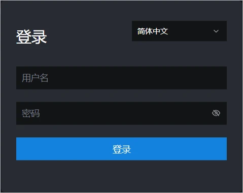

   > 推荐使用Chrome浏览器。
   >
   > **说明**
   >
   > 您可以单击页面右上角的下拉列表来进行语言切换。

   </li>

   <li>

   输入正确的用户名及密码。首次登录Apsara Uni-manager运维控制台时，需要修改登录用户名的密码，请按照提示完成密码修改。为提高安全性，密码必须满足以下要求：

   - 英文大小写字母。

   - 阿拉伯数字（0~9）。

   - 特殊符号，包括感叹号（！）、at（@）、井号（#）、美元符号（$）、百分号（%）等。

   - 密码长度10~20个字符。

   </li>

   <li>

   单击**登录**。

   </li>

   <li>

   在左侧导航栏，单击**运维 > 产品运维管理 > 产品列表**。

   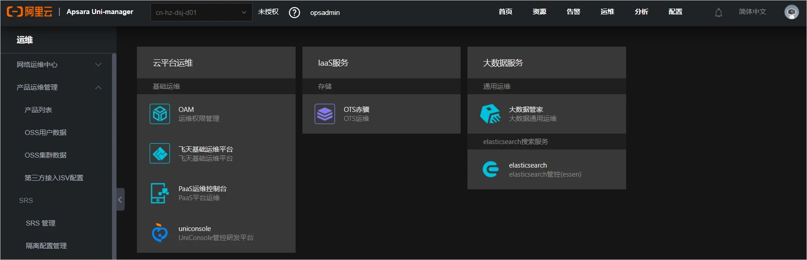

   </li>

   <li>

   单击**基础运维**下的**飞天基础运维平台**。

   </li>

   </ol>

2. 在**飞天基础运维平台**首页的左侧导航栏中，选择**运维 > 集群运维**。

3. 找到待查看配置的集群，单击集群名称或者**操作**列中的**运维**，进入**集群详情**页面。

4. 在**集群详情**页面，查看Quick BI的集群状态。检查是否到达了终态：

   - 如果到达了终态，则系统正常。

     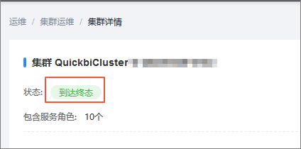

   - 如果未到达终态，则跳转至下一步。

     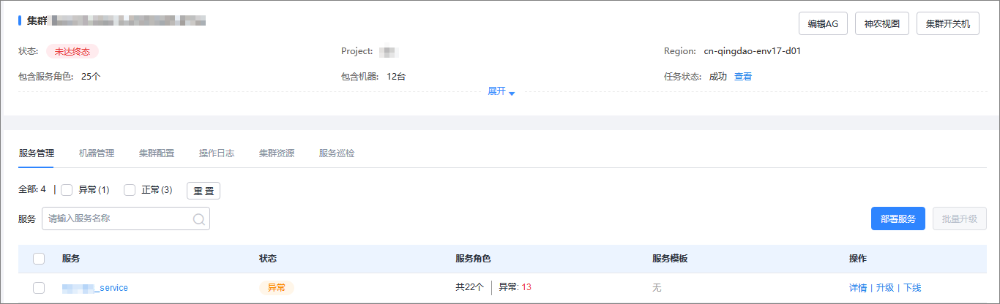

5. 单击**服务管理**下的服务名称或者**服务角色**下的异常，查看Quick BI服务实例详情。

6. 单击**服务角色状态**下的详情，查看服务错误信息。

7. <strong>可选：</strong>如果包含了未到达终态的服务实例，则按照如下规则排查。服务角色之间存在依赖，如果上游服务角色未到达终态，则下游服务角色也不会到达终态，优先解决上游未到达终态的服务角色。Quick BI服务角色间的依赖关系如Quick BI 服务角色间的依赖关系所示。

   图 1. Quick BI 服务角色间的依赖关系

   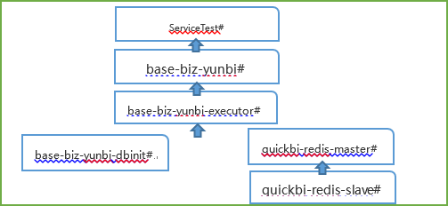

   例如：如果<strong>base-biz-yunbi-executor#</strong>未到达终态，则<strong>base-biz-yunbi#</strong>和<strong>ServiceTest#</strong>均不会到达终态。优先解决<strong>base-biz-yunbi-executor#</strong>未到达终态的问题，待<strong>base-biz-yunbi-executor#</strong>到达终态后，则<strong>base-biz-yunbi#</strong>和<strong>ServiceTest#</strong>在不存在自身问题的情况下会依次自动到达终态。

## 1.3. 通过大数据管家运维Quick BI

大数据管家支持从业务、服务、集群和主机等多个角度对大数据产品进行运维。除此以外，大数据管家还支持对大数据产品进行补丁升级、自定义大数据产品的报警上报配置、查看大数据管家中的运维操作历史等。

大数据管家ABM（Apsara Big Data Manager），原名BCC，是为大数据产品量身定做的运维管理平台。

大数据管家的登录方式及Quick BI相关的运维操作，请参见下方的 <strong>《Quick BI运维》</strong>章节。

# 2.例行维护

## 2.1. Quick BI组件概述

您可以通过容器监控和巡检管理，查看Quick BI相关组件的服务角色否到达终态，来对Quick BI进行例行维护。本节介绍Quick BI运维组件、对应的服务角色及作用。

Quick BI运维组件、对应的服务角色及作用。

<table>
  <tr>
    <th>组件</th>
    <th>组件对应的服务角色</th>
    <th>作用</th>
  </tr>
  <tr>
    <td>数据库初始化组件</td>
    <td>base-biz-yunbi-dbinit#</td>
    <td>主要负责Quick BI基础元数据的初始化，是Quick BI服务能够正常运行的前提条件，此服务必须到达终态。</td>
  </tr>
  <tr>
    <td rowspan="2">缓存组件</td>
    <td>quickbi-redis-master#</td>
    <td rowspan="2">为QuickBI提供数据缓存功能，从而提高系统查询性能。</td>
  </tr>
  <tr>
    <td>quickbi-redis-slave#</td>
  </tr>
  <tr>
    <td>执行机组件</td>
    <td>base-biz-yunbi-executor#</td>
    <td>查询连接的数据源中表的元数据，查询表的数据等操作。</td>
  </tr>
  <tr>
    <td>Web服务组件</td>
    <td>base-biz-yunbi #</td>
    <td>提供Web服务。用户前端访问的Quick BI页面，是由此服务角色提供服务。</td>
  </tr>
  <tr>
    <td>自动化测试组件</td>
    <td>ServiceTest#</td>
    <td>通过执行一批测试用例来检测Quick BI服务的整体可用性。</td>
  </tr>
</table>

> 服务部署或升级时，组件会自动启动。
>
> **说明**

## 2.2. 数据库初始化组件

本节介绍数据库初始化组件的容器监控异常排查。

查看飞天基础运维平台上的服务角色<strong>base-biz-yunbi-dbinit#</strong>是否已达终态。

> 数据库初始化组件的服务角色的终态是Quick BI服务能够正常运行的前提条件。如果检测
>
> **说明**
>
> 状态为非终态，请联系Quick BI技术支持。

## 2.3. 缓存组件

本节介绍缓存组件的容器监控异常排查及巡检管理。

**容器监控**

查看飞天基础运维平台上的服务角色<strong>quickbi-redis-master#</strong>和<strong>quickbi-redis-slave#</strong>是否已达终态。

> 也可以查看redis进程。如果redis进程存在，则监控状态为已达终态。
>
> **说明**

如果检测状态为非终态，则说明服务有异常。异常原因为redis进程中断或未启动。

处理措施：需要重启该服务角色。先重启**quickbi-redis-master#**，再重启**quickbi-redis-slave#**。

**巡检管理**

通过在容器中执行<strong>/checkRedis.sh</strong>命令来判断脚本的退出状态。如果退出状态为0，则服务正常，否则服务异常。脚本检测redis的服务进程是否存在，存在则退出状态为0，否则退出状态非0。检测间隔为一秒检测一次。

## 2.4. 执行机组件

本节介绍执行机组件的容器监控异常排查及巡检管理。

**容器监控**

查看飞天基础运维平台上的服务角色<strong>base-biz-yunbi-executor#</strong>是否已达终态。

如果检测状态为非终态，则说明服务有异常。异常原因为执行机进程中断或未启动。

处理措施：需要重启该服务角色**base-biz-yunbi-executor#**。

**巡检管理**

周期性地调用HTTP服务：http://container:7001/checkpreload.htm。如果返回状态为200，则表示服务正常，否则服务异常。检查周期为一秒钟。

> HTTP服务链接中的container是一个变量，您需要用<strong>base-biz-yunbi#</strong>这个服务角色申
>
> **说明**
>
> 请的IP替换container。

## 2.5. Web服务组件

本节介绍Web服务组件的容器监控异常排查及巡检管理。

**容器监控**

查看飞天基础运维平台上的服务角色<strong>base-biz-yunbi#</strong>是否已达终态。

如果检测状态为非终态，则说明服务有异常。异常原因：

- Java进程中断或未启动。判断方法：http://container:7001/checkpreload.htm。

- HTTPS证书未下发，443端口不通。判断方法：https://container/checkpreload.htm。

> 链接中的container是一个变量，您需要用<strong>base-biz-yunbi#</strong>这个服务角色申请的IP替换
>
> **说明**
>
> container。

处理措施：

- 如果Java进程中断或未启动，需要重启服务角色**base-biz-yunbi#**。

- 如果HTTPS证书未下发，需要在HTTPS证书下发后重启服务角色**base-biz-yunbi#**。

**巡检管理**

周期性地调用HTTPS服务：https://container/checkpreload.htm。如果返回状态为200，则表示服务正常，否则服务异常。检查周期为五秒钟。

> HTTPS服务链接中的container是一个变量，您需要用<strong>base-biz-yunbi#</strong>这个服务角色
>
> **说明**
>
> 申请的IP替换container。

## 2.6. 自动化测试组件

本节介绍自动化测试组件执行机组件的容器监控异常排查及巡检管理。

**容器监控**

查看飞天基础运维平台上的服务角色<strong>ServiceTest#</strong>是否已达终态。

如果检测状态为非终态，则说明服务可能有异常。异常原因：

- 服务不可用。判断方法：不能访问https://container/checkpreload.htm，并且登录到Quick BI Web服务页面后，页面打不开。

  > 链接中的container是一个变量，您需要用<strong>base-biz-yunbi#</strong>这个服务角色申请的IP
  >
  > **说明**
  >
  > 替换container。

- 服务可用，但检测发现异常。判断方法：登录到Quick BI Web服务页面，发现页面可以正常访问，查询数据也正常，但飞天基础运维平台上监控异常中报登录错误。错误信息可通过下图中的描述信息中查看。

  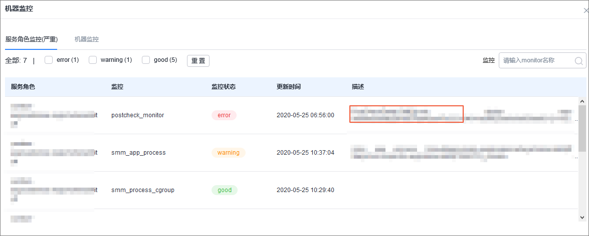

  请参见具体操作<strong>《云平台运维指南》</strong>中的查看监控实例状态章节。

处理措施：

- 服务不可用。检测是否有其他服务角色也未到终态，按照未到终态的处理措施进行处理。

- 服务可用，但检测有异常，请联系Quick BI技术支持，并提供错误信息。

**巡检管理**

通过周期性执行测试用例来检测系统的可用性。如果服务角色为终态，则表示服务正常，否则服务可能存在异常。检查周期为30分钟。

# 3.Quick BI运维

## 3.1. 登录大数据管家

本节介绍如何登录到大数据管家。

**前提条件**

- 已从部署人员或管理员处获取Apsara Uni-manager运维控制台的访问地址、用户名和密码。

  Apsara Uni-manager运维控制台访问地址格式为*region-id*.ops.console.*intranet-domain-id*。

- 推荐使用Chrome浏览器。

**操作步骤**

1. 打开浏览器。

2. 在地址栏中，输入Apsara Uni-manager运维控制台的访问地址，按回车键。

   

   > **说明**
   >
   > 您可以单击右上角的当前语言切换其它语言。当前支持简体中文、英文、繁体中文三种语言切换。

3. 输入正确的用户名及密码。

   > 登录Apsara Uni-manager运维控制台的用户名和密码请从部署人员或管理员处获取。
   >
   > **说明**

   首次登录Apsara Uni-manager运维控制台时，需要修改登录用户名的密码，请按照提示完成密码修改。

   为提高安全性，密码必须满足以下要求：

   - 英文大小写字母

   - 阿拉伯数字（0~9）

   - 特殊符号，包括感叹号（！）、at（@）、井号（#）、美元符号（$）、百分号（%）等

   - 密码长度10~20个字符

4. 单击**登录**。

5. 进入Apsara Uni-manager运维控制台后，在顶部菜单栏单击**运维**。

6. 在左侧的导航栏中，选择**产品运维管理 > 产品列表**。

7. 在**大数据服务 > 通用运维**区域下单击**大数据管家**，进入大数据管家首页。

## 3.2. Quick BI运维概述

本节介绍大数据管家支持的Quick BI运维功能和页面入口。

**Quick BI运维功能**

Quick BI运维包括服务运维、集群运维和主机运维三个功能模块，详细说明如下：

<table>
  <tr>
    <th>运维功能</th>
    <th>子功能</th>
    <th>说明</th>
  </tr>
  <tr>
    <td rowspan="2">服务运维</td>
    <td>服务概览</td>
    <td>展示集群中各服务角色的CPU、DISK、MEMORY、LOAD、PACKAGE、TCP 和 DISK ROOT的使用趋势图。</td>
  </tr>
  <tr>
    <td>服务机器</td>
    <td>展示集群中各服务角色的机器列表，以便您随时了解各个服务角色部署在了哪些机器上。</td>
  </tr>
  <tr>
    <td rowspan="2">集群运维</td>
    <td>集群概览</td>
    <td>展示集群的CPU、DISK、MEMORY、LOAD、PACKAGE、TCP和DISK ROOT的使用趋势图。</td>
  </tr>
  <tr>
    <td>集群健康</td>
    <td>支持查看集群的所有检查项、检查项的详情（提供检查项报警的解决方案）、各检查项在宿主上的检查状态，同时还支持直接登录宿主以及手动对宿主执行检查项检查。</td>
  </tr>
  <tr>
    <td rowspan="2">主机运维</td>
    <td>主机概览</td>
    <td>汇总主机的总体运行信息，包括该主机当前的根盘使用率、总使用率、1/5/15分钟负载，以及 CPU、DISK、MEMORY、LOAD、PACKAGE、TCP和DISK ROO 的使用趋势图，同时还包括该主机的运行健康、运行健康历史记录。</td>
  </tr>
  <tr>
    <td>主机健康</td>
    <td>支持查看每个宿主（即主机）的检查项、检查项详情（提供检查项报警的解决方案）以及各检查项的历史状态，同时还支持直接登录宿主以及手动对宿主执行检查项检查。</td>
  </tr>
</table>

**Quick BI运维入口**

1. 登录大数据管家。

2. 在左上方单击  图标，选择**QuickBI**产品。

3. 在 Quick BI页面中，单击上方的**运维**，默认进入**服务运维**页面。

   **运维**页面包括**服务运维**、**集群运维**和**主机运维**三大模块。

## 3.3. QuickBI 服务运维

### 3.3.1. QuickBI 服务概览

服务概览界面展示集群中所有的 QuickBI 服务角色，及每个服务角色的 CPU、DISK、MEMORY、LOAD、PACKAGE、TCP 和 DISK ROOT 使用趋势图。

**服务概览界面入口**

1. 在**运维**界面上方选择**服务运维**。

2. 在**服务运维**界面左侧的服务列表上方选择集群，然后再选择某个服务。

3. 在右侧选择**概览**，进入该服务的**概览**界面。

   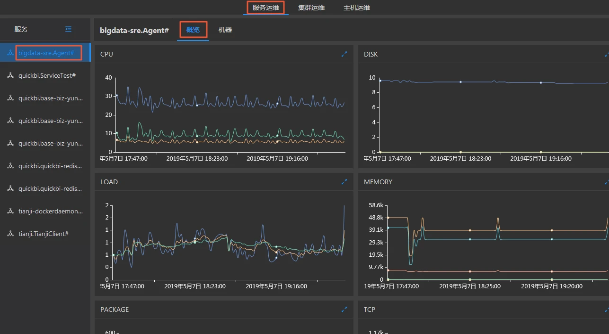

   **概览**界面向您展示当前选中服务角色的 CPU、DISK、MEMORY、LOAD、PACKAGE、TCP 和 DISK ROOT 使用趋势图。

**CPU**

按时间以不同颜色的曲线当前选中服务角色对 CPU 的使用率，包括 CPU 的总使用率（cpu）、系统对CPU 的使用率（sys）和用户对 CPU 的使用率（user）。

单击图右上角的  图标，放大 CPU 使用趋势图。

在放大图中，您可在左上方指定时间段来查看当前选中服务角色对 CPU 的使用率。

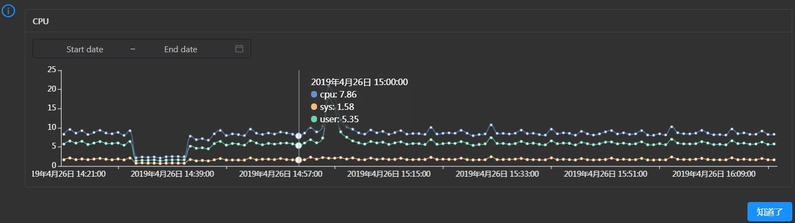

**DISK**

按时间以不同颜色的曲线展示当前选中服务角色对存储空间的使用率，包括 /、 /boot、/home/admin 和/home 目录的存储空间使用率。

单击图右上角的  图标，放大 DISK 使用趋势图。

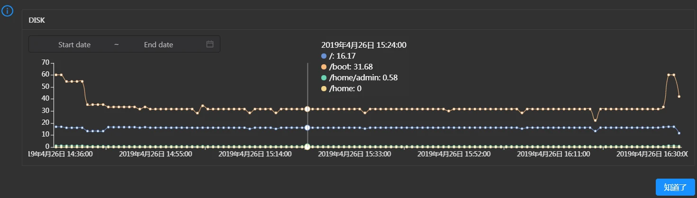

在放大图中，您可在左上方指定时间段来查看当前选中服务角色对存储空间的使用率。

**LOAD**

按时间以不同颜色的曲线展示当前选中服务角色的一分钟 、五分钟和十五分钟平均负载。

单击图右上角的  图标，放大 LOAD 用趋势图。

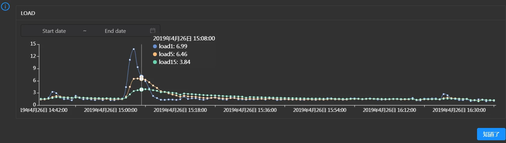

在放大图中，您可在左上方指定时间段来查看当前选中服务角色的一分钟 、五分钟和十五分钟平均负载。

**MEMORY**

按时间以不同颜色的曲线展示当前选中服务角色对内存的使用量，包括内存使用率 （mem）、总内存大小（total）、已使用的内存大小（used）、buff 使用的内存使用量（buff）、cache 使用的内存大小（cach）和空闲内存大小（free）。

单击图右上角的  图标，放大 MEMORY 使用趋势图。

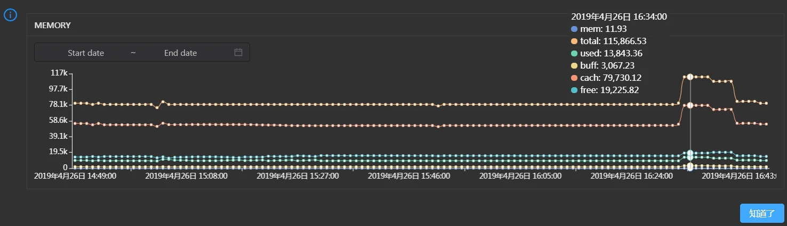

在放大图中，您可在左上方指定时间段来查看当前选中服务角色对内存的使用量。

**PACKAGE**

按时间以不同颜色的曲线展示当前选中服务角色的数据传输情况，包括丢包数量（drop）、错误包数量（error）、接收包数量（in）和发送包数量（out）。

单击图右上角的  图标，放大 PACKAGE 趋势图。

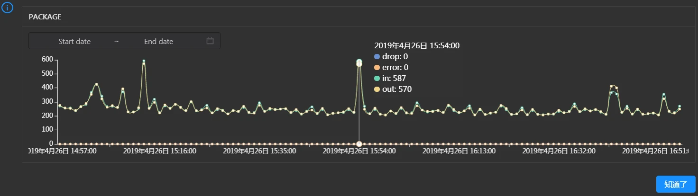

在放大图中，您可在左上方指定时间段来查看当前选中服务角色的数据传输情况。

**TCP**

按时间以不同颜色的曲线展示当前选中服务角色的 TCP 协议的使用情况，包括主动打开的 TCP 连接数目（active）、被动打开的 TCP 连接数目（pasive）、收到的 TCP 报文数目（iseg）、发出的 TCP 报文数目（outseg）。

单击图右上角的  图标，放大 TCP 使用趋势图。

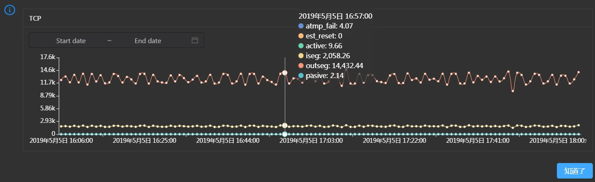

在放大图中，您可在左上方指定时间段来查看当前选中服务角色的 TCP 协议使用情况。

**DISK ROOT**

按时间以不同颜色的曲线展示当前选中服务角色对根盘的平均使用率（avg）。

单击图右上角的  图标，放大根盘平均使用趋势图。

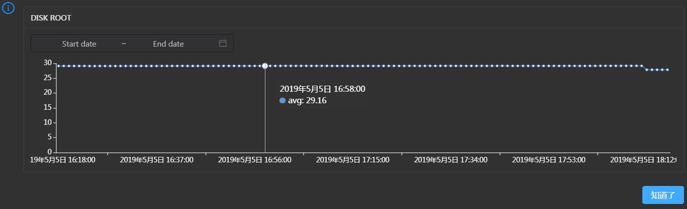

在放大图中，您可在左上方指定时间段来查看当前选中服务角色对根盘的平均使用率。

### 3.3.2. Quick BI服务机器

大数据管家支持查看Quick BI中各服务角色的机器列表，以便您随时了解各个服务角色部署在了哪些机器上。

1. 在**运维**界面上方选择**服务运维**。

2. 在**服务运维**界面左侧的服务列表上方选择集群，然后再选择某个服务。

3. 在右侧选择**机器**，进入该服务的**机器**界面。

   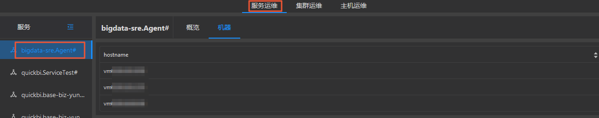

   **机器**界面向您展示运行当前选中Quick BI服务角色的机器列表。

## 3.4. QuickBI 集群运维

### 3.4.1. QuickBI 集群概览

集群概览汇总了集群的主要运行指标，包括 CPU、DISK、MEMORY、LOAD、PACKAGE、TCP 和 DISK ROOT。

**集群概览入口**

1. 在**运维**界面上方选择**集群运维**。

2. 在**集群运维**界面左侧的导航树中选择某个集群，然后在右侧选择**概览**，进入集群**概览**界面。

   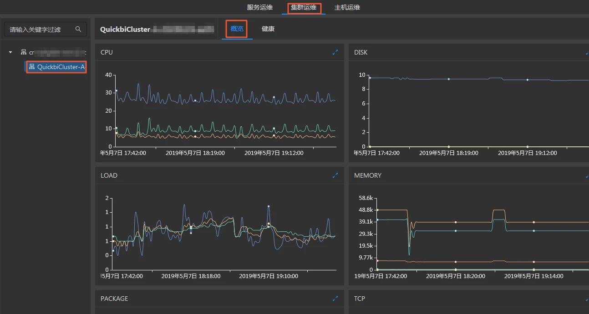

**CPU**

按时间以不同颜色的曲线展示集群的CPU使用率（支持指定时间段），包括CPU的总使用率（cpu）、系统对CPU的使用率（sys）和用户对CPU的使用率（user）。

单击图右上角的  图标，放大CPU使用趋势图。

在放大图中，您可在左上方指定时间段来查看集群的 CPU 使用率。

**DISK**

按时间展示集群的存储空间使用率。

单击图右上角的  图标，放大DISK使用趋势图。

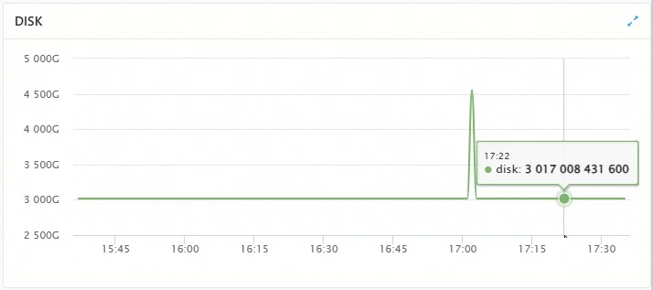

在放大图中，您可在左上方指定时间段来查看集群的存储空间使用率。

**MEMORY**

按时间以不同颜色的曲线展示集群的内存使用量，包括内存使用率 （mem）、总内存大小（total）、已使用的内存大小（used）、buff使用的内存使用量（buff）和空闲内存大小（free）。

单击图右上角的  图标，放大MEMORY使用趋势图。

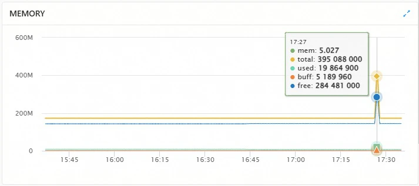

在放大图中，您可在左上方指定时间段来查看集群的内存使用量。

**PACKAGE**

按时间以不同颜色的曲线展示集群的数据传输情况，包括丢包数量（drop）、错误包数量（error）、接收包数量（in）和发送包数量（out）。

单击图右上角的  图标，放大PACKAGE趋势图。

在放大图中，您可在左上方指定时间段来查看集群的数据传输情况。

**LOAD**

按时间以不同颜色的曲线展示集群的一分钟 、五分钟和十五分钟系统平均负载。

单击图右上角的  图标，放大LOAD使用趋势图。

在放大图中，您可在左上方指定时间段来查看集群的一分钟 、五分钟和十五分钟系统平均负载。

### 3.4.2. QuickBI 集群健康

集群健康界面展示集群的所有检查项、检查项的详情（提供检查项报警的解决方案）、各检查项在宿主上的检查状态，同时还支持直接登录宿主以及手动对宿主执行检查项检查。

**集群健康入口**

1. 在**运维**界面上方选择**集群运维**。

2. 在**集群运维**界面左侧的导航树中选择某个集群，然后在右侧选择**健康**，进入该集群的**健康**界面。

   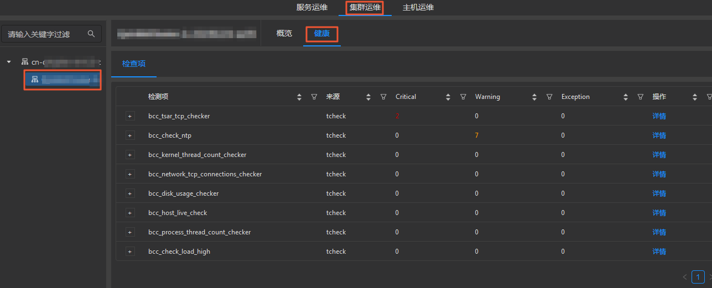

   **健康**页面显示当前集群的所有监控项，以及监控项在各宿主上的检查状态。检查状态分为**Critical**、**Warning**和**Exception**，并分别以不同颜色显示。您需要重点关注并及时处理这些报警，特别是**Critical**和**Warning**报警事件。检查状态说明如下：

**查看监控项详情**

1. 在集群**健康**页面，单击目标监控项**操作**列的**详情**，在弹出的对话框中查看监控项详情。

   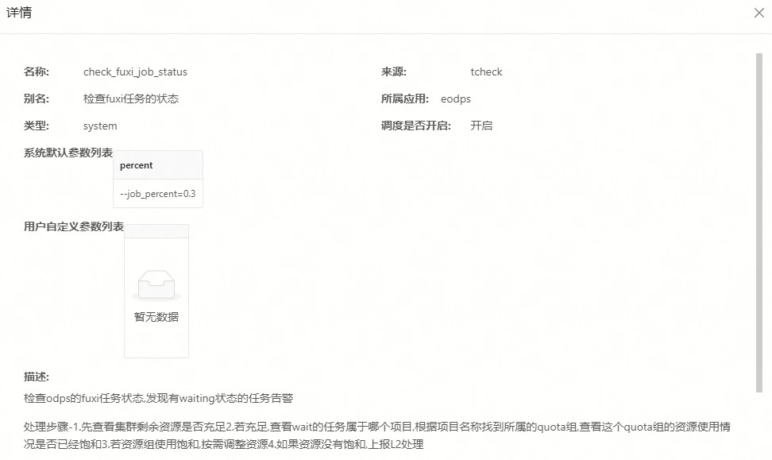

   监控项详情包括**名称**、**来源**、**别名**、**所属应用**、**类型**、**系统默认参数列表**、**用户自定义参数列表**和**描述**，其中描述中附有检查项报警的解决方案。

2. 单击下方的**显示更多**，查看监控项的更多信息。

   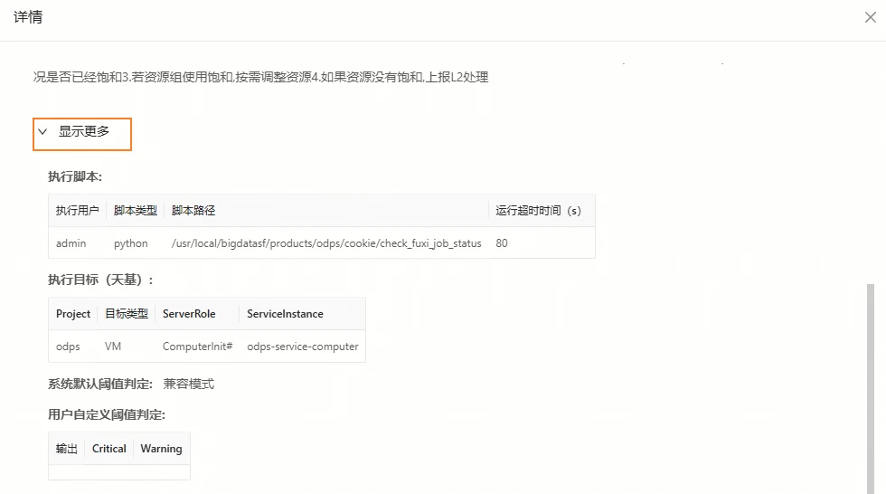

   监控项更多信息包括**执行脚本**、**执行目标**、**系统默认阈值判定**和**用户自定义阈值判定**。

**查看报警的宿主以及报警原因**

通过监控项的宿主，您可查看该监控项是对宿主的历史检查记录以及检查结果。

1. 在集群**健康**页面，单击存在报警的监控项前面的  图标，查看该监控项所有的宿主。

   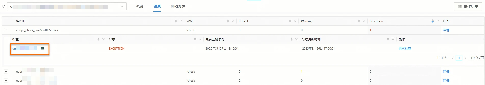

2. 单击宿主，然后在弹出的对话框中单击某个报警后面的**详情**，在右侧查看报警原因。

   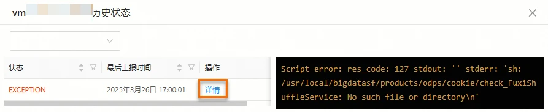

**处理监控项报警**

在集群**健康**页面，单击存在报警的监控项后面的**详情**，在弹出的对话框中查看监控项报警的处理方法。

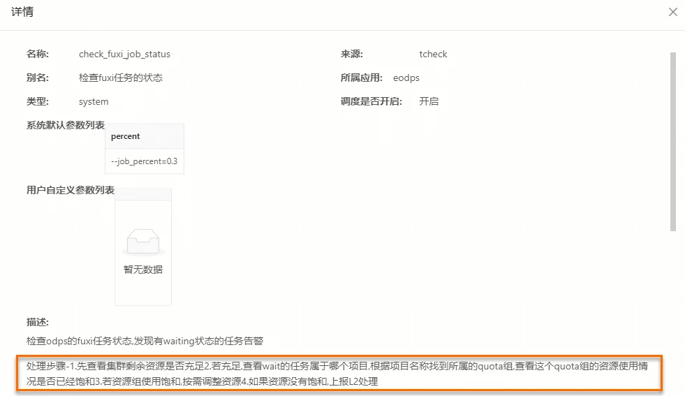

**再次检查**

处理完某个报警后，您可单击宿主后面的**再次检查**，对该宿主进行一次该检查项的实时检查，以确定该宿主的报警是否恢复。

## 3.5. QuickBI 主机运维

### 3.5.1. QuickBI 主机概览

主机概览汇总了 ElasticSearch 集群中主机的总体运行信息，包括该主机当前的根盘使用率、总使用率、1/5/15 分钟负载、运行健康、运行健康历史记录，以及 CPU、DISK、MEMORY、LOAD、PACKAGE、TCP 和 DISK ROOT 的使用趋势图。

**主机概览入口**

1. 在**运维**界面上方选择**主机运维**。

2. 在左侧**主机运维**界面左侧导航树中选择某个主机，然后在右侧选择**概览**，进入该主机的**概览**界面。

   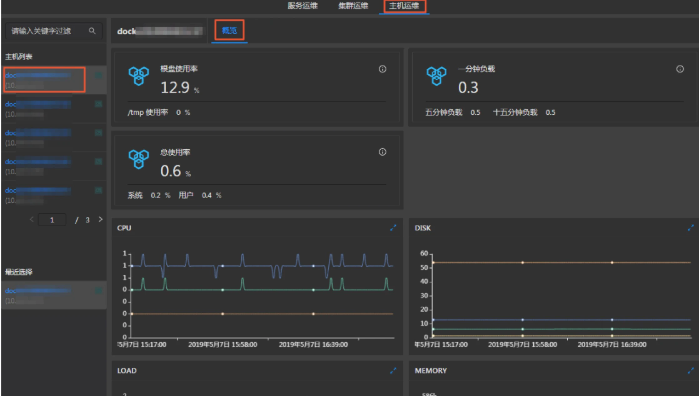

   **概览**界面汇总了当前选中主机的根盘使用率、一分钟负载、总使用率、CPU、DISK、MEMORY、LOAD、PACKAGE、TCP、DISK ROOT、运行健康和运行健康历史记录。

**根盘使用率、总使用率和一分钟负载**

汇总该主机当前的根盘使用率、总使用率，以及一分钟负载。同时根盘使用率下还给出了 /tmp 目录的使用率，总使用率下还分别给出了系统使用率和用户使用率，一分钟负载下还给出了 5/15 分钟负载。

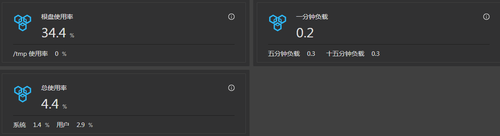

**CPU**

按时间以不同颜色的曲线展示该主机的CPU使用率（支持指定时间段），包括CPU的总使用率（cpu）、系统对CPU的使用率（sys）和用户对CPU的使用率（user）。

单击图右上角的  图标，放大CPU使用趋势图。

在放大图中，您可在左上方指定时间段来查看该主机的CPU使用率。

**DISK**

按时间以不同颜色的曲线展示该主机的存储空间使用率，包括/、/boot、/home/admin和/home目录的存储空间使用率。

单击图右上角的  图标，放大DISK使用趋势图。

在放大图中，您可在左上方指定时间段来查看该主机的存储空间使用率。

**MEMORY**

按时间以不同颜色的曲线展示该主机的内存使用量，包括内存使用率（mem）、总内存大小（total）、已使用的内存大小（used）、buff使用的内存使用量（buff）、Cache使用的内存大小（cach）和空闲内存大小（free）。

单击图右上角的  图标，放大MEMORY使用趋势图。

在放大图中，您可在左上方指定时间段来查看该主机的内存使用量。

**LOAD**

按时间以不同颜色的曲线展示该主机的一分钟 、五分钟和十五分钟系统平均负载。

单击图右上角的  图标，放大LOAD使用趋势图。

在放大图中，您可在左上方指定时间段来查看该主机的一分钟 、五分钟和十五分钟系统平均负载。

**PACKAGE**

按时间以不同颜色的曲线展示该主机的数据传输情况，包括丢包数量（drop）、错误包数量（error）、接收包数量（in）和发送包数量（out）。

单击图右上角的  图标，放大PACKAGE趋势图。

在放大图中，您可在左上方指定时间段来查看该主机的数据传输情况。

**TCP**

按时间以不同颜色的曲线展示该主机的 TCP 协议的使用情况，包括尝试连接失败次数（atmp_fail）、重置ESTABLISHED 状态的连接的次数（est_reset）、主动打开的 TCP 连接数目（active）、被动打开的TCP 连接数目（pasive）、收到的 TCP 报文数目（iseg）、发出的 TCP 报文数目（outseg）。

单击图右上角的  图标，放大 TCP 使用趋势图。

在放大图中，您可在左上方指定时间段来查看该主机的 TCP 协议使用情况。

**DISK ROOT**

按时间以不同颜色的曲线展示该主机的根目录（/）平均使用率。

单击图右上角的  图标，放大根目录使用趋势图。

在放大图中，您可在左上方指定时间段来查看该主机的根目录平均使用率。

**运行健康**

统计该主机当前的巡检项总数量，以及该主机中的 CRITICAL、WARNING 和 EXCEPTION 的报警数量。

单击**查看详情**，跳转到QuickBI 主机健康界面，查看健康检查的详细信息。

**运行健康历史记录**

简要的展示主机健康检查的历史记录。

单击**查看详情**，跳转到QuickBI 主机健康界面，查看健康检查的详细信息。

单击每次检查的**事件内容**，查看此次检查的异常项。

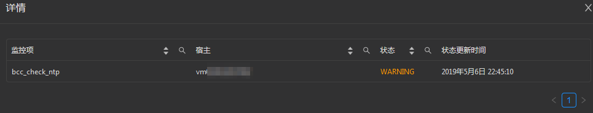

### 3.5.2. QuickBI 主机健康

主机健康支持查看所有宿主（即主机）的检查项、检查项详情（提供检查项报警的解决方案）、各检查项的状态，同时还支持直接登录宿主以及手动对宿主执行检查项检查。

**主机概览入口**

1. 在**运维**界面上方选择**主机运维**。

2. 在左侧**主机运维**界面左侧导航树中选择某个主机，然后在右侧选择**健康**，进入该主机的**健康**界面。

   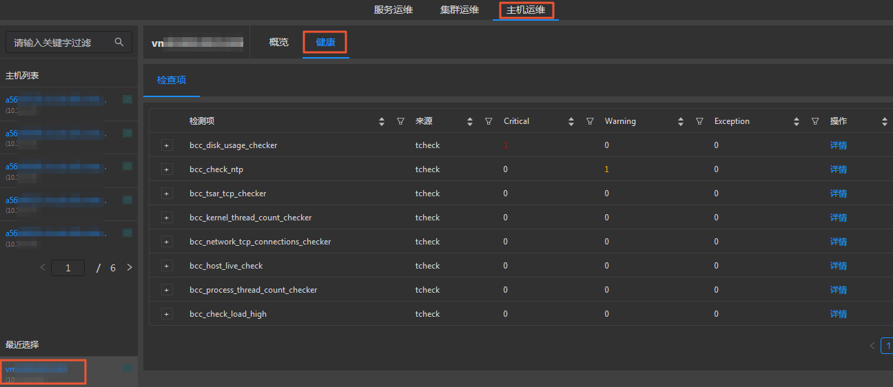

   **健康**界面显示当前主机的所有检查项及检查项状态。检查状态分为**CRITICAL**、**WARNING**、**EXCEPTION** 和 **OK**，并分别以不同颜色显示。其中**CRITICAL**、**WARNING**、**EXCEPTION** 是报警事件，您需要重点关注，特别是**CRITICAL**、**WARNING** 报警事件。

**查看检查项详情**

1. 在主机健康界面，单击检查项后面的**详情**，在弹出的对话框中查看检查项详情。

   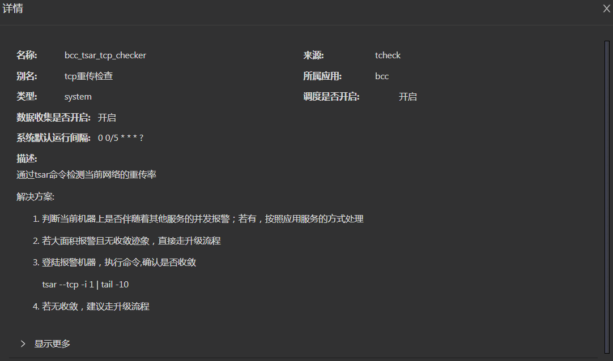

   检查项详情包括**名称**、**来源**、**别名**、**所属应用**、**类型**、**调度是否开启**、**数据收集是否开启**、**系统默认运行间隔**和**描述**，其中描述中有附有检查项报警的解决方案。

2. 单击下方的**显示更多**，查看检查项的更多信息。

   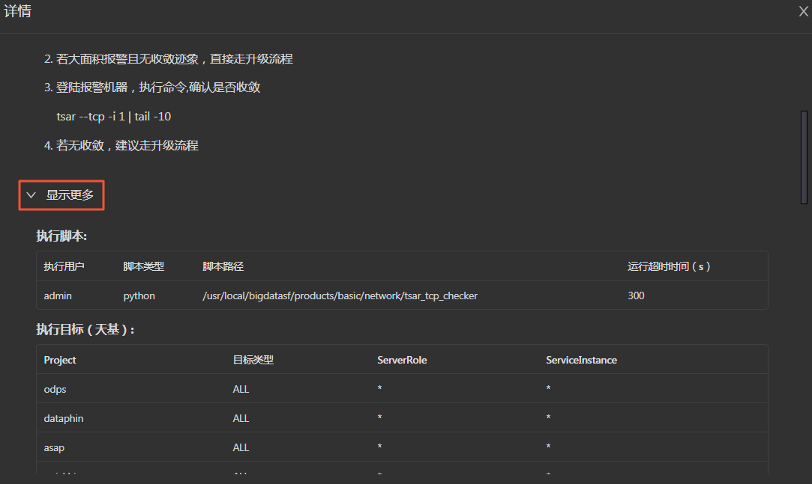

   检查项更多信息包括**执行脚本**、**执行目标**、**系统默认阈值判定**和**数据收集挂载点**。

**查看报警原因**

通过检查项，您可查看该检查项是对宿主的检查记录以及检查结果。

1. 在主机健康界面，单击存在报警的检查项前面的**折叠**图标，查看该检查项的宿主。

   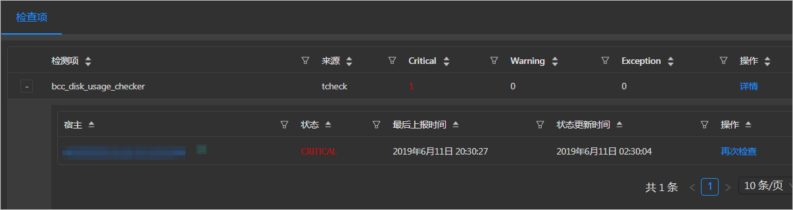

2. 单击**宿主**，然后在弹出的对话框中单击某个报警后面的**详情**，在右侧查看报警原因。

   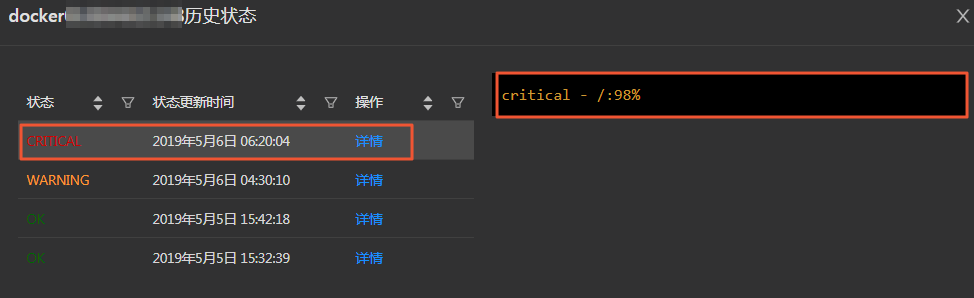

**处理检查项报警**

在主机健康界面，单击存在报警的检查项后面的**详情**，在弹出的对话框中查看检查项报警的处理方法。

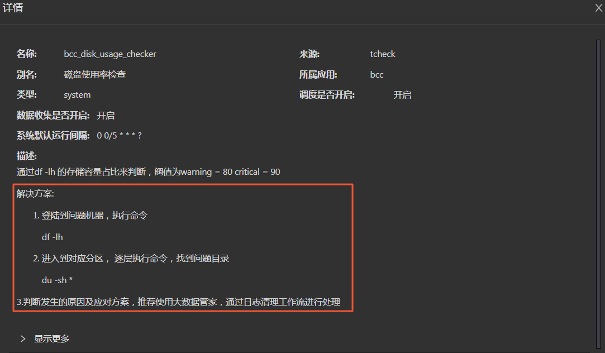

**登录宿主**

如果某个宿主有报警事件或其他情况，您可能需要登录到宿主进行相关操作。

1. 在集群健康界面，单击检查项前面的**折叠**图标。

   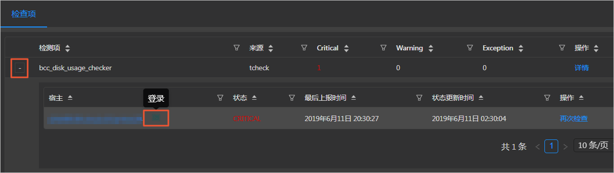

2. 单击宿主后面的**登录**图标，打开**TerminalService**界面。

   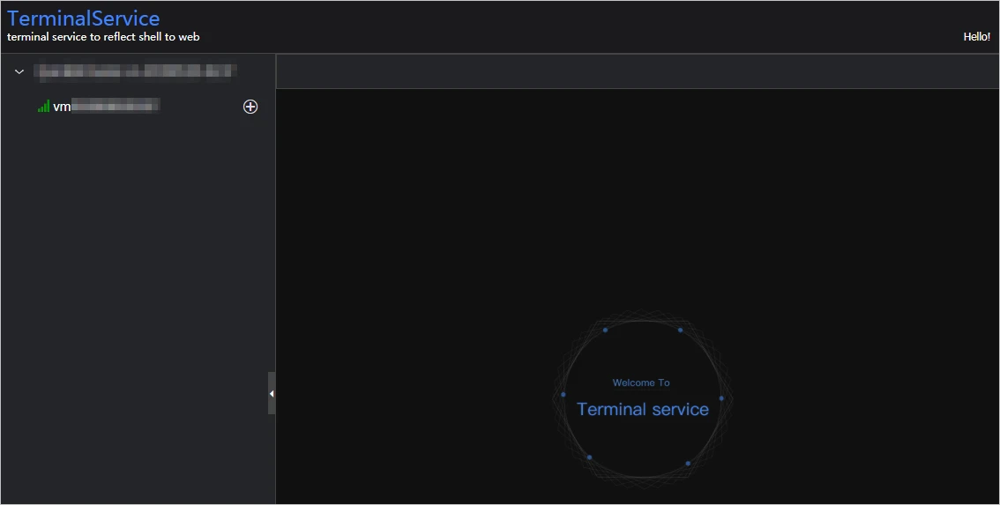

3. 在**TerminalService**左侧选择宿主，即可直接登录。

   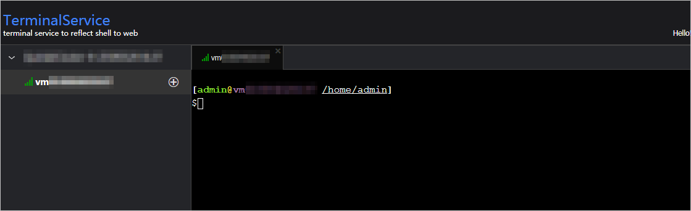

**再次检查**

处理完某个报警后，您可单击宿主后面的**再次检查**，对该宿主进行一次该检查项的实时检查，以确定该宿主的报警是否恢复。

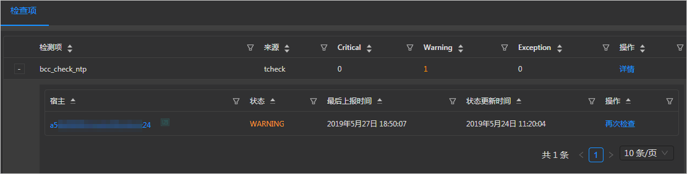
