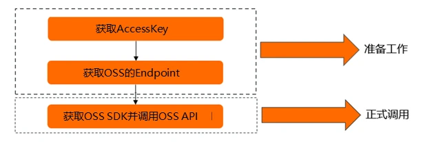
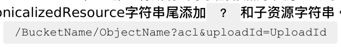
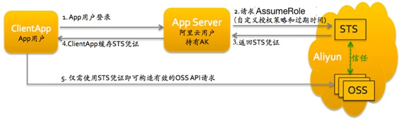
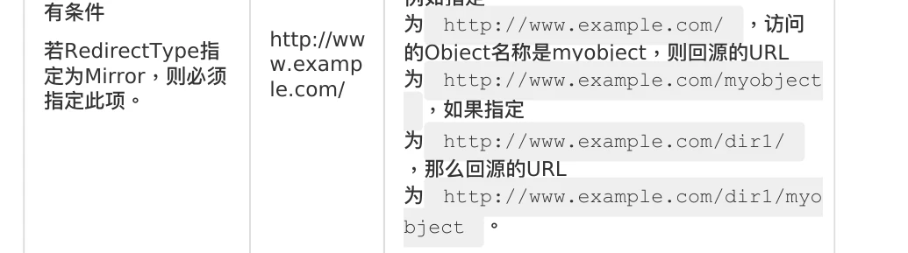
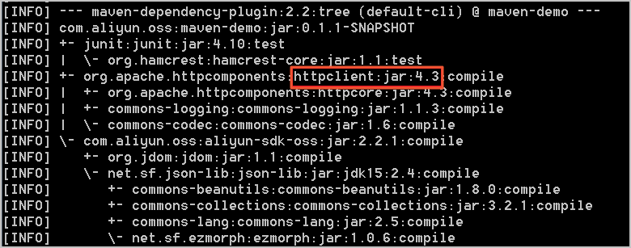
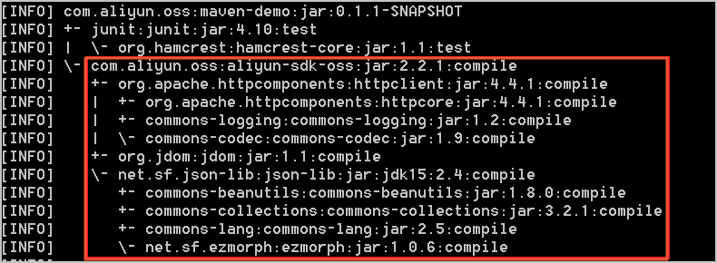
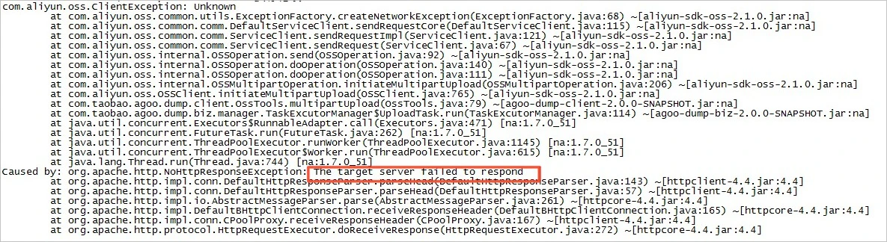
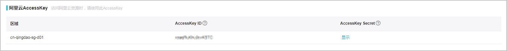

阿里云  
专有云  
对象存储 OSS  
开发指南  
产品版本：V3.18.6  
文档版本：20260813

**目录**

- [1.使用前须知](#section-1)
- [2.API参考](#section-2)
    - [2.1. OSS API文档简介](#section-2-1)
    - [2.2. 访问控制](#section-2-2)
        - [2.2.1. 用户签名验证](#section-2-2-1)
        - [2.2.2. 在Header中包含签名](#section-2-2-2)
        - [2.2.3. 在URL中包含签名](#section-2-2-3)
        - [2.2.4. 临时授权访问](#section-2-2-4)
        - [2.2.5. Bucket权限控制](#section-2-2-5)
    - [2.3. 公共HTTP头定义](#section-2-3)
    - [2.4. 关于Service的操作](#section-2-4)
        - [2.4.1. GetService(ListBuckets)](#section-2-4-1)
    - [2.5. 关于Bucket的操作](#section-2-5)
        - [2.5.1. PutBucket](#section-2-5-1)
        - [2.5.2. PutBucketACL](#section-2-5-2)
        - [2.5.3. PutBucketLogging](#section-2-5-3)
        - [2.5.4. PutBucketWebsite](#section-2-5-4)
        - [2.5.5. PutBucketReferer](#section-2-5-5)
        - [2.5.6. PutBucketTags](#section-2-5-6)
        - [2.5.7. PutBucketLifecycle](#section-2-5-7)
        - [2.5.8. GetBucket (ListObjects)](#section-2-5-8)
        - [2.5.9. GetBucketAcl](#section-2-5-9)
        - [2.5.10. GetBucketLocation](#section-2-5-10)
        - [2.5.11. GetBucketInfo](#section-2-5-11)
        - [2.5.12. GetBucketLogging](#section-2-5-12)
        - [2.5.13. GetBucketWebsite](#section-2-5-13)
        - [2.5.14. GetBucketReferer](#section-2-5-14)
        - [2.5.15. GetBucketLifecycle](#section-2-5-15)
        - [2.5.16. GetBucketTags](#section-2-5-16)
        - [2.5.17. DeleteBucket](#section-2-5-17)
        - [2.5.18. DeleteBucketLogging](#section-2-5-18)
        - [2.5.19. DeleteBucketWebsite](#section-2-5-19)
        - [2.5.20. DeleteBucketLifecycle](#section-2-5-20)
        - [2.5.21. DeleteBucketTags](#section-2-5-21)
        - [2.5.22. PutBucketPolicy](#section-2-5-22)
        - [2.5.23. GetBucketPolicy](#section-2-5-23)
        - [2.5.24. GetBucketPolicyStatus](#section-2-5-24)
        - [2.5.25. DeleteBucketPolicy](#section-2-5-25)
        - [2.5.26. GetBucketStat](#section-2-5-26)
        - [2.5.27. PutCname](#section-2-5-27)
        - [2.5.28. ListCname](#section-2-5-28)
        - [2.5.29. DeleteCname](#section-2-5-29)
        - [2.5.30. PutBucketHttpsConfig](#section-2-5-30)
        - [2.5.31. GetBucketHttpsConfig](#section-2-5-31)
    - [2.6. 关于Object的操作](#section-2-6)
        - [2.6.1. PutObject](#section-2-6-1)
        - [2.6.2. GetObject](#section-2-6-2)
        - [2.6.3. CopyObject](#section-2-6-3)
        - [2.6.4. AppendObject](#section-2-6-4)
        - [2.6.5. DeleteObject](#section-2-6-5)
        - [2.6.6. DeleteMultipleObjects](#section-2-6-6)
        - [2.6.7. HeadObject](#section-2-6-7)
        - [2.6.8. GetObjectMeta](#section-2-6-8)
        - [2.6.9. PutObjectACL](#section-2-6-9)
        - [2.6.10. GetObjectACL](#section-2-6-10)
        - [2.6.11. PostObject](#section-2-6-11)
        - [2.6.12. Callback](#section-2-6-12)
        - [2.6.13. PutObjectTagging](#section-2-6-13)
        - [2.6.14. GetObjectTagging](#section-2-6-14)
        - [2.6.15. DeleteObjectTagging](#section-2-6-15)
    - [2.7. 关于MultipartUpload的操作](#section-2-7)
        - [2.7.1. 简介](#section-2-7-1)
        - [2.7.2. InitiateMultipartUpload](#section-2-7-2)
        - [2.7.3. UploadPart](#section-2-7-3)
        - [2.7.4. UploadPartCopy](#section-2-7-4)
        - [2.7.5. CompleteMultipartUpload](#section-2-7-5)
        - [2.7.6. AbortMultipartUpload](#section-2-7-6)
        - [2.7.7. ListMultipartUploads](#section-2-7-7)
        - [2.7.8. ListParts](#section-2-7-8)
    - [2.8. 跨域资源共享](#section-2-8)
        - [2.8.1. 简介](#section-2-8-1)
        - [2.8.2. PutBucketcors](#section-2-8-2)
        - [2.8.3. GetBucketcors](#section-2-8-3)
        - [2.8.4. DeleteBucketcors](#section-2-8-4)
        - [2.8.5. OptionObject](#section-2-8-5)
    - [2.9. OSS错误响应](#section-2-9)
- [3.SDK参考](#section-3)
    - [3.1. Java-SDK](#section-3-1)
        - [3.1.1. 前言](#section-3-1-1)
        - [3.1.2. 安装](#section-3-1-2)
        - [3.1.3. 初始化](#section-3-1-3)
        - [3.1.4. 快速入门](#section-3-1-4)
        - [3.1.5. 存储空间](#section-3-1-5)
            - [3.1.5.1. 创建存储空间](#section-3-1-5-1)
            - [3.1.5.2. 列举存储空间](#section-3-1-5-2)
            - [3.1.5.3. 判断存储空间是否存在](#section-3-1-5-3)
            - [3.1.5.4. 管理存储空间访问权限](#section-3-1-5-4)
            - [3.1.5.5. 删除存储空间](#section-3-1-5-5)
            - [3.1.5.6. 生命周期管理](#section-3-1-5-6)
            - [3.1.5.7. 防盗链](#section-3-1-5-7)
            - [3.1.5.8. 跨域资源共享](#section-3-1-5-8)
            - [3.1.5.9. 设置访问日志](#section-3-1-5-9)
            - [3.1.5.10. 静态网站托管](#section-3-1-5-10)
            - [3.1.5.11. 安全传输层协议](#section-3-1-5-11)
            - [3.1.5.12. 绑定自定义域名](#section-3-1-5-12)
        - [3.1.6. 上传文件](#section-3-1-6)
            - [3.1.6.1. 概述](#section-3-1-6-1)
            - [3.1.6.2. 简单上传](#section-3-1-6-2)
            - [3.1.6.3. 表单上传](#section-3-1-6-3)
            - [3.1.6.4. 追加上传](#section-3-1-6-4)
            - [3.1.6.5. 断点续传上传](#section-3-1-6-5)
            - [3.1.6.6. 分片上传](#section-3-1-6-6)
            - [3.1.6.7. 进度条](#section-3-1-6-7)
            - [3.1.6.8. 上传回调](#section-3-1-6-8)
        - [3.1.7. 下载文件](#section-3-1-7)
            - [3.1.7.1. 概述](#section-3-1-7-1)
            - [3.1.7.2. 流式下载](#section-3-1-7-2)
            - [3.1.7.3. 下载到本地文件](#section-3-1-7-3)
            - [3.1.7.4. 范围下载](#section-3-1-7-4)
            - [3.1.7.5. 断点续传下载](#section-3-1-7-5)
            - [3.1.7.6. 限定条件下载](#section-3-1-7-6)
            - [3.1.7.7. 进度条](#section-3-1-7-7)
        - [3.1.8. 管理文件](#section-3-1-8)
            - [3.1.8.1. 概述](#section-3-1-8-1)
            - [3.1.8.2. 判断文件是否存在](#section-3-1-8-2)
            - [3.1.8.3. 管理文件访问权限](#section-3-1-8-3)
            - [3.1.8.4. 管理文件元信息](#section-3-1-8-4)
            - [3.1.8.5. 列举文件](#section-3-1-8-5)
            - [3.1.8.6. 查询文件](#section-3-1-8-6)
            - [3.1.8.7. 删除文件](#section-3-1-8-7)
            - [3.1.8.8. 拷贝文件](#section-3-1-8-8)
        - [3.1.9. 授权访问](#section-3-1-9)
        - [3.1.10. 图片处理](#section-3-1-10)
        - [3.1.11. 异常处理](#section-3-1-11)
        - [3.1.12. 常见问题](#section-3-1-12)
    - [3.2. Python-SDK](#section-3-2)
        - [3.2.1. 前言](#section-3-2-1)
        - [3.2.2. 安装](#section-3-2-2)
        - [3.2.3. 快速入门](#section-3-2-3)
        - [3.2.4. 初始化](#section-3-2-4)
        - [3.2.5. 存储空间](#section-3-2-5)
            - [3.2.5.1. 创建存储空间](#section-3-2-5-1)
            - [3.2.5.2. 列举存储空间](#section-3-2-5-2)
            - [3.2.5.3. 判断存储空间是否存在](#section-3-2-5-3)
            - [3.2.5.4. 管理存储空间访问权限](#section-3-2-5-4)
            - [3.2.5.5. 删除存储空间](#section-3-2-5-5)
            - [3.2.5.6. 生命周期管理](#section-3-2-5-6)
            - [3.2.5.7. 静态网站托管](#section-3-2-5-7)
            - [3.2.5.8. 跨域资源共享](#section-3-2-5-8)
            - [3.2.5.9. 防盗链](#section-3-2-5-9)
            - [3.2.5.10. 设置访问日志](#section-3-2-5-10)
            - [3.2.5.11. 绑定自定义域名](#section-3-2-5-11)
        - [3.2.6. 上传文件](#section-3-2-6)
            - [3.2.6.1. 概述](#section-3-2-6-1)
            - [3.2.6.2. 简单上传](#section-3-2-6-2)
            - [3.2.6.3. 追加上传](#section-3-2-6-3)
            - [3.2.6.4. 断点续传上传](#section-3-2-6-4)
            - [3.2.6.5. 分片上传](#section-3-2-6-5)
            - [3.2.6.6. 进度条](#section-3-2-6-6)
            - [3.2.6.7. 上传回调](#section-3-2-6-7)
        - [3.2.7. 下载文件](#section-3-2-7)
            - [3.2.7.1. 概述](#section-3-2-7-1)
            - [3.2.7.2. 流式下载](#section-3-2-7-2)
            - [3.2.7.3. 下载到本地文件](#section-3-2-7-3)
            - [3.2.7.4. 范围下载](#section-3-2-7-4)
            - [3.2.7.5. 断点续传下载](#section-3-2-7-5)
            - [3.2.7.6. 进度条](#section-3-2-7-6)
        - [3.2.8. 管理文件](#section-3-2-8)
            - [3.2.8.1. 概述](#section-3-2-8-1)
            - [3.2.8.2. 判断文件是否存在](#section-3-2-8-2)
            - [3.2.8.3. 管理文件访问权限](#section-3-2-8-3)
            - [3.2.8.4. 管理文件元信息](#section-3-2-8-4)
            - [3.2.8.5. 列举文件](#section-3-2-8-5)
            - [3.2.8.6. 查询文件](#section-3-2-8-6)
            - [3.2.8.7. 删除文件](#section-3-2-8-7)
            - [3.2.8.8. 拷贝文件](#section-3-2-8-8)
        - [3.2.9. 授权访问](#section-3-2-9)
        - [3.2.10. 中文和时间](#section-3-2-10)
        - [3.2.11. 图片处理](#section-3-2-11)
        - [3.2.12. 异常处理](#section-3-2-12)
    - [3.3. PHP-SDK](#section-3-3)
        - [3.3.1. 前言](#section-3-3-1)
        - [3.3.2. 安装](#section-3-3-2)
        - [3.3.3. 初始化](#section-3-3-3)
        - [3.3.4. 快速入门](#section-3-3-4)
        - [3.3.5. 存储空间](#section-3-3-5)
            - [3.3.5.1. 创建存储空间](#section-3-3-5-1)
            - [3.3.5.2. 列举存储空间](#section-3-3-5-2)
            - [3.3.5.3. 判断存储空间是否存在](#section-3-3-5-3)
            - [3.3.5.4. 管理存储空间访问权限](#section-3-3-5-4)
            - [3.3.5.5. 删除存储空间](#section-3-3-5-5)
            - [3.3.5.6. 生命周期管理](#section-3-3-5-6)
            - [3.3.5.7. 防盗链](#section-3-3-5-7)
            - [3.3.5.8. 设置访问日志](#section-3-3-5-8)
            - [3.3.5.9. 静态网站托管](#section-3-3-5-9)
            - [3.3.5.10. 跨域资源共享](#section-3-3-5-10)
            - [3.3.5.11. 绑定自定义域名](#section-3-3-5-11)
        - [3.3.6. 上传文件](#section-3-3-6)
            - [3.3.6.1. 概述](#section-3-3-6-1)
            - [3.3.6.2. 简单上传](#section-3-3-6-2)
            - [3.3.6.3. 追加上传](#section-3-3-6-3)
            - [3.3.6.4. 分片上传](#section-3-3-6-4)
            - [3.3.6.5. 上传回调](#section-3-3-6-5)
        - [3.3.7. 下载文件](#section-3-3-7)
            - [3.3.7.1. 概述](#section-3-3-7-1)
            - [3.3.7.2. 下载到本地文件](#section-3-3-7-2)
            - [3.3.7.3. 下载到本地内存](#section-3-3-7-3)
            - [3.3.7.4. 范围下载](#section-3-3-7-4)
            - [3.3.7.5. 限定条件下载](#section-3-3-7-5)
        - [3.3.8. 管理文件](#section-3-3-8)
            - [3.3.8.1. 概述](#section-3-3-8-1)
            - [3.3.8.2. 判断文件是否存在](#section-3-3-8-2)
            - [3.3.8.3. 管理文件访问权限](#section-3-3-8-3)
            - [3.3.8.4. 管理文件元信息](#section-3-3-8-4)
            - [3.3.8.5. 列举文件](#section-3-3-8-5)
            - [3.3.8.6. 删除文件](#section-3-3-8-6)
            - [3.3.8.7. 拷贝文件](#section-3-3-8-7)
        - [3.3.9. 授权访问](#section-3-3-9)
        - [3.3.10. 图片处理](#section-3-3-10)
        - [3.3.11. 异常处理](#section-3-3-11)
    - [3.4. C-SDK](#section-3-4)
        - [3.4.1. 前言](#section-3-4-1)
        - [3.4.2. 安装](#section-3-4-2)
        - [3.4.3. 初始化](#section-3-4-3)
        - [3.4.4. 快速入门](#section-3-4-4)
        - [3.4.5. 存储空间](#section-3-4-5)
            - [3.4.5.1. 创建存储空间](#section-3-4-5-1)
            - [3.4.5.2. 列举存储空间](#section-3-4-5-2)
            - [3.4.5.3. 管理存储空间访问权限](#section-3-4-5-3)
            - [3.4.5.4. 删除存储空间](#section-3-4-5-4)
            - [3.4.5.5. 生命周期管理](#section-3-4-5-5)
            - [3.4.5.6. 跨域资源共享](#section-3-4-5-6)
            - [3.4.5.7. 设置访问日志](#section-3-4-5-7)
            - [3.4.5.8. 防盗链](#section-3-4-5-8)
            - [3.4.5.9. 静态网站托管](#section-3-4-5-9)
        - [3.4.6. 上传文件](#section-3-4-6)
            - [3.4.6.1. 概述](#section-3-4-6-1)
            - [3.4.6.2. 简单上传](#section-3-4-6-2)
            - [3.4.6.3. 追加上传](#section-3-4-6-3)
            - [3.4.6.4. 断点续传上传](#section-3-4-6-4)
            - [3.4.6.5. 分片上传](#section-3-4-6-5)
            - [3.4.6.6. 进度条](#section-3-4-6-6)
            - [3.4.6.7. 上传回调](#section-3-4-6-7)
        - [3.4.7. 下载文件](#section-3-4-7)
            - [3.4.7.1. 概述](#section-3-4-7-1)
            - [3.4.7.2. 下载到本地文件](#section-3-4-7-2)
            - [3.4.7.3. 下载到本地内存](#section-3-4-7-3)
            - [3.4.7.4. 范围下载](#section-3-4-7-4)
            - [3.4.7.5. 断点续传下载](#section-3-4-7-5)
            - [3.4.7.6. 进度条](#section-3-4-7-6)
        - [3.4.8. 管理文件](#section-3-4-8)
            - [3.4.8.1. 概述](#section-3-4-8-1)
            - [3.4.8.2. 管理文件访问权限](#section-3-4-8-2)
            - [3.4.8.3. 管理文件元信息](#section-3-4-8-3)
            - [3.4.8.4. 列举文件](#section-3-4-8-4)
            - [3.4.8.5. 删除文件](#section-3-4-8-5)
            - [3.4.8.6. 拷贝文件](#section-3-4-8-6)
        - [3.4.9. 授权访问](#section-3-4-9)
        - [3.4.10. 图片处理](#section-3-4-10)
        - [3.4.11. 错误处理](#section-3-4-11)
    - [3.5. Go-SDK](#section-3-5)
        - [3.5.1. 前言](#section-3-5-1)
        - [3.5.2. 安装](#section-3-5-2)
        - [3.5.3. 初始化](#section-3-5-3)
        - [3.5.4. 快速开始](#section-3-5-4)
        - [3.5.5. 存储空间](#section-3-5-5)
            - [3.5.5.1. 创建存储空间](#section-3-5-5-1)
            - [3.5.5.2. 列举存储空间](#section-3-5-5-2)
            - [3.5.5.3. 管理存储空间的访问权限](#section-3-5-5-3)
            - [3.5.5.4. 删除存储空间](#section-3-5-5-4)
            - [3.5.5.5. 生命周期管理](#section-3-5-5-5)
            - [3.5.5.6. 防盗链](#section-3-5-5-6)
            - [3.5.5.7. 设置访问日志](#section-3-5-5-7)
            - [3.5.5.8. 静态网站托管](#section-3-5-5-8)
            - [3.5.5.9. 跨域资源共享](#section-3-5-5-9)
            - [3.5.5.10. 绑定自定义域名](#section-3-5-5-10)
        - [3.5.6. 上传文件](#section-3-5-6)
            - [3.5.6.1. 概述](#section-3-5-6-1)
            - [3.5.6.2. 简单上传](#section-3-5-6-2)
            - [3.5.6.3. 追加上传](#section-3-5-6-3)
            - [3.5.6.4. 断点续传上传](#section-3-5-6-4)
            - [3.5.6.5. 分片上传](#section-3-5-6-5)
            - [3.5.6.6. 进度条](#section-3-5-6-6)
        - [3.5.7. 下载文件](#section-3-5-7)
            - [3.5.7.1. 概述](#section-3-5-7-1)
            - [3.5.7.2. 流式下载](#section-3-5-7-2)
            - [3.5.7.3. 范围下载](#section-3-5-7-3)
            - [3.5.7.4. 下载到本地文件](#section-3-5-7-4)
            - [3.5.7.5. 断点续传下载](#section-3-5-7-5)
            - [3.5.7.6. 限定条件下载](#section-3-5-7-6)
            - [3.5.7.7. 进度条](#section-3-5-7-7)
        - [3.5.8. 管理文件](#section-3-5-8)
            - [3.5.8.1. 概述](#section-3-5-8-1)
            - [3.5.8.2. 判断文件是否存在](#section-3-5-8-2)
            - [3.5.8.3. 管理文件访问权限](#section-3-5-8-3)
            - [3.5.8.4. 管理文件元信息](#section-3-5-8-4)
            - [3.5.8.5. 列举文件](#section-3-5-8-5)
            - [3.5.8.6. 删除文件](#section-3-5-8-6)
            - [3.5.8.7. 拷贝文件](#section-3-5-8-7)
        - [3.5.9. 授权访问](#section-3-5-9)
        - [3.5.10. 图片处理](#section-3-5-10)
        - [3.5.11. 错误处理](#section-3-5-11)
- [4.配置访问凭证](#section-4)
- [5.获取Endpoint](#section-5)
- [6.获取AccessKey](#section-6)

<a id="section-1"></a>

# 1.使用前须知

使用OSS API实现具体功能前，开发人员需要了解调用OSS API的两种使用方式以及根据实际选择合适的方式。

> **重要**
>
> 如果使用过程中遇到问题，请联系阿里云技术支持。

OSS API支持通过OSS SDK进行调用，请根据实际使用场景选择合适的调用方式。

- 当要在指定组织下某个资源集中进行OSS存储空间（Bucket）相关操作（例如创建Bucket）时，请通过SDK调用OSS对应API来实现。

- 在不涉及到资源集和组织的情况下，当要在Bucket中进行Object相关操作（例如上传Object）时，请通过OSS SDK调用OSS对应API来实现。具体操作，请参见<strong>《OSS开发指南》</strong>文档中“SDK参考”节点下的相应文档。

  > **重要**
  >
  > 要在Bucket中进行Object相关操作，您必须有对Bucket进行相应操作的权限。

  具体调用流程如下图所示。

  

<a id="section-2"></a>

# 2.API参考

<a id="section-2-1"></a>

## 2.1. OSS API文档简介

阿里云对象存储OSS（Object Storage Service）是阿里云对外提供的海量、安全、低成本、高可靠的云存储服务。您可以通过本文档提供的简单的RESTful接口，在任何时间、任何地点、任何互联网设备上进行上传和下载数据。基于OSS，您可以搭建出各种多媒体分享网站、网盘、个人和企业数据备份等基于大规模数据的服务。

> 请确保在使用这些接口前，已充分了解了OSS产品说明、使用协议。
>
> **说明**

**使用说明**

OSS API参考主要介绍接口的请求语法、相关参数含义以及请求和返回示例。如果要进行快速二次开发，建议您使用SDK开发包。关于SDK的安装和使用，请参见OSS SDK参考。

**资源术语**

| 中文 | 英文 | 说明 |
| --- | --- | --- |
| 存储空间 | Bucket | 存储空间是您用于存储对象（Object）的容器，所有的对象都必须隶属于某个存储空间。 |
| 对象/文件 | Object | 对象是OSS存储数据的基本单元，也被称为OSS的文件。对象由元信息（Object Meta）、用户数据（Data）和文件名（Key）组成。对象由存储空间内部唯一的Key来标识。 |
| 访问域名 | Endpoint | Endpoint表示OSS对外服务的访问域名。OSS以HTTP RESTful API的形式对外提供服务，当访问不同地域的时候，需要不同的域名。通过内网和外网访问同一个地域所需要的域名也是不同的。获取Endpoint请参见获取Endpoint。 |
| 访问密钥 | AccessKey | AccessKey简称AK，指的是访问身份验证中用到的AccessKeyId和AccessKeySecret。OSS通过使用AccessKeyId 和AccessKeySecret对称加密的方法来验证某个请求的发送者身份。AccessKeyId用于标识用户，AccessKeySecret是用户用于加密签名字符串和OSS用来验证签名字符串的密钥，其中AccessKeySecret 必须保密。获取AccessKey操作请参见获取AccessKey。 |

<a id="section-2-2"></a>

## 2.2. 访问控制

<a id="section-2-2-1"></a>

### 2.2.1. 用户签名验证

OSS通过使用AccessKeyId和AccessKeySecret对称加密的方法来验证某个请求的发送者身份。AccessKeyId用于标示用户，AccessKeySecret是您用于加密签名字符串和OSS用来验证签名字符串的密钥，其中AccessKeySecret必须保密。

> 关于如何获取AccessKey，请参见获取AccessKey。
>
> **说明**

AccessKey根据所属账号的类型有所区分：

- 阿里云账户AccessKey：每个阿里云账号提供的AccessKey拥有对拥有的资源有完全的权限。

- RAM账户AccessKey：RAM账户由阿里云账号授权生成，所拥的AccessKey拥有对特定资源限定的操作权限。

- STS临时访问凭证：由阿里云账号或RAM账号生成，所拥有的AccessKey在限定时间内拥有对特定资源限定的操作权限。过期权限收回。

当您想以个人身份向OSS发送请求时，需要首先将发送的请求按照OSS指定的格式生成签名字符串；然后使用AccessKeySecret对签名字符串进行加密产生验证码。OSS收到请求以后，会通过AccessKeyId找到对应的AccessKeySecret，以同样的方法提取签名字符串和验证码，如果计算出来的验证码和提供的一样即认为该请求是有效的；否则，OSS将拒绝处理这次请求，并返回HTTP 403错误。

<a id="section-2-2-2"></a>

### 2.2.2. 在Header中包含签名

您可以在HTTP请求中增加Authorization的Header来包含签名（Signature）信息，表明这个消息已被授权。

**Authorization字段计算的方法**

```text
Authorization = "OSS " + AccessKeyId + ":" + Signature
Signature = base64(hmac-sha1(AccessKeySecret,
 VERB + "\n"
 + Content-MD5 + "\n"
 + Content-Type + "\n"
 + Date + "\n"
 + CanonicalizedOSSHeaders
 + CanonicalizedResource))
```

- `AccessKeySecret` 表示签名所需的密钥。

- `VERB` 表示HTTP请求的Method，主要有PUT，GET，POST，HEAD，DELETE等。

- `\n` 表示换行符。

- `Content-MD5` 表示请求内容数据的MD5值，对消息内容（不包括头部）计算MD5值获得128比特位数字，对该数字进行base64编码而得到。该请求头可用于消息合法性的检查（消息内容是否与发送时一致），如”eB5eJF1ptWaXm4bijSPyxw==”，也可以为空。更多信息，请参见RFC2616 Content-MD5。

- `Content-Type` 表示请求内容的类型，如”application/octet-stream”，也可以为空。

- `Date` 表示此次操作的时间，且必须为GMT格式，如”Sun, 22 Nov 2015 08:16:38 GMT”。

- `CanonicalizedOSSHeaders` 表示以x-oss-为前缀的http header的字典序排列。

- `CanonicalizedResource` 表示用户想要访问的OSS资源。

其中，Date和CanonicalizedResource不能为空；如果请求中的Date时间和OSS服务器的时间差15分钟以上，OSS服务器将拒绝该服务，并返回HTTP 403错误。

**构建CanonicalizedOSSHeaders的方法**

所有以<strong>x-oss-</strong>为前缀的HTTP Header被称为CanonicalizedOSSHeaders。它的构建方法如下：

1. 将所有以<strong>x-oss-</strong>为前缀的HTTP请求头的名字转换成小写。如 `X-OSS-Meta-Name: TaoBao` 转换成 `x-oss-meta-name: TaoBao` 。

2. 如果请求是以STS获得的AccessKeyId和AccessKeySecret发送时，还需要将获得的security-token值，以 `x-oss-security-token:security-token` 的形式加入到签名字符串中。

3. 将上一步得到的所有HTTP请求头按照名字的字典序进行升序排列。

4. 删除请求头和内容之间分隔符两端出现的任何空格。如 `x-oss-meta-name: TaoBao` 转换成： `x-oss-meta-name:TaoBao` 。

5. 将每一个头和内容用 `\n` 分隔符分隔拼成最后的CanonicalizedOSSHeaders。

> **说明**
>
> - CanonicalizedOSSHeaders可以为空，无需添加最后的 `\n` 。
>
> - 如果只有一个，则如 `x-oss-meta-a\n` ，注意最后的 `\n` 。
>
> - 如果有多个，则如 `x-oss-meta-a:a\nx-oss-meta-b:b\nx-oss-meta-c:c\n` ，注意最后的 `\n` 。

**构建CanonicalizedResource的方法**

用户发送请求中想访问的OSS目标资源被称为CanonicalizedResource。它的构建方法如下：

1. 将CanonicalizedResource置成空字符串""；

2. 放入要访问的OSS资源 `/BucketName/ObjectName` （无ObjectName则CanonicalizedResource为 `/BucketName/` ，如果同时也没有BucketName则为 `/` ）

3. 如果请求的资源包括子资源（SubResource），那么将所有的子资源按照字典序，从小到大排列并以 `&` 为分隔

   

   符生成子资源字符串。在CanonicalizedResource字符串尾添加 ？ 和子资源字符串。此时的CanonicalizedResource如： `/BucketName/ObjectName?acl&uploadId=UploadId`

4. 如果用户请求在指定了查询字符串（QueryString，也叫Http Request Parameters），那么将这些查询字符串及其请求值按照字典序，从小到大排列，以 `&` 为分隔符，按参数添加到CanonicalizedResource中。此时的CanonicalizedResource如： `/BucketName/ObjectName?acl&response-content-type=ContentType&uploadId=UploadId` 。

> **说明**
>
> - OSS目前支持的子资源（sub-resource）包括：
>
>   ```text
>   acl，uploads，location，cors，logging，website，referer，lifecycle，delete，append，taggin
>   token，position，img，style，styleName，replication，replicationProgress，replicationLoca
>   oss-process，response-content-type，response-content-language，response-
>   expires，response-cache-control，response-content-disposition，response-content-
>   encoding等。
>   ```
>
> - 子资源（sub-resource）有三种类型：
>
>   - 资源标识，如子资源中的acl，append，uploadId，symlink等。
>
>   - 指定返回Header字段，如 `response-***` 。
>
>   - 文件（Object）处理方式，如 `x-oss-process` ，用于文件的处理方式。

**计算签名头规则**

1. 签名的字符串必须为UTF-8格式。含有中文字符的签名字符串必须先进行UTF-8编码，再与AccessKeySecret计算最终签名。

2. 签名的方法用RFC 2104中定义的HMAC-SHA1方法，其中Key为 `AccessKeySecret` 。

3. Content-Type和Content-MD5在请求中不是必须的，但是如果请求需要签名验证，空值的话以换行符 `\n` 代替。

4. 在所有非HTTP标准定义的header中，只有以 `x-oss-` 开头的header，需要加入签名字符串；其他非HTTP标准header将被OSS忽略（如上例中的x-oss-magic是需要加入签名字符串的）。

5. 以 `x-oss-` 开头的header在签名验证前需要符合以下规范：

   - header的名字需要变成小写。

   - header按字典序自小到大排序。

   - 分割header name和value的冒号前后不能有空格。

   - 每个header之后都有一个换行符 `\n` ，如果没有header， `CanonicalizedOSSHeaders` 就设置为空。

**签名示例**

假如AccessKeyId是 `4***7` ，AccessKeySecret是 `O***V` 。

表 1. 签名示例

| 请求 | 签名字符串计算公式 | 签名字符串 |
| --- | --- | --- |

<table>
  <tr>
    <td><code>PUT /nelson HTTP/1.0</code><br><code>Content-MD5:</code><br><code>eB5eJF1ptWaXm4bijSPyxw==</code><br><code>Content-Type: text/html Date:</code><br><code>Thu, 17 Nov 2005 18:49:58 GMT</code><br><code>Host: oss-</code><br><code>example.regionid.example.com</code><br><code>X-OSS-Meta-Author:</code><br><code>***@bar.com X-OSS-Magic:</code><br><code>a***a</code></td>
    <td><code>Signature = base64(hmac-</code><br><code>sha1(AccessKeySecret,VERB +</code><br><code>“\n” + Content-MD5 + “\n”+</code><br><code>Content-Type + “\n” + Date +</code><br><code>“\n” +</code><br><code>CanonicalizedOSSHeaders+</code><br><code>CanonicalizedResource))</code></td>
    <td><code>"PUT\n ***w==\n text/html\n</code><br><code>Thu, 17 Nov 2005 18:49:58</code><br><code>GMT\n x-oss-magic:a***a\nx-</code><br><code>oss-meta-</code><br><code>author:***@bar.com\n/oss-</code><br><code>example/nelson"</code></td>
  </tr>
</table>

可用以下方法计算签名（Signature）:

```python
import base64
import hmac
import sha
h = hmac.new("O***V",
 "PUT\n***M=\ntext/html\nThu, 17 Nov 2005 18:49:58 GMT\nx-oss-magic:abracadabra\nx-oss-meta-author:***@bar.com\n/oss-example/nelson", sha)
Signature = base64.b64encode(h.digest())
print("Signature: %s" % Signature)
```

签名（Signature）计算结果应该为2\*\*\*A=，因为Authorization = “OSS” + AccessKeyId + “:” + Signature，所以最后Authorization为“OSS 4\*\*\*7:2\*\*\*A=”然后加上Authorization头来组成最后需要发送的消息：

```http
PUT /nelson HTTP/1.0
Authorization:OSS 4***7:2***A=
Content-Md5: e***w==
Content-Type: text/html
Date: Thu, 17 Nov 2005 18:49:58 GMT
Host: oss-example.regionid.example.com
X-OSS-Meta-Author: ***@bar.com
X-OSS-Magic: a***a
```

**细节分析**

- 如果传入的AccessKeyId不存在或inactive，返回403 Forbidden。错误码：InvalidAccessKeyId。

- 若用户请求头中Authorization值的格式不对，返回400 Bad Request。错误码：InvalidArgument。

- OSS所有的请求都必须使用HTTP 1.1协议规定的GMT时间格式。其中，日期的格式为： `date1 = 2DIGIT SP month SP 4DIGIT; day month year (e.g., 02 Jun 1982)` 上述日期格式中，“天”所占位数都是“2 DIGIT”。因此，“Jun 2”、“2 Jun 1982”和“2-Jun-82”都是非法日期格式。

- 如果签名验证的时候，头中没有传入Date或者格式不正确，返回403 Forbidden错误。错误码：AccessDenied。

- 传入请求的时间必须在OSS服务器当前时间之后的15分钟以内，否则返回403 Forbidden。错误码：RequestTimeTooSkewed。

- 如果AccessKeyId是active的，但OSS判断用户的请求发生签名错误，则返回403 Forbidden，并在返回给用户的response中告诉用户正确的用于验证加密的签名字符串。用户可以根据OSS的response来检查自己的签名字符串是否正确。返回示例：

```xml
<?xml version="1.0" ?>
<Error>
 <Code>
 SignatureDoesNotMatch
 </Code>
 <Message>
 The request signature we calculated does not match the signature you provided. Check your key and signing method.
 </Message>
 <StringToSignBytes>
 47 45 54 0a 0a 0a 57 65 64 2c 20 31 31 20 4d 61 79 20 32 30 31 31 20 30 37 3a 35 39 3a 32 35 20 47 4d 54 0a 2f 75 73 72 65 61 6c 74 65 73 74 3f 61 63 6c
 </StringToSignBytes>
 <RequestId>
 1***2
 </RequestId>
 <HostId>
 regionid.example.com
 </HostId>
 <SignatureProvided>
 y***8=
 </SignatureProvided>
 <StringToSign>
 GET
Wed, 11 May 2011 07:59:25 GMT
/oss-example?acl
 </StringToSign>
 <OSSAccessKeyId>
 A***Q
 </OSSAccessKeyId>
</Error>
```

OSS SDK已经实现签名，用户使用OSS SDK不需要关注签名问题。如果您想了解具体语言的签名实现，请参考OSS SDK的代码。OSS SDK签名实现的文件如下表：表 2. OSS SDK签名实现的文件

| SDK | 签名实现 |
| --- | --- |
| Java SDK | OSSRequestSigner.java |
| Python SDK | auth.py |
| .Net SDK | OssRequestSigner.cs |
| PHP SDK | OssClient.php |
| C SDK | oss_auth.c |
| JavaScript SDK | client.js |
| Go SDK | auth.go |
| Ruby SDK | util.rb |
| Android SDK | OSSUtils.java |

**常见问题**

以消息内容为“123456789”来说，计算这个字符串的Content-MD5，正确的计算方式：

1. 先计算MD5加密的二进制数组（128位）。

2. 再对这个二进制进行base64编码（而不是对32位字符串编码）。

以Python为例，正确计算的代码为：

```text
>>> import base64,hashlib
>>> hash = hashlib.md5()
>>> hash.update("0123456789")
>>> base64.b64encode(hash.digest())
'eB5eJF1ptWaXm4bijSPyxw=='
```

注意：需要使用hash.digest()计算出进制数组（128位）。

```text
>>> hash.digest()
'x\x1e^$]i\xb5f\x97\x9b\x86\xe2\x8d#\xf2\xc7'
```

常见错误原因是直接对计算出的32位字符串编码进行Base64编码。例如，错误使用hash.hexdigest()计算得到可见的32位字符串编码：

```text
>>> hash.hexdigest()
'781e5e245d69b566979b86e28d23f2c7'
```

使用错误的MD5值进行Base64编码后的结果：

```text
>>> base64.b64encode(hash.hexdigest())
'NzgxZTVlMjQ1ZDY5YjU2Njk3OWI4NmUyOGQyM2YyYzc='
```

<a id="section-2-2-3"></a>

### 2.2.3. 在URL中包含签名

除了使用Authorization Header，用户还可以在URL中加入签名信息，这样用户就可以把该URL转给第三方实现授权访问。

**实现方式**

- URL签名示例：

  ```text
  http://oss-example.regionid.example.com/oss-api.pdf?
  AccessKeyId=AccessKeyId&Expires=1141889120&Signature=vjb***%3D
  ```

- URL签名，必须至少包含Signature、Expires、AccessKeyId三个参数。

  - `Expires`  这个参数的值是一个UNIX时间（自UTC时间1970年1月1号开始的秒数），用于标识该URL的超时时间。如果OSS接收到这个URL请求的时候晚于签名中包含的Expires参数时，则返回请求超时的错误码。例如：当前时间是1141889060，开发者希望创建一个60秒后自动失效的URL，则可以设置Expires时间为1141889120。

  - `AccessKeyId`  即密钥中的AccessKeyId。

  - `Signature`  表示签名信息。所有的OSS支持的请求和各种Header参数，在URL中进行签名的算法和在Header中包含签名的算法基本一样。

    ```text
    Signature = urlencode(base64(hmac-sha1(AccessKeySecret,
     VERB + "\n" 
     + CONTENT-MD5 + "\n" 
     + CONTENT-TYPE + "\n" 
     + EXPIRES + "\n" 
     + CanonicalizedOSSHeaders
     + CanonicalizedResource)))
    ```

    与Header中包含签名相比主要区别如下：

    - 通过URL包含签名时，之前的Date参数换成Expires参数。

    - 不支持同时在URL和Header中包含签名。

    - 如果多次传入Signature，Expires或AccessKeyId，以第一次为准。

    - 先验证请求时间是否晚于Expires时间，然后再验证签名。

    - 将签名字符串放到URL时，注意要对URL进行urlencode。

  - 临时用户URL签名时，需要携带  `security-token` ，格式如下：

    ```text
    http://oss-example.regionid.example.com/oss-api.pdf?
    AccessKeyId=AccessKeyId&Expires=1141889120&Signature=vjb***%3D&security-token=SecurityToken
    ```

**示例代码**

URL中添加签名的python示例代码：

```python
import base64
import hmac
import sha
import urllib
h = hmac.new("O***V",
 "GET\n\n\n1141889120\n/oss-example/oss-api.pdf",
 sha)
urllib.quote (base64.encodestring(h.digest()).strip())
```

OSS SDK中提供了提供URL签名的方法，使用方法请参见SDK文件中的授权访问章节。OSS SDK的URL签名实现，请参见下表。 表 1. OSS SDK的URL签名实现文件

| SDK | URL签名方法 | 实现文件 |
| --- | --- | --- |
| Java SDK | OSSClient.generatePresignedUrl | OSSClient.java |
| Python SDK | Bucket.sign_url | api.py |
| .Net SDK | OssClient.GeneratePresignedUri | OssClient.cs |
| PHP SDK | OssClient.signUrl | OssClient.php |
| JavaScript SDK | signatureUrl | object.js |
| C SDK | oss_gen_signed_url | oss_object.c |

**细节分析**

- 使用在URL中签名的方式，会将你授权的数据在过期时间以内曝露在互联网上，请预先评估使用风险。

- PUT和GET请求都支持在URL中签名。

- 在URL中添加签名时，Signature、Expires、AccessKeyId顺序可以交换，但是如果缺少Signature、Expires或AccessKeyId其中的一个或者多个，返回403 Forbidden消息。错误码：AccessDenied。

- 如果访问的当前时间晚于请求中设定的Expires时间或时间格式错误，返回403 Forbidden消息。错误码：AccessDenied。

- 如果URL中包含Signature、Expires、AccessKeyId中的一个或者多个，并且Header中也包含签名消息，返回400 Bad Request消息。错误码：InvalidArgument。

- 生成签名字符串时，除Date被替换成Expires参数外，仍然包含content-type、content-md5等上节中定义的Header。（请求中虽然仍有Date这个请求头，但不需要将Date加入签名字符串中）。

<a id="section-2-2-4"></a>

### 2.2.4. 临时授权访问

OSS可以通过STS（Security Token Service）进行临时授权访问，向第三方应用或子用户（即用户身份由您自己管理的用户）颁发一个自定义时效和权限的访问凭证。

**STS介绍**

STS是为用户提供临时访问令牌的Web服务。通过STS，您可以为第三方应用或子用户颁发一个自定义时效和权限的访问凭证。第三方应用或子用户可以使用该访问凭证直接调用云产品API，或者使用云产品提供的SDK来访问云产品API。

- 您不需要透露您的长期密钥（AccessKey）给第三方应用，只需要生成一个访问令牌并将令牌交给第三方应用即可。这个令牌的访问权限及有效期限都可以由您自定义。

- 您不需要关心权限撤销问题，访问令牌过期后就自动失效。

以APP应用为例，交互流程如下图：

图 1. 交互流程



方案的详细描述如下：

1. App用户登录。App用户身份是客户自己管理。客户可以自定义身份管理系统，也可以使用外部Web账号或OpenID。对于每个有效的App用户来说，AppServer是可以确切地定义出每个App用户的最小访问权限。

2. AppServer请求STS服务获取一个安全令牌（SecurityToken）。在调用STS之前，AppServer需要确定App用户的最小访问权限（用Policy语法描述）以及授权的过期时间。然后通过调用STS的AssumeRole（扮演角色）接口来获取安全令牌。角色管理与使用相关内容请参考<strong>《Apsara Uni-manager运营控制台 用户指南》</strong>手册中**企业中心 > 权限管理 > 角色授权**章节。

3. STS返回给AppServer一个有效的访问凭证，包括一个安全令牌（SecurityToken）、临时访问密钥（AccessKeyId、AccessKeySecret）以及过期时间。

4. AppServer将访问凭证返回给ClientApp。ClientApp可以缓存这个凭证。当凭证失效时，ClientApp需要向AppServer申请新的有效访问凭证。比如，访问凭证有效期为1小时，那么ClientApp可以每30分钟向AppServer请求更新访问凭证。

5. ClientApp客户端使用本地缓存的临时访问凭证去请求OSS API。OSS收到访问请求后，会通过STS服务来验证访问凭证，正确响应用户请求。

STS安全令牌详情，请参考<strong>《Apsara Uni-manager运营控制台 开发指南》</strong>手册中**STS API参考 > AssumeRole - 获取扮演角色的临时身份凭证**章节。关键是调用STS服务接口AssumeRole来获取有效访问凭证。

**使用STS凭证构造签名请求**

用户的客户端获取到STS临时凭证后，通过其中安全令牌（SecurityToken）以及临时访问密钥（AccessKeyId、AccessKeySecret）构建签名。授权访问签名的构建方式与使用直接使用根账号的AccessKey在Header中包含签名基本一致，关键注意两点：

- 用户使用的签名密钥为STS提供的临时访问密钥（AccessKeyId, AccessKeySecret）。

- 用户需要将安全令牌（SecurityToken）携带在请求header中或者以请求参数的形式放入URL中。这两种形式只能选择其一，如果都选择，oss会返回InvalidArgument错误。

  - 在header中包含头部 `x-oss-security-token`：`SecurityToken` 。计算签名CanonicalizedOSSHeaders时，将x-oss-security-token计算在内。

  - 在URL中携带参数**security-token=SecurityToken**。计算签名CanonicalizedResource时 ，将security-token当做一个sub-resource计算在内。

<a id="section-2-2-5"></a>

### 2.2.5. Bucket权限控制

您可以在创建存储空间（Bucket）时设置存储空间的访问权限（ACL），也可以在创建Bucket后根据自己的业务需求修改存储空间的ACL，该操作只有存储空间的拥有者可以执行。

Bucket目前有三种访问权限：public-read-write，public-read和private，它们的含义如下：

- public-read-write：任何人（包括匿名访问）都可以对该Bucket中的Object进行Put，Get和Delete操作；所有这些操作产生的费用由该Bucket的创建者承担，请慎用该权限。

- public-read：只有该Bucket的创建者可以对该Bucket内的Object进行写操作（包括Put和Delete Object）；任何人（包括匿名访问）可以对该Bucket中的Object进行读操作（Get Object）。

- private：只有该Bucket的创建者可以对该Bucket内的Object进行读写操作（包括Put、Delete和Get Object）；其他人无法访问该Bucket内的Object。

用户新创建一个新Bucket时，如果不指定Bucket权限，OSS会自动为该Bucket设置private权限。对于一个已经存在的Bucket，只有它的创建者可以通过OSS的 PutBucketACL接口修改该Bucket的权限。

<a id="section-2-3"></a>

## 2.3. 公共HTTP头定义

本文介绍OSS的RESTful接口使用的请求头和响应头。

**公共请求头（Common Request Headers）**

OSS的RESTful接口中使用了一些公共请求头。这些请求头可以被所有的OSS请求所使用，其详细定义如下：

表 1. 公共请求头

<table>
  <tr>
    <th width="151">名称</th>
    <th>描述</th>
  </tr>
  <tr>
    <td>Authorization</td>
    <td>用于验证请求合法性的认证信息。类型：字符串。默认值：无。使用场景：非匿名请求。</td>
  </tr>
  <tr>
    <td>Content-Length</td>
    <td>RFC2616中定义的HTTP请求内容长度。类型：字符串。默认值：无。使用场景：需要向OSS提交数据的请求。</td>
  </tr>
  <tr>
    <td>Content-Type</td>
    <td>RFC2616中定义的HTTP请求内容类型。类型：字符串。默认值：无。使用场景：需要向OSS提交数据的请求。</td>
  </tr>
  <tr>
    <td>Date</td>
    <td>HTTP 1.1协议中规定的GMT时间，例如：Wed, 05 Sep. 2012 23:00:00 GMT。类型：字符串。默认值：无。</td>
  </tr>
  <tr>
    <td>Host</td>
    <td>访问Host值，格式为：<code> &lt;bucketname&gt;.regionid.example.com </code>。<br>类型：字符串。默认值：无。</td>
  </tr>
</table>

**公共响应头（Common Response Headers）**

OSS的RESTful接口中使用了一些公共响应头。这些响应头可以被所有的OSS请求所使用，其详细定义如下：

表 2. 公共响应头

<table>
  <tr>
    <th width="155">名称</th>
    <th>描述</th>
  </tr>
  <tr>
    <td>Content-Length</td>
    <td>RFC2616中定义的HTTP请求内容长度。类型：字符串。默认值：无。使用场景：需要向OSS提交数据的请求。</td>
  </tr>
  <tr>
    <td>Connection</td>
    <td>标明客户端和OSS服务器之间的链接状态。类型：枚举。有效值：open、close。默认值：无。</td>
  </tr>
  <tr>
    <td>Date</td>
    <td>HTTP 1.1协议中规定的GMT时间，例如：Wed, 05 Sep. 2012 23:00:00 GMT。类型：字符串。默认值：无。</td>
  </tr>
  <tr>
    <td>ETag</td>
    <td>ETag (entity tag) 在每个Object生成的时候被创建，用于标示一个Object的内容。对于Put Object请求创建的Object，ETag值是其内容的MD5值；对于其他方式创建的Object，ETag值是其内容的UUID。ETag值可以用于检查Object内容是否发生变化。类型：字符串。默认值：无。</td>
  </tr>
  <tr>
    <td>Server</td>
    <td>生成Response的服务器。类型：字符串。默认值：AliyunOSS。</td>
  </tr>
  <tr>
    <td>x-oss-request-id</td>
    <td>x-oss-request-id是由Aliyun OSS创建，并唯一标识这个response的UUID。如果在使用OSS服务时遇到问题，可以凭借该字段联系OSS工作人员，快速定位问题。类型：字符串。默认值：无。</td>
  </tr>
</table>

<a id="section-2-4"></a>

## 2.4. 关于Service的操作

<a id="section-2-4-1"></a>

### 2.4.1. GetService(ListBuckets)

对于服务地址作Get请求可以返回请求者拥有的所有Bucket，其中正斜线（/）表示根目录。

**注意事项**

- GetService这个API只对验证通过的用户有效。

- 如果请求中没有用户验证信息（即匿名访问），返回403 Forbidden。错误码：AccessDenied。

- 当所有的Bucket都返回时，返回的XML中不包含Prefix、Marker、MaxKeys、IsTruncated、NextMarker节点；如果还有部分结果未返回，则增加上述节点，其中NextMarker用于继续查询时给marker赋值。

**请求语法**

```http
GET / HTTP/1.1
Host: oss.example.com
Date: GMT Date
Authorization: SignatureValue
```

**请求参数**

GetService(ListBucket)时，可以通过prefix，marker和max-keys对list做限定，返回部分结果。

| 名称 | 类型 | 是否必选 | 示例值 | 描述 |
| --- | --- | --- | --- | --- |
| prefix | 字符串 | 否 | example | 限定返回的Bucket名称必须以prefix作为前缀。不设定时不过滤前缀信息。 |
| marker | 字符串 | 否 | examplebu cket | 设定结果从marker之后按字母排序的第一个开始返回。不设定时从头开始返回数据。 |
| max-keys | 字符串 | 否 | 100 | 限定此次返回Bucket的最大数。取值范围：1~1000默认值：100 |

**返回数据**

| 名称 | 类型 | 示例值 | 描述 |
| --- | --- | --- | --- |
| ListAllMyBucketsR esult | 容器 | 不涉及 | 保存GetService(ListBucket)请求结果的容器。 |
| Prefix | 字符串 | example | 本次查询结果的前缀。当Bucket未全部返回时才有此节点。 |
| Marker | 字符串 | examplebucket | 标明此次GetService(ListBucket)的起点。当Bucket未全部返回时才有此节点。 |
| MaxKeys | 字符串 | 1 | 响应请求内返回结果的最大数目。当Bucket未全部返回时才有此节点。 |
| IsTruncated | 枚举字符串 | true | 指明是否所有的结果都已经返回。取值如下：<br>• <code> true </code>：表示本次没有返回全部结果<br>• <code> false </code>：表示本次已经返回了全部结果。<br>当Bucket未全部返回时才有此节点。 |
| NextMarker | 字符串 | xz02tphky6fjfiuc0 | 表示下一次GetService(ListBucket)时，可以以此为marker，将未返回的结果返回。当Bucket未全部返回时才有此节点。 |
| Owner | 容器 | 不涉及 | 用于存放Bucket拥有者信息的容器。 |
| ID | 字符串 | 17464\*\*\*\*\*\*0274 5 | Bucket拥有者的用户ID。 |
| DisplayName | 字符串 | 17464\*\*\*\*\*\*0274 5 | Bucket拥有者的名称，目前和用户ID一致。 |
| Buckets | 容器 | 不涉及 | 保存多个Bucket信息的容器。 |
| Bucket | 容器 | 不涉及 | 保存Bucket信息的容器。 |
| Name | 字符串 | examplebucket | Bucket名称。 |
| CreationDate | 时间 | 2011-12-01T12:27:13.000Z | Bucket的创建时间。格式：<code> yyyy-mm-</code><code>ddThh:mm:ss.timezone </code> 。 |
| Location | 字符串 | oss-cn-shenzhen | Bucket所在的数据中心。 |
| ExtranetEndpoint | 字符串 | oss-cn-shenzhen.aliyuncs.com | Bucket的外网Endpoint。 |
| IntranetEndpoint | 字符串 | oss-cn-shenzhen-internal.aliyuncs.c om | Bucket的内网Endpoint。 |

**示例**

- 请求示例1

  ```http
  GET / HTTP/1.1
  Date: Thu, 15 May 2014 11:18:32 GMT
  Host: regionid.example.com
  Authorization: OSS n***i:C***I=
  ```

- 返回示例1

  ```xml
  HTTP/1.1 200 OK
  Date: Thu, 15 May 2014 11:18:32 GMT
  Content-Type: application/xml
  Content-Length: 556
  Connection: keep-alive
  Server: AliyunOSS
  x-oss-request-id: 5***4
  <?xml version="1.0" encoding="UTF-8"?>
  <ListAllMyBucketsResult>
   <Owner>
   <ID>17464******02745</ID>
   <DisplayName>17464******02745</DisplayName>
   </Owner>
   <Buckets>
   <Bucket>
   <CreationDate>2015-12-17T18:12:43.000Z</CreationDate>
   <ExtranetEndpoint>regionid.example.com</ExtranetEndpoint>
   <IntranetEndpoint>regionid-internal.example.com</IntranetEndpoint>
   <Location>oss-cn-shanghai</Location>
   <Name>app-base-oss</Name>
   </Bucket>
   <Bucket>
   <CreationDate>2014-12-25T11:21:04.000Z</CreationDate>
   <ExtranetEndpoint>regionid.example.com</ExtranetEndpoint>
   <IntranetEndpoint>regionid-internal.example.com</IntranetEndpoint>
   <Location>regionid</Location>
   <Name>examplebucket</Name>
   </Bucket>
   </Buckets>
  </ListAllMyBucketsResult>
  ```

- 请求示例2

  ```http
  GET /?prefix=xz02tphky6fjfiuc&max-keys=1 HTTP/1.1
  Date: Thu, 15 May 2014 11:18:32 GMT
  Host:  regionid.example.com
  Authorization: OSS n***i:C***I=
  ```

- 返回示例2

  ```xml
  HTTP/1.1 200 OK
  Date: Thu, 15 May 2014 11:18:32 GMT
  Content-Type: application/xml
  Content-Length: 545
  Connection: keep-alive
  Server: AliyunOSS
  x-oss-request-id: 5***5
  <?xml version="1.0" encoding="UTF-8"?>
  <ListAllMyBucketsResult>
   <Prefix>xz02tphky6fjfiuc</Prefix>
   <Marker></Marker>
   <MaxKeys>1</MaxKeys>
   <IsTruncated>true</IsTruncated>
   <NextMarker>xz02tphky6fjfiuc0</NextMarker>
   <Owner>
   <ID>17464******02745</ID>
   <DisplayName>17464******02745</DisplayName>
   </Owner>
   <Buckets>
   <Bucket>
   <CreationDate>2014-05-15T11:18:32.000Z</CreationDate>
   <ExtranetEndpoint>regionid.example.com</ExtranetEndpoint>
   <IntranetEndpoint>oss-cn-hangzhou-internal.example.com</IntranetEndpoint>
   <Location>oss-cn-hangzhou</Location>
   <Name>examplebucket</Name>
   </Bucket>
   </Buckets>
  </ListAllMyBucketsResult>
  ```

<a id="section-2-5"></a>

## 2.5. 关于Bucket的操作

<a id="section-2-5-1"></a>

### 2.5.1. PutBucket

PutBucket用于创建Bucket。创建的Bucket所在的Region和发送请求的Endpoint所对应的Region一致。Bucket所在的数据中心确定后，该Bucket下的所有Object将一直存放在对应的地区。

**请求语法**

```http
PUT / HTTP/1.1
Host: BucketName.regionid.example.com
Date: GMT Date
x-oss-acl: Permission
Authorization: SignatureValue
```

**注意事项**

调用PutBucket时，有如下注意事项：

- 此接口不支持匿名访问。

- 同一阿里云账号在同一地域（Region）内最多可创建100个Bucket。

**请求头**

| 名称 | 类型 | 是否必选 | 示例值 | 描述 |
| --- | --- | --- | --- | --- |
| x-oss-acl | 字符串 | 否 | private | 指定Bucket的访问权限ACL。有效值：<br>• public-read-write：公共读写<br>• public-read：公共读<br>• private：私有（默认值） |

此接口涉及的其他公共请求头的更多信息，请参见公共请求头（Common Request Headers）。

**请求元素**

| 名称 | 类型 | 是否必选 | 示例值 | 描述 |
| --- | --- | --- | --- | --- |
| StorageClass | 字符串 | 否 | Standard | 指定Bucket的存储类型。有效值： Standard（标准存储） |

**响应头**

此接口仅涉及公共响应头。更多信息，请参见公共响应头（Common Response Headers）。

**示例**

请求示例：

```xml
PUT / HTTP/1.1
Host: BucketName.regionid.example.com
Date: Fri, 24 Feb 2012 03:15:40 GMT
x-oss-acl: private
Authorization: OSS qn6qrrqxo2oawuk53otfjbyc:77Dvh5wQgIjWjwO/KyRt8dOP****
<?xml version="1.0" encoding="UTF-8"?>
<CreateBucketConfiguration>
    <StorageClass>Standard</StorageClass>
</CreateBucketConfiguration>
```

返回示例：

```text
HTTP/1.1 200 OK
x-oss-request-id: 5***B
Date: Fri, 24 Feb 2012 03:15:40 GMT
Location: /***
Content-Length: 0
Connection: keep-alive
Server: AliyunOSS
```

<a id="section-2-5-2"></a>

### 2.5.2. PutBucketACL

PutBucketACL接口用于修改Bucket访问权限。

**请求语法**

```http
PUT /?acl HTTP/1.1
x-oss-acl: Permission
Host: BucketName.regionid.example.com
Date: GMT Date
Authorization: SignatureValue
```

**注意事项**

使用PutBucketAcl接口时，有如下注意事项：

- 该接口的请求者需要对Bucket有写入ACL的权限。

- PutBucketAcl为覆盖语义，即新传入的ACL将覆盖原有的ACL。

- 如果指定要设置ACL的Bucket不存在，调用该接口时将新建Bucket。

**请求头**

| 名称 | 类型 | 是否必选 | 示例值 | 描述 |
| --- | --- | --- | --- | --- |
| x-oss-acl | 字符串 | 是 | private | 指定Bucket的访问权限ACL。PutBucketAcl接口通过Put请求中的x-oss-acl请求头来设置访问权限，如果没有该请求头，则访问权限设置不生效。取值：public-read-write、public-read、private。<br>• public-read-write（公共读写）：所有用户都有该Bucket内的文件的读写权限。请谨慎使用该访问权限。<br>• public-read（公共读）：Bucket的拥有者和授权用户有该Bucket内的文件的读写权限，其他用户只有该Bucket内的文件的读权限。请谨慎使用该访问权限。<br>• private：Bucket的拥有者和授权用户有该Bucket内的文件的读写权限，其他用户没有权限操作该Bucket内的文件。 |

此接口涉及的其他公共请求头，请参见公共请求头（Common Request Headers）。

**响应头**

此接口仅涉及公共响应头，请参见公共响应头（Common Response Headers）。

**示例**

请求示例：

```http
PUT /?acl HTTP/1.1
x-oss-acl: public-read
Host: BucketName.regionid.example.com
Date: Fri, 24 Feb 2012 03:21:12 GMT
Authorization: OSS q***c:K***=
```

返回示例：

```text
HTTP/1.1 200 OK
x-oss-request-id: 5***B
Date: Fri, 24 Feb 2012 03:21:12 GMT
Content-Length: 0
Connection: keep-alive
Server: AliyunOSS
```

如果该设置的权限不存在，则返回400错误码。

错误返回示例：

```xml
HTTP/1.1 400 Bad Request
x-oss-request-id: 5***9
Date: Fri, 24 Feb 2012 03:55:00 GMT
Content-Length: 309
Content-Type: text/xml; charset=UTF-8
Connection: keep-alive
Server: AliyunOSS

<?xml version="1.0" encoding="UTF-8"?>
<Error>
  <Code>InvalidArgument</Code>
  <Message>no such bucket access control exists</Message>
  <RequestId>5***9</RequestId>
  <HostId>***-test.example.com</HostId>
  <ArgumentName>x-oss-acl</ArgumentName>
  <ArgumentValue>error-acl</ArgumentValue>
</Error>
```

<a id="section-2-5-3"></a>

### 2.5.3. PutBucketLogging

Bucket的拥有者可以为Bucket开启访问日志记录功能。这个功能开启后，OSS将自动记录访问这个Bucket请求的详细信息，并按照用户指定的规则，以小时为单位，将访问日志作为一个Object写入用户指定的Bucket。

> OSS提供Bucket访问日志的目的是为了方便Bucket的拥有者理解和分析Bucket的访问行为。OSS
>
> **重要**
>
> 提供的Bucket访问日志不保证记录下每一条访问记录。

**注意事项**

- 源Bucket和目标Bucket必须属于同一个用户。

- 当关闭一个Bucket的访问日志记录功能时，只要发送一个空的BucketLoggingStatus即可，具体方法可以参考下面的请求示例。

- 所有PUTBucketLogging请求必须带签名，即不支持匿名访问。

- 源Bucket被删除时，对应的Logging规则也将被删除。

- OSS以小时为单位生成bucket访问的Log文件，但并不表示这个小时的所有请求都记录在这个小时的LOG文件内，也有可能出现在上一个或者下一个LOG文件中。

- OSS生成的LOG文件命名规则中的“UniqueString”仅仅是OSS为其生成的UUID，用于唯一标识该文件。

- OSS生成一个Bucket访问的Log文件，算作一次PUT操作，并记录其占用的空间，但不会记录产生的流量。LOG生成后，用户可以按照普通的Object来操作这些LOG文件。

- OSS会忽略掉所有以“x-”开头的query-string参数，但这个query-string会被记录在访问LOG中。如果你想从海量的访问日志中，标示一个特殊的请求，可以在URL中添加一个“x-”开头的query-string参数。例如：

  ```text
   http://oss-example.regionid.example.com/aliyun-logo.png 
   http://oss-example.regionid.example.com/aliyun-logo.png?x-user=admin 
  ```

  OSS处理上面两个请求，结果是一样的。但是在访问LOG中，你可以通过搜索“x-user=admin”，很方便地定位出经过标记的这个请求。

- OSS的LOG中的任何一个字段，都可能出现 `-` ，用于表示未知数据或对于当前请求该字段无效。

- 根据需求，OSS的LOG格式将来会在尾部添加一些字段，请您开发LOG处理工具时考虑兼容性的问题。

**请求语法**

```xml
PUT /?logging HTTP/1.1
Date: GMT Date
Content-Length：ContentLength
Content-Type: application/xml
Authorization: SignatureValue 
Host: BucketName.regionid.example.com
<?xml version="1.0" encoding="UTF-8"?>
<BucketLoggingStatus>
 <LoggingEnabled>
 <TargetBucket>TargetBucket</TargetBucket>
 <TargetPrefix>TargetPrefix</TargetPrefix>
 </LoggingEnabled>
</BucketLoggingStatus>
```

**请求元素(Request Elements)**

| 名称 | 类型 | 是否必选 | 示例值 | 描述 |
| --- | --- | --- | --- | --- |
| BucketLoggi ngStatus | 容器 | 是 | 不涉及 | 访问日志状态信息的容器。 |
| LoggingEna bled | 容器 | 否 | 不涉及 | 访问日志信息的容器。这个元素在开启时需要，关闭时不需要。 |
| TargetBuck et | 字符串 | 在开启访问日志的时候必需 | doc-log | 指定存放访问日志的Bucket。 |
| TargetPrefix | 字符串 | 否 | MyLog- | 指定最终被保存的访问日志文件前缀。 |

**响应头**

此接口仅涉及公共响应头。更多信息，请参见公共响应头（Common Response Headers）。

**存储访问日志记录的object命名规则**

```xml
<TargetPrefix><SourceBucket>-YYYY-mm-DD-HH-MM-SS-UniqueString
```

命名规则中，TargetPrefix由用户指定；YYYY、mm、DD、HH、MM和SS分别是该Object被创建时的阿拉伯数字的年、月、日、小时、分钟和秒（注意位数）；UniqueString为OSS系统生成的字符串。一个实际的用于存储OSS访问日志的Object名称例子如下：

```text
MyLog-oss-example-2012-09-10-04-00-00-0000
```

上例中，MyLog-是用户指定的Object前缀；oss-example是源Bucket的名称；2012-09-10-04-00-00是该Object被创建时的北京时间；0000是OSS系统生成的字符串。

**LOG文件格式**

| 名称 | 例子 | 含义 |
| --- | --- | --- |
| Remote IP | 119.140.142.11 | 请求发起的IP地址（Proxy代理或用户防火墙可能会屏蔽该字段）。 |
| Reserved | 不涉及 | 保留字段。 |
| Reserved | 不涉及 | 保留字段。 |
| Time | \[02/May/2012:00:00:04 +0800\] | OSS收到请求的时间。 |
| Request-URI | “GET /aliyun-logo.png HTTP/1.1“ | 用户请求的URI（包括query-string）。 |
| HTTP Status | 200 | OSS返回的HTTP状态码。 |
| SentBytes | 5576 | 用户从OSS下载的流量。 |
| RequestTime (ms) | 71 | 完成本次请求的时间（毫秒）。 |
| Referer | http://www.aliyun.com/product/oss | 请求的HTTP Referer。 |
| User-Agent | curl/7.15.5 | HTTP的User-Agent头。 |
| HostName | oss-example.regionid.example.com | 请求访问域名。 |
| Request ID | 505B01695037C2AF032593A4 | 用于唯一标示该请求的UUID。 |
| LoggingFlag | true | 是否开启了访问日志功能。 |
| Requester Aliyun ID | 1657136103983691 | 请求者的阿里云ID；匿名访问时为<code> - </code>。 |
| Operation | GetObject | 请求类型。 |
| Bucket | oss-example | 请求访问的Bucket名字。 |
| Key | /aliyun-logo.png | 用户请求的Key。 |
| ObjectSize | 5576 | Object大小。 |
| Server Cost Time (ms) | 17 | OSS服务器处理本次请求所花的时间（毫秒）。 |
| Error Code | NoSuchBucket | OSS返回的错误码。 |
| Request Length | 302 | 用户请求的长度（Byte）。 |
| UserID | 1657136103983691 | Bucket拥有者ID。 |
| Delta DataSize | 280 | Bucket大小的变化量；若没有变化为<code> - </code>。 |
| Sync Request | - | 是否是CDN回源请求；若不是为<code> - </code>。 |
| Reserved | - | 保留字段。 |

**示例**

开启Bucket访问日志的请求示例：

```xml
PUT /?logging HTTP/1.1
Host: ***.regionid.example.com
Content-Length: 186
Date: Fri, 04 May 2012 03:21:12 GMT
Authorization: OSS q***c:K***=
<?xml version="1.0" encoding="UTF-8"?>
<BucketLoggingStatus>
<LoggingEnabled>
<TargetBucket>doc-log</TargetBucket>
<TargetPrefix>MyLog-</TargetPrefix>
</LoggingEnabled>
</BucketLoggingStatus>
```

返回示例：

```text
HTTP/1.1 200 OK
x-oss-request-id: 5***B
Date: Fri, 04 May 2012 03:21:12 GMT
Content-Length: 0
Connection: keep-alive
Server: AliyunOSS
```

关闭Bucket访问日志的请求示例：

```xml
PUT /?logging HTTP/1.1
Host: ***.regionid.example.com
Content-Type: application/xml
Content-Length: 86
Date: Fri, 04 May 2012 04:21:12 GMT
Authorization: OSS q***c:K***=
<?xml version="1.0" encoding="UTF-8"?>
<BucketLoggingStatus>
</BucketLoggingStatus>
```

返回示例：

```text
HTTP/1.1 200 OK
x-oss-request-id: 5***B
Date: Fri, 04 May 2012 04:21:12 GMT
Content-Length: 0
Connection: keep-alive
Server: AliyunOSS
```

<a id="section-2-5-4"></a>

### 2.5.4. PutBucketWebsite

PutBucketWebsite操作可以将一个Bucket设置成静态网站托管模式。

**注意事项**

- 所谓静态网站是指所有的网页都由静态内容构成，包括客户端执行的脚本，例如JavaScript；OSS不支持涉及到需要服务器端处理的内容，例如PHP、JSP、APS.NET等。

- 在将一个Bucket设置成静态网站托管模式后，对静态网站根域名的匿名访问，OSS将返回索引页面；对静态网站根域名的签名访问，OSS将返回Get Bucket结果。

**请求语法**

```xml
PUT /?website HTTP/1.1
Date: GMT Date
Content-Length：ContentLength
Content-Type: application/xml
Host: BucketName.regionid.example.com
Authorization: SignatureValue

<?xml version="1.0" encoding="UTF-8"?>
<WebsiteConfiguration>
    <IndexDocument>
        <Suffix>index.html</Suffix>
    </IndexDocument>
    <ErrorDocument>
        <Key>errorDocument.html</Key>
    </ErrorDocument>
</WebsiteConfiguration>
```

**请求参数**

- WebsiteConfiguration的内容

  | 名称 | 类型 | 是否必须 | 描述 |
  | --- | --- | --- | --- |
  | WebsiteConfiguration | 容器 | 是 | 根节点父节点：无 |

- IndexDocument的内容

  | 名称 | 类型 | 是否必须 | 示例值 | 描述 |
  | --- | --- | --- | --- | --- |
  | IndexDocument | 容器 | 有条件至少指定IndexDocument、ErrorDocument、RoutingRules三个容器中的一个。 | 不涉及 | 默认主页的容器父节点：WebsiteConfiguration |
  | Suffix | 字符串 | 有条件若指定了父节点IndexDocument，则必须指定此项。 | index.ht ml | 默认主页如果设置，则访问以正斜线（/）结尾的Object时都会返回此默认主页。父节点：IndexDocument |

  <table>
    <tr>
      <td>SupportSubDir</td>
      <td>字符串</td>
      <td>否</td>
      <td>false</td>
      <td>表示是否支持访问子目录时转到子目录下的默认主页。取值：<br>• true：则表示转到子目录下的默认主页。<br>• false：表示不转到子目录下的默认主页，而是转到根目录下的默认主页。假设访问bucket.oss-cn-hangzhou.aliyuncs.com/subdir/时，默认主页设置为index.html，则false表示转到bucket.oss-cn-hangzhou.aliyuncs.com/index.html，tru e表示转到bucket.oss-cn-hangzhou.aliyuncs.com/subdir/index.ht ml。默认值：false父节点：IndexDocument</td>
    </tr>
    <tr>
      <td>Type</td>
      <td>枚举值</td>
      <td>否</td>
      <td>0</td>
      <td>表示设置了默认主页后，访问以非正斜线（/）结尾的Object，且该Object不存在时的行为。<br>说明只有在SupportSubDir为true时生效，且生效的顺序在RoutingRule之后、ErrorFile之前。<br>假设默认主页设置为index.html，访问的文件路径是bucket.oss-cn-hangzhou.aliyuncs.com/abc，且abc这个Object不存在，此时type三种取值类型对应的行为如下：<br>• 0：检查abc/index.html是否存在（即<code> Object + </code>正斜线（<code>/</code>）<code>+ </code>主页<code> </code>的形式），如果存在则返回302，Location头为<code> /abc/ </code>的URL编码（即<code> </code>正斜线（<code>/</code>）<code> + Object + </code>正斜线（<code>/</code>）<code> </code>的形式），如果不存在则返回404，继续检查ErrorFile。<br>• 1：直接返回404，报错NoSuchKey，继续检查ErrorFile。<br>• 2：检查abc/index.html是否存在，如果存在则返回该Object的内容；如果不存在则返回404，继续检查ErrorFile。默认值：0父节点：IndexDocument</td>
    </tr>
  </table>

  

- ErrorDocument的内容

  | 名称 | 类型 | 是否必须 | 描述 |
  | --- | --- | --- | --- |
  | ErrorDocument | 容器 | 有条件至少指定IndexDocument、ErrorDocument、RoutingRules三个容器中的一个。 | 404页面的容器父节点：WebsiteConfiguration |
  | Key | 容器 | 有条件若指定了父节点ErrorDocument，则必须指定此项。 | 404页面如果指定，则访问的Object不存在时则返回此404页面。父节点：ErrorDocument |

- RoutingRules|RoutingRule|RuleNumber的内容

  | 名称 | 类型 | 是否必须 | 示例值 | 描述 |
  | --- | --- | --- | --- | --- |
  | RoutingRules | 容器 | 有条件至少指定IndexDocument、ErrorDocument、RoutingRules三个容器中的一个。 | 不涉及 | RoutingRule的容器父节点：WebsiteConfiguration |
  | RoutingRule | 容器 | 否 | 不涉及 | 指定跳转规则或者镜像回源规则，最多指定20个RoutingRule。父节点：RoutingRules |
  | RuleNumber | 字符串 | 有条件若指定了父节点RoutingRule，则必须指定此项。 | 1 | 匹配和执行RoutingRule的序号，OSS将按照此序号依次匹配规则。如果匹配成功，则执行此规则，后续的规则不再执行。父节点：RoutingRule |

- RoutingRules|RoutingRule|Condition的内容

  | 名称 | 类型 | 是否必须 | 示例值 | 描述 |
  | --- | --- | --- | --- | --- |
  | Condition | 容器 | 有条件若指定了父节点RoutingRule，则必须指定此项。 | 不涉及 | 匹配的条件如果指定的项都满足，则执行此规则。满足此容器下的各个节点的所有条件才算匹配。父节点：RoutingRule |
  | KeyPrefixEquals | 字符串 | 否 | abc/ | 只有匹配此前缀的Object才能匹配此规则。父节点：Condition |
  | HttpErrorCodeR eturnedEquals | HTTP状态码 | 否 | 404 | 访问指定Object时返回此status才能匹配此规则。当跳转规则是镜像回源类型时，此字段必须为404。父节点：Condition |
  | IncludeHeader | 容器 | 否 | 不涉及 | 只有请求中包含了指定Header，且值为指定值时，才能匹配此规则。该容器最多可指定5个。父节点：Condition |
  | Key | 字符串 | 有条件若指定了父节点IncludeHeader，则必须指定此项。 | host | 只有请求中包含了此Header，且值为Equals的指定值时，才能匹配此规则。父节点：IncludeHeader |
  | Equals | 字符串 | 有条件若指定了父节点IncludeHeader，则必须指定此项。 | test.oss-cn-beijing-internal.aliyuncs.com | 只有请求中包含了Key指定的Header，且值为指定值时，才能匹配此规则。父节点：IncludeHeader |
  | KeySuffixEquals | 字符串 | 否 | zip | 只有匹配此字段指定的后缀才能匹配此规则。默认值为空，表示不匹配指定的后缀父节点：Condition |

- RoutingRules|RoutingRule|Redirect的内容

  | 名称 | 类型 | 是否必须 | 示例值 | 描述 |
  | --- | --- | --- | --- | --- |
  | Redirect | 容器 | 有条件若指定了父节点RoutingRule，则必须指定此项。 | 不涉及 | 指定匹配此规则后执行的动作。父节点：RoutingRule |
  | RedirectType | 字符串 | 有条件若指定了父节点Redirect，则必须指定此项。 | Mirror | 指定跳转的类型。取值：<br>• Mirror：镜像回源<br>• External：外部跳转，即OSS会返回一个3xx请求，指定跳转到另外一个地址。<br>• Internal：内部跳转，即OSS会根据此规则将访问的Object1转换成另外一个Object2，相当于用户访问的是Object2。<br>• AliCDN：阿里云CDN跳转，主要用于阿里云的CDN。与External不同的是，OSS会额外添加一个Header。阿里云CDN识别到此Header后会主动跳转到指定的地址，返回给用户获取到的数据，而不是将3xx跳转请求返回给用户。父节点：Redirect |
  | PassQueryStrin g | 布尔 | 否 | true | 执行跳转或者镜像回源时，是否携带请求参数。用户请求OSS时携带了请求参数<code> ?</code> <code>a=b&amp;c=d </code>，并且此项设置为true，当规则为302跳转，则跳转的Location头中会添加此请求参数。例如<code> Location:www.example.com?</code> <code>a=b&amp;c=d </code>，跳转类型是镜像回源，则在发起的回源请求中也会携带此请求参数。取值：true、false默认值：false父节点：Redirect |
  | MirrorURL | 字符串 | 有条件若RedirectType指定为Mirror，则必须指定此项。 | http://ww w.examp le.com/ | 仅在RedirectType为Mirror时生效，表示镜像回源的源站地址。假设以http://或者https://开头，必须以正斜线（/）结尾，OSS会在此字符串的基础上加上Object名称构成回源URL。例如指定为<code> http://www.example.com/ </code>，访问的Object名称是myobject，则回源的URL为<code> http://www.example.com/myobject</code><code> </code>，如果指定为<code> http://www.example.com/dir1/ </code>，那么回源的URL为<code> http://www.example.com/dir1/myo</code> <code>bject </code>。<br>父节点：Redirect |
  | MirrorPassQuer yString | 布尔 | 否 | true | 与PassQueryString作用相同，优先级高于PassQueryString。仅在RedirectType为Mirror时生效。默认值：false父节点：Redirect |
  | MirrorFollowRe direct | 布尔 | 否 | true | 如果镜像回源获取的结果是3xx，是否要继续跳转到指定的Location获取数据。例如发起镜像回源请求时，如果源站返回了302，并且指定了Location。<br>• 如果设置为true，则oss会继续请求Location指定的地址（最多跳转10次，如果超过10次，则返回镜像回源失败）。<br>• 如果设置为false，则OSS返回302，并将Location透传出去。只有在RedirectType为Mirror时生效。默认值：true父节点：Redirect |
  | MirrorCheckMd 5 | 布尔 | 否 | false | 是否检查回源body的MD5。当此项为true且源站返回的response中含有Content-Md5头时，OSS检查拉取的数据MD5是否与此Header匹配，如果不匹配，则不保存在OSS上。仅在RedirectType为Mirror时生效。默认值：false父节点：Redirect |
  | MirrorHeaders | 容器 | 否 | 不涉及 | 用于指定镜像回源时携带的Header。只有在RedirectType为Mirror时生效。父节点：Redirect |

  

  <table>
    <tr>
      <td>PassAll</td>
      <td>布尔</td>
      <td>否</td>
      <td>true</td>
      <td>是否透传除以下Header之外的其他Header到源站。<br>• content-length、authorization2、authorization、range、date等Header<br>• 以oss-/x-oss-/x-drs-开头的Header只有在RedirectType为Mirror时生效。默认值：false父节点：MirrorHeaders</td>
    </tr>
    <tr>
      <td>Pass</td>
      <td>字符串</td>
      <td>否</td>
      <td>myheade r-key1</td>
      <td>透传指定的Header到源站。每个Header长度最多1024个字节，字符集为0~9、A~Z、a~z以及短划线（-）。只有在RedirectType为Mirror时生效。此字段最多可指定10个。父节点：MirrorHeaders</td>
    </tr>
    <tr>
      <td>Remove</td>
      <td>字符串</td>
      <td>否</td>
      <td>myheade r-key3</td>
      <td>禁止透传指定的Header到源站。每个Header长度最多1024个字节，字符集与Pass相同。只有在RedirectType为Mirror时生效。此字段最多可指定10个，通常与PassAll一起使用。父节点：MirrorHeaders</td>
    </tr>
    <tr>
      <td>Set</td>
      <td>容器</td>
      <td>否</td>
      <td>不涉及</td>
      <td>设置一个Header传到源站，不管请求中是否携带这些指定的Header，回源时都会设置这些Header。此容器最多可指定10组，仅在RedirectType为Mirror时生效。父节点：MirrorHeaders</td>
    </tr>
    <tr>
      <td>Key</td>
      <td>字符串</td>
      <td>有条件若指定了父节点Set，则必须指定此项。</td>
      <td>myheade r-key5</td>
      <td>设置Header的key，最多1024个字节，字符集与Pass相同。仅在RedirectType为Mirror时生效。父节点：Set</td>
    </tr>
    <tr>
      <td>Value</td>
      <td>字符串</td>
      <td>有条件若指定了父节点Set，则必须指定此项。</td>
      <td>myheade r-value5</td>
      <td>设置Header的value，最多1024个字节，不能出现<code> \r\n </code>。<br>仅在RedirectType为Mirror时生效。父节点：Set</td>
    </tr>
    <tr>
      <td>Protocol</td>
      <td>字符串</td>
      <td>有条件若RedirectType指定为External或者AliCDN，则必须指定此项。</td>
      <td>http</td>
      <td>跳转时的协议。假设访问的文件为test，设定跳转到<code> www.example.com </code>，而且Protocol字段为https，那么Location头为<code> https://www.example.com/test </code>。仅在RedirectType为External或者AliCDN时生效。取值：http或https。父节点：Redirect</td>
    </tr>
    <tr>
      <td>HostName</td>
      <td>字符串</td>
      <td>有条件若RedirectType指定为External或者AliCDN，则必须指定此项。</td>
      <td>www.exa mple.co m</td>
      <td>跳转时的域名，需符合域名规范。例如访问的Object为test，Protocol为https，Hostname指定为<code> www.example.com </code>，那么Location头为<code> https://www.example.com/test </code>。父节点：Redirect</td>
    </tr>
    <tr>
      <td>ReplaceKeyPrefi xWith</td>
      <td>字符串</td>
      <td>否</td>
      <td>abc/</td>
      <td>Redirect时Object名称的前缀将替换成该值。如果前缀为空，则将这个字符串插入Object名称的前面。<br>说明仅允许存在ReplaceKeyWith或ReplaceKeyPrefixWith节点。<br>假设指定了KeyPrefixEquals为abc/，指定了ReplaceKeyPrefixWith为def/，那么如果访问的Object为abc/test.txt，Location头则为<code> http://www.example.com/def/test</code><code>.txt </code>。<br>父节点：Redirect</td>
    </tr>
    <tr>
      <td>EnableReplaceP refix</td>
      <td>布尔</td>
      <td>否</td>
      <td>true</td>
      <td>如果此字段设置为true，则Object的前缀将被替换为ReplaceKeyPrefixWith指定的值。如果未指定此字段或为空，则表示截断Object前缀。<br>说明ReplaceKeyWith字段不为空时，此字段不能设置为true。<br>默认值：false父节点：Redirect</td>
    </tr>
    <tr>
      <td>ReplaceKeyWith</td>
      <td>字符串</td>
      <td>否</td>
      <td>prefix/${key}.suff ix</td>
      <td>Redirect时Object名称将替换成ReplaceKeyWith指定的值，ReplaceKeyWith支持设置变量。目前支持的变量是${key}，表示该请求中的Object名称。假设设置ReplaceKeyWith为<code> prefix/${key}.suffix </code>，访问的Object为test，那么Location头则为<code> http://www.example.com/prefix/t</code> <code>est.suffix </code>。<br>父节点：Redirect</td>
    </tr>
    <tr>
      <td>HttpRedirectCo de</td>
      <td>HTTP状态码</td>
      <td>有条件若RedirectType指定为External或者AliCDN，则必须指定此项。</td>
      <td>301</td>
      <td>跳转时返回的状态码。仅在RedirectType为External或者AliCDN时生效。取值：301、302或307。父节点：Redirect</td>
    </tr>
  </table>

有关此接口的其他公共请求元素，请参见公共请求头（Common Request Headers）。

**响应元素**

有关此接口的响应元素，请参见公共响应头（Common Response Headers）。

**示例**

- 请求示例

  ```xml
  PUT /?website HTTP/1.1
  Host: oss-example.oss-cn-hangzhou.aliyuncs.com
  Content-Length: 209
  Date: Fri, 04 May 2012 03:21:12 GMT
  Authorization: OSS qn6qrrqx******k53otfjbyc:KU5h8YM******0dXqf3JxrTZHiA=

  <?xml version="1.0" encoding="UTF-8"?>
  <WebsiteConfiguration>
    <IndexDocument>
      <Suffix>index.html</Suffix>
        <SupportSubDir>true</SupportSubDir>
        <Type>0</Type>
    </IndexDocument>
    <ErrorDocument>
      <Key>error.html</Key>
    </ErrorDocument>
  </WebsiteConfiguration>
  ```

- 返回示例

  ```text
  HTTP/1.1 200 OK
  x-oss-request-id: 534B371674E88A4D8906008B
  Date: Fri, 04 May 2012 03:21:12 GMT
  Content-Length: 0
  Connection: keep-alive
  Server: AliyunOSS
  ```

- 完整示例

  ```xml
  PUT /?website HTTP/1.1
  Date: Fri, 27 Jul 2018 09:03:18 GMT
  Content-Length: 2064
  Host: test.oss-cn-hangzhou-internal.aliyuncs.com
  Authorization: OSS a1nBN******QMf8u:sNKIHT6ci/z231yIT5vYnetD****
  User-Agent: aliyun-sdk-python-test/0.4.0

  <WebsiteConfiguration>
    <IndexDocument>
      <Suffix>index.html</Suffix>
      <SupportSubDir>true</SupportSubDir>
      <Type>0</Type>
    </IndexDocument>
    <ErrorDocument>
      <Key>error.html</Key>
    </ErrorDocument>
    <RoutingRules>
      <RoutingRule>
        <RuleNumber>1</RuleNumber>
        <Condition>
          <KeyPrefixEquals>abc/</KeyPrefixEquals>
          <HttpErrorCodeReturnedEquals>404</HttpErrorCodeReturnedEquals>
        </Condition>
        <Redirect>
          <RedirectType>Mirror</RedirectType>
          <PassQueryString>true</PassQueryString>
          <MirrorURL>http://www.test.com/</MirrorURL>
          <MirrorPassQueryString>true</MirrorPassQueryString>
          <MirrorFollowRedirect>true</MirrorFollowRedirect>
          <MirrorCheckMd5>false</MirrorCheckMd5>
          <MirrorHeaders>
            <PassAll>true</PassAll>
            <Pass>myheader-key1</Pass>
            <Pass>myheader-key2</Pass>
            <Remove>myheader-key3</Remove>
            <Remove>myheader-key4</Remove>
            <Set>
              <Key>myheader-key5</Key>
              <Value>myheader-value5</Value>
            </Set>
          </MirrorHeaders>
        </Redirect>
      </RoutingRule>
      <RoutingRule>
        <RuleNumber>2</RuleNumber>
        <Condition>
          <KeyPrefixEquals>abc/</KeyPrefixEquals>
          <HttpErrorCodeReturnedEquals>404</HttpErrorCodeReturnedEquals>
          <IncludeHeader>
            <Key>host</Key>
            <Equals>test.oss-cn-beijing-internal.aliyuncs.com</Equals>
          </IncludeHeader>
        </Condition>
        <Redirect>
          <RedirectType>AliCDN</RedirectType>
          <Protocol>http</Protocol>
          <HostName>www.test.com</HostName>
          <PassQueryString>false</PassQueryString>
          <ReplaceKeyWith>prefix/${key}.suffix</ReplaceKeyWith>
          <HttpRedirectCode>301</HttpRedirectCode>
        </Redirect>
      </RoutingRule>
    </RoutingRules>
  </WebsiteConfiguration>

  HTTP/1.1 200 OK
  Server: AliyunOSS
  Date: Fri, 27 Jul 2018 09:03:18 GMT
  Content-Length: 0
  Connection: keep-alive
  x-oss-request-id: 5B5ADFD6ED3CC49176CBE29D
  x-oss-server-time: 47
  ```

<a id="section-2-5-5"></a>

### 2.5.5. PutBucketReferer

PutBucketReferer操作可以设置一个Bucket的Referer访问白名单和是否允许Referer字段为空的请求访问。

**注意事项**

此操作将用RefererList中的白名单列表覆盖之前配置的白名单列表，当用户上传的RefererList为空时（不包含Referer请求元素），此操作会覆盖已配置的白名单列表，即删除之前配置的RefererList。

**请求语法**

```xml
PUT /?referer HTTP/1.1
Date: GMT Date
Content-Length：ContentLength
Content-Type: application/xml
Host: BucketName.oss.example.com
Authorization: SignatureValue

<?xml version="1.0" encoding="UTF-8"?>
<RefererConfiguration>
<AllowEmptyReferer>true</AllowEmptyReferer >
    <RefererList>
        <Referer> http://www.aliyun.com</Referer>
        <Referer> https://www.aliyun.com</Referer>
        <Referer> http://www.*.com</Referer>
        <Referer> https://www.?.aliyuncs.com</Referer>
    </RefererList>
</RefererConfiguration>
```

**请求元素**

| 名称 | 类型 | 是否必选 | 示例值 | 描述 |
| --- | --- | --- | --- | --- |
| RefererConfi guration | 容器 | 是 | 不涉及 | 保存Referer配置内容的容器。类型：容器子节点：AllowEmptyReferer节点、RefererList节点父节点：无 |
| AllowEmptyR eferer | 枚举字符串 | 是 | true | 指定是否允许Referer字段为空的请求访问。默认值：true |
| RefererList | 容器 | 是 | 不涉及 | 保存Referer访问白名单的容器。 |
| Referer | 字符串 | 否 | http://w ww.aliyu n.com | 指定一条Referer访问白名单。 |

**响应头**

此接口仅涉及的公共响应头，请参见公共响应头（Common Response Headers）。

**示例**

不包含Referer的请求示例：

```xml
PUT /?referer HTTP/1.1
Host: BucketName.oss.example.com
Content-Length: 247
Date: Fri, 04 May 2012 03:21:12 GMT
Authorization: OSS q***c:K***=

<?xml version="1.0" encoding="UTF-8"?>
<RefererConfiguration>
<AllowEmptyReferer>true</AllowEmptyReferer >
< RefererList />
</RefererConfiguration>
            
```

包含Referer的请求示例：

```xml
PUT /?referer HTTP/1.1
Host: BucketName.oss.example.com
Content-Length: 247
Date: Fri, 04 May 2012 03:21:12 GMT
Authorization: OSS q***c:K***=

<?xml version="1.0" encoding="UTF-8"?>
<RefererConfiguration>
<AllowEmptyReferer>true</AllowEmptyReferer >
< RefererList>
<Referer> http://www.aliyun.com</Referer>
<Referer> https://www.aliyun.com</Referer>
<Referer> http://www.*.com</Referer>
<Referer> https://www.?.aliyuncs.com</Referer>
</ RefererList>
</RefererConfiguration>
            
```

返回示例：

```text
HTTP/1.1 200 OK
x-oss-request-id: 5***B
Date: Fri, 04 May 2012 03:21:12 GMT
Content-Length: 0
Connection: keep-alive
Server: AliyunOSS
```

<a id="section-2-5-6"></a>

### 2.5.6. PutBucketTags

调用PutBucketTags接口用来给某个存储空间（Bucket）添加或修改标签。用户可以通过标签，对Bucket进行分类管理。

**注意事项**

- 只有Bucket的拥有者及授权RAM账户才能为Bucket设置用户标签，否则返回403 Forbidden错误，错误码为AccessDenied。

- 最多可设置20对Bucket用户标签（Key-Value对）。

- PutBucketTags是覆盖语义，即新添加的标签会完全覆盖已有的标签。

- v3.18.1及以后版本，Apsara Uni-manager运营控制台会自动给Bucket下发key为 `ascm:tag/rg` 的系统标签。在修改Bucket标签时请勿覆盖此标签，避免影响控制台正常使用。

**请求语法**

```xml
PUT /?tagging HTTP/1.1
Date: GMT Date
Content-Length: ContentLength
Authorization: SignatureValue
Host: BucketName.oss-cn-hangzhou.aliyuncs.com
<?xml version="1.0" encoding="UTF-8"?>
<Tagging>
  <TagSet>
    <Tag>
      <Key>key1</Key>
      <Value>value1</Value>
    </Tag>
    <Tag>
      <Key>key2</Key>
      <Value>value2</Value>
    </Tag>
  </TagSet>
</Tagging>
```

**请求头**

此接口仅涉及公共请求头。更多信息，请参见公共请求头（Common Request Headers）。

**请求元素**

| 名称 | 类型 | 是否必需 | 描述 |
| --- | --- | --- | --- |
| Tagging | 容器 | 是 | 设置Bucket TagSet的容器。子元素：TagSet父元素：无 |
| TagSet | 容器 | 是 | 包含一系列Bucket Tag的容器。子元素：Tag父元素：Tagging |
| Tag | 容器 | 是 | 设置Bucket Tag的容器。子元素：Key、Value父元素：TagSet |
| Key | 字符串 | 是 | 指定Bucket Tag的Key。<br>• 最大长度为64字节。<br>• 不能以<code> http </code><code>:// </code>、<code> https:// </code>、<code> Aliyun </code>为前缀。<br>• 必须为UTF-8编码；<br>• 不能为空。子元素：无父元素：Tag |
| Value | 字符串 | 否 | 指定Bucket Tag的Value。<br>• 最大长度为128字节。<br>• 必须为UTF-8编码。<br>• 可以为空。子元素：无父元素：Tag |

**响应头**

此接口仅涉及公共响应头。更多信息，请参见公共响应头（Common Response Headers）。

**示例**

- 请求示例

  ```xml
  PUT /?tagging
  Host: oss-example.oss-cn-hangzhou.aliyuncs.com
  Date: Tue, 20 Dec 2018 11:49:13 GMT
  Authorization: OSS qn6qrrqxo2oawuk53otf****:ceOEyZavKY4QcjoUWYSpYbJ3****
  <Tagging>
    <TagSet>
      <Tag>
        <Key>testa</Key>
        <Value>testv1</Value>
      </Tag>
      <Tag>
        <Key>testb</Key>
        <Value>testv2</Value>
      </Tag>
    </TagSet>
  </Tagging>
  ```

- 返回示例

  ```text
  200 (OK)
  content-length: 0
  server: AliyunOSS
  x-oss-request-id: 5C1B138A109F4E405B2D****
  date: Thu, 20 Dec 2018 11:59:06 GMT
  x-oss-server-time: 148
  connection: keep-alive
  ```

<a id="section-2-5-7"></a>

### 2.5.7. PutBucketLifecycle

Bucket的拥有者可以通过PutBucket Lifecycle来设置Bucket的Lifecycle配置。Lifecycle开启后，OSS将按照配置，定期自动删除与Lifecycle规则相匹配的Object。

**注意事项**

调用PutBucketLifecycle接口时，有如下注意事项：

- 只有Bucket的拥有者以及被授予PutBucketLifecycle权限的RAM用户才能发起配置生命周期规则的请求。

- 如果Bucket此前没有设置过生命周期规则，此操作会创建一个新的生命周期规则；如果Bucket此前设置过生命周期规则，此操作会覆写先前的规则配置。

- 由于PutBucketLifecycle是覆盖语义，当您需要追加生命周期规则时，请先调用GetBucketLifecycle接口获取当前生命周期规则配置，然后追加新的生命周期规则配置，最后调用PutBucketLifecycle接口更新生命周期规则配置。

- PutBucketLifecycle操作可以对Object以及Part（以分片方式上传，但最后未提交的分片）设置过期时间。

**请求语法**

```xml
PUT /?lifecycle HTTP/1.1
Date: GMT Date
Content-Length：ContentLength
Content-Type: application/xml
Authorization: SignatureValue
Host: BucketName.oss.example.com
<?xml version="1.0" encoding="UTF-8"?>
<LifecycleConfiguration>
 <Rule>
 <ID>RuleID</ID>
 <Prefix>Prefix</Prefix>
 <Status>Status</Status>
 <Expiration>
 <Days>Days</Days>
 </Expiration>
 <AbortMultipartUpload>
 <Days>Days</Days> </AbortMultipartUpload>
 </Rule>
</LifecycleConfiguration>
```

**请求头**

此接口仅涉及公共请求头。更多信息，请参见公共请求头（Common Request Headers）。

**请求元素**

| 名称 | 类型 | 是否必选 | 示例值 | 描述 |
| --- | --- | --- | --- | --- |
| CreatedBefo reDate | 字符串 | Days和CreatedBefo reDate二选一 | 2002-10-11T00:00:00.000Z | 指定一个日期，OSS会对最后更新时间早于该日期的数据执行生命周期规则。日期必须服从ISO8601的格式，且要求是UTC的零点。例如：2002-10-11T00:00:00.000Z，表示将最后更新时间早于2002-10-11T00:00:00.000Z 的Object删除或转换成其他存储类型，等于或晚于这个时间的Object不会被删除或转储。 |
| Days | 正整数 | Days和CreatedBefo reDate二选一 | 1 | 指定生命周期规则在距离Object最后更新多少天后生效。 |
| Expiration | 容器 | 否 | 不涉及 | 指定Object生命周期规则的过期属性。 |
| AbortMultipa rtUpload | 容器 | 否 | 不涉及 | 指定未完成分片上传的过期属性。 |
| ID | 字符串 | 否 | rule1 | 标识规则的唯一ID。最多由255个字节组成。如没有指定，或者该值为空时，OSS会自动生成一个唯一ID。 |
| LifecycleCon figuration | 容器 | 是 | 不涉及 | Lifecycle配置的容器，最多可容纳1000条规则。 |
| Prefix | 字符串 | 是 | data | 指定规则所适用的前缀（Prefix）。Prefix不可重复。<br>• 若指定了Prefix，则表示此规则仅适用于Bucket中与Prefix匹配的Object。<br>• 若Prefix置空，则表示此规则适用于Bucket中的所有Object。 |
| Rule | 容器 | 是 | 不涉及 | 标识一条规则。 |
| Status | 字符串 | 是 | Enabled | 如果值为Enabled，那么OSS会定期执行该规则；如果为Disabled，那么OSS会忽略该规则。 |

**响应头**

此接口仅涉及公共响应头。更多信息，请参见公共响应头（Common Response Headers）。

**示例**

请求示例：

```xml
PUT /?lifecycle HTTP/1.1
Host: BucketName.oss.example.com
Content-Length: 443
Date: Mon, 14 Apr 2014 01:08:38 GMT
Authorization: OSS q***c:K***=
<?xml version="1.0" encoding="UTF-8"?>
</LifecycleConfiguration>
 <Rule>
 <ID>rule1</ID>
 <Prefix>logs/</Prefix>
 <Status>Enabled</Status>
 <Expiration>
 <Days>1</Days>
 </Expiration>
 <AbortMultipartUpload>
 <Days>1</Days>
 </AbortMultipartUpload>
 </Rule>
 <Rule>
 <ID>rule2</ID>
 <Prefix>backup/</Prefix>
 <Status>Enabled</Status>
 <Expiration>
 <CreatedBeforeDate>2014-10-11T00:00:00.000Z</CreatedBeforeDate>
 </Expiration>
 <AbortMultipartUpload>
 <CreatedBeforeDate>2014-10-11T00:00:00.000Z</CreatedBeforeDate>
 </AbortMultipartUpload>
 </Rule>
</LifecycleConfiguration>
```

返回示例：

```text
HTTP/1.1 200 OK
x-oss-request-id: 5***B
Date: Mon, 14 Apr 2014 01:17:10 GMT
Content-Length: 0
Connection: keep-alive
Server: AliyunOSS
```

<a id="section-2-5-8"></a>

### 2.5.8. GetBucket (ListObjects)

GetBucket操作可用来列举Bucket中所有Object的信息。

**细节分析**

- Object中用户自定义的meta在GetBucket请求时不会返回。

- 如果因为max-keys的设定无法一次完成listing，返回结果会附加一个 `<NextMarker>` ，提示继续listing可以以此为marker。NextMarker中的值仍在list结果之中。

- 在做条件查询时，即使marker实际在列表中不存在，返回也从符合marker字母排序的下一个开始打印。如果max-keys小于0或者大于1000，将返回400 Bad Request错误。错误码：InvalidArgument。

- prefix、marker用来实现分页显示效果，参数的长度必须小于1024字节。

- 如果把prefix设为某个文件夹名，就可以罗列以此prefix开头的文件，即该文件夹下递归的所有的文件和子文件夹。如果再把delimiter设置为 / 时，返回值就只罗列该文件夹下的文件，该文件夹下的子文件名返回在CommonPrefixes部分，子文件夹下递归的文件和文件夹不被显示。如一个Bucket存在三个Object : fun/test.jpg， fun/movie/001.avi， fun/movie/007.avi。若设定prefix为”fun/” ，则返回三个Object；如果增加设定delimiter为“/”，则返回文件”fun/test.jpg”和前缀”fun/movie/”。

**请求语法**

```http
GET / HTTP/1.1
Host: BucketName.regionid.example.com
Date: GMT Date
Authorization: SignatureValue
```

**请求参数**

| 名称 | 类型 | 是否必选 | 示例值 | 描述 |
| --- | --- | --- | --- | --- |
| delimiter | 字符串 | 否 | / | 对Object名字进行分组的字符。所有Object名字包含指定的前缀，第一次出现delimiter字符之间的Object作为一组元素（即CommonPrefixes）。默认值：无 |
| marker | 字符串 | 否 | test1.txt | 设定从marker之后按字母排序开始返回Object。marker用来实现分页显示效果，参数的长度必须小于1024字节。做条件查询时，即使marker在列表中不存在，也会从符合marker字母排序的下一个开始打印。默认值：无 |
| max-keys | 字符串 | 否 | 200 | 指定返回Object的最大数。 如果因为max-keys的设定无法一次完成列举，返回结果会附加NextMarker元素作为下一次列举的marker。取值：大于0小于1000默认值：100 |
| prefix | 字符串 | 否 | fun | 限定返回文件的Key必须以prefix作为前缀。<br>• prefix参数的长度必须小于1024字节。<br>• 使用prefix查询时，返回的Key中仍会包含prefix。如果把prefix设为某个文件夹名，则列举以此Prefix开头的文件，即该文件夹下递归的所有文件和子文件夹。在设置prefix的基础上，将delimiter设置为正斜线（/）时，返回值中只列举该文件夹下的文件，文件夹下的子文件夹名返回在CommonPrefixes中，子文件夹下递归的所有文件和文件夹不显示。例如，一个Bucket中有三个Object ，分别为fun/test.jpg、fun/movie/001.avi和fun/movie/007.avi。如果设定prefix为fun/，则返回三个Object；如果在prefix设置为fun/的基础上，将delimiter设置为正斜线（/），则返回fun/test.jpg和fun/movie/。默认值：无 |
| encoding -type | 字符串 | 否 | URL | 对返回的内容进行编码并指定编码的类型。默认值：无可选值：URL<br>重要delimiter、marker、prefix、NextMarker以及Key使用UTF-8字符。如果delimiter、marker、prefix、NextMarker以及Key中包含XML 1.0标准不支持的控制字符，您可以通过指定encoding-type对返回结果中的Delimiter、Marker、Prefix、NextMarker以及Key进行编码。 |

**响应元素**

| 名称 | 类型 | 示例值 | 描述 |
| --- | --- | --- | --- |
| Contents | 容器 | 不涉及 | 保存每个返回Object元信息的容器。父节点：ListBucketResult |
| CommonPref ixes | 字符串 | 不涉及 | 如果请求中指定了Delimiter参数，则会在返回的响应中包含CommonPrefixes元素。该元素表明以Delimiter结尾，并有共同前缀的Object名称的集合。父节点：ListBucketResult |
| Delimiter | 字符串 | / | 对Object名字进行分组的字符。所有名字包含指定的前缀且第一次出现Delimiter字符之间的Object作为一组元素CommonPrefixes。父节点：ListBucketResult |
| EncodingTyp e | 字符串 | 不涉及 | 指明了返回结果中编码使用的类型。如果请求的参数中指定了encoding-type，则会对返回结果中的Delimiter、Marker、Prefix、NextMarker和Key这些元素进行编码。父节点：ListBucketResult |
| DisplayNam e | 字符串 | user_example | Object拥有者名称。父节点：ListBucketResult.Contents.Owner |
| ETag | 字符串 | 5B3C1A2E053 D763E1B002 CC607C5A0FE 1\*\*\*\* | ETag (Entity Tag) 在每个Object生成时创建，用于标识一个Object的内容。<br>• 对于PutObject请求创建的Object，ETag值是其内容的MD5值。<br>• 对于其他方式创建的Object，ETag值是其内容的UUID。<br>• ETag值可以用于检查Object内容是否发生变化。不建议使用ETag值作为Object内容的MD5校验数据完整性的依据。父节点：ListBucketResult.Contents |
| ID | 字符串 | 0022012\*\*\*\* | Bucket拥有者的用户ID。父节点：ListBucketResult.Contents.Owner |
| IsTruncated | 枚举字符串 | false | 请求中返回的结果是否被截断。返回值：true、false<br>• true表示本次没有返回全部结果。<br>• false表示本次已经返回了全部结果。父节点：ListBucketResult |
| Key | 字符串 | fun/test.jpg | Object的Key。父节点：ListBucketResult.Contents |
| LastModifie d | 时间 | 2012-02-24T08:42:32.000Z | Object最后被修改的时间。父节点：ListBucketResult.Contents |
| ListBucketR esult | 容器 | 不涉及 | 保存GetBucket请求结果的容器。子节点：Name、Prefix、 Marker、MaxKeys、 Delimiter、IsTruncated、Nextmarker、Contents父节点：None |
| Marker | 字符串 | test1.txt | 标识此次GetBucket（ListObjects）的起点。父节点：ListBucketResult |
| MaxKeys | 字符串 | 100 | 响应请求内返回结果的最大数目。父节点：ListBucketResult |
| Name | 字符串 | oss-example | Bucket名称。父节点：ListBucketResult |
| Owner | 容器 | 不涉及 | 保存Bucket拥有者信息的容器。子节点：DisplayName、ID父节点：ListBucketResult |
| Prefix | 字符串 | fun/ | 本次查询结果的前缀。父节点：ListBucketResult |
| Size | 字符串 | 344606 | 返回Object大小，单位为字节。父节点：ListBucketResult.Contents |
| StorageClas s | 字符串 | Standard | Object的存储类型。父节点：ListBucketResult.Contents |

此接口涉及的其他公共响应头，例如 `x-oss-request-id` 、 `Content-Type` 等的更多信息，请参见公共响应头（Common Response Headers）。

**示例**

- 简单请求示例

  ```http
  GET / HTTP/1.1
  Host: oss-example.oss-cn-hangzhou.aliyuncs.com
  Date: Fri, 24 Feb 2012 08:43:27 GMT
  Authorization: OSS qn6qrrqxo2oawuk53otfjbyc:BC+oQIXVR2/ZghT7cGa0ykbo****
  ```

  返回示例

  ```xml
  HTTP/1.1 200 OK
  x-oss-request-id: 534B371674E88A4D8906****
  Date: Fri, 24 Feb 2012 08:43:27 GMT
  Content-Type: application/xml
  Content-Length: 1866
  Connection: keep-alive
  Server: AliyunOSS
  <?xml version="1.0" encoding="UTF-8"?>
  <ListBucketResult xmlns=”http://doc.oss-cn-hangzhou.aliyuncs.com”>
  <Name>oss-example</Name>
  <Prefix></Prefix>
  <Marker></Marker>
  <MaxKeys>100</MaxKeys>
  <Delimiter></Delimiter>
  <IsTruncated>false</IsTruncated>
  <Contents>
        <Key>fun/movie/001.avi</Key>
        <LastModified>2012-02-24T08:43:07.000Z</LastModified>
        <ETag>"5B3C1A2E053D763E1B002CC607C5A0FE1****"</ETag>
        <Type>Normal</Type>
        <Size>344606</Size>
        <StorageClass>Standard</StorageClass>
        <Owner>
            <ID>0022012****</ID>
            <DisplayName>user-example</DisplayName>
        </Owner>
  </Contents>
  <Contents>
        <Key>fun/movie/007.avi</Key>
        <LastModified>2012-02-24T08:43:27.000Z</LastModified>
        <ETag>"5B3C1A2E053D763E1B002CC607C5A0FE1****"</ETag>
        <Type>Normal</Type>
        <Size>344606</Size>
        <StorageClass>Standard</StorageClass>
        <Owner>
            <ID>0022012****</ID>
            <DisplayName>user-example</DisplayName>
        </Owner>
  </Contents>
  <Contents>
        <Key>fun/test.jpg</Key>
        <LastModified>2012-02-24T08:42:32.000Z</LastModified>
        <ETag>"5B3C1A2E053D763E1B002CC607C5A0FE1****"</ETag>
        <Type>Normal</Type>
        <Size>344606</Size>
        <StorageClass>Standard</StorageClass>
        <Owner>
            <ID>0022012****</ID>
            <DisplayName>user-example</DisplayName>
        </Owner>
  </Contents>
  <Contents>
        <Key>oss.jpg</Key>
        <LastModified>2012-02-24T06:07:48.000Z</LastModified>
        <ETag>"5B3C1A2E053D763E1B002CC607C5A0FE1****"</ETag>
        <Type>Normal</Type>
        <Size>344606</Size>
        <StorageClass>Standard</StorageClass>
        <Owner>
            <ID>0022012****</ID>
            <DisplayName>user-example</DisplayName>
        </Owner>
  </Contents>
  </ListBucketResult>
  ```

- 带prefix参数的请求示例

  ```http
  GET /?prefix=fun HTTP/1.1
  Host: oss-example.oss-cn-hangzhou.aliyuncs.com
  Date: Fri, 24 Feb 2012 08:43:27 GMT
  Authorization: OSS qn6qrrqxo2oawuk53otfjbyc:BC+oQIXVR2/ZghT7cGa0ykbo****
  ```

  返回示例

  ```xml
  HTTP/1.1 200 OK
  x-oss-request-id: 534B371674E88A4D8906****
  Date: Fri, 24 Feb 2012 08:43:27 GMT
  Content-Type: application/xml
  Content-Length: 1464
  Connection: keep-alive
  Server: AliyunOSS
  <?xml version="1.0" encoding="UTF-8"?>
  <ListBucketResult xmlns=”http://doc.oss-cn-hangzhou.aliyuncs.com”>
  <Name>oss-example</Name>
  <Prefix>fun</Prefix>
  <Marker></Marker>
  <MaxKeys>100</MaxKeys>
  <Delimiter></Delimiter>
  <IsTruncated>false</IsTruncated>
  <Contents>
        <Key>fun/movie/001.avi</Key>
        <LastModified>2012-02-24T08:43:07.000Z</LastModified>
        <ETag>"5B3C1A2E053D763E1B002CC607C5A0FE1****"</ETag>
        <Type>Normal</Type>
        <Size>344606</Size>
        <StorageClass>Standard</StorageClass>
        <Owner>
            <ID>0022012****</ID>
            <DisplayName>user_example</DisplayName>
        </Owner>
  </Contents>
  <Contents>
        <Key>fun/movie/007.avi</Key>
        <LastModified>2012-02-24T08:43:27.000Z</LastModified>
        <ETag>"5B3C1A2E053D763E1B002CC607C5A0FE1****"</ETag>
        <Type>Normal</Type>
        <Size>344606</Size>
        <StorageClass>Standard</StorageClass>
        <Owner>
            <ID>0022012****</ID>
            <DisplayName>user_example</DisplayName>
        </Owner>
  </Contents>
  <Contents>
        <Key>fun/test.jpg</Key>
        <LastModified>2012-02-24T08:42:32.000Z</LastModified>
        <ETag>"5B3C1A2E053D763E1B002CC607C5A0FE1****"</ETag>
        <Type>Normal</Type>
        <Size>344606</Size>
        <StorageClass>Standard</StorageClass>
        <Owner>
            <ID>0022012****</ID>
            <DisplayName>user_example</DisplayName>
        </Owner>
  </Contents>
  </ListBucketResult>
  ```

- 带prefix和delimiter参数的请求示例

  ```http
  GET /?prefix=fun/&delimiter=/ HTTP/1.1
  Host: oss-example.oss-cn-hangzhou.aliyuncs.com
  Date: Fri, 24 Feb 2012 08:43:27 GMT
  Authorization: OSS qn6qrrqxo2oawuk53otfjbyc:DNrnx7xHk3sgysx7I8U9I9IY****
  ```

  返回示例

  ```xml
  HTTP/1.1 200 OK
  x-oss-request-id: 534B371674E88A4D8906****
  Date: Fri, 24 Feb 2012 08:43:27 GMT
  Content-Type: application/xml
  Content-Length: 712
  Connection: keep-alive
  Server: AliyunOSS
  <?xml version="1.0" encoding="UTF-8"?>
  <ListBucketResult xmlns=”http://doc.oss-cn-hangzhou.aliyuncs.com”>
  <Name>oss-example</Name>
  <Prefix>fun/</Prefix>
  <Marker></Marker>
  <MaxKeys>100</MaxKeys>
  <Delimiter>/</Delimiter>
  <IsTruncated>false</IsTruncated>
  <Contents>
        <Key>fun/test.jpg</Key>
        <LastModified>2012-02-24T08:42:32.000Z</LastModified>
        <ETag>"5B3C1A2E053D763E1B002CC607C5A0FE1****"</ETag>
        <Type>Normal</Type>
        <Size>344606</Size>
        <StorageClass>Standard</StorageClass>
        <Owner>
            <ID>0022012****</ID>
            <DisplayName>user_example</DisplayName>
        </Owner>
  </Contents>
  <CommonPrefixes>
        <Prefix>fun/movie/</Prefix>
  </CommonPrefixes>
  </ListBucketResult>
  ```

- 指定marker分页列举的请求示例

  此示例中指定了max-keys=2，即最多返回2条列举信息。

  ```http
  GET /?max-keys=2&marker=test1.txt HTTP/1.1
  Host: test-bucket-xxx.oss-cn-shenzhen.aliyuncs.com
  Accept-Encoding: identity
  Accept: */*
  Connection: keep-alive
  User-Agent: aliyun-sdk-python/2.11.0(Darwin/18.2.0/x86_64;3.4.1)
  date: Tue, 26 May 2020 08:39:48 GMT
  authorization: OSS LTAIB1VW9xxxxxxx:MmY11jLlO8UlAqjqHK3Ckp****
  ```

  返回示例

  结果中的NextMarker可以做为下次列举请求的Marker。

  ```xml
  HTTP/1.1 200 OK
  Server: AliyunOSS
  Date: Tue, 26 May 2020 08:39:48 GMT
  Content-Type: application/xml
  Content-Length: 1032
  Connection: keep-alive
  x-oss-request-id: 5ECCD5D4881816373582xxx
  x-oss-server-time: 3

  <?xml version="1.0" encoding="UTF-8"?>
  <ListBucketResult>
    <Name>test-bucket-xxx</Name>
    <Prefix></Prefix>
    <Marker>test1.txt</Marker>
    <MaxKeys>2</MaxKeys>
    <Delimiter></Delimiter>
    <EncodingType>url</EncodingType>
    <IsTruncated>true</IsTruncated>
    <NextMarker>test100.txt</NextMarker>
    <Contents>
      <Key>test10.txt</Key>
      <LastModified>2020-05-26T07:50:18.000Z</LastModified>
      <ETag>"C4CA4238A0B923820DCC509A6F75****"</ETag>
      <Type>Normal</Type>
      <Size>1</Size>
      <StorageClass>Standard</StorageClass>
      <Owner>
        <ID>1305433xxx</ID>
        <DisplayName>1305433xxx</DisplayName>
      </Owner>
    </Contents>
    <Contents>
      <Key>test100.txt</Key>
      <LastModified>2020-05-26T07:50:20.000Z</LastModified>
      <ETag>"C4CA4238A0B923820DCC509A6F75****"</ETag>
      <Type>Normal</Type>
      <Size>1</Size>
      <StorageClass>Standard</StorageClass>
      <Owner>
        <ID>1305433xxx</ID>
        <DisplayName>1305433xxx</DisplayName>
      </Owner>
    </Contents>
  </ListBucketResult>
  ```

<a id="section-2-5-9"></a>

### 2.5.9. GetBucketAcl

GetBucketACL用来获取某个Bucket的访问权限。

**请求语法**

```http
GET /?acl HTTP/1.1
Host: BucketName.regionid.example.com
Date: GMT Date
Authorization: SignatureValue
```

**请求头**

此接口涉及的公共请求头，请参见公共请求头（Common Request Headers）。

**响应元素**

| 名称 | 类型 | 示例值 | 描述 |
| --- | --- | --- | --- |
| AccessControlPolic y | 容器 | 不涉及 | 保存GetBucketACL结果的容器。 |
| Owner | 容器 | 不涉及 | 保存Bucket拥有者信息的容器。 |
| ID | 字符串 | 0022012\*\*\*\* | Bucket拥有者的用户ID。 |
| DisplayName | 字符串 | 0022012\*\*\*\* | Bucket拥有者的名称（目前和ID一致）。 |
| AccessControlList | 容器 | 不涉及 | 存储ACL信息的容器。 |
| Grant | 枚举字符串 | public-read | Bucket的ACL权限。有效值：private、public-read、public-read-write |

**示例**

请求示例：

```http
GET /?acl HTTP/1.1
Host: ***.regionid.example.com
Date: Fri, 24 Feb 2012 04:11:23 GMT
Authorization: OSS q***c:C***=
            
```

返回示例：

```xml
HTTP/1.1 200 OK
x-oss-request-id: 5***B
Date: Fri, 24 Feb 2012 04:11:23 GMT 
Content-Length: 253
Content-Tupe: application/xml
Connection: keep-alive
Server: AliyunOSS

<?xml version="1.0" ?>
<AccessControlPolicy>
    <Owner>
        <ID>0022012****</ID>
        <DisplayName>0022012****</DisplayName>
    </Owner>
    <AccessControlList>
        <Grant>public-read</Grant>
    </AccessControlList>
</AccessControlPolicy>
```

<a id="section-2-5-10"></a>

### 2.5.10. GetBucketLocation

GetBucketLocation用于查看Bucket所属的数据中心位置信息。

**请求语法**

```http
GET /?location HTTP/1.1
Host: BucketName.regionid.example.com
Date: GMT Date
Authorization: SignatureValue
```

**请求头**

此接口涉及的公共请求头，请参见公共请求头（Common Request Headers）。

**响应元素(Response Elements)**

| 名称 | 类型 | 示例值 | 描述 |
| --- | --- | --- | --- |
| LocationCons traint | 字符串 | oss-cn-hangzhou | Bucket所在的区域。 |

**示例**

请求示例：

```text
Get /?location HTTP/1.1
Host: ***.regionid.example.com  
Date: Fri, 04 May 2012 05:31:04 GMT  
Authorization: OSS q***c:c***=
            
```

返回示例：

```xml
HTTP/1.1 200
x-oss-request-id: 5***B
Date: Fri, 15 Mar 2013 05:31:04 GMT
Connection: keep-alive
Content-Length: 90 
Server: AliyunOSS

<?xml version="1.0" encoding="UTF-8"?>
<LocationConstraint xmlns=”http://doc.oss-cn-hangzhou.aliyuncs.com”>oss-cn-
hangzhou</LocationConstraint >
```

<a id="section-2-5-11"></a>

### 2.5.11. GetBucketInfo

GetBucketInfo操作用于查看Bucket的相关信息。

GetBucketInfo操作可查看如下内容：

- 创建时间

- 外网访问Endpoint

- 内网访问Endpoint

- Bucket的拥有者信息

- Bucket的ACL（AccessControlList）

**请求语法**

```http
GET /?bucketInfo HTTP/1.1
Host: BucketName.oss.example.com
Date: GMT Date
Authorization: SignatureValue
```

**请求头**

此接口涉及的公共请求头，请参见公共请求头（Common Request Headers）。

**响应元素**

| 名称 | 类型 | 示例值 | 描述 |
| --- | --- | --- | --- |
| BucketInfo | 容器 | 不涉及 | 保存Bucket信息内容的容器。 |
| Bucket | 容器 |  | 保存Bucket具体信息的容器。 |
| CreationDate | 时间 | 2013-07-31T10:56:21.000 Z | Bucket创建时间。 |
| ExtranetEndpoint | 字符串 | oss-cn-hangzhou.aliyunc s.com | 外网Endpoint。 |
| IntranetEndpoint | 字符串 | oss-cn-hangzhou-internal.aliyuncs.com | 内网Endpoint。 |
| Location | 字符串 | cn-hangzhou | Bucket所在数据中心的区域。 |
| Name | 字符串 | oss-example | Bucket名字。 |
| Owner | 容器 | 不涉及 | 用于存放Bucket拥有者信息的容器。 |
| ID | 字符串 | 2\*\*\*3 | Bucket拥有者的用户ID。 |
| DisplayName | 字符串 | 2\*\*\*3 | Bucket拥有者的名称（目前和ID一致）。 |
| AccessControlList | 容器 | 不涉及 | 存储ACL信息的容器。 |
| Grant | 枚举字符串 | private | Bucket的ACL权限。有效值：private、public-read、public-read-write |

**示例**

请求示例：

```text
Get /?bucketInfo HTTP/1.1
Host: BucketName.oss.example.com
Date: Sat, 12 Sep 2015 07:51:28 GMT
Authorization: OSS q***c: B***=
            
```

成功获取Bucket信息的返回示例：

```xml
HTTP/1.1 200
x-oss-request-id: 5***B
Date: Sat, 12 Sep 2015 07:51:28 GMT
Connection: keep-alive
Content-Length: 531
Server: AliyunOSS

<?xml version="1.0" encoding="UTF-8"?>
<BucketInfo>
  <Bucket>
    <CreationDate>2013-07-31T10:56:21.000Z</CreationDate>
    <ExtranetEndpoint>oss-cn-hangzhou.aliyuncs.com</ExtranetEndpoint>
    <IntranetEndpoint>oss-cn-hangzhou-internal.aliyuncs.com</IntranetEndpoint>
    <Location>cn-hangzhou</Location>
    <Name>oss-example</Name>
    <Owner>
      <DisplayName>2***3</DisplayName>
      <ID>2***3</ID>
    </Owner>
    <AccessControlList>
      <Grant>private</Grant>
    </AccessControlList>
  </Bucket>
</BucketInfo>
            
```

获取不存在的Bucket信息的返回示例：

```xml
HTTP/1.1 404
x-oss-request-id: 5***B
Date: Sat, 12 Sep 2015 07:51:28 GMT
Connection: keep-alive
Content-Length: 308
Server: AliyunOSS

<?xml version="1.0" encoding="UTF-8"?>
<Error>
  <Code>NoSuchBucket</Code>
  <Message>The specified bucket does not exist.</Message>
  <RequestId>5***4</RequestId>
  <HostId>nosuchbucket.oss.example.com</HostId>
  <BucketName>nosuchbucket</BucketName>
</Error>
            
```

获取没有权限访问的Bucket信息的返回示例：

```xml
HTTP/1.1 403
x-oss-request-id: 5***C
Date: Sat, 12 Sep 2015 07:51:28 GMT
Connection: keep-alive
Content-Length: 209
Server: AliyunOSS

<?xml version="1.0" encoding="UTF-8"?>
<Error>
  <Code>AccessDenied</Code>
  <Message>AccessDenied</Message>
  <RequestId>5***E</RequestId>
  <HostId>BucketName.oss.example.com</HostId>
</Error>
```

<a id="section-2-5-12"></a>

### 2.5.12. GetBucketLogging

GetBucketLogging用于查看Bucket的访问日志配置情况。

**请求语法**

```http
GET /?logging HTTP/1.1
Host: BucketName.regionid.example.com
Date: GMT Date
Authorization: SignatureValue
```

**请求头**

此接口涉及的公共请求头，请参见公共请求头（Common Request Headers）。

**响应元素**

| 名称 | 类型 | 示例值 | 描述 |
| --- | --- | --- | --- |
| BucketLoggingStat us | 容器 | 不涉及 | 访问日志状态信息的容器。 |
| LoggingEnabled | 容器 | 不涉及 | 访问日志信息的容器。这个元素在开启时需要，关闭时不需要。 |
| TargetBucket | 字符串 | mybucketlogs | 指定存放访问日志的Bucket。 |
| TargetPrefix | 字符串 | mybucket-access_log/ | 指定最终被保存的访问日志文件前缀。 |

**示例**

请求示例：

```text
Get /?logging HTTP/1.1
Host: ***.regionid.example.com  
Date: Fri, 04 May 2012 05:31:04 GMT  
Authorization: OSS q***c:c***=
            
```

已设置LOG规则的返回示例：

```xml
HTTP/1.1 200
x-oss-request-id: 5***B
Date: Fri, 04 May 2012 05:31:04 GMT
Connection: keep-alive
Content-Length: 210  
Server: AliyunOSS

<?xml version="1.0" encoding="UTF-8"?>
<BucketLoggingStatus xmlns=”http://doc.oss-cn-hangzhou.aliyuncs.com”>
    <LoggingEnabled>
        <TargetBucket>mybucketlogs</TargetBucket>
        <TargetPrefix>mybucket-access_log/</TargetPrefix>
    </LoggingEnabled>
</BucketLoggingStatus>
            
```

未设置LOG规则的返回示例：

```xml
HTTP/1.1 200 
x-oss-request-id: 5***B
Date: Fri, 04 May 2012 05:31:04 GMT
Connection: keep-alive
Content-Length: 110  
Server: AliyunOSS

<?xml version="1.0" encoding="UTF-8"?>
<BucketLoggingStatus xmlns=”http://doc.oss-cn-hangzhou.aliyuncs.com”>
</BucketLoggingStatus>
```

<a id="section-2-5-13"></a>

### 2.5.13. GetBucketWebsite

GetBucketWebsite操作用于查看Bucket的静态网站托管状态。

**请求语法**

```http
GET /?website HTTP/1.1
Host: BucketName.regionid.example.com
Date: GMT Date
Authorization: SignatureValue
```

**请求头**

此接口涉及的公共请求头，请参见公共请求头（Common Request Headers）。

**响应元素**

| 名称 | 类型 | 示例值 | 描述 |
| --- | --- | --- | --- |
| ErrorDocument | 容器 | 不涉及 | 子元素Key的父元素。 |
| IndexDocument | 容器 | 不涉及 | 子元素Suffix的父元素。 |
| Key | 字符串 | error.html | 返回404错误时使用的文件名。 |
| Suffix | 字符串 | index.html | 返回目录URL时添加的索引文件名，不要为空，也不要包含正斜线（/）。例如索引文件设置为index.html，则访问regionid.example.com/mybucket/mydir/的时候相当于访问regionid.example.com/mybucket/index.html。 |
| WebsiteConfigu ration | 容器 | 不涉及 | 请求的容器。 |

**示例**

请求示例：

```text
Get /?website HTTP/1.1
Host: BucketName.regionid.example.com  
Date: Thu, 13 Sep 2012 07:51:28 GMT
Authorization: OSS q***c:B***=
            
```

正确请求的返回示例：

```xml
HTTP/1.1 200
x-oss-request-id: 5***B
Date: Thu, 13 Sep 2012 07:51:28 GMT
Connection: keep-alive
Content-Length: 218  
Server: AliyunOSS

<?xml version="1.0" encoding="UTF-8"?>
<WebsiteConfiguration xmlns=”http://doc.oss-cn-hangzhou.aliyuncs.com”>
<IndexDocument>
<Suffix>index.html</Suffix>
    </IndexDocument>
    <ErrorDocument>
        <Key>error.html</Key>
    </ErrorDocument>
</WebsiteConfiguration>
            
```

错误请求的返回示例：

```xml
HTTP/1.1 404 
x-oss-request-id: 5***B
Date: Thu, 13 Sep 2012 07:56:46 GMT
Connection: keep-alive
Content-Length: 308  
Server: AliyunOSS

<?xml version="1.0" encoding="UTF-8"?>
<Error xmlns=”http://doc.oss-cn-hangzhou.aliyuncs.com”>
    <Code>NoSuchWebsiteConfiguration</Code>
    <Message>The specified bucket does not have a website configuration.</Message>
    <BucketName>oss-example</BucketName>
    <RequestId>5***F</RequestId>
    <HostId>BucketName.regionid.example.com</HostId>
</Error>
```

<a id="section-2-5-14"></a>

### 2.5.14. GetBucketReferer

GetBucketReferer操作用于查看Bucket的Referer相关配置。

**请求语法**

```http
GET /?referer HTTP/1.1
Host: BucketName.oss.example.com
Date: GMT Date
Authorization: SignatureValue
```

**请求头**

此接口涉及的公共请求头，请参见公共请求头（Common Request Headers）。

**响应元素**

| 名称 | 类型 | 示例值 | 描述 |
| --- | --- | --- | --- |
| RefererConfigurati on | 容器 | 不涉及 | 保存Referer配置内容的容器。 |
| AllowEmptyRefere r | 枚举字符串 | true | 指定是否允许Referer字段为空的请求访问。有效值：true、false默认值：true |
| RefererList | 容器 | 不涉及 | 保存Referer访问白名单的容器。 |
| Referer | 字符串 | http://www.aliyun.com | 指定一条Referer访问白名单。 |

**示例**

请求示例：

```text
Get /?referer HTTP/1.1
Host: BucketName.oss.example.com  
Date: Thu, 13 Sep 2012 07:51:28 GMT
Authorization: OSS q***: B***=
            
```

已设置Referer规则的返回示例：

```xml
HTTP/1.1 200
x-oss-request-id: 5***B
Date: Thu, 13 Sep 2012 07:51:28 GMT
Connection: keep-alive
Content-Length: 218  
Server: AliyunOSS

<?xml version="1.0" encoding="UTF-8"?>
<RefererConfiguration>
<AllowEmptyReferer>true</AllowEmptyReferer >
    <RefererList>
        <Referer>http://www.aliyun.com</Referer>
        <Referer>https://www.aliyun.com</Referer>
        <Referer>http://www.*.com</Referer>
        <Referer>https://www.?.aliyuncs.com</Referer>
    </RefererList>
</RefererConfiguration>
            
```

未设置Referer规则的返回示例：

```xml
HTTP/1.1 200
x-oss-request-id: 5***B
Date: Thu, 13 Sep 2012 07:56:46 GMT
Connection: keep-alive
Content-Length: 308  
Server: AliyunOSS

<?xml version="1.0" encoding="UTF-8"?>
<RefererConfiguration>
<AllowEmptyReferer>true</AllowEmptyReferer >
< RefererList />
</RefererConfiguration>
```

<a id="section-2-5-15"></a>

### 2.5.15. GetBucketLifecycle

GetBucketLifecycle用于查看Bucket的Lifecycle配置。

```http
GET /?lifecycle HTTP/1.1
Host: BucketName.oss.example.com
Date: GMT Date
Authorization: SignatureValue
```

**请求头**

此接口涉及的公共请求头，请参见公共请求头（Common Request Headers）。

**响应元素**

| 名称 | 类型 | 示例值 | 描述 |
| --- | --- | --- | --- |
| CreatedBeforeD ate | 字符串 | 2002-10-11T00:00:00.00 0Z | 指定一个日期，OSS会对最后更新时间早于该日期的数据执行生命周期规则。日期必须服从ISO8601的格式，且要求是UTC的零点。例如：2002-10-11T00:00:00.000Z，表示将最后更新时间早于2002-10-11T00:00:00.000Z 的Object删除或转换成其他存储类型，等于或晚于这个时间的Object不会被删除或转储。 |
| Days | 正整数 | 1 | 指定生命周期规则在距离Object最后更新多少天后生效。 |
| Expiration | 容器 | 不涉及 | 指定Object生命周期规则的过期属性。 |
| AbortMultipartU pload | 容器 | 不涉及 | 指定未完成分片上传的过期属性。 |
| ID | 字符串 | rule1 | 标识规则的唯一ID。最多由255个字节组成。如没有指定，或者该值为空时，OSS会自动生成一个唯一ID。 |
| LifecycleConfig uration | 容器 | 不涉及 | Lifecycle配置的容器，最多可容纳1000条规则。 |
| Prefix | 字符串 | logs/ | 规则所适用的前缀（Prefix）。<br>• 若指定了Prefix，则表示此规则仅适用于Bucket中与Prefix匹配的Object。<br>• 若Prefix置空，则表示此规则适用于Bucket中的所有Object。 |
| Rule | 容器 | 不涉及 | 标识一条规则。 |
| Status | 字符串 | Enabled | 如果值为Enabled，那么OSS会定期执行该规则；如果为Disabled，那么OSS会忽略该规则。 |

**示例**

请求示例：

```text
Get /?lifecycle HTTP/1.1
Host: BucketName.oss.example.com  
Date: Mon, 14 Apr 2014 01:17:29 GMT  
Authorization: OSS q***:c***=
            
```

已设置Lifecycle的返回示例：

```xml
HTTP/1.1 200
x-oss-request-id: 5***B
Date: Mon, 14 Apr 2014 01:17:29 GMT
Connection: keep-alive
Content-Length: 255
Server: AliyunOSS

<?xml version="1.0" encoding="UTF-8"?>
<LifecycleConfiguration>
<Rule>
 <ID>rule1</ID>
 <Prefix>logs/</Prefix>
 <Status>Enabled</Status>
 <Expiration>
 <Days>1</Days>
 </Expiration>
 <AbortMultipartUpload>
 <Days>1</Days>
 </AbortMultipartUpload>
 </Rule>
 <Rule>
 <ID>rule2</ID>
 <Prefix>backup/</Prefix>
 <Status>Enabled</Status>
 <Expiration>
 <CreatedBeforeDate>2014-10-11T00:00:00.000Z</CreatedBeforeDate>
 </Expiration>
 <AbortMultipartUpload>
 <CreatedBeforeDate>2014-10-11T00:00:00.000Z</CreatedBeforeDate>
 </AbortMultipartUpload>
 </Rule>
</LifecycleConfiguration>
            
```

未设置Lifecycle的返回示例：

```xml
HTTP/1.1 404
x-oss-request-id: 5***B
Date: Mon, 14 Apr 2014 01:17:29 GMT
Connection: keep-alive
Content-Length: 278
Server: AliyunOSS

<?xml version="1.0" encoding="UTF-8"?>
<Error>
  <BucketName>oss-example</BucketName>
  <Code>NoSuchLifecycle</Code>
  <Message>No Row found in Lifecycle Table.</Message>
  <RequestId>5***9</RequestId>
  <HostId> BucketName.oss.example.com</HostId>
</Error>
```

<a id="section-2-5-16"></a>

### 2.5.16. GetBucketTags

GetBucketTags用来获取Bucket的标签信息。

**请求语法**

```text
GET /?tagging
Host: BucketName.oss-cn-hangzhou.aliyuncs.com
Date: GMT Date
Authorization: SignatureValue
```

**响应元素**

| 名称 | 类型 | 描述 |
| --- | --- | --- |
| Tagging | 容器 | 保存Bucket Tag结果的容器。父元素：无 |
| TagSet | 容器 | 保存Bucket Tag结果的容器。父元素：Tagging |
| Tag | 容器 | 保存Bucket Tag结果的容器。父元素：TagSet |
| Key | 字符串 | 某个Tag的Key。父元素：Tag |
| Value | 字符串 | 某个Tag的Value。父元素：Tag |

**细节分析**

- 如果Bucket不存在，返回404错误。错误码：NoSuchBucket。

- 只有Bucket的拥有者及授权子账户才能查看Bucket的标签，否则返回403 Forbidden错误，错误码：AccessDenied。

- 如果源Bucket未设置Tag，OSS仍然返回一个XML消息体，但其中的Tagging元素为空。

**示例**

- 请求示例

  ```text
  GET /?tagging
  Host: oss-example.oss-cn-hangzhou.aliyuncs.com
  Date: Tue, 20 Dec 2018 13:09:13 GMT
  Authorization: OSS qn6qrrqxo2oawuk53otf****:ceOEyZavKY4QcjoUWYSpYbJ3****
  ```

- 返回示例

  ```xml
  200 (OK)
  content-length: 237
  server: AliyunOSS
  x-oss-request-id: 5C1B2D24B90AD5490CFE368E
  date: Thu, 20 Dec 2018 13:12:21 GMT
  content-type: application/xml
  <?xml version="1.0" encoding="UTF-8"?>
  <Tagging>
    <TagSet>
      <Tag>
        <Key>testa</Key>
        <Value>value1-test</Value>
      </Tag>
      <Tag>
        <Key>testb</Key>
        <Value>value2-test</Value>
      </Tag>
    </TagSet>
  </Tagging>
  ```

<a id="section-2-5-17"></a>

### 2.5.17. DeleteBucket

DeleteBucket用于删除某个Bucket。

**请求语法**

```http
DELETE / HTTP/1.1
Host: BucketName.regionid.example.com
Date: GMT Date
Authorization: SignatureValue
```

**注意事项**

- 为了防止误删除的发生，OSS不允许用户删除一个非空的Bucket。

- 如果试图删除一个不为空的Bucket，返回409 Conflict错误，错误码：BucketNotEmpty。

- 只有Bucket的拥有者才能删除这个Bucket。如果试图删除一个没有对应权限的Bucket，返回403 Forbidden错误。错误码：AccessDenied。

**请求头**

此接口仅涉及公共请求头。更多信息，请参见公共请求头（Common Request Headers）。

**响应头**

此接口仅涉及公共响应头。更多信息，请参见公共响应头（Common Response Headers）。

**示例**

请求示例：

```http
DELETE / HTTP/1.1
Host: ***.regionid.example.com  
Date: Fri, 24 Feb 2012 05:31:04 GMT  
Authorization: OSS q***:c***=
            
```

返回示例：

```text
HTTP/1.1 204 No Content 
x-oss-request-id: 534B371674E88A4D8906008B
Date: Fri, 24 Feb 2012 05:31:04 GMT
Connection: keep-alive
Content-Length: 0  
Server: AliyunOSS
```

<a id="section-2-5-18"></a>

### 2.5.18. DeleteBucketLogging

DeleteBucketLogging操作用于关闭Bucket访问日志记录功能。

**请求语法**

```http
DELETE /?logging HTTP/1.1
Host: BucketName.regionid.example.com
Date: GMT Date
Authorization: SignatureValue
```

**请求头**

此接口仅涉及公共请求头。更多信息，请参见公共请求头（Common Request Headers）。

**响应头**

此接口仅涉及公共响应头。更多信息，请参见公共响应头（Common Response Headers）。

**示例**

请求示例：

```http
DELETE /?logging HTTP/1.1
Host: ***.regionid.example.com  
Date: Fri, 24 Feb 2012 05:35:24 GMT  
Authorization: OSS q***c:6***=
            
```

返回示例：

```text
HTTP/1.1 204 No Content 
x-oss-request-id: 5***B
Date: Fri, 24 Feb 2012 05:35:24 GMT
Connection: keep-alive
Content-Length: 0  
Server: AliyunOSS
```

<a id="section-2-5-19"></a>

### 2.5.19. DeleteBucketWebsite

DeleteBucketWebsite用于关闭Bucket的静态网站托管模式。

**请求语法**

```http
DELETE /?website HTTP/1.1
Host: BucketName.regionid.example.com
Date: GMT Date
Authorization: SignatureValue
```

**请求头**

此接口仅涉及公共请求头。更多信息，请参见公共请求头（Common Request Headers）。

**响应头**

此接口仅涉及公共响应头。更多信息，请参见公共响应头（Common Response Headers）。

**示例**

请求示例：

```http
DELETE /?website HTTP/1.1
Host: ***.regionid.example.com  
Date: Fri, 24 Feb 2012 05:45:34 GMT  
Authorization: OSS q***:L***=
            
```

返回示例：

```text
HTTP/1.1 204 No Content 
x-oss-request-id: 5***B
Date: Fri, 24 Feb 2012 05:45:34 GMT
Connection: keep-alive
Content-Length: 0  
Server: AliyunOSS
```

<a id="section-2-5-20"></a>

### 2.5.20. DeleteBucketLifecycle

DeleteBucketLifecycle来删除指定Bucket的生命周期配置。

**请求语法**

```http
DELETE /?lifecycle HTTP/1.1
Host: BucketName.oss.example.com
Date: GMT Date
Authorization: SignatureValue
```

**请求头**

此接口仅涉及公共请求头。更多信息，请参见公共请求头（Common Request Headers）。

**响应头**

此接口仅涉及公共响应头。更多信息，请参见公共响应头（Common Response Headers）。

**示例**

请求示例：

```http
DELETE /?lifecycle HTTP/1.1
Host: BucketName.oss.example.com  
Date: Mon, 14 Apr 2014 01:17:35 GMT
Authorization: OSS q***:6***=
            
```

返回示例：

```text
HTTP/1.1 204 No Content 
x-oss-request-id: 5***B
Date: Mon, 14 Apr 2014 01:17:35 GMT
Connection: keep-alive
Content-Length: 0  
Server: AliyunOSS
            
```

<a id="section-2-5-21"></a>

### 2.5.21. DeleteBucketTags

DeleteBucketTags接口用于删除Bucket的标签。

**请求语法**

```http
DELETE /?tagging HTTP/1.1
Host: BucketName.oss-cn-hangzhou.aliyuncs.com
Date: GMT Date
Authorization: SignatureValue
```

**细节分析**

- 如果Bucket不存在，返回404 No Content错误，错误码：NoSuchBucket。

- 只有Bucket的拥有者才能删除Bucket的标签。如果试图操作一个不属于您的Bucket，OSS返回403 Forbidden错误，错误码：AccessDenied。

- 如果目标Bucket没有任何标签或指定标签的Key不存在，返回HTTP状态码204。

**示例**

- 示例1：删除所有标签

  ```http
  DELETE /?tagging HTTP/1.1
  Host: oss-example.oss-cn-hangzhou.aliyuncs.com
  Date: Tue, 25 Dec 2018 17:35:24 GMT
  Authorization: OSS qn6qrrqxo2oawuk53otf****:6ZVHOehYzxoC1yxRydPQs/Cn****
  ```

  返回示例

  ```text
  HTTP/1.1 204 No Content
  x-oss-request-id: 5C22E0EFD127F6810B1A92A8
  Date: Tue, 25 Dec 2018 17:35:24 GMT
  Connection: keep-alive
  Content-Length: 0
  Server: AliyunOSS
  ```

- 示例2：删除指定标签

  删除Key为k1和k2的标签

  ```http
  DELETE /?tagging=k1,k2 HTTP/1.1
  Host: oss-example.oss-cn-hangzhou.aliyuncs.com
  Date: Tue, 25 Dec 2018 17:35:24 GMT
  Authorization: OSS qn6qrrqxo2oawuk53otf****:6ZVHOehYzxoC1yxRydPQs/Cn****
  ```

  返回示例

  ```text
  HTTP/1.1 204 No Content
  x-oss-request-id: 5C22E0EFD127F6810B1A92A8
  Date: Tue, 25 Dec 2018 17:35:24 GMT
  Connection: keep-alive
  Content-Length: 0
  Server: AliyunOSS
  ```

<a id="section-2-5-22"></a>

### 2.5.22. PutBucketPolicy

PutBucketPolicy接口用于为指定的存储空间（Bucket）设置授权策略（Policy)。

**请求语法**

```text
PUT /?policy
Host: BucketName.oss-cn-hangzhou.aliyuncs.com
Date: GMT Date
Authorization: SignatureValue
Policy written in JSON
```

**请求头**

此接口仅涉及公共请求头。更多信息，请参见公共请求头（Common Request Headers）。

**响应头**

此接口仅涉及公共响应头。更多信息，请参见公共响应头（Common Response Headers）。

**示例**

- 请求示例

  ```text
  PUT /?policy
  Content-Length: 230
  Host: oss-example.oss-cn-hangzhou.aliyuncs.com
  Date: Thu, 21 Feb 2019 12:51:09 GMT
  Authorization: OSS qn6q**************:77Dv****************
  {
     "Version":"1",
     "Statement":[
     {
       "Action":[
         "oss:PutObject",
         "oss:GetObject"
      ],
      "Effect":"Deny",
      "Principal":["1234567890"],
      "Resource":["acs:oss:*:1234567890:*/*"]
     }
    ]
   }
  ```

- 返回示例

  ```text
  HTTP/1.1 200 OK
  content-length: 0
  server: AliyunOSS
  x-oss-server-time: 87
  connection: keep-alive
  x-oss-request-id: 5C6E9EBD5CC26B28EE41****
  date: Thu, 21 Feb 2019 12:51:09 GMT
  ```

<a id="section-2-5-23"></a>

### 2.5.23. GetBucketPolicy

GetBucketPolicy用于获取指定存储空间（Bucket）的权限策略（Policy）。

**请求语法**

```text
GET /?policy
Host: BucketName.oss-cn-hangzhou.aliyuncs.com
Date: GMT Date
Authorization: SignatureValue
```

**请求头**

此接口仅涉及公共请求头。更多信息，请参见公共请求头（Common Request Headers）。

**响应头**

此接口仅涉及公共响应头。更多信息，请参见公共响应头（Common Response Headers）。

**示例**

- 请求示例

  ```text
  GET /?policy
  Host: oss-example.oss-cn-hangzhou.aliyuncs.com
  Date: Tue, 13 Nov 2018 09:09:13 GMT
  Authorization: OSS qn6q**************:77Dv****************
  ```

- 返回示例

  ```text
  HTTP/1.1 200 OK
  server: AliyunOSS
  x-oss-server-time: 24
  connection: keep-alive
  x-oss-request-id: 5C6E9847BE0EBCD13DA90C11
  date: Thu, 21 Feb 2019 12:23:35 GMT
  content-type: application/json
  {
    "Version":"1",
    "Statement":[
      {
        "Action":[
          "oss:PutObject",
          "oss:GetObject"
        ],
        "Effect":"Deny",
        "Principal":["1234567890"],
        "Resource":["acs:oss:*:1234567890:*/*"]
      }
    ]
  }
  ```

**错误码**

| 错误码 | HTTP状态码 | 描述 |
| --- | --- | --- |
| NoSuchBucketPolicy | 404 | 请求的Bucket没有配置权限策略（Policy）。 |

<a id="section-2-5-24"></a>

### 2.5.24. GetBucketPolicyStatus

调用GetBucketPolicyStatus接口查看当前Bucket Policy是否允许公共访问。

**注意事项**

阿里云账号默认拥有查看当前Bucket Policy是否允许公共访问的权限。如果您希望通过RAM用户或者STS的方式进行查看，您必须拥有 `oss:GetBucketPolicyStatus` 权限。

**请求语法**

```http
GET /?policyStatus HTTP/1.1
Date: GMT Date
Content-Length：ContentLength
Content-Type: application/xml
Host: BucketName.oss-cn-hangzhou.aliyuncs.com
Authorization: SignatureValue
```

**请求头**

此接口仅涉及公共请求头。更多信息，请参见公共请求头（Common Request Headers）。

**响应头**

此接口仅涉及公共响应头。更多信息，请参见公共响应头（Common Response Headers）。

**响应元素**

| 名称 | 类型 | 示例值 | 描述 |
| --- | --- | --- | --- |
| PolicyStatus | 容器 | 不涉及 | 保存公共访问信息的容器。父节点：无子节点：IsPublic |
| IsPublic | 布尔值 | true | 当前Bucket Policy是否包含公共访问的语义。<br>• true：包含公共访问的语义。<br>• false：不包含公共访问的语义或者没有设置Bucket Policy。 |

**示例**

- 请求示例

  ```http
  GET /?policyStatus HTTP/1.1
  Date: Mon, 19 Feb 2024 08:40:17 GMT
  Content-Length：0
  Content-Type: application/xml
  Host: examplebucket.oss-cn-hangzhou.aliyuncs.com
  Authorization:  OSS qn6q**************:77Dv****************
  ```

- 返回示例

  ```xml
  HTTP/1.1 200 OK
  x-oss-request-id: 534B371674E88A4D8906****
  Date: Mon, 19 Feb 2024 08:40:17 GMT
  Server: AliyunOSS

  <?xml version="1.0" encoding="UTF-8"?>
  <PolicyStatus>
     <IsPublic>true</IsPublic>
  </PolicyStatus>
  ```

<a id="section-2-5-25"></a>

### 2.5.25. DeleteBucketPolicy

DeleteBucketPolicy用于删除指定存储空间（Bucket）的权限策略（Policy）。

**请求语法**

```text
DELETE /?policy
Host: BucketName.oss-cn-hangzhou.aliyuncs.com
Date: GMT Date
Authorization: SignatureValue
```

**请求头**

此接口仅涉及公共请求头。更多信息，请参见公共请求头（Common Request Headers）。

**响应头**

此接口仅涉及公共响应头。更多信息，请参见公共响应头（Common Response Headers）。

**示例**

- 请求示例

  ```text
  DELETE /?policy
  Host: oss-example.oss-cn-hangzhou.aliyuncs.com
  Date: Thu, 21 Feb 2019 12:55:10 GMT
  Authorization: OSS qn6q**************:77Dv****************
  ```

- 返回示例

  ```text
  204 (No Content)
  content-length: 0
  server: AliyunOSS
  x-oss-server-time: 31
  connection: keep-alive
  x-oss-request-id: 5C6E9FAF31A13327124B****
  date: Thu, 21 Feb 2019 12:55:11 GMT
  ```

<a id="section-2-5-26"></a>

### 2.5.26. GetBucketStat

GetBucketStat用于获取指定存储空间（Bucket）的存储容量以及文件（Object）数量。

**注意事项**

- 调用该接口时需要拥有 `oss:GetBucketStat` 权限。

- 调用该接口获取的数据并非是实时数据，延时可能超过一个小时。

- 调用该接口获取到的存储信息的时间点不保证是最新的，即后一次调用该接口返回的LastModifiedTime字段值可能比前一次调用该接口返回的LastModifiedTime字段值小。

**请求语法**

```http
GET /?stat HTTP/1.1
Host: BucketName.oss-cn-hangzhou.aliyuncs.com
Date: GMT Date
Authorization: SignatureValue
```

**请求头**

此接口仅涉及公共请求头。更多信息，请参见公共请求头（Common Request Headers）。

**响应头**

此接口仅涉及公共响应头。更多信息，请参见公共响应头（Common Response Headers）。

**响应元素**

| 名称 | 类型 | 示例值 | 说明 |
| --- | --- | --- | --- |
| BucketStat | 容器 | 不涉及 | BucketStat结构的容器。 |
| Storage | 正整数 | 1600 | Bucket总的实际存储量，单位字节。父节点：BucketStat子节点：无 |
| ObjectCount | 正整数 | 230 | Bucket中总的Object数量。父节点：BucketStat子节点：无 |
| MultipartUploadCount | 正整数 | 40 | Bucket中已经初始化但还未完成（Complete）或者还未中止（Abort）的Multipart Upload数量。父节点：BucketStat子节点：无 |

**示例**

- 请求示例

  ```http
  GET /?stat HTTP/1.1
  Host: examplebucket.oss-cn-hangzhou.aliyuncs.com
  Date: Tue, 28 Dec 2021 01:17:29 GMT
  Authorization: OSS qn6q**************:77Dv****************
  ```

- 返回示例

  ```xml
  <?xml version="1.0" encoding="UTF-8"?>
  <BucketStat>
    <Storage>1600</Storage>
    <ObjectCount>230</ObjectCount>
    <MultipartUploadCount>40</MultipartUploadCount>
  </BucketStat>
  ```

<a id="section-2-5-27"></a>

### 2.5.27. PutCname

调用PutCname接口为某个存储空间（Bucket）绑定自定义域名。

**请求语法**

```xml
POST /?cname&comp=add HTTP/1.1
Host: BucketName.oss-cn-hangzhou.aliyuncs.com
Content-Type: application/xml
Content-Length: 186
Date: GMT Date
Authorization: SignatureValue
<BucketCnameConfiguration>
  <Cname>
    <Domain>example.com</Domain>
  </Cname>
</BucketCnameConfiguration>
```

**请求头**

此接口仅包含公共请求头。更多信息，请参见公共请求头（Common Request Headers）。

**请求元素**

| 名称 | 类型 | 是否必选 | 示例值 | 描述 |
| --- | --- | --- | --- | --- |
| BucketCnameConfi guration | 容器 | 是 | 不涉及 | Cname配置的容器。父节点：无子节点：Cname |
| Cname | 容器 | 是 | 不涉及 | Cname信息的容器。父节点：BucketCnameConfi guration子节点：Domain |
| Domain | 字符串 | 是 | example.com | 自定义域名。父节点：Cname子节点：无 |
| CertificateConfigur ation | 容器 | 否 | 不涉及 | 证书配置的容器。父节点：Cname子节点：CertId、Delete Certificate |
| CertId | 字符串 | 否 | 493\*\*\*\*-cn-hangzhou | 证书ID。父节点：CertificateConfigur ation子节点：无 |
| DeleteCertificate | 字符串 | 否 | true | 是否删除证书。取值如下：<br>• true：删除证书。<br>• false：不删除证书。父节点：CertificateConfigur ation子节点：无 |

**响应头**

此接口仅涉及公共响应头。更多信息，请参见公共响应头（Common Response Headers）。

**示例**

- 请求示例

  - 绑定域名

    ```xml
    POST /?cname&comp=add HTTP/1.1
    Host: oss-example.oss-cn-hangzhou.aliyuncs.com
    Content-Type: application/xml
    Content-Length: 186
    Date: Thu, 24 Sep 2015 15:39:12 GMT
    Authorization: SignatureValue
    <BucketCnameConfiguration>
      <Cname>
        <Domain>example.com</Domain>
      </Cname>
    </BucketCnameConfiguration>
    ```

  - 绑定证书

    将基于Bucket自定义域名生成的证书绑定到自定义域名。

    > **重要**
    >
    > 请确保已将证书上传到数据证书管理服务中并获取证书ID。

    ```xml
    POST /?cname&comp=add HTTP/1.1
    Host: oss-example.oss-cn-hangzhou.aliyuncs.com
    Content-Type: application/xml
    Content-Length: 186
    Date: Thu, 24 Sep 2015 15:39:12 GMT
    Authorization: SignatureValue
    <BucketCnameConfiguration>
      <Cname>
        <Domain>example.com</Domain>
        <CertificateConfiguration>
          <CertId>493****-cn-hangzhou</CertId>
        </CertificateConfiguration>
      </Cname>
    </BucketCnameConfiguration>
    ```

  - 解绑证书

    如果您不希望该域名继续使用该证书，可以执行解绑证书的操作。

    ```xml
    POST /?cname&comp=add HTTP/1.1
    Host: oss-example.oss-cn-hangzhou.aliyuncs.com
    Content-Type: application/xml
    Content-Length: 186
    Date: Thu, 24 Sep 2015 15:39:12 GMT
    Authorization: SignatureValue
    <BucketCnameConfiguration>
      <Cname>
        <Domain>example.com</Domain>
        <CertificateConfiguration>
          <DeleteCertificate>True</DeleteCertificate>
        </CertificateConfiguration>
      </Cname>
    </BucketCnameConfiguration>
    ```

- 返回示例

  ```text
  content-length: 0
  x-oss-console-auth: success
  server: AliyunOSS
  x-oss-server-time: 980
  connection: keep-alive
  x-oss-request-id: 5C1B138A109F4E405B2D
  date: Wed, 15 Sep 2021 03:33:37 GMT
  ```

**错误码**

| 错误码 | HTTP状态码 | 描述 |
| --- | --- | --- |
| InvalidArgument | 400 | Cname格式错误，您可以在返回XML中查看具体错误字段和原因。 |
| CnameDenied | 403 | 域名已被占用。 |
| CnameIsForbidden | 403 | 该域名为OSS内部保留域名，无法绑定。 |
| CnameAlreadyExists | 409 | 返回此错误的可能原因如下：<br>• 该域名已绑定至当前账号下的另一个Bucket。问题现象：返回错误信息中的CnameType为CNAME_OSS。<br>• 该域名是图片处理域名。问题现象：返回错误信息中的CnameType为CNAME_IMG。针对以上问题，您需要解除域名绑定。 |

<a id="section-2-5-28"></a>

### 2.5.28. ListCname

调用ListCname接口用于查询某个存储空间（Bucket）下绑定的所有的自定义域名（Cname）列表。

**请求语法**

```http
GET /?cname HTTP/1.1
Host: oss-example.oss-cn-hangzhou.aliyuncs.com
Content-Type: application/xml
Content-Length: 186
Date: Thu, 17 Apr 2025 15:39:12 GMT
Authorization: SignatureValue
```

**请求头**

此接口仅包含公共请求头。更多信息，请参见公共请求头（Common Request Headers）。

**响应头**

此接口仅涉及公共响应头。更多信息，请参见公共响应头（Common Response Headers）。

**响应元素**

| 名称 | 类型 | 示例值 | 说明 |
| --- | --- | --- | --- |
| ListCnameResult | 容器 | 不涉及 | 查询Cname信息列表的容器。父节点：无子节点：Bucket、Owner和Cname |
| Bucket | 字符串 | examplebucket | 待获取已绑定Cname列表的Bucket名称。父节点：ListCnameResult子节点：无 |
| Owner | 字符串 | testowner | Bucket Owner名称。父节点：ListCnameResult子节点：无 |
| Cname | 容器 | 不涉及 | Cname信息列表的容器。父节点：ListCnameResult子节点：Domain、LastModified、Status和Certificate |
| Domain | 字符串 | example.com | 自定义域名。父节点：Cname子节点：无 |
| LastModified | 字符串 | 2021-09-15T02:35:07.000Z | 绑定自定义域名的时间。父节点：Cname子节点：无 |
| Status | 字符串 | Enabled | 域名所处状态。取值为：<br>• Enabled：：启用该域名。<br>• Disabled：禁用该域名。父节点：Cname子节点：无 |
| Certificate | 容器 | 不涉及 | 证书信息的容器。父节点：Cname子节点：Type、CertId、Status、CreationDate、Fingerprint、ValidStartDate和ValidEndDate |
| Type | 字符串 | CAS | 证书来源。取值为：<br>• CAS：证书中心。<br>• Upload：旧版证书托管中用户自主上传的证书。父节点：Certificate子节点：无 |
| CertId | 字符串 | 493\*\*\*\*-cn-hangzhou | 证书ID。父节点：Certificate子节点：无 |
| Status | 字符串 | Enabled | 证书状态。取值如下：<br>• Enabled：使用证书。<br>• Disabled：未使用证书。父节点：Certificate子节点：无 |
| CreationDate | 字符串 | Wed, 15 Sep 2021 02:35:06 GMT | 证书绑定时间。父节点：Certificate子节点：无 |
| Fingerprint | 字符串 | DE:01:CF:EC:7C:A7:98:CB:D8:6E:FB:1 D:97:EB:A9:64:1D: 4E:\*\*:\*\* | 证书签名。父节点：Certificate子节点：无 |
| ValidStartDate | 字符串 | Wed, 12 Apr 2023 10:14:51 GMT | 证书有效期起始时间。父节点：Certificate子节点：无 |
| ValidEndDate | 字符串 | Mon, 4 May 2048 10:14:51 GMT | 证书有效期终止时间。父节点：Certificate子节点：无 |

**示例**

- 请求示例

  ```http
  GET /?cname HTTP/1.1
  Host: oss-example.oss-cn-hangzhou.aliyuncs.com
  Content-Type: application/xml
  Content-Length: 186
  Date: Tues, 11 May 2022 11:39:12 GMT
  Authorization: OSS qn6q**************:77Dv****************
  ```

- 返回示例

  ```xml
  content-length: 1855
  x-oss-console-auth: success
  server: AliyunOSS
  x-oss-server-time: 7
  connection: keep-alive
  x-oss-request-id: 614169F1AE63BD37355CA12B
  date: Tues, 11 May 2022 11:39:12 GMT
  content-type: application/xml
  <?xml version="1.0" encoding="UTF-8"?>
  <ListCnameResult>
    <Bucket>targetbucket</Bucket>
    <Owner>testowner</Owner>
    <Cname>
      <Domain>example.com</Domain>
      <LastModified>2021-09-15T02:35:07.000Z</LastModified>
      <Status>Enabled</Status>
      <Certificate>
        <Type>CAS</Type>
        <CertId>493****-cn-hangzhou</CertId>
        <Status>Enabled</Status>
        <CreationDate>Wed, 15 Sep 2021 02:35:06 GMT</CreationDate>
        <Fingerprint>DE:01:CF:EC:7C:A7:98:CB:D8:6E:FB:1D:97:EB:A9:64:1D:4E:**:**</Fingerprint>
        <ValidStartDate>Wed, 12 Apr 2023 10:14:51 GMT</ValidStartDate>
        <ValidEndDate>Mon, 4 May 2048 10:14:51 GMT</ValidEndDate>
      </Certificate>
    </Cname>
    <Cname>
      <Domain>example.org</Domain>
      <LastModified>2021-09-15T02:34:58.000Z</LastModified>
      <Status>Enabled</Status>
    </Cname>
    <Cname>
      <Domain>example.edu</Domain>
      <LastModified>2021-09-15T02:50:34.000Z</LastModified>
      <Status>Enabled</Status>
    </Cname>
  </ListCnameResult>
  ```

**错误码**

| 错误码 | HTTP状态码 | 描述 |
| --- | --- | --- |
| AccessDenied | 403 | 没有调用ListCname接口的权限。仅Bucket拥有者以及被授予<code> oss:ListCname </code>权限的用户可以查询当前Bucket下绑定的所有Cname列表。 |
| NoSuchCname | 404 | 该Bucket未绑定Cname。 |

<a id="section-2-5-29"></a>

### 2.5.29. DeleteCname

调用DeleteCname接口删除某个存储空间（Bucket）已绑定的Cname。

**请求语法**

```http
POST /?cname&comp=delete HTTP/1.1
Host: BucketName.oss-cn-hangzhou.aliyuncs.com
Content-Type: application/xml
Content-Length: 186
Date: GMT Date
Authorization: SignatureValue
```

**请求头**

此接口仅包含公共请求头。更多信息，请参见公共请求头（Common Request Headers）。

**请求元素**

| 名称 | 类型 | 是否必选 | 示例值 | 描述 |
| --- | --- | --- | --- | --- |
| BucketCnameConf iguration | 容器 | 是 | 不涉及 | Cname配置的容器。父节点：无子节点：Cname |
| Cname | 容器 | 是 | 不涉及 | Cname信息的容器。父节点：BucketCnameConfiguration子节点：Domain |
| Domain | 字符串 | 是 | example.com | 自定义域名。父节点：Cname子节点：无 |

**响应头**

此接口仅涉及公共响应头。更多信息，请参见公共响应头（Common Response Headers）。

**示例**

- 请求示例

  ```xml
  POST /?cname&comp=delete HTTP/1.1
  Host: oss-example.oss-cn-hangzhou.aliyuncs.com
  Content-Type: application/xml
  Content-Length: 186
  Date: Thu, 17 Apr 2025 15:39:12 GMT
  Authorization: SignatureValue

  <BucketCnameConfiguration>
    <Cname>
      <Domain>example.com</Domain>
    </Cname>
  </BucketCnameConfiguration>
  ```

- 返回示例

  ```text
  HTTP/1.1 200 OK
  x-oss-request-id: 5C1B138A109F4E405B2D
  Date: Mon, 26 Jul 2021 13:08:38 GMT
  Content-Length: 118
  Content-Type: application/xml
  Connection: keep-alive
  Server: AliyunOSS
  ```

**错误码**

| 错误码 | HTTP状态码 | 描述 |
| --- | --- | --- |
| AccessDenied | 403 | 没有调用DeleteCname接口的权限。仅Bucket拥有者以及被授予<code> oss:DeleteCname </code>权限的用户可以删除当前Bucket下已绑定的Cname。 |
| NoSuchCname | 404 | 该Bucket未绑定Cname。 |

<a id="section-2-5-30"></a>

### 2.5.30. PutBucketHttpsConfig

调用PutBucketHttpsConfig接口为Bucket设置TLS版本。

**请求语法**

```xml
PUT /?httpsConfig HTTP/1.1
Date: GMT Date
Authorization: SignatureValue
Host: BucketName.oss-cn-hangzhou.aliyuncs.com

<?xml version="1.0" encoding="UTF-8"?>
<HttpsConfiguration>  
  <TLS>
    <Enable>true</Enable>   
    <TLSVersion>TLSv1.2</TLSVersion>
    <TLSVersion>TLSv1.3</TLSVersion>
  </TLS>
</HttpsConfiguration>
```

**请求头**

此接口仅涉及公共请求头。更多信息，请参见公共请求头（Common Request Headers）。

**请求元素**

| 名称 | 类型 | 是否必选 | 示例值 | 描述 |
| --- | --- | --- | --- | --- |
| HttpsConfiguration | 容器 | 是 | 不涉及 | HTTPS配置的容器。父节点：无 |
| TLS | 容器 | 是 | 不涉及 | TLS版本配置的容器。父节点：HttpsConfiguration |
| Enable | 布尔型 | 是 | true | 是否为Bucket开启TLS版本设置。取值如下：<br>• true：开启TLS版本设置。<br>• false：关闭TLS版本设置。父节点：TLS |
| TLSVersion | 字符串 | 否 | TLSv1.2 | TLS版本。仅当Enable取值为true时，需要设置TLS版本，取值如下：<br>• TLSv1.2<br>• TLSv1.3父节点：TLS |

**响应头**

此接口仅涉及公共响应头。更多信息，请参见公共响应头（Common Response Headers）。

**示例**

- 请求示例

  ```xml
  PUT /?httpsConfig HTTP/1.1
  Date: Thu, 17 Apr 2025 08:40:17 GMT
  Authorization: OSS4-HMAC-SHA256 Credential=LTAI********************/20250417/cn-hangzhou/oss/aliyun_v4_request,Signature=a7c3554c729d71929e0b84489addee6b2e8d5cb48595adfc51868c299c0c218e
  Host: oss-example.oss-cn-hangzhou.aliyuncs.com

  <?xml version="1.0" encoding="UTF-8"?>
  <HttpsConfiguration>  
    <TLS>
      <Enable>true</Enable>   
      <TLSVersion>TLSv1.2</TLSVersion>
      <TLSVersion>TLSv1.3</TLSVersion>
    </TLS>
  </HttpsConfiguration>
  ```

- 返回示例

  ```text
  HTTP/1.1 200 OK
  x-oss-request-id: 534B371674E88A4D8906****
  Date: Wed, 16 Aug 2023 15:56:37 GMT
  Content-Length: 0
  Connection: keep-alive
  Server: AliyunOSS
  ```

<a id="section-2-5-31"></a>

### 2.5.31. GetBucketHttpsConfig

调用GetBucketHttpsConfig接口查看Bucket的TLS版本配置。

**请求语法**

```http
GET /?httpsConfig HTTP/1.1
Host: BucketName.oss.aliyuncs.com
Date: GMT Date
Authorization: SignatureValue
```

**请求头**

此接口仅涉及公共请求头。更多信息，请参见公共请求头（Common Request Headers）。

**响应头**

此接口仅涉及公共响应头。更多信息，请参见公共响应头（Common Response Headers）。

**响应元素**

| 名称 | 类型 | 示例值 | 描述 |
| --- | --- | --- | --- |
| HttpsConfiguration | 容器 | 不涉及 | HTTPS配置的容器。 |
| TLS | 容器 | 不涉及 | TLS版本配置的容器。 |
| Enable | 布尔型 | true | Bucket是否开启TLS版本设置。<br>• true：开启TLS版本设置。<br>• false：关闭TLS版本设置。 |
| TLSVersion | 字符串 | TLSv1.2 | TLS版本号。 |

**示例**

- 请求示例

  ```http
  GET /?httpsConfig HTTP/1.1
  Host: oss-example.oss-cn-hangzhou.aliyuncs.com 
  Date: Thu, 17 Apr 2025 08:40:17 GMT
  Authorization: OSS4-HMAC-SHA256 Credential=LTAI********************/20250417/cn-hangzhou/oss/aliyun_v4_request,Signature=a7c3554c729d71929e0b84489addee6b2e8d5cb48595adfc51868c299c0c218e
  ```

- 返回示例

  ```xml
  HTTP/1.1 200 OK
  x-oss-request-id: 534B371674E88A4D8906****
  Date: Sat, 8 May 2021 07:51:28 GMT
  Connection: keep-alive
  Content-Length: 154
  Server: AliyunOSS

  <?xml version="1.0" encoding="UTF-8"?>
  <HttpsConfiguration>
    <TLS>
      <Enable>true</Enable>
      <TLSVersion>TLSv1.2</TLSVersion>
      <TLSVersion>TLSv1.3</TLSVersion>
    </TLS>
  </HttpsConfiguration>
  ```

<a id="section-2-6"></a>

## 2.6. 关于Object的操作

<a id="section-2-6-1"></a>

### 2.6.1. PutObject

PutObject用于简单上传文件（Object）。

**请求语法**

```http
PUT /ObjectName HTTP/1.1
Content-Length：ContentLength
Content-Type: ContentType
Host: BucketName.regionid.example.com
Date: GMT Date
Authorization: SignatureValue
```

**注意事项**

调用PutObject接口时，有如下注意事项：

- 添加的Object大小不能超过5 GiB。

- 默认情况下，如果已经存在同名Object且对该Object有访问权限，则新添加的Object将覆盖原有的Object，并成功返回200 OK。

- OSS没有文件夹的概念，所有元素都是以文件来存储，但您可以通过创建一个以正斜线（/）结尾，大小为0的Object来创建模拟文件夹。

- 为确保数据完整性，OSS提供多种方式对数据的MD5值进行校验。 如需通过Content-MD5进行MD5验证，可将其加入请求头中。在请求中指定Content-MD5头后，OSS会计算所发送数据的MD5值，并与请求中Conent-MD5的值进行比较。如二者不一致，则操作失败并返回400（Bad Request）错误。

**请求头**

| 名称 | 类型 | 是否必选 | 示例值 | 描述 |
| --- | --- | --- | --- | --- |
| Cache-Control | 字符串 | 否 | no-cache | 指定该Object被下载时的网页的缓存行为。更多信息请参见RFC2616。 |
| Content-Disposition | 字符串 | 否 | attachment;filename= oss_downlo ad.jpg | 指定该Object被下载时的名称。更多信息请参见RFC2616。 |
| Content-Encoding | 字符串 | 否 | utf-8 | 指定该Object被下载时的内容编码格式。更多信息请参见RFC2616。类型：字符串默认值：无 |
| Content-MD5 | 字符串 | 否 | uk8Os/oSh U2MMhcajp eAVA== | 根据协议RFC 1864对消息内容（不包括头部）计算MD5值获得128比特位数字，对该数字进行Base64编码为一个消息的Content-MD5值。该请求头可用于消息合法性的检查（消息内容是否与发送时一致）。虽然该请求头是可选项，OSS建议您使用该请求头进行端到端检查。 |
| Expires | 字符串 | 否 | Fri, 28 Feb 2012 05:38:42 GMT | 过期时间。更多信息请参见RFC2616。<br>说明OSS不会对这个值进行限制和验证。 |
| x-oss-server-side-encryption | 字符串 | 否 | KMS | 创建Object时，指定服务器端加密方式。取值：AES256、KMS或SM4指定此参数后，在响应头中会返回此参数，OSS会对简单上传的Object进行加密编码存储。当下载该Object时，响应头中会包含x-oss-server-side-encryption，且该值会被设置成此Object的加密算法。 |
| x-oss-server-side-data-encryption | 字符串 | 否 | SM4 | 指定Object的加密算法。若未指定此选项，表明Object使用AES256加密算法。此选项仅当<strong>x-oss-server-side-</strong><strong>encryption</strong>为KMS时有效。取值：SM4 |
| x-oss-server-side-encryption-key-id | 字符串 | 否 | 3dea0cae-5fd6-4bf8-8574-87c557\*\*\*\* \*\* | KMS托管的用户主密钥。此参数仅在<strong>x-oss-server-side-encryption</strong>为KMS时有效。 |
| x-oss-object-acl | 字符串 | 否 | private | 指定OSS创建Object时的访问权限。合法值：public-read、private、public-read-write |

**响应头**

此接口仅涉及公共响应头。更多信息，请参见公共响应头（Common Response Headers）。

**示例**

请求示例：

```http
PUT /oss.jpg HTTP/1.1
Host: ***.regionid.example.com
Cache-control: no-cache
Expires: Fri, 28 Feb 2012 05:38:42 GMT
Content-Encoding: utf-8
Content-Disposition: attachment;filename=oss_download.jpg
Date: Fri, 24 Feb 2012 06:03:28 GMT
Content-Type: image/jpg
Content-Length: 344606
Authorization: OSS q***:k***=

[344606 bytes of object data]
            
```

返回示例：

```text
HTTP/1.1 200 OK
Server: AliyunOSS
Date: Sat, 21 Nov 2015 18:52:34 GMT
Content-Length: 0
Connection: keep-alive
x-oss-request-id: 5***A
x-oss-bucket-version: 1***9
ETag: "A***2"
```

<a id="section-2-6-2"></a>

### 2.6.2. GetObject

GetObject用于获取某个Object，此操作要求您对该Object有读权限。

**细节分析**

- GetObject通过range参数可以支持断点续传，对于比较大的Object建议使用该功能。

- 如果在请求头中使用Range参数，则返回消息中会包含整个文件的长度和此次返回的范围，例如：Content-Range: bytes 0-9/44，表示整个文件长度为44，此次返回的范围为0~9。如果不符合范围规范，则传送整个文件，并且不在结果中提及Content-Range。

- OSS不支持在匿名访问的GET请求中，通过请求参数来自定义返回请求的header。

- 若该Object为进行服务器端熵编码加密存储的，则在GET请求时会自动解密返回给用户，并且在响应头中，会返回x-oss-server-side-encryption，其值表明该Object的服务器端加密算法。

- 需要将返回内容进行GZIP压缩传输的用户，需要在请求的Header中显示方式加入Accept-Encoding:gzip，OSS会根据文件的Content-Type和文件大小，判断是否返回给用户经过GZIP 压缩的数据。如果采用了GZIP压缩则不会附带ETag 信息。目前OSS支持GZIP压缩的Content-Type为HTML、Javascript、CSS、XML、RSS、JSON，文件大小需不小于1 KB。

**请求语法**

```http
GET /ObjectName HTTP/1.1
Host: BucketName.regionid.example.com
Date: GMT Date
Authorization: SignatureValue
Range: bytes=ByteRange(可选)
```

**请求参数**

OSS支持在发送GET请求时，可以自定义OSS返回请求中的一些Header，前提是您发送的GET请求必须携带签名。这些Header包括：

| 名称 | 类型 | 是否必选 | 示例值 | 描述 |
| --- | --- | --- | --- | --- |
| response-content-type | 字符串 | 否 | text | 设置OSS返回请求的content-type头。 |
| response-content-language | 字符串 | 否 | 中文 | 设置OSS返回请求的content-language头。 |
| response-expires | 字符串 | 否 | Fri, 24 Feb 2012 17:00:00 GMT | 设置OSS返回请求的expires头。 |
| response-cache-control | 字符串 | 否 | No-cache | 设置OSS返回请求的cache-control头。类型：字符串默认值：无 |
| response-content-disposition | 字符串 | 否 | attachment; filename:test ing.txt | 设置OSS返回请求的content-disposition头。类型：字符串默认值：无 |
| response-content-encoding | 字符串 | 否 | utf-8 | 设置OSS返回请求的content-encoding头。类型：字符串默认值：无 |

**请求头**

| 名称 | 类型 | 是否必选 | 示例值 | 描述 |
| --- | --- | --- | --- | --- |
| Range | 字符串 | 否 | bytes=100-900 | 指定文件传输的范围。例如设定bytes=0-9，表示传送0~9这10个字符。 |
| If-Modified-Since | 字符串 | 否 | Fri, 13 Nov 2015 14:47:53 GMT | 如果指定的时间早于实际修改时间，则正常传送文件，并返回200 OK；否则返回304 not modified。时间格式：GMT时间 |
| If-Unmodified-Since | 字符串 | 否 | Fri, 13 Nov 2015 14:47:53 GMT | 如果传入参数中的时间等于或者晚于文件实际修改时间，则正常传输文件，并返回200 OK；否则返回412 precondition failed错误。时间格式：GMT时间 |
| If-Match | 字符串 | 否 | 5B3C1A2E0563E1 B002CC607C\*\*\*\*\* | 如果传入期望的ETag和Object的ETag匹配，则正常传输文件，并返回200 OK；否则返回412 precondition failed错误。 |
| If-None-Match | 字符串 | 否 | 5B3C1A2E0563E1 B002CC607C\*\*\*\*\* | 如果传入的ETag值和Object的ETag不匹配，则正常传输文件，并返回200 OK；否则返回304 Not Modified。类型：字符串默认值：无 |

**响应头**

如果Object类型为符号链接，则返回目标Object的内容。响应头中 `Content-Length` 、 `ETag` 、 `Content-Md5` 为目标Object的元数据； `Last-Modified` 取目标Object和符号链接对应的最大值（即在两者中取更新较晚的时间）；其他均为符号链接的元数据。

| 名称 | 类型 | 示例值 | 描述 |
| --- | --- | --- | --- |
| x-oss-server-side-encryption | 字符串 | x-oss-server-side-encryption | 若Object在服务器端采用熵编码加密存储，使用GET请求时，系统会自动解密返回给用户，并且在响应头中返回x-oss-server-side-encryption，表明该Object的服务器端加密算法。 |

**示例**

请求示例：

```http
GET /oss.jpg HTTP/1.1
Host: ***.regionid.example.com
Date: Fri, 24 Feb 2012 06:38:30 GMT
Authorization: OSS q***:U***=
```

返回示例：

```text
HTTP/1.1 200 OK
x-oss-request-id: 3***1
x-oss-object-type: Normal
Date: Fri, 24 Feb 2012 06:38:30 GMT
Last-Modified: Fri, 24 Feb 2012 06:07:48 GMT
ETag: "5***E "
Content-Type: image/jpg
Content-Length: 344606
Server: AliyunOSS
[344606 bytes of object data]
```

Range请求示例：

```http
GET //oss.jpg HTTP/1.1
Host:***. regionid.example.com
Date: Fri, 28 Feb 2012 05:38:42 GMT
Range: bytes=100-900
Authorization: OSS q***:q***=
```

返回示例：

```text
HTTP/1.1 206 Partial Content
x-oss-request-id: 2***9
x-oss-object-type: Normal
Date: Fri, 28 Feb 2012 05:38:42 GMT
Last-Modified: Fri, 24 Feb 2012 06:07:48 GMT
ETag: "5***E "
Accept-Ranges: bytes
Content-Range: bytes 100-900/344606
Content-Type: image/jpg
Content-Length: 801
Server: AliyunOSS
[801 bytes of object data]
```

自定义返回消息头的请求示例：

```text
GET /oss.jpg?response-expires=Thu%2C%2001%20Feb%202012%2017%3A00%3A00%20GMT& response-content-type=text&response-cache-control=No-cache&response-content-
disposition=attachment%253B%2520filename%253Dtesting.txt&response-content-encoding=utf-8&response-content-language=%E4%B8%AD%E6%96%87 HTTP/1.1
Host: ***.regionid.example.com:
Date: Fri, 24 Feb 2012 06:09:48 GMT
```

返回示例：

```text
HTTP/1.1 200 OK
x-oss-request-id: 5***1
x-oss-object-type: Normal
Date: Fri, 24 Feb 2012 06:09:48 GMT 
Last-Modified: Fri, 24 Feb 2012 06:07:48 GMT
ETag: "5***E "
Content-Length: 344606
Connection: keep-alive
Content-disposition: attachment; filename:testing.txt
Content-language: 中⽂
Content-encoding: utf-8
Content-type: text
Cache-control: no-cache
Expires: Fri, 24 Feb 2012 17:00:00 GMT
Server: AliyunOSS
[344606 bytes of object data]
```

<a id="section-2-6-3"></a>

### 2.6.3. CopyObject

CopyObject接口用于在同一个存储空间（Bucket ）内或同地域的不同Bucket之间拷贝文件（Object）。

拷贝一个在OSS上已经存在的Object成另外一个Object，可以发送一个PUT请求给OSS，并在PUT请求头中添加元素x-oss-copy-source来指定拷贝源。OSS会自动判断出这是一个Copy操作，并直接在服务器端执行该操作。如果拷贝成功，则返回新的Object信息给用户。该操作适用于拷贝小于1 GiB的文件，当拷贝一个大于1 GiB的文件时，必须使用Multipart Upload操作，具体请参见UploadPartCopy。

**注意事项**

- 如果拷贝操作的源Object地址和目标Object地址相同，则无论x-oss-metadata-directive为何值，都会直接替换源Object的meta信息。

- 拷贝操作涉及到的请求头都是以“x-oss-”开头的，所以要加入签名字符串中。

- 若在拷贝操作中指定了x-oss-server-side-encryption请求头，并且请求值合法，则无论源Object是否进行过服务器端加密编码，拷贝之后的目标Object都会进行服务器端加密编码。并且拷贝操作的响应头中会包含x-oss-server-side-encryption，值被设置成目标Object的加密算法。在这个目标Object被下载时，响应头中也会包含x-oss-server-side-encryption，值被设置成该Object的加密算法；若拷贝操作中未指定x-oss-server-side-encryption请求头，则无论源Object是否进行过服务器端加密编码，拷贝之后的目标Object都是未进行过服务器端加密编码加密的数据。

- 该操作不能拷贝通过追加上传方式产生的Object。

**请求语法**

```http
PUT /DestObjectName HTTP/1.1
Host: DestBucketName.regionid.example.com
Date: GMT Date
Authorization: SignatureValue
x-oss-copy-source: /SourceBucketName/SourceObjectName
```

**请求头**

| 名称 | 类型 | 是否必选 | 取值 | 描述 |
| --- | --- | --- | --- | --- |
| x-oss-copy-source | 字符串 | 是 | /oss-example/oss.jpg | 指定拷贝的源地址。默认值：无 |
| x-oss-copy-source-if-match | 字符串 | 否 | 5B3C1A2 E053D76 3E1B002 CC607C5\* \*\*\* | 如果源Object的ETag值和您提供的ETag相等，则执行拷贝操作，并返回200 OK；否则返回412 Precondition Failed错误码（预处理失败）。默认值：无 |
| x-oss-copy-source-if-none-match | 字符串 | 否 | 5B3C1A2 E053D76 3E1B002 CC607C5\* \*\*\* | 如果源Object的ETag值和您提供的ETag不相等，则执行拷贝操作，并返回200 OK；否则返回304 Not Modified错误码（预处理失败）。默认值：无 |
| x-oss-copy-source-if-unmodified-since | 字符串 | 否 | 2019-04-09T07:01: 56.000Z | 如果指定的时间等于或者晚于文件实际修改时间，则正常拷贝文件，并返回200 OK；否则返回412 Precondition Failed错误码（预处理失败）。默认值：无 |
| x-oss-copy-source-if-modified-since | 字符串 | 否 | 2019-04-09T07:01: 56.000Z | 如果源Object在用户指定的时间以后被修改过，则执行拷贝操作；否则返回304 Not Modified错误码（预处理失败）。默认值：无 |
| x-oss-metadata-directive | 字符串 | 否 | COPY | 指定如何设置目标Object的元信息。取值如下：<br>• COPY（默认值）：复制源Object的元数据到目标Object。OSS不会复制源Object的<strong>x-oss-server-side-</strong><strong>encryption</strong>属性配置到目标Object。目标Object的服务器端加密编码方式取决于当前拷贝操作是否指定了<strong>x-oss-server-side-</strong><strong>encryption</strong>。<br>• REPLACE：忽略源Object的元数据，直接采用请求中指定的元数据。 |
| x-oss-server-side-encryption | 字符串 | 否 | AES256 | 指定OSS创建目标Object时，服务器端熵编码加密算法 。取值：AES256 、KMS<br>• 如果拷贝操作中未指定<strong>x-oss-server-side-</strong><strong>encryption</strong>，则无论源Object是否进行过服务器端加密编码，拷贝后的目标Object均不进行服务器端加密编码。<br>• 如果拷贝操作中指定了<strong>x-oss-server-side-</strong><strong>encryption</strong>，则无论源Object是否进行过服务器端加密编码，拷贝后的目标Object均会进行服务器端加密编码。并且拷贝操作的响应头中会包含<strong>x-oss-server-side-encryption</strong>，值为目标Object的加密算法。在目标Object被下载时，响应头中也会包含<strong>x-oss-server-side-</strong><strong>encryption</strong>，值为该Object的加密算法。 |
| x-oss-server-side-encryption-key-id | 字符串 | 否 | 9468da86 -3509-4f8d-a61e-6eab1eac \*\*\*\* | 表示KMS托管的用户主密钥。该参数仅在<strong>x-oss-server-side-encryption</strong>为KMS时有效。 |
| x-oss-object-acl | 字符串 | 否 | private | 指定OSS创建目标Object时的访问权限。取值：public-read、private、public-read-write、default。 |

此接口涉及的公共请求头，例如Host、Date等。更多信息，请参见公共请求头（Common Request Headers）。

**响应头**

此接口涉及的公共响应头，例如Content-Length、Connection等。更多信息，请参见公共响应头（Common Response Headers）。

**响应元素**

| 名称 | 类型 | 示例值 | 描述 |
| --- | --- | --- | --- |
| CopyObjectResu lt | 容器 | 不涉及 | CopyObject的结果。默认值：无 |
| ETag | 字符串 | 5B3C1A2E053D76 3E1B002CC607C5 \*\*\*\* | 目标Object的ETag值。父元素：CopyObjectResult |
| LastModified | 字符串 | Fri, 24 Feb 2012 07:18:48 GMT | 目标Object最后更新时间。父元素：CopyObjectResult |

**示例**

请求示例：

```http
PUT /copy_oss.jpg HTTP/1.1
Host: ***.regionid.example.com
Date: Fri, 24 Feb 2012 07:18:48 GMT
x-oss-copy-source: /oss-example/oss.jpg
Authorization: OSS q***:g***=
```

返回示例：

```xml
HTTP/1.1 200 OK
x-oss-request-id: 5***1
Content-Type: application/xml
Content-Length: 193
Connection: keep-alive
Date: Fri, 24 Feb 2012 07:18:48 GMT
Server: AliyunOSS
<?xml version="1.0" encoding="UTF-8"?>
<CopyObjectResult xmlns=”http://doc.oss-cn-hangzhou.aliyuncs.com”>
 <LastModified>Fri, 24 Feb 2012 07:18:48 GMT</LastModified>
 <ETag>"5***E"</ETag>
</CopyObjectResult>
```

<a id="section-2-6-4"></a>

### 2.6.4. AppendObject

AppendObject以追加写的方式上传文件。通过AppendObject操作创建的Object类型为Appendable Object，而通过PutObject上传的Object是Normal Object。

**注意事项**

- 不能对一个非Appendable Object进行AppendObject操作。例如，已经存在一个同名Normal Object时，AppendObject调用返回409，错误码ObjectNotAppendable。

- 对一个已经存在的Appendable Object进行PutObject操作，那么该Appendable Object会被新的Object覆盖，类型变为Normal Object。

- HeadObject操作会返回x-oss-object-type，用于表明Object的类型。对于Appendable Object来说，该值为Appendable。对Appendable Object，HeadObject也会返回上述的x-oss-next-append-position和x-oss-hash-crc64ecma。

- GetBucket（List Objects）请求的响应XML中，会把Appendable Object的Type设为Appendable

- 不能使用CopyObject来拷贝一个Appendable Object，也不能改变它的服务器端加密的属性。可以使用CopyObject来改变用户自定义元信息。

- URL参数append和position均为CanonicalizedResource，需要包含在签名中。

**请求语法**

```http
POST /ObjectName?append&position=Position HTTP/1.1
Content-Length：ContentLength
Content-Type: ContentType
Host: BucketName.oss.example.com
Date: GMT Date
Authorization: SignatureValue
```

**请求头**

| 名称 | 类型 | 是否必选 | 示例值 | 描述 |
| --- | --- | --- | --- | --- |
| append | 字符串 | 是 | 不涉及 | 用于指定AppendObject操作。每次执行AppendObject都会更新该Object的最后修改时间。 |
| position | 字符串 | 是 | 0 | 用于指定从何处进行追加。 每次操作成功后，响应消息头x-oss-next-append-position会标明下一次追加的position。首次追加操作的position必须为0，后续追加操作的position是Object的当前大小。例如，第一次AppendObject请求指定position值为0，content-length是65536，则第二次AppendObject需要指定position为65536。<br>• 当position值为0，且不存在同名Object时，则AppendObject与PutObject请求类似，即允许设置x-oss-server-side-encryption等请求头。如果加入了正确的x-oss-server-side-encryption头，那么后续的AppendObject响应头部也会包含x-oss-server-side-encryption头。后续如需更改元数据，可以使用CopyObject接口。<br>• 在position值正确的情况下，对已存在的Appendable Object追加一个大小为0的内容，该操作不会改变Object的状态。 |
| Cache-control | 字符串 | 否 | no-cache | 指定该Object的网页缓存行为。更多信息，请参见RFC2616。默认值：无 |
| Content-Dispositio n | 字符串 | 否 | attachme nt;filenam e=oss_do wnload.jp g | 指定该Object被下载时的名称。更多信息，请参见RFC2616。默认值：无 |
| Content-Encoding | 字符串 | 否 | utf-8 | 指定该Object的内容编码格式。更多信息，请参见RFC2616。默认值：无 |
| Content-MD5 | 字符串 | 否 | ohhnqLBJF iKkPSBO1 eNaUA== | Content-MD5是一串由MD5算法生成的值，该请求头用于检查消息内容是否与发送时一致。获取Content-MD5值：对消息内容（不包括头部）执行MD5算法，获得128比特位数字，然后对该数字进行base64编码。默认值：无限制：无 |
| Expires | GMT | 否 | Wed, 08 Jul 2015 16:57:01 GMT | 过期时间。更多信息，请参见RFC2616。默认值：无 |
| x-oss-server-side-encryption | 字符串 | 否 | AES256 | 指定服务器端加密方式。合法值：<br>• AES256：使用OSS完全托管密钥进行加解密（SSE-OSS）<br>• KMS：使用KMS托管密钥进行加解密<br>• SM4：国密SM4算法 |
| x-oss-object-acl | 字符串 | 否 | private | 指定Object的访问权限。取值：<br>• public-read：只有该存储空间的拥有者可以对该存储空间内的Object进行写操作，任何人（包括匿名访问者）可以对该存储空间中的文件进行读操作。<br>• private：只有该存储空间的拥有者可以对该存储空间内的Object进行读写操作，其他人无法访问该存储空间内的Object。<br>• public-read-write：任何人（包括匿名访问者）都可以对该存储空间中的Object进行读写操作，所有这些操作产生的费用由该存储空间的拥有者承担，请慎用该权限。 |
| x-oss-meta-\* | 字符串 | 否 | x-oss-meta-location | 创建AppendObject时可以添加x-oss-meta-\*，继续追加时不可以携带此参数。如果配置以x-oss-meta-\*为前缀的参数，则该参数视为元数据。元数据大小限制：一个Object可以包含多个元数据，但所有的元数据总大小不能超过8 KB。元数据命名规则：支持短划线（-）、数字、英文字母（a~z）。英文字符的大写字母会被转成小写字母，不支持下划线（_）在内的其他字符。 |

有关此接口涉及的其他公共请求头的更多信息，请参见公共请求头（Common Request Headers）。

**响应头**

| 响应消息头 | 类型 | 示例 | 描述 |
| --- | --- | --- | --- |
| x-oss-next-append-position | 64位整型 | 1717 | 下一次请求应当提供的position，即当前Object大小。当AppendObject执行成功，或者因position和Object大小不匹配而引起的409错误时，会返回此消息头。 |
| x-oss-hash-crc64ecma | 64位整型 | 32313429465 09354535 | 表明Object的64位CRC值。该64位CRC由ECMA-182标准计算得出。 |

有关此接口涉及的其他公共响应头的更多信息，请参见公共响应头（Common Response Headers）。

**CRC64的计算方式**

Appendable Object的CRC64采用ECMA-182标准。您可以使用以下方法进行计算：

- 用Boost CRC模块的方式计算

  ```text
  typedef boost::crc_optimal<64, 0x42F0E1EBA9EA3693ULL, 0xffffffffffffffffULL, 0xffffffffffffffffULL, true, true> boost_ecma;
  uint64_t do_boost_crc(const char* buffer, int length)
  {
      boost_ecma crc;
      crc.process_bytes(buffer, length);
      return crc.checksum();
  }
  ```

- 用Python crcmod的方式计算

  ```text
  do_crc64 = crcmod.mkCrcFun(0x142F0E1EBA9EA3693L, initCrc=0L, xorOut=0xffffffffffffffffL, rev=
  True)
  print do_crc64(“123456789”)
  ```

**示例**

请求示例：

```http
POST /oss.jpg?append&position=0 HTTP/1.1
Host: BucketName.oss.example.com
Cache-control: no-cache
Expires: Wed, 08 Jul 2015 16:57:01 GMT
Content-Encoding: utf-8
Content-Disposition: attachment;filename=oss_download.jpg
Date: Wed, 08 Jul 2015 06:57:01 GMT
Content-Type: image/jpg
Content-Length: 1717
Authorization: OSS q***:k***=

[1717 bytes of object data]
            
```

返回示例：

```text
HTTP/1.1 200 OK
Date: Wed, 08 Jul 2015 06:57:01 GMT
ETag: "0***0"
Connection: keep-alive
Content-Length: 0  
Server: AliyunOSS
x-oss-hash-crc64ecma: 14741617095266562575
x-oss-next-append-position: 1717
x-oss-request-id: 5***1
```

<a id="section-2-6-5"></a>

### 2.6.5. DeleteObject

DeleteObject用于删除某个Object。

**注意事项**

调用DeleteObject接口时，有如下注意事项：

- 您需要对要删除的Object有写权限。

- 无论要删除的Object是否存在，删除成功后均会返回204状态码。

- 如果Object类型为软链接，使用DeleteObject仅会删除该软链接。

**请求语法**

```http
DELETE /ObjectName HTTP/1.1
Host: BucketName.regionid.example.com
Date: GMT Date
Authorization: SignatureValue
```

**请求头**

此接口仅涉及公共请求头。更多信息，请参见公共请求头（Common Request Headers）。

**响应头**

此接口仅涉及公共响应头。更多信息，请参见公共响应头（Common Response Headers）。

**示例**

请求示例：

```http
DELETE /copy_oss.jpg HTTP/1.1
Host: ***.regionid.example.com
Date: Fri, 24 Feb 2012 07:45:28 GMT
Authorization: OSS q***:z***=
```

返回示例：

```text
HTTP/1.1 204 NoContent
x-oss-request-id: 5***1
Date: Fri, 24 Feb 2012 07:45:28 GMT
Content-Length: 0
Connection: keep-alive
Server: AliyunOSS
```

<a id="section-2-6-6"></a>

### 2.6.6. DeleteMultipleObjects

DeleteMultipleObjects操作支持用户通过一个HTTP请求删除同一个Bucket中的多个Object。

DeleteMultipleObjects操作支持一次请求内最多删除1000个Object，并提供详细（verbose）模式和简单（quiet）模式两种返回模式：

- 详细模式：OSS返回的消息体中会包含每一个删除Object的结果。

- 简单模式：OSS返回的消息体中只包含删除过程中出错的Object结果；如果所有删除都成功的话，则没有消息体。

**细节分析**

- DeleteMultipleObjects请求必须填Content-Length和Content-MD5字段。OSS会根据这些字段验证收到的消息体是正确的，之后才会执行删除操作。

- 生成Content-MD5字段内容方法：首先将DeleteMultipleObject请求内容经过MD5加密后得到一个128位字节数组，再将该字节数组用base64算法编码，最后得到的字符串即是Content-MD5字段内容。

- 在DeleteMultipleObjects请求中删除一个不存在的Object，仍然认为是成功的。

- DeleteMultipleObjects的消息体最大允许2 MB的内容，超过2 MB会返回MalformedXML错误码。

- DeleteMultipleObjects请求最多允许一次删除1000个Object，超过1000个Object会返回MalformedXML错误码。

- 如果用户上传了Content-MD5请求头，OSS会计算body的Content-MD5并检查一致性，如果不一致，将返回InvalidDigest错误码。

**请求语法**

```xml
POST /?delete HTTP/1.1
Host: BucketName.regionid.example.com
Date: GMT Date
Content-Length: ContentLength
Content-MD5: MD5Value
Authorization: SignatureValue

<?xml version="1.0" encoding="UTF-8"?>
<Delete>
  <Quiet>true</Quiet>
  <Object>
    <Key>key</Key>
  </Object>
…
</Delete>
```

**请求头**

DeleteMultipleObjects时，可以通过encoding-type对返回结果中的Key进行编码。

| 名称 | 类型 | 是否必选 | 示例值 | 描述 |
| --- | --- | --- | --- | --- |
| Encoding -type | 字符串 | 否 | url | Key使用UTF-8字符。如果Key中包含XML 1.0标准不支持的控制字符，您可以通过指定Encoding-type对返回结果中的Key进行编码。可选值：url |
| Content-Length | 字符串 | 是 | 151 | 用于描述HTTP消息体的传输长度。OSS会根据此请求头验证收到的消息体，消息体正确才会执行删除操作。 |
| Content-MD5 | 字符串 | 是 | IVaXz0Q X0UTCXr aY9Z61m Q== | Content-MD5是一串由MD5算法生成的值，该请求头用于检查消息内容是否与发送时一致。上传了Content-MD5请求头后，OSS会计算消息体的Content-MD5并检查一致性。<br>说明将DeleteMultipleObjects的请求消息体经过MD5加密后得到一个128位字节数组。然后将该字节数组用base64算法编码，编码后得到的字符串即Content-MD5字段内容。 |

**请求元素**

| 名称 | 类型 | 是否必选 | 示例值 | 描述 |
| --- | --- | --- | --- | --- |
| Delete | 容器 | 是 | 不涉及 | 保存DeleteMultipleObjects请求的容器。 |
| Object | 容器 | 是 | 不涉及 | 保存一个Object信息的容器。 |
| Key | 字符串 | 是 | test.jpg | 被删除Object的名字。 |
| Quiet | 枚举字符串 | 是 | true | 打开简单响应模式的开关。DeleteMultipleObjects提供以下两种消息返回模式：<br>• 简单模式（quiet）：OSS返回的消息体中只包含删除过程中出错的Object结果。如果所有删除都成功，则没有消息体。<br>• 详细模式（verbose）：OSS返回的消息体中会包含所有删除Object的结果。默认采用详细模式。有效值：true（开启简单模式）、false（开启详细模式）默认值：false |

**响应头**

此接口仅涉及公共响应头。更多信息，请参见公共响应头（Common Response Headers）。

**示例**

请求示例1：

```xml
POST /?delete HTTP/1.1
Host: ***.regionid.example.com
Date: Wed, 29 Feb 2012 12:26:16 GMT
Content-Length:151
Content-MD5: o***==
Authorization: OSS q***:+z***=

<?xml version="1.0" encoding="UTF-8"?>

<Delete>
  <Quiet>false</Quiet>
  <Object>
    <Key>multipart.data</Key>
  </Object>
  <Object>
    <Key>test.jpg</Key>
  </Object>
  <Object>
    <Key>demo.jpg</Key>
  </Object>
</Delete>
            
```

返回示例：

```xml
HTTP/1.1 200 OK
x-oss-request-id: 7***7
Date: Wed, 29 Feb 2012 12:26:16 GMT
Content-Length: 244
Content-Type: application/xml
Connection: keep-alive
Server: AliyunOSS

<?xml version="1.0" encoding="UTF-8"?>
<DeleteResult xmlns=”http://doc.oss-cn-hangzhou.aliyuncs.com”>
    <Deleted>
       <Key>multipart.data</Key>
    </Deleted>
    <Deleted>
       <Key>test.jpg</Key>
    </Deleted>
    <Deleted>
       <Key>demo.jpg</Key>
    </Deleted>
</DeleteResult>
            
```

请求示例2：

```xml
POST /?delete HTTP/1.1
Host: ***.regionid.example.com
Date: Wed, 29 Feb 2012 12:33:45 GMT
Content-Length:151
Content-MD5: o***A==
Authorization: OSS q***c:W***=

<?xml version="1.0" encoding="UTF-8"?>

<Delete>
  <Quiet>true</Quiet>
  <Object>
    <Key>multipart.data</Key>
  </Object>
  <Object>
    <Key>test.jpg</Key>
  </Object>
  <Object>
    <Key>demo.jpg</Key>
  </Object>
</Delete>
            
```

返回示例：

```text
HTTP/1.1 200 OK
x-oss-request-id: 5***1
Date: Wed, 29 Feb 2012 12:33:45 GMT
Content-Length: 0
Connection: keep-alive
Server: AliyunOSS
```

<a id="section-2-6-7"></a>

### 2.6.7. HeadObject

HeadObject只返回某个Object的meta信息，不返回文件内容。

**细节分析**

- 不论正常返回200 OK还是非正常返回，HeadObject都不返回消息体。

- 如果用户在PutObject的时候传入以x-oss-meta-为开头的user meta，比如x-oss-meta-location，返回消息时，返回这些user meta。

- 如果文件不存在返回404 Not Found错误。

- 若该Object为进行服务器端熵编码加密存储的，则在Head请求响应头中，会返回x-oss-server-side-encryption，其值表明该Object的服务器端加密算法。

**请求语法**

```http
HEAD /ObjectName HTTP/1.1
Host: BucketName/regionid.example.com
Date: GMT Date
Authorization: SignatureValue
```

**请求头**

| 名称 | 类型 | 是否必选 | 示例值 | 描述 |
| --- | --- | --- | --- | --- |
| If-Modified-Since | 字符串 | 否 | Fri, 24 Feb 2012 07:32:52 GMT | 如果传入参数中的时间早于实际修改时间，则返回200 OK和Object Meta；否则返回304 not modified。默认值：无 |
| If-Unmodifie d-Since | 字符串 | 否 | Fri, 24 Feb 2012 07:32:52 GMT | 如果传入参数中的时间等于或者晚于文件实际修改时间，则返回200 OK和Object Meta；否则返回412 precondition failed。默认值：无 |
| If-Match | 字符串 | 否 | 215697CF 4417D144 C25EB698 F5\*\*\*\*\*\* | 如果传入期望的ETag和Object的 ETag匹配，则返回200 OK和Object Meta；否则返回412 precondition failed。默认值：无 |
| If-None-Match | 字符串 | 否 | 215697CF 4417D144 C25EB698 F5\*\*\*\*\*\* | 如果传入期望的ETag值和Object的ETag不匹配，则返回200 OK和Object Meta；否则返回304 Not Modified。默认值：无 |

**响应头**

如果请求的文件类型为软链接，则各个响应头的信息说明如下：

- Content-Length、ETag以及Content-Md5均为目标文件的元信息。

- Last-Modified取软链接的最后修改时间及目标文件的最后修改时间两者中的较大值。

- 其他响应头均表示软链接的元信息。

| 名称 | 类型 | 示例值 | 描述 |
| --- | --- | --- | --- |
| x-oss-meta-\* | 字符串 | x-oss-meta-test | 以x-oss-meta-为前缀的参数作为用户自定义meta header。当用户在PutObject时设置了以x-oss-meta-为前缀的自定义meta，则响应中会包含这些自定义meta。 |
| 非x-oss-meta-开头的自定义header | 字符串 | x-oss-persistent-headers | 当用户在PutObject时，自定义一些非x-oss-meta为前缀的Header，如x-oss-persistent-headers:<br><br><code>key1:base64_encode(value1),key2:base64_encode(value2)....</code> ，响应中会增加相应的自定义Header。 |
| x-oss-server-side-encryption | 字符串 | KMS | 若该Object为进行服务器端熵编码加密存储的，则在响应头头中会返回此参数，其值表明该Object的服务器端加密算法。 |
| x-oss-server-side-encryption-key-id | 字符串 | 3dea0cae-5fd6-4bf8-8574-87c557\*\*\*\*\* \* | 如果用户在创建Object时使用了服务端加密，且加密方法为KMS，则响应中会包含此Header，表示加密所使用的用户KMS CMK ID。 |
| x-oss-object-type | 字符串 | Normal | 表示Object的类型。<br>• 通过PutObject上传的Object类型为Normal。<br>• 通过AppendObject上传的Object类型为Appendable。<br>• 通过MultipartUpload上传的Object类型为Multipart。 |
| x-oss-next-append-position | 字符串 | 100 | 对于Appendable类型的Object会返回此Header，指明下一次请求应当提供的position。 |
| x-oss-hash-crc64ecma | 字符串 | 1542941521 8160274758 | 表示该Object的64位CRC值。该64位CRC根据ECMA-182标准计算得出。对OSS支持CRC64校验前创建的Object，调用HeadObject接口时可能不会返回此响应头。 |
| Content-Md5 | 字符串 | IVaXz0QX0U TCXraY9Z61 mQ== | • 对于Normal类型的Object，根据RFC 1864标准对消息内容（不包括Header）计算Md5值获得128比特位数字，对该数字进行Base64编码作为一个消息的Content-Md5值。<br>• Multipart和Appendable类型的文件不会返回这个Header。 |
| Last-Modified | 字符串 | Fri, 24 Feb 2012 06:07:48 GMT | Object最后一次修改的日期，格式为HTTP 1.1协议中规定的GMT时间。 |

**示例**

请求示例：

```http
HEAD /oss.jpg HTTP/1.1
Host: ***.regionid.example.com
Date: Fri, 24 Feb 2012 07:32:52 GMT
Authorization: OSS q***:J***=
```

返回示例：

```text
HTTP/1.1 200 OK
x-oss-request-id: 5***1
x-oss-object-type: Normal
Date: Fri, 24 Feb 2012 07:32:52 GMT
Last-Modified: Fri, 24 Feb 2012 06:07:48 GMT
ETag: "f***8"
Content-Length: 344606
Content-Type: image/jpg
Connection: keep-alive
Server: AliyunOSS
```

<a id="section-2-6-8"></a>

### 2.6.8. GetObjectMeta

GetObjectMeta用来获取某个Bucket下的某个Object的基本meta信息，包括该Object的ETag、Size（文件大小）、LastModified，并不返回其内容。

**注意事项**

- 无论正常返回还是非正常返回，GetObjectMeta均不返回消息体。

- GetObjectMeta需包含Object meta请求参数，否则表示GetObject请求。

- 如果文件不存在返回404 Not Found错误。

- GetObjectMeta相比HeadObject更轻量，仅返回指定Object的少量基本meta信息，包括该Object的ETag、Size（文件大小）、LastModified，其中Size由响应头Content-Length的数值表示。

**请求语法**

```http
GET /ObjectName?objectMeta HTTP/1.1
Host: BucketName.regionid.example.com
Date: GMT Date
Authorization: SignatureValue
```

**请求头**

此接口仅涉及公共请求头。更多信息，请参见公共请求头（Common Request Headers）。

**响应头**

| 响应头 | 类型 | 示例值 | 描述 |
| --- | --- | --- | --- |
| Content-Length | 字符串 | 344606 | Object的文件大小。 |
| ETag | 字符串 | 215697CF44 17D144C25 EB698F59EB 599 | Object生成时会创建ETag (entity tag)，ETag用于标示一个Object的内容。对于PutObject请求创建的Object，ETag值是其内容的MD5值；对于其他方式创建的Object，ETag值是其内容的UUID。ETag值可以用于检查Object内容是否发生变化。不建议用户使用ETag来作为Object内容的MD5校验数据完整性。默认值：无 |
| Last-Modified | 字符串 | Fri, 24 Feb 2012 06:07:48 GMT | Object最后一次修改的日期，格式为HTTP 1.1协议中规定的GMT时间。 |

**示例**

请求示例：

```http
GET /oss.jpg?objectMeta HTTP/1.1
Host: ***.regionid.example.com
Date: Wed, 29 Apr 2015 05:21:12 GMT
Authorization: OSS q***c:C***=
```

返回示例：

```text
HTTP/1.1 200 OK
x-oss-request-id: 5***1
Date: Wed, 29 Apr 2015 05:21:12 GMT
ETag: "5***E"
Last-Modified: Fri, 24 Feb 2012 06:07:48 GMT
Content-Length: 344606
Connection: keep-alive
Server: AliyunOSS
```

<a id="section-2-6-9"></a>

### 2.6.9. PutObjectACL

PutObjectACL接口用于修改Object的访问权限。

PutObjectACL操作通过Put请求中的x-oss-object-acl头来设置Object的ACL，这个操作只有Bucket拥有者有权限执行。如果操作成功，则返回200；否则返回相应的错误码和提示信息。目前Object支持四种访问权限：private、public-read、 public-read-write、default。

**注意事项**

- 您不仅可以通过PutObjectACL接口来设置Object ACL，还可以在Object的写操作时，在请求头中带上x-oss-object-acl来设置Object ACL，效果与PutObjectA ACL等同。例如PutObject时在请求头中带上x-oss-object-acl可以在上传一个Object的同时设置某个Object的ACL。

- Object ACL优先级高于Bucket ACL。例如Bucket ACL是private的，而Object ACL是public-read-write的，则访问这个Object时，先判断Object的ACL。如果某个Object从来没设置过ACL，则访问权限遵循Bucket ACL。

**请求语法**

```http
PUT /ObjectName?acl HTTP/1.1
x-oss-object-acl: Permission
Host: BucketName.regionid.example.com
Date: GMT Date
Authorization: SignatureValue
```

**请求头**

| 名称 | 类型 | 是否必须 | 示例值 | 描述 |
| --- | --- | --- | --- | --- |
| x-oss-object-acl | 字符串 | 是 | private | 指定OSS创建Object时的访问权限。合法值：<br>• private：仅授权用户可以访问目标文件。<br>• public-read：所有用户都可以读取目标文件，仅授权用户可以修改目标文件。<br>• public-read-write：所有用户都可以读写目标文件。<br>• default：文件的ACL和Bucket一致。 |

此接口仅涉的其他公共请求头，请参见公共请求头（Common Request Headers）。

**响应头**

此接口仅涉及公共响应头。更多信息，请参见公共响应头（Common Response Headers）。

**示例**

请求示例：

```http
PUT /test-object?acl HTTP/1.1
x-oss-object-acl: public-read
Host: ***.regionid.example.com
Date: Wed, 29 Apr 2015 05:21:12 GMT
Authorization: OSS q***c:K***=
            
```

返回示例：

```text
HTTP/1.1 200 OK
x-oss-request-id: 5***1
Date: Wed, 29 Apr 2015 05:21:12 GMT
Content-Length: 0
Connection: keep-alive
Server: AliyunOSS
```

<a id="section-2-6-10"></a>

### 2.6.10. GetObjectACL

GetObjectACL用来获取Object的访问权限信息。

**请求语法**

```http
GET /ObjectName?acl HTTP/1.1
Host: BucketName.regionid.example.com
Date: GMT Date
Authorization: SignatureValue
```

**请求头**

此接口仅涉及公共请求头。更多信息，请参见公共请求头（Common Request Headers）。

**响应元素**

| 名称 | 类型 | 示例值 | 描述 |
| --- | --- | --- | --- |
| AccessControlList | 容器 | 不涉及 | 存储ACL信息的容器。 |
| AccessControlPolic y | 容器 | 不涉及 | 保存GetObjectACL结果的容器。 |
| DisplayName | 字符串 | 1746495857\*\*\*\*\*\* | Bucket拥有者的名称（目前和ID一致）。 |
| Grant | 枚举字符串 | private | Object的ACL权限。有效值：private、public-read、public-read-write |
| ID | 字符串 | 1746495857\*\*\*\*\*\* | Bucket拥有者的用户ID。 |
| Owner | 容器 | 不涉及 | 保存Bucket拥有者信息的容器。 |

**示例**

请求示例：

```http
GET /test-object?acl HTTP/1.1
Host: ***.regionid.example.com
Date: Wed, 29 Apr 2015 05:21:12 GMT
Authorization: OSS q***c:C***=
            
```

返回示例：

```xml
HTTP/1.1 200 OK
x-oss-request-id: 5***1
Date: Wed, 29 Apr 2015 05:21:12 GMT
Content-Length: 253
Content-Type: application/xml
Connection: keep-alive
Server: AliyunOSS

<?xml version="1.0" ?>
<AccessControlPolicy>
    <Owner>
        <ID>0***2</ID>
        <DisplayName>0***2</DisplayName>
    </Owner>
    <AccessControlList>
        <Grant>public-read </Grant>
    </AccessControlList>
</AccessControlPolicy>
```

<a id="section-2-6-11"></a>

### 2.6.11. PostObject

PostObject使用HTML表单上传文件到指定Bucket。

**注意事项**

调用此接口时，有如下注意事项：

- Post操作需要对Bucket拥有写权限。如果Bucket为public-read-write，可以不上传签名信息，否则要求对该操作进行签名验证。

- 与Put操作不同，Post操作使用AccessKeySecret对Policy进行签名，计算出签名字符串作为Signature表单域的值，OSS通过验证该值从而判断签名的合法性。

- 提交表单的URL为Bucket域名，不需要在URL中指定Object。即请求行是 `POST / HTTP/1.1` ，不能写为 `POST /ObjectName HTTP/1.1` 。

- 如果POST请求中包含Header签名信息或URL签名信息，OSS不会对此类信息做检查。

**请求语法**

```http
POST / HTTP/1.1
Host: BucketName.regionid.example.com
User-Agent: browser_data
Content-Length：ContentLength
Content-Type: multipart/form-data; boundary=9431149156168
--9431149156168
Content-Disposition: form-data; name="key"
key
--9431149156168
Content-Disposition: form-data; name="success_action_redirect"
success_redirect
--9431149156168
Content-Disposition: form-data; name="Content-Disposition"
attachment;filename=oss_download.jpg
--9431149156168
Content-Disposition: form-data; name="x-oss-meta-uuid"
myuuid
--9431149156168
Content-Disposition: form-data; name="x-oss-meta-tag"
mytag
--9431149156168
Content-Disposition: form-data; name="OSSAccessKeyId"
access-key-id
--9431149156168
Content-Disposition: form-data; name="policy"
encoded_policy
--9431149156168
Content-Disposition: form-data; name="Signature"
signature
--9431149156168
Content-Disposition: form-data; name="file"; filename="MyFilename.jpg"
Content-Type: image/jpeg
file_content
--9431149156168
Content-Disposition: form-data; name="submit"
Upload to OSS
--9431149156168--
```

**请求头**

> PostObject的消息实体通过多重表单格式（multipart/form-data）编码，在PutObject操作中参
>
> **说明**
>
> 数通过HTTP请求头传递，在PostObject操作中则作为消息体中的表单域传递。

| 名称 | 类型 | 是否必选 | 示例值 | 描述 |
| --- | --- | --- | --- | --- |
| OSSAcces sKeyId | 字符串 | 有条件 | LTAI4Fw2NbDUCV8zYU\* \*\*\*\*\* | Bucket拥有者的AccessKeyId。默认值：无限制：当Bucket为非public-read-write或者提供了Policy（或Signature）表单域时，必须提供OSSAccessKeyId表单域。 |
| policy | 字符串 | 有条件 | <code>{ "expiration":</code><br><code>"2014-12-</code><br><code>01T12:00:00.000Z",</code><br><code>"conditions": [</code><br><code>{"bucket":</code><br><code>"johnsmith" },</code><br><code>["starts-with",</code><br><code>"$key",</code><br><code>"user/eric/"]</code><br><code>]</code><br><code>}</code> | Policy规定了请求表单域的合法性。不包含Policy表单域的请求被认为是匿名请求，并只能访问public-read-write的Bucket。Policy示例，请参见Post policy。默认值：无限制：当Bucket为非public-read-write或者提供了OSSAccessKeyId（或Signature）表单域时，必须提供Policy表单域。<br>说明表单和Policy必须使用UTF-8编码。 |
| Signature | 字符串 | 有条件 | 无 | 根据AccessKeySecret和Policy计算的签名信息，OSS验证该签名信息从而验证该Post请求的合法性。默认值：无限制：当Bucket为非public-read-write或者提供了OSSAccessKeyId（或Policy）表单域时，必须提供Signature表单域。<br>说明表单域对大小写不敏感，但表单域的值对大小写敏感。 |
| Cache-Control、Content-Type, Content-Dispositio n、Content-Encoding、Expires | 字符串 | 否 | 无 | HTTP请求Header，详细信息请参见PutObject。默认值：无Post操作提交表单编码必须为<code> multipart/form-data </code>，即Header中Content-Type为<code> multipart/form-</code><code>data;boundary=xxxxxx </code> 这样的形式，boundary为边界字符串。 |
| x-oss-content-type | 字符串 | 否 | text/h323 | 由于浏览器会自动在文件表单域中增加Content-Type，为了解决此问题，OSS支持用户在Post请求体中增加x-oss-content-type，该项允许用户指定Content-Type，且拥有最高优先级。优先级顺序：x-oss-content-type &gt; 文件表单域的Content-Type &gt; Content-Type默认值：无 |
| key | 字符串 | 是 | /user/a/objectName.txt | 上传Object的名称。如果名称包含路径，例如a/b/c/b.jpg，则OSS会自动创建相应的文件夹。默认值：无 |
| success_a ction_redir ect | 字符串 | 否 | 无 | 上传成功后客户端跳转到的URL。如果未指定该表单域，返回结果由success_action_status表单域指定。如果上传失败，OSS返回错误码，并不进行跳转。默认值：无 |
| success_a ction_stat us | 字符串 | 否 | 200 | 未指定success_action_redirect表单域时，该表单域指定了上传成功后返回给客户端的状态码。默认值：无有效值：200、201、204（默认）。<br>• 如果该域的值为200或者204，OSS返回一个空文档和相应的状态码。<br>• 如果该域的值设置为201，OSS返回一个XML文件和201状态码。<br>• 如果该域的值未设置或者设置成一个非法值，OSS返回一个空文档和204状态码。 |
| x-oss-meta-\* | 字符串 | 否 | x-oss-meta-location | 用户指定的user meta值。默认值：无如果请求中携带以x-oss-meta-为前缀的表单域，则视为user meta，比如x-oss-meta-location。<br>说明一个Object可以有多个类似的参数，但所有的user meta总大小不能超过8 KB。 |
| x-oss-server-side-encryptio n | 字符串 | 否 | KMS | 创建Object时，指定服务器端加密方式。取值：AES256、KMS或SM4指定此参数后，在响应头中会返回此参数，OSS会对上传的Object进行加密编码存储。当下载该Object时，响应头中会包含x-oss-server-side-encryption，且该值会被设置成该Object的加密算法。 |
| x-oss-server-side-data-encryptio n | 字符串 | 否 | SM4 | 指定Object的加密算法。若未指定此选项，表明Object使用AES256加密算法。此选项仅当<strong>x-oss-server-side-encryption</strong>为KMS时有效。取值：SM4 |
| x-oss-server-side-encryptio n-key-id | 字符串 | 否 | 3dea0cae-5fd6-4bf8-8574-87c557\*\*\*\*\*\* | 表示KMS托管的用户主密钥。该参数在<strong>x-oss-server-side-</strong><strong>encryption</strong>的值为KMS时有效。 |
| x-oss-object-acl | 字符串 | 否 | private | 创建Object时，指定Object的访问权限。有效值：public-read、private、public-read-write |
| x-oss-security-token | 字符串 | 否 | 无 | 若本次访问是使用STS临时授权方式，则需要指定该项为SecurityToken的值，同时OSSAccessKeyId需要使用与之配对的临时AccessKeyId。计算签名时，与使用普通AccessKeyId签名方式一致。默认值：无 |
| file | 字符串 | 是 | MyFilename.txt | 文件或文本内容。浏览器会自动根据文件类型来设置Content-Type，并覆盖用户的设置。OSS一次只能上传一个文件。默认值：无<br>重要file必须是表单中的最后一个域。 |

**响应头**

| 名称 | 类型 | 示例值 | 描述 |
| --- | --- | --- | --- |
| x-oss-server-side-encryption | 字符串 | KMS | 如果请求Header中指定了x-oss-server-side-encryption，则响应Header中将包含该头部，指明所使用的服务器端加密算法。 |

**响应元素**

| 名称 | 类型 | 示例值 | 描述 |
| --- | --- | --- | --- |
| PostResponse | 容器 | 不涉及 | 保存Post请求结果的容器。 |
| Bucket | 字符串 | examplebucket | Bucket名称。 |
| ETag | 字符串 | E64478CDF7F0BFA F602F8D676D5B04 E1 | ETag (Entity Tag) 在每个Object生成的时候被创建。Post请求创建的Object，ETag值是该Object内容的UUID，可以用于检查该Object内容是否发生变化。 |
| Location | 字符串 | https://examplebuc ket.endpoint/user/a/objectName.txt | 新创建Object的URL。 |

**示例**

请求示例：

```http
POST / HTTP/1.1
Host: ***.regionid.example.com
Content-Length: 344606
Content-Type: multipart/form-data; boundary=9431149156168
--9431149156168
Content-Disposition: form-data; name="key"
/user/a/${filename}
--9431149156168
Content-Disposition: form-data; name="success_action_status"
200
--9431149156168
Content-Disposition: form-data; name="Content-Disposition"
content_disposition
--9431149156168
Content-Disposition: form-data; name="x-oss-meta-uuid"
uuid
--9431149156168
Content-Disposition: form-data; name="x-oss-meta-tag"
metadata
--9431149156168
Content-Disposition: form-data; name="OSSAccessKeyId"
44CF9590006BF252F707
--9431149156168
Content-Disposition: form-data; name="policy"
```

```text
eyJleHBpcmF0aW9uIjoiMjAxMy0xMi0wMVQxMjowMDowMFoiLCJjb25kaXRpb25zIjpbWyJjb250ZW50LWxlbmd0aC1yYW5nZ
```

```text
sIDAsIDEwNDg1NzYwXSx7ImJ1Y2tldCI6ImFoYWhhIn0sIHsiQSI6ICJhIn0seyJrZXkiOiAiQUJDIn1dfQ==
--9431149156168
Content-Disposition: form-data; name="Signature"
k***0+d***k=
--9431149156168
Content-Disposition: form-data; name="file"; filename="MyFilename.txt"
Content-Type: text/plain
abcdefg
--9431149156168
Content-Disposition: form-data; name="submit"
Upload to OSS
--9431149156168--
```

返回示例：

```text
HTTP/1.1 200 OK
x-oss-request-id: 6***e
Date: Fri, 24 Feb 2014 06:03:28 GMT
ETag: 5***E
Connection: keep-alive
Content-Length: 0
Server: AliyunOSS
```

**Post policy**

Post请求的policy表单域用于验证请求的合法性。 policy为一段经过UTF-8和Base64编码的JSON文本，声明了Post请求必须满足的条件。虽然对于public-read-write的Bucket上传时，post表单域为可选项，我们强烈建议使用该域来限制Post请求。

- Policy示例

  ```json
  { "expiration": "2014-12-01T12:00:00.000Z",
   "conditions": [
   {"bucket": "johnsmith" },
   ["starts-with", "$key", "user/eric/"]
   ]
  }
  ```

  Post policy中必须包含expiration和condtions。

- Expiration

  Expiration项指定了policy的过期时间，以ISO8601 GMT时间表示。例如”2014-12-01T12:00:00.000Z”指定了Post请求必须发生在2014年12月1日12点之前。

- Conditions

  Conditions是一个列表，可以用于指定Post请求的表单域的合法值。表单域对应的值在检查policy之后进行扩展，因此，policy中设置的表单域的合法值应当对应于扩展之前的表单域的值。例如，如果设置key表单域为user/user1/${filename}，用户的文件名为a.txt，则Post policy应当设置成[“eq”, “$key”, “user/user1/\\${filename}”]，而不是[“eq”, “$key”，“$key”, “user/user1/a.txt”]。Policy中支持的conditions项见下表：

  表 1. Conditions

  | 名称 | 描述 |
  | --- | --- |
  | content-length-range | 上传文件的最小和最大允许大小。该condition支持contion-length-range匹配方式。 |
  | Cache-Control, Content-Type, Content-Disposition, Content-Encoding, Expires | HTTP请求头。该condition支持精确匹配和starts-with匹配方式。 |
  | key | 上传文件的Object名称。该condition支持精确匹配和starts-with匹配方式。 |
  | success_action_redirect | 上传成功后的跳转URL地址。该condition支持精确匹配和starts-with匹配方式。 |
  | success_action_status | 未指定success_action_redirect时，上传成功后的返回状态码。该condition支持精确匹配和starts-with匹配方式。 |
  | x-oss-meta-\* | 用户指定的user meta。该condition支持精确匹配和starts-with匹配方式。 |

  如果Post请求中包含其他的表单域，可以将这些额外的表单域加入到policy的conditions中，conditions不涉及的表单域将不会进行合法性检查。

- Conditions匹配方式

  <table>
    <tr>
      <th width="185">Conditions匹配方式</th>
      <th>描述</th>
    </tr>
    <tr>
      <td>精确匹配</td>
      <td>表单域的值必须精确匹配conditions中声明的值。如指定key表单域的值必须为a：{“key”: “a”} 同样可以写为： [“eq”, “$key”, “a”]</td>
    </tr>
    <tr>
      <td>Starts With</td>
      <td>表单域的值必须以指定值开始。例如指定key的值必须以/user/user1开始： [“starts-with”, “$key”, “/user/user1”]</td>
    </tr>
    <tr>
      <td>指定文件大小</td>
      <td>指定所允许上传的文件最大大小和最小大小，例如允许的文件大小为1到10字节：[“content-length-range”, 1, 10]</td>
    </tr>
  </table>

- 转义字符

  在Post policy中美元符号（$）表示变量，所以如果要描述$，需要使用转义字符\\$。除此之外，JSON将对一些字符进行转义。下图描述了Post policy的JSON中需要进行转义的字符。

  表 2. 转义字符

  | 转义字符 | 描述 |
  | --- | --- |
  | \\/ | 斜杠 |
  | \\ | 反斜杠 |
  | \\” | 双引号 |
  | \\$ | 美元符 |
  | \\b | 空格 |
  | \\f | 换页 |
  | \\n | 换行 |
  | \\r | 回车 |
  | \\t | 水平制表符 |
  | \\uxxxx | Unicode字符 |

**Post Signature**

对于验证的Post请求，HTML表单中必须包含policy和Signature信息。policy控制请求中那些值是允许的。计算Signature的具体流程为：

1. 创建一个UTF-8编码的policy。

2. 将policy进行Base64 编码，其值即为policy表单域该填入的值，将该值作为将要签名的字符串。

3. 使用AccessKey Secret对要签名的字符串进行签名，签名方法与Head中签名的计算方法相同（将要签名的字符串替换为policy即可）。

<a id="section-2-6-12"></a>

### 2.6.12. Callback

用户只需要在发送给OSS的请求中携带相应的Callback参数，即能实现回调。本文详细介绍Callback的实现原理。

> 目前支持Callback的API接口有：PutObject、PostObject、CompleteMultipartUpload。
>
> **说明**

**步骤1：构造参数**

- Callback参数

  Callback参数是由一段经过Base64编码的JSON字符串（字段）。构建 callback 参数的关键是指定请求回调的服务器URL（callbackUrl）以及回调的内容（callbackBody）。

  JSON字段如下：

  | 字段 | 含义 | 是否必需 |
  | --- | --- | --- |

  <table>
    <tr>
      <td>callbackUrl</td>
      <td>字段说明及注意事项：<br>• 文件上传成功后，OSS向此URL发送回调请求，请求方法为POST，body为callbackBody指定的内容。正常情况下，该URL需要响应<code> HTTP/1.1 200 OK </code>，body必须为JSON格式，响应头Content-Length必须为合法的值，且不超过3 MB。<br>• 支持同时配置最多5个URL，以分号（;）分割。OSS会依次发送请求直到第一个返回成功为止。<br>• 如果没有配置或者值为空则认为没有配置Callback。<br>• 支持HTTPS地址。<br>• 为了保证正确处理中文等情况，callbackUrl需做URL编码处理，例如<code> http://example.com/</code>中文<code>.php?</code> <code>key=value&amp;</code>中文名称<code>=</code>中文值<code> </code> 需要编码成<code>http://example.com/%E4%B8%AD%E6%96%87.php?</code><br><code>key=value&amp;%E4%B8%AD%E6%96%87%E5%90%8D%E7%A7%B0=</code> <code>%E4%B8%AD%E6%96%87%E5%80%BC </code>。</td>
      <td>是</td>
    </tr>
    <tr>
      <td>callbackHost</td>
      <td>字段说明及注意事项：<br>• 发起回调请求时Host头的值，只有在设置了callbackUrl时才有效。<br>• 如果没有配置callbackHost，则会解析callbackUrl中的URL并将解析出的host填充到callbackHost中。</td>
      <td>否</td>
    </tr>
    <tr>
      <td>callbackBody</td>
      <td>字段说明及注意事项：<br>• 发起回调时请求body的值，例如：key=$(object)&amp;etag=$(etag)&amp;my_var=$(x:my_var)。<br>• 支持OSS系统变量、自定义变量和常量，支持的系统变量如下表所示 。自定义变量的支持方式在PutObject 和CompleteMultipart中是通过callback-var来传递，在PostObject中则是将各个变量通过表单域来传递。</td>
      <td>是</td>
    </tr>
    <tr>
      <td>callbackBodyType</td>
      <td>字段说明及注意事项：<br>• 发起回调请求的Content-Type，支持application/x-www-form-urlencoded和application/json，默认为前者。<br>• callbackBodyType的取值为 application/x-www-form-urlencoded，则callbackBody中的变量将会被经过 URL 编码的值替换掉；如果为application/json，则会按照JSON格式替换其中的变量。</td>
      <td>否</td>
    </tr>
  </table>

  

  JSON字段示例如下：

  ```json
  {
  "callbackUrl":"121.101.166.30/test.php",
  "callbackHost":"oss-cn-hangzhou.aliyuncs.com",
  "callbackBody":"{\"mimeType\":${mimeType},\"size\":${size}}",
  "callbackBodyType":"application/json"
  }
  ```

  ```json
  {
  "callbackUrl":"121.43.113.8:23456/index.html",
  ```

  ```text
  "callbackBody":"bucket=${bucket}&object=${object}&etag=${etag}&size=${size}&mimeType=${mimeType
  imageInfo.height=${imageInfo.height}&imageInfo.width=${imageInfo.width}&imageInfo.format=${imag
  ```

  ```text
  nfo.format}&my_var=${x:my_var}"
  }
  ```

  callbackBody中可以设置的系统参数如下表所示：

  | 系统参数 | 含义 |
  | --- | --- |
  | bucket | 存储空间。 |
  | object | 对象（文件）。 |
  | etag | 文件的ETag，即返回给用户的ETag字段。 |
  | size | Object大小，CompleteMultipartUpload时为整个Object 的大小。 |
  | mimeType | 资源类型，如JPEG图片的资源类型为image/jpeg。 |
  | imageInfo.height | 图片高度。 |
  | imageInfo.width | 图片宽度。 |
  | imageInfo.format | 图片格式，如JPG、PNG等。 |

  > imageInfo针对图片格式，如果为非图片格式，imageInfo.height、imageInfo.width、
  >
  > **说明**
  >
  > imageInfo.format都为空。

- callback-var自定义参数

  用户可以通过callback-var参数来配置自定义参数。自定义参数是一个Key-Value的Map，用户可以配置自己需要的参数到该Map。在OSS发起POST回调请求的时候，会将这些参数和上述的系统参数一起放在POST请求的body中以方便接收回调方获取。

  构造自定义参数的方法和callBack参数的方法是一样的，也是以JSON格式来传递。该JSON字符串就是一个包含所有自定义参数的Key-Value的Map。

  > 用户自定义参数的Key一定要以x:开头且必须为小写，否则OSS会返回错误。
  >
  > **说明**

  假定用户需要设定两个自定义的参数分别为x:var1和x:var2，对应的值分别为value1和value2，那么构造出来的JSON格式如下：

  ```json
  {
  "x:var1":"value1",
  "x:var2":"value2"
  }
  ```

> 如果传入的callback或者callback-var参数不合法，则会返回400错误，错误码为
>
> **说明**
>
> InvalidArgument，不合法的情况包括以下几类：
>
> - PutObject()和CompleteMultipartUpload()接口中URL和header同时传入callback(x-oss-callback)或者callback-var(x-oss-callback-var)参数。
>
> - callback或者callback-var参数过长，超过5 KB ( PostObject() 由于没有callback-var参数，因此没有此限制，下同）。
>
> - callback或者callback-var参数没有经过Base64编码或经过Base64解码后不是合法的JSON格式。
>
> - callback参数解析后callbackUrl字段包含的URL超过限制（5 个），或者URL中传入的port不合法，例如：
>
>   ```json
>   {"callbackUrl":"10.101.166.30:test",
>       "callbackBody":"test"}
>   ```
>
> - callback参数解析后callbackBody字段为空。
>
> - callback参数解析后callbackBodyType字段的值不是 `application/x-www-form-urlencoded` 或者 `application/json` 。
>
> - callback参数解析后callbackBody字段中变量的格式不合法，合法的格式为${var}。
>
> - callback-var参数解析后不是预期的JSON格式，预期的格式应该为 `{"x:var1":"value1","x:var2":"value2"...}` 。

**步骤2：构造回调请求**

构造完成上述的callback和callback-var两个参数后，需将参数附加到OSS的请求中。

附加方式共有三种，方式如下：

- 在URL中携带参数。

- 在Header中携带参数。

- 在POST请求的body中使用表单域来携带参数。

  > 在使用POST请求上传Object时只能使用这种方式来指定回调参数。
  >
  > **说明**

以上三种方式只能同时使用其中一种，否则OSS会返回InvalidArgument错误。

要将参数附加到OSS的请求中，首先要将上文构造的JSON字符串使用Base64编码，然后按照如下的方法附加到OSS的请求中。

- 如果在URL中携带参数。把 `callback=[CallBack]` 或者 `callback-var=[CallBackVar]` 作为一个URL参数带入请求发送。计算签名CanonicalizedResource时 ，将callback或者callback-var当做一个sub-resource计算在内。

- 如果在Header中携带参数。把 `x-oss-callback=[CallBack]` 或者 `x-oss-callback-var=[CallBackVar]` 作为一个Header带入请求发送。在计算签名CanonicalizedOSSHeaders时，将x-oss-callback-var和x-oss-callback计算在内。示例如下：

  ```http
  PUT /test.txt HTTP/1.1
  Host: callback-test.oss-test.aliyun-inc.com
  Accept-Encoding: identity
  Content-Length: 5
  x-oss-callback-var: eyJ4Om15X3ZhciI6ImZvci1jYWxsYmFjay10ZXN0In0=
  User-Agent: aliyun-sdk-python/0.4.0 (Linux/2.6.32-220.23.2.ali1089.el5.x86_64/x86_64;2.5.4)
  x-oss-callback: 
  ```

  ```text
  eyJjYWxsYmFja1VybCI6IjEyMS40My4xMTMuODoyMzQ1Ni9pbmRleC5odG1sIiwgICJjYWxsYmFja0JvZHkiOiJidWNrZXQ
  HtidWNrZXR9Jm9iamVjdD0ke29iamVjdH0mZXRhZz0ke2V0YWd9JnNpemU9JHtzaXplfSZtaW1lVHlwZT0ke21pbWVUeXBl
  ZpbWFnZUluZm8uaGVpZ2h0PSR7aW1hZ2VJbmZvLmhlaWdodH0maW1hZ2VJbmZvLndpZHRoPSR7aW1hZ2VJbmZvLndpZHRof
  ```

  ```text
  pbWFnZUluZm8uZm9ybWF0PSR7aW1hZ2VJbmZvLmZvcm1hdH0mbXlfdmFyPSR7eDpteV92YXJ9In0=
  Host: callback-test.oss-test.aliyun-inc.com
  Expect: 100-Continue
  Date: Mon, 14 Sep 2015 12:37:27 GMT
  Content-Type: text/plain
  Authorization: OSS mlepou3zr4u7b14:5a74vhd4UXpmyuudV14Kaen5****
  Test
  ```

- 在POST请求的body中使用表单域来携带参数。

  - 如果需要在POST上传Object时附带回调参数会稍微复杂一点，callback参数要使用独立的表单域来附加，示例如下：

    ```text
    --9431149156168
    Content-Disposition: form-data; name="callback"
    ```

    ```text
    eyJjYWxsYmFja1VybCI6IjEwLjEwMS4xNjYuMzA6ODA4My9jYWxsYmFjay5waHAiLCJjYWxsYmFja0hvc3QiOiIxMC4xM
    uMTY2LjMwIiwiY2FsbGJhY2tCb2R5IjoiZmlsZW5hbWU9JChmaWxlbmFtZSkmdGFibGU9JHt4OnRhYmxlfSIsImNhbGxi
    ```

    ```text
    NrQm9keVR5cGUiOiJhcHBsaWNhdGlvbi94LXd3dy1mb3JtLXVybGVuY29kZWQifQ==
    ```

  - 如果是自定义参数，不能直接将callback-var参数直接附加到表单域中，每个自定义的参数都需要使用独立的表单域来附加。如果用户的自定义参数JSON字段示例如下：

    ```json
    {
    "x:var1":"value1",
    "x:var2":"value2"
    }
    ```

    那么POST请求的表单域为：

    ```text
    --9431149156168
    Content-Disposition: form-data; name="callback"
    ```

    ```text
    eyJjYWxsYmFja1VybCI6IjEwLjEwMS4xNjYuMzA6ODA4My9jYWxsYmFjay5waHAiLCJjYWxsYmFja0hvc3QiOiIxMC4xM
    uMTY2LjMwIiwiY2FsbGJhY2tCb2R5IjoiZmlsZW5hbWU9JChmaWxlbmFtZSkmdGFibGU9JHt4OnRhYmxlfSIsImNhbGxi
    ```

    ```text
    NrQm9keVR5cGUiOiJhcHBsaWNhdGlvbi94LXd3dy1mb3JtLXVybGVuY29kZWQifQ==
    --9431149156168
    Content-Disposition: form-data; name="x:var1"
    value1
    --9431149156168
    Content-Disposition: form-data; name="x:var2"
    value2
    ```

    同时可以在policy中添加callback条件（如果不添加callback，则不对该参数做上传验证）如：

    ```json
    { "expiration": "2014-12-01T12:00:00.000Z",
      "conditions": [
        {"bucket": "johnsmith" },
        {"callback": 
    ```

    ```text
    "eyJjYWxsYmFja1VybCI6IjEwLjEwMS4xNjYuMzA6ODA4My9jYWxsYmFjay5waHAiLCJjYWxsYmFja0hvc3QiOiIxMC4x
    EuMTY2LjMwIiwiY2FsbGJhY2tCb2R5IjoiZmlsZW5hbWU9JChmaWxlbmFtZSkiLCJjYWxsYmFja0JvZHlUeXBlIjoiYXB
    ```

    ```text
    GljYXRpb24veC13d3ctZm9ybS11cmxlbmNvZGVkIn0="},
        ["starts-with", "$key", "user/eric/"],
      ]
    }
    ```

**步骤3：发起回调请求**

如果文件上传成功，OSS会根据用户请求中的callback参数和callback-var自定义参数，将特定内容以POST方式发送给应用服务器。

```http
POST /index.html HTTP/1.0
Host: 121.43.113.8
Connection: close
Content-Length: 181
Content-Type: application/x-www-form-urlencoded
User-Agent: http-client/0.0.1
bucket=callback-
```

```text
test&object=test.txt&etag=D8E8FCA2DC0F896FD7CB4CB0031BA249&size=5&mimeType=text%2Fplain&imageInfo
```

```text
eight=&imageInfo.width=&imageInfo.format=&x:var1=for-callback-test
```

**（可选）步骤4：回调签名**

用户设置callback参数后，OSS将按照用户设置的callbackUrl发送POST回调请求给用户的应用服务器。应用服务器收到回调请求之后，如果希望验证回调请求确实是由OSS发起的话，可以通过在回调中带上签名来验证OSS的身份。

- 生成签名

  签名发生在OSS端，采用RSA非对称方式。

  私钥加密生成签名的过程为：

  ```text
  authorization = base64_encode(rsa_sign(private_key, url_decode(path) + query_string + ‘\n’ + body, md5))
  ```

  > 其中private_key为私钥，只有OSS知晓，path为回调请求的资源路径，query_string为查询字
  >
  > **说明**
  >
  > 符串，body为回调的消息体。

  签名过程分为以下三步：

  <ol type="i">

  <li>

  获取待签名字符串：资源路径经过URL解码后，加上原始的查询字符串、加上一个回车符、然后加上回调消息体。

  <ol type="i" start="2">

  <li>

  RSA签名：使用密钥对待签名字符串进行签名，签名的hash函数为MD5。

  </li>

  </ol>

  </li>

  <li value="3">

  将签名后的结果做Base64编码，得到最终的签名，签名放在回调请求的authorization头中。

  </li>

  </ol>

  示例如下：

  ```http
  POST /index.php?id=1&index=2 HTTP/1.0
  Host: 121.43.113.8
  Connection: close
  Content-Length: 18
  authorization: 
  kKQeGTRccDKyHB3H9vF+xYMSrmhMZjzzl2/kdD1ktNVgbWEfYTQG0G2SU/RaHBovRCE8OkQDjC3uG33esH2t****
  Content-Type: application/x-www-form-urlencoded
  User-Agent: http-client/0.0.1
  x-oss-pub-key-url: aHR0cDovL2dvc3NwdWJsaWMuYWxpY2RuLmNvbS9jYWxsYmFja19wdWJfa2V5X3YxLnBlbQ==
  bucket=yonghu-test
  ```

  path为 `/index.php` ，query_string为 `?id=1&index=2` ，body为 `bucket=yonghu-test` ，最终签名结果为 `kKQeGTRccDKyHB3H9vF+xYMSrmhMZjzzl2/kdD1ktNVgbWEfYTQG0G2SU/RaHBovRCE8OkQDjC3uG33esH2txA==` 。

- 验证签名

  验证签名的过程即为签名的逆过程，由应用服务器验证，过程如下：

  ```text
  Result = rsa_verify(public_key, md5(url_decode(path) + query_string + ‘\n’ + body), base64_decode(authorization))
  ```

  字段的含义与签名过程中描述相同，其中public_key为公钥， authorization为回调头中的签名，整个验证签名的过程分为以下几步：

  <ol type="i">

  <li>

  回调请求的x-oss-pub-key-url头保存的是公钥URL地址的Base64编码，因此需要对其做Base64解码后获取到公钥，即

  ```text
  public_key = urlopen(base64_decode(x-oss-pub-key-url头的值))
  ```

  > 了保证这个publickey是由OSS颁发的，用户需要校验 `x-oss-pub-key-url` 头的值必须
  >
  > **说明**
  >
  > 以 `http://gosspublic.alicdn.com/` 或者 `https://gosspublic.alicdn.com/` 开头。

  </li>

  <li>

  获取Base64解码后的签名

  ```text
  signature = base64_decode(authorization头的值)
  ```

  </li>

  <li>

  获取待签名字符串，方法与签名一致

  ```text
  sign_str = url_decode(path) + query_string + ‘\n’ + body
  ```

  </li>

  <li>

  验证签名

  ```text
  result = rsa_verify(public_key, md5(sign_str), signature)
  ```

  </li>

  </ol>

  以上述示例来说明验证签名的完整过程：

  <ol type="i">

  <li>

  获取到公钥的URL地址，即 `aHR0cDovL2dvc3NwdWJsaWMuYWxpY2RuLmNvbS9jYWxsYmFja19wdWJfa2V5X3YxLnBlbQ==` 经过Base64解码后得到 `http://gosspublic.alicdn.com/callback_pub_key_v1.pem` 。

  </li>

  <li>

  签名头 `kKQeGTRccDKyHB3H9vF+xYMSrmhMZjzzl2/kdD1ktNVgbWEfYTQG0G2SU/RaHBovRCE8OkQDjC3uG33esH2txA==` 做Base64解码（由于为非打印字符，无法显示出解码后的结果）。

  </li>

  <li>

  获取待签名字符串，即url_decode(“index.php”) + “?id=1&index=2” + “\\n” + “bucket=yonghu-test”，并做MD5校验。

  </li>

  <li>

  验证签名。

  </li>

  </ol>

- 应用服务器示例

  以下为一段Python示例，演示了一个简单的应用服务器，主要是说明验证签名的方法，此示例需要安装M2Crypto库。

  ```python
  import httplib
  import base64
  import md5
  import urllib2
  from BaseHTTPServer import BaseHTTPRequestHandler, HTTPServer
  from M2Crypto import RSA
  from M2Crypto import BIO
  def get_local_ip():
      try:
          csock = socket.socket(socket.AF_INET, socket.SOCK_DGRAM)
          csock.connect(('8.8.8.8', 80))
          (addr, port) = csock.getsockname()
          csock.close()
          return addr
      except socket.error:
          return ""
  class MyHTTPRequestHandler(BaseHTTPRequestHandler):
      '''
      def log_message(self, format, *args):
          return
      '''
      def do_POST(self):
          #get public key
          pub_key_url = ''
          try:
              pub_key_url_base64 = self.headers['x-oss-pub-key-url']
              pub_key_url = pub_key_url_base64.decode('base64')
              if not pub_key_url.startswith("http://gosspublic.alicdn.com/") and not 
  pub_key_url.startswith("https://gosspublic.alicdn.com/"):
                  self.send_response(400)
                  self.end_headers()
                  return
              url_reader = urllib2.urlopen(pub_key_url)
              #you can cache it
              pub_key = url_reader.read() 
          except:
              print 'pub_key_url : ' + pub_key_url
              print 'Get pub key failed!'
              self.send_response(400)
              self.end_headers()
              return
          #get authorization
          authorization_base64 = self.headers['authorization']
          authorization = authorization_base64.decode('base64')
          #get callback body
          content_length = self.headers['content-length']
          callback_body = self.rfile.read(int(content_length))
          #compose authorization string
          auth_str = ''
          pos = self.path.find('?')
          if -1 == pos:
              auth_str = urllib2.unquote(self.path) + '\n' + callback_body
          else:
              auth_str = urllib2.unquote(self.path[0:pos]) + self.path[pos:] + '\n' + 
  callback_body
          print auth_str
          #verify authorization
          auth_md5 = md5.new(auth_str).digest()
          bio = BIO.MemoryBuffer(pub_key)
          rsa_pub = RSA.load_pub_key_bio(bio)
          try:
              result = rsa_pub.verify(auth_md5, authorization, 'md5')
          except:
              result = False
          if not result:
              print 'Authorization verify failed!'
              print 'Public key : %s' % (pub_key)
              print 'Auth string : %s' % (auth_str)
              self.send_response(400)
              self.end_headers()
              return
          #do something according to callback_body
          #response to OSS
          resp_body = '{"Status":"OK"}'
          self.send_response(200)
          self.send_header('Content-Type', 'application/json')
          self.send_header('Content-Length', str(len(resp_body)))
          self.end_headers()
          self.wfile.write(resp_body)
  class MyHTTPServer(HTTPServer):
      def __init__(self, host, port):
          HTTPServer.__init__(self, (host, port), MyHTTPRequestHandler)
  if '__main__' == __name__:
      server_ip = get_local_ip()
  server_port = 23451
  server = MyHTTPServer(server_ip, server_port)
  server.serve_forever()
  ```

  其它语言的服务端代码如下：

  Java版本：

  - 下载地址：Java

  - 运行方法：解压包运行 `java -jar oss-callback-server-demo.jar 9000` （9000就是运行的端口，可以自己指定）

  PHP版本：

  - 下载地址：PHP

  - 运行方法：部署到Apache环境下，因为PHP本身语言的特点，取一些数据头部会依赖于环境。所以可以参考例子根据所在环境修改。

  Python版本：

  - 下载地址：Python

  - 运行方法：解压包直接运行 `python callback_app_server.py` ，运行该程序需要安装RSA的依赖。

  .NET版本：

  - 下载地址：.NET

  - 运行方法：解压后参见 `README.md` 。

  Go版本：

  - 下载地址：Go

  - 运行方法：解压后参见  `README.md` 。

  Ruby版本：

  - 下载地址：Ruby

  - 运行方法： ruby aliyun_oss_callback_server.rb

**步骤5：返回回调结果**

应用服务器返回响应给OSS。

返回的回调请求为：

```text
HTTP/1.0 200 OK
Server: BaseHTTP/0.3 Python/2.7.6
Date: Mon, 14 Sep 2015 12:37:27 GMT
Content-Type: application/json
Content-Length: 9
{"a":"b"}
```

> 应用服务器返回OSS的响应必须带有Content-Length的Header，Body大小不能超过1 MB。
>
> **说明**

**步骤6：返回上传结果**

OSS将应用服务器返回的内容返回给用户。

返回的内容响应为：

```text
HTTP/1.1 200 OK
Date: Mon, 14 Sep 2015 12:37:27 GMT
Content-Type: application/json
Content-Length: 9
Connection: keep-alive
ETag: "D8E8FCA2DC0F896FD7CB4CB0031BA249"
Server: AliyunOSS
x-oss-bucket-version: 1442231779
x-oss-request-id: 55F6BF87207FB30F2640C548
{"a":"b"}
```

> **说明**
>
> - 如果类似CompleteMultipartUpload这样的请求，在返回请求本身body中存在内容（如XML格式的信息），使用上传回调功能后会覆盖原有的body中的内容如 `{"a":"b"}` ，希望对此处做好判断处理。
>
> - 如果回调失败，则返回203，错误码为CallbackFailed。文件已经成功上传到了OSS，但回调失败。回调失败只是表示OSS没有收到预期的回调响应，不代表应用服务器没有收到回调请求（例如应用服务器返回的内容不是JSON格式）。

<a id="section-2-6-13"></a>

### 2.6.13. PutObjectTagging

您可以通过PutObjectTagging接口设置或更新对象的标签（Object Tagging）。

**注意事项**

对象标签使用一组键值对（Key-Value）标记对象。调用PutObjectTagging接口时，有如下注意事项：

- 标签限制

  - 单个Object最多可设置10个标签，Key不可重复。

  - 每个Key长度不超过128字节，每个Value长度不超过256字节。

  - Key和Value区分大小写。

  - 标签合法字符集包括大小写字母、数字、空格和以下符号：

    +‑=._:/

    通过HTTP header的方式设置标签且标签中包含任意字符时，您需要对标签的Key和Value做URL编码。

- Last‑Modified

  更改标签信息不会更新Object的Last‑Modified时间。

**请求语法**

```xml
PUT /objectname?tagging
Content‐Length: 114
Host: bucketname.oss‐cn‐hangzhou.aliyuncs.com
Date: GMT Date
Authorization: SignatureValue
<Tagging>
  <TagSet>
    <Tag>
      <Key>Key</Key>
      <Value>Value</Value>
    </Tag>
  </TagSet>
</Tagging>
                
```

**请求元素**

| 名称 | 类型 | 是否必选 | 示例值 | 描述 |
| --- | --- | --- | --- | --- |
| Tagging | 容器 | 是 | 不涉及 | 标签集合。 |
| TagSet | 容器 | 是 | 不涉及 | 标签集合。 |
| Tag | 容器 | 否 | 不涉及 | 标签集合。 |
| Key | 字符串 | 否 | xx | 标签键。 |
| Value | 字符串 | 否 | 1 | 标签值。 |

**响应头**

此接口仅涉及公共响应头。更多信息，请参见公共响应头（Common Response Headers）。

**示例**

请求示例：

```xml
PUT /objectname?tagging
Content‐Length: 114
Host: bucketname.oss‐cn‐hangzhou.aliyuncs.com
Date: Mon, 18 Mar 2019 08:25:17 GMT
Authorization: OSS ***********:*********************
<Tagging>
  <TagSet>
    <Tag>
      <Key>a</Key>
      <Value>1</Value>
    </Tag>
    <Tag>
      <Key>b</Key>
      <Value>2</Value>
    </Tag>
  </TagSet>
</Tagging>
```

返回示例：

```text
200 (OK)
content‐length: 0
server: AliyunOSS
x‐oss‐request‐id: 5C8F55ED461FB4A64C000004
date: Mon, 18 Mar 2019 08:25:17 GMT
```

<a id="section-2-6-14"></a>

### 2.6.14. GetObjectTagging

您可以通过GetObjectTagging接口获取对象的标签信息。

**请求语法**

```text
GET /objectname?tagging
Host: bucketname.oss‐cn‐hangzhou.aliyuncs.com
Date: GMT Date
Authorization: SignatureValue
```

**请求头**

此接口仅涉及公共请求头。更多信息，请参见公共请求头（Common Request Headers）。

**响应头**

此接口仅涉及公共响应头。更多信息，请参见公共响应头（Common Response Headers）。

**响应元素**

| 名称 | 类型 | 示例值 | 描述 |
| --- | --- | --- | --- |
| Tagging | 容器 | 不涉及 | 标签集合。 |
| TagSet | 容器 | 不涉及 | 标签集合。 |
| Tag | 容器 | 不涉及 | 标签集合。 |
| Key | 字符串 | a | 标签键。 |
| Value | 字符串 | 1 | 标签值。 |

**示例**

请求示例：

```text
GET /objectname?tagging
Host: bucketname.oss‐cn‐hangzhou.aliyuncs.com
Date: Wed, 20 Mar 2019 02:02:36 GMT
Authorization: OSS ************:********************
```

响应示例：

```xml
200 (OK)
content‐length: 209
server: AliyunOSS
x‐oss‐request‐id: 5C919F38461FB42826000002
date: Wed, 20 Mar 2019 02:02:32 GMT
content‐type: application/xml
<?xml version="1.0" encoding="UTF‐8"?>
<Tagging>
  <TagSet>
    <Tag>
      <Key>a</Key>
      <Value>1</Value>
    </Tag>
    <Tag>
      <Key>b</Key>
      <Value>2</Value>
    </Tag>
  </TagSet>
</Tagging>
```

<a id="section-2-6-15"></a>

### 2.6.15. DeleteObjectTagging

您可以通过DeleteObjectTagging删除指定对象的标签。

**请求语法**

```text
DELETE /objectname?tagging
Host: bucketname.oss‐cn‐hangzhou.aliyuncs.com
Date: GMT Date
Authorization: SignatureValue
```

**请求头**

此接口仅涉及公共请求头。更多信息，请参见公共请求头（Common Request Headers）。

**响应头**

此接口仅涉及公共响应头。更多信息，请参见公共响应头（Common Response Headers）。

**示例**

请求示例：

```text
DELETE /objectname?tagging
Host: bucketname.oss‐cn‐hangzhou.aliyuncs.com
Date: Tue, 09 Apr 2019 03:00:33 GMT
Authorization: OSS LTAIbsTkySSptaz****/Zr0o6BKgAl7iiBtHN2JMC****
```

响应示例：

```text
204 (No Content)
content‐length: 0
server: AliyunOSS
x‐oss‐request‐id: 5CAC0AD16D0232E2051B****
date: Tue, 09 Apr 2019 03:00:33 GMT
```

<a id="section-2-7"></a>

## 2.7. 关于MultipartUpload的操作

<a id="section-2-7-1"></a>

### 2.7.1. 简介

除了通过PutObject、PostObject等接口上传文件到OSS以外，OSS还提供了Multipart Upload上传模式。

您可以在如下的应用场景内（但不仅限于此），使用Multipart Upload上传模式，例如：

- 需要支持断点上传。

- 上传超过5 GiB大小的文件。

- 网络条件较差，和OSS的服务器之间的链接经常断开。

- 上传文件之前，无法确定上传文件的大小。

<a id="section-2-7-2"></a>

### 2.7.2. InitiateMultipartUpload

使用Multipart Upload模式传输数据前，必须先调用InitiateMultipartUpload接口来通知OSS初始化一个Multipart Upload事件。

InitiateMultipartUpload接口会返回一个OSS服务器创建的全局唯一的Upload ID，用于标识本次Multipart Upload事件。您可以根据这个ID来发起相关的操作，如中止Multipart Upload、查询Multipart Upload等。

**注意事项**

- 该操作计算认证签名的时候，需要加 `?uploads` 到CanonicalizedResource中。

- 初始化Multipart Upload请求时，若设置了x-oss-server-side-encryption Header，则在响应头中会返回该Header，并且在上传的每个part时，服务端会自动对每个part进行熵编码加密存储，目前OSS服务器端只支持256位高级加密标准（AES256）和国密SM4，指定其他值会返回400和相应的错误提示：InvalidEncryptionAlgorithmError；在上传每个part时不必再添加x-oss-server-side-encryption请求头，若指定该请求头则OSS会返回400和相应的错误提示：InvalidArgument。

**请求语法**

```http
POST /ObjectName?uploads HTTP/1.1
Host: BucketName.regionid.example.com
Date: GMT date
Authorization: SignatureValue
```

**请求参数**

InitiateMultipartUpload时，可以通过encoding-type对返回结果中的Key进行编码。

| 名称 | 类型 | 是否必选 | 示例值 | 描述 |
| --- | --- | --- | --- | --- |
| encoding-type | 字符串 | 否 | url | 指定对返回的Key进行编码，目前支持URL编码。Key使用UTF-8字符，但XML 1.0标准不支持解析一些控制字符，比如ASCII值从0到10的字符。对于Key中包含XML 1.0标准不支持的控制字符，可以通过指定encoding-type对返回的Key进行编码。默认值：无可选值：url |

**请求头**

| 名称 | 类型 | 是否必选 | 示例值 | 描述 |
| --- | --- | --- | --- | --- |
| Cache-Control | 字符串 | 否 | no-cache | 指定该Object被下载时的网页的缓存行为。更多详情请参见RFC2616。类型：字符串默认值：无 |
| Content-Disposition | 字符串 | 否 | attachment;fil ename=oss_d ownload.jpg | 指定该Object被下载时的名称。更多详情请参见RFC2616。类型：字符串默认值：无 |
| Content-Encoding | 字符串 | 否 | utf-8 | 指定该Object被下载时的内容编码格式。更多详情请参见RFC2616。类型：字符串默认值：无 |
| Expires | 整数 | 否 | 无 | 过期时间（milliseconds）。更多详情请参见RFC2616。默认值：无 |
| x-oss-server-side-encryption | 字符串 | 否 | AES256 | 指定上传该Object每个part时使用的服务器端加密编码算法，OSS会对上传的每个part采用服务器端加密编码进行存储。合法值：AES256或SM4 |

**响应元素**

| 名称 | 类型 | 示例值 | 描述 |
| --- | --- | --- | --- |
| Bucket | 字符串 | multipart_upload | 初始化一个Multipart Upload事件的Bucket名称。 |
| InitiateMultipartUp loadResult | 容器 | 不涉及 | 保存Initiate Multipart Upload请求结果的容器。 |
| Key | 字符串 | multipart.data | 初始化一个Multipart Upload事件的Object名称。 |
| UploadId | 字符串 | 0\*\*\*D | 唯一标示此次Multipart Upload事件的ID。 |
| EncodingType | 字符串 | url | 指明返回结果中编码使用的类型。如果请求的参数中指定了encoding-type，那返回的结果会对Key进行编码。 |

**示例**

请求示例：

```http
POST /multipart.data?uploads HTTP/1.1
Host: ***.regionid.example.com
Date: Wed, 22 Feb 2012 08:32:21 GMT
Authorization: OSS q***4=
            
```

返回示例：

```xml
HTTP/1.1 200 OK
Content-Length: 230
Server: AliyunOSS
Connection: keep-alive
x-oss-request-id: 4***8
Date: Wed, 22 Feb 2012 08:32:21 GMT
Content-Type: application/xml

<?xml version="1.0" encoding="UTF-8"?>
<InitiateMultipartUploadResult xmlns=”http://doc.oss-cn-hangzhou.aliyuncs.com”>
    <Bucket>multipart_upload</Bucket>
    <Key>multipart.data</Key>
    <UploadId>0***D</UploadId>
</InitiateMultipartUploadResult>
```

<a id="section-2-7-3"></a>

### 2.7.3. UploadPart

初始化一个Multipart Upload之后，可以根据指定的Object名和Upload ID来分块（Part）上传数据。

**注意事项**

- 调用该接口上传Part数据前，必须调用InitiateMultipartUpload接口获取一个OSS服务器颁发的Upload ID。

- Part号码的范围是1~10000。如果超出这个范围，OSS将返回InvalidArgument的错误码。

- Multipart Upload要求除最后一个Part以外，其他的Part大小都要大于100 KB。但是Upload Part接口并不会立即校验上传Part的大小（因为不知道是否为最后一块），只有当CompleteMultipartUpload的时候才会校验。

- OSS会将服务器端收到Part数据的MD5值放在ETag头内返回给用户。

- 若调用InitiateMultipartUpload接口时，指定了x-oss-server-side-encryption请求头，则会对上传的Part进行加密编码，并在UploadPart响应头中返回x-oss-server-side-encryption头，其值表明该Part的服务器端加密算法，具体请参见InitiateMultipartUpload。

**请求语法**

```http
PUT /ObjectName?partNumber=PartNumber&uploadId=UploadId HTTP/1.1
Host: BucketName.regionid.example.com
Date: GMT Date
Content-Length: Size
Authorization: SignatureValue
```

**请求头**

此接口仅涉及公共请求头。更多信息，请参见公共请求头（Common Request Headers）。

**响应头**

此接口仅涉及公共响应头。更多信息，请参见公共响应头（Common Response Headers）。

**示例**

请求示例：

```http
PUT /multipart.data?partNumber=1&uploadId=0***6 HTTP/1.1
Host: ***.regionid.example.com
Content-Length：6291456
Date: Wed, 22 Feb 2012 08:32:21 GMT
Authorization: OSS q***I=
[6291456 bytes data]
```

返回示例：

```text
HTTP/1.1 200 OK
Server: AliyunOSS
Connection: keep-alive
ETag: 7***9
x-oss-request-id: 3***a
Date: Wed, 22 Feb 2012 08:32:21 GMT
```

<a id="section-2-7-4"></a>

### 2.7.4. UploadPartCopy

UploadPartCopy接口通过从一个已存在的Object中拷贝数据来上传一个Part。

**注意事项**

当拷贝一个大于1 GiB的文件时，必须使用UploadPartCopy的方式进行拷贝。如果想通过单个操作拷贝小于1 GiB的文件，请参见CopyObject。

使用UploadPartCopy接口时，有如下注意事项：

- 不允许拷贝以AppendObject方式上传的Object。

- 执行UploadPartCopy的源Bucket地址和目标Bucket地址必须是同一个Region。

- 调用该接口上传Part数据前，必须先调用InitiateMultipartUpload接口来获取一个OSS服务器颁发的Upload ID。

- 若调用InitiateMultipartUpload接口时，指定了x-oss-server-side-encryption请求头，则会对上传的Part进行加密编码，并在UploadPart响应头中返回x-oss-server-side-encryption头，其值表明该Part的服务器端加密算法。

- MultipartUpload要求除最后一个Part以外，其他的Part大小都要大于100 KiB。因不确定是否为最后一个Part，UploadPart接口并不会立即校验上传Part的大小，只有当CompleteMultipartUpload的时候才会校验。

**版本控制**

UploadPartCopy默认从一个已存在的Object的当前版本中拷贝数据来上传一个Part。允许通过在请求头x-oss-copy-source中附带versionId的子条件，实现从Object的指定版本进行拷贝，例如x-oss-copy-source : /SourceBucketName/SourceObjectName?versionId=111111。

> **说明**
>
> SourceObjectName要进行URL编码。响应中将会返回被拷贝Object的versionId：x-oss-copy-source-version-id。

如果未指定versionId且拷贝Object的当前版本为删除标记（Delete Marker），OSS将返回404 Not Found。通过指定versionId来拷贝删除标记时，OSS将返回400 Bad Request。

**请求语法**

```text
PUT /ObjectName? partNumber=PartNumber&uploadId=UploadId HTTP/1.1
Host: BucketName.regionid.example.com
Date: GMT Date
Content-Length: Size
Authorization: SignatureValue
x-oss-copy-source: /SourceBucketName/SourceObjectName
x-oss-copy-source-range:bytes=first-last
```

**请求头**

除了通用的请求Header，UploadPartCopy请求中通过下述Header指定拷贝的源Object地址和拷贝的范围。

| 名称 | 类型 | 是否必选 | 示例值 | 描述 |
| --- | --- | --- | --- | --- |
| x-oss-copy-source | 字符串 | 是 | oss-example/src-object | 复制源地址（必须有可读权限）。默认值：无 |
| x-oss-copy-source-range | 整型 | 否 | bytes=100-6291756 | 源Object的拷贝范围。例如设置bytes=0~9，表示拷贝0到9这10个字符。默认值：无<br>• 不指定该请求头时，表示拷贝整个源Object。<br>• 当指定该请求头时，则返回消息中会包含整个文件的长度和此次拷贝的范围，例如：Content-Range: bytes 0~9/44，表示整个文件长度为44，此次拷贝的范围为0~9。<br>• 当指定的范围不符合规范时，则拷贝整个源Object，并且不在结果中提及Content-Range。 |

下述请求Header作用于x-oss-copy-source指定的源Object。

| 名称 | 类型 | 是否必选 | 示例值 | 描述 |
| --- | --- | --- | --- | --- |
| x-oss-copy-source-if-match | 字符串 | 否 | 5B3C1A2E053 D763E1B002C C607C5\*\*\*\* | 如果源Object的ETag值和用户提供的ETag相等，则执行拷贝操作；否则返回412 HTTP错误码（预处理失败）。类型：字符串默认值：无 |
| x-oss-copy-source-if-none-match | 字符串 | 否 | 2019-04-09T07:01:56.000Z | 如果源Object自从用户指定的时间以后就没有被修改过，则执行拷贝操作；否则返回412 HTTP错误码（预处理失败）。类型：字符串默认值：无 |
| x-oss-copy-source-if-unmodified-since | 字符串 | 否 | 2019-04-09T07:01:56.000Z | 如果传入参数中的时间等于或者晚于文件实际修改时间，则正常传输文件，并返回200 OK；否则返回412 precondition failed错误。类型：字符串默认值：无 |
| x-oss-copy-source-if-modified-since | 字符串 | 否 | 2019-04-09T07:01:56.000Z | 如果源Object自从用户指定的时间以后被修改过，则执行拷贝操作；否则返回412 HTTP错误码（预处理失败）。类型：字符串默认值：无 |

**响应元素**

| 名称 | 类型 | 示例值 | 描述 |
| --- | --- | --- | --- |
| CopyObjectResult | 容器 | 不涉及 | CopyObject的结果。 |
| LastModified | 字符串 | 2019-04-09T07:01:56.000 Z | 目标Object最后更新时间。 |
| ETag | 字符串 | 5B3C1A2E053D7 63E1B002CC607 C5\*\*\*\* | 目标Object的ETag值。 |

**示例**

- 未启用版本控制

  请求示例

  ```text
  PUT /multipart.data?partNumber=1&uploadId=0004B9895DBBB6EC98E36  HTTP/1.1
  Host: ***.regionid.example.com
  Content-Length：6291456
  Date: Wed, 22 Feb 2012 08:32:21 GMT
  Authorization: OSS qn6qrrqxo2oawuk53otf****:J/lICfXEvPmmSW86bBAfMmUm****
  x-oss-copy-source: /oss-example/ src-object
  x-oss-copy-source-range:bytes=100-6291756
  ```

  返回示例

  ```xml
  HTTP/1.1 200 OK
  Server: AliyunOSS
  Connection: keep-alive
  x-oss-request-id: 3e6aba62-1eae-d246-6118-8ff42cd0****
  Date: Thu, 17 Jul 2014 06:27:54 GMT'
  <?xml version="1.0" encoding="UTF-8"?>
  <CopyPartResult xmlns=”http://doc.oss-cn-hangzhou.aliyuncs.com”>
      <LastModified>2014-07-17T06:27:54.000Z </LastModified>
      <ETag>"5B3C1A2E053D763E1B002CC607C5****"</ETag>
  </CopyPartResult>
  ```

- 指定versionId进行UploadPartCopy请求示例

  ```text
  PUT /multipart.data?partNumber=2&uploadId=63C06A5CFF6F4AE4A6BB3AD7F01C****  HTTP/1.1
  Host: ***.regionid.example.com
  Date: Tue, 09 Apr 2019 07:01:56 GMT
  Authorization: OSS 6jftttm6x6san0ewtgyk****:v/sJFtYvg7DTa4pJ2AMShZL/****
  x-oss-copy-source: /oss-example/src-object?
  versionId=CAEQMxiBgMC0vs6D0BYiIGJiZWRjOTRjNTg0NzQ1MTRiN2Y1OTYxMTdkYjQ0****
  ```

  返回示例

  ```xml
  HTTP/1.1 200 OK
  Server: AliyunOSS
  Connection: keep-alive
  x-oss-copy-source-version-id: 
  CAEQMxiBgMC0vs6D0BYiIGJiZWRjOTRjNTg0NzQ1MTRiN2Y1OTYxMTdkYjQ0****
  x-oss-request-id: 5CAC4364B7AEADE017000660
  Date: Tue, 09 Apr 2019 07:01:56 GMT
  <?xml version="1.0" encoding="UTF-8"?>
  <CopyPartResult>
    <LastModified>2019-04-09T07:01:56.000Z</LastModified>
    <ETag>"25A9F4ABFCC05743DF6E2C886C56****"</ETag>
  </CopyPartResult>
  ```

<a id="section-2-7-5"></a>

### 2.7.5. CompleteMultipartUpload

在将所有数据Part都上传完成后，必须调用CompleteMultipartUpload API来完成整个文件的Multipart Upload。

**注意事项**

调用CompleteMultipartUpload操作时，用户必须提供所有有效的Part列表（包括PartNumber和ETag）。OSS收到用户提交的Part列表后，会逐一验证每个Part的有效性。当所有的Part验证通过后，OSS将把这些Part组合成一个完整的Object。

- 确认Part的大小

  CompleteMultipartUpload时会确认除最后一个Part以外所有Part的大小是否都大于或等于100 KB，并检查用户提交的Part列表中的每一个PartNumber和ETag。所以在上传Part时，客户端除了需要记录Part号码外，还需要记录每次上传Part成功后服务器返回的ETag值。

- 处理请求

  由于OSS处理CompleteMultipartUpload请求时会持续一定的时间。在这段时间内，如果客户端与OSS之间连接中断，OSS仍会继续该请求。

- PartNumber

  服务端在调用CompleteMultipartUpload接口时会对PartNumber做校验。

  PartNumber取值为1~10000。PartNumber可以不连续，但必须升序排列。例如第一个Part的PartNumber是1，第二个Part的PartNumber可以是5。

- UploadId

  同一个Object可以同时拥有不同的UploadId，当Complete一个UploadId后，此UploadId将无效，但该Object的其他UploadId不受影响。

- x-oss-server-side-encryption请求头

  若调用InitiateMultipartUpload接口时，指定了x-oss-server-side-encryption请求头，则在CompleteMultipartUpload的响应头中返回x-oss-server-side-encryption，其值表明该Object的服务器端加密算法。

**请求语法**

```xml
POST /ObjectName?uploadId=UploadId HTTP/1.1
Host: BucketName.regionid.example.com
Date: GMT Date
Content-Length: Size
Authorization: Signature

<CompleteMultipartUpload>
<Part>
<PartNumber>PartNumber</PartNumber>
<ETag>ETag</ETag>
</Part>
...
</CompleteMultipartUpload>
```

**请求头**

| 名称 | 类型 | 是否必选 | 描述 |
| --- | --- | --- | --- |
| x-oss-complete-all:yes | 字符串 | 否 | 指定是否列举当前UploadId已上传的所有Part。<br>• 若指定了x-oss-complete-all:yes，则OSS会列举当前UploadId已上传的所有Part，然后按照PartNumber的序号排序并执行CompleteMultipartUpload操作。执行CompleteMultipartUpload过程中无法检测正在上传或者漏传的Part，因此用户需要自己确保Part的完整性。<br>• 若指定了x-oss-complete-all:yes，则不允许继续指定body，否则报错。<br>• 若指定了x-oss-complete-all:yes，response的格式保持不变。 |

其他公共请求头例如Host、Date等，详情请参见公共请求头（Common Request Headers）。

**请求元素**

| 名称 | 类型 | 是否必选 | 示例值 | 描述 |
| --- | --- | --- | --- | --- |
| CompleteMulti partUpload | 容器 | 是 | 不涉及 | 保存CompleteMultipartUpload请求内容的容器。 |
| ETag | 字符串 | 否 | 3\*\*\*9 | Part成功上传后，OSS返回的ETag值。 |
| Part | 容器 | 是 | 不涉及 | 保存已经上传Part信息的容器。 |
| PartNumber | 整数 | 是 | 1 | Part数目。 |

**响应元素**

| 名称 | 类型 | 示例值 | 描述 |
| --- | --- | --- | --- |
| Bucket | 字符串 | oss-example | Bucket名称。 |
| CompleteMultip artUploadResult | 容器 | 不涉及 | 保存CompleteMultipartUpload请求结果的容器。 |
| ETag | 字符串 | B\*\*\*D-3 | ETag在每个Object生成的时候被创建，用于标示一个Object的内容。CompleteMultipartUpload请求创建的Object，ETag值是其内容的UUID。ETag值可以用于检查Object内容是否发生变化。 |
| Location | 字符串 | http://oss-example.endpoi nt/multipart.data | 新创建Object的URL。 |
| Key | 字符串 | multipart.data | 新创建Object的名字。 |
| EncodingType | 字符串 | utf-8 | 指明返回结果中编码使用的类型。如果请求的参数中指定了encoding-type，那返回的结果会对Key进行编码。 |

**示例**

请求示例：

```xml
POST /multipart.data? uploadId=0***4  HTTP/1.1
Host: ***.regionid.example.com
Content-Length: 1056
Date: Fri, 24 Feb 2012 10:19:18 GMT
Authorization: OSS q***0=

<CompleteMultipartUpload> 
    <Part> 
        <PartNumber>1</PartNumber>  
        <ETag>"3***9"</ETag> 
    </Part>  
    <Part> 
        <PartNumber>5</PartNumber>  
        <ETag>"8***A"</ETag> 
    </Part>  
    <Part> 
        <PartNumber>8</PartNumber>  
        <ETag>"8***2"</ETag> 
    </Part> 
</CompleteMultipartUpload>
            
```

返回示例：

```xml
HTTP/1.1 200 OK
Server: AliyunOSS
Content-Length: 329
Content-Type: Application/xml
Connection: keep-alive
x-oss-request-id: 5***e
Date: Fri, 24 Feb 2012 10:19:18 GMT

<?xml version="1.0" encoding="UTF-8"?>
<CompleteMultipartUploadResult xmlns=”http://doc.oss-cn-hangzhou.aliyuncs.com”>
    <Location>http://oss-example.endpoint /multipart.data</Location>
    <Bucket>oss-example</Bucket>
    <Key>multipart.data</Key>
    <ETag>B***D-3</ETag>
</CompleteMultipartUploadResult>
```

<a id="section-2-7-6"></a>

### 2.7.6. AbortMultipartUpload

AbortMultipartUpload接口可以根据用户提供的Upload ID中止其对应的Multipart Upload事件。

**注意事项**

调用AbortMultipartUpload接口时，有如下注意事项：

- 您需要提供MultipartUpload事件相应的uploadId。

- 取消一个MultipartUpload事件过程中，如果所属的某些Part仍然在上传，那么此次取消操作将无法删除这些Part。

- 取消一个MultipartUpload事件后，您无法再使用此uploadId做任何操作，已经上传的Part数据也会被删除。

- 建议您及时完成分片上传或者取消分片上传，因为已上传但是未完成或未取消的分片会占用存储空间进而产生存储费用。

**请求语法**

```http
DELETE /ObjectName?uploadId=UploadId HTTP/1.1
Host: BucketName.regionid.example.com
Date: GMT Date
Authorization: Signature
```

**请求元素**

| 名称 | 类型 | 是否必选 | 示例值 | 描述 |
| --- | --- | --- | --- | --- |
| uploadId | 字符串 | 是 | F18A92392 DFD4B3FA8 97C26782\*\* \*\*\*\* | 此次MultipartUpload事件的唯一标识。 |

其他公共请求头例如Host、Date等，详情请参见公共请求头（Common Request Headers）。

**响应头**

此接口仅涉及公共响应头。更多信息，请参见公共响应头（Common Response Headers）。

**示例**

请求示例：

```text
Delete /multipart.data?&uploadId=0***E  HTTP/1.1
Host: ***.regionid.example.com
Date: Wed, 22 Feb 2012 08:32:21 GMT
Authorization: OSS q***I=
            
```

返回示例：

```text
HTTP/1.1 204 
Server: AliyunOSS
Connection: keep-alive
x-oss-request-id: 0***d
Date: Wed, 22 Feb 2012 08:32:21 GMT
```

<a id="section-2-7-7"></a>

### 2.7.7. ListMultipartUploads

ListMultipartUploads可以罗列出所有执行中的Multipart Upload事件，即已经被初始化的Multipart Upload但是未被Complete或者Abort的Multipart Upload事件。

OSS返回的罗列结果中最多会包含1000个Multipart Upload信息。如果想指定OSS返回罗列结果内Multipart Upload信息的数目，可以在请求中添加max-uploads参数。另外，OSS返回罗列结果中的IsTruncated元素标明是否还有其他的Multipart Upload。

**请求语法**

```text
Get /?uploads HTTP/1.1
Host: BucketName.regionid.example.com
Date: GMT Date
Authorization: Signature
```

**请求参数**

| 名称 | 类型 | 是否必选 | 示例值 | 描述 |
| --- | --- | --- | --- | --- |
| delimiter | 字符串 | 否 | 无 | 是一个用于对Object名字进行分组的字符。所有名字包含指定的前缀且第一次出现delimiter字符之间的Object作为一组元素（即CommonPrefixes）。 |
| max-uploads | 字符串 | 否 | 1000 | 限定此次返回Multipart Uploads事件的最大数目，如果不设定，默认为1000，max-uploads取值不能大于1000。类型：字符串 |
| key-marker | 字符串 | 否 | 无 | 与upload-id-marker参数一同使用来指定返回结果的起始位置。<br>• 如果upload-id-marker参数未设置，查询结果中包含：所有Object名字的字典序大于key-marker参数值的Multipart事件。<br>• 如果upload-id-marker参数被设置，查询结果中包含：所有Object名字的字典序大于key-marker参数值的Multipart事件和Object名字等于key-marker参数值，但是Upload ID比upload-id-marker参数值大的Multipart Uploads事件。 |
| prefix | 字符串 | 否 | 无 | 限定返回的Object key必须以prefix作为前缀。注意使用prefix查询时，返回的key中仍会包含prefix。 |
| upload-id-marker | 字符串 | 否 | 无 | 与key-marker参数一同使用来指定返回结果的起始位置。<br>• 如果key-marker参数未设置，则OSS忽略upload-id-marker参数。<br>• 如果key-marker参数被设置，查询结果中包含：所有Object名字的字典序大于key-marker参数值的Multipart事件和Object名字等于key-marker参数值，但是Upload ID比upload-id-marker参数值大的Multipart Uploads事件。 |
| encoding-type | 字符串 | 否 | utf-8 | 指定对返回的内容进行编码，指定编码的类型。Delimiter、KeyMarker、Prefix、NextKeyMarker和Key使用UTF-8字符，但XML1.0标准不支持解析一些控制字符，比如ASCII值从0到10的字符。对于包含XML 1.0标准不支持的控制字符，可以通过指定encoding-type对返回的Delimiter、KeyMarker、Prefix、NextKeyMarker和Key进行编码。默认值：无 |

**响应元素**

| 名称 | 类型 | 示例值 | 描述 |
| --- | --- | --- | --- |
| ListMultipartU ploadsResult | 容器 | 不涉及 | 保存List Multipart Upload请求结果的容器。 |
| Bucket | 字符串 | oss-example | Bucket名称。 |
| EncodingType | 字符串 | UTF-8 | 指明返回结果中编码使用的类型。如果请求的参数中指定了encoding-type，那返回的结果会对Delimiter、KeyMarker、Prefix、NextKeyMarker和Key这些元素进行编码。 |
| KeyMarker | 字符串 | 5 | 列表的起始Object位置。 |
| UploadIdMarke r | 字符串 | 无 | 列表的起始UploadID位置。 |
| NextKeyMarke r | 字符串 | oss.avi | 如果本次没有返回全部结果，响应请求中将包含NextKeyMarker元素，用于标明接下来请求的KeyMarker值。 |
| NextUploadMa rker | 字符串 | 0004B99B8E7 07874FC2D69 2FA5D77D3F | 如果本次没有返回全部结果，响应请求中将包含NextUploadMarker元素，用于标明接下来请求的UploadMarker值。 |
| MaxUploads | 整数 | 1000 | 返回的最大Upload数目。 |
| IsTruncated | 枚举字符串 | false | 标明是否本次返回的Multipart Upload结果列表被截断。true表示本次没有返回全部结果；false表示本次已经返回了全部结果。有效值：false、true默认值：false |
| Upload | 容器 | 不涉及 | 保存Multipart Upload事件信息的容器。 |
| Key | 字符串 | multipart.data | 初始化Multipart Upload事件的Object名字。 |
| UploadId | 字符串 | 0004B999EF5 18A1FE585B0 C9360DC4C8 | Multipart Upload事件的ID。 |
| Initiated | 日期 | 2012-02-23T04:18:23.0 00Z | Multipart Upload事件初始化的时间。 |

**细节分析**

- max-uploads参数最大值为1000。

- 在OSS的返回结果首先按照Object名字字典序升序排列；对于同一个Object，则按照时间序，升序排列。

- 可以灵活地使用prefix参数对bucket内的object进行分组管理（类似与文件夹的功能）。

- ListMultipartUploads请求支持5种请求参数： prefix、marker、delimiter、upload-id-marker和max-uploads。通过这些参数的组合，可以设定查询Multipart Uploads事件的规则，获得期望的查询结果。

**示例**

请求示例：

```text
Get /?uploads  HTTP/1.1
Host:***.regionid.example.com
Date: Thu, 23 Feb 2012 06:14:27 GMT
Authorization: OSS q***Y=
            
```

返回示例：

```xml
HTTP/1.1 200 
Server: AliyunOSS
Connection: keep-alive
Content-length: 1839
Content-type: application/xml
x-oss-request-id: 5***a
Date: Thu, 23 Feb 2012 06:14:27 GMT

<?xml version="1.0" encoding="UTF-8"?>
<ListMultipartUploadsResult xmlns=”http://doc.oss-cn-hangzhou.aliyuncs.com”>
    <Bucket>oss-example</Bucket>
    <KeyMarker></KeyMarker>
    <UploadIdMarker></UploadIdMarker>
    <NextKeyMarker>oss.avi</NextKeyMarker>
    <NextUploadIdMarker>0***F</NextUploadIdMarker>
    <Delimiter></Delimiter>
    <Prefix></Prefix>
    <MaxUploads>1000</MaxUploads>
    <IsTruncated>false</IsTruncated>
    <Upload>
        <Key>multipart.data</Key>
        <UploadId>0***8</UploadId>
        <Initiated>2012-02-23T04:18:23.000Z</Initiated>
    </Upload>
    <Upload>
        <Key>multipart.data</Key>
        <UploadId>0***5</UploadId>
        <Initiated>2012-02-23T04:18:23.000Z</Initiated>
    </Upload>
    <Upload>
        <Key>oss.avi</Key>
        <UploadId>0***F</UploadId>
        <Initiated>2012-02-23T06:14:27.000Z</Initiated>
    </Upload>
</ListMultipartUploadsResult>
```

<a id="section-2-7-8"></a>

### 2.7.8. ListParts

ListParts接口可以列举出指定Upload ID所属的所有已经上传成功Part。

**注意事项**

- ListParts支持max-parts和part-number-marker两种请求参数。

- max-parts参数最大值为1000，默认值为1000。

- 在OSS的返回结果按照Part号码升序排列。

- 由于网络传输可能出错，所以不推荐用ListParts出来的结果（Part Number和ETag值）来生成最后Complete Multipart的Part列表。

**请求语法**

```text
Get  /ObjectName?uploadId=UploadId HTTP/1.1
Host: BucketName.regionid.example.com
Date: GMT Date
Authorization: Signature
```

**请求参数**

| 名称 | 类型 | 是否必选 | 示例值 | 描述 |
| --- | --- | --- | --- | --- |
| uploadId | 字符串 | 否 | 0004B999 EF5A239B B9138C6 227D69F9 5 | Multipart Upload事件的ID。默认值：无 |
| max-parts | 整数 | 否 | 1000 | 规定在OSS响应中的最大Part数目。类型：整数默认值：1000 |
| part-number-marker | 整数 | 否 | 5 | 指定List的起始位置，只有Part Number数目大于该参数的Part会被列出。类型：整数默认值：无 |
| encoding-type | 字符串 | 否 | url | 指定对返回的内容进行编码，指定编码的类型。Key使用UTF-8字符，但XML 1.0标准不支持解析一些控制字符，比如ASCII值从0到10的字符。对于Key中包含XML 1.0标准不支持的控制字符，可以通过指定encoding-type对返回的Key进行编码。 |

**响应元素**

| 名称 | 类型 | 示例值 | 描述 |
| --- | --- | --- | --- |
| ListPartsRes ult | 容器 | 不涉及 | 保存ListParts请求结果的容器。 |
| Bucket | 字符串 | multipart_up load | Bucket名称。 |
| EncodingTyp e | 字符串 | url | 指明对返回结果进行编码使用的类型。如果请求的参数中指定了encoding-type，那会对返回结果中的Key进行编码。 |
| Key | 字符串 | multipart.da ta | Object名称。 |
| UploadId | 字符串 | 0004B999EF 5A239BB91 38C6227D6 9F95 | Upload事件ID。 |
| PartNumber Marker | 整数 | 5 | 本次List结果的Part Number起始位置。 |
| NextPartNu mberMarker | 整数 | 5 | 如果本次没有返回全部结果，响应请求中将包含NextPartNumberMarker元素，用于标明接下来请求的PartNumberMarker值。 |
| MaxParts | 整数 | 1000 | 返回请求中最大的Part数目。 |
| IsTruncated | 枚举字符串 | false | 标明是否本次返回的List Part结果列表被截断。true表示本次没有返回全部结果；false表示本次已经返回了全部结果。有效值：true、false |
| Part | 容器 | 不涉及 | 保存Part信息的容器。 |
| PartNumber | 整数 | 1 | 标示Part的数字。 |
| LastModified | 日期 | 2012-02-23T07:01:34.000Z | Part上传的时间。 |
| ETag | 字符串 | 3349DC700 140D7F86A 0784842780 \*\*\*\* | 已上传Part内容的ETag。类型：父节点：ListPartsResult.Part |
| Size | 整数 | 6291456 | 已上传Part大小。 |

**示例**

请求示例：

```text
Get  /multipart.data?uploadId=0***5  HTTP/1.1
Host: ***.regionid.example.com
Date: Thu, 23 Feb 2012 07:13:28 GMT
Authorization: OSS q***8=
            
```

返回示例：

```xml
HTTP/1.1 200 
Server: AliyunOSS
Connection: keep-alive
Content-length: 1221
Content-type: application/xml
x-oss-request-id: 1***c
Date: Thu, 23 Feb 2012 07:13:28 GMT

<?xml version="1.0" encoding="UTF-8"?>
<ListPartsResult xmlns=”http://doc.oss-cn-hangzhou.aliyuncs.com”>
    <Bucket>multipart_upload</Bucket>
    <Key>multipart.data</Key>
    <UploadId>0***5</UploadId>
    <NextPartNumberMarker>5</NextPartNumberMarker>
    <MaxParts>1000</MaxParts>
    <IsTruncated>false</IsTruncated>
    <Part>
        <PartNumber>1</PartNumber>
        <LastModified>2012-02-23T07:01:34.000Z</LastModified>
        <ETag>3***9</ETag>
        <Size>6291456</Size>
    </Part>
    <Part>
        <PartNumber>2</PartNumber>
        <LastModified>2012-02-23T07:01:12.000Z</LastModified>
        <ETag>3***9</ETag>
        <Size>6291456</Size>
    </Part>
    <Part>
        <PartNumber>5</PartNumber>
        <LastModified>2012-02-23T07:02:03.000Z</LastModified>
        <ETag>7***9</ETag>
        <Size>1024</Size>
    </Part>
</ListPartsResult>
```

<a id="section-2-8"></a>

## 2.8. 跨域资源共享

<a id="section-2-8-1"></a>

### 2.8.1. 简介

跨域资源共享CORS允许Web端的应用程序访问不属于本域的资源。OSS提供了CORS支持以方便利用OSS开发更灵活的WEB应用程序。OSS提供接口方便开发者控制跨域访问的各种权限。

<a id="section-2-8-2"></a>

### 2.8.2. PutBucketcors

PutBucketcors接口用于为指定的存储空间（Bucket）设定一个跨域资源共享（CORS）规则。如果Bucket已有CORS规则，使用此接口会覆盖原有规则。Bucket默认不开启CORS功能，所有跨域请求的Origin都不被允许。

**注意事项**

使用跨域资源共享时，有如下注意事项：

- 默认不开启CORS

  Bucket默认不开启CORS功能，所有跨域请求的Origin都不被允许。

- 覆盖语义

  PutBucketCors为覆盖语义，即新配置的CORS规则将覆盖已有的CORS规则。

- 应用程序中使用CORS

  在应用程序中使用CORS功能时，需通过PutBucketCors接口手动上传CORS规则来开启CORS功能。

  例如，从 `www.a.com` 通过浏览器的 `XMLHttpRequest` 功能来访问OSS，需要通过本接口手动上传CORS规则，且CORS规则需由XML文档进行描述。

- CORS规则匹配

  当OSS收到一个跨域请求或OPTIONS请求，会先读取Bucket对应的CORS规则，然后进行相应的权限检查。OSS会依次检查每一条规则，使用第一条匹配的规则来允许请求并返回对应的Header。如果所有规则都匹配失败，则不附加任何CORS相关的Header。

  CORS规则匹配成功必须满足以下三个条件：

  - 请求的Origin必须匹配一个 `AllowedOrigin` 项。

  - 请求的方法（如GET、PUT等）或者OPTIONS请求的 `Access-Control-Request-Method` 头对应的方法必须匹配一个 `AllowedMethod` 项。

  - OPTIONS请求的 `Access-Control-Request-Headers` 头包含的每个header都必须匹配一个 `AllowedHeader` 项。

**请求语法**

```xml
PUT /?cors HTTP/1.1
Date: GMT Date
Content-Length：ContentLength
Content-Type: application/xml
Host: BucketName.regionid.example.com
Authorization: SignatureValue

<?xml version="1.0" encoding="UTF-8"?>
<CORSConfiguration>
    <CORSRule>
      <AllowedOrigin>the origin you want allow CORS request from</AllowedOrigin>
      <AllowedOrigin>…</AllowedOrigin>
      <AllowedMethod>HTTP method</AllowedMethod>
      <AllowedMethod>…</AllowedMethod>
        <AllowedHeader> headers that allowed browser to send</AllowedHeader>
          <AllowedHeader>…</AllowedHeader>
          <ExposeHeader> headers in response that can access from client app</ExposeHeader>
          <ExposeHeader>…</ExposeHeader>
          <MaxAgeSeconds>time to cache pre-fight response</MaxAgeSeconds>
    </CORSRule>
    <CORSRule>
      …
    </CORSRule>
…
</CORSConfiguration >
```

**请求元素**

| 名称 | 类型 | 是否必选 | 示例值 | 描述 |
| --- | --- | --- | --- | --- |
| CORSRule | 容器 | 是 | 不涉及 | CORS规则的容器，每个Bucket最多允许10条规则。 |
| AllowedOrigin | 字符串 | 是 | \* | 指定允许的跨域请求的来源，允许使用多个元素来指定多个允许的来源。允许使用最多一个星号（\*）通配符。如果指定为星号（\*）则表示允许所有的来源的跨域请求。 |
| AllowedMetho d | 枚举字符串 | 是 | GET | 指定允许的跨域请求方法。可选值：GET、PUT、DELETE、POST、HEAD |
| AllowedHeade r | 字符串 | 否 | Authorization | 控制在OPTIONS预取指令中Access-Control-Request-Headers头中指定的header是否允许。在Access-Control-Request-Headers中指定的每个header都必须在AllowedHeader中有一条对应的项。允许使用最多一个星号（\*）通配符。 |
| ExposeHeade r | 字符串 | 否 | x-oss-test | 指定允许用户从应用程序中访问的响应头（例如一个Javascript的XMLHttpRequest对象。）不允许使用星号（\*）通配符。 |
| CORSConfigur ation | 容器 | 是 | 不涉及 | Bucket的CORS规则容器。 |
| MaxAgeSecon ds | 整型 | 否 | 100 | 指定浏览器对特定资源的预取（OPTIONS）请求返回结果的缓存时间，单位为秒。一个CORSRule里面最多允许出现一个。 |

**响应头**

此接口仅涉及公共响应头。更多信息，请参见公共响应头（Common Response Headers）。

**示例**

请求示例：

```xml
PUT /?cors HTTP/1.1
Host: ***.regionid.example.com
Content-Length: 186
Date: Fri, 04 May 2012 03:21:12 GMT
Authorization: OSS q***A=

<?xml version="1.0" encoding="UTF-8"?>
<CORSConfiguration>
    <CORSRule>
      <AllowedOrigin>*</AllowedOrigin>
      <AllowedMethod>PUT</AllowedMethod>
      <AllowedMethod>GET</AllowedMethod>
      <AllowedHeader>Authorization</AllowedHeader>
    </CORSRule>
    <CORSRule>
      <AllowedOrigin>http://www.a.com</AllowedOrigin>
      <AllowedOrigin>http://www.b.com</AllowedOrigin>
      <AllowedMethod>GET</AllowedMethod>
      <AllowedHeader> Authorization</AllowedHeader>
      <ExposeHeader>x-oss-test</ExposeHeader>
      <ExposeHeader>x-oss-test1</ExposeHeader>
      <MaxAgeSeconds>100</MaxAgeSeconds>
    </CORSRule>
</CORSConfiguration >
            
```

返回示例：

```text
HTTP/1.1 200 OK
x-oss-request-id: 5***F
Date: Fri, 04 May 2012 03:21:12 GMT
Content-Length: 0
Connection: keep-alive
Server: AliyunOSS
```

<a id="section-2-8-3"></a>

### 2.8.3. GetBucketcors

GetBucketcors操作用于获取指定的Bucket目前的CORS规则。

**请求语法**

```http
GET /?cors HTTP/1.1
Host: BucketName.regionid.example.com
Date: GMT Date
Authorization: SignatureValue
```

**请求头**

此接口仅涉及公共请求头。更多详情，请参见公共请求头（Common Request Headers）。

**响应元素**

| 名称 | 类型 | 示例值 | 描述 |
| --- | --- | --- | --- |
| CORSRule | 容器 | 不涉及 | CORS规则的容器。每个Bucket最多允许10条规则。 |
| AllowedOrigin | 字符串 | \* | 允许的跨域请求来源。 星号（\*）表示允许所有的来源的跨域请求。 |
| AllowedMethod | 枚举字符串 | GET | 允许的跨域请求方法。可选值：GET、PUT、DELETE、POST、HEAD |
| AllowedHeader | 字符串 | \* | 控制在OPTIONS预取指令中Access-Control-Request-Headers指定的header是否允许。在Access-Control-Request-Headers中指定的每个header都在AllowedHeader中有一条对应的项。 |
| ExposeHeader | 字符串 | x-oss-test | 允许用户从应用程序中访问的响应头（例如一个Javascript的XMLHttpRequest对象）。 |
| MaxAgeSecond s | 整型 | 100 | 浏览器对特定资源的预取（OPTIONS）请求返回结果的缓存时间。 一个CORS规则里面最多允许出现一个MaxAgeSeconds。 |
| CORSConfigura tion | 容器 | 不涉及 | Bucket的CORS规则容器。 |

**示例**

请求示例：

```text
Get /?cors HTTP/1.1
Host: ***.regionid.example.com
Date: Thu, 13 Sep 2012 07:51:28 GMT
Authorization: OSS q***w=
            
```

已设置CORS规则的返回示例：

```xml
HTTP/1.1 200
x-oss-request-id: 5***F
Date: Thu, 13 Sep 2012 07:51:28 GMT
Connection: keep-alive
Content-Length: 218
Server: AliyunOSS

<?xml version="1.0" encoding="UTF-8"?>
<CORSConfiguration>
    <CORSRule>
      <AllowedOrigin>*</AllowedOrigin>
      <AllowedMethod>GET</AllowedMethod>
      <AllowedHeader>*</AllowedHeader>
      <ExposeHeader>x-oss-test</ExposeHeader>
      <MaxAgeSeconds>100</MaxAgeSeconds>
    </CORSRule>
</CORSConfiguration>
```

<a id="section-2-8-4"></a>

### 2.8.4. DeleteBucketcors

DeleteBucketcors用于清空CORS规则。

**请求语法**

```http
DELETE /?cors HTTP/1.1
Host: BucketName.regionid.example.com
Date: GMT Date
Authorization: SignatureValue
```

**请求头**

此接口仅涉及公共请求头。更多信息，请参见公共请求头（Common Request Headers）。

**响应头**

此接口仅涉及公共响应头。更多信息，请参见公共响应头（Common Response Headers）。

**示例**

请求示例：

```http
DELETE /?cors HTTP/1.1
Host: ***.regionid.example.com  
Date: Fri, 24 Feb 2012 05:45:34 GMT  
Authorization: OSS q***g=
            
```

返回示例：

```text
HTTP/1.1 204 No Content 
x-oss-request-id: 5***C
Date: Fri, 24 Feb 2012 05:45:34 GMT
Connection: keep-alive
Content-Length: 0  
Server: AliyunOSS
```

<a id="section-2-8-5"></a>

### 2.8.5. OptionObject

浏览器在发送跨域请求之前会发送一个preflight请求（OPTIONS）并带上特定的来源域，HTTP方法和header信息等给OSS以决定是否发送真正的请求。

OSS可以通过PutBucketcors接口来开启Bucket的CORS支持，开启CORS功能之后，OSS在收到浏览器preflight请求时会根据设定的规则评估是否允许本次请求。如果不允许或者CORS功能没有开启，返回403 Forbidden。

**请求语法**

```text
OPTIONS /ObjectName HTTP/1.1
Host: BucketName.regionid.example.com
Origin:Origin
Access-Control-Request-Method:HTTP method
Access-Control-Request-Headers:Request Headers
```

**请求头**

| 名称 | 类型 | 是否必选 | 示例值 | 描述 |
| --- | --- | --- | --- | --- |
| Origin | 字符串 | 是 | http://www.e xample.com | 请求来源域，用来标示跨域请求。默认值：无 |
| Access-Control-Request-Method | 字符串 | 是 | PUT | 表示在实际请求中将会用到的方法。默认值：无 |
| Access-Control-Request-Headers | 字符串 | 是 | x-oss-test | 表示在实际请求中会用到的除了简单头部之外的头。默认值：无 |

**响应头**

| 名称 | 类型 | 示例值 | 描述 |
| --- | --- | --- | --- |
| Access-Control-Allow-Origin | 字符串 | http://www.exa mple.com | 请求中包含的Origin。如不允许该请求，则响应头不包含该头部。 |
| Access-Control-Allow-Methods | 字符串 | PUT | 允许请求的HTTP方法。如不允许该请求，则响应头不包含该头部。 |
| Access-Control-Allow-Headers | 字符串 | x-oss-test | 允许请求携带的header的列表。如果请求中有不被允许的header，则不包含该头部，请求也将被拒绝。 |
| Access-Control-Expose-Headers | 字符串 | Content-Length | 允许在客户端JavaScript程序中访问的headers的列表。 |
| Access-Control-Max-Age | 整型 | 100 | 允许浏览器缓存preflight结果的时间，单位为秒。 |

**示例**

请求示例：

```text
OPTIONS /testobject HTTP/1.1
Host: ***.regionid.example.com  
Date: Fri, 24 Feb 2012 05:45:34 GMT  
Origin:http://www.example.com
Access-Control-Request-Method:PUT
Access-Control-Request-Headers:x-oss-test
            
```

返回示例：

```text
HTTP/1.1 200 OK 
x-oss-request-id: 5***C
Date: Fri, 24 Feb 2012 05:45:34 GMT
Access-Control-Allow-Origin: http://www.example.com
Access-Control-Allow-Methods: PUT
Access-Control-Expose-Headers: x-oss-test
Connection: keep-alive
Content-Length: 0  
Server: AliyunOSS
```

<a id="section-2-9"></a>

## 2.9. OSS错误响应

当用户访问OSS出现错误时，OSS会返回给用户相应的错误码和错误信息，便于用户定位问题，并做出适当的处理。

**OSS的错误响应格式**

当用户访问OSS出错时，OSS会返回给用户一个合适的3xx、4xx或者5xx的HTTP状态码，以及一个application/xml格式的消息体。

错误响应的消息体例子：

```xml
<?xml version="1.0" ?>
<Error xmlns=”http://doc.oss-cn-hangzhou.aliyuncs.com”>
 <Code>
 AccessDenied
 </Code>
 <Message>
 Query-string authentication requires the Signature, Expires and OSSAccessKeyId parameters
 </Message>
 <RequestId>
 1D842BC5425544BB
 </RequestId>
 <HostId>
 regionid.example.com
 </HostId>
</Error>
```

所有错误的消息体中都包括以下几个元素：

- Code：OSS返回给用户的错误码。

- Message：OSS给出的详细错误信息。

- RequestId：用于唯一标识该次请求的UUID。当你无法解决问题时，可以凭这个RequestId来请求OSS开发工程师的帮助。

- HostId：用于标识访问的OSS集群，与用户请求时使用的Host一致。

其他特殊的错误信息元素请参照每个请求的具体介绍。

**OSS的错误码**

OSS的错误码列表如下：

表 1. OSS的错误码

| 错误码 | 描述 | HTTP状态码 |
| --- | --- | --- |
| AccessDenied | 拒绝访问。 | 403 |
| BucketAlreadyExists | Bucket已经存在。 | 409 |
| BucketNotEmpty | Bucket不为空。 | 409 |
| EntityTooLarge | 实体过大。 | 400 |
| EntityTooSmall | 实体过小。 | 400 |
| FieldItemTooLong | Post请求中表单域过大。 | 400 |
| FilePartInterity | 文件Part已改变。 | 400 |
| FilePartNotExist | 文件Part不存在。 | 400 |
| FilePartStale | 文件Part过时。 | 400 |
| IncorrectNumberOfFilesInPOSTReq uest | Post请求中文件个数非法。 | 400 |
| InvalidArgument | 参数格式错误。 | 400 |
| InvalidAccessKeyId | AccessKeyId不存在。 | 403 |
| InvalidBucketName | 无效的Bucket名字。 | 400 |
| InvalidDigest | 无效的摘要。 | 400 |
| InvalidEncryptionAlgorithmError | 指定的熵编码加密算法错误。 | 400 |
| InvalidObjectName | 无效的Object名字。 | 400 |
| InvalidPart | 无效的Part。 | 400 |
| InvalidPartOrder | 无效的part顺序。 | 400 |
| InvalidPolicyDocument | 无效的Policy文档。 | 400 |
| InvalidTargetBucketForLogging | Logging操作中有无效的目标Bucket。 | 400 |
| InternalError | OSS内部发生错误。 | 500 |
| MalformedXML | XML格式非法。 | 400 |
| MalformedPOSTRequest | Post请求的body格式非法。 | 400 |
| MaxPOSTPreDataLengthExceeded Error | Post请求上传文件内容之外的body过大。 | 400 |
| MethodNotAllowed | 不支持的方法。 | 405 |
| MissingArgument | 缺少参数。 | 411 |
| MissingContentLength | 缺少内容长度。 | 411 |
| NoSuchBucket | Bucket不存在。 | 404 |
| NoSuchKey | 文件不存在。 | 404 |
| NoSuchUpload | Multipart Upload ID不存在。 | 404 |
| NotImplemented | 无法处理的方法。 | 400 |
| PreconditionFailed | 预处理错误。 | 412 |
| RequestTimeTooSkewed | 发起请求的时间和服务器时间超出15分钟。 | 403 |
| RequestTimeout | 请求超时。 | 400 |
| RequestIsNotMultiPartContent | Post请求content-type非法。 | 400 |
| SignatureDoesNotMatch | 签名错误。 | 403 |
| TooManyBuckets | 用户的Bucket数目超过限制。 | 400 |

**OSS不支持的操作**

如果试图以OSS不支持的操作来访问某个资源，返回405 Method Not Allowed错误。

错误请求示例：

```text
ABC /1.txt HTTP/1.1
Host: bucketname.regionid.example.com
Date: Thu, 11 Aug 2016 03:53:40 GMT
Authorization: signatureValue
```

返回示例：

```xml
HTTP/1.1 405 Method Not Allowed
Server: AliyunOSS
Date: Thu, 11 Aug 2016 03:53:44 GMT
Content-Type: application/xml
Content-Length: 338
Connection: keep-alive
x-oss-request-id: 57ABF6C8BC4D25D86CBA5ADE
Allow: GET DELETE HEAD PUT POST OPTIONS
<?xml version="1.0" encoding="UTF-8"?>
<Error>
 <Code>MethodNotAllowed</Code>
 <Message>The specified method is not allowed against this resource.</Message>
 <RequestId>57ABF6C8BC4D25D86CBA5ADE</RequestId>
 <HostId>bucketname.regionid.example.com</HostId>
 <Method>abc</Method>
 <ResourceType>Bucket</ResourceType>
</Error>
```

> 如果访问的资源是/bucket/， ResourceType应该是Bucket，如果访问的资源
>
> **说明**
>
> 是/bucket/object，ResourceType应该是Object。

**OSS操作支持但参数不支持的操作**

如果在OSS合法的操作中，添加了OSS不支持的参数（例如在PUT的时候，加入If-Modified-Since参数），OSS会返回400 Bad Request错误。

错误请求示例：

```http
PUT /abc.zip HTTP/1.1
Host: bucketname.regionid.example.com
Accept: */*
Date: Thu, 11 Aug 2016 01:44:50 GMT
If-Modified-Since: Thu, 11 Aug 2016 01:43:51 GMT
Content-Length: 363
```

返回示例：

```xml
HTTP/1.1 400 Bad Request
Server: AliyunOSS
Date: Thu, 11 Aug 2016 01:44:54 GMT
Content-Type: application/xml
Content-Length: 322
Connection: keep-alive
x-oss-request-id: 57ABD896CCB80C366955187E
x-oss-server-time: 0
<?xml version="1.0" encoding="UTF-8"?>
<Error>
 <Code>NotImplemented</Code>
 <Message>A header you provided implies functionality that is not implemented.</Message>
 <RequestId>57ABD896CCB80C366955187E</RequestId>
 <HostId>bucketname.regionid.example.com</HostId>
 <Header>If-Modified-Since</Header>
</Error>
```

<a id="section-3"></a>

# 3.SDK参考

<a id="section-3-1"></a>

## 3.1. Java-SDK

<a id="section-3-1-1"></a>

### 3.1.1. 前言

本文介绍 OSS Java SDK 的版本兼容性说明，并提供详细的源码示例。

**兼容性**

OSS Java SDK新版本对之前版本兼容性说明：

- 对于3.×.×系列SDK：

  - 接口： 兼容。

  - 命名空间： 兼容。

- 对于2.×.×系列SDK：

  - 接口： 兼容。

  - 命名空间： 兼容。

- 对于1.0.× 系列SDK：

  - 接口：兼容。

  - 命名空间：不兼容。2.0.0版本移除了1.0.x版本中Table Store相关代码，将包名称 `com.aliyun.openservices.*` 和 `com.aliyun.openservices.oss.*` 更换为 `com.aliyun.oss.*` 。

**SDK源码和API文档**

SDK源码请参见GitHub。更多信息请参见OSS Java SDK API文档。

**示例代码**

OSS Java SDK提供丰富的示例代码，方便您参考或直接使用。示例代码包括以下内容：

| 示例文件 | 示例内容 |
| --- | --- |
| GetStartedSample.java | 展示了基本的上传、下载用法。 |
| SimpleGetObjectSample.java | 展示了文件下载的用法。 |
| ListObjectsSample.java | 展示了列举文件的用法。 |
| DeleteObjectsSample.java | 展示了批量删除文件的用法。 |
| AppendObjectSample.java | 展示了追加上传的用法。 |
| ObjectMetaSample.java | 展示文件元信息的使用方法。 |
| CreateFolderSample.java | 创建文件夹的用法，OSS文件夹的详细说明请参看文件夹。 |
| UploadSample.java | 展示断点续传上传的用法。 |
| DownloadSample.java | 展示了断点续传下载的用法。 |
| ImageSample.java | 展示了图片服务的用法。 |
| PostObjectSample.java | 展示了PostObject的用法，该实现不依赖于Java SDK。 |
| GetProgressSample.java | 展示了上传、下载进度条的用法。 |
| CallbackSample.java | 展示了上传回调的用法。 |
| CRCSample.java | 展示了上传、下载CRC校验的用法。 |
| BucketOperationsSample.java | 展示了存储空间配置的用法，包括权限、生命周期、日志、防盗链、CORS等。 |
| MultipartUploadSample.java | 利用分片上传接口实现的并发上传，推荐直接使用断点续传上传（uploadFile）。 |
| ConcurrentGetObjectSample.ja va | 利用范围下载实现的并发下载，推荐直接使用的断点续传下载（downloadFile）。 |
| UploadPartCopySample.java | 展示了大文件分片复制的用法。 |

<a id="section-3-1-2"></a>

### 3.1.2. 安装

本文介绍如何安装Java SDK。

**环境准备**

- 环境要求

  使用Java 1.7及以上版本。

- 查看版本

  执行命令 `java -version` 查看Java版本。

**下载SDK**

- 通过GitHub下载

- 历史版本下载

**安装SDK**

根据开发环境选择合适的安装方式。推荐使用最新版本的SDK，确保代码示例正常运行。

**在Maven项目中加入依赖项（推荐方式）**

在 Maven 工程中使用 OSS Java SDK，只需在 pom.xml 中加入相应依赖即可。以 3.18.4 版本为例，在&lt;dependencies> 内加入如下内容：

```xml
<dependency>
    <groupId>com.aliyun.oss</groupId>
    <artifactId>aliyun-sdk-oss</artifactId>
    <version>3.18.4</version>
</dependency>
```

**在Eclipse项目中导入JAR包**

以 3.18.4 版本为例，步骤如下：

1. 下载Java SDK 开发包。

2. 解压该开发包。

3. 将解压后文件夹中的文件 aliyun-sdk-oss-3.18.4.jar 以及 lib 文件夹下的所有文件拷贝到您的项目中。

4. 在 Eclipse 中选择您的工程，右击选择 **Properties > Java Build Path > Add JARs**。

5. 选中您在第3步拷贝的所有JAR文件，导入到Libraries中。

**在Intellij IDEA项目中导入JAR包**

以 3.18.4 版本为例，步骤如下：

1. 下载Java SDK 开发包。

2. 解压该开发包。

3. 将解压后文件夹中的文件 aliyun-sdk-oss-3.18.4.jar 以及lib文件夹下的所有JAR文件拷贝到您的项目中。

4. 在 Intellij IDEA中选择您的工程，选择**File > Project Structure > Modules > Dependencies > + > JARs or directories** 。

5. 选中您在第3步拷贝的所有JAR文件，导入到External Libraries中。

<a id="section-3-1-3"></a>

### 3.1.3. 初始化

OSSClient是OSS的Java客户端，用于管理存储空间和文件等OSS资源。使用Java SDK发起OSS请求，您需要初始化一个OSSClient实例，并根据需要修改ClientConfiguration的默认配置项。

**前提条件**

- 已安装OSS Java SDK。

- 已获取Endpoint。

- 已获取AccessKey。建议通过环境变量方式获取AccessKey，具体配置请参见配置访问凭证。

**新建OSSClient**

使用OSS SDK时，您需要在新建OSSClient时配置AccessKey（包括AccessKeyId和AccessKeySecret）以完成身份认证以及指定Endpoint。建议通过环境变量获取AccessKey，避免将其硬编码在代码中。

**使用AccessKey**

- （推荐）从环境变量获取AccessKey

  ```text
  // yourEndpoint填写Bucket对应的Endpoint。
  String endpoint = "<yourEndpoint>";
  // 从环境变量中获取访问凭证。请确保已设置环境变量OSS_ACCESS_KEY_ID和OSS_ACCESS_KEY_SECRET。
  EnvironmentVariableCredentialsProvider credentialsProvider = 
  CredentialsProviderFactory.newEnvironmentVariableCredentialsProvider();

   // 创建OSSClient实例。
   // 当OSSClient实例不再使⽤时，调⽤shutdown⽅法以释放资源。
   ClientBuilderConfiguration clientBuilderConfiguration = new ClientBuilderConfiguration();
   clientBuilderConfiguration.setSignatureVersion(SignVersion.V1);
   OSS ossClient = OSSClientBuilder.create()
           .endpoint(endpoint)
           .credentialsProvider(credentialsProvider)
           .clientConfiguration(clientBuilderConfiguration)
           .build();
  ```

- 硬编码AccessKey

  ```text
  // Endpoint以杭州为例，其它Region请按实际情况填写。
  String endpoint = "https://oss-cn-hangzhou.aliyuncs.com";

  String accessKeyId = "<yourAccessKeyId>";
  String accessKeySecret = "<yourAccessKeySecret>";

  // 创建OSSClient实例。
  OSS ossClient = new OSSClientBuilder().build(endpoint, accessKeyId, accessKeySecret);

  // 关闭OSSClient。
  ossClient.shutdown();
       
  ```

您的工程中可以有一个或多个OSSClient。OSSClient可以并发使用。

**使用STS临时访问凭证**

适用于应用程序需要临时访问OSS的场景。通过STS服务获取的临时身份凭证（Access Key ID、Access Key Secret和Security Token）初始化凭证提供者。该方式需要手动维护STS Token，存在安全性风险和维护复杂度增加的风险。如果需要多次临时访问OSS，需要手动刷新STS Token。

- （推荐）从环境变量获取AccessKey

  ```text
  // yourEndpoint填写Bucket对应的Endpoint。
  String endpoint = "<yourEndpoint>";
  // 从环境变量中获取访问凭证。请确保已设置环境变量OSS_ACCESS_KEY_ID、OSS_ACCESS_KEY_SECRET和OSS_SESSIO
  N_TOKEN。
  EnvironmentVariableCredentialsProvider credentialsProvider = 
  CredentialsProviderFactory.newEnvironmentVariableCredentialsProvider();

   // 创建OSSClient实例。
   // 当OSSClient实例不再使⽤时，调⽤shutdown⽅法以释放资源。
   ClientBuilderConfiguration clientBuilderConfiguration = new ClientBuilderConfiguration();
   clientBuilderConfiguration.setSignatureVersion(SignVersion.V1);
   OSS ossClient = OSSClientBuilder.create()
           .endpoint(endpoint)
           .credentialsProvider(credentialsProvider)
           .clientConfiguration(clientBuilderConfiguration)
           .build();
  ```

- 硬编码AccessKey

  ```text
  // Endpoint以杭州为例，其它Region请按实际情况填写。
  String endpoint = "https://oss-cn-hangzhou.aliyuncs.com";

  String accessKeyId = "<yourAccessKeyId>";
  String accessKeySecret = "<yourAccessKeySecret>";
  String securityToken = "<yourSecurityToken>";

  // 创建OSSClient实例。
  OSS ossClient = new OSSClientBuilder().build(endpoint, accessKeyId, accessKeySecret, 
  securityToken);

  // 关闭OSSClient。
  ossClient.shutdown();  
  ```

**配置OSSClient**

**配置项说明**

ClientConfiguration是OSSClient的配置类，您可通过此类来配置代理、连接超时、最大连接数等参数。可设置的参数如下：

| 参数 | 描述 | 方法 |
| --- | --- | --- |
| MaxConnections | 允许打开的最大HTTP连接数。默认为1024。 | ClientConfiguration.setMaxConnec tions |
| SocketTimeout | Socket层传输数据的超时时间（单位：毫秒）。默认为50000毫秒。 | ClientConfiguration.setSocketTime out |
| ConnectionTimeout | 建立连接的超时时间（单位：毫秒）。默认为50000毫秒。 | ClientConfiguration.setConnection Timeout |
| ConnectionRequestTimeout | 从连接池中获取连接的超时时间（单位：毫秒）。默认不超时。 | ClientConfiguration.setConnection RequestTimeout |
| IdleConnectionTime | 连接空闲超时时间，超时则关闭连接（单位：毫秒）。默认为60000毫秒。 | ClientConfiguration.setIdleConnect ionTime |
| MaxErrorRetry | 请求失败后最大的重试次数。默认3次。 | ClientConfiguration.setMaxErrorRe try |
| SupportCname | 是否支持CNAME作为Endpoint，默认支持CNAME。 | ClientConfiguration.setSupportCna me |
| SLDEnabled | 是否开启二级域名（Second Level Domain）的访问方式，默认不开启。 | ClientConfiguration.setSLDEnabled |
| Protocol | 连接OSS所采用的协议（HTTP或HTTPS），默认为HTTP。 | ClientConfiguration.setProtocol |
| UserAgent | 用户代理，指HTTP的User-Agent头。默认为”aliyun-sdk-java”。 | ClientConfiguration.setUserAgent |
| ProxyHost | 代理服务器主机地址。 | ClientConfiguration.setProxyHost |
| ProxyPort | 代理服务器端口。 | ClientConfiguration.setProxyPort |
| ProxyUsername | 代理服务器验证的用户名。 | ClientConfiguration.setProxyUsern ame |
| ProxyPassword | 代理服务器验证的密码。 | ClientConfiguration.setProxyPassw ord |
| SignVersion | 签名版本。目前仅支持V1签名。 | clientBuilderConfiguration.setSign atureVersion |

**使用自定义域名**

使用OSS默认域名访问时，由于OSS的安全策略限制，可能会出现文件禁止访问、无法直接预览等问题。通过自定义域名访问OSS，可以绕过这些访问限制，实现文件的直接预览。

```text
ClientBuilderConfiguration clientBuilderConfiguration = new ClientBuilderConfiguration();
// 开启CNAME选项以⽀持⾃定义域名访问
clientBuilderConfiguration.setSupportCname(true);

OSS ossClient = new OSSClientBuilder()
    // 其他配置...      
    .clientConfiguration(clientBuilderConfiguration)
    // 使⽤您的⾃定义域名作为Endpoint，例如 https://static.example.com
    .endpoint("https://static.example.com")
    .build();
```

**超时控制**

根据业务场景合理配置超时参数。对于大文件传输或网络环境不稳定的场景，建议适当增加超时时间；对于高并发轻量级操作，可以设置较短的超时时间以快速释放资源。

```text
ClientBuilderConfiguration clientBuilderConfiguration = new ClientBuilderConfiguration();
// 设置允许打开的最⼤HTTP连接数，默认为1024
clientBuilderConfiguration.setMaxConnections(1024)
    // 设置Socket层传输数据的超时时间（单位：毫秒），默认为50000毫秒
    .setSocketTimeout(50000)
    // 设置建立连接的超时时间（单位：毫秒），默认为50000毫秒
    .setConnectionTimeout(50000)
    // 设置从连接池中获取连接的超时时间（单位：毫秒），默认无超时限制
    .setConnectionRequestTimeout(60 * 60 * 24 * 1000)
    // 设置连接空闲超时时间，超时则关闭连接（单位：毫秒），默认为60000毫秒
    .setIdleConnectionTime(60000);

OSS ossClient = new OSSClientBuilder()
    // 其他配置...
    .clientConfiguration(clientBuilderConfiguration)
    .build();
```

**最大错误重试次数**

OSS客户端默认重试3次以提升请求成功率。在高并发或网络不稳定环境下，适当使用  `setMaxErrorRetry`  增加重试次数可以显著改善服务可用性，建议根据业务对延迟的容忍度和网络环境质量来调整重试次数。

```text
ClientBuilderConfiguration clientBuilderConfiguration = new ClientBuilderConfiguration();
// 设置请求失败后的最⼤重试次数，根据⽹络环境和业务需求调整
clientBuilderConfiguration.setMaxErrorRetry(5);

OSS ossClient = new OSSClientBuilder()
    // 其他配置...
    .clientConfiguration(clientBuilderConfiguration)
    .build();
```

**代理服务器**

企业网络环境通常通过代理服务器访问外部资源以确保安全性。配置代理服务器后，OSS客户端将通过指定的代理转发所有HTTP请求，实现安全的OSS服务访问。

```text
ClientBuilderConfiguration clientBuilderConfiguration = new ClientBuilderConfiguration();

// 设置⽤户代理，指定HTTP的User-Agent头，默认为aliyun-sdk-java
clientBuilderConfiguration.setUserAgent("aliyun-sdk-java");
// 设置代理服务器IP地址，请将""替换为实际的代理服务器IP（如"196.128.xxx.xxx"）
clientBuilderConfiguration.setProxyHost("");
// 设置代理服务器访问端⼝，例如8080端⼝
clientBuilderConfiguration.setProxyPort(8080);
// 设置代理服务器验证的⽤户名，请将""替换为实际的⽤户名（如"admin"）
clientBuilderConfiguration.setProxyUsername("");
// 设置代理服务器验证的密码，请将""替换为对应的验证密码
clientBuilderConfiguration.setProxyPassword("");

OSS ossClient = new OSSClientBuilder()
    // 其他配置...
    .clientConfiguration(clientBuilderConfiguration)
    .build();
```

**HTTP/HTTPS 协议**

通过  `setProtocol`  设置客户端与OSS服务端的通信协议。默认使用HTTP协议，生产环境强烈建议使用HTTPS协议以确保数据传输安全，防止中间人攻击和数据泄露。

```text
ClientBuilderConfiguration clientBuilderConfiguration = new ClientBuilderConfiguration();
// 设置通信协议为HTTPS，确保数据传输安全
clientBuilderConfiguration.setProtocol(Protocol.HTTPS);

OSS ossClient = new OSSClientBuilder()
    // 其他配置...
    .clientConfiguration(clientBuilderConfiguration)
    .build();
```

**签名版本**

使用  `setSignatureVersion`  配置签名算法版本。

```text
ClientBuilderConfiguration clientBuilderConfiguration = new ClientBuilderConfiguration();
// 设置签名算法版本为V1
clientBuilderConfiguration.setSignatureVersion(SignVersion.V1);

OSS ossClient = new OSSClientBuilder()
    // 其他配置...
    .clientConfiguration(clientBuilderConfiguration)
    .build();
```

**使用IP地址**

使用IP地址作为Endpoint主要用于内网访问和特殊网络环境场景。建立网络连接后，可以使用IP地址直接访问OSS，绕过DNS解析过程提升访问效率。

```text
ClientBuilderConfiguration clientBuilderConfiguration = new ClientBuilderConfiguration();
// 开启⼆级域名访问OSS，默认情况下是关闭的
// OSS Java SDK V1 2.1.2及之前的版本需要设置此值
// 2.1.2及之后的版本会⾃动检测到IP地址，因此不再需要设置此值
clientBuilderConfiguration.setSLDEnabled(true);

OSS ossClient = new OSSClientBuilder()
    // 其他配置...
    .clientConfiguration(clientBuilderConfiguration)
    // 使⽤IP地址访问OSS时，建议使⽤HTTP协议以避免SSL证书校验问题
    .endpoint("http://10.10.10.10")
    .build();
```

**在专有云、专有域环境使用**

以下代码用于使用专有云或专有域环境新建OSSClient。

```text
ClientBuilderConfiguration clientBuilderConfiguration = new ClientBuilderConfiguration();

// 关闭CNAME选项。
clientBuilderConfiguration.setSupportCname(false);

OSS ossClient = new OSSClientBuilder()
    // 其他配置...
    .clientConfiguration(clientBuilderConfiguration)
    .build();
```

<a id="section-3-1-4"></a>

### 3.1.4. 快速入门

本节您将看到如何快速使用 OSS Java SDK，完成常见操作，如创建存储空间、上传文件、下载文件等。

**示例工程**

OSS Java SDK提供了基于Maven和Ant的示例工程。您可以在本地设备上编译和运行示例工程，也可以以示例工程为基础开发您的应用。工程的编译和运行方法，请参见工程目录下的README.md。

- Maven示例工程：aliyun-oss-java-sdk-demo-mvn.zip

- Ant示例工程：aliyun-oss-java-sdk-demo-ant.zip

**创建存储空间**

存储空间是OSS全局命名空间，相当于数据的容器，可以存储若干文件。 以下代码用于新建一个存储空间：

```text
// Endpoint以杭州为例，其它Region请按实际情况填写。
String endpoint = "http://oss-cn-hangzhou.aliyuncs.com";

String accessKeyId = "<yourAccessKeyId>";
String accessKeySecret = "<yourAccessKeySecret>";
String bucketName = "<yourBucketName>";

// 创建OSSClient实例。
OSS ossClient = new OSSClientBuilder().build(endpoint, accessKeyId, accessKeySecret);

// 创建存储空间。
ossClient.createBucket(bucketName);

// 关闭OSSClient。
ossClient.shutdown();
            
```

AccessKey Id和AccessKey Secret获取方式请参见获取AccessKey。

获取Endpoint信息，请参见获取Endpoint。

**上传文件**

以下代码用于上传文件至OSS：

```text
// Endpoint以杭州为例，其它Region请按实际情况填写。
String endpoint = "http://oss-cn-hangzhou.aliyuncs.com";

String accessKeyId = "<yourAccessKeyId>";
String accessKeySecret = "<yourAccessKeySecret>";
String bucketName = "<yourBucketName>";
String objectName = "<yourObjectName>";

// 创建OSSClient实例。
OSSClient ossClient = new OSSClient(endpoint, accessKeyId, accessKeySecret);

// 上传内容到指定的存储空间（bucketName）并保存为指定的⽂件名称（objectName）。
String content = "Hello OSS";
ossClient.putObject(bucketName, objectName, new ByteArrayInputStream(content.getBytes()));

// 关闭OSSClient。
ossClient.shutdown();
            
```

**下载文件**

以下代码用于获取文件的文本内容：

```java
// Endpoint以杭州为例，其它Region请按实际情况填写。
String endpoint = "http://oss-cn-hangzhou.aliyuncs.com";

String accessKeyId = "<yourAccessKeyId>";
String accessKeySecret = "<yourAccessKeySecret>";
String bucketName = "<yourBucketName>";
String objectName = "<yourObjectName>";

// 创建OSSClient实例。
OSSClient ossClient = new OSSClient(endpoint, accessKeyId, accessKeySecret);

// 调⽤ossClient.getObject返回⼀个OSSObject实例，该实例包含⽂件内容及⽂件元信息。
OSSObject ossObject = ossClient.getObject(bucketName, objectName);
// 调⽤ossObject.getObjectContent获取⽂件输入流，可读取此输入流获取其内容。
InputStream content = ossObject.getObjectContent();
if (content != null) {
    BufferedReader reader = new BufferedReader(new InputStreamReader(content));
    while (true) {
        String line = reader.readLine();
        if (line == null) break;
        System.out.println("\n" + line);
    }
    // 数据读取完成后，获取的流必须关闭，否则会造成连接泄漏，导致请求无连接可⽤，程序无法正常⼯作。
    content.close();
}

// 关闭OSSClient。
ossClient.shutdown();
            
```

**列举文件**

以下代码用于列举指定存储空间下的文件。默认列举100个文件。

```java
// Endpoint以杭州为例，其它Region请按实际情况填写。
String endpoint = "http://oss-cn-hangzhou.aliyuncs.com";

String accessKeyId = "<yourAccessKeyId>";
String accessKeySecret = "<yourAccessKeySecret>";
String bucketName = "<yourBucketName>";

// 创建OSSClient实例。
OSSClient ossClient = new OSSClient(endpoint, accessKeyId, accessKeySecret);

// ossClient.listObjects返回ObjectListing实例，包含此次listObject请求的返回结果。
ObjectListing objectListing = ossClient.listObjects(bucketName);
// objectListing.getObjectSummaries获取所有⽂件的描述信息。
for (OSSObjectSummary objectSummary : objectListing.getObjectSummaries()) {
    System.out.println(" - " + objectSummary.getKey() + "  " +
            "(size = " + objectSummary.getSize() + ")");
}

// 关闭OSSClient。
ossClient.shutdown();
            
```

**删除文件**

删除文件完整代码请参见GitHub。

以下代码用于删除指定文件：

```text
// Endpoint以杭州为例，其它Region请按实际情况填写。
String endpoint = "http://oss-cn-hangzhou.aliyuncs.com";

String accessKeyId = "<yourAccessKeyId>";
String accessKeySecret = "<yourAccessKeySecret>";
String bucketName = "<yourBucketName>";
String objectName = "<yourObjectName>";

// 创建OSSClient实例。
OSSClient ossClient = new OSSClient(endpoint, accessKeyId, accessKeySecret);

// 删除⽂件。
ossClient.deleteObject(bucketName, objectName);

// 关闭OSSClient。
ossClient.shutdown();
            
```

<a id="section-3-1-5"></a>

### 3.1.5. 存储空间

<a id="section-3-1-5-1"></a>

#### 3.1.5.1. 创建存储空间

存储空间（Bucket）是存储对象（Object）的容器。对象都隶属于存储空间。本文介绍如何创建存储空间。

以下代码用于创建存储空间：

```text
// Endpoint以杭州为例，其它Region请按实际情况填写。
String endpoint = "http://oss-cn-hangzhou.aliyuncs.com";

String accessKeyId = "<yourAccessKeyId>";
String accessKeySecret = "<yourAccessKeySecret>";
String bucketName = "<yourBucketName>";

// 创建OSSClient实例。
OSS ossClient = new OSSClientBuilder().build(endpoint, accessKeyId, accessKeySecret);

// 创建存储空间。
ossClient.createBucket(bucketName);

// 关闭OSSClient。
ossClient.shutdown();
  
```

<a id="section-3-1-5-2"></a>

#### 3.1.5.2. 列举存储空间

存储空间（Bucket）是存储对象（Object）的容器。对象都隶属于存储空间。本文介绍如何列举存储空间。

存储空间按照字母顺序排列。您可以列举所有的存储空间，或符合指定条件的存储空间。如果有低频类型或归档类型的存储空间，请使用Java SDK 2.6.0及以上版本。

**列举所有的存储空间**

以下代码用于列举所有的存储空间：

```java
// Endpoint以杭州为例，其它Region请按实际情况填写。
String endpoint = "http://oss-cn-hangzhou.aliyuncs.com";

String accessKeyId = "<yourAccessKeyId>";
String accessKeySecret = "<yourAccessKeySecret>";

// 创建OSSClient实例。
OSS ossClient = new OSSClientBuilder().build(endpoint, accessKeyId, accessKeySecret);

// 列举存储空间。
List<Bucket> buckets = ossClient.listBuckets();
for (Bucket bucket : buckets) {
    System.out.println(" - " + bucket.getName());
}

// 关闭OSSClient。
ossClient.shutdown();                    
```

**列举指定前缀的存储空间**

以下代码用于列举包含指定前缀（prefix）的存储空间：

```java
ListBucketsRequest listBucketsRequest = new ListBucketsRequest();
// 列举指定前缀的存储空间。
listBucketsRequest.setPrefix("<yourBucketPrefix>");
BucketList bucketList = ossClient.listBuckets(listBucketsRequest);
for (Bucket bucket : bucketList.getBucketList()) {
    System.out.println(" - " + bucket.getName());
}
   
```

**列举指定marker之后的存储空间**

参数marker代表存储空间名称。以下代码用于列举指定marker之后的存储空间：

```java
ListBucketsRequest listBucketsRequest = new ListBucketsRequest();
// 列举指定marker之后的存储空间。
listBucketsRequest.setMarker("<yourBucketMarker>");
BucketList bucketList = ossClient.listBuckets(listBucketsRequest);
for (Bucket bucket : bucketList.getBucketList()) {
    System.out.println(" - " + bucket.getName());
}                    
```

**列举指定个数的存储空间**

以下代码用于列举指定个数（maxKeys）的存储空间：

```java
ListBucketsRequest listBucketsRequest = new ListBucketsRequest();
// 限定此次列举存储空间的个数为500。默认值为100，最⼤值为1000。
listBucketsRequest.setMaxKeys(500);
BucketList bucketList = ossClient.listBuckets(listBucketsRequest);
for (Bucket bucket : bucketList.getBucketList()) {
    System.out.println(" - " + bucket.getName());
}                    
```

<a id="section-3-1-5-3"></a>

#### 3.1.5.3. 判断存储空间是否存在

存储空间（Bucket）是存储对象（Object）的容器。对象都隶属于存储空间。本文介绍如何判断存储空间是否存在。

以下代码用于判断指定的存储空间是否存在：

```text
// Endpoint以杭州为例，其它Region请按实际情况填写。
String endpoint = "http://oss-cn-hangzhou.aliyuncs.com";
// 阿⾥云主账号AccessKey拥有所有API的访问权限，⻛险很⾼。强烈建议您创建并使⽤RAM账号进⾏API访问或⽇常运维，请
登录 https://ram.console.aliyun.com 创建RAM账号。
String accessKeyId = "<yourAccessKeyId>";
String accessKeySecret = "<yourAccessKeySecret>";

// 创建OSSClient实例。
OSS ossClient = new OSSClientBuilder().build(endpoint, accessKeyId, accessKeySecret);

boolean exists = ossClient.doesBucketExist("<yourBucketName>");

// 关闭OSSClient。
ossClient.shutdown();            
```

<a id="section-3-1-5-4"></a>

#### 3.1.5.4. 管理存储空间访问权限

存储空间（Bucket）是存储对象（Object）的容器。对象都隶属于存储空间。本文介绍如何设置和获取存储空间访问权限（ACL）。

**设置存储空间访问权限**

存储空间的访问权限（ACL）有以下三类：

| 访问权限 | 描述 | 访问权限值 |
| --- | --- | --- |
| 私有 | 存储空间的拥有者和授权用户有该存储空间内的文件的读写权限，其他用户没有权限操作该存储空间内的文件。 | CannedAccessControlList.Private |
| 公共读 | 存储空间的拥有者和授权用户有该存储空间内的文件的读写权限，其他用户只有该存储空间内的文件的读权限。请谨慎使用该权限。 | CannedAccessControlList.PublicRe ad |
| 公共读写 | 所有用户都有该存储空间内的文件的读写权限。请谨慎使用该权限。 | CannedAccessControlList.PublicRe adWrite |

以下代码用于设置存储空间的访问权限：

```text
// Endpoint以杭州为例，其它Region请按实际情况填写。
String endpoint = "http://oss-cn-hangzhou.aliyuncs.com";

String accessKeyId = "<yourAccessKeyId>";
String accessKeySecret = "<yourAccessKeySecret>";

// 创建OSSClient实例。
OSS ossClient = new OSSClientBuilder().build(endpoint, accessKeyId, accessKeySecret);

// 设置存储空间的访问权限为私有。
ossClient.setBucketAcl("<yourBucketName>", CannedAccessControlList.Private);

// 关闭OSSClient。
ossClient.shutdown();            
```

**获取存储空间访问权限**

以下代码用于获取存储空间的访问权限：

```java
// Endpoint以杭州为例，其它Region请按实际情况填写。
String endpoint = "http://oss-cn-hangzhou.aliyuncs.com";

String accessKeyId = "<yourAccessKeyId>";
String accessKeySecret = "<yourAccessKeySecret>";

// 创建OSSClient实例。
OSS ossClient = new OSSClientBuilder().build(endpoint, accessKeyId, accessKeySecret);
// 获取存储空间的访问权限。
AccessControlList acl = ossClient.getBucketAcl("<yourBucketName>");
System.out.println(acl.toString());

// 关闭OSSClient。
ossClient.shutdown();            
```

<a id="section-3-1-5-5"></a>

#### 3.1.5.5. 删除存储空间

存储空间（Bucket）是存储对象（Object）的容器。对象都隶属于存储空间。本文介绍如何删除存储空间。

> 删除存储空间之前，必须先删除存储空间下的所有文件和分片上传产生的碎片。
>
> **说明**

以下代码用于删除存储空间：

```text
// Endpoint以杭州为例，其它Region请按实际情况填写。
String endpoint = "http://oss-cn-hangzhou.aliyuncs.com";

String accessKeyId = "<yourAccessKeyId>";
String accessKeySecret = "<yourAccessKeySecret>";

// 创建OSSClient实例。
OSS ossClient = new OSSClientBuilder().build(endpoint, accessKeyId, accessKeySecret);

// 删除存储空间。
ossClient.deleteBucket("<yourBucketName>");

// 关闭OSSClient。
ossClient.shutdown();            
```

<a id="section-3-1-5-6"></a>

#### 3.1.5.6. 生命周期管理

OSS支持设置生命周期（Lifecycle）规则，自动删除过期的文件和碎片，从而节省存储空间。本文介绍如何管理生命周期规则。

**背景信息**

生命周期规则包含如下信息：

- 策略：生命周期规则匹配的Object和碎片。

  - 按前缀匹配：按指定前缀匹配Object和碎片。可创建多条规则匹配不同的前缀，前缀不能重复。

  - 配置到整个Bucket：匹配整个Bucket内的所有Object和碎片。此种方式只能创建一条规则。

- 文件过期策略：设置Object的过期时间及操作。

  - 过期天数：指定一个过期天数N，Object会在其最后修改时间的N天后被删除。

  - 过期日期：指定一个过期日期，最后修改时间在该日期之前的Object全部会被删除。

- 碎片过期策略：设置碎片的过期时间及操作。

  - 过期天数：可指定一个过期天数N，文件碎片会在其最后修改时间的N天后被删除。

  - 过期日期：指定一个过期日期，最后修改时间在该日期之前的文件碎片会被全部删除。

通过uploadPart方法上传的分片也支持设置生命周期规则。文件最后修改时间以初始化分片上传事件的时间为准。

**设置生命周期规则**

以下代码用于设置生命周期规则：

```text
// Endpoint以杭州为例，其它Region请按实际情况填写。
String endpoint = "http://oss-cn-hangzhou.aliyuncs.com";

String accessKeyId = "<yourAccessKeyId>";
String accessKeySecret = "<yourAccessKeySecret>";
String bucketName = "<yourBucketName>";
// 创建OSSClient实例。
OSSClient ossClient = new OSSClient(endpoint, accessKeyId, accessKeySecret);
SetBucketLifecycleRequest request = new SetBucketLifecycleRequest(bucketName);
//规则ID和⽂件前缀。
String ruleId0 = "rule0";
String matchPrefix0 = "A0/";
String ruleId1 = "rule1";
String matchPrefix1 = "A1/";
String ruleId2 = "rule2";
String matchPrefix2 = "A2/";
String ruleId3 = "rule3";
String matchPrefix3 = "A3/";
// 距最后修改时间3天后过期。
request.AddLifecycleRule(new LifecycleRule(ruleId0, matchPrefix0, RuleStatus.Enabled, 3));
// 指定⽇期之前创建的⽂件过期。
LifecycleRule rule = new LifecycleRule(ruleId1, matchPrefix1, RuleStatus.Enabled);
rule.setCreatedBeforeDate(DateUtil.parseISO8601Date("2022-10-12T00:00:00.000Z"));
request.AddLifecycleRule(rule);
// 分⽚3天后过期。
rule = new LifecycleRule(ruleId2, matchPrefix2, RuleStatus.Enabled);
LifecycleRule.AbortMultipartUpload abortMultipartUpload = new 
LifecycleRule.AbortMultipartUpload();
abortMultipartUpload.setExpirationDays(3);
rule.setAbortMultipartUpload(abortMultipartUpload);
request.AddLifecycleRule(rule);
// 指定⽇期之前的分⽚过期。
rule = new LifecycleRule(ruleId3, matchPrefix3, RuleStatus.Enabled);
abortMultipartUpload = new LifecycleRule.AbortMultipartUpload();
abortMultipartUpload.setCreatedBeforeDate(DateUtil.parseISO8601Date("2022-10-
12T00:00:00.000Z"));
rule.setAbortMultipartUpload(abortMultipartUpload);
request.AddLifecycleRule(rule);
ossClient.setBucketLifecycle(request);
// 关闭Client。
ossClient.shutdown();
```

**查看生命周期规则**

以下代码用于查看生命周期规则：

```java
// Endpoint以杭州为例，其它Region请按实际情况填写。
String endpoint = "http://oss-cn-hangzhou.aliyuncs.com";

String accessKeyId = "<yourAccessKeyId>";
String accessKeySecret = "<yourAccessKeySecret>";
String bucketName = "<yourBucketName>";
// 创建OSSClient实例。
OSSClient ossClient = new OSSClient(endpoint, accessKeyId, accessKeySecret);
List<LifecycleRule> rules = ossClient.getBucketLifecycle(bucketName);
for (LifecycleRule rule : rules) {
    System.out.println(rule.getId());
    System.out.println(rule.getPrefix());
    System.out.println(rule.getExpirationDays());
    System.out.println(rule.getCreatedBeforeDate());
    if(rule.hasAbortMultipartUpload()) {
        System.out.println(rule.getAbortMultipartUpload().getExpirationDays());
        System.out.println(rule.getAbortMultipartUpload().getCreatedBeforeDate());
    }
}
// 关闭Client。
ossClient.shutdown();
```

**清空生命周期规则**

以下代码用于清空生命周期规则：

```text
// Endpoint以杭州为例，其它Region请按实际情况填写。
String endpoint = "http://oss-cn-hangzhou.aliyuncs.com";

String accessKeyId = "<yourAccessKeyId>";
String accessKeySecret = "<yourAccessKeySecret>";
String bucketName = "<yourBucketName>";
// 创建OSSClient实例。
OSSClient ossClient = new OSSClient(endpoint, accessKeyId, accessKeySecret);
ossClient.deleteBucketLifecycle(bucketName);
// 关闭Client。
ossClient.shutdown();
```

<a id="section-3-1-5-7"></a>

#### 3.1.5.7. 防盗链

为了防止用户在OSS上的数据被其他人盗链，OSS支持基于HTTP header中表头字段referer的防盗链方法。

防盗链功能包括以下参数：

- Referer白名单。仅允许指定的域名访问OSS资源。

- 是否允许空Referer。如果不允许空Referer，则只有HTTP或HTTPS header中包含Referer字段的请求才能访问OSS资源。

**设置Referer白名单**

通过下面代码设置Referer白名单：

```text
// Endpoint以杭州为例，其它Region请按实际情况填写。
String endpoint = "http://oss-cn-hangzhou.aliyuncs.com";

String accessKeyId = "<yourAccessKeyId>";
String accessKeySecret = "<yourAccessKeySecret>";
String bucketName = "<yourBucketName>";

// 创建OSSClient实例。
OSS ossClient = new OSSClientBuilder().build(endpoint, accessKeyId, accessKeySecret);

List<String> refererList = new ArrayList<String>();
// 添加Referer⽩名单。Referer参数⽀持通配符星号（*）和问号（？）。
refererList.add("http://www.aliyun.com");
refererList.add("http://www.*.com");
refererList.add("http://www.?.aliyuncs.com");
// 设置存储空间Referer列表。设为true表示Referer字段允许为空。
BucketReferer br = new BucketReferer(true, refererList);
ossClient.setBucketReferer(bucketName, br);

// 关闭OSSClient。
ossClient.shutdown();
   
```

**获取防盗链配置**

以下代码用于获取防盗链配置：

```java
// Endpoint以杭州为例，其它Region请按实际情况填写。
String endpoint = "http://oss-cn-hangzhou.aliyuncs.com";

String accessKeyId = "<yourAccessKeyId>";
String accessKeySecret = "<yourAccessKeySecret>";
String bucketName = "<yourBucketName>";

// 创建OSSClient实例。
OSS ossClient = new OSSClientBuilder().build(endpoint, accessKeyId, accessKeySecret);

// 获取存储空间Referer⽩名单列表。
BucketReferer br = ossClient.getBucketReferer(bucketName);
List<String> refererList = br.getRefererList();
for (String referer : refererList) {
    System.out.println(referer);
}

// 关闭OSSClient。
ossClient.shutdown();
   
```

**清空防盗链配置**

以下代码用于清空防盗链：

```text
// Endpoint以杭州为例，其它Region请按实际情况填写。
String endpoint = "http://oss-cn-hangzhou.aliyuncs.com";

String accessKeyId = "<yourAccessKeyId>";
String accessKeySecret = "<yourAccessKeySecret>";
String bucketName = "<yourBucketName>";

// 创建OSSClient实例。
OSS ossClient = new OSSClientBuilder().build(endpoint, accessKeyId, accessKeySecret);

// 防盗链不能直接清空，需要新建⼀个允许空Referer的规则来覆盖之前的规则。
BucketReferer br = new BucketReferer();
ossClient.setBucketReferer(bucketName, br);

// 关闭OSSClient。
ossClient.shutdown();
   
```

<a id="section-3-1-5-8"></a>

#### 3.1.5.8. 跨域资源共享

跨域资源共享CORS（Cross-origin resource sharing）允许Web端的应用程序访问不属于本域的资源。OSS提供跨域资源共享接口，方便您控制跨域访问的权限。

**设置跨域资源共享规则**

以下代码用于设置指定存储空间的跨域资源共享规则：

```text
// Endpoint以杭州为例，其它Region请按实际情况填写。
String endpoint = "http://oss-cn-hangzhou.aliyuncs.com";

String accessKeyId = "<yourAccessKeyId>";
String accessKeySecret = "<yourAccessKeySecret>";
String bucketName = "<yourBucketName>";

// 创建OSSClient实例。
OSS ossClient = new OSSClientBuilder().build(endpoint, accessKeyId, accessKeySecret);

SetBucketCORSRequest request = new SetBucketCORSRequest(bucketName);

// 跨域资源共享规则的容器，每个存储空间最多允许10条规则。
ArrayList<CORSRule> putCorsRules = new ArrayList<CORSRule>();

CORSRule corRule = new CORSRule();

ArrayList<String> allowedOrigin = new ArrayList<String>();
// 指定允许跨域请求的来源。
allowedOrigin.add( "http://www.b.com");

ArrayList<String> allowedMethod = new ArrayList<String>();
// 指定允许的跨域请求⽅法(GET、PUT、DELETE、POST、HEAD)。
allowedMethod.add("GET");

ArrayList<String> allowedHeader = new ArrayList<String>();
// 是否允许预取指令（OPTIONS）中Access-Control-Request-Headers头中指定的Header。
allowedHeader.add("x-oss-test");

ArrayList<String> exposedHeader = new ArrayList<String>();
// 指定允许⽤户从应⽤程序中访问的响应头。
exposedHeader.add("x-oss-test1");
// AllowedOrigins和AllowedMethods最多⽀持⼀个星号（*）通配符。星号（*）表示允许所有的域来源或者操作。
corRule.setAllowedMethods(allowedMethod);
corRule.setAllowedOrigins(allowedOrigin);
// AllowedHeaders和ExposeHeaders不⽀持通配符。
corRule.setAllowedHeaders(allowedHeader);
corRule.setExposeHeaders(exposedHeader);
// 指定浏览器对特定资源的预取（OPTIONS）请求返回结果的缓存时间，单位为秒。
corRule.setMaxAgeSeconds(10);

// 最多允许10条规则。
putCorsRules.add(corRule);
// 已存在的规则将被覆盖。
request.setCorsRules(putCorsRules);
ossClient.setBucketCORS(request);

// 关闭OSSClient。
ossClient.shutdown();
   
```

**获取跨域资源共享规则**

以下代码用于获取跨域资源共享规则：

```java
// Endpoint以杭州为例，其它Region请按实际情况填写。
String endpoint = "http://oss-cn-hangzhou.aliyuncs.com";

String accessKeyId = "<yourAccessKeyId>";
String accessKeySecret = "<yourAccessKeySecret>";
String bucketName = "<yourBucketName>";

// 创建OSSClient实例。
OSS ossClient = new OSSClientBuilder().build(endpoint, accessKeyId, accessKeySecret);

ArrayList<CORSRule> corsRules;
// 获取跨域资源共享规则列表。
corsRules =  (ArrayList<CORSRule>) ossClient.getBucketCORSRules(bucketName);
for (CORSRule rule : corsRules) {
    for (String allowedOrigin1 : rule.getAllowedOrigins()) {
        // 获取允许的跨域请求源。
        System.out.println(allowedOrigin1);
    }

    for (String allowedMethod1 : rule.getAllowedMethods()) {
        // 获取允许的跨域请求⽅法。
        System.out.println(allowedMethod1);
    }

    if (rule.getAllowedHeaders().size() > 0){
        for (String allowedHeader1 : rule.getAllowedHeaders()) {
            // 获取允许的头部列表。
            System.out.println(allowedHeader1);
        }
    }

    if (rule.getExposeHeaders().size() > 0) {
        for (String exposeHeader : rule.getExposeHeaders()) {
            // 获取允许的头部。
            System.out.println(exposeHeader);
        }
    }

    if ( null != rule.getMaxAgeSeconds()) {
        System.out.println(rule.getMaxAgeSeconds());
    }
}

// 关闭OSSClient。
ossClient.shutdown();
   
```

**删除跨域资源共享规则**

以下代码用于删除指定存储空间的所有跨域资源共享规则：

```text
// Endpoint以杭州为例，其它Region请按实际情况填写。
String endpoint = "http://oss-cn-hangzhou.aliyuncs.com";

String accessKeyId = "<yourAccessKeyId>";
String accessKeySecret = "<yourAccessKeySecret>";
String bucketName = "<yourBucketName>";

// 创建OSSClient实例。
OSS ossClient = new OSSClientBuilder().build(endpoint, accessKeyId, accessKeySecret);

// 删除存储空间的跨域资源共享规则。
ossClient.deleteBucketCORSRules(bucketName);

// 关闭OSSClient。
ossClient.shutdown();
   
```

<a id="section-3-1-5-9"></a>

#### 3.1.5.9. 设置访问日志

您可以开启存储空间的访问日志记录功能，开启后对于此存储空间的访问会被记录成日志文件，保存在指定的存储空间中。

日志文件的格式为： `<TargetPrefix><SourceBucket>-YYYY-mm-DD-HH-MM-SS-UniqueString`

**开启访问日志记录**

以下代码用于开启存储空间的访问日志记录：

```text
// Endpoint以杭州为例，其它Region请按实际情况填写。
String endpoint = "http://oss-cn-hangzhou.aliyuncs.com";
String accessKeyId = "<yourAccessKeyId>";
String accessKeySecret = "<yourAccessKeySecret>";

// 创建OSSClient实例。
OSS ossClient = new OSSClientBuilder().build(endpoint, accessKeyId, accessKeySecret);

SetBucketLoggingRequest request = new SetBucketLoggingRequest("<yourSourceBucketName>");
// 设置存放⽇志⽂件的存储空间。
request.setTargetBucket("<yourTargetBucketName>");
// 设置⽇志⽂件存放的⽬录。
request.setTargetPrefix("<yourTargetPrefix>");
ossClient.setBucketLogging(request);

// 关闭OSSClient。
ossClient.shutdown();
   
```

**查看访问日志设置**

以下代码用于查看存储空间的访问日志设置：

```java
// Endpoint以杭州为例，其它Region请按实际情况填写。
String endpoint = "http://oss-cn-hangzhou.aliyuncs.com";
String accessKeyId = "<yourAccessKeyId>";
String accessKeySecret = "<yourAccessKeySecret>";

// 创建OSSClient实例。
OSS ossClient = new OSSClientBuilder().build(endpoint, accessKeyId, accessKeySecret);

BucketLoggingResult result = ossClient.getBucketLogging("<yourSourceBucketName>");
System.out.println(result.getTargetBucket());
System.out.println(result.getTargetPrefix());

// 关闭OSSClient。
ossClient.shutdown();
   
```

**关闭访问日志记录**

以下代码用于关闭存储空间的访问日志记录：

```text
// Endpoint以杭州为例，其它Region请按实际情况填写。
String endpoint = "http://oss-cn-hangzhou.aliyuncs.com";
String accessKeyId = "<yourAccessKeyId>";
String accessKeySecret = "<yourAccessKeySecret>";

// 创建OSSClient实例。
OSS ossClient = new OSSClientBuilder().build(endpoint, accessKeyId, accessKeySecret);

SetBucketLoggingRequest request = new SetBucketLoggingRequest("<yourSourceBucketName>");
request.setTargetBucket(null);
request.setTargetPrefix(null);
ossClient.setBucketLogging(request);

// 关闭OSSClient。
ossClient.shutdown();
   
```

<a id="section-3-1-5-10"></a>

#### 3.1.5.10. 静态网站托管

您可以将存储空间配置成静态网站托管模式。配置生效后，访问网站相当于访问存储空间，并且能够自动跳转至指定的索引页面和错误页面。

**设置静态网站托管**

以下代码用于设置静态网站托管：

```text
// Endpoint以杭州为例，其它Region请按实际情况填写。
String endpoint = "http://oss-cn-hangzhou.aliyuncs.com";
String accessKeyId = "<yourAccessKeyId>";
String accessKeySecret = "<yourAccessKeySecret>";

// 创建OSSClient实例。
OSS ossClient = new OSSClientBuilder().build(endpoint, accessKeyId, accessKeySecret);

SetBucketWebsiteRequest request = new SetBucketWebsiteRequest("<yourBucketName>");
request.setIndexDocument("index.html");
request.setErrorDocument("error.html");
ossClient.setBucketWebsite(request);

// 关闭OSSClient。
ossClient.shutdown();
   
```

**查看静态网站托管配置**

以下代码用于查看静态网站托管配置：

```java
// Endpoint以杭州为例，其它Region请按实际情况填写。
String endpoint = "http://oss-cn-hangzhou.aliyuncs.com";
String accessKeyId = "<yourAccessKeyId>";
String accessKeySecret = "<yourAccessKeySecret>";

// 创建OSSClient实例。
OSS ossClient = new OSSClientBuilder().build(endpoint, accessKeyId, accessKeySecret);

BucketWebsiteResult result = ossClient.getBucketWebsite("<yourBucketName>");
System.out.println(result.getIndexDocument());
System.out.println(result.getErrorDocument());

// 关闭OSSClient。
ossClient.shutdown();
   
```

**删除静态网站托管配置**

以下代码用于删除静态网站托管配置：

```text
// Endpoint以杭州为例，其它Region请按实际情况填写。
String endpoint = "http://oss-cn-hangzhou.aliyuncs.com";
String accessKeyId = "<yourAccessKeyId>";
String accessKeySecret = "<yourAccessKeySecret>";

// 创建OSSClient实例。
OSS ossClient = new OSSClientBuilder().build(endpoint, accessKeyId, accessKeySecret);

ossClient.deleteBucketWebsite("<yourBucketName>");

// 关闭OSSClient。
ossClient.shutdown();
   
```

<a id="section-3-1-5-11"></a>

#### 3.1.5.11. 安全传输层协议

本文介绍如何使用Java SDK为Bucket设置安全传输层协议。

**注意事项**

本文以从环境变量读取访问凭证为例介绍。配置访问凭证的操作请参见配置访问凭证。

**示例代码**

以下示例展示调用PutBucketHttpsConfig接口为Bucket设置TLS版本，并使用GetBucketHttpsConfig接口获取Bucket的TLS版本信息。

```java
import com.aliyun.oss.*;
import com.aliyun.oss.common.auth.CredentialsProviderFactory;
import com.aliyun.oss.common.auth.EnvironmentVariableCredentialsProvider;
import com.aliyun.oss.common.comm.SignVersion;
import com.aliyun.oss.model.GetBucketHttpsConfigResult;
import com.aliyun.oss.model.PutBucketHttpsConfigRequest;

import java.util.ArrayList;
import java.util.List;

public class PutBucketHttpsConfig {

    public static void main(String[] args) throws Exception {
        // yourEndpoint填写Bucket对应的Endpoint。
        String endpoint = "<yourEndpoint>";
        // 从环境变量中获取访问凭证。运⾏本代码示例之前，请确保已设置环境变量OSS_ACCESS_KEY_ID和
OSS_ACCESS_KEY_SECRET。
        EnvironmentVariableCredentialsProvider credentialsProvider = 
CredentialsProviderFactory.newEnvironmentVariableCredentialsProvider();
        // 填写Bucket名称，例如examplebucket。
        String bucketName = "examplebucket";

        // 创建OSSClient实例。
        // 当OSSClient实例不再使⽤时，调⽤shutdown⽅法以释放资源。
        ClientBuilderConfiguration clientBuilderConfiguration = new 
ClientBuilderConfiguration();
        clientBuilderConfiguration.setSignatureVersion(SignVersion.V1);
        OSS ossClient = OSSClientBuilder.create()
                .endpoint(endpoint)
                .credentialsProvider(credentialsProvider)
                .clientConfiguration(clientBuilderConfiguration)
                .build();

        try {
            // 调⽤PutBucketHttpsConfig接⼝为Bucket设置TLS版本。
            List<String> tlsVersion = new ArrayList<String>();
            tlsVersion.add("TLSv1.2");
            tlsVersion.add("TLSv1.3");

            PutBucketHttpsConfigRequest request = new PutBucketHttpsConfigRequest(bucketName)
                    .withEnabled(true)
                    .withTlsVersion(tlsVersion);

            ossClient.putBucketHttpsConfig(request);

            // 调⽤GetBucketHttpsConfig接⼝获取Bucket的TLS版本信息。
            GetBucketHttpsConfigResult result = ossClient.getBucketHttpsConfig(bucketName);
            System.out.println("Enable:" + result.isEnable());
            System.out.println("TLSVersion:" + result.getTlsVersion().get(0));
            System.out.println(TLSVersion: + result.getTlsVersion().get(1));
        } catch (OSSException oe) {
            System.out.println("Caught an OSSException, which means your request made it to 
OSS, "
                    + "but was rejected with an error response for some reason.");
            System.out.println("Error Message:" + oe.getErrorMessage());
            System.out.println("Error Code:" + oe.getErrorCode());
            System.out.println("Request ID:" + oe.getRequestId());
            System.out.println("Host ID:" + oe.getHostId());
        } catch (ClientException ce) {
            System.out.println("Caught an ClientException, which means the client encountered "
                    + "a serious internal problem while trying to communicate with OSS, "
                    + "such as not being able to access the network.");
            System.out.println("Error Message:" + ce.getMessage());
        } finally {
            if (ossClient != null) {
                ossClient.shutdown();
            }
        }
    }
}
```

<a id="section-3-1-5-12"></a>

#### 3.1.5.12. 绑定自定义域名

文件（Object）上传至存储空间（Bucket）后，OSS 会自动生成文件的 URL，您可以直接通过该 URL访问文件。如果您希望使用自定义域名访问这些 Object，需要添加 CNAME 记录将自定义域名绑定到 Object 所在的Bucket。

**注意事项**

本文以从环境变量读取访问凭证为例介绍。配置访问凭证的操作请参见配置访问凭证。

**示例代码**

**添加CNAME记录**

```java
import com.aliyun.oss.common.auth.CredentialsProviderFactory;
import com.aliyun.oss.common.auth.EnvironmentVariableCredentialsProvider;
import com.aliyun.oss.*;
import com.aliyun.oss.common.comm.SignVersion;
import com.aliyun.oss.model.AddBucketCnameRequest;
import com.aliyun.oss.model.CertificateConfiguration;

public class Demo {

    public static void main(String[] args) throws Exception {
        // yourEndpoint填写Bucket对应的Endpoint。
        String endpoint = "<yourEndpoint>";
        // 从环境变量中获取访问凭证。运⾏本代码示例之前，请确保已设置环境变量OSS_ACCESS_KEY_ID和
OSS_ACCESS_KEY_SECRET。
        EnvironmentVariableCredentialsProvider credentialsProvider = 
CredentialsProviderFactory.newEnvironmentVariableCredentialsProvider();
        // 填写Bucket名称，例如examplebucket。
        String bucketName = "examplebucket";
        // 填写⾃定义域名。
        String domain = "www.example.com";

        // 创建OSSClient实例。
        // 当OSSClient实例不再使⽤时，调⽤shutdown⽅法以释放资源。
        ClientBuilderConfiguration clientBuilderConfiguration = new 
ClientBuilderConfiguration();
        clientBuilderConfiguration.setSignatureVersion(SignVersion.V1);
        OSS ossClient = OSSClientBuilder.create()
                .endpoint(endpoint)
                .credentialsProvider(credentialsProvider)
                .clientConfiguration(clientBuilderConfiguration)
                .build();

        try {
            // 绑定⾃定义域名并删除证书。
            AddBucketCnameRequest request = new AddBucketCnameRequest(bucketName)
                    .withDomain(domain);
                    //.withDomain(domain)
                    //.withCertificateConfiguration(new CertificateConfiguration()
                    //       // 是否删除证书。
                    //       .withDeleteCertificate(true));*/
            ossClient.addBucketCname(request);
        } catch (OSSException oe) {
            System.out.println("Caught an OSSException, which means your request made it to 
OSS, "
                    + "but was rejected with an error response for some reason.");
            System.out.println("Error Message:" + oe.getErrorMessage());
            System.out.println("Error Code:" + oe.getErrorCode());
            System.out.println("Request ID:" + oe.getRequestId());
            System.out.println("Host ID:" + oe.getHostId());
        } catch (ClientException ce) {
            System.out.println("Caught an ClientException, which means the client encountered "
                    + "a serious internal problem while trying to communicate with OSS, "
                    + "such as not being able to access the network.");
            System.out.println("Error Message:" + ce.getMessage());
        } finally {
            if (ossClient != null) {
                ossClient.shutdown();
            }
        }
    }
}
```

**查看CNAME记录**

以下代码用于查看CNAME记录。

```java
import com.aliyun.oss.*;
import com.aliyun.oss.common.auth.*;
import com.aliyun.oss.common.comm.SignVersion;
import com.aliyun.oss.model.CnameConfiguration;
import java.util.List;

public class Demo {

    public static void main(String[] args) throws Exception {
        // yourEndpoint填写Bucket对应的Endpoint。
        String endpoint = "<yourEndpoint>";
        // 从环境变量中获取访问凭证。运⾏本代码示例之前，请确保已设置环境变量OSS_ACCESS_KEY_ID和
OSS_ACCESS_KEY_SECRET。
        EnvironmentVariableCredentialsProvider credentialsProvider = 
CredentialsProviderFactory.newEnvironmentVariableCredentialsProvider();
        // 填写Bucket名称，例如examplebucket。
        String bucketName = "examplebucket";

        // 创建OSSClient实例。
        // 当OSSClient实例不再使⽤时，调⽤shutdown⽅法以释放资源。
        ClientBuilderConfiguration clientBuilderConfiguration = new 
ClientBuilderConfiguration();
        clientBuilderConfiguration.setSignatureVersion(SignVersion.V1);
        OSS ossClient = OSSClientBuilder.create()
                .endpoint(endpoint)
                .credentialsProvider(credentialsProvider)
                .clientConfiguration(clientBuilderConfiguration)
                .build();

        try {
            // 获取CNAME记录。
            List<CnameConfiguration> cnameConfigurations = 
ossClient.getBucketCname(bucketName);
            if(cnameConfigurations.get(0) != null){
                // 打印⾃定义域名。
                System.out.println(cnameConfigurations.get(0).getDomain());
                // 打印域名所处状态。
                System.out.println(cnameConfigurations.get(0).getStatus());
                // 打印绑定⾃定义域名的时间。
                System.out.println(cnameConfigurations.get(0).getLastMofiedTime());
            }
        } catch (OSSException oe) {
            System.out.println("Caught an OSSException, which means your request made it to 
OSS, "
                    + "but was rejected with an error response for some reason.");
            System.out.println("Error Message:" + oe.getErrorMessage());
            System.out.println("Error Code:" + oe.getErrorCode());
            System.out.println("Request ID:" + oe.getRequestId());
            System.out.println("Host ID:" + oe.getHostId());
        } catch (ClientException ce) {
            System.out.println("Caught an ClientException, which means the client encountered "
                    + "a serious internal problem while trying to communicate with OSS, "
                    + "such as not being able to access the network.");
            System.out.println("Error Message:" + ce.getMessage());
        } finally {
            if (ossClient != null) {
                ossClient.shutdown();
            }
        }
    }
}
```

**删除CNAME记录**

以下代码用于删除CNAME记录。

```java
import com.aliyun.oss.*;
import com.aliyun.oss.common.auth.*;
import com.aliyun.oss.common.comm.SignVersion;

public class Demo {

    public static void main(String[] args) throws Exception {
        // yourEndpoint填写Bucket对应的Endpoint。
        String endpoint = "<yourEndpoint>";
        // 从环境变量中获取访问凭证。运⾏本代码示例之前，请确保已设置环境变量OSS_ACCESS_KEY_ID和
OSS_ACCESS_KEY_SECRET。
        EnvironmentVariableCredentialsProvider credentialsProvider = 
CredentialsProviderFactory.newEnvironmentVariableCredentialsProvider();
        // 填写Bucket名称，例如examplebucket。
        String bucketName = "examplebucket";
        // 填写⾃定义域名，请根据实际替换。
        String domain = "www.example.com";

        // 创建OSSClient实例。
        // 当OSSClient实例不再使⽤时，调⽤shutdown⽅法以释放资源。
        ClientBuilderConfiguration clientBuilderConfiguration = new 
ClientBuilderConfiguration();
        clientBuilderConfiguration.setSignatureVersion(SignVersion.V1);
        OSS ossClient = OSSClientBuilder.create()
                .endpoint(endpoint)
                .credentialsProvider(credentialsProvider)
                .clientConfiguration(clientBuilderConfiguration)
                .build();

        try {
            // 删除CNAME记录。
            ossClient.deleteBucketCname(bucketName, domain);
        } catch (OSSException oe) {
            System.out.println("Caught an OSSException, which means your request made it to 
OSS, "
                    + "but was rejected with an error response for some reason.");
            System.out.println("Error Message:" + oe.getErrorMessage());
            System.out.println("Error Code:" + oe.getErrorCode());
            System.out.println("Request ID:" + oe.getRequestId());
            System.out.println("Host ID:" + oe.getHostId());
        } catch (ClientException ce) {
            System.out.println("Caught an ClientException, which means the client encountered "
                    + "a serious internal problem while trying to communicate with OSS, "
                    + "such as not being able to access the network.");
            System.out.println("Error Message:" + ce.getMessage());
        } finally {
            if (ossClient != null) {
                ossClient.shutdown();
            }
        }
    }
}
```

<a id="section-3-1-6"></a>

### 3.1.6. 上传文件

<a id="section-3-1-6-1"></a>

#### 3.1.6.1. 概述

本文介绍对象存储OSS Java SDK的多种文件上传方式。

在OSS中，操作的基本数据单元是文件（Object）。OSS Java SDK提供了以下几种文件上传方式：

- 简单上传：包括流式上传和文件上传。最大不能超过5 GiB。

- 表单上传：最大不能超过5 GiB。

- 追加上传：最大不能超过5 GiB。

- 断点续传上传：支持并发、断点续传、自定义分片大小。大文件上传推荐使用断点续传。最大不能超过48.8 TiB。

- 分片上传：当文件较大时，可以使用分片上传，最大不能超过48.8 TiB。

上传过程中，您可以设置文件元信息，也可以通过进度条功能查看上传进度。上传完成后，您还可以进行上传回调。

<a id="section-3-1-6-2"></a>

#### 3.1.6.2. 简单上传

简单上传指的是使用OSS API中的PutObject方法上传单个文件（Object），本文主要介绍通过Java SDK进行简单上传。

简单上传分为流式上传和文件上传。流式上传使用InputStream作为文件的数据源。文件上传使用本地文件作为OSS文件的数据源。

> 简单上传的完整代码请参见GitHub。
>
> **说明**

**流式上传**

使用ossClient.putObject上传数据流到OSS。

- 上传字符串

  以下代码用于上传字符串：

  ```text
  // Endpoint以杭州为例，其它Region请按实际情况填写。
  String endpoint = "http://oss-cn-hangzhou.aliyuncs.com";
  String accessKeyId = "<yourAccessKeyId>";
  String accessKeySecret = "<yourAccessKeySecret>";

  // 创建OSSClient实例。
  OSS ossClient = new OSSClientBuilder().build(endpoint, accessKeyId, accessKeySecret);

  // 创建PutObjectRequest对象。
  String content = "Hello OSS";
  // <yourObjectName>表示上传⽂件到OSS时需要指定包含⽂件后缀在内的完整路径，例如abc/efg/123.jpg。
  PutObjectRequest putObjectRequest = new PutObjectRequest("<yourBucketName>", "<yourObjectName
  >", new ByteArrayInputStream(content.getBytes()));

  // 上传字符串。
  ossClient.putObject(putObjectRequest);

  // 关闭OSSClient。
  ossClient.shutdown();                   
  ```

- 上传Byte数组

  以下代码用于上传Byte数组：

  ```text
  // Endpoint以杭州为例，其它Region请按实际情况填写。
  String endpoint = "http://oss-cn-hangzhou.aliyuncs.com";
  String accessKeyId = "<yourAccessKeyId>";
  String accessKeySecret = "<yourAccessKeySecret>";

  // 创建OSSClient实例。
  OSS ossClient = new OSSClientBuilder().build(endpoint, accessKeyId,accessKeySecret);

  // 上传Byte数组。
  byte[] content = "Hello OSS".getBytes();
  ossClient.putObject("<yourBucketName>", "<yourObjectName>", new 
  ByteArrayInputStream(content));

  // 关闭OSSClient。
  ossClient.shutdown();
  ```

- 上传网络流

  以下代码用于上传网络流：

  ```text
  // Endpoint以杭州为例，其它Region请按实际情况填写。
  String endpoint = "http://oss-cn-hangzhou.aliyuncs.com";
  String accessKeyId = "<yourAccessKeyId>";
  String accessKeySecret = "<yourAccessKeySecret>";

  // 创建OSSClient实例。
  OSS ossClient = new OSSClientBuilder().build(endpoint, accessKeyId, accessKeySecret);

  // 上传⽹络流。
  InputStream inputStream = new URL("https://www.aliyun.com/").openStream();
  ossClient.putObject("<yourBucketName>", "<yourObjectName>", inputStream);

  // 关闭OSSClient。
  ossClient.shutdown();
  ```

- 上传文件流

  以下代码用于上传文件流：

  ```text
  // Endpoint以杭州为例，其它Region请按实际情况填写。
  String endpoint = "http://oss-cn-hangzhou.aliyuncs.com";
  String accessKeyId = "<yourAccessKeyId>";
  String accessKeySecret = "<yourAccessKeySecret>";

  // 创建OSSClient实例。
  OSS ossClient = new OSSClientBuilder().build(endpoint, accessKeyId, accessKeySecret);

  // 上传⽂件流。
  InputStream inputStream = new FileInputStream("<yourlocalFile>");
  ossClient.putObject("<yourBucketName>", "<yourObjectName>", inputStream);

  // 关闭OSSClient。
  ossClient.shutdown();
  ```

**文件上传**

以下代码用于上传本地文件：

```text
// Endpoint以杭州为例，其它Region请按实际情况填写。
String endpoint = "http://oss-cn-hangzhou.aliyuncs.com";
String accessKeyId = "<yourAccessKeyId>";
String accessKeySecret = "<yourAccessKeySecret>";

// 创建OSSClient实例。
OSS ossClient = new OSSClientBuilder().build(endpoint, accessKeyId, accessKeySecret);

// 创建PutObjectRequest对象。
PutObjectRequest putObjectRequest = new PutObjectRequest("<yourBucketName>", "<yourObjectName>", new File("<yourLocalFile>"));

// 上传⽂件。
ossClient.putObject(putObjectRequest);

// 关闭OSSClient。
ossClient.shutdown();            
```

<a id="section-3-1-6-3"></a>

#### 3.1.6.3. 表单上传

表单上传是使用HTML表单形式上传文件到指定存储空间中，文件最大不能超过5 GiB。

以下代码用于表单上传：

```java
public class PostObjectSample {
    // 上传⽂件
    private String localFilePath = "<yourLocalFile>";
    // Endpoint以杭州为例，其它Region请按实际情况填写。
    private String endpoint = "http://oss-cn-hangzhou.aliyuncs.com";
    // 阿⾥云主账号AccessKey拥有所有API的访问权限，⻛险很⾼。强烈建议您创建并使⽤RAM账号进⾏API访问或⽇常运维
，请登录 https://ram.console.aliyun.com 创建RAM账号。
    private String accessKeyId = "<yourAccessKeyId>";
    private String accessKeySecret = "<yourAccessKeySecret>";
    // 存储空间名称
    private String bucketName = "<yourBucketName>";
    // ⽂件名称
    private String objectName = "<yourObjectName>";
    /**
     * 表单上传
     * @throws Exception
     */
    private void PostObject() throws Exception {
        // 在URL中添加存储空间名称，添加后URL如下：http://yourBucketName.oss-cn-hangzhou.aliyuncs.com
        String urlStr = endpoint.replace("http://", "http://" + bucketName+ ".");
        // 表单Map。
        Map<String, String> formFields = new LinkedHashMap<String, String>();
        // 设置⽂件名称。
        formFields.put("key", this.objectName);
        // 设置Content-Disposition。
        formFields.put("Content-Disposition", "attachment;filename="
                + localFilePath);
        // 设置回调参数。
        Callback callback = new Callback();
        // 设置回调服务器地址，如http://oss-demo.aliyuncs.com:23450或http://127.0.0.1:9090。
        callback.setCallbackUrl("<yourCallbackServerUrl>");
        // 设置回调请求消息头中Host的值，如oss-cn-hangzhou.aliyuncs.com。
        callback.setCallbackHost("<yourCallbackServerHost>");
        // 设置发起回调时请求body的值。
        callback.setCallbackBody("{\\\"mimeType\\\":${mimeType},\\\"size\\\":${size}}");
        // 设置发起回调请求的Content-Type。
        callback.setCalbackBodyType(CalbackBodyType.JSON);
        // 设置发起回调请求的⾃定义参数，由Key和Value组成，Key必须以x:开始，且必须为⼩写。
        callback.addCallbackVar("x:var1", "value1");
        callback.addCallbackVar("x:var2", "value2");
        // 在表单Map中设置回调参数。
        setCallBack(formFields, callback);
        // 设置OSSAccessKeyId。
        formFields.put("OSSAccessKeyId", accessKeyId);
        String policy = "{\"expiration\": \"2120-01-01T12:00:00.000Z\",\"conditions\": [[\"content-length-range\", 0, 104857600]]}";
        String encodePolicy = new String(Base64.encodeBase64(policy.getBytes()));
        // 设置policy。
        formFields.put("policy", encodePolicy);
        // ⽣成签名。
        String signaturecom = 
com.aliyun.oss.common.auth.ServiceSignature.create().computeSignature(accessKeySecret, encodePolicy);
        // 设置签名。
        formFields.put("Signature", signaturecom);
        String ret = formUpload(urlStr, formFields, localFilePath);
        System.out.println("Post Object [" + this.objectName + "] to bucket [" + bucketName + "
]");
        System.out.println("post reponse:" + ret);
    }
    private static String formUpload(String urlStr, Map<String, String> formFields, String localFile)
            throws Exception {
        String res = "";
        HttpURLConnection conn = null;
        String boundary = "9431149156168";
        try {
            URL url = new URL(urlStr);
            conn = (HttpURLConnection) url.openConnection();
            conn.setConnectTimeout(5000);
            conn.setReadTimeout(30000);
            conn.setDoOutput(true);
            conn.setDoInput(true);
            conn.setRequestMethod("POST");
            conn.setRequestProperty("User-Agent", 
                    "Mozilla/5.0 (Windows; U; Windows NT 6.1; zh-CN; rv:1.9.2.6)");
            // 设置MD5值。MD5值是由整个body计算得出的。
            conn.setRequestProperty("Content-MD5", "<yourContentMD5>");
            conn.setRequestProperty("Content-Type",
                    "multipart/form-data; boundary=" + boundary);
            OutputStream out = new DataOutputStream(conn.getOutputStream());
            // 遍历读取表单Map中的数据，将数据写入到输出流中。
            if (formFields != null) {
                StringBuffer strBuf = new StringBuffer();
                Iterator<Entry<String, String>> iter = formFields.entrySet().iterator();
                int i = 0;
                while (iter.hasNext()) {
                    Entry<String, String> entry = iter.next();
                    String inputName = entry.getKey();
                    String inputValue = entry.getValue();
                    if (inputValue == null) {
                        continue;
                    }
                    if (i == 0) {
                        strBuf.append("--").append(boundary).append("\r\n");
                        strBuf.append("Content-Disposition: form-data; name=\""
                                + inputName + "\"\r\n\r\n");
                        strBuf.append(inputValue);
                    } else {
                        strBuf.append("\r\n").append("--").append(boundary).append("\r\n");
                        strBuf.append("Content-Disposition: form-data; name=\""
                                + inputName + "\"\r\n\r\n");
                        strBuf.append(inputValue);
                    }
                    i++;
                }
                out.write(strBuf.toString().getBytes());
            }
            // 读取⽂件信息，将要上传的⽂件写入到输出流中。
            File file = new File(localFile);
            String filename = file.getName();
            String contentType = new MimetypesFileTypeMap().getContentType(file);
            if (contentType == null || contentType.equals("")) {
                contentType = "application/octet-stream";
            }
            StringBuffer strBuf = new StringBuffer();
            strBuf.append("\r\n").append("--").append(boundary)
                    .append("\r\n");
            strBuf.append("Content-Disposition: form-data; name=\"file\"; "
                    + "filename=\"" + filename + "\"\r\n");
            strBuf.append("Content-Type: " + contentType + "\r\n\r\n");
            out.write(strBuf.toString().getBytes());
            DataInputStream in = new DataInputStream(new FileInputStream(file));
            int bytes = 0;
            byte[] bufferOut = new byte[1024];
            while ((bytes = in.read(bufferOut)) != -1) {
                out.write(bufferOut, 0, bytes);
            }
            in.close();
            byte[] endData = ("\r\n--" + boundary + "--\r\n").getBytes();
            out.write(endData);
            out.flush();
            out.close();
            // 读取返回数据。
            strBuf = new StringBuffer();
            BufferedReader reader = new BufferedReader(new 
InputStreamReader(conn.getInputStream()));
            String line = null;
            while ((line = reader.readLine()) != null) {
                strBuf.append(line).append("\n");
            }
            res = strBuf.toString();
            reader.close();
            reader = null;
        } catch (Exception e) {
            System.err.println("Send post request exception: " + e);
            throw e;
        } finally {
            if (conn != null) {
                conn.disconnect();
                conn = null;
            }
        }
        return res;
    }
     private static void setCallBack(Map<String, String> formFields, Callback callback) {
        if (callback != null) {
            String jsonCb = OSSUtils.jsonizeCallback(callback);
            String base64Cb = BinaryUtil.toBase64String(jsonCb.getBytes());
            formFields.put("callback", base64Cb);
            if (callback.hasCallbackVar()) {
                Map<String, String> varMap = callback.getCallbackVar();
                for (Entry<String, String> entry : varMap.entrySet()) {
                    formFields.put(entry.getKey(), entry.getValue());
                }
            }
        }
    }
    public static void main(String[] args) throws Exception {
        PostObjectSample ossPostObject = new PostObjectSample();
        ossPostObject.PostObject();
    }
}
```

<a id="section-3-1-6-4"></a>

#### 3.1.6.4. 追加上传

OSS提供了追加上传（Append Object）的方式，在一个Object后面直接追加内容。通过这种方式操作的Object的类型为Appendable Object。

追加类型的文件（Append Object）暂时不支持copyObject操作。

以下代码用于追加上传文件：

```java
// Endpoint以杭州为例，其它Region请按实际情况填写。
String endpoint = "http://oss-cn-hangzhou.aliyuncs.com";
// 阿⾥云主账号AccessKey拥有所有API的访问权限，⻛险很⾼。强烈建议您创建并使⽤RAM账号进⾏API访问或⽇常运维，请
登录 https://ram.console.aliyun.com 创建RAM账号。
String accessKeyId = "<yourAccessKeyId>";
String accessKeySecret = "<yourAccessKeySecret>";

String content1 = "Hello OSS A \n";
String content2 = "Hello OSS B \n";
String content3 = "Hello OSS C \n";

// 创建OSSClient实例。
OSS ossClient = new OSSClientBuilder().build(endpoint, accessKeyId, accessKeySecret);

ObjectMetadata meta = new ObjectMetadata();
// 指定上传的内容类型。
meta.setContentType("text/plain");

// 通过AppendObjectRequest设置多个参数。
AppendObjectRequest appendObjectRequest = new AppendObjectRequest("<yourBucketName>", "<yourObjectName>", new ByteArrayInputStream(content1.getBytes()),meta);

// 通过AppendObjectRequest设置单个参数。
// 设置存储空间名称。
//appendObjectRequest.setBucketName("<yourBucketName>");
// 设置⽂件名称。
//appendObjectRequest.setKey("<yourObjectName>");
// 设置待追加的内容。有两种可选类型：InputStream类型和File类型。这⾥为InputStream类型。
//appendObjectRequest.setInputStream(new ByteArrayInputStream(content1.getBytes()));
// 设置待追加的内容。有两种可选类型：InputStream类型和File类型。这⾥为File类型。
//appendObjectRequest.setFile(new File("<yourLocalFile>"));
// 指定⽂件的元信息，第⼀次追加时有效。
//appendObjectRequest.setMetadata(meta);

// 第⼀次追加。
// 设置⽂件的追加位置。
appendObjectRequest.setPosition(0L);
AppendObjectResult appendObjectResult = ossClient.appendObject(appendObjectRequest);
// ⽂件的64位CRC值。此值根据ECMA-182标准计算得出。
System.out.println(appendObjectResult.getObjectCRC());

// 第⼆次追加。
// nextPosition指明下⼀次请求中应当提供的Position，即⽂件当前的⻓度。
appendObjectRequest.setPosition(appendObjectResult.getNextPosition());
appendObjectRequest.setInputStream(new ByteArrayInputStream(content2.getBytes()));
appendObjectResult = ossClient.appendObject(appendObjectRequest);

// 第三次追加。
appendObjectRequest.setPosition(appendObjectResult.getNextPosition());
appendObjectRequest.setInputStream(new ByteArrayInputStream(content3.getBytes()));
appendObjectResult = ossClient.appendObject(appendObjectRequest);

// 关闭OSSClient。
ossClient.shutdown();
   
```

<a id="section-3-1-6-5"></a>

#### 3.1.6.5. 断点续传上传

在使用分片上传的过程中，如果系统意外崩溃，可以在重启的时候通过ListMultipartUploads和ListParts两个接口来获取某个Object上的所有的分片上传任务和每个分片上传任务中上传成功的Part列表。这样就可以从最后一块成功上传的Part开始继续上传，从而达到断点续传的效果。

以下代码用于断点续传上传：

```text
// Endpoint以杭州为例，其它Region请按实际情况填写。
String endpoint = "http://oss-cn-hangzhou.aliyuncs.com";
String accessKeyId = "<yourAccessKeyId>";
String accessKeySecret = "<yourAccessKeySecret>";

// 创建OSSClient实例。
OSS ossClient = new OSSClientBuilder().build(endpoint, accessKeyId, accessKeySecret);

ObjectMetadata meta = new ObjectMetadata();
// 指定上传的内容类型。
meta.setContentType("text/plain");

// 通过UploadFileRequest设置多个参数。
UploadFileRequest uploadFileRequest = new UploadFileRequest("<yourBucketName>","<yourObjectName
>");

// 通过UploadFileRequest设置单个参数。
// 设置存储空间名称。
//uploadFileRequest.setBucketName("<yourBucketName>");
// 设置⽂件名称。
//uploadFileRequest.setKey("<yourObjectName>");
// 指定上传的本地⽂件。
uploadFileRequest.setUploadFile("<yourLocalFile>");
// 指定上传并发线程数，默认为1。
uploadFileRequest.setTaskNum(5);
// 指定上传的分⽚⼤⼩，范围为100KiB~5GiB，默认为⽂件⼤⼩/10000。
uploadFileRequest.setPartSize(1 * 1024 * 1024);
// 开启断点续传，默认关闭。
uploadFileRequest.setEnableCheckpoint(true);
// 记录本地分⽚上传结果的⽂件。开启断点续传功能时需要设置此参数，上传过程中的进度信息会保存在该⽂件中，如果某⼀分
⽚上传失败，再次上传时会根据⽂件中记录的点继续上传。上传完成后，该⽂件会被删除。默认与待上传的本地⽂件同⽬录，为uploadFile.ucp。
uploadFileRequest.setCheckpointFile("<yourCheckpointFile>");
// ⽂件的元数据。
uploadFileRequest.setObjectMetadata(meta);
// 设置上传成功回调，参数为Callback类型。
uploadFileRequest.setCallback("<yourCallbackEvent>");

// 断点续传上传。
ossClient.uploadFile(uploadFileRequest);

// 关闭OSSClient。
ossClient.shutdown();
   
```

<a id="section-3-1-6-6"></a>

#### 3.1.6.6. 分片上传

分片上传将要上传的文件分成若干个分片（Part）分别上传，所有分片都上传完成后，将所有分片合并成完整的文件，完成整个文件的上传。

分片上传（Multipart Upload）分为以下三个步骤：

1. 初始化一个分片上传事件。

   调用ossClient.initiateMultipartUpload方法返回OSS创建的全局唯一的uploadId。

2. 上传分片。

   调用ossClient.uploadPart方法上传分片数据。

   > **说明**
   >
   > - 对于同一个uploadId，分片号（partNumber）标识了该分片在整个文件内的相对位置。如果使用同一个分片号上传了新的数据，那么OSS上这个分片已有的数据将会被覆盖。
   >
   > - OSS将收到的分片数据的MD5值放在ETag头内返回给用户。
   >
   > - OSS计算上传数据的MD5值，并与SDK计算的MD5值比较，如果不一致则返回InvalidDigest错误码。

3. 完成分片上传。

   所有分片上传完成后，调用ossClient.completeMultipartUpload方法将所有分片合并成完整的文件。

以下通过一个完整的示例对分片上传的流程进行逐步解析：

```text
// Endpoint以杭州为例，其它Region请按实际情况填写。
String endpoint = "http://oss-cn-hangzhou.aliyuncs.com";
String accessKeyId = "<yourAccessKeyId>";
String accessKeySecret = "<yourAccessKeySecret>";
String bucketName = "<yourBucketName>";
// <yourObjectName>表示上传⽂件到OSS时需要指定包含⽂件后缀在内的完整路径，例如abc/efg/123.jpg。
String objectName = "<yourObjectName>";

// 创建OSSClient实例。
OSS ossClient = new OSSClientBuilder().build(endpoint, accessKeyId, accessKeySecret);

// 创建InitiateMultipartUploadRequest对象。
InitiateMultipartUploadRequest request = new InitiateMultipartUploadRequest("<yourBucketName>",
"<yourObjectName>");

// 如果需要在初始化分⽚时设置⽂件存储类型，请参考以下示例代码。
// ObjectMetadata metadata = new ObjectMetadata();
// metadata.setHeader(OSSHeaders.OSS_STORAGE_CLASS, StorageClass.Standard.toString());
// request.setObjectMetadata(metadata);

// 初始化分⽚。
InitiateMultipartUploadResult upresult = ossClient.initiateMultipartUpload(request);
// 返回uploadId，它是分⽚上传事件的唯⼀标识，您可以根据这个ID来发起相关的操作，如取消分⽚上传、查询分⽚上传等。
String uploadId = upresult.getUploadId();

// partETags是PartETag的集合。PartETag由分⽚的ETag和分⽚号组成。
List<PartETag> partETags =  new ArrayList<PartETag>();
// 计算⽂件有多少个分⽚。
final long partSize = 1 * 1024 * 1024L;   // 1MB
final File sampleFile = new File("<localFile>");
long fileLength = sampleFile.length();
int partCount = (int) (fileLength / partSize);
if (fileLength % partSize != 0) {
    partCount++;
 }
// 遍历分⽚上传。
for (int i = 0; i < partCount; i++) {
    long startPos = i * partSize;
    long curPartSize = (i + 1 == partCount) ? (fileLength - startPos) : partSize;
    InputStream instream = new FileInputStream(sampleFile);
    // 跳过已经上传的分⽚。
    instream.skip(startPos);
    UploadPartRequest uploadPartRequest = new UploadPartRequest();
    uploadPartRequest.setBucketName(bucketName);
    uploadPartRequest.setKey(objectName);
    uploadPartRequest.setUploadId(uploadId);
    uploadPartRequest.setInputStream(instream);
    // 设置分⽚⼤⼩。除了最后⼀个分⽚没有⼤⼩限制，其他的分⽚最⼩为100KB。
    uploadPartRequest.setPartSize(curPartSize);
    // 设置分⽚号。每⼀个上传的分⽚都有⼀个分⽚号，取值范围是1~10000，如果超出这个范围，OSS将返回
InvalidArgument的错误码。
    uploadPartRequest.setPartNumber( i + 1);
    // 每个分⽚不需要按顺序上传，甚⾄可以在不同客户端上传，OSS会按照分⽚号排序组成完整的⽂件。
    UploadPartResult uploadPartResult = ossClient.uploadPart(uploadPartRequest);
    // 每次上传分⽚之后，OSS的返回结果会包含⼀个PartETag。PartETag将被保存到partETags中。
    partETags.add(uploadPartResult.getPartETag());
}


// 创建CompleteMultipartUploadRequest对象。
// 在执⾏完成分⽚上传操作时，需要提供所有有效的partETags。OSS收到提交的partETags后，会逐⼀验证每个分⽚的有效
性。当所有的数据分⽚验证通过后，OSS将把这些分⽚组合成⼀个完整的⽂件。
CompleteMultipartUploadRequest completeMultipartUploadRequest =
        new CompleteMultipartUploadRequest(bucketName, objectName, uploadId, partETags);

// 如果需要在完成⽂件上传的同时设置⽂件访问权限，请参考以下示例代码。
// completeMultipartUploadRequest.setObjectACL(CannedAccessControlList.PublicRead);

// 完成上传。
CompleteMultipartUploadResult completeMultipartUploadResult = 
ossClient.completeMultipartUpload(completeMultipartUploadRequest);

// 关闭OSSClient。
ossClient.shutdown();
```

**取消分片上传事件**

您可以调用ossClient.abortMultipartUpload方法来取消分片上传事件。当一个分片上传事件被取消后，无法再使用这个uploadId做任何操作，已经上传的分片数据会被删除。

以下代码用于取消分片上传事件：

```text
// Endpoint以杭州为例，其它Region请按实际情况填写。
String endpoint = "http://oss-cn-hangzhou.aliyuncs.com";
String accessKeyId = "<yourAccessKeyId>";
String accessKeySecret = "<yourAccessKeySecret>";

// 创建OSSClient实例。
OSS ossClient = new OSSClientBuilder().build(endpoint, accessKeyId, accessKeySecret);

// 取消分⽚上传，其中uploadId来⾃于InitiateMultipartUpload。
AbortMultipartUploadRequest abortMultipartUploadRequest =
        new AbortMultipartUploadRequest("<yourBucketName>", "<yourObjectName>", "<uploadId>");
ossClient.abortMultipartUpload(abortMultipartUploadRequest);

// 关闭OSSClient。
ossClient.shutdown();
   
```

**列举已上传的分片**

调用ossClient.listParts方法列举出指定uploadId下所有已经上传成功的分片。

- 简单列举已上传的分片

  以下代码用于简单列举已上传的分片：

  ```text
  // Endpoint以杭州为例，其它Region请按实际情况填写。
  String endpoint = "http://oss-cn-hangzhou.aliyuncs.com";
  String accessKeyId = "<yourAccessKeyId>";
  String accessKeySecret = "<yourAccessKeySecret>";

  // 创建OSSClient实例。
  OSS ossClient = new OSSClientBuilder().build(endpoint, accessKeyId, accessKeySecret);

  // 列举已上传的分⽚，其中uploadId来⾃于InitiateMultipartUpload返回的结果。
  ListPartsRequest listPartsRequest = new ListPartsRequest("<yourBucketName>", "<yourObjectName
  >", "<uploadId>");
   // 设置uploadId。
   //listPartsRequest.setUploadId(uploadId);
   // 设置分⻚时每⼀⻚中分⽚数量为100个。默认列举1000个分⽚。
   listPartsRequest.setMaxParts(100);
   // 指定List的起始位置。只有分⽚号⼤于该参数值的分⽚会被列出。
   listPartsRequest.setPartNumberMarker(2);
  PartListing partListing = ossClient.listParts(listPartsRequest);

  for (PartSummary part : partListing.getParts()) {
      // 获取分⽚号。
      part.getPartNumber();
      // 获取分⽚数据⼤⼩。
      part.getSize();
      // 获取分⽚的ETag。
      part.getETag();
      // 获取分⽚的最后修改时间。
      part.getLastModified();
  }

  // 关闭OSSClient。
  ossClient.shutdown();
       
  ```

- 列举所有已上传的分片

  默认情况下，listParts只能一次列举1000个分片。当分片数量大于1000时，请使用以下代码列举所有已上传的分片。

  ```text
  // Endpoint以杭州为例，其它Region请按实际情况填写。
  String endpoint = "http://oss-cn-hangzhou.aliyuncs.com";
  String accessKeyId = "<yourAccessKeyId>";
  String accessKeySecret = "<yourAccessKeySecret>";

  // 创建OSSClient实例。
  OSS ossClient = new OSSClientBuilder().build(endpoint, accessKeyId, accessKeySecret);

  // 列举所有已上传的分⽚。
  PartListing partListing;
  ListPartsRequest listPartsRequest = new ListPartsRequest("<yourBucketName>", "<yourObjectName
  >", "<uploadId>");

  do {
      partListing = ossClient.listParts(listPartsRequest);

      for (PartSummary part : partListing.getParts()) {
          // 获取分⽚号。
          part.getPartNumber();
          // 获取分⽚数据⼤⼩。
          part.getSize();
          // 获取分⽚的ETag。
          part.getETag();
          // 获取分⽚的最后修改时间。
          part.getLastModified();
      }
  // 指定List的起始位置，只有分⽚号⼤于该参数值的分⽚会被列出。
  listPartsRequest.setPartNumberMarker(partListing.getNextPartNumberMarker());
  } while (partListing.isTruncated());

  // 关闭OSSClient。
  ossClient.shutdown()
       
  ```

- 分页列举所有已上传的分片

  以下代码用于指定每页分片的数量，分页列举所有分片。

  ```text
  // Endpoint以杭州为例，其它Region请按实际情况填写。
  String endpoint = "http://oss-cn-hangzhou.aliyuncs.com";
  String accessKeyId = "<yourAccessKeyId>";
  String accessKeySecret = "<yourAccessKeySecret>";

  // 创建OSSClient实例。
  OSS ossClient = new OSSClientBuilder().build(endpoint, accessKeyId, accessKeySecret);

  // 分⻚列举已上传的分⽚。
  PartListing partListing;
  ListPartsRequest listPartsRequest = new ListPartsRequest("<yourBucketName>", "<yourObjectName
  >", "<uploadId>");
  // 设置分⻚时每⼀⻚100个分⽚。
  listPartsRequest.setMaxParts(100);

  do {
      partListing = ossClient.listParts(listPartsRequest);

      for (PartSummary part : partListing.getParts()) {
          // 获取分⽚号。
          part.getPartNumber();
          // 获取分⽚数据⼤⼩。
          part.getSize();
          // 获取分⽚的ETag。
          part.getETag();
          // 获取分⽚的最后修改时间。
          part.getLastModified();
      }

      listPartsRequest.setPartNumberMarker(partListing.getNextPartNumberMarker());

  } while (partListing.isTruncated());

  // 关闭OSSClient。
  ossClient.shutdown();
       
  ```

**列举分片上传事件**

调用ossClient.listMultipartUploads方法列举出所有执行中的分片上传事件，即已初始化但尚未完成或已取消的分片上传事件。可设置的参数如下：

| 参数 | 作用 | 如何设置 |
| --- | --- | --- |
| prefix | 限定返回的文件名称必须以指定的prefix作为前缀。注意使用prefix查询时，返回的文件名称中仍会包含prefix。 | ListMultipartUploadsRequest.setPr efix(String prefix) |
| delimiter | 用于对文件名称进行分组的一个字符。所有名称包含指定的前缀且第一次出现delimiter字符之间的文件作为一组元素。 | ListMultipartUploadsRequest.setDe limiter(String delimiter) |
| maxUploads | 限定此次返回分片上传事件的最大数目，默认值和最大值均为1000。 | ListMultipartUploadsRequest.setM axUploads(Integer maxUploads) |
| keyMarker | 所有文件名称的字母序大于keyMarker参数值的分片上传事件。可以与uploadIdMarker参数一同使用来指定返回结果的起始位置。 | ListMultipartUploadsRequest.setKe yMarker(String keyMarker) |
| uploadIdMarker | 与keyMarker参数一同使用来指定返回结果的起始位置。如果未设置keyMarker参数，则此参数无效。如果设置了keyMarker参数，则查询结果中包含：<br>• 名称的字母序大于keyMarker参数值的所有文件。<br>• 文件名称等于keyMarker参数值且uploadId比uploadIdMarker参数值大的所有分片上传事件。 | ListMultipartUploadsRequest.setUp loadIdMarker(String uploadIdMarker) |

- 简单列举分片上传事件

  以下代码用于列举分片上传事件：

  ```text
  // Endpoint以杭州为例，其它Region请按实际情况填写。
  String endpoint = "http://oss-cn-hangzhou.aliyuncs.com";
  String accessKeyId = "<yourAccessKeyId>";
  String accessKeySecret = "<yourAccessKeySecret>";
  String bucketName = "<yourBucketName>";

  // 创建OSSClient实例。
  OSS ossClient = new OSSClientBuilder().build(endpoint, accessKeyId, accessKeySecret);

  // 列举分⽚上传事件。默认列举1000个分⽚。
  ListMultipartUploadsRequest listMultipartUploadsRequest = new 
  ListMultipartUploadsRequest(bucketName);
  MultipartUploadListing multipartUploadListing = 
  ossClient.listMultipartUploads(listMultipartUploadsRequest);

  for (MultipartUpload multipartUpload : multipartUploadListing.getMultipartUploads()) {
      // 获取uploadId。
      multipartUpload.getUploadId();
      // 获取Key。
      multipartUpload.getKey();
      // 获取分⽚上传的初始化时间。
      multipartUpload.getInitiated();
  }

  // 关闭OSSClient。
  ossClient.shutdown();
       
  ```

  返回结果中isTruncated为false，返回nextKeyMarker和nextUploadIdMarker作为下次读取的起点。如果没有一次性获取所有的上传事件，可以采用分页列举的方式。

- 列举全部分片上传事件

  默认情况下，listMultipartUploads只能一次列举1000个分片。当分片数量大于1000时，请使用以下代码列举全部分片上传事件。

  ```text
  // Endpoint以杭州为例，其它Region请按实际情况填写。
  String endpoint = "http://oss-cn-hangzhou.aliyuncs.com";
  String accessKeyId = "<yourAccessKeyId>";
  String accessKeySecret = "<yourAccessKeySecret>";
  String bucketName = "<yourBucketName>";

  // 创建OSSClient实例。
  OSS ossClient = new OSSClientBuilder().build(endpoint, accessKeyId, accessKeySecret);

  // 列举分⽚上传事件。
  MultipartUploadListing multipartUploadListing;
  ListMultipartUploadsRequest listMultipartUploadsRequest = new 
  ListMultipartUploadsRequest(bucketName);

  do {
      multipartUploadListing = ossClient.listMultipartUploads(listMultipartUploadsRequest);

      for (MultipartUpload multipartUpload : multipartUploadListing.getMultipartUploads()) {
          // 获取uploadId。
          multipartUpload.getUploadId();
          // 获取⽂件名称。
          multipartUpload.getKey();
          // 获取分⽚上传的初始化时间。
          multipartUpload.getInitiated();
      }

      listMultipartUploadsRequest.setKeyMarker(multipartUploadListing.getNextKeyMarker());

      
  listMultipartUploadsRequest.setUploadIdMarker(multipartUploadListing.getNextUploadIdMarker());

  } while (multipartUploadListing.isTruncated());

  // 关闭OSSClient。
  ossClient.shutdown();
       
  ```

- 分页列举全部上传事件

  以下代码用于分页列举所有上传事件：

  ```text
  // Endpoint以杭州为例，其它Region请按实际情况填写。
  String endpoint = "http://oss-cn-hangzhou.aliyuncs.com";
  String accessKeyId = "<yourAccessKeyId>";
  String accessKeySecret = "<yourAccessKeySecret>";
  String bucketName = "<yourBucketName>";

  // 创建OSSClient实例。
  OSS ossClient = new OSSClientBuilder().build(endpoint, accessKeyId, accessKeySecret);

  // 列举分⽚上传事件。
  MultipartUploadListing multipartUploadListing;
  ListMultipartUploadsRequest listMultipartUploadsRequest = new 
  ListMultipartUploadsRequest(bucketName);
  // 设置每⻚列举的分⽚上传事件数⽬。
  listMultipartUploadsRequest.setMaxUploads(50);

  do {
      multipartUploadListing = ossClient.listMultipartUploads(listMultipartUploadsRequest);

      for (MultipartUpload multipartUpload : multipartUploadListing.getMultipartUploads()) {
          // 获取uploadId。
          multipartUpload.getUploadId();
          // 获取Key。
          multipartUpload.getKey();
          // 获取分⽚上传的初始化时间。
          multipartUpload.getInitiated();
      }

      listMultipartUploadsRequest.setKeyMarker(multipartUploadListing.getNextKeyMarker());
      
  listMultipartUploadsRequest.setUploadIdMarker(multipartUploadListing.getNextUploadIdMarker());


  } while (multipartUploadListing.isTruncated());

  // 关闭OSSClient。
  ossClient.shutdown();
       
  ```

<a id="section-3-1-6-7"></a>

#### 3.1.6.7. 进度条

进度条用于指示上传或下载的进度。

下面的代码以ossClient.putObject方法为例，介绍如何使用进度条。

```xml
public class PutObjectProgressListener implements ProgressListener {
    private long bytesWritten = 0;
    private long totalBytes = -1;
    private boolean succeed = false;

    @Override
    public void progressChanged(ProgressEvent progressEvent) {
        long bytes = progressEvent.getBytes();
        ProgressEventType eventType = progressEvent.getEventType();
        switch (eventType) {
        case TRANSFER_STARTED_EVENT:
            System.out.println("Start to upload......");
            break;
        case REQUEST_CONTENT_LENGTH_EVENT:
            this.totalBytes = bytes;
            System.out.println(this.totalBytes + " bytes in total will be uploaded to OSS");
            break;
        case REQUEST_BYTE_TRANSFER_EVENT:
            this.bytesWritten += bytes;
            if (this.totalBytes != -1) {
                int percent = (int)(this.bytesWritten * 100.0 / this.totalBytes);
                System.out.println(bytes + " bytes have been written at this time, upload 
progress: " + percent + "%(" + this.bytesWritten + "/" + this.totalBytes + ")");
            } else {
                System.out.println(bytes + " bytes have been written at this time, upload 
ratio: unknown" + "(" + this.bytesWritten + "/...)");
            }
            break;
        case TRANSFER_COMPLETED_EVENT:
            this.succeed = true;
            System.out.println("Succeed to upload, " + this.bytesWritten + " bytes have been transferred in total");
            break;
        case TRANSFER_FAILED_EVENT:
            System.out.println("Failed to upload, " + this.bytesWritten + " bytes have been transferred");
            break;
        default:
            break;
        }
    }

    public boolean isSucceed() {
        return succeed;
    }

    public static void main(String[] args) {
        // Endpoint以杭州为例，其它Region请按实际情况填写。
        String endpoint = "http://oss-cn-hangzhou.aliyuncs.com";
        // 阿⾥云主账号AccessKey拥有所有API的访问权限，⻛险很⾼。强烈建议您创建并使⽤RAM账号进⾏API访问或⽇
常运维，请登录 https://ram.console.aliyun.com 创建RAM账号。
        String accessKeyId = "<yourAccessKeyId>";
        String accessKeySecret = "<yourAccessKeySecret>";
        String bucketName = "<yourBucketName>";
        String objectName = "<yourObjectName>";

        // 创建OSSClient实例。
        OSS ossClient = new OSSClientBuilder().build(endpoint, accessKeyId, accessKeySecret);

        try {
            // 带进度条的上传。
            ossClient.putObject(new PutObjectRequest(bucketName, objectName, new File("
<yourLocalFile>")).
                    <PutObjectRequest>withProgressListener(new PutObjectProgressListener()));

        } catch (Exception e) {
            e.printStackTrace();
        }
        // 关闭OSSClient。
        ossClient.shutdown();
    }
}
```

ossClient.putObject、ossClient.getObject和ossClient.uploadPart方法支持进度条功能。ossClient.uploadFile和ossClient.downloadFile方法不支持进度条功能。

<a id="section-3-1-6-8"></a>

#### 3.1.6.8. 上传回调

本文介绍如何使用上传回调。

以下代码用于上传回调（callback）：

```text
// Endpoint以杭州为例，其它Region请按实际情况填写。
String endpoint = "http://oss-cn-hangzhou.aliyuncs.com";
String accessKeyId = "<yourAccessKeyId>";
String accessKeySecret = "<yourAccessKeySecret>";
String bucketName = "<yourBucketName>";
String objectName = "<yourObjectName>";
// 您的回调服务器地址，如http://oss-demo.aliyuncs.com:23450或http://127.0.0.1:9090。
String callbackUrl = "<yourCallbackServerUrl>";

// 创建OSSClient实例。
OSS ossClient = new OSSClientBuilder().build(endpoint, accessKeyId, accessKeySecret);

String content = "Hello OSS";
PutObjectRequest putObjectRequest = new PutObjectRequest(bucketName, objectName,new ByteArrayInputStream(content.getBytes()));

// 上传回调参数。
Callback callback = new Callback();
callback.setCallbackUrl(callbackUrl);
//（可选）设置回调请求消息头中Host的值，即您的服务器配置Host的值。
// callback.setCallbackHost("yourCallbackHost");
// 设置发起回调时请求body的值。
callback.setCallbackBody("{\\\"mimeType\\\":${mimeType},\\\"size\\\":${size}}");
// 设置发起回调请求的Content-Type。
callback.setCalbackBodyType(CalbackBodyType.JSON);
// 设置发起回调请求的⾃定义参数，由Key和Value组成，Key必须以x:开始。
callback.addCallbackVar("x:var1", "value1");
callback.addCallbackVar("x:var2", "value2");
putObjectRequest.setCallback(callback);

PutObjectResult putObjectResult = ossClient.putObject(putObjectRequest);

// 读取上传回调返回的消息内容。
byte[] buffer = new byte[1024];
putObjectResult.getResponse().getContent().read(buffer);
// 数据读取完成后，获取的流必须关闭，否则会造成连接泄漏，导致请求无连接可⽤，程序无法正常⼯作。
putObjectResult.getResponse().getContent().close();

// 关闭OSSClient。
ossClient.shutdown();
   
```

<a id="section-3-1-7"></a>

### 3.1.7. 下载文件

<a id="section-3-1-7-1"></a>

#### 3.1.7.1. 概述

OSS提供了丰富的文件下载方式，您可以选择合适的方式将OSS上的文件（Object）下载下来。

OSS Java SDK提供了以下文件下载方式：

- 流式下载

- 下载到本地文件

- 范围下载

- 断点续传下载

- 限定条件下载

下载过程中，您还可以通过下载进度条功能查看下载进度。详情请参见进度条。

<a id="section-3-1-7-2"></a>

#### 3.1.7.2. 流式下载

如果要下载的文件太大，或者一次性下载耗时太长，您可以通过流式下载，一次处理部分内容，直到完成文件的下载。

ossObject对象使用完毕后必须关闭，否则会造成连接泄漏，导致请求无连接可用，程序无法正常工作。关闭方法如下：

```text
OSSObject ossObject = ossClient.getObject(bucketName, objectName);
ossObject.close();
   
```

以下代码用于流式下载：

```java
// Endpoint以杭州为例，其它Region请按实际情况填写。
String endpoint = "http://oss-cn-hangzhou.aliyuncs.com";
String accessKeyId = "<yourAccessKeyId>";
String accessKeySecret = "<yourAccessKeySecret>";
String bucketName = "<yourBucketName>";
//<yourObjectName>表示从OSS下载⽂件时需要指定包含⽂件后缀在内的完整路径，例如abc/efg/123.jpg。
String objectName = "<yourObjectName>";

// 创建OSSClient实例。
OSS ossClient = new OSSClientBuilder().build(endpoint, accessKeyId, accessKeySecret);

// ossObject包含⽂件所在的存储空间名称、⽂件名称、⽂件元信息以及⼀个输入流。
OSSObject ossObject = ossClient.getObject(bucketName, objectName);

// 读取⽂件内容。
System.out.println("Object content:");
BufferedReader reader = new BufferedReader(new 
InputStreamReader(ossObject.getObjectContent()));
while (true) {
    String line = reader.readLine();
    if (line == null) break;

    System.out.println("\n" + line);
}
// 数据读取完成后，获取的流必须关闭，否则会造成连接泄漏，导致请求无连接可⽤，程序无法正常⼯作。
reader.close();

// 关闭OSSClient。
ossClient.shutdown();
   
```

<a id="section-3-1-7-3"></a>

#### 3.1.7.3. 下载到本地文件

本文介绍如何将OSS文件下载到本地。

以下代码用于把指定的OSS文件下载到本地文件：

```text
// Endpoint以杭州为例，其它Region请按实际情况填写。
String endpoint = "http://oss-cn-hangzhou.aliyuncs.com";
String accessKeyId = "<yourAccessKeyId>";
String accessKeySecret = "<yourAccessKeySecret>";
String bucketName = "<yourBucketName>";
String objectName = "<yourObjectName>";

// 创建OSSClient实例。
OSS ossClient = new OSSClientBuilder().build(endpoint, accessKeyId, accessKeySecret);

// 下载OSS⽂件到本地⽂件。如果指定的本地⽂件存在会覆盖，不存在则新建。
ossClient.getObject(new GetObjectRequest(bucketName, objectName), new File("<yourLocalFile>"));

// 关闭OSSClient。
ossClient.shutdown();
   
```

<a id="section-3-1-7-4"></a>

#### 3.1.7.4. 范围下载

如果仅需要文件中的部分数据，您可以使用范围下载，下载指定范围内的数据。

**指定正常的下载范围**

以下代码用于指定正常的下载范围来下载文件：

```text
// Endpoint以杭州为例，其它Region请按实际情况填写。
String endpoint = "http://oss-cn-hangzhou.aliyuncs.com";
String accessKeyId = "<yourAccessKeyId>";
String accessKeySecret = "<yourAccessKeySecret>";
String bucketName = "<yourBucketName>";
//<yourObjectName>表示从OSS下载⽂件时需要指定包含⽂件后缀在内的完整路径，例如abc/efg/123.jpg。
String objectName = "<yourObjectName>";

// 创建OSSClient实例。
OSS ossClient = new OSSClientBuilder().build(endpoint, accessKeyId, accessKeySecret);

GetObjectRequest getObjectRequest = new GetObjectRequest(bucketName, objectName);
// 对于1000字节⼤⼩的⽂件，正常的字节范围为0～999。
// 获取0～999字节范围内的数据，包括0和999，共1000个字节的数据。如果指定的范围无效（比如开始或结束位置的指定值为
负数，或指定值⼤于⽂件⼤⼩），则下载整个⽂件。
getObjectRequest.setRange(0, 999);

// 范围下载。
OSSObject ossObject = ossClient.getObject(getObjectRequest);

// 读取数据。
byte[] buf = new byte[1024];
InputStream in = ossObject.getObjectContent();
for (int n = 0; n != -1; ) {
    n = in.read(buf, 0, buf.length);
}

// 数据读取完成后，获取的流必须关闭，否则会造成连接泄漏，导致请求无连接可⽤，程序无法正常⼯作。
in.close();

// 关闭OSSClient。
ossClient.shutdown();
```

流式读取一次可能无法读取全部数据。如果您需要流式读取64 KB的数据，请使用如下的方式多次读取，直到读取到64 KB或者文件结束。详情请参见InputStream.read。

```text
byte[] buf = new byte[1024];
InputStream in = ossObject.getObjectContent();
for (int n = 0; n != -1; ) {
    n = in.read(buf, 0, buf.length);
}
in.close();
```

**指定异常的下载范围**

假设现有大小为1000 Byte的Object，则指定的正常下载范围应为0~999。如果指定范围不在有效区间，会导致Range不生效，响应返回值为200，并传送整个Object内容。请求不合法的示例及返回说明如下：

- 若指定了Range: bytes=500-2000，此时范围末端取值不在有效区间，返回整个文件的内容，且http code为200。

- 若指定了Range: bytes=1000-2000，此时范围首端取值不在有效区间，返回整个文件的内容，且http code为200。

**兼容行为范围下载**

在请求中增加请求头x-oss-range-behavior:standard，则改变指定范围不在有效区间时OSS的下载行为。假设现有大小为1000 Byte的Object：

- 若指定了Range: bytes=500-2000，此时范围末端取值不在有效区间，返回500~999字节范围内容，且http code为206。

- 若指定了Range: bytes=1000-2000，此时范围首端取值不在有效区间，返回http code为416，错误码为InvalidRange。

以下代码用于兼容行为范围下载：

```java
// Endpoint以杭州为例，其它Region请按实际情况填写。
String endpoint = "http://oss-cn-hangzhou.aliyuncs.com";
String accessKeyId = "<yourAccessKeyId>";
String accessKeySecret = "<yourAccessKeySecret>";
String bucketName = "<yourBucketName>";
// 指定⼤⼩为1000字节的⽂件。
String objectName = "<yourObjectName>";

// 创建OSSClient实例。
OSS ossClient = new OSSClientBuilder().build(endpoint, accessKeyId, accessKeySecret);

// 指定兼容⾏为。
// 范围末端取值不在有效区间，返回500~999字节范围内容，http code为206。
getObjectRequest = new GetObjectRequest(bucketName, objectName);
getObjectRequest.setRange(500, 2000);
getObjectRequest.addHeader("x-oss-range-behavior", "standard");
OSSObject ossObject = ossClient.getObject(getObjectRequest);
ossObject.close();

System.out.println("standard get " + "500~2000 "+ "statusCode:"  + 
ossObject.getResponse().getStatusCode());
System.out.println("standard get " + "500~2000 " + "contentLength:" + 
ossObject.getResponse().getContentLength());

try {
    // 范围⾸端取值不在有效区间，以下代码会抛出异常。http code为416，错误码为InvalidRange。
    getObjectRequest = new GetObjectRequest(bucketName, objectName);
    getObjectRequest.setRange(1000, 2000);
    getObjectRequest.addHeader("x-oss-range-behavior", "standard");
    ossClient.getObject(getObjectRequest);
} catch (OSSException e) {
    System.out.println("standard get " + "1000~2000:" + "error code:" + e.getErrorCode());
}

// 关闭OSSClient。
ossClient.shutdown();
```

<a id="section-3-1-7-5"></a>

#### 3.1.7.5. 断点续传下载

当下载大文件时，如果网络不稳定或者程序异常退出，会导致下载失败，甚至重试多次仍无法完成下载。为此OSS提供了断点续传下载功能。

断点续传下载将需要下载的文件分成若干个分片分别下载，所有分片都下载完成后，将所有分片合并成完整的文件。

您可以通过ossClient.downloadFile方法实现断点续传下载。此方法的DownloadFileRequest请求包含以下参数：

| 参数 | 描述 | 是否必需 | 默认值 | 如何设置 |
| --- | --- | --- | --- | --- |
| bucket | 存储空间名称。 | 是 | 无 | 通过构造方法设置。 |
| key | OSS文件名称。 | 是 | 无 | 通过构造方法设置。 |
| downloadFile | 本地文件。OSS文件将下载到该文件。 | 否 | OSS文件名称 | 通过构造方法或setDownloadFile设置。 |
| partSize | 分片大小，取值范围为1 B~5 GiB。 | 否 | 文件大小/10000 | 通过setPartSize设置。 |
| taskNum | 分片下载的并发数。 | 否 | 1 | 通过setTaskNum设置。 |
| enableCheckpoint | 是否开启断点续传功能。 | 否 | 关闭 | 通过setEnableCheckpoi nt设置。 |
| checkpointFile | 记录本地分片下载结果的文件。开启断点续传功能时需要设置此参数。下载过程中的进度信息会保存在该文件中，如果某一分片下载失败，再次下载时会根据文件中记录的点继续下载。下载完成后，该文件会被删除。 | 否 | downloadFile.ucp（与DownloadFile同目录）。 | 通过setCheckpointFile设置。 |

以下代码用于断点续传下载：

```text
// Endpoint以杭州为例，其它Region请按实际情况填写。
String endpoint = "http://oss-cn-hangzhou.aliyuncs.com";
String accessKeyId = "<yourAccessKeyId>";
String accessKeySecret = "<yourAccessKeySecret>";
String bucketName = "<yourBucketName>";
String objectName = "<yourObjectName>";

// 创建OSSClient实例。
OSS ossClient = new OSSClientBuilder().build(endpoint, accessKeyId, accessKeySecret);

// 下载请求，10个任务并发下载，启动断点续传。
DownloadFileRequest downloadFileRequest = new DownloadFileRequest(bucketName, objectName);
downloadFileRequest.setDownloadFile("<yourDownloadFile>");
downloadFileRequest.setPartSize(1 * 1024 * 1024);
downloadFileRequest.setTaskNum(10);
downloadFileRequest.setEnableCheckpoint(true);
downloadFileRequest.setCheckpointFile("<yourCheckpointFile>");

// 下载⽂件。
DownloadFileResult downloadRes = ossClient.downloadFile(downloadFileRequest);
// 下载成功时，会返回⽂件元信息。
downloadRes.getObjectMetadata();

// 关闭OSSClient。
ossClient.shutdown();
   
```

<a id="section-3-1-7-6"></a>

#### 3.1.7.6. 限定条件下载

本文介绍如何使用限定条件下载OSS文件。

下载文件时，可以指定一个或多个限定条件。满足限定条件则下载，不满足则返回错误，不下载。可以使用的限定条件如下：

<table>
  <tr>
    <th width="183">参数</th>
    <th>描述</th>
  </tr>
  <tr>
    <td>If-Modified-Since</td>
    <td>如果指定的时间早于实际修改时间，则正常传输文件，否则返回错误（304 Not modified）。</td>
  </tr>
  <tr>
    <td>If-Unmodified-Since</td>
    <td>如果指定的时间等于或者晚于文件实际修改时间，则正常传输文件，否则返回错误（412 Precondition failed）。</td>
  </tr>
  <tr>
    <td>If-Match</td>
    <td>如果指定的ETag和OSS文件的ETag匹配，则正常传输文件，否则返回错误（412 Precondition failed）。</td>
  </tr>
  <tr>
    <td>If-None-Match</td>
    <td>如果指定的ETag和OSS文件的ETag不匹配，则正常传输文件，否则返回错误（304 Not modified）。</td>
  </tr>
</table>

If-Modified-Since和If-Unmodified-Since可以同时存在。If-Match和If-None-Match可以同时存在。

ETag可以通过ossClient.getObjectMeta方法获取。

以下代码用于限定条件下载：

```text
// Endpoint以杭州为例，其它Region请按实际情况填写。
String endpoint = "http://oss-cn-hangzhou.aliyuncs.com";
String accessKeyId = "<yourAccessKeyId>";
String accessKeySecret = "<yourAccessKeySecret>";
String bucketName = "<yourBucketName>";
String objectName = "<yourObjectName>";

// 创建OSSClient实例。
OSS ossClient = new OSSClientBuilder().build(endpoint, accessKeyId, accessKeySecret);

GetObjectRequest request = new GetObjectRequest(bucketName, objectName);
// 设置限定条件。
request.setModifiedSinceConstraint(new Date());

// 下载OSS⽂件到本地⽂件。
ossClient.getObject(request, new File("<yourLocalFile>"));

// 关闭OSSClient。
ossClient.shutdown();
   
```

ossClient.getObject和ossClient.downloadFile方法支持限定条件下载。

<a id="section-3-1-7-7"></a>

#### 3.1.7.7. 进度条

进度条用于指示上传或下载的进度。

下载进度条的完整代码请参见GitHub。

下面的代码以ossClient.getObject方法为例，介绍如何使用进度条。

```java
static class GetObjectProgressListener implements ProgressListener {
        private long bytesRead = 0;
        private long totalBytes = -1;
        private boolean succeed = false;
        @Override
        public void progressChanged(ProgressEvent progressEvent) {
            long bytes = progressEvent.getBytes();
            ProgressEventType eventType = progressEvent.getEventType();
            switch (eventType) {
            case TRANSFER_STARTED_EVENT:
                System.out.println("Start to download......");
                break;
            case RESPONSE_CONTENT_LENGTH_EVENT:
                this.totalBytes = bytes;
                System.out.println(this.totalBytes + " bytes in total will be downloaded to a local file");
                break;
            case RESPONSE_BYTE_TRANSFER_EVENT:
                this.bytesRead += bytes;
                if (this.totalBytes != -1) {
                    int percent = (int)(this.bytesRead * 100.0 / this.totalBytes);
                    System.out.println(bytes + " bytes have been read at this time, download 
progress: " +
                            percent + "%(" + this.bytesRead + "/" + this.totalBytes + ")");
                } else {
                    System.out.println(bytes + " bytes have been read at this time, download 
ratio: unknown" +
                            "(" + this.bytesRead + "/...)");
                }
                break;
            case TRANSFER_COMPLETED_EVENT:
                this.succeed = true;
                System.out.println("Succeed to download, " + this.bytesRead + " bytes have been 
transferred in total");
                break;
            case TRANSFER_FAILED_EVENT:
                System.out.println("Failed to download, " + this.bytesRead + " bytes have been transferred");
                break;
            default:
                break;
            }
        }
        public boolean isSucceed() {
            return succeed;
        }
    }
public static void main(String[] args) { 
    // Endpoint以杭州为例，其它Region请按实际情况填写。
    String endpoint = "http://oss-cn-hangzhou.aliyuncs.com";
    String accessKeyId = "<yourAccessKeyId>";
    String accessKeySecret = "<yourAccessKeySecret>";
    String bucketName = "<yourBucketName>";
    String objectName = "<yourObjectName>";
    OSS ossClient = new OSSClientBuilder().build(endpoint, accessKeyId, accessKeySecret);
    try {            
            // 带进度条的下载。
            ossClient.getObject(new GetObjectRequest(bucketName, objectName).
                    <GetObjectRequest>withProgressListener(new GetObjectProgressListener()),
                    new File("<yourLocalFile>"));
    } catch (Exception e) {
        e.printStackTrace();
    }
    // 关闭OSSClient。
    ossClient.shutdown();
}
```

ossClient.putObject、ossClient.getObject和ossClient.uploadPart方法支持进度条功能。ossClient.uploadFile和ossClient.downloadFile方法不支持进度条功能。

<a id="section-3-1-8"></a>

### 3.1.8. 管理文件

<a id="section-3-1-8-1"></a>

#### 3.1.8.1. 概述

您可以通过一系列的接口管理存储空间（Bucket）下的文件（Object），例如SetObjectAcl、GetObjectAcl、ListObjects、DeleteObject、CopyObject、DoesObjectExist等。

利用上述接口，您可以完成以下操作：

- 判断文件是否存在

- 管理文件访问权限

- 管理文件元信息

- 列举文件

- 查询文件

- 删除文件

- 拷贝文件

<a id="section-3-1-8-2"></a>

#### 3.1.8.2. 判断文件是否存在

本文介绍如何判断文件是否存在。

以下代码用于判断指定的文件是否存在：

```java
// Endpoint以杭州为例，其它Region请按实际情况填写。
String endpoint = "http://oss-cn-hangzhou.aliyuncs.com";
String accessKeyId = "<yourAccessKeyId>";
String accessKeySecret = "<yourAccessKeySecret>";

// 创建OSSClient实例。
OSS ossClient = new OSSClientBuilder().build(endpoint, accessKeyId, accessKeySecret);

// 判断⽂件是否存在。doesObjectExist还有⼀个参数isOnlyInOSS，如果为true则忽略302重定向或镜像；如果
为false，则考虑302重定向或镜像。
boolean found = ossClient.doesObjectExist("<yourBucketName>", "<yourObjectName>");
System.out.println(found);

// 关闭OSSClient。
ossClient.shutdown();
   
```

<a id="section-3-1-8-3"></a>

#### 3.1.8.3. 管理文件访问权限

本文介绍如何管理文件访问权限。

文件的访问权限（ACL）有以下四种：

| 访问权限 | 描述 | 访问权限值 |
| --- | --- | --- |
| 继承Bucket | 文件遵循存储空间的访问权限。 | CannedAccessControlList.Default |
| 私有 | 文件的拥有者和授权用户有该文件的读写权限，其他用户没有权限操作该文件。 | CannedAccessControlList.Private |
| 公共读 | 文件的拥有者和授权用户有该文件的读写权限，其他用户只有文件的读权限。请谨慎使用该权限。 | CannedAccessControlList.PublicRe ad |
| 公共读写 | 所有用户都有该文件的读写权限。请谨慎使用该权限。 | CannedAccessControlList.PublicRe adWrite |

文件的访问权限优先级高于存储空间的访问权限。例如存储空间的访问权限是私有，而文件的访问权限是公共读写，则所有用户都有该文件的读写权限。如果某个文件没有设置过访问权限，则遵循存储空间的访问权限。

**设置文件访问权限**

以下代码用于设置指定文件的访问权限：

```text
// Endpoint以杭州为例，其它Region请按实际情况填写。
String endpoint = "http://oss-cn-hangzhou.aliyuncs.com";
String accessKeyId = "<yourAccessKeyId>";
String accessKeySecret = "<yourAccessKeySecret>";

// 创建OSSClient实例。
OSS ossClient = new OSSClientBuilder().build(endpoint, accessKeyId, accessKeySecret);

// 设置⽂件的访问权限为公共读。
ossClient.setObjectAcl("<yourBucketName>", "<yourObjectName>", 
CannedAccessControlList.PublicRead);

// 关闭OSSClient。
ossClient.shutdown();
   
```

**获取文件访问权限**

以下代码用于获取指定文件的访问权限：

```java
// Endpoint以杭州为例，其它Region请按实际情况填写。
String endpoint = "http://oss-cn-hangzhou.aliyuncs.com";
String accessKeyId = "<yourAccessKeyId>";
String accessKeySecret = "<yourAccessKeySecret>";

// 创建OSSClient实例。
OSSClient ossClient = new OSSClient(endpoint, accessKeyId, accessKeySecret);

// 获取⽂件的访问权限。
ObjectAcl objectAcl = ossClient.getObjectAcl("<yourBucketName>", "<yourObjectName>");
System.out.println(objectAcl.getPermission().toString());

// 关闭OSSClient。
ossClient.shutdown();
   
```

<a id="section-3-1-8-4"></a>

#### 3.1.8.4. 管理文件元信息

文件元信息（Object Meta）包括HTTP header和自定义元信息。

**设置文件元信息**

- 设置HTTP header

  以下代码用于设置HTTP header：

  ```text
  // Endpoint以杭州为例，其它Region请按实际情况填写。
  String endpoint = "http://oss-cn-hangzhou.aliyuncs.com";
  String accessKeyId = "<yourAccessKeyId>";
  String accessKeySecret = "<yourAccessKeySecret>";

  String content = "Hello OSS";

  // 创建上传⽂件的元信息，可以通过⽂件元信息设置HTTP header。
  ObjectMetadata meta = new ObjectMetadata();

  String md5 = BinaryUtil.toBase64String(BinaryUtil.calculateMd5(content.getBytes()));
  // 开启⽂件内容MD5校验。开启后OSS会把您提供的MD5与⽂件的MD5比较，不⼀致则抛出异常。
  meta.setContentMD5(md5);
  // 指定上传的内容类型。内容类型决定浏览器将以什么形式、什么编码读取⽂件。如果没有指定则根据⽂件的扩展名⽣成，如
  果没有扩展名则为默认值application/octet-stream。
  meta.setContentType("text/plain");
  // 设置内容被下载时的名称。
  meta.setContentDisposition("attachment; filename=\"DownloadFilename\"");
  // 设置上传⽂件的⻓度。如超过此⻓度，则会被截断，为设置的⻓度。如不⾜，则为上传⽂件的实际⻓度。
  meta.setContentLength(content.length());
  // 设置内容被下载时⽹⻚的缓存⾏为。
  meta.setCacheControl("Download Action");
  // 设置缓存过期时间，格式是格林威治时间（GMT）。
  meta.setExpirationTime(DateUtil.parseIso8601Date("2022-10-12T00:00:00.000Z"));
  // 设置内容被下载时的编码格式。
  meta.setContentEncoding("utf-8");
  // 设置header。
  meta.setHeader("<yourHeader>", "<yourHeaderValue>");
  // 创建OSSClient实例。
  OSS ossClient = new OSSClientBuilder().build(endpoint, accessKeyId, accessKeySecret);

  // 上传⽂件。
  ossClient.putObject("<yourBucketName>", "<yourObjectName>", new 
  ByteArrayInputStream(content.getBytes()), meta);

  // 关闭OSSClient。
  ossClient.shutdown();
       
  ```

  HTTP header详情请参见RFC2616。

- 设置自定义元信息

  您可以自定义文件的元信息来对文件进行描述。

  以下代码用于设置文件的自定义元信息：

  ```text
  // Endpoint以杭州为例，其它Region请按实际情况填写。
  String endpoint = "http://oss-cn-hangzhou.aliyuncs.com";
  // 阿⾥云主账号AccessKey拥有所有API的访问权限，⻛险很⾼。强烈建议您创建并使⽤RAM账号进⾏API访问或⽇常运维，
  请登录 https://ram.console.aliyun.com 创建RAM账号。
  String accessKeyId = "<yourAccessKeyId>";
  String accessKeySecret = "<yourAccessKeySecret>";

  String content = "Hello OSS";

  // 创建OSSClient实例。
  OSSClient ossClient = new OSSClient(endpoint, accessKeyId, accessKeySecret);

  // 创建⽂件元信息。
  ObjectMetadata meta = new ObjectMetadata();

  // 设置⾃定义元信息property值为property-value。建议使⽤Base64编码。
  meta.addUserMetadata("property", "property-value");

  // 上传⽂件。
  ossClient.putObject("<yourBucketName>", "<yourObjectName>", new 
  ByteArrayInputStream(content.getBytes()), meta);

  // 获取⽂件元信息。
  ossClient.getObjectMetadata("<yourBucketName>", "<yourObjectName>");

  // 关闭OSSClient。
  ossClient.shutdown();
       
  ```

  下载文件时，文件元信息也会同时下载。一个文件可以有多个元信息，总大小不能超过8 KB。

**修改文件元信息**

以下代码用于修改文件的元信息：

```text
// Endpoint以杭州为例，其它Region请按实际情况填写。
String endpoint = "http://oss-cn-hangzhou.aliyuncs.com";
String accessKeyId = "<yourAccessKeyId>";
String accessKeySecret = "<yourAccessKeySecret>";
String sourceBucketName = "<yourSourceBucketName>";
String sourceObjectName = "<yourSourceObjectName>";
String destinationBucketName = "<yourDestinationBucketName>";
String destinationObjectName = "<yourDestinationObjectName>";

// 创建OSSClient实例。
OSSClient ossClient = new OSSClient(endpoint, accessKeyId,accessKeySecret);

// 设置源⽂件与⽬标⽂件相同，调⽤ossClient.copyObject⽅法修改⽂件元信息。
CopyObjectRequest request = new CopyObjectRequest(sourceBucketName, sourceObjectName, destinationBucketName, destinationObjectName);

ObjectMetadata meta = new ObjectMetadata();
// 指定上传的内容类型。内容类型决定浏览器将以什么形式、什么编码读取⽂件。如果没有指定则根据⽂件的扩展名⽣成，如果
没有扩展名则为默认值application/octet-stream。
meta.setContentType("text/plain");
// 设置内容被下载时的名称。
meta.setContentDisposition("Download File Name");
// 设置内容被下载时⽹⻚的缓存⾏为。
meta.setCacheControl("Download Action");
// 设置缓存过期时间，格式是格林威治时间（GMT）。
meta.setExpirationTime(DateUtil.parseIso8601Date("2022-10-12T00:00:00.000Z"));
// 设置内容被下载时的编码格式。
meta.setContentEncoding("utf-8");
// 设置header。
meta.setHeader("<yourHeader>", "<yourHeaderValue>");
// 设置⾃定义元信息property值为property-value。
meta.addUserMetadata("property", "property-value");
request.setNewObjectMetadata(meta);

//修改元信息。
ossClient.copyObject(request);

// 关闭OSSClient。
ossClient.shutdown();
   
```

**获取文件元信息**

您可以通过以下两种方法获取文件元信息：

| 方法 | 描述 | 优势 |
| --- | --- | --- |
| ossClient.getSimplifiedObjectMeta | 获取文件的ETag、Size（文件大小）、LastModified（最后修改时间）。 | 更轻量、更快 |
| ossClient.getObjectMetadata | 获取文件的全部元信息。 | 无 |

以下代码用于获取文件元信息：

```java
// Endpoint以杭州为例，其它Region请按实际情况填写。
String endpoint = "http://oss-cn-hangzhou.aliyuncs.com";
String accessKeyId = "<yourAccessKeyId>";
String accessKeySecret = "<yourAccessKeySecret>";

// 创建OSSClient实例。
OSSClient ossClient = new OSSClient(endpoint, accessKeyId, accessKeySecret);

// 获取⽂件的部分元信息。
SimplifiedObjectMeta objectMeta = ossClient.getSimplifiedObjectMeta("<yourBucketName>", "<yourObjectName>");
System.out.println(objectMeta.getSize());
System.out.println(objectMeta.getETag());
System.out.println(objectMeta.getLastModified());

// 获取⽂件的全部元信息。
ObjectMetadata metadata = ossClient.getObjectMetadata("<yourBucketName>", "<yourObjectName>");
System.out.println(metadata.getContentType());
System.out.println(metadata.getLastModified());
System.out.println(metadata.getExpirationTime());

// 关闭OSSClient。
ossClient.shutdown();
   
```

<a id="section-3-1-8-5"></a>

#### 3.1.8.5. 列举文件

OSS文件按照字母顺序排列。您可以通过ossClient.listObjects列出存储空间下的文件。

listObjects有以下三类参数格式：

- ObjectListing listObjects(String bucketName)：列举存储空间下的文件。最多列举100个文件。

- ObjectListing listObjects(String bucketName, String prefix)：列举存储空间下指定前缀的文件。最多列举100个文件。

- ObjectListing listObjects(ListObjectsRequest listObjectsRequest)：提供多种过滤功能，实现灵活的查询功能。

ObjectListing的参数如下：

| 参数 | 描述 | 方法 |
| --- | --- | --- |
| objectSummaries | 限定返回的文件元信息。 | List&lt;OSSObjectSummary&gt; getObjectSummaries() |
| prefix | 本次查询结果的前缀。 | String getPrefix() |
| delimiter | 对文件名称进行分组的一个字符。 | String getDelimiter() |
| marker | 标明本次列举文件的起点。 | String getMarker() |
| maxKeys | 列举文件的最大个数。 | int getMaxKeys() |
| nextMarker | 下一次列举文件的起点。 | String getNextMarker() |
| isTruncated | 指明列举文件是否被截断。<br>• 列举完没有截断，返回值为false。<br>• 没列举完就有截断，返回值为true。 | boolean isTruncated() |
| commonPrefixes | 以delimiter结尾，且有共同前缀的文件集合。 | List&lt;String&gt; getCommonPrefixes() |
| encodingType | 指明返回结果中编码使用的类型。 | String getEncodingType() |

**简单列举文件**

以下代码用于列举指定存储空间下的文件，默认列举100个文件。

```java
// Endpoint以杭州为例，其它Region请按实际情况填写。
String endpoint = "http://oss-cn-hangzhou.aliyuncs.com";
String accessKeyId = "<yourAccessKeyId>";
String accessKeySecret = "<yourAccessKeySecret>";
String bucketName = "<yourBucketName>";
String KeyPrefix = "<yourKeyPrefix>";

// 创建OSSClient实例。
OSS ossClient = new OSSClientBuilder().build(endpoint, accessKeyId, accessKeySecret);

// 列举⽂件。 如果不设置KeyPrefix，则列举存储空间下所有的⽂件。KeyPrefix，则列举包含指定前缀的⽂件。
ObjectListing objectListing = ossClient.listObjects(bucketName, KeyPrefix);
List<OSSObjectSummary> sums = objectListing.getObjectSummaries();
for (OSSObjectSummary s : sums) {
    System.out.println("\t" + s.getKey());
}

// 关闭OSSClient。
ossClient.shutdown();
            
```

**通过ListObjectsRequest列举文件**

通过设置ListObjectsReques的参数实现各种灵活的查询功能。ListObjectsReques的参数如下：

| 参数 | 描述 | 方法 |
| --- | --- | --- |
| prefix | 限定返回的文件必须以prefix作为前缀。 | setPrefix(String prefix) |
| delimiter | 对文件名称进行分组的一个字符。所有名称包含指定的前缀且第一次出现delimiter字符之间的文件作为一组元素（commonPrefixes）。 | setDelimiter(String delimiter) |
| marker | 列举指定marker之后的文件。 | setMarker(String marker) |
| maxKeys | 限定此次列举文件的最大个数。默认值为100，最大值为1000。 | setMaxKeys(Integer maxKeys) |
| encodingType | 请求响应体中文件名称采用的编码方式，目前仅支持URL。 | setEncodingType(String encodingType) |

- 列举指定个数的文件

  以下代码用于列举指定个数的文件。

  ```java
  // Endpoint以杭州为例，其它Region请按实际情况填写。
  String endpoint = "http://oss-cn-hangzhou.aliyuncs.com";
  String accessKeyId = "<yourAccessKeyId>";
  String accessKeySecret = "<yourAccessKeySecret>";
  String bucketName = "<yourBucketName>";

  // 创建OSSClient实例
  OSS ossClient = new OSSClientBuilder().build(endpoint, accessKeyId, accessKeySecret);

  // 设置最⼤个数。
  final int maxKeys = 200;
  // 列举⽂件。
  ObjectListing objectListing = ossClient.listObjects(new 
  ListObjectsRequest(bucketName).withMaxKeys(maxKeys));
  List<OSSObjectSummary> sums = objectListing.getObjectSummaries();
  for (OSSObjectSummary s : sums) {
      System.out.println("\t" + s.getKey());
  }

  // 关闭OSSClient。
  ossClient.shutdown();
                      
  ```

- 列举指定前缀的文件

  以下代码用于列举包含指定前缀（prefix）的文件。

  ```java
  // Endpoint以杭州为例，其它Region请按实际情况填写。
  String endpoint = "http://oss-cn-hangzhou.aliyuncs.com";
  String accessKeyId = "<yourAccessKeyId>";
  String accessKeySecret = "<yourAccessKeySecret>";
  String bucketName = "<yourBucketName>";

  // 创建OSSClient实例。
  OSS ossClient = new OSSClientBuilder().build(endpoint, accessKeyId, accessKeySecret);

  // 指定前缀。
  final String keyPrefix = "<yourkeyPrefix>";

  // 列举包含指定前缀的⽂件。默认列举100个⽂件。
  ObjectListing objectListing = ossClient.listObjects(new 
  ListObjectsRequest(bucketName).withPrefix(keyPrefix));
  List<OSSObjectSummary> sums = objectListing.getObjectSummaries();
  for (OSSObjectSummary s : sums) {
      System.out.println("\t" + s.getKey());
  }

  // 关闭OSSClient。
  ossClient.shutdown();
                      
  ```

- 列举指定marker之后的文件

  参数marker代表文件名称。以下代码用于列举指定marker之后的文件。

  ```java
  // Endpoint以杭州为例，其它Region请按实际情况填写。
  String endpoint = "http://oss-cn-hangzhou.aliyuncs.com";
  String accessKeyId = "<yourAccessKeyId>";
  String accessKeySecret = "<yourAccessKeySecret>";
  String bucketName = "<yourBucketName>";

  // 创建OSSClient实例。
  OSS ossClient = new OSSClientBuilder().build(endpoint, accessKeyId, accessKeySecret);
  final String marker = "<yourMarker>";

  // 列举指定marker之后的⽂件。默认列举100个⽂件。
  ObjectListing objectListing = ossClient.listObjects(new 
  ListObjectsRequest(bucketName).withMarker(marker));
  List<OSSObjectSummary> sums = objectListing.getObjectSummaries();
  for (OSSObjectSummary s : sums) {
      System.out.println("\t" + s.getKey());
  }

  // 关闭OSSClient。
  ossClient.shutdown();
                      
  ```

- 分页列举所有文件

  以下代码用于分页列举指定存储空间下的所有文件。每页列举的文件个数通过maxKeys指定。

  ```java
  // Endpoint以杭州为例，其它Region请按实际情况填写。
  String endpoint = "http://oss-cn-hangzhou.aliyuncs.com";
  String accessKeyId = "<yourAccessKeyId>";
  String accessKeySecret = "<yourAccessKeySecret>";
  String bucketName = "<yourBucketName>";

  // 创建OSSClient实例。
  OSS ossClient = new OSSClientBuilder().build(endpoint, accessKeyId, accessKeySecret);

  final int maxKeys = 200;
  String nextMarker = null;
  ObjectListing objectListing;

  do {
      objectListing = ossClient.listObjects(new 
  ListObjectsRequest(bucketName).withMarker(nextMarker).withMaxKeys(maxKeys));

      List<OSSObjectSummary> sums = objectListing.getObjectSummaries();
      for (OSSObjectSummary s : sums) {
          System.out.println("\t" + s.getKey());
      }

      nextMarker = objectListing.getNextMarker();

  } while (objectListing.isTruncated());

  // 关闭OSSClient。
  ossClient.shutdown();
                      
  ```

- 分页列举指定前缀的文件

  以下代码用于分页列举包含指定前缀的文件。

  ```java
  // Endpoint以杭州为例，其它Region请按实际情况填写。
  String endpoint = "http://oss-cn-hangzhou.aliyuncs.com";
  String accessKeyId = "<yourAccessKeyId>";
  String accessKeySecret = "<yourAccessKeySecret>";
  String bucketName = "<yourBucketName>";

  // 创建OSSClient实例。
  OSS ossClient = new OSSClientBuilder().build(endpoint, accessKeyId, accessKeySecret);

  // 指定每⻚200个⽂件。
  final int maxKeys = 200;
  final String keyPrefix = "<yourkeyPrefix>";
  String nextMarker = "<yourNextMarker>";
  ObjectListing objectListing;

  do {
      objectListing = ossClient.listObjects(new ListObjectsRequest(bucketName).
              withPrefix(keyPrefix).withMarker(nextMarker).withMaxKeys(maxKeys));

      List<OSSObjectSummary> sums = objectListing.getObjectSummaries();
      for (OSSObjectSummary s : sums) {
          System.out.println("\t" + s.getKey());
      }

      nextMarker = objectListing.getNextMarker();

  } while (objectListing.isTruncated());

  // 关闭OSSClient。
  ossClient.shutdown();
                      
  ```

- 指定文件名称编码

  如果文件名称含有以下特殊字符，需要进行编码传输。OSS目前仅支持URL编码。

  - 单引号（'）

  - 双引号（"）

  - and符号（&）

  - 尖括号（<>）

  - 顿号（、）

  - 中文

  以下代码用于指定文件名称编码。

  ```java
  // Endpoint以杭州为例，其它Region请按实际情况填写。
  String endpoint = "http://oss-cn-hangzhou.aliyuncs.com";
  String accessKeyId = "<yourAccessKeyId>";
  String accessKeySecret = "<yourAccessKeySecret>";
  String bucketName = "<yourBucketName>";

  // 创建OSSClient实例。
  OSS ossClient = new OSSClientBuilder().build(endpoint, accessKeyId, accessKeySecret);

  final int maxKeys = 200;
  final String keyPrefix = "<yourkeyPrefix>";
  String nextMarker = "<yourNextMarker>";
  ObjectListing objectListing;

  do {
      ListObjectsRequest listObjectsRequest = new ListObjectsRequest(bucketName);
      listObjectsRequest.setPrefix(keyPrefix);
      listObjectsRequest.setMaxKeys(maxKeys);
      listObjectsRequest.setMarker(nextMarker);

      // 指定⽂件名称编码。
      listObjectsRequest.setEncodingType("url");

      objectListing = ossClient.listObjects(listObjectsRequest);

      // ⽂件解码。
      for (OSSObjectSummary objectSummary: objectListing.getObjectSummaries()) {
          System.out.println("Key:" + URLDecoder.decode(objectSummary.getKey(), "UTF-8"));
      }

      // commonPrefixes解码。
      for (String commonPrefixes: objectListing.getCommonPrefixes()) {
          System.out.println("CommonPrefixes:" + URLDecoder.decode(commonPrefixes, "UTF-8"));
      }

      // nextMarker解码。
      if (objectListing.getNextMarker() != null) {
          nextMarker = URLDecoder.decode(objectListing.getNextMarker(), "UTF-8");
      }
  } while (objectListing.isTruncated());

  // 关闭OSSClient。
  ossClient.shutdown();
                      
  ```

**文件夹功能**

OSS没有文件夹的概念，所有元素都是以文件来存储。创建文件夹本质上来说是创建了一个大小为0并以正斜线（/）结尾的文件。这个文件可以被上传和下载，控制台会对以正斜线（/）结尾的文件以文件夹的方式展示。

通过delimiter和prefix两个参数可以模拟文件夹功能：

- 如果设置prefix为某个文件夹名称，则会列举以此prefix开头的文件，即该文件夹下所有的文件和子文件夹（目录），显示为Objects。

- 如果再设置delimiter为正斜线（/），则只列举该文件夹下的文件和子文件夹（目录），该文件夹下的子文件夹（目录）则显示为CommonPrefixes，子文件夹下的文件和文件夹不显示。

创建文件夹的完整代码请参见GitHub。

假设存储空间中有4个文件：oss.jpg、fun/test.jpg、fun/movie/001.avi、fun/movie/007.avi，正斜线（/）作为文件夹的分隔符。下面的示例展示了如何模拟文件夹功能。

- 列举存储空间下所有文件

  以下代码用于列举指定存储空间下的所有文件。

  ```java
  // Endpoint以杭州为例，其它Region请按实际情况填写。
  String endpoint = "http://oss-cn-hangzhou.aliyuncs.com";
  String accessKeyId = "<yourAccessKeyId>";
  String accessKeySecret = "<yourAccessKeySecret>";
  String bucketName = "<yourBucketName>";

  // 创建OSSClient实例。
  OSS ossClient = new OSSClientBuilder().build(endpoint, accessKeyId, accessKeySecret);

  // 构造ListObjectsRequest请求。
  ListObjectsRequest listObjectsRequest = new ListObjectsRequest(bucketName);

  // 列出⽂件。
  ObjectListing listing = ossClient.listObjects(listObjectsRequest);

  // 遍历所有⽂件。
  System.out.println("Objects:");
  for (OSSObjectSummary objectSummary : listing.getObjectSummaries()) {
      System.out.println(objectSummary.getKey());
  }

  // 遍历所有commonPrefix。
  System.out.println("CommonPrefixes:");
  for (String commonPrefix : listing.getCommonPrefixes()) {
      System.out.println(commonPrefix);
  }

  // 关闭OSSClient。
  ossClient.shutdown();
                      
  ```

  返回结果如下：

  ```text
  Objects:
  fun/movie/001.avi
  fun/movie/007.avi
  fun/test.jpg
  oss.jpg

  CommonPrefixes:
                      
  ```

- 列举指定目录下所有文件

  以下代码用于列举指定目录下的所有文件。

  ```java
  // Endpoint以杭州为例，其它Region请按实际情况填写。
  String endpoint = "http://oss-cn-hangzhou.aliyuncs.com";
  String accessKeyId = "<yourAccessKeyId>";
  String accessKeySecret = "<yourAccessKeySecret>";
  String bucketName = "<yourBucketName>";

  // 创建OSSClient实例。
  OSS ossClient = new OSSClientBuilder().build(endpoint, accessKeyId, accessKeySecret);

  // 构造ListObjectsRequest请求。
  ListObjectsRequest listObjectsRequest = new ListObjectsRequest(bucketName);
  // 设置prefix参数来获取fun⽬录下的所有⽂件。
  listObjectsRequest.setPrefix("fun/");

  // 递归列出fun⽬录下的所有⽂件。
  ObjectListing listing = ossClient.listObjects(listObjectsRequest);

  // 遍历所有⽂件。
  System.out.println("Objects:");
  for (OSSObjectSummary objectSummary : listing.getObjectSummaries()) {
      System.out.println(objectSummary.getKey());
  }

  // 遍历所有commonPrefix。
  System.out.println("\nCommonPrefixes:");
  for (String commonPrefix : listing.getCommonPrefixes()) {
      System.out.println(commonPrefix);
  }

  // 关闭OSSClient。
  ossClient.shutdown();
                      
  ```

  返回结果如下：

  ```text
  Objects:
  fun/movie/001.avi
  fun/movie/007.avi
  fun/test.jpg

  CommonPrefixes:
                      
  ```

- 列举目录下的文件和子目录

  以下代码用于列举指定目录下的文件和子目录。

  ```java
  // Endpoint以杭州为例，其它Region请按实际情况填写。
  String endpoint = "http://oss-cn-hangzhou.aliyuncs.com";
  String accessKeyId = "<yourAccessKeyId>";
  String accessKeySecret = "<yourAccessKeySecret>";
  String bucketName = "<yourBucketName>";

  // 创建OSSClient实例。
  OSS ossClient = new OSSClientBuilder().build(endpoint, accessKeyId, accessKeySecret);

  // 构造ListObjectsRequest请求。
  ListObjectsRequest listObjectsRequest = new ListObjectsRequest(bucketName);

  // 设置正斜线（/）为⽂件夹的分隔符。
  listObjectsRequest.setDelimiter("/");

  // 列出fun⽬录下的所有⽂件和⽂件夹。
  listObjectsRequest.setPrefix("fun/");

  ObjectListing listing = ossClient.listObjects(listObjectsRequest);

  // 遍历所有⽂件。
  System.out.println("Objects:");
  // objectSummaries的列表中给出的是fun⽬录下的⽂件。
  for (OSSObjectSummary objectSummary : listing.getObjectSummaries()) {
      System.out.println(objectSummary.getKey());
  }

  // 遍历所有commonPrefix。
  System.out.println("\nCommonPrefixes:");
  // commonPrefixs列表中给出的是fun⽬录下的所有⼦⽂件夹。fun/movie/001.avi和fun/movie/007.avi两个⽂件没
  有被列出来，因为它们属于fun⽂件夹下的movie⽬录。
  for (String commonPrefix : listing.getCommonPrefixes()) {
      System.out.println(commonPrefix);
  }

  // 关闭OSSClient。
  ossClient.shutdown();
                      
  ```

  返回结果如下：

  ```text
  Objects:
  fun/test.jpg

  CommonPrefixes:
  fun/movie/
                      
  ```

- 获取指定目录下的文件大小以下代码用于获取指定目录下的文件大小。

  ```java
  // 获取bucket下某个⽂件夹⼤⼩。
      private static long calculateFolderLength(OSS ossClient, String bucketName, String folder
  ) {
          long size = 0L;
          ObjectListing objectListing = null;
          do {
                // MaxKey默认值为100，最⼤值为1000。
              ListObjectsRequest request = new 
  ListObjectsRequest(bucketName).withPrefix(folder).withMaxKeys(1000);
              if (objectListing != null) {
                  request.setMarker(objectListing.getNextMarker());
              }
              objectListing = ossClient.listObjects(request);
              List<OSSObjectSummary> sums = objectListing.getObjectSummaries();
              for (OSSObjectSummary s : sums) {
                  size += s.getSize();
              }
          } while (objectListing.isTruncated());
          return size;
      }
      public void Calculate() {
          // Endpoint以杭州为例，其它Region请按实际情况填写。
          String endpoint = "http://oss-cn-hangzhou.aliyuncs.com";
          String accessKeyId = "<yourAccessKeyId>";
          String accessKeySecret = "<yourAccessKeySecret>";
          String bucketName = "<yourBucketName>";
          // 创建OSSClient实例。
          OSS ossClient = new OSSClientBuilder().build(endpoint, accessKeyId, accessKeySecret);
          // 指定前缀，若希望遍历主⽬录⽂件夹，则将该值置空。
          final String keyPrefix = "<YourPrefix>";
          ObjectListing objectListing = null;
          do {
              // 默认情况下，每次列举100个⽂件或⽬录。
              ListObjectsRequest request = new 
  ListObjectsRequest(bucketName).withDelimiter("/").withPrefix(keyPrefix);
              if (objectListing != null) {
                  request.setMarker(objectListing.getNextMarker());
              }
              objectListing = ossClient.listObjects(request);
              List<String> folders = objectListing.getCommonPrefixes();
              for (String folder : folders) {
                  System.out.println(folder + " : " + (calculateFolderLength(ossClient, 
  bucketName, folder) / 1024) + "KB");
              }
              List<OSSObjectSummary> sums = objectListing.getObjectSummaries();
              for (OSSObjectSummary s : sums) {
                  System.out.println(s.getKey() + " : " + (s.getSize() / 1024) + "KB");
              }
          } while (objectListing.isTruncated());
          ossClient.shutdown();
      }
  ```

<a id="section-3-1-8-6"></a>

#### 3.1.8.6. 查询文件

本文介绍如何使用Java SDK的SelectObject查询CSV和JSON文件。

以下代码用于查询CSV和JSON文件：

```java
packagesamples;

import com.aliyun.oss.model.*;
import com.aliyun.oss.OSS;
import com.aliyun.oss.OSSClientBuilder;
import java.io.BufferedReader;
import java.io.ByteArrayInputStream;
import java.io.InputStreamReader;

/**
 * Examples of create select object metadata and select object.
 *
 */
public class SelectObjectSample {
    // yourEndpoint填写Bucket所在地域对应的Endpoint。以华东1（杭州）为例，Endpoint填写为https://oss-cn-
hangzhou.aliyuncs.com。
    private static String endpoint = "<endpoint, http://oss-cn-hangzhou.aliyuncs.com>";
    // 填写账号相关的Accesskey。
    private static String accessKeyId = "<yourAccessKeyId>";
    private static String accessKeySecret = "<yourAccessKeySecret>";
    // 填写Bucket名称。
    private static String bucketName = "<yourBucketName>";

    public static void main(String[] args) throws Exception {
        // 创建OSSClient实例。
        OSS ossClient = new OSSClientBuilder().build(endpoint, accessKeyId, accessKeySecret);
        // 填写CSV格式的Object完整路径。
        selectCsvSample("test.csv", ossClient);
        // 填写JSON格式的Object完整路径。
        selectJsonSample("test.json", ossClient);
        ossClient.shutdown();
    }

    private static void selectCsvSample(String key, OSS ossClient) throws Exception {
        // 填写上传的内容。
        String content = "name,school,company,age\r\n" +
                "Lora Francis,School A,Staples Inc,27\r\n" +
                "Eleanor Little,School B,\"Conectiv, Inc\",43\r\n" +
                "Rosie Hughes,School C,Western Gas Resources Inc,44\r\n" +
                "Lawrence Ross,School D,MetLife Inc.,24";

        ossClient.putObject(bucketName, key, new ByteArrayInputStream(content.getBytes()));

        SelectObjectMetadata selectObjectMetadata = ossClient.createSelectObjectMetadata(
                new CreateSelectObjectMetadataRequest(bucketName, key)
                        .withInputSerialization(
                                new InputSerialization().withCsvInputFormat(
                                        new 
CSVFormat().withHeaderInfo(CSVFormat.Header.Use).withRecordDelimiter("\r\n"))));
        System.out.println(selectObjectMetadata.getCsvObjectMetadata().getTotalLines());
        System.out.println(selectObjectMetadata.getCsvObjectMetadata().getSplits());

        SelectObjectRequest selectObjectRequest =
                new SelectObjectRequest(bucketName, key)
                        .withInputSerialization(
                                new InputSerialization().withCsvInputFormat(
                                        new 
CSVFormat().withHeaderInfo(CSVFormat.Header.Use).withRecordDelimiter("\r\n")))
                        .withOutputSerialization(new 
OutputSerialization().withCsvOutputFormat(new CSVFormat()));
        // 使⽤SELECT语句查询第4列，值⼤于40的所有记录。
        +selectObjectRequest.setExpression("select * from ossobject where _4 > 40");
        OSSObject ossObject = ossClient.selectObject(selectObjectRequest);

        // 读取内容。
        BufferedReader reader = new BufferedReader(new 
InputStreamReader(ossObject.getObjectContent()));
        while (true) {
            String line = reader.readLine();
            if (line == null) {
                break;
            }
            System.out.println(line);
        }
        reader.close();

        ossClient.deleteObject(bucketName, key);
    }

    private static void selectJsonSample(String key, OSS ossClient) throws Exception {
        // 填写上传的内容。
        final String content = "{\n" +
                "\t\"name\": \"Lora Francis\",\n" +
                "\t\"age\": 27,\n" +
                "\t\"company\": \"Staples Inc\"\n" +
                "}\n" +
                "{\n" +
                "\t\"name\": \"Eleanor Little\",\n" +
                "\t\"age\": 43,\n" +
                "\t\"company\": \"Conectiv, Inc\"\n" +
                "}\n" +
                "{\n" +
                "\t\"name\": \"Rosie Hughes\",\n" +
                "\t\"age\": 44,\n" +
                "\t\"company\": \"Western Gas Resources Inc\"\n" +
                "}\n" +
                "{\n" +
                "\t\"name\": \"Lawrence Ross\",\n" +
                "\t\"age\": 24,\n" +
                "\t\"company\": \"MetLife Inc.\"\n" +
                "}";

        ossClient.putObject(bucketName, key, new ByteArrayInputStream(content.getBytes()));

        SelectObjectRequest selectObjectRequest =
                new SelectObjectRequest(bucketName, key)
                        .withInputSerialization(new InputSerialization()
                                .withCompressionType(CompressionType.NONE)
                                .withJsonInputFormat(new 
JsonFormat().withJsonType(JsonType.LINES)))
                        .withOutputSerialization(new OutputSerialization()
                                .withCrcEnabled(true)
                                .withJsonOutputFormat(new JsonFormat()))
                        .withExpression("select * from ossobject as s where s.age > 40");

        OSSObject ossObject = ossClient.selectObject(selectObjectRequest);

        // 读取内容。
        BufferedReader reader = new BufferedReader(new 
InputStreamReader(ossObject.getObjectContent()));
        while (true) {
            String line = reader.readLine();
            if (line == null) {
                break;
            }
            System.out.println(line);
        }
        reader.close();

        ossClient.deleteObject(bucketName, key);
    }
}
```

<a id="section-3-1-8-7"></a>

#### 3.1.8.7. 删除文件

本文介绍如何删除文件。

> 请您谨慎使用删除操作，文件一旦删除将无法恢复。
>
> **警告**

**删除单个文件**

以下代码用于删除单个文件：

```text
// Endpoint以杭州为例，其它Region请按实际情况填写。
String endpoint = "http://oss-cn-hangzhou.aliyuncs.com";
String accessKeyId = "<yourAccessKeyId>";
String accessKeySecret = "<yourAccessKeySecret>";
String bucketName = "<yourBucketName>";
String objectName = "<yourObjectName>";

// 创建OSSClient实例。
OSS ossClient = new OSSClientBuilder().build(endpoint, accessKeyId, accessKeySecret);

// 删除⽂件。如需删除⽂件夹，请将ObjectName设置为对应的⽂件夹名称。如果⽂件夹非空，则需要将⽂件夹下的所有object删除后才能删除该⽂件夹。
ossClient.deleteObject(bucketName, objectName);

// 关闭OSSClient。
ossClient.shutdown();
   
```

**删除多个文件**

每次最多删除1000个文件。有两种返回模式：

- 详细（verbose）模式：返回删除成功的文件列表。默认为详细模式。

- 简单（quiet）模式：返回删除失败的文件列表。

DeleteObjectsRequest的参数如下：

| 参数 | 描述 | 方法 |
| --- | --- | --- |
| Keys | 需要删除的文件。 | setKeys(List&lt;String&gt;) |
| quiet | 返回模式。true表示简单模式，false表示详细模式。默认为详细模式。 | setQuiet(boolean) |
| encodingType | 对返回的文件名称进行编码。编码类型目前仅支持URL。 | setEncodingType(String) |

DeleteObjectsResult的参数如下：

| 参数 | 描述 | 方法 |
| --- | --- | --- |
| deletedObjects | 删除结果。详细模式下为删除成功的文件列表，简单模式下为删除失败的文件列表。 | List&lt;String&gt; getDeletedObjects() |
| encodingType | deletedObjects中文件名称的编码，为空表示没有编码。 | getEncodingType() |

以下代码用于批量删除文件：

```text
// Endpoint以杭州为例，其它Region请按实际情况填写。
String endpoint = "http://oss-cn-hangzhou.aliyuncs.com";
String accessKeyId = "<yourAccessKeyId>";
String accessKeySecret = "<yourAccessKeySecret>";
String bucketName = "<yourBucketName>";

// 创建OSSClient实例。
OSS ossClient = new OSSClientBuilder().build(endpoint, accessKeyId, accessKeySecret);

// 删除⽂件。key等同于ObjectName，表示删除OSS⽂件时需要指定包含⽂件后缀在内的完整路径，例如
abc/efg/123.jpg。
List<String> keys = new ArrayList<String>();
keys.add("key0");
keys.add("key1");
keys.add("key2");

DeleteObjectsResult deleteObjectsResult = ossClient.deleteObjects(new 
DeleteObjectsRequest(bucketName).withKeys(keys));
List<String> deletedObjects = deleteObjectsResult.getDeletedObjects();

// 关闭OSSClient。
ossClient.shutdown();
   
```

批量删除文件的完整代码请参见GitHub。

**删除指定前缀（prefix）的文件**

以下代码用于删除指定前缀的文件：

```java
// Endpoint以杭州为例，其它Region请按实际情况填写。
String endpoint = "http://oss-cn-hangzhou.aliyuncs.com";
String accessKeyId = "<yourAccessKeyId>";
String accessKeySecret = "<yourAccessKeySecret>";
String bucketName = "<yourBucketName>";

// 指定前缀。
final String prefix = "<yourkeyPrefix>";

// 创建OSSClient实例。
OSS ossClient = new OSSClientBuilder().build(endpoint, accessKeyId, accessKeySecret);

// 列举所有包含指定前缀的⽂件并删除。
String nextMarker = null;
ObjectListing objectListing = null;
do {
    ListObjectsRequest listObjectsRequest = new ListObjectsRequest(bucketName)
            .withPrefix(prefix)
            .withMarker(nextMarker);

    objectListing = ossClient.listObjects(listObjectsRequest);
    if (objectListing.getObjectSummaries().size() > 0) {
        List<String> keys = new ArrayList<String>();
        for (OSSObjectSummary s : objectListing.getObjectSummaries()) {
            System.out.println("key name: " + s.getKey());
            keys.add(s.getKey());
        }
        DeleteObjectsRequest deleteObjectsRequest = new 
DeleteObjectsRequest(bucketName).withKeys(keys);
        ossClient.deleteObjects(deleteObjectsRequest);
    }

    nextMarker = objectListing.getNextMarker();
} while (objectListing.isTruncated());

// 关闭OSSClient。
ossClient.shutdown();
```

<a id="section-3-1-8-8"></a>

#### 3.1.8.8. 拷贝文件

拷贝文件分为拷贝小文件和拷贝大文件。

**拷贝小文件**

对于不超过1 GiB的文件，您可以通过ossClient.copyObject方法将文件从一个存储空间（源存储空间）复制到同一地域的另一个存储空间（目标存储空间）。此方法有两种参数指定方式：

| 参数指定方式 | 描述 |
| --- | --- |
| CopyObjectResult copyObject(String sourceBucketName, String sourceKey, String destinationBucketName, String destinationKey) | 允许指定源存储空间和源文件，以及目标存储空间和目标文件。拷贝后，目标文件的内容及元信息与源文件相同，称为简单拷贝。 |
| CopyObjectResult copyObject(CopyObjectRequest copyObjectRequest) | 允许指定目标文件的元信息和拷贝的限制条件。如果拷贝操作的源文件地址和目标文件地址相同，则直接替换源文件的元信息。 |

CopyObjectRequest可设置的参数如下：

| 参数 | 描述 | 方法 |
| --- | --- | --- |
| sourceBucketName | 源存储空间名称。 | setSourceBucketName(String sourceBucketName) |
| sourceKey | 源文件名称。 | setSourceKey(String sourceKey) |
| destinationBucketName | 目标存储空间名称。 | setDestinationBucketName(String destinationBucketName) |
| destinationKey | 目标文件名称。 | setDestinationKey(String destinationKey) |
| newObjectMetadata | 目标文件元信息。 | setNewObjectMetadata(ObjectMet adata newObjectMetadata) |
| matchingETagConstraints | 拷贝的限制条件。如果源文件的ETag值和用户提供的ETag值相等，则执行拷贝操作，否则返回错误。 | setMatchingETagConstraints(List&lt; String&gt; matchingETagConstraints) |
| nonmatchingEtagConstraints | 拷贝的限制条件。如果源文件的ETag值和用户提供的ETag值不相等，则执行拷贝操作，否则返回错误。 | setNonmatchingETagConstraints(L ist&lt;String&gt; nonmatchingEtagConstraints) |
| unmodifiedSinceConstraint | 拷贝的限制条件。如果传入参数中的时间等于或者晚于文件实际修改时间，则执行拷贝操作，否则返回错误。 | setUnmodifiedSinceConstraint(Dat e unmodifiedSinceConstraint) |
| modifiedSinceConstraint | 拷贝的限制条件。如果源文件在指定的时间之后被修改过，则执行拷贝操作，否则返回错误。 | setModifiedSinceConstraint(Date modifiedSinceConstraint) |

CopyObjectRequest的参数如下：

| 参数 | 描述 | 方法 |
| --- | --- | --- |
| etag | OSS文件唯一性标志。 | String getETag() |
| lastModified | 文件最后修改时间。 | Date getLastModified() |

> **说明**
>
> 此操作的限制条件如下：
>
> - 用户有源文件的读写权限。
>
> - 不支持跨地域拷贝。
>
> - 文件的大小不能超过1 GiB。

拷贝小文件有以下几种拷贝形式。

- 简单拷贝

  以下代码用于简单拷贝：

  ```java
  // Endpoint以杭州为例，其它Region请按实际情况填写。
  String endpoint = "http://oss-cn-hangzhou.aliyuncs.com";
  String accessKeyId = "<yourAccessKeyId>";
  String accessKeySecret = "<yourAccessKeySecret>";

  String sourceBucketName = "<yourSourceBucketName>";
  String sourceObjectName = "<yourSourceObjectName>";
  String destinationBucketName = "<yourDestinationBucketName>";
  String destinationObjectName = "<yourDestinationObjectName>";

  // 创建OSSClient实例。
  OSS ossClient = new OSSClientBuilder().build(endpoint, accessKeyId, accessKeySecret);

  // 拷⻉⽂件。
  CopyObjectResult result = ossClient.copyObject(sourceBucketName, sourceObjectName, destinationBucketName, destinationObjectName);
  System.out.println("ETag: " + result.getETag() + " LastModified: " + 
  result.getLastModified());

  // 关闭OSSClient。
  ossClient.shutdown();
       
  ```

- 通过CopyObjectRequest拷贝

  以下代码用于通过CopyObjectRequest拷贝文件：

  ```java
  // Endpoint以杭州为例，其它Region请按实际情况填写。
  String endpoint = "http://oss-cn-hangzhou.aliyuncs.com";
  String accessKeyId = "<yourAccessKeyId>";
  String accessKeySecret = "<yourAccessKeySecret>";

  String sourceBucketName = "<yourSourceBucketName>";
  String sourceObjectName = "<yourSourceObjectName>";
  String destinationBucketName = "<yourDestinationBucketName>";
  String destinationObjectName = "<yourDestinationObjectName>";

  // 创建OSSClient实例。
  OSS ossClient = new OSSClientBuilder().build(endpoint, accessKeyId, accessKeySecret);

  // 创建CopyObjectRequest对象。
  CopyObjectRequest copyObjectRequest = new CopyObjectRequest(sourceBucketName, sourceObjectName, destinationBucketName, destinationObjectName);

  // 设置新的⽂件元信息。
  ObjectMetadata meta = new ObjectMetadata();
  meta.setContentType("text/html");
  copyObjectRequest.setNewObjectMetadata(meta);

  // 复制⽂件。
  CopyObjectResult result = ossClient.copyObject(copyObjectRequest);
  System.out.println("ETag: " + result.getETag() + " LastModified: " + 
  result.getLastModified());

  // 关闭OSSClient。
  ossClient.shutdown();
       
  ```

**拷贝大文件**

对于大于1 GiB的文件，需要使用分片拷贝（UploadPartCopy）。分片拷贝分为三步：

1. 通过ossClient.initiateMultipartUpload初始化分片拷贝任务。

2. 通过ossClient.uploadPartCopy进行分片拷贝。除最后一个分片外，其它分片都要大于100 KiB。

3. 通过ossClient.completeMultipartUpload提交分片拷贝任务。

分片拷贝的完整代码请参见GitHub。

以下代码用于分片拷贝：

```java
// Endpoint以杭州为例，其它Region请按实际情况填写。
String endpoint = "http://oss-cn-hangzhou.aliyuncs.com";
String accessKeyId = "<yourAccessKeyId>";
String accessKeySecret = "<yourAccessKeySecret>";

String sourceBucketName = "<yourSourceBucketName>";
String sourceObjectName = "<yourSourceObjectName>";
String destinationBucketName = "<yourDestinationBucketName>";
String destinationObjectName = "<yourDestinationObjectName>";

ObjectMetadata objectMetadata = ossClient.getObjectMetadata(sourceBucketName, 
sourceObjectName);
// 获取被拷⻉⽂件的⼤⼩。
long contentLength = objectMetadata.getContentLength();

// 设置分⽚⼤⼩为10MB。
long partSize = 1024 * 1024 * 10;

// 计算分⽚总数。
int partCount = (int) (contentLength / partSize);
if (contentLength % partSize != 0) {
    partCount++;
}
System.out.println("total part count:" + partCount);

// 初始化拷⻉任务。可以通过InitiateMultipartUploadRequest指定⽬标⽂件元信息。
InitiateMultipartUploadRequest initiateMultipartUploadRequest = new 
InitiateMultipartUploadRequest(destinationBucketName, destinationObjectName);
InitiateMultipartUploadResult initiateMultipartUploadResult = 
ossClient.initiateMultipartUpload(initiateMultipartUploadRequest);
String uploadId = initiateMultipartUploadResult.getUploadId();

// 分⽚拷⻉。
List<PartETag> partETags = new ArrayList<PartETag>();
for (int i = 0; i < partCount; i++) {
     // 计算每个分⽚的⼤⼩。
    long skipBytes = partSize * i;
    long size = partSize < contentLength - skipBytes ? partSize : contentLength - skipBytes;

    // 创建UploadPartCopyRequest。可以通过UploadPartCopyRequest指定限定条件。
    UploadPartCopyRequest uploadPartCopyRequest = 
        new UploadPartCopyRequest(sourceBucketName, sourceObjectName, destinationBucketName, destinationObjectName);
    uploadPartCopyRequest.setUploadId(uploadId);
    uploadPartCopyRequest.setPartSize(size);
    uploadPartCopyRequest.setBeginIndex(skipBytes);
    uploadPartCopyRequest.setPartNumber(i + 1);
    UploadPartCopyResult uploadPartCopyResult = 
ossClient.uploadPartCopy(uploadPartCopyRequest);

    // 将返回的分⽚ETag保存到partETags中。
    partETags.add(uploadPartCopyResult.getPartETag());
}

// 提交分⽚拷⻉任务。
CompleteMultipartUploadRequest completeMultipartUploadRequest = new 
CompleteMultipartUploadRequest(
                    destinationBucketName, destinationObjectName, uploadId, partETags);
ossClient.completeMultipartUpload(completeMultipartUploadRequest);

// 关闭OSSClient。
ossClient.shutdown();
   
```

<a id="section-3-1-9"></a>

### 3.1.9. 授权访问

本文介绍如何使用STS和文件URL进行授权访问。

**使用STS进行临时授权**

阿里云STS（Security Token Service）是为云计算用户提供临时访问令牌的Web服务。通过STS，您可以为第三方应用或子用户（即用户身份由您自己管理的用户）颁发一个自定义时效和权限的访问凭证。

STS的优势如下：

- 您无需透露您的长期密钥（AccessKey）给第三方应用，只需生成一个访问令牌并将令牌交给第三方应用。您可以自定义这个令牌的访问权限及有效期限。

- 您无需关心权限撤销问题，访问令牌过期后自动失效。

以下代码用于使用STS凭证构造签名请求：

```text
// Endpoint以杭州为例，其它Region请按实际情况填写。
String endpoint = "http://oss-cn-hangzhou.aliyuncs.com";
String accessKeyId = "<yourAccessKeyId>";
String accessKeySecret = "<yourAccessKeySecret>";
String securityToken = "<yourSecurityToken>";

// ⽤户拿到STS临时凭证后，通过其中的安全令牌（SecurityToken）和临时访问密钥（AccessKeyId和AccessKeySecret
）⽣成OSSClient。
// 创建OSSClient实例。
OSS ossClient = new OSSClientBuilder().build(endpoint, accessKeyId, accessKeySecret, securityToken);

// OSS相关操作。例如上传、下载⽂件等。
// 上传⽂件。
// ossClient.putObject(putObjectRequest);

// 下载OSS⽂件到本地⽂件。如果指定的本地⽂件存在会覆盖，不存在则新建。
// ossClient.getObject(new GetObjectRequest(bucketName, objectName), new File("<yourLocalFile>"
));

// 关闭OSSClient。
ossClient.shutdown();
```

**使用签名URL进行临时授权**

- 生成签名URL

  您可以将生成的签名URL提供给访客进行临时访问。生成签名URL时，您可以指定URL的过期时间，来限制访客的访问时长。

- 生成以GET方法访问的签名URL

  以下代码用于生成以GET方法访问的签名URL：

  ```text
  // Endpoint以杭州为例，其它Region请按实际情况填写。
  String endpoint = "http://oss-cn-hangzhou.aliyuncs.com";
  String accessKeyId = "<yourAccessKeyId>";
  String accessKeySecret = "<yourAccessKeySecret>";
  String bucketName = "<yourBucketName>";
  String objectName = "<yourObjectName>";

  // 创建OSSClient实例。
  OSS ossClient = new OSSClientBuilder().build(endpoint, accessKeyId, accessKeySecret);

  // 设置URL过期时间为1⼩时。
  Date expiration = new Date(new Date().getTime() + 3600 * 1000);
  // ⽣成以GET⽅法访问的签名URL，访客可以直接通过浏览器访问相关内容。
  URL url = ossClient.generatePresignedUrl(bucketName, objectName, expiration);

  // 关闭OSSClient。
  ossClient.shutdown();
       
  ```

- 生成以其他HTTP方法访问的签名URL

  如果您想允许访客临时进行其他操作（比如上传或删除文件），需要生成对应的签名URL，例如使用生成PUT的签名URL上传文件：

  ```text
  // Endpoint以杭州为例，其它Region请按实际情况填写。
  String endpoint = "oss-cn-hangzhou.aliyuncs.com";
  String accessKeyId = "<yourAccessKeyId>";
  String accessKeySecret = "<yourAccessKeySecret>";
  String securityToken = "<yourSecurityToken>";
  String bucketName = "<yourBucketName>";
  String objectName = "<yourObjectName>";

  // ⽤户拿到STS临时凭证后，通过其中的安全令牌（SecurityToken）和临时访问密钥（AccessKeyId和AccessKeySecret）⽣成OSSClient。
  OSS ossClient = new OSSClientBuilder().build(endpoint, accessKeyId, accessKeySecret, 
  securityToken);

  GeneratePresignedUrlRequest request = new GeneratePresignedUrlRequest(bucketName, 
  objectName, HttpMethod.PUT);
  // 设置URL过期时间为1⼩时。
  Date expiration = new Date(new Date().getTime() + 3600 * 1000);
  request.setExpiration(expiration);
  // 设置ContentType。
  request.setContentType(DEFAULT_OBJECT_CONTENT_TYPE);
  // 设置⾃定义元信息。
  request.addUserMetadata("author", "aliy");

  // ⽣成PUT⽅式的签名URL。
  URL signedUrl = ossClient.generatePresignedUrl(request);

  Map<String, String> requestHeaders = new HashMap<String, String>();
  requestHeaders.put(HttpHeaders.CONTENT_TYPE, DEFAULT_OBJECT_CONTENT_TYPE);
  requestHeaders.put(OSS_USER_METADATA_PREFIX + "author", "aliy");

  // 使⽤签名URL上传⽂件。
  ossClient.putObject(signedUrl, new ByteArrayInputStream("Hello OSS".getBytes()), -1, 
  requestHeaders, true);

  // 关闭OSSClient。
  ossClient.shutdown();
       
  ```

  通过传入HttpMethod.PUT参数，访客可以使用生成的签名URL上传文件。

- 生成指定参数的签名URL

  以下代码用于生成指定参数的签名URL：

  ```text
  // Endpoint以杭州为例，其它Region请按实际情况填写。
  String endpoint = "http://oss-cn-hangzhou.aliyuncs.com";
  String accessKeyId = "<yourAccessKeyId>";
  String accessKeySecret = "<yourAccessKeySecret>";
  String bucketName = "<yourBucketName>";
  String objectName = "<yourObjectName>";

  // 创建OSSClient实例。
  OSS ossClient = new OSSClientBuilder().build(endpoint, accessKeyId, accessKeySecret);

  // 创建请求。
  GeneratePresignedUrlRequest generatePresignedUrlRequest = new 
  GeneratePresignedUrlRequest(bucketName, objectName);
  // HttpMethod为PUT。
  generatePresignedUrlRequest.setMethod(HttpMethod.PUT);
  // 添加⽤户⾃定义元信息。
  generatePresignedUrlRequest.addUserMetadata("author", "baymax");
  // 添加Content-Type。
  generatePresignedUrlRequest.setContentType("application/octet-stream");
  // 设置URL过期时间为1⼩时。
  Date expiration = new Date(new Date().getTime() + 3600 * 1000);
  generatePresignedUrlRequest.setExpiration(expiration);
  // ⽣成签名URL。
  URL url = ossClient.generatePresignedUrl(generatePresignedUrlRequest);

  // 关闭OSSClient。
  ossClient.shutdown();
       
  ```

- 使用签名URL上传或获取文件

  - 使用签名URL获取文件

    以下代码用于使用签名URL获取指定文件：

    ```java
    // Endpoint以杭州为例，其它Region请按实际情况填写。
    String endpoint = "http://oss-cn-hangzhou.aliyuncs.com";
    String accessKeyId = "<yourAccessKeyId>";
    String accessKeySecret = "<yourAccessKeySecret>";
    String bucketName = "<yourBucketName>";
    String objectName = "<yourObjectName>";

    // 创建OSSClient实例。
    OSS ossClient = new OSSClientBuilder().build(endpoint, accessKeyId, accessKeySecret);

    Date expiration = DateUtil.parseRfc822Date("Wed, 18 Mar 2022 14:20:00 GMT");
    GeneratePresignedUrlRequest request = new GeneratePresignedUrlRequest(bucketName, 
    objectName, HttpMethod.GET);
    // 设置过期时间。
    request.setExpiration(expiration);
    // ⽣成签名URL（HTTP GET请求）。
    URL signedUrl = ossClient .generatePresignedUrl(request);
    System.out.println("signed url for getObject: " + signedUrl);

    // 使⽤签名URL发送请求。
    Map<String, String> customHeaders = new HashMap<String, String>();
    // 添加GetObject请求头。
    customHeaders.put("Range", "bytes=100-1000");
    OSSObject object = ossClient.getObject(signedUrl,customHeaders);

    // 关闭OSSClient。
    ossClient.shutdown();
           
    ```

  - 使用签名URL上传文件

    以下代码用于使用签名URL上传文件：

    ```java
    // Endpoint以杭州为例，其它Region请按实际情况填写。
    String endpoint = "http://oss-cn-hangzhou.aliyuncs.com";
    String accessKeyId = "<yourAccessKeyId>";
    String accessKeySecret = "<yourAccessKeySecret>";
    String bucketName = "<yourBucketName>";
    String objectName = "<yourObjectName>";

    // 创建OSSClient实例。
    OSS ossClient = new OSSClientBuilder().build(endpoint, accessKeyId, accessKeySecret);

    // ⽣成签名URL。
    Date expiration = DateUtil.parseRfc822Date("Thu, 19 Mar 2019 18:00:00 GMT");
    GeneratePresignedUrlRequest request = new GeneratePresignedUrlRequest(bucketName, 
    objectName, HttpMethod.PUT);
    // 设置过期时间。
    request.setExpiration(expiration);
    // 设置Content-Type。
    request.setContentType("application/octet-stream");
    // 添加⽤户⾃定义元信息。
    request.addUserMetadata("author", "aliy");
    // ⽣成签名URL（HTTP PUT请求）。
    URL signedUrl = ossClient.generatePresignedUrl(request);
    System.out.println("signed url for putObject: " + signedUrl);

    // 使⽤签名URL发送请求。
    File f = new File("<yourLocalFile>");
    FileInputStream fin = new FileInputStream(f);
    // 添加PutObject请求头。
    Map<String, String> customHeaders = new HashMap<String, String>();
    customHeaders.put("Content-Type", "application/octet-stream");
    customHeaders.put("x-oss-meta-author", "aliy");

    PutObjectResult result = ossClient.putObject(signedUrl, fin, f.length(), customHeaders);

    // 关闭OSSClient。
    ossClient.shutdown();
           
    ```

<a id="section-3-1-10"></a>

### 3.1.10. 图片处理

图片处理是OSS提供的海量、安全、低成本、高可靠的图片处理服务。原始图片上传到OSS后，您可以通过简单的RESTful接口，在任何时间、任何地点、任何互联网设备上对图片进行处理。基于OSS图片处理，您可以搭建自己的图片处理服务。

**图片处理基础功能**

OSS图片处理提供以下功能：

- 获取图片信息。

- 图片格式转换。

- 图片缩放、裁剪、旋转。

- 图片效果。

- 图片水印，包括添加图片、文字、图文混合水印。

- 自定义图片处理样式，登录对象存储控制台后，在Bucket详情页面中单击**图片处理 > 新建样式**对图片处理样式进行自定义。

- 级联处理，调用多个图片处理功能。

**图片处理使用**

图片处理使用标准的  `HTTP GET`  请求，您可以在URL的QueryString中设置处理参数。

- 匿名访问

  如果图片文件（Object）的访问权限是 **公共读** ，如下表所示的权限，则可以匿名访问图片服务。

  | Bucket权限 | Object权限 |
  | --- | --- |
  | 公共读私有写（public-read）或公共读写（public-read-write） | 默认（default） |
  | 任意权限 | 公共读私有写（public-read）或公共读写（public-read-write） |

  通过如下格式的三级域名匿名访问图片处理：

  ```text
  http://bucket.<endpoint>/object?x-oss-process=image/action,parame_value
  ```

  | 参数 | 描述 |
  | --- | --- |
  | bucket | 存储空间名称。 |
  | endpoint | 存储空间所在地域的访问域名。 |
  | object | 图片文件名称。 |
  | image | 图片处理的保留标志符。 |
  | action | 对图片做的操作，如缩放、裁剪、旋转等。 |
  | param | 对图片做的操作所对应的参数。 |

  - 基础操作

    例如，将图缩略成宽度为100，高度按比例处理：

    ```text
    http://image-demo.oss-cn-hangzhou.aliyuncs.com/example.jpg?x-oss-process=image/resize,w_100
    ```

  - 自定义样式

    使用如下格式的三级域名匿名访问图片处理：

    ```text
    http://<yourBucketName>.<yourEndpoint>/<yourObjectName>?x-oss-process=style/<yourStyleName>
    ```

    - style：自定义样式的保留标志符。

    - yourStyleName：自定义样式名称，即通过控制台自定义样式的规则名称。

    例如：

    ```text
    http://image-demo.oss-cn-hangzhou.aliyuncs.com/example.jpg?x-oss-process=style/oss-pic-
    style-w-100
    ```

  - 级联处理

    通过级联处理，可以对一张图片顺序进行多个操作，格式如下：

    ```text
    http://<yourBucketName>.<yourEndpoint>/<yourObjectName>?x-oss-process=image/<yourAction1>,<yourParamValue1>/<yourAction2>,<yourParamValue2>/...
    ```

    例如：

    ```text
    http://image-demo.oss-cn-hangzhou.aliyuncs.com/example.jpg?x-oss-
    process=image/resize,w_100/rotate,90
    ```

  - 支持HTTPS访问

    图片服务支持HTTPS访问，例如：

    ```text
    https://image-demo.oss-cn-hangzhou.aliyuncs.com/example.jpg?x-oss-
    process=image/resize,w_100
    ```

- 授权访问

  对私有权限的文件（Object），如下表所示的权限，必须通过授权才能访问图片服务。

  | Bucket权限 | Object权限 |
  | --- | --- |
  | 私有读写（private） | 默认权限（default） |
  | 任意权限 | 私有读写（private） |

  生成带签名的图片处理的URL代码如下：

  ```java
      String endpoint = "<endpoint, 例如http://oss-cn-hangzhou.aliyuncs.com>";
      String accessKeyId = "<accessKeyId>";
      String accessKeySecret = "<accessKeySecret>";
      String bucketName = "<bucketName>";
      private static String key = "example.jpg";
      OSSClient ossClient = new OSSClient(endpoint, accessKeyId, accessKeySecret);
      // 图⽚处理样式
      String style = "image/resize,m_fixed,w_100,h_100/rotate,90";
      // 过期时间10分钟
      Date expiration = new Date(new Date().getTime() + 1000 * 60 * 10 );
      GeneratePresignedUrlRequest req = new GeneratePresignedUrlRequest(bucketName, key, HttpMethod.GET);
      req.setExpiration(expiration);
      req.setProcess(style);
      URL signedUrl = ossClient.generatePresignedUrl(req);
      System.out.println(signedUrl);
      ossClient.shutdown();
  ```

  > **说明**
  >
  > - 授权访问支持 **自定义样式**、 **HTTPS**、**级联处理**。
  >
  > - 指定过期时间请使用  `Date expiration = DateUtil.parseRfc822Date("Wed, 21 Dec 2022 14:20:00 GMT");` 。

- SDK访问

  对于任意权限的图片文件，都可以直接使用 **SDK** 访问图片、进行处理。

  > **说明**
  >
  > - 图片处理的完整代码请参考：GitHub
  >
  > - SDK处理图片文件支持 **自定义样式**、 **HTTPS**、**级联处理**

  - 基础操作

    图片处理的基础操作包括，获取图片信息、格式转换、缩放、裁剪、旋转、效果、水印等。

    ```text
        String endpoint = "<endpoint, 例如http://oss-cn-hangzhou.aliyuncs.com>";
        String accessKeyId = "<accessKeyId>";
        String accessKeySecret = "<accessKeySecret>";
        String bucketName = "<bucketName>";
        String key = "example.jpg";
        OSSClient ossClient = new OSSClient(endpoint, accessKeyId, accessKeySecret);
        // 缩放
        String style = "image/resize,m_fixed,w_100,h_100";  
        GetObjectRequest request = new GetObjectRequest(bucketName, key);
        request.setProcess(style);
        ossClient.getObject(request, new File("example-resize.jpg"));
        // 裁剪
        style = "image/crop,w_100,h_100,x_100,y_100,r_1"; 
        request = new GetObjectRequest(bucketName, key);
        request.setProcess(style);
        ossClient.getObject(request, new File("example-crop.jpg"));
        // 旋转
        style = "image/rotate,90"; 
        request = new GetObjectRequest(bucketName, key);
        request.setProcess(style);
        ossClient.getObject(request, new File("example-rotate.jpg"));
        // 锐化
        style = "image/sharpen,100"; 
        request = new GetObjectRequest(bucketName, key);
        request.setProcess(style);
        ossClient.getObject(request, new File("example-sharpen.jpg"));
        // ⽔印
        style = "image/watermark,text_SGVsbG8g5Zu-54mH5pyN5YqhIQ"; 
        request = new GetObjectRequest(bucketName, key);
        request.setProcess(style);
        ossClient.getObject(request, new File("example-watermark.jpg"));
        // 格式转换
        style = "image/format,png"; 
        request = new GetObjectRequest(bucketName, key);
        request.setProcess(style);
        ossClient.getObject(request, new File("example-format.png"));
        // 图⽚信息
        style = "image/info"; 
        request = new GetObjectRequest(bucketName, key);
        request.setProcess(style);
        ossClient.getObject(request, new File("example-info.txt"));
        ossClient.shutdown();
    ```

  - 自定义样式

    ```text
        String endpoint = "<endpoint, 例如http://oss-cn-hangzhou.aliyuncs.com>";
        String accessKeyId = "<accessKeyId>";
        String accessKeySecret = "<accessKeySecret>";
        String bucketName = "<bucketName>";
        String key = "example.jpg";
        OSSClient ossClient = new OSSClient(endpoint, accessKeyId, accessKeySecret);
        // ⾃定义样式
        String style = "style/oss-pic-style-w-100";  
        GetObjectRequest request = new GetObjectRequest(bucketName, key);
        request.setProcess(style);
        ossClient.getObject(request, new File("example-new.jpg"));
        ossClient.shutdown();
    ```

  - 级联处理

    ```text
        String endpoint = "<endpoint, 例如http://oss-cn-hangzhou.aliyuncs.com>";
        String accessKeyId = "<accessKeyId>";
        String accessKeySecret = "<accessKeySecret>";
        String bucketName = "<bucketName>";
        private static String key = "example.jpg";
        OSSClient ossClient = new OSSClient(endpoint, accessKeyId, accessKeySecret);
        // 级联处理
        String style = "image/resize,m_fixed,w_100,h_100/rotate,90";  
        GetObjectRequest request = new GetObjectRequest(bucketName, key);
        request.setProcess(style);
        ossClient.getObject(request, new File("example-new.jpg"));
        ossClient.shutdown();
    ```

<a id="section-3-1-11"></a>

### 3.1.11. 异常处理

调用OSSClient类的相关接口时，如果抛出异常，则表明操作失败，否则操作成功。抛出异常时，方法返回的数据无效。OSS Java SDK包含两类异常，一类是服务器端异常OSSException，另一类是客户端异常ClientException，它们均继承自RuntimeException。

**异常处理示例**

```java
try {
    // Do some operations with the instance here, such as put object...
    client.putObject(...);
} catch (OSSException oe) {
    System.out.println("Caught an OSSException, which means your request made it to OSS, "
            + "but was rejected with an error response for some reason.");
    System.out.println("Error Message: " + oe.getErrorCode());
    System.out.println("Error Code:       " + oe.getErrorCode());
    System.out.println("Request ID:      " + oe.getRequestId());
    System.out.println("Host ID:           " + oe.getHostId());
} catch (ClientException ce) {
    System.out.println("Caught an ClientException, which means the client encountered "
            + "a serious internal problem while trying to communicate with OSS, "
            + "such as not being able to access the network.");
    System.out.println("Error Message: " + ce.getMessage());
} finally {
    if (client != null) {
        client.shutdown();
    }
}
```

**ClientException**

ClientException表示客户端尝试向OSS发送请求以及数据传输时遇到的异常。例如，当发送请求时网络连接不可用时，则会抛出 ClientException；当上传文件时发生IO异常时，也会抛出ClientException。

**OSSException**

OSSException指服务器端错误，它来自于对服务器错误信息的解析，包含OSS会返回给用户相应的错误码和错误信息，便于用户定位问题，并做出适当的处理。

OSSException通常包含以下错误信息：

- Code：OSS返回给用户的错误码。

- Message：OSS提供的详细错误信息。

- RequestId：用于唯一标识该请求的UUID；当您无法解决问题时，可以凭这个RequestId来请求OSS开发工程师的帮助。

- HostId：用于标识访问的OSS集群，与用户请求时使用的Host一致。

**OSS常见错误码**

| 错误码 | 描述 | HTTP状态码 |
| --- | --- | --- |
| AccessDenied | 拒绝访问。 | 403 |
| BucketAlreadyExists | Bucket已经存在。 | 409 |
| BucketNotEmpty | Bucket不为空。 | 409 |
| EntityTooLarge | 实体过大。 | 400 |
| EntityTooSmall | 实体过小。 | 400 |
| FileGroupTooLarge | 文件组过大。 | 400 |
| FilePartNotExist | 文件Part不存在。 | 400 |
| FilePartStale | 文件Part过时。 | 400 |
| InvalidArgument | 参数格式错误。 | 400 |
| InvalidAccessKeyId | AccessKeyId不存在。 | 403 |
| InvalidBucketName | 无效的Bucket名字。 | 400 |
| InvalidDigest | 无效的摘要。 | 400 |
| InvalidObjectName | 无效的Object名字。 | 400 |
| InvalidPart | 无效的Part。 | 400 |
| InvalidPartOrder | 无效的part顺序。 | 400 |
| InvalidTargetBucketForLogging | Logging操作中有无效的目标Bucket。 | 400 |
| InternalError | OSS内部发生错误。 | 500 |
| MalformedXML | XML格式非法。 | 400 |
| MethodNotAllowed | 不支持的方法。 | 405 |
| MissingArgument | 缺少参数。 | 411 |
| MissingContentLength | 缺少内容长度。 | 411 |
| NoSuchBucket | Bucket不存在。 | 404 |
| NoSuchKey | 文件不存在。 | 404 |
| NoSuchUpload | Multipart Upload ID不存在。 | 404 |
| NotImplemented | 无法处理的方法。 | 501 |
| PreconditionFailed | 预处理错误。 | 412 |
| RequestTimeTooSkewed | 发起请求的时间和服务器时间超出15分钟。 | 403 |
| RequestTimeout | 请求超时。 | 400 |
| SignatureDoesNotMatch | 签名错误。 | 403 |
| InvalidEncryptionAlgorithmError | 指定的熵编码加密算法错误。 | 400 |

<a id="section-3-1-12"></a>

### 3.1.12. 常见问题

本文介绍使用OSS Java SDK的常见问题及解决方法。

**包冲突**

使用OSS Java SDK时，报类似如下错误，说明您的工程里可能有包冲突。

```text
Exception in thread "main" java.lang.NoClassDefFoundError: org/apache/http/ssl/TrustStrategy
    at com.aliyun.oss.OSSClient.<init>(OSSClient.java:268)
    at com.aliyun.oss.OSSClient.<init>(OSSClient.java:193)
    at com.aliyun.oss.demo.HelloOSS.main(HelloOSS.java:77)
Caused by: java.lang.ClassNotFoundException: org.apache.http.ssl.TrustStrategy
    at java.net.URLClassLoader$1.run(URLClassLoader.java:366)
    at java.net.URLClassLoader$1.run(URLClassLoader.java:355)
    at java.security.AccessController.doPrivileged(Native Method)
    at java.net.URLClassLoader.findClass(URLClassLoader.java:354)
    at java.lang.ClassLoader.loadClass(ClassLoader.java:425)
    at sun.misc.Launcher$AppClassLoader.loadClass(Launcher.java:308)
    at java.lang.ClassLoader.loadClass(ClassLoader.java:358)
    ... 3 more
    
```

或

```text
Exception in thread "main" java.lang.NoSuchFieldError: INSTANCE
 at org.apache.http.impl.io.DefaultHttpRequestWriterFactory.<init>
(DefaultHttpRequestWriterFactory.java:52)
 at org.apache.http.impl.io.DefaultHttpRequestWriterFactory.<init>
(DefaultHttpRequestWriterFactory.java:56)
 at org.apache.http.impl.io.DefaultHttpRequestWriterFactory.<clinit>
(DefaultHttpRequestWriterFactory.java:46)
 at org.apache.http.impl.conn.ManagedHttpClientConnectionFactory.<init>
(ManagedHttpClientConnectionFactory.java:82)
 at org.apache.http.impl.conn.ManagedHttpClientConnectionFactory.<init>
(ManagedHttpClientConnectionFactory.java:95)
 at org.apache.http.impl.conn.ManagedHttpClientConnectionFactory.<init>
(ManagedHttpClientConnectionFactory.java:104)
 at org.apache.http.impl.conn.ManagedHttpClientConnectionFactory.<clinit>
(ManagedHttpClientConnectionFactory.java:62)
 at org.apache.http.impl.conn.PoolingHttpClientConnectionManager$InternalConnectionFactory.<init>(PoolingHttpClientConnectionManager.java:572)
 at org.apache.http.impl.conn.PoolingHttpClientConnectionManager.<init>
(PoolingHttpClientConnectionManager.java:174)
 at org.apache.http.impl.conn.PoolingHttpClientConnectionManager.<init>
(PoolingHttpClientConnectionManager.java:158)
 at org.apache.http.impl.conn.PoolingHttpClientConnectionManager.<init>
(PoolingHttpClientConnectionManager.java:149)
 at org.apache.http.impl.conn.PoolingHttpClientConnectionManager.<init>
(PoolingHttpClientConnectionManager.java:125)
 at 
```

```text
com.aliyun.oss.common.comm.DefaultServiceClient.createHttpClientConnectionManager(DefaultServiceC
```

```text
ent.java:237)
 at com.aliyun.oss.common.comm.DefaultServiceClient.<init>(DefaultServiceClient.java:78)
 at com.aliyun.oss.OSSClient.<init>(OSSClient.java:268)
 at com.aliyun.oss.OSSClient.<init>(OSSClient.java:193)
 at OSSManagerImpl.upload(OSSManagerImpl.java:42)
 at OSSManagerImpl.main(OSSManagerImpl.java:63)
    
```

问题原因：OSS Java SDK使用了Apache httpclient 4.4.1，而您的工程使用了与Apache httpclient 4.4.1冲突的Apache httpclient或commons-httpclient jar包。要查看工程使用的jar包及版本，请在您的工程目录下执行 `mvn dependency:tree` 。如下图所示，您的工程里使用了Apache httpclient 4.3：



解决方案：包冲突有以下两种解决方法。

- 使用统一版本。如果您的工程使用与Apache httpclient 4.4.1冲突的版本，请您使用4.4.1版本，并在pom.xml删除其它版本的Apache httpclient依赖。如果您的工程使用了commons-httpclient，也可能存在冲突，请删除commons-httpclient。

- 解除依赖冲突。如果您的工程依赖多个第三方包，而第三方包又依赖不同版本的Apache httpclient，您的工程里会有依赖冲突，请使用exclusion解除。详细请参见Maven Guides。

OSS Java SDK依赖以下版本的包，冲突解决办法与httpclient类似。



**缺少包**

使用OSS Java SDK时，报类似如下错误：

```text
Exception in thread "main" java.lang.NoClassDefFoundError: org/apache/http/auth/Credentials
        at com.aliyun.oss.OSSClient.<init>(OSSClient.java:268)
        at com.aliyun.oss.OSSClient.<init>(OSSClient.java:193)
        at com.aliyun.oss.demo.HelloOSS.main(HelloOSS.java:76)
Caused by: java.lang.ClassNotFoundException: org.apache.http.auth.Credentials
        at java.net.URLClassLoader$1.run(URLClassLoader.java:366)
        at java.net.URLClassLoader$1.run(URLClassLoader.java:355)
        at java.security.AccessController.doPrivileged(Native Method)
        at java.net.URLClassLoader.findClass(URLClassLoader.java:354)
        at java.lang.ClassLoader.loadClass(ClassLoader.java:425)
        at sun.misc.Launcher$AppClassLoader.loadClass(Launcher.java:308)
        at java.lang.ClassLoader.loadClass(ClassLoader.java:358)
        ... 3 more
```

或

```text
Exception in thread "main" java.lang.NoClassDefFoundError: org/apache/http/protocol/HttpContext
        at com.aliyun.oss.OSSClient.<init>(OSSClient.java:268)
        at com.aliyun.oss.OSSClient.<init>(OSSClient.java:193)
        at com.aliyun.oss.demo.HelloOSS.main(HelloOSS.java:76)
Caused by: java.lang.ClassNotFoundException: org.apache.http.protocol.HttpContext
        at java.net.URLClassLoader$1.run(URLClassLoader.java:366)
        at java.net.URLClassLoader$1.run(URLClassLoader.java:355)
        at java.security.AccessController.doPrivileged(Native Method)
        at java.net.URLClassLoader.findClass(URLClassLoader.java:354)
        at java.lang.ClassLoader.loadClass(ClassLoader.java:425)
        at sun.misc.Launcher$AppClassLoader.loadClass(Launcher.java:308)
        at java.lang.ClassLoader.loadClass(ClassLoader.java:358)
        ... 3 more
```

或

```text
Exception in thread "main" java.lang.NoClassDefFoundError: org/jdom/input/SAXBuilder
        at com.aliyun.oss.internal.ResponseParsers.getXmlRootElement(ResponseParsers.java:645)
        at … …
        at com.aliyun.oss.OSSClient.doesBucketExist(OSSClient.java:471)
        at com.aliyun.oss.OSSClient.doesBucketExist(OSSClient.java:465)
        at com.aliyun.oss.demo.HelloOSS.main(HelloOSS.java:82)
Caused by: java.lang.ClassNotFoundException: org.jdom.input.SAXBuilder
        at java.net.URLClassLoader$1.run(URLClassLoader.java:366)
        at java.net.URLClassLoader$1.run(URLClassLoader.java:355)
        at java.security.AccessController.doPrivileged(Native Method)
        at java.net.URLClassLoader.findClass(URLClassLoader.java:354)
        at java.lang.ClassLoader.loadClass(ClassLoader.java:425)
        at sun.misc.Launcher$AppClassLoader.loadClass(Launcher.java:308)
        at java.lang.ClassLoader.loadClass(ClassLoader.java:358)
        ... 11 more
```

问题原因：您的工程中可能缺少编译或运行OSS Java SDK所必需的包，OSS Java SDK依赖下列包：

- aliyun-sdk-oss-2.2.1.jar

- hamcrest-core-1.1.jar

- jdom-1.1.jar

- commons-codec-1.9.jar

- httpclient-4.4.1.jar

- commons-logging-1.2.jar

- httpcore-4.4.1.jar

- log4j-1.2.15.jar

其中，log4j-1.2.15.jar是可选的，需要日志功能的时加入该包，其他包都是必不可少的。

解决方案：您的工程中在加入OSS Java SDK依赖的包，加入方法如下：

- 如果您的工程在Eclipse中，请参考安装中的安装方式二：在Eclipse项目中导入工程依赖的包。

- 如果您的工程是Ant。请把OSS Java SDK依赖的包，放入工程lib目录；

- 如果您直接使用javac/java，请使用-classpath/-cp指定OSS Java SDK依赖的包路径，或把OSS Java SDK依赖的包放入classpath路经下。

**连接超时**

运行OSS Java SDK程序抛出如下异常：

```text
com.aliyun.oss.ClientException: SocketException
    at 
com.aliyun.oss.common.utils.ExceptionFactory.createNetworkException(ExceptionFactory.java:71)
    at 
com.aliyun.oss.common.comm.DefaultServiceClient.sendRequestCore(DefaultServiceClient.java:116)
    at com.aliyun.oss.common.comm.ServiceClient.sendRequestImpl(ServiceClient.java:121)
    at com.aliyun.oss.common.comm.ServiceClient.sendRequest(ServiceClient.java:67)
    at com.aliyun.oss.internal.OSSOperation.send(OSSOperation.java:92)
    at com.aliyun.oss.internal.OSSOperation.doOperation(OSSOperation.java:140)
    at com.aliyun.oss.internal.OSSOperation.doOperation(OSSOperation.java:111)
    at com.aliyun.oss.internal.OSSBucketOperation.getBucketInfo(OSSBucketOperation.java:1152)
    at com.aliyun.oss.OSSClient.getBucketInfo(OSSClient.java:1220)
    at com.aliyun.oss.OSSClient.getBucketInfo(OSSClient.java:1214)
    at com.aliyun.oss.demo.HelloOSS.main(HelloOSS.java:94)
Caused by: org.apache.http.conn.HttpHostConnectException: Connect to oss-test.oss-cn-hangzhou-internal.aliyuncs.com:80 [oss-test.oss-cn-hangzhou-internal.aliyuncs.com/10.84.135.99] failed: Connection timed out: connect
    at 
```

```text
org.apache.http.impl.conn.DefaultHttpClientConnectionOperator.connect(DefaultHttpClientConnection
```

```text
erator.java:151)
    at 
```

```text
org.apache.http.impl.conn.PoolingHttpClientConnectionManager.connect(PoolingHttpClientConnectionM
```

```text
ager.java:353)
    at org.apache.http.impl.execchain.MainClientExec.establishRoute(MainClientExec.java:380)
    at org.apache.http.impl.execchain.MainClientExec.execute(MainClientExec.java:236)
    at org.apache.http.impl.execchain.ProtocolExec.execute(ProtocolExec.java:184)
    at org.apache.http.impl.execchain.RedirectExec.execute(RedirectExec.java:110)
    at org.apache.http.impl.client.InternalHttpClient.doExecute(InternalHttpClient.java:184)
    at org.apache.http.impl.client.CloseableHttpClient.execute(CloseableHttpClient.java:82)
    at 
com.aliyun.oss.common.comm.DefaultServiceClient.sendRequestCore(DefaultServiceClient.java:113)
    ... 9 more
```

问题原因：Endpoint错误或者网络不通。

解决方案：解决网络问题后重试。

**org.apache.http.NoHttpResponseException: The target server failed to respond**

运行OSS Java SDK程序抛出如下异常：



问题原因：使用过期的连接会导致上述错误。该错误仅在Java SDK 2.1.2前的版本出现。

解决方案：请升级OSS Java SDK到2.1.2及以后版本。

**调用OSS Java SDK不响应**

调用OSS Java SDK不响应，通过 `jstack -l <pid>` 查看堆栈，问题出现在如下位置：

```text
"main" prio=6 tid=0x000000000291e000 nid=0xc40 waiting on condition [0x0000000002dae000]
java.lang.Thread.State: WAITING (parking)
    at sun.misc.Unsafe.park(Native Method)
    - parking to wait for  <0x00000007d85697f8> (a 
java.util.concurrent.locks.AbstractQueuedSynchronizer$ConditionObject)
    at java.util.concurrent.locks.LockSupport.park(LockSupport.java:186)
    at 
```

```text
java.util.concurrent.locks.AbstractQueuedSynchronizer$ConditionObject.await(AbstractQueuedSynchro
```

```text
zer.java:2043)
    at org.apache.http.pool.PoolEntryFuture.await(PoolEntryFuture.java:138)
    at org.apache.http.pool.AbstractConnPool.getPoolEntryBlocking(AbstractConnPool.java:306)
    at org.apache.http.pool.AbstractConnPool.access$000(AbstractConnPool.java:64)
    at org.apache.http.pool.AbstractConnPool$2.getPoolEntry(AbstractConnPool.java:192)
    at org.apache.http.pool.AbstractConnPool$2.getPoolEntry(AbstractConnPool.java:185)
    at org.apache.http.pool.PoolEntryFuture.get(PoolEntryFuture.java:107)
    at 
```

```text
org.apache.http.impl.conn.PoolingHttpClientConnectionManager.leaseConnection(PoolingHttpClientCon
```

```text
ctionManager.java:276)
    at 
```

```text
org.apache.http.impl.conn.PoolingHttpClientConnectionManager$1.get(PoolingHttpClientConnectionMan
```

```text
er.java:263)
    at org.apache.http.impl.execchain.MainClientExec.execute(MainClientExec.java:190)
    at org.apache.http.impl.execchain.ProtocolExec.execute(ProtocolExec.java:184)
    at org.apache.http.impl.execchain.RedirectExec.execute(RedirectExec.java:110)
    at org.apache.http.impl.client.InternalHttpClient.doExecute(InternalHttpClient.java:184)
    at org.apache.http.impl.client.CloseableHttpClient.execute(CloseableHttpClient.java:82)
    at 
com.aliyun.oss.common.comm.DefaultServiceClient.sendRequestCore(DefaultServiceClient.java:113)
    at com.aliyun.oss.common.comm.ServiceClient.sendRequestImpl(ServiceClient.java:123)
    at com.aliyun.oss.common.comm.ServiceClient.sendRequest(ServiceClient.java:68)
    at com.aliyun.oss.internal.OSSOperation.send(OSSOperation.java:94)
    at com.aliyun.oss.internal.OSSOperation.doOperation(OSSOperation.java:146)
    at com.aliyun.oss.internal.OSSOperation.doOperation(OSSOperation.java:113)
    at com.aliyun.oss.internal.OSSObjectOperation.getObject(OSSObjectOperation.java:229)
    at com.aliyun.oss.OSSClient.getObject(OSSClient.java:629)
    at com.aliyun.oss.OSSClient.getObject(OSSClient.java:617)
    at samples.HelloOSS.main(HelloOSS.java:49)
```

问题原因：连接池中连接泄漏，可能是使用 `OSSClient.getObject` ，但是没有关闭。

解决方案：请检查您的程序，确保没有连接泄漏。关闭方法如下：

```text
// 读取⽂件
OSSObject ossObject = ossClient.getObject(bucketName, objectName);
// OSS操作
// 关闭ossObject
ossObject.close();               
```

**连接关闭**

您在使用OSSClient.getObject时，报类似如下错误：

```text
Exception in thread "main" org.apache.http.ConnectionClosedException: Premature end of 
Content-Length delimited message body (expected: 11990526; received: 202880
    at org.apache.http.impl.io.ContentLengthInputStream.read(ContentLengthInputStream.java:180)
    at org.apache.http.impl.io.ContentLengthInputStream.read(ContentLengthInputStream.java:200)
    at 
org.apache.http.impl.io.ContentLengthInputStream.close(ContentLengthInputStream.java:103)
    at 
org.apache.http.impl.execchain.ResponseEntityProxy.streamClosed(ResponseEntityProxy.java:128)
    at org.apache.http.conn.EofSensorInputStream.checkClose(EofSensorInputStream.java:228)
    at org.apache.http.conn.EofSensorInputStream.close(EofSensorInputStream.java:174)
    at java.io.FilterInputStream.close(FilterInputStream.java:181)
    at java.io.FilterInputStream.close(FilterInputStream.java:181)
    at com.aliyun.oss.event.ProgressInputStream.close(ProgressInputStream.java:147)
    at java.io.FilterInputStream.close(FilterInputStream.java:181)
    at samples.HelloOSS.main(HelloOSS.java:39)
```

问题原因：两次读取数据间隔时间超过1分钟。OSS会关闭超过1分钟没有发送/接收数据的连接。如果您的应用模式是，读取部分数据—处理数据—读取数据—处理数据，且处理数据的时间不固定。

解决方案：如果您每次读取部分数据进行处理，且处理数据的时间不固定，建议指定范围读取，避免数据读取时连接关闭。

**内存泄露**

调调用OSS Java SDK的程序，运行一段时间（根据业务量，几小时到几天不等）后内存泄露。

问题原因：请使用内存分析工具，分析内存使用情况。推荐使用Eclipse Memory Analyzer(MAT)，使用方法请参见使用MAT进行堆转储文件分析。

如果分析结果类似下图所示（PoolingHttpClientConnectionManager占96%的内存），原因是程序中可能多次执行new OSSClient，但是没有调用ossClient.shutdown，造成内存泄漏。


解决方案：new OSSClient一定要和ossClient.shutdown成对使用。

**调用OSSClient.shutdown抛异常InterruptedException**

调用OSSClient.shutdown抛如下异常：

```text
java.lang.InterruptedException: sleep interrupted
        at java.lang.Thread.sleep(Native Method)
        at com.aliyun.oss.common.comm.IdleConnectionReaper.run(IdleConnectionReaper:76)
```

问题原因：OSSClient后台线程IdleConnectionReaper，定时关闭闲置连接。IdleConnectionReaper线程在sleep时，调用shutdown，就会抛出上面的异常。

解决方案：

- OSS Java SDK 2.3.0已经修复该问题，请升级您的SDK版本。

- OSS Java SDK 2.3.0之前的版本，请使用如下代码，忽略该异常：

  ```text
  try {
  serviceClient.shutdown();
  } catch(Exception e) {
  }
  ```

<a id="section-3-2"></a>

## 3.2. Python-SDK

<a id="section-3-2-1"></a>

### 3.2.1. 前言

本文介绍对象存储OSS的Python SDK各种使用场景下的示例代码。

**源码地址**

请访问GitHub获取源码。

**示例程序**

Python SDK的示例代码在examples目录下，地址是GitHub。示例包括以下内容：

| 示例文件 | 示例内容 |
| --- | --- |
| object_basic.py | 展示了文件相关的基本用法，包括上传、下载、列举、删除等。 |
| object_extra.py | 展示了文件相关的高级用法，如中文、设置用户自定义元信息、拷贝文件、追加上传等。 |
| upload.py | 展示了文件上传的高级用法，如断点续传上传、分片上传等。 |
| download.py | 展示了文件下载的用法，如下载文件、范围下载、断点续传下载等。 |
| object_check.py | 展示了上传、下载时数据校验的用法，包括MD5和CRC。 |
| object_progress.py | 展示了进度条功能的用法，包括上传进度条和下载进度条。 |
| object_callback.py | 展示了上传回调的用法。 |
| object_post.py | 展示了PostObject的用法，PostObject的实现不依赖于Python SDK。 |
| sts.py | 展示了STS的用法，包括角色扮演获取临时用户的密钥、使用临时用户的密钥访问OSS。 |
| live_channel.py | 展示了Live Channel的用法。 |
| image.py | 展示了图片服务的用法。 |
| bucket.py | 展示了Bucket管理操作的用法，诸如创建、删除、列举Bucket等。 |

<a id="section-3-2-2"></a>

### 3.2.2. 安装

本文介绍如何安装Python SDK。

**环境准备**

OSS Python SDK适用于Python 2.6、2.7、3.3、3.4、3.5、3.6、3.7、3.8及以上版本。

- 安装环境

  根据Python官网的引导安装合适的Python版本。

  > **说明**
  >
  > 本手册以python3为例为您进行介绍。

- 查看版本

  执行命令 `python -V` 查看Python版本。

  Windows环境中，如果提示“不是内部或外部命令”，请在环境变量中编辑 `Path` ，增加Python和pip的安装路径。pip的安装路径一般为Python所在目录的Scripts文件夹。

  > **说明**
  >
  > 您可能需要重启电脑使环境变量生效。

**下载SDK**

- 通过GitHub下载

- 历史版本下载

**安装python-devel**

由于SDK需要crcmod库计算CRC校验码，而crcmod依赖Python.h文件，如果系统缺少这个头文件，安装SDK不会失败，但crcmod的C扩展模式安装会失败，因此导致上传、下载等操作效率非常低下。如果python-devel包不存在，则首先要安装这个包。

- 对于Windows和Mac OS X系统，由于安装Python的时候会将Python依赖的头文件一并安装，因此您无需安装python-devel。

- 对于CentOS、RHEL、Fedora系统，请执行以下命令安装python-devel：

  ```bash
  yum install python-devel                   
  ```

- 对于Debian、Ubuntu系统，请执行以下命令安装python-devel：

  ```bash
  apt-get install python-dev                  
  ```

**安装SDK**

- 通过pip安装

  执行命令如下：

  ```bash
  pip install oss2          
  ```

  > **说明**
  >
  > 如果您的环境尚未安装pip，请参见pip官网安装。

- 通过源码安装

  从GitHub下载相应版本的SDK包，解压后进入目录，确认目录下有setup.py文件，然后执行命令如下：

  ```text
  python setup.py install         
  ```

**验证**

- 验证SDK版本

  <ol type="i">

  <li>

  在命令行输入 `python` 并回车，进入Python环境。

  </li>

  <li>

  执行以下命令检查SDK版本：

  ```text
  >>> import oss2
  >>> oss2.__version__
  '2.0.0'                         
  ```

  上面的输出表明您已经成功安装了Python SDK 2.0.0。

  </li>

  </ol>

- 验证crcmod

  OSS的CRC数据校验有两种方式：C扩展模式（通过SDK的依赖库crcmod调用扩展库_crcfunext.so计算CRC）和纯Python模式。前者的性能远优于后者。安装oss2时会自动安装crcmod。crcmod详情请参见crcmod introduction。

  如果发现安装SDK之后调用上传、下载接口较其他工具或者其他SDK慢了很多，有可能是安装SDK的依赖库crcmod的C扩展模式失败，导致在上传、下载计算CRC校验码时采用了纯Python模式。

  验证crcmod的C扩展模式是否安装成功的方法如下：

  <ol type="i">

  <li>

  在命令行输入 `python` 并回车，进入Python环境。

  </li>

  <li>

  输入 `import crcmod._crcfunext` 并回车。

  - 如果没有出现错误提示，则表明crcmod库的C扩展模式安装成功。

  - 如果出现以下错误提示，则表明crcmod库的C扩展模式安装失败。

    ```text
    >>> import crcmod._crcfunext
    Traceback (most recent call last):
    File "<stdin>", line 1, in <module>
    ImportError: No module named _crcfunext                          
    ```

    出现这种情况的原因是编译crcmod时，由于_crcfunext.so依赖Python.h文件，而系统中缺少这个头文件，因此_crcfunext.so库生成失败。CRC数据校验就会使用纯Python方式。虽然SDK安装成功，但是上传、下载等操作的效率非常低下。

    如果出现该问题，请执行以下步骤：

    <ol type="a">

    <li>

    执行以下命令卸载crcmod：

    ```bash
    pip uninstall crcmod
    ```

    </li>

    <li>

    安装python-devel。

    </li>

    </ol>

    <ol type="i" start="100">

    <li>

    执行以下命令重新安装crcmod：

    ```bash
    pip install crcmod
    ```

    如果执行上述步骤依然安装失败，请卸载crcmod，然后执行以下命令查看安装失败的详细原因：

    ```bash
    pip install crcmod -v
    ```

    </li>

    </ol>

  </li>

  </ol>

**卸载SDK**

如果安装失败，建议通过pip卸载然后重装。卸载命令如下：

```bash
pip uninstall oss2    
```

<a id="section-3-2-3"></a>

### 3.2.3. 快速入门

本节介绍如何快速使用OSS Python SDK完成常见操作，如创建存储空间（Bucket）、上传或下载文件（Object）等。

**创建存储空间**

以下代码用于创建存储空间。

```python
# -*- coding: utf-8 -*-
import oss2

auth = oss2.Auth('<yourAccessKeyId>', '<yourAccessKeySecret>')
# Endpoint以杭州为例，其它Region请按实际情况填写。
bucket = oss2.Bucket(auth, 'http://oss-cn-hangzhou.aliyuncs.com', '<yourBucketName>')

# 设置存储空间为私有读写权限。
bucket.create_bucket(oss2.models.BUCKET_ACL_PRIVATE)
   
```

AccessKey Id和AccessKey Secret获取方式请参见获取AccessKey。

获取Endpoint信息，请参见获取Endpoint。

**上传文件**

```python
# -*- coding: utf-8 -*-
import oss2

auth = oss2.Auth('<yourAccessKeyId>', '<yourAccessKeySecret>')
# Endpoint以杭州为例，其它Region请按实际情况填写。
bucket = oss2.Bucket(auth, 'http://oss-cn-hangzhou.aliyuncs.com', '<yourBucketName>')

# <yourObjectName>上传⽂件到OSS时需要指定包含⽂件后缀在内的完整路径，例如abc/efg/123.jpg。
# <yourLocalFile>由本地⽂件路径加⽂件名包括后缀组成，例如/users/local/myfile.txt。
bucket.put_object_from_file('<yourObjectName>', '<yourLocalFile>')
   
```

**下载文件**

以下代码用于将指定的OSS文件下载到本地文件：

```python
# -*- coding: utf-8 -*-
import oss2

auth = oss2.Auth('<yourAccessKeyId>', '<yourAccessKeySecret>')
# Endpoint以杭州为例，其它Region请按实际情况填写。
bucket = oss2.Bucket(auth, 'http://oss-cn-hangzhou.aliyuncs.com', '<yourBucketName>')
# <yourObjectName>从OSS下载⽂件时需要指定包含⽂件后缀在内的完整路径，例如abc/efg/123.jpg。
# <yourLocalFile>由本地⽂件路径加⽂件名包括后缀组成，例如/users/local/myfile.txt。
bucket.get_object_to_file('<yourObjectName>', '<yourLocalFile>')
   
```

**列举文件**

以下代码用于列举指定存储空间下的10个文件：

```python
# -*- coding: utf-8 -*-
import oss2
from itertools import islice

auth = oss2.Auth('<yourAccessKeyId>', '<yourAccessKeySecret>')
# Endpoint以杭州为例，其它Region请按实际情况填写。
bucket = oss2.Bucket(auth, 'http://oss-cn-hangzhou.aliyuncs.com', '<yourBucketName>')

# oss2.ObjectIteratorr⽤于遍历⽂件。
for b in islice(oss2.ObjectIterator(bucket), 10):
    print(b.key)
   
```

**删除文件**

```python
# -*- coding: utf-8 -*-
import oss2

auth = oss2.Auth('<yourAccessKeyId>', '<yourAccessKeySecret>')
# Endpoint以杭州为例，其它Region请按实际情况填写。
bucket = oss2.Bucket(auth, 'http://oss-cn-hangzhou.aliyuncs.com', '<yourBucketName>')

# <yourObjectName>表示删除OSS⽂件时需要指定包含⽂件后缀在内的完整路径，例如abc/efg/123.jpg。
bucket.delete_object('<yourObjectName>')
   
```

<a id="section-3-2-4"></a>

### 3.2.4. 初始化

本文介绍如何初始化Python SDK。

**背景信息**

Python SDK中的大部分操作都是通过oss2.Service和oss2.Bucket这两个类进行的。

- oss2.Service类用于列举存储空间。

  > **重要**
  >
  > oss2.Service类不支持自定义域名访问。

- oss2.Bucket类用于上传、下载、删除文件以及对存储空间进行各种配置。

**前提条件**

- 已安装OSS Python SDK。

- 已获取Endpoint。

- 已获取AccessKey。建议通过环境变量方式获取AccessKey，具体配置请参见配置访问凭证。

**初始化客户端**

使用OSS SDK时，您需要在初始化时配置AccessKey（包括AccessKeyId和AccessKeySecret）以完成身份认证以及指定Endpoint。建议通过环境变量获取AccessKey，避免将其硬编码在代码中。

**初始化oss2.Service类**

- （推荐）从环境变量获取AccessKey

  ```python
  #!/usr/bin/env python3# -*- coding: utf-8 -*-
  # OSS Python SDK V1 初始化Service客户端示例代码

  import oss2
  from oss2.credentials import EnvironmentVariableCredentialsProvider

  def main():

      # 从环境变量中加载访问凭证（需要设置OSS_ACCESS_KEY_ID和OSS_ACCESS_KEY_SECRET）
      auth = oss2.ProviderAuth(EnvironmentVariableCredentialsProvider())
      # 设置Endpoint
      endpoint = "<endpoint>"
      # 初始化OSS Service实例
      service = oss2.Service(auth, endpoint)
      
      # 列举所有Bucketprint("=== 列举所有Bucket ===")
      try:
          # 使⽤BucketIterator列举Bucket
          buckets = [b.name for b in oss2.BucketIterator(service)]
          
          # 遍历Bucket列表，只输出Bucket名称for bucket in buckets:
              print(bucket)
          
          # 输出统计信息print(f"\n共列举Bucket数: {len(buckets)}")
              
      except oss2.exceptions.OssError as e:
          print(f"OSS错误: {e}")
          raiseexcept Exception as e:
          print(f"发⽣错误: {e}")
          raiseif __name__ == "__main__":
      # 程序入⼝点try:
          main()
      except Exception as e:
          print(f"运⾏过程中发⽣错误: {e}")
          raise
  ```

- 硬编码AccessKey

  ```python
  # -*- coding: utf-8 -*-
  import oss2

  auth = oss2.Auth('<yourAccessKeyId>', '<yourAccessKeySecret>')
  # Endpoint以杭州为例，其它Region请按实际情况填写。
  service = oss2.Service(auth, 'http://oss-cn-hangzhou.aliyuncs.com')
  ```

**初始化oss2.Bucket类**

- （推荐）从环境变量获取AccessKey

  ```python
  #!/usr/bin/env python3
  # -*- coding: utf-8 -*-

  # OSS Python SDK V1 初始化客户端示例代码

  import oss2
  from oss2.credentials import EnvironmentVariableCredentialsProvider

  def main():

      # 从环境变量中加载访问凭证（需要设置OSS_ACCESS_KEY_ID和OSS_ACCESS_KEY_SECRET）
      auth = oss2.ProviderAuth(EnvironmentVariableCredentialsProvider())

      # 设置Endpoint
      endpoint = "<endpoint>"
      # 设置Bucket名称
      bucket_name = "example-bucket"

      # 初始化OSS Bucket实例
      bucket = oss2.Bucket(auth, endpoint, bucket_name)
      
      # 列举Bucket下的⽂件列表
      print("=== 列举Bucket下的⽂件 ===")
      try:
          # 使⽤list_objects⽅法列举⽂件
          result = bucket.list_objects()
          
          # 遍历⽂件列表，只输出⽂件名
          for obj in result.object_list:
              print(obj.key)
          
          # 输出统计信息
          print(f"\n共列举⽂件数: {len(result.object_list)}")
          if result.is_truncated:
              print("注意: 结果被截断，还有更多⽂件未列出")
              
      except oss2.exceptions.OssError as e:
          print(f"OSS错误: {e}")
          raise
      except Exception as e:
          print(f"发⽣错误: {e}")
          raise


  if __name__ == "__main__":
      # 程序入⼝点
      try:
          main()
      except Exception as e:
          print(f"运⾏过程中发⽣错误: {e}")
          raise
  ```

- 硬编码AccessKey

  ```python
  # -*- coding: utf-8 -*-
  import oss2

  auth = oss2.Auth('<yourAccessKeyId>', '<yourAccessKeySecret>')
  # Endpoint以杭州为例，其它Region请按实际情况填写。
  endpoint = 'https://oss-cn-hangzhou.aliyuncs.com'

  bucket = oss2.Bucket(auth, endpoint, '<yourBucketName>')
                      
  ```

**配置客户端**

**使用自定义域名**

将Endpoint指定为自定义域名，并在初始化客户端时通过 `is_cname=True` 参数启用CNAME选项，即可实现自定义域名访问。

> **说明**
>
> 使用自定义域名前，需确保已将自定义域名绑定到Bucket。

```text
# 设置⾃定义域名
endpoint = "http://example.com"

# 初始化OSS客户端实例
bucket = oss2.Bucket(auth, endpoint, bucket_name, is_cname=True)
```

**超时控制**

初始化OSS客户端时，使用 `connect_timeout` 参数设置超时时长，单位为秒，默认值为60秒。

```text
# 初始化OSS Bucket实例
bucket = oss2.Bucket(auth, endpoint, bucket_name, connect_timeout=30)           
```

**关闭CRC数据校验**

上传、下载文件时默认开启CRC数据校验，确保上传、下载过程的数据完整性。 可通过 `enable_crc=False` 参数关闭CRC数据校验功能。

> **重要**
>
> 强烈建议您不要关闭CRC数据校验功能。如果您关闭此功能，则阿里云不保证上传、下载过程数据的完整性。

以下代码用于关闭CRC数据校验：

```text
# 初始化OSS Bucket实例
bucket = oss2.Bucket(auth, endpoint, bucket_name, enable_crc=False)         
```

<a id="section-3-2-5"></a>

### 3.2.5. 存储空间

<a id="section-3-2-5-1"></a>

#### 3.2.5.1. 创建存储空间

存储空间（Bucket）是存储对象（Object）的容器。对象都隶属于存储空间。本文介绍如何创建存储空间。

以下代码用于创建存储空间。

```python
# -*- coding: utf-8 -*-
import oss2

auth = oss2.Auth('<yourAccessKeyId>', '<yourAccessKeySecret>')
# 通过指定Endpoint和存储空间名称，您可以在指定的地域创建新的存储空间。Endpoint以杭州为例，其它Region请按实际
情况填写。
bucket = oss2.Bucket(auth, 'http://oss-cn-hangzhou.aliyuncs.com', '<yourBucketName>')

# 新建存储空间默认为私有访问权限。
bucket.create_bucket()
        
```

<a id="section-3-2-5-2"></a>

#### 3.2.5.2. 列举存储空间

存储空间（Bucket）是用来存储对象（Object）的容器。对象都隶属于存储空间。存储空间按照字母顺序排列。您可以列举当前账号所有地域下符合指定条件的存储空间。

以下代码用于列举当前账号所有地域下的存储空间。

```python
# -*- coding: utf-8 -*-
import oss2

auth = oss2.Auth('<yourAccessKeyId>', '<yourAccessKeySecret>')
# Endpoint以杭州为例，其它Region请按实际情况填写。
service = oss2.Service(auth, 'http://oss-cn-hangzhou.aliyuncs.com')

print([b.name for b in oss2.BucketIterator(service)])            
```

<a id="section-3-2-5-3"></a>

#### 3.2.5.3. 判断存储空间是否存在

存储空间（Bucket）是存储对象（Object）的容器。对象均隶属于存储空间。本文介绍如何判断存储空间是否存在。

以下代码用于判断存储空间是否存在。

```python
# -*- coding: utf-8 -*-
import oss2

auth = oss2.Auth('<yourAccessKeyId>', '<yourAccessKeySecret>')
# Endpoint以杭州为例，其它Region请按实际情况填写。
bucket = oss2.Bucket(auth, 'http://oss-cn-hangzhou.aliyuncs.com', '<yourBucketName>')

def does_bucket_exist(bucket):
    try:
        bucket.get_bucket_info()
    except oss2.exceptions.NoSuchBucket:
        return False
    except:
        raise
    return True

exist = does_bucket_exist(bucket)
# 返回值为true表示已存在同名Bucket，false表示不存在同名Bucket。
if exist:
    print('bucket exist')
else:
    print('bucket not exist')
```

<a id="section-3-2-5-4"></a>

#### 3.2.5.4. 管理存储空间访问权限

存储空间（Bucket）是存储对象（Object）的容器。对象都隶属于存储空间。本文介绍如何设置和获取存储空间读写权限（ACL）。

**设置存储空间访问权限**

存储空间的访问权限（ACL）有以下三类：

| 访问权限 | 描述 | 访问权限值 |
| --- | --- | --- |
| 私有 | 存储空间的拥有者和授权用户有该存储空间内的文件的读写权限，其他用户没有权限操作该存储空间内的文件。 | oss2.BUCKET_ACL_PRIVATE |
| 公共读 | 存储空间的拥有者和授权用户有该存储空间内的文件的读写权限，其他用户只有该存储空间内的文件的读权限。请谨慎使用该权限。 | oss2.BUCKET_ACL_PUBLIC_READ |
| 公共读写 | 所有用户都有该存储空间内的文件的读写权限。请谨慎使用该权限。 | oss2.BUCKET_ACL_PUBLIC_READ_WRITE |

以下代码用于设置存储空间的访问权限。

```python
# -*- coding: utf-8 -*-
import oss2

auth = oss2.Auth('<yourAccessKeyId>', '<yourAccessKeySecret>')
# Endpoint以杭州为例，其它Region请按实际情况填写。
bucket = oss2.Bucket(auth, 'http://oss-cn-hangzhou.aliyuncs.com', '<yourBucketName>')

# 设置存储空间访问权限为私有。
bucket.put_bucket_acl(oss2.BUCKET_ACL_PRIVATE)            
```

**获取存储空间访问权限**

以下代码用于获取存储空间的访问权限。

```python
# -*- coding: utf-8 -*-
import oss2

auth = oss2.Auth('<yourAccessKeyId>', '<yourAccessKeySecret>')
# Endpoint以杭州为例，其它Region请按实际情况填写。
bucket = oss2.Bucket(auth, 'http://oss-cn-hangzhou.aliyuncs.com', '<yourBucketName>')

print(bucket.get_bucket_acl().acl)            
```

<a id="section-3-2-5-5"></a>

#### 3.2.5.5. 删除存储空间

当您不再需要保留某个存储空间（Bucket）时，可将其删除，以免产生额外费用。

删除存储空间之前，必须先删除存储空间下的所有文件、LiveChannel和分片上传产生的碎片。以下代码用于删除存储空间：

```python
# -*- coding: utf-8 -*-
import oss2
auth = oss2.Auth('<yourAccessKeyId>', '<yourAccessKeySecret>')
# Endpoint以杭州为例，其它Region请按实际情况填写。
bucket = oss2.Bucket(auth, 'http://oss-cn-hangzhou.aliyuncs.com', '<yourBucketName>')
try:
    # 删除存储空间。
    bucket.delete_bucket()
except oss2.exceptions.BucketNotEmpty:
    print('bucket is not empty.')
except oss2.exceptions.NoSuchBucket:
    print('bucket does not exist')
```

对于非空的存储空间，可以通过边列举边删除（对于分片上传则是终止上传）的方法清空存储空间，然后再删除。

<a id="section-3-2-5-6"></a>

#### 3.2.5.6. 生命周期管理

并不是所有上传至OSS的数据都需要频繁访问，但基于数据合规或者存档等原因，部分数据仍需要继续以冷存储类型进行保存。或者基于业务使用场景，希望批量删除Bucket内不再需要保存的数据，您可以配置基于最后一次修改时间（Last Modified Time）的生命周期规则。如果您希望OSS自动监测数据的访问模式并识别冷数据，然后将识别出来的冷数据进行存储类型的转换，从而达到数据的冷热分层存储，最终降低存储成本，您可以配置基于最后一次访问时间（Last Access Time）的生命周期规则。

**设置生命周期规则**

以下代码用于设置生命周期规则。

```python
# -*- coding: utf-8 -*-
import oss2
from oss2.models import LifecycleExpiration, LifecycleRule, 
BucketLifecycle,AbortMultipartUpload
import datetime

auth = oss2.Auth('<yourAccessKeyId>', '<yourAccessKeySecret>')
# Endpoint以杭州为例，其它Region请按实际情况填写。
bucket = oss2.Bucket(auth, 'http://oss-cn-hangzhou.aliyuncs.com', '<yourBucketName>')

# 距最后修改时间3天后过期。
rule1 = LifecycleRule('rule1', 'tests/',
                      status=LifecycleRule.ENABLED,
                      expiration=LifecycleExpiration(days=3))

# 指定⽇期之前创建的⽂件过期。
rule2 = LifecycleRule('rule2', 'logging-',
                      status=LifecycleRule.DISABLED,
expiration=LifecycleExpiration(created_before_date=datetime.date(2018, 12, 12)))

# 分⽚3天后过期。
rule3 = LifecycleRule('rule3', 'tests1/',
                      status=LifecycleRule.ENABLED,
            abort_multipart_upload=AbortMultipartUpload(days=3))

# 指定⽇期之前的分⽚过期。
rule4 = LifecycleRule('rule4', 'logging1-',
                      status=LifecycleRule.DISABLED,
                      abort_multipart_upload = 
AbortMultipartUpload(created_before_date=datetime.date(2018, 12, 12)))

lifecycle = BucketLifecycle([rule1, rule2,rule3,rule4])

bucket.put_bucket_lifecycle(lifecycle)
            
```

**查看生命周期规则**

以下代码用于查看存储空间的生命周期规则。

```python
# -*- coding: utf-8 -*-
import oss2

auth = oss2.Auth('<yourAccessKeyId>', '<yourAccessKeySecret>')
# Endpoint以杭州为例，其它Region请按实际情况填写。
bucket = oss2.Bucket(auth, 'http://oss-cn-hangzhou.aliyuncs.com', '<yourBucketName>')

lifecycle = bucket.get_bucket_lifecycle()

for rule in lifecycle.rules:
    if rule.abort_multipart_upload is None:
        print('id={0}, prefix={1}, status={2}, days={3}, created_before_date={4}'
              .format(rule.id, rule.prefix, rule.status,
                      rule.expiration.days,
                      rule.expiration.created_before_date))
    else:
        print('id={0}, prefix={1}, status={2}, days={3}, created_before_date={4}'
              .format(rule.id, rule.prefix, rule.status,
                      rule.abort_multipart_upload.days,
                      rule.abort_multipart_upload.created_before_date))
            
```

**清空生命周期规则**

以下代码用于清空存储空间的生命周期规则。

```python
# -*- coding: utf-8 -*-
import oss2

auth = oss2.Auth('<yourAccessKeyId>', '<yourAccessKeySecret>')
# Endpoint以杭州为例，其它Region请按实际情况填写。
bucket = oss2.Bucket(auth, 'http://oss-cn-hangzhou.aliyuncs.com', '<yourBucketName>')

bucket.delete_bucket_lifecycle()

# 再次查看⽣命周期规则会抛出异常。
try:
    lifecycle = bucket.get_bucket_lifecycle()
except oss2.exceptions.NoSuchLifecycle:
    print('lifecycle is not configured')
            
```

<a id="section-3-2-5-7"></a>

#### 3.2.5.7. 静态网站托管

您可以将存储空间配置成静态网站托管模式。配置生效后，访问网站相当于访问存储空间，并且能够自动跳转至指定的索引页面和错误页面。

**设置静态网站托管**

以下代码用于设置静态网站托管。

```python
# -*- coding: utf-8 -*-
import oss2
from oss2.models import BucketWebsite

auth = oss2.Auth('<yourAccessKeyId>', '<yourAccessKeySecret>')
# Endpoint以杭州为例，其它Region请按实际情况填写。
bucket = oss2.Bucket(auth, 'http://oss-cn-hangzhou.aliyuncs.com', '<yourBucketName>')

# 开启静态⽹站托管模式，并把索引⻚⾯设置为index.html，404错误⻚⾯设置为error.html。
bucket.put_bucket_website(BucketWebsite('index.html', 'error.html'))
            
```

**查看静态网站托管配置**

以下代码用于查看静态网站托管配置。

```python
# -*- coding: utf-8 -*-
import oss2

auth = oss2.Auth('<yourAccessKeyId>', '<yourAccessKeySecret>')
# Endpoint以杭州为例，其它Region请按实际情况填写。
bucket = oss2.Bucket(auth, 'http://oss-cn-hangzhou.aliyuncs.com', '<yourBucketName>')

try:
    # 当静态⽹站托管模式没有开启时，get_bucket_website会抛出NoSuchWebsite异常。
    website = bucket.get_bucket_website()
    print('Index file is {0}, error file is {1}'.format(website.index_file, 
website.error_file))
except oss2.exceptions.NoSuchWebsite as e:
    print('Website is not configured, request_id={0}'.format(e.request_id))
            
```

**删除静态网站托管配置**

以下代码用于删除静态网站托管配置。

```python
# -*- coding: utf-8 -*-
import oss2

auth = oss2.Auth('<yourAccessKeyId>', '<yourAccessKeySecret>')
# Endpoint以杭州为例，其它Region请按实际情况填写。
bucket = oss2.Bucket(auth, 'http://oss-cn-hangzhou.aliyuncs.com', '<yourBucketName>')

bucket.delete_bucket_website()
            
```

<a id="section-3-2-5-8"></a>

#### 3.2.5.8. 跨域资源共享

跨域资源共享CORS（Cross-origin resource sharing）允许Web端的应用程序访问不属于本域的资源。OSS提供跨域资源共享接口，方便您控制跨域访问的权限。

**设置跨域资源共享规则**

以下代码用于设置指定存储空间的跨域资源共享规则。

```python
# -*- coding: utf-8 -*-
import oss2
from oss2.models import BucketCors, CorsRule

auth = oss2.Auth('<yourAccessKeyId>', '<yourAccessKeySecret>')
# Endpoint以杭州为例，其它Region请按实际情况填写。
bucket = oss2.Bucket(auth, 'http://oss-cn-hangzhou.aliyuncs.com', '<yourBucketName>')

rule = CorsRule(allowed_origins=['*'],
                allowed_methods=['GET', 'HEAD'],
                allowed_headers=['*'],
                max_age_seconds=1000)

# 已存在的规则将被覆盖。
bucket.put_bucket_cors(BucketCors([rule]))
            
```

**获取跨域资源共享规则**

以下代码用于获取跨域资源共享规则。

```python
# -*- coding: utf-8 -*-
import oss2

auth = oss2.Auth('<yourAccessKeyId>', '<yourAccessKeySecret>')
# Endpoint以杭州为例，其它Region请按实际情况填写。
bucket = oss2.Bucket(auth, 'http://oss-cn-hangzhou.aliyuncs.com', '<yourBucketName>')

try:
    cors = bucket.get_bucket_cors()
except oss2.exceptions.NoSuchCors:
    print('cors is not set')
else:
    for rule in cors.rules:
        print('AllowedOrigins={0}'.format(rule.allowed_origins))
        print('AllowedMethods={0}'.format(rule.allowed_methods))
        print('AllowedHeaders={0}'.format(rule.allowed_headers))
        print('ExposeHeaders={0}'.format(rule.expose_headers))
        print('MaxAgeSeconds={0}'.format(rule.max_age_seconds))
            
```

**删除跨域资源共享规则**

以下代码用于删除指定存储空间的所有跨域资源共享规则。

```python
# -*- coding: utf-8 -*-
import oss2

auth = oss2.Auth('<yourAccessKeyId>', '<yourAccessKeySecret>')
# Endpoint以杭州为例，其它Region请按实际情况填写。
bucket = oss2.Bucket(auth, 'http://oss-cn-hangzhou.aliyuncs.com', '<yourBucketName>')

bucket.delete_bucket_cors()
            
```

<a id="section-3-2-5-9"></a>

#### 3.2.5.9. 防盗链

为了防止用户在OSS上的数据被其他人盗链，OSS支持基于HTTP header中表头字段Referer的防盗链方法。

一个Bucket支持设置一个防盗链，可根据实际需要设置以下参数：

- Referer白名单。Referer为域名和IP地址，支持通配符星号（\*）和问号（？），多个Referer以换行分隔。仅允许指定的域名访问OSS资源。

- Referer黑名单。Referer为域名和IP地址，支持通配符星号（\*）和问号（？），多个Referer以换行分隔。不允许指定的域名访问OSS资源。

- 是否允许空Referer。如果不允许空Referer，则只有HTTP或HTTPS header中包含Referer字段的请求才能访问OSS资源。

**设置防盗链**

以下代码用于设置防盗链。

```python
# -*- coding: utf-8 -*-
import oss2
from oss2.models import BucketReferer

auth = oss2.Auth('<yourAccessKeyId>', '<yourAccessKeySecret>')
# Endpoint以杭州为例，其它Region请按实际情况填写。
bucket = oss2.Bucket(auth, 'http://oss-cn-hangzhou.aliyuncs.com', '<yourBucketName>')

# 设置允许空Referer（True表示允许空Referer，False表示不允许空Referer），并设置Referer⽩名单。
bucket.put_bucket_referer(BucketReferer(True, ['http://aliyun.com', 'http://*.aliyuncs.com']))
            
```

**获取防盗链信息**

以下代码用于获取防盗链信息。

```python
# -*- coding: utf-8 -*-
import oss2

auth = oss2.Auth('<yourAccessKeyId>', '<yourAccessKeySecret>')
# Endpoint以杭州为例，其它Region请按实际情况填写。
bucket = oss2.Bucket(auth, 'http://oss-cn-hangzhou.aliyuncs.com', '<yourBucketName>')

config = bucket.get_bucket_referer()
print('allow empty referer={0}, referers={1}'.format(config.allow_empty_referer, config.referers))
            
```

**清空防盗链设置**

下代码用于清空防盗链设置。

```python
# -*- coding: utf-8 -*-
import oss2

auth = oss2.Auth('<yourAccessKeyId>', '<yourAccessKeySecret>')
# Endpoint以杭州为例，其它Region请按实际情况填写。
bucket = oss2.Bucket(auth, 'http://oss-cn-hangzhou.aliyuncs.com', '<yourBucketName>')

# 不能直接清空防盗链，需要新建⼀个允许空Referer的规则来覆盖之前的规则。
bucket.put_bucket_referer(BucketReferer(True, []))
            
```

<a id="section-3-2-5-10"></a>

#### 3.2.5.10. 设置访问日志

您可以开启存储空间的访问日志记录功能，开启后对于此存储空间的访问会被记录成日志文件，保存在指定的存储空间中。

日志文件的格式为： `<TargetPrefix><SourceBucket>-YYYY-mm-DD-HH-MM-SS-UniqueString`

**开启访问日志记录**

以下代码用于开启存储空间的访问日志记录。

```python
# -*- coding: utf-8 -*-
import oss2
from oss2.models import BucketLogging

auth = oss2.Auth('<yourAccessKeyId>', '<yourAccessKeySecret>')
# Endpoint以杭州为例，其它Region请按实际情况填写。
bucket = oss2.Bucket(auth, 'http://oss-cn-hangzhou.aliyuncs.com', '<yourBucketName>')

# 开启⽇志记录。把⽇志保存在当前存储空间，设置⽇志⽂件存放的⽬录为 `logging/`。
logging = bucket.put_bucket_logging(BucketLogging(bucket.bucket_name, 'logging/'))
if logging.status == 200:
    print("Enable access logging")
else:
    print("request_id ：", logging.request_id)
    print("resp : ", logging.resp.response)
            
```

**查看访问日志设置**

以下代码用于查看存储空间的访问日志设置。

```python
# -*- coding: utf-8 -*-
import oss2

auth = oss2.Auth('<yourAccessKeyId>', '<yourAccessKeySecret>')
# Endpoint以杭州为例，其它Region请按实际情况填写。
bucket = oss2.Bucket(auth, 'http://oss-cn-hangzhou.aliyuncs.com', '<yourBucketName>')

logging = bucket.get_bucket_logging()
print('TargetBucket={0}, TargetPrefix={1}'.format(logging.target_bucket, 
logging.target_prefix))
            
```

**关闭访问日志记录**

以下代码用于关闭存储空间的访问日志记录。

```python
# -*- coding: utf-8 -*-
import oss2

auth = oss2.Auth('<yourAccessKeyId>', '<yourAccessKeySecret>')
# Endpoint以杭州为例，其它Region请按实际情况填写。
bucket = oss2.Bucket(auth, 'http://oss-cn-hangzhou.aliyuncs.com', '<yourBucketName>')

logging = bucket.delete_bucket_logging()
if logging.status == 204:
    print("Disable access logging")
else:
    print("request_id ：", logging.request_id)
    print("resp : ", logging.resp.response)
            
```

<a id="section-3-2-5-11"></a>

#### 3.2.5.11. 绑定自定义域名

文件（Object）上传至存储空间（Bucket）后，OSS 会自动生成文件的 URL，您可以直接通过该 URL访问文件。如果您希望使用自定义域名访问这些 Object，需要添加 CNAME 记录将自定义域名绑定到 Object 所在的Bucket。

**注意事项**

本文以从环境变量读取访问凭证为例介绍。配置访问凭证的操作请参见配置访问凭证。

**示例代码**

**添加CNAME记录**

以下代码用于添加CNAME记录。

```python
# -*- coding: utf-8 -*-
import oss2
from oss2.credentials import EnvironmentVariableCredentialsProvider

# 从环境变量中获取访问凭证。运⾏本代码示例之前，请确保已设置环境变量OSS_ACCESS_KEY_ID和
OSS_ACCESS_KEY_SECRET。
auth = oss2.ProviderAuth(EnvironmentVariableCredentialsProvider())

# 填写Bucket所在地域对应的Endpoint。以华东1（杭州）为例，Endpoint填写为https://oss-cn-
hangzhou.aliyuncs.com。
endpoint = "https://oss-cn-hangzhou.aliyuncs.com"

# examplebucket填写存储空间名称。
bucket = oss2.Bucket(auth, endpoint, "examplebucket")

# 填写⾃定义域名。
test_domain = 'www.example.com'

# 通过delete_certificate选择是否删除证书。设置为delete_certificate=True表示删除证书，设置为delete_certificate=False表示不删除证书。
# cert = oss2.models.CertInfo(delete_certificate=True)
# input = oss2.models.PutBucketCnameRequest(test_domain, cert)
input = oss2.models.PutBucketCnameRequest(test_domain)
bucket.put_bucket_cname(input)
```

**查看CNAME记录**

以下代码用于查看CNAME记录。

```python
# -*- coding: utf-8 -*-
import oss2
from oss2.credentials import EnvironmentVariableCredentialsProvider

# 从环境变量中获取访问凭证。运⾏本代码示例之前，请确保已设置环境变量OSS_ACCESS_KEY_ID和
OSS_ACCESS_KEY_SECRET。
auth = oss2.ProviderAuth(EnvironmentVariableCredentialsProvider())

# 填写Bucket所在地域对应的Endpoint。以华东1（杭州）为例，Endpoint填写为https://oss-cn-
hangzhou.aliyuncs.com。
endpoint = "https://oss-cn-hangzhou.aliyuncs.com"

# examplebucket填写存储空间名称。
bucket = oss2.Bucket(auth, endpoint, "examplebucket")

list_result = bucket.list_bucket_cname()
for c in list_result.cname:
    # 打印⾃定义域名。
    print(c.domain)
    # 打印绑定⾃定义域名的时间。
    print(c.last_modified)
    # 打印域名所处状态。
    print(c.status)
```

**删除CNAME记录**

```python
# -*- coding: utf-8 -*-
import oss2
from oss2.credentials import EnvironmentVariableCredentialsProvider

# 从环境变量中获取访问凭证。运⾏本代码示例之前，请确保已设置环境变量OSS_ACCESS_KEY_ID和
OSS_ACCESS_KEY_SECRET。
auth = oss2.ProviderAuth(EnvironmentVariableCredentialsProvider())

# 填写Bucket所在地域对应的Endpoint。以华东1（杭州）为例，Endpoint填写为https://oss-cn-
hangzhou.aliyuncs.com。
endpoint = "https://oss-cn-hangzhou.aliyuncs.com"

# examplebucket填写存储空间名称。
bucket = oss2.Bucket(auth, endpoint, "examplebucket")

# 填写⾃定义域名。
test_domain = 'www.example.com'

# 删除CNAME记录。
bucket.delete_bucket_cname(test_domain)
```

<a id="section-3-2-6"></a>

### 3.2.6. 上传文件

<a id="section-3-2-6-1"></a>

#### 3.2.6.1. 概述

在OSS中，操作的基本数据单元是文件（Object）。OSS Python SDK提供了丰富的文件上传方式。

OSS Python SDK支持以下文件上传方式：

- 简单上传：文件最大不能超过5 GiB。

- 追加上传：文件最大不能超过5 GiB。

- 断点续传上传：支持并发、断点续传、自定义分片大小。大文件上传推荐使用断点续传。最大不能超过48.8 TiB。

- 分片上传：当文件较大时，可以使用分片上传，最大不能超过48.8 TiB。

上传过程中，您可以设置文件元信息，也可以通过进度条功能查看上传进度。

<a id="section-3-2-6-2"></a>

#### 3.2.6.2. 简单上传

简单上传提供上传字符串、上传Bytes、上传Unicode、上传网络流以及上传本地文件五种形式。

通过bucket.put_object方法上传文件。上传方法支持多种类型的输入源，输入源有如下几种类型：

<table>
  <tr>
    <th width="91">类型</th>
    <th>上传方式</th>
  </tr>
  <tr>
    <td>字符串</td>
    <td>直接上传。</td>
  </tr>
  <tr>
    <td>Bytes</td>
    <td>直接上传。</td>
  </tr>
  <tr>
    <td>Unicode</td>
    <td>自动转换为UTF-8编码的Bytes进行上传。</td>
  </tr>
  <tr>
    <td>本地文件</td>
    <td>文件对象（File Object），必须以二进制方式打开（如“rb”模式）。</td>
  </tr>
  <tr>
    <td>网络流</td>
    <td>可迭代对象（Iterable），以Chunked Encoding的方式上传。</td>
  </tr>
</table>

> **说明**
>
> 试图添加文件（Object）时，如果存储空间（Bucket）中已经存在同名文件且对该文件有访问权限，则新添加的文件将覆盖原来的文件，文件添加成功后返回200 OK。

**上传字符串**

以下代码用于将字符串上传到OSS文件。

```python
# -*- coding: utf-8 -*-
import oss2

auth = oss2.Auth('<yourAccessKeyId>', '<yourAccessKeySecret>')
# Endpoint以杭州为例，其它Region请按实际情况填写。
bucket = oss2.Bucket(auth, 'http://oss-cn-hangzhou.aliyuncs.com', '<yourBucketName>')

# 返回值。
result = bucket.put_object('<yourObjectName>', 'content of object')
# HTTP返回码。
print('http status: {0}'.format(result.status))
# 请求ID。请求ID是请求的唯⼀标识，强烈建议在程序⽇志中添加此参数。
print('request_id: {0}'.format(result.request_id))
# ETag是put_object⽅法返回值特有的属性。
print('ETag: {0}'.format(result.etag))
# HTTP响应头部。
print('date: {0}'.format(result.headers['date']))
            
```

**上传Bytes**

以下代码用于上传Bytes。

```python
# -*- coding: utf-8 -*-

import oss2

auth = oss2.Auth('<yourAccessKeyId>', '<yourAccessKeySecret>')
# Endpoint以杭州为例，其它Region请按实际情况填写。
bucket = oss2.Bucket(auth, 'http://oss-cn-hangzhou.aliyuncs.com', '<yourBucketName>')

bucket.put_object('<yourObjectName>', b'content of object')

            
```

**上传Unicode**

以下代码用于上传Unicode。

```python
# -*- coding: utf-8 -*-
import oss2

auth = oss2.Auth('<yourAccessKeyId>', '<yourAccessKeySecret>')
# Endpoint以杭州为例，其它Region请按实际情况填写。
bucket = oss2.Bucket(auth, 'http://oss-cn-hangzhou.aliyuncs.com', '<yourBucketName>')

bucket.put_object('<yourObjectName>', u'content of object')
            
```

**上传本地文件**

以下代码用于上传本地文件。

```python
# -*- coding: utf-8 -*-
import oss2

auth = oss2.Auth('<yourAccessKeyId>', '<yourAccessKeySecret>')
# Endpoint以杭州为例，其它Region请按实际情况填写。
bucket = oss2.Bucket(auth, 'http://oss-cn-hangzhou.aliyuncs.com', '<yourBucketName>')

# 必须以⼆进制的⽅式打开⽂件，因为需要知道⽂件包含的字节数。
with open('<yourLocalFile>', 'rb') as fileobj:
    # Seek⽅法⽤于指定从第N个字节位置开始读写。此处以1000为例进⾏介绍，上传时会从您指定的第1000个字节位置开始
上传，直到⽂件结束。
    fileobj.seek(1000, os.SEEK_SET)
    # Tell⽅法⽤于返回当前位置。
    current = fileobj.tell()
    bucket.put_object('<yourObjectName>', fileobj)
            
```

Python SDK还提供了一个更加便捷的方法用于上传本地文件：

```text
bucket.put_object_from_file('<yourObjectName>', '<yourLocalFile>')
            
```

**上传网络流**

以下代码用于上传网络流。

```python
# -*- coding: utf-8 -*-
import oss2
import requests

auth = oss2.Auth('<yourAccessKeyId>', '<yourAccessKeySecret>')
# Endpoint以杭州为例，其它Region请按实际情况填写。
bucket = oss2.Bucket(auth, 'http://oss-cn-hangzhou.aliyuncs.com', '<yourBucketName>')

# requests.get返回的是⼀个可迭代对象（Iterable），此时Python SDK会通过Chunked Encoding⽅式上传。
input = requests.get('http://www.aliyun.com')
bucket.put_object('<yourObjectName>', input)
            
```

<a id="section-3-2-6-3"></a>

#### 3.2.6.3. 追加上传

OSS提供了追加上传（Append Object）的方式，在一个Object后面直接追加内容。通过这种方式操作的Object的类型为Appendable Object。

以下代码用于追加上传文件到OSS。

```python
# -*- coding: utf-8 -*-
import oss2

auth = oss2.Auth('<yourAccessKeyId>', '<yourAccessKeySecret>')
# Endpoint以杭州为例，其它Region请按实际情况填写。
bucket = oss2.Bucket(auth, 'http://oss-cn-hangzhou.aliyuncs.com', '<yourBucketName>')

# 设置⾸次上传的追加位置（Position参数）为0。
result = bucket.append_object('<yourObjectName>', 0, 'content of first append')
# 如果不是⾸次上传，可以通过bucket.head_object⽅法或上次追加返回值的next_position属性，得到追加位置。
bucket.append_object('<yourObjectName>', result.next_position, 'content of second append')
        
```

如果文件已经存在，如下两种情况将会抛出异常：

- 不可追加文件，则抛出ObjectNotAppendable异常。

- 可追加文件，但设置的追加位置和文件当前长度不等，则抛出PositionNotEqualToLength异常。

<a id="section-3-2-6-4"></a>

#### 3.2.6.4. 断点续传上传

在使用分片上传的过程中，如果系统意外崩溃，可以在重启的时候通过ListMultipartUploads和ListParts两个接口来获取某个Object上的所有的分片上传任务和每个分片上传任务中上传成功的Part列表。这样就可以从最后一块成功上传的Part开始继续上传，从而达到断点续传的效果。

您可以通过oss2.resumable_upload方法断点续传上传指定文件，该方法包含以下参数：

| 参数 | 描述 | 是否必需 | 默认值 |
| --- | --- | --- | --- |
| bucket | 存储空间名称。 | 是 | 无 |
| key | 文件名称。 | 是 | 无 |
| filename | 待上传的本地文件名称。 | 是 | 无 |
| store | 指定保存断点信息的目录。 | 否 | HOME目录下建立的.py-oss-upload目录。 |
| headers | HTTP头部。 | 否 | 无 |
| multipart_threshold | 文件长度大于该值时，则用分片上传。 | 否 | 10 MiB |
| part_size | 分片大小。 | 否 | 自动计算 |
| progress_callback | 上传进度回调函数。 | 否 | 无 |
| num_threads | 并发上传的线程数。 | 否 | 1 |

以下代码用于断点续传上传：

```python
# -*- coding: utf-8 -*-
import oss2
auth = oss2.Auth('<yourAccessKeyId>', '<yourAccessKeySecret>')
# Endpoint以杭州为例，其它Region请按实际情况填写。
bucket = oss2.Bucket(auth, 'http://oss-cn-hangzhou.aliyuncs.com', '<yourBucketName>')
# 当⽂件⻓度⼤于或等于可选参数multipart_threshold（默认值为10MB）时，会使⽤分⽚上传。如未使⽤参数store指定⽬
录，则会在HOME⽬录下建立.py-oss-upload⽬录来保存断点信息。
oss2.resumable_upload(bucket, '<yourObjectName>', '<yourLocalFile>')
```

Python SDK 2.1.0以上版本支持设置可选参数进行断点续传上传，代码如下：

```text
# 如使⽤store指定了⽬录，则保存断点信息在指定⽬录中。如使⽤num_threads设置上传并发数，请将
oss2.defaults.connection_pool_size设成⼤于或等于线程数。默认线程数为1。
oss2.resumable_upload(bucket, '<yourObjectName>', '<yourLocalFile>',
    store=oss2.ResumableStore(root='/tmp'),
    multipart_threshold=100*1024,
    part_size=100*1024,
    num_threads=4)
```

> **说明**
>
> - 断点续传内部使用了多线程，调用时无需在外面封装多线程，否则可能导致数据重复传输。
>
> - 网络情况较好时，建议增大分片大小。反之，减小分片大小。

<a id="section-3-2-6-5"></a>

#### 3.2.6.5. 分片上传

分片上传将要上传的文件分成若干个分片（Part）分别上传，所有分片都上传完成后，将所有分片合并成完整的文件，完成整个文件的上传。

分片上传（Multipart Upload）分为以下三个步骤：

1. 初始化一个分片上传事件。

   调用ossClient.initiateMultipartUpload方法返回OSS创建的全局唯一的uploadId。

2. 上传分片。

   调用ossClient.uploadPart方法上传分片数据。

   > **说明**
   >
   > - 对于同一个uploadId，分片号（partNumber）标识了该分片在整个文件内的相对位置。如果使用同一个分片号上传了新的数据，那么OSS上这个分片已有的数据将会被覆盖。
   >
   > - OSS将收到的分片数据的MD5值放在ETag头内返回给用户。
   >
   > - OSS计算上传数据的MD5值，并与SDK计算的MD5值比较，如果不一致则返回InvalidDigest错误码。

3. 完成分片上传。

   所有分片上传完成后，调用ossClient.completeMultipartUpload方法将所有分片合并成完整的文件。

以下代码用于分片上传文件：

```python
# -*- coding: utf-8 -*-
import os
from oss2 import SizedFileAdapter, determine_part_size
from oss2.models import PartInfo
import oss2

auth = oss2.Auth('<yourAccessKeyId>', '<yourAccessKeySecret>')
# Endpoint以杭州为例，其它Region请按实际情况填写。
bucket = oss2.Bucket(auth, 'http://oss-cn-hangzhou.aliyuncs.com', '<yourBucketName>')

key = '<yourObjectName>'
filename = '<yourLocalFile>'

total_size = os.path.getsize(filename)
# determine_part_size⽅法⽤来确定分⽚⼤⼩。
part_size = determine_part_size(total_size, preferred_size=100 * 1024)

# 初始化分⽚。
# 如果需要在初始化分⽚时设置⽂件存储类型，请在init_multipart_upload中设置相关headers，参考如下。
# headers = dict()
# headers["x-oss-storage-class"] = "Standard"
# upload_id = bucket.init_multipart_upload(key, headers=headers).upload_id
upload_id = bucket.init_multipart_upload(key).upload_id
parts = []

# 逐个上传分⽚。
with open(filename, 'rb') as fileobj:
    part_number = 1
    offset = 0
    while offset < total_size:
        num_to_upload = min(part_size, total_size - offset)
        # SizedFileAdapter(fileobj, size)⽅法会⽣成⼀个新的⽂件对象，重新计算起始追加位置。
        result = bucket.upload_part(key, upload_id, part_number,
                                    SizedFileAdapter(fileobj, num_to_upload))
        parts.append(PartInfo(part_number, result.etag))

        offset += num_to_upload
        part_number += 1

# 完成分⽚上传。
# 如果需要在完成分⽚上传时设置⽂件访问权限ACL，请在complete_multipart_upload函数中设置相关headers，参考如
下。
# headers = dict()
# headers["x-oss-object-acl"] = oss2.OBJECT_ACL_PRIVATE
# bucket.complete_multipart_upload(key, upload_id, parts, headers=headers)
bucket.complete_multipart_upload(key, upload_id, parts)

# 验证分⽚上传。
with open(filename, 'rb') as fileobj:
    assert bucket.get_object(key).read() == fileobj.read()
   
```

**取消分片上传事件**

您可以调用bucket.abort_multipart_upload方法来取消分片上传事件。当一个分片上传事件被取消后，无法再使用这个uploadId做任何操作，已经上传的分片数据会被删除。

```python
# -*- coding: utf-8 -*-
import os
import oss2

auth = oss2.Auth('<yourAccessKeyId>', '<yourAccessKeySecret>')
# Endpoint以杭州为例，其它Region请按实际情况填写。
bucket = oss2.Bucket(auth, 'http://oss-cn-hangzhou.aliyuncs.com', '<yourBucketName>')

key = '<yourObjectName>'
# 由init_multipart_upload接⼝返回的upload_id。
upload_id = '<yourUploadId>'

# 取消指定upload_id的分⽚上传事件，已上传的分⽚会被删除。
bucket.abort_multipart_upload(key, upload_id)
```

**列举已上传的分片信息**

以下代码用于列举已上传的分片信息：

```python
# -*- coding: utf-8 -*-
import os
import oss2

auth = oss2.Auth('<yourAccessKeyId>', '<yourAccessKeySecret>')
# Endpoint以杭州为例，其它Region请按实际情况填写。
bucket = oss2.Bucket(auth, 'http://oss-cn-hangzhou.aliyuncs.com', '<yourBucketName>')

key = '<yourObjectName>'
# 由init_multipart_upload接⼝返回的upload_id。
upload_id = '<yourUploadId>'

# 列举指定upload_id的已上传的分⽚信息。
for part_info in oss2.PartIterator(bucket, key, upload_id):
    print('part_number:', part_info.part_number)
    print('etag:', part_info.etag)
    print('size:', part_info.size)
```

**列举分片上传事件**

- 列举指定Object的分片上传事件

  以下代码用于列举指定Object的分片上传事件：

  ```python
  # -*- coding: utf-8 -*-
  import os
  import oss2

  auth = oss2.Auth('<yourAccessKeyId>', '<yourAccessKeySecret>')
  # Endpoint以杭州为例，其它Region请按实际情况填写。
  bucket = oss2.Bucket(auth, 'http://oss-cn-hangzhou.aliyuncs.com', '<yourBucketName>')
  key = '<yourObjectName>'

  # 列举Object的所有分⽚上传事件。同⼀个Object每次调⽤init_multipart_upload会返回不同的upload_id。
  # ⼀个upload_id对应⼀个分⽚上传事件。
  for upload_info in oss2.ObjectUploadIterator(bucket, key):
      print('key:', upload_info.key)
      print('upload_id:', upload_info.upload_id)
  ```

- 列举存储空间下的所有分片事件以下代码用于列举存储空间下的所有分片上传事件：

  ```python
  # -*- coding: utf-8 -*-
  import os
  import oss2

  auth = oss2.Auth('<yourAccessKeyId>', '<yourAccessKeySecret>')
  # Endpoint以杭州为例，其它Region请按实际情况填写。
  bucket = oss2.Bucket(auth, 'http://oss-cn-hangzhou.aliyuncs.com', '<yourBucketName>')

  # 列举存储空间下的所有分⽚上传事件。
  for upload_info in oss2.MultipartUploadIterator(bucket):
      print('key:', upload_info.key)
      print('upload_id:', upload_info.upload_id)
  ```

- 列举存储空间下指定前缀Object的分片上传事件

  以下代码用于列举存储空间下指定前缀Object的分片上传事件：

  ```python
  # -*- coding: utf-8 -*-
  import os
  import oss2

  auth = oss2.Auth('<yourAccessKeyId>', '<yourAccessKeySecret>')
  # Endpoint以杭州为例，其它Region请按实际情况填写。
  bucket = oss2.Bucket(auth, 'http://oss-cn-hangzhou.aliyuncs.com', '<yourBucketName>')

  # 列举存储空间下以'test'为前缀的Object的分⽚上传事件。
  for upload_info in oss2.MultipartUploadIterator(bucket, prefix='test'):
      print('key:', upload_info.key)
      print('upload_id:', upload_info.upload_id)
  ```

<a id="section-3-2-6-6"></a>

#### 3.2.6.6. 进度条

进度条用于指示上传或下载的进度。

进度条的完整示例代码请参见GitHub。

下面的代码以bucket.put_object方法为例，介绍如何使用进度条。

```python
# -*- coding: utf-8 -*-
from __future__ import print_function
import os, sys
import oss2
auth = oss2.Auth('<yourAccessKeyId>', '<yourAccessKeySecret>')
# Endpoint以杭州为例，其它Region请按实际情况填写。
bucket = oss2.Bucket(auth, 'http://oss-cn-hangzhou.aliyuncs.com', '<yourBucketName>')
# 当无法确定待上传的数据⻓度时，total_bytes的值为None。
def percentage(consumed_bytes, total_bytes):
    if total_bytes:
        rate = int(100 * (float(consumed_bytes) / float(total_bytes)))
        print('\r{0}% '.format(rate), end='')
        sys.stdout.flush()
# progress_callback为可选参数，⽤于实现进度条功能。
bucket.put_object('<yourObjectName>', 'a'*1024*1024, progress_callback=percentage)
```

<a id="section-3-2-6-7"></a>

#### 3.2.6.7. 上传回调

本文介绍如何使用上传回调。

上传回调的完整代码请参见GitHub。

put_object、put_object_from_file、complete_multipart_upload支持上传回调功能。

以下代码用于上传回调（callback）。

```python
# -*- coding: utf-8 -*-
import json
import base64
import os
import oss2

auth = oss2.Auth('<yourAccessKeyId>', '<yourAccessKeySecret>')
# Endpoint以杭州为例，其它Region请按实际情况填写。
bucket = oss2.Bucket(auth, 'http://oss-cn-hangzhou.aliyuncs.com', '<yourBucketName>')

# 准备回调参数。
callback_dict = {}
# 设置回调请求的服务器地址，如http://oss-demo.aliyuncs.com:23450或http://127.0.0.1:9090。
callback_dict['callbackUrl'] = 'http://oss-demo.aliyuncs.com:23450'
#（可选）设置回调请求消息头中Host的值，即您的服务器配置Host的值。
# callback_dict['callbackHost'] = 'yourCallbackHost'
# 设置发起回调时请求body的值。
callback_dict['callbackBody'] = 'filename=${object}&size=${size}&mimeType=${mimeType}'
# 设置发起回调请求的Content-Type。
callback_dict['callbackBodyType'] = 'application/x-www-form-urlencoded'
# 回调参数是JSON格式，并且需要Base64编码。
callback_param = json.dumps(callback_dict).strip()
base64_callback_body = base64.b64encode(callback_param)
# 回调参数编码后放在Header中发送给OSS。
headers = {'x-oss-callback': base64_callback_body}

# 上传并回调。
result = bucket.put_object('<yourObjectName>', 'a'*1024*1024, headers)
        
```

<a id="section-3-2-7"></a>

### 3.2.7. 下载文件

<a id="section-3-2-7-1"></a>

#### 3.2.7.1. 概述

在OSS中，操作的基本数据单元是文件（Object）。OSS Python SDK提供了丰富的文件下载方式。

您可以通过以下方式下载OSS文件：

- 流式下载

- 下载到本地文件

- 范围下载

- 断点续传下载

下载过程中，您还可以通过进度条功能查看下载进度。

<a id="section-3-2-7-2"></a>

#### 3.2.7.2. 流式下载

如果要下载的文件太大，或者一次性下载耗时太长，您可以通过流式下载，一次处理部分内容，直到完成文件的下载。

以下代码用于流式下载文件。

```python
# -*- coding: utf-8 -*-
import oss2

auth = oss2.Auth('<yourAccessKeyId>', '<yourAccessKeySecret>')
# Endpoint以杭州为例，其它Region请按实际情况填写。
bucket = oss2.Bucket(auth, 'http://oss-cn-hangzhou.aliyuncs.com', '<yourBucketName>')

# bucket.get_object的返回值是⼀个类⽂件对象（File-Like Object），同时也是⼀个可迭代对象（Iterable）。
object_stream = bucket.get_object('<yourObjectName>')
print(object_stream.read())

# 由于get_object接⼝返回的是⼀个stream流，需要执⾏read()后才能计算出返回Object数据的CRC checksum，因此需
要在调⽤该接⼝后做CRC校验。
if object_stream.client_crc != object_stream.server_crc:
    print "The CRC checksum between client and server is inconsistent!"
        
```

以下代码用于将数据下载到本地文件：

```python
import shutil

# object_stream是类⽂件对象，您可以使⽤shutil.copyfileobj⽅法，将数据下载到本地⽂件中。
object_stream = bucket.get_object('<yourObjectName>')
with open('<yourLocalFile>', 'wb') as local_fileobj:
    shutil.copyfileobj(object_stream, local_fileobj)
            
```

以下代码用于流式拷贝到另一个文件：

```python
# -*- coding: utf-8 -*-
import oss2

# object_stream是⼀个可迭代对象，您可以将它流式拷⻉到另⼀个⽂件中。
object_stream = bucket.get_object('<yourObjectName>')
bucket.put_object('<yourBackupObjectName>', object_stream)
            
```

<a id="section-3-2-7-3"></a>

#### 3.2.7.3. 下载到本地文件

本文介绍如何将OSS文件下载到本地。

以下代码用于把指定的OSS文件下载到本地文件：

```python
# -*- coding: utf-8 -*-
import oss2

auth = oss2.Auth('<yourAccessKeyId>', '<yourAccessKeySecret>')
# Endpoint以杭州为例，其它Region请按实际情况填写。
bucket = oss2.Bucket(auth, 'http://oss-cn-hangzhou.aliyuncs.com', '<yourBucketName>')

# 下载OSS⽂件到本地⽂件。如果指定的本地⽂件存在会覆盖，不存在则新建。
#  <yourLocalFile>由本地⽂件路径加⽂件名包括后缀组成，例如/users/local/myfile.txt。
bucket.get_object_to_file('<yourObjectName>', '<yourLocalFile>')
   
```

<a id="section-3-2-7-4"></a>

#### 3.2.7.4. 范围下载

如果仅需要文件中的部分数据，您可以使用范围下载，下载指定范围内的数据。

**指定正常的下载范围**

以下代码用于指定正常的下载范围来下载文件。

```python
# -*- coding: utf-8 -*-
import oss2

auth = oss2.Auth('<yourAccessKeyId>', '<yourAccessKeySecret>')
# Endpoint以杭州为例，其它Region请按实际情况填写。
bucket = oss2.Bucket(auth, 'http://oss-cn-hangzhou.aliyuncs.com', '<yourBucketName>')

# 对于1000字节⼤⼩的⽂件，正常的下载范围取值为0~999。
# 获取0~999字节范围内的数据，包括0和999，共1000个字节的数据。如果指定的范围无效（比如开始或结束位置的指定值为负
数，或指定值⼤于⽂件⼤⼩），则下载整个⽂件。
object_stream = bucket.get_object('<yourObjectName>', byte_range=(0, 999))
```

**指定异常的下载范围**

假设现有大小为1000 Byte的Object，则指定的正常下载范围应为0~999。如果指定范围不在有效区间，会导致Range不生效，响应返回值为200，并传送整个Object内容。请求不合法的示例及返回说明如下：

- 若指定了Range: bytes=500-2000，此时范围末端取值不在有效区间，返回整个文件的内容，且http code为200。

- 若指定了Range: bytes=1000-2000，此时范围首端取值不在有效区间，返回整个文件的内容，且http code为200。

**兼容行为范围下载**

在请求中增加请求头x-oss-range-behavior:standard，则改变指定范围不在有效区间时OSS的下载行为。假设现有大小为1000 Byte的Object：

- 若指定了Range: bytes=500~2000，此时范围末端取值不在有效区间，返回500~999字节范围内容，且HTTP Code为206。

- 若指定了Range: bytes=1000~2000，此时范围首端取值不在有效区间，返回HTTP Code为416，错误码为InvalidRange。

以下代码用于兼容行为范围下载。

```python
# -*- coding: utf-8 -*-
import oss2

auth = oss2.Auth('<yourAccessKeyId>', '<yourAccessKeySecret>')
# Endpoint以杭州为例，其它Region请按实际情况填写。
bucket = oss2.Bucket(auth, 'http://oss-cn-hangzhou.aliyuncs.com', '<yourBucketName>')

# 创建⼤⼩为1000字节的Object。
object_name = 'rangeTest.txt'
content = 'a' * 1000
bucket.put_object(object_name, content)

headers = {'x-oss-range-behavior':'standard'}

# 指定兼容⾏为。
# 范围末端取值不在有效区间，返回500~999字节范围内容，http状态码为206。
object_stream = bucket.get_object(object_name, byte_range=(500, 2000), headers=headers)
print('standard get 500~2000 http status code:', object_stream.status)
print('standard get 500~2000 contnet_length:', object_stream.content_length)

try:
    # 范围⾸端取值不在有效区间，以下代码抛出异常。http状态码为416，错误码为InvalidRange。
    object_stream = bucket.get_object(object_name, byte_range=(1000, 2000), headers=headers)
except oss2.exceptions.ServerError as e:
    print('standard get 1000~2000 http status code:', e.status)
    print('standard get 1000~2000 error code:', e.code)
```

<a id="section-3-2-7-5"></a>

#### 3.2.7.5. 断点续传下载

当下载大文件时，如果网络不稳定或者程序异常退出，会导致下载失败，甚至重试多次仍无法完成下载。为此OSS提供了断点续传下载功能。

断点续传下载的流程如下：

1. 在本地创建一个临时文件，文件名由原文件名加上一个随机的后缀组成。

2. 通过指定HTTP请求的Range头，按照范围读取OSS文件，并写入到临时文件里相应的位置。

3. 下载完成之后，把临时文件重命名为目标文件。如目标文件已存在会覆盖，不存在则新建。

您可以通过oss2.resumable_download方法断点续传下载，该方法中包含以下参数：

| 参数 | 描述 | 是否必需 | 默认值 |
| --- | --- | --- | --- |
| bucket | 存储空间名称。 | 是 | 无 |
| key | OSS文件名称。 | 是 | 无 |
| filename | 本地文件。OSS文件将下载到该文件中。 | 是 | 无 |
| store | 记录本地分片下载结果的文件。下载过程中，断点信息会保存在此文件中，如果下载中断了，再次下载时会根据文件中记录的点继续下载。 | 否 | HOME目录下建立的.py-oss-download目录。 |
| multipart_threshold | 文件长度大于该值时，则使用断点续传下载。 | 否 | 10 MB |
| part_size | 分片大小。 | 否 | 自动计算 |
| progress_callback | 下载进度回调函数。 | 否 | 无 |
| num_threads | 并发下载的线程数。 | 否 | 1 |

```python
# -*- coding: utf-8 -*-
import oss2

auth = oss2.Auth('<yourAccessKeyId>', '<yourAccessKeySecret>')
# Endpoint以杭州为例，其它Region请按实际情况填写。
bucket = oss2.Bucket(auth, 'http://oss-cn-hangzhou.aliyuncs.com', '<yourBucketName>')

oss2.resumable_download(bucket, '<yourObjectName>', '<yourLocalFile>')
  
```

Python SDK 2.1.0以上版本支持设置可选参数进行断点续传下载，代码如下：

```python
# -*- coding: utf-8 -*-
import oss2

auth = oss2.Auth('<yourAccessKeyId>', '<yourAccessKeySecret>')
# Endpoint以杭州为例，其它Region请按实际情况填写。
bucket = oss2.Bucket(auth, 'http://oss-cn-hangzhou.aliyuncs.com', '<yourBucketName>')

# 请将oss2.defaults.connection_pool_size设成⼤于或等于线程数，并将part_size参数设成⼤于或等于oss2.defaults.multiget_part_size。
oss2.resumable_download(bucket, '<yourObjectName>', '<yourLocalFile>',
  store=oss2.ResumableDownloadStore(root='/tmp'),
  multiget_threshold=20*1024*1024,
  part_size=10*1024*1024,
  num_threads=3)
   
```

> **说明**
>
> 避免多个程序（线程）同时调用该方法下载同一个源文件到同一个目标文件中。因为断点信息会在本地磁盘上互相覆盖，且临时文件名可能会冲突。

<a id="section-3-2-7-6"></a>

#### 3.2.7.6. 进度条

进度条用于指示上传或下载的进度。

进度条的完整示例代码请参见GitHub。

下面的代码以bucket.get_object_to_file方法为例，介绍如何使用进度条。

```python
# -*- coding: utf-8 -*-
from __future__ import print_function
import os, sys
import oss2

auth = oss2.Auth('<yourAccessKeyId>', '<yourAccessKeySecret>')
# Endpoint以杭州为例，其它Region请按实际情况填写。
bucket = oss2.Bucket(auth, 'http://oss-cn-hangzhou.aliyuncs.com', '<yourBucketName>')
# 当HTTP响应头部没有Content-Length时，total_bytes的值为None。
def percentage(consumed_bytes, total_bytes):
    if total_bytes:
        rate = int(100 * (float(consumed_bytes) / float(total_bytes)))
        print('\r{0}% '.format(rate), end='')

        sys.stdout.flush()

# progress_callback是可选参数，⽤于实现进度条功能。
bucket.get_object_to_file('<yourObjectName>', '<yourLocalFile>', progress_callback=percentage)
   
```

<a id="section-3-2-8"></a>

### 3.2.8. 管理文件

<a id="section-3-2-8-1"></a>

#### 3.2.8.1. 概述

您可以通过一系列的接口管理存储空间（Bucket）下的文件（Object），例如SetObjectAcl、GetObjectAcl、ListObjects、DeleteObject、CopyObject等。

利用上述接口，您可以完成以下操作：

- 判断文件是否存在

- 管理文件访问权限

- 管理文件元信息

- 列举文件

- 查询文件

- 删除文件

- 拷贝文件

<a id="section-3-2-8-2"></a>

#### 3.2.8.2. 判断文件是否存在

本文介绍如何判断文件是否存在。

以下代码用于判断文件是否存在。

```python
# -*- coding: utf-8 -*-
import oss2

auth = oss2.Auth('<yourAccessKeyId>', '<yourAccessKeySecret>')
# Endpoint以杭州为例，其它Region请按实际情况填写。
bucket = oss2.Bucket(auth, 'http://oss-cn-hangzhou.aliyuncs.com', '<yourBucketName>')

exist = bucket.object_exists('<yourObjectName>')
# 返回值为true表示⽂件存在，false表示⽂件不存在。
if exist:
    print('object exist')
else:
    print('object not exist')
        
```

<a id="section-3-2-8-3"></a>

#### 3.2.8.3. 管理文件访问权限

本文介绍如何管理文件访问权限。

文件的访问权限（ACL）有以下四种：

| 访问权限 | 描述 | 访问权限值 |
| --- | --- | --- |
| 继承Bucket | 文件遵循存储空间的访问权限。 | oss2.OBJECT_ACL_DEFAULT |
| 私有 | 文件的拥有者和授权用户有该文件的读写权限，其他用户没有权限操作该文件。 | oss2.OBJECT_ACL_PRIVATE |
| 公共读 | 文件的拥有者和授权用户有该文件的读写权限，其他用户只有文件的读权限。请谨慎使用该权限。 | oss2.OBJECT_ACL_PUBLIC_READ |
| 公共读写 | 所有用户都有该文件的读写权限。请谨慎使用该权限。 | oss2.OBJECT_ACL_PUBLIC_READ_W RITE |

文件的访问权限优先级高于存储空间的访问权限。例如存储空间的访问权限是私有，而文件的访问权限是公共读写，则所有用户都有该文件的读写权限。如果某个文件没有设置过访问权限，则遵循存储空间的访问权限。

**设置文件访问权限**

以下代码用于设置指定文件的访问权限。

```python
# -*- coding: utf-8 -*-
import oss2

auth = oss2.Auth('<yourAccessKeyId>', '<yourAccessKeySecret>')
# Endpoint以杭州为例，其它Region请按实际情况填写。
bucket = oss2.Bucket(auth, 'http://oss-cn-hangzhou.aliyuncs.com', '<yourBucketName>')

# 设置⽂件的访问权限。
bucket.put_object_acl('<yourObjectName>', oss2.OBJECT_ACL_PUBLIC_READ)
            
```

**获取文件访问权限**

以下代码用于获取指定文件的访问权限。

```python
# -*- coding: utf-8 -*-
import oss2

auth = oss2.Auth('<yourAccessKeyId>', '<yourAccessKeySecret>')
# Endpoint以杭州为例，其它Region请按实际情况填写。
bucket = oss2.Bucket(auth, 'http://oss-cn-hangzhou.aliyuncs.com', '<yourBucketName>')

print(bucket.get_object_acl('<yourObjectName>').acl)
            
```

<a id="section-3-2-8-4"></a>

#### 3.2.8.4. 管理文件元信息

文件元信息（Object Meta）包括HTTP header和自定义元信息。

**设置HTTP header**

以下代码用于设置HTTP header。

```python
# -*- coding: utf-8 -*-
import oss2

auth = oss2.Auth('<yourAccessKeyId>', '<yourAccessKeySecret>')
# Endpoint以杭州为例，其它Region请按实际情况填写。
bucket = oss2.Bucket(auth, 'http://oss-cn-hangzhou.aliyuncs.com', '<yourBucketName>')

bucket.put_object('<yourObjectName>', '{"age": 1}', headers={'Content-Type': 'application/json; 
charset=utf-8'})
            
```

HTTP header详情请参见RFC2616。

**设置自定义元信息**

您可以自定义文件的元信息来对文件进行描述。

以下代码用于设置文件的自定义元信息。

```python
# -*- coding: utf-8 -*-

import oss2

auth = oss2.Auth('<yourAccessKeyId>', '<yourAccessKeySecret>')
# Endpoint以杭州为例，其它Region请按实际情况填写。
bucket = oss2.Bucket(auth, 'http://oss-cn-hangzhou.aliyuncs.com', '<yourBucketName>')

bucket.put_object('<yourObjectName>', 'a novel', headers={'x-oss-meta-author': 'O. Henry', 'Content-Type': 'application/json; charset=utf-8'})

            
```

**修改文件元信息**

以下代码用于修改文件的元信息。

```python
# -*- coding: utf-8 -*-
import oss2

auth = oss2.Auth('<yourAccessKeyId>', '<yourAccessKeySecret>')
# Endpoint以杭州为例，其它Region请按实际情况填写。
bucket = oss2.Bucket(auth, 'http://oss-cn-hangzhou.aliyuncs.com', '<yourBucketName>')

bucket.update_object_meta('<yourObjectName>', {'x-oss-meta-author': 'O. Henry'})
# 每次调⽤bucket.update_object_meta都会清空⽤户⾃定义元信息，重新写入。
bucket.update_object_meta('<yourObjectName>', {'x-oss-meta-price': '100 dollar'})
            
```

以下代码用于更改Content-Type等元信息：

```text
bucket.update_object_meta('<yourObjectName>', {'x-oss-meta-author': 'O. Henry'})
# 每次调⽤bucket.update_object_meta都会清空⽤户⾃定义元信息，重新写入。
bucket.update_object_meta('<yourObjectName>', {'Content-Type': 'text/plain'})
            
```

**获取文件元信息**

您可以通过SDK提供的API获取文件元信息。

| 方法 | 描述 | 优势 |
| --- | --- | --- |
| get_object_meta | 获取文件的ETag、Size（文件大小）、LastModified（最后修改时间）。 | 更轻量、更快 |
| head_object | 获取文件的全部元信息。 | 无 |

以下代码用于获取文件元信息。

```python
# -*- coding: utf-8 -*-

import oss2

auth = oss2.Auth('<yourAccessKeyId>', '<yourAccessKeySecret>')
# Endpoint以杭州为例，其它Region请按实际情况填写。
bucket = oss2.Bucket(auth, 'http://oss-cn-hangzhou.aliyuncs.com', '<yourBucketName>')

# 获取⽂件的部分元信息
simplifiedmeta = bucket.get_object_meta("<yourObjectName>")
print(simplifiedmeta.headers['Last-Modified']) 
print(simplifiedmeta.headers['Content-Length']) 
print(simplifiedmeta.headers['ETag']) 

# 获取⽂件的全部元信息
objectmeta = bucket.head_object("<yourObjectName>")
print(objectmeta.headers['Content-Type']) 
print(objectmeta.headers['Last-Modified']) 
print(objectmeta.headers['x-oss-object-type'])
            
```

<a id="section-3-2-8-5"></a>

#### 3.2.8.5. 列举文件

OSS文件按照字母顺序排列。Python SDK提供了一系列列举文件的方法。

**简单列举**

以下代码用于列举指定存储空间下的10个文件。

```python
# -*- coding: utf-8 -*-
import oss2
from itertools import islice

auth = oss2.Auth('<yourAccessKeyId>', '<yourAccessKeySecret>')
# Endpoint以杭州为例，其它Region请按实际情况填写。
bucket = oss2.Bucket(auth, 'http://oss-cn-hangzhou.aliyuncs.com', '<yourBucketName>')

for b in islice(oss2.ObjectIterator(bucket), 10):
    print(b.key)
            
```

**列举存储空间下所有文件**

以下代码用于列举存储空间下的所有文件。

```python
# -*- coding: utf-8 -*-
import oss2

auth = oss2.Auth('<yourAccessKeyId>', '<yourAccessKeySecret>')
# Endpoint以杭州为例，其它Region请按实际情况填写。
bucket = oss2.Bucket(auth, 'http://oss-cn-hangzhou.aliyuncs.com', '<yourBucketName>')

# 列举存储空间下所有⽂件。
for obj in oss2.ObjectIterator(bucket):
    print(obj.key)
```

**列举指定前缀的所有文件**

假设存储空间中有4个文件：oss.jpg、fun/test.jpg、fun/movie/001.avi、fun/movie/007.avi，正斜线（/）作为文件夹的分隔符。

以下代码用于列举指定前缀的所有文件。

```python
# -*- coding: utf-8 -*-
import oss2

auth = oss2.Auth('<yourAccessKeyId>', '<yourAccessKeySecret>')
# Endpoint以杭州为例，其它Region请按实际情况填写。
bucket = oss2.Bucket(auth, 'http://oss-cn-hangzhou.aliyuncs.com', '<yourBucketName>')

# 列举fun⽂件夹下的所有⽂件，包括⼦⽬录下的⽂件。
for obj in oss2.ObjectIterator(bucket, prefix='fun/'):
    print(obj.key)
```

返回结果如下：

```text
fun/movie/001.avi
fun/movie/007.avi
fun/test.jpg
```

**列举指定目录下的文件和子目录**

OSS没有文件夹的概念，所有元素都是以文件来存储。创建文件夹本质上来说是创建了一个大小为0并以正斜线（/）结尾的文件。这个文件可以被上传和下载，控制台会对以正斜线（/）结尾的文件以文件夹的方式展示。关于创建文件夹的完整示例代码，请参见GitHub示例。

通过delimiter和prefix两个参数可以模拟文件夹功能：

- 如果设置prefix为某个文件夹名称，则会列举以此prefix开头的文件，即该文件夹下所有的文件和子文件夹（目录），包括子文件夹下的文件和文件夹。

- 如果再设置delimiter为正斜线（/），则只列举该文件夹下的文件和子文件夹（目录）名称，子文件夹下的文件和文件夹不显示。

以下代码用于列举指定目录下的文件和子目录。

```python
# -*- coding: utf-8 -*-
import oss2

auth = oss2.Auth('<yourAccessKeyId>', '<yourAccessKeySecret>')
# Endpoint以杭州为例，其它Region请按实际情况填写。
bucket = oss2.Bucket(auth, 'http://oss-cn-hangzhou.aliyuncs.com', '<yourBucketName>')

# 列举fun⽂件夹下的⽂件与⼦⽂件夹名称，不列举⼦⽂件夹下的⽂件。
for obj in oss2.ObjectIterator(bucket, prefix = 'fun/', delimiter = '/'):
    # 通过is_prefix⽅法判断obj是否为⽂件夹。
    if obj.is_prefix():  # ⽂件夹
        print('directory: ' + obj.key)
    else:                # ⽂件
        print('file: ' + obj.key)
```

返回结果如下：

```text
directory: fun/movie/
file: fun/test.jpg
```

**获取指定目录下的文件大小**

以下代码用于获取指定目录下的文件和文件夹大小（不含子文件夹下的文件和文件夹）。

```python
# -*- coding: utf-8 -*-
import oss2

def CalculateFolderLength(bucket, folder):
    length = 0
    for obj in oss2.ObjectIterator(bucket, prefix=folder):
        length += obj.size
    return length

auth = oss2.Auth('<yourAccessKeyId>', '<yourAccessKeySecret>')
# Endpoint以杭州为例，其它Region请按实际情况填写。
bucket = oss2.Bucket(auth, 'http://oss-cn-hangzhou.aliyuncs.com', '<yourBucketName>')

for obj in oss2.ObjectIterator(bucket, delimiter='/'):
    if obj.is_prefix():  # ⽂件夹
        length = CalculateFolderLength(bucket, obj.key)
        print('directory: ' + obj.key + '  length:' + str(length) + "Byte.")
    else: # ⽂件
        print('file:' + obj.key + '  length:' + str(obj.size) + "Byte.")
```

<a id="section-3-2-8-6"></a>

#### 3.2.8.6. 查询文件

本文主要介绍如何使用Python SDK的SelectObject查询CSV和JSON文件。

**Python SDK示例**

以下代码用于查询CSV和JSON文件：

```python
import oss2

def select_call_back(consumed_bytes, total_bytes =  None):
        print('Consumed Bytes:' + str(consumed_bytes) + '\n')

access_key_id = '<yourAccessKeyId>'
access_key_secret = '<yourAccessKeySecret>'
bucket_name = '<yourtBucketName>'
endpoint = '<yourEndpoint>'

# 创建存储空间，所有⽂件相关的⽅法都需要通过存储空间来调⽤。
bucket = oss2.Bucket(oss2.Auth(access_key_id, access_key_secret), endpoint, bucket_name)
key =  'python_select.csv'
content =  'Tom Hanks,USA,45\r\n'*1024
filename =  'python_select.csv'

# 上传CSV⽂件。
bucket.put_object(key, content)
# Select API的参数。
csv_meta_params = {'RecordDelimiter': '\r\n'}
select_csv_params = {'CsvHeaderInfo': 'None',
                    'RecordDelimiter': '\r\n',
                    'LineRange': (500, 1000)}

csv_header = bucket.create_select_object_meta(key, csv_meta_params)
print(csv_header.rows)
print(csv_header.splits)
result = bucket.select_object(key, "select * from ossobject where _3 > 44", select_call_back, select_csv_params)
select_content = result.read()
print(select_content)

result = bucket.select_object_to_file(key, filename,
      "select * from ossobject where _3 > 44", select_call_back, select_csv_params)
bucket.delete_object(key)

###JSON DOCUMENT
key =  'python_select.json'
content =  "{\"contacts\":[{\"key1\":1,\"key2\":\"hello world1\"},{\"key1\":2,\"key2\":\"hello world2\"}]}"
filename =  'python_select.json'
# 上传JSON DOCUMENT。
bucket.put_object(key, content)
select_json_params = {'Json_Type': 'DOCUMENT'}
result = bucket.select_object(key, "select s.key2 from ossobject.contacts[*] s where s.key1 = 1
", None, select_json_params)
select_content = result.read()
print(select_content)

result = bucket.select_object_to_file(key, filename,
      "select s.key2 from ossobject.contacts[*] s where s.key1 = 1", None, select_json_params)bucket.delete_object(key)

###JSON LINES
key =  'python_select_lines.json'
content =  "{\"key1\":1,\"key2\":\"hello world1\"}\n{\"key1\":2,\"key2\":\"hello world2\"}"
filename =  'python_select.json'
# 上传JSON LINE。
bucket.put_object(key, content)
select_json_params = {'Json_Type': 'LINES'}
json_header = bucket.create_select_object_meta(key,select_json_params)
print(json_header.rows)
print(json_header.splits)

result = bucket.select_object(key, "select s.key2 from ossobject s where s.key1 = 1", None, select_json_params)
select_content =  result.read()
print(select_content)
result = bucket.select_object_to_file(key, filename,
           "select s.key2 from ossobject s where s.key1 = 1", None, select_json_params)
bucket.delete_object(key)
```

**Python Select API**

以下内容是对Python Select API中的select_object、select_object_to_file、create_select_object_meta等元素的详细介绍。

- select_object

  - select_object示例：

    ```text
    def select_object(self, key, sql,
                       progress_callback=None,
                       select_params=None
                       byte_range=None
                       headers=None                
                       ):
    ```

    以上示例用于对指定Key的文件运行SQL，并返回查询结果。

    - **sql**是原始的SQL字符串，无需做base64编码。

    - **Progress_callback**是可选的用来汇报进度的回调函数。

    - **select_params**用于指定select执行的各种参数以及行为。

    - **headers**用于指定请求中附带的header信息，其行为和get-object一致。比如，对于CSV文件，在某些情况下可以用bytes来指定SQL查询在文件中的范围。

  - select_params支持的参数：

    | 参数名称 | 描述 |
    | --- | --- |
    | Json_Type | • 当Json_Type没有指定时，默认为CSV文件。<br>• 当Json_Type指定为DOCUMENT时，该文件为JSON DOCUMENT文件。<br>• 当Json_Type指定为LINES时，该文件为JSON LINE文件。 |
    | CsvHeaderInfo | CSV的header信息。合法值为None、Ignore以及Use。<br>• None：该文件没有header信息。<br>• Ignore：该文件有header信息但未在SQL中使用。<br>• Use：该文件有Header信息且在sql语句中使用了Header中的列名。 |
    | CommentCharacter | CSV中的注释字符。仅支持一个字符，默认为None表示没有注释字符。 |
    | RecordDelimiter | CSV中的行分隔符，仅支持一个或两个字符。默认为\\n。 |
    | OutputRecordDelimiter | Select输出结果中的行分隔符。默认为\\n。 |
    | FieldDelimiter | CSV的列分隔符，仅支持一个字符，默认为英文逗号（,）。 |
    | OutputFieldDelimiter | Select输出结果中的列分隔符，默认为英文逗号（,）。 |
    | QuoteCharacter | CSV列的引号字符，只支持一个字符，默认为双引号。引号内的行列分隔符被当做普通字符处理。 |
    | SplitRange | 使用Split做分片查询。格式为(start, end)，此处为闭区间，表示查询范围从Split start#到end#。 |
    | LineRange | 使用行做分片查询。格式为(start, end)，此处为闭区间，表示查询范围从行号start#到end#。 |
    | CompressionType | 压缩类型，可以为GZIP。默认为None。 |
    | KeepAllColumns | 该参数设置为true时表示原CSV文件中未在select列中出现的列将以空值输出（但保留列的位置）。默认为False。如果CSV文件中的列为firstname、lastname、age，SQL为<code> select </code> <code>firstname, age from ossobject </code>。<br>• 如果<strong>KeepAllColumns</strong>为true，则输出为firstname,,age（中间多一个逗号）。<br>• 如果<strong>KeepAllColumns</strong>为false，则输出为firstname,age。<br>说明引入该选项的原因是让原本处理GetObject返回数据的代码可以在不用修改的情况下平移切换到SelectObject。 |
    | OutputRawData | • 该参数为True时表示输出为Select数据，没有Frame的包装，表明很长时间不返回数据时会引起超时。<br>• 该参数为False时表示输出为Frame包装的数据。默认是False。 |
    | EnablePayloadCrc | 为每个Frame计算CRC校验值，默认为False。 |
    | OutputHeader | 仅用于CSV文件，表示输出结果中第一行是Header信息。 |
    | SkipPartialDataRecord | 该参数为True时，如果CSV中某一列值不存在或者JSON中某一个Key不存在，则直接跳过整个记录。该参数为False时，则把该列当做null来处理。假如某一行的列为firstname,lastname,age。SQL为<code> select _1, _4 </code> <code>from ossobject </code>。<br>• 如果为True，则直接跳过此行。<br>• 如果为False，则返回firstname,\\n。 |
    | MaxSkippedRecordsAllowed | 允许跳过的行的最大值。默认为0，表示一旦有一行跳过就返回错误。 |
    | ParseJsonNumberAsString | • 当该参数为True时：表示JSON文件中的数字都解析为字符串。<br>• 当参数为False时：按照整数或者浮点数进行解析，False为默认值。当JSON文件中含有高精度的浮点数时，直接解析为浮点数会丢失精度。如果想保留原始的精度，则可以设置该参数为True，并且在SQL语句中将该列Cast为decimal类型即可。 |

  - select_object返回值：返回SelectObjectResult对象，该对象支持read()函数以获得所有select结果。同时也支持__iter__方法。

    > 如果Select结果偏大，调用read()函数会阻塞直到select结果完全返回，同时占用过多的内
    >
    > **说明**
    >
    > 存。建议使用__iter__方法（foreach chunk in result），然后对每个chunk进行处理。__iter__方法不仅可以降低内存使用，且OSS服务器端每处理一个请求chunk客户端都能及时处理，不必等到全部结果返回后才处理。

- select_object_to_file

  ```text
  def select_object_to_file(self, key, filename, sql,
                     progress_callback=None,
                     select_params=None
                     headers=None
                     ):
  ```

  以上示例用于对指定Key的文件运行SQL，将查询结果写入指定的文件。

- create_select_object_meta

  - create_select_object_meta的语法结构：

    ```python
    def create_select_object_meta(self, key, select_meta_params=None, header=None):
    ```

    以上示例用于对指定Key的文件进行创建或者获取select meta。select meta是指该文件的总行数、总列数（CSV文件）、总的Split数。

    如果该文件已经创建过meta，则调用该函数不会重新创建，除非在参数中指定OverwriteIfExists为true。

    创建select meta需要扫描整个文件。

  - select_meta_params中支持的参数：

    <table>
      <tr>
        <th width="170">参数名称</th>
        <th>描述</th>
      </tr>
      <tr>
        <td>Json_Type</td>
        <td>• 当Json_Type没有指定时，默认为CSV文件。<br>• 若指定，必须为LINES，表示文件是JSON LINES。<br>说明JSON DOCUMENT不支持该操作。</td>
      </tr>
      <tr>
        <td>RecordDelimiter</td>
        <td>CSV文件换行符。</td>
      </tr>
      <tr>
        <td>FieldDelimiter</td>
        <td>CSV文件列分隔符。</td>
      </tr>
      <tr>
        <td>QuoteCharacter</td>
        <td>CSV文件列引号符。引号符内的行列分隔符按普通字符处理。</td>
      </tr>
      <tr>
        <td>CompressionType</td>
        <td>压缩类型。目前不支持任何压缩类型，故只能为None。</td>
      </tr>
      <tr>
        <td>OverwriteIfExists</td>
        <td>覆盖原有的Select Meta。正常情况无需使用该选项。</td>
      </tr>
    </table>

  - create_select_object_meta 返回值： GetSelectObjectMetaResult对象，包括rows、 splits 两个属性。对于CSV文件，其内部的select_resp对象还包括columns值，表示CSV文件的列数。

<a id="section-3-2-8-7"></a>

#### 3.2.8.7. 删除文件

本文介绍如何删除文件。

> **警告**
>
> 请您谨慎使用删除操作，文件一旦删除将无法恢复。

**删除单个文件**

以下代码用于删除单个文件。

```python
# -*- coding: utf-8 -*-
import oss2

auth = oss2.Auth('<yourAccessKeyId>', '<yourAccessKeySecret>')
# Endpoint以杭州为例，其它Region请按实际情况填写。
bucket = oss2.Bucket(auth, 'http://oss-cn-hangzhou.aliyuncs.com', '<yourBucketName>')

# 删除⽂件。<yourObjectName>表示删除OSS⽂件时需要指定包含⽂件后缀在内的完整路径，例如abc/efg/123.jpg。
# 如需删除⽂件夹，请将<yourObjectName>设置为对应的⽂件夹名称。如果⽂件夹非空，则需要将⽂件夹下的所有object删
除后才能删除该⽂件夹。
bucket.delete_object('<yourObjectName>')
            
```

**删除多个文件**

以下代码用于删除多个文件。

```text
# 批量删除3个⽂件。每次最多删除1000个⽂件。
result = bucket.batch_delete_objects(['<yourObjectName-a>', '<yourObjectName-b>', '<yourObjectName-c>'])
# 打印成功删除的⽂件名。
print('\n'.join(result.deleted_keys))
            
```

**删除指定前缀（prefix）的文件**

以下代码用于删除指定前缀的文件。

> **说明**
>
> 支持指定目录（文件夹）及目录下的所有文件，删除时将prefix设置为 `src/` 格式即可。

```python
# -*- coding: utf-8 -*-
import oss2

auth = oss2.Auth('<yourAccessKeyId>', '<yourAccessKeySecret>')
# Endpoint以杭州为例，其它Region请按实际情况填写。
bucket = oss2.Bucket(auth, 'http://oss-cn-hangzhou.aliyuncs.com', '<yourBucketName>')
prefix = "<yourKeyPrefix>"

# 删除指定前缀的⽂件。
for obj in oss2.ObjectIterator(bucket, prefix=prefix):
    bucket.delete_object(obj.key)
```

<a id="section-3-2-8-8"></a>

#### 3.2.8.8. 拷贝文件

您可以通过拷贝方法将文件从一个存储空间（源存储空间）复制到同一地域的另一个存储空间（目标存储空间）中。

拷贝时限制条件如下：

- 有源文件的读权限和目标存储空间的写权限。

- 不支持跨地域拷贝。

**简单拷贝**

对于不超过1 GiB的文件，您可以使用简单拷贝。以下代码用于简单拷贝：

```python
# -*- coding: utf-8 -*-
import oss2

auth = oss2.Auth('<yourAccessKeyId>', '<yourAccessKeySecret>')
# Endpoint以杭州为例，其它Region请按实际情况填写。
bucket = oss2.Bucket(auth, 'http://oss-cn-hangzhou.aliyuncs.com', 
'<yourDestinationBucketName>')

bucket.copy_object('<yourSourceBucketName>', '<yourSourceObjectName>', 
'<yourDestinationObjectName>')
            
```

**拷贝大文件**

对于大于1 GiB的文件，需要使用分片拷贝（UploadPartCopy）。分片拷贝分为三步：

1. 通过bucket.init_multipart_upload初始化分片拷贝任务。

2. 通过bucket.upload_part_copy进行分片拷贝。除最后一个分片外，其它分片都要大于100 KiB。

3. 通过bucket.complete_multipart_upload提交分片拷贝任务。

以下代码用于分片拷贝文件。

```python
# -*- coding: utf-8 -*-
import oss2
from oss2.models import PartInfo
from oss2 import determine_part_size

auth = oss2.Auth('<yourAccessKeyId>', '<yourAccessKeySecret>')
# Endpoint以杭州为例，其它Region请按实际情况填写。
bucket = oss2.Bucket(auth, 'http://oss-cn-hangzhou.aliyuncs.com', '<yourBucketName>')

src_object = '<yourSourceObjectName>'
dst_object = '<yourDestinationObjectName>'

total_size = bucket.head_object(src_object).content_length
part_size = determine_part_size(total_size, preferred_size=100 * 1024)

# 初始化分⽚。
upload_id = bucket.init_multipart_upload(dst_object).upload_id
parts = []

# 逐个分⽚拷⻉。
part_number = 1
offset = 0
while offset < total_size:
    num_to_upload = min(part_size, total_size - offset)
    byte_range = (offset, offset + num_to_upload - 1)

    result = bucket.upload_part_copy(bucket.bucket_name, src_object, byte_range,dst_object, upload_id, part_number)
    parts.append(PartInfo(part_number, result.etag))

    offset += num_to_upload
    part_number += 1

# 完成分⽚拷⻉。
bucket.complete_multipart_upload(dst_object, upload_id, parts)
            
```

<a id="section-3-2-9"></a>

### 3.2.9. 授权访问

本文介绍如何使用STS和文件URL进行授权访问。

**使用STS进行临时授权**

阿里云STS（Security Token Service）是为云计算用户提供临时访问令牌的Web服务。通过STS，您可以为第三方应用或子用户（即用户身份由您自己管理的用户）颁发一个自定义时效和权限的访问凭证。

STS的优势如下：

- 您无需透露您的长期密钥（AccessKey）给第三方应用，只需生成一个访问令牌并将令牌交给第三方应用。您可以自定义这个令牌的访问权限及有效期限。

- 您无需关心权限撤销问题，访问令牌过期后自动失效。

首先您需要安装官方的Python STS客户端：

```bash
pip install aliyun-python-sdk-sts
    
```

请使用2.0.6及以上版本。以下代码用于使用STS临时授权上传文件：

```python
# -*- coding: utf-8 -*-

from aliyunsdkcore import client
from aliyunsdksts.request.v20150401 import AssumeRoleRequest
import json
import oss2

# Endpoint以杭州为例，其它Region请按实际情况填写。
endpoint = 'oss-cn-hangzhou.aliyuncs.com'
access_key_id = '<yourAccessKeyId>'
access_key_secret = '<yourAccessKeySecret>'
bucket_name = '<yourBucketName>'
# role_arn是⾓⾊的资源名称。
role_arn = '<yourRoleArn>'

clt = client.AcsClient(access_key_id, access_key_secret, 'cn-hangzhou')
req = AssumeRoleRequest.AssumeRoleRequest()

# 设置返回值格式为JSON。
req.set_accept_format('json')
req.set_RoleArn(role_arn)
req.set_RoleSessionName('session-name')
body = clt.do_action(req)

# 使⽤RAM账号的AccessKeyId和AccessKeySecret向STS申请临时token。
token = json.loads(body)

# 使⽤临时token中的认证信息初始化StsAuth实例。
auth = oss2.StsAuth(token['Credentials']['AccessKeyId'],
                    token['Credentials']['AccessKeySecret'],
                    token['Credentials']['SecurityToken'])

# 使⽤StsAuth实例初始化存储空间。
bucket = oss2.Bucket(auth, endpoint, bucket_name)

# 上传⼀个字符串。
bucket.put_object('object-name.txt', b'hello world')
    
```

STS应用完整的示例代码请参见GitHub。

**使用私有链接下载**

对于私有Bucket，可以生成私有链接（又称为“签名URL”）供用户访问：

```python
# -*- coding: utf-8 -*-
import oss2
auth = oss2.Auth('您的AccessKeyId', '您的AccessKeySecret')
bucket = oss2.Bucket(auth, '您的Endpoint', '您的Bucket名')
print(bucket.sign_url('GET', 'object-in-bucket.txt', 60))
```

上面的代码会打印出一个私有链接，可以把该链接分享给其他用户，直接用浏览器或者wget之类的工具下载。这个链接只在生成之时起60秒内有效。

**使用签名URL进行临时授权**

您可以将生成的签名URL提供给访客进行临时访问。生成签名URL时，您可以指定URL的过期时间，来限制访客的访问时长。

以下代码用于使用签名URL下载文件：

```python
# -*- coding: utf-8 -*-
import oss2

auth = oss2.Auth('<yourAccessKeyId>', '<yourAccessKeySecret>')
# Endpoint以杭州为例，其它Region请按实际情况填写。
bucket = oss2.Bucket(auth, 'http://oss-cn-hangzhou.aliyuncs.com', '<yourBucketName>')

# 设置此签名URL在60秒内有效。
print(bucket.sign_url('GET', '<yourObjectName>', 60))
   
```

<a id="section-3-2-10"></a>

### 3.2.10. 中文和时间

本文介绍使用Python SDK时所用到的中文和时间知识。

**中文**

在Python代码中如果使用了中文字符，运行时会出错。因此，您需要在代码的开头部分加入字符编码的声明，例如：

```text
# -*- coding: utf-8 -*-
   
```

- 数据类型

  Python 2.x支持以下两种数据类型：

  | 数据类型 | 描述 |
  | --- | --- |
  | str | 字符串。对应Python 3.x中的bytes类型。 |
  | unicode | unicode流。其长度是字符数，例如<code> u'</code>中文<code>' </code>的长度是2。 |

  Python 3.x支持以下两种数据类型：

  <table>
    <tr>
      <th width="89">数据类型</th>
      <th>描述</th>
    </tr>
    <tr>
      <td>str</td>
      <td>字符串。对应Python 2.x中的unicode类型。</td>
    </tr>
    <tr>
      <td>bytes</td>
      <td>字节流。其长度是字节数，例如<code> b'</code>中文<code>' </code>的长度取决于编码，如果是UTF-8编码，则为6。</td>
    </tr>
  </table>

- 输入、输出类型约定

  输入类型约定如下：

  | 输入 | 类型 | 备注 |
  | --- | --- | --- |
  | OSS文件名 | str | 如为bytes，要求是UTF-8编码。 |
  | 本地文件名 | str, unicode | 如为bytes，要求是UTF-8编码，例如bucket.get_object_to_file里的yourLocalFile参数。 |
  | 输入数据流 | bytes | 例如bucket.put_object里的data参数。 |

  输出类型约定如下：

  | 输出 | 类型 | 备注 |
  | --- | --- | --- |
  | 解析XML得到的结果 | str | 例如通过bucket.list_object得到结果中的字符串。 |
  | 下载内容 | bytes | Python SDK默认bytes类型经过UTF-8编码，请确保Python源文件也是UTF-8编码。 |

- 类型转换函数

  Python SDK提供了三个用于类型转换的函数：

  <table>
    <tr>
      <th width="114">函数</th>
      <th>描述</th>
    </tr>
    <tr>
      <td>to_bytes</td>
      <td>- Python 2.x中，把unicode转换为str。其他类型则原值返回。<br>- Python 3.x中，把str转换为bytes。其他类型则原值返回。</td>
    </tr>
    <tr>
      <td>to_unicode</td>
      <td>- Python 2.x中，把str转换为unicode。其他类型则原值返回。<br>- Python 3.x中，把bytes转换为str。其他类型则原值返回。</td>
    </tr>
    <tr>
      <td>to_string</td>
      <td>Python 2.x中相当于to_bytes。Python 3.x中相当于to_unicode。</td>
    </tr>
  </table>

**时间**

Python SDK会把从服务器获得的时间戳字符串（datetime.datetime类型的时间）都转换为Unix Time类型的时间，即自1970年1月1日UTC零点以来的秒数。例如bucket.get_object方法返回结果中的last_modified就是一个int类型的Unix Time。

您可以通过datetime.datetime.fromtimestamp()方法进行时间转换，得到时间戳字符串。

<a id="section-3-2-11"></a>

### 3.2.11. 图片处理

OSS图片处理，是OSS对外提供的海量、安全、低成本、高可靠的图片处理服务。用户将原始图片上传保存到OSS，通过简单的  `RESTful`  接口，在任何时间、任何地点、任何互联网设备上对图片进行处理。图片处理提供图片处理接口，图片上传请使用上传接口。基于OSS图片处理，用户可以搭建自己的图片处理服务。

**图片处理基础功能**

OSS图片处理提供以下功能：

- 获取图片信息。

- 图片格式转换。

- 图片缩放、裁剪、旋转。

- 图片效果。

- 图片添加图片、文字、图文混合水印。

- 自定义图片处理样式，登录对象存储控制台后，在Bucket详情页面中单击**图片处理 > 新建样式**对图片处理样式进行自定义。

- 通过级联处理调用多个图片处理功能。

**图片处理使用**

图片处理使用标准的  `HTTP GET`  请求来访问，所有的处理参数是编码在  `URL`  中的QueyString。

- 匿名访问

  

  如果图片文件（Object）的访问权限是  公共读 ，如下表所示的权限，则可以匿名访问图片服务。

  | Bucket权限 | Object权限 |
  | --- | --- |
  | 公共读私有写（public-read）或公共读写（public-read-write） | 默认（default） |
  | 任意权限 | 公共读私有写（public-read）或公共读写（public-read-write） |

  通过如下格式的三级域名匿名访问图片处理：

  ```text
  http://bucket.<endpoint>/object?x-oss-process=image/action,parame_value
  ```

  - bucket：存储空间（Bucket）名称。

  - endpoint：存储空间所在数据中心的访问域名。

  - object：OSS上的图片文件名称。

  - image：图片处理保留标志符。

  - action：用户对图片做的操作，如缩放、裁剪、旋转等。

  - parame：用户对图片做的操作所对应的参数。

  例如：

  ```text
  http://image-demo.oss-cn-hangzhou.aliyuncs.com/example.jpg?x-oss-process=image/resize,w_100
  ```

  自定义样式，使用如下格式的三级域名匿名访问图片处理：

  ```text
  http://bucket.<endpoint>/object?x-oss-process=x-oss-process=style/name
  ```

  - style：用户自定义样式系统保留标志符。

  - name：自定义样式名称，即在OSS控制台中新建样式时定义的**规则名称**。

  例如：

  ```text
  http://image-demo.oss-cn-hangzhou.aliyuncs.com/example.jpg?x-oss-process=style/oss-pic-style-w-100
  ```

  通过级联处理，可以对一张图片顺序实施多个操作，格式如下：

  ```text
  http://bucket.<endpoint>/object?x-oss-
  process=image/action,parame_value/action,parame_value/...
  ```

  例如：

  ```text
  http://image-demo.oss-cn-hangzhou.aliyuncs.com/example.jpg?x-oss-
  process=image/resize,w_100/rotate,90
  ```

  图片服务也支持HTTPS访问，例如：

  ```text
  https://image-demo.oss-cn-hangzhou.aliyuncs.com/example.jpg?x-oss-process=image/resize,w_100
  ```

- 授权访问

  对私有权限的文件（Object），如下表所示的权限，必须通过授权才能访问图片服务。

  | Bucket权限 | Object权限 |
  | --- | --- |
  | 私有读写（private） | 默认权限（default） |
  | 任意权限 | 私有读写（private） |

  生成带签名的图片处理的URL代码如下：

  ```python
  # -*- coding: utf-8 -*-
  import oss2
  endpoint = '<endpoint, 例如http://oss-cn-hangzhou.aliyuncs.com>'
  access_key_id = '<access_key_id>'
  access_key_secret = '<access_key_secret>'
  bucket_name = '<bucket_name>'
  key = 'example.jpg'
  # 创建Bucket对象，所有Object相关的接⼝都可以通过Bucket对象来进⾏。
  bucket = oss2.Bucket(oss2.Auth(access_key_id, access_key_secret), endpoint, bucket_name)
  # 上传示例图⽚
  bucket.put_object_from_file(key, 'example.jpg')
  # ⽣成带签名的URL，过期时间10分钟。
  style = 'image/resize,m_fixed,w_100,h_100/rotate,90'
  url = bucket.sign_url('GET', key, 10 * 60, params={'x-oss-process': style})
  print(url)
  ```

  > **说明**
  >
  > - 授权访问支持 **自定义样式**、**HTTPS** 、**级联处理**。
  >
  > - **sign_url** 过期时间单位是秒。

- SDK访问

  对于任意权限的图片文件，都可以直接使用  `SDK`  访问图片、进行处理。

  > **说明**
  >
  > - 图片处理的完整代码请参考：GitHub。
  >
  > - SDK处理图片文件支持 **自定义样式**、**HTTPS** 、**级联处理**。

  - 基础操作

    图片处理的基础操作包括，获取图片信息、格式转换、缩放、裁剪、旋转、效果、水印等。

    > **说明**
    >
    > 用同样的方法也可以进行视频截帧，参数key需要指定视频文件。

    ```python
    # -*- coding: utf-8 -*-
    import os
    import oss2
    endpoint = '<endpoint, 例如http://oss-cn-hangzhou.aliyuncs.com>'
    access_key_id = '<access_key_id>'
    access_key_secret = '<access_key_secret>'
    bucket_name = '<bucket_name>'
    key = 'example.jpg'
    new_pic = 'example-new.jpg'
    # 创建Bucket对象，所有Object相关的接⼝都可以通过Bucket对象来进⾏。
    bucket = oss2.Bucket(oss2.Auth(access_key_id, access_key_secret), endpoint, bucket_name)
    # 上传示例图⽚。
    bucket.put_object_from_file(key, 'example.jpg')
    # 图⽚缩放。
    style = 'image/resize,m_fixed,w_100,h_100'
    bucket.get_object_to_file(key, new_pic, process=style)
    # 图⽚裁剪。
    style = 'image/crop,w_100,h_100,x_100,y_100,r_1'
    bucket.get_object_to_file(key, new_pic, process=style)
    # 图⽚旋转。
    style = 'image/rotate,90'
    bucket.get_object_to_file(key, new_pic, process=style)
    # 图⽚锐化。
    style = 'image/sharpen,100'
    bucket.get_object_to_file(key, new_pic, process=style)
    # 图⽚加⽂字⽔印。
    style = 'image/watermark,text_SGVsbG8g5Zu-54mH5pyN5YqhIQ'
    bucket.get_object_to_file(key, new_pic, process=style)
    # 图⽚格式转换。
    style = 'image/format,png'
    bucket.get_object_to_file(key, new_pic, process=style)
    # 视频截帧。⽤精确时间模式截取视频17s处的内容，输出为JPG格式的图⽚，宽度为800，⾼度为600。
    style = 'video/snapshot,t_17000,f_jpg,w_800,h_600'
    bucket.get_object_to_file(key, new_pic, process=style)
    # 删除示例图⽚。
    bucket.delete_object(key)
    # 清除本地⽂件。
    os.remove(new_pic)
    ```

    > **说明**
    >
    > `get_object` 也支持图片处理功能。

  - 自定义样式

    ```python
    # -*- coding: utf-8 -*-
    import os
    import oss2
    endpoint = '<endpoint, 例如http://oss-cn-hangzhou.aliyuncs.com>'
    access_key_id = '<access_key_id>'
    access_key_secret = '<access_key_secret>'
    bucket_name = '<bucket_name>'
    key = 'example.jpg'
    new_pic = 'example-new.jpg'
    # 创建Bucket对象，所有Object相关的接⼝都可以通过Bucket对象来进⾏。
    bucket = oss2.Bucket(oss2.Auth(access_key_id, access_key_secret), endpoint, bucket_name)
    # 上传示例图⽚。
    bucket.put_object_from_file(key, 'example.jpg')
    # ⾃定义样式。
    style = 'style/oss-pic-style-w-100'
    # 图⽚处理。
    bucket.get_object_to_file(key, new_pic, process=style)
    # 删除示例图⽚。
    bucket.delete_object(key)
    # 清除本地⽂件。
    os.remove(new_pic)
    ```

    > **说明**
    >
    > `get_object` 也支持图片处理功能。

  - 级联处理

    ```python
    # -*- coding: utf-8 -*-
    import os
    import oss2
    endpoint = '<endpoint, 例如http://oss-cn-hangzhou.aliyuncs.com>'
    access_key_id = '<access_key_id>'
    access_key_secret = '<access_key_secret>'
    bucket_name = '<bucket_name>'
    key = 'example.jpg'
    new_pic = 'example-new.jpg'
    # 创建Bucket对象，所有Object相关的接⼝都可以通过Bucket对象来进⾏。
    bucket = oss2.Bucket(oss2.Auth(access_key_id, access_key_secret), endpoint, bucket_name)
    # 上传示例图⽚。
    bucket.put_object_from_file(key, 'example.jpg')
    # 级联处理。
    style = 'image/resize,m_fixed,w_100,h_100/rotate,90'
    # 图⽚处理。
    bucket.get_object_to_file(key, new_pic, process=style)
    # 删除示例图⽚。
    bucket.delete_object(key)
    # 清除本地⽂件。
    os.remove(new_pic)
    ```

    > **说明**
    >
    > `get_object` 也支持图片处理功能。

<a id="section-3-2-12"></a>

### 3.2.12. 异常处理

OSS Python SDK异常（OssError）分为三类：ClientError、RequestError和ServerError，这些异常定义在oss2.exceptions子模块中。

异常的变量、类型及描述如下表所示：

| 变量 | 类型 | 描述 |
| --- | --- | --- |
| status | int | • 如果为ServerError异常，则status为HTTP状态码。<br>• 如果为ClientError和RequestError异常，则status为固定值。 |
| request_id | str | • 如果为ServerError异常，则OSS服务器返回请求ID。<br>• 如果为ClientError和RequestError异常，则request_id返回的是空字符串。 |
| code和message | str | 对应错误码中的Code和Message两个XML Tag中的文本。 |

**异常处理示例**

以下代码展示了下载一个不存在文件时的异常处理，并打印出错误信息的HTTP状态码和请求ID。

```python
# -*- coding: utf-8 -*-
import oss2

auth = oss2.Auth('<yourAccessKeyId>', '<yourAccessKeySecret>')
# Endpoint以杭州为例，其它Region请按实际情况填写。
bucket = oss2.Bucket(auth, 'http://oss-cn-hangzhou.aliyuncs.com', '<yourBucketName>')

try:
    stream = bucket.get_object('random-key.txt')
except oss2.exceptions.NoSuchKey as e:
    print('status={0}, request_id={1}'.format(e.status, e.request_id))
            
```

**ClientError**

ClientError是由于客户端输入有误引起的。例如，使用bucket.batch_delete_objects方法时，如果收到空的文件列表，会抛出该异常。ClientError的status值是oss2.exceptions.OSS_CLIENT_ERROR_STATUS。

**ServerError**

当OSS服务器返回HTTP错误码时，Python SDK会将其转换为ServerError。ServerError根据HTTP状态码和OSS错误码派生出多个子类。其中NotFound子类对应所有404异常，Conflict子类对应所有409异常。

下表列出了常见的错误码：

| 异常类 | HTTP状态码 | OSS错误码 | 描述 |
| --- | --- | --- | --- |
| NotModified | 304 | 无 | 没有修改。 |
| AccessDenied | 403 | AccessDenied | 拒绝访问。 |
| NoSuchBucket | 404 | NoSuchBucket | 存储空间不存在。 |
| NoSuchKey | 404 | NoSuchKey | 文件不存在。 |
| NoSuchUpload | 404 | NoSuchUpload | 分片上传不存在。 |
| NoSuchWebsite | 404 | NoSuchWebsiteConfigura tion | 静态网站托管未配置。 |
| NoSuchLifecycle | 404 | NoSuchLifecycle | 生命周期规则未配置。 |
| NoSuchCors | 404 | NoSuchCORSConfigurati on | 跨域资源共享未配置。 |
| BucketNotEmpty | 409 | BucketNotEmpty | 存储空间非空。 |
| PositionNotEqualToLengt h | 409 | PositionNotEqualToLengt h | 设置的追加位置和文件长度不等。 |
| ObjectNotAppendable | 409 | ObjectNotAppendable | 不是可追加文件。 |

<a id="section-3-3"></a>

## 3.3. PHP-SDK

<a id="section-3-3-1"></a>

### 3.3.1. 前言

本文介绍对象存储OSS的PHP SDK各种使用场景下的示例代码。

**源码地址**

请访问GitHub获取源码地址。

**示例代码**

OSS PHP SDK提供丰富的示例代码，方便您参考或直接使用。示例代码包括以下内容：

| 示例文件 | 示例内容 |
| --- | --- |
| Object.php | 展示了Object操作的用法，包括上传、下载、复制、删除、列举、元信息等。 |
| MultipartUpload.php | 展示了大文件上传、分片上传的用法。 |
| Signature.php | 展示了URL签名授权访问的用法。 |
| Callback.php | 展示了上传回调的用法。 |
| Image.php | 展示了图片处理的用法。 |
| LiveChannel.php | 展示了LiveChannel的用法。 |
| Bucket.php | 展示了Bucket管理操作的用法，包括创建、删除、列举、权限等。 |
| BucketLifecycle.php | 展示了如何设置、读取、清除Bucket的生命周期。 |
| BucketLogging.php | 展示了如何设置、读取、清除Bucket的日志。 |
| BucketReferer.php | 展示了如何设置、读取、清除Bucket的防盗链。 |
| BucketWebsite.php | 展示了如何设置、读取、清除Bucket的静态网站托管。 |
| BucketCors.php | 展示了如何设置、读取、清除Bucket的跨域资源访问。 |

<a id="section-3-3-2"></a>

### 3.3.2. 安装

本文介绍如何安装PHP SDK。

**环境准备**

OSS PHP SDK适用于PHP 5.3及以上版本。本文以PHP 5.6.22为例。

- 安装环境

  您需要安装PHP和cURL扩展：

  - 在Windows系统中，请参见官方教程来安装PHP和cURL扩展。在Windows环境中，如果提示找不到指定模块，请在php.ini文件中指定extension_dir为 `C:/Windows/System32/` 。

  - 在Ubuntu系统中，请使用apt-get包管理器安装PHP的cURL扩展 `sudo apt-get install php-curl` 。

  - 在CentOS系统中，请使用yum包管理器安装PHP的cURL扩展 `sudo yum install php-curl` 。

- 查看版本

  - 通过 `php -v` 命令查看当前的PHP版本。

  - 通过 `php -m` 命令查看cURL扩展是否已经安装好。

**下载SDK**

- 通过GitHub下载

- 历史版本下载

更多信息请参见OSS API文档。

**安装SDK**

您可以使用以下三种方式安装SDK：

- composer方式

  <ol type="i">

  <li>

  在项目的根目录运行 `composer require aliyuncs/oss-sdk-php` ，或者在 `composer.json` 文件中添加依赖关系如下：

  ```text
  "require": {
      "aliyuncs/oss-sdk-php": "~2.x.x"
  }
                              
  ```

  </li>

  <li>

  运行 `composer install` ，安装依赖。安装完成后，目录结构如下：

  ```text
          .
          ├── app.php
          ├── composer.json
          ├── composer.lock
          └── vendor
                              
  ```

  其中 `app.php` 是您的应用程序， `vendor/` 目录下包含了所依赖的库。您需要在 `app.php` 中添加依赖关系如下：

  ```text
  require_once __DIR__ . '/vendor/autoload.php';
                              
  ```

  </li>

  </ol>

  > **说明**
  >
  > - 如果您的项目中已经引用过 `autoload.php` ，则添加了SDK的依赖关系之后，不需要再次引入。
  >
  > - 如果使用composer出现网络错误，可以使用composer中国区的镜像源。方法是在命令行执行
  >
  >   ```text
  >    composer config -g repositories.packagist composer 
  >   ```
  >
  >   `http://packagist.phpcomposer.com` 。

- phar方式

  <ol type="i">

  <li>

  在GitHub中选择相应的版本并下载打包好的phar文件。

  </li>

  <li>

  在代码中引入phar文件：

  ```text
  require_once '/path/to/oss-sdk-php.phar';
                              
  ```

  </li>

  </ol>

- 源码方式

  <ol type="i">

  <li>

  在GitHub中选择相应版本并下载打包好的zip文件。

  </li>

  <li>

  解压后的根目录中包含一个 `autoload.php` 文件，在代码中引入此文件：

  ```text
  require_once '/path/to/oss-sdk/autoload.php';
                              
  ```

  </li>

  </ol>

<a id="section-3-3-3"></a>

### 3.3.3. 初始化

OssClient是OSS的PHP客户端，用于管理存储空间和文件等OSS资源。

**前提条件**

- 已安装OSS PHP SDK。

- 已获取Endpoint。

- 已获取AccessKey。建议通过环境变量方式获取AccessKey，具体配置请参见配置访问凭证。

**新建OssClient**

使用OSS SDK时，您需要在新建OSSClient时配置AccessKey（包括AccessKeyId和AccessKeySecret）以完成身份认证以及指定Endpoint。建议通过环境变量获取AccessKey，避免将其硬编码在代码中。

**使用AccessKey**

- （推荐）从环境变量获取AccessKey

  ```php
  <?php
  if (is_file(__DIR__ . '/../autoload.php')) {
      require_once __DIR__ . '/../autoload.php';
  }
  if (is_file(__DIR__ . '/../vendor/autoload.php')) {
      require_once __DIR__ . '/../vendor/autoload.php';
  }

  use OSS\Credentials\EnvironmentVariableCredentialsProvider;
  use OSS\OssClient;
  use OSS\Core\OssException;

  // 从环境变量中获取访问凭证。运⾏本代码示例之前，请确保已设置环境变量OSS_ACCESS_KEY_ID和
  OSS_ACCESS_KEY_SECRET。 $provider = new EnvironmentVariableCredentialsProvider();
  // Endpoint以杭州为例，其它Region请按实际情况填写。$endpoint = "https://oss-cn-
  hangzhou.aliyuncs.com";

  try {
      $config = array(
          "provider" => $provider,
          "endpoint" => $endpoint
      );
      $ossClient = new OssClient($config);
  } catch (OssException $e) {
      print $e->getMessage();
  }
                      
  ```

- 硬编码AccessKey

  ```php
  <?php
  if (is_file(__DIR__ . '/../autoload.php')) {
      require_once __DIR__ . '/../autoload.php';
  }
  if (is_file(__DIR__ . '/../vendor/autoload.php')) {
      require_once __DIR__ . '/../vendor/autoload.php';
  }

  use OSS\OssClient;
  use OSS\Core\OssException;

  $accessKeyId = "<yourAccessKeyId>";
  $accessKeySecret = "<yourAccessKeySecret>";
  // Endpoint以杭州为例，其它Region请按实际情况填写。
  $endpoint = "http://oss-cn-hangzhou.aliyuncs.com";

  try {
      $ossClient = new OssClient($accessKeyId, $accessKeySecret, $endpoint);
  } catch (OssException $e) {
      print $e->getMessage();
  }
       
  ```

**使用STS临时访问凭证**

适用于应用程序需要临时访问OSS的场景。通过STS服务获取的临时身份凭证（Access Key ID、Access Key Secret和Security Token）初始化凭证提供者。该方式需要手动维护STS Token，存在安全性风险和维护复杂度增加的风险。如果需要多次临时访问OSS，需要手动刷新STS Token。

- （推荐）从环境变量获取AccessKey

  ```php
  <?php
  if (is_file(__DIR__ . '/../autoload.php')) {
      require_once __DIR__ . '/../autoload.php';
  }
  if (is_file(__DIR__ . '/../vendor/autoload.php')) {
      require_once __DIR__ . '/../vendor/autoload.php';
  }

  use OSS\Credentials\EnvironmentVariableCredentialsProvider;
  use OSS\OssClient;
  use OSS\Core\OssException;
  // 运⾏本代码示例之前，请确保已在环境变量中配置STS的访问密钥（AccessKey ID和AccessKey Secret）和安全令牌
  （SecurityToken）。$provider = new EnvironmentVariableCredentialsProvider();
  // Endpoint以杭州为例，其它Region请按实际情况填写。$endpoint = "https://oss-cn-
  hangzhou.aliyuncs.com";

  try {
      $config = array(
          "provider" => $provider,
          "endpoint" => $endpoint,        
      );
      $ossClient = new OssClient($config);
  } catch (OssException $e) {
      print $e->getMessage();
  }
                      
                      
  ```

- 硬编码AccessKey

  ```php
  <?php
  if (is_file(__DIR__ . '/../autoload.php')) {
      require_once __DIR__ . '/../autoload.php';
  }
  if (is_file(__DIR__ . '/../vendor/autoload.php')) {
      require_once __DIR__ . '/../vendor/autoload.php';
  }

  use OSS\OssClient;
  use OSS\Core\OssException;

  $accessKeyId = "<yourAccessKeyId>";
  $accessKeySecret = "<yourAccessKeySecret>";
  // Endpoint以杭州为例，其它Region请按实际情况填写。
  $endpoint = "http://oss-cn-hangzhou.aliyuncs.com";
  $securityToken = "<yourSecurityToken>";

  try {
      $ossClient = new OssClient(
          $accessKeyId, $accessKeySecret, $endpoint, false, $securityToken);
  } catch (OssException $e) {
      print $e->getMessage();
  }
       
  ```

**配置OssClient**

您可以通过OssClient配置代理、连接超时等参数。

**使用自定义域名**

```php
<?php
if (is_file(__DIR__ . '/../autoload.php')) {
    require_once __DIR__ . '/../autoload.php';
}
if (is_file(__DIR__ . '/../vendor/autoload.php')) {
    require_once __DIR__ . '/../vendor/autoload.php';
}

use OSS\Credentials\EnvironmentVariableCredentialsProvider;
use OSS\OssClient;
use OSS\Core\OssException;

// 从环境变量中获取访问凭证。运⾏本代码示例之前，请确保已设置环境变量OSS_ACCESS_KEY_ID和
OSS_ACCESS_KEY_SECRET。 
$provider = new EnvironmentVariableCredentialsProvider();
// 填写⾃定义域名，例如http://example.com。
$endpoint = "http://example.com";

try {
    $config = array(
        "provider" => $provider,
        "endpoint" => $endpoint,
        "cname" => true
    );
    $ossClient = new OssClient($config);    
} catch (OssException $e) {
    print $e->getMessage();
} 
                
```

**配置代理服务器**

PHP 5.3及以上版本支持配置代理服务器。

```php
<?php
if (is_file(__DIR__ . '/../autoload.php')) {
    require_once __DIR__ . '/../autoload.php';
}
if (is_file(__DIR__ . '/../vendor/autoload.php')) {
    require_once __DIR__ . '/../vendor/autoload.php';
}

use OSS\Credentials\EnvironmentVariableCredentialsProvider;
use OSS\OssClient;
use OSS\Core\OssException;
// 运⾏本代码示例之前，请确保已在环境变量中配置STS的访问密钥（AccessKey ID和AccessKey Secret）和安全令牌（SecurityToken）。
$provider = new EnvironmentVariableCredentialsProvider();
// Endpoint以杭州为例，其它Region请按实际情况填写。
$endpoint = "https://oss-cn-hangzhou.aliyuncs.com";
// 设置代理服务器地址，例如http://<⽤户名>:<密码>@<代理ip>:<代理端⼝>。
$request_proxy = "yourRequestProxy"
try {
    $config = array(
        "provider" => $provider,
        "endpoint" => $endpoint,
        "request_proxy"=> $request_proxy
    );
    $ossClient = new OssClient($config);    
} catch (OssException $e) {
    print $e->getMessage();
}                                        
```

**配置网络参数**

以下代码用于配置OssClient网络参数：

```php
<?php
if (is_file(__DIR__ . '/../autoload.php')) {
    require_once __DIR__ . '/../autoload.php';
}
if (is_file(__DIR__ . '/../vendor/autoload.php')) {
    require_once __DIR__ . '/../vendor/autoload.php';
}

use OSS\Credentials\EnvironmentVariableCredentialsProvider;
use OSS\OssClient;
use OSS\Core\OssException;
// 从环境变量中获取访问凭证。运⾏本代码示例之前，请确保已设置环境变量OSS_ACCESS_KEY_ID和
OSS_ACCESS_KEY_SECRET。 
$provider = new EnvironmentVariableCredentialsProvider();
// Endpoint以杭州为例，其它Region请按实际情况填写。
$endpoint = "https://oss-cn-hangzhou.aliyuncs.com";

try {
    $config = array(
        "provider" => $provider,
        "endpoint" => $endpoint
    );
    $ossClient = new OssClient($config);
    // 设置建立连接的超时时间。
    $ossClient->setConnectTimeout(300);   
    // 设置Socket层传输数据的超时时间。
    $ossClient->setTimeout(30);
} catch (OssException $e) {
    print $e->getMessage();
}             
```

<a id="section-3-3-4"></a>

### 3.3.4. 快速入门

本节介绍如何快速使用OSS PHP SDK完成常见操作，如创建存储空间（Bucket）、上传或下载文件（Object）等。

**创建存储空间**

以下代码用于创建存储空间。

```php
<?php
if (is_file(__DIR__ . '/../autoload.php')) {
    require_once __DIR__ . '/../autoload.php';
}
if (is_file(__DIR__ . '/../vendor/autoload.php')) {
    require_once __DIR__ . '/../vendor/autoload.php';
}

use OSS\OssClient;
use OSS\Core\OssException;

$accessKeyId = "<yourAccessKeyId>";
$accessKeySecret = "<yourAccessKeySecret>";
// Endpoint以杭州为例，其它Region请按实际情况填写。
$endpoint = "http://oss-cn-hangzhou.aliyuncs.com";
// 存储空间名称。
$bucket = "<yourBucketName>";

try {
    $ossClient = new OssClient($accessKeyId, $accessKeySecret, $endpoint);
    $ossClient->createBucket($bucket);
} catch (OssException $e) {
    print $e->getMessage();
}
            
```

AccessKey ID和AccessKey Secret获取方式请参见获取AccessKey。

获取Endpoint信息，请参见获取Endpoint。

**上传文件**

以下代码用于通过流式上传方式上传文件到OSS。

```php
<?php
if (is_file(__DIR__ . '/../autoload.php')) {
    require_once __DIR__ . '/../autoload.php';
}
if (is_file(__DIR__ . '/../vendor/autoload.php')) {
    require_once __DIR__ . '/../vendor/autoload.php';
}

use OSS\OssClient;
use OSS\Core\OssException;

$accessKeyId = "<yourAccessKeyId>";
$accessKeySecret = "<yourAccessKeySecret>";
// Endpoint以杭州为例，其它Region请按实际情况填写。
$endpoint = "http://oss-cn-hangzhou.aliyuncs.com";
// 存储空间名称
$bucket= " <yourBucketName>";
// <yourObjectName>上传⽂件到OSS时需要指定包含⽂件后缀在内的完整路径，例如abc/efg/123.jpg。
$object = " <yourObjectName>";
$content = "Hi, OSS.";

try {
    $ossClient = new OssClient($accessKeyId, $accessKeySecret, $endpoint);
    $ossClient->putObject($bucket, $object, $content);
} catch (OssException $e) {
    print $e->getMessage();
}
            
```

**下载文件**

以下代码用于下载文件。

```php
<?php
if (is_file(__DIR__ . '/../autoload.php')) {
    require_once __DIR__ . '/../autoload.php';
}
if (is_file(__DIR__ . '/../vendor/autoload.php')) {
    require_once __DIR__ . '/../vendor/autoload.php';
}

use OSS\OssClient;
use OSS\Core\OssException;

$accessKeyId = "<yourAccessKeyId>";
$accessKeySecret = "<yourAccessKeySecret>";
// Endpoint以杭州为例，其它Region请按实际情况填写。
$endpoint = "http://oss-cn-hangzhou.aliyuncs.com";
// 存储空间名称
$bucket= "<yourBucketName>";
// <yourObjectName>从OSS下载⽂件时需要指定包含⽂件后缀在内的完整路径，例如abc/efg/123.jpg。
$object = "<yourObjectName>";

try {
    $ossClient = new OssClient($accessKeyId, $accessKeySecret, $endpoint);
    $content = $ossClient->getObject($bucket, $object);
    print("object content: " . $content);
} catch (OssException $e) {
    print $e->getMessage();
}
            
```

**列举文件**

以下代码用于列举存储空间下的文件。默认列举100个文件。

```php
<?php
if (is_file(__DIR__ . '/../autoload.php')) {
    require_once __DIR__ . '/../autoload.php';
}
if (is_file(__DIR__ . '/../vendor/autoload.php')) {
    require_once __DIR__ . '/../vendor/autoload.php';
}

use OSS\OssClient;
use OSS\Core\OssException;

$accessKeyId = "<yourAccessKeyId>";
$accessKeySecret = "<yourAccessKeySecret>";
// Endpoint以杭州为例，其它Region请按实际情况填写。
$endpoint = "http://oss-cn-hangzhou.aliyuncs.com";
// 存储空间名称
$bucket= "<yourBucketName>";

try {
    $ossClient = new OssClient($accessKeyId, $accessKeySecret, $endpoint);

    $listObjectInfo = $ossClient->listObjects($bucket);
    $objectList = $listObjectInfo->getObjectList();
    if (!empty($objectList)) {
        foreach ($objectList as $objectInfo) {
        print($objectInfo->getKey() . "\t" . $objectInfo->getSize() . "\t" . $objectInfo->getLastModified() . "\n");
        }
    }
} catch (OssException $e) {
    print $e->getMessage();
}
            
```

**删除文件**

以下代码用于删除指定文件。

```php
<?php
if (is_file(__DIR__ . '/../autoload.php')) {
    require_once __DIR__ . '/../autoload.php';
}
if (is_file(__DIR__ . '/../vendor/autoload.php')) {
    require_once __DIR__ . '/../vendor/autoload.php';
}

use OSS\OssClient;
use OSS\Core\OssException;

$accessKeyId = "<yourAccessKeyId>";
$accessKeySecret = "<yourAccessKeySecret>";
// Endpoint以杭州为例，其它Region请按实际情况填写。
$endpoint = "http://oss-cn-hangzhou.aliyuncs.com";
// 存储空间名称
$bucket= "<yourBucketName>";
// <yourObjectName>表示删除OSS⽂件时需要指定包含⽂件后缀在内的完整路径，例如abc/efg/123.jpg。
$object = "<yourObjectName>";

try {
    $ossClient = new OssClient($accessKeyId, $accessKeySecret, $endpoint);
    $ossClient->deleteObject($bucket, $object);
} catch (OssException $e) {
    print $e->getMessage();
}
            
```

<a id="section-3-3-5"></a>

### 3.3.5. 存储空间

<a id="section-3-3-5-1"></a>

#### 3.3.5.1. 创建存储空间

存储空间（Bucket）是存储对象（Object）的容器。对象都隶属于存储空间。本文介绍如何创建存储空间。

以下代码用于创建存储空间。

```php
<?php
if (is_file(__DIR__ . '/../autoload.php')) {
    require_once __DIR__ . '/../autoload.php';
}
if (is_file(__DIR__ . '/../vendor/autoload.php')) {
    require_once __DIR__ . '/../vendor/autoload.php';
}

use OSS\OssClient;
use OSS\Core\OssException;

$accessKeyId = "<yourAccessKeyId>";
$accessKeySecret = "<yourAccessKeySecret>";
// Endpoint以杭州为例，其它Region请按实际情况填写。
$endpoint = "http://oss-cn-hangzhou.aliyuncs.com";
// 存储空间名称。
$bucket= "<yourBucketName>";
try {
    $ossClient = new OssClient($accessKeyId, $accessKeySecret, $endpoint);
    // 设置存储空间的存储类型为标准类型，默认是标准类型。
    $options = array(
        OssClient::OSS_STORAGE => OssClient::OSS_STORAGE_Standard
    );
    // 设置存储空间的权限为公共读，默认是私有读写。
    $ossClient->createBucket($bucket, OssClient::OSS_ACL_TYPE_PUBLIC_READ, $options);
} catch (OssException $e) {
    printf(__FUNCTION__ . ": FAILED\n");
    printf($e->getMessage() . "\n");
    return;
}
print(__FUNCTION__ . ": OK" . "\n");
        
```

创建存储空间的完整代码请参见GitHub。

<a id="section-3-3-5-2"></a>

#### 3.3.5.2. 列举存储空间

存储空间（Bucket）是用来存储对象（Object）的容器。对象都隶属于存储空间。存储空间按照字母顺序排列。您可以列举当前账号所有地域下符合指定条件的存储空间。

以下代码用于列举所有存储空间。

```php
<?php
if (is_file(__DIR__ . '/../autoload.php')) {
    require_once __DIR__ . '/../autoload.php';
}
if (is_file(__DIR__ . '/../vendor/autoload.php')) {
    require_once __DIR__ . '/../vendor/autoload.php';
}

use OSS\OssClient;
use OSS\Core\OssException;

$accessKeyId = "<yourAccessKeyId>";
$accessKeySecret = "<yourAccessKeySecret>";
// Endpoint以杭州为例，其它Region请按实际情况填写。
$endpoint = "http://oss-cn-hangzhou.aliyuncs.com";
try{
    $ossClient = new OssClient($accessKeyId, $accessKeySecret, $endpoint);

    $bucketListInfo = $ossClient->listBuckets();
} catch(OssException $e) {
    printf(__FUNCTION__ . ": FAILED\n");
    printf($e->getMessage() . "\n");
    return;
}
$bucketList = $bucketListInfo->getBucketList();
foreach($bucketList as $bucket) {
    print($bucket->getLocation() . "\t" . $bucket->getName() . "\t" . $bucket->getCreatedate() 
. "\n");
}
        
```

<a id="section-3-3-5-3"></a>

#### 3.3.5.3. 判断存储空间是否存在

存储空间（Bucket）是存储对象（Object）的容器。对象均隶属于存储空间。本文介绍如何判断存储空间是否存在。

以下代码用于判断存储空间是否存在。

```php
<?php
if (is_file(__DIR__ . '/../autoload.php')) {
    require_once __DIR__ . '/../autoload.php';
}
if (is_file(__DIR__ . '/../vendor/autoload.php')) {
    require_once __DIR__ . '/../vendor/autoload.php';
}

use OSS\OssClient;
use OSS\Core\OssException;

$accessKeyId = "<yourAccessKeyId>";
$accessKeySecret = "<yourAccessKeySecret>";
// Endpoint以杭州为例，其它Region请按实际情况填写。
$endpoint = "http://oss-cn-hangzhou.aliyuncs.com";
// 存储空间名称。
$bucket= "<yourBucketName>";
try {
    $ossClient = new OssClient($accessKeyId, $accessKeySecret, $endpoint);

    $res = $ossClient->doesBucketExist($bucket);
} catch (OssException $e) {
    printf(__FUNCTION__ . ": FAILED\n");
    printf($e->getMessage() . "\n");
    return;
}
if ($res === true) {
    print(__FUNCTION__ . ": OK" . "\n");
} else {
    print(__FUNCTION__ . ": FAILED" . "\n");
}
        
```

<a id="section-3-3-5-4"></a>

#### 3.3.5.4. 管理存储空间访问权限

存储空间（Bucket）是存储对象（Object）的容器。对象都隶属于存储空间。本文介绍如何设置和获取存储空间读写权限（ACL）。

**设置存储空间的访问权限**

存储空间的访问权限（ACL）有以下三类：

| 访问权限 | 描述 | 访问权限值 |
| --- | --- | --- |
| 私有 | 存储空间的拥有者和授权用户有该存储空间内的文件的读写权限，其他用户没有权限操作该存储空间内的文件。 | OssClient::OSS_ACL_TYPE_PRIVATE |
| 公共读 | 存储空间的拥有者和授权用户有该存储空间内的文件的读写权限，其他用户只有该存储空间内的文件的读权限。请谨慎使用该权限。 | OssClient::OSS_ACL_TYPE_PUBLIC_READ |
| 公共读写 | 所有用户都有该存储空间内的文件的读写权限。请谨慎使用该权限。 | OssClient::OSS_ACL_TYPE_PUBLIC_READ_WRITE |

以下代码用于设置存储空间的访问权限。

```php
<?php
if (is_file(__DIR__ . '/../autoload.php')) {
    require_once __DIR__ . '/../autoload.php';
}
if (is_file(__DIR__ . '/../vendor/autoload.php')) {
    require_once __DIR__ . '/../vendor/autoload.php';
}

use OSS\OssClient;
use OSS\Core\OssException;

$accessKeyId = "<yourAccessKeyId>";
$accessKeySecret = "<yourAccessKeySecret>";
// Endpoint以杭州为例，其它Region请按实际情况填写。
$endpoint = "http://oss-cn-hangzhou.aliyuncs.com";
// 存储空间名称。
$bucket= "<yourBucketName>";
// 设置存储空间的权限为私有。
$acl = OssClient::OSS_ACL_TYPE_PRIVATE;
try {
    $ossClient = new OssClient($accessKeyId, $accessKeySecret, $endpoint);

    $ossClient->putBucketAcl($bucket, $acl);
} catch (OssException $e) {
    printf(__FUNCTION__ . ": FAILED\n");
    printf($e->getMessage() . "\n");
    return;
}
print(__FUNCTION__ . ": OK" . "\n");
            
```

**获取存储空间的访问权限**

以下代码用于获取存储空间的访问权限。

```php
<?php
if (is_file(__DIR__ . '/../autoload.php')) {
    require_once __DIR__ . '/../autoload.php';
}
if (is_file(__DIR__ . '/../vendor/autoload.php')) {
    require_once __DIR__ . '/../vendor/autoload.php';
}

use OSS\OssClient;
use OSS\Core\OssException;

$accessKeyId = "<yourAccessKeyId>";
$accessKeySecret = "<yourAccessKeySecret>";
// Endpoint以杭州为例，其它Region请按实际情况填写。
$endpoint = "http://oss-cn-hangzhou.aliyuncs.com";
// 存储空间名称。
$bucket= "<yourBucketName>";

try {
    $ossClient = new OssClient($accessKeyId, $accessKeySecret, $endpoint);

    $res = $ossClient->getBucketAcl($bucket);
} catch (OssException $e) {
    printf(__FUNCTION__ . ": FAILED\n");
    printf($e->getMessage() . "\n");
    return;
}
print(__FUNCTION__ . ": OK" . "\n");
print('acl: ' . $res);

            
```

<a id="section-3-3-5-5"></a>

#### 3.3.5.5. 删除存储空间

当您不再需要保留某个存储空间（Bucket）时，可将其删除，以免产生额外费用。

删除存储空间之前，必须先删除存储空间下的所有文件、LiveChannel和分片上传产生的碎片。以下代码用于删除存储空间：

```php
<?php
if (is_file(__DIR__ . '/../autoload.php')) {
    require_once __DIR__ . '/../autoload.php';
}
if (is_file(__DIR__ . '/../vendor/autoload.php')) {
    require_once __DIR__ . '/../vendor/autoload.php';
}

use OSS\OssClient;
use OSS\Core\OssException;

$accessKeyId = "<yourAccessKeyId>";
$accessKeySecret = "<yourAccessKeySecret>";
// Endpoint以杭州为例，其它Region请按实际情况填写。
$endpoint = "http://oss-cn-hangzhou.aliyuncs.com";
// 存储空间名称。
$bucket= "<yourBucketName>";

try{
    $ossClient = new OssClient($accessKeyId, $accessKeySecret, $endpoint);

    $ossClient->deleteBucket($bucket);
} catch(OssException $e) {
    printf(__FUNCTION__ . ": FAILED\n");
    printf($e->getMessage() . "\n");
    return;
}
print(__FUNCTION__ . ": OK" . "\n");
   
```

<a id="section-3-3-5-6"></a>

#### 3.3.5.6. 生命周期管理

并不是所有上传至OSS的数据都需要频繁访问，但基于数据合规或者存档等原因，部分数据仍需要继续以冷存储类型进行保存。或者基于业务使用场景，希望批量删除Bucket内不再需要保存的数据，您可以配置基于最后一次修改时间（Last Modified Time）的生命周期规则。如果您希望OSS自动监测数据的访问模式并识别冷数据，然后将识别出来的冷数据进行存储类型的转换，从而达到数据的冷热分层存储，最终降低存储成本，您可以配置基于最后一次访问时间（Last Access Time）的生命周期规则。

**设置生命周期规则**

以下代码用于为存储空间设置生命周期规则。

```php
<?php
if (is_file(__DIR__ . '/../autoload.php')) {
    require_once __DIR__ . '/../autoload.php';
}
if (is_file(__DIR__ . '/../vendor/autoload.php')) {
    require_once __DIR__ . '/../vendor/autoload.php';
}

use OSS\OssClient;
use OSS\Core\OssException;
use OSS\Model\LifecycleConfig;
use OSS\Model\LifecycleRule;
use OSS\Model\LifecycleAction;

$accessKeyId = "<yourAccessKeyId>";
$accessKeySecret = "<yourAccessKeySecret>";
// Endpoint以杭州为例，其它Region请按实际情况填写。
$endpoint = "http://oss-cn-hangzhou.aliyuncs.com";
$bucket= "<yourBucketName>";

// 设置规则ID和⽂件前缀。
$ruleId0 = "rule0";
$matchPrefix0 = "A0/";
$ruleId1 = "rule1";
$matchPrefix1 = "A1/";

$lifecycleConfig = new LifecycleConfig();
$actions = array();
// 距最后修改时间3天后过期。
$actions[] = new LifecycleAction(OssClient::OSS_LIFECYCLE_EXPIRATION, 
OssClient::OSS_LIFECYCLE_TIMING_DAYS, 3);
$lifecycleRule = new LifecycleRule($ruleId0, $matchPrefix0, "Enabled", $actions);
$lifecycleConfig->addRule($lifecycleRule);
$actions = array();
// 指定⽇期之前创建的⽂件过期。
$actions[] = new LifecycleAction(OssClient::OSS_LIFECYCLE_EXPIRATION, 
OssClient::OSS_LIFECYCLE_TIMING_DATE, '2022-10-12T00:00:00.000Z');
$lifecycleRule = new LifecycleRule($ruleId1, $matchPrefix1, "Enabled", $actions);
$lifecycleConfig->addRule($lifecycleRule);
try {
    $ossClient = new OssClient($accessKeyId, $accessKeySecret, $endpoint);

    $ossClient->putBucketLifecycle($bucket, $lifecycleConfig);
} catch (OssException $e) {
    printf(__FUNCTION__ . ": FAILED\n");
    printf($e->getMessage() . "\n");
    return;
}
print(__FUNCTION__ . ": OK" . "\n");
            
```

**查看生命周期规则**

以下代码用于查看存储空间的生命周期规则。

```php
<?php
if (is_file(__DIR__ . '/../autoload.php')) {
    require_once __DIR__ . '/../autoload.php';
}
if (is_file(__DIR__ . '/../vendor/autoload.php')) {
    require_once __DIR__ . '/../vendor/autoload.php';
}

use OSS\OssClient;
use OSS\Core\OssException;

$accessKeyId = "<yourAccessKeyId>";
$accessKeySecret = "<yourAccessKeySecret>";
// Endpoint以杭州为例，其它Region请按实际情况填写。
$endpoint = "http://oss-cn-hangzhou.aliyuncs.com";
$bucket= "<yourBucketName>";

$lifecycleConfig = null;
try{
    $ossClient = new OssClient($accessKeyId, $accessKeySecret, $endpoint);

    $lifecycleConfig = $ossClient->getBucketLifecycle($bucket);
} catch(OssException $e) {
    printf(__FUNCTION__ . ": FAILED\n");
    printf($e->getMessage() . "\n");
    return;
}
print(__FUNCTION__ . ": OK" . "\n");
print($lifecycleConfig->serializeToXml() . "\n");
            
```

**清空生命周期规则**

以下代码用于清空存储空间的生命周期规则。

```php
<?php
if (is_file(__DIR__ . '/../autoload.php')) {
    require_once __DIR__ . '/../autoload.php';
}
if (is_file(__DIR__ . '/../vendor/autoload.php')) {
    require_once __DIR__ . '/../vendor/autoload.php';
}

use OSS\OssClient;
use OSS\Core\OssException;

$accessKeyId = "<yourAccessKeyId>";
$accessKeySecret = "<yourAccessKeySecret>";
// Endpoint以杭州为例，其它Region请按实际情况填写。
$endpoint = "http://oss-cn-hangzhou.aliyuncs.com";
$bucket= "<yourBucketName>";

try{
    $ossClient = new OssClient($accessKeyId, $accessKeySecret, $endpoint);

    $ossClient->deleteBucketLifecycle($bucket);
} catch(OssException $e) {
    printf(__FUNCTION__ . ": FAILED\n");
    printf($e->getMessage() . "\n");
    return;
}
print(__FUNCTION__ . ": OK" . "\n");
            
```

<a id="section-3-3-5-7"></a>

#### 3.3.5.7. 防盗链

为了防止用户在OSS上的数据被其他人盗链，OSS支持基于HTTP header中表头字段Referer的防盗链方法。

**设置防盗链**

以下代码用于设置防盗链。

```php
<?php
if (is_file(__DIR__ . '/../autoload.php')) {
    require_once __DIR__ . '/../autoload.php';
}
if (is_file(__DIR__ . '/../vendor/autoload.php')) {
    require_once __DIR__ . '/../vendor/autoload.php';
}

use OSS\OssClient;
use OSS\Core\OssException;
use OSS\Model\RefererConfig;

$accessKeyId = "<yourAccessKeyId>";
$accessKeySecret = "<yourAccessKeySecret>";
// Endpoint以杭州为例，其它Region请按实际情况填写。
$endpoint = "http://oss-cn-hangzhou.aliyuncs.com";
$bucket= "<yourBucketName>";

$refererConfig = new RefererConfig();
// 设置允许空Referer。
$refererConfig->setAllowEmptyReferer(true);
// 添加Referer⽩名单。Referer参数⽀持通配符星号（*）和问号（？）。
$refererConfig->addReferer("www.aliiyun.com");
$refererConfig->addReferer("www.aliiyuncs.com");
try{
    $ossClient = new OssClient($accessKeyId, $accessKeySecret, $endpoint);

    $ossClient->putBucketReferer($bucket, $refererConfig);
} catch(OssException $e) {
    printf(__FUNCTION__ . ": FAILED\n");
    printf($e->getMessage() . "\n");
    return;
}
print(__FUNCTION__ . ": OK" . "\n");
            
```

**获取防盗链信息**

以下代码用于获取防盗链信息。

```php
<?php
if (is_file(__DIR__ . '/../autoload.php')) {
    require_once __DIR__ . '/../autoload.php';
}
if (is_file(__DIR__ . '/../vendor/autoload.php')) {
    require_once __DIR__ . '/../vendor/autoload.php';
}

use OSS\OssClient;
use OSS\Core\OssException;
use OSS\Model\RefererConfig;

$accessKeyId = "<yourAccessKeyId>";
$accessKeySecret = "<yourAccessKeySecret>";
// Endpoint以杭州为例，其它Region请按实际情况填写。
$endpoint = "http://oss-cn-hangzhou.aliyuncs.com";
$bucket= "<yourBucketName>";

$refererConfig = null;
try{
    $ossClient = new OssClient($accessKeyId, $accessKeySecret, $endpoint);

    $refererConfig = $ossClient->getBucketReferer($bucket);
} catch(OssException $e) {
    printf(__FUNCTION__ . ": FAILED\n");
    printf($e->getMessage() . "\n");
    return;
}
print(__FUNCTION__ . ": OK" . "\n");
print($refererConfig->serializeToXml() . "\n");
            
```

**清空防盗链**

以下代码用于清空防盗链。

```php
<?php
if (is_file(__DIR__ . '/../autoload.php')) {
    require_once __DIR__ . '/../autoload.php';
}
if (is_file(__DIR__ . '/../vendor/autoload.php')) {
    require_once __DIR__ . '/../vendor/autoload.php';
}

use OSS\OssClient;
use OSS\Core\OssException;
use OSS\Model\RefererConfig;

$accessKeyId = "<yourAccessKeyId>";
$accessKeySecret = "<yourAccessKeySecret>";
// Endpoint以杭州为例，其它Region请按实际情况填写。
$endpoint = "http://oss-cn-hangzhou.aliyuncs.com";
$bucket= "<yourBucketName>";

$refererConfig = new RefererConfig();
try{
    $ossClient = new OssClient($accessKeyId, $accessKeySecret, $endpoint);

    // 防盗链不能直接清空，需要新建⼀个允许空Referer的规则来覆盖之前的规则。
    $ossClient->putBucketReferer($bucket, $refererConfig);
} catch(OssException $e) {
    printf(__FUNCTION__ . ": FAILED\n");
    printf($e->getMessage() . "\n");
    return;
}
print(__FUNCTION__ . ": OK" . "\n");
            
```

<a id="section-3-3-5-8"></a>

#### 3.3.5.8. 设置访问日志

您可以开启存储空间的访问日志记录功能，开启后对于此存储空间的访问会被记录成日志文件，保存在指定的存储空间中。

日志文件的格式为： `<TargetPrefix><SourceBucket>-YYYY-mm-DD-HH-MM-SS-UniqueString`

**开启访问日志记录**

以下代码用于开启存储空间的访问日志记录。

```php
<?php
if (is_file(__DIR__ . '/../autoload.php')) {
    require_once __DIR__ . '/../autoload.php';
}
if (is_file(__DIR__ . '/../vendor/autoload.php')) {
    require_once __DIR__ . '/../vendor/autoload.php';
}

use OSS\OssClient;
use OSS\Core\OssException;

$accessKeyId = "<yourAccessKeyId>";
$accessKeySecret = "<yourAccessKeySecret>";
// Endpoint以杭州为例，其它Region请按实际情况填写。
$endpoint = "http://oss-cn-hangzhou.aliyuncs.com";
$bucket= "<yourBucketName>";

$option = array();
// 设置存放⽇志⽂件的存储空间。
$targetBucket = "<yourBucketName>";
$targetPrefix = "access.log";

try {
    $ossClient = new OssClient($accessKeyId, $accessKeySecret, $endpoint);

    // 开启访问⽇志记录。
    $ossClient->putBucketLogging($bucket, $targetBucket, $targetPrefix, $option);
} catch (OssException $e) {
    printf(__FUNCTION__ . ": FAILED\n");
    printf($e->getMessage() . "\n");
    return;
}
print(__FUNCTION__ . ": OK" . "\n");
            
```

**查看访问日志设置**

以下代码用于查看存储空间的访问日志设置。

```php
<?php
if (is_file(__DIR__ . '/../autoload.php')) {
    require_once __DIR__ . '/../autoload.php';
}
if (is_file(__DIR__ . '/../vendor/autoload.php')) {
    require_once __DIR__ . '/../vendor/autoload.php';
}

use OSS\OssClient;
use OSS\Core\OssException;

$accessKeyId = "<yourAccessKeyId>";
$accessKeySecret = "<yourAccessKeySecret>";
// Endpoint以杭州为例，其它Region请按实际情况填写。
$endpoint = "http://oss-cn-hangzhou.aliyuncs.com";
$bucket= "<yourBucketName>";

$loggingConfig = null;
$options = array();
try {
    $ossClient = new OssClient($accessKeyId, $accessKeySecret, $endpoint);

    // 查看访问⽇志设置。
    $loggingConfig = $ossClient->getBucketLogging($bucket, $options);
} catch (OssException $e) {
    printf(__FUNCTION__ . ": FAILED\n");
    printf($e->getMessage() . "\n");
    return;
}
print(__FUNCTION__ . ": OK" . "\n");
print($loggingConfig->serializeToXml() . "\n");
            
```

**关闭访问日志记录**

以下代码用于关闭存储空间的访问日志记录。

```php
<?php
if (is_file(__DIR__ . '/../autoload.php')) {
    require_once __DIR__ . '/../autoload.php';
}
if (is_file(__DIR__ . '/../vendor/autoload.php')) {
    require_once __DIR__ . '/../vendor/autoload.php';
}

use OSS\OssClient;
use OSS\Core\OssException;

$accessKeyId = "<yourAccessKeyId>";
$accessKeySecret = "<yourAccessKeySecret>";
// Endpoint以杭州为例，其它Region请按实际情况填写。
$endpoint = "http://oss-cn-hangzhou.aliyuncs.com";
$bucket= "<yourBucketName>";

try {
    $ossClient = new OssClient($accessKeyId, $accessKeySecret, $endpoint);

    // 关闭访问⽇志记录。
    $ossClient->deleteBucketLogging($bucket);
} catch (OssException $e) {
    printf(__FUNCTION__ . ": FAILED\n");
    printf($e->getMessage() . "\n");
    return;
}
print(__FUNCTION__ . ": OK" . "\n");
            
```

<a id="section-3-3-5-9"></a>

#### 3.3.5.9. 静态网站托管

您可以将存储空间配置成静态网站托管模式。配置生效后，访问网站相当于访问存储空间，并且能够自动跳转至指定的索引页面和错误页面。

以下场景的完整代码请参见GitHub。

**设置静态网站托管**

以下代码用于设置静态网站托管。

```php
<?php
if (is_file(__DIR__ . '/../autoload.php')) {
    require_once __DIR__ . '/../autoload.php';
}
if (is_file(__DIR__ . '/../vendor/autoload.php')) {
    require_once __DIR__ . '/../vendor/autoload.php';
}

use OSS\OssClient;
use OSS\Core\OssException;
use OSS\Model\WebsiteConfig;

$accessKeyId = "<yourAccessKeyId>";
$accessKeySecret = "<yourAccessKeySecret>";
// Endpoint以杭州为例，其它Region请按实际情况填写。
$endpoint = "http://oss-cn-hangzhou.aliyuncs.com";
$bucket= "<yourBucketName>";

// 设置静态⽹站托管：索引⻚⾯为index.html, 错误⻚⾯为error.html。
$websiteConfig = new WebsiteConfig("index.html", "error.html");
try {
    $ossClient = new OssClient($accessKeyId, $accessKeySecret, $endpoint);

    $ossClient->putBucketWebsite($bucket, $websiteConfig);
} catch (OssException $e) {
    printf(__FUNCTION__ . ": FAILED\n");
    printf($e->getMessage() . "\n");
    return;
}
print(__FUNCTION__ . ": OK" . "\n");
            
```

**查看静态网站托管配置**

以下代码用于查看静态网站托管配置。

```php
<?php
if (is_file(__DIR__ . '/../autoload.php')) {
    require_once __DIR__ . '/../autoload.php';
}
if (is_file(__DIR__ . '/../vendor/autoload.php')) {
    require_once __DIR__ . '/../vendor/autoload.php';
}

use OSS\OssClient;
use OSS\Core\OssException;

$accessKeyId = "<yourAccessKeyId>";
$accessKeySecret = "<yourAccessKeySecret>";
// Endpoint以杭州为例，其它Region请按实际情况填写。
$endpoint = "http://oss-cn-hangzhou.aliyuncs.com";
$bucket= "<yourBucketName>";

$websiteConfig = null;
try{
    $ossClient = new OssClient($accessKeyId, $accessKeySecret, $endpoint);

    $websiteConfig = $ossClient->getBucketWebsite($bucket);
} catch(OssException $e) {
    printf(__FUNCTION__ . ": FAILED\n");
    printf($e->getMessage() . "\n");
    return;
}
print(__FUNCTION__ . ": OK" . "\n");
print($websiteConfig->serializeToXml() . "\n");
            
```

**删除静态网站托管配置**

以下代码用于删除静态网站托管配置。

```php
<?php
if (is_file(__DIR__ . '/../autoload.php')) {
    require_once __DIR__ . '/../autoload.php';
}
if (is_file(__DIR__ . '/../vendor/autoload.php')) {
    require_once __DIR__ . '/../vendor/autoload.php';
}

use OSS\OssClient;
use OSS\Core\OssException;

$accessKeyId = "<yourAccessKeyId>";
$accessKeySecret = "<yourAccessKeySecret>";
// Endpoint以杭州为例，其它Region请按实际情况填写。
$endpoint = "http://oss-cn-hangzhou.aliyuncs.com";
$bucket= "<yourBucketName>";

try{
    $ossClient = new OssClient($accessKeyId, $accessKeySecret, $endpoint);

    $ossClient->deleteBucketWebsite($bucket);
} catch(OssException $e) {
    printf(__FUNCTION__ . ": FAILED\n");
    printf($e->getMessage() . "\n");
    return;
}
print(__FUNCTION__ . ": OK" . "\n");
            
```

<a id="section-3-3-5-10"></a>

#### 3.3.5.10. 跨域资源共享

跨域资源共享CORS（Cross-origin resource sharing）允许Web端的应用程序访问不属于本域的资源。OSS提供跨域资源共享接口，方便您控制跨域访问的权限。

跨域资源共享的完整代码请参见GitHub。

**设置跨域资源共享规则**

以下代码用于设置指定存储空间的跨域资源共享规则。

```php
<?php
if (is_file(__DIR__ . '/../autoload.php')) {
    require_once __DIR__ . '/../autoload.php';
}
if (is_file(__DIR__ . '/../vendor/autoload.php')) {
    require_once __DIR__ . '/../vendor/autoload.php';
}

use OSS\OssClient;
use OSS\Core\OssException;
use OSS\Model\CorsConfig;
use OSS\Model\CorsRule;

$accessKeyId = "<yourAccessKeyId>";
$accessKeySecret = "<yourAccessKeySecret>";
// Endpoint以杭州为例，其它Region请按实际情况填写。
$endpoint = "http://oss-cn-hangzhou.aliyuncs.com";
$bucket= "<yourBucketName>";

$corsConfig = new CorsConfig();
$rule = new CorsRule();
// AllowedHeaders和ExposeHeaders不⽀持通配符。
$rule->addAllowedHeader("x-oss-header");
// AllowedOlowedMethods最多⽀持⼀个星号（*）通配符。星号（*）表示允许所有的域来源或者操作。
$rule->addAllowedOrigin("http://www.b.com");
$rule->addAllowedMethod("POST");
$rule->setMaxAgeSeconds(10);
// 每个存储空间最多允许10条规则。
$corsConfig->addRule($rule);

try{
    $ossClient = new OssClient($accessKeyId, $accessKeySecret, $endpoint);

    // 已存在的规则将被覆盖。
    $ossClient->putBucketCors($bucket, $corsConfig);
} catch(OssException $e) {
    printf(__FUNCTION__ . ": FAILED\n");
    printf($e->getMessage() . "\n");
    return;
}
print(__FUNCTION__ . ": OK" . "\n");
            
```

**获取跨域资源共享规则**

以下代码用于获取跨域资源共享规则。

```php
<?php
if (is_file(__DIR__ . '/../autoload.php')) {
    require_once __DIR__ . '/../autoload.php';
}
if (is_file(__DIR__ . '/../vendor/autoload.php')) {
    require_once __DIR__ . '/../vendor/autoload.php';
}

use OSS\OssClient;
use OSS\Core\OssException;

$accessKeyId = "<yourAccessKeyId>";
$accessKeySecret = "<yourAccessKeySecret>";
// Endpoint以杭州为例，其它Region请按实际情况填写。
$endpoint = "http://oss-cn-hangzhou.aliyuncs.com";
$bucket= "<yourBucketName>";

$corsConfig = null;
try{
    $ossClient = new OssClient($accessKeyId, $accessKeySecret, $endpoint);

    $corsConfig = $ossClient->getBucketCors($bucket);
} catch(OssException $e) {
    printf(__FUNCTION__ . ": FAILED\n");
    printf($e->getMessage() . "\n");
    return;
}
print(__FUNCTION__ . ": OK" . "\n");
print($corsConfig->serializeToXml() . "\n");
            
```

**删除跨域资源共享规则**

以下代码用于删除指定存储空间的所有跨域资源共享规则。

```php
<?php
if (is_file(__DIR__ . '/../autoload.php')) {
    require_once __DIR__ . '/../autoload.php';
}
if (is_file(__DIR__ . '/../vendor/autoload.php')) {
    require_once __DIR__ . '/../vendor/autoload.php';
}

use OSS\OssClient;
use OSS\Core\OssException;

$accessKeyId = "<yourAccessKeyId>";
$accessKeySecret = "<yourAccessKeySecret>";
// Endpoint以杭州为例，其它Region请按实际情况填写。
$endpoint = "http://oss-cn-hangzhou.aliyuncs.com";
$bucket= "<yourBucketName>";

try{
    $ossClient = new OssClient($accessKeyId, $accessKeySecret, $endpoint);

    $ossClient->deleteBucketCors($bucket);
} catch(OssException $e) {
    printf(__FUNCTION__ . ": FAILED\n");
    printf($e->getMessage() . "\n");
    return;
}
print(__FUNCTION__ . ": OK" . "\n");
            
```

<a id="section-3-3-5-11"></a>

#### 3.3.5.11. 绑定自定义域名

文件（Object）上传至存储空间（Bucket）后，OSS 会自动生成文件的 URL，您可以直接通过该 URL访问文件。如果您希望使用自定义域名访问这些 Object，需要添加 CNAME 记录将自定义域名绑定到 Object 所在的Bucket。

**注意事项**

本文以从环境变量读取访问凭证为例介绍。配置访问凭证的操作请参见配置访问凭证。

**示例代码**

**添加CNAME记录**

```php
<?php
if (is_file(__DIR__ . '/../autoload.php')) {
    require_once __DIR__ . '/../autoload.php';
}
if (is_file(__DIR__ . '/../vendor/autoload.php')) {
    require_once __DIR__ . '/../vendor/autoload.php';
}

use OSS\Credentials\EnvironmentVariableCredentialsProvider;
use OSS\OssClient;
use OSS\CoreOssException;

// 从环境变量中获取访问凭证。运⾏本代码示例之前，请确保已设置环境变量OSS_ACCESS_KEY_ID和
OSS_ACCESS_KEY_SECRET。
$provider = new EnvironmentVariableCredentialsProvider();
// Endpoint以杭州为例，其它Region请按实际情况填写。
$endpoint = "http://oss-cn-hangzhou.aliyuncs.com";
$bucket= "<yourBucketName>";

// 设置⾃定义域名。
$myDomain = '<yourDomainName>';
try {
    $config = array(
        "provider" => $provider,
        "endpoint" => $endpoint
    );
    $ossClient = new OssClient($config);

    // 添加CNAME记录。
    $ossClient->addBucketCname($bucket, $myDomain);
} catch (OssException $e) {
    printf(__FUNCTION__ . ": FAILED\n");
    printf($e->getMessage() . "\n");
    return;
}
print(__FUNCTION__ . ": OK" . "\n");
```

**查看CNAME记录**

```php
<?php
if (is_file(__DIR__ . '/../autoload.php')) {
    require_once __DIR__ . '/../autoload.php';
}
if (is_file(__DIR__ . '/../vendor/autoload.php')) {
    require_once __DIR__ . '/../vendor/autoload.php';
}

use OSS\Credentials\EnvironmentVariableCredentialsProvider;
use OSS\OssClient;
use OSS\CoreOssException;

// 从环境变量中获取访问凭证。运⾏本代码示例之前，请确保已设置环境变量OSS_ACCESS_KEY_ID和
OSS_ACCESS_KEY_SECRET。
$provider = new EnvironmentVariableCredentialsProvider();
// Endpoint以杭州为例，其它Region请按实际情况填写。
$endpoint = "http://oss-cn-hangzhou.aliyuncs.com";
$bucket= "<yourBucketName>";

try {
    $config = array(
        "provider" => $provider,
        "endpoint" => $endpoint
    );
    $ossClient = new OssClient($config);

    // 查看CNAME记录。
    $cnameConfig = $ossClient->getBucketCname($bucket);
} catch (OssException $e) {
    printf(__FUNCTION__ . ": FAILED\n");
    printf($e->getMessage() . "\n");
    return;
}
var_dump($cnameConfig);
print(__FUNCTION__ . ": OK" . "\n");
```

**删除CNAME记录**

```php
<?php
if (is_file(__DIR__ . '/../autoload.php')) {
    require_once __DIR__ . '/../autoload.php';
}
if (is_file(__DIR__ . '/../vendor/autoload.php')) {
    require_once __DIR__ . '/../vendor/autoload.php';
}

use OSS\Credentials\EnvironmentVariableCredentialsProvider;
use OSS\OssClient;
use OSS\CoreOssException;

// 从环境变量中获取访问凭证。运⾏本代码示例之前，请确保已设置环境变量OSS_ACCESS_KEY_ID和
OSS_ACCESS_KEY_SECRET。
$provider = new EnvironmentVariableCredentialsProvider();
// Endpoint以杭州为例，其它Region请按实际情况填写。
$endpoint = "http://oss-cn-hangzhou.aliyuncs.com";
$bucket= "<yourBucketName>";

// 设置⾃定义域名。
$myDomain = '<yourDomainName>';
try {
    $config = array(
        "provider" => $provider,
        "endpoint" => $endpoint
    );
    $ossClient = new OssClient($config);

    // 删除CNAME记录。
    $ossClient->deleteBucketCname($bucket, $myDomain);
} catch (OssException $e) {
    printf(__FUNCTION__ . ": FAILED\n");
    printf($e->getMessage() . "\n");
    return;
}
print(__FUNCTION__ . ": OK" . "\n");        
```

<a id="section-3-3-6"></a>

### 3.3.6. 上传文件

<a id="section-3-3-6-1"></a>

#### 3.3.6.1. 概述

在OSS中，操作的基本数据单元是文件（Object）。OSS PHP SDK提供了丰富的文件上传方式。

您可以通过以下方式上传文件到OSS：

- 简单上传：文件最大不能超过5 GiB。

- 追加上传：文件最大不能超过5 GiB。

- 分片上传：文件最大不能超过48.8 TiB。当文件较大时，请使用分片上传。

<a id="section-3-3-6-2"></a>

#### 3.3.6.2. 简单上传

简单上传分为字符串上传和文件上传。本文介绍如何进行字符串上传和文件上传。

**字符串上传**

以下代码用于将字符串上传到OSS文件。

```php
<?php
if (is_file(__DIR__ . '/../autoload.php')) {
    require_once __DIR__ . '/../autoload.php';
}
if (is_file(__DIR__ . '/../vendor/autoload.php')) {
    require_once __DIR__ . '/../vendor/autoload.php';
}

use OSS\OssClient;
use OSS\Core\OssException;

$accessKeyId = "<yourAccessKeyId>";
$accessKeySecret = "<yourAccessKeySecret>";
// Endpoint以杭州为例，其它Region请按实际情况填写。
$endpoint = "http://oss-cn-hangzhou.aliyuncs.com";
// 设置存储空间名称。
$bucket= "<yourBucketName>";
// 设置⽂件名称。
$object = "<yourObjectName>";
// 配置⽂件内容。
$content = "Hello OSS";
try{
    $ossClient = new OssClient($accessKeyId, $accessKeySecret, $endpoint);

    $ossClient->putObject($bucket, $object, $content);
} catch(OssException $e) {
    printf(__FUNCTION__ . ": FAILED\n");
    printf($e->getMessage() . "\n");
    return;
}
print(__FUNCTION__ . ": OK" . "\n");

// 上传时可以设置相关的headers，例如设置访问权限为private和⾃定义元信息。
$options = array(
    OssClient::OSS_HEADERS => array(
        'x-oss-object-acl' => 'private',
        'x-oss-meta-info' => 'your info'
    ),
);
try{
    $ossClient = new OssClient($accessKeyId, $accessKeySecret, $endpoint);

    $ossClient->putObject($bucket, $object, $content, $options);
} catch(OssException $e) {
    printf(__FUNCTION__ . ": FAILED\n");
    printf($e->getMessage() . "\n");
    return;
}
print(__FUNCTION__ . ": OK" . "\n");           
```

**文件上传**

以下代码用于上传文件到OSS。

```php
<?php
if (is_file(__DIR__ . '/../autoload.php')) {
    require_once __DIR__ . '/../autoload.php';
}
if (is_file(__DIR__ . '/../vendor/autoload.php')) {
    require_once __DIR__ . '/../vendor/autoload.php';
}

use OSS\OssClient;
use OSS\Core\OssException;

$accessKeyId = "<yourAccessKeyId>";
$accessKeySecret = "<yourAccessKeySecret>";
// Endpoint以杭州为例，其它Region请按实际情况填写。
$endpoint = "http://oss-cn-hangzhou.aliyuncs.com";
// 设置存储空间名称。
$bucket= "<yourBucketName>";
// 设置⽂件名称。
$object = "<yourObjectName>";
// <yourLocalFile>由本地⽂件路径加⽂件名包括后缀组成，例如/users/local/myfile.txt。
$filePath = "<yourLocalFile>";

try{
    $ossClient = new OssClient($accessKeyId, $accessKeySecret, $endpoint);

    $ossClient->uploadFile($bucket, $object, $filePath);
} catch(OssException $e) {
    printf(__FUNCTION__ . ": FAILED\n");
    printf($e->getMessage() . "\n");
    return;
}
print(__FUNCTION__ . ": OK" . "\n");
```

<a id="section-3-3-6-3"></a>

#### 3.3.6.3. 追加上传

追加上传支持两种上传类型，分别为字符串和文件。追加类型的文件（Append Object）暂时不支持CopyObject操作。

**追加上传字符串**

以下代码用于追加上传字符串到OSS：

```php
<?php
if (is_file(__DIR__ . '/../autoload.php')) {
    require_once __DIR__ . '/../autoload.php';
}
if (is_file(__DIR__ . '/../vendor/autoload.php')) {
    require_once __DIR__ . '/../vendor/autoload.php';
}

use OSS\OssClient;
use OSS\Core\OssException;

$accessKeyId = "<yourAccessKeyId>";
$accessKeySecret = "<yourAccessKeySecret>";
// Endpoint以杭州为例，其它Region请按实际情况填写。
$endpoint = "http://oss-cn-hangzhou.aliyuncs.com";
// 设置存储空间名称。
$bucket= "<yourBucketName>";
// 设置⽂件名称。
$object = "<yourObjectName>";
// 获取⽂件内容。
$content_array = array('Hello OSS', 'Hi OSS', 'OSS OK');
try{
    $ossClient = new OssClient($accessKeyId, $accessKeySecret, $endpoint);

    // 第⼀次追加上传。第⼀次追加的位置是0，返回值为下⼀次追加的位置。后续追加的位置是追加前⽂件的⻓度。
    $position = $ossClient->appendObject($bucket, $object, $content_array[0], 0);    
    $position = $ossClient->appendObject($bucket, $object, $content_array[1], $position);   
    $position = $ossClient->appendObject($bucket, $object, $content_array[2], $position);
} catch(OssException $e) {
    printf(__FUNCTION__ . ": FAILED\n");
    printf($e->getMessage() . "\n");
    return;
}
print(__FUNCTION__ . ": OK" . "\n");
   
```

**追加上传文件**

以下代码用于追加上传本地文件到OSS：

```php
 <?php
if (is_file(__DIR__ . '/../autoload.php')) {
    require_once __DIR__ . '/../autoload.php';
}
if (is_file(__DIR__ . '/../vendor/autoload.php')) {
    require_once __DIR__ . '/../vendor/autoload.php';
}

use OSS\OssClient;
use OSS\Core\OssException;

$accessKeyId = "<yourAccessKeyId>";
$accessKeySecret = "<yourAccessKeySecret>";
// Endpoint以杭州为例，其它Region请按实际情况填写。
$endpoint = "http://oss-cn-hangzhou.aliyuncs.com";
// 设置存储空间名称。
$bucket= "<yourBucketName>";
// 设置⽂件名称。
$object = "<yourObjectName>";
// 获取本地⽂件1。
$filePath = "<yourLocalFile1>";
// 获取本地⽂件2。
$filePath1 = "<yourLocalFile2>";
try{
    $ossClient = new OssClient($accessKeyId, $accessKeySecret, $endpoint);

    $position = $ossClient->appendFile($bucket, $object, $filePath, 0);
    $position = $ossClient->appendFile($bucket, $object, $filePath1, $position);
} catch(OssException $e) {
    printf(__FUNCTION__ . ": FAILED\n");
    printf($e->getMessage() . "\n");
    return;
}
print(__FUNCTION__ . ": OK" . "\n");
   
```

<a id="section-3-3-6-4"></a>

#### 3.3.6.4. 分片上传

分片上传将要上传的文件分成若干个分片（Part）分别上传，所有分片都上传完成后，将所有分片合并成完整的文件，完成整个文件的上传。

分片上传（Multipart Upload）分为以下三个步骤：

1. 初始化一个分片上传事件。

   调用ossClient.initiateMultipartUpload方法返回OSS创建的全局唯一的uploadId。

2. 上传分片。

   调用ossClient.uploadPart方法上传分片数据。

   > **说明**
   >
   > - 对于同一个uploadId，分片号（partNumber）标识了该分片在整个文件内的相对位置。如果使用同一个分片号上传了新的数据，那么OSS上这个分片已有的数据将会被覆盖。
   >
   > - OSS将收到的分片数据的MD5值放在ETag头内返回给用户。
   >
   > - OSS计算上传数据的MD5值，并与SDK计算的MD5值比较，如果不一致则返回InvalidDigest错误码。

3. 完成分片上传。

   所有分片上传完成后，调用ossClient.completeMultipartUpload方法将所有分片合并成完整的文件。

分片上传的完整代码请参见：GitHub。

以下代码用于分片上传文件。

```php
<?php
if (is_file(__DIR__ . '/../autoload.php')) {
    require_once __DIR__ . '/../autoload.php';
}
if (is_file(__DIR__ . '/../vendor/autoload.php')) {
    require_once __DIR__ . '/../vendor/autoload.php';
}

use OSS\OssClient;
use OSS\Core\OssException;
use OSS\Core\OssUtil;

$accessKeyId = "<yourAccessKeyId>";
$accessKeySecret = "<yourAccessKeySecret>";
// Endpoint以杭州为例，其它Region请按实际情况填写。
$endpoint = "http://oss-cn-hangzhou.aliyuncs.com";
$bucket= "<yourBucketName>";
$object = "<yourObjectName>";
$uploadFile = "<yourLocalFile>";

/**
 *  步骤1：初始化⼀个分⽚上传事件，获取uploadId。
 */
try{
    $ossClient = new OssClient($accessKeyId, $accessKeySecret, $endpoint);

    //返回uploadId，它是分⽚上传事件的唯⼀标识，您可以根据这个ID来发起相关的操作，如取消分⽚上传、查询分⽚上传
等。
    $uploadId = $ossClient->initiateMultipartUpload($bucket, $object);
} catch(OssException $e) {
    printf(__FUNCTION__ . ": initiateMultipartUpload FAILED\n");
    printf($e->getMessage() . "\n");
    return;
}
print(__FUNCTION__ . ": initiateMultipartUpload OK" . "\n");
/*
 * 步骤2：上传分⽚。
 */
$partSize = 10 * 1024 * 1024;
$uploadFileSize = filesize($uploadFile);
$pieces = $ossClient->generateMultiuploadParts($uploadFileSize, $partSize);
$responseUploadPart = array();
$uploadPosition = 0;
$isCheckMd5 = true;
foreach ($pieces as $i => $piece) {
    $fromPos = $uploadPosition + (integer)$piece[$ossClient::OSS_SEEK_TO];
    $toPos = (integer)$piece[$ossClient::OSS_LENGTH] + $fromPos - 1;
    $upOptions = array(
        $ossClient::OSS_FILE_UPLOAD => $uploadFile,
        $ossClient::OSS_PART_NUM => ($i + 1),
        $ossClient::OSS_SEEK_TO => $fromPos,
        $ossClient::OSS_LENGTH => $toPos - $fromPos + 1,
        $ossClient::OSS_CHECK_MD5 => $isCheckMd5,
    );
    // MD5校验。
    if ($isCheckMd5) {
        $contentMd5 = OssUtil::getMd5SumForFile($uploadFile, $fromPos, $toPos);
        $upOptions[$ossClient::OSS_CONTENT_MD5] = $contentMd5;
    }
    try {
        // 上传分⽚。
        $responseUploadPart[] = $ossClient->uploadPart($bucket, $object, $uploadId, $upOptions)
;
    } catch(OssException $e) {
        printf(__FUNCTION__ . ": initiateMultipartUpload, uploadPart - part#{$i} FAILED\n");
        printf($e->getMessage() . "\n");
        return;
    }
    printf(__FUNCTION__ . ": initiateMultipartUpload, uploadPart - part#{$i} OK\n");
}
// $uploadParts是由每个分⽚的ETag和分⽚号（PartNumber）组成的数组。
$uploadParts = array();
foreach ($responseUploadPart as $i => $eTag) {
    $uploadParts[] = array(
        'PartNumber' => ($i + 1),
        'ETag' => $eTag,
    );
}
/**
 * 步骤3：完成上传。
 */
try {
    // 在执⾏该操作时，需要提供所有有效的$uploadParts。OSS收到提交的$uploadParts后，会逐⼀验证每个分⽚的有
效性。当所有的数据分⽚验证通过后，OSS将把这些分⽚组合成⼀个完整的⽂件。
    $ossClient->completeMultipartUpload($bucket, $object, $uploadId, $uploadParts);
}  catch(OssException $e) {
    printf(__FUNCTION__ . ": completeMultipartUpload FAILED\n");
    printf($e->getMessage() . "\n");
    return;
}
printf(__FUNCTION__ . ": completeMultipartUpload OK\n");
        
```

上述例子中的$options包含的参数如下：

| 参数 | 描述 |
| --- | --- |
| $ossClient::OSS_FILE_UPLOAD | 上传文件。 |
| OssClient::OSS_PART_NUM | 分片号。 |
| OssClient::OSS_SEEK_TO | 指定开始位置。 |
| OssClient::OSS_LENGTH | 文件长度。 |
| OssClient::OSS_PART_SIZE | 分片大小。 |
| OssClient::OSS_CHECK_MD5 | 是否开启MD5校验，true为开启。 |

**取消分片上传事件**

您可以调用$ossClient->abortMultipartUpload方法来取消分片上传事件。当一个分片上传事件被取消后，无法再使用这个uploadId做任何操作，已经上传的分片数据会被删除。

```php
<?php
if (is_file(__DIR__ . '/../autoload.php')) {
    require_once __DIR__ . '/../autoload.php';
}
if (is_file(__DIR__ . '/../vendor/autoload.php')) {
    require_once __DIR__ . '/../vendor/autoload.php';
}

use OSS\OssClient;
use OSS\Core\OssException;

$accessKeyId = "<yourAccessKeyId>";
$accessKeySecret = "<yourAccessKeySecret>";
// Endpoint以杭州为例，其它Region请按实际情况填写。
$endpoint = "http://oss-cn-hangzhou.aliyuncs.com";
$bucket= "<yourBucketName>";
$object = "<yourObjectName>";
$upload_id = "<yourUploadId>";

try{
    $ossClient = new OssClient($accessKeyId, $accessKeySecret, $endpoint);

    $ossClient->abortMultipartUpload($bucket, $object, $upload_id);
} catch(OssException $e) {
    printf(__FUNCTION__ . ": FAILED\n");
    printf($e->getMessage() . "\n");
    return;
}
print(__FUNCTION__ . ": OK" . "\n");
            
```

**分片上传本地文件**

以下代码用于分片上传本地文件到OSS：

```php
<?php
if (is_file(__DIR__ . '/../autoload.php')) {
    require_once __DIR__ . '/../autoload.php';
}
if (is_file(__DIR__ . '/../vendor/autoload.php')) {
    require_once __DIR__ . '/../vendor/autoload.php';
}

use OSS\OssClient;
use OSS\Core\OssException;

$accessKeyId = "<yourAccessKeyId>";
$accessKeySecret = "<yourAccessKeySecret>";
// Endpoint以杭州为例，其它Region请按实际情况填写。
$endpoint = "http://oss-cn-hangzhou.aliyuncs.com";
$bucket= "<yourBucketName>";
$object = "<yourObjectName>";
$file = "<yourLocalFile>";

$options = array(
    OssClient::OSS_CHECK_MD5 => true,
    OssClient::OSS_PART_SIZE => 1,
);
try{
    $ossClient = new OssClient($accessKeyId, $accessKeySecret, $endpoint);

    $ossClient->multiuploadFile($bucket, $object, $file, $options);
} catch(OssException $e) {
    printf(__FUNCTION__ . ": FAILED\n");
    printf($e->getMessage() . "\n");
    return;
}
print(__FUNCTION__ . ":  OK" . "\n");
            
```

**分片上传目录**

以下代码用于分片上传本地目录（包含此目录下所有文件）到OSS：

```php
<?php
if (is_file(__DIR__ . '/../autoload.php')) {
    require_once __DIR__ . '/../autoload.php';
}
if (is_file(__DIR__ . '/../vendor/autoload.php')) {
    require_once __DIR__ . '/../vendor/autoload.php';
}

use OSS\OssClient;
use OSS\Core\OssException;

$accessKeyId = "<yourAccessKeyId>";
$accessKeySecret = "<yourAccessKeySecret>";
// Endpoint以杭州为例，其它Region请按实际情况填写。
$endpoint = "http://oss-cn-hangzhou.aliyuncs.com";
$bucket= "<yourBucketName>";
$localDirectory = ".";
$prefix = "samples/codes";
try {
    $ossClient = new OssClient($accessKeyId, $accessKeySecret, $endpoint);

    $ossClient->uploadDir($bucket, $prefix, $localDirectory);
}  catch(OssException $e) {
    printf(__FUNCTION__ . ": FAILED\n");
    printf($e->getMessage() . "\n");
    return;
}
print(__FUNCTION__ . ":  OK" . "\n");
            
```

**列举已上传的分片**

以下代码用于列举已上传的分片：

```php
<?php
if (is_file(__DIR__ . '/../autoload.php')) {
    require_once __DIR__ . '/../autoload.php';
}
if (is_file(__DIR__ . '/../vendor/autoload.php')) {
    require_once __DIR__ . '/../vendor/autoload.php';
}

use OSS\OssClient;
use OSS\Core\OssException;

$accessKeyId = "<yourAccessKeyId>";
$accessKeySecret = "<yourAccessKeySecret>";
// Endpoint以杭州为例，其它Region请按实际情况填写。
$endpoint = "http://oss-cn-hangzhou.aliyuncs.com";
$bucket= "<yourBucketName>";
$object = "<yourObjectName>";
$uploadId = "<yourUploadId>";

try{
    $ossClient = new OssClient($accessKeyId, $accessKeySecret, $endpoint);

    $listPartsInfo = $ossClient->listParts($bucket, $object, $uploadId);
    foreach ($listPartsInfo->getListPart() as $partInfo) {
        print($partInfo->getPartNumber() . "\t" . $partInfo->getSize() . "\t" . $partInfo->getE
Tag() . "\t" . $partInfo->getLastModified() . "\n");
    }
} catch(OssException $e) {
    printf(__FUNCTION__ . ": FAILED\n");
    printf($e->getMessage() . "\n");
    return;
}
print(__FUNCTION__ . ": OK" . "\n");
            
```

**列举分片上传事件**

以下代码用于列举分片上传事件：

```php
<?php
<?php
if (is_file(__DIR__ . '/../autoload.php')) {
    require_once __DIR__ . '/../autoload.php';
}
if (is_file(__DIR__ . '/../vendor/autoload.php')) {
    require_once __DIR__ . '/../vendor/autoload.php';
}

use OSS\OssClient;
use OSS\Core\OssException;

$accessKeyId = "<yourAccessKeyId>";
$accessKeySecret = "<yourAccessKeySecret>";
// Endpoint以杭州为例，其它Region请按实际情况填写。
$endpoint = "http://oss-cn-hangzhou.aliyuncs.com";
$bucket= "<yourBucketName>";

$options = array(
    'delimiter' => '/',
    'max-uploads' => 100,
    'key-marker' => '',
    'prefix' => '',
    'upload-id-marker' => ''
);
try {
    $ossClient = new OssClient($accessKeyId, $accessKeySecret, $endpoint);

    $listMultipartUploadInfo = $ossClient->listMultipartUploads($bucket, $options);
} catch(OssException $e) {
    printf(__FUNCTION__ . ": listMultipartUploads FAILED\n");
    printf($e->getMessage() . "\n");
    return;
}
printf(__FUNCTION__ . ": listMultipartUploads OK\n");
$listUploadInfo = $listMultipartUploadInfo->getUploads();
var_dump($listUploadInfo);
            
```

$options的参数说明如下：

<table>
  <tr>
    <th width="165">参数</th>
    <th>说明</th>
  </tr>
  <tr>
    <td>delimiter</td>
    <td>用于对文件名称进行分组的一个字符。所有名称包含指定的前缀且第一次出现delimiter字符之间的文件作为一组元素。</td>
  </tr>
  <tr>
    <td>key-marker</td>
    <td>所有文件名称的字母序大于key-marker参数值的分片上传事件。可以与upload-id-marker参数一同使用来指定返回结果的起始位置。</td>
  </tr>
  <tr>
    <td>max-uploads</td>
    <td>限定此次返回分片上传事件的最大数目，默认值和最大值均为1000。</td>
  </tr>
  <tr>
    <td>prefix</td>
    <td>限定返回的文件名称必须以指定的prefix作为前缀。注意使用prefix查询时，返回的文件名称中仍会包含prefix。</td>
  </tr>
  <tr>
    <td>upload-id-marker</td>
    <td>与key-marker参数一同使用来指定返回结果的起始位置。如果未设置key-marker参数，则此参数无效。如果设置了key-marker参数，则查询结果中包含：<br>• 名称的字母序大于key-marker参数值的所有文件。<br>• 文件名称等于key-marker参数值且uploadId比upload-id-marker参数值大的所有分片上传事件。</td>
  </tr>
</table>

<a id="section-3-3-6-5"></a>

#### 3.3.6.5. 上传回调

本文介绍如何在简单上传及分片上传中使用上传回调。

**简单上传设置回调**

以下代码用于在简单上传设置回调：

```php
<?php
if (is_file(__DIR__ . '/../autoload.php')) {
    require_once __DIR__ . '/../autoload.php';
}
if (is_file(__DIR__ . '/../vendor/autoload.php')) {
    require_once __DIR__ . '/../vendor/autoload.php';
}

use OSS\OssClient;

$accessKeyId = "<yourAccessKeyId>";
$accessKeySecret = "<yourAccessKeySecret>";
// Endpoint以杭州为例，其它Region请按实际情况填写。
$endpoint = "http://oss-cn-hangzhou.aliyuncs.com";
$bucket= "<yourBucketName>";
$object = "<yourObjectName>";

$ossClient = new OssClient($accessKeyId, $accessKeySecret, $endpoint);

// 上传⽂件时设置回调。
// callbackUrl为回调服务器地址，如http://oss-demo.aliyuncs.com:23450或http://127.0.0.1:9090。
//（可选）callbackHost为回调请求消息头中Host的值，即您的服务器配置Host的值。
$url =
    '{
        "callbackUrl":"<yourCallbackServerUrl>",
        "callbackHost":"<yourCallbackServerHost>",
        
```

```text
"callbackBody":"bucket=${bucket}&object=${object}&etag=${etag}&size=${size}&mimeType=${mimeType}&
ageInfo.height=${imageInfo.height}&imageInfo.width=${imageInfo.width}&imageInfo.format=${imageInf
```

```text
format}&my_var1=${x:var1}&my_var2=${x:var2}",
        "callbackBodyType":"application/x-www-form-urlencoded"
    }';

// 设置发起回调请求的⾃定义参数，由Key和Value组成，Key必须以x:开始。
$var =
    '{
        "x:var1":"value1",
        "x:var2":"值2"
    }';
$options = array(OssClient::OSS_CALLBACK => $url,
    OssClient::OSS_CALLBACK_VAR => $var
);
$result = $ossClient->putObject($bucket, $object, file_get_contents(__FILE__), $options);
print_r($result['body']);
print_r($result['info']['http_code']);
```

**分片上传设置回调**

以下代码用于分片上传设置回调：

```php
<?php
if (is_file(__DIR__ . '/../autoload.php')) {
    require_once __DIR__ . '/../autoload.php';
}
if (is_file(__DIR__ . '/../vendor/autoload.php')) {
    require_once __DIR__ . '/../vendor/autoload.php';
}
use OSS\OssClient;
use OSS\Core\OssException;
use OSS\Core\OssUtil;

$accessKeyId = "<yourAccessKeyId>";
$accessKeySecret = "<yourAccessKeySecret>";
// Endpoint以杭州为例，其它Region请按实际情况填写。
$endpoint = "http://oss-cn-hangzhou.aliyuncs.com";
$bucket= "<yourBucketName>";
$object = "<yourObjectName>";
$uploadFile = "<yourLocalFile>";

/**
 *  步骤1：初始化⼀个分⽚上传事件，获取uploadId。
 */

$ossClient = new OssClient($accessKeyId, $accessKeySecret, $endpoint);
//返回uploadId，它是分⽚上传事件的唯⼀标识，您可以根据这个ID来发起相关的操作，如取消分⽚上传、查询分⽚上传等。
$uploadId = $ossClient->initiateMultipartUpload($bucket, $object);

print(__FUNCTION__ . ": initiateMultipartUpload OK" . "\n");
/*
 * 步骤2：上传分⽚。
 */
$partSize = 10 * 1024 * 1024;
$uploadFileSize = filesize($uploadFile);
$pieces = $ossClient->generateMultiuploadParts($uploadFileSize, $partSize);
$responseUploadPart = array();
$uploadPosition = 0;
$isCheckMd5 = true;
foreach ($pieces as $i => $piece) {
    $fromPos = $uploadPosition + (integer)$piece[$ossClient::OSS_SEEK_TO];
    $toPos = (integer)$piece[$ossClient::OSS_LENGTH] + $fromPos - 1;
    $upOptions = array(
        $ossClient::OSS_FILE_UPLOAD => $uploadFile,
        $ossClient::OSS_PART_NUM => ($i + 1),
        $ossClient::OSS_SEEK_TO => $fromPos,
        $ossClient::OSS_LENGTH => $toPos - $fromPos + 1,
        $ossClient::OSS_CHECK_MD5 => $isCheckMd5,
    );
    // MD5校验。
    if ($isCheckMd5) {
        $contentMd5 = OssUtil::getMd5SumForFile($uploadFile, $fromPos, $toPos);
        $upOptions[$ossClient::OSS_CONTENT_MD5] = $contentMd5;
    }
    try {
        // 上传分⽚。
        $responseUploadPart[] = $ossClient->uploadPart($bucket, $object, $uploadId, $upOptions)
;
    } catch(OssException $e) {
        printf(__FUNCTION__ . ": initiateMultipartUpload, uploadPart - part#{$i} FAILED\n");
        printf($e->getMessage() . "\n");
        return;
    }
    printf(__FUNCTION__ . ": initiateMultipartUpload, uploadPart - part#{$i} OK\n");
}
// $uploadParts是由每个分⽚的ETag和分⽚号（PartNumber）组成的数组。
$uploadParts = array();
foreach ($responseUploadPart as $i => $eTag) {
    $uploadParts[] = array(
        'PartNumber' => ($i + 1),
        'ETag' => $eTag,
    );
}

/**
 * 步骤3：完成上传。
 */
// callbackUrl为回调服务器地址，如http://oss-demo.aliyuncs.com:23450或http://127.0.0.1:9090。
//（可选）callbackHost为回调请求消息头中Host的值，即您的服务器配置Host的值。
$json =
    '{
        "callbackUrl":"<yourCallbackServerUrl>",
        "callbackHost":"<yourCallbackServerHost>",
        "callbackBody":"
{\"mimeType\":${mimeType},\"size\":${size},\"x:var1\":${x:var1},\"x:var2\":${x:var2}}",
        "callbackBodyType":"application/json"
    }';

// 设置发起回调请求的⾃定义参数，由Key和Value组成，Key必须以x:开始。
$var =
    '{
        "x:var1":"value1",
        "x:var2":"值2"
    }';
$options = array(OssClient::OSS_CALLBACK => $json,
    OssClient::OSS_CALLBACK_VAR => $var);
// 在执⾏该操作时，需要提供所有有效的$uploadParts。OSS收到提交的$uploadParts后，会逐⼀验证每个分⽚的有效性。
当所有的数据分⽚验证通过后，OSS将把这些分⽚组合成⼀个完整的⽂件。
$ossClient->completeMultipartUpload($bucket, $object, $uploadId, $uploadParts, $options);

printf(__FUNCTION__ . ": completeMultipartUpload OK\n");
```

<a id="section-3-3-7"></a>

### 3.3.7. 下载文件

<a id="section-3-3-7-1"></a>

#### 3.3.7.1. 概述

在OSS中，操作的基本数据单元是文件（Object）。OSS PHP SDK提供了丰富的文件下载方式。

您可以通过以下方式下载OSS文件：

- 下载到本地文件

- 下载到本地内存

- 范围下载

- 限定条件下载

<a id="section-3-3-7-2"></a>

#### 3.3.7.2. 下载到本地文件

本文介绍如何使用PHP SDK将指定的文件（Object）下载到本地。

以下代码用于把指定的OSS文件下载到本地：

```php
<?php
if (is_file(__DIR__ . '/../autoload.php')) {
    require_once __DIR__ . '/../autoload.php';
}
if (is_file(__DIR__ . '/../vendor/autoload.php')) {
    require_once __DIR__ . '/../vendor/autoload.php';
}

use OSS\OssClient;

$accessKeyId = "<yourAccessKeyId>";
$accessKeySecret = "<yourAccessKeySecret>";
// Endpoint以杭州为例，其它Region请按实际情况填写。
$endpoint = "http://oss-cn-hangzhou.aliyuncs.com";
$bucket= "<yourBucketName>";
// <yourObjectName>表示您从OSS下载⽂件时，需要指定⽂件所在存储空间的完整名称，即包含⽂件后缀在内的完整路径，
例如abc/123.jpg。
$object = "<yourObjectName>";
// <yourLocalFile>本地指定的⽂件路径加⽂件名包括后缀组成，例如/users/local/myfile.txt。
$localfile = "<yourLocalFile>";
$options = array(
        OssClient::OSS_FILE_DOWNLOAD => $localfile
    );

// 使⽤try catch捕获异常，如果捕获到异常，则说明下载失败；如果没有捕获到异常，则说明下载成功。
try{
    $ossClient = new OssClient($accessKeyId, $accessKeySecret, $endpoint);

    $ossClient->getObject($bucket, $object, $options);
} catch(OssException $e) {
    printf(__FUNCTION__ . ": FAILED\n");
    printf($e->getMessage() . "\n");
    return;
}
print(__FUNCTION__ . ": OK, please check localfile: 'upload-test-object-name.txt'" . "\n");
   
```

<a id="section-3-3-7-3"></a>

#### 3.3.7.3. 下载到本地内存

本文介绍如何使用PHP SDK将指定的文件下载到本地内存。

以下代码用于把指定的OSS文件下载到本地内存并打印出文件内容：

```php
<?php
if (is_file(__DIR__ . '/../autoload.php')) {
    require_once __DIR__ . '/../autoload.php';
}
if (is_file(__DIR__ . '/../vendor/autoload.php')) {
    require_once __DIR__ . '/../vendor/autoload.php';
}

use OSS\OssClient;

$accessKeyId = "<yourAccessKeyId>";
$accessKeySecret = "<yourAccessKeySecret>";
// Endpoint以杭州为例，其它Region请按实际情况填写。
$endpoint = "http://oss-cn-hangzhou.aliyuncs.com";
$bucket= "<yourBucketName>";
// ⽂件名称。
$object = "<yourObjectName>";
try{
    $ossClient = new OssClient($accessKeyId, $accessKeySecret, $endpoint);

    $content = $ossClient->getObject($bucket, $object);
} catch(OssException $e) {
    printf(__FUNCTION__ . ": FAILED\n");
    printf($e->getMessage() . "\n");
    return;
}
print($content);
print(__FUNCTION__ . ": OK" . "\n");
   
```

> 由于内存断电数据就会丢失，若想将下载文件保存在本地磁盘请参见下载到本地文件。
>
> **说明**

<a id="section-3-3-7-4"></a>

#### 3.3.7.4. 范围下载

如果仅需要文件中的部分数据，您可以使用范围下载，下载指定范围内的数据。

以下代码用于下载文件[0,4]的内容到本地内存：

```php
<?php
if (is_file(__DIR__ . '/../autoload.php')) {
    require_once __DIR__ . '/../autoload.php';
}
if (is_file(__DIR__ . '/../vendor/autoload.php')) {
    require_once __DIR__ . '/../vendor/autoload.php';
}

use OSS\OssClient;

$accessKeyId = "<yourAccessKeyId>";
$accessKeySecret = "<yourAccessKeySecret>";
// Endpoint以杭州为例，其它Region请按实际情况填写。
$endpoint = "http://oss-cn-hangzhou.aliyuncs.com";
$bucket= "<yourBucketName>";
$object = "<yourObjectName>";
// 获取0~4字节（包括0和4），共5个字节的数据。如果指定的范围无效（比如开始或结束位置的指定值为负数，或指定值⼤于
⽂件⼤⼩），则下载整个⽂件。
$options = array(OssClient::OSS_RANGE => '0-4');
try{
    $ossClient = new OssClient($accessKeyId, $accessKeySecret, $endpoint);

    $content = $ossClient->getObject($bucket, $object, $options);
} catch(OssException $e) {
    printf(__FUNCTION__ . ": FAILED\n");
    printf($e->getMessage() . "\n");
    return;
}
print ($content);
print(__FUNCTION__ . ": OK" . "\n");
   
```

<a id="section-3-3-7-5"></a>

#### 3.3.7.5. 限定条件下载

下载文件时，可以指定一个或多个限定条件。满足限定条件则下载，条件不满足则返回错误且不会触发下载行为。

可用的限定条件如下：

| 参数 | 描述 | 如何设置 |
| --- | --- | --- |
| If-Modified-Since | 如果指定的时间早于实际修改时间，则正常传输文件，否则返回错误（304 Not modified）。 | OssClient::OSS_IF_MODIFIED_SINC E |
| If-Unmodified-Since | 如果指定的时间等于或者晚于文件实际修改时间，则正常传输文件，否则返回错误（412 Precondition failed）。 | OssClient::OSS_IF_UNMODIFIED_SI NCE |
| If-Match | 如果指定的ETag和OSS文件的ETag匹配，则正常传输文件，否则返回错误（412 Precondition failed）。 | OssClient::OSS_IF_MATCH |
| If-None-Match | 如果指定的ETag和OSS文件的ETag不匹配，则正常传输文件，否则返回错误（304 Not modified）。 | OssClient::OSS_IF_NONE_MATCH |

> **说明**
>
> - If-Modified-Since和If-Unmodified-Since可以同时存在。If-Match和If-None-Match也可以同时存在。
>
> - ETag可以通过$ossClient->getObjectMeta方法获取。

条件下载既可以下载OSS文件到本地内存，也可以下载到本地文件。以下代码用于限定条件下载：

```php
<?php
if (is_file(__DIR__ . '/../autoload.php')) {
    require_once __DIR__ . '/../autoload.php';
}
if (is_file(__DIR__ . '/../vendor/autoload.php')) {
    require_once __DIR__ . '/../vendor/autoload.php';
}

use OSS\OssClient;

$accessKeyId = "<yourAccessKeyId>";
$accessKeySecret = "<yourAccessKeySecret>";
// Endpoint以杭州为例，其它Region请按实际情况填写。
$endpoint = "http://oss-cn-hangzhou.aliyuncs.com";
$bucket= "<yourBucketName>";
$object = "<yourObjectName>";

try{
    $options = array(
        OssClient::OSS_HEADERS => array(
            OssClient::OSS_IF_MODIFIED_SINCE => "Fri, 13 Nov 2015 14:47:53 GMT"),
    );

    $ossClient = new OssClient($accessKeyId, $accessKeySecret, $endpoint);

    $content = $ossClient->getObject($bucket, $object, $options);
} catch(OssException $e) {
    printf(__FUNCTION__ . ": FAILED\n");
    printf($e->getMessage() . "\n");
    return;
}
print ($content);
print(__FUNCTION__ . ": OK" . "\n");
   
```

<a id="section-3-3-8"></a>

### 3.3.8. 管理文件

<a id="section-3-3-8-1"></a>

#### 3.3.8.1. 概述

您可以通过一系列的接口管理存储空间（Bucket）下的文件（Object），例如SetObjectAcl、GetObjectAcl、ListObjects、DeleteObject、CopyObject等。

利用上述接口，您可以完成以下操作：

- 判断文件是否存在

- 管理文件访问权限

- 管理文件元信息

- 列举文件

- 删除文件

- 拷贝文件

<a id="section-3-3-8-2"></a>

#### 3.3.8.2. 判断文件是否存在

本文介绍如何判断文件是否存在。

以下代码用于判断文件是否存在。

```php
<?php
if (is_file(__DIR__ . '/../autoload.php')) {
    require_once __DIR__ . '/../autoload.php';
}
if (is_file(__DIR__ . '/../vendor/autoload.php')) {
    require_once __DIR__ . '/../vendor/autoload.php';
}

use OSS\OssClient;
use OSS\Core\OssException;

$accessKeyId = "<yourAccessKeyId>";
$accessKeySecret = "<yourAccessKeySecret>";
// Endpoint以杭州为例，其它Region请按实际情况填写。
$endpoint = "http://oss-cn-hangzhou.aliyuncs.com";
$bucket= "<yourBucketName>";
$object = "<yourObjectName>";

try{
    $ossClient = new OssClient($accessKeyId, $accessKeySecret, $endpoint);

    $exist = $ossClient->doesObjectExist($bucket, $object);
} catch(OssException $e) {
    printf(__FUNCTION__ . ": FAILED\n");
    printf($e->getMessage() . "\n");
    return;
}
print(__FUNCTION__ . ": OK" . "\n");
var_dump($exist);
        
```

<a id="section-3-3-8-3"></a>

#### 3.3.8.3. 管理文件访问权限

本文介绍如何管理文件访问权限。

文件的访问权限（ACL）有以下四种：

| 访问权限 | 描述 | 访问权限值 |
| --- | --- | --- |
| 继承Bucket | 文件遵循存储空间的访问权限。 | default |
| 私有 | 文件的拥有者和授权用户有该文件的读写权限，其他用户没有权限操作该文件。 | private |
| 公共读 | 文件的拥有者和授权用户有该文件的读写权限，其他用户只有文件的读权限。请谨慎使用该权限。 | public-read |
| 公共读写 | 所有用户都有该文件的读写权限。请谨慎使用该权限。 | public-read-write |

文件的访问权限优先级高于存储空间的访问权限。例如存储空间的访问权限是私有，而文件的访问权限是公共读写，则所有用户都有该文件的读写权限。如果某个文件没有设置过访问权限，则遵循存储空间的访问权限。

**设置文件访问权限**

以下代码用于设置指定文件的访问权限。

```php
<?php
if (is_file(__DIR__ . '/../autoload.php')) {
    require_once __DIR__ . '/../autoload.php';
}
if (is_file(__DIR__ . '/../vendor/autoload.php')) {
    require_once __DIR__ . '/../vendor/autoload.php';
}

use OSS\OssClient;
use OSS\Core\OssException;

$accessKeyId = "<yourAccessKeyId>";
$accessKeySecret = "<yourAccessKeySecret>";
// Endpoint以杭州为例，其它Region请按实际情况填写。
$endpoint = "http://oss-cn-hangzhou.aliyuncs.com";
$bucket= "<yourBucketName>";
$object = "<yourObjectName>";
// 设置⽂件的访问权限为公共读，默认为继承Bucket。
$acl = "public-read";
try {
    $ossClient = new OssClient($accessKeyId, $accessKeySecret, $endpoint);

    $ossClient->putObjectAcl($bucket, $object, $acl);
} catch (OssException $e) {
    printf(__FUNCTION__ . ": FAILED\n");
    printf($e->getMessage() . "\n");
    return;
}
print(__FUNCTION__ . ": OK" . "\n");
            
```

**获取文件访问权限**

以下代码用于获取指定文件的访问权限。

```php
<?php
if (is_file(__DIR__ . '/../autoload.php')) {
    require_once __DIR__ . '/../autoload.php';
}
if (is_file(__DIR__ . '/../vendor/autoload.php')) {
    require_once __DIR__ . '/../vendor/autoload.php';
}

use OSS\OssClient;
use OSS\Core\OssException;

$accessKeyId = "<yourAccessKeyId>";
$accessKeySecret = "<yourAccessKeySecret>";
// Endpoint以杭州为例，其它Region请按实际情况填写。
$endpoint = "http://oss-cn-hangzhou.aliyuncs.com";
$bucket= "<yourBucketName>";
$object = "<yourObjectName>";
try {
    $ossClient = new OssClient($accessKeyId, $accessKeySecret, $endpoint);

    $objectAcl = $ossClient->getObjectAcl($bucket, $object);
} catch (OssException $e) {
    printf(__FUNCTION__ . ": FAILED\n");
    printf($e->getMessage() . "\n");
    return;
}
print(__FUNCTION__ . ": OK" . "\n");
var_dump($objectAcl);
            
```

<a id="section-3-3-8-4"></a>

#### 3.3.8.4. 管理文件元信息

本文介绍如何管理文件元信息。

**设置文件元信息**

以下代码用于设置文件元信息：

```php
<?php
if (is_file(__DIR__ . '/../autoload.php')) {
    require_once __DIR__ . '/../autoload.php';
}
if (is_file(__DIR__ . '/../vendor/autoload.php')) {
    require_once __DIR__ . '/../vendor/autoload.php';
}

use OSS\OssClient;
use OSS\Core\OssException;

$accessKeyId = "<yourAccessKeyId>";
$accessKeySecret = "<yourAccessKeySecret>";
// Endpoint以杭州为例，其它Region请按实际情况填写。
$endpoint = "http://oss-cn-hangzhou.aliyuncs.com";
$bucket= "<yourBucketName>";
$object = "<yourObjectName>";
$content = file_get_contents(__FILE__);
$options = array(
    OssClient::OSS_HEADERS => array(
        'Expires' => '2012-10-01 08:00:00',
        'Content-Disposition' => 'attachment; filename="xxxxxx"',
        'x-oss-meta-self-define-title' => 'user define meta info',
    ));
try{
    $ossClient = new OssClient($accessKeyId, $accessKeySecret, $endpoint);

    $ossClient->putObject($bucket, $object, $content, $options);
} catch(OssException $e) {
    printf(__FUNCTION__ . ": FAILED\n");
    printf($e->getMessage() . "\n");
    return;
}
print(__FUNCTION__ . ": OK" . "\n");
   
```

**修改文件元信息**

以下代码用于修改文件元信息：

```php
<?php
if (is_file(__DIR__ . '/../autoload.php')) {
    require_once __DIR__ . '/../autoload.php';
}
if (is_file(__DIR__ . '/../vendor/autoload.php')) {
    require_once __DIR__ . '/../vendor/autoload.php';
}

use OSS\OssClient;
use OSS\Core\OssException;

$accessKeyId = "<yourAccessKeyId>";
$accessKeySecret = "<yourAccessKeySecret>";
// Endpoint以杭州为例，其它Region请按实际情况填写。
$endpoint = "http://oss-cn-hangzhou.aliyuncs.com";
$fromBucket = "<yourFromBucketName>";
$fromObject = "<yourFromObjectName>";
$toBucket = "<yourToBucketName>";
$toObject = "<yourToObjectName>";
$copyOptions = array(
    OssClient::OSS_HEADERS => array(
        'Expires' => '2018-10-01 08:00:00',
        'Content-Disposition' => 'attachment; filename="xxxxxx"',
        'x-oss-meta-location' => 'location',
    ),
);
try{
    $ossClient = new OssClient($accessKeyId, $accessKeySecret, $endpoint);

    $ossClient->copyObject($fromBucket, $fromObject, $toBucket, $toObject, $copyOptions);
} catch(OssException $e) {
    printf(__FUNCTION__ . ": FAILED\n");
    printf($e->getMessage() . "\n");
    return;
}
print(__FUNCTION__ . ": OK" . "\n");
   
```

**获取文件元信息**

以下代码用于获取文件元数据。

```php
<?php
if (is_file(__DIR__ . '/../autoload.php')) {
    require_once __DIR__ . '/../autoload.php';
}
if (is_file(__DIR__ . '/../vendor/autoload.php')) {
    require_once __DIR__ . '/../vendor/autoload.php';
}

use OSS\OssClient;
use OSS\Core\OssException;

$accessKeyId = "<yourAccessKeyId>";
$accessKeySecret = "<yourAccessKeySecret>";
// Endpoint以杭州为例，其它Region请按实际情况填写。
$endpoint = "http://oss-cn-hangzhou.aliyuncs.com";
$bucket= "<yourBucketName>";
$object = "<yourObjectName>";
try {
    $ossClient = new OssClient($accessKeyId, $accessKeySecret, $endpoint);

    $objectMeta = $ossClient->getObjectMeta($bucket, $object);
} catch (OssException $e) {
    printf(__FUNCTION__ . ": FAILED\n");
    printf($e->getMessage() . "\n");
    return;
}
print(__FUNCTION__ . ": OK" . "\n");
if (isset($objectMeta[strtolower('Content-Disposition')]) &&
    'attachment; filename="xxxxxx"' === $objectMeta[strtolower('Content-Disposition')]
) {
    print(__FUNCTION__ . ": ObjectMeta checked OK" . "\n");
} else {
    print(__FUNCTION__ . ": ObjectMeta checked FAILED" . "\n");
}
   
```

<a id="section-3-3-8-5"></a>

#### 3.3.8.5. 列举文件

本文介绍如何列举指定存储空间（Bucket）下的所有文件或者符合条件的文件（Object）。

**列举所有文件**

以下代码用于列举指定存储空间下的所有文件：

```php
<?php
if (is_file(__DIR__ . '/../autoload.php')) {
    require_once __DIR__ . '/../autoload.php';
}
if (is_file(__DIR__ . '/../vendor/autoload.php')) {
    require_once __DIR__ . '/../vendor/autoload.php';
}

use OSS\OssClient;
use OSS\Core\OssException;

$accessKeyId = "<yourAccessKeyId>";
$accessKeySecret = "<yourAccessKeySecret>";
// Endpoint以杭州为例，其它Region请按实际情况填写。
$endpoint = "http://oss-cn-hangzhou.aliyuncs.com";
$bucket= "<yourBucketName>";

$ossClient = new OssClient($accessKeyId, $accessKeySecret, $endpoint);

$nextMarker = '';

while (true) {
    try {
        $options = array(
            'delimiter' => '',
            'marker' => $nextMarker,
        );
        $listObjectInfo = $ossClient->listObjects($bucket, $options);
    } catch (OssException $e) {
        printf(__FUNCTION__ . ": FAILED\n");
        printf($e->getMessage() . "\n");
        return;
    }
    // 得到nextMarker，从上⼀次listObjects读到的最后⼀个⽂件的下⼀个⽂件开始继续获取⽂件列表。
    $nextMarker = $listObjectInfo->getNextMarker();
    $listObject = $listObjectInfo->getObjectList();
    $listPrefix = $listObjectInfo->getPrefixList();

    if (!empty($listObject)) {
        print("objectList:\n");
        foreach ($listObject as $objectInfo) {
            print($objectInfo->getKey() . "\n");
        }
    }
    if (!empty($listPrefix)) {
        print("prefixList: \n");
        foreach ($listPrefix as $prefixInfo) {
            print($prefixInfo->getPrefix() . "\n");
        }
    }
    if ($listObjectInfo->getIsTruncated() !== "true") {
       break;
    }
}
```

> **说明**
>
> - 上述示例代码中的$options为可选参数，可以用来列举整个bucket或者某个目录下的所有文件。
>
> - 使用listObjects方法主要用于获取文件列表，如需获取其他属性，如文件名，文件大小等，请参见管理文件元信息。

**列举指定条件的文件**

以下代码用于列举指定条件的文件：

```php
<?php
if (is_file(__DIR__ . '/../autoload.php')) {
    require_once __DIR__ . '/../autoload.php';
}
if (is_file(__DIR__ . '/../vendor/autoload.php')) {
    require_once __DIR__ . '/../vendor/autoload.php';
}

use OSS\OssClient;
use OSS\Core\OssException;

$accessKeyId = "<yourAccessKeyId>";
$accessKeySecret = "<yourAccessKeySecret>";
// Endpoint以杭州为例，其它Region请按实际情况填写。
$endpoint = "http://oss-cn-hangzhou.aliyuncs.com";
$bucket= "<yourBucketName>";

$ossClient = new OssClient($accessKeyId, $accessKeySecret, $endpoint);

$prefix = 'dir/';
$delimiter = '/';
$nextMarker = '';
$maxkeys = 10;
$options = array(
    'delimiter' => $delimiter,
    'prefix' => $prefix,
    'max-keys' => $maxkeys,
    'marker' => $nextMarker,
);
try {
    $listObjectInfo = $ossClient->listObjects($bucket, $options);
} catch (OssException $e) {
    printf(__FUNCTION__ . ": FAILED\n");
    printf($e->getMessage() . "\n");
    return;
}
print(__FUNCTION__ . ": OK" . "\n");
$objectList = $listObjectInfo->getObjectList(); // object list
$prefixList = $listObjectInfo->getPrefixList(); // directory list
if (!empty($objectList)) {
    print("objectList:\n");
    foreach ($objectList as $objectInfo) {
        print($objectInfo->getKey() . "\n");
    }
}
if (!empty($prefixList)) {
    print("prefixList: \n");
    foreach ($prefixList as $prefixInfo) {
        print($prefixInfo->getPrefix() . "\n");
    }
}
   
```

上述例子中的$options包含的参数如下：

| 参数 | 说明 | 是否必须 |
| --- | --- | --- |
| delimiter | 对文件名称进行分组的一个字符。CommonPrefixes是以delimiter结尾，并有共同前缀的文件集合。 | 否 |
| prefix | 本次查询结果的前缀。 | 否 |
| max-keys | 列举文件的最大个数。默认为100，最大值为1000。 | 否 |
| marker | 标明本次列举文件的起点。 | 否 |

<a id="section-3-3-8-6"></a>

#### 3.3.8.6. 删除文件

本文介绍如何删除文件。

> 请您谨慎使用删除操作，文件删除后将无法恢复。
>
> **警告**

**删除单个文件**

以下代码用于删除单个文件。

```php
<?php
if (is_file(__DIR__ . '/../autoload.php')) {
    require_once __DIR__ . '/../autoload.php';
}
if (is_file(__DIR__ . '/../vendor/autoload.php')) {
    require_once __DIR__ . '/../vendor/autoload.php';
}

use OSS\OssClient;
use OSS\Core\OssException;

$accessKeyId = "<yourAccessKeyId>";
$accessKeySecret = "<yourAccessKeySecret>";
// Endpoint以杭州为例，其它Region请按实际情况填写。
$endpoint = "http://oss-cn-hangzhou.aliyuncs.com";
$bucket= "<yourBucketName>";
$object = "<yourObjectName>";

try{
    $ossClient = new OssClient($accessKeyId, $accessKeySecret, $endpoint);

    $ossClient->deleteObject($bucket, $object);
} catch(OssException $e) {
    printf(__FUNCTION__ . ": FAILED\n");
    printf($e->getMessage() . "\n");
    return;
}
print(__FUNCTION__ . ": OK" . "\n");
            
```

**删除多个文件**

以下代码用于删除多个文件。

```php
<?php
if (is_file(__DIR__ . '/../autoload.php')) {
    require_once __DIR__ . '/../autoload.php';
}
if (is_file(__DIR__ . '/../vendor/autoload.php')) {
    require_once __DIR__ . '/../vendor/autoload.php';
}

use OSS\OssClient;
use OSS\Core\OssException;

$accessKeyId = "<yourAccessKeyId>";
$accessKeySecret = "<yourAccessKeySecret>";
// Endpoint以杭州为例，其它Region请按实际情况填写。
$endpoint = "http://oss-cn-hangzhou.aliyuncs.com";
$bucket= "<yourBucketName>";

$objects = array();
$objects[] = "<yourObjectName1>";
$objects[] = "<yourObjectName2>";
try{
    $ossClient = new OssClient($accessKeyId, $accessKeySecret, $endpoint);

    $ossClient->deleteObjects($bucket, $objects);
} catch(OssException $e) {
    printf(__FUNCTION__ . ": FAILED\n");
    printf($e->getMessage() . "\n");
    return;
}
print(__FUNCTION__ . ": OK" . "\n");
            
```

> 如果使用try{}catch{}获取错误时抛出Exception则表示没有成功删除单个或多个文件。同时，您
>
> **说明**
>
> 还可以根据$e->getMessage来分析错误原因。

<a id="section-3-3-8-7"></a>

#### 3.3.8.7. 拷贝文件

本文介绍如何拷贝文件。

拷贝文件时限制条件如下：

- 有源文件的读权限和目标存储空间的写权限。

- 不支持跨地域拷贝。

**拷贝小文件**

对于小于或等于1 GiB的文件，您可以通过$ossClient->copyObject方法将文件从一个存储空间（源存储空间）复制到同一地域的另一个存储空间（目标存储空间）。

以下代码用于拷贝小文件：

```php
<?php
if (is_file(__DIR__ . '/../autoload.php')) {
    require_once __DIR__ . '/../autoload.php';
}
if (is_file(__DIR__ . '/../vendor/autoload.php')) {
    require_once __DIR__ . '/../vendor/autoload.php';
}

use OSS\OssClient;
use OSS\Core\OssException;

$accessKeyId = "<yourAccessKeyId>";
$accessKeySecret = "<yourAccessKeySecret>";
// Endpoint以杭州为例，其它Region请按实际情况填写。
$endpoint = "http://oss-cn-hangzhou.aliyuncs.com";
$from_bucket = "<yourFromBucketName>";
$from_object = "<yourFromObjectName>";
$to_bucket = $bucket;
$to_object = $from_object . '.copy';

try{
    $ossClient = new OssClient($accessKeyId, $accessKeySecret, $endpoint);

    $ossClient->copyObject($from_bucket, $from_object, $to_bucket, $to_object);
} catch(OssException $e) {
    printf(__FUNCTION__ . ": FAILED\n");
    printf($e->getMessage() . "\n");
    return;
}
print(__FUNCTION__ . ": OK" . "\n");
            
```

**拷贝大文件**

对于大于1 GiB的文件，需要使用分片拷贝（UploadPartCopy）。分片拷贝分为三步：

1. 通过$ossClient->initiateMultipartUpload初始化分片拷贝任务。

2. 通过$ossClient->uploadPartCopy进行分片拷贝。除最后一个分片外，其它分片都要大于100 KiB。

3. 通过$ossClient->completeMultipartUpload提交分片拷贝任务。

以下代码用于分片拷贝：

```php
<?php
if (is_file(__DIR__ . '/../autoload.php')) {
    require_once __DIR__ . '/../autoload.php';
}
if (is_file(__DIR__ . '/../vendor/autoload.php')) {
    require_once __DIR__ . '/../vendor/autoload.php';
}

use OSS\OssClient;
use OSS\Core\OssException;

$accessKeySecret = "<yourAccessKeySecret>";
// Endpoint以杭州为例，其它Region请按实际情况填写。
$endpoint = "http://oss-cn-hangzhou.aliyuncs.com";
$src_bucket = "<yourSourceBucketName>";
$src_object = "<yourSourceObjectName>";
$dst_bucket = "<yourDestinationBucketName>";
$dst_object = "<yourDestinationObjectName>";

// 根据实际情况设置分⽚⼤⼩。
$part_size = 256*1024*1024;

try{
    $ossClient = new OssClient($accessKeyId, $accessKeySecret, $endpoint);

    $objectMeta = $ossClient->getObjectMeta($src_bucket, $src_object);

    $length = $objectMeta['content-length'] + 0;

    // 初始化分⽚。
    $upload_id = $ossClient->initiateMultipartUpload($dst_bucket, $dst_object);

    // 逐个分⽚拷⻉。
    $pieces = $ossClient->generateMultiuploadParts($length, $part_size);
    $response_upload_part = array();
    $copyId = 1;
    $upload_position = 0;

    foreach ($pieces as $i => $piece) {
        $from_pos = $upload_position + (integer)$piece['seekTo'];
        $to_pos = (integer)$piece['length'] + $from_pos - 1;
        $up_options = array(
            'start' => $from_pos,
            'end' => $to_pos,
        );
        $response_upload_part[] = $ossClient->uploadPartCopy( $src_bucket, $src_object, $dst_bucket, $dst_object, $copyId, $upload_id, $up_options);
        $copyId = $copyId + 1;
    }

    // 完成分⽚拷⻉。
    $upload_parts = array();
    foreach ($response_upload_part as $i => $etag) {
        $upload_parts[] = array(
            'PartNumber' => ($i + 1),
            'ETag' => $etag,
        );
    }
    $result = $ossClient->completeMultipartUpload($dst_bucket, $dst_object, $upload_id, $upload_parts);
} catch(OssException $e) {
    printf(__FUNCTION__ . ": FAILED\n");
    printf($e->getMessage() . "\n");
    return;
}
print(__FUNCTION__ . ": OK" . "\n");
```

<a id="section-3-3-9"></a>

### 3.3.9. 授权访问

本文介绍如何使用STS和文件URL进行授权访问。

**使用STS进行临时授权**

阿里云STS（Security Token Service）是为云计算用户提供临时访问令牌的Web服务。通过STS，您可以为第三方应用或子用户（即用户身份由您自己管理的用户）颁发一个自定义时效和权限的访问凭证。

STS的优势如下：

- 您无需透露您的长期密钥（AccessKey）给第三方应用，只需生成一个访问令牌并将令牌交给第三方应用。您可以自定义这个令牌的访问权限及有效期限。

- 您无需关心权限撤销问题，访问令牌过期后自动失效。

以下代码用于使用STS凭证构造签名请求：

```php
<?php
if (is_file(__DIR__ . '/../autoload.php')) {
    require_once __DIR__ . '/../autoload.php';
}
if (is_file(__DIR__ . '/../vendor/autoload.php')) {
    require_once __DIR__ . '/../vendor/autoload.php';
}

use OSS\OssClient;
use OSS\Core\OssException;

$accessKeyId = "<yourAccessKeyId>";
$accessKeySecret = "<yourAccessKeySecret>";
// Endpoint以杭州为例，其它Region请按实际情况填写。
$endpoint = "http://oss-cn-hangzhou.aliyuncs.com";
$bucket= "<yourBucketName>";
$object = "<yourObjectName>";
$securityToken = "<yourSecurityToken>";

$content = "Hi, OSS.";

try {
    $ossClient = new OssClient($accessKeyId, $accessKeySecret, $endpoint, false, 
$securityToken);

    $ossClient->putObject($bucket, $object, $content);
} catch (OssException $e) {
    print $e->getMessage();
}
   
```

**使用签名URL进行临时授权**

您可以将生成的签名URL提供给访客进行临时访问。生成签名URL时，您可以自定义URL的过期时间来限制访客的访问时长。

授权访问的完整代码请参见GitHub。

- 生成下载的签名URL

  以下代码用于生成下载的签名URL：

  ```php
  <?php
  if (is_file(__DIR__ . '/../autoload.php')) {
      require_once __DIR__ . '/../autoload.php';
  }
  if (is_file(__DIR__ . '/../vendor/autoload.php')) {
      require_once __DIR__ . '/../vendor/autoload.php';
  }

  use OSS\OssClient;
  use OSS\Core\OssException;
  use OSS\Http\RequestCore;
  use OSS\Http\ResponseCore;

  $accessKeyId = "<yourAccessKeyId>";
  $accessKeySecret = "<yourAccessKeySecret>";
  // Endpoint以杭州为例，其它Region请按实际情况填写。
  $endpoint = "http://oss-cn-hangzhou.aliyuncs.com";
  $bucket= "<yourBucketName>";
  $object = "<yourObjectName>";
  $securityToken = "<yourSecurityToken>";

  // 设置URL的有效期为3600秒。
  $timeout = 3600;
  try {
      $ossClient = new OssClient($accessKeyId, $accessKeySecret, $endpoint, false, $securityToken);

      // ⽣成GetObject的签名URL。
      $signedUrl = $ossClient->signUrl($bucket, $object, $timeout);
  } catch (OssException $e) {
      printf(__FUNCTION__ . ": FAILED\n");
      printf($e->getMessage() . "\n");
      return;
  }
  print(__FUNCTION__ . ": signedUrl: " . $signedUrl . "\n");

  // 可以使⽤代码来访问签名的URL，也可以输入到浏览器中进⾏访问。
  $request = new RequestCore($signedUrl);
  // ⽣成的URL默认以GET⽅式访问。
  $request->set_method('GET');
  $request->add_header('Content-Type', '');
  $request->send_request();
  $res = new ResponseCore($request->get_response_header(), $request->get_response_body(), $request->get_response_code());
  if ($res->isOK()) {
      print(__FUNCTION__ . ": OK" . "\n");
  } else {
      print(__FUNCTION__ . ": FAILED" . "\n");
  };
       
  ```

- 生成上传的签名URL

  以下代码用于生成上传的签名URL：

  ```php
  <?php
  if (is_file(__DIR__ . '/../autoload.php')) {
      require_once __DIR__ . '/../autoload.php';
  }
  if (is_file(__DIR__ . '/../vendor/autoload.php')) {
      require_once __DIR__ . '/../vendor/autoload.php';
  }

  use OSS\OssClient;
  use OSS\Core\OssException;
  use OSS\Http\RequestCore;
  use OSS\Http\ResponseCore;

  $accessKeyId = "<yourAccessKeyId>";
  $accessKeySecret = "<yourAccessKeySecret>";
  // Endpoint以杭州为例，其它Region请按实际情况填写。
  $endpoint = "http://oss-cn-hangzhou.aliyuncs.com";
  $bucket= "<yourBucketName>";
  $object = "<yourObjectName>";
  $securityToken = "<yourSecurityToken>";

  $timeout = 3600;
  try {
      $ossClient = new OssClient($accessKeyId, $accessKeySecret, $endpoint, false, $securityToken);

      // ⽣成PutObject的签名URL。
      $signedUrl = $ossClient->signUrl($bucket, $object, $timeout, "PUT");
  } catch (OssException $e) {
      printf(__FUNCTION__ . ": FAILED\n");
      printf($e->getMessage() . "\n");
      return;
  }
  print(__FUNCTION__ . ": signedUrl: " . $signedUrl . "\n");

  $content = "Hello OSS.";
  $request = new RequestCore($signedUrl);
  // ⽣成的URL以PUT⽅式访问。
  $request->set_method('PUT');
  $request->add_header('Content-Type', '');
  $request->add_header('Content-Length', strlen($content));
  $request->set_body($content);
  $request->send_request();
  $res = new ResponseCore($request->get_response_header(),
      $request->get_response_body(), $request->get_response_code());
  if ($res->isOK()) {
      print(__FUNCTION__ . ": OK" . "\n");
  } else {
      print(__FUNCTION__ . ": FAILED" . "\n");
  };
       
  ```

<a id="section-3-3-10"></a>

### 3.3.10. 图片处理

图片处理是OSS提供的海量、安全、低成本、高可靠的图片处理服务。原始图片上传到OSS后，您可以通过简单的RESTful接口，在任何时间、任何地点、任何互联网设备上对图片进行处理。

图片处理的完整代码请参见GitHub。

**图片处理基础功能**

OSS图片处理提供以下功能：

- 获取图片信息。

- 图片格式转换。

- 图片缩放、裁剪、旋转。

- 图片效果。

- 图片水印，包括添加图片、文字、图文混合水印。

- 自定义图片处理样式，登录对象存储控制台后，在Bucket详情页面中单击**图片处理 > 新建样式**对图片处理样式进行自定义。

- 级联处理，调用多个图片处理功能。

**图片处理使用**

图片处理使用标准的  `HTTP GET`  请求，您可以在URL的QueryString中设置处理参数。

如果图片文件（Object）的访问权限是 **公共读** ，如下表所示的权限，则可以匿名访问图片服务。

| Bucket权限 | Object权限 |
| --- | --- |
| 公共读私有写（public-read）或公共读写（public-read-write） | 默认（default） |
| 任意权限 | 公共读私有写（public-read）或公共读写（public-read-write） |

通过如下格式的三级域名匿名访问图片处理：

```text
http://bucket.<endpoint>/object?x-oss-process=image/action,parame_value
```

| 参数 | 描述 |
| --- | --- |
| bucket | 存储空间名称。 |
| endpoint | 存储空间所在地域的访问域名。 |
| object | 图片文件名称。 |
| image | 图片处理的保留标志符。 |
| action | 对图片做的操作，如缩放、裁剪、旋转等。 |
| param | 对图片做的操作所对应的参数。 |

- 基础操作

  例如，将图缩略成宽度为100，高度按比例处理：

  ```text
  http://image-demo.oss-cn-hangzhou.aliyuncs.com/example.jpg?x-oss-process=image/resize,w_100
  ```

- 自定义样式

  使用如下格式的三级域名匿名访问图片处理：

  ```text
  http://<yourBucketName>.<yourEndpoint>/<yourObjectName>?x-oss-process=style/<yourStyleName>
  ```

  - style：自定义样式的保留标志符。

  - yourStyleName：自定义样式名称，即通过控制台自定义样式的规则名称。

  例如：

  ```text
  http://image-demo.oss-cn-hangzhou.aliyuncs.com/example.jpg?x-oss-process=style/oss-pic-style-w-100
  ```

- 级联处理

  通过级联处理，可以对一张图片顺序进行多个操作，格式如下：

  ```text
  http://<yourBucketName>.<yourEndpoint>/<yourObjectName>?x-oss-process=image/<yourAction1>,<yourParamValue1>/<yourAction2>,<yourParamValue2>/...
  ```

  例如：

  ```text
  http://image-demo.oss-cn-hangzhou.aliyuncs.com/example.jpg?x-oss-
  process=image/resize,w_100/rotate,90
  ```

- 支持HTTPS访问

  图片服务支持HTTPS访问，例如：

  ```text
  https://image-demo.oss-cn-hangzhou.aliyuncs.com/example.jpg?x-oss-process=image/resize,w_100
  ```

- 授权访问

  对私有权限的文件（Object），如下表所示的权限，必须通过授权才能访问图片服务。

  | Bucket权限 | Object权限 |
  | --- | --- |
  | 私有读写（private） | 默认权限（default） |
  | 任意权限 | 私有读写（private） |

  生成带签名的图片处理的URL代码如下：

  ```php
  <?php
  if (is_file(__DIR__ . '/../autoload.php')) {
      require_once __DIR__ . '/../autoload.php';
  }
  if (is_file(__DIR__ . '/../vendor/autoload.php')) {
      require_once __DIR__ . '/../vendor/autoload.php';
  }

  use OSS\OssClient;

  $accessKeyId = "<yourAccessKeyId>";
  $accessKeySecret = "<yourAccessKeySecret>";
  // Endpoint以杭州为例，其它Region请按实际情况填写。
  $endpoint = "http://oss-cn-hangzhou.aliyuncs.com";
  $bucket= "<yourBucketName>";
  $object = "<yourObjectName>";

  $ossClient = new OssClient($accessKeyId, $accessKeySecret, $endpoint);

  // ⽣成⼀个带签名的URL，有效期是3600秒，可以直接使⽤浏览器访问。
  $timeout = 3600;
  $options = array(
      OssClient::OSS_PROCESS => "image/resize,m_lfit,h_100,w_100" );
  $signedUrl = $ossClient->signUrl($bucket, $object, $timeout, "GET", $options);

  print("rtmp url: \n" . $signedUrl);
                      
  ```

- SDK访问对于任意权限的图片文件，都可以直接使用 **SDK** 访问图片、进行处理。

  - 基础操作

    图片处理的基础操作包括，获取图片信息、格式转换、缩放、裁剪、旋转、效果、水印等。

    ```php
    <?php
    if (is_file(__DIR__ . '/../autoload.php')) {
        require_once __DIR__ . '/../autoload.php';
    }
    if (is_file(__DIR__ . '/../vendor/autoload.php')) {
        require_once __DIR__ . '/../vendor/autoload.php';
    }

    use OSS\OssClient;

    $accessKeyId = "<yourAccessKeyId>";
    $accessKeySecret = "<yourAccessKeySecret>";
    // Endpoint以杭州为例，其它Region请按实际情况填写。
    $endpoint = "http://oss-cn-hangzhou.aliyuncs.com";
    $bucket = "<yourBucketName>";
    $object = "<yourObjectName>";
    $download_file = "download.jpg";

    $ossClient = new OssClient($accessKeyId, $accessKeySecret, $endpoint);

    // 上传示例图⽚。
    $ossClient->uploadFile($bucket, $object, "example.jpg");

    // 图⽚缩放
    $options = array(
        OssClient::OSS_FILE_DOWNLOAD => $download_file,
        OssClient::OSS_PROCESS => "image/resize,m_fixed,h_100,w_100" );
    $ossClient->getObject($bucket, $object, $options);

    // 图⽚裁剪
    $options = array(
        OssClient::OSS_FILE_DOWNLOAD => $download_file,
        OssClient::OSS_PROCESS => "image/crop,w_100,h_100,x_100,y_100,r_1" );
    $ossClient->getObject($bucket, $object, $options);

    // 图⽚旋转
    $options = array(
        OssClient::OSS_FILE_DOWNLOAD => $download_file,
        OssClient::OSS_PROCESS => "image/rotate,90" );
    $ossClient->getObject($bucket, $object, $options);

    // 图⽚锐化
    $options = array(
        OssClient::OSS_FILE_DOWNLOAD => $download_file,
        OssClient::OSS_PROCESS => "image/sharpen,100" );
    $ossClient->getObject($bucket, $object, $options);

    // 图⽚⽔印
    $options = array(
        OssClient::OSS_FILE_DOWNLOAD => $download_file,
        OssClient::OSS_PROCESS => "image/watermark,text_SGVsbG8g5Zu-54mH5pyN5YqhIQ" );
    $ossClient->getObject($bucket, $object, $options);

    // 图⽚格式转换
    $options = array(
        OssClient::OSS_FILE_DOWNLOAD => $download_file,
        OssClient::OSS_PROCESS => "image/format,png" );
    $ossClient->getObject($bucket, $object, $options);

    // 获取图⽚信息。
    $options = array(
        OssClient::OSS_FILE_DOWNLOAD => $download_file,
        OssClient::OSS_PROCESS => "image/info" );
    $ossClient->getObject($bucket, $object, $options);

    // 删除示例图⽚。
    $ossClient->deleteObject($bucket, $object);
                                
    ```

  - 自定义样式

    ```php
    <?php
    if (is_file(__DIR__ . '/../autoload.php')) {
        require_once __DIR__ . '/../autoload.php';
    }
    if (is_file(__DIR__ . '/../vendor/autoload.php')) {
        require_once __DIR__ . '/../vendor/autoload.php';
    }

    use OSS\OssClient;

    $accessKeyId = "<yourAccessKeyId>";
    $accessKeySecret = "<yourAccessKeySecret>";
    // Endpoint以杭州为例，其它Region请按实际情况填写。
    $endpoint = "http://oss-cn-hangzhou.aliyuncs.com";
    $bucket = "<yourBucketName>";
    $object = "<yourObjectName>";
    $download_file = "download.jpg";

    $ossClient = new OssClient($accessKeyId, $accessKeySecret, $endpoint);

    // 上传示例图⽚。
    $ossClient->uploadFile($bucket, $object, "example.jpg");

    // ⾃定义样式。
    $style = "style/oss-pic-style-w-300";
    $options = array(
        OssClient::OSS_FILE_DOWNLOAD => $download_file,
        OssClient::OSS_PROCESS => $style);
    $ossClient->getObject($bucket, $object, $options);

    // 删除示例图⽚。
    $ossClient->deleteObject($bucket, $object);
                                
    ```

  - 级联处理

    ```php
    <?php
    if (is_file(__DIR__ . '/../autoload.php')) {
        require_once __DIR__ . '/../autoload.php';
    }
    if (is_file(__DIR__ . '/../vendor/autoload.php')) {
        require_once __DIR__ . '/../vendor/autoload.php';
    }

    use OSS\OssClient;

    $accessKeyId = "<yourAccessKeyId>";
    $accessKeySecret = "<yourAccessKeySecret>";
    // Endpoint以杭州为例，其它Region请按实际情况填写。
    $endpoint = "http://oss-cn-hangzhou.aliyuncs.com";
    $bucket = "<yourBucketName>";
    $object = "<yourObjectName>";
    $download_file = "download.jpg";

    $ossClient = new OssClient($accessKeyId, $accessKeySecret, $endpoint, false);

    // 上传示例图⽚。
    $ossClient->uploadFile($bucket, $object, "example.jpg");

    // 级联处理。
    $style = "image/resize,m_fixed,w_100,h_100/rotate,90";
    $options = array(
        OssClient::OSS_FILE_DOWNLOAD => $download_file,
        OssClient::OSS_PROCESS => $style);
    $ossClient->getObject($bucket, $object, $options);

    // 删除示例图⽚。
    $ossClient->deleteObject($bucket, $object);
                                
    ```

**图片处理持久化**

以下代码用于图片处理持久化：

```php
<?php
if (is_file(__DIR__ . '/../autoload.php')) {
    require_once __DIR__ . '/../autoload.php';
}
if (is_file(__DIR__ . '/../vendor/autoload.php')) {
    require_once __DIR__ . '/../vendor/autoload.php';
}

use OSS\OssClient;

$accessKeyId = "<yourAccessKeyId>";
$accessKeySecret = "<yourAccessKeySecret>";
// Endpoint以杭州为例，其它Region请按实际情况填写。
$endpoint = "http://oss-cn-hangzhou.aliyuncs.com";
$bucket= "<yourBucketName>";
// ⽂件名称。
$object = "<yourObjectName>";
// 持久化后的⽂件名称。
$targetObject = "<yourTargetObjectName>";


try{
    $ossClient = new OssClient($accessKeyId, $accessKeySecret, $endpoint);
// 以下为图⽚处理持久化的格式转换示例。如需对图⽚进⾏裁剪、旋转、添加⽔印等操作，请修改$options相应参数。
$options = array(
  OssClient::OSS_PROCESS => "image/format,png"
);
$content = $ossClient->getObject($bucket, $object，$options);
$ossClient->putObject($bucket, $targetObject, $content);

} catch(OssException $e) {
    printf(__FUNCTION__ . ": FAILED\n");
    printf($e->getMessage() . "\n");
    return;
}
print($content);
print(__FUNCTION__ . ": OK" . "\n");
```

<a id="section-3-3-11"></a>

### 3.3.11. 异常处理

OSS PHP SDK异常（OssException）包括参数无效、文件不存在等错误。您可以通过getMessage方法获取错误信息。

OssException的详细信息请参见GitHub 。

**异常处理示例**

以下代码展示了创建一个已存在的存储空间时的异常处理，并打印出错误信息（Message）。

```text
    try {
        $ossClient->createBucket($bucket);
    } catch (OssException $e) {
        print("Exception:" . $e->getMessage() . "\n");
    }
   
```

您还可以获取以下信息：

<table>
  <tr>
    <th width="136">参数</th>
    <th>说明</th>
  </tr>
  <tr>
    <td>HTTPStatus</td>
    <td>HTTP状态码，通过方法getHTTPStatus获取。</td>
  </tr>
  <tr>
    <td>ErrorCode</td>
    <td>OSS返回的错误码，通过方法getErrorCode获取。</td>
  </tr>
  <tr>
    <td>ErrorMessage</td>
    <td>OSS返回的错误信息，通过方法getErrorMessage获取。</td>
  </tr>
  <tr>
    <td>RequestId</td>
    <td>用于唯一标识该请求的UUID。当您无法解决问题时，可以提供RequestId来请求OSS开发工程师的帮助。通过方法getRequestId获取。</td>
  </tr>
  <tr>
    <td>Details</td>
    <td>OSS返回的错误信息描述。通过方法getDetails获取。</td>
  </tr>
</table>

**OSS常见错误码**

| 错误码 | 描述 | HTTP状态码 |
| --- | --- | --- |
| AccessDenied | 拒绝访问 | 403 |
| BucketAlreadyExists | 存储空间已经存在 | 409 |
| BucketNotEmpty | 存储空间不为空 | 409 |
| EntityTooLarge | 实体过大 | 400 |
| EntityTooSmall | 实体过小 | 400 |
| FileGroupTooLarge | 文件组过大 | 400 |
| FilePartNotExist | 文件分片不存在 | 400 |
| FilePartStale | 文件分片过时 | 400 |
| InvalidArgument | 参数格式错误 | 400 |
| InvalidAccessKeyId | AccessKeyId不存在 | 403 |
| InvalidBucketName | 无效的存储空间名称 | 400 |
| InvalidDigest | 无效的摘要 | 400 |
| InvalidObjectName | 无效的文件名称 | 400 |
| InvalidPart | 无效的分片 | 400 |
| InvalidPartOrder | 无效的分片顺序 | 400 |
| InvalidTargetBucketForLogging | Logging操作中有无效的目标bucket | 400 |
| InternalError | OSS内部错误 | 500 |
| MalformedXML | XML格式非法 | 400 |
| MethodNotAllowed | 不支持的方法 | 405 |
| MissingArgument | 缺少参数 | 411 |
| MissingContentLength | 缺少内容长度 | 411 |
| NoSuchBucket | 存储空间不存在 | 404 |
| NoSuchKey | 文件不存在 | 404 |
| NoSuchUpload | 分片上传ID不存在 | 404 |
| NotImplemented | 无法处理的方法 | 501 |
| PreconditionFailed | 预处理错误 | 412 |
| RequestTimeTooSkewed | 客户端本地时间和OSS服务器时间相差超过15分钟 | 403 |
| RequestTimeout | 请求超时 | 400 |
| SignatureDoesNotMatch | 签名错误 | 403 |
| InvalidEncryptionAlgorithmError | 指定的熵编码加密算法错误 | 400 |

<a id="section-3-4"></a>

## 3.4. C-SDK

<a id="section-3-4-1"></a>

### 3.4.1. 前言

本文档主要介绍OSS C SDK。

**兼容性**

- 对于3.\*.\*系列SDK：兼容。

- 对于 2.\*.\*系列SDK：

  - Windows兼容。

  - Linux接口兼容，链表（aos_list_t）遍历接口不兼容。

    - aos_list_for_each_entry

    - aos_list_for_each_entry_reverse

    - aos_list_for_each_entry_safe

    - aos_list_for_each_entry_safe_reverse

- 对于 1.0.0 系列SDK：以下结构体和接口不兼容，其余都兼容。

  - oss_request_options_t

  - oss_get_object_to_buffer

  - oss_get_object_to_file

  - oss_get_object_to_buffer_by_url

  - oss_get_object_to_file_by_url

  - oss_init_multipart_upload

  - oss_complete_multipart_upload

- 对于 0.0.\*系列SDK：不兼容。

**SDK源码**

SDK源码请参见GitHub。

**示例代码**

OSS C SDK提供丰富的示例代码，方便您参考或直接使用。示例代码包括以下内容：

| 示例文件 | 示例内容 |
| --- | --- |
| oss_put_object_sample | 展示了文件上传的用法，包括从内存上传、携带MD5校验上传、携带元数据上传、URL签名上传等。 |
| oss_get_object_sample.c | 展示了文件下载的用法，包括下载到内存、下载到文件、范围下载、URL签名下载等。 |
| oss_append_object_sample.c | 展示了追加上传的用法，包括从内存追加上传、从文件追加上传。 |
| oss_multipart_upload_sample.c | 展示了分片上传的用法，包括从内存分片上传、从文件分片上传、取消上传分片上传等。 |
| oss_resumable_sample.c | 展示了并发断点续传上传的用法。 |
| oss_head_object_sample.c | 展示了获取文件元信息的用法。 |
| oss_delete_object_sample.c | 展示了删除文件的用法，包括删除单个文件、删除多个文件。 |
| oss_callback_sample.c | 展示了上传回调的用法，包括上传回调、分片上传回调。 |
| oss_progress_sample.c | 展示了进度条的用法，包括简单上传、追加上传、分片上传、下载等。 |
| oss_crc_sample.c | 展示了上传、下载使用CRC校验的用法。 |
| oss_image_sample.c | 展示了图片处理的用法。 |

<a id="section-3-4-2"></a>

### 3.4.2. 安装

本文介绍如何安装OSS C SDK。

**Linux环境下的安装**

- 安装CMake和第三方库

  OSS C SDK安装时，需要安装编译工具CMake和第三方库curl、apr、apr-util、minixml。

  安装环境时所需参数如下：

  | 名称 | 描述 | 版本要求 |
  | --- | --- | --- |
  | CMake | 编译安装工具。 | 2.6.0及以上版本 |
  | curl | 主要解决网络方面的问题。 | 7.32.0及以上版本 |
  | apr-util | 解决内存管理以及跨平台问题。 | 1.5.2及以上版本 |
  | minixml | 解析请求返回的xml。 | 推荐使用v2.9版本 |

  请选择对应的系统安装。

  - Ubuntu、Debian

    - 安装CMake

      ```bash
      sudo apt-get install cmake                                
      ```

    - 安装第三方库

      ```bash
      sudo apt-get install libcurl4-openssl-dev libapr1-dev libaprutil1-dev libmxml-dev        
      ```

  - RedHat、Aliyun、CentOS

    - 安装CMake

      ```bash
      sudo yum install cmake                                
      ```

    - 安装第三方库

      ```bash
      sudo yum install curl-devel apr-devel apr-util-devel  mxml mxml-devel                     
      ```

      如果yum源中没有mxml安装包，可采用rpm安装。 请下载系统对应的rpm包：

      - 64位：mxml-2.9-1.x86_64.rpm

      - 32位：mxml-2.9-1.i386.rpm

      rpm包安装mxml：

      ```bash
      rpm -ivh mxml-2.9-1.x86_64.rpm                      
      ```

  - SuSE

    - 安装CMake

      ```text
      zypper install cmake                                 
      ```

    - 安装第三方库

      ```text
      zypper install libcurl-devel libapr1-devel libapr-util1-devel mxml-devel                 
      ```

  - 其它Linux

    - 安装CMake

      下载CMake，并使用如下方式安装：

      ```text
      ./configure
      make
      make install                                    
      ```

      > 执行./configure时，默认安装路径为/usr/local/，如果需要指定安装路径，请使用
      >
      > **说明**
      >
      > ./configure --prefix选项。

    - 安装libcurl

      下载libcurl，并使用如下方式安装：

      ```text
      ./configure
      make
      make install                              
      ```

    - 安装apr

      下载apr，并使用如下方式安装：

      ```text
      ./configure
      make
      make install            
      ```

    - 安装apr-util

      下载apr-util，并使用如下方式安装：

      ```text
      // 安装时需要指定--with-apr选项。
      ./configure --with-apr=/your/apr/install/path
      make
      make install                          
      ```

    - 安装minixml

      > 请使用2.x版本的minixml。
      >
      > **说明**

      下载minixml，并使用如下方式安装：

      ```bash
      ./configure
      make
      sudo make install                             
      ```

- 下载SDK

  - 直接下载

  - 通过GitHub下载

  - 历史版本下载

- 安装SDK

  - 如果curl、apr、apr-util和mxml第三方库安装在默认路径下时，安装方式如下：

    ```text
    cmake .
    make
    make install               
    ```

  - 如果curl、apr、apr-util和mxml第三方库不是安装在默认路径下，安装 SDK时，需要指定其安装路径，安装方式如下：

    ```text
    cmake -f CMakeLists.txt
    // 编译类型为Release。常⽤的编译类型为：Debug、Release、RelWithDebInfo和MinSizeRel，默认使⽤Debug。-DCMAKE_BUILD_TYPE=Release
    // ⾃定义安装⽬录。
    -DCMAKE_INSTALL_PREFIX=/usr/local/
    // 指定curl、apr、apr-util和xml第三⽅库头⽂件和库⽂件的所在⽬录。
    -DCURL_INCLUDE_DIR=/usr/include/curl
    -DCURL_LIBRARY=/usr/lib64/libcurl.so
    -DAPR_INCLUDE_DIR=/usr/include/apr-1
    -DAPR_LIBRARY=/usr/lib64/libapr-1.so
    -DAPR_UTIL_INCLUDE_DIR=/usr/include/apr-1
    -DAPR_UTIL_LIBRARY=/usr/lib64/libaprutil-1.so
    -DMINIXML_INCLUDE_DIR=/usr/include
    -DMINIXML_LIBRARY=/usr/lib64/libmxml.so
    // 编译时，如果报`Could not find apr-config/apr-1-config`，原因是在默认路径⾥⾯找不到apr-1-config
    ⽂件，请添加该选项。
    -DAPR_CONFIG_BIN=/path/to/bin/apr-1-config
    // 如果报：Could not find apu-config/apu-1-config，请添加该选项。
    -DAPU_CONFIG_BIN=/path/to/bin/apu-1-config
           
    ```

**Windows环境下的安装**

- 下载SDK

  - 直接下载

  - 通过GitHub下载

  - 历史版本下载

- 安装SDK

  使用Visual Studio编译OSS C SDK的详细步骤及常见问题，请参见Windows下编译使用Aliyun OSS C SDK。

  > 如果您使用Visual Studio 2012及其以后版本打开时，会提示是否将项目升级成最新版的编译器
  >
  > **说明**
  >
  > 和库，这里最好和您自己的项目保持一致。如果项目使用了最新版本的编译器和库，就选择升级，否则可以不升级。

<a id="section-3-4-3"></a>

### 3.4.3. 初始化

使用OSS C SDK时，需要初始化请求选项（oss_request_options_t），并指定Endpoint。

初始化时，需要指定Endpoint。有关Endpoint的更多信息，请参见获取Endpoint。

初始化时，需要指定AccessKey。获取AccessKey的操作，请参见获取AccessKey。

**使用OSS域名初始化请求选项**

以下代码用于OSS域名初始化请求选项：

```cpp
#include "oss_api.h"
#include "aos_http_io.h"
const char *endpoint = "<yourEndpoint>";
const char *access_key_id = "<yourAccessKeyId>";
const char *access_key_secret = "<yourAccessKeySecret>";
void init_options(oss_request_options_t *options)
{
    options->config = oss_config_create(options->pool);
    /* ⽤char*类型的字符串初始化aos_string_t类型。*/
    aos_str_set(&options->config->endpoint, endpoint);
    aos_str_set(&options->config->access_key_id, access_key_id);
    aos_str_set(&options->config->access_key_secret, access_key_secret);
    /* 是否使⽤了CNAME。0表示不使⽤。*/
    options->config->is_cname = 0;
    /* ⽤于设置⽹络相关参数，其中这个函数的第⼆个参数表示ctl的归属，默认为0。*/
    options->ctl = aos_http_controller_create(options->pool, 0);
}
int main() {
    aos_pool_t *p;
    oss_request_options_t *options;
    /* 全局变量初始化，程序启动时，最先运⾏。*/
    if (aos_http_io_initialize(NULL, 0) != AOSE_OK) {
        return -1;
    }
    /* 初始化内存池和options。*/
    aos_pool_create(&p, NULL);
    options = oss_request_options_create(p);
    init_options(options);
    /* 逻辑代码，此处省略。*/
    /* 释放内存池，相当于释放了请求过程中各资源分配的内存。*/
    aos_pool_destroy(p);
    /* 释放之前分配的全局资源。*/
    aos_http_io_deinitialize();
    return 0;
}
```

**使用自定义域名初始化请求选项**

以下代码用于自定义域名初始化请求选项：

```cpp
#include "oss_api.h"
#include "aos_http_io.h"
const char *endpoint = "<yourCustomEndpoint>";
const char *access_key_id = "<yourAccessKeyId>";
const char *access_key_secret = "<yourAccessKeySecret>";
void init_options(oss_request_options_t *options) {
    options->config = oss_config_create(options->pool);
    /* ⽤char*类型的字符串初始化aos_string_t类型。*/
    aos_str_set(&options->config->endpoint, endpoint);
    aos_str_set(&options->config->access_key_id, access_key_id);
    aos_str_set(&options->config->access_key_secret, access_key_secret);
    /* 开启CNAME，将⾃定义域名绑定到存储空间上。*/
    options->config->is_cname = 1;
    options->ctl = aos_http_controller_create(options->pool, 0);
}
int main() {
    aos_pool_t *p;
    oss_request_options_t *options;
    /* 全局变量初始化，程序启动时，最先运⾏。*/
    if (aos_http_io_initialize(NULL, 0) != AOSE_OK) {
        return -1;
    }
    /* 初始化内存池和options。*/
    aos_pool_create(&p, NULL);
    options = oss_request_options_create(p);
    init_options(options);
    /* 逻辑代码，此处省略。*/
    /* 释放内存池，相当于释放了请求过程中各资源分配的内存。*/
    aos_pool_destroy(p);
    /* 释放之前分配的全局资源。*/
    aos_http_io_deinitialize();
    return 0;
}
```

**使用STS初始化请求选项**

以下代码用于STS初始化请求选项：

```cpp
#include "oss_api.h"
#include "aos_http_io.h"
const char *endpoint = "<yourEndpoint>";
const char *access_key_id = "<yourAccessKeyId>";
const char *access_key_secret = "<yourAccessKeySecret>";
const char *sts_token = "<yourSecurityToken>";
void init_options(oss_request_options_t *options)
{
    options->config = oss_config_create(options->pool);
    /* ⽤char*类型的字符串初始化aos_string_t类型。*/
    aos_str_set(&options->config->endpoint, endpoint);
    aos_str_set(&options->config->access_key_id, access_key_id);
    aos_str_set(&options->config->access_key_secret, access_key_secret);
    /* 设置STS。*/
    aos_str_set(&options->config->sts_token, sts_token);
    /* 是否使⽤了CNAME。0表示不使⽤。*/
    options->config->is_cname = 0;
    options->ctl = aos_http_controller_create(options->pool, 0);
}
int main() {
    aos_pool_t *p;
    oss_request_options_t *options;
    /* 全局变量初始化，程序启动时，最先运⾏。*/
    if (aos_http_io_initialize(NULL, 0) != AOSE_OK) {
        return -1;
    }
    /* 初始化内存池和options。*/
    aos_pool_create(&p, NULL);
    options = oss_request_options_create(p);
    init_options(options);
    /* 逻辑代码，此处省略。*/
    /* 释放内存池，相当于释放了请求过程中各资源分配的内存。*/
    aos_pool_destroy(p);
    /* 释放之前分配的全局资源。*/
    aos_http_io_deinitialize();
    return 0;
}
```

**设置超时时间**

以下代码用于设置超时时间：

```cpp
#include "oss_api.h"
#include "aos_http_io.h"
const char *endpoint = "<yourEndpoint>";
const char *access_key_id = "<yourAccessKeyId>";
const char *access_key_secret = "<yourAccessKeySecret>";
void init_options(oss_request_options_t *options)
{
    options->config = oss_config_create(options->pool);
    /* ⽤char*类型的字符串初始化aos_string_t类型。*/
    aos_str_set(&options->config->endpoint, endpoint);
    aos_str_set(&options->config->access_key_id, access_key_id);
    aos_str_set(&options->config->access_key_secret, access_key_secret);
    /* 是否使⽤了CNAME。0表示不使⽤。*/
    options->config->is_cname = 0;
    /* ⽤于设置⽹络相关参数，其中这个函数的第⼆个参数表示ctl的归属，默认为0。*/
    options->ctl = aos_http_controller_create(options->pool, 0);
    /* 设置链接超时，默认是10秒。*/
    options->ctl->options->connect_timeout = 10;
    /* 设置DNS超时，默认是60秒。*/
    options->ctl->options->dns_cache_timeout = 60;
    /* 
    设置请求超时：
    通过设置speed_limit的值控制能容忍的最⼩速率，默认是1024，即1KB/s。
    通过设置speed_time的值控制能容忍的最⻓时间，默认是15秒。
    表示如果传输速率连续15秒⼩于1KB/s，则超时。
    */
    options->ctl->options->speed_limit = 1024;
    options->ctl->options->speed_time = 15;
}
```

<a id="section-3-4-4"></a>

### 3.4.4. 快速入门

本节介绍如何快速使用OSS C SDK完成常见操作，如创建存储空间、上传文件、下载文件等。

**示例工程**

- Linux示例工程

  <ol type="i">

  <li>

  下载示例工程并解压。

  </li>

  <li>

  安装oss-c-sdk-demo-specified-installation时需要指定安装目录\*\*/home/your/oss/csdk\*\*。其它示例工程基于OSS C SDK及依赖的第三方库默认安装，不需要指定安装目录。

  </li>

  <li>

  将示例代码中的OSS_ENDPOINT、ACCESS_KEY_ID、ACCESS_KEY_SECRET、BUCKET_NAME更换成有效值。如果OSS C SDK及依赖库的动态库不在系统目录下，执行时请使用 `LD_LIBRARY_PATH` 指定。

  </li>

  <li>

  进入工程目录（oss-c-sdk-demo-xxx），执行 `make` ，编译示例工程；执行 `./main` 运行可执行程序；如需重新编译，请执行 `make clean` 再进行编译。

  </li>

  </ol>

  示例工程安装详情请参见Linux下使用Aliyun OSS C SDK 。

- Windows示例工程

  <ol type="i">

  <li>

  下载示例工程并解压。

  更多示例工程下载请参见GitHub。

  </li>

  <li>

  使用Visual Studio直接打开对应的示例工程，将oss_config.c中的OSS_ENDPOINT、ACCESS_KEY_ID、ACCESS_KEY_SECRET、BUCKET_NAME、OBJECT_NAME、MULTIPART_UPLOAD_FILE_PATH和DIR_NAME更换成有效值，编译运行，也可以在示例工程基础上开发您的项目。

  > 使用Visual Studio运行示例工程的详细步骤及常见问题，请参见Windows下编译使用Aliyun
  >
  > **说明**
  >
  > OSS C SDK。

  </li>

  </ol>

**创建存储空间**

以下代码用于创建空间。

```cpp
#include "oss_api.h"
#include "aos_http_io.h"
const char *endpoint = "<yourEndpoint>";
const char *access_key_id = "<yourAccessKeyId>";
const char *access_key_secret = "<yourAccessKeySecret>";
const char *bucket_name = "<yourBucketName>";
void init_options(oss_request_options_t *options)
{
    options->config = oss_config_create(options->pool);
    /* ⽤char*类型的字符串初始化aos_string_t类型。*/
    aos_str_set(&options->config->endpoint, endpoint);
    aos_str_set(&options->config->access_key_id, access_key_id);
    aos_str_set(&options->config->access_key_secret, access_key_secret);
    /* 是否使⽤了CNAME。0表示不使⽤。*/
    options->config->is_cname = 0;
    /* ⽤于设置⽹络相关参数，比如超时时间等。*/
    options->ctl = aos_http_controller_create(options->pool, 0);
}
int main(int argc, char *argv[])
{
    /* 在程序入⼝调⽤aos_http_io_initialize⽅法来初始化⽹络、内存等全局资源。*/
    if (aos_http_io_initialize(NULL, 0) != AOSE_OK) {
        exit(1);
    }
    /* ⽤于内存管理的内存池（pool），等价于apr_pool_t。其实现代码在apr库中。*/
    aos_pool_t *pool;
    /* 重新创建⼀个内存池，第⼆个参数是NULL，表示没有继承其它内存池。*/
    aos_pool_create(&pool, NULL);
    /* 创建并初始化options，该参数包括endpoint、access_key_id、acces_key_secret、is_cname、curl等全局
配置信息。*/
    oss_request_options_t *oss_client_options;
    /* 在内存池中分配内存给options。*/
    oss_client_options = oss_request_options_create(pool);
    /* 初始化Client的选项oss_client_options。*/
    init_options(oss_client_options);
    /* 创建存储空间。*/
    aos_status_t *resp_status; 
    aos_table_t *resp_headers;
    oss_acl_e oss_acl = OSS_ACL_PRIVATE;
    aos_string_t bucket;
    /* 将类型为char*的数据赋值给bucket。*/
    aos_str_set(&bucket, bucket_name);
    resp_status = oss_create_bucket(oss_client_options, &bucket, oss_acl, &resp_headers);
    /* 判断请求是否成功。*/
    if (aos_status_is_ok(resp_status)) {
        printf("create bucket succeeded\n");
    } else {
        printf("create bucket failed\n");
    }
    /* 释放内存池，相当于释放了请求过程中各资源分配的内存。*/
    aos_pool_destroy(pool);
    /* 释放之前分配的全局资源。*/
    aos_http_io_deinitialize();
    return 0;
}
```

**上传文件**

以下代码用于通过流式上传方式上传文件到OSS。

```cpp
#include "oss_api.h"
#include "aos_http_io.h"
const char *endpoint = "<yourEndpoint>";
const char *access_key_id = "<yourAccessKeyId>";
const char *access_key_secret = "<yourAccessKeySecret>";
const char *bucket_name = "<yourBucketName>";
const char *object_name = "<yourObjectName>";
void init_options(oss_request_options_t *options)
{
    options->config = oss_config_create(options->pool);
    /* ⽤char*类型的字符串初始化aos_string_t类型。*/
    aos_str_set(&options->config->endpoint, endpoint);
    aos_str_set(&options->config->access_key_id, access_key_id);
    aos_str_set(&options->config->access_key_secret, access_key_secret);
    /* 是否使⽤了CNAME。0表示不使⽤。*/
    options->config->is_cname = 0;
    /* ⽤于设置⽹络相关参数，比如超时时间等。*/
    options->ctl = aos_http_controller_create(options->pool, 0);
}
int main(int argc, char *argv[])
{
    /* 在程序入⼝调⽤aos_http_io_initialize⽅法来初始化⽹络、内存等全局资源。*/
    if (aos_http_io_initialize(NULL, 0) != AOSE_OK) {
        exit(1);
    }
    /* ⽤于内存管理的内存池（pool），等价于apr_pool_t。其实现代码在apr库中。*/
    aos_pool_t *pool;
    /* 重新创建⼀个内存池，第⼆个参数是NULL，表示没有继承其它内存池。*/
    aos_pool_create(&pool, NULL);
    /* 创建并初始化options，该参数包括endpoint、access_key_id、acces_key_secret、is_cname、curl等全局
配置信息。*/
    oss_request_options_t *oss_client_options;
    /* 在内存池中分配内存给options。*/
    oss_client_options = oss_request_options_create(pool);
    /* 初始化Client的选项oss_client_options。*/
    init_options(oss_client_options);
    /* 初始化参数。*/
    aos_string_t bucket;
    aos_string_t object;
    aos_status_t *resp_status; 
    aos_table_t *headers;
    aos_table_t *resp_headers;
    aos_list_t buffer;
    aos_buf_t *content = NULL;
    const char *data = "More than just cloud.";    
    aos_str_set(&bucket, bucket_name);
    aos_str_set(&object, object_name);
    headers = aos_table_make(pool, 0);
    /* 将char*类型的数据转换为aos_list_t类型。*/
    aos_list_init(&buffer);    
    content = aos_buf_pack(oss_client_options->pool, data, strlen(data));
    aos_list_add_tail(&content->node, &buffer);
    /* 上传⽂件。*/
    resp_status = oss_put_object_from_buffer(oss_client_options, &bucket, &object, &buffer, headers, &resp_headers);
    /* 判断上传⽂件的请求是否成功。*/
    if (aos_status_is_ok(resp_status)) {
        printf("put file succeeded\n");
    } else {
        printf("put file failed\n");
    }
    /* 释放内存池，相当于释放了请求过程中各资源分配的内存。*/
    aos_pool_destroy(pool);
    /* 释放之前分配的全局资源。*/
    aos_http_io_deinitialize();
    return 0;
}
```

**下载文件**

以下代码用于将指定的OSS文件下载到本地文件。

```cpp
#include "oss_api.h"
#include "aos_http_io.h"
const char *endpoint = "<yourEndpoint>";
const char *access_key_id = "<yourAccessKeyId>";
const char *access_key_secret = "<yourAccessKeySecret>";
const char *bucket_name = "<yourBucketName>";
const char *object_name = "<yourObjectName>";
const char *download_filename = "<yourDownloadedFilename>";
void init_options(oss_request_options_t *options)
{
    options->config = oss_config_create(options->pool);
    /* ⽤char*类型的字符串初始化aos_string_t类型。*/
    aos_str_set(&options->config->endpoint, endpoint);
    aos_str_set(&options->config->access_key_id, access_key_id);
    aos_str_set(&options->config->access_key_secret, access_key_secret);
    /* 是否使⽤了CNAME。0表示不使⽤。*/
    options->config->is_cname = 0;
    /* ⽤于设置⽹络相关参数，比如超时时间等。*/
    options->ctl = aos_http_controller_create(options->pool, 0);
}
int main(int argc, char *argv[])
{
    /* 在程序入⼝调⽤aos_http_io_initialize⽅法来初始化⽹络、内存等全局资源。*/
    if (aos_http_io_initialize(NULL, 0) != AOSE_OK) {
        exit(1);
    }
    /* ⽤于内存管理的内存池（pool），等价于apr_pool_t。其实现代码在apr库中。*/
    aos_pool_t *pool;
    /* 重新创建⼀个内存池，第⼆个参数是NULL，表示没有继承其它内存池。*/
    aos_pool_create(&pool, NULL);
    /* 创建并初始化options，该参数包括endpoint、access_key_id、acces_key_secret、is_cname、curl等全局
配置信息。*/
    oss_request_options_t *oss_client_options;
    /* 在内存池中分配内存给options。*/
    oss_client_options = oss_request_options_create(pool);
    /* 初始化Client的选项oss_client_options。*/
    init_options(oss_client_options);
    /* 初始化参数。*/
    aos_string_t bucket;
    aos_string_t object;
    aos_string_t file;
    aos_status_t *resp_status; 
    aos_table_t *headers = NULL;
    aos_table_t *params = NULL;
    aos_table_t *resp_headers = NULL;
    aos_str_set(&bucket, bucket_name);
    aos_str_set(&object, object_name);
    aos_str_set(&file, download_filename);
    headers = aos_table_make(pool, 0);
    /* 下载⽂件。*/
    resp_status = oss_get_object_to_file(oss_client_options, &bucket, &object, headers, params,&file, &resp_headers);
    /* 判断下载⽂件的请求是否成功。*/
    if (aos_status_is_ok(resp_status)) {
        printf("get object to local file succeeded\n");
    } else {
        printf("get object to local file failed\n");
    }
    /* 释放内存池，相当于释放了请求过程中各资源分配的内存。*/
    aos_pool_destroy(pool);
    /* 释放之前分配的全局资源。*/
    aos_http_io_deinitialize();
    return 0;
}
```

**列举文件**

以下代码用于列举指定存储空间的文件。

```cpp
#include "oss_api.h"
#include "aos_http_io.h"
const char *endpoint = "<yourEndpoint>";
const char *access_key_id = "<yourAccessKeyId>";
const char *access_key_secret = "<yourAccessKeySecret>";
const char *bucket_name = "<yourBucketName>";
void init_options(oss_request_options_t *options)
{
    options->config = oss_config_create(options->pool);
    /* ⽤char*类型的字符串初始化aos_string_t类型。*/
    aos_str_set(&options->config->endpoint, endpoint);
    aos_str_set(&options->config->access_key_id, access_key_id);
    aos_str_set(&options->config->access_key_secret, access_key_secret);
    /* 是否使⽤了CNAME。0表示不使⽤。*/
    options->config->is_cname = 0;
    /* ⽤于设置⽹络相关参数，比如超时时间等。*/
    options->ctl = aos_http_controller_create(options->pool, 0);
}
int main(int argc, char *argv[])
{
    /* 在程序入⼝调⽤aos_http_io_initialize⽅法来初始化⽹络、内存等全局资源。*/
    if (aos_http_io_initialize(NULL, 0) != AOSE_OK) {
        exit(1);
    }
    /* ⽤于内存管理的内存池（pool），等价于apr_pool_t。其实现代码在apr库中。*/
    aos_pool_t *pool = NULL;
    /* 重新创建⼀个内存池，第⼆个参数是NULL，表示没有继承其它内存池。*/
    aos_pool_create(&pool, NULL);
    /* 创建并初始化options，该参数包括endpoint、access_key_id、acces_key_secret、is_cname、curl等全局
配置信息。*/
    oss_request_options_t *oss_client_options = NULL;
    /* 在内存池中分配内存给options。*/
    oss_client_options = oss_request_options_create(pool);
    /* 初始化Client的选项oss_client_options。*/
    init_options(oss_client_options);
    /* 初始化参数。*/
    aos_string_t bucket;
    aos_status_t *resp_status = NULL; 
    oss_list_object_params_t *params = NULL;
    oss_list_object_content_t *content = NULL;
    int size = 0;
    char *line = NULL;
    aos_str_set(&bucket, bucket_name);
    params = oss_create_list_object_params(pool);
    /* 列举⽂件。*/
    resp_status = oss_list_object(oss_client_options, &bucket, params, NULL);
    /* 判断列举⽂件的请求是否成功。*/
    if (!aos_status_is_ok(resp_status))
    {
        printf("list object failed\n");
    }
    else{
        /* 打印⽂件。*/
        printf("Object\tSize\tLastModified\n");
        aos_list_for_each_entry(oss_list_object_content_t, content, &params->object_list, node)
{
            ++size;
            line = apr_psprintf(pool, "%.*s\t%.*s\t%.*s\n", content->key.len, content->key.data, 
                content->size.len, content->size.data, 
                content->last_modified.len, content->last_modified.data);
            printf("%s", line);
        }
        printf("Total %d\n", size);
    }
    /* 释放内存池，相当于释放了请求过程中各资源分配的内存。*/
    aos_pool_destroy(pool);
    /* 释放之前分配的全局资源。*/
    aos_http_io_deinitialize();
    return 0;
}
```

**删除文件**

以下代码用于删除指定文件。

```cpp
#include "oss_api.h"
#include "aos_http_io.h"
const char *endpoint = "<yourEndpoint>";
const char *access_key_id = "<yourAccessKeyId>";
const char *access_key_secret = "<yourAccessKeySecret>";
const char *bucket_name = "<yourBucketName>";
const char *object_name = "<yourObjectName>";
void init_options(oss_request_options_t *options)
{
    options->config = oss_config_create(options->pool);
    /* ⽤char*类型的字符串初始化aos_string_t类型。*/
    aos_str_set(&options->config->endpoint, endpoint);
    aos_str_set(&options->config->access_key_id, access_key_id);
    aos_str_set(&options->config->access_key_secret, access_key_secret);
    /* 是否使⽤了CNAME。0表示不使⽤。*/
    options->config->is_cname = 0;
    /* ⽤于设置⽹络相关参数，比如超时时间等。*/
    options->ctl = aos_http_controller_create(options->pool, 0);
}
int main(int argc, char *argv[])
{
    /* 在程序入⼝调⽤aos_http_io_initialize⽅法来初始化⽹络、内存等全局资源。*/
    if (aos_http_io_initialize(NULL, 0) != AOSE_OK) {
        exit(1);
    }
    /* ⽤于内存管理的内存池（pool），等价于apr_pool_t。其实现代码在apr库中。*/
    aos_pool_t *pool = NULL;
    /* 重新创建⼀个内存池，第⼆个参数是NULL，表示没有继承其它内存池。*/
    aos_pool_create(&pool, NULL);
    /* 创建并初始化options，该参数包括endpoint、access_key_id、acces_key_secret、is_cname、curl等全局
配置信息。*/
    oss_request_options_t *oss_client_options = NULL;
    /* 在内存池中分配内存给options。*/
    oss_client_options = oss_request_options_create(pool);
    /* 初始化Client的选项oss_client_options。*/
    init_options(oss_client_options);
    /* 初始化参数。*/
    aos_string_t bucket;
    aos_string_t object;
    aos_status_t *resp_status = NULL; 
    aos_table_t *resp_headers = NULL;
    aos_str_set(&bucket, bucket_name);
    aos_str_set(&object, object_name);
    /* 删除⽂件。*/
    resp_status = oss_delete_object(oss_client_options, &bucket, &object, &resp_headers);
    /* 判断删除⽂件的请求是否成功。*/
    if (aos_status_is_ok(resp_status)) {
        printf("delete object succeeded\n");
    } else {
        printf("delete object failed\n");
    }
    /* 释放内存池，相当于释放了请求过程中各资源分配的内存。*/
    aos_pool_destroy(pool);
    /* 释放之前分配的全局资源。*/
    aos_http_io_deinitialize();
    return 0;
}
```

<a id="section-3-4-5"></a>

### 3.4.5. 存储空间

<a id="section-3-4-5-1"></a>

#### 3.4.5.1. 创建存储空间

存储空间（Bucket）是存储对象（Object）的容器。对象都隶属于存储空间。本文介绍如何创建存储空间。

以下代码用于创建存储空间。

```cpp
#include "oss_api.h"
#include "aos_http_io.h"
const char *endpoint = "<yourEndpoint>";
const char *access_key_id = "<yourAccessKeyId>";
const char *access_key_secret = "<yourAccessKeySecret>";
const char *bucket_name = "<yourBucketName>";
void init_options(oss_request_options_t *options)
{
    options->config = oss_config_create(options->pool);
    /* ⽤char*类型的字符串初始化aos_string_t类型。*/
    aos_str_set(&options->config->endpoint, endpoint);
    aos_str_set(&options->config->access_key_id, access_key_id);
    aos_str_set(&options->config->access_key_secret, access_key_secret);
    /* 是否使⽤CNAME域名访问OSS服务。0表示不使⽤。 */
    options->config->is_cname = 0;
    /* 设置⽹络相关参数，比如超时时间等。*/
    options->ctl = aos_http_controller_create(options->pool, 0);
}
int main(int argc, char *argv[])
{
    /* 在程序入⼝调⽤aos_http_io_initialize⽅法来初始化⽹络、内存等全局资源。 */
    if (aos_http_io_initialize(NULL, 0) != AOSE_OK) {
        exit(1);
    }
    /* ⽤于内存管理的内存池（pool），等价于apr_pool_t。其实现代码在apr库中。*/
    aos_pool_t *pool;
    /* 重新创建⼀个内存池，第⼆个参数是NULL，表示没有继承其它内存池。*/
    aos_pool_create(&pool, NULL);
    /* 创建并初始化options，该参数包括endpoint、access_key_id、acces_key_secret、is_cname、curl等全局
配置信息。*/
    oss_request_options_t *oss_client_options;
    /* 在内存池中分配内存给options。*/
    oss_client_options = oss_request_options_create(pool);
    /* 初始化Client的选项oss_client_options。*/
    init_options(oss_client_options);
    /* 初始化参数。*/
    aos_string_t bucket;
    oss_acl_e oss_acl = OSS_ACL_PRIVATE;
    aos_table_t *resp_headers = NULL; 
    aos_status_t *resp_status = NULL; 
    /* 将char*类型数据赋值给aos_string_t类型的存储空间。 */
    aos_str_set(&bucket, bucket_name);
    /* 创建存储空间。*/
    resp_status = oss_create_bucket(oss_client_options, &bucket, oss_acl, &resp_headers);
    /* 判断请求是否成功。 */
    if (aos_status_is_ok(resp_status)) {
        printf("create bucket succeeded\n");
    } else {
        printf("create bucket failed\n");
    }
    /* 释放内存池，相当于释放了请求过程中各资源分配的内存。*/
    aos_pool_destroy(pool);
    /* 释放之前分配的全局资源。 */
    aos_http_io_deinitialize();
    return 0;
}
```

以下代码用于在创建存储空间时指定存储空间的访问权限。

```text
    /* 创建存储空间，并设置存储空间的权限为公共读（默认是私有）。*/
    resp_status = oss_create_bucket(oss_client_options, &bucket, OSS_ACL_PUBLIC_READ, &resp_headers);
    if (aos_status_is_ok(resp_status)) {
        printf("create bucket succeeded\n");
    } else {
        printf("create bucket failed\n");
    }
```

<a id="section-3-4-5-2"></a>

#### 3.4.5.2. 列举存储空间

存储空间（Bucket）是用来存储对象（Object）的容器。对象都隶属于存储空间。存储空间按照字母顺序排列。您可以列举当前账号所有地域下符合指定条件的存储空间。

以下代码用于列举当前账号所有地域下的存储空间。

```cpp
#include "oss_api.h"
#include "aos_http_io.h"
const char *endpoint = "<yourEndpoint>";
const char *access_key_id = "<yourAccessKeyId>";
const char *access_key_secret = "<yourAccessKeySecret>";
void init_options(oss_request_options_t *options)
{
    options->config = oss_config_create(options->pool);
    /* ⽤char*类型的字符串初始化aos_string_t类型。*/
    aos_str_set(&options->config->endpoint, endpoint);
    aos_str_set(&options->config->access_key_id, access_key_id);
    aos_str_set(&options->config->access_key_secret, access_key_secret);
    /* 是否使⽤CNAME域名访问OSS服务。0表示不使⽤。*/
    options->config->is_cname = 0;
    /* 设置⽹络相关参数，比如超时时间等*/
    options->ctl = aos_http_controller_create(options->pool, 0);
}
int main(int argc, char *argv[])
{
    /* 在程序入⼝调⽤aos_http_io_initialize⽅法来初始化⽹络、内存等全局资源。 */
    if (aos_http_io_initialize(NULL, 0) != AOSE_OK) {
        exit(1);
    }
    /* ⽤于内存管理的内存池（pool），等价于apr_pool_t。其实现代码在apr库中。*/
    aos_pool_t *pool;
    /* 重新创建⼀个内存池，第⼆个参数是NULL，表示没有继承其它内存池。*/
    aos_pool_create(&pool, NULL);
    /* 创建并初始化options，该参数包括endpoint、access_key_id、acces_key_secret、is_cname、curl等全局
配置信息。*/
    oss_request_options_t *oss_client_options;
    /* 在内存池中分配内存给options。*/
    oss_client_options = oss_request_options_create(pool);
    /* 初始化Client的选项oss_client_options。*/
    init_options(oss_client_options);
    /* 初始化参数。*/
    aos_table_t *resp_headers = NULL; 
    aos_status_t *resp_status = NULL; 
    oss_list_buckets_params_t *params = NULL;
    oss_list_bucket_content_t *content = NULL;
    int size = 0;
    params = oss_create_list_buckets_params(pool);
    /* 列举存储空间。 */
    resp_status = oss_list_bucket(oss_client_options, params, &resp_headers);
    if (aos_status_is_ok(resp_status)) {
        printf("list buckets succeeded\n");
    } else {
        printf("list buckets failed\n");
    }
    /* 打印存储空间。 */
    aos_list_for_each_entry(oss_list_bucket_content_t, content, &params->bucket_list, node) {
        printf("BucketName: %s\n", content->name.data);
        ++size;
    }
    /* 释放内存池，相当于释放了请求过程中各资源分配的内存。*/
    aos_pool_destroy(pool);
    /* 释放之前分配的全局资源。 */
    aos_http_io_deinitialize();
    return 0;
}
```

<a id="section-3-4-5-3"></a>

#### 3.4.5.3. 管理存储空间访问权限

存储空间（Bucket）是存储对象（Object）的容器。对象都隶属于存储空间。本文介绍如何设置和获取存储空间读写权限（ACL）。

**设置存储空间访问权限**

存储空间的读写权限（ACL）有以下三类：

| 访问权限 | 描述 | 访问权限值 |
| --- | --- | --- |
| 私有 | 存储空间的拥有者和授权用户有该存储空间内的文件的读写权限，其他用户没有权限操作该存储空间内的文件。 | OSS_ACL_PRIVATE |
| 公共读 | 存储空间的拥有者和授权用户有该存储空间内的文件的读写权限，其他用户只有该存储空间内的文件的读权限。请谨慎使用该权限。 | OSS_ACL_PUBLIC_READ |
| 公共读写 | 所有用户都有该存储空间内的文件的读写权限。请谨慎使用该权限。 | OSS_ACL_PUBLIC_READ_WRITE |

以下代码用于设置存储空间的访问权限：

```cpp
#include "oss_api.h"
#include "aos_http_io.h"
const char *endpoint = "<yourEndpoint>";
const char *access_key_id = "<yourAccessKeyId>";
const char *access_key_secret = "<yourAccessKeySecret>";
const char *bucket_name = "<yourBucketName>";
void init_options(oss_request_options_t *options)
{
    options->config = oss_config_create(options->pool);
    /* ⽤char*类型的字符串初始化aos_string_t类型。*/
    aos_str_set(&options->config->endpoint, endpoint);
    aos_str_set(&options->config->access_key_id, access_key_id);
    aos_str_set(&options->config->access_key_secret, access_key_secret);
    /* 是否使⽤CNAME域名访问OSS服务。0表示不使⽤。*/
    options->config->is_cname = 0;
    /* 设置⽹络相关参数，比如超时时间等*/
    options->ctl = aos_http_controller_create(options->pool, 0);
}
int main(int argc, char *argv[])
{
    /* 在程序入⼝调⽤aos_http_io_initialize⽅法来初始化⽹络、内存等全局资源。*/
    if (aos_http_io_initialize(NULL, 0) != AOSE_OK) {
        exit(1);
    }
    /* ⽤于内存管理的内存池（pool），等价于apr_pool_t。其实现代码在apr库中。*/
    aos_pool_t *pool;
    /* 重新创建⼀个内存池，第⼆个参数是NULL，表示没有继承其它内存池。*/
    aos_pool_create(&pool, NULL);
    /* 创建并初始化options，该参数包括endpoint、access_key_id、acces_key_secret、is_cname、 curl等全
局配置信息。*/
    oss_request_options_t *oss_client_options;
    /* 在内存池中分配内存给options。*/
    oss_client_options = oss_request_options_create(pool);
    /* 初始化Client的选项oss_client_options。*/
    init_options(oss_client_options);
    /* 初始化参数。*/
    aos_string_t bucket;
    aos_table_t *resp_headers = NULL; 
    aos_status_t *resp_status = NULL; 
    /* 将char*类型数据赋值给aos_string_t类型的存储空间。*/
    aos_str_set(&bucket, bucket_name);
    /* 设置存储空间权限为公共读(OSS_ACL_PUBLIC_READ)。
    resp_status = oss_put_bucket_acl(oss_client_options, &bucket, OSS_ACL_PUBLIC_READ, &resp_headers);
    if (aos_status_is_ok(resp_status)) {
        printf("set bucket acl succeeded\n");
    } else {
        printf("set bucket acl failed\n");
    }
    /* 释放内存池，相当于释放了请求过程中各资源分配的内存。*/
    aos_pool_destroy(pool);
    /* 释放之前分配的全局资源。 */
    aos_http_io_deinitialize();
    return 0;
}
```

**获取存储空间的访问权限**

以下代码用于获取存储空间的读写权限：

```cpp
#include "oss_api.h"
#include "aos_http_io.h"
const char *endpoint = "<yourEndpoint>";
const char *access_key_id = "<yourAccessKeyId>";
const char *access_key_secret = "<yourAccessKeySecret>";
const char *bucket_name = "<yourBucketName>";
void init_options(oss_request_options_t *options)
{
    options->config = oss_config_create(options->pool);
    /* ⽤char*类型的字符串初始化aos_string_t类型。*/
    aos_str_set(&options->config->endpoint, endpoint);
    aos_str_set(&options->config->access_key_id, access_key_id);
    aos_str_set(&options->config->access_key_secret, access_key_secret);
    /* 是否使⽤CNAME域名访问OSS服务。0表示不使⽤。*/
    options->config->is_cname = 0;
    /* 设置⽹络相关参数，比如超时时间等。*/
    options->ctl = aos_http_controller_create(options->pool, 0);
}
int main(int argc, char *argv[])
{
    /* 在程序入⼝调⽤aos_http_io_initialize⽅法来初始化⽹络、内存等全局资源。*/
    if (aos_http_io_initialize(NULL, 0) != AOSE_OK) {
        exit(1);
    }
    /* ⽤于内存管理的内存池（pool），等价于apr_pool_t。其实现代码在apr库中。*/
    aos_pool_t *pool;
    /* 重新创建⼀个内存池，第⼆个参数是NULL，表示没有继承其它内存池。*/
    aos_pool_create(&pool, NULL);
    /* 创建并初始化options，该参数包括endpoint、access_key_id、acces_key_secret、is_cname、curl等全局
配置信息。*/
    oss_request_options_t *oss_client_options;
    /* 在内存池中分配内存给options。*/
    oss_client_options = oss_request_options_create(pool);
    /* 初始化Client的选项oss_client_options。*/
    init_options(oss_client_options);
    /* 初始化参数。*/
    aos_string_t bucket;
    aos_string_t oss_acl;
    aos_table_t *resp_headers = NULL; 
    aos_status_t *resp_status = NULL; 
    /* 将char*类型数据赋值给aos_string_t类型的存储空间。 */
    aos_str_set(&bucket, bucket_name);
    /* 获取存储空间权限。*/
    resp_status = oss_get_bucket_acl(oss_client_options, &bucket, &oss_acl, &resp_headers);
    if (aos_status_is_ok(resp_status)) {
        printf("get bucket acl succeeded : %s \n", oss_acl.data);
    } else {
        printf("get bucket acl failed\n");
    }
    /* 释放内存池，相当于释放了请求过程中各资源分配的内存。*/
    aos_pool_destroy(pool);
    /* 释放之前分配的全局资源。 */
    aos_http_io_deinitialize();
    return 0;
}
```

<a id="section-3-4-5-4"></a>

#### 3.4.5.4. 删除存储空间

当您不再需要保留某个存储空间（Bucket）时，可将其删除，以免产生额外费用。

> **说明**
>
> 删除存储空间之前，必须先删除存储空间下的所有文件和分片上传产生的碎片。

以下代码用于删除存储空间。

```cpp
#include "oss_api.h"
#include "aos_http_io.h"
const char *endpoint = "<yourEndpoint>";
const char *access_key_id = "<yourAccessKeyId>";
const char *access_key_secret = "<yourAccessKeySecret>";
const char *bucket_name = "<yourBucketName>";
void init_options(oss_request_options_t *options)
{
    options->config = oss_config_create(options->pool);
    /* ⽤char*类型的字符串初始化aos_string_t类型。*/
    aos_str_set(&options->config->endpoint, endpoint);
    aos_str_set(&options->config->access_key_id, access_key_id);
    aos_str_set(&options->config->access_key_secret, access_key_secret);
    /* 是否使⽤CNAME域名访问OSS服务。0表示不使⽤。*/
    options->config->is_cname = 0;
    /* 设置⽹络相关参数，比如超时时间等。*/
    options->ctl = aos_http_controller_create(options->pool, 0);
}
int main(int argc, char *argv[])
{
    /* 在程序入⼝调⽤aos_http_io_initialize⽅法来初始化⽹络、内存等全局资源。*/
    if (aos_http_io_initialize(NULL, 0) != AOSE_OK) {
        exit(1);
    }
    /* ⽤于内存管理的内存池（pool），等价于apr_pool_t。其实现代码在apr库中。*/
    aos_pool_t *pool;
    /* 重新创建⼀个内存池，第⼆个参数是NULL，表示没有继承其它内存池。*/
    aos_pool_create(&pool, NULL);
    /* 创建并初始化options，该参数包括endpoint、access_key_id、acces_key_secret、is_cname、curl等全局
配置信息。*/
    oss_request_options_t *oss_client_options;
    /* 在内存池中分配内存给options。*/
    oss_client_options = oss_request_options_create(pool);
    /* 初始化Client的选项oss_client_options。*/
    init_options(oss_client_options);
    /* 初始化参数。*/
    aos_string_t bucket;
    aos_table_t *resp_headers = NULL; 
    aos_status_t *resp_status = NULL; 
    /* 将char*类型数据赋值给aos_string_t类型的存储空间。*/
    aos_str_set(&bucket, bucket_name);
    /* 删除存储空间。 */
    resp_status = oss_delete_bucket (oss_client_options, &bucket, &resp_headers);
    if (aos_status_is_ok(resp_status)) {
        printf("delete bucket succeeded\n");
    } else {
        printf("delete bucket failed\n");
    }
    /* 释放内存池，相当于释放了请求过程中各资源分配的内存。*/
    aos_pool_destroy(pool);
    /* 释放之前分配的全局资源。 */
    aos_http_io_deinitialize();
    return 0;
}
```

<a id="section-3-4-5-5"></a>

#### 3.4.5.5. 生命周期管理

并不是所有上传至OSS的数据都需要频繁访问，但基于数据合规或者存档等原因，部分数据仍需要继续以冷存储类型进行保存。或者基于业务使用场景，希望批量删除Bucket内不再需要保存的数据，您可以配置基于最后一次修改时间（Last Modified Time）的生命周期规则。如果您希望OSS自动监测数据的访问模式并识别冷数据，然后将识别出来的冷数据进行存储类型的转换，从而达到数据的冷热分层存储，最终降低存储成本，您可以配置基于最后一次访问时间（Last Access Time）的生命周期规则。

**设置生命周期规则**

以下代码用于为存储空间设置生命周期规则。

```cpp
#include "oss_api.h"
#include "aos_http_io.h"
const char *endpoint = "<yourEndpoint>";
const char *access_key_id = "<yourAccessKeyId>";
const char *access_key_secret = "<yourAccessKeySecret>";
const char *bucket_name = "<yourBucketName>";
void init_options(oss_request_options_t *options)
{
    options->config = oss_config_create(options->pool);
    /* ⽤char*类型的字符串初始化aos_string_t类型。*/
    aos_str_set(&options->config->endpoint, endpoint);
    aos_str_set(&options->config->access_key_id, access_key_id);
    aos_str_set(&options->config->access_key_secret, access_key_secret);
    /* 是否使⽤cname域名访问OSS服务。0表示不使⽤。*/
    options->config->is_cname = 0;
    /* ⽤于设置⽹络相关参数，比如超时时间等。*/
    options->ctl = aos_http_controller_create(options->pool, 0);
}
int main(int argc, char *argv[])
{
    /* 在程序入⼝调⽤aos_http_io_initialize⽅法来初始化⽹络、内存等全局资源。*/
    if (aos_http_io_initialize(NULL, 0) != AOSE_OK) {
        exit(1);
    }
    /* ⽤于内存管理的内存池（pool），等价于apr_pool_t。其实现代码在apr库中。*/
    aos_pool_t *pool;
    /* 重新创建⼀个内存池，第⼆个参数是NULL，表示没有继承其它内存池。*/
    aos_pool_create(&pool, NULL);
    /* 创建并初始化options，该参数包括endpoint、access_key_id、acces_key_secret、is_cname、curl等全局
配置信息。*/
    oss_request_options_t *oss_client_options;
    /* 在内存池中分配内存给options。*/
    oss_client_options = oss_request_options_create(pool);
    /* 初始化Client的选项oss_client_options。*/
    init_options(oss_client_options);
    /* 初始化参数。*/
    aos_string_t bucket;
    aos_table_t *resp_headers = NULL; 
    aos_status_t *resp_status = NULL; 
    aos_str_set(&bucket, bucket_name);
    aos_list_t lifecycle_rule_list;
    /* 给存储空间创建⽣命周期规则。*/
    aos_str_set(&bucket, bucket_name);
    aos_list_init(&lifecycle_rule_list);
    /* 指定过期天数。*/
    oss_lifecycle_rule_content_t *rule_content_days = oss_create_lifecycle_rule_content(pool);
    aos_str_set(&rule_content_days->id, "rule-1");
    aos_str_set(&rule_content_days->prefix, "obsoleted");
    aos_str_set(&rule_content_days->status, "Enabled");
    rule_content_days->days = 3;
    aos_list_add_tail(&rule_content_days->node, &lifecycle_rule_list);
    /* 指定过期时间。*/
    oss_lifecycle_rule_content_t *rule_content_date = oss_create_lifecycle_rule_content(pool);
    aos_str_set(&rule_content_date->id, "rule-2");
    aos_str_set(&rule_content_date->prefix, "delete");
    aos_str_set(&rule_content_date->status, "Enabled");
    aos_str_set(&rule_content_date->date, "2022-10-11T00:00:00.000Z");
    aos_list_add_tail(&rule_content_date->node, &lifecycle_rule_list);
    /* 设置⽣命周期规则。*/
    resp_status = oss_put_bucket_lifecycle(oss_client_options, &bucket, &lifecycle_rule_list, &resp_headers);
    if (aos_status_is_ok(resp_status)) {
        printf("put bucket lifecycle succeeded\n");
    } else {
        printf("put bucket lifecycle failed, code:%d, error_code:%s, error_msg:%s, 
request_id:%s\n",
            resp_status->code, resp_status->error_code, resp_status->error_msg, resp_status->req_id);
    }
    /* 释放内存池，相当于释放了请求过程中各资源分配的内存。*/
    aos_pool_destroy(pool);
    /* 释放之前分配的全局资源。*/
    aos_http_io_deinitialize();
    return 0;
}
```

**查看生命周期规则**

以下代码用于查看存储空间的生命周期规则。

```cpp
#include "oss_api.h"
#include "aos_http_io.h"
const char *endpoint = "<yourEndpoint>";
const char *access_key_id = "<yourAccessKeyId>";
const char *access_key_secret = "<yourAccessKeySecret>";
const char *bucket_name = "<yourBucketName>";
void init_options(oss_request_options_t *options)
{
    options->config = oss_config_create(options->pool);
    /* ⽤char*类型的字符串初始化aos_string_t类型。*/
    aos_str_set(&options->config->endpoint, endpoint);
    aos_str_set(&options->config->access_key_id, access_key_id);
    aos_str_set(&options->config->access_key_secret, access_key_secret);
    /* 是否使⽤cname域名访问OSS服务。0表示不使⽤。*/
    options->config->is_cname = 0;
    /* ⽤于设置⽹络相关参数，比如超时时间等。*/
    options->ctl = aos_http_controller_create(options->pool, 0);
}
int main(int argc, char *argv[])
{
    /* 在程序入⼝调⽤aos_http_io_initialize⽅法来初始化⽹络、内存等全局资源。*/
    if (aos_http_io_initialize(NULL, 0) != AOSE_OK) {
        exit(1);
    }
    /* ⽤于内存管理的内存池（pool），等价于apr_pool_t。其实现代码在apr库中。*/
    aos_pool_t *pool;
    /* 重新创建⼀个内存池，第⼆个参数是NULL，表示没有继承其它内存池。*/
    aos_pool_create(&pool, NULL);
    /* 创建并初始化options，该参数包括endpoint、accesskeyid、acceskeysecret、iscname、 curl等全
局配置信息。*/
    oss_request_options_t *oss_client_options;
    /* 在内存池中分配内存给options。*/
    oss_client_options = oss_request_options_create(pool);
    /* 初始化Client的选项oss_client_options。*/
    init_options(oss_client_options);
    /* 初始化参数。*/
    aos_string_t bucket;
    aos_table_t *resp_headers = NULL; 
    aos_status_t *resp_status = NULL; 
    aos_list_t lifecycle_rule_list;
    oss_lifecycle_rule_content_t *rule_content;
    char *rule_id;
    char *prefix;
    char *status;
    int days = INT_MAX;
    char* date = "";
    aos_str_set(&bucket, bucket_name);
    /* 获取存储空间⽣命周期规则并打印。*/
    aos_list_init(&lifecycle_rule_list);
    resp_status = oss_get_bucket_lifecycle(oss_client_options, &bucket, &lifecycle_rule_list, &resp_headers);
    if (aos_status_is_ok(resp_status)) {
        printf("get bucket lifecycle succeeded\n");
        aos_list_for_each_entry(oss_lifecycle_rule_content_t, rule_content, 
&lifecycle_rule_list, node) {
            rule_id = apr_psprintf(pool, "%.*s", rule_content->id.len, rule_content->id.data);
            prefix = apr_psprintf(pool, "%.*s", rule_content->prefix.len, rule_content-
>prefix.data);
            status = apr_psprintf(pool,"%.*s", rule_content->status.len, rule_content-
>status.data);
            date = apr_psprintf(pool, "%.*s", rule_content->date.len, rule_content->date.data);
            days = rule_content->days;
        }
        printf("rule_id: %s \n", rule_id);
        printf("prefix: %s \n", prefix);
        printf("status: %s \n", status);
        printf("date: %s \n", date);
        printf("days: %d \n", days);
    } else {
        printf("get bucket lifecycle failed, code:%d, error_code:%s, error_msg:%s, 
request_id:%s\n",
            resp_status->code, resp_status->error_code, resp_status->error_msg, resp_status->req_id);
    }
    /* 释放内存池，相当于释放了请求过程中各资源分配的内存。*/
    aos_pool_destroy(pool);
    /* 释放之前分配的全局资源。*/
    aos_http_io_deinitialize();
    return 0;
}
```

**清空生命周期规则**

以下代码用于清空存储空间的生命周期规则。

```cpp
#include "oss_api.h"
#include "aos_http_io.h"
const char *endpoint = "<yourEndpoint>";
const char *access_key_id = "<yourAccessKeyId>";
const char *access_key_secret = "<yourAccessKeySecret>";
const char *bucket_name = "<yourBucketName>";
void init_options(oss_request_options_t *options)
{
    options->config = oss_config_create(options->pool);
    /* ⽤char*类型的字符串初始化aos_string_t类型。*/
    aos_str_set(&options->config->endpoint, endpoint);
    aos_str_set(&options->config->access_key_id, access_key_id);
    aos_str_set(&options->config->access_key_secret, access_key_secret);
    /* 是否使⽤cname域名访问OSS服务。0表示不使⽤。*/
    options->config->is_cname = 0;
    /* ⽤于设置⽹络相关参数，比如超时时间等。*/
    options->ctl = aos_http_controller_create(options->pool, 0);
}
int main(int argc, char *argv[])
{
    /* 在程序入⼝调⽤aos_http_io_initialize⽅法来初始化⽹络、内存等全局资源。*/
    if (aos_http_io_initialize(NULL, 0) != AOSE_OK) {
        exit(1);
    }
    /* ⽤于内存管理的内存池（pool），等价于apr_pool_t。其实现代码在apr库中。*/
    aos_pool_t *pool;
    /* 重新创建⼀个内存池，第⼆个参数是NULL，表示没有继承其它内存池。*/
    aos_pool_create(&pool, NULL);
    /* 创建并初始化options，该参数包括endpoint、access_key_id、acces_key_secret、is_cname、 curl等全
局配置信息。*/
    oss_request_options_t *oss_client_options;
    /* 在内存池中分配内存给options。*/
    oss_client_options = oss_request_options_create(pool);
    /* 初始化Client的选项oss_client_options。*/
    init_options(oss_client_options);
    /* 初始化参数。*/
    aos_string_t bucket;
    aos_table_t *resp_headers = NULL; 
    aos_status_t *resp_status = NULL; 
    aos_str_set(&bucket, bucket_name);
    /* 删除存储空间⽣命周期规则。*/
    aos_str_set(&bucket, bucket_name);
    resp_status = oss_delete_bucket_lifecycle(oss_client_options, &bucket, &resp_headers);
    if (aos_status_is_ok(resp_status)) {
        printf("delete bucket lifecycle succeeded\n");
    } else {
        printf("delete bucket lifecycle failed, code:%d, error_code:%s, error_msg:%s, request_id:%s\n",
            resp_status->code, resp_status->error_code, resp_status->error_msg, resp_status->req_id);
    }
    /* 释放内存池，相当于释放了请求过程中各资源分配的内存。*/
    aos_pool_destroy(pool);
    /* 释放之前分配的全局资源。*/
    aos_http_io_deinitialize();
    return 0;
}
```

<a id="section-3-4-5-6"></a>

#### 3.4.5.6. 跨域资源共享

跨域资源共享CORS（Cross-origin resource sharing）允许Web端的应用程序访问不属于本域的资源。OSS提供跨域资源共享接口，方便您控制跨域访问的权限。

**设置跨域资源共享规则**

以下代码用于设置指定存储空间的跨域规则：

```cpp
#include "oss_api.h"
#include "aos_http_io.h"
const char *endpoint = "<yourEndpoint>";
const char *access_key_id = "<yourAccessKeyId>";
const char *access_key_secret = "<yourAccessKeySecret>";
const char *bucket_name = "<yourBucketName>";
void init_options(oss_request_options_t *options)
{
    options->config = oss_config_create(options->pool);
    /* ⽤char*类型的字符串初始化aos_string_t类型。*/
    aos_str_set(&options->config->endpoint, endpoint);
    aos_str_set(&options->config->access_key_id, access_key_id);
    aos_str_set(&options->config->access_key_secret, access_key_secret);
    /* 是否使⽤了CNAME。0表示不使⽤。*/
    options->config->is_cname = 0;
    /* ⽤于设置⽹络相关参数，比如超时时间等。*/
    options->ctl = aos_http_controller_create(options->pool, 0);
}
int main(int argc, char *argv[])
{
    /* 在程序入⼝调⽤aos_http_io_initialize⽅法来初始化⽹络、内存等全局资源。*/
    if (aos_http_io_initialize(NULL, 0) != AOSE_OK) {
        exit(1);
    }
    /* ⽤于内存管理的内存池（pool），等价于apr_pool_t。其实现代码在apr库中。*/
    aos_pool_t *pool;
    /* 重新创建⼀个内存池，第⼆个参数是NULL，表示没有继承其它内存池。*/
    aos_pool_create(&pool, NULL);
    /* 创建并初始化options，该参数包括endpoint、access_key_id、acces_key_secret、is_cname、curl等全局
配置信息。*/
    oss_request_options_t *oss_client_options;
    /* 在内存池中分配内存给options。*/
    oss_client_options = oss_request_options_create(pool);
    /* 初始化Client的选项oss_client_options。*/
    init_options(oss_client_options);
    /* 初始化参数。*/
    aos_string_t bucket;
    aos_table_t *resp_headers = NULL; 
    aos_status_t *resp_status = NULL;
    aos_list_t cors_rule_list;
    oss_cors_rule_t *cors_rule1 = NULL, *cors_rule2 = NULL;
    aos_str_set(&bucket, bucket_name);
    aos_list_init(&cors_rule_list);
    cors_rule1 = oss_create_cors_rule(pool);
    aos_list_add_tail(&cors_rule1->node, &cors_rule_list);
    oss_create_sub_cors_rule(pool, &cors_rule1->allowed_origin_list, "allowed_origin_1_1");
    oss_create_sub_cors_rule(pool, &cors_rule1->allowed_origin_list, "allowed_origin_1_1");
    oss_create_sub_cors_rule(pool, &cors_rule1->allowed_method_list, "PUT");
    oss_create_sub_cors_rule(pool, &cors_rule1->allowed_method_list, "GET");
    oss_create_sub_cors_rule(pool, &cors_rule1->allowed_head_list, "Authorization");
    oss_create_sub_cors_rule(pool, &cors_rule1->expose_head_list, "expose_head_1_1");
    oss_create_sub_cors_rule(pool, &cors_rule1->expose_head_list, "expose_head_1_1");
    cors_rule2 = oss_create_cors_rule(pool);
    aos_list_add_tail(&cors_rule2->node, &cors_rule_list);
    oss_create_sub_cors_rule(pool, &cors_rule2->allowed_origin_list, "allowed_origin_2_1");
    oss_create_sub_cors_rule(pool, &cors_rule2->allowed_origin_list, "allowed_origin_2_2");
    oss_create_sub_cors_rule(pool, &cors_rule2->allowed_method_list, "PUT");
    oss_create_sub_cors_rule(pool, &cors_rule2->allowed_method_list, "GET");
    oss_create_sub_cors_rule(pool, &cors_rule2->allowed_head_list, "Authorization");
    oss_create_sub_cors_rule(pool, &cors_rule2->expose_head_list, "expose_head_2_1");
    oss_create_sub_cors_rule(pool, &cors_rule2->expose_head_list, "expose_head_2_2");
    /* 设置跨域资源共享规则。*/
    resp_status = oss_put_bucket_cors(oss_client_options, &bucket, &cors_rule_list, &resp_headers);
    if (aos_status_is_ok(resp_status)) {
        printf("put bucket cors succeeded\n");
    } else {
        printf("put bucket cors failed\n");      
    }
    /* 释放内存池，相当于释放了请求过程中各资源分配的内存。*/
    aos_pool_destroy(pool);
    /* 释放之前分配的全局资源。*/
    aos_http_io_deinitialize();
    return 0;
}
```

**获取跨域资源共享规则**

以下代码用于获取跨域规则：

```cpp
#include "oss_api.h"
#include "aos_http_io.h"
const char *endpoint = "<yourEndpoint>";
const char *access_key_id = "<yourAccessKeyId>";
const char *access_key_secret = "<yourAccessKeySecret>";
const char *bucket_name = "<yourBucketName>";
void init_options(oss_request_options_t *options)
{
    options->config = oss_config_create(options->pool);
    /* ⽤char*类型的字符串初始化aos_string_t类型。*/
    aos_str_set(&options->config->endpoint, endpoint);
    aos_str_set(&options->config->access_key_id, access_key_id);
    aos_str_set(&options->config->access_key_secret, access_key_secret);
    /* 是否使⽤了CNAME。0表示不使⽤。*/
    options->config->is_cname = 0;
    /* 设置⽹络相关参数，比如超时时间等。*/
    options->ctl = aos_http_controller_create(options->pool, 0);
}
int main(int argc, char *argv[])
{
    /* 在程序入⼝调⽤aos_http_io_initialize⽅法来初始化⽹络、内存等全局资源。*/
    if (aos_http_io_initialize(NULL, 0) != AOSE_OK) {
        exit(1);
    }
    /* ⽤于内存管理的内存池（pool），等价于apr_pool_t。其实现代码在apr库中。*/
    aos_pool_t *pool;
    /* 重新创建⼀个内存池，第⼆个参数是NULL，表示没有继承其它内存池。*/
    aos_pool_create(&pool, NULL);
    / 创建并初始化options，该参数包括endpoint、accesskeyid、acceskeysecret、iscname、curl等全局
配置信息。*/
    oss_request_options_t *oss_client_options;
    /* 在内存池中分配内存给options。*/
    oss_client_options = oss_request_options_create(pool);
    /* 初始化Client的选项oss_client_options。*/
    init_options(oss_client_options);
    /* 初始化参数。*/
    aos_string_t bucket;
    aos_table_t *resp_headers = NULL; 
    aos_status_t *resp_status = NULL;
    aos_list_t cors_rule_list;
    oss_cors_rule_t *cors_rule = NULL;
    oss_sub_cors_rule_t *sub_cors_rule = NULL;
    aos_str_set(&bucket, bucket_name);
    /* 获取跨域资源共享规则。*/
    aos_list_init(&cors_rule_list);
    resp_status = oss_get_bucket_cors(oss_client_options, &bucket, &cors_rule_list, &resp_headers);
    if (aos_status_is_ok(resp_status)) {
        printf("get bucket cors succeeded\n");
        aos_list_for_each_entry(oss_cors_rule_t, cors_rule, &cors_rule_list, node) {
            printf("max_age_seconds: %d\n", cors_rule->max_age_seconds);
            aos_list_for_each_entry(oss_sub_cors_rule_t, sub_cors_rule, &cors_rule-
>allowed_origin_list, node) {
                printf("allowed_origin_list: %s \n", sub_cors_rule->rule.data);
            }
            aos_list_for_each_entry(oss_sub_cors_rule_t, sub_cors_rule, &cors_rule-
>allowed_method_list, node) {
                printf("allowed_method_list: %s \n", sub_cors_rule->rule.data);
            }
            aos_list_for_each_entry(oss_sub_cors_rule_t, sub_cors_rule, &cors_rule-
>allowed_head_list, node) {
                printf("allowed_head_list: %s \n", sub_cors_rule->rule.data);
            }
            aos_list_for_each_entry(oss_sub_cors_rule_t, sub_cors_rule, &cors_rule-
>expose_head_list, node) {
                printf("expose_head_list: %s \n", sub_cors_rule->rule.data);
            }
        }
    } else {
        printf("get bucket cors failed\n");      
    }
    /* 释放内存池，相当于释放了请求过程中各资源分配的内存。*/
    aos_pool_destroy(pool);
    /* 释放之前分配的全局资源。*/
    aos_http_io_deinitialize();
    return 0;
}
```

**删除跨域资源共享规则**

以下代码用于删除指定存储空间的所有跨域规则：

```cpp
#include "oss_api.h"
#include "aos_http_io.h"
const char *endpoint = "<yourEndpoint>";
const char *access_key_id = "<yourAccessKeyId>";
const char *access_key_secret = "<yourAccessKeySecret>";
const char *bucket_name = "<yourBucketName>";
void init_options(oss_request_options_t *options)
{
    options->config = oss_config_create(options->pool);
    /* ⽤char*类型的字符串初始化aos_string_t类型。*/
    aos_str_set(&options->config->endpoint, endpoint);
    aos_str_set(&options->config->access_key_id, access_key_id);
    aos_str_set(&options->config->access_key_secret, access_key_secret);
    /* 是否使⽤了CNAME。0表示不使⽤。*/
    options->config->is_cname = 0;
    /* 设置⽹络相关参数，比如超时时间等。*/
    options->ctl = aos_http_controller_create(options->pool, 0);
}
int main(int argc, char *argv[])
{
    /* 在程序入⼝调⽤aos_http_io_initialize⽅法来初始化⽹络、内存等全局资源。*/
    if (aos_http_io_initialize(NULL, 0) != AOSE_OK) {
        exit(1);
    }
    /* ⽤于内存管理的内存池（pool），等价于apr_pool_t。其实现代码在apr库中。*/
    aos_pool_t *pool;
    /* 重新创建⼀个内存池，第⼆个参数是NULL，表示没有继承其它内存池。*/
    aos_pool_create(&pool, NULL);
    /* 创建并初始化options，该参数包括endpoint、access_key_id、acces_key_secret、is_cname、curl等全局
配置信息。*/
    oss_request_options_t *oss_client_options;
    /* 在内存池中分配内存给options。*/
    oss_client_options = oss_request_options_create(pool);
    /* 初始化Client的选项oss_client_options。*/
    init_options(oss_client_options);
    /* 初始化参数。*/
    aos_string_t bucket;
    aos_table_t *resp_headers = NULL; 
    aos_status_t *resp_status = NULL;
    aos_str_set(&bucket, bucket_name);
    /* 删除跨域资源共享规则。*/
    resp_status = oss_delete_bucket_cors(oss_client_options, &bucket, &resp_headers);
    if (aos_status_is_ok(resp_status)) {
        printf("get bucket cors succeeded\n");
    } else {
        printf("get bucket cors failed\n");      
    }
    /* 释放内存池，相当于释放了请求过程中各资源分配的内存。*/
    aos_pool_destroy(pool);
    /* 释放之前分配的全局资源。*/
    aos_http_io_deinitialize();
    return 0;
}
```

<a id="section-3-4-5-7"></a>

#### 3.4.5.7. 设置访问日志

您可以开启存储空间的访问日志记录功能，开启后对于此存储空间的访问会被记录成日志文件，保存在指定的存储空间中。

日志文件的格式为： `<TargetPrefix><SourceBucket>-YYYY-mm-DD-HH-MM-SS-UniqueString`

**开启访问日志记录**

以下代码用于开启访问日志记录。

```cpp
#include "oss_api.h"
#include "aos_http_io.h"
const char *endpoint = "<yourEndpoint>";
const char *access_key_id = "<yourAccessKeyId>";
const char *access_key_secret = "<yourAccessKeySecret>";
const char *bucket_name = "<yourBucketName>";
const char *target_bucket_name = "<yourTargetBucketName>";
const char *target_logging_prefix = "<yourTargetPrefix>";
void init_options(oss_request_options_t *options)
{
    options->config = oss_config_create(options->pool);
    /* ⽤char*类型的字符串初始化aos_string_t类型。*/
    aos_str_set(&options->config->endpoint, endpoint);
    aos_str_set(&options->config->access_key_id, access_key_id);
    aos_str_set(&options->config->access_key_secret, access_key_secret);
    /*  是否使⽤了CNAME。0表示不使⽤。*/
    options->config->is_cname = 0;
    /* ⽤于设置⽹络相关参数，比如超时时间等。*/
    options->ctl = aos_http_controller_create(options->pool, 0);
}
int main(int argc, char *argv[])
{
    /* 在程序入⼝调⽤aos_http_io_initialize⽅法来初始化⽹络、内存等全局资源。*/
    if (aos_http_io_initialize(NULL, 0) != AOSE_OK) {
        exit(1);
    }
    /* ⽤于内存管理的内存池（pool），等价于apr_pool_t。其实现代码在apr库中。*/
    aos_pool_t *pool;
    /* 重新创建⼀个内存池，第⼆个参数是NULL，表示没有继承其它内存池。*/
    aos_pool_create(&pool, NULL);
    /* 创建并初始化options，该参数包括endpoint、access_key_id、acces_key_secret、is_cname、curl等全局
配置信息。*/
    oss_request_options_t *oss_client_options;
    /* 在内存池中分配内存给options。*/
    oss_client_options = oss_request_options_create(pool);
    /* 初始化Client的选项oss_client_options。*/
    init_options(oss_client_options);
    /* 初始化参数 */
    aos_string_t bucket;
    oss_logging_config_content_t *content;
    aos_table_t *resp_headers = NULL; 
    aos_status_t *resp_status = NULL; 
    aos_str_set(&bucket, bucket_name);
    content = oss_create_logging_rule_content(pool);
    aos_str_set(&content->target_bucket, target_bucket_name);
    aos_str_set(&content->prefix, target_logging_prefix);
    /* 开启存储空间的访问⽇志记录。 */
    resp_status = oss_put_bucket_logging(oss_client_options, &bucket, content, &resp_headers);
    if (aos_status_is_ok(resp_status)) {
        printf("put symlink succeeded\n");
    } else {
        printf("put symlink failed, code:%d, error_code:%s, error_msg:%s, request_id:%s\n",
            resp_status->code, resp_status->error_code, resp_status->error_msg, resp_status->req_id); 
    }
    /* 释放内存池，相当于释放了请求过程中各资源分配的内存。*/
    aos_pool_destroy(pool);
    /* 释放之前分配的全局资源。*/
    aos_http_io_deinitialize();
    return 0;
}
```

**查看访问日志设置**

以下代码用于查看访问日志设置。

```cpp
#include "oss_api.h"
#include "aos_http_io.h"
const char *endpoint = "<yourEndpoint>";
const char *access_key_id = "<yourAccessKeyId>";
const char *access_key_secret = "<yourAccessKeySecret>";
const char *bucket_name = "<yourBucketName>";
void init_options(oss_request_options_t *options)
{
    options->config = oss_config_create(options->pool);
    /* ⽤char*类型的字符串初始化aos_string_t类型。*/
    aos_str_set(&options->config->endpoint, endpoint);
    aos_str_set(&options->config->access_key_id, access_key_id);
    aos_str_set(&options->config->access_key_secret, access_key_secret);
    /* 是否使⽤了CNAME。0表示不使⽤。*/
    options->config->is_cname = 0;
    /* ⽤于设置⽹络相关参数，比如超时时间等。*/
    options->ctl = aos_http_controller_create(options->pool, 0);
}
int main(int argc, char *argv[])
{
    /* 在程序入⼝调⽤aos_http_io_initialize⽅法来初始化⽹络、内存等全局资源。*/
    if (aos_http_io_initialize(NULL, 0) != AOSE_OK) {
        exit(1);
    }
    /* ⽤于内存管理的内存池（pool），等价于apr_pool_t。其实现代码在apr库中。*/
    aos_pool_t *pool;
    /* 重新创建⼀个内存池，第⼆个参数是NULL，表示没有继承其它内存池。*/
    aos_pool_create(&pool, NULL);
    /* 创建并初始化options，该参数包括endpoint、access_key_id、acces_key_secret、is_cname、 curl等全
局配置信息。*/
    oss_request_options_t *oss_client_options;
    /* 在内存池中分配内存给options。*/
    oss_client_options = oss_request_options_create(pool);
    /* 初始化Client的选项oss_client_options。*/
    init_options(oss_client_options);
    /* 初始化参数。*/
    aos_string_t bucket;
    oss_logging_config_content_t *content;
    aos_table_t *resp_headers = NULL; 
    aos_status_t *resp_status = NULL; 
    aos_str_set(&bucket, bucket_name);
    content = oss_create_logging_rule_content(pool);
    /* 查看存储空间的访问⽇志设置。*/
    resp_status = oss_get_bucket_logging(oss_client_options, &bucket, content, &resp_headers);
    if (aos_status_is_ok(resp_status)) {
        printf("get bucket logging succeeded\n");
    } else {
        printf("get bucket logging failed, code:%d, error_code:%s, error_msg:%s, 
request_id:%s\n",
            resp_status->code, resp_status->error_code, resp_status->error_msg, resp_status->req_id);
    }
    printf("bucket:%s, prefix:%s\n", content->target_bucket.data, content->prefix.data);
    /* 释放内存池，相当于释放了请求过程中各资源分配的内存。*/
    aos_pool_destroy(pool);
    /* 释放之前分配的全局资源。*/
    aos_http_io_deinitialize();
    return 0;
}
```

**关闭访问日志记录**

以下代码用于关闭访问日志记录。

```cpp
#include "oss_api.h"
#include "aos_http_io.h"
const char *endpoint = "<yourEndpoint>";
const char *access_key_id = "<yourAccessKeyId>";
const char *access_key_secret = "<yourAccessKeySecret>";
const char *bucket_name = "<yourBucketName>";
void init_options(oss_request_options_t *options)
{
    options->config = oss_config_create(options->pool);
    /* ⽤char*类型的字符串初始化aos_string_t类型。*/
    aos_str_set(&options->config->endpoint, endpoint);
    aos_str_set(&options->config->access_key_id, access_key_id);
    aos_str_set(&options->config->access_key_secret, access_key_secret);
    /* 是否使⽤了CNAME。0表示不使⽤。*/
    options->config->is_cname = 0;
    /* 设置⽹络相关参数，比如超时时间等。*/
    options->ctl = aos_http_controller_create(options->pool, 0);
}
int main(int argc, char *argv[])
{
    /* 在程序入⼝调⽤aos_http_io_initialize⽅法来初始化⽹络、内存等全局资源。*/
    if (aos_http_io_initialize(NULL, 0) != AOSE_OK) {
        exit(1);
    }
    /* ⽤于内存管理的内存池（pool）， 等价于apr_pool_t。其实现代码在apr库中。*/
    aos_pool_t *pool;
    /* 重新创建⼀个内存池，第⼆个参数是NULL，表示没有继承其它内存池。*/
    aos_pool_create(&pool, NULL);
    /* 创建并初始化options，该参数包括endpoint、access_key_id、acces_key_secret、is_cname、 curl等全
局配置信息。*/
    oss_request_options_t *oss_client_options;
    /* 在内存池中分配内存给options。*/
    oss_client_options = oss_request_options_create(pool);
    /* 初始化Client的选项oss_client_options。*/
    init_options(oss_client_options);
    /* 初始化参数。*/
    aos_string_t bucket;
    aos_table_t *resp_headers = NULL; 
    aos_status_t *resp_status = NULL; 
    aos_str_set(&bucket, bucket_name);
    /* 关闭访问⽇志记录。*/
    resp_status = oss_delete_bucket_logging(oss_client_options, &bucket, &resp_headers);
    if (aos_status_is_ok(resp_status)) {
        printf("delete bucket logging succeeded\n");
    } else {
        printf("delete bucket logging failed, code:%d, error_code:%s, error_msg:%s, 
request_id:%s\n",
            resp_status->code, resp_status->error_code, resp_status->error_msg, resp_status->req_id);
    }
    /* 释放内存池，相当于释放了请求过程中各资源分配的内存。*/
    aos_pool_destroy(pool);
    /* 释放之前分配的全局资源。*/
    aos_http_io_deinitialize();
    return 0;
}
```

<a id="section-3-4-5-8"></a>

#### 3.4.5.8. 防盗链

为了防止用户在OSS上的数据被其他人盗链，OSS支持基于HTTP header中表头字段Referer的防盗链方法。

**设置防盗链**

以下代码用于设置防盗链：

```cpp
#include "oss_api.h"
#include "aos_http_io.h"
const char *endpoint = "<yourEndpoint>";
const char *access_key_id = "<yourAccessKeyId>";
const char *access_key_secret = "<yourAccessKeySecret>";
const char *bucket_name = "<yourBucketName>";
void init_options(oss_request_options_t *options)
{
    options->config = oss_config_create(options->pool);
    /* ⽤char*类型的字符串初始化aos_string_t类型。*/
    aos_str_set(&options->config->endpoint, endpoint);
    aos_str_set(&options->config->access_key_id, access_key_id);
    aos_str_set(&options->config->access_key_secret, access_key_secret);
    /* 是否使⽤了CNAME。0表示不使⽤。*/
    options->config->is_cname = 0;
    /* 设置⽹络相关参数，比如超时时间等。*/
    options->ctl = aos_http_controller_create(options->pool, 0);
}
int main(int argc, char *argv[])
{
    /* 在程序入⼝调⽤aos_http_io_initialize⽅法来初始化⽹络、内存等全局资源。*/
    if (aos_http_io_initialize(NULL, 0) != AOSE_OK) {
        exit(1);
    }
    /* ⽤于内存管理的内存池（pool），等价于apr_pool_t。其实现代码在apr库中。*/
    aos_pool_t *pool;
    /* 重新创建⼀个内存池，第⼆个参数是NULL，表示没有继承其它内存池。*/
    aos_pool_create(&pool, NULL);
    /* 创建并初始化options，该参数包括endpoint、access_key_id、acces_key_secret、is_cname、curl等全局
配置信息。*/
    oss_request_options_t *oss_client_options;
    /* 在内存池中分配内存给options。*/
    oss_client_options = oss_request_options_create(pool);
    /* 初始化Client的选项oss_client_options。*/
    init_options(oss_client_options);
    /* 初始化参数。*/
    aos_string_t bucket;
    aos_table_t *resp_headers = NULL; 
    aos_status_t *resp_status = NULL;
    oss_referer_config_t referer_config;
    aos_str_set(&bucket, bucket_name);
    aos_list_init(&referer_config.referer_list);
    oss_create_and_add_refer(pool, &referer_config, "http://www.aliyun.com");
    oss_create_and_add_refer(pool, &referer_config, "https://www.aliyun.com");
    referer_config.allow_empty_referer = 0;
    /* 添加Referer⽩名单。Referer参数⽀持通配符星号（*）和问号（？）。*/
    resp_status = oss_put_bucket_referer(oss_client_options, &bucket, &referer_config, &resp_headers);
    if (aos_status_is_ok(resp_status)) {
        printf("put bucket referer succeeded\n");
    } else {
        printf("put bucket referer failed\n");      
    }
    /* 释放内存池，相当于释放了请求过程中各资源分配的内存。*/
    aos_pool_destroy(pool);
    /* 释放之前分配的全局资源。*/
    aos_http_io_deinitialize();
    return 0;
}
```

**获取防盗链信息**

以下代码用于获取防盗链配置：

```cpp
#include "oss_api.h"
#include "aos_http_io.h"
const char *endpoint = "<yourEndpoint>";
const char *access_key_id = "<yourAccessKeyId>";
const char *access_key_secret = "<yourAccessKeySecret>";
const char *bucket_name = "<yourBucketName>";
void init_options(oss_request_options_t *options)
{
    options->config = oss_config_create(options->pool);
    /* ⽤char*类型的字符串初始化aos_string_t类型。*/
    aos_str_set(&options->config->endpoint, endpoint);
    aos_str_set(&options->config->access_key_id, access_key_id);
    aos_str_set(&options->config->access_key_secret, access_key_secret);
    /* 是否使⽤了CNAME。0表示不使⽤。*/
    options->config->is_cname = 0;
    /* 设置⽹络相关参数，比如超时时间等。*/
    options->ctl = aos_http_controller_create(options->pool, 0);
}
int main(int argc, char *argv[])
{
    /* 在程序入⼝调⽤aos_http_io_initialize⽅法来初始化⽹络、内存等全局资源。*/
    if (aos_http_io_initialize(NULL, 0) != AOSE_OK) {
        exit(1);
    }
    /* ⽤于内存管理的内存池（pool），等价于apr_pool_t。其实现代码在apr库中。*/
    aos_pool_t *pool;
    /* 重新创建⼀个内存池，第⼆个参数是NULL，表示没有继承其它内存池。*/
    aos_pool_create(&pool, NULL);
    /* 创建并初始化options，该参数包括endpoint、access_key_id、acces_key_secret、is_cname、curl等全局
配置信息。*/
    oss_request_options_t *oss_client_options;
    /* 在内存池中分配内存给options。*/
    oss_client_options = oss_request_options_create(pool);
    /* 初始化Client的选项oss_client_options。*/
    init_options(oss_client_options);
    /* 初始化参数。*/
    aos_string_t bucket;
    aos_table_t *resp_headers = NULL; 
    aos_status_t *resp_status = NULL;
    oss_referer_config_t referer_config;
    oss_referer_t *referer;
    aos_str_set(&bucket, bucket_name);
    aos_list_init(&referer_config.referer_list);
    /* 获取Referer⽩名单列表。*/
    resp_status = oss_get_bucket_referer(oss_client_options, &bucket, &referer_config, &resp_headers);
    if (aos_status_is_ok(resp_status)) {
        printf("get bucket referer succeeded\n");
        aos_list_for_each_entry(oss_referer_t, referer, &referer_config.referer_list, node) {
            printf("get referer %s\n", referer->referer.data);
        }
    } else {
        printf("get bucket referer failed\n");      
    }
    /* 释放内存池，相当于释放了请求过程中各资源分配的内存。*/
    aos_pool_destroy(pool);
    /* 释放之前分配的全局资源。*/
    aos_http_io_deinitialize();
    return 0;
}
```

**清空防盗链**

以下代码用于清空防盗链：

```cpp
#include "oss_api.h"
#include "aos_http_io.h"
const char *endpoint = "<yourEndpoint>";
const char *access_key_id = "<yourAccessKeyId>";
const char *access_key_secret = "<yourAccessKeySecret>";
const char *bucket_name = "<yourBucketName>";
void init_options(oss_request_options_t *options)
{
    options->config = oss_config_create(options->pool);
    /* ⽤char*类型的字符串初始化aos_string_t类型。*/
    aos_str_set(&options->config->endpoint, endpoint);
    aos_str_set(&options->config->access_key_id, access_key_id);
    aos_str_set(&options->config->access_key_secret, access_key_secret);
    /* 是否使⽤了CNAME。0表示不使⽤。*/
    options->config->is_cname = 0;
    /* 设置⽹络相关参数，比如超时时间等。*/
    options->ctl = aos_http_controller_create(options->pool, 0);
}
int main(int argc, char *argv[])
{
    /* 在程序入⼝调⽤aos_http_io_initialize⽅法来初始化⽹络、内存等全局资源。*/
    if (aos_http_io_initialize(NULL, 0) != AOSE_OK) {
        exit(1);
    }
    /* ⽤于内存管理的内存池（pool），等价于apr_pool_t。其实现代码在apr库中。*/
    aos_pool_t *pool;
    /* 重新创建⼀个内存池，第⼆个参数是NULL，表示没有继承其它内存池。*/
    aos_pool_create(&pool, NULL);
    /* 创建并初始化options，该参数包括endpoint、access_key_id、acces_key_secret、is_cname、curl等全局
配置信息。*/
    oss_request_options_t *oss_client_options;
    /* 在内存池中分配内存给options。*/
    oss_client_options = oss_request_options_create(pool);
    /* 初始化Client的选项oss_client_options。*/
    init_options(oss_client_options);
    /* 初始化参数。*/
    aos_string_t bucket;
    aos_table_t *resp_headers = NULL; 
    aos_status_t *resp_status = NULL;
    oss_referer_config_t referer_config;
    aos_str_set(&bucket, bucket_name);
    aos_list_init(&referer_config.referer_list);
    referer_config.allow_empty_referer = 1;
    /* 防盗链不能直接清空，需要新建⼀个允许空Referer的规则来覆盖之前的规则。*/
    resp_status = oss_put_bucket_referer(oss_client_options, &bucket, &referer_config, &resp_headers);
    if (aos_status_is_ok(resp_status)) {
        printf("delete bucket referer succeeded\n");
    } else {
        printf("delete bucket referer failed\n");      
    }
    /* 释放内存池，相当于释放了请求过程中各资源分配的内存。*/
    aos_pool_destroy(pool);
    /* 释放之前分配的全局资源。*/
    aos_http_io_deinitialize();
    return 0;
}
```

<a id="section-3-4-5-9"></a>

#### 3.4.5.9. 静态网站托管

您可以将存储空间配置成静态网站托管模式。配置生效后，访问网站相当于访问存储空间，并且能够自动跳转至指定的索引页面和错误页面。

**设置静态网站托管**

以下代码用于设置静态网站托管：

```cpp
#include "oss_api.h"
#include "aos_http_io.h"
const char *endpoint = "<yourEndpoint>";
const char *access_key_id = "<yourAccessKeyId>";
const char *access_key_secret = "<yourAccessKeySecret>";
const char *bucket_name = "<yourBucketName>";
void init_options(oss_request_options_t *options)
{
    options->config = oss_config_create(options->pool);
    /* ⽤char*类型的字符串初始化aos_string_t类型。*/
    aos_str_set(&options->config->endpoint, endpoint);
    aos_str_set(&options->config->access_key_id, access_key_id);
    aos_str_set(&options->config->access_key_secret, access_key_secret);
    /* 是否使⽤了CNAME。0表示不使⽤。*/
    options->config->is_cname = 0;
    /* 设置⽹络相关参数，比如超时时间等。*/
    options->ctl = aos_http_controller_create(options->pool, 0);
}
int main(int argc, char *argv[])
{
    /* 在程序入⼝调⽤aos_http_io_initialize⽅法来初始化⽹络、内存等全局资源。*/
    if (aos_http_io_initialize(NULL, 0) != AOSE_OK) {
        exit(1);
    }
    /* ⽤于内存管理的内存池（pool），等价于apr_pool_t。其实现代码在apr库中。*/
    aos_pool_t *pool;
    /* 重新创建⼀个内存池，第⼆个参数是NULL，表示没有继承其它内存池。*/
    aos_pool_create(&pool, NULL);
    /* 创建并初始化options，该参数包括endpoint、access_key_id、acces_key_secret、is_cname、curl等全局
配置信息。*/
    oss_request_options_t *oss_client_options;
    /* 在内存池中分配内存给options。*/
    oss_client_options = oss_request_options_create(pool);
    /* 初始化Client的选项oss_client_options。*/
    init_options(oss_client_options);
    /* 初始化参数。*/
    aos_string_t bucket;
    aos_table_t *resp_headers = NULL; 
    aos_status_t *resp_status = NULL; 
    oss_website_config_t website_config;
    aos_str_set(&bucket, bucket_name);
    aos_str_set(&website_config.suffix_str, "index.html");
    aos_str_set(&website_config.key_str, "error.html");
    /* 设置静态⽹站托管：索引⻚⾯为index.html，错误⻚⾯为error.html。*/
    resp_status = oss_put_bucket_website(oss_client_options, &bucket, &website_config, &resp_headers);
    if (aos_status_is_ok(resp_status)) {
        printf("put bucket website succeeded\n");
    } else {
        printf("put bucket website failed\n");      
    }
    /* 释放内存池，相当于释放了请求过程中各资源分配的内存。*/
    aos_pool_destroy(pool);
    /* 释放之前分配的全局资源。*/
    aos_http_io_deinitialize();
    return 0;
}
```

**查看静态网站托管配置**

以下代码用于查看静态网站托管配置：

```cpp
#include "oss_api.h"
#include "aos_http_io.h"
const char *endpoint = "<yourEndpoint>";
const char *access_key_id = "<yourAccessKeyId>";
const char *access_key_secret = "<yourAccessKeySecret>";
const char *bucket_name = "<yourBucketName>";
void init_options(oss_request_options_t *options)
{
    options->config = oss_config_create(options->pool);
    /* ⽤char*类型的字符串初始化aos_string_t类型。*/
    aos_str_set(&options->config->endpoint, endpoint);
    aos_str_set(&options->config->access_key_id, access_key_id);
    aos_str_set(&options->config->access_key_secret, access_key_secret);
    /* 是否使⽤了CNAME。0表示不使⽤。*/
    options->config->is_cname = 0;
    /* 设置⽹络相关参数，比如超时时间等。*/
    options->ctl = aos_http_controller_create(options->pool, 0);
}
int main(int argc, char *argv[])
{
    /* 在程序入⼝调⽤aos_http_io_initialize⽅法来初始化⽹络、内存等全局资源。*/
    if (aos_http_io_initialize(NULL, 0) != AOSE_OK) {
        exit(1);
    }
    /* ⽤于内存管理的内存池（pool），等价于apr_pool_t。其实现代码在apr库中。*/
    aos_pool_t *pool;
    /* 重新创建⼀个内存池，第⼆个参数是NULL，表示没有继承其它内存池。*/
    aos_pool_create(&pool, NULL);
    /* 创建并初始化options，该参数包括endpoint、access_key_id、acces_key_secret、is_cname、curl等全局
配置信息。*/
    oss_request_options_t *oss_client_options;
    /* 在内存池中分配内存给options。*/
    oss_client_options = oss_request_options_create(pool);
    /* 初始化Client的选项oss_client_options。*/
    init_options(oss_client_options);
    /* 初始化参数。*/
    aos_string_t bucket;
    aos_table_t *resp_headers = NULL; 
    aos_status_t *resp_status = NULL; 
    oss_website_config_t website_config;
    aos_str_set(&bucket, bucket_name);
    /* 查看静态⽹站托管配置。*/
    resp_status = oss_get_bucket_website(oss_client_options, &bucket, &website_config, &resp_headers);
    if (aos_status_is_ok(resp_status)) {
        printf("get bucket website succeeded\n");
        printf("website_config: %s  %s \n", website_config.suffix_str.data, 
website_config.key_str.data);
    } else {
        printf("get bucket website failed\n");      
    }
    /* 释放内存池，相当于释放了请求过程中各资源分配的内存。*/
    aos_pool_destroy(pool);
    /* 释放之前分配的全局资源。*/
    aos_http_io_deinitialize();
    return 0;
}
```

**删除静态网站托管配置**

以下代码用于删除静态网站托管配置：

```cpp
#include "oss_api.h"
#include "aos_http_io.h"
const char *endpoint = "<yourEndpoint>";
const char *access_key_id = "<yourAccessKeyId>";
const char *access_key_secret = "<yourAccessKeySecret>";
const char *bucket_name = "<yourBucketName>";
void init_options(oss_request_options_t *options)
{
    options->config = oss_config_create(options->pool);
    /* ⽤char*类型的字符串初始化aos_string_t类型。*/
    aos_str_set(&options->config->endpoint, endpoint);
    aos_str_set(&options->config->access_key_id, access_key_id);
    aos_str_set(&options->config->access_key_secret, access_key_secret);
    /* 是否使⽤了CNAME。0表示不使⽤。*/
    options->config->is_cname = 0;
    /* 设置⽹络相关参数，比如超时时间等。*/
    options->ctl = aos_http_controller_create(options->pool, 0);
}
int main(int argc, char *argv[])
{
    /* 在程序入⼝调⽤aos_http_io_initialize⽅法来初始化⽹络、内存等全局资源。*/
    if (aos_http_io_initialize(NULL, 0) != AOSE_OK) {
        exit(1);
    }
    /* ⽤于内存管理的内存池（pool），等价于apr_pool_t。其实现代码在apr库中。*/
    aos_pool_t *pool;
    /* 重新创建⼀个内存池，第⼆个参数是NULL，表示没有继承其它内存池。*/
    aos_pool_create(&pool, NULL);
    /* 创建并初始化options，该参数包括endpoint、access_key_id、acces_key_secret、is_cname、curl等全局
配置信息。*/
    oss_request_options_t *oss_client_options;
    /* 在内存池中分配内存给options。*/
    oss_client_options = oss_request_options_create(pool);
    /* 初始化Client的选项oss_client_options。*/
    init_options(oss_client_options);
    /* 初始化参数。*/
    aos_string_t bucket;
    aos_table_t *resp_headers = NULL; 
    aos_status_t *resp_status = NULL; 
    aos_str_set(&bucket, bucket_name);
    /* 删除静态⽹站托管配置。*/
    resp_status = oss_delete_bucket_website(oss_client_options, &bucket, &resp_headers);
    if (aos_status_is_ok(resp_status)) {
        printf("delete bucket website succeeded\n");
    } else {
        printf("delete bucket website failed\n");      
    }
    /* 释放内存池，相当于释放了请求过程中各资源分配的内存。*/
    aos_pool_destroy(pool);
    /* 释放之前分配的全局资源。*/
    aos_http_io_deinitialize();
    return 0;
}
```

<a id="section-3-4-6"></a>

### 3.4.6. 上传文件

<a id="section-3-4-6-1"></a>

#### 3.4.6.1. 概述

在OSS中，操作的基本数据单元是文件（Object）。OSS C SDK提供了丰富的文件上传方式。

您可以通过以下方式上传文件到OSS：

- 简单上传：包括流式上传和文件上传。最大不能超过5 GiB。

- 追加上传：最大不能超过5 GiB。

- 断点续传上传：支持并发、断点续传、自定义分片大小。大文件上传推荐使用断点续传。最大不能超过48.8 TiB。

- 分片上传：当文件较大时，可以使用分片上传，最大不能超过48.8 TiB。

上传过程中，您可以设置文件元信息，也可以通过进度条功能查看上传进度。上传完成后，您还可以进行上传回调。

<a id="section-3-4-6-2"></a>

#### 3.4.6.2. 简单上传

本文介绍如何使用简单上传。

简单上传的完整代码请参见GitHub。

**从内存中上传数据**

以下代码用于从内存中上传数据：

```cpp
#include "oss_api.h"
#include "aos_http_io.h"
const char *endpoint = "<yourEndpoint>";
const char *access_key_id = "<yourAccessKeyId>";
const char *access_key_secret = "<yourAccessKeySecret>";
const char *bucket_name = "<yourBucketName>";
const char *object_name = "<yourObjectName>";
const char *object_content = "More than just cloud.";
void init_options(oss_request_options_t *options)
{
    options->config = oss_config_create(options->pool);
    /* ⽤char*类型的字符串初始化aos_string_t类型。*/
    aos_str_set(&options->config->endpoint, endpoint);
    aos_str_set(&options->config->access_key_id, access_key_id);
    aos_str_set(&options->config->access_key_secret, access_key_secret);
    /* 是否使⽤了CNAME。0表示不使⽤。*/
    options->config->is_cname = 0;
    /* 设置⽹络相关参数，比如超时时间等。*/
    options->ctl = aos_http_controller_create(options->pool, 0);
}
int main(int argc, char *argv[])
{
    /* 在程序入⼝调⽤aos_http_io_initialize⽅法来初始化⽹络、内存等全局资源。*/
    if (aos_http_io_initialize(NULL, 0) != AOSE_OK) {
        exit(1);
    }
    /* ⽤于内存管理的内存池（pool），等价于apr_pool_t。其实现代码在apr库中。*/
    aos_pool_t *pool;
    /* 重新创建⼀个内存池，第⼆个参数是NULL，表示没有继承其它内存池。*/
    aos_pool_create(&pool, NULL);
    /* 创建并初始化options，该参数包括endpoint、access_key_id、acces_key_secret、is_cname、curl等全局
配置信息。*/
    oss_request_options_t *oss_client_options;
    /* 在内存池中分配内存给options。*/
    oss_client_options = oss_request_options_create(pool);
    /* 初始化Client的选项oss_client_options。*/
    init_options(oss_client_options);
    /* 初始化参数。*/
    aos_string_t bucket;
    aos_string_t object;
    aos_list_t buffer;
    aos_buf_t *content = NULL;
    aos_table_t *headers = NULL;
    aos_table_t *resp_headers = NULL; 
    aos_status_t *resp_status = NULL; 
    aos_str_set(&bucket, bucket_name);
    aos_str_set(&object, object_name);
    aos_list_init(&buffer);
    content = aos_buf_pack(oss_client_options->pool, object_content, strlen(object_content));
    aos_list_add_tail(&content->node, &buffer);
    /* 上传⽂件。*/
    resp_status = oss_put_object_from_buffer(oss_client_options, &bucket, &object, &buffer, headers, &resp_headers);
    /* 判断上传是否成功。*/
    if (aos_status_is_ok(resp_status)) {
        printf("put object from buffer succeeded\n");
    } else {
        printf("put object from buffer failed\n");      
    }
    /* 释放内存池，相当于释放了请求过程中各资源分配的内存。*/
    aos_pool_destroy(pool);
    /* 释放之前分配的全局资源。*/
    aos_http_io_deinitialize();
    return 0;
}
```

**上传本地文件**

以下代码用于上传本地文件：

```cpp
#include "oss_api.h"
#include "aos_http_io.h"
const char *endpoint = "<yourEndpoint>";
const char *access_key_id = "<yourAccessKeyId>";
const char *access_key_secret = "<yourAccessKeySecret>";
const char *bucket_name = "<yourBucketName>";
const char *object_name = "<yourObjectName>";
const char *local_filename = "<yourLocalFilename>";
void init_options(oss_request_options_t *options)
{
    options->config = oss_config_create(options->pool);
    /* ⽤char*类型的字符串初始化aos_string_t类型。*/
    aos_str_set(&options->config->endpoint, endpoint);
    aos_str_set(&options->config->access_key_id, access_key_id);
    aos_str_set(&options->config->access_key_secret, access_key_secret);
    /* 是否使⽤了CNAME。0表示不使⽤。*/
    options->config->is_cname = 0;
    /* 设置⽹络相关参数，比如超时时间等。*/
    options->ctl = aos_http_controller_create(options->pool, 0);
}
int main(int argc, char *argv[])
{
    /* 在程序入⼝调⽤aos_http_io_initialize⽅法来初始化⽹络、内存等全局资源。*/
    if (aos_http_io_initialize(NULL, 0) != AOSE_OK) {
        exit(1);
    }
    /* ⽤于内存管理的内存池（pool），等价于apr_pool_t。其实现代码在apr库中。*/
    aos_pool_t *pool;
    /* 重新创建⼀个内存池，第⼆个参数是NULL，表示没有继承其它内存池。*/
    aos_pool_create(&pool, NULL);
    /* 创建并初始化options，该参数包括endpoint、access_key_id、acces_key_secret、is_cname、curl等全局
配置信息。*/
    oss_request_options_t *oss_client_options;
    /* 在内存池中分配内存给options。*/
    oss_client_options = oss_request_options_create(pool);
    /* 初始化Client的选项oss_client_options。*/
    init_options(oss_client_options);
    /* 初始化参数。*/
    aos_string_t bucket;
    aos_string_t object;
    aos_string_t file;
    aos_table_t *headers = NULL;
    aos_table_t *resp_headers = NULL; 
    aos_status_t *resp_status = NULL; 
    aos_str_set(&bucket, bucket_name);
    aos_str_set(&object, object_name);
    aos_str_set(&file, local_filename);
    /* 上传⽂件。*/
    resp_status = oss_put_object_from_file(oss_client_options, &bucket, &object, &file, headers, &resp_headers);
    /* 判断上传是否成功。*/
    if (aos_status_is_ok(resp_status)) {
        printf("put object from file succeeded\n");
    } else {
        printf("put object from file failed\n");
    }
    /* 释放内存池，相当于释放了请求过程中各资源分配的内存。*/
    aos_pool_destroy(pool);
    /* 释放之前分配的全局资源。*/
    aos_http_io_deinitialize();
    return 0;
}
```

**常见问题：无法上传名称包含中文字符的文件**

以Windows系统为例，您可以通过将包含中文字符的文件名称进行UTF-8编码后再上传该文件，示例代码如下：

```cpp
#include "oss_api.h"
#include "aos_http_io.h"
#include <wchar.h>
const char *endpoint = "<yourEndpoint>";
const char *access_key_id = "<yourAccessKeyId>";
const char *access_key_secret = "<yourAccessKeySecret>";
const char *bucket_name = "<yourBucketName>";
const char *object_name = "<yourObjectName>";
const char *local_filename_ch = "c:\\测试.txt";
void init_options(oss_request_options_t *options)
{
　　options->config = oss_config_create(options->pool);
　　/* ⽤char*类型的字符串初始化aos_string_t类型。*/
　　aos_str_set(&options->config->endpoint, endpoint);
　　aos_str_set(&options->config->access_key_id, access_key_id);
　　aos_str_set(&options->config->access_key_secret, access_key_secret);
　　/* 是否使⽤了CNAME。0表示不使⽤。*/
　　options->config->is_cname = 0;
　　/* 设置⽹络相关参数，比如超时时间等。*/
　　options->ctl = aos_http_controller_create(options->pool, 0);
}

char* multibyte_to_utf8(const char * ch, char *str, int size)
{
　　if (!ch || !str || size <= 0)
　　    return NULL;

　　int chlen = strlen(ch);
　　int multi_byte_cnt = 0;
　　for (int i = 0; i < chlen - 1; i++) {
        if ((ch[i] & 0x80) && (ch[i + 1] & 0x80)) {
            i++;
            multi_byte_cnt++;
        }
　　}
　　if (multi_byte_cnt == 0)
        return ch;

　　int len = MultiByteToWideChar(CP_ACP, 0, ch, -1, NULL, 0);
　　if (len <= 0)
        return NULL;
　　wchar_t *wch = malloc(sizeof(wchar_t) * (len + 1));
　　if (!wch)
        return NULL;
　　wmemset(wch, 0, len + 1);
　　MultiByteToWideChar(CP_ACP, 0, ch, -1, wch, len);

　　len = WideCharToMultiByte(CP_UTF8, 0, wch, -1, NULL, 0, NULL, NULL);
　　if ((len <= 0) || (size < len + 1)) {
        free(wch);
        return NULL;
　　}
　　memset(str, 0, len + 1);
　　WideCharToMultiByte(CP_UTF8, 0, wch, -1, str, len, NULL, NULL);
　　free(wch);
　　return str;
}

int main(int argc, char argv[])
{
　　/* 在程序入⼝调⽤aos_http_io_initialize⽅法来初始化⽹络、内存等全局资源。*/
　　if (aos_http_io_initialize(NULL, 0) != AOSE_OK) {
　　    exit(1);
　　}
　　/* ⽤于内存管理的内存池（pool），等价于apr_pool_t。其实现代码在apr库中。*/
　　aos_pool_t pool;
　　/* 重新创建⼀个内存池，第⼆个参数是NULL，表示没有继承其它内存池。*/
　　aos_pool_create(&pool, NULL);
    /* 创建并初始化options，该参数包括endpoint、access_key_id、acces_key_secret、is_cname、curl等全局
配置信息。*/
　　oss_request_options_t oss_client_options;
　　/* 在内存池中分配内存给options。*/
　　oss_client_options = oss_request_options_create(pool);
　　/* 初始化Client的选项oss_client_options。*/
　　init_options(oss_client_options);
　　/* 初始化参数。*/
　　aos_string_t bucket;
　　aos_string_t object;
    aos_string_t file;
    aos_table_t *headers = NULL;
    aos_table_t *resp_headers = NULL;
    aos_status_t *resp_status = NULL;
    aos_str_set(&bucket, bucket_name);
    aos_str_set(&object, object_name);

    /* 将多字节中⽂名字进⾏UTF-8编码。*/
    char local_filename_buf[1024];
　　char * local_filename = multibyte_to_utf8(local_filename_ch, local_filename_buf, 1024);
　　aos_str_set(&file, local_filename);

　　/* 上传⽂件。*/
    resp_status = oss_put_object_from_file(oss_client_options, &bucket, &object, &file, headers, &resp_headers);
　　/* 判断上传是否成功。*/
　　if (aos_status_is_ok(resp_status)) {
        printf("put object from file succeeded\n");
    } else {
        printf("put object from file failed\n");
　　}
　　/* 释放内存池，相当于释放了请求过程中各资源分配的内存。*/
　　aos_pool_destroy(pool);
　　/* 释放之前分配的全局资源。*/
　　aos_http_io_deinitialize();
　　return 0;
}
```

<a id="section-3-4-6-3"></a>

#### 3.4.6.3. 追加上传

追加上传支持两种上传类型，分别为字符串和文件。追加类型的文件（Append Object）暂时不支持CopyObject操作。

> 追加类型的文件（Append Object）暂时不支持CopyObject操作。
>
> **说明**

**从内存中追加数据**

以下代码用于从内存中上传数据：

```cpp
#include "oss_api.h"
#include "aos_http_io.h"
const char *endpoint = "<yourEndpoint>";
const char *access_key_id = "<yourAccessKeyId>";
const char *access_key_secret = "<yourAccessKeySecret>";
const char *bucket_name = "<yourBucketName>";
const char *object_name = "<yourObjectName>";
const char *object_content = "More than just cloud.";
void init_options(oss_request_options_t *options)
{
    options->config = oss_config_create(options->pool);
    /* ⽤char*类型的字符串初始化aos_string_t类型。*/
    aos_str_set(&options->config->endpoint, endpoint);
    aos_str_set(&options->config->access_key_id, access_key_id);
    aos_str_set(&options->config->access_key_secret, access_key_secret);
    /* 是否使⽤了CNAME。0表示不使⽤。*/
    options->config->is_cname = 0;
    /* ⽤于设置⽹络相关参数，比如超时时间等。*/
    options->ctl = aos_http_controller_create(options->pool, 0);
}
int main(int argc, char *argv[])
{
    /* 在程序入⼝调⽤aos_http_io_initialize⽅法来初始化⽹络、内存等全局资源。*/
    if (aos_http_io_initialize(NULL, 0) != AOSE_OK) {
        exit(1);
    }
    /* ⽤于内存管理的内存池（pool），等价于apr_pool_t。其实现代码在apr库中。*/
    aos_pool_t *pool;
    /* 重新创建⼀个内存池，第⼆个参数是NULL，表示没有继承其它内存池。*/
    aos_pool_create(&pool, NULL);
    /* 创建并初始化options，该参数包括endpoint、access_key_id、acces_key_secret、is_cname、curl等全局
配置信息。*/
    oss_request_options_t *oss_client_options;
    /* 在内存池中分配内存给options。*/
    oss_client_options = oss_request_options_create(pool);
    /* 初始化Client的选项oss_client_options。*/
    init_options(oss_client_options);
    /* 初始化参数。*/
    aos_string_t bucket;
    aos_string_t object;
    aos_list_t buffer;
    int64_t position = 0;
    char *next_append_position = NULL;
    aos_buf_t *content = NULL;
    aos_table_t *headers1 = NULL;
    aos_table_t *headers2 = NULL;
    aos_table_t *resp_headers = NULL; 
    aos_status_t *resp_status = NULL; 
    aos_str_set(&bucket, bucket_name);
    aos_str_set(&object, object_name);
    headers1 = aos_table_make(pool, 0);
    /* 获取起始追加位置。*/
    resp_status = oss_head_object(oss_client_options, &bucket, &object, headers1, &resp_headers
);
    if (aos_status_is_ok(resp_status)) {
        next_append_position = (char*)(apr_table_get(resp_headers, "x-oss-next-append-position"
));
        position = atoi(next_append_position);
    }
    /* 追加⽂件。*/
    headers2 = aos_table_make(pool, 0);
    aos_list_init(&buffer);
    content = aos_buf_pack(pool, object_content, strlen(object_content));
    aos_list_add_tail(&content->node, &buffer);
    resp_status = oss_append_object_from_buffer(oss_client_options, &bucket, &object, position,&buffer, headers2, &resp_headers);
    if (aos_status_is_ok(resp_status)) {
        printf("append object from buffer succeeded\n");
    } else {
        printf("append object from buffer failed\n");
    }
    /* 释放内存池，相当于释放了请求过程中各资源分配的内存。*/
    aos_pool_destroy(pool);
    /* 释放之前分配的全局资源。*/
    aos_http_io_deinitialize();
    return 0;
}
```

**从本地文件追加数据**

以下代码用于从本地文件追加数据：

```cpp
#include "oss_api.h"
#include "aos_http_io.h"
const char *endpoint = "<yourEndpoint>";
const char *access_key_id = "<yourAccessKeyId>";
const char *access_key_secret = "<yourAccessKeySecret>";
const char *bucket_name = "<yourBucketName>";
const char *object_name = "<yourObjectName>";
const char *local_filename = "<yourLocalFilename>";
void init_options(oss_request_options_t *options)
{
    options->config = oss_config_create(options->pool);
    /* ⽤char*类型的字符串初始化aos_string_t类型。*/
    aos_str_set(&options->config->endpoint, endpoint);
    aos_str_set(&options->config->access_key_id, access_key_id);
    aos_str_set(&options->config->access_key_secret, access_key_secret);
    /* 是否使⽤了CNAME。0表示不使⽤。*/
    options->config->is_cname = 0;
    /* ⽤于设置⽹络相关参数，比如超时时间等。*/
    options->ctl = aos_http_controller_create(options->pool, 0);
}
int main(int argc, char *argv[])
{
    /* 在程序入⼝调⽤aos_http_io_initialize⽅法来初始化⽹络、内存等全局资源。*/
    if (aos_http_io_initialize(NULL, 0) != AOSE_OK) {
        exit(1);
    }
    /* ⽤于内存管理的内存池（pool），等价于apr_pool_t。其实现代码在apr库中。*/
    aos_pool_t *pool;
    /* 重新创建⼀个内存池，第⼆个参数是NULL，表示没有继承其它内存池。*/
    aos_pool_create(&pool, NULL);
    /* 创建并初始化options，该参数包括endpoint、access_key_id、acces_key_secret、is_cname、curl等全局
配置信息。*/
    oss_request_options_t *oss_client_options;
    /* 在内存池中分配内存给options。*/
    oss_client_options = oss_request_options_create(pool);
    /* 初始化Client的选项oss_client_options。*/
    init_options(oss_client_options);
    /* 初始化参数。*/
    aos_string_t bucket;
    aos_string_t object;
    aos_string_t file;
    int64_t position = 0;
    char *next_append_position = NULL;
    aos_table_t *headers1 = NULL;
    aos_table_t *headers2 = NULL;
    aos_table_t *resp_headers = NULL; 
    aos_status_t *resp_status = NULL; 
    aos_str_set(&bucket, bucket_name);
    aos_str_set(&object, object_name);
    aos_str_set(&file, local_filename);
    /* 获取起始追加位置。*/
    resp_status = oss_head_object(oss_client_options, &bucket, &object, headers1, &resp_headers
);
    if(aos_status_is_ok(resp_status)) {
        next_append_position = (char*)(apr_table_get(resp_headers, "x-oss-next-append-position"
));
        position = atoi(next_append_position);
    }
    /* 追加⽂件。*/
    resp_status = oss_append_object_from_file(oss_client_options, &bucket, &object, position, &file, headers2, &resp_headers);
    /* 判断追加是否成功。*/
    if (aos_status_is_ok(resp_status)) {
        printf("append object from file succeeded\n");
    } else {
        printf("append object from file failed\n");
    }
    /* 释放内存池，相当于释放了请求过程中各资源分配的内存。*/
    aos_pool_destroy(pool);
    /* 释放之前分配的全局资源。*/
    aos_http_io_deinitialize();
    return 0;
}
```

<a id="section-3-4-6-4"></a>

#### 3.4.6.4. 断点续传上传

在使用分片上传的过程中，如果系统意外崩溃，可以在重启的时候通过ListMultipartUploads和ListParts两个接口来获取某个Object上的所有的分片上传任务和每个分片上传任务中上传成功的Part列表。这样就可以从最后一块成功上传的Part开始继续上传，从而达到断点续传的效果。

在上传的过程中会在Checkpoint文件中记录当前上传的进度信息，如果上传过程中某一分片上传失败，再次上传时会从Checkpoint文件中记录的点继续上传，从而达到断点续传的效果。上传完成后，Checkpoint文件会被删除。

您可以通过 `oss_resumable_clt_params_t` 实现断点续传。该方法常见参数如下：

| 参数 | 说明 |
| --- | --- |
| thread_num | 并发线程数，默认为1。 |
| enable_checkpoint | 是否开启断点续传。默认不开启。 |
| partSize | 分片上传大小，取值范围为100KiB~5GiB。 |
| checkpoint_path | checkpoint文件的路径，默认为{upload_file_path}.cp。 |

以下代码用于断点续传上传。

```cpp
#include "oss_api.h"
#include "aos_http_io.h"
const char *endpoint = "<yourEndpoint>";
const char *access_key_id = "<yourAccessKeyId>";
const char *access_key_secret = "<yourAccessKeySecret>";
const char *bucket_name = "<yourBucketName>";
const char *object_name = "<yourObjectName>";
const char *local_filename = "<yourLocalFilename>";
void init_options(oss_request_options_t *options)
{
    options->config = oss_config_create(options->pool);
    /* ⽤char*类型的字符串初始化aos_string_t类型。*/
    aos_str_set(&options->config->endpoint, endpoint);
    aos_str_set(&options->config->access_key_id, access_key_id);
    aos_str_set(&options->config->access_key_secret, access_key_secret);
    /* 是否使⽤了CNAME。0表示不使⽤。*/
    options->config->is_cname = 0;
    /* 设置⽹络相关参数，比如超时时间等。*/
    options->ctl = aos_http_controller_create(options->pool, 0);
}
int main(int argc, char *argv[])
{
    /* 在程序入⼝调⽤aos_http_io_initialize⽅法来初始化⽹络、内存等全局资源。*/
    if (aos_http_io_initialize(NULL, 0) != AOSE_OK) {
        exit(1);
    }
    /* ⽤于内存管理的内存池（pool），等价于apr_pool_t。其实现代码在apr库中。*/
    aos_pool_t *pool;
    /* 重新创建⼀个新的内存池，第⼆个参数是NULL，表示没有继承其它内存池。*/
    aos_pool_create(&pool, NULL);
    /* 创建并初始化options，该参数包括endpoint、access_key_id、acces_key_secret、is_cname、curl等全局
配置信息。*/
    oss_request_options_t *oss_client_options;
    /* 在内存池中分配内存给options。*/
    oss_client_options = oss_request_options_create(pool);
    /* 初始化Client的选项oss_client_options。*/
    init_options(oss_client_options);
    /* 初始化参数。*/
    aos_string_t bucket;
    aos_string_t object;
    aos_string_t file;
    aos_list_t resp_body;
    aos_table_t *headers = NULL;
    aos_table_t *resp_headers = NULL; 
    aos_status_t *resp_status = NULL; 
    oss_resumable_clt_params_t *clt_params;
    aos_str_set(&bucket, bucket_name);
    aos_str_set(&object, object_name);
    aos_str_set(&file, local_filename);
    aos_list_init(&resp_body);
    /* 断点续传。*/
    clt_params = oss_create_resumable_clt_params_content(pool, 1024 * 100, 3, AOS_TRUE, NULL);
    resp_status = oss_resumable_upload_file(oss_client_options, &bucket, &object, &file, headers, NULL, clt_params, NULL, &resp_headers, &resp_body);
    if (aos_status_is_ok(resp_status)) {
        printf("resumable upload succeeded\n");
    } else {
        printf("resumable upload failed\n");
    }
    /* 释放内存池，相当于释放了请求过程中各资源分配的内存。*/
    aos_pool_destroy(pool);
    /* 释放之前分配的全局资源。*/
    aos_http_io_deinitialize();
    return 0;
}
```

<a id="section-3-4-6-5"></a>

#### 3.4.6.5. 分片上传

分片上传将要上传的文件分成若干个分片（Part）分别上传，所有分片都上传完成后，将所有分片合并成完整的文件，完成整个文件的上传。

分片上传（Multipart Upload）分为以下三个步骤：

1. 初始化一个分片上传事件。

   调用ossClient.initiateMultipartUpload方法返回OSS创建的全局唯一的uploadId。

2. 上传分片。

   调用ossClient.uploadPart方法上传分片数据。

   > **说明**
   >
   > - 对于同一个uploadId，分片号（partNumber）标识了该分片在整个文件内的相对位置。如果使用同一个分片号上传了新的数据，那么OSS上这个分片已有的数据将会被覆盖。
   >
   > - OSS将收到的分片数据的MD5值放在ETag头内返回给用户。
   >
   > - OSS计算上传数据的MD5值，并与SDK计算的MD5值比较，如果不一致则返回InvalidDigest错误码。

3. 完成分片上传。

   所有分片上传完成后，调用ossClient.completeMultipartUpload方法将所有分片合并成完整的文件。

以下通过一个完整的示例对分片上传的流程进行逐步解析：

```cpp
#include "oss_api.h"
#include "aos_http_io.h"
#include <sys/stat.h>
const char *endpoint = "<yourEndpoint>";
const char *access_key_id = "<yourAccessKeyId>";
const char *access_key_secret = "<yourAccessKeySecret>";
const char *bucket_name = "<yourBucketName>";
const char *object_name = "<yourObjectName>";
const char *local_filename = "<yourLocalFilename>";
void init_options(oss_request_options_t *options)
{
    options->config = oss_config_create(options->pool);
    /* ⽤char*类型的字符串初始化aos_string_t类型。*/
    aos_str_set(&options->config->endpoint, endpoint);
    aos_str_set(&options->config->access_key_id, access_key_id);
    aos_str_set(&options->config->access_key_secret, access_key_secret);
    /* 是否使⽤了CNAME。0表示不使⽤。*/
    options->config->is_cname = 0;
    /* 设置⽹络相关参数，比如超时时间等。*/
    options->ctl = aos_http_controller_create(options->pool, 0);
}
int64_t get_file_size(const char *file_path)
{
    int64_t filesize = -1;
    struct stat statbuff;
    if(stat(file_path, &statbuff) < 0){
        return filesize;
    } else {
        filesize = statbuff.st_size;
    }
    return filesize;
}
int main(int argc, char *argv[])
{
    /* 在程序入⼝调⽤aos_http_io_initialize⽅法来初始化⽹络、内存等全局资源。*/
    if (aos_http_io_initialize(NULL, 0) != AOSE_OK) {
        exit(1);
    }
    /* ⽤于内存管理的内存池（pool），等价于apr_pool_t。其实现代码在apr库中。*/
    aos_pool_t *pool;
    /* 重新创建⼀个内存池，第⼆个参数是NULL，表示没有继承其它内存池。*/
    aos_pool_create(&pool, NULL);
    /* 创建并初始化options，该参数包括endpoint、access_key_id、acces_key_secret、is_cname、curl等全局
配置信息。*/
    oss_request_options_t *oss_client_options;
    /* 在内存池中分配内存给options。*/
    oss_client_options = oss_request_options_create(pool);
    /* 初始化Client的选项oss_client_options。*/
    init_options(oss_client_options);
    /* 初始化参数。*/
    aos_string_t bucket;
    aos_string_t object;
    oss_upload_file_t *upload_file = NULL;
    aos_string_t upload_id;   
    aos_table_t *headers = NULL;
    aos_table_t *complete_headers = NULL;
    aos_table_t *resp_headers = NULL;
    aos_status_t *resp_status = NULL; 
    aos_str_set(&bucket, bucket_name);
    aos_str_set(&object, object_name);
    aos_str_null(&upload_id);
    headers = aos_table_make(p, 1);
    complete_headers = aos_table_make(p, 1);
    int part_num = 1;
    /* 初始化分⽚上传，获取⼀个上传ID(upload_id)。*/
    resp_status = oss_init_multipart_upload(oss_client_options, &bucket, &object, &upload_id, headers, &resp_headers);
    /* 判断分⽚上传初始化是否成功。*/
    if (aos_status_is_ok(resp_status)) {
        printf("Init multipart upload succeeded, upload_id:%.*s\n", 
               upload_id.len, upload_id.data);
    } else {
        printf("Init multipart upload failed, upload_id:%.*s\n", 
               upload_id.len, upload_id.data);
    }
    /* 上传分⽚。*/
    int64_t file_length = 0;
    int64_t pos = 0;
    file_length = get_file_size(local_filename);
    while(pos < file_length) {
        upload_file = oss_create_upload_file(pool);
        aos_str_set(&upload_file->filename, local_filename);
        upload_file->file_pos = pos;
        pos += 100 * 1024;
        upload_file->file_last = pos < file_length ? pos : file_length;
        resp_status = oss_upload_part_from_file(oss_client_options, &bucket, &object, &upload_id, part_num++, upload_file, &resp_headers);
        if (aos_status_is_ok(resp_status)) {
            printf("Multipart upload part from file succeeded\n");
        } else {
            printf("Multipart upload part from file failed\n");
        }
    }
    oss_list_upload_part_params_t *params = NULL;
    aos_list_t complete_part_list;
    /* 获取已经上传的分⽚。*/
    params = oss_create_list_upload_part_params(pool);
    params->max_ret = 1000;
    aos_list_init(&complete_part_list);
    resp_status = oss_list_upload_part(oss_client_options, &bucket, &object, &upload_id, params, &resp_headers);
    /* 判断分⽚列表是否获取成功。*/
    if (aos_status_is_ok(resp_status)) {
        printf("List multipart succeeded\n");
    } else {
        printf("List multipart failed\n");
    }
    oss_complete_part_content_t *complete_part_content = NULL;
    oss_list_part_content_t *part_content = NULL;
    aos_list_for_each_entry(oss_list_part_content_t, part_content, &params->part_list, node) {
        complete_part_content = oss_create_complete_part_content(pool);
        aos_str_set(&complete_part_content->part_number, part_content->part_number.data);
        aos_str_set(&complete_part_content->etag, part_content->etag.data);
        aos_list_add_tail(&complete_part_content->node, &complete_part_list);
    }
    /* 完成分⽚上传。*/
    resp_status = oss_complete_multipart_upload(oss_client_options, &bucket, &object, &upload_id,
            &complete_part_list, complete_headers, &resp_headers);
    /* 判断分⽚上传是否完成。*/
    if (aos_status_is_ok(resp_status)) {
        printf("Complete multipart upload from file succeeded, upload_id:%.*s\n", 
               upload_id.len, upload_id.data);
    } else {
        printf("Complete multipart upload from file failed\n");
    }
    /* 释放内存池，相当于释放了请求过程中各资源分配的内存。*/
    aos_pool_destroy(pool);
    /* 释放之前分配的全局资源。*/
    aos_http_io_deinitialize();
    return 0;
}
```

> 获取已经上传的分片，调用oss_complete_multipart_upload接口时需要每个分片的ETag值。
>
> **说明**
>
> ETag值获取有两种途径：第一种是上传每个分片的时候，返回结果里面会包含这个分片的ETag值，可以保存使用。第二种是通过调用oss_list_upload_part接口获取已经上传的分片的ETag值。上述示例采用的是第二种方式。

**取消分片上传事件**

```cpp
#include "oss_api.h"
#include "aos_http_io.h"
const char *endpoint = "<yourEndpoint>";
const char *access_key_id = "<yourAccessKeyId>";
const char *access_key_secret = "<yourAccessKeySecret>";
const char *bucket_name = "<yourBucketName>";
const char *object_name = "<yourObjectName>";
void init_options(oss_request_options_t *options)
{
    options>config = oss_config_create(options>pool);
    /* ⽤char*类型的字符串初始化aos_string_t类型。*/
    aos_str_set(&options->config->endpoint, endpoint);
    aos_str_set(&options->config->access_key_id, access_key_id);
    aos_str_set(&options->config->access_key_secret, access_key_secret);
    /* 是否使⽤了CNAME。0表示不使⽤。*/
    options->config->is_cname = 0;
    /* 设置⽹络相关参数，比如超时时间等。*/
    options->ctl = aos_http_controller_create(options->pool, 0);
}
int main(int argc, char *argv[])
{
    /* 在程序入⼝调⽤aos_http_io_initialize⽅法来初始化⽹络、内存等全局资源。*/
    if (aos_http_io_initialize(NULL, 0) != AOSE_OK) {
        exit(1);
    }
    /* ⽤于内存管理的内存池（pool），等价于apr_pool_t。其实现代码在apr库中。*/
    aos_pool_t *pool;
    /* 重新创建⼀个内存池，第⼆个参数是NULL，表示没有继承其它内存池。*/
    aos_pool_create(&pool, NULL);
    /* 创建并初始化options，该参数包括endpoint、access_key_id、acces_key_secret、is_cname、curl等全局
配置信息。*/
    oss_request_options_t *oss_client_options;
    /* 在内存池中分配内存给options。*/
    oss_client_options = oss_request_options_create(pool);
    /* 初始化Client的选项oss_client_options。*/
    init_options(oss_client_options);
    /* 初始化参数。*/
    aos_string_t bucket;
    aos_string_t object;
    aos_string_t upload_id;   
    aos_table_t *headers = NULL;
    aos_table_t *resp_headers = NULL;
    aos_status_t *resp_status = NULL; 
    aos_str_set(&bucket, bucket_name);
    aos_str_set(&object, object_name);
    aos_str_null(&upload_id);
    /* 初始化分⽚上传，获取⼀个上传ID(upload_id)。*/
    resp_status = oss_init_multipart_upload(oss_client_options, &bucket, &object, &upload_id, headers, &resp_headers);
    /* 判断是否初始化分⽚上传成功。 */
    if (aos_status_is_ok(resp_status)) {
        printf("Init multipart upload succeeded, upload_id:%.*s\n", 
               upload_id.len, upload_id.data);
    } else {
        printf("Init multipart upload failed, upload_id:%.*s\n", 
               upload_id.len, upload_id.data);
    }
    /* 取消这次分⽚上传。*/
    resp_status = oss_abort_multipart_upload(oss_client_options, &bucket, &object, &upload_id, 
&resp_headers);
    /* 判断取消分⽚上传是否成功。*/
    if (aos_status_is_ok(resp_status)) {
        printf("Abort multipart upload succeeded, upload_id::%.*s\n", 
               upload_id.len, upload_id.data);
    } else {
        printf("Abort multipart upload failed\n"); 
    }
    /* 释放内存池，相当于释放了请求过程中各资源分配的内存。*/
    aos_pool_destroy(pool);
    /* 释放之前分配的全局资源。*/
    aos_http_io_deinitialize();
    return 0;
}
```

> 当一个分片上传事件被取消后，就不能再使用upload_id做任何操作，已经上传的分片数据也会被删
>
> **说明**
>
> 除。

<a id="section-3-4-6-6"></a>

#### 3.4.6.6. 进度条

进度条用于指示上传或下载的进度。

上传进度条的完整代码请参见GitHub。

下面的代码以PutObject方法为例，介绍如何使用进度条。

```cpp
#include "oss_api.h"
#include "aos_http_io.h"
const char *endpoint = "<yourEndpoint>";
const char *access_key_id = "<yourAccessKeyId>";
const char *access_key_secret = "<yourAccessKeySecret>";
const char *bucket_name = "<yourBucketName>";
const char *object_name = "<yourObjectName>";
const char *local_filename = "<yourLocalFilename>";
void init_options(oss_request_options_t *options)
{
    options->config = oss_config_create(options->pool);
    /* ⽤char*类型的字符串初始化aos_string_t类型。*/
    aos_str_set(&options->config->endpoint, endpoint);
    aos_str_set(&options->config->access_key_id, access_key_id);
    aos_str_set(&options->config->access_key_secret, access_key_secret);
    /* 是否使⽤了CNAME。0表示不使⽤。*/
    options->config->is_cname = 0;
    /* 设置⽹络相关参数，比如超时时间等。*/
    options->ctl = aos_http_controller_create(options->pool, 0);
}
void percentage(int64_t consumed_bytes, int64_t total_bytes) 
{
    assert(total_bytes >= consumed_bytes);
    printf("%%%" APR_INT64_T_FMT "\n", consumed_bytes * 100 / total_bytes);
}
int main(int argc, char *argv[])
{
    /* 在程序入⼝调⽤aos_http_io_initialize⽅法来初始化⽹络、内存等全局资源。*/
    if (aos_http_io_initialize(NULL, 0) != AOSE_OK) {
        exit(1);
    }
    /* ⽤于内存管理的内存池（pool），等价于apr_pool_t。其实现代码在apr库中。*/
    aos_pool_t *pool;
    /* 重新创建⼀个内存池，第⼆个参数是NULL，表示没有继承其它内存池。*/
    aos_pool_create(&pool, NULL);
    /* 创建并初始化options，该参数包括endpoint、access_key_id、acces_key_secret、is_cname、curl等全局
配置信息。*/
    oss_request_options_t *oss_client_options;
    /* 在内存池中分配内存给options。*/
    oss_client_options = oss_request_options_create(pool);
    /* 初始化Client的选项oss_client_options。*/
    init_options(oss_client_options);
    /* 初始化参数。*/
    aos_string_t bucket;
    aos_string_t object;
    aos_string_t file;   
    aos_list_t resp_body;
    aos_table_t *resp_headers = NULL;
    aos_status_t *resp_status = NULL; 
    aos_str_set(&bucket, bucket_name);
    aos_str_set(&object, object_name);
    aos_str_set(&file, local_filename);
    /* 带进度条的上传。*/
    resp_status = oss_do_put_object_from_file(oss_client_options, &bucket, &object, &file, NULL, NULL, percentage, &resp_headers, &resp_body);
    if (aos_status_is_ok(resp_status)) {
        printf("put object from file succeeded\n");
    } else {
        printf("put object from file failed\n");
    }
    /* 释放内存池，相当于释放了请求过程中各资源分配的内存。*/
    aos_pool_destroy(pool);
    /* 释放之前分配的全局资源。*/
    aos_http_io_deinitialize();
    return 0;
}
```

oss_put_object_from_file、oss_put_object_from_buffer不支持进度条功能。

<a id="section-3-4-6-7"></a>

#### 3.4.6.7. 上传回调

本文介绍如何使用上传回调。

以下代码用于上传回调（callback）：

```cpp
#include "oss_api.h"
#include "aos_http_io.h"
const char *endpoint = "<yourEndpoint>";
const char *access_key_id = "<yourAccessKeyId>";
const char *access_key_secret = "<yourAccessKeySecret>";
const char *bucket_name = "<yourBucketName>";
const char *object_name = "<yourObjectName>";
const char *object_content = "More than just cloud.";
void init_options(oss_request_options_t *options)
{
    options->config = oss_config_create(options->pool);
    /* ⽤char*类型的字符串初始化aos_string_t类型。*/
    aos_str_set(&options->config->endpoint, endpoint);
    aos_str_set(&options->config->access_key_id, access_key_id);
    aos_str_set(&options->config->access_key_secret, access_key_secret);
    /* 是否使⽤了CNAME。0表示不使⽤。*/
    options->config->is_cname = 0;
    /* 设置⽹络相关参数，比如超时时间等。*/
    options->ctl = aos_http_controller_create(options->pool, 0);
}
int main(int argc, char *argv[])
{
    aos_pool_t *p = NULL;
    aos_status_t *s = NULL;
    aos_string_t bucket;
    aos_string_t object;
    aos_table_t *headers = NULL;
    oss_request_options_t *options = NULL;
    aos_table_t *resp_headers = NULL;
    aos_list_t resp_body;
    aos_list_t buffer;
    aos_buf_t *content;
    char *buf = NULL;
    int64_t len = 0;
    int64_t size = 0;
    int64_t pos = 0;
    char b64_buf[1024];
    int b64_len;
    /* 采⽤JSON格式。*/
    /*（可选）设置回调请求消息头中Host的值，如您的服务器配置Host的值。*/
    char *callback =  "{"
        "\"callbackUrl\":\"http://oss-demo.aliyuncs.com:23450\","
         "\"callbackHost\":\"yourCallbackHost\","
        
"\"callbackBody\":\"bucket=${bucket}&object=${object}&size=${size}&mimeType=${mimeType}\","
        "\"callbackBodyType\":\"application/x-www-form-urlencoded\""
        "}";
    /* 在程序入⼝调⽤aos_http_io_initialize⽅法来初始化⽹络、内存等全局资源。*/
    if (aos_http_io_initialize(NULL, 0) != AOSE_OK) {
        exit(1);
    }
    /* 初始化参数。*/
    aos_pool_create(&p, NULL);
    options = oss_request_options_create(p);
    init_options(options);
    aos_str_set(&bucket, bucket_name);
    aos_str_set(&object, object_name);
    aos_list_init(&resp_body);
    aos_list_init(&buffer);
    content = aos_buf_pack(options->pool, object_content, strlen(object_content));
    aos_list_add_tail(&content->node, &buffer);
    /* 将callback放入header。*/
    b64_len = aos_base64_encode((unsigned char*)callback, strlen(callback), b64_buf);
    b64_buf[b64_len] = '\0';
    headers = aos_table_make(p, 1);
    apr_table_set(headers, OSS_CALLBACK, b64_buf);
    /* 上传回调。*/
    s = oss_do_put_object_from_buffer(options, &bucket, &object, &buffer,
        headers, NULL, NULL, &resp_headers, &resp_body);
    if (aos_status_is_ok(s)) {
        printf("put object from buffer succeeded\n");
    } else {
        printf("put object from buffer failed\n");
    }
    /* 获取buffer⻓度。*/
    len = aos_buf_list_len(&resp_body);
    buf = (char *)aos_pcalloc(p, (apr_size_t)(len + 1));
    buf[len] = '\0';
    /* 拷⻉buffer内容到内存。*/
    aos_list_for_each_entry(aos_buf_t, content, &resp_body, node) {
        size = aos_buf_size(content);
        memcpy(buf + pos, content->pos, (size_t)size);
        pos += size;
    }
    /* 释放内存池，相当于释放了请求过程中各资源分配的内存。*/
    aos_pool_destroy(p);
    /* 释放之前分配的全局资源。*/
    aos_http_io_deinitialize();
    return 0;
}
```

<a id="section-3-4-7"></a>

### 3.4.7. 下载文件

<a id="section-3-4-7-1"></a>

#### 3.4.7.1. 概述

在OSS中，操作的基本数据单元是文件（Object）。OSS C SDK提供了丰富的文件下载方式。

文件下载的完整代码请参见GitHub。

您可以通过以下方式下载OSS文件：

- 下载到本地文件

- 下载到本地内存

- 范围下载

- 断点续传下载

下载过程中，您还可以通过进度条功能查看下载进度。

<a id="section-3-4-7-2"></a>

#### 3.4.7.2. 下载到本地文件

本文介绍如何将OSS文件下载到本地。

下载OSS文件的完整代码请详见GitHub。

以下代码用于把指定的OSS文件下载到本地文件：

```cpp
#include "oss_api.h"
#include "aos_http_io.h"
const char *endpoint = "<yourEndpoint>";
const char *access_key_id = "<yourAccessKeyId>";
const char *access_key_secret = "<yourAccessKeySecret>";
const char *bucket_name = "<yourBucketName>";
const char *object_name = "<yourObjectName>";
const char *local_filename = "<yourLocalFilename>";
void init_options(oss_request_options_t *options)
{
    options->config = oss_config_create(options->pool);
    /* ⽤char*类型的字符串初始化aos_string_t类型。*/
    aos_str_set(&options->config->endpoint, endpoint);
    aos_str_set(&options->config->access_key_id, access_key_id);
    aos_str_set(&options->config->access_key_secret, access_key_secret);
    /* 是否使⽤了CNAME。0表示不使⽤。*/
    options->config->is_cname = 0;
    /* ⽤于设置⽹络相关参数，比如超时时间等。*/
    options->ctl = aos_http_controller_create(options->pool, 0);
}
int main(int argc, char *argv[])
{
    /* 在程序入⼝调⽤aos_http_io_initialize⽅法来初始化⽹络、内存等全局资源。*/
    if (aos_http_io_initialize(NULL, 0) != AOSE_OK) {
        exit(1);
    }
    /* ⽤于内存管理的内存池（pool），等价于apr_pool_t。其实现代码在apr库中。*/
    aos_pool_t *pool;
    /* 重新创建⼀个内存池，第⼆个参数是NULL，表示没有继承其它内存池。*/
    aos_pool_create(&pool, NULL);
    /* 创建并初始化options，该参数包括endpoint、access_key_id、acces_key_secret、is_cname、curl等全局
配置信息。*/
    oss_request_options_t *oss_client_options;
    /* 在内存池中分配内存给options。*/
    oss_client_options = oss_request_options_create(pool);
    /* 初始化Client的选项oss_client_options。*/
    init_options(oss_client_options);
    /* 初始化参数。*/
    aos_string_t bucket;
    aos_string_t object;
    aos_string_t file;
    aos_table_t *params;
    aos_table_t *headers = NULL;
    aos_table_t *resp_headers = NULL; 
    aos_status_t *resp_status = NULL; 
    aos_str_set(&bucket, bucket_name);
    aos_str_set(&object, object_name);
    aos_str_set(&file, local_filename);
    params = aos_table_make(pool, 0);
    /* 下载⽂件。如果指定的本地⽂件存在会覆盖，不存在则新建。*/
    resp_status = oss_get_object_to_file(oss_client_options, &bucket, &object, headers, params,&file, &resp_headers);
    if (aos_status_is_ok(resp_status)) {
        printf("Get object from file succeeded\n");
    } else {
        printf("Get object from file failed\n");
    }  
    /* 释放内存池，相当于释放了请求过程中各资源分配的内存。*/
    aos_pool_destroy(pool);
    /* 释放之前分配的全局资源。*/
    aos_http_io_deinitialize();
    return 0;
}
```

> 当前版本与1.0.0版本相比，oss_get_object_to_file接口新增params参数，headers和params
>
> **说明**
>
> 参数允许为NULL。

<a id="section-3-4-7-3"></a>

#### 3.4.7.3. 下载到本地内存

本文介绍如何将OSS文件下载到本地内存。

下载OSS文件的完整代码请参见GitHub。

以下代码用于把指定的OSS文件下载到内存中：

```cpp
#include "oss_api.h"
#include "aos_http_io.h"
const char *endpoint = "<yourEndpoint>";
const char *access_key_id = "<yourAccessKeyId>";
const char *access_key_secret = "<yourAccessKeySecret>";
const char *bucket_name = "<yourBucketName>";
const char *object_name = "<yourObjectName>";
void init_options(oss_request_options_t *options)
{
    options->config = oss_config_create(options->pool);
    /* ⽤char*类型的字符串初始化aos_string_t类型。*/
    aos_str_set(&options->config->endpoint, endpoint);
    aos_str_set(&options->config->access_key_id, access_key_id);
    aos_str_set(&options->config->access_key_secret, access_key_secret);
    /* 是否使⽤了CNAME。0表示不使⽤。*/
    options->config->is_cname = 0;
    /* ⽤于设置⽹络相关参数，比如超时时间等。*/
    options->ctl = aos_http_controller_create(options->pool, 0);
}
int main(int argc, char *argv[])
{
    /* 在程序入⼝调⽤aos_http_io_initialize⽅法来初始化⽹络、内存等全局资源。*/
    if (aos_http_io_initialize(NULL, 0) != AOSE_OK) {
        exit(1);
    }
    /* ⽤于内存管理的内存池（pool），等价于apr_pool_t。其实现代码在apr库中。*/
    aos_pool_t *pool;
    /* 重新创建⼀个内存池，第⼆个参数是NULL，表示没有继承其它内存池。*/
    aos_pool_create(&pool, NULL);
    /* 创建并初始化options，该参数包括endpoint、access_key_id、acces_key_secret、is_cname、curl等全局
配置信息。*/
    oss_request_options_t *oss_client_options;
    /* 在内存池中分配内存给options。*/
    oss_client_options = oss_request_options_create(pool);
    /* 初始化Client的选项oss_client_options。*/
    init_options(oss_client_options);
    /* 初始化参数。*/
    aos_string_t bucket;
    aos_string_t object;
    aos_list_t buffer;
    aos_buf_t *content = NULL;
    aos_table_t *params = NULL;
    aos_table_t *headers = NULL;
    aos_table_t *resp_headers = NULL; 
    aos_status_t *resp_status = NULL; 
    char *buf = NULL;
    int64_t len = 0;
    int64_t size = 0;
    int64_t pos = 0;
    aos_str_set(&bucket, bucket_name);
    aos_str_set(&object, object_name);
    aos_list_init(&buffer);
    /* 下载⽂件到本地内存。*/
    resp_status = oss_get_object_to_buffer(oss_client_options, &bucket, &object, 
                                 headers, params, &buffer, &resp_headers);
    if (aos_status_is_ok(resp_status)) {
        printf("get object to buffer succeeded\n");
        /* 将下载内容拷⻉到buffer中。*/
        len = aos_buf_list_len(&buffer);
        buf = aos_pcalloc(pool, len + 1);
        buf[len] = '\0';
        aos_list_for_each_entry(aos_buf_t, content, &buffer, node) {
        size = aos_buf_size(content);
            memcpy(buf + pos, content->pos, size);
            pos += size;
        }
    }
    else {
        printf("get object to buffer failed\n");  
    }
    /* 释放内存池，相当于释放了请求过程中各资源分配的内存。*/
    aos_pool_destroy(pool);
    /* 释放之前分配的全局资源。*/
    aos_http_io_deinitialize();
    return 0;
}
```

<a id="section-3-4-7-4"></a>

#### 3.4.7.4. 范围下载

如果仅需要文件中的部分数据，您可以使用范围下载，下载指定范围内的数据。

以下代码用于指定范围下载：

```cpp
#include "oss_api.h"
#include "aos_http_io.h"
const char *endpoint = "<yourEndpoint>";
const char *access_key_id = "<yourAccessKeyId>";
const char *access_key_secret = "<yourAccessKeySecret>";
const char *bucket_name = "<yourBucketName>";
const char *object_name = "<yourObjectName>";
void init_options(oss_request_options_t *options)
{
    options->config = oss_config_create(options->pool);
    /* ⽤char*类型的字符串初始化aos_string_t类型。*/
    aos_str_set(&options->config->endpoint, endpoint);
    aos_str_set(&options->config->access_key_id, access_key_id);
    aos_str_set(&options->config->access_key_secret, access_key_secret);
    /* 是否使⽤了CNAME。0表示不使⽤。*/
    options->config->is_cname = 0;
    /* ⽤于设置⽹络相关参数，比如超时时间等。*/
    options->ctl = aos_http_controller_create(options->pool, 0);
}
int main(int argc, char *argv[])
{
    /* 在程序入⼝调⽤aos_http_io_initialize⽅法来初始化⽹络、内存等全局资源。*/
    if (aos_http_io_initialize(NULL, 0) != AOSE_OK) {
        exit(1);
    }
    /* ⽤于内存管理的内存池（pool），等价于apr_pool_t。其实现代码在apr库中。*/
    aos_pool_t *pool;
    /* 重新创建⼀个内存池，第⼆个参数是NULL，表示没有继承其它内存池。*/
    aos_pool_create(&pool, NULL);
    /* 创建并初始化options，该参数包括endpoint、access_key_id、acces_key_secret、is_cname、curl等全局
配置信息。*/
    oss_request_options_t *oss_client_options;
    /* 在内存池中分配内存给options。*/
    oss_client_options = oss_request_options_create(pool);
    /* 初始化Client的选项oss_client_options。*/
    init_options(oss_client_options);
    /* 初始化参数。*/
    aos_string_t bucket;
    aos_string_t object;
    aos_list_t buffer;
    aos_buf_t *content = NULL;
    aos_table_t *params = NULL;
    aos_table_t *headers = NULL;
    aos_table_t *resp_headers = NULL; 
    aos_status_t *resp_status = NULL; 
    char *buf = NULL;
    int64_t len = 0;
    int64_t size = 0;
    int64_t pos = 0;
    aos_str_set(&bucket, bucket_name);
    aos_str_set(&object, object_name);
    aos_list_init(&buffer);
    headers = aos_table_make(pool, 1);
    /* 设置Range，取值范围为第20⾄第100字节。*/
    apr_table_set(headers, "Range", "bytes=20-100");
    /* 下载⽂件到内存。*/
    resp_status = oss_get_object_to_buffer(oss_client_options, &bucket, &object, headers, params, &buffer, &resp_headers);
    if (aos_status_is_ok(resp_status)) {
        printf("get object to buffer succeeded\n");
        /* 获取buffer⻓度。*/
        aos_list_for_each_entry(aos_buf_t, content, &buffer, node) {
            len += aos_buf_size(content);
        }
        buf = aos_pcalloc(pool, (apr_size_t)(len + 1));
        buf[len] = '\0';
        /* 拷⻉buffer内容到内存。*/
        aos_list_for_each_entry(aos_buf_t, content, &buffer, node) {
            size = aos_buf_size(content);
            memcpy(buf + pos, content->pos, (size_t)size);
            pos += size;
        }
    }
    else {
        printf("get object to buffer failed\n");  
    }
    /* 释放内存池，相当于释放了请求过程中各资源分配的内存。*/
    aos_pool_destroy(pool);
    /* 释放之前分配的全局资源。*/
    aos_http_io_deinitialize();
    return 0;
}
```

<a id="section-3-4-7-5"></a>

#### 3.4.7.5. 断点续传下载

大文件下载时，如果网络不稳定或者发生其他异常，会导致下载失败，甚至重试多次仍无法完成下载。为此OSS提供了断点续传下载功能。

您可以通过 `oss_resumable_clt_params_t` 方法实现断点续传下载， `oss_resumable_clt_params_t` 包含以下参数：

| 参数 | 说明 |
| --- | --- |
| thread_num | 并发线程数，默认为1。 |
| enable_checkpoint | 是否开启断点续传。默认不开启。 |
| partSize | 分片上传大小，取值范围为1 B~5 GiB，单位为Byte。 |
| checkpoint_path | checkpoint文件的路径，默认在{upload_file_path}.cp目录下。 |

下载过程中，会将当前下载的进度信息记录在 `checkpoint` 文件中，如果下载失败，再次下载将匹配 `checkpoint` 文件中的记录，继续之前的下载。下载完成后，该 `checkpoint` 文件会被删除。

以下代码用于断点续传下载。

```cpp
#include "oss_api.h"
#include "aos_http_io.h"
const char *endpoint = "<yourEndpoint>";
const char *access_key_id = "<yourAccessKeyId>";
const char *access_key_secret = "<yourAccessKeySecret>";
const char *bucket_name = "<yourBucketName>";
const char *object_name = "<yourObjectName>";
const char *local_filename = "<yourLocalFilename>";
void init_options(oss_request_options_t *options)
{
    options->config = oss_config_create(options->pool);
    /* ⽤char*类型的字符串初始化aos_string_t类型。*/
    aos_str_set(&options->config->endpoint, endpoint);
    aos_str_set(&options->config->access_key_id, access_key_id);
    aos_str_set(&options->config->access_key_secret, access_key_secret);
    /* 是否使⽤了CNAME。0表示不使⽤。*/
    options->config->is_cname = 0;
    /* ⽤于设置⽹络相关参数，比如超时时间等。*/
    options->ctl = aos_http_controller_create(options->pool, 0);
}
int main(int argc, char *argv[])
{
    /* 在程序入⼝调⽤aos_http_io_initialize⽅法来初始化⽹络、内存等全局资源。*/
    if (aos_http_io_initialize(NULL, 0) != AOSE_OK) {
        exit(1);
    }
    /* ⽤于内存管理的内存池（pool），等价于apr_pool_t。其实现代码在apr库中。*/
    aos_pool_t *pool;
    /* 重新创建⼀个内存池，第⼆个参数是NULL，表示没有继承其它内存池。*/
    aos_pool_create(&pool, NULL);
    /* 创建并初始化options，该参数包括endpoint、access_key_id、acces_key_secret、is_cname、curl等全局
配置信息。*/
    oss_request_options_t *oss_client_options;
    /* 在内存池中分配内存给options。*/
    oss_client_options = oss_request_options_create(pool);
    /* 初始化Client的选项oss_client_options。*/
    init_options(oss_client_options);
    /* 初始化参数。*/
    aos_string_t bucket;
    aos_string_t object;
    aos_string_t file;
    aos_table_t *headers = NULL;
    aos_table_t *resp_headers = NULL; 
    aos_status_t *resp_status = NULL; 
    oss_resumable_clt_params_t *clt_params;
    aos_str_set(&bucket, bucket_name);
    aos_str_set(&object, object_name);
    aos_str_set(&file, local_filename);
    /* 断点续传⽂件。*/
    clt_params = oss_create_resumable_clt_params_content(pool, 1024 * 100, 3, AOS_TRUE, NULL);
    resp_status = oss_resumable_download_file(oss_client_options, &bucket, &object, &file, headers, NULL, clt_params, NULL, &resp_headers);
    if (aos_status_is_ok(resp_status)) {
        printf("download succeeded\n");
    } else {
        printf("download failed\n");
    }
    /* 释放内存池，相当于释放了请求过程中各资源分配的内存。*/
    aos_pool_destroy(pool);
    /* 释放之前分配的全局资源。*/
    aos_http_io_deinitialize();
    return 0;
}
```

<a id="section-3-4-7-6"></a>

#### 3.4.7.6. 进度条

进度条用于指示上传或下载的进度。

下载进度条的完整代码请参见GitHub。

以下代码展示如何使用进度条：

```cpp
#include "oss_api.h"
#include "aos_http_io.h"
const char *endpoint = "<yourEndpoint>";
const char *access_key_id = "<yourAccessKeyId>";
const char *access_key_secret = "<yourAccessKeySecret>";
const char *bucket_name = "<yourBucketName>";
const char *object_name = "<yourObjectName>";
const char *local_filename = "<yourLocalFilename>";
const char *download_filename = "<yourDownloadFilename>";
void init_options(oss_request_options_t *options)
{
    options->config = oss_config_create(options->pool);
    /* ⽤char*类型的字符串初始化aos_string_t类型。*/
    aos_str_set(&options->config->endpoint, endpoint);
    aos_str_set(&options->config->access_key_id, access_key_id);
    aos_str_set(&options->config->access_key_secret, access_key_secret);
    /* 是否使⽤了CNAME。0表示不使⽤。*/
    options->config->is_cname = 0;
    /* ⽤于设置⽹络相关参数，比如超时时间等。*/
    options->ctl = aos_http_controller_create(options->pool, 0);
}
void percentage(int64_t consumed_bytes, int64_t total_bytes) 
{
    assert(total_bytes >= consumed_bytes);
    printf("%%%" APR_INT64_T_FMT "\n", consumed_bytes * 100 / total_bytes);
}
int main(int argc, char *argv[])
{
    /* 在程序入⼝调⽤aos_http_io_initialize⽅法来初始化⽹络、内存等全局资源。*/
    if (aos_http_io_initialize(NULL, 0) != AOSE_OK) {
        exit(1);
    }
    /* ⽤于内存管理的内存池（pool），等价于apr_pool_t。其实现代码在apr库中。*/
    aos_pool_t *pool;
    /* 重新创建⼀个内存池，第⼆个参数是NULL，表示没有继承其它内存池。*/
    aos_pool_create(&pool, NULL);
    / 创建并初始化options，该参数包括endpoint、accesskeyid、acceskeysecret、iscname、curl等全局
配置信息。*/
    oss_request_options_t *oss_client_options;
    /* 在内存池中分配内存给options。*/
    oss_client_options = oss_request_options_create(pool);
    /* 初始化Client的选项oss_client_options。*/
    init_options(oss_client_options);
    /* 初始化参数。*/
    aos_string_t bucket;
    aos_string_t object;
    aos_string_t file;   
    aos_table_t *resp_headers = NULL;
    aos_list_t resp_body;
    aos_status_t *resp_status = NULL; 
    aos_str_set(&bucket, bucket_name);
    aos_str_set(&object, object_name);
    aos_str_set(&file, local_filename);
    /* 带进度条的⽂件上传。*/
    resp_status = oss_do_put_object_from_file(oss_client_options, &bucket, &object, &file, NULL, NULL, percentage, &resp_headers, &resp_body);
    if (aos_status_is_ok(resp_status)) {
        printf("put object from file succeeded\n");
    } else {
        printf("put object from file failed\n");
    }
    /* 带进度条的⽂件下载。*/
    aos_pool_create(&pool, NULL);
    oss_client_options = oss_request_options_create(pool);
    init_options(oss_client_options);
    aos_str_set(&file, download_filename);
    resp_status = oss_do_get_object_to_file(oss_client_options, &bucket, &object, NULL, NULL, &file, percentage, NULL);
    if (aos_status_is_ok(resp_status)) {
        printf("get object to file succeeded\n");
    } else {
        printf("get object to file failed\n");
    }
    /* 释放内存池，相当于释放了请求过程中各资源分配的内存。*/
    aos_pool_destroy(pool);
    /* 释放之前分配的全局资源。*/
    aos_http_io_deinitialize();
    return 0;
}
```

oss_get_object_from_file、oss_get_object_from_buffer不支持进度条功能。

<a id="section-3-4-8"></a>

### 3.4.8. 管理文件

<a id="section-3-4-8-1"></a>

#### 3.4.8.1. 概述

您可以通过一系列的接口管理存储空间（Bucket）下的文件（Object），例如SetObjectAcl、GetObjectAcl、ListObjects、DeleteObject、CopyObject等。

利用上述接口，您可以完成以下操作：

- 管理文件访问权限

- 管理文件元信息

- 列举文件

- 删除文件

- 拷贝文件

<a id="section-3-4-8-2"></a>

#### 3.4.8.2. 管理文件访问权限

本文介绍如何管理文件访问权限。

文件的访问权限（ACL）有以下四种：

| 访问权限 | 描述 | 访问权限值 |
| --- | --- | --- |
| 继承Bucket | 文件遵循存储空间的访问权限。 | OSS_ACL_DEFAULT |
| 私有 | 文件的拥有者和授权用户有该文件的读写权限，其他用户没有权限操作该文件。 | OSS_ACL_PRIVATE |
| 公共读 | 文件的拥有者和授权用户有该文件的读写权限，其他用户只有文件的读权限。请谨慎使用该权限。 | OSS_ACL_PUBLIC_READ |
| 公共读写 | 所有用户都有该文件的读写权限。请谨慎使用该权限。 | OSS_ACL_PUBLIC_READ_WRITE |

> **说明**
>
> Object的访问权限优先级高于Bucket的访问权限。例如，Bucket的访问权限为私有，而Object的访问权限是公共读，则任何人（包括匿名用户）都可以对该Object进行读操作。

以下代码用于设置并获取指定Object的读写权限：

```cpp
#include "oss_api.h"
#include "aos_http_io.h"
const char *endpoint = "<yourEndpoint>";
const char *access_key_id = "<yourAccessKeyId>";
const char *access_key_secret = "<yourAccessKeySecret>";
const char *bucket_name = "<yourBucketName>";
const char *object_name = "<yourObjectName>";
void init_options(oss_request_options_t *options)
{
    options->config = oss_config_create(options->pool);
    /* ⽤char*类型的字符串初始化aos_string_t类型。*/
    aos_str_set(&options->config->endpoint, endpoint);
    aos_str_set(&options->config->access_key_id, access_key_id);
    aos_str_set(&options->config->access_key_secret, access_key_secret);
    /* 是否使⽤了CNAME。0表示不使⽤。*/
    options->config->is_cname = 0;
    /* ⽤于设置⽹络相关参数，比如超时时间等。*/
    options->ctl = aos_http_controller_create(options->pool, 0);
}
int main(int argc, char *argv[])
{
    /* 在程序入⼝调⽤aos_http_io_initialize⽅法来初始化⽹络、内存等全局资源。*/
    if (aos_http_io_initialize(NULL, 0) != AOSE_OK) {
        exit(1);
    }
    /* ⽤于内存管理的内存池（pool），等价于aprpoolt。其实现代码在apr库中。*/
    aos_pool_t *pool;
    /* 重新创建⼀个内存池，第⼆个参数是NULL，表示没有继承其它内存池。*/
    aos_pool_create(&pool, NULL);
    /* 创建并初始化options，该参数包括endpoint、access_key_id、acces_key_secret、is_cname、curl等全局
配置信息。*/
    oss_request_options_t *oss_client_options;
    /* 在内存池中分配内存给options。*/
    oss_client_options = oss_request_options_create(pool);
    /* 初始化Client的选项oss_client_options。*/
    init_options(oss_client_options);
    /* 初始化参数。*/
    aos_string_t bucket;
    aos_string_t object;
    aos_table_t *resp_headers = NULL; 
    aos_status_t *resp_status = NULL; 
    aos_str_set(&bucket, bucket_name);
    aos_str_set(&object, object_name);
    oss_acl_e oss_acl = OSS_ACL_PUBLIC_READ;
    /* 设置⽂件权限。*/
    resp_status = oss_put_object_acl(oss_client_options, &bucket, &object, oss_acl, &resp_headers);
    if (aos_status_is_ok(resp_status)) {
        printf("put object acl success!\n"); 
    } else {
        printf("put object acl failed!\n"); 
    }
    /* 获取⽂件权限。*/
    aos_string_t oss_acl_string;
    resp_status = oss_get_object_acl(oss_client_options, &bucket, &object, &oss_acl_string, &resp_headers);
    if (aos_status_is_ok(resp_status)) {
        printf("get object acl success!\n");
        printf("acl: %s \n", oss_acl_string.data);
    } else {
        printf("get object acl failed!\n");
    }
    /* 释放内存池，相当于释放了请求过程中各资源分配的内存。*/
    aos_pool_destroy(pool);
    /* 释放之前分配的全局资源。*/
    aos_http_io_deinitialize();
    return 0;
}
```

<a id="section-3-4-8-3"></a>

#### 3.4.8.3. 管理文件元信息

在OSS中上传文件后或者读取文件前，您可以通过 `oss_get_object_meta` 接口获取文件的一些元信息，比如长度，文件类型等。

以下代码用于设置和获取文件元信息：

```cpp
#include "oss_api.h"
#include "aos_http_io.h"
const char *endpoint = "<yourEndpoint>";
const char *access_key_id = "<yourAccessKeyId>";
const char *access_key_secret = "<yourAccessKeySecret>";
const char *bucket_name = "<yourBucketName>";
const char *object_name = "<yourObjectName>";
void init_options(oss_request_options_t *options)
{
    options->config = oss_config_create(options->pool);
    /* ⽤char*类型的字符串初始化aos_string_t类型。*/
    aos_str_set(&options->config->endpoint, endpoint);
    aos_str_set(&options->config->access_key_id, access_key_id);
    aos_str_set(&options->config->access_key_secret, access_key_secret);
    /* 是否使⽤了CNAME。0表示不使⽤。*/
    options->config->is_cname = 0;
    /* ⽤于设置⽹络相关参数，比如超时时间等。*/
    options->ctl = aos_http_controller_create(options->pool, 0);
}
int main(int argc, char *argv[])
{
    /* 在程序入⼝调⽤aos_http_io_initialize⽅法来初始化⽹络、内存等全局资源。*/
    if (aos_http_io_initialize(NULL, 0) != AOSE_OK) {
        exit(1);
    }
    /* ⽤于内存管理的内存池（pool），等价于apr_pool_t。其实现代码在apr库中。*/
    aos_pool_t *pool;
    /* 重新创建⼀个内存池，第⼆个参数是NULL，表示没有继承其它内存池。*/
    aos_pool_create(&pool, NULL);
    /* 创建并初始化options，该参数包括endpoint、access_key_id、acces_key_secret、is_cname、curl等全局
配置信息。*/
    oss_request_options_t *oss_client_options;
    /* 在内存池中分配内存给options。*/
    oss_client_options = oss_request_options_create(pool);
    /* 初始化Client的选项oss_client_options。*/
    init_options(oss_client_options);
    /* 初始化参数。*/
    aos_string_t bucket;
    aos_string_t object;
    aos_table_t *headers;
    aos_list_t buffer;
    aos_table_t *resp_headers = NULL; 
    aos_status_t *resp_status = NULL; 
    aos_buf_t *content = NULL;
    char *content_length_str = NULL;
    char *object_type = NULL;
    char *object_author = NULL;
    int64_t content_length = 0;
    aos_str_set(&bucket, bucket_name);
    aos_str_set(&object, object_name);
    headers = aos_table_make(pool, 2);
    /* 设置⽤户⾃定义元信息。*/
    apr_table_set(headers, "Expires", "Fri, 28 Feb 2032 05:38:42 GMT"); 
    apr_table_set(headers, "x-oss-meta-author", "oss");
    aos_list_init(&buffer);
    content = aos_buf_pack(oss_client_options->pool, object_content, strlen(object_content));
    aos_list_add_tail(&content->node, &buffer);
    /* 设置⽂件权限，从缓存上传⽂件。*/
    resp_status = oss_put_object_from_buffer(oss_client_options, &bucket, &object, 
               &buffer, headers, &resp_headers);
    if (aos_status_is_ok(resp_status)) {
        printf("put object from buffer with md5 succeeded\n");
    } else {
        printf("put object from buffer with md5 failed\n");
    }
    /* 获取⽂件权限。*/
    resp_status = oss_get_object_meta(oss_client_options, &bucket, &object, &resp_headers);
    if (aos_status_is_ok(resp_status)) {
        content_length_str = (char*)apr_table_get(resp_headers, OSS_CONTENT_LENGTH);
        if (content_length_str != NULL) {
            content_length = atol(content_length_str);
        }
        object_author = (char*)apr_table_get(resp_headers, OSS_AUTHORIZATION);
        object_type = (char*)apr_table_get(resp_headers, OSS_OBJECT_TYPE);
        printf("get object meta succeeded, object author:%s, object type:%s, 
content_length:%ld\n", object_author, object_type, content_length);
    } else {
        printf("req:%s, get object meta failed\n", resp_status->req_id);
    }
    /* 释放内存池，相当于释放了请求过程中各资源分配的内存。*/
    aos_pool_destroy(pool);
    /* 释放之前分配的全局资源。*/
    aos_http_io_deinitialize();
    return 0;
}
```

> HTTP header详情请参见RFC2616。
>
> **说明**

<a id="section-3-4-8-4"></a>

#### 3.4.8.4. 列举文件

本文介绍如何列举文件。

列举文件完整代码请参见GitHub。

OSS文件按照字母顺序排列。您可以通过 `oss_list_object` 列出存储空间下的文件。主要的参数如下：

<table>
  <tr>
    <th width="98">参数</th>
    <th>说明</th>
  </tr>
  <tr>
    <td>delimiter</td>
    <td>对文件名称进行分组的一个字符。所有名称包含指定的前缀且第一次出现delimiter字符之间的文件作为一组元素（commonPrefixes）。</td>
  </tr>
  <tr>
    <td>prefix</td>
    <td>限定返回的文件必须以prefix作为前缀。</td>
  </tr>
  <tr>
    <td>max_ret</td>
    <td>限定此次列举文件的最大个数。默认值为100，最大值为1000。</td>
  </tr>
  <tr>
    <td>marker</td>
    <td>列举指定marker之后的文件。</td>
  </tr>
</table>

**列举所有文件**

以下代码用于列出当前存储空间下的所有文件。

```cpp
#include "oss_api.h"
#include "aos_http_io.h"
const char *endpoint = "<yourEndpoint>";
const char *access_key_id = "<yourAccessKeyId>";
const char *access_key_secret = "<yourAccessKeySecret>";
const char *bucket_name = "<yourBucketName>";
void init_options(oss_request_options_t *options)
{
    options->config = oss_config_create(options->pool);
    /* ⽤char*类型的字符串初始化aos_string_t类型。*/
    aos_str_set(&options->config->endpoint, endpoint);
    aos_str_set(&options->config->access_key_id, access_key_id);
    aos_str_set(&options->config->access_key_secret, access_key_secret);
    /* 是否设置了CNAME。0表示不设置。*/
    options->config->is_cname = 0;
    /* ⽤于设置⽹络相关参数，比如超时时间等。*/
    options->ctl = aos_http_controller_create(options->pool, 0);
}
int main(int argc, char *argv[])
{
    /* 在程序入⼝调⽤aos_http_io_initialize⽅法来初始化⽹络、内存等全局资源。*/
    if (aos_http_io_initialize(NULL, 0) != AOSE_OK) {
        exit(1);
    }
    /* ⽤于内存管理的内存池（pool），等价于apr_pool_t。其实现代码在apr库中。*/
    aos_pool_t *pool;
    /* 重新创建⼀个内存池，第⼆个参数值是NULL，表示没有继承其它内存池。*/
    aos_pool_create(&pool, NULL);
    /* 创建并初始化options，该参数包括endpoint、access_key_id、access_key_secret、is_cname、curl等全
局配置信息。*/
    oss_request_options_t *oss_client_options;
    /* 在内存池中分配内存给options。*/
    oss_client_options = oss_request_options_create(pool);
    /* 初始化Client的选项oss_client_options。*/
    init_options(oss_client_options);
    /* 初始化参数。*/
    aos_string_t bucket;
    aos_status_t *resp_status = NULL; 
    oss_list_object_params_t *params = NULL;
    oss_list_object_content_t *content = NULL;
    int size = 0;
    char *line = NULL;
    char *prefix = "";
    char *nextMarker = "";
    aos_str_set(&bucket, bucket_name);
    params = oss_create_list_object_params(pool);
    params->max_ret = 100;
    aos_str_set(&params->prefix, prefix);
    aos_str_set(&params->marker, nextMarker);
    printf("Object\tSize\tLastModified\n");
    /* 列举所有⽂件。*/
    do {
        resp_status = oss_list_object(oss_client_options, &bucket, params, NULL);
        if (!aos_status_is_ok(resp_status))
        {
            printf("list object failed\n");
            break;
        }
        aos_list_for_each_entry(oss_list_object_content_t, content, &params->object_list, node)
{
            ++size;
            line = apr_psprintf(pool, "%.*s\t%.*s\t%.*s\n", content->key.len, content->key.data, 
                content->size.len, content->size.data, 
                content->last_modified.len, content->last_modified.data);
            printf("%s", line);
        }
        nextMarker = apr_psprintf(pool, "%.*s", params->next_marker.len, params-
>next_marker.data);
        aos_str_set(&params->marker, nextMarker);
        aos_list_init(&params->object_list);
        aos_list_init(&params->common_prefix_list);
    } while (params->truncated == AOS_TRUE);
    printf("Total %d\n", size);
    /* 释放内存池，相当于释放了请求过程中各资源分配的内存。*/
    aos_pool_destroy(pool);
    /* 释放之前分配的全局资源。*/
    aos_http_io_deinitialize();
    return 0;
}
```

> **说明**
>
> 默认列举文件数最多1000，若超过，则只返回前1000个文件，且返回结果中的truncated为true，并返回next_marker作为下次读取的起点。若想调整返回文件数，可修改max_ret参数，或使用marker参数分次读取。

**列举指定个数的文件**

以下代码用于列举指定个数的文件。

```cpp
#include "oss_api.h"
#include "aos_http_io.h"
const char *endpoint = "<yourEndpoint>";
const char *access_key_id = "<yourAccessKeyId>";
const char *access_key_secret = "<yourAccessKeySecret>";
const char *bucket_name = "<yourBucketName>";
void init_options(oss_request_options_t *options)
{
    options->config = oss_config_create(options->pool);
    /* ⽤char*类型的字符串初始化aos_string_t类型。*/
    aos_str_set(&options->config->endpoint, endpoint);
    aos_str_set(&options->config->access_key_id, access_key_id);
    aos_str_set(&options->config->access_key_secret, access_key_secret);
    /* 是否设置了CNAME。0表示不设置。*/
    options->config->is_cname = 0;
    /* ⽤于设置⽹络相关参数，比如超时时间等。*/
    options->ctl = aos_http_controller_create(options->pool, 0);
}
int main(int argc, char *argv[])
{
    /* 程序入⼝调⽤aos_http_io_initialize⽅法，这个⽅法内部会做⼀些全局资源的初始化，涉及⽹络、内存等部分。*/
    if (aos_http_io_initialize(NULL, 0) != AOSE_OK) {
        exit(1);
    }
    /* 等价于apr_pool_t，⽤于内存管理的内存池，实现代码在apr库中。*/
    aos_pool_t *pool;
    /* 重新创建⼀个新的内存池，第⼆个参数值是NULL，表示没有继承其它内存池。*/
    aos_pool_create(&pool, NULL);
    /* 创建并初始化options，这个参数内部主要包括endpoint,access_key_id,access_key_secret，is_cname, curl参数等全局配置信息。*/
    oss_request_options_t *oss_client_options;
    /* options的内存是由pool分配的，后续释放pool后，相当于释放了options的内存，不需要单独释放内存。*/
    oss_client_options = oss_request_options_create(pool);
    /* 初始化Client的选项oss_client_options。*/
    init_options(oss_client_options);
    /* 初始化参数。*/
    aos_string_t bucket;
    aos_status_t *resp_status = NULL; 
    oss_list_object_params_t *params = NULL;
    oss_list_object_content_t *content = NULL;
    int size = 0;
    char *line = NULL;
    char *prefix = "";
    char *nextMarker = "";
    aos_str_set(&bucket, bucket_name);
    params = oss_create_list_object_params(pool);
    /* 设置列举⽂件的最⼤个数为200。*/
    params->max_ret = 200;
    aos_str_set(&params->prefix, prefix);
    aos_str_set(&params->marker, nextMarker);
    printf("Object\tSize\tLastModified\n");
    /* 列举所有⽂件。*/
    resp_status = oss_list_object(oss_client_options, &bucket, params, NULL);
    if (!aos_status_is_ok(resp_status))
    {
        printf("list object failed\n");
    }
    aos_list_for_each_entry(oss_list_object_content_t, content, &params->object_list, node) {
        ++size;
        line = apr_psprintf(pool, "%.*s\t%.*s\t%.*s\n", content->key.len, content->key.data, 
            content->size.len, content->size.data, 
            content->last_modified.len, content->last_modified.data);
        printf("%s", line);
    }
    printf("Total %d\n", size);
    /* 执⾏完⼀个请求后，释放这个内存池，相当于释放了这个请求过程中各个部分分配的内存。*/
    aos_pool_destroy(pool);
    /* 程序结束前，调⽤aos_http_io_deinitialize⽅法释放之前分配的全局资源。*/
    aos_http_io_deinitialize();
    return 0;
}
```

**列举指定前缀的文件**

以下代码用于列举包含指定前缀（prefix）的文件。

```cpp
#include "oss_api.h"
#include "aos_http_io.h"
const char *endpoint = "<yourEndpoint>";
const char *access_key_id = "<yourAccessKeyId>";
const char *access_key_secret = "<yourAccessKeySecret>";
const char *bucket_name = "<yourBucketName>";
void init_options(oss_request_options_t *options)
{
    options->config = oss_config_create(options->pool);
    /* ⽤char*类型的字符串初始化aos_string_t类型。*/
    aos_str_set(&options->config->endpoint, endpoint);
    aos_str_set(&options->config->access_key_id, access_key_id);
    aos_str_set(&options->config->access_key_secret, access_key_secret);
    /* 是否设置了CNAME。0表示不设置。*/
    options->config->is_cname = 0;
    / ⽤于设置⽹络相关参数，比如超时时间等。*/
    options->ctl = aos_http_controller_create(options->pool, 0);
}
int main(int argc, char *argv[])
{
    /* 程序入⼝调⽤aos_http_io_initialize⽅法，这个⽅法内部会做⼀些全局资源的初始化，涉及⽹络，内存等部分。*/
    if (aos_http_io_initialize(NULL, 0) != AOSE_OK) {
        exit(1);
    }
    /* 等价于apr_pool_t，⽤于内存管理的内存池，实现代码在apr库中。*/
    aos_pool_t *pool;
    /* 重新创建⼀个新的内存池，第⼆个参数值是NULL，表示没有继承其它内存池。*/
    aos_pool_create(&pool, NULL);
    /* 创建并初始化options，这个参数内部主要包括endpoint,access_key_id,access_key_secret，is_cname, curl参数等全局配置信息。*/
    oss_request_options_t *oss_client_options;
    /* options的内存是由pool分配的，后续释放pool后，相当于释放了options的内存，不需要单独释放内存。*/
    oss_client_options = oss_request_options_create(pool);
    /* 初始化Client的选项oss_client_options。*/
    init_options(oss_client_options);
    /* 初始化参数。*/
    aos_string_t bucket;
    aos_status_t *resp_status = NULL; 
    oss_list_object_params_t *params = NULL;
    oss_list_object_content_t *content = NULL;
    int size = 0;
    char *line = NULL;
    /* 列举包含指定前缀的⽂件。*/
    char *prefix = "<yourObjectPefix>";
    char *nextMarker = "";
    aos_str_set(&bucket, bucket_name);
    params = oss_create_list_object_params(pool);
    params->max_ret = 100;
    aos_str_set(&params->prefix, prefix);
    aos_str_set(&params->marker, nextMarker);
    printf("Object\tSize\tLastModified\n");
    /* 列举所有⽂件。*/
    do {
        resp_status = oss_list_object(oss_client_options, &bucket, params, NULL);
        if (!aos_status_is_ok(resp_status))
        {
            printf("list object failed\n");
            break;
        }
        aos_list_for_each_entry(oss_list_object_content_t, content, &params->object_list, node)
{
            ++size;
            line = apr_psprintf(pool, "%.*s\t%.*s\t%.*s\n", content->key.len, content->key.data, 
                content->size.len, content->size.data, 
                content->last_modified.len, content->last_modified.data);
            printf("%s", line);
        }
        nextMarker = apr_psprintf(pool, "%.*s", params->next_marker.len, params-
>next_marker.data);
        aos_str_set(&params->marker, nextMarker);
        aos_list_init(&params->object_list);
        aos_list_init(&params->common_prefix_list);
    } while (params->truncated == AOS_TRUE);
    printf("Total %d\n", size);
    /* 执⾏完⼀个请求后，释放这个内存池，相当于释放了这个请求过程中各个部分分配的内存。*/
    aos_pool_destroy(pool);
    /* 程序结束前，调⽤aos_http_io_deinitialize⽅法释放之前分配的全局资源。*/
    aos_http_io_deinitialize();
    return 0;
}
```

**列举指定marker之后的文件**

参数marker代表文件名称。以下代码用于列举指定marker之后的文件。

```cpp
#include "oss_api.h"
#include "aos_http_io.h"
const char *endpoint = "<yourEndpoint>";
const char *access_key_id = "<yourAccessKeyId>";
const char *access_key_secret = "<yourAccessKeySecret>";
const char *bucket_name = "<yourBucketName>";
void init_options(oss_request_options_t *options)
{
    options->config = oss_config_create(options->pool);
    /* ⽤char*类型的字符串初始化aos_string_t类型。*/
    aos_str_set(&options->config->endpoint, endpoint);
    aos_str_set(&options->config->access_key_id, access_key_id);
    aos_str_set(&options->config->access_key_secret, access_key_secret);
    /* 是否设置了CNAME。0表示不设置。*/
    options->config->is_cname = 0;
    /* ⽤于设置⽹络相关参数，比如超时时间等。*/
    options->ctl = aos_http_controller_create(options->pool, 0);
}
int main(int argc, char *argv[])
{
    /* 程序入⼝调⽤aos_http_io_initialize⽅法，这个⽅法内部会做⼀些全局资源的初始化，涉及⽹络，内存等部分。*/
    if (aos_http_io_initialize(NULL, 0) != AOSE_OK) {
        exit(1);
    }
    /* 等价于apr_pool_t，⽤于内存管理的内存池，实现代码在apr库中。*/
    aos_pool_t *pool;
    /* 重新创建⼀个新的内存池，第⼆个参数值是NULL，表示没有继承其它内存池。*/
    aos_pool_create(&pool, NULL);
    /* 创建并初始化options，这个参数内部主要包括endpoint,access_key_id,access_key_secret，is_cname, curl参数等全局配置信息。*/
    oss_request_options_t *oss_client_options;
    /* options的内存是由pool分配的，后续释放pool后，相当于释放了options的内存，不需要单独释放内存。*/
    oss_client_options = oss_request_options_create(pool);
    /* 初始化Client的选项oss_client_options。*/
    init_options(oss_client_options);
    /* 初始化参数。*/
    aos_string_t bucket;
    aos_status_t *resp_status = NULL; 
    oss_list_object_params_t *params = NULL;
    oss_list_object_content_t *content = NULL;
    int size = 0;
    char *line = NULL;
    char *prefix = "";
    /* 列举指定marker之后的⽂件。*/
    char *nextMarker = "<yourObjectMarker>";
    aos_str_set(&bucket, bucket_name);
    params = oss_create_list_object_params(pool);
    params->max_ret = 100;
    aos_str_set(&params->prefix, prefix);
    aos_str_set(&params->marker, nextMarker);
    printf("Object\tSize\tLastModified\n");
    /* 列举所有⽂件。*/
    do {
        resp_status = oss_list_object(oss_client_options, &bucket, params, NULL);
        if (!aos_status_is_ok(resp_status))
        {
            printf("list object failed\n");
            break;
        }
        aos_list_for_each_entry(oss_list_object_content_t, content, &params->object_list, node)
{
            ++size;
            line = apr_psprintf(pool, "%.*s\t%.*s\t%.*s\n", content->key.len, content->key.data, 
                content->size.len, content->size.data, 
                content->last_modified.len, content->last_modified.data);
            printf("%s", line);
        }
        nextMarker = apr_psprintf(pool, "%.*s", params->next_marker.len, params-
>next_marker.data);
        aos_str_set(&params->marker, nextMarker);
        aos_list_init(&params->object_list);
        aos_list_init(&params->common_prefix_list);
    } while (params->truncated == AOS_TRUE);
    printf("Total %d\n", size);
    /* 执⾏完⼀个请求后，释放这个内存池，相当于释放了这个请求过程中各个部分分配的内存。*/
    aos_pool_destroy(pool);
    /* 程序结束前，调⽤aos_http_io_deinitialize⽅法释放之前分配的全局资源。*/
    aos_http_io_deinitialize();
    return 0;
}
```

**文件夹功能**

OSS没有文件夹的概念，所有元素都是以文件来存储。创建文件夹本质上来说是创建了一个大小为0并以正斜线（/）结尾的文件。这个文件可以被上传和下载，控制台会对以正斜线（/）结尾的文件以文件夹的方式展示。关于创建文件夹的完整示例代码，请参见GitHub示例。

通过delimiter和prefix两个参数可以模拟文件夹功能：

- 如果设置prefix为某个文件夹名称，则会列举以此prefix开头的文件，即该文件夹下所有的文件和子文件夹（目录）均显示为objects。

- 如果在设置了prefix的情况下，将delimiter设置为正斜线（/），则只列举该文件夹下的文件和子文件夹（目录），该文件夹下的子文件夹（目录）显示为CommonPrefixes，子文件夹下的文件和文件夹不显示。

创建文件夹的完整代码请参见GitHub。

假设存储空间中包含文件 `oss.jpg` 、 `fun/test.jpg` 、 `fun/movie/001.avi` 和 `fun/movie/007.avi` ，以正斜线（/）作为文件夹的分隔符。以下示例说明了如何通过模拟文件夹的方式列举文件。

- 列举存储空间下所有文件

  以下代码用于列举指定存储空间下的所有文件。

  ```cpp
  #include "oss_api.h"
  #include "aos_http_io.h"
  const char *endpoint = "<yourEndpoint>";
  constchar*accesskeyid="<yourAccessKeyId>";
  const char *access_key_secret = "<yourAccessKeySecret>";
  const char *bucket_name = "<yourBucketName>";
  void init_options(oss_request_options_t *options)
  {
      options->config = oss_config_create(options->pool);
      /* ⽤char*类型的字符串初始化aos_string_t类型。*/
      aos_str_set(&options->config->endpoint, endpoint);
      aos_str_set(&options->config->access_key_id, access_key_id);
      aos_str_set(&options->config->access_key_secret, access_key_secret);
      /* 是否设置了CNAME。0表示不设置。*/
      options->config->is_cname = 0;
      /* ⽤于设置⽹络相关参数，比如超时时间等。*/
      options->ctl = aos_http_controller_create(options->pool, 0);
  }
  int main(int argc, char *argv[])
  {
      /* 在程序入⼝调⽤aos_http_io_initialize⽅法来初始化⽹络、内存等全局资源。*/
      if (aos_http_io_initialize(NULL, 0) != AOSE_OK) {
          exit(1);
      }
      /* ⽤于内存管理的内存池（pool），等价于apr_pool_t。其实现代码在apr库中。*/
      aos_pool_t *pool;
      /* 重新创建⼀个内存池，第⼆个参数值是NULL，表示没有继承其它内存池。*/
      aos_pool_create(&pool, NULL);
      /* 创建并初始化options，该参数包括endpoint、access_key_id、access_key_secret、is_cname、curl等
  全局配置信息。*/
      oss_request_options_t *oss_client_options;
      /* 在内存池中分配内存给options。*/
      oss_client_options = oss_request_options_create(pool);
      /* 初始化Client的选项oss_client_options。*/
      init_options(oss_client_options);
      /* 初始化参数。*/
      aos_string_t bucket;
      aos_status_t *resp_status = NULL; 
      oss_list_object_params_t *params = NULL;
      oss_list_object_content_t *content = NULL;
      int size = 0;
      char *line = NULL;
      char *nextMarker = "";
      aos_str_set(&bucket, bucket_name);
      params = oss_create_list_object_params(pool);
      params->max_ret = 100;
      aos_str_set(&params->marker, nextMarker);
      printf("Object\tSize\tLastModified\n");
      /* 列举所有⽂件。*/
      do {
          resp_status = oss_list_object(oss_client_options, &bucket, params, NULL);
          if (!aos_status_is_ok(resp_status))
          {
              printf("list object failed\n");
              break;
          }
          aos_list_for_each_entry(oss_list_object_content_t, content, &params->object_list, node) {
              ++size;
              line = apr_psprintf(pool, "%.*s\t%.*s\t%.*s\n", content->key.len, content->key.data, 
                  content->size.len, content->size.data, 
                  content->last_modified.len, content->last_modified.data);
              printf("%s", line);
          }
          nextMarker = apr_psprintf(pool, "%.*s", params->next_marker.len, params-
  >next_marker.data);
          aos_str_set(&params->marker, nextMarker);
          aos_list_init(&params->object_list);
          aos_list_init(&params->common_prefix_list);
      } while (params->truncated == AOS_TRUE);
      printf("Total %d\n", size);
      /* 释放内存池，相当于释放了请求过程中各资源分配的内存。*/
      aos_pool_destroy(pool);
      /* 释放之前分配的全局资源。*/
      aos_http_io_deinitialize();
      return 0;
  }
  ```

- 列举指定目录下所有文件

  以下代码用于列举指定目录下的所有文件。

  ```cpp
  #include "oss_api.h"
  #include "aos_http_io.h"
  const char *endpoint = "<yourEndpoint>";
  const char *access_key_id = "<yourAccessKeyId>";
  const char *access_key_secret = "<yourAccessKeySecret>";
  const char *bucket_name = "<yourBucketName>";
  void init_options(oss_request_options_t *options)
  {
      options->config = oss_config_create(options->pool);
      /* aos_str_set是⽤char*类型的字符串初始化aos_string_t类型。*/
      aos_str_set(&options->config->endpoint, endpoint);
      aos_str_set(&options->config->access_key_id, access_key_id);
      aos_str_set(&options->config->access_key_secret, access_key_secret);
      /* 是否设置了CNAME。0表示不设置。*/
      options->config->is_cname = 0;
      /* ⽤于设置⽹络相关参数，比如超时时间等。*/
      options->ctl = aos_http_controller_create(options->pool, 0);
  }
  int main(int argc, char *argv[])
  {
      /* 程序入⼝调⽤aos_http_io_initialize⽅法，该⽅法内部会做某些全局资源的初始化，涉及⽹络、内存等部分。
  */
      if (aos_http_io_initialize(NULL, 0) != AOSE_OK) {
          exit(1);
      }
      /* 等价于apr_pool_t，⽤于内存管理的内存池，实现代码在apr库中。*/
      aos_pool_t *pool;
      /* 重新创建⼀个新的内存池，第⼆个参数值是NULL，表示没有继承其它内存池。*/
      aos_pool_create(&pool, NULL);
      /* 创建并初始化options，这个参数内部主要包括endpoint,access_key_id,access_key_secret，is_cname, 
  curl参数等全局配置信息。*/
      oss_request_options_t *oss_client_options;
      /* options的内存是由pool分配的，后续释放pool后，相当于释放了options的内存，不需要单独释放内存。*/
      oss_client_options = oss_request_options_create(pool);
      /* 初始化Client的选项oss_client_options。*/
      init_options(oss_client_options);
      /* 初始化参数。*/
      aos_string_t bucket;
      aos_status_t *resp_status = NULL; 
      oss_list_object_params_t *params = NULL;
      oss_list_object_content_t *content = NULL;
      int size = 0;
      char *line = NULL;
      /* 列举包含指定前缀的⽂件。*/
      char *prefix = "fun/";
      char *nextMarker = "";
      aos_str_set(&bucket, bucket_name);
      params = oss_create_list_object_params(pool);
      params->max_ret = 100;
      aos_str_set(&params->prefix, prefix);
      aos_str_set(&params->marker, nextMarker);
      printf("Object\tSize\tLastModified\n");
      /* 列举所有⽂件。*/
      do {
          resp_status = oss_list_object(oss_client_options, &bucket, params, NULL);
          if (!aos_status_is_ok(resp_status))
          {
              printf("list object failed\n");
              break;
          }
          aos_list_for_each_entry(oss_list_object_content_t, content, &params->object_list, node) {
              ++size;
              line = apr_psprintf(pool, "%.*s\t%.*s\t%.*s\n", content->key.len, content->key.data, 
                  content->size.len, content->size.data, 
                  content->last_modified.len, content->last_modified.data);
              printf("%s", line);
          }
          nextMarker = apr_psprintf(pool, "%.*s", params->next_marker.len, params-
  >next_marker.data);
          aos_str_set(&params->marker, nextMarker);
          aos_list_init(&params->object_list);
          aos_list_init(&params->common_prefix_list);
      } while (params->truncated == AOS_TRUE);
      printf("Total %d\n", size);
      /* 执⾏完⼀个请求后，释放这个内存池，相当于释放了这个请求过程中各个部分分配的内存。*/
      aos_pool_destroy(pool);
      /* 程序结束前，调⽤aos_http_io_deinitialize⽅法释放之前分配的全局资源 */
      aos_http_io_deinitialize();
      return 0;
  }
  ```

  返回结果如下：

  ```text
  Objects:
  fun/movie/001.avi
  fun/movie/007.avi
  fun/test.jpg

  CommonPrefixes:
  ```

- 列举目录下的文件和子目录

  以下代码用于列举指定目录下的文件和子目录。

  ```cpp
  #include "oss_api.h"
  #include "aos_http_io.h"
  const char *endpoint = "<yourEndpoint>";
  const char *access_key_id = "<yourAccessKeyId>";
  const char *access_key_secret = "<yourAccessKeySecret>";
  const char *bucket_name = "<yourBucketName>";
  void init_options(oss_request_options_t *options)
  {
      options->config = oss_config_create(options->pool);
      /* aos_str_set是⽤char*类型的字符串初始化aos_string_t类型。*/
      aos_str_set(&options->config->endpoint, endpoint);
      aos_str_set(&options->config->access_key_id, access_key_id);
      aos_str_set(&options->config->access_key_secret, access_key_secret);
      /* 是否设置了CNAME。0表示不设置。*/
      options->config->is_cname = 0;
      /* ⽤于设置⽹络相关参数，比如超时时间等。*/
      options->ctl = aos_http_controller_create(options->pool, 0);
  }
  int main(int argc, char *argv[])
  {
      /* 程序入⼝调⽤aos_http_io_initialize⽅法，该⽅法内部会做某些全局资源的初始化，涉及⽹络、内存等部分。
  */
      if (aos_http_io_initialize(NULL, 0) != AOSE_OK) {
          exit(1);
      }
      /* 等价于apr_pool_t，⽤于内存管理的内存池，实现代码在apr库中。*/
      aos_pool_t *pool;
      /* 重新创建⼀个新的内存池，第⼆个参数值是NULL，表示没有继承其它内存池。*/
      aos_pool_create(&pool, NULL);
      /* 创建并初始化options，这个参数内部主要包括endpoint,access_key_id,access_key_secret，is_cname, 
  curl参数等全局配置信息。*/
      oss_request_options_t *oss_client_options;
      /* options的内存是由pool分配的，后续释放pool后，相当于释放了options的内存，不需要单独释放内存。*/
      oss_client_options = oss_request_options_create(pool);
      /* 初始化Client的选项oss_client_options。*/
      init_options(oss_client_options);
      /* 初始化参数。*/
      aos_string_t bucket;
      aos_status_t *resp_status = NULL; 
      oss_list_object_params_t *params = NULL;
      oss_list_object_content_t *content = NULL;
      oss_list_object_common_prefix_t *commonPrefix = NULL;
      int size = 0;
      char *line = NULL;
      /* 列举包含指定前缀的⽂件。*/
      char *prefix = "fun/";
      char *nextMarker = "";
      /* 设置正斜线（/）为⽂件夹的分隔符。*/
      char *delimiter = "/";
      aos_str_set(&bucket, bucket_name);
      params = oss_create_list_object_params(pool);
      params->max_ret = 100;
      aos_str_set(&params->prefix, prefix);
      aos_str_set(&params->marker, nextMarker);
      aos_str_set(&params->delimiter, delimiter);
      printf("Object\tSize\tLastModified\n");
      /*列举所有⽂件。*/
      do {
          resp_status = oss_list_object(oss_client_options, &bucket, params, NULL);
          if (!aos_status_is_ok(resp_status))
          {
              printf("list object failed\n");
              break;
          }
          aos_list_for_each_entry(oss_list_object_content_t, content, &params->object_list, node) {
              ++size;
              line = apr_psprintf(pool, "%.*s\t%.*s\t%.*s\n", content->key.len, content->key.data, 
                  content->size.len, content->size.data, 
                  content->last_modified.len, content->last_modified.data);
              printf("%s", line);
          }
          aos_list_for_each_entry(oss_list_object_common_prefix_t, commonPrefix, &params->common_prefix_list, node) {
              line = apr_psprintf(pool, "%.*s", commonPrefix->prefix.len, commonPrefix-
  >prefix.data);
              printf("%s", line);
          }
          nextMarker = apr_psprintf(pool, "%.*s", params->next_marker.len, params-
  >next_marker.data);
          aos_str_set(&params->marker, nextMarker);
          aos_list_init(&params->object_list);
          aos_list_init(&params->common_prefix_list);
      } while (params->truncated == AOS_TRUE);
      printf("Total %d\n", size);
      /* 执⾏完⼀个请求后，释放这个内存池，相当于释放了这个请求过程中各个部分分配的内存。*/
      aos_pool_destroy(pool);
      /* 程序结束前，调⽤aos_http_io_deinitialize⽅法释放之前分配的全局资源。*/
      aos_http_io_deinitialize();
      return 0;
  }
  ```

  返回结果如下：

  ```text
  Objects:
  fun/test.jpg

  CommonPrefixes:
  fun/movie/
  ```

- 列举指定目录下的文件大小

  以下代码用于获取指定目录下的文件大小：

  ```cpp
  #include "oss_api.h"
  #include "aos_http_io.h"
  const char *endpoint = "<yourEndpoint>";
  const char *access_key_id = "<yourAccessKeyId>";
  const char *access_key_secret = "<yourAccessKeySecret>";
  const char *bucket_name = "<yourBucketName>";

  void init_options(oss_request_options_t *options)
  {
      options->config = oss_config_create(options->pool);
      /* aos_str_set是⽤char*类型的字符串初始化aos_string_t类型。*/
      aos_str_set(&options->config->endpoint, endpoint);
      aos_str_set(&options->config->access_key_id, access_key_id);
      aos_str_set(&options->config->access_key_secret, access_key_secret);
      /* 是否设置了CNAME。0表示不设置。*/
      options->config->is_cname = 0;
      /* ⽤于设置⽹络相关参数，比如超时时间等。*/
      options->ctl = aos_http_controller_create(options->pool, 0);
  }

  int64_t calculateFolderLength (aos_string_t bucketName, char* folder)
  {
      int64_t size = 0;
      oss_list_object_params_t *params = NULL;
      char *nextMarker = "";
      aos_status_t *resp_status = NULL;
      aos_pool_t *p = NULL;
      oss_request_options_t *options = NULL;
      oss_list_object_content_t* content = NULL;
      aos_pool_create(&p, NULL);
      options = oss_request_options_create(p);
      params = oss_create_list_object_params(p);
      params->max_ret = 10;
      aos_str_set(&params->prefix, folder);
      aos_str_set(&params->marker, nextMarker);

      /* 列举所有⽂件。*/
      do {
          resp_status = oss_list_object(options, &bucketName, params, NULL);
          if (!aos_status_is_ok(resp_status))
          {
              printf("list object failed\n");
              break;
          }
          aos_list_for_each_entry(oss_list_object_content_t, content, &params->object_list, node) {
              size += content->size.len;
          }
          nextMarker = apr_psprintf(p, "%.*s", params->next_marker.len, params-
  >next_marker.data);
          aos_str_set(&params->marker, nextMarker);
          aos_list_init(&params->object_list);
          aos_list_init(&params->common_prefix_list);
      } while (params->truncated == AOS_TRUE); 

      /* 执⾏完⼀个请求后，释放这个内存池，相当于释放了这个请求过程中各个部分分配的内存。*/
      aos_pool_destroy(p);
      return size;
  }

  int main(int argc, char *argv[])
  {
      /* 程序入⼝调⽤aos_http_io_initialize⽅法，该⽅法内部会做某些全局资源的初始化，涉及⽹络、内存等部分。
  */
      if (aos_http_io_initialize(NULL, 0) != AOSE_OK) {
          exit(1);
      }
      /* 等价于apr_pool_t，⽤于内存管理的内存池，实现代码在apr库中。*/
      aos_pool_t *pool;
      /* 重新创建⼀个新的内存池，第⼆个参数值是NULL，表示没有继承其它内存池。*/
      aos_pool_create(&pool, NULL);
      /* 创建并初始化options，这个参数内部主要包括endpoint,access_key_id,access_key_secret，is_cname, 
  curl参数等全局配置信息。*/
      oss_request_options_t *oss_client_options;
      /* options的内存是由pool分配的，后续释放pool后，相当于释放了options的内存，不需要单独释放内存。*/
      oss_client_options = oss_request_options_create(pool);
      /* 初始化Client的选项oss_client_options。*/
      init_options(oss_client_options);
      /* 初始化参数。*/
      aos_string_t bucket;
      aos_status_t *resp_status = NULL; 
      oss_list_object_params_t *params = NULL;
      oss_list_object_content_t *content = NULL;
      oss_list_object_common_prefix_t *commonPrefix = NULL;
      int size = 0;
      char *line = NULL;
      /* 列举包含指定前缀的⽂件。*/
      char *prefix = "fun/";
      char *nextMarker = "";
      /* 设置正斜线（/）为⽂件夹的分隔符。*/
      char *delimiter = "/";
      aos_str_set(&bucket, bucket_name);
      params = oss_create_list_object_params(pool);
      params->max_ret = 100;
      aos_str_set(&params->prefix, prefix);
      aos_str_set(&params->marker, nextMarker);
      aos_str_set(&params->delimiter, delimiter);
      printf("Object\tSize\tLastModified\n");
      /*列举所有⽂件。*/
      do {
          resp_status = oss_list_object(oss_client_options, &bucket, params, NULL);
          if (!aos_status_is_ok(resp_status))
          {
              printf("list object failed\n");
              break;
          }
          aos_list_for_each_entry(oss_list_object_content_t, content, &params->object_list, node) {
              ++size;
              line = apr_psprintf(pool, "%.*s\t%.*s\t%.*s\n", content->key.len, content->key.data, 
                  content->size.len, content->size.data, 
                  content->last_modified.len, content->last_modified.data);
              printf("%s", line);
          }
          aos_list_for_each_entry(oss_list_object_common_prefix_t, commonPrefix, &params->common_prefix_list, node) {
              line = apr_psprintf(pool, "%.*s", commonPrefix->prefix.len, commonPrefix-
  >prefix.data);
              int64_t size = calculateFolderLength(bucket, commonPrefix->prefix.data);
              printf("Total %d\n", size);
          }
          nextMarker = apr_psprintf(pool, "%.*s", params->next_marker.len, params-
  >next_marker.data);
          aos_str_set(&params->marker, nextMarker);
          aos_list_init(&params->object_list);
          aos_list_init(&params->common_prefix_list);
      } while (params->truncated == AOS_TRUE);
      printf("Total %d\n", size);
      /* 执⾏完⼀个请求后，释放这个内存池，相当于释放了这个请求过程中各个部分分配的内存。*/
      aos_pool_destroy(pool);
      /* 程序结束前，调⽤aos_http_io_deinitialize⽅法释放之前分配的全局资源。*/
      aos_http_io_deinitialize();
      return 0;
  }
  ```

<a id="section-3-4-8-5"></a>

#### 3.4.8.5. 删除文件

本文介绍如何删除文件。

> **警告**
>
> 请您谨慎使用删除操作，文件删除后将无法恢复。

删除文件的完整代码请参见GitHub。

**删除单个文件**

以下代码用于删除单个文件。

```cpp
#include "oss_api.h"
#include "aos_http_io.h"
const char *endpoint = "<yourEndpoint>";
const char *access_key_id = "<yourAccessKeyId>";
const char *access_key_secret = "<yourAccessKeySecret>";
const char *bucket_name = "<yourBucketName>";
const char *object_name = "<yourObjectName>";
void init_options(oss_request_options_t *options)
{
    options->config = oss_config_create(options->pool);
    /* ⽤char*类型的字符串初始化aos_string_t类型。*/
    aos_str_set(&options->config->endpoint, endpoint);
    aos_str_set(&options->config->access_key_id, access_key_id);
    aos_str_set(&options->config->access_key_secret, access_key_secret);
    /* 是否使⽤了CNAME。0表示不使⽤。*/
    options->config->is_cname = 0;
    /* ⽤于设置⽹络相关参数，比如超时时间等。*/
    options->ctl = aos_http_controller_create(options->pool, 0);
}
int main(int argc, char *argv[])
{
    /* 在程序入⼝调⽤aos_http_io_initialize⽅法来初始化⽹络、内存等全局资源。*/
    if (aos_http_io_initialize(NULL, 0) != AOSE_OK) {
        exit(1);
    }
    /* ⽤于内存管理的内存池（pool），等价于apr_pool_t。其实现代码在apr库中。*/
    aos_pool_t *pool;
    /* 重新创建⼀个内存池，第⼆个参数是NULL，表示没有继承其它内存池。*/
    aos_pool_create(&pool, NULL);
    /* 创建并初始化options，该参数包括endpoint、access_key_id、acces_key_secret、is_cname、curl等全局
配置信息。*/
    oss_request_options_t *oss_client_options;
    /* 在内存池中分配内存给options。*/
    oss_client_options = oss_request_options_create(pool);
    /* 初始化Client的选项oss_client_options。*/
    init_options(oss_client_options);
    /* 初始化参数。*/
    aos_string_t bucket;
    aos_string_t object;
    aos_table_t *resp_headers = NULL; 
    aos_status_t *resp_status = NULL; 
    /* 将char*类型数据赋值给aos_string_t类型的bucket。*/
    aos_str_set(&bucket, bucket_name);
    aos_str_set(&object, object_name);
    /* 删除⽂件。*/
    resp_status = oss_delete_object(oss_client_options, &bucket, &object, &resp_headers);
    /* 判断是否删除成功。*/
    if (aos_status_is_ok(resp_status)) {
        printf("delete object succeed\n");
    } else {
        printf("delete object failed\n");
    }
    /* 释放内存池，相当于释放了请求过程中各资源分配的内存。*/
    aos_pool_destroy(pool);
    /* 释放之前分配的全局资源。*/
    aos_http_io_deinitialize();
    return 0;
}
```

**删除多个文件**

以下代码用于删除多个文件。

```cpp
#include "oss_api.h"
#include "aos_http_io.h"
const char *endpoint = "<yourEndpoint>";
const char *access_key_id = "<yourAccessKeyId>";
const char *access_key_secret = "<yourAccessKeySecret>";
const char *bucket_name = "<yourBucketName>";
const char *object_name1 = "<yourObjectName1>";
const char *object_name2 = "<yourObjectName2>";
void init_options(oss_request_options_t *options)
{
    options->config = oss_config_create(options->pool);
    /* ⽤char*类型的字符串初始化aos_string_t类型。*/
    aos_str_set(&options->config->endpoint, endpoint);
    aos_str_set(&options->config->access_key_id, access_key_id);
    aos_str_set(&options->config->access_key_secret, access_key_secret);
    /* 是否使⽤了CNAME。0表示不使⽤。*/
    options->config->is_cname = 0;
    /* ⽤于设置⽹络相关参数，比如超时时间等。*/
    options->ctl = aos_http_controller_create(options->pool, 0);
}
int main(int argc, char *argv[])
{
    /* 在程序入⼝调⽤aos_http_io_initialize⽅法来初始化⽹络、内存等全局资源。*/
    if (aos_http_io_initialize(NULL, 0) != AOSE_OK) {
        exit(1);
    }
    /* ⽤于内存管理的内存池（pool），等价于apr_pool_t。其实现代码在apr库中。*/
    aos_pool_t *pool;
    /* 重新创建⼀个内存池，第⼆个参数是NULL，表示没有继承其它内存池。*/
    aos_pool_create(&pool, NULL);
    /* 创建并初始化options，该参数包括endpoint、access_key_id、acces_key_secret、is_cname、curl等全局
配置信息。*/
    oss_request_options_t *oss_client_options;
    /* 在内存池中分配内存给options。*/
    oss_client_options = oss_request_options_create(pool);
    /* 初始化Client的选项oss_client_options。*/
    init_options(oss_client_options);
    /* 初始化参数。*/
    aos_string_t bucket;
    aos_string_t object1;
    aos_string_t object2;
    int is_quiet = 1;
    aos_table_t *resp_headers = NULL; 
    aos_status_t *resp_status = NULL; 
    aos_str_set(&bucket, bucket_name);
    aos_str_set(&object1, object_name1);
    aos_str_set(&object2, object_name2);
    /* 构建待删除⽂件列表。*/
    aos_list_t object_list;
    aos_list_t deleted_object_list;
    oss_object_key_t *content1;
    oss_object_key_t *content2;
    aos_list_init(&object_list);
    aos_list_init(&deleted_object_list);
    content1 = oss_create_oss_object_key(pool);
    aos_str_set(&content1->key, object_name1);
    aos_list_add_tail(&content1->node, &object_list);
    content2 = oss_create_oss_object_key(pool);
    aos_str_set(&content2->key, object_name2);
    aos_list_add_tail(&content2->node, &object_list);
    /* 删除⽂件列表中的⽂件。`is_quiet`表示是否返回删除的结果。*/
    resp_status = oss_delete_objects(oss_client_options, &bucket, &object_list, is_quiet, &resp_headers, &deleted_object_list);
    if (aos_status_is_ok(resp_status)) {
        printf("delete objects succeeded\n");
    } else {
        printf("delete objects failed\n");
    }
    /* 释放内存池，相当于释放了请求过程中各资源分配的内存。*/
    aos_pool_destroy(pool);
    /* 释放之前分配的全局资源。*/
    aos_http_io_deinitialize();
    return 0;
}
```

**批量删除指定前缀的文件**

批量删除指定前缀的文件可以实现删除目录的功能，如prefix的值为**dir/**，表示删除dir目录。以下代码用于批量删除指定前缀的文件：

```cpp
#include "oss_api.h"
#include "aos_http_io.h"
const char *endpoint = "<yourEndpoint>";
const char *access_key_id = "<yourAccessKeyId>";
const char *access_key_secret = "<yourAccessKeySecret>";
const char *bucket_name = "<yourBucketName>";
const char *object_prefix = "<yourObjectNamePrefix>";
void init_options(oss_request_options_t *options)
{
    options->config = oss_config_create(options->pool);
    /* ⽤char*类型的字符串初始化aos_string_t类型。*/
    aos_str_set(&options->config->endpoint, endpoint);
    aos_str_set(&options->config->access_key_id, access_key_id);
    aos_str_set(&options->config->access_key_secret, access_key_secret);
    /* 是否使⽤了CNAME。0表示不使⽤。*/
    options->config->is_cname = 0;
    /* ⽤于设置⽹络相关参数，比如超时时间等。*/
    options->ctl = aos_http_controller_create(options->pool, 0);
}
int main(int argc, char *argv[])
{
    /* 在程序入⼝调⽤aos_http_io_initialize⽅法来初始化⽹络、内存等全局资源。*/
    if (aos_http_io_initialize(NULL, 0) != AOSE_OK) {
        exit(1);
    }
    /* ⽤于内存管理的内存池（pool），等价于apr_pool_t。其实现代码在apr库中。*/
    aos_pool_t *pool;
    /* 重新创建⼀个内存池，第⼆个参数是NULL，表示没有继承其它内存池。*/
    aos_pool_create(&pool, NULL);
    /* 创建并初始化options，该参数包括endpoint、access_key_id、acces_key_secret、is_cname、curl等全局
配置信息。*/
    oss_request_options_t *oss_client_options;
    /* 在内存池中分配内存给options。*/
    oss_client_options = oss_request_options_create(pool);
    /* 初始化Client的选项oss_client_options。*/
    init_options(oss_client_options);
    /* 初始化参数。*/
    aos_string_t bucket;
    aos_string_t prefix;
    aos_status_t *resp_status = NULL; 
    aos_str_set(&bucket, bucket_name);
    aos_str_set(&prefix, object_prefix);
    /* 删除指定前缀的⽂件。*/
    resp_status = oss_delete_objects_by_prefix(oss_client_options, &bucket, &prefix);
    if (aos_status_is_ok(resp_status)) {
        printf("delete objects by prefix succeeded\n");
    } else {
        printf("delete objects by prefix failed\n");
    }
    /* 释放内存池，相当于释放了请求过程中各资源分配的内存。*/
    aos_pool_destroy(pool);
    /* 释放之前分配的全局资源。*/
    aos_http_io_deinitialize();
    return 0;
}
```

> 如果前缀prefix的值为空字符串或者NULL，将会删除整个存储空间里的文件，请谨慎使用。
>
> **警告**

<a id="section-3-4-8-6"></a>

#### 3.4.8.6. 拷贝文件

本文介绍如何拷贝文件。

拷贝文件时限制条件如下：

- 有源文件的读权限和目标存储空间的写权限。

- 不支持跨地域拷贝。

**拷贝小文件**

对于不超过1 GiB的文件，请使用以下代码拷贝：

```cpp
#include "oss_api.h"
#include "aos_http_io.h"
const char *endpoint = "<yourEndpoint>";
const char *access_key_id = "<yourAccessKeyId>";
const char *access_key_secret = "<yourAccessKeySecret>";
const char *bucket_name = "<yourBucketName>";
const char *object_name = "<yourObjectName>";
const char *source_bucket_name = "<yourSourceBucketName>";
const char *source_object_name = "<yourSourceObjectName>";
const char *dest_bucket_name = "<yourDestBucketName>";
const char *dest_object_name = "<yourDestObjectName>";
void init_options(oss_request_options_t *options)
{
    options->config = oss_config_create(options->pool);
    /* ⽤char*类型的字符串初始化aos_string_t类型。*/
    aos_str_set(&options->config->endpoint, endpoint);
    aos_str_set(&options->config->access_key_id, access_key_id);
    aos_str_set(&options->config->access_key_secret, access_key_secret);
    /* 是否使⽤了CNAME。0表示不使⽤。*/
    options->config->is_cname = 0;
    /* ⽤于设置⽹络相关参数，比如超时时间等。*/
    options->ctl = aos_http_controller_create(options->pool, 0);
}
int main(int argc, char *argv[])
{
    /* 在程序入⼝调⽤aos_http_io_initialize⽅法来初始化⽹络、内存等全局资源。*/
    if (aos_http_io_initialize(NULL, 0) != AOSE_OK) {
        exit(1);
    }
    /* ⽤于内存管理的内存池（pool），等价于apr_pool_t。其实现代码在apr库中。*/
    aos_pool_t *pool;
    /* 重新创建⼀个内存池，第⼆个参数是NULL，表示没有继承其它内存池。*/
    aos_pool_create(&pool, NULL);
    /* 创建并初始化options，该参数包括endpoint、access_key_id、acces_key_secret、is_cname、curl等全局
配置信息。*/
    oss_request_options_t *oss_client_options;
    /* 在内存池中分配内存给options。*/
    oss_client_options = oss_request_options_create(pool);
    /* 初始化Client的选项oss_client_options。*/
    init_options(oss_client_options);
    /* 初始化参数。*/
    aos_string_t source_bucket;
    aos_string_t source_object;
    aos_string_t dest_bucket;
    aos_string_t dest_object;
    aos_table_t *headers = NULL;
    aos_table_t *resp_headers = NULL; 
    aos_status_t *resp_status = NULL; 
    aos_str_set(&source_bucket, source_bucket_name);
    aos_str_set(&source_object, source_object_name);
    aos_str_set(&dest_bucket, dest_bucket_name);
    aos_str_set(&dest_object, dest_object_name);
    headers = aos_table_make(pool, 0);
    /* 拷⻉⽂件。*/
    resp_status = oss_copy_object(oss_client_options, &source_bucket, &source_object, &dest_bucket, &dest_object, headers, &resp_headers);
    if (aos_status_is_ok(resp_status)) {
        printf("copy object succeeded\n");
    } else {
        printf("copy object failed\n");
    }
    /* 释放内存池，相当于释放了请求过程中各资源分配的内存。*/
    aos_pool_destroy(pool);
    /* 释放之前分配的全局资源。*/
    aos_http_io_deinitialize();
    return 0;
}
```

**拷贝大文件**

大于1 GiB的文件，建议通过oss_upload_part_copy接口来进行分片拷贝（UploadPartCopy）。以下代码用于分片拷贝文件：

```cpp
#include "oss_api.h"
#include "aos_http_io.h"
#include <sys/stat.h>
const char *endpoint = "<yourEndpoint>";
const char *access_key_id = "<yourAccessKeyId>";
const char *access_key_secret = "<yourAccessKeySecret>";
const char *source_bucket_name = "<yourSourceBucketName>";
const char *source_object_name = "<yourSourceObjectName>";
const char *dest_bucket_name = "<yourDestBucketName>";
const char *dest_object_name = "<yourDestObjectName>";
const char *local_filename = "<yourLocalFilename>";
void init_options(oss_request_options_t *options)
{
    options->config = oss_config_create(options->pool);
    /* ⽤char*类型的字符串初始化aos_string_t类型。*/
    aos_str_set(&options->config->endpoint, endpoint);
    aos_str_set(&options->config->access_key_id, access_key_id);
    aos_str_set(&options->config->access_key_secret, access_key_secret);
    /* 是否使⽤了CNAME。0表示不使⽤。*/
    options->config->is_cname = 0;
    /* ⽤于设置⽹络相关参数，比如超时时间等。*/
    options->ctl = aos_http_controller_create(options->pool, 0);
}
int64_t get_file_size(const char *file_path)
{
    int64_t filesize = -1;
    struct stat statbuff;
    if(stat(file_path, &statbuff) < 0){
        return filesize;
    } else {
        filesize = statbuff.st_size;
    }
    return filesize;
}
int main(int argc, char *argv[])
{
    /* 在程序入⼝调⽤aos_http_io_initialize⽅法来初始化⽹络、内存等全局资源。*/
    if (aos_http_io_initialize(NULL, 0) != AOSE_OK) {
        exit(1);
    }
    /* ⽤于内存管理的内存池（pool），等价于apr_pool_t。其实现代码在apr库中。*/
    aos_pool_t *pool;
    /* 重新创建⼀个内存池，第⼆个参数是NULL，表示没有继承其它内存池。*/
    aos_pool_create(&pool, NULL);
    /* 创建并初始化options，该参数包括endpoint、access_key_id、acces_key_secret、is_cname、curl等全局
配置信息。*/
    oss_request_options_t *oss_client_options;
    /* 在内存池中分配内存给options。*/
    oss_client_options = oss_request_options_create(pool);
    /* 初始化Client的选项oss_client_options。*/
    init_options(oss_client_options);
    /* 初始化参数。*/
    aos_string_t dest_bucket;
    aos_string_t dest_object;
    aos_string_t upload_id;
    aos_table_t *headers = NULL;
    aos_table_t *resp_headers = NULL; 
    aos_status_t *resp_status = NULL; 
    oss_list_upload_part_params_t *list_upload_part_params;
    oss_upload_part_copy_params_t *upload_part_copy_params1;
    oss_upload_part_copy_params_t *upload_part_copy_params2;
    oss_list_part_content_t *part_content;
    aos_list_t complete_part_list;
    oss_complete_part_content_t *complete_content;
    aos_table_t *list_part_resp_headers = NULL;
    aos_table_t *complete_resp_headers = NULL;
    int part1 = 1;
    int part2 = 2;
    int64_t range_start1 = 0;
    int64_t range_end1 = 6000000;//not less than 5MB
    int64_t range_start2 = 6000001;
    int64_t range_end2;
    int max_ret = 1000;
    headers = aos_table_make(pool, 0);
    aos_str_set(&dest_bucket, dest_bucket_name);
    aos_str_set(&dest_object, dest_object_name);
    resp_status = oss_init_multipart_upload(oss_client_options, &dest_bucket, &dest_object, &upload_id, headers, &resp_headers);
    if (aos_status_is_ok(resp_status)) {
        printf("init multipart upload succeeded, upload_id is %s\n", upload_id.data);
    } else {
        printf("init multipart upload failed\n");
    }
    /* 拷⻉第⼀个分⽚数据。*/
    upload_part_copy_params1 = oss_create_upload_part_copy_params(pool);
    aos_str_set(&upload_part_copy_params1->source_bucket, source_bucket_name);
    aos_str_set(&upload_part_copy_params1->source_object, source_object_name);
    aos_str_set(&upload_part_copy_params1->dest_bucket, dest_bucket_name);
    aos_str_set(&upload_part_copy_params1->dest_object, dest_object_name);
    aos_str_set(&upload_part_copy_params1->upload_id, upload_id.data);
    upload_part_copy_params1->part_num = part1;
    upload_part_copy_params1->range_start = range_start1;
    upload_part_copy_params1->range_end = range_end1;
    headers = aos_table_make(pool, 0);
    resp_status = oss_upload_part_copy(oss_client_options, upload_part_copy_params1, headers, &resp_headers);
    if (aos_status_is_ok(resp_status)) {
        printf("upload part 1 copy succeeded\n");
    } else {
        printf("upload part 1 copy failed\n");
    }
    /* 拷⻉第⼆个分⽚数据。*/
    range_end2 = get_file_size(local_filename) - 1;
    upload_part_copy_params2 = oss_create_upload_part_copy_params(pool);
    aos_str_set(&upload_part_copy_params2->source_bucket, source_bucket_name);
    aos_str_set(&upload_part_copy_params2->source_object, source_object_name);
    aos_str_set(&upload_part_copy_params2->dest_bucket, dest_bucket_name);
    aos_str_set(&upload_part_copy_params2->dest_object, dest_object_name);
    aos_str_set(&upload_part_copy_params2->upload_id, upload_id.data);
    upload_part_copy_params2->part_num = part2;
    upload_part_copy_params2->range_start = range_start2;
    upload_part_copy_params2->range_end = range_end2;
    headers = aos_table_make(pool, 0);
    resp_status = oss_upload_part_copy(oss_client_options, upload_part_copy_params2, headers, &resp_headers);
    if (aos_status_is_ok(resp_status)) {
        printf("upload part 2 copy succeeded\n");
    } else {
        printf("upload part 2 copy failed\n");
    }
    /* 列出分⽚。*/
    headers = aos_table_make(pool, 0);
    list_upload_part_params = oss_create_list_upload_part_params(pool);
    list_upload_part_params->max_ret = max_ret;
    aos_list_init(&complete_part_list);
    resp_status = oss_list_upload_part(oss_client_options, &dest_bucket, &dest_object, &upload_id, list_upload_part_params, &list_part_resp_headers);
    aos_list_for_each_entry(oss_list_part_content_t, part_content, &list_upload_part_params->part_list, node) {
       complete_content = oss_create_complete_part_content(pool);
       aos_str_set(&complete_content->part_number, part_content->part_number.data);
       aos_str_set(&complete_content->etag, part_content->etag.data);
       aos_list_add_tail(&complete_content->node, &complete_part_list);
    }
    /* 完成分⽚拷⻉。*/
    resp_status = oss_complete_multipart_upload(oss_client_options, &dest_bucket, &dest_object,&upload_id, &complete_part_list, headers, &complete_resp_headers);
    if (aos_status_is_ok(resp_status)) {
        printf("complete multipart upload succeeded\n");
    } else {
        printf("complete multipart upload failed\n");
    }
    /* 释放内存池，相当于释放了请求过程中各资源分配的内存。*/
    aos_pool_destroy(pool);
    /* 释放之前分配的全局资源。*/
    aos_http_io_deinitialize();
    return 0;
}
```

<a id="section-3-4-9"></a>

### 3.4.9. 授权访问

本文介绍如何使用STS和文件URL进行授权访问。

**使用STS进行临时授权**

阿里云STS（Security Token Service）是为云计算用户提供临时访问令牌的Web服务。通过STS，您可以为第三方应用或子用户（即用户身份由您自己管理的用户）颁发一个自定义时效和权限的访问凭证。

以下代码用于使用STS临时授权上传文件。

```cpp
#include "oss_api.h"
#include "aos_http_io.h"

const char *endpoint = "<yourEndpoint>";
const char *access_key_id = "<yourAccessKeyId>";
const char *access_key_secret = "<yourAccessKeySecret>";
const char *sts_token = "<yourStsToken>";
const char *bucket_name = "<yourBucketName>";
const char *object_name = "<yourObjectName>";
const char *object_content = "More than just cloud.";

void init_options(oss_request_options_t *options)
{
    options->config = oss_config_create(options->pool);
    /* ⽤char*类型的字符串初始化aos_string_t类型。*/
    aos_str_set(&options->config->endpoint, endpoint);
    aos_str_set(&options->config->access_key_id, access_key_id);
    aos_str_set(&options->config->access_key_secret, access_key_secret);
    aos_str_set(&options->config->sts_token, sts_token);
    /* 是否使⽤了CNAME。0表示不使⽤。*/
    options->config->is_cname = 0;
    /* 设置⽹络相关参数，比如超时时间等。*/
    options->ctl = aos_http_controller_create(options->pool, 0);
}

int main(int argc, char *argv[])
{
    /* 在程序入⼝调⽤aos_http_io_initialize⽅法来初始化⽹络、内存等全局资源。*/
    if (aos_http_io_initialize(NULL, 0) != AOSE_OK) {
        exit(1);
    }

    /* ⽤于内存管理的内存池（pool），等价于apr_pool_t。其实现代码在apr库中。*/
    aos_pool_t *pool;
    /* 重新创建⼀个内存池，第⼆个参数是NULL，表示没有继承其它内存池。*/
    aos_pool_create(&pool, NULL);
    /* 创建并初始化options，该参数包括endpoint、access_key_id、acces_key_secret、is_cname、curl等全局
配置信息。*/
    oss_request_options_t *oss_client_options;
    /* 在内存池中分配内存给options。*/
    oss_client_options = oss_request_options_create(pool);
    /* 初始化Client的选项oss_client_options。*/
    init_options(oss_client_options);

    /* 初始化参数。*/
    aos_string_t bucket;
    aos_string_t object;
    aos_list_t buffer;
    aos_buf_t *content = NULL;
    aos_table_t *headers = NULL;
    aos_table_t *resp_headers = NULL; 
    aos_status_t *resp_status = NULL; 
    /* 将类型为char*的数据赋值给bucket。*/
    aos_str_set(&bucket, bucket_name);
    aos_str_set(&object, object_name);

    aos_list_init(&buffer);
    content = aos_buf_pack(oss_client_options->pool, object_content, strlen(object_content));
    aos_list_add_tail(&content->node, &buffer);

    /* 上传⽂件。*/
    resp_status = oss_put_object_from_buffer(oss_client_options, &bucket, &object, &buffer, headers, &resp_headers);
    /* 判断上传是否成功。*/
    if (aos_status_is_ok(resp_status)) {
        printf("put object from buffer succeeded\n");
    } else {
        printf("put object from buffer failed\n");      
    }    

    /* 释放内存池，相当于释放了请求过程中各资源分配的内存。*/
    aos_pool_destroy(pool);

    /* 释放之前分配的全局资源。*/
    aos_http_io_deinitialize();

    return 0;
}
            
```

**使用签名URL进行临时授权**

您可以将生成的签名URL提供给访客进行临时访问。生成签名URL时，您可以自定义URL的过期时间来限制访客的访问时长。

- 使用签名URL上传文件

  以下代码用于使用签名URL上传文件。

  ```cpp
  #include "oss_api.h"
  #include "aos_http_io.h"
  const char *endpoint = "<yourEndpoint>";
  const char *access_key_id = "<yourAccessKeyId>";
  const char *access_key_secret = "<yourAccessKeySecret>";
  const char *bucket_name = "<yourBucketName>";
  const char *object_name = "<yourObjectName>";
  const char *local_filename = "<yourLocalFilename>";
  void init_options(oss_request_options_t *options)
  {
      options->config = oss_config_create(options->pool);
      /* ⽤char*类型的字符串初始化aos_string_t类型。*/
      aos_str_set(&options->config->endpoint, endpoint);
      aos_str_set(&options->config->access_key_id, access_key_id);
      aos_str_set(&options->config->access_key_secret, access_key_secret);
      /* 是否使⽤了CNAME。0表示不使⽤。*/
      options->config->is_cname = 0;
      /* 设置⽹络相关参数，比如超时时间等。*/
      options->ctl = aos_http_controller_create(options->pool, 0);
  }
  int main(int argc, char *argv[])
  {
      /* 在程序入⼝调⽤aos_http_io_initialize⽅法来初始化⽹络、内存等全局资源。*/
      if (aos_http_io_initialize(NULL, 0) != AOSE_OK) {
          exit(1);
      }
      /* ⽤于内存管理的内存池（pool），等价于apr_pool_t。其实现代码在apr库中。*/
      aos_pool_t *pool;
      /* 重新创建⼀个内存池，第⼆个参数是NULL，表示没有继承其它内存池。*/
      aos_pool_create(&pool, NULL);
      /* 创建并初始化options，该参数包括endpoint、access_key_id、acces_key_secret、is_cname、curl等全
  局配置信息。*/
      oss_request_options_t *oss_client_options;
      /* 在内存池中分配内存给options。*/
      oss_client_options = oss_request_options_create(pool);
      /* 初始化Client的选项oss_client_options。*/
      init_options(oss_client_options);
      /* 初始化参数。*/
      aos_string_t bucket;
      aos_string_t object;
      aos_string_t file;
      aos_table_t *headers = NULL;
      aos_table_t *resp_headers = NULL; 
      aos_status_t *resp_status = NULL; 
      aos_http_request_t *req;
      apr_time_t now;
      char *url_str;
      aos_string_t url;
      int64_t expire_time; 
      int one_hour = 3600;
      aos_str_set(&bucket, bucket_name);
      aos_str_set(&object, object_name);
      aos_str_set(&file, local_filename);
      expire_time = now / 1000000 + one_hour;
      headers = aos_table_make(pool, 0);
      req = aos_http_request_create(pool);
      req->method = HTTP_PUT;
      now = apr_time_now(); /* 单位：微秒 */
      expire_time = now / 1000000 + one_hour;
      /* ⽣成签名URL。*/
      url_str = oss_gen_signed_url(oss_client_options, &bucket, &object, expire_time, req);
      aos_str_set(&url, url_str);
      printf("临时上传URL: %s\n", url_str);
      /* 使⽤签名URL上传⽂件。*/
      resp_status = oss_put_object_from_file_by_url(oss_client_options, &url, &file, headers, &resp_headers);
      if (aos_status_is_ok(resp_status)) {
          printf("put objects by signed url succeeded\n");
      } else {
          printf("put objects by signed url failed\n");
      }
      /* 释放内存池，相当于释放了请求过程中各资源分配的内存。*/
      aos_pool_destroy(pool);
      /* 释放之前分配的全局资源。*/
      aos_http_io_deinitialize();
      return 0;
  }
  ```

- 使用签名URL下载文件

  以下代码用于使用签名URL下载文件。

  ```cpp
  #include "oss_api.h"
  #include "aos_http_io.h"
  const char *endpoint = "<yourEndpoint>";
  const char *access_key_id = "<yourAccessKeyId>";
  const char *access_key_secret = "<yourAccessKeySecret>";
  const char *bucket_name = "<yourBucketName>";
  const char *object_name = "<yourObjectName>";
  const char *local_filename = "<yourLocalFilename>";
  void init_options(oss_request_options_t *options)
  {
      options->config = oss_config_create(options->pool);
      /* ⽤char*类型的字符串初始化aos_string_t类型。*/
      aos_str_set(&options->config->endpoint, endpoint);
      aos_str_set(&options->config->access_key_id, access_key_id);
      aos_str_set(&options->config->access_key_secret, access_key_secret);
      /* 是否使⽤了CNAME。0表示不使⽤。*/
      options->config->is_cname = 0;
      /* 设置⽹络相关参数，比如超时时间等。*/
      options->ctl = aos_http_controller_create(options->pool, 0);
  }
  int main(int argc, char *argv[])
  {
      /* 在程序入⼝调⽤aos_http_io_initialize⽅法来初始化⽹络、内存等全局资源。*/
      if (aos_http_io_initialize(NULL, 0) != AOSE_OK) {
          exit(1);
      }
      /* ⽤于内存管理的内存池（pool），等价于apr_pool_t。其实现代码在apr库中。*/
      aos_pool_t *pool;
      /* 重新创建⼀个内存池，第⼆个参数是NULL，表示没有继承其它内存池。*/
      aos_pool_create(&pool, NULL);
      /* 创建并初始化options，该参数包括endpoint、access_key_id、acces_key_secret、is_cname、curl等全
  局配置信息。*/
      oss_request_options_t *oss_client_options;
      /* 在内存池中分配内存给options。*/
      oss_client_options = oss_request_options_create(pool);
      /* 初始化Client的选项oss_client_options。*/
      init_options(oss_client_options);
      /* 初始化参数。*/
      aos_string_t bucket;
      aos_string_t object;
      aos_string_t file;
      aos_table_t *headers = NULL;
      aos_table_t *params = NULL;
      aos_table_t *resp_headers = NULL; 
      aos_status_t *resp_status = NULL; 
      aos_http_request_t *req;
      apr_time_t now;
      char *url_str;
      aos_string_t url;
      int64_t expire_time; 
      int one_hour = 3600;
      aos_str_set(&bucket, bucket_name);
      aos_str_set(&object, object_name);
      aos_str_set(&file, local_filename);
      expire_time = now / 1000000 + one_hour;
      headers = aos_table_make(pool, 0);
      params = aos_table_make(pool, 0);
      req = aos_http_request_create(pool);
      req->method = HTTP_GET;
      now = apr_time_now();  /* 单位：微秒 */
      expire_time = now / 1000000 + one_hour;
      /* ⽣成签名URL。*/
      url_str = oss_gen_signed_url(oss_client_options, &bucket, &object, expire_time, req);
      aos_str_set(&url, url_str);
      /* 使⽤签名URL下载⽂件。*/
      resp_status = oss_get_object_to_file_by_url(oss_client_options, &url, headers, params, &file, &resp_headers);
      if (aos_status_is_ok(resp_status)) {
          printf("get object succeeded\n");
      } else {
          printf("get object failed\n");
      }
      /* 释放内存池，相当于释放了请求过程中各资源分配的内存。*/
      aos_pool_destroy(pool);
      /* 释放之前分配的全局资源。*/
      aos_http_io_deinitialize();
      return 0;
  }
  ```

<a id="section-3-4-10"></a>

### 3.4.10. 图片处理

图片处理是OSS提供的海量、安全、低成本、高可靠的图片处理服务。原始图片上传到OSS后，您可以通过简单的RESTful接口，在任何时间、任何地点、任何互联网设备上对图片进行处理。

图片处理的完整代码请参见：GitHub。

**图片处理基础功能**

OSS图片处理提供以下功能：

- 获取图片信息。

- 图片格式转换。

- 图片缩放、裁剪、旋转。

- 图片效果。

- 图片水印，包括添加图片、文字、图文混合水印。

- 自定义图片处理样式，登录对象存储控制台后，在Bucket详情页面中单击**图片处理 > 新建样式**对图片处理样式进行自定义。

- 级联处理，调用多个图片处理功能。

**图片处理使用**

图片处理使用标准的  `HTTP GET`  请求，您可以在URL的QueryString中设置处理参数。

- 匿名访问您可以通过如下格式的三级域名匿名访问处理后的图片：

  ```xml
  http://<yourBucketName>.<yourEndpoint>/<yourObjectName>?x-oss-process=image/<yourAction>,
  <yourParamValue>
  ```

  | 参数 | 描述 |
  | --- | --- |
  | bucket | 存储空间名称。 |
  | endpoint | 存储空间所在地域的访问域名。 |
  | object | 图片文件名称。 |
  | image | 图片处理的保留标志符。 |
  | action | 对图片做的操作，如缩放、裁剪、旋转等。 |
  | param | 对图片做的操作所对应的参数。 |

  - 基础操作

    例如，将图缩略成宽度为100，高度按比例处理：

    ```text
    http://image-demo.oss-cn-hangzhou.aliyuncs.com/example.jpg?x-oss-process=image/resize,w_100
    ```

  - 自定义样式

    使用如下格式的三级域名匿名访问图片处理：

    ```text
    http://<yourBucketName>.<yourEndpoint>/<yourObjectName>?x-oss-process=style/<yourStyleName>
    ```

    - style：自定义样式的保留标志符。

    - yourStyleName：自定义样式名称，即通过控制台自定义样式的规则名称。

    例如：

    ```text
    http://image-demo.oss-cn-hangzhou.aliyuncs.com/example.jpg?x-oss-process=style/oss-pic-
    style-w-100
    ```

  - 级联处理

    通过级联处理，可以对一张图片顺序进行多个操作，格式如下：

    ```text
    http://<yourBucketName>.<yourEndpoint>/<yourObjectName>?x-oss-process=image/<yourAction1>,<yourParamValue1>/<yourAction2>,<yourParamValue2>/...
    ```

    例如：

    ```text
    http://image-demo.oss-cn-hangzhou.aliyuncs.com/example.jpg?x-oss-
    process=image/resize,w_100/rotate,90
    ```

  - 支持HTTPS访问

    图片服务支持HTTPS访问，例如：

    ```text
    https://image-demo.oss-cn-hangzhou.aliyuncs.com/example.jpg?x-oss-
    process=image/resize,w_100
    ```

- 授权访问

  对私有权限的文件（Object），如下表所示的权限，必须通过授权才能访问图片服务。

  | Bucket权限 | Object权限 |
  | --- | --- |
  | 私有读写（private） | 默认权限（default） |
  | 任意权限 | 私有读写（private） |

  生成带签名的图片处理的URL代码如下：

  ```cpp
  #include "oss_api.h"
  #include "aos_http_io.h"
  const char *endpoint = "<yourEndpoint>";
  const char *access_key_id = "<yourAccessKeyId>";
  const char *access_key_secret = "<yourAccessKeySecret>";
  const char *bucket_name = "<yourBucketName>";
  const char *object_name = "<yourObjectName>";
  void init_options(oss_request_options_t *options)
  {
      options->config = oss_config_create(options->pool);
      /* ⽤char*类型的字符串初始化aos_string_t类型。*/
      aos_str_set(&options->config->endpoint, endpoint);
      aos_str_set(&options->config->access_key_id, access_key_id);
      aos_str_set(&options->config->access_key_secret, access_key_secret);
      /* 是否使⽤了CNAME。0表示不使⽤。*/
      options->config->is_cname = 0;
      /* 设置⽹络相关参数，比如超时时间等。*/
      options->ctl = aos_http_controller_create(options->pool, 0);
  }
  int main(int argc, char *argv[])
  {
      /* 在程序入⼝调⽤aos_http_io_initialize⽅法来初始化⽹络、内存等全局资源。*/
      if (aos_http_io_initialize(NULL, 0) != AOSE_OK) {
          exit(1);
      }
      /* ⽤于内存管理的内存池（pool），等价于apr_pool_t。其实现代码在apr库中。*/
      aos_pool_t *pool;
      /* 重新创建⼀个内存池，第⼆个参数是NULL，表示没有继承其它内存池。*/
      aos_pool_create(&pool, NULL);
      /* 创建并初始化options，该参数包括endpoint、access_key_id、acces_key_secret、is_cname、 curl等
  全局配置信息。*/
      oss_request_options_t *oss_client_options;
      /* 在内存池中分配内存给options。*/
      oss_client_options = oss_request_options_create(pool);
      /* 初始化Client的选项oss_client_options。*/
      init_options(oss_client_options);
      /* 初始化参数。*/
      aos_string_t bucket;
      aos_string_t object;
      aos_table_t *params = NULL;
      aos_http_request_t *req;
      char *url_str;
      apr_time_t now;
      int64_t expire_time; 
      aos_str_set(&bucket, bucket_name);
      aos_str_set(&object, object_name);
      /* 图⽚处理。*/
      params = aos_table_make(pool, 1);
      apr_table_set(params, OSS_PROCESS, "image/resize,m_fixed,w_100,h_100");
      req = aos_http_request_create(pool);
      req->method = HTTP_GET;
      req->query_params = params;
      /* 过期时间（expire_time），单位为秒。*/
      now = apr_time_now();
      expire_time = now / 1000000 + 10 * 60;
      /* ⽣成签名url。*/
      url_str = oss_gen_signed_url(oss_client_options, &bucket, &object, expire_time, req);
      printf("url: %s\n", url_str);
      /* 释放该内存池，相当于释放了请求过程中各资源分配的内存。*/
      aos_pool_destroy(pool);
      /* 释放之前分配的全局资源。 */
      aos_http_io_deinitialize();
      return 0;
  }
  ```

- SDK访问

  对于任意权限的图片文件，都可以直接使用 **SDK** 访问图片、进行处理。

  - 基础操作

    图片处理的基础操作包括，获取图片信息、格式转换、缩放、裁剪、旋转、效果、水印等。

    ```cpp
    #include "oss_api.h"
    #include "aos_http_io.h"
    const char *endpoint = "<yourEndpoint>";
    const char *access_key_id = "<yourAccessKeyId>";
    const char *access_key_secret = "<yourAccessKeySecret>";
    const char *bucket_name = "<yourBucketName>";
    const char *object_name = "<yourObjectName>";
    void init_options(oss_request_options_t *options)
    {
        options->config = oss_config_create(options->pool);
        /* ⽤char*类型的字符串初始化aos_string_t类型。*/
        aos_str_set(&options->config->endpoint, endpoint);
        aos_str_set(&options->config->access_key_id, access_key_id);
        aos_str_set(&options->config->access_key_secret, access_key_secret);
        /* 是否使⽤了CNAME。0表示不使⽤。*/
        options->config->is_cname = 0;
        /* ⽤于设置⽹络相关参数，比如超时时间等。*/
        options->ctl = aos_http_controller_create(options->pool, 0);
    }
    int main(int argc, char *argv[])
    {
        /* 在程序入⼝调⽤aos_http_io_initialize⽅法来初始化⽹络、内存等全局资源。*/
        if (aos_http_io_initialize(NULL, 0) != AOSE_OK) {
            exit(1);
        }
        /* ⽤于内存管理的内存池（pool），等价于apr_pool_t。其实现代码在apr库中。*/
        aos_pool_t *pool;
        /* 重新创建⼀个内存池，第⼆个参数是NULL，表示没有继承其它内存池。*/
        aos_pool_create(&pool, NULL);
        /* 创建并初始化options，该参数包括endpoint、access_key_id、acces_key_secret、is_cname、 curl
    等全局配置信息。*/
        oss_request_options_t *oss_client_options;
        /* 在内存池中分配内存给options。*/
        oss_client_options = oss_request_options_create(pool);
        /* 初始化Client的选项oss_client_options。*/
        init_options(oss_client_options);
        /* 初始化参数。*/
        aos_string_t bucket;
        aos_string_t object;
        aos_string_t file;
        aos_table_t *headers = NULL;
        aos_table_t *params = NULL;
        aos_table_t *resp_headers = NULL;
        aos_status_t *resp_status = NULL;
        aos_str_set(&bucket, bucket_name);
        aos_str_set(&object, object_name);
        /* 缩放 */
        params = aos_table_make(pool, 1);
        apr_table_set(params, OSS_PROCESS, "image/resize,m_fixed,w_100,h_100");
        /* 下载处理后的图⽚到本地⽂件。*/
        aos_str_set(&file, "example-resize.jpg");
        resp_status = oss_get_object_to_file(oss_client_options, &bucket, &object, headers, 
    params, &file, &resp_headers);
        if (aos_status_is_ok(resp_status)) {
            printf("get object to file succeeded\n");
        } else {
            printf("get object to file failed\n");  
        }
        /* 裁剪 */
        params = aos_table_make(pool, 1);
        apr_table_set(params, OSS_PROCESS, "image/crop,w_100,h_100,x_100,y_100,r_1");
        /* 下载处理后的图⽚到本地⽂件。*/
        aos_str_set(&file, "example-crop.jpg");
        resp_status = oss_get_object_to_file(oss_client_options, &bucket, &object, headers, 
    params, &file, &resp_headers);
        if (aos_status_is_ok(resp_status)) {
            printf("get object to file succeeded\n");
        } else {
            printf("get object to file failed\n");  
        }
        /* 旋转 */
        params = aos_table_make(pool, 1);
        apr_table_set(params, OSS_PROCESS, "image/rotate,90");
        /* 下载处理后的图⽚到本地⽂件。*/
        aos_str_set(&file, "example-rotate.jpg");
        resp_status = oss_get_object_to_file(oss_client_options, &bucket, &object, headers, 
    params, &file, &resp_headers);
        if (aos_status_is_ok(resp_status)) {
            printf("get object to file succeeded\n");
        } else {
            printf("get object to file failed\n");  
        }
        /* 锐化 */
        params = aos_table_make(pool, 1);
        apr_table_set(params, OSS_PROCESS, "image/sharpen,100");
        /* 下载处理后的图⽚到本地⽂件。*/
        aos_str_set(&file, "example-sharpen.jpg");
        resp_status = oss_get_object_to_file(oss_client_options, &bucket, &object, headers, 
    params, &file, &resp_headers);
        if (aos_status_is_ok(resp_status)) {
            printf("get object to file succeeded\n");
        } else {
            printf("get object to file failed\n");  
        }
        /* ⽔印 */
        params = aos_table_make(pool, 1);
        apr_table_set(params, OSS_PROCESS, "image/watermark,text_SGVsbG8g5Zu-54mH5pyN5YqhIQ");
        /* 下载处理后的图⽚到本地⽂件。*/
        aos_str_set(&file, "example-watermark.jpg");
        resp_status = oss_get_object_to_file(oss_client_options, &bucket, &object, headers, 
    params, &file, &resp_headers);
        if (aos_status_is_ok(resp_status)) {
            printf("get object to file succeeded\n");
        } else {
            printf("get object to file failed\n");  
        }
        /* 格式转换 */
        params = aos_table_make(pool, 1);
        apr_table_set(params, OSS_PROCESS, "image/format,png");
        / 下载处理后的图⽚到本地⽂件。*/
        aos_str_set(&file, "example-format.png");
        resp_status = oss_get_object_to_file(oss_client_options, &bucket, &object, headers, 
    params, &file, &resp_headers);
        if (aos_status_is_ok(resp_status)) {
            printf("get object to file succeeded\n");
        } else {
            printf("get object to file failed\n");  
        }
        /* 获取图⽚信息 */
        params = aos_table_make(pool, 1);
        apr_table_set(params, OSS_PROCESS, "image/info");
        /* 下载处理后的图⽚到本地⽂件。*/
        aos_str_set(&file, "example-info.txt");
        resp_status = oss_get_object_to_file(oss_client_options, &bucket, &object, headers, 
    params, &file, &resp_headers);
        if (aos_status_is_ok(resp_status)) {
            printf("get object to file succeeded\n");
        } else {
            printf("get object to file failed\n");  
        }
        /* 释放内存池，相当于释放了请求过程中各资源分配的内存。*/
        aos_pool_destroy(pool);
        /* 释放之前分配的全局资源。*/
        aos_http_io_deinitialize();
        return 0;
    }
    ```

  - 自定义样式

    ```cpp
    #include "oss_api.h"
    #include "aos_http_io.h"
    const char *endpoint = "<yourEndpoint>";
    const char *access_key_id = "<yourAccessKeyId>";
    const char *access_key_secret = "<yourAccessKeySecret>";
    const char *bucket_name = "<yourBucketName>";
    const char *object_name = "<yourObjectName>";
    void init_options(oss_request_options_t *options)
    {
        options->config = oss_config_create(options->pool);
        /* ⽤char*类型的字符串初始化aos_string_t类型。*/
        aos_str_set(&options->config->endpoint, endpoint);
        aos_str_set(&options->config->access_key_id, access_key_id);
        aos_str_set(&options->config->access_key_secret, access_key_secret);
        /* 是否使⽤了CNAME。0表示不使⽤。*/
        options->config->is_cname = 0;
        /* ⽤于设置⽹络相关参数，比如超时时间等。*/
        options->ctl = aos_http_controller_create(options->pool, 0);
    }
    int main(int argc, char *argv[])
    {
        /* 在程序入⼝调⽤aos_http_io_initialize⽅法来初始化⽹络、内存等全局资源。*/
        if (aos_http_io_initialize(NULL, 0) != AOSE_OK) {
            exit(1);
        }
        /* ⽤于内存管理的内存池（pool），等价于apr_pool_t。其实现代码在apr库中。*/
        aos_pool_t *pool;
        /* 重新创建⼀个内存池，第⼆个参数是NULL，表示没有继承其它内存池。*/
        aos_pool_create(&pool, NULL);
        /* 创建并初始化options，该参数包括endpoint、access_key_id、acces_key_secret、is_cname、 curl
    等全局配置信息。*/
        oss_request_options_t *oss_client_options;
        /* 在内存池中分配内存给options。*/
        oss_client_options = oss_request_options_create(pool);
        /* 初始化Client的选项oss_client_options。*/
        init_options(oss_client_options);
        /* 初始化参数。*/
        aos_string_t bucket;
        aos_string_t object;
        aos_string_t file;
        aos_table_t *headers = NULL;
        aos_table_t *params = NULL;
        aos_table_t *resp_headers = NULL;
        aos_status_t *resp_status = NULL;
        aos_str_set(&bucket, bucket_name);
        aos_str_set(&object, object_name);
        /* ⾃定义样式 */
        params = aos_table_make(pool, 1);
        apr_table_set(params, OSS_PROCESS, "style/<yourCustomStyleName>");
        /* 下载处理后的图⽚到本地⽂件。*/
        aos_str_set(&file, "example-custom-style.jpg");
        resp_status = oss_get_object_to_file(oss_client_options, &bucket, &object, headers, 
    params, &file, &resp_headers);
        if (aos_status_is_ok(resp_status)) {
            printf("get object to file succeeded\n");
        } else {
            printf("get object to file failed\n");  
        }
        /* 释放内存池，相当于释放了请求过程中各资源分配的内存。*/
        aos_pool_destroy(pool);
        /* 释放之前分配的全局资源。*/
        aos_http_io_deinitialize();
        return 0;
    }
    ```

  - 级联处理

    ```cpp
    #include "oss_api.h"
    #include "aos_http_io.h"
    const char *endpoint = "<yourEndpoint>";
    const char *access_key_id = "<yourAccessKeyId>";
    const char *access_key_secret = "<yourAccessKeySecret>";
    const char *bucket_name = "<yourBucketName>";
    const char *object_name = "<yourObjectName>";
    void init_options(oss_request_options_t *options)
    {
        options->config = oss_config_create(options->pool);
        /* ⽤char*类型的字符串初始化aos_string_t类型。*/
        aos_str_set(&options->config->endpoint, endpoint);
        aos_str_set(&options->config->access_key_id, access_key_id);
        aos_str_set(&options->config->access_key_secret, access_key_secret);
        /* 是否使⽤了CNAME。0表示不使⽤。 */
        options->config->is_cname = 0;
        /* ⽤于设置⽹络相关参数，比如超时时间等。*/
        options->ctl = aos_http_controller_create(options->pool, 0);
    }
    int main(int argc, char *argv[])
    {
        /* 在程序入⼝调⽤aos_http_io_initialize⽅法来初始化⽹络、内存等全局资源。*/
        if (aos_http_io_initialize(NULL, 0) != AOSE_OK) {
            exit(1);
        }
        /* ⽤于内存管理的内存池（pool），等价于apr_pool_t。其实现代码在apr库中。*/
        aos_pool_t *pool;
        /* 重新创建⼀个内存池，第⼆个参数是NULL，表示没有继承其它内存池。*/
        aos_pool_create(&pool, NULL);
        /* 创建并初始化options，该参数包括endpoint、access_key_id、acces_key_secret、is_cname、 curl
    等全局配置信息。*/
        oss_request_options_t *oss_client_options;
        /* 在内存池中分配内存给options。*/
        oss_client_options = oss_request_options_create(pool);
        /* 初始化Client的选项oss_client_options。*/
        init_options(oss_client_options);
        /* 初始化参数。*/
        aos_string_t bucket;
        aos_string_t object;
        aos_string_t file;
        aos_table_t *headers = NULL;
        aos_table_t *params = NULL;
        aos_table_t *resp_headers = NULL;
        aos_status_t *resp_status = NULL;
        aos_str_set(&bucket, bucket_name);
        aos_str_set(&object, object_name);
        /* 级联处理 */
        params = aos_table_make(pool, 1);
        apr_table_set(params, OSS_PROCESS, "image/resize,m_fixed,w_100,h_100/rotate,90");
        /* 下载处理后的图⽚到本地⽂件。*/
        aos_str_set(&file, "example-cascade.jpg");
        resp_status = oss_get_object_to_file(oss_client_options, &bucket, &object, headers, 
    params, &file, &resp_headers);
        if (aos_status_is_ok(resp_status)) {
            printf("get object to file succeeded\n");
        } else {
            printf("get object to file failed\n");  
        }
        /* 释放内存池，相当于释放了请求过程中各资源分配的内存。*/
        aos_pool_destroy(pool);
        /* 释放之前分配的全局资源。*/
        aos_http_io_deinitialize();
        return 0;
    }
    ```

<a id="section-3-4-11"></a>

### 3.4.11. 错误处理

本文介绍OSS C SDK的错误处理。

**异常处理**

使用OSS C SDK时，如果请求出错，会在aos_status_s中输出相应的错误信息。aos_status_s有以下几种属性：

| 错误码 | 描述 | 字符类型 |
| --- | --- | --- |
| code | 出错请求的HTTP状态码。 | 整形 |
| error_code | OSS的错误码。 | 字符串 |
| error_msg | OSS的错误信息。 | 字符串 |
| req_id | 标识该次请求的UUID，可以提供req_id来寻求OSS开发工程师的帮助。 | 字符串 |

**超时处理**

如果返回的aos_status_t中的code不等于2XX，且error_code为-992或者-995时，表示链接超时或请求超时，可以重试。

使用aos_status.h中的aos_should_retry(aos_status_t \*)，判断返回的错误码是否需要重试。如果返回1，表示需要重试。

**常见错误码**

| 错误码 | 描述 | HTTP 状态码 |
| --- | --- | --- |
| AccessDenied | 拒绝访问。 | 403 |
| BucketAlreadyExists | 存储空间已经存在。 | 409 |
| BucketNotEmpty | 存储空间非空。 | 409 |
| EntityTooLarge | 实体过大。 | 400 |
| EntityTooSmall | 实体过小。 | 400 |
| FileGroupTooLarge | 文件组过大。 | 400 |
| FilePartNotExist | 文件分片不存在。 | 400 |
| FilePartStale | 文件分片过时。 | 400 |
| InvalidArgument | 参数格式错误。 | 400 |
| InvalidAccessKeyId | AccessKeyId不存在。 | 403 |
| InvalidBucketName | 无效的存储空间名称。 | 400 |
| InvalidDigest | 无效的摘要。 | 400 |
| InvalidObjectName | 无效的文件名称。 | 400 |
| InvalidPart | 无效的分片。 | 400 |
| InvalidPartOrder | 无效的分片顺序。 | 400 |
| InvalidTargetBucketForLogging | Logging操作中有无效的目标存储空间。 | 400 |
| InternalError | OSS内部错误。 | 500 |
| MalformedXML | XML格式非法。 | 400 |
| MethodNotAllowed | 不支持的方法。 | 405 |
| MissingArgument | 缺少参数。 | 411 |
| MissingContentLength | 缺少内容长度。 | 411 |
| NoSuchBucket | 存储空间不存在。 | 404 |
| NoSuchKey | 文件不存在。 | 404 |
| NoSuchUpload | 分片上传ID不存在。 | 404 |
| NotImplemented | 无法处理的方法。 | 501 |
| PreconditionFailed | 预处理错误。 | 412 |
| RequestTimeTooSkewed | 客户端本地时间和OSS服务器时间相差超过15分钟。 | 403 |
| RequestTimeout | 请求超时。 | 400 |
| SignatureDoesNotMatch | 签名错误。 | 403 |
| TooManyBuckets | 用户的存储空间数超过限制。 | 400 |

<a id="section-3-5"></a>

## 3.5. Go-SDK

<a id="section-3-5-1"></a>

### 3.5.1. 前言

本文介绍对象存储OSS的Go SDK各种使用场景下的示例代码。

**SDK源码和API文档**

请访问GitHub获取OSS Go SDK源码。更多信息请参见OSS Go SDK API文档。

**示例程序**

OSS Go SDK提供丰富的示例程序，方便您参考或直接使用。示例包括以下内容：

| 示例文件 | 示例内容 |
| --- | --- |
| new_bucket.go | 展示了如何初始化Client。 |
| put_object.go | 展示了简单上传、断点续传上传的用法。 |
| append_object.go | 展示了追加上传的用法。 |
| get_object.go | 展示了流式下载、范围下载、断点续传下载的用法。 |
| delete_object.go | 展示了删除单个文件、批量删除文件的方法。 |
| copy_object.go | 展示了文件拷贝、文件断点续传拷贝的用法。 |
| list_objects.go | 展示了列举文件的用法，包括默认参数列举、指定参数列举。 |
| object_meta.go | 展示了如何设置、读取文件元数据（Object Meta）。 |
| object_acl.go | 展示了如何设置、读取文件权限（Object ACL）。 |
| cname_sample.go | 展示了CNAME的用法。 |
| create_bucket.go | 展示了如何创建存储空间。 |
| list_buckets.go | 展示了列举存储空间的用法，包括默认参数列举、指定参数列举。 |
| bucket_acl.go | 展示了如何读取、设置存储空间的权限（Bucket ACL）。 |
| bucket_referer.go | 展示了如何设置、读取、清除存储空间的白名单（Bucket Referer）。 |
| bucket_logging.go | 展示了如何设置、读取、清除存储空间的日志（Bucket Logging）。 |
| bucket_lifecycle.go | 展示了如何设置、读取、清除存储空间中文件的生命周期（Bucket Lifecycle）。 |
| bucket_cors.go | 展示了如何设置、读取、清除存储空间的跨域访问（Bucket CORS）。 |

<a id="section-3-5-2"></a>

### 3.5.2. 安装

本文介绍如何安装Go SDK。

**环境准备**

- 环境要求

  使用Golang 1.6及以上版本。

  请参考Golang安装下载和安装Go编译运行环境。Go安装完毕后请新建系统变量GOPATH，并将其指向您的代码目录。要了解更多GOPATH相关信息，请执行命令 `go help gopath` 。

- 查看语言版本

  执行命令 `go version` 查看Go语言版本。

**下载SDK**

- 通过GitHub下载

- 历史版本下载

**安装SDK**

执行以下命令安装OSS Go SDK：

```text
go get github.com/aliyun/aliyun-oss-go-sdk/oss
```

> 安装过程中，界面不会打印提示，请耐心等待。如果安装超时，请再次执行以上命令。
>
> **说明**

**查看SDK版本**

运行以下代码查看OSS Go SDK版本：

```go
package main

import (
  "fmt"
  "github.com/aliyun/aliyun-oss-go-sdk/oss"
)

func main() {
  fmt.Println("OSS Go SDK Version: ", oss.Version)
}
   
```

<a id="section-3-5-3"></a>

### 3.5.3. 初始化

Client是OSS的Go客户端，用于管理存储空间和文件等OSS资源。

**前提条件**

- 已安装OSS Go SDK。

- 已获取Endpoint。

- 已获取AccessKey。建议通过环境变量方式获取AccessKey，具体配置请参见配置访问凭证。

**新建OSSClient**

使用OSS SDK时，您需要在新建OSSClient时配置AccessKey（包括AccessKeyId和AccessKeySecret）以完成身份认证以及指定Endpoint。建议通过环境变量获取AccessKey，避免将其硬编码在代码中。

**使用AccessKey**

- （推荐）从环境变量获取AccessKey

  ```go
  package main

  import (
      "fmt"
      "os"

      "github.com/aliyun/aliyun-oss-go-sdk/oss"
  )

  func main() {

      // 从环境变量中获取访问凭证，请确保已设置环境变量OSS_ACCESS_KEY_ID和OSS_ACCESS_KEY_SECRET。
      provider, err := oss.NewEnvironmentVariableCredentialsProvider()
      if err != nil {
          fmt.Println("Error:", err)
          os.Exit(-1)
      }

      // 创建OSSClient实例。
      // yourEndpoint填写Bucket对应的Endpoint。
      clientOptions := []oss.ClientOption{oss.SetCredentialsProvider(&provider)}
      // 设置签名版本
      clientOptions = append(clientOptions, oss.AuthVersion(oss.AuthV1))
      client, err := oss.New("<yourEndpoint>", "", "", clientOptions...)
      if err != nil {
          fmt.Println("Error:", err)
          os.Exit(-1)
      }
  }
  ```

- 硬编码AccessKey

  ```go
  package main

  import (
      "fmt"
      "os"

      "github.com/aliyun/aliyun-oss-go-sdk/oss"
  )

  func main() {
      client, err := oss.New("<yourEndpoint>", "<yourAccessKeyId>", "<yourAccessKeySecret>")
      if err != nil {
          fmt.Println("Error:", err)
          os.Exit(-1)
      }
  }   
  ```

**使用STS临时访问凭证**

- （推荐）从环境变量获取AccessKey

  ```go
  package main

  import (
      "fmt"
      "os"

      "github.com/aliyun/aliyun-oss-go-sdk/oss"
  )

  func main() {
      // 从环境变量中获取访问凭证，请确保已设置环境变量OSS_ACCESS_KEY_ID、OSS_ACCESS_KEY_SECRET和OSS_SE
  SSION_TOKEN。
      provider, err := oss.NewEnvironmentVariableCredentialsProvider()
      if err != nil {
          fmt.Println("Error:", err)
          os.Exit(-1)
      }
      // 创建OSSClient实例。
      // yourEndpoint填写Bucket对应的Endpoint。
      clientOptions := []oss.ClientOption{oss.SetCredentialsProvider(&provider)}
      // 设置签名版本
      clientOptions = append(clientOptions, oss.AuthVersion(oss.AuthV1))
      client, err := oss.New("<yourEndpoint>", "", "", clientOptions...)
      if err != nil {
          fmt.Println("Error:", err)
          os.Exit(-1)
      }
  }
  ```

- 硬编码AccessKey

  ```go
  package main

  import (
      "fmt"
      "os"

      "github.com/aliyun/aliyun-oss-go-sdk/oss"
  )

  func main() {
      client, err := oss.New("<yourEndpoint>", "<yourAccessKeyId>", "<yourAccessKeySecret>", oss.SecurityToken("<yourSecurityToken>"))
      if err != nil {
          fmt.Println("Error:", err)
          os.Exit(-1)
      }
  }   
  ```

**配置OSSClient**

**配置项说明**

初始化客户端时，可自定义Endpoint类型、设置超时时间和连接数等配置参数，以满足不同网络环境和性能需求。

| 参数 | 说明 | 方法 |
| --- | --- | --- |
| IsCname | 是否开启将自定义域名作为Endpoint，默认不开启。 | oss.UseCname |
| ConnectTimeout | HTTP连接超时时间，单位为秒。默认值为10秒，0表示不超时。 | oss.Timeout |
| ReadWriteTimeout | HTTP读取或写入超时时间，单位为秒。默认值为20秒，0表示不超时。 | oss.Timeout |
| SecurityToken | 临时用户的SecurityToken。 | oss.SecurityToken |
| EnableMD5 | 是否开启MD5校验。推荐使用CRC校验，CRC的效率高于MD5。 | oss.EnableMD5 |
| IsEnableCRC | CRC数据校验开关。取值如下：<br>• true（默认值）：开启CRC数据校验。<br>• false：关闭CRC数据校验。 | oss.EnableCRC |
| ProxyHost | 代理服务器主机地址和端口开关。取值如下：<br>• true：开启代理服务器主机地址和端口。<br>• false（默认值）：关闭代理服务器主机地址和端口。 | oss.AuthProxy |
| ProxyUser | 代理服务器验证的用户名。 | oss.AuthProxy |
| ProxyPassword | 代理服务器验证的密码。 | oss.AuthProxy |

**使用自定义域名**

> **重要**
>
> 使用CNAME时，无法进行列举存储空间的操作，因为自定义域名已绑定到某个特定的存储空间。使用自定义域名前，需确保已将自定义域名绑定到Bucket。

将Endpoint指定为自定义域名，并在初始化客户端时通过 `oss.UseCname(true)` 参数启用CNAME选项，即可实现自定义域名访问。

```text
// 设置是否⽀持将⾃定义域名作为Endpoint，默认不⽀持。
cname := oss.UseCname(true)

// 创建OSS客户端实例
client, _ := oss.New(
 "http://example.com", // ⾃定义域名
 "",
 "",
 oss.SetCredentialsProvider(&provider),
 oss.AuthVersion(oss.AuthV1),
 cname,
)   
```

自定义域名的完整代码请参见GitHub。

**超时控制**

初始化OSS客户端时，使用 `oss.Timeout` 参数设置HTTP连接超时时间和HTTP读取或写入超时时间，单位为秒。

```text
// 设置HTTP连接超时时间为20秒，HTTP读取或写入超时时间为60秒
time := oss.Timeout(20, 60)

// 创建OSS客户端实例
client, _ := oss.New(
 "<endpoint>",
 "",
 "",
 oss.SetCredentialsProvider(&provider),
 oss.AuthVersion(oss.AuthV1),
 time,
) 
```

**CRC数据校验**

可通过 `oss.EnableCRC(false)` 参数关闭CRC数据校验功能。

> **重要**
>
> 强烈建议保持CRC数据校验功能开启。关闭此功能后，OSS无法保证上传和下载过程中数据的完整性。

```text
// 关闭CRC数据校验
crc := oss.EnableCRC(false)

// 创建OSS客户端实例
client, _ := oss.New(
 "<endpoint>",
 "",
 "",
 oss.SetCredentialsProvider(&provider),
 oss.AuthVersion(oss.AuthV1),
 crc,
) 
```

<a id="section-3-5-4"></a>

### 3.5.4. 快速开始

本节介绍如何快速使用OSS Go SDK完成常见操作，如创建存储空间（Bucket）、上传和下载文件（Object）等。

**创建存储空间**

存储空间是OSS全局命名空间，相当于数据的容器，可以存储若干文件。以下代码用于新建一个存储空间：

```go
package main
import (
    "fmt"
    "os"
    "github.com/aliyun/aliyun-oss-go-sdk/oss"
)
func handleError(err error) {
    fmt.Println("Error:", err)
    os.Exit(-1)
}
func main() {
    // Endpoint以杭州为例，其它Region请按实际情况填写。
    endpoint := "http://oss-cn-hangzhou.aliyuncs.com"
    accessKeyId := "<yourAccessKeyId>"
    accessKeySecret := "<yourAccessKeySecret>"
    bucketName := "<yourBucketName>"
    // 创建OSSClient实例。
    client, err := oss.New(endpoint, accessKeyId, accessKeySecret)
    if err != nil {
        handleError(err)
    }
    // 创建存储空间。
    err = client.CreateBucket(bucketName)
    if err != nil {
        handleError(err)
    }
}
```

AccessKey Id和AccessKey Secret获取方式请参见获取AccessKey。

获取Endpoint信息，请参见获取Endpoint。

**上传文件**

```go
package main
import (
    "fmt"
    "os"
    "github.com/aliyun/aliyun-oss-go-sdk/oss"
)
func handleError(err error) {
    fmt.Println("Error:", err)
    os.Exit(-1)
}
func main() {
    // Endpoint以杭州为例，其它Region请按实际情况填写。
    endpoint := "http://oss-cn-hangzhou.aliyuncs.com"
    accessKeyId := "<yourAccessKeyId>"
    accessKeySecret := "<yourAccessKeySecret>"
    bucketName := "<yourBucketName>"
    // <yourObjectName>上传⽂件到OSS时需要指定包含⽂件后缀在内的完整路径，例如abc/efg/123.jpg。
    objectName := "<yourObjectName>"
    // <yourLocalFileName>由本地⽂件路径加⽂件名包括后缀组成，例如/users/local/myfile.txt。
    localFileName := "<yourLocalFileName>"
    // 创建OSSClient实例。
    client, err := oss.New(endpoint, accessKeyId, accessKeySecret)
    if err != nil {
        handleError(err)
    }
    // 获取存储空间。
    bucket, err := client.Bucket(bucketName)
    if err != nil {
        handleError(err)
    }
    // 上传⽂件。
    err = bucket.PutObjectFromFile(objectName, localFileName)
    if err != nil {
        handleError(err)
    }
}
```

**下载文件**

以下代码用于下载文件到本地：

```go
package main
import (
    "fmt"
    "os"
    "github.com/aliyun/aliyun-oss-go-sdk/oss"
)
func handleError(err error) {
    fmt.Println("Error:", err)
    os.Exit(-1)
}
func main() {
    // Endpoint以杭州为例，其它Region请按实际情况填写。
    endpoint := "http://oss-cn-hangzhou.aliyuncs.com"
    accessKeyId := "<yourAccessKeyId>"
    accessKeySecret := "<yourAccessKeySecret>"
    bucketName := "<yourBucketName>"
    // <yourObjectName>从OSS下载⽂件时需要指定包含⽂件后缀在内的完整路径，例如abc/efg/123.jpg。
    objectName := "<yourObjectName>"
    downloadedFileName := "<yourDownloadedFileName>"
    // 创建OSSClient实例。
    client, err := oss.New(endpoint, accessKeyId, accessKeySecret)
    if err != nil {
        handleError(err)
    }
    // 获取存储空间。
    bucket, err := client.Bucket(bucketName)
    if err != nil {
        handleError(err)
    }
    // 下载⽂件。
    err = bucket.GetObjectToFile(objectName, downloadedFileName)
    if err != nil {
        handleError(err)
    }
}
```

**列举文件**

以下代码用于列举指定存储空间下的文件，默认列举100个文件。

```go
package main
import (
    "fmt"
    "os"
    "github.com/aliyun/aliyun-oss-go-sdk/oss"
)
func HandleError(err error) {
    fmt.Println("Error:", err)
    os.Exit(-1)
}
func main() {
    // 创建OSSClient实例。
    client, err := oss.New("<yourEndpoint>", "<yourAccessKeyId>", "<yourAccessKeySecret>")
    if err != nil {
        HandleError(err)
    }
    // 获取存储空间。
    bucketName := "<yourBucketName>"
    bucket, err := client.Bucket(bucketName)
    if err != nil {
        HandleError(err)
    }
    // 列举⽂件。
    marker := ""
    for {
        lsRes, err := bucket.ListObjects(oss.Marker(marker))
        if err != nil {
            HandleError(err)
        }
        // 打印列举⽂件，默认情况下⼀次返回100条记录。 
        for _, object := range lsRes.Objects {
            fmt.Println("Bucket: ", object.Key)
        }
        if lsRes.IsTruncated {
            marker = lsRes.NextMarker
        } else {
            break
        }
    }
}
```

**删除文件**

```go
package main
import (
    "fmt"
    "os"
    "github.com/aliyun/aliyun-oss-go-sdk/oss"
)
func handleError(err error) {
    fmt.Println("Error:", err)
    os.Exit(-1)
}
func main() {
    // Endpoint以杭州为例，其它Region请按实际情况填写。
    endpoint := "http://oss-cn-hangzhou.aliyuncs.com"
    accessKeyId := "<yourAccessKeyId>"
    accessKeySecret := "<yourAccessKeySecret>"
    bucketName := "<yourBucketName>"
    // <yourObjectName>表示删除OSS⽂件时需要指定包含⽂件后缀在内的完整路径，例如abc/efg/123.jpg。
    objectName := "<yourObjectName>"
    // 创建OSSClient实例。
    client, err := oss.New(endpoint, accessKeyId, accessKeySecret)
    if err != nil {
        handleError(err)
    }
    // 获取存储空间。
    bucket, err := client.Bucket(bucketName)
    if err != nil {
        handleError(err)
    }
    // 删除⽂件。
    err = bucket.DeleteObject(objectName)
    if err != nil {
        handleError(err)
    }
}
```

删除文件详情请参见管理文件中的删除文件。

<a id="section-3-5-5"></a>

### 3.5.5. 存储空间

<a id="section-3-5-5-1"></a>

#### 3.5.5.1. 创建存储空间

存储空间（Bucket）是存储对象（Object）的容器。对象都隶属于存储空间。本文介绍如何创建存储空间。

创建存储空间的完整代码请参见GitHub。

以下代码用于创建存储空间。

```go
package main

    import (
        "fmt"
        "os"
        "github.com/aliyun/aliyun-oss-go-sdk/oss"
    )

func main() {
    // 创建OSSClient实例。
    client, err := oss.New("<yourEndpoint>", "<yourAccessKeyId>", "<yourAccessKeySecret>")
    if err != nil {
        fmt.Println("Error:", err)
        os.Exit(-1)
    }

    // 创建存储空间。默认为标准存储类型，私有权限。
    err = client.CreateBucket("<yourBucketName>")
    if err != nil {
        fmt.Println("Error:", err)
        os.Exit(-1)
    }
}
        
```

<a id="section-3-5-5-2"></a>

#### 3.5.5.2. 列举存储空间

存储空间（Bucket）是用来存储对象（Object）的容器。对象都隶属于存储空间。存储空间按照字母顺序排列。您可以列举当前账号所有地域下符合指定条件的存储空间。

列举存储空间的完整代码请参见GitHub。

**列举所有的存储空间**

存储空间按照字母顺序排列。您可以列举所有的存储空间，或符合指定条件的存储空间。

以下代码用于列举所有存储空间。

```go
package main

import (
    "fmt"
    "os"
    "github.com/aliyun/aliyun-oss-go-sdk/oss"
)

func main() {
    // 创建OSSClient实例。
    client, err := oss.New("<yourEndpoint>", "<yourAccessKeyId>", "<yourAccessKeySecret>")
    if err != nil {
        fmt.Println("Error:", err)
        os.Exit(-1)
    }

    // 列举存储空间。
    marker := ""
    for {
        lsRes, err := client.ListBuckets(oss.Marker(marker))
        if err != nil {
            fmt.Println("Error:", err)
            os.Exit(-1)
        }

        // 默认情况下⼀次返回100条记录。 
        for _, bucket := range lsRes.Buckets {
            fmt.Println("Bucket: ", bucket.Name)
        }

        if lsRes.IsTruncated {
            marker = lsRes.NextMarker
        } else {
            break
        }
    }
}
            
```

**列举指定前缀的存储空间**

以下代码用于列举指定前缀（prefix）的存储空间。

```text
// 列举指定前缀的存储空间。
    lsRes, err = client.ListBuckets(oss.Prefix("<yourBucketPrefix>"))
    if err != nil {
        fmt.Println("Error:", err)
        os.Exit(-1)
    }
    // 打印存储空间列表。
    fmt.Println("Buckets with prefix: ", lsRes.Buckets)
    for _, bucket := range lsRes.Buckets {
        fmt.Println("Bucket with prefix: ", bucket.Name)
    }
```

**列举指定marker之后的存储空间**

以下代码用于列举narker之后的存储空间。

```text
    // 列举指定marker之后的存储空间。
    lsRes, err = client.ListBuckets(oss.Marker("<yourBucketMarker>"))
    if err != nil {
        fmt.Println("Error:", err)
        os.Exit(-1)
    }

    // 打印存储空间列表。
    fmt.Println("My buckets with marker :", lsRes.Buckets)
    for _, bucket := range lsRes.Buckets {
        fmt.Println("Bucket with marker: ", bucket.Name)
    }
            
```

**列举指定个数的存储空间**

以下代码用于最多列举500个存储空间。

```text
    // 限定此次列举存储空间的个数为500。默认值为100，最⼤值为1000。
    lsRes, err = client.ListBuckets(oss.MaxKeys(500))
    if err != nil {
        fmt.Println("Error:", err)
        os.Exit(-1)
    }

    // 打印存储空间列表。 
    fmt.Println("My buckets max num:", lsRes.Buckets)
    for _, bucket := range lsRes.Buckets {
        fmt.Println("Bucket with maxKeys: ", bucket.Name)
    }
            
```

<a id="section-3-5-5-3"></a>

#### 3.5.5.3. 管理存储空间的访问权限

存储空间（Bucket）是存储对象（Object）的容器。对象都隶属于存储空间。本文介绍如何设置和获取存储空间读写权限（ACL）。

存储空间访问权限的完整代码请参见GitHub。

**设置存储空间的访问权限**

存储空间的读写权限（ACL）有以下三类：

| 访问权限 | 描述 | 访问权限值 |
| --- | --- | --- |
| 私有 | 存储空间的拥有者和授权用户有文件的读写权限，其他用户没有权限操作文件。 | oss.ACLPrivate |
| 公共读 | 存储空间的拥有者和授权用户有文件的读写权限，其他用户只有读权限。请谨慎使用该权限。 | oss.ACLPublicRead |
| 公共读写 | 所有用户都有文件的读写权限。请谨慎使用该权限。 | oss.ACLPublicReadWrite |

以下代码用于设置存储空间的访问权限：

```go
package main

import (
    "fmt"
    "os"
    "github.com/aliyun/aliyun-oss-go-sdk/oss"
)

func main() {
    // 创建OSSClient实例。
    client, err := oss.New("<yourEndpoint>", "<yourAccessKeyId>", "<yourAccessKeySecret>")
    if err != nil {
        fmt.Println("Error:", err)
        os.Exit(-1)
    }

    // 设置存储空间的访问权限为公共读。
    err = client.SetBucketACL("<yourBucketName>", oss.ACLPublicRead)
    if err != nil {
        fmt.Println("Error:", err)
        os.Exit(-1)
    }
}
   
```

**获取存储空间的访问权限**

以下代码用于获取存储空间的读写权限：

```go
package main

import (
    "fmt"
    "os"
    "github.com/aliyun/aliyun-oss-go-sdk/oss"
)

func main() {
    // 创建OSSClient实例。
    client, err := oss.New("<yourEndpoint>", "<yourAccessKeyId>", "<yourAccessKeySecret>")
    if err != nil {
        fmt.Println("Error:", err)
        os.Exit(-1)
    }

    // 获取存储空间的访问权限。
    aclRes, err := client.GetBucketACL("<yourBucketName>")
    if err != nil {
        fmt.Println("Error:", err)
        os.Exit(-1)
    }
    fmt.Println("Bucket ACL:", aclRes.ACL)
}
   
```

<a id="section-3-5-5-4"></a>

#### 3.5.5.4. 删除存储空间

当您不再需要保留某个存储空间（Bucket）时，可将其删除，以免产生额外费用。

删除存储空间之前，必须先删除存储空间下的所有文件、LiveChannel和分片上传产生的碎片。以下代码用于删除存储空间：

```go
package main

import (
    "fmt"
    "os"
    "github.com/aliyun/aliyun-oss-go-sdk/oss"
)

func main() {
    // 创建OSSClient实例。
    client, err := oss.New("<yourEndpoint>", "<yourAccessKeyId>", "<yourAccessKeySecret>")
    if err != nil {
        fmt.Println("Error:", err)
        os.Exit(-1)
    }

    // 删除存储空间。
    err = client.DeleteBucket("<yourBucketName>")
    if err != nil {
        fmt.Println("Error:", err)
        os.Exit(-1)
    }
}
  
```

<a id="section-3-5-5-5"></a>

#### 3.5.5.5. 生命周期管理

并不是所有上传至OSS的数据都需要频繁访问，但基于数据合规或者存档等原因，部分数据仍需要继续以冷存储类型进行保存。或者基于业务使用场景，希望批量删除Bucket内不再需要保存的数据，您可以配置基于最后一次修改时间（Last Modified Time）的生命周期规则。如果您希望OSS自动监测数据的访问模式并识别冷数据，然后将识别出来的冷数据进行存储类型的转换，从而达到数据的冷热分层存储，最终降低存储成本，您可以配置基于最后一次访问时间（Last Access Time）的生命周期规则。

**设置生命周期规则**

以下代码用于设置生命周期规则：

```go
package main

import (
    "fmt"
     "os"
    "github.com/aliyun/aliyun-oss-go-sdk/oss"
)

func main() {
    // 创建OSSClient实例。
    client, err := oss.New("<yourEndpoint>", "<yourAccessKeyId>", "<yourAccessKeySecret>")
    if err != nil {
        fmt.Println("Error:", err)
        os.Exit(-1)
    }

    // ⽣命周期规则1（id:"rule1", enable:true, prefix:"foo/", expiry:Days 3），表示前缀为foo的⽂件距
最后修改时间3天后过期。
    rule1 := oss.BuildLifecycleRuleByDays("rule1", "foo/", true, 3)
    rules := []oss.LifecycleRule{rule1}

    // 设置⽣命周期规则。
    bucketName := "<yourBucketName>"
    err = client.SetBucketLifecycle(bucketName, rules)
    if err != nil {
        fmt.Println("Error:", err)
        os.Exit(-1)
    }
}
   
```

**查看生命周期规则**

以下代码用于查看examplebucket的生命周期规则。

```go
package main

import (
    "fmt"
    "os"
    "github.com/aliyun/aliyun-oss-go-sdk/oss"
)

func main() {
    // 创建OSSClient实例。
    client, err := oss.New("<yourEndpoint>", "<yourAccessKeyId>", "<yourAccessKeySecret>")
    if err != nil {
        fmt.Println("Error:", err)
        os.Exit(-1)
    }

    bucketName := "<yourBucketName>"

    // 查看⽣命周期规则。
    lcRes, err := client.GetBucketLifecycle(bucketName)
    if err != nil {
        fmt.Println("Error:", err)
        os.Exit(-1)
    }
    fmt.Println("Lifecycle Rules:", lcRes.Rules)
}
   
```

**清空生命周期规则**

以下代码用于清空examplebucket的所有生命周期规则。如果您需要删除其中一条或者多条生命周期规则，请参见如何删除其中一条或多条生命周期规则？。

```go
package main

import (
    "fmt"
    "os"
    "github.com/aliyun/aliyun-oss-go-sdk/oss"
)

func main() {
    // 创建OSSClient实例。
    client, err := oss.New("<yourEndpoint>", "<yourAccessKeyId>", "<yourAccessKeySecret>")
    if err != nil {
        fmt.Println("Error:", err)
        os.Exit(-1)
    }

    bucketName := "<yourBucketName>"

    // 清空⽣命周期规则。
    err = client.DeleteBucketLifecycle(bucketName)
    if err != nil {
        fmt.Println("Error:", err)
        os.Exit(-1)
    }
   
```

<a id="section-3-5-5-6"></a>

#### 3.5.5.6. 防盗链

为了防止用户在OSS上的数据被其他人盗链，OSS支持基于HTTP header中表头字段Referer的防盗链方法。

**设置防盗链**

以下代码用于设置防盗链：

```go
package main

import (
    "fmt"
    "os"
    "github.com/aliyun/aliyun-oss-go-sdk/oss"
)

func main() {
    // 创建OSSClient实例。
    client, err := oss.New("<yourEndpoint>", "<yourAccessKeyId>", "<yourAccessKeySecret>")
    if err != nil {
        fmt.Println("Error:", err)
        os.Exit(-1)
    }

    bucketName := "<yourBucketName>"

    // 添加Referer⽩名单，且不允许空Referer。Referer参数⽀持通配符星号（*）和问号（？）。
    referers := []string{"http://www.aliyun.com",
                         "http://www.???.aliyuncs.com",
                         "http://www.*.com"}
    err = client.SetBucketReferer(bucketName, referers, false)
    if err != nil {
        fmt.Println("Error:", err)
        os.Exit(-1)
    }
}
   
```

**获取防盗链信息**

以下代码用于获取防盗链配置：

```go
package main

import (
    "fmt"
    "os"
    "github.com/aliyun/aliyun-oss-go-sdk/oss"
)

func main() {
    // 创建OSSClient实例。
    client, err := oss.New("<yourEndpoint>", "<yourAccessKeyId>", "<yourAccessKeySecret>")
    if err != nil {
        fmt.Println("Error:", err)
        os.Exit(-1)
    }

    bucketName := "<yourBucketName>"

    // 获取防盗链信息。
    refRes, err := client.GetBucketReferer(bucketName)
    if err != nil {
        fmt.Println("Error:", err)
        os.Exit(-1)
    }
    fmt.Println("Referers: ", refRes.RefererList)
    fmt.Println("AllowEmptyReferer: ", refRes.AllowEmptyReferer)
}
   
```

**清空防盗链**

以下代码用于清空防盗链：

```go
package main

import (
    "fmt"
    "os"
    "github.com/aliyun/aliyun-oss-go-sdk/oss"
)

func main() {
    // 创建OSSClient实例。
    client, err := oss.New("<yourEndpoint>", "<yourAccessKeyId>", "<yourAccessKeySecret>")
    if err != nil {
        fmt.Println("Error:", err)
        os.Exit(-1)
    }

    bucketName := "<yourBucketName>"

    // 清空防盗链。防盗链不能直接清空，需要新建⼀个允许空Referer的规则来覆盖之前的规则。
    err = client.SetBucketReferer(bucketName, []string{}, true)
    if err != nil {
        fmt.Println("Error:", err)
        os.Exit(-1)
    }
}
   
```

<a id="section-3-5-5-7"></a>

#### 3.5.5.7. 设置访问日志

您可以开启存储空间的访问日志记录功能。开启后对于此存储空间的访问会被记录成日志文件，保存在指定的存储空间中。

访问日志的完整代码请参见GitHub。

**开启访问日志记录**

以下代码用于开启日志记录。

```go
package main

import (
    "fmt"
    "os"
    "github.com/aliyun/aliyun-oss-go-sdk/oss"
)

func main() {
    // 创建OSSClient实例。
    client, err := oss.New("<yourEndpoint>", "<yourAccessKeyId>", "<yourAccessKeySecret>")
    if err != nil {
        fmt.Println("Error:", err)
        os.Exit(-1)
    }

    bucketName := "<yourBucketName>"
    targetBucketName := "<yourTargetBucketName>"
    targetPrefix := "<yourTargetPrefix>"

    // 开启存储空间的访问⽇志记录。targetBucketName为存放⽇志⽂件的存储空间，targetPrefix为被保存的访问⽇志
⽂件前缀，即⽇志⽂件存放的⽬录。
    err = client.SetBucketLogging(bucketName, targetBucketName, targetPrefix, true)
    if err != nil {
        fmt.Println("Error:", err)
        os.Exit(-1)
    }
}
   
```

**查看访问日志设置**

以下代码用于查看访问日志设置。

```go
package main

import (
    "fmt"
    "os"
    "github.com/aliyun/aliyun-oss-go-sdk/oss"
)

func main() {
    // 创建OSSClient实例。
    client, err := oss.New("<yourEndpoint>", "<yourAccessKeyId>", "<yourAccessKeySecret>")
    if err != nil {
        fmt.Println("Error:", err)
        os.Exit(-1)
    }

    bucketName := "<yourBucketName>"

    // 查看存储空间的访问⽇志设置。
    logRes, err := client.GetBucketLogging(bucketName)
    if err != nil {
        fmt.Println("Error:", err)
        os.Exit(-1)
    }
    fmt.Println("Target Bucket: ", logRes.LoggingEnabled.TargetBucket)
    fmt.Println("Target Prefix: ", logRes.LoggingEnabled.TargetPrefix)
}
   
```

**关闭访问日志记录**

以下代码用于关闭访问日志记录。

```go
package main

import (
    "fmt"
    "os"
    "github.com/aliyun/aliyun-oss-go-sdk/oss"
)

func main() {
    // 创建OSSClient实例。
    // client, err := oss.New("<yourEndpoint>", "<yourAccessKeyId>", "<yourAccessKeySecret>")
    if err != nil {
        fmt.Println("Error:", err)
        os.Exit(-1)
    }

    bucketName := "<yourBucketName>"

    // 关闭访问⽇志记录。
    err = client.DeleteBucketLogging(bucketName)
    if err != nil {
        fmt.Println("Error:", err)
        os.Exit(-1)
    }
}
   
```

<a id="section-3-5-5-8"></a>

#### 3.5.5.8. 静态网站托管

您可以将存储空间配置成静态网站托管模式。配置生效后，访问网站相当于访问存储空间，并且能够自动跳转至指定的索引页面和错误页面。

**设置静态网站托管**

以下代码用于设置静态网站托管：

```go
package main

import (
    "fmt"
    "os"
    "github.com/aliyun/aliyun-oss-go-sdk/oss"
)

func main() {
    // 创建OSSClient实例。
    client, err := oss.New("<yourEndpoint>", "<yourAccessKeyId>", "<yourAccessKeySecret>")
    if err != nil {
        fmt.Println("Error:", err)
        os.Exit(-1)
    }

    bucketName := "<yourBucketName>"

    // 设置静态⽹站托管：索引⻚⾯为index.html, 错误⻚⾯为error.html。
    err = client.SetBucketWebsite(bucketName, "index.html", "error.html")
    if err != nil {
        fmt.Println("Error:", err)
        os.Exit(-1)
    }
}
            
```

**查看静态网站托管配置**

以下代码用于查看静态网站托管配置：

```go
package main

import (
    "fmt"
    "os"
    "github.com/aliyun/aliyun-oss-go-sdk/oss"
)

func main() {
    // 创建OSSClient实例。
    client, err := oss.New("<yourEndpoint>", "<yourAccessKeyId>", "<yourAccessKeySecret>")
    if err != nil {
        fmt.Println("Error:", err)
        os.Exit(-1)
    }

    bucketName := "<yourBucketName>"

    // 查看静态⽹站托管配置。
    wsRes, err := client.GetBucketWebsite(bucketName)
    if err != nil {
        fmt.Println("Error:", err)
        os.Exit(-1)
    }
    fmt.Println("indexWebsite: ", wsRes.IndexDocument.Suffix)
    fmt.Println("errorWebsite: ", wsRes.ErrorDocument.Key)
}
            
```

**删除静态网站托管配置**

以下代码用于删除静态网站托管配置：

```go
package main

import (
    "fmt"
    "os"
    "github.com/aliyun/aliyun-oss-go-sdk/oss"
)

func main() {
    // 创建OSSClient实例。
    client, err := oss.New("<yourEndpoint>", "<yourAccessKeyId>", "<yourAccessKeySecret>")
    if err != nil {
        fmt.Println("Error:", err)
        os.Exit(-1)
    }

    bucketName := "<yourBucketName>"

    // 删除静态⽹站托管配置。
    err = client.DeleteBucketWebsite(bucketName)
    if err != nil {
        fmt.Println("Error:", err)
        os.Exit(-1)
    }
}
            
```

<a id="section-3-5-5-9"></a>

#### 3.5.5.9. 跨域资源共享

跨域资源共享CORS（Cross-origin resource sharing）允许Web端的应用程序访问不属于本域的资源。OSS提供跨域资源共享接口，方便您控制跨域访问的权限。

跨域资源共享的完整代码请参见GitHub。

**设置跨域资源共享规则**

以下代码用于设置指定存储空间的跨域规则：

```go
package main

import (
    "fmt"
    "os"
    "github.com/aliyun/aliyun-oss-go-sdk/oss"
)

func main() {
    // 创建OSSClient实例。
    client, err := oss.New("<yourEndpoint>", "<yourAccessKeyId>", "<yourAccessKeySecret>")
    if err != nil {
        fmt.Println("Error:", err)
        os.Exit(-1)
    }

    bucketName := "<yourBucketName>"

    rule1 := oss.CORSRule{
        AllowedOrigin: []string{"*"},
        AllowedMethod: []string{"PUT", "GET"},
        AllowedHeader: []string{},
        ExposeHeader:  []string{},
        MaxAgeSeconds: 200,
    }

    rule2 := oss.CORSRule{
        AllowedOrigin: []string{"http://www.a.com", "http://www.b.com"},
        AllowedMethod: []string{"POST"},
        AllowedHeader: []string{"Authorization"},
        ExposeHeader:  []string{"x-oss-test", "x-oss-test1"},
        MaxAgeSeconds: 100,
    }

    // 设置跨域资源共享规则。
    err = client.SetBucketCORS(bucketName, []oss.CORSRule{rule1, rule2})
    if err != nil {
        fmt.Println("Error:", err)
        os.Exit(-1)
    }
}
   
```

**获取跨域资源共享规则**

以下代码用于获取跨域规则：

```go
package main

import (
    "fmt"
    "os"
    "github.com/aliyun/aliyun-oss-go-sdk/oss"
)

func main() {
    // 创建OSSClient实例。
    client, err := oss.New("<yourEndpoint>", "<yourAccessKeyId>", "<yourAccessKeySecret>")
    if err != nil {
        fmt.Println("Error:", err)
        os.Exit(-1)
    }

    bucketName := "<yourBucketName>"

    // 获取跨域资源共享规则。
    corsRes, err := client.GetBucketCORS(bucketName)
    if err != nil {
        fmt.Println("Error:", err)
        os.Exit(-1)
    }
    fmt.Println("Bucket CORS:", corsRes.CORSRules)
}
   
```

**删除跨域资源共享规则**

以下代码用于删除指定存储空间的所有跨域规则：

```go
package main

import (
    "fmt"
    "os"
    "github.com/aliyun/aliyun-oss-go-sdk/oss"
)

func main() {
    // 创建OSSClient实例。
    client, err := oss.New("<yourEndpoint>", "<yourAccessKeyId>", "<yourAccessKeySecret>")
    if err != nil {
        fmt.Println("Error:", err)
        os.Exit(-1)
    }

    bucketName := "<yourBucketName>"

    // 删除跨域资源共享规则。
    err = client.DeleteBucketCORS(bucketName)
    if err != nil {
        fmt.Println("Error:", err)
        os.Exit(-1)
    }
}
   
```

<a id="section-3-5-5-10"></a>

#### 3.5.5.10. 绑定自定义域名

文件（Object）上传至存储空间（Bucket）后，OSS 会自动生成文件的 URL，您可以直接通过该 URL访问文件。如果您希望使用自定义域名访问这些 Object，需要添加 CNAME 记录将自定义域名绑定到 Object 所在的Bucket。

**注意事项**

本文以从环境变量读取访问凭证为例介绍。配置访问凭证的操作请参见配置访问凭证。

**示例代码**

**添加CNAME记录**

- 添加自定义域名

  以下代码用于添加CNAME记录。

  ```go
  package main

  import (
   "log"

   "github.com/aliyun/aliyun-oss-go-sdk/oss"
  )

  func main() {
   
      provider, err := oss.NewEnvironmentVariableCredentialsProvider()
      if err != nil {
          log.Fatalf("Failed to create credentials provider: %v", err)
      }

      // 创建OSSClient实例。
      // yourEndpoint填写Bucket对应的Endpoint。
      clientOptions := []oss.ClientOption{oss.SetCredentialsProvider(&provider)}
      // 设置签名版本。
      clientOptions = append(clientOptions, oss.AuthVersion(oss.AuthV1))
      client, err := oss.New("<yourEndpoint>", "", "", clientOptions...)


      if err != nil {
          log.Fatalf("Failed to create OSS client: %v", err)
      }

      // 填写Bucket名称，例如examplebucket。
      bucketName := "examplebucket"

      // 填写⾃定义域名。
      cname := "www.example.com"

      err = client.PutBucketCname(bucketName, cname)
      if err != nil {
          log.Fatalf("Failed to put bucket CNAME: %v", err)
      }

      // 输出成功信息
      log.Println("Put Bucket Cname Success!")
  }
  cname := "www.examplemyh111.com"
  ```

- 解除证书

  如果您不希望该域名继续使用该证书，可以执行解绑证书的操作。

  ```go
  package main

  import (
   "log"

   "github.com/aliyun/aliyun-oss-go-sdk/oss"
  )

  func main() {
   // 从环境变量中获取访问凭证。运⾏本代码示例之前，请确保已设置环境变量OSS_ACCESS_KEY_ID和
  OSS_ACCESS_KEY_SECRET。
   provider, err := oss.NewEnvironmentVariableCredentialsProvider()
   if err != nil {
    log.Fatalf("Failed to create credentials provider: %v", err)
   }

   // 创建OSSClient实例。
   // yourEndpoint填写Bucket对应的Endpoint。
   clientOptions := []oss.ClientOption{oss.SetCredentialsProvider(&provider)}
   // 设置签名版本。
   clientOptions = append(clientOptions, oss.AuthVersion(oss.AuthV1))
   client, err := oss.New("yourEndpoint", "", "", clientOptions...)
   if err != nil {
    log.Fatalf("Failed to create OSS client: %v", err)
   }

   // 填写Bucket名称，例如examplebucket。
   bucketName := "examplebucket"

   // 配置CNAME和删除证书。
   putCnameConfig := oss.PutBucketCname{
    Cname: "www.example.com",
    CertificateConfiguration: &oss.CertificateConfiguration{
     DeleteCertificate: true,
    },
   }

   // 绑定⾃定义域名并删除证书
   err = client.PutBucketCnameWithCertificate(bucketName, putCnameConfig)
   if err != nil {
    log.Fatalf("Failed to delete certificate: %v", err)
   }

   // 输出成功信息
   log.Println("Delete Certificate Success!")
  }
  ```

**查看CNAME记录**

以下代码用于查看CNAME记录。

```go
package main

import (
 "log"

 "github.com/aliyun/aliyun-oss-go-sdk/oss"
)

func main() {

    provider, err := oss.NewEnvironmentVariableCredentialsProvider()
    if err != nil {
        log.Fatalf("Failed to create credentials provider: %v", err)
    }

    // 创建OSSClient实例。
    // yourEndpoint填写Bucket对应的Endpoint。
    clientOptions := []oss.ClientOption{oss.SetCredentialsProvider(&provider)}
    // 设置签名版本
    clientOptions = append(clientOptions, oss.AuthVersion(oss.AuthV1))
    client, err := oss.New("<yourEndpoint>", "", "", clientOptions...)


    if err != nil {
        log.Fatalf("Failed to create OSS client: %v", err)
    }

    // 填写Bucket名称，例如examplebucket。
    bucketName := "examplebucket"
    
    // 查看CNAME记录。
    cnResult, err := client.ListBucketCname(bucketName)
    if err != nil {
        log.Fatalf("Error: %v", err)
    }

    var certificate oss.Certificate
    log.Printf("Bucket: %s", cnResult.Bucket)
    log.Printf("Owner: %s", cnResult.Owner)

    if len(cnResult.Cname) > 0 {
        for _, cnameInfo := range cnResult.Cname {
            // 打印⾃定义域名。
            log.Printf("Domain: %s", cnameInfo.Domain)
            // 打印绑定⾃定义域名的时间。
            log.Printf("LastModified: %s", cnameInfo.LastModified)
            // 打印域名所处状态。
            log.Printf("Status: %s", cnameInfo.Status)
            if cnameInfo.Certificate != certificate {
                // 打印证书来源。
                log.Printf("Type: %s", cnameInfo.Certificate.Type)
                // 打印证书ID。
                log.Printf("CertId: %s", cnameInfo.Certificate.CertId)
                // 打印证书状态。
                log.Printf("Status: %s", cnameInfo.Certificate.Status)
                // 打印证书绑定时间。
                log.Printf("CreationDate: %s", cnameInfo.Certificate.CreationDate)
                // 打印证书签名。
                log.Printf("Fingerprint: %s", cnameInfo.Certificate.Fingerprint)
                // 打印证书有效期起始时间。
                log.Printf("ValidStartDate: %s", cnameInfo.Certificate.ValidStartDate)
                // 打印证书有效期终⽌时间。
                log.Printf("ValidEndDate: %s", cnameInfo.Certificate.ValidEndDate)
            }
        }
    }
}
```

**删除CNAME记录**

以下代码用于删除CNAME记录。

```go
package main

import (
 "log"

 "github.com/aliyun/aliyun-oss-go-sdk/oss"
)

func main() {

    provider, err := oss.NewEnvironmentVariableCredentialsProvider()
    if err != nil {
        log.Fatalf("Failed to create credentials provider: %v", err)
    }

    // 创建OSSClient实例。
    // yourEndpoint填写Bucket对应的Endpoint。
    clientOptions := []oss.ClientOption{oss.SetCredentialsProvider(&provider)}
    // 设置签名版本
    clientOptions = append(clientOptions, oss.AuthVersion(oss.AuthV1))
    client, err := oss.New("<yourEndpoint>", "", "", clientOptions...)


    if err != nil {
        log.Fatalf("Failed to create OSS client: %v", err)
    }

    // 填写Bucket名称，例如examplebucket。
    bucketName := "examplebucket"
    
    // 填写⾃定义域名。
    cname := "www.example.com"

    // 删除CNAME记录
    err = client.DeleteBucketCname(bucketName, cname)
    if err != nil {
        log.Fatalf("Error: %v", err)
    }

    // 输出成功信息
    log.Println("Delete Bucket Cname Success!")
}
```

<a id="section-3-5-6"></a>

### 3.5.6. 上传文件

<a id="section-3-5-6-1"></a>

#### 3.5.6.1. 概述

在OSS中，操作的基本数据单元是文件（Object）。OSS PHP SDK提供了丰富的文件上传方式。

您可以通过以下方式上传文件到OSS：

- 简单上传：文件最大不能超过5 GiB。

- 追加上传：文件最大不能超过5 GiB。

- 断点续传上传：支持并发、断点续传、自定义分片大小。大文件上传推荐使用断点续传。最大不能超过48.8 TiB。

- 分片上传：文件最大不能超过48.8 TiB。当文件较大时，请使用分片上传。

上传过程中，您可以设置文件元信息，也可以通过进度条功能查看上传进度。

<a id="section-3-5-6-2"></a>

#### 3.5.6.2. 简单上传

本文介绍如何使用简单上传。

简单上传的完整代码请参见GitHub。

**上传字符串**

以下代码用于上传字符串。

```go
package main

import (
    "fmt"
    "os"
    "strings"

    "github.com/aliyun/aliyun-oss-go-sdk/oss"
)

func main() {
    // 创建OSSClient实例。
    client, err := oss.New("<yourEndpoint>", "<yourAccessKeyId>", "<yourAccessKeySecret>")
    if err != nil {
        fmt.Println("Error:", err)
        os.Exit(-1)
    }

    // 获取存储空间。
    bucket, err := client.Bucket("<yourBucketName>")
    if err != nil {
        fmt.Println("Error:", err)
        os.Exit(-1)
    }

    // 指定存储类型为标准存储，默认为标准存储。
    storageType := oss.ObjectStorageClass(oss.StorageStandard)
    // 指定访问权限为公共读，默认为继承bucket的权限。
    objectAcl := oss.ObjectACL(oss.ACLPublicRead)

    // 上传字符串。
    err = bucket.PutObject("<yourObjectName>", strings.NewReader("yourObjectValue"), storageType, objectAcl)
    if err != nil {
        fmt.Println("Error:", err)
        os.Exit(-1)
    }
}
```

**上传Byte数组**

以下代码用于上传Byte数组。

```go
package main

import (
    "fmt"
    "os"
    "bytes"
    "github.com/aliyun/aliyun-oss-go-sdk/oss"
)

func main() {
    // 创建OSSClient实例。
    client, err := oss.New("<yourEndpoint>", "<yourAccessKeyId>", "<yourAccessKeySecret>")
    if err != nil {
        fmt.Println("Error:", err)
        os.Exit(-1)
    }

    // 获取存储空间。
    bucket, err := client.Bucket("<yourBucketName>")
    if err != nil {
        fmt.Println("Error:", err)
        os.Exit(-1)
    }

    // 上传Byte数组。
    err = bucket.PutObject("<yourObjectName>", 
bytes.NewReader([]byte("yourObjectValueByteArrary")))
    if err != nil {
        fmt.Println("Error:", err)
        os.Exit(-1)
    }
}
   
```

**上传文件流**

以下代码用于上传文件流。

```go
package main

import (
    "fmt"
    "os"
    "github.com/aliyun/aliyun-oss-go-sdk/oss"
)

func main() {
    // 创建OSSClient实例。
    client, err := oss.New("<yourEndpoint>", "<yourAccessKeyId>", "<yourAccessKeySecret>")
    if err != nil {
        fmt.Println("Error:", err)
        os.Exit(-1)
    }

    // 获取存储空间。
    bucket, err := client.Bucket("<yourBucketName>")
    if err != nil {
        fmt.Println("Error:", err)
        os.Exit(-1)
    }

    // 读取本地⽂件。
    fd, err := os.Open("<yourLocalFile>")
    if err != nil {
        fmt.Println("Error:", err)
        os.Exit(-1)
    }
    defer fd.Close()

    // 上传⽂件流。
    err = bucket.PutObject("<yourObjectName>", fd)
    if err != nil {
        fmt.Println("Error:", err)
        os.Exit(-1)
    }
}
   
```

**上传本地文件**

以下代码用于上传本地文件。

```go
package main

import (
    "fmt"
    "os"
    "github.com/aliyun/aliyun-oss-go-sdk/oss"
)

func main() {
    // 创建OSSClient实例。
    client, err := oss.New("<yourEndpoint>", "<yourAccessKeyId>", "<yourAccessKeySecret>")
    if err != nil {
        fmt.Println("Error:", err)
        os.Exit(-1)
    }

    // 获取存储空间。
    bucket, err := client.Bucket("<yourBucketName>")
    if err != nil {
        fmt.Println("Error:", err)
        os.Exit(-1)
    }

    // 上传本地⽂件。
    err = bucket.PutObjectFromFile("<yourObjectName>", "<yourLocalFile>")
    if err != nil {
        fmt.Println("Error:", err)
        os.Exit(-1)
    }
}
   
```

<a id="section-3-5-6-3"></a>

#### 3.5.6.3. 追加上传

本文介绍如何使用追加上传。

追加类型的文件（Append Object）暂时不支持copyObject操作。文件不存在时，调用 `AppendObject` 会创建一个可追加的文件；文件存在时，调用 `AppendObject` 会向文件末尾追加内容。

以下代码用于追加上传文件。

```go
package main

import (
    "fmt"
    "os"
    "strings"
    "github.com/aliyun/aliyun-oss-go-sdk/oss"
)

func main() {
    // 创建OSSClient实例。
    client, err := oss.New("<yourEndpoint>", "<yourAccessKeyId>", "<yourAccessKeySecret>")
    if err != nil {
        fmt.Println("Error:", err)
        os.Exit(-1)
    }

    // 获取存储空间。
    bucket, err := client.Bucket("<yourBucketName>")
    if err != nil {
        fmt.Println("Error:", err)
        os.Exit(-1)
    }

    var nextPos int64 = 0
    // 第⼀次追加的位置是0，返回值为下⼀次追加的位置。后续追加的位置是追加前⽂件的⻓度。
    nextPos, err = bucket.AppendObject("<yourObjectName>", 
strings.NewReader("YourObjectAppendValue1"), nextPos)
    if err != nil {
        fmt.Println("Error:", err)
        os.Exit(-1)
    }

    // 第⼆次追加。
    nextPos, err = bucket.AppendObject("<yourObjectName>", 
strings.NewReader("YourObjectAppendValue2"), nextPos)
    if err != nil {
        fmt.Println("Error:", err)
        os.Exit(-1)
    }

    // 您可以进⾏多次Append。
}
  
```

第一次追加（即开始位置是0的追加）可以指定文件元信息。后续追加不能指定文件元信息。

```text
    // 第⼀次追加指定⽂件元信息。
    nextPos, err = bucket.AppendObject("<yourObjectName>", 
strings.NewReader("YourObjectValue"), 0, oss.Meta("MyProp", "MyPropVal"))
    if err != nil {
        fmt.Println("Error:", err)
        os.Exit(-1)
    }
  
```

<a id="section-3-5-6-4"></a>

#### 3.5.6.4. 断点续传上传

在使用分片上传的过程中，如果系统意外崩溃，可以在重启的时候通过ListMultipartUploads和ListParts两个接口来获取某个Object上的所有的分片上传任务和每个分片上传任务中上传成功的Part列表。这样就可以从最后一块成功上传的Part开始继续上传，从而达到断点续传的效果。

在上传的过程中会在Checkpoint文件中记录当前上传的进度信息，如果上传过程中某一分片上传失败，再次上传时会从Checkpoint文件中记录的点继续上传，从而达到断点续传的效果。上传完成后，Checkpoint文件会被删除。

> **说明**
>
> - SDK会将上传的中间状态信息记录在Checkpoint文件中，所以要确保程序对Checkpoint文件有写权限。Checkpoint携带了校验信息，请不要修改。如果Checkpoint文件损坏则会重新上传所有分片。
>
> - 如果上传过程中本地文件发生了改变，则会重新上传所有分片。

您可以使用 `Bucket.UploadFile` 实现断点续传。可设置的参数如下：

<table>
  <tr>
    <th width="105">参数</th>
    <th>说明</th>
  </tr>
  <tr>
    <td>objectKey</td>
    <td>上传到OSS的文件名称。</td>
  </tr>
  <tr>
    <td>filePath</td>
    <td>待上传的本地文件路径。</td>
  </tr>
  <tr>
    <td>partSize</td>
    <td>分片上传大小，取值范围为100 KiB~5 GiB。</td>
  </tr>
  <tr>
    <td>options</td>
    <td>可选项，包括：<br>• Routines：指定分片上传的并发数。默认是1，即不使用并发上传。<br>• Checkpoint：指定是否开启断点续传功能以及设置Checkpoint文件。默认关闭断点续传功能。例如<code> oss.Checkpoint(true, "") </code>表示开启断点续传功能，并且Checkpoint文件为与本地文件同目录下的<code> file.cp </code>，其中<code> file </code>是本地文件名称。您也可以使用<code> oss.Checkpoint(true, "your-cp-file.cp") </code>指定Checkpoint文件。<br>• 其它元信息：请参见管理文件元信息。</td>
  </tr>
</table>

以下代码用于断点续传上传。

```go
package main

import (
    "fmt"
    "os"
    "github.com/aliyun/aliyun-oss-go-sdk/oss"
)

func main() {
    // 创建OSSClient实例。
    client, err := oss.New("<yourEndpoint>", "<yourAccessKeyId>", "<yourAccessKeySecret>")
    if err != nil {
        fmt.Println("Error:", err)
        os.Exit(-1)
    }

    // 获取存储空间。
    bucket, err := client.Bucket("<yourBucketName>")
    if err != nil {
        fmt.Println("Error:", err)
        os.Exit(-1)
    }

    // 分⽚⼤⼩100K，3个协程并发上传分⽚，使⽤断点续传。
    // 其中"<yourObjectName>"为objectKey，表示断点上传⽂件到OSS时需要指定包含⽂件后缀在内的完整路径，例如abc/efg/123.jpg。
    // "LocalFile"为filePath，100*1024为partSize。
    err = bucket.UploadFile("<yourObjectName>", "LocalFile", 100*1024, oss.Routines(3), oss.Checkpoint(true, ""))
    if err != nil {
        fmt.Println("Error:", err)
        os.Exit(-1)
    }
}
        
```

<a id="section-3-5-6-5"></a>

#### 3.5.6.5. 分片上传

分片上传将要上传的文件分成若干个分片（Part）分别上传，所有分片都上传完成后，将所有分片合并成完整的文件，完成整个文件的上传。

分片上传（Multipart Upload）分为以下三个步骤：

1. 初始化一个分片上传事件。

   调用ossClient.initiateMultipartUpload方法返回OSS创建的全局唯一的uploadId。

2. 上传分片。

   调用ossClient.uploadPart方法上传分片数据。

   > **说明**
   >
   > - 对于同一个uploadId，分片号（partNumber）标识了该分片在整个文件内的相对位置。如果使用同一个分片号上传了新的数据，那么OSS上这个分片已有的数据将会被覆盖。
   >
   > - OSS将收到的分片数据的MD5值放在ETag头内返回给用户。
   >
   > - OSS计算上传数据的MD5值，并与SDK计算的MD5值比较，如果不一致则返回InvalidDigest错误码。

3. 完成分片上传。

   所有分片上传完成后，调用ossClient.completeMultipartUpload方法将所有分片合并成完整的文件。

以下通过一个完整的示例对分片上传的流程进行逐步解析：

```go
package main

import (
    "fmt"
    "os"

    "github.com/aliyun/aliyun-oss-go-sdk/oss"
)

func main() {
    // 创建OSSClient实例。
    client, err := oss.New("<yourEndpoint>", "<yourAccessKeyId>", "<yourAccessKeySecret>")
    if err != nil {
        fmt.Println("Error:", err)
        os.Exit(-1)
    }

    bucketName := "<yourBucketName>"
    objectName := "<yourObjectName>"
    locaFilename := "<yourLocalFilename>"

    // 获取存储空间。
    bucket, err := client.Bucket(bucketName)
    if err != nil {
        fmt.Println("Error:", err)
        os.Exit(-1)
    }
    chunks, err := oss.SplitFileByPartNum(locaFilename, 3)
    fd, err := os.Open(locaFilename)
    defer fd.Close()

    // 指定存储类型为标准存储，缺省也为标准存储。
    storageType := oss.ObjectStorageClass(oss.StorageStandard)

    // 指定存储类型为归档存储。
    // storageType := oss.ObjectStorageClass(oss.StorageArchive)

    // 步骤1：初始化⼀个分⽚上传事件，指定存储类型为标准存储。
    imur, err := bucket.InitiateMultipartUpload(objectName, storageType)
    // 步骤2：上传分⽚。
    var parts []oss.UploadPart
    for _, chunk := range chunks {
        fd.Seek(chunk.Offset, os.SEEK_SET)
        // 对每个分⽚调⽤UploadPart⽅法上传。
        part, err := bucket.UploadPart(imur, fd, chunk.Size, chunk.Number)
        if err != nil {
            fmt.Println("Error:", err)
            os.Exit(-1)
        }
        parts = append(parts, part)
    }

    // 指定访问权限为公共读，缺省为继承bucket的权限。
    objectAcl := oss.ObjectACL(oss.ACLPublicRead)

    // 步骤3：完成分⽚上传，指定访问权限为公共读
    cmur, err := bucket.CompleteMultipartUpload(imur, parts, objectAcl)
    if err != nil {
        fmt.Println("Error:", err)
        os.Exit(-1)
    }
    fmt.Println("cmur:", cmur)
}
```

**取消分片上传事件**

您可以调用bucket.AbortMultipartUpload方法来取消分片上传事件。当一个分片上传事件被取消后，无法再使用这个uploadId做任何操作，已经上传的分片数据会被删除。

```go
package main
import (
    "fmt"
    "os"
    "github.com/aliyun/aliyun-oss-go-sdk/oss"
)
func main() {
    // 创建OSSClient实例。
    client, err := oss.New("<yourEndpoint>", "<yourAccessKeyId>", "<yourAccessKeySecret>")
    if err != nil {
        fmt.Println("Error:", err)
        os.Exit(-1)
    }
    // 获取存储空间。
    bucket, err := client.Bucket("<yourBucketName>")
    if err != nil {
        fmt.Println("Error:", err)
        os.Exit(-1)
    }
    // 初始化⼀个分⽚上传事件。
    imur, err := bucket.InitiateMultipartUpload("<yourObjectName>")
    if err != nil {
        fmt.Println("Error:", err)
        os.Exit(-1)
    }
    // 取消分⽚上传。
    err = bucket.AbortMultipartUpload(imur)
    if err != nil {
        fmt.Println("Error:", err)
        os.Exit(-1)
    }
}
```

**列举已上传的分片**

以下代码用于列举某个分片上传事件中已经上传成功的分片。

```go
package main
import (
    "fmt"
    "os"
    "github.com/aliyun/aliyun-oss-go-sdk/oss"
)
func main() {
    // 创建OSSClient实例。
    client, err := oss.New("<yourEndpoint>", "<yourAccessKeyId>", "<yourAccessKeySecret>")
    if err != nil {
        fmt.Println("Error:", err)
        os.Exit(-1)
    }
    bucketName := "<yourBucketName>"
    objectName := "<yourObjectName>"
    locaFilename := "<yourLocalFilename>"
    uploadID := "<yourUploadID>"
    // 获取存储空间。
    bucket, err := client.Bucket(bucketName)
    if err != nil {
        fmt.Println("Error:", err)
        os.Exit(-1)
    }
    // 将本地⽂件分⽚，此处分为3⽚。
    chunks, err := oss.SplitFileByPartNum(locaFilename, 3)
    fd, err := os.Open(locaFilename)
    defer fd.Close()
    // 初始化⼀个分⽚上传事件。
    imur, err := bucket.InitiateMultipartUpload(objectName)
    uploadID = imur.UploadID
    fmt.Println("InitiateMultipartUpload UploadID: ", uploadID)
    if err != nil {
        fmt.Println("Error:", err)
        os.Exit(-1)
    }
    // 上传分⽚。
    var parts []oss.UploadPart
    for _, chunk := range chunks {
        fd.Seek(chunk.Offset, os.SEEK_SET)
        // 对每个分⽚调⽤UploadPart⽅法上传。
        part, err := bucket.UploadPart(imur, fd, chunk.Size, chunk.Number)
        if err != nil {
            fmt.Println("Error:", err)
            os.Exit(-1)
        }
        fmt.Println("UploadPartNumber: ", part.PartNumber, ", ETag: ", part.ETag)
        parts = append(parts, part)
    }
    // 根据InitiateMultipartUploadResult列举已上传的分⽚。
    lsRes, err := bucket.ListUploadedParts(imur)
    if err != nil {
        fmt.Println("Error:", err)
        os.Exit(-1)
    }
    // 打印已上传的分⽚。 
    fmt.Println("\nParts:", lsRes.UploadedParts)
    for _, upload := range lsRes.UploadedParts {
        fmt.Println("List PartNumber:  ", upload.PartNumber, ", ETag: " ,upload.ETag, ", 
LastModified: ", upload.LastModified)
    }
    // 根据objectName和UploadID⽣成InitiateMultipartUploadResult，然后列举所有已上传的分⽚，这种情况适
⽤于已知objectName和UploadID的情况。
    var imur_with_uploadid oss.InitiateMultipartUploadResult
    imur_with_uploadid.Key = objectName
    imur_with_uploadid.UploadID = uploadID
    // 列举已上传的分⽚。
    lsRes, err = bucket.ListUploadedParts(imur_with_uploadid)
    if err != nil {
        fmt.Println("Error:", err)
        os.Exit(-1)
    }
    // 打印已上传的分⽚。
    fmt.Println("\nListUploadedParts by UploadID: ", uploadID)
    for _, upload := range lsRes.UploadedParts {
        fmt.Println("List PartNumber:  ", upload.PartNumber, ", ETag: " ,upload.ETag, ", 
LastModified: ", upload.LastModified)
    }
    // 完成分⽚上传。
    cmur, err := bucket.CompleteMultipartUpload(imur, parts)
    if err != nil {
        fmt.Println("Error:", err)
        os.Exit(-1)
    }
    fmt.Println("cmur:", cmur)
}
```

**列举分片上传事件**

您可以使用 `Bucket.ListMultipartUploads` 方法列举所有执行中的分片上传事件，即已初始化但尚未完成或已取消的分片上传事件。可设置的参数如下：

<table>
  <tr>
    <th width="155">参数</th>
    <th>说明</th>
  </tr>
  <tr>
    <td>Delimiter</td>
    <td>用于对Object名字进行分组的字符。所有名字包含指定的前缀且第一次出现delimiter字符之间的object作为一组元素。</td>
  </tr>
  <tr>
    <td>MaxUploads</td>
    <td>限定此次返回分片上传事件的最大数目，默认值和最大值均为1000。</td>
  </tr>
  <tr>
    <td>KeyMarker</td>
    <td>所有文件名称的字典序大于KeyMarker参数值的分片上传事件，可以与UploadIDMarker参数一同使用来指定返回结果的起始位置。</td>
  </tr>
  <tr>
    <td>Prefix</td>
    <td>限定返回的文件名称必须以指定的prefix作为前缀。注意使用prefix查询时，返回的文件名称中仍会包含prefix。</td>
  </tr>
  <tr>
    <td>UploadIDMarker</td>
    <td>与KeyMarker参数一同使用来指定返回结果的起始位置。<br>• 如果KeyMarker参数未设置，则OSS忽略该参数。<br>• 如果KeyMarker参数被设置，查询结果中包含：<br>• 所有Object名字的字典序大于KeyMarker参数值的分片上传事件。<br>• Object名字等于KeyMarker参数值，但是Upload ID比UploadIDMarker参数值大的分片上传事件。</td>
  </tr>
</table>

- 使用默认参数

  ```go
  package main
  import (
      "fmt"
      "os"
      "github.com/aliyun/aliyun-oss-go-sdk/oss"
  )
  func main() {
      // 创建OSSClient实例。
      client, err := oss.New("<yourEndpoint>", "<yourAccessKeyId>", "<yourAccessKeySecret>")
      if err != nil {
          fmt.Println("Error:", err)
          os.Exit(-1)
      }
      // 获取存储空间。
      bucketName := "<yourBucketName>"
      bucket, err := client.Bucket(bucketName)
      if err != nil {
          fmt.Println("Error:", err)
          os.Exit(-1)
      }
      // 列举所有分⽚上传事件。
      keyMarker := ""
      uploadIdMarker := ""
      for {
          // 默认情况下⼀次返回1000条记录。 
          lsRes, err := bucket.ListMultipartUploads(oss.KeyMarker(keyMarker), 
  oss.UploadIDMarker(uploadIdMarker))
          if err != nil {
              fmt.Println("Error:", err)
              os.Exit(-1)
          }
          // 打印分⽚上传事件。 
          for _, upload := range lsRes.Uploads {
              fmt.Println("Upload: ", upload.Key, ", UploadID: ",upload.UploadID)
          }
          if lsRes.IsTruncated {
              keyMarker = lsRes.NextKeyMarker
              uploadIdMarker = lsRes.NextUploadIDMarker
          } else {
              break
          }
      }
  }
  ```

- 指定前缀

  ```text
      lsRes, err := bucket.ListMultipartUploads(oss.Prefix("<yourObjectNamePrefix>"))
      if err != nil {
          fmt.Println("Error:", err)
          os.Exit(-1)
      }
      fmt.Println("Uploads:", lsRes.Uploads)
  ```

- 指定最多返回100条结果数据

  ```text
      lsRes, err := bucket.ListMultipartUploads(oss.MaxUploads(100))
      if err != nil {
          fmt.Println("Error:", err)
          os.Exit(-1)
      }
      fmt.Println("Uploads:", lsRes.Uploads)
  ```

- 同时指定前缀和最大返回条数

  ```text
      lsRes, err := bucket.ListMultipartUploads(oss.Prefix("<yourObjectNamePrefix>"), oss.MaxUploads(100))
      if err != nil {
          fmt.Println("Error:", err)
          os.Exit(-1)
      }
      fmt.Println("Uploads:", lsRes.Uploads)
  ```

<a id="section-3-5-6-6"></a>

#### 3.5.6.6. 进度条

进度条用于指示上传或下载的进度。

下面的代码以Bucket.PutObjectFromFile方法为例，介绍如何使用进度条。

```go
package main

import (
    "fmt"
    "os"
    "github.com/aliyun/aliyun-oss-go-sdk/oss"
)

// 定义进度条监听器。
type OssProgressListener struct {
}

// 定义进度变更事件处理函数。
func (listener *OssProgressListener) ProgressChanged(event *oss.ProgressEvent) {
    switch event.EventType {
    case oss.TransferStartedEvent:
        fmt.Printf("Transfer Started, ConsumedBytes: %d, TotalBytes %d.\n",
            event.ConsumedBytes, event.TotalBytes)
    case oss.TransferDataEvent:
        fmt.Printf("\rTransfer Data, ConsumedBytes: %d, TotalBytes %d, %d%%.",
            event.ConsumedBytes, event.TotalBytes, event.ConsumedBytes*100/event.TotalBytes)
    case oss.TransferCompletedEvent:
        fmt.Printf("\nTransfer Completed, ConsumedBytes: %d, TotalBytes %d.\n",
            event.ConsumedBytes, event.TotalBytes)
    case oss.TransferFailedEvent:
        fmt.Printf("\nTransfer Failed, ConsumedBytes: %d, TotalBytes %d.\n",
            event.ConsumedBytes, event.TotalBytes)
    default:
    }
}

func main() {
    // 创建OSSClient实例。
    client, err := oss.New("<yourEndpoint>", "<yourAccessKeyId>", "<yourAccessKeySecret>")
    if err != nil {
        fmt.Println("Error:", err)
        os.Exit(-1)
    }

    bucketName := "<yourBucketName>"
    objectName := "<yourObjectName>"
    localFile := "<yourLocalFile>"

    // 获取存储空间。
    bucket, err := client.Bucket(bucketName)
    if err != nil {
        fmt.Println("Error:", err)
        os.Exit(-1)
    }

    // 带进度条的上传。
    err = bucket.PutObjectFromFile(objectName, localFile, oss.Progress(&OssProgressListener{}))
    if err != nil {
        fmt.Println("Error:", err)
        os.Exit(-1)
    }
}
  
```

<a id="section-3-5-7"></a>

### 3.5.7. 下载文件

<a id="section-3-5-7-1"></a>

#### 3.5.7.1. 概述

在OSS中，操作的基本数据单元是文件（Object）。OSS Go SDK提供了丰富的文件下载方式。

下载文件的完整示例代码请参见GitHub。

您可以通过以下方式下载OSS文件：

- 流式下载

- 范围下载

- 下载到本地文件

- 断点续传下载

- 限定条件下载

下载过程中，您还可以通过进度条功能查看下载进度。

<a id="section-3-5-7-2"></a>

#### 3.5.7.2. 流式下载

本文介绍如何使用流式下载。

**下载文件到流**

以下代码用于把指定的OSS文件下载到流：

```go
package main

import (
    "fmt"
    "os"
    "io/ioutil"
    "github.com/aliyun/aliyun-oss-go-sdk/oss"
)

func main() {
    // 创建OSSClient实例。
    client, err := oss.New("<yourEndpoint>", "<yourAccessKeyId>", "<yourAccessKeySecret>")
    if err != nil {
        fmt.Println("Error:", err)
        os.Exit(-1)
    }

    // 获取存储空间。
    bucket, err := client.Bucket("<yourBucketName>")
    if err != nil {
        fmt.Println("Error:", err)
        os.Exit(-1)
    }

    // 下载⽂件到流。
    body, err := bucket.GetObject("<yourObjectName>")
    if err != nil {
        fmt.Println("Error:", err)
        os.Exit(-1)
    }
    // 数据读取完成后，获取的流必须关闭，否则会造成连接泄漏，导致请求无连接可⽤，程序无法正常⼯作。
    defer body.Close()

    data, err := ioutil.ReadAll(body)
    if err != nil {
        fmt.Println("Error:", err)
        os.Exit(-1)
    }
    fmt.Println("data:", string(data))
}
   
```

**下载文件到缓存**

以下代码用于把指定的OSS文件下载到本地缓存：

```go
package main

import (
    "fmt"
    "os"
    "io"
    "bytes"
    "github.com/aliyun/aliyun-oss-go-sdk/oss"
)

func main() {
    // 创建OSSClient实例。
    client, err := oss.New("<yourEndpoint>", "<yourAccessKeyId>", "<yourAccessKeySecret>")
    if err != nil {
        fmt.Println("Error:", err)
        os.Exit(-1)
    }

    // 获取存储空间。
    bucket, err := client.Bucket("<yourBucketName>")
    if err != nil {
        fmt.Println("Error:", err)
        os.Exit(-1)
    }

    // 下载⽂件到缓存。
    body, err := bucket.GetObject("<yourObjectName>")
    if err != nil {
        fmt.Println("Error:", err)
        os.Exit(-1)
    }
    defer body.Close()

    buf := new(bytes.Buffer)
    io.Copy(buf, body)
    fmt.Println("buf:", buf)
}
   
```

**下载文件到本地文件流**

以下代码用于把指定的OSS文件下载到本地文件流：

```go
package main

import (
    "fmt"
    "os"
    "io"
    "github.com/aliyun/aliyun-oss-go-sdk/oss"
)

func main() {
    // 创建OSSClient实例。
    client, err := oss.New("<yourEndpoint>", "<yourAccessKeyId>", "<yourAccessKeySecret>")
    if err != nil {
        fmt.Println("Error:", err)
        os.Exit(-1)
    }

    // 获取存储空间。
    bucket, err := client.Bucket("<yourBucketName>")
    if err != nil {
        fmt.Println("Error:", err)
        os.Exit(-1)
    }

    // 下载⽂件到本地⽂件流。
    body, err := bucket.GetObject("<yourObjectName>")
    if err != nil {
        fmt.Println("Error:", err)
        os.Exit(-1)
    }
    defer body.Close()

    fd, err := os.OpenFile("LocalFile", os.O_WRONLY|os.O_CREATE, 0660)
    if err != nil {
        fmt.Println("Error:", err)
        os.Exit(-1) 
    }
    defer fd.Close()

    io.Copy(fd, body)
}
   
```

<a id="section-3-5-7-3"></a>

#### 3.5.7.3. 范围下载

如果仅需要文件中的部分数据，您可以使用范围下载，下载指定范围内的数据。

**指定正常的下载范围**

以下代码用于指定正常的下载范围来下载文件。

```go
package main

import (
  "fmt"
  "os"
  "io/ioutil"
  "github.com/aliyun/aliyun-oss-go-sdk/oss"
)

func main() {
  // 创建OSSClient实例。
  client, err := oss.New("<yourEndpoint>", "<yourAccessKeyId>", "<yourAccessKeySecret>")
  if err != nil {
    fmt.Println("Error:", err)
    os.Exit(-1)
  }

  // 获取存储空间。
  bucket, err := client.Bucket("<yourBucketName>")
  if err != nil {
    fmt.Println("Error:", err)
    os.Exit(-1)
  }

  // 获取15~35字节范围内的数据，包含15和35，共21个字节的数据。
  // 如果指定的范围无效（比如开始或结束位置的指定值为负数，或指定值⼤于⽂件⼤⼩），则下载整个⽂件。
  body, err := bucket.GetObject("<yourObjectName>", oss.Range(15, 35))
  if err != nil {
    fmt.Println("Error:", err)
    os.Exit(-1)
  }
  // 数据读取完成后，获取的流必须关闭，否则会造成连接泄漏，导致请求无连接可⽤，程序无法正常⼯作。
  defer body.Close()

  data, err := ioutil.ReadAll(body)
  if err != nil {
    fmt.Println("Error:", err)
    os.Exit(-1)
  }
  fmt.Println("data:", string(data))
}
```

**指定异常的下载范围**

假设现有大小为1000 Byte的Object，则指定的正常下载范围应为0~999。如果指定范围不在有效区间，会导致Range不生效，响应返回值为200，并传送整个Object内容。请求不合法的示例及返回说明如下：

- 若指定了Range: bytes=500-2000，此时范围末端取值不在有效区间，返回整个文件的内容，且http code为200。

- 若指定了Range: bytes=1000-2000，此时范围首端取值不在有效区间，返回整个文件的内容，且http code为200。

**兼容行为范围下载**

在请求中增加请求头x-oss-range-behavior:standard，则改变指定范围不在有效区间时OSS的下载行为。假设现有大小为1000 Byte的Object：

- 若指定了Range: bytes=500~2000，此时范围末端取值不在有效区间，返回500~999字节范围内容，且HTTP Code为206。

- 若指定了Range: bytes=1000~2000，此时范围首端取值不在有效区间，返回HTTP Code为416，错误码为InvalidRange。

以下代码用于标准行为范围下载。

```go
package main

import (
    "fmt"
    "io/ioutil"
    "os"
    "strings"

    "github.com/aliyun/aliyun-oss-go-sdk/oss"
)

func main() {
    // 创建OSSClient实例。
    client, err := oss.New("<yourEndpoint>", "<yourAccessKeyId>", "<yourAccessKeySecret>")
    if err != nil {
        fmt.Println("Error:", err)
        os.Exit(-1)
    }

    // 获取存储空间。
    bucket, err := client.Bucket("<yourBucketName>")
    if err != nil {
        fmt.Println("Error:", err)
        os.Exit(-1)
    }

    // 上传1000个字节内容。
    strContent := ""
    for i := 0; i < 100; i++ {
        strContent += "abcdefghij"
    }

    fmt.Printf("content len:%d\n", len(strContent))

    // 上传字符串。
    err = bucket.PutObject("<yourObjectName>", strings.NewReader(strContent))
    if err != nil {
        fmt.Println("Error:", err)
        os.Exit(-1)
    }

    //若指定了Range: bytes=500-2000，此时范围末端取值不在有效区间，返回500~999字节范围内容，且http code为206。
    //若指定了Range: bytes=1000-2000，此时范围⾸端取值不在有效区间，返回http code为416，错误码为InvalidRange。
    body, err := bucket.GetObject("<yourObjectName>", oss.Range(500, 2000), 
oss.RangeBehavior("standard"))
    if err != nil {
        fmt.Println("Error:", err)
        os.Exit(-1)
    }

    // 数据读取完成后，获取的流必须关闭，否则会造成连接泄漏，导致请求无连接可⽤，程序无法正常⼯作。
    defer body.Close()
    data, err := ioutil.ReadAll(body)
    if err != nil {
        fmt.Println("Error:", err)
        os.Exit(-1)
    }

    if len(data) != 500 {
        fmt.Println("read data error, len:%d", len(data))
        os.Exit(-1)
    }
    fmt.Println("data:", string(data))
}
   
```

<a id="section-3-5-7-4"></a>

#### 3.5.7.4. 下载到本地文件

本文介绍如何把OSS文件下载到本地。

以下代码用于把指定的OSS文件下载到本地文件：

```go
package main

import (
    "fmt"
    "os"
    "github.com/aliyun/aliyun-oss-go-sdk/oss"
)

func main() {
    // 创建OSSClient实例。
    client, err := oss.New("<yourEndpoint>", "<yourAccessKeyId>", "<yourAccessKeySecret>")
    if err != nil {
        fmt.Println("Error:", err)
        os.Exit(-1)
    }

    // 获取存储空间。
    bucket, err := client.Bucket("<yourBucketName>")
    if err != nil {
        fmt.Println("Error:", err)
        os.Exit(-1)
    }

    // 下载⽂件到本地⽂件。
    err = bucket.GetObjectToFile("<yourObjectName>", "LocalFile")
    if err != nil {
        fmt.Println("Error:", err)
        os.Exit(-1)
    }
}
  
```

<a id="section-3-5-7-5"></a>

#### 3.5.7.5. 断点续传下载

当下载大文件时，如果网络不稳定或者程序异常退出，会导致下载失败，甚至重试多次仍无法完成下载。为此OSS提供了断点续传下载功能。

断点续传下载将需要下载的大文件分成多个较小的分片并发下载，加速下载完成时间。

在下载的过程中会在checkpoint文件中记录当前下载的进度信息，如果下载过程中某一分片下载失败，再次下载时会从checkpoint文件中记录的点继续下载，从而达到断点续传下载的效果。下载完成后，checkpoint文件会被删除。

> **说明**
>
> - SDK会将下载的中间状态信息记录在Checkpoint文件中，所以要确保程序对Checkpoint文件有写权限。Checkpoint携带了校验信息，请不要修改。如果Checkpoint文件损坏则会重新下载文件。
>
> - 如果下载过程中待下载的OSS文件发生了改变（ETag改变），或者part文件丢失或被修改，则会重新下载文件。

您可以使用 `Bucket.DownloadFile` 实现断点续传下载。可设置的参数如下：

<table>
  <tr>
    <th width="105">参数</th>
    <th>说明</th>
  </tr>
  <tr>
    <td>objectKey</td>
    <td>要下载的OSS文件名称。</td>
  </tr>
  <tr>
    <td>filePath</td>
    <td>下载到本地文件的路径。</td>
  </tr>
  <tr>
    <td>partSize</td>
    <td>下载分片大小，取值范围为1 B~5 GiB。</td>
  </tr>
  <tr>
    <td>options</td>
    <td>可选项，包括：<br>• Routines：指定分片下载的并发数。默认是1，即不使用并发下载。<br>• Checkpoint：指定是否开启断点续传下载功能以及设置Checkpoint文件。默认关闭断点续传下载功能。例如<code> oss.Checkpoint(true, "") </code>表示开启断点续传下载功能，并且Checkpoint文件为与本地文件同目录下的<code> file.cp </code>，其中<code> file </code>是本地文件名称。您也可以使用<code> oss.Checkpoint(true, "your-cp-</code><code>file.cp") </code>指定Checkpoint文件。<br>• 下载时限定条件，请参见管理文件元信息。</td>
  </tr>
</table>

以下代码用于断点续传下载。

```go
package main

import (
    "fmt"
    "os"
    "github.com/aliyun/aliyun-oss-go-sdk/oss"
)

func main() {
    // 创建OSSClient实例。
    client, err := oss.New("<yourEndpoint>", "<yourAccessKeyId>", "<yourAccessKeySecret>")
    if err != nil {
        fmt.Println("Error:", err)
        os.Exit(-1)
    }

    // 获取存储空间。
    bucket, err := client.Bucket("<yourBucketName>")
    if err != nil {
        fmt.Println("Error:", err)
        os.Exit(-1)
    }

    // 分⽚下载。3个协程并发下载分⽚，开启断点续传下载。
    // 其中"<yourObjectName>"为objectKey，表示从OSS断点下载⽂件到时需要指定包含⽂件后缀在内的完整路径，例
如abc/efg/123.jpg。
    // "LocalFile"为filePath，100*1024为partSize。
    err = bucket.DownloadFile("<yourObjectName>", "LocalFile", 100*1024, oss.Routines(3), oss.Checkpoint(true, ""))
    if err != nil {
        fmt.Println("Error:", err)
        os.Exit(-1)
    }
}
  
```

<a id="section-3-5-7-6"></a>

#### 3.5.7.6. 限定条件下载

下载文件时，可以指定一个或多个限定条件。满足限定条件则下载，不满足则返回错误，不下载。

可以使用的限定条件如下：

| 参数 | 描述 | 如何设置 |
| --- | --- | --- |
| IfModifiedSince | 如果指定的时间早于实际修改时间，则正常传输文件，否则返回错误（304 Not modified）。 | oss.IfModifiedSince |
| IfUnmodifiedSince | 如果指定的时间等于或者晚于文件实际修改时间，则正常传输文件，否则返回错误（412 Precondition failed）。 | oss.IfUnmodifiedSince |
| IfMatch | 如果指定的ETag和OSS文件的ETag匹配，则正常传输文件，否则返回错误（412 Precondition failed）。 | oss.IfMatch |
| IfNoneMatch | 如果指定的ETag和OSS文件的ETag不匹配，则正常传输文件，否则返回错误（304 Not modified）。 | oss.IfNoneMatch |

If-Modified-Since和If-Unmodified-Since可以同时存在。If-Match和If-None-Match可以同时存在。ETag可以通过Bucket.GetObjectDetailedMeta方法获取。

以下代码用于限定条件下载。

```go
package main

import (
    "fmt"
    "os"
    "time"
    "github.com/aliyun/aliyun-oss-go-sdk/oss"
)

func main() {
    // 创建OSSClient实例。
    client, err := oss.New("<yourEndpoint>", "<yourAccessKeyId>", "<yourAccessKeySecret>")
    if err != nil {
        fmt.Println("Error:", err)
        os.Exit(-1)
    }

    // 获取存储空间。
    bucket, err := client.Bucket("<yourBucketName>")
    if err != nil {
        fmt.Println("Error:", err)
        os.Exit(-1)
    }

    // 设置时间限定条件。
    date := time.Date(2015, time.November, 10, 23, 0, 0, 0, time.UTC)

    // 限定条件不满⾜，不下载⽂件。
    err = bucket.GetObjectToFile("<yourObjectName>", "LocalFile", oss.IfModifiedSince(date))
    if err == nil {
        fmt.Println("Error:", err)
        os.Exit(-1)
    }

    // 满⾜限定条件，下载⽂件。
    err = bucket.GetObjectToFile("<yourObjectName>", "LocalFile", oss.IfUnmodifiedSince(date))
    if err != nil {
        fmt.Println("Error:", err)
        os.Exit(-1)
    }
}
  
```

<a id="section-3-5-7-7"></a>

#### 3.5.7.7. 进度条

进度条用于指示上传或下载的进度。

下面的代码以Bucket.GetObjectToFile方法为例，介绍如何使用进度条。

```go
package main

import (
    "fmt"
    "os"
    "github.com/aliyun/aliyun-oss-go-sdk/oss"
)

// 定义进度条监听器。
type OssProgressListener struct {
}

// 定义进度变更事件处理函数。
func (listener *OssProgressListener) ProgressChanged(event *oss.ProgressEvent) {
    switch event.EventType {
    case oss.TransferStartedEvent:
        fmt.Printf("Transfer Started, ConsumedBytes: %d, TotalBytes %d.\n",
            event.ConsumedBytes, event.TotalBytes)
    case oss.TransferDataEvent:
        fmt.Printf("\rTransfer Data, ConsumedBytes: %d, TotalBytes %d, %d%%.",
            event.ConsumedBytes, event.TotalBytes, event.ConsumedBytes*100/event.TotalBytes)
    case oss.TransferCompletedEvent:
        fmt.Printf("\nTransfer Completed, ConsumedBytes: %d, TotalBytes %d.\n",
            event.ConsumedBytes, event.TotalBytes)
    case oss.TransferFailedEvent:
        fmt.Printf("\nTransfer Failed, ConsumedBytes: %d, TotalBytes %d.\n",
            event.ConsumedBytes, event.TotalBytes)
    default:
    }
}

func main() {
    // 创建OSSClient实例。
    client, err := oss.New("<yourEndpoint>", "<yourAccessKeyId>", "<yourAccessKeySecret>")
    if err != nil {
        fmt.Println("Error:", err)
        os.Exit(-1)
    }

    bucketName := "<yourBucketName>"
    objectName := "<yourObjectName>"
    localFile := "<yourLocalFile>"

    // 获取存储空间。
    bucket, err := client.Bucket(bucketName)
    if err != nil {
        fmt.Println("Error:", err)
        os.Exit(-1)
    }

    // 带进度条的下载。
    err = bucket.GetObjectToFile(objectName, localFile, oss.Progress(&OssProgressListener{}))
    if err != nil {
    fmt.Println("Error:", err)
    os.Exit(-1)
    }
    fmt.Println("Transfer Completed.")
}
  
```

<a id="section-3-5-8"></a>

### 3.5.8. 管理文件

<a id="section-3-5-8-1"></a>

#### 3.5.8.1. 概述

您可以通过一系列的接口管理存储空间（Bucket）下的文件（Object），例如SetObjectAcl、GetObjectAcl、ListObjects、DeleteObject、CopyObject等。

利用上述接口，您可以完成以下操作：

- 判断文件是否存在

- 管理文件访问权限

- 管理文件元信息

- 列举文件

- 删除文件

- 拷贝文件

<a id="section-3-5-8-2"></a>

#### 3.5.8.2. 判断文件是否存在

本文介绍如何判断文件是否存在。

以下代码用于判断文件是否存在。

```go
package main

import (
    "fmt"
    "os"
    "github.com/aliyun/aliyun-oss-go-sdk/oss"
)

func main() {
    // 创建OSSClient实例。
    client, err := oss.New("<yourEndpoint>", "<yourAccessKeyId>", "<yourAccessKeySecret>")
    if err != nil {
        fmt.Println("Error:", err)
        os.Exit(-1)
    }

    // 获取存储空间。
    bucket, err := client.Bucket("<yourBucketName>")
    if err != nil {
        fmt.Println("Error:", err)
        os.Exit(-1)
    }

    // 判断⽂件是否存在。
    isExist, err := bucket.IsObjectExist("<yourObjectName>")
    if err != nil {
        fmt.Println("Error:", err)
        os.Exit(-1)
    }
    fmt.Println("Exist:", isExist)
}
        
```

<a id="section-3-5-8-3"></a>

#### 3.5.8.3. 管理文件访问权限

本文介绍如何管理文件访问权限。

文件访问权限的完整示例代码请参见GitHub。

文件的访问权限（ACL）有以下四种：

| 访问权限 | 描述 | 访问权限值 |
| --- | --- | --- |
| 继承Bucket | 文件遵循存储空间的访问权限。 | oss.ACLDefault |
| 私有 | 文件的拥有者和授权用户有该文件的读写权限，其他用户没有权限操作该文件。 | oss.ACLPrivate |
| 公共读 | 文件的拥有者和授权用户有该文件的读写权限，其他用户只有文件的读权限。请谨慎使用该权限。 | oss.ACLPublicRead |
| 公共读写 | 所有用户都有该文件的读写权限。请谨慎使用该权限。 | oss.PublicReadWrite |

文件的访问权限优先级高于存储空间的访问权限。例如存储空间的访问权限是私有，而文件的访问权限是公共读写，则所有用户都有该文件的读写权限。如果某个文件没有设置过访问权限，则遵循存储空间的访问权限。

以下是设置并获取文件访问权限的完整代码：

```go
package main

import (
    "fmt"
    "os"
    "github.com/aliyun/aliyun-oss-go-sdk/oss"
)

func main() {
    // 创建OSSClient实例。
    client, err := oss.New("<yourEndpoint>", "<yourAccessKeyId>", "<yourAccessKeySecret>")
    if err != nil {
        fmt.Println("Error:", err)
        os.Exit(-1)
    }

    // 获取存储空间。
    bucket, err := client.Bucket("<yourBucketName>")
    if err != nil {
        fmt.Println("Error:", err)
        os.Exit(-1)
    }

    // 设置⽂件的访问权限。
    err = bucket.SetObjectACL("<yourObjectName>", oss.ACLPublicReadWrite)
    if err != nil {
        fmt.Println("Error:", err)
        os.Exit(-1)
    }

    // 获取⽂件的访问权限。
    aclRes, err := bucket.GetObjectACL("<yourObjectName>")
    if err != nil {
        fmt.Println("Error:", err)
        os.Exit(-1)
    }
    fmt.Println("Object ACL:", aclRes.ACL)
}
        
```

<a id="section-3-5-8-4"></a>

#### 3.5.8.4. 管理文件元信息

本文介绍如何使用对象存储OSS的Go SDK设置、修改和获取文件元信息。

文件元信息的完整代码请参见GitHub。

**设置文件元信息**

您可以在上传文件时设置文件元信息。可设置的文件元信息如下：

| 参数 | 说明 |
| --- | --- |
| CacheControl | 指定该文件被下载时的网页的缓存行为。 |
| ContentDisposition | 指定该文件被下载时的名称。 |
| ContentEncoding | 指定该文件被下载时的内容编码格式。 |
| Expires | 设置缓存过期时间，格式是格林威治时间（GMT）。 |
| ServerSideEncryption | 指定OSS创建文件时的服务器端加密编码算法。有效值：AES256。 |
| ObjectACL | 指定OSS创建的文件的访问权限。 |
| Meta | 自定义元信息，以<code> X-Oss-Meta- </code>为前缀的参数。 |

以下代码用于设置文件元信息：

```go
package main

import (
    "fmt"
    "os"
    "time"
    "strings"
    "github.com/aliyun/aliyun-oss-go-sdk/oss"
)

func main() {
    // 创建OSSClient实例。
    client, err := oss.New("<yourEndpoint>", "<yourAccessKeyId>", "<yourAccessKeySecret>")
    if err != nil {
        fmt.Println("Error:", err)
        os.Exit(-1)
    }

    // 获取存储空间。
    bucket, err := client.Bucket("<yourBucketName>")
    if err != nil {
        fmt.Println("Error:", err)
        os.Exit(-1)
    }

    // 设置⽂件元信息：过期时间为2049年1⽉10⽇ 23:00:00 GMT，访问权限为公共读，⾃定义元信息为MyProp（取值My
PropVal）
    expires := time.Date(2049, time.January, 10, 23, 0, 0, 0, time.UTC)
    options := []oss.Option{
        oss.Expires(expires),
        oss.ObjectACL(oss.ACLPublicRead),
        oss.Meta("MyProp", "MyPropVal"),
    }

    // 使⽤数据流上传⽂件。
    err = bucket.PutObject("<yourObjectName>", strings.NewReader("MyObjectValue"), options...)
    if err != nil {
        fmt.Println("Error:", err)
        os.Exit(-1)
    }

    // 获取⽂件元信息。
    props, err := bucket.GetObjectDetailedMeta("<yourObjectName>")
    if err != nil {
        fmt.Println("Error:", err)
        os.Exit(-1)
    }
    fmt.Println("Object Meta:", props)
}
   
```

**修改文件元信息**

您可以一次修改一条或多条元信息，代码如下：

```go
package main

import (
    "fmt"
    "os"
    "github.com/aliyun/aliyun-oss-go-sdk/oss"
)

func main() {
    // 创建OSSClient实例。
    client, err := oss.New("<yourEndpoint>", "<yourAccessKeyId>", "<yourAccessKeySecret>")
    if err != nil {
        fmt.Println("Error:", err)
        os.Exit(-1)
    }

    bucketName := "<yourBucketName>"
    objectName := "<yourObjectName>"

    // 获取存储空间。
    bucket, err := client.Bucket(bucketName)
    if err != nil {
        fmt.Println("Error:", err)
        os.Exit(-1)
    }

    // ⼀次修改⼀条元信息。
    err = bucket.SetObjectMeta(objectName, oss.Meta("MyMeta", "MyMetaValue1"))
    if err != nil {
        fmt.Println("Error:", err)
        os.Exit(-1)
    }

    // ⼀次修改多条元信息。
    options := []oss.Option{
        oss.Meta("MyMeta", "MyMetaValue2"),
        oss.Meta("MyObjectLocation", "HangZhou"),
    }
    err = bucket.SetObjectMeta(objectName, options...)
    if err != nil {
        fmt.Println("Error:", err)
        os.Exit(-1)
    }

    // 获取⽂件元信息。
    props, err := bucket.GetObjectDetailedMeta(objectName)
    if err != nil {
        fmt.Println("Error:", err)
        os.Exit(-1)
    }
    fmt.Println("Object Meta:", props)
}
   
```

**获取文件元信息**

以下代码用于获取文件元数据。

```go
package main

import (
    "fmt"
    "os"
    "github.com/aliyun/aliyun-oss-go-sdk/oss"
)

func main() {
    // 创建OSSClient实例。
    client, err := oss.New("<yourEndpoint>", "<yourAccessKeyId>", "<yourAccessKeySecret>")
    if err != nil {
        fmt.Println("Error:", err)
        os.Exit(-1)
    }

    bucketName := "<yourBucketName>"
    objectName := "<yourObjectName>"

    // 获取存储空间。
    bucket, err := client.Bucket(bucketName)
    if err != nil {
        fmt.Println("Error:", err)
        os.Exit(-1)
    }

    // 获取⽂件元信息。
    props, err := bucket.GetObjectDetailedMeta(objectName)
    if err != nil {
        fmt.Println("Error:", err)
        os.Exit(-1)
    }
    fmt.Println("Object Meta:", props)
}
   
```

<a id="section-3-5-8-5"></a>

#### 3.5.8.5. 列举文件

本文介绍如何列举文件。

OSS文件按照字母顺序排列。您可以通过 `Bucket.ListObjects` 列出存储空间下的文件。主要的参数如下：

<table>
  <tr>
    <th width="99">参数</th>
    <th>说明</th>
  </tr>
  <tr>
    <td>delimiter</td>
    <td>对文件名称进行分组的一个字符。所有名称包含指定的前缀且第一次出现delimiter字符之间的文件作为一组元素（commonPrefixes）。</td>
  </tr>
  <tr>
    <td>prefix</td>
    <td>限定返回的文件必须以prefix作为前缀。</td>
  </tr>
  <tr>
    <td>maxKeys</td>
    <td>限定此次列举文件的最大个数。默认值为100，最大值为1000。</td>
  </tr>
  <tr>
    <td>marker</td>
    <td>列举指定marker之后的文件。</td>
  </tr>
</table>

列举文件的完整代码请参见Github。

**简单列举文件**

您可以使用默认参数获取存储空间的文件列表，默认返回100条记录。代码如下：

```go
package main

import (
    "fmt"
    "os"
    "github.com/aliyun/aliyun-oss-go-sdk/oss"
)

func HandleError(err error) {
    fmt.Println("Error:", err)
    os.Exit(-1)
}

func main() {
    // 创建OSSClient实例。
    client, err := oss.New("<yourEndpoint>", "<yourAccessKeyId>", "<yourAccessKeySecret>")
    if err != nil {
        HandleError(err)
    }

    // 获取存储空间。
    bucketName := "<yourBucketName>"
    bucket, err := client.Bucket(bucketName)
    if err != nil {
        HandleError(err)
    }

    // 列举所有⽂件。
    marker := ""
    for {
        lsRes, err := bucket.ListObjects(oss.Marker(marker))
        if err != nil {
            HandleError(err)
        }

        // 打印列举⽂件，默认情况下⼀次返回100条记录。 
        for _, object := range lsRes.Objects {
            fmt.Println("Bucket: ", object.Key)
        }

        if lsRes.IsTruncated {
            marker = lsRes.NextMarker
        } else {
            break
        }
    }
}
   
```

**列举指定个数的文件**

以下代码用于列举指定个数的文件。

```go
package main

import (
    "fmt"
    "os"
    "github.com/aliyun/aliyun-oss-go-sdk/oss"
)

func main() {
    // 创建OSSClient实例。
    client, err := oss.New("<yourEndpoint>", "<yourAccessKeyId>", "<yourAccessKeySecret>")
    if err != nil {
        fmt.Println("Error:", err)
        os.Exit(-1)
    }

    bucketName := "<yourBucketName>"

    // 获取存储空间。
    bucket, err := client.Bucket(bucketName)
    if err != nil {
        fmt.Println("Error:", err)
        os.Exit(-1)
    }

    // 设置列举⽂件的最⼤个数，并列举⽂件。
    lsRes, err := bucket.ListObjects(oss.MaxKeys(200))
    if err != nil {
        fmt.Println("Error:", err)
        os.Exit(-1)
    }

    // 打印结果。
    fmt.Println("Objects:", lsRes.Objects)
    for _, object := range lsRes.Objects {
        fmt.Println("Object:", object.Key)
    }
}
   
```

**列举指定前缀的文件**

以下代码用于列举指定前缀的文件。

```go
package main

import (
    "fmt"
    "os"
    "github.com/aliyun/aliyun-oss-go-sdk/oss"
)

func main() {
    // 创建OSSClient实例。
    client, err := oss.New("<yourEndpoint>", "<yourAccessKeyId>", "<yourAccessKeySecret>")
    if err != nil {
        fmt.Println("Error:", err)
        os.Exit(-1)
    }

    bucketName := "<yourBucketName>"

    // 获取存储空间。
    bucket, err := client.Bucket(bucketName)
    if err != nil {
        fmt.Println("Error:", err)
        os.Exit(-1)
    }

    // 列举包含指定前缀的⽂件。默认列举100个⽂件。
    lsRes, err := bucket.ListObjects(oss.Prefix("my-object-"))
    if err != nil {
        fmt.Println("Error:", err)
        os.Exit(-1)
    }

    // 打印结果。
    fmt.Println("Objects:", lsRes.Objects)
    for _, object := range lsRes.Objects {
        fmt.Println("Object:", object.Key)
    }
}
   
```

**列举指定marker之后的文件**

以下代码用于列举指定marker之后的文件。

```go
package main

import (
    "fmt"
    "os"
    "github.com/aliyun/aliyun-oss-go-sdk/oss"
)

func main() {
    // 创建OSSClient实例。
    client, err := oss.New("<yourEndpoint>", "<yourAccessKeyId>", "<yourAccessKeySecret>")
    if err != nil {
        fmt.Println("Error:", err)
        os.Exit(-1)
    }

    bucketName := "<yourBucketName>"

    // 获取存储空间。
    bucket, err := client.Bucket(bucketName)
    if err != nil {
        fmt.Println("Error:", err)
        os.Exit(-1)
    }

    // 列举指定marker之后的⽂件。默认列举100个⽂件。
    lsRes, err := bucket.ListObjects(oss.Marker("my-object-xx"))
    if err != nil {
        fmt.Println("Error:", err)
        os.Exit(-1)
    }

    // 打印结果。
    fmt.Println("Objects:", lsRes.Objects)
    for _, object := range lsRes.Objects {
        fmt.Println("Object:", object.Key)
    }
}
   
```

**分页列举所有文件**

以下代码用于分页列举所有文件。

```go
package main

import (
    "fmt"
    "os"
    "github.com/aliyun/aliyun-oss-go-sdk/oss"
)

func main() {
    // 创建OSSClient实例。
    client, err := oss.New("<yourEndpoint>", "<yourAccessKeyId>", "<yourAccessKeySecret>")
    if err != nil {
        fmt.Println("Error:", err)
        os.Exit(-1)
    }

    bucketName := "<yourBucketName>"

    // 获取存储空间。
    bucket, err := client.Bucket(bucketName)
    if err != nil {
        fmt.Println("Error:", err)
        os.Exit(-1)
    }

    // 分⻚列举所有⽂件。每⻚列举200个。
    marker := oss.Marker("")
    for {
        lsRes, err := bucket.ListObjects(oss.MaxKeys(200), marker)
        if err != nil {
            fmt.Println("Error:", err)
            os.Exit(-1)
        }
        marker = oss.Marker(lsRes.NextMarker)

        fmt.Println("Objects:", lsRes.Objects)

        if !lsRes.IsTruncated {
            break
        }
    }
}
   
```

**分页列举指定marker之后的文件**

以下代码用于分页列举指定maker之后的文件。每页列举的文件个数通过maxKeys指定。

```go
package main

import (
    "fmt"
    "os"
    "github.com/aliyun/aliyun-oss-go-sdk/oss"
)

func main() {
    // 创建OSSClient实例。
    client, err := oss.New("<yourEndpoint>", "<yourAccessKeyId>", "<yourAccessKeySecret>")
    if err != nil {
        fmt.Println("Error:", err)
        os.Exit(-1)
    }

    bucketName := "<yourBucketName>"

    // 获取存储空间。
    bucket, err := client.Bucket(bucketName)
    if err != nil {
        fmt.Println("Error:", err)
        os.Exit(-1)
    }

    // 分⻚列举指定maker之后的⽂件。每⻚列举50个。
    marker = oss.Marker("my-object-xx")
    for {
        lsRes, err := bucket.ListObjects(oss.MaxKeys(50), marker)
        if err != nil {
            fmt.Println("Error:", err)
            os.Exit(-1)
        }

        marker = oss.Marker(lsRes.NextMarker)

        fmt.Println("Objects:", lsRes.Objects)

        if !lsRes.IsTruncated {
            break
        }
    }
}
   
```

**分页列举指定前缀的文件**

以下代码用于分页列举包含指定前缀的文件。每页列举的文件个数通过maxKeys指定。

```go
package main

import (
    "fmt"
    "os"
    "github.com/aliyun/aliyun-oss-go-sdk/oss"
)

func main() {
    // 创建OSSClient实例。
    client, err := oss.New("<yourEndpoint>", "<yourAccessKeyId>", "<yourAccessKeySecret>")
    if err != nil {
        fmt.Println("Error:", err)
        os.Exit(-1)
    }

    bucketName := "<yourBucketName>"

    // 获取存储空间。
    bucket, err := client.Bucket(bucketName)
    if err != nil {
        fmt.Println("Error:", err)
        os.Exit(-1)
    }

    // 分⻚列举包含指定前缀的⽂件。每⻚列举80个。
    prefix := oss.Prefix("my-object-")
    marker := oss.Marker("")
    for {
        lsRes, err := bucket.ListObjects(oss.MaxKeys(80), marker, prefix)
        if err != nil {
            fmt.Println("Error:", err)
            os.Exit(-1)
        }

        prefix = oss.Prefix(lsRes.Prefix)
        marker = oss.Marker(lsRes.NextMarker)

        fmt.Println("Objects:", lsRes.Objects)

        if !lsRes.IsTruncated {
            break
        }
    }
}
   
```

**列举指定前缀（目录）下所有文件的信息**

以下代码用于列举指定前缀（目录）下所有文件的信息，包含文件大小、文件最后被修改的时间及文件名等：

```go
package main

import (
    "fmt"
    "os"

    "github.com/aliyun/aliyun-oss-go-sdk/oss"
)

func main() {
    // 创建OSSClient实例。
    client, err := oss.New("<yourEndpoint>", "<yourAccessKeyId>", "<yourAccessKeySecret>")
    if err != nil {
        fmt.Println("Error:", err)
        os.Exit(-1)
    }

    // 获取存储空间。
    bucket, err := client.Bucket("<yourBucketName>")
    if err != nil {
        fmt.Println("Error:", err)
        os.Exit(-1)
    }

    // 遍历⽂件。
    marker := oss.Marker("")
    prefix := oss.Prefix("<yourObjectPrefix>")
    for {
        lor, err := bucket.ListObjects(marker, prefix)
        if err != nil {
            fmt.Println("Error:", err)
            os.Exit(-1)
        }

        for _, object := range lor.Objects {
            fmt.Printf("%s %d %s\n", object.LastModified, object.Size, object.Key)
        }

        prefix = oss.Prefix(lor.Prefix)
        marker = oss.Marker(lor.NextMarker)
        if !lor.IsTruncated {
            break
        }
    }
}
```

**列举指定前缀（目录）下所有子目录的信息**

以下代码用于列举指定目录下所有子目录的信息：

```go
import (
    "fmt"
    "os"

    "github.com/aliyun/aliyun-oss-go-sdk/oss"
)

func main() {
    // 创建OSSClient实例。
    client, err := oss.New("<yourEndpoint>", "<yourAccessKeyId>", "<yourAccessKeySecret>")
    if err != nil {
        fmt.Println("Error:", err)
        os.Exit(-1)
    }

    // 获取存储空间。
    bucket, err := client.Bucket("<yourBucketName>")
    if err != nil {
        fmt.Println("Error:", err)
        os.Exit(-1)
    }

    marker := oss.Marker("")
    prefix := oss.Prefix("<yourDirPrefix>")
    for {
        lor, err := bucket.ListObjects(marker, prefix, oss.Delimiter("/"))
        if err != nil {
            fmt.Println("Error:", err)
            os.Exit(-1)
        }

        for _, dirName := range lor.CommonPrefixes {
            fmt.Println(dirName)
        }

        prefix = oss.Prefix(lor.Prefix)
        marker = oss.Marker(lor.NextMarker)
        if !lor.IsTruncated {
            break
        }
    }
}
```

<a id="section-3-5-8-6"></a>

#### 3.5.8.6. 删除文件

本文介绍如何删除文件。

> **警告**
>
> 请您谨慎使用删除操作，文件删除后将无法恢复。

删除文件的完整代码请参见GitHub。

**删除单个文件**

以下代码用于删除examplebucket中的exampleobject.txt文件。

```go
package main

import (
    "fmt"
    "os"
    "github.com/aliyun/aliyun-oss-go-sdk/oss"
)

func main() {
    // 创建OSSClient实例。
    client, err := oss.New("<yourEndpoint>", "<yourAccessKeyId>", "<yourAccessKeySecret>")
    if err != nil {
        fmt.Println("Error:", err)
        os.Exit(-1)
    }

    bucketName := "<yourBucketName>"
    objectName := "<yourObjectName>"

    // 获取存储空间。
    bucket, err := client.Bucket(bucketName)
    if err != nil {
        fmt.Println("Error:", err)
        os.Exit(-1)
    }

    // 删除单个⽂件。objectName表示删除OSS⽂件时需要指定包含⽂件后缀在内的完整路径，例如abc/efg/123.jpg。
    // 如需删除⽂件夹，请将objectName设置为对应的⽂件夹名称。如果⽂件夹非空，则需要将⽂件夹下的所有object删除
后才能删除该⽂件夹。
    err = bucket.DeleteObject(objectName)
    if err != nil {
        fmt.Println("Error:", err)
        os.Exit(-1)
    }
}
   
```

**删除多个文件**

您可以通过 `Bucket.DeleteObjects` 来删除多个文件，并通过 `DeleteObjectsQuiet` 参数来指定是否返回删除的结果。默认返回删除成功的文件。

以下代码用于删除多个文件。

```go
package main

import (
    "fmt"
    "os"
    "github.com/aliyun/aliyun-oss-go-sdk/oss"
)

func main() {
    // 创建OSSClient实例。
    client, err := oss.New("<yourEndpoint>", "<yourAccessKeyId>", "<yourAccessKeySecret>")
    if err != nil {
        fmt.Println("Error:", err)
        os.Exit(-1)
    }

    bucketName := "<yourBucketName>"

    // 获取存储空间。
    bucket, err := client.Bucket(bucketName)
    if err != nil {
        fmt.Println("Error:", err)
        os.Exit(-1)
    }

    // 返回删除成功的⽂件。
    delRes, err := bucket.DeleteObjects([]string{"my-object-1", "my-object-2"})
    if err != nil {
        fmt.Println("Error:", err)
        os.Exit(-1)
    }
    fmt.Println("Deleted Objects:", delRes.DeletedObjects)

    // 不返回删除的结果。
    _, err = bucket.DeleteObjects([]string{"my-object-3", "my-object-4"},
    oss.DeleteObjectsQuiet(true))
    if err != nil {
        fmt.Println("Error:", err)
        os.Exit(-1)
    }
}
   
```

**删除指定前缀（prefix）的文件**

以下代码用于删除指定前缀的文件。

```go
package main

import (
    "fmt"
    "os"

    "github.com/aliyun/aliyun-oss-go-sdk/oss"
)

func main() {
    // 创建OSSClient实例。
    client, err := oss.New("<yourEndpoint>", "<yourAccessKeyId>", "<yourAccessKeySecret>")
    if err != nil {
        fmt.Println("Error:", err)
        os.Exit(-1)
    }

    // 获取存储空间。
    bucket, err := client.Bucket("<yourBucketName>")
    if err != nil {
        fmt.Println("Error:", err)
        os.Exit(-1)
    }

    // 列举所有包含指定前缀的⽂件并删除。
    marker := oss.Marker("")
    prefix := oss.Prefix("<yourObjectPrefix>")
    count := 0
    for {
        lor, err := bucket.ListObjects(marker, prefix)
        if err != nil {
            fmt.Println("Error:", err)
            os.Exit(-1)
        }

        objects := []string{}
        for _, object := range lor.Objects {
            objects = append(objects, object.Key)
        }

        delRes, err := bucket.DeleteObjects(objects, oss.DeleteObjectsQuiet(true))
        if err != nil {
            fmt.Println("Error:", err)
            os.Exit(-1)
        }

        if len(delRes.DeletedObjects) > 0 {
            fmt.Println("these objects deleted failure,", delRes.DeletedObjects)
            os.Exit(-1)
        }

        count += len(objects)

        prefix = oss.Prefix(lor.Prefix)
        marker = oss.Marker(lor.NextMarker)
        if !lor.IsTruncated {
            break
        }
    }
    fmt.Printf("success,total delete object count:%d\n", count)
}
```

<a id="section-3-5-8-7"></a>

#### 3.5.8.7. 拷贝文件

本文介绍如何拷贝文件。

拷贝文件的完整代码请参见GitHub。

**同一存储空间内拷贝文件**

以下代码用于在同一个存储空间内拷贝文件：

```go
package main

import (
    "fmt"
    "os"
    "github.com/aliyun/aliyun-oss-go-sdk/oss"
)

func main() {
    // 创建OSSClient实例。
    client, err := oss.New("<yourEndpoint>", "<yourAccessKeyId>", "<yourAccessKeySecret>")
    if err != nil {
        fmt.Println("Error:", err)
        os.Exit(-1)
    }

    bucketName := "<yourBucketName>"
    objectName := "<yourObjectName>"
    destObjectName := "<yourDestObjectName>"

    // 获取存储空间。
    bucket, err := client.Bucket(bucketName)
    if err != nil {
        fmt.Println("Error:", err)
        os.Exit(-1)
    }

    // 拷⻉⽂件到同⼀个存储空间的另⼀个⽂件。
    _, err = bucket.CopyObject(objectName, destObjectName)
    if err != nil {
        fmt.Println("Error:", err)
        os.Exit(-1)
    }
}
   
```

**跨存储空间拷贝文件**

您可以将其它存储空间的文件拷贝到当前存储空间，也可以将当前存储空间的文件拷贝到其它存储空间。代码如下：

```go
package main

import (
    "fmt"
    "os"
    "github.com/aliyun/aliyun-oss-go-sdk/oss"
)

func main() {
    // 创建OSSClient实例。
    client, err := oss.New("<yourEndpoint>", "<yourAccessKeyId>", "<yourAccessKeySecret>")
    if err != nil {
        fmt.Println("Error:", err)
        os.Exit(-1)
    }

    bucketName := "<yourBucketName>"
    srcBucketName := "<yourSrcBucketName>"
    dstBucketName := "<yourDstBucketName>"
    srcObjectName := "<yourSrcObjectName>"
    dstObjectName := "<yourDstObjectName>"

    // 获取存储空间。
    bucket, err := client.Bucket(bucketName)
    if err != nil {
        fmt.Println("Error:", err)
        os.Exit(-1)
    }

    // 从其它存储空间（srcBucketName）拷⻉源⽂件（srcObjectName）到本存储空间。
    bucket.CopyObjectFrom(srcBucketName, srcObjectName, dstObjectName)
    if err != nil {
        fmt.Println("CopyObjectFrom Error:", err)
        os.Exit(-1)
    }

    // 从本存储空间拷⻉源⽂件（srcObjectName）到其它存储空间（dstBucketName）。
    bucket.CopyObjectTo(dstBucketName, dstObjectName, srcObjectName)
    if err != nil {
        fmt.Println("CopyObjectTo Error:", err)
        os.Exit(-1)
    }
}
   
```

**拷贝时处理文件元信息**

您可以在拷贝文件时通过**MetadataDirective**参数来处理文件元信息。**MetadataDirective**的取值如下：

- oss.MetaCopy：默认值。目标文件的元信息与源文件的元信息相同，即拷贝源文件的元信息。

- oss.MetaReplace：使用指定的元信息覆盖源文件的元信息。

> oss.MetaReplace将覆盖源文件的全部元信息，且无法恢复，请谨慎操作。
>
> **重要**

**MetadataDirective**取值为oss.MetaReplace时，可以指定的元信息如下：

| 参数 | 说明 |
| --- | --- |
| CacheControl | 指定目标文件被下载时的网页的缓存行为。 |
| ContentDisposition | 指定目标文件被下载时的名称。 |
| ContentEncoding | 指定目标文件被下载时的内容编码格式。 |
| Expires | 设置缓存过期时间，格式是格林威治时间（GMT）。 |
| ServerSideEncryption | 指定OSS创建目标文件时的服务器端加密编码算法。有效值：AES256。 |
| ObjectACL | 指定OSS创建的目标文件的访问权限。 |
| Meta | 自定义元信息，以<code> X-Oss-Meta- </code>为前缀的参数。 |

以下代码用于在拷贝时处理文件元信息：

```go
package main

import (
    "fmt"
    "os"
    "time"
    "github.com/aliyun/aliyun-oss-go-sdk/oss"
)

func main() {
    // 创建OSSClient实例。
    client, err := oss.New("<yourEndpoint>", "<yourAccessKeyId>", "<yourAccessKeySecret>")
    if err != nil {
        fmt.Println("Error:", err)
        os.Exit(-1)
    }

    bucketName := "<yourBucketName>"
    objectName := "<yourObjectName>"
    destObjectName := "<yourDestObjectName>"

    // 获取存储空间。
    bucket, err := client.Bucket(bucketName)
    if err != nil {
        fmt.Println("Error:", err)
        os.Exit(-1)
    }

    // 指定⽬标⽂件的元信息。
    expires := time.Date(2049, time.January, 10, 23, 0, 0, 0, time.UTC)
    options := []oss.Option{
        oss.MetadataDirective(oss.MetaReplace),
        oss.Expires(expires),
        oss.ObjectACL(oss.ACLPublicRead),
        oss.Meta("MyMeta", "MyMetaValue")}

    // 使⽤指定的元信息覆盖源⽂件的元信息。
    _, err = bucket.CopyObject(objectName, destObjectName, options...)
    if err != nil {
        fmt.Println("Error:", err)
        os.Exit(-1)
    }
}
   
```

**限定条件拷贝**

拷贝文件时，可以指定一个或多个限定条件。满足限定条件则拷贝，不满足则返回错误，不拷贝。可以使用的限定条件如下：

| 参数 | 说明 |
| --- | --- |
| CopySourceIfMatch | 如果源文件的ETag和指定的ETag匹配，则执行拷贝操作；否则返回错误。 |
| CopySourceIfNoneMatch | 如果源文件的ETag和指定的ETag不匹配，则执行拷贝操作；否则返回错误。 |
| CopySourceIfModifiedSince | 如果指定的时间早于实际修改时间，则执行拷贝操作；否则返回错误。 |
| CopySourceIfUnmodifiedSinc e | 如果指定的时间等于或者晚于文件实际修改时间，则执行拷贝操作；否则返回错误。 |

CopySourceIfMatch和CopySourceIfNoneMatch可以同时存在。CopySourceIfModifiedSince和CopySourceIfUnmodifiedSince可以同时存在。

以下代码用于限定条件拷贝：

```go
package main

import (
    "fmt"
    "os"
    "time"
    "github.com/aliyun/aliyun-oss-go-sdk/oss"
)

func main() {
    // 创建OSSClient实例。
    client, err := oss.New("<yourEndpoint>", "<yourAccessKeyId>", "<yourAccessKeySecret>")
    if err != nil {
        fmt.Println("Error:", err)
        os.Exit(-1)
    }

    // bucketName := "<yourBucketName>"
    // objectName := "<yourObjectName>"
    bucketName := "<yourBucketName>"
    objectName := "<yourObjectName>"
    destMatchObjectName := "<yourMatchDestObjectName>"
    destUnMatchObjectName := "<yourUnmatchDestObjectName>"

    // 获取存储空间。
    bucket, err := client.Bucket(bucketName)
    if err != nil {
        fmt.Println("Error:", err)
        os.Exit(-1)
    }

    date := time.Date(2011, time.November, 10, 23, 0, 0, 0, time.UTC)

    // 满⾜限定条件，执⾏拷⻉。
    _, err = bucket.CopyObject(objectName, destMatchObjectName, 
oss.CopySourceIfModifiedSince(date))
    if err != nil {
        fmt.Println("CopyObject CopySourceIfModifiedSince Error:", err)
    }

    // 不满⾜限定条件，不执⾏拷⻉。
    _, err = bucket.CopyObject(objectName, destUnMatchObjectName, 
oss.CopySourceIfUnmodifiedSince(date))
    if err != nil {
        fmt.Println("CopyObject CopySourceIfUnmodifiedSince Error:", err)
    }
}
   
```

<a id="section-3-5-9"></a>

### 3.5.9. 授权访问

本文介绍如何使用STS和文件URL进行授权访问。

**使用STS进行临时授权**

阿里云STS（Security Token Service）是为云计算用户提供临时访问令牌的Web服务。通过STS，您可以为第三方应用或子用户（即用户身份由您自己管理的用户）颁发一个自定义时效和权限的访问凭证。

以下代码用于使用STS凭证构造签名请求：

```text
import "github.com/aliyun/aliyun-oss-go-sdk/oss"

// ⽤户拿到STS临时凭证后，通过其中的安全令牌（SecurityToken）和临时访问密钥（AccessKeyId和AccessKeySecret
）⽣成OSSClient。
// 创建OSSClient实例。
client, err := oss.New("<yourEndpoint>", "<yourAccessKeyId>", "<yourAccessKeySecret>", oss.SecurityToken("<yourSecurityToken>"))
if err != nil {
    fmt.Println("Error:", err)
    os.Exit(-1)

// OSS操作。
}
   
```

**使用签名URL进行临时授权**

您可以将生成的签名URL提供给访客进行临时访问。生成签名URL时，您可以自定义URL的过期时间来限制访客的访问时长。

使用签名URL进行临时授权的完整代码请参见GitHub。

- 使用签名URL上传文件

  生成用于上传的签名URL。

  ```go
  package main

  import (
      "fmt"
      "os"
      "strings"

      "github.com/aliyun/aliyun-oss-go-sdk/oss"
  )

  func HandleError(err error) {
      fmt.Println("Error:", err)
      os.Exit(-1)
  }

  func main() {
      client, err := oss.New("<yourEndpoint>", "<yourAccessKeyId>", "<yourAccessKeySecret>")
      if err != nil {
          HandleError(err)
      }

      bucketName := "<yourBucketName>"
      objectName := "<yourObjectName>"
      localFilename := "<yourLocalFilename>"

      // 获取存储空间。
      bucket, err := client.Bucket(bucketName)
      if err != nil {
          HandleError(err)
      }

      // 签名直传。
      signedURL, err := bucket.SignURL(objectName, oss.HTTPPut, 60)
      if err != nil {
          HandleError(err)
      }

      var val = "上云就上阿⾥云"
      err = bucket.PutObjectWithURL(signedURL, strings.NewReader(val))
      if err != nil {
          HandleError(err)
      }

      // 带可选参数的签名直传。
      options := []oss.Option{
          oss.Meta("myprop", "mypropval"),
          oss.ContentType("image/tiff"),
      }

      signedURL, err = bucket.SignURL(objectName, oss.HTTPPut, 60, options...)
      if err != nil {
          HandleError(err)
      }

      err = bucket.PutObjectFromFileWithURL(signedURL, localFilename, options...)
      if err != nil {
          HandleError(err)
      }
  }
       
  ```

  > **说明**
  >
  > 可选参数详情请参见管理文件元信息。

- 使用签名URL下载文件

  生成用于下载的签名URL。

  ```go
  package main

  import (
      "fmt"
      "os"
      "io/ioutil"

      "github.com/aliyun/aliyun-oss-go-sdk/oss"
  )

  func HandleError(err error) {
      fmt.Println("Error:", err)
      os.Exit(-1)
  }

  func main() {
      client, err := oss.New("<yourEndpoint>", "<yourAccessKeyId>", "<yourAccessKeySecret>")
      if err != nil {
          HandleError(err)
      }

      bucketName := "<yourBucketName>"
      objectName := "<yourObjectName>"
      localDownloadedFilename := "<yourDownloadedFilename>"

      // 获取存储空间。
      bucket, err := client.Bucket(bucketName)
      if err != nil {
          HandleError(err)
      }

      // 签名直传，下载到流。
      signedURL, err := bucket.SignURL(objectName, oss.HTTPGet, 60)
      if err != nil {
          HandleError(err)
      }

      body, err := bucket.GetObjectWithURL(signedURL)
      if err != nil {
          HandleError(err)
      }
      // 读取内容。
      data, err := ioutil.ReadAll(body)
      body.Close()
      data = data // use data

      // 签名直传，下载到⽂件。
      err = bucket.GetObjectToFileWithURL(signedURL, localDownloadedFilename)
      if err != nil {
          HandleError(err)
      }
  }
       
  ```

<a id="section-3-5-10"></a>

### 3.5.10. 图片处理

图片处理是OSS提供的海量、安全、低成本、高可靠的图片处理服务。原始图片上传到OSS后，您可以通过简单的RESTful接口，在任何时间、任何地点、任何互联网设备上对图片进行处理。

**图片处理基础功能**

OSS图片处理提供以下功能：

- 获取图片信息。

- 图片格式转换。

- 图片缩放、裁剪、旋转。

- 图片效果。

- 图片水印，包括添加图片、文字、图文混合水印。

- 自定义图片处理样式，登录对象存储控制台后，在Bucket详情页面中单击**图片处理 > 新建样式**对图片处理样式进行自定义。

- 级联处理，调用多个图片处理功能。

**图片处理使用**

图片处理使用标准的  `HTTP GET`  请求，您可以在URL的QueryString中设置处理参数。

- 匿名访问您可以通过如下格式的三级域名匿名访问处理后的图片：

  ```xml
  http://<yourBucketName>.<yourEndpoint>/<yourObjectName>?x-oss-process=image/<yourAction>,
  <yourParamValue>
  ```

  | 参数 | 描述 |
  | --- | --- |
  | bucket | 存储空间名称。 |
  | endpoint | 存储空间所在地域的访问域名。 |
  | object | 图片文件名称。 |
  | image | 图片处理的保留标志符。 |
  | action | 对图片做的操作，如缩放、裁剪、旋转等。 |
  | param | 对图片做的操作所对应的参数。 |

  - 基础操作

    例如，将图缩略成宽度为100，高度按比例处理：

    ```text
    http://image-demo.oss-cn-hangzhou.aliyuncs.com/example.jpg?x-oss-process=image/resize,w_100
    ```

  - 自定义样式

    使用如下格式的三级域名匿名访问图片处理：

    ```text
    http://<yourBucketName>.<yourEndpoint>/<yourObjectName>?x-oss-process=style/<yourStyleName>
    ```

    - style：自定义样式的保留标志符。

    - yourStyleName：自定义样式名称，即通过控制台自定义样式的规则名称。

    例如：

    ```text
    http://image-demo.oss-cn-hangzhou.aliyuncs.com/example.jpg?x-oss-process=style/oss-pic-
    style-w-100
    ```

  - 级联处理

    通过级联处理，可以对一张图片顺序进行多个操作，格式如下：

    ```text
    http://<yourBucketName>.<yourEndpoint>/<yourObjectName>?x-oss-process=image/<yourAction1>,<yourParamValue1>/<yourAction2>,<yourParamValue2>/...
    ```

    例如：

    ```text
    http://image-demo.oss-cn-hangzhou.aliyuncs.com/example.jpg?x-oss-
    process=image/resize,w_100/rotate,90
    ```

  - 支持HTTPS访问

    图片服务支持HTTPS访问，例如：

    ```text
    https://image-demo.oss-cn-hangzhou.aliyuncs.com/example.jpg?x-oss-
    process=image/resize,w_100
    ```

- 授权访问

  对私有权限的文件（Object），如下表所示的权限，必须通过授权才能访问图片服务。

  | Bucket权限 | Object权限 |
  | --- | --- |
  | 私有读写（private） | 默认权限（default） |
  | 任意权限 | 私有读写（private） |

  生成带签名的图片处理的URL代码如下：

  ```go
  package main

  import (
      "fmt"
      "os"
      "github.com/aliyun/aliyun-oss-go-sdk/oss"
  )

  func HandleError(err error) {
      fmt.Println("Error:", err)
      os.Exit(-1)
  }

  func main() {
      // 创建OSSClient实例。
      client, err := oss.New("<yourEndpoint>", "<yourAccessKeyId>", "<yourAccessKeySecret>")
      if err != nil {
      HandleError(err)
      }

      // 获取存储空间。
      bucketName := "<yourBucketName>"
      bucket, err := client.Bucket(bucketName)
      if err != nil {
      HandleError(err)
      }

      ossImageName := "<yourImageName>"
      signedURL, err := bucket.SignURL(ossImageName, oss.HTTPGet, 600, 
  oss.Process("image/format,png"))
      if err != nil {
      HandleError(err)
      } else {
      fmt.Println(signedURL)
      }
  }
  ```

- SDK访问

  对于任意权限的图片文件，都可以直接使用 **SDK** 访问图片、进行处理。

  - 基础操作

    图片处理的基础操作包括，获取图片信息、格式转换、缩放、裁剪、旋转、效果、水印等。

    ```go
    package main

    import (
        "fmt"
        "os"
        "github.com/aliyun/aliyun-oss-go-sdk/oss"
    )

    func HandleError(err error) {
        fmt.Println("Error:", err)
        os.Exit(-1)
    }

    func main() {
        // 创建OSSClient实例。
        client, err := oss.New("<yourEndpoint>", "<yourAccessKeyId>", "<yourAccessKeySecret>")
        if err != nil {
        HandleError(err)
        }

        // 获取存储空间。
        bucketName := "<yourBucketName>"
        bucket, err := client.Bucket(bucketName)
        if err != nil {
        HandleError(err)
        }

        // 图⽚处理：缩放。
        sourceImageName := "example.png"
        targetImageName := "example-resize.png"
        style := "image/resize,m_fixed,w_100,h_100"
        err = bucket.GetObjectToFile(sourceImageName, targetImageName, oss.Process(style))
        if err != nil {
        HandleError(err)
        }

        // 图⽚处理：裁剪。
        targetImageName = "example-crop.png"
        style = "image/crop,w_100,h_100,x_100,y_100,r_1"
        err = bucket.GetObjectToFile(sourceImageName, targetImageName, oss.Process(style))
        if err != nil {
        HandleError(err)
        }

        // 图⽚处理：旋转。
        targetImageName = "example-rotate.png"
        style = "image/rotate,90"
        err = bucket.GetObjectToFile(sourceImageName, targetImageName, oss.Process(style))
        if err != nil {
        HandleError(err)
        }

        // 图⽚处理：锐化。
        targetImageName = "example-sharpen.png"
        style = "image/sharpen,100"
        err = bucket.GetObjectToFile(sourceImageName, targetImageName, oss.Process(style))
        if err != nil {
        HandleError(err)
        }

        // 图⽚处理：⽔印。
        targetImageName = "example-watermark.png"
        style = "image/watermark,text_SGVsbG8g5Zu-54mH5pyN5YqhIQ"
        err = bucket.GetObjectToFile(sourceImageName, targetImageName, oss.Process(style))
        if err != nil {
        HandleError(err)
        }

        // 图⽚处理：格式转换。
        targetImageName = "example-formatconvert.jpg"
        style = "image/format,jpg"
        err = bucket.GetObjectToFile(sourceImageName, targetImageName, oss.Process(style))
        if err != nil {
        HandleError(err)
        }
    }
    ```

  - 自定义样式

    ```go
    package main

    import (
        "fmt"
        "os"
        "github.com/aliyun/aliyun-oss-go-sdk/oss"
    )

    func HandleError(err error) {
        fmt.Println("Error:", err)
        os.Exit(-1)
    }

    func main() {
        // 创建OSSClient实例。
        client, err := oss.New("<yourEndpoint>", "<yourAccessKeyId>", "<yourAccessKeySecret>")
        if err != nil {
        HandleError(err)
        }

        // 获取存储空间。
        bucketName := "<yourBucketName>"
        bucket, err := client.Bucket(bucketName)
        if err != nil {
         HandleError(err)
        }

        // 图⽚处理：⾃定义样式。
        sourceImageName := "example.png"
        targetImageName := "example-custom.png"
        style := "style/<yourCustomStyleName>"
        err = bucket.GetObjectToFile(sourceImageName, targetImageName, oss.Process(style))
        if err != nil {
        HandleError(err)
        }
    }
    ```

  - 级联处理

    ```go
    package main

    import (
        "fmt"
        "os"
        "github.com/aliyun/aliyun-oss-go-sdk/oss"
    )

    func HandleError(err error) {
        fmt.Println("Error:", err)
        os.Exit(-1)
    }

    func main() {
        // 创建OSSClient实例。
        client, err := oss.New("<yourEndpoint>", "<yourAccessKeyId>", "<yourAccessKeySecret>")
        if err != nil {
        HandleError(err)
        }

        // 获取存储空间。
        bucketName := "<yourBucketName>"
        bucket, err := client.Bucket(bucketName)
        if err != nil {
        HandleError(err)
         }

        // 图⽚处理：⾃定义样式。
        sourceImageName := "example.png"
        targetImageName := "example-cascade.png"
        style := "image/resize,m_fixed,w_100,h_100/rotate,90"
        err = bucket.GetObjectToFile(sourceImageName, targetImageName, oss.Process(style))
        if err != nil {
         HandleError(err)
        }
    }
    ```

**图片处理持久化**

```go
package main

import (
    "fmt"
    "os"
    "encoding/base64"
    "github.com/aliyun/aliyun-oss-go-sdk/oss"
)

func HandleError(err error) {
    fmt.Println("Error:", err)
    os.Exit(-1)
}

func main() {
    // 创建OSSClient实例。
    client, err := oss.New("<yourEndpoint>", "<yourAccessKeyId>", "<yourAccessKeySecret>")
    if err != nil {
    HandleError(err)
    }    

    // 获取存储空间。
    bucketName := "<yourBucketName>"
    bucket, err := client.Bucket(bucketName)
    if err != nil {
     HandleError(err)
    }


    // 图⽚处理持久化：缩放。⽬标图⽚默认会存放到相同的bucket中。
    sourceImageName := "example.png"
    targetImageName := "example-resize.png"
    style := "image/resize,m_fixed,w_100,h_100"
    process := fmt.Sprintf("%s|sys/saveas,o_%v", style, 
base64.URLEncoding.EncodeToString([]byte(targetImageName)))
    result, err := bucket.ProcessObject(sourceImageName, process)
    if err != nil {
    HandleError(err)
    } else {
        fmt.Println(result)
    }

    // 图⽚处理持久化：缩放。将⽬标图⽚存放到不同的bucket中。
    targetBucketName := "<yourTargetBucketName>"
    targetImageName = "example-crop-different-bucket.png"
    style = "image/resize,m_fixed,w_100,h_100"
    process = fmt.Sprintf("%s|sys/saveas,o_%v,b_%v", style, 
base64.URLEncoding.EncodeToString([]byte(targetImageName)), 
base64.URLEncoding.EncodeToString([]byte(targetBucketName)))
    result, err = bucket.ProcessObject(sourceImageName, process)
    if err != nil {
    HandleError(err)
    } else {
        fmt.Println(result)
    }

    // 图⽚处理持久化：裁剪。
    targetImageName = "example-crop.png"
    style = "image/crop,w_100,h_100,x_100,y_100,r_1"
    process = fmt.Sprintf("%s|sys/saveas,o_%v", style, 
base64.URLEncoding.EncodeToString([]byte(targetImageName)))
    result, err = bucket.ProcessObject(sourceImageName, process)
    if err != nil {
    HandleError(err)
    } else {
        fmt.Println(result)
    }

    // 图⽚处理持久化：旋转。
    targetImageName = "example-rotate.png"
    style = "image/rotate,90"
    process = fmt.Sprintf("%s|sys/saveas,o_%v", style, 
base64.URLEncoding.EncodeToString([]byte(targetImageName)))
    result, err = bucket.ProcessObject(sourceImageName, process)
    if err != nil {
    HandleError(err)
    } else {
        fmt.Println(result)
    }

    // 图⽚处理持久化：锐化。
    targetImageName = "example-sharpen.png"
    style = "image/sharpen,100"
    process = fmt.Sprintf("%s|sys/saveas,o_%v", style, 
base64.URLEncoding.EncodeToString([]byte(targetImageName)))
    result, err = bucket.ProcessObject(sourceImageName, process)
    if err != nil {
    HandleError(err)
    } else {
       fmt.Println(result)
    }

    // 图⽚处理持久化：⽔印。
    targetImageName = "example-watermark.png"
    style = "image/watermark,text_SGVsbG8g5Zu-54mH5pyN5YqhIQ"
    process = fmt.Sprintf("%s|sys/saveas,o_%v", style, 
base64.URLEncoding.EncodeToString([]byte(targetImageName)))
    result, err = bucket.ProcessObject(sourceImageName, process)
    if err != nil {
    HandleError(err)
    } else {
        fmt.Println(result)
    }

    // 图⽚处理持久化：格式转换。
    targetImageName = "example-formatconvert.jpg"
    style = "image/format,jpg"
    process = fmt.Sprintf("%s|sys/saveas,o_%v", style, 
base64.URLEncoding.EncodeToString([]byte(targetImageName)))
    result, err = bucket.ProcessObject(sourceImageName, process)
    if err != nil {
    HandleError(err)
    } else {
        fmt.Println(result)
    }
}
```

<a id="section-3-5-11"></a>

### 3.5.11. 错误处理

本文介绍Go SDK的错误处理。

**客户端错误**

Go SDK中调用出错会统一返回error接口，该接口定义如下：

```text
type error interface {
    Error() string
}
```

其它错误继承该接口。比如HTTP错误请求返回的错误如下：

```text
//net.Error 
type Error interface {
    error
    Timeout() bool   // Is the error a timeout
    Temporary() bool // Is the error temporary
}
```

**服务器端错误**

使用OSS Go SDK时如果请求出错，会返回相应的error。HTTP请求、IO等错误会返回Go语言自定义错误。OSS Server处理请求出错，则返回如下的错误，该错误实现了Error接口。

```text
type ServiceError struct {
    Code       string    // OSS返回给⽤户的错误码。
    Message    string    // OSS给出的详细错误信息。
    RequestId  string    // ⽤于唯⼀标识该次请求的UUID。
    HostId     string    // ⽤于标识访问的OSS集群。
    StatusCode int       // HTTP状态码。
}
```

如果OSS返回的HTTP状态码与预期不符，则返回如下错误，该错误也实现了Error接口。

```text
type UnexpectedStatusCodeError struct {
    allowed []int    // 预期OSS返回HTTP状态码。
    got     int      // OSS实际返回HTTP状态码。
}
```

**错误处理示例**

以下代码用于展示错误处理：

```go
package main
import (
    "fmt"
    "os"
    "strings"
    "github.com/aliyun/aliyun-oss-go-sdk/oss"
)
// 错误处理函数。
func HandleError(err error) {
    fmt.Println("Error:", err)
    os.Exit(-1)
}
func main() {
    // 创建OSSClient实例。
    client, err := oss.New("<yourEndpoint>", "<yourAccessKeyId>", "<yourAccessKeySecret>")
    if err != nil {
        HandleError(err)
    }
    bucketName := "<yourBucketName>"
    objectName := "<yourObjectName>"
    // 获取存储空间。
    bucket, err := client.Bucket(bucketName)
    if err != nil {
        HandleError(err)
    }
    // 简单上传：字符串上传。
    err = bucket.PutObject(objectName, strings.NewReader("yourObjectValueContentString"))
    if err != nil {
        HandleError(err)
}
```

**OSS错误码**

OSS错误码列表如下：

| 错误码 | 描述 | HTTP状态码 |
| --- | --- | --- |
| AccessDenied | 拒绝访问。 | 403 |
| BucketAlreadyExists | Bucket已经存在。 | 409 |
| BucketNotEmpty | Bucket不为空。 | 409 |
| EntityTooLarge | 实体过大。 | 400 |
| EntityTooSmall | 实体过小。 | 400 |
| FileGroupTooLarge | 文件组过大。 | 400 |
| InvalidLinkName | Object Link与指向的Object同名。 | 400 |
| LinkPartNotExist | Object Link中指向的Object不存在。 | 400 |
| ObjectLinkTooLarge | Object Link中Object个数过多。 | 400 |
| FieldItemTooLong | Post请求中表单域过大。 | 400 |
| FilePartInterity | 文件Part已改变。 | 400 |
| FilePartNotExist | 文件Part不存在。 | 400 |
| FilePartStale | 文件Part过时。 | 400 |
| IncorrectNumberOfFilesInPOSTReq uest | Post请求中文件个数非法。 | 400 |
| InvalidArgument | 参数格式错误。 | 400 |
| InvalidAccessKeyId | AccessKeyId不存在。 | 403 |
| InvalidBucketName | 无效的Bucket名称。 | 400 |
| InvalidDigest | 无效的摘要。 | 400 |
| InvalidEncryptionAlgorithmError | 指定的熵编码加密算法错误。 | 400 |
| InvalidObjectName | 无效的Object名称。 | 400 |
| InvalidPart | 无效的Part。 | 400 |
| InvalidPartOrder | 无效的Part顺序。 | 400 |
| InvalidPolicyDocument | 无效的Policy文档。 | 400 |
| InvalidTargetBucketForLogging | Logging操作中有无效的目标Bucket。 | 400 |
| InternalError | OSS内部错误。 | 500 |
| MalformedXML | XML格式非法。 | 400 |
| MalformedPOSTRequest | Post请求的body格式非法。 | 400 |
| MaxPOSTPreDataLengthExceeded Error | Post请求上传文件内容之外的body过大。 | 400 |
| MethodNotAllowed | 不支持的方法。 | 405 |
| MissingArgument | 缺少参数。 | 411 |
| MissingContentLength | 缺少内容长度。 | 411 |
| NoSuchBucket | Bucket不存在。 | 404 |
| NoSuchKey | 文件不存在。 | 404 |
| NoSuchUpload | Multipart Upload ID不存在。 | 404 |
| NotImplemented | 无法处理的方法。 | 501 |
| PreconditionFailed | 预处理错误。 | 412 |
| RequestTimeTooSkewed | 客户端本地时间和OSS服务器时间相差超过15分钟。 | 403 |
| RequestTimeout | 请求超时。 | 400 |
| RequestIsNotMultiPartContent | Post请求Content-Type非法。 | 400 |
| SignatureDoesNotMatch | 签名错误。 | 403 |
| TooManyBuckets | 用户的Bucket数目超过限制。 | 400 |
| InvalidEncryptionAlgorithmError | 指定的熵编码加密算法错误。 | 400 |

> 上表中的**错误码**即OssServiceError.Code，**HTTP状态码**即OssServiceError.StatusCode。
>
> **说明**

<a id="section-4"></a>

# 4.配置访问凭证

将访问密钥AccessKey配置到环境变量中。通过环境变量配置AccessKey可避免在代码中硬编码敏感信息，提升安全性。

**注意事项**

AccessKey的环境变量名称必须配置为OSS_ACCESS_KEY_ID和OSS_ACCESS_KEY_SECRET。

> **说明**
>
> 如果应用程序需要临时访问OSS，可使用STS临时访问凭证，且需将临时身份凭证设置到环境变量。环境变量名称必须分别配置为OSS_ACCESS_KEY_ID、OSS_ACCESS_KEY_SECRET和OSS_SESSION_TOKEN。请注意区分STS服务获取的Access Key ID以STS开头，例如 `STS.****************` ，使用通过STS服务获取的临时身份凭证（Access Key ID、Access Key Secret和Security Token）。

**前提条件**

已获取AccessKey。

**配置方法**

> **重要**
>
> 配置完成后请重启或刷新编译运行环境，包括IDE、命令行界面、其它桌面应用程序及后台服务，确保最新的系统环境变量成功加载。

**Linux**

1. 在命令行界面执行以下命令，将环境变量设置追加到 `~/.bashrc` 文件中。

   ```bash
   echo "export OSS_ACCESS_KEY_ID='YOUR_ACCESS_KEY_ID'" >> ~/.bashrc
   echo "export OSS_ACCESS_KEY_SECRET='YOUR_ACCESS_KEY_SECRET'" >> ~/.bashrc
   ```

2. 执行以下命令使变更生效。

   ```text
   source ~/.bashrc
   ```

3. 执行以下命令检查环境变量是否生效。

   ```bash
   echo $OSS_ACCESS_KEY_IDecho $OSS_ACCESS_KEY_SECRET
   ```

**macOS**

1. 在终端中执行以下命令，查看默认Shell类型。

   ```bash
   echo $SHELL
   ```

2. 根据默认Shell类型进行操作。

   **Zsh**

   <ol type="i">

   <li>

   执行以下命令，将环境变量设置追加到  `~/.zshrc`  文件中。

   ```bash
   echo "export OSS_ACCESS_KEY_ID='YOUR_ACCESS_KEY_ID'" >> ~/.zshrc
   echo "export OSS_ACCESS_KEY_SECRET='YOUR_ACCESS_KEY_SECRET'" >> ~/.zshrc
   ```

   </li>

   <li>

   执行以下命令使变更生效。

   ```text
   source ~/.zshrc
   ```

   </li>

   <li>

   执行以下命令检查环境变量是否生效。

   ```bash
   echo $OSS_ACCESS_KEY_IDecho $OSS_ACCESS_KEY_SECRET
   ```

   </li>

   </ol>

   **Bash**

   <ol type="i">

   <li>

   执行以下命令，将环境变量设置追加到  `~/.bash_profile`  文件中。

   ```bash
   echo "export OSS_ACCESS_KEY_ID='YOUR_ACCESS_KEY_ID'" >> ~/.bash_profile
   echo "export OSS_ACCESS_KEY_SECRET='YOUR_ACCESS_KEY_SECRET'" >> ~/.bash_profile
   ```

   </li>

   <li>

   执行以下命令使变更生效。

   ```text
   source ~/.bash_profile
   ```

   </li>

   <li>

   执行以下命令检查环境变量是否生效。

   ```bash
   echo $OSS_ACCESS_KEY_IDecho $OSS_ACCESS_KEY_SECRET
   ```

   </li>

   </ol>

**Windows**

**CMD**

1. 在CMD中运行以下命令。

   ```text
   setx OSS_ACCESS_KEY_ID "YOUR_ACCESS_KEY_ID"
   setx OSS_ACCESS_KEY_SECRET "YOUR_ACCESS_KEY_SECRET"
   ```

2. 运行以下命令，检查环境变量是否生效。

   ```bash
   echo %OSS_ACCESS_KEY_ID%
   echo %OSS_ACCESS_KEY_SECRET%
   ```

**PowerShell**

1. 在PowerShell中运行以下命令。

   ```text
   [Environment]::SetEnvironmentVariable("OSS_ACCESS_KEY_ID", "YOUR_ACCESS_KEY_ID", [Environment
   VariableTarget]::User)
   [Environment]::SetEnvironmentVariable("OSS_ACCESS_KEY_SECRET", "YOUR_ACCESS_KEY_SECRET", [EnvironmentVariableTarget]::User)
   ```

2. 运行以下命令，检查环境变量是否生效。

   ```text
   [Environment]::GetEnvironmentVariable("OSS_ACCESS_KEY_ID", [EnvironmentVariableTarget]::User)
   [Environment]::GetEnvironmentVariable("OSS_ACCESS_KEY_SECRET", [Enviro
   ```

<a id="section-5"></a>

# 5.获取Endpoint

您可以通过Apsara Uni-manager运维控制台获取产品的Endpoint。

**操作步骤**

1. 登录Apsara Uni-manager运维控制台

   登录Apsara Uni-manager运维控制台的步骤，请参见<strong>《运维指南》</strong>的<strong>《登录Apsara Uni-manager运维控制台》</strong>章节。

2. 在顶部的菜单栏选择**平台运维 > 飞天基础运维平台 > 运维工具**。

3. 在**服务注册变量大盘**页面，选择**服务**并输入**oss-server**。

4. 单击**Service Registration**列

   图标，单击显示的信息。

   

5. 在**注册变量**对话框，查看**api-endpoint**的值即为OSS的Endpoint。

   

<a id="section-6"></a>

# 6.获取AccessKey

访问身份验证中通过使用AccessKey ID和AccessKey Secret对称加密的方法来验证某个请求的发送者身份。AccessKey ID用于标示用户，AccessKey Secret是用户用于加密签名的字符串。本问将为您介绍如何获取AccessKey。

**前提条件**

只有运营管理员和一级组织管理员可以获取组织AccessKey。

**获取组织AccessKey**

获取组织AccessKey的方法如下：

1. 管理员登录Apsara Uni-manager运营控制台。

2. 在顶部菜单栏，单击**企业**。

3. 在左侧导航栏中，选择**资源管理 > 组织管理**。

4. 在组织结构中，单击目标一级组织名称。

5. 单击**管理Accesskey**。

6. 在弹出的对话框中，查看组织AccessKey信息。

**获取个人账号AccessKey**

获取个人账号AccessKey的方法如下：

1. 在浏览器地址栏中，输入Apsara Uni-manager运营控制台的访问地址，按回车键。

2. 输入正确的用户名及密码。

   请向运营管理员获取登录控制台的用户名和密码。

   > 首次登录Apsara Uni-manager运营控制台时，需要修改登录用户名的密码，请按照提示完成密
   >
   > **说明**
   >
   > 码修改。为提高安全性，密码长度必须为 8~20 位，且至少包含以下两种类型：
   >
   > - 英文大写或小写字母（A~Z、a~z）
   >
   > - 阿拉伯数字（0~9）
   >
   > - 特殊符号（感叹号（！）、at（@）、井号（#）、美元符号（$）、百分号（%）等）

3. 单击**登录**。

4. 在系统界面右上角，单击当前登录用户的头像，选择**个人信息**。

5. 在**阿里云AccessKey**模块，您可以查看个人账户的AccessKey信息。

   

   > Accesskey ID和AccessKey Secret是您访问云资源时的密钥，具有该账号完整的权限，请您妥
   >
   > **说明**
   >
   > 善保管。
