阿里云  
专有云  
容器安全 运维指南  
产品版本：V3.18.6  
文档版本：20260528

**目录**

- [1.运维文档](#section-1)
    - [1.1. 总体介绍](#section-1-1)
        - [1.1.1. 部署架构](#section-1-1-1)
        - [1.1.2. 核心模块](#section-1-1-2)
            - [1.1.2.1. 资产管理](#section-1-1-2-1)
            - [1.1.2.2. 容器防火墙](#section-1-1-2-2)
            - [1.1.2.3. 镜像扫描](#section-1-1-2-3)
            - [1.1.2.4. 集群防御](#section-1-1-2-4)
    - [1.2. 高可靠性](#section-1-2)
    - [1.3. 容灾备份](#section-1-3)
    - [1.4. 监控告警](#section-1-4)
    - [1.5. 容量规划](#section-1-5)
    - [1.6. XC支持](#section-1-6)
    - [1.7. 热升级](#section-1-7)
    - [1.8. AliNet (06_21) Linux Driver OS / Kernel List](#section-1-8)

# 1.运维文档

## 1.1. 总体介绍

容器安全是面向不可变基础设施的云原生容器安全统一管理运营平台，以自动化的模式，解决容器持续集成、交付、部署以及运行时的安全问题。

容器安全底层复用安骑士云上资产管理、配置核查、主动防御、安全加固和安全可视化等能力，基于云原生架构优势，可有效发现和阻止容器逃逸，病毒传播、黑客攻击、勒索加密、漏洞利用等风险事件，保护云内云外的容器运行节点、容器、镜像等工作负载安全性，同时满足监管合规要求。

- 镜像安全扫描功能支持对镜像中存在的高、中危系统漏洞、应用漏洞、恶意样本、配置风险和敏感数据进行检测，并提供漏洞修复方案，为您提供一站式镜像安全风险管理能力。

- 容器防火墙是容器安全为容器环境提供的防火墙服务。当黑客利用漏洞或恶意镜像入侵容器集群时，容器防火墙会对异常行为进行告警或拦截。

### 1.1.1. 部署架构

**部署架构**

**V3.18.1版本及之前的版本**

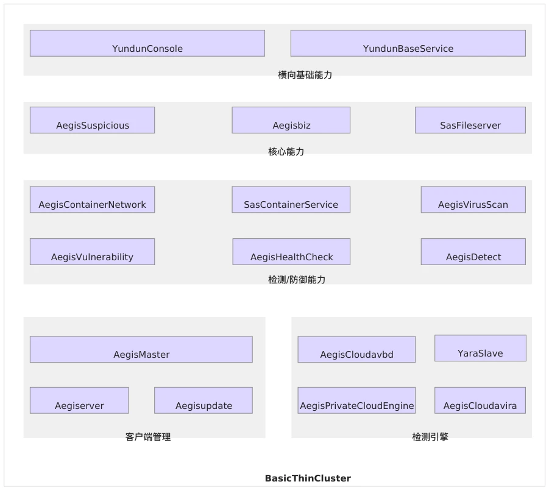

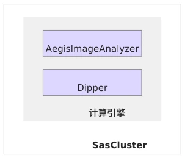

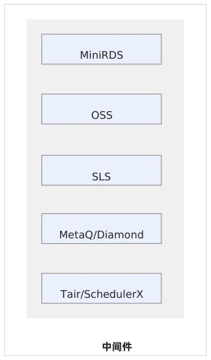

**服务端**

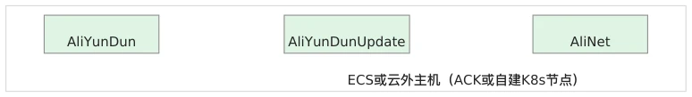

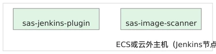

**客户**

ECS或云外主机（Jenkins节点）

**端**

**V3.18.2版本 -- V3.18.6(2512通用)版本**

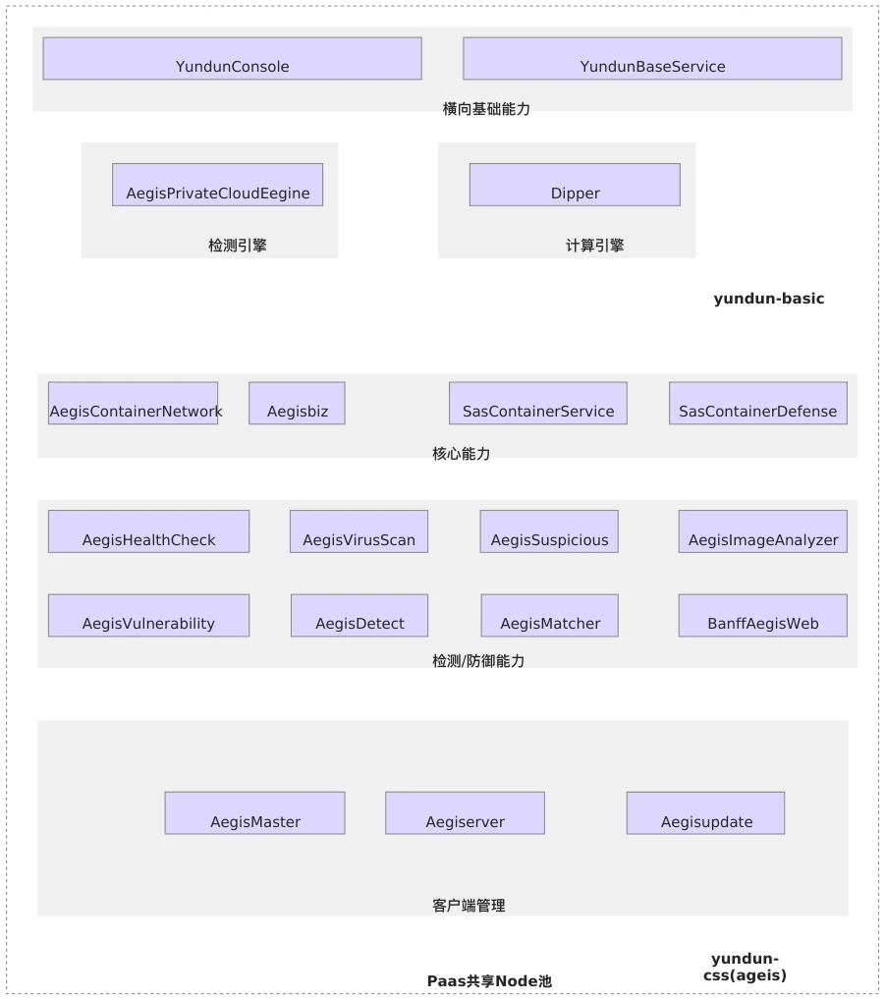

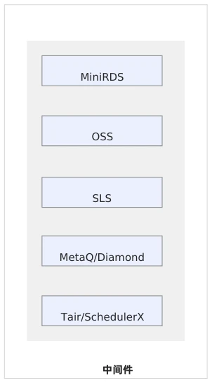

**服务端**

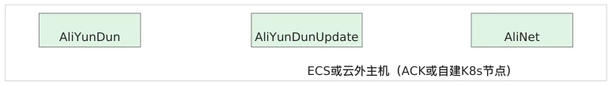

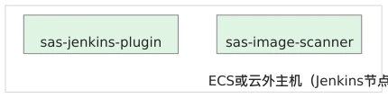

**客户**

ECS或云外主机（Jenkins节点）

**端**

**V3.19版本 -- V3.18.6(2512limit)版本**

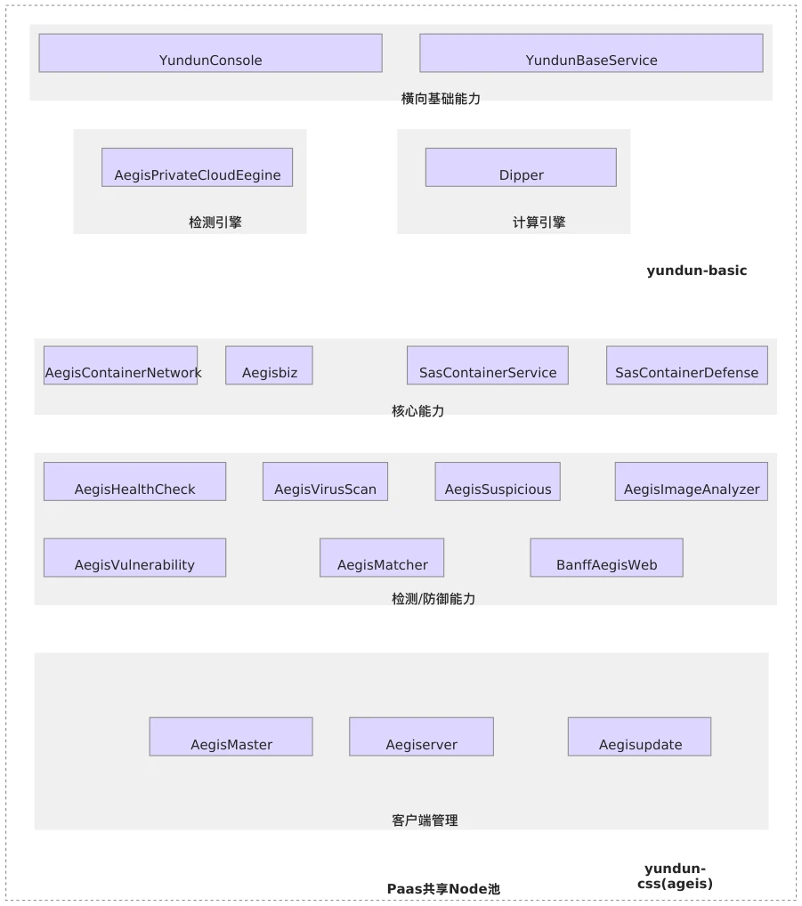

**服务端**

**客户**

ECS或云外主机（Jenkins节点）

**端**

**V3.18.6(2512limit)之后版本**

**服务端**

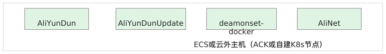

**客户**

ECS或云外主机（Jenkins节点）

**端**

容器安全，复用安骑士检测能力，包括服务端、客户端两大模块。

服务端：负责将云内、云外的容器集群和镜像资产纳入到容器安全管理范围，并提供检测、防御等核心能力。

客户端：负责实时上报容器集群运行状态，以及容器运行节点运行状态，提供运行检测、网络阻断防护能力。

**服务端**

服务端主要分成以下几个模块：

- 横向基础能力：云盾通用能力，提供控制台和OpenAPI。

- 核心能力：包括资产管理、安全告警、文件采集等。

- 检测防御：包括漏洞、基线、文件、网络、进程的检测防御能力。

- 检测引擎：包括商业病毒检测引擎、阿里自研病毒检测引擎、大数据计算引擎。

- 客户端管理：负责管理客户端连接、容器集群状态更新、配置规则下发等。

服务端每个应用的具体职责：

| 模块 | 职责 |
| --- | --- |
| YundunConsole | 控制台，为安全管理员提供了统一的管理界面。 |
| YundunBaseService | API网关，将主机安全能力开放给第三方开发者。 |
| AegisSuspicious | 入侵告警事件、应用白名单。 |
| Aegisbiz | 管理云内、云外的容器集群和镜像的资产。 |
| SasFileserver | 文件采集。 |
| AegisContainerNetwork（AegisMet aData） | 网络可视化、容器防火墙。 |
| SasContainerService（NewSas） | 镜像插件扫描服务。 |
| SasContainerDefence（NewSas） | 容器主动防御服务。 |
| AegisHealthCheck | 主机基线检查。 |
| AegisVirusScan | 文件检测。 |
| AegisDetect | 旧版文件检测，当前仅保留文件白名单管理，其他流程全部迁移到AegisVirusScan。 |
| AegisDefence | 防篡改。 |
| AegisVulnerability | 漏洞检测。 |
| AegisPrivateCloudEngine | GLE引擎是阿里自研病毒检测引擎。 |
| AegisMaster | 客户端配置、插件管理。 |
| Aegiserver | 客户端连接管理、配置下发、消息转发等。 |
| Aegisupdate | 客户单升级、规则/脚本/补丁等文件拉取。 |
| YaraSlave | Yara二进制检测引擎，商业病毒检测引擎。 |
| AegisCloudavira | 小红伞二进制引擎，商业病毒检测引擎。 |
| AegisCloudavbd | BD二进制检测引擎，商业病毒检测引擎。 |
| AegisImageAnalyzer | 镜像扫描。 |
| Dipper | 大数据计算引擎，入侵检测。 |

**客户端**

客户端包括以下模块。

| 名称 | 说明 |
| --- | --- |
| SasJenkinsPlugin | 镜像扫描Jenkins插件，负责拉起SasImageScanner容器。 |
| SasImageScanner | 负责运行镜像扫描功能的容器进程。 |
| AliYunDun | 核心进程，用于与云安全中心服务器建立连接。 |
| AliYunDunUpdate | 核心进程，用于定期检测云安全中心Agent是否需要升级。 |
| AliNet | 容器防护墙进程。 |

> **说明**
>
> 客户端支持的操作系统
>
> AliNet支持操作系统

### 1.1.2. 核心模块

#### 1.1.2.1. 资产管理

通过容器安全资产中心，可以全盘展示纳入管理的容器集群、镜像等资产的安全防护状态。

**支持的资产类型**

云内资产：ACK（容器服务kubernetes）、ACR（容器镜像服务）

云外资产：自建kubernetes，quay镜像仓库，harbor镜像仓库，Jenkins构建镜像

**核心流程**

**资产同步**

- 通过openapi获取ACK、ACR数据。

- 自建k8s接入：

  - V3.18.6-2512-limit版本及之前版本，通过方向访问获取自建k8s、自建镜像仓数据。

  - V3.18.6-2512-limit之后版本，通过镜像托管集群方式，将自建集群master节点执行yaml，通过客户端上报的方式获取集群信息。

- 容器集群资产结合客户端上报的容器变更消息，实时更新容器状态。

**V3.18.6-2512-limit版本及之前版本核心流程**

自建镜像仓

1. 通过webhook通知镜像资产变更

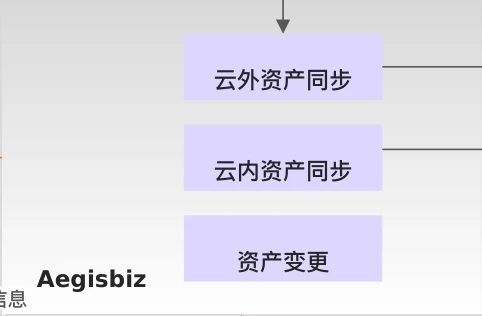

1. 通过反向访问同步资产

   自建K8S api自建镜像仓

   api

3. 广播容器资产变更信息

   1. 调用OpenAPI同步ACK

**服**

2. 转发容器变更信息

**务端**

ACK管控ACK管控

其他应用

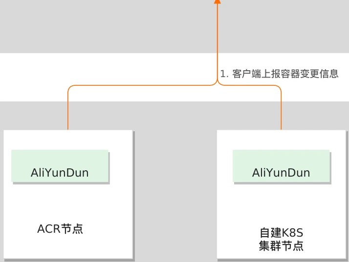

**客户端**

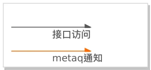

**V3.18.6-2512-limit之后版本核心流程**

自建镜像仓

1. 通过webhook通知镜像资产变更

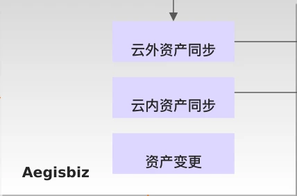

1. 配置镜像托管集群接入

   镜像托管集群接入信息

   1. 调用OpenAPI同步ACK资产

**服**

3. 广播容器资产变更信息

   2. 转发容器变更信息

**务端**

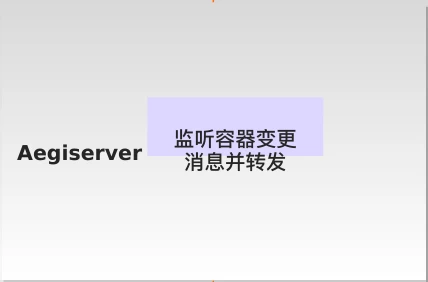

ACK管控ACK管控

其他应用

2. 在master节点执

1. 客户端上报容器变更信息

AliYunDun

AliYunDun

**客户端**

ACR节点

自建K8S集群节点

接口访问

metaq通知

**云外资产接入流程**

- 通过反向访问，容器安全服务端可以从管控区访问用户VPC网络请求镜像仓库api、k8s apiServer。

- 用户IDC场景通过并网方式，也可能将云外资产纳入容器安全管理。

  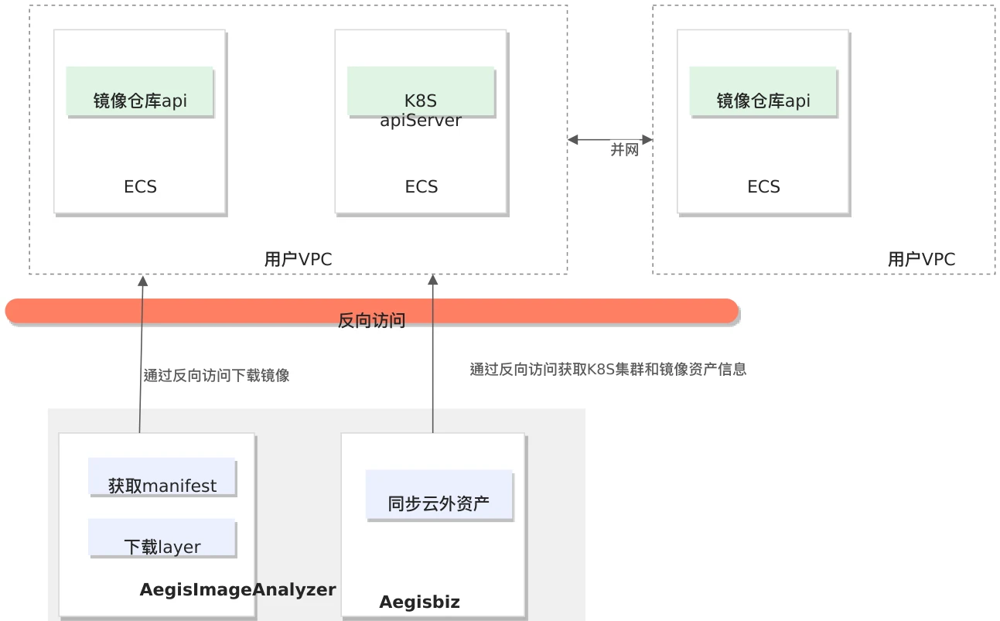

管控区

**容器网络拓扑核心流程**

容器的网络日志会被打标成in和out流量，结合网络链路日志，经过dipper处理，容器间东西流量、公网和容器间的南北流量会被保留，并在拓扑图中呈现。

- 东西向流量：in和out日志时间间隔在特定范围，且两份日志的五元组（源ip、源端口、目标ip、目标端口）完全匹配。

- 南北向流量：in和out日志时间间隔在特定范围，且源ip或者目标ip有其一可追溯到公网ip

- 匹配时间间隔范围：精准匹配是60秒，service mode是10秒。

  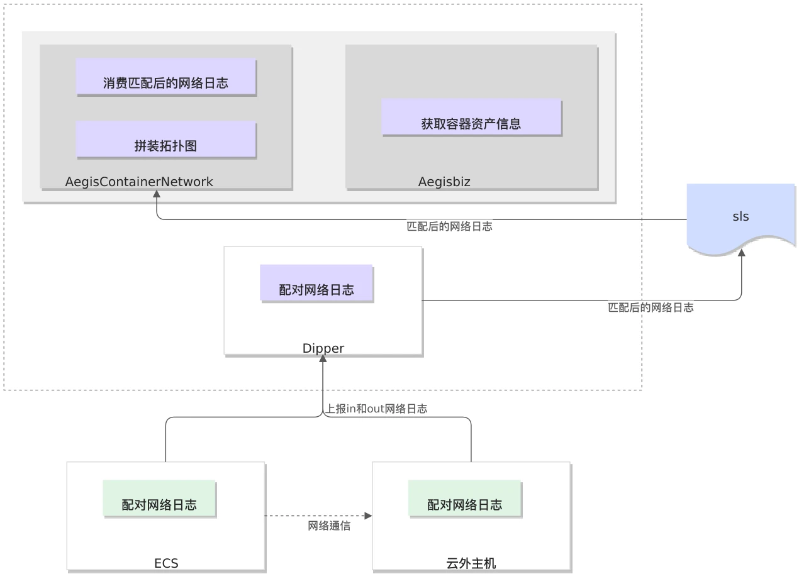

  **服务端**

  **客户端**

#### 1.1.2.2. 容器防火墙

容器防火墙是容器安全为容器环境提供的防火墙服务，是容器安全运行时防护的核心功能。结合容器网络可视化，配置合理的隔离规则，当黑客利用漏洞或恶意镜像入侵容器集群时，容器防火墙会对异常行为进行告警或拦截，可以将风险控制在小范围内，避免整个容器环境被入侵。

**网络对象说明**

相较于主机，容器、pod的生存周期是短暂的且会在不同节点间漂移，无法依赖固定的ip、port来配置规则，因此防火墙的隔离规则需要定义额外的网络对象。

用户的隔离规则是要配置在IP,DNS或者容器的pod，namespace，镜像，标签。IP、DNS，容器实例启动时需要实时的匹配对应的镜像、标签间的隔离规则。

**对象类型**

**属性名**

**说明**

**备注**

标签：kubernetes.io/metadata.name: <命名

集群所内定义的命名空间

命名空间

空间>

本质为自定义标签app: <应用名称>，ack默认会

各个应用内定义的标签

应用名称

打上app:标。，自建k8s需要自行定义标签，否则

（app）

在定义网络对象时会选择不到对应的应用

容器

镜像

镜像名

标签

自定义标签

多个ip或者CIDR网段请用英文逗号隔开，最多支

IP

IP

持50个IP或者网段

配置的域名通过DNS解析为IP（最多500个），

DNS域名

DNS域名

并对这些IP实施访问控制。

**核心流程**

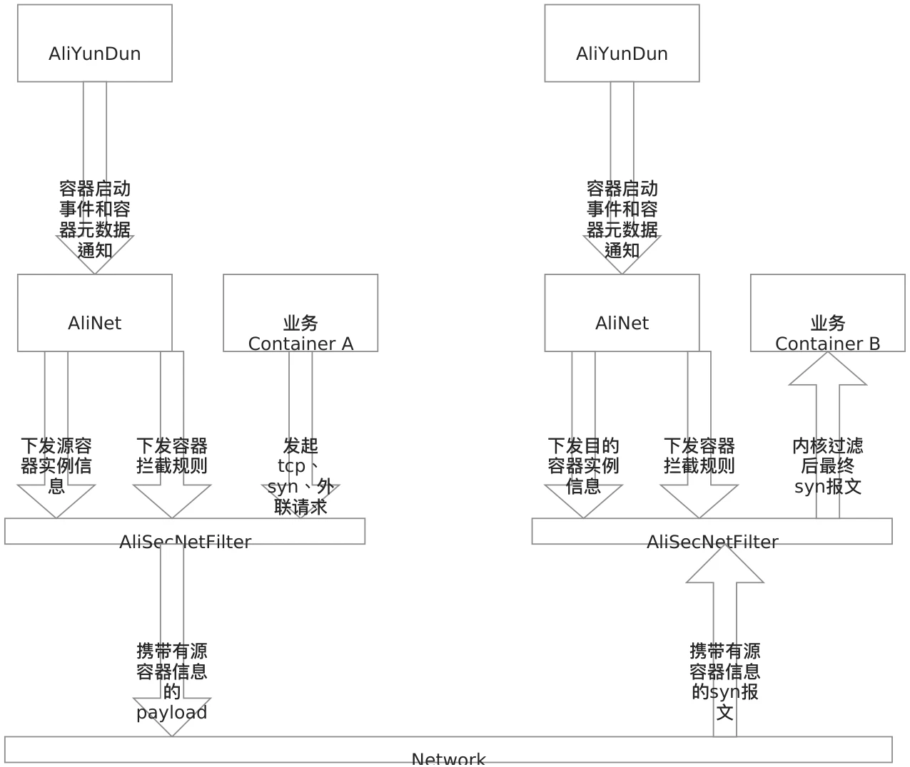

Network

1. 配置防火墙规则：容器防火墙下发配置和拦截功能完全依赖alinet插件，开启容器防火墙功能前会对alinet插件状态进行校验，如未安装，或者alinet插件心跳异常将无法开启容器防火墙功能。

2. 下发防火墙规则：aliNet插件会记录当前节点容器状态和元数据，并接受记录服务端下发的防火墙规则。

3. 网络流量放行、告警、拦截：aliNet中子插件aliSecNetFilter会根据记录的容器元数据和防火墙规则，对命中的规则的流量进行放行、告警、拦截。

#### 1.1.2.3. 镜像扫描

镜像安全扫描功能支持对镜像中存在的高中危系统漏洞、应用漏洞、恶意样本、配置风险进行检测。

**支持扫描镜像类型**

云内镜像类型：defaultACR，企业版ACR

云外镜像类型：quay，harbor，jenkins构建的镜像

**支持扫描风险内容**

<strong>漏洞：</strong>系统漏洞（cve），应用漏洞（sca）

**基线：**

- 身份鉴别

  - 确保不存在重复的用户名或UID

  - 确保不存在相同密码Hash的账户

  - 确保系统不存在空密码账户

  - 确保使用强密码哈希算法

  - 确保root是唯一UID为0的帐户

  - 确保不存在重复用户组或GID

- 未授权访问

  - CouchDB未授权访问配置风险

  - ES未授权访问配置风险

  - Postgresql未授权访问配置风险

  - Jenkins未授权访问配置风险

  - Hadoop未授权访问配置风险

- 弱口令

  - tomcat弱口令配置

  - redis弱口令配置

  - rsync弱口令配置

  - svn弱口令配置

- 服务配置

  - 确保未安装openssh服务

<strong>恶意样本：</strong>webshell、二进制文件（木马、勒索病毒、挖矿病毒、后门程序等）

**扫描流程**

**周期任务镜像扫描**

通过镜像扫描设置，可以在指定周期内对指定的镜像仓库镜像扫描。

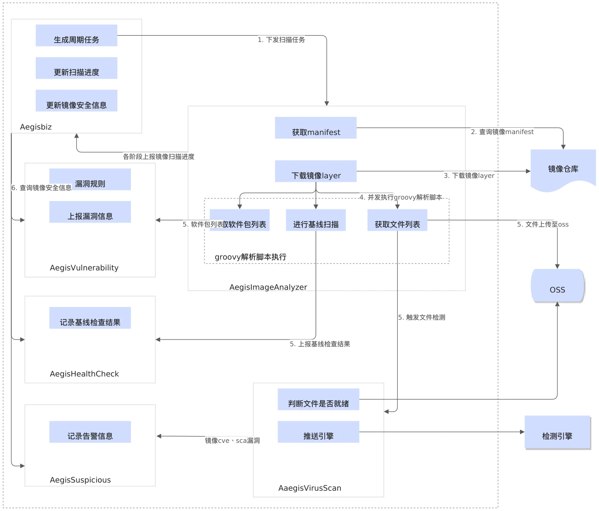

**webhook镜像扫描**

acr镜像、自建镜像仓可以通过webhook的方式上报镜像变更，同时会创建单次周期的镜像扫描任务，并立即执行任务进行镜像扫描。

**Jenkins插件镜像扫描**

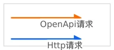

Http请求

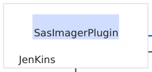

1. 下载SasImageScanner镜像

   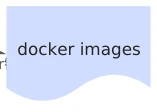

   2. 加载SasImageScanner镜像

   3. 启动镜像扫描容器

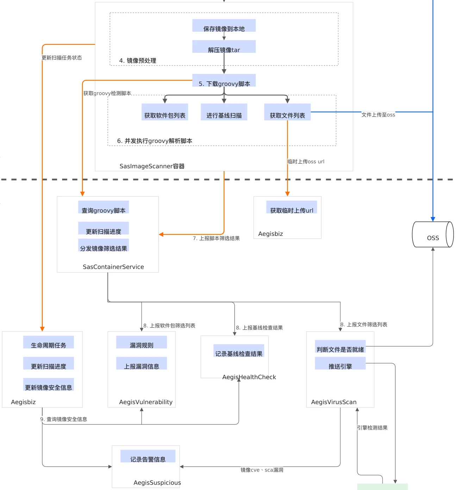

客户端

服务端

检测引擎

#### 1.1.2.4. 集群防御

**容器文件防御**

该功能属于容器防护的基础服务，要求集群已接入容器安全、操作系统及内核版本在支持范围内。用户可通过创建文件防御规则，指定需防护的路径、包含/排除的文件类型、执行动作（告警或拦截）以及白名单进程等配置，实现精细化的文件级防护。容器文件防御流程图如下：

容器防篡改架构

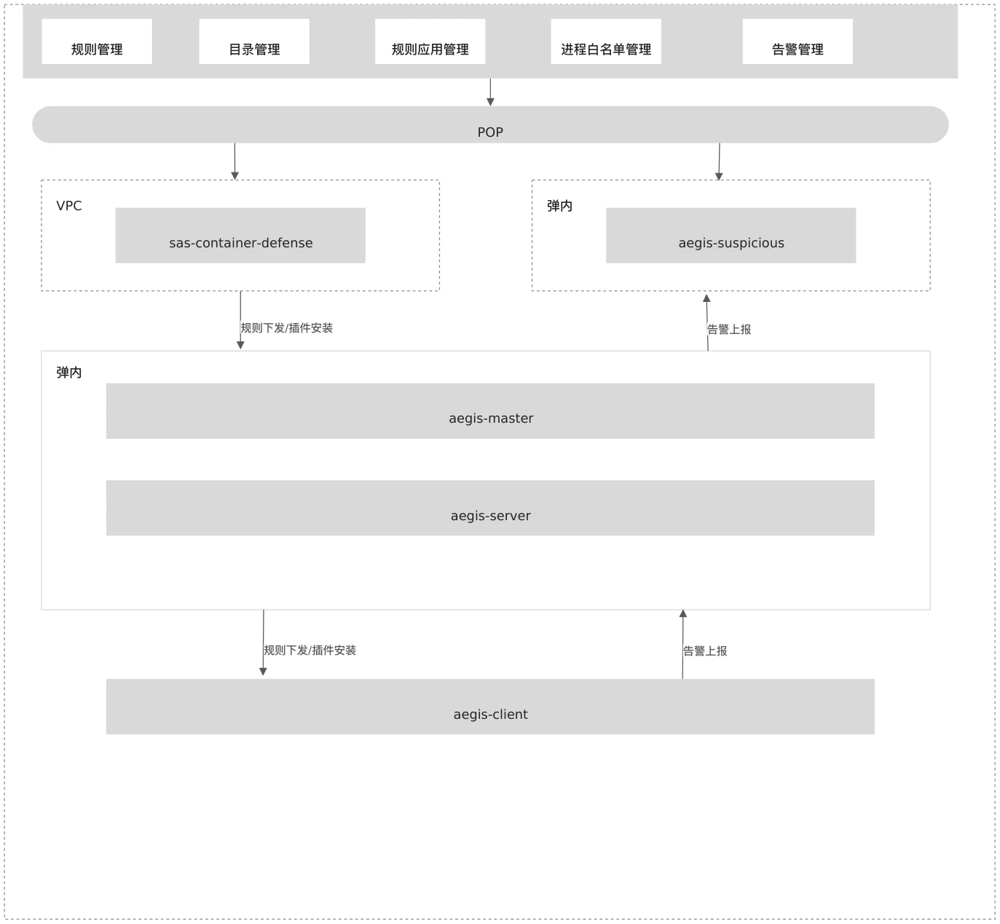

**容器主动防御**

该功能从镜像自身安全、运行时安全、运行环境安全多维度主动检测容器启动或运行时存在的安全风险。通过配置相应规则，您可以拦截风险镜像运行、停止不可信进程和阻断容器逃逸行为，提升整体容器运行环境的安全水位。本文介绍如何配置风险镜像阻断、非镜像程序防御和容器防逃逸规则。

| 规则类型 | 规则说明 | 备注 |
| --- | --- | --- |
| 风险镜像阻断 | 创建<strong>风险镜像阻断</strong>规则后，在指定集群内使用镜像创建资源时，容器安全会对镜像进行安全校验，对命中风险镜像阻断规则的镜像执行拦截、告警或放行动作，确保集群内启动的镜像符合您的安全要求。 | 仅支持容器服务 Kubernetes 版ACK（Container Service for Kubernetes）的部分集群类型。 |
| 非镜像程序防御 | 创建<strong>非镜像程序防御</strong>规则后，容器安全可检测并拦截镜像外的程序启动，主动防御恶意软件的入侵，帮助您防御已知或未知的攻击模式。 | • 容器中安骑士客户端进程AliYunDun ≥ aegis_12_13，AliHips ≥ 00_43。 • 对于白名单规则中容器镜像，还需确保对应容器镜像名称的长度不超过287个字符。 • 容器中运行程序的完整路径长度不超过1023个字符。 • 容器集群的命名空间长度不超过287个字符。 |
| 容器防逃逸 | <strong>容器防逃逸</strong>功能可以从进程、文件、系统调用等多种维度检测高风险行为，在容器与宿主机之间建立防护屏障，有效阻断逃逸行为保障容器运行时安全。该功能可拦截攻击者利用容器漏洞逃逸到宿主服务器上的攻击，有助于提升服务器系统的安全性。 | 集群所在服务器已接入到容器安全。 |

**风险镜像阻断流程图**

创建规则

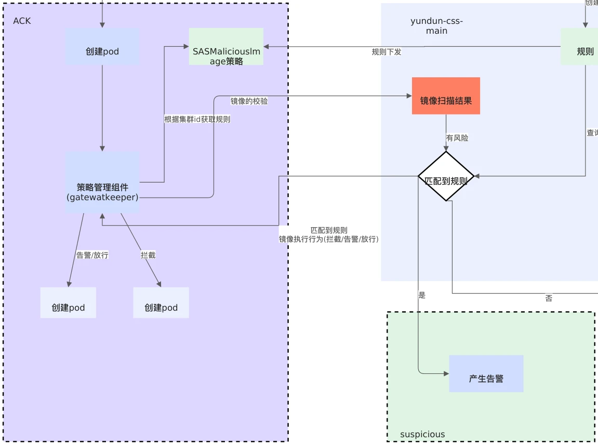

查询规则

**非镜像程序防御流程图**

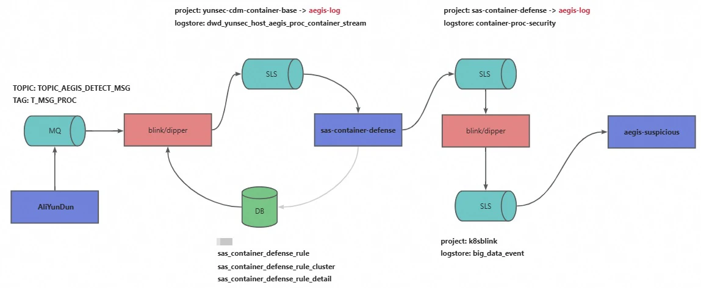

**容器防逃逸流程图**

6. 危险容器部署

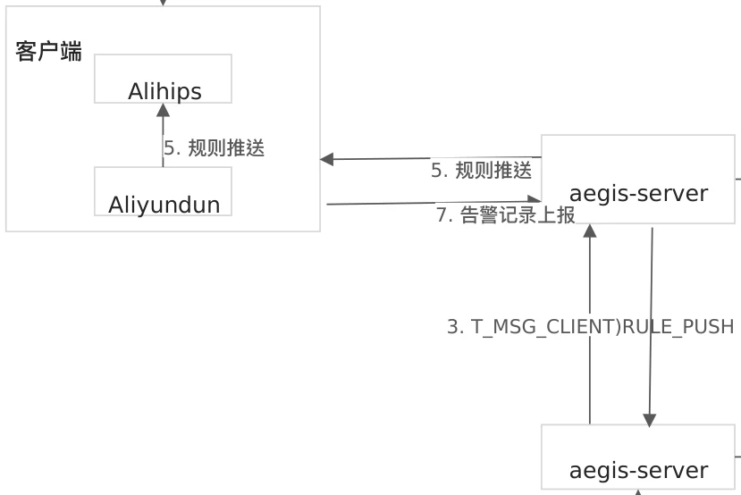

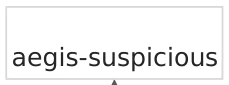

8. T_MSG_PLUGIN_EV

1. T_MSG_PLUGIN_HEARTS

2. 组装需要下发的规则

**容器签名**

容器签名可实现对容器镜像的可信签名，确保只允许部署您认可的容器镜像，防止未经签名授权的镜像启动，从根本上帮助您提升资产的安全性。

该功能基于非对称加密算法（需使用KMS创建密钥类型为 RSA_2048、用途为 SIGN/VERIFY 的密钥），通过在容器安全配置 **证明者** 和 **安全策略** ，将签名验证能力与ACK集群集成。当启用策略后，只有携带有效签名的镜像才能在指定命名空间中部署，未签名或验签失败的镜像将被拦截。流程图如下：

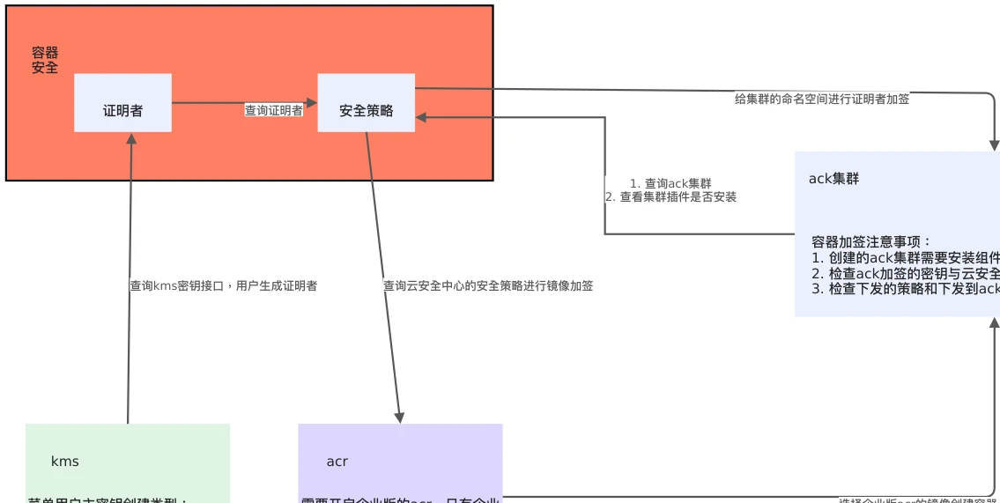

1. 创建的ack集群需要安装组件kritis-validation-hook

2. 检查ack加签的密钥与云安全中心的证明者使用同一个密钥

3. 检查下发的策略和下发到ack的namespace是否正确

菜单用户主密钥创建类型：

需要开启企业版的acr，只有企业

选择企业版acr的镜像创建容器

版的acr具备镜像加签功能

RSA_2048秘钥用途：SIGN/VERIFY的密钥

## 1.2. 高可靠性

**服务端高可用**

> **说明**
>
> 设计原则：无状态应用

容器安全服务端全部是无状态应用，通过VIP+Dubbo实现负载均衡保证服务可用性。

- 服务端本身是无状态的，部署在至少两台物理机上，只要有一台物理机正常运行即可保证可用性。

- 数据存储在MiniRDS、SLS、OSS、Tair、Diamond、MetaQ等中间件或云服务上，存储高可用性由中间件或云服务保证。

- 对外提供HTTPS协议的OpenAPI，通过DNS+VIP实现负载均衡，以保证可用性。

- 服务内部调用依赖Dubbo框架，由Dubbo的软负载保证可用性。

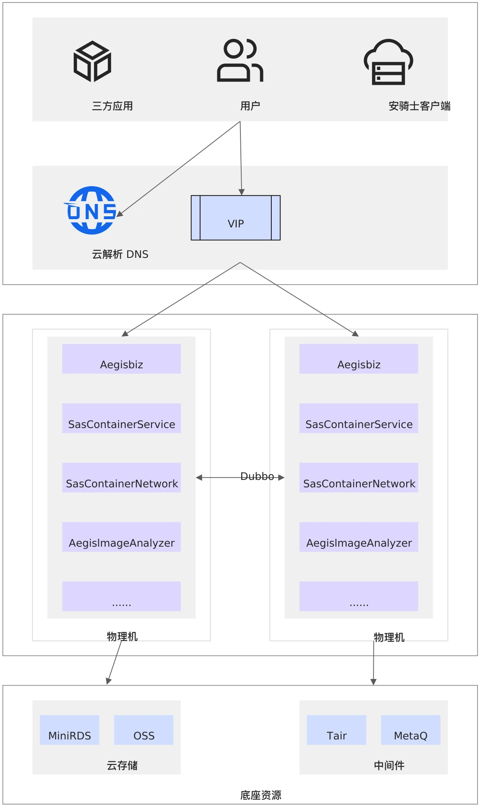

## 1.3. 容灾备份

**同城容灾**

> **说明**
>
> 设计原则：业务双活。

容器安全同城容灾架构遵循双活原则，数据由云存储或中间件自身保证容灾。

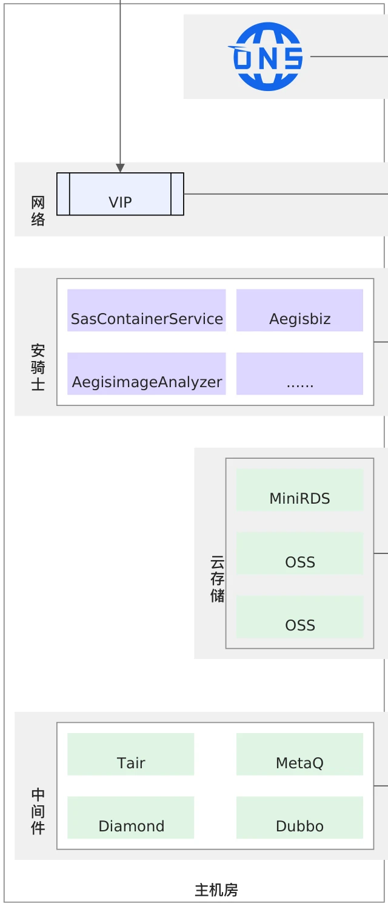

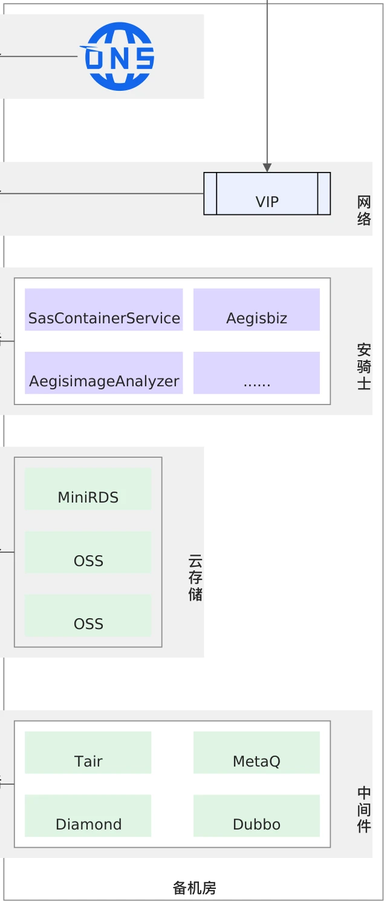

主备

主备

双活

主备

双活

各组件同城容灾实现方案介绍：

| 组件 | 方案 |
| --- | --- |
| 容器安全 | 双活部署，依赖中间件及云存储保证数据一致。 |
| DNS | 通过Anycast VIP实现主备机房流量隔离。 |
| VIP | 通过BGP路由实现主备切换。 |
| MiniRDS | 主从库binlog复制。 |
| SLS | 基于OSS备份实现数据同步。 |
| OSS | 主备机房数据同步。 |
| 中间件 | 双活部署，依赖MiniRDS保证数据一致。 |

**异地灾备**

> **说明**
>
> 设计原则：Region间相互独立。

容器安全多Region架构遵循独立原则，单元Region对中心Region无任何依赖，数据及服务保证完全隔离。

## 1.4. 监控告警

**系统监控指标**

容器安全系统监控均已接入TianjiMon。

> **重要**
>
> 注意：3.17.1之前版本还未开启告警。

各应用具体监控指标如下：

**aegisbiz应用**

监控指标（TianjiMon指标名称）

监控名称

监控描述

告警阈值

告警描述

CPU使用率（单

aegisbiz_cpu_container_host

机）

连续次数：3次

CPU使用率（服务

aegisbiz_cpu_container_serv

角色）

errole

沉默时长：

util_avg >

CPU使用率

95

300s

探测间隔：

CPU使用率（集

aegisbiz_cpu_container_clust

60s

群）

er aegisbiz_memo_container_ho

内存（单机）

st

连续次数：3次

内存使用率最大值和平

沉默时长：

aegisbiz_memo_container_se

util_avg >

内存（服务角色）

均值

rverrole

90

300s

探测间隔：60s

aegisbiz_memo_container_cl

内存（集群）

uster

aegisbiz_load_container_host

负载（单机）

连续次数：3次

CPU 负载最大值和平均

aegisbiz_load_container_serv

负载（服务角色）

值

沉默时长：

load1_av

errole

（load1，load5，load

g > 1

300s

15）

探测间隔：60s

aegisbiz_load_container_clus

负载（集群）

ter

aegisbiz_tcp_conns_containe

tcp连接数（单机）

r_host

tcp连接数（服务角

tcp连接的最大值和平均

aegisbiz_tcp_conns_containe

暂无

暂无

色）

值

r_serverrole

aegisbiz_tcp_conns_containe

tcp连接数（集群）

r_cluster

NTP（单机）

aegisbiz_ntp_container_host

aegisbiz_ntp_container_serve

NTP（服务角色）

暂无

暂无

rrole

NTP

aegisbiz_ntp_container_clust

NTP（集群）

er

aegisbiz_process_count_cont

进程数（单机）

ainer_host

连续次数：3次

进程数（服务角

aegisbiz_process_count_cont

process_n

进程数的最大值和平均

沉默时长：

色）

ainer_cluster

umber_m

值

300s

ax > 100

探测间隔：

aegisbiz_process_count_cont

60s

进程数（集群）

ainer_host

<table>
  <tr>
    <td>aegisbiz_nginx_container_ho st</td>
    <td>nginx QPS（单机）</td>
    <td rowspan="3">nginx请求的QPS</td>
    <td rowspan="3">暂无</td>
    <td rowspan="3">暂无</td>
  </tr>
  <tr>
    <td>aegisbiz_nginx_container_ser verrole</td>
    <td>nginx QPS（服务角色）</td>
  </tr>
  <tr>
    <td>aegisbiz_nginx_container_clu ster</td>
    <td>nginx QPS（集群）</td>
  </tr>
  <tr>
    <td>aegisbiz_health_container_ho st</td>
    <td>健康检查（单机）</td>
    <td rowspan="3">应用使用启动是否正常</td>
    <td rowspan="3">health &gt; 0</td>
    <td rowspan="3">连续次数：3次沉默时长：300s 探测间隔：60s</td>
  </tr>
  <tr>
    <td>aegisbiz_health_container_se rverrole</td>
    <td>健康检查（服务角色）</td>
  </tr>
  <tr>
    <td>aegisbiz_health_container_cl uster</td>
    <td>健康检查（集群）</td>
  </tr>
</table>

**aegis-metadata应用**

监控指标（TianjiMon指标名称）

监控名称

监控描述

告警阈值

告警描述

CPU使用率（单

aegismetadata_cpu_containe

机）

r_host

连续次数：3次

CPU使用率（服务

沉默时长：

aegismetadata_cpu_containe

util_avg >

CPU使用率

角色）

r_serverrole

95

300s

探测间隔：60s

CPU使用率（集

aegismetadata_cpu_containe

群）

r_cluster

aegismetadata_memo_contai

内存（单机）

ner_host

aegismetadata_memo_contai

内存（服务角色）

ner_serverrole

连续次数：3次

内存使用率最大值和平

沉默时长：

util_avg >

均值

90

300s

aegismetadata_memo_contai

内存（集群）

探测间隔：

ner_cluster

60s

aegismetadata_load_contain

负载（单机）

er_host

连续次数：3次

CPU 负载最大值和平均值

沉默时长：

aegismetadata_load_contain

load1_av

负载（服务角色）

（load1，load5，load

er_serverrole

g > 1

300s

15）

探测间隔：60s

aegismetadata_load_contain

负载（集群）

er_cluster

aegismetadata_tcp_conns_co

tcp连接数（单机）

ntainer_host

tcp连接数（服务角

tcp连接的最大值和平均

aegismetadata_tcp_conns_co

暂无

暂无

色）

值

ntainer_serverrole

aegismetadata_tcp_conns_co

tcp连接数（集群）

ntainer_cluster

aegismetadata_ntp_containe

NTP（单机）

r_host

aegismetadata_ntp_containe

NTP（服务角色）

暂无

暂无

NTP

r_serverrole

aegismetadata_ntp_containe

NTP（集群）

r_cluster

aegismetadata_process_coun

进程数（单机）

t_container_host

连续次数：3次

process_n

进程数（服务角

进程数的最大值和平均

沉默时长：

aegismetadata_process_coun

umber_m

色）

值

t_container_cluster

300s

ax > 100

探测间隔：60s

aegismetadata_process_coun

进程数（集群）

t_container_host

nginx QPS（单

aegismetadata_nginx_contai

机）

ner_host

nginx QPS（服务

aegismetadata_nginx_contai

nginx请求的QPS

暂无

暂无

角色）

ner_serverrole

nginx QPS（集

aegismetadata_nginx_contai

群）

ner_cluster

<table>
  <tr>
    <td>aegismetadata_health_contai ner_host</td>
    <td>健康检查（单机）</td>
    <td rowspan="3">应用使用启动是否正常</td>
    <td rowspan="3">health &gt; 0</td>
    <td rowspan="3">连续次数：3次沉默时长：300s 探测间隔：60s</td>
  </tr>
  <tr>
    <td>aegismetadata_health_contai ner_serverrole</td>
    <td>健康检查（服务角色）</td>
  </tr>
  <tr>
    <td>aegismetadata_health_contai ner_cluster</td>
    <td>健康检查（集群）</td>
  </tr>
</table>

**aegisContainerNetWork应用**

| 监控指标（TianjiMon指标名称） | 监控名称 | 监控描述 | 告警阈值 |
| --- | --- | --- | --- |
| tjmon_aegismetadata_memo_conta iner_host | 内存（单机） | CPU使用率 | util_avg &gt; 90 |
| tjmon_aegismetadata_load_contain er_host | 负载（单机） | CPU 负载最大值和平均值（load1，load5，load 15） | load1_avg &gt; 2 |
| tjmon_aegismetadata_process_cou nt_container_host | 进程数（单机） | 进程数的最大值 | process_nu mber_max&gt; 100 |
| tjmon_aegismetadata_health_conta iner_host | 健康检查（单机） | 应用使用启动是否正常 | health&gt;0 |
| tjmon_aegismetadata_exception_al arm | 异常告警（单机） | 错误告警上报 | level=="ER ROR" |
| tjmon_aegiscontainer_oom_host | 内存溢出告警（单机） | 内存溢出告警 | oom_status_sum&gt;0 |

**aegis-image-analyzer应用**

监控指标（TianjiMon指标名称）

监控名称

监控描述

告警阈值

告警描述

CPU使用率（单

aegisimageanalyzer_cpu_con

机）

tainer_host

连续次数：3次

CPU使用率（服务

aegisimageanalyzer_cpu_con

util_avg >

角色）

沉默时长：

tainer_serverrole

95

CPU使用率

300s探测间隔：60s

CPU使用率（集

aegisimageanalyzer_cpu_con

群）

tainer_cluster

aegisimageanalyzer_memo_c

内存（单机）

ontainer_host

连续次数：3次

内存使用率最大值和平

沉默时长：

aegisimageanalyzer_memo_c

util_avg >

内存（服务角色）

均值

ontainer_serverrole

90

300s

探测间隔：60s

aegisimageanalyzer_memo_c

内存（集群）

ontainer_cluster

aegisimageanalyzer_load_co

负载（单机）

ntainer_host

连续次数：3次

CPU 负载最大值和平均值

沉默时长：

aegisimageanalyzer_load_co

load1_av

负载（服务角色）

（load1，load5，load

ntainer_serverrole

g > 1

300s

15）

探测间隔：60s

aegisimageanalyzer_load_co

负载（集群）

ntainer_cluster

aegisimageanalyzer_tcp_con

tcp连接数（单机）

ns_container_host

tcp连接数（服务角

tcp连接的最大值和平均

aegisimageanalyzer_tcp_con

暂无

暂无

色）

值

ns_container_serverrole

aegisimageanalyzer_tcp_con

tcp连接数（集群）

ns_container_cluster

aegisimageanalyzer_ntp_con

NTP（单机）

tainer_host

aegisimageanalyzer_ntp_con

NTP（服务角色）

tainer_serverrole

aegisimageanalyzer_ntp_con

NTP（集群）

NTP

暂无

暂无

tainer_cluster

<table>
  <tr>
    <td>aegisimageanalyzer_process _count_container_host</td>
    <td>进程数（单机）</td>
    <td rowspan="3">进程数的最大值和平均值</td>
    <td rowspan="3">process_n umber_m ax &gt; 100</td>
    <td rowspan="3">连续次数：3次沉默时长：300s 探测间隔：60s</td>
  </tr>
  <tr>
    <td>aegisimageanalyzer_process _count_container_cluster</td>
    <td>进程数（服务角色）</td>
  </tr>
  <tr>
    <td>aegisimageanalyzer_process _count_container_host</td>
    <td>进程数（集群）</td>
  </tr>
  <tr>
    <td>aegisimageanalyzer_nginx_c ontainer_host</td>
    <td>nginx QPS（单机）</td>
    <td rowspan="3">nginx请求的QPS</td>
    <td rowspan="3">暂无</td>
    <td rowspan="3">暂无</td>
  </tr>
  <tr>
    <td>aegisimageanalyzer_nginx_c ontainer_serverrole</td>
    <td>nginx QPS（服务角色）</td>
  </tr>
  <tr>
    <td>aegisimageanalyzer_nginx_c ontainer_cluster</td>
    <td>nginx QPS（集群）</td>
  </tr>
  <tr>
    <td>aegisimageanalyzer_health_c ontainer_host</td>
    <td>健康检查（单机）</td>
    <td rowspan="3">应用使用启动是否正常</td>
    <td rowspan="3">health &gt; 0</td>
    <td rowspan="3">连续次数：3次沉默时长：300s 探测间隔：60s</td>
  </tr>
  <tr>
    <td>aegisimageanalyzer_health_c ontainer_serverrole</td>
    <td>健康检查（服务角色）</td>
  </tr>
  <tr>
    <td>aegisimageanalyzer_health_c ontainer_cluster</td>
    <td>健康检查（集群）</td>
  </tr>
</table>

> **说明**
>
> 复用安骑士应用的系统监控，详见《安骑士运维指南》。

**业务监控指标**

容器安全系统监控基于TianjiMon实现，监控指标如下：

模块

名称

描述

节点数量

容器集群节点各维度数量统计

应用（app）数量

容器集群应用各维度数量统计

容器组（pod）数量

容器集群容器组各维度数量统计

容器资产

容器数量

容器集群容器各维度数量统计

镜像数量

镜像各维度数量统计

镜像扫描任务数

创建的镜像扫描任务数量

镜像扫描层数

被扫描的镜像层数量

镜像扫描结果数

镜像扫描结果的数量监控

镜像扫描

镜像预分析耗时

镜像扫描预分析各维度耗时

镜像分析耗时

镜像扫描分析各维度耗时

镜像分析（manifests）耗时

镜像扫描分析（manifests）各维度耗时

Jenkins规则拉取次数

Jenkins扫描镜像时拉取groovy规则次数

Jenkins规则拉取耗时

Jenkins扫描镜像时拉取groovy规则耗时

CICD

Jenkins扫描结果上报次数

Jenkins扫描镜像后上报结果次数

Jenkins扫描结果上报耗时

Jenkins扫描镜像后上报结果耗时

容器网络日志消费数

容器网络可视化dipper日志消费的消息数

容器防火墙

容器网络日志处理耗时

容器网络可视化dipper日志消费的耗时

容器防火墙拦截数

容器防火墙告警、拦截数量

容器Linux漏洞数量

容器Linux漏洞数量

容器运行时防护

容器应用漏洞数量

容器应用漏洞数量

容器告警事件数量

容器告警事件数量

## 1.5. 容量规划

容器安全基于可用区内NC的CPU Core的数量计算出规格。每增加12000容器core，BasicThinCluster需增加2台物理机（NC和ECS的比例按照1:6，500台NC对应3000台ECS，每个ecs平均规格为4core）。

安骑士最大规格只能支持到192000core，如超过上限需联系研发介入。

**资源规格定义**

| 安骑士规格 | BasicThinCluster | SasCluster | 计算公式（整朵云的机器预期cpu核数量） |
| --- | --- | --- | --- |
| small | 2 | 2 | 集群容器core number总和 &lt; 12000 |
| standard | 2~4 | 2~4 | 集群容器core number总和 &lt; 24000 |
| large | 4~8 | 4~8 | 集群容器core number总和 &lt; 48000 |
| xlarge | 8~16 | 8~16 | 集群容器core number总和 &lt; 96000 |
| 2xlarge | 16~32 | 16~32 | 集群容器core number总和 &lt; 192000 |

**MiniRDS资源规格定义**

x86数据库规格

<table>
  <tr>
    <th>容量规格</th>
    <th colspan="2">small</th>
    <th colspan="2">standard</th>
    <th colspan="2">large</th>
    <th colspan="2">xlarge</th>
    <th colspan="2">2xlarge</th>
  </tr>
  <tr>
    <td>数据库实例名称</td>
    <td>数据库规格</td>
    <td>磁盘(单位:G)</td>
    <td>数据库规格</td>
    <td>磁盘(单位:G)</td>
    <td>数据库规格</td>
    <td>磁盘(单位:G)</td>
    <td>数据库规格</td>
    <td>磁盘(单位:G)</td>
    <td>数据库规格</td>
    <td>磁盘(单位:G)</td>
  </tr>
  <tr>
    <td>aegis erver</td>
    <td>rds.m ys2.st andar d</td>
    <td>50</td>
    <td>rds.m ys2.st andar d</td>
    <td>50</td>
    <td>rds.m ys2.la rge</td>
    <td>100</td>
    <td>rds.m ys2.xl arge</td>
    <td>200</td>
    <td>rds.m ys2.2 xlarg e</td>
    <td>500</td>
  </tr>
  <tr>
    <td>healt hche ck</td>
    <td>rds.m ys2.la rge</td>
    <td>50</td>
    <td>rds.m ys2.la rge</td>
    <td>50</td>
    <td>rds.m ys2.xl arge</td>
    <td>200</td>
    <td>rds.m ys2.2 xlarg e</td>
    <td>500</td>
    <td>rds.m ys2.2 xlarg e</td>
    <td>500</td>
  </tr>
  <tr>
    <td>defe nder</td>
    <td>rds.m ys2.st andar d</td>
    <td>50</td>
    <td>rds.m ys2.st andar d</td>
    <td>50</td>
    <td>rds.m ys2.la rge</td>
    <td>100</td>
    <td>rds.m ys2.xl arge</td>
    <td>200</td>
    <td>rds.m ys2.xl arge</td>
    <td>200</td>
  </tr>
  <tr>
    <td>aegis vul</td>
    <td>rds.m ys2.la rge</td>
    <td>50</td>
    <td>rds.m ys2.la rge</td>
    <td>50</td>
    <td>rds.m ys2.xl arge</td>
    <td>200</td>
    <td>rds.m ys2.2 xlarg e</td>
    <td>500</td>
    <td>rds.m ys2.2 xlarg e</td>
    <td>500</td>
  </tr>
  <tr>
    <td>mord or</td>
    <td>rds.m ys2.st andar d</td>
    <td>50</td>
    <td>rds.m ys2.st andar d</td>
    <td>50</td>
    <td>rds.m ys2.la rge</td>
    <td>100</td>
    <td>rds.m ys2.xl arge</td>
    <td>200</td>
    <td>rds.m ys2.xl arge</td>
    <td>200</td>
  </tr>
  <tr>
    <td>aegis biz</td>
    <td>rds.m ys2.st andar d</td>
    <td>50</td>
    <td>rds.m ys2.la rge</td>
    <td>100</td>
    <td>rds.m ys2.la rge</td>
    <td>100</td>
    <td>rds.m ys2.xl arge</td>
    <td>200</td>
    <td>rds.m ys2.2 xlarg e</td>
    <td>500</td>
  </tr>
  <tr>
    <td>aegis asset s</td>
    <td>rds.m ys2.la rge</td>
    <td>50</td>
    <td>rds.m ys2.la rge</td>
    <td>50</td>
    <td>rds.m ys2.xl arge</td>
    <td>200</td>
    <td>rds.m ys2.2 xlarg e</td>
    <td>500</td>
    <td>rds.m ys2.2 xlarg e</td>
    <td>500</td>
  </tr>
  <tr>
    <td>aegis dete ct</td>
    <td>rds.m ys2.st andar d</td>
    <td>50</td>
    <td>rds.m ys2.st andar d</td>
    <td>50</td>
    <td>rds.m ys2.la rge</td>
    <td>100</td>
    <td>rds.m ys2.la rge</td>
    <td>100</td>
    <td>rds.m ys2.xl arge</td>
    <td>200</td>
  </tr>
  <tr>
    <td>aegis mast er</td>
    <td>rds.m ys2.st andar d</td>
    <td>50</td>
    <td>rds.m ys2.la rge</td>
    <td>100</td>
    <td>rds.m ys2.xl arge</td>
    <td>200</td>
    <td>rds.m ys2.2 xlarg e</td>
    <td>500</td>
    <td>rds.m ys2.2 xlarg e</td>
    <td>500</td>
  </tr>
  <tr>
    <td>suspi cious</td>
    <td>rds.m ys2.la rge</td>
    <td>50</td>
    <td>rds.m ys2.la rge</td>
    <td>50</td>
    <td>rds.m ys2.xl arge</td>
    <td>200</td>
    <td>rds.m ys2.2 xlarg e</td>
    <td>500</td>
    <td>rds.m ys2.2 xlarg e</td>
    <td>500</td>
  </tr>
  <tr>
    <td>banff web</td>
    <td>rds.m ys2.st andar d</td>
    <td>50</td>
    <td>rds.m ys2.st andar d</td>
    <td>50</td>
    <td>rds.m ys2.la rge</td>
    <td>100</td>
    <td>rds.m ys2.la rge</td>
    <td>100</td>
    <td>rds.m ys2.xl arge</td>
    <td>200</td>
  </tr>
  <tr>
    <td>aegis virus scan</td>
    <td>rds.m ys2.la rge</td>
    <td>50</td>
    <td>rds.m ys2.la rge</td>
    <td>50</td>
    <td>rds.m ys2.xl arge</td>
    <td>200</td>
    <td>rds.m ys2.2 xlarg e</td>
    <td>500</td>
    <td>rds.m ys2.2 xlarg e</td>
    <td>500</td>
  </tr>
  <tr>
    <td>sasfil eserv er</td>
    <td>rds.m ys2.la rge</td>
    <td>50</td>
    <td>rds.m ys2.la rge</td>
    <td>50</td>
    <td>rds.m ys2.la rge</td>
    <td>50</td>
    <td>rds.m ys2.la rge</td>
    <td>50</td>
    <td>rds.m ys2.xl arge</td>
    <td>200</td>
  </tr>
  <tr>
    <td>aegis meta data</td>
    <td>rds.m ys2.st andar d</td>
    <td>50</td>
    <td>rds.m ys2.la rge</td>
    <td>100</td>
    <td>rds.m ys2.la rge</td>
    <td>100</td>
    <td>rds.m ys2.xl arge</td>
    <td>200</td>
    <td>rds.m ys2.2 xlarg e</td>
    <td>500</td>
  </tr>
  <tr>
    <td>basel ine</td>
    <td>rds.m ys2.st andar d</td>
    <td>50</td>
    <td>rds.m ys2.st andar d</td>
    <td>50</td>
    <td>rds.m ys2.la rge</td>
    <td>100</td>
    <td>rds.m ys2.xl arge</td>
    <td>200</td>
    <td>rds.m ys2.2 xlarg e</td>
    <td>500</td>
  </tr>
  <tr>
    <td>news as</td>
    <td>rds.m ys2.st andar d</td>
    <td>50</td>
    <td>rds.m ys2.st andar d</td>
    <td>50</td>
    <td>rds.m ys2.la rge</td>
    <td>100</td>
    <td>rds.m ys2.la rge</td>
    <td>100</td>
    <td>rds.m ys2.xl arge</td>
    <td>200</td>
  </tr>
  <tr>
    <td>aegis matc her</td>
    <td>rds.m ys2.la rge</td>
    <td>50</td>
    <td>rds.m ys2.la rge</td>
    <td>50</td>
    <td>rds.m ys2.la rge</td>
    <td>50</td>
    <td>rds.m ys2.xl arge</td>
    <td>200</td>
    <td>rds.m ys2.xl arge</td>
    <td>200</td>
  </tr>
  <tr>
    <td>aegis defe nce</td>
    <td>rds.m ys2.st andar d</td>
    <td>50</td>
    <td>rds.m ys2.st andar d</td>
    <td>50</td>
    <td>rds.m ys2.la rge</td>
    <td>100</td>
    <td>rds.m ys2.xl arge</td>
    <td>200</td>
    <td>rds.m ys2.xl arge</td>
    <td>200</td>
  </tr>
  <tr>
    <td>mag piebr idge db</td>
    <td>rds.m ys2.st andar d</td>
    <td>-</td>
    <td>rds.m ys2.st andar d</td>
    <td>-</td>
    <td>rds.m ys2.st andar d</td>
    <td>-</td>
    <td>rds.m ys2.la rge</td>
    <td>-</td>
    <td>rds.m ys2.la rge</td>
    <td>-</td>
  </tr>
  <tr>
    <td>yund unap i</td>
    <td>rds.m ys2.st andar d</td>
    <td>-</td>
    <td>rds.m ys2.st andar d</td>
    <td>-</td>
    <td>rds.m ys2.st andar d</td>
    <td>-</td>
    <td>rds.m ys2.la rge</td>
    <td>-</td>
    <td>rds.m ys2.la rge</td>
    <td>-</td>
  </tr>
  <tr>
    <td>yund unlu ban</td>
    <td>rds.m ys2.st andar d</td>
    <td>-</td>
    <td>rds.m ys2.st andar d</td>
    <td>-</td>
    <td>rds.m ys2.st andar d</td>
    <td>-</td>
    <td>rds.m ys2.la rge</td>
    <td>-</td>
    <td>rds.m ys2.la rge</td>
    <td>-</td>
  </tr>
  <tr>
    <td>data sync</td>
    <td>rds.m ys2.st andar d</td>
    <td>-</td>
    <td>rds.m ys2.st andar d</td>
    <td>-</td>
    <td>rds.m ys2.st andar d</td>
    <td>-</td>
    <td>rds.m ys2.la rge</td>
    <td>-</td>
    <td>rds.m ys2.la rge</td>
    <td>-</td>
  </tr>
</table>

arm/sw数据库规格

| 数据库实例名称 | small | standard | large | xlarge | 2xlarge |
| --- | --- | --- | --- | --- | --- |
| aegiserve r | rds.mysql.s1.s mall | rds.mysql.s1.s mall | rds.mysql.s2.l arge | rds.mysql.s3.l arge | rds.mysql.c1.la rge |
| healthch eck | rds.mysql.s1.s mall | rds.mysql.s2.la rge | rds.mysql.s3.l arge | rds.mysql.c1.l arge | rds.mysql.c1.la rge |
| defender | rds.mysql.s1.s mall | rds.mysql.s1.s mall | rds.mysql.s2.l arge | rds.mysql.s3.l arge | rds.mysql.s3.la rge |
| aegisvul | rds.mysql.s1.s mall | rds.mysql.s2.la rge | rds.mysql.s3.l arge | rds.mysql.c1.l arge | rds.mysql.c1.la rge |
| mordor | rds.mysql.s1.s mall | rds.mysql.s1.s mall | rds.mysql.s2.l arge | rds.mysql.s3.l arge | rds.mysql.s3.la rge |
| aegisbiz | rds.mysql.s1.s mall | rds.mysql.s2.la rge | rds.mysql.s2.l arge | rds.mysql.s3.l arge | rds.mysql.c1.la rge |
| aegisasse ts | rds.mysql.s1.s mall | rds.mysql.s2.la rge | rds.mysql.s3.l arge | rds.mysql.c1.l arge | rds.mysql.c1.la rge |
| aegisdete ct | rds.mysql.s1.s mall | rds.mysql.s1.s mall | rds.mysql.s2.l arge | rds.mysql.s2.l arge | rds.mysql.s3.la rge |
| aegismas ter | rds.mysql.s1.s mall | rds.mysql.s2.la rge | rds.mysql.s3.l arge | rds.mysql.c1.l arge | rds.mysql.c1.la rge |
| suspiciou s | rds.mysql.s1.s mall | rds.mysql.s2.la rge | rds.mysql.s3.l arge | rds.mysql.c1.l arge | rds.mysql.c1.la rge |
| banffweb | rds.mysql.s1.s mall | rds.mysql.s1.s mall | rds.mysql.s2.l arge | rds.mysql.s2.l arge | rds.mysql.s3.la rge |
| aegisviru sscan | rds.mysql.s1.s mall | rds.mysql.s2.la rge | rds.mysql.s3.l arge | rds.mysql.c1.l arge | rds.mysql.c1.la rge |
| sasfileser ver | rds.mysql.s1.s mall | rds.mysql.s1.s mall | rds.mysql.s2.l arge | rds.mysql.s2.l arge | rds.mysql.s3.la rge |
| aegismet adata | rds.mysql.s1.s mall | rds.mysql.s2.la rge | rds.mysql.s2.l arge | rds.mysql.s3.l arge | rds.mysql.c1.la rge |
| baseline | rds.mysql.s1.s mall | rds.mysql.s1.s mall | rds.mysql.s2.l arge | rds.mysql.s3.l arge | rds.mysql.c1.la rge |
| newsas | rds.mysql.s1.s mall | rds.mysql.s1.s mall | rds.mysql.s2.l arge | rds.mysql.s2.l arge | rds.mysql.s3.la rge |
| aegismat cher | rds.mysql.s1.s mall | rds.mysql.s1.s mall | rds.mysql.s2.l arge | rds.mysql.s3.l arge | rds.mysql.s3.la rge |
| aegisdefe nce | rds.mysql.s1.s mall | rds.mysql.s1.s mall | rds.mysql.s2.l arge | rds.mysql.s3.l arge | rds.mysql.s3.la rge |
| magpiebr idgedb | rds.mysql.s1.s mall | rds.mysql.s1.s mall | rds.mysql.s1.small | rds.mysql.s2.l arge | rds.mysql.s2.la rge |
| yunduna pi | rds.mysql.s1.s mall | rds.mysql.s1.s mall | rds.mysql.s1.small | rds.mysql.s2.l arge | rds.mysql.s2.la rge |
| yundunlu ban | rds.mysql.s1.s mall | rds.mysql.s1.s mall | rds.mysql.s1.small | rds.mysql.s2.l arge | rds.mysql.s2.la rge |
| datasync | rds.mysql.s1.s mall | rds.mysql.s1.s mall | rds.mysql.s1.small | rds.mysql.s2.l arge | rds.mysql.s2.la rge |

**Oss/Sls-inner资源容量规划**

<table>
  <tr>
    <th rowspan="2">规格</th>
    <th>集群容器core number总和</th>
    <th>OSS容量(GB)</th>
    <th>sls-Inner盘古磁盘总用（GB）</th>
  </tr>
  <tr>
    <td>计算公式：</td>
    <td>2GB/单台机器</td>
    <td>0.1GB/单台机器</td>
  </tr>
  <tr>
    <td>small</td>
    <td>12000</td>
    <td>7000</td>
    <td>350</td>
  </tr>
  <tr>
    <td>standar d</td>
    <td>24000</td>
    <td>14000</td>
    <td>700</td>
  </tr>
  <tr>
    <td>large</td>
    <td>48000</td>
    <td>28000</td>
    <td>1400</td>
  </tr>
  <tr>
    <td>xlarge</td>
    <td>96000</td>
    <td>56000</td>
    <td>2800</td>
  </tr>
  <tr>
    <td>2xlarge</td>
    <td>192000</td>
    <td>112000</td>
    <td>5600</td>
  </tr>
</table>

**Tair资源容量规划**

<table>
  <tr>
    <th rowspan="2">规格</th>
    <th>集群容器core num ber总和</th>
    <th colspan="9">tair 各namespace所需分配配额（MB）</th>
  </tr>
  <tr>
    <td>nam espa ce</td>
    <td>92</td>
    <td>381</td>
    <td>499</td>
    <td>663</td>
    <td>106</td>
    <td>690</td>
    <td>478</td>
    <td>692</td>
    <td>总计(MB)</td>
  </tr>
  <tr>
    <td>small</td>
    <td>1200 0</td>
    <td>512</td>
    <td>512</td>
    <td>512</td>
    <td>256</td>
    <td>256</td>
    <td>256</td>
    <td>256</td>
    <td>256</td>
    <td>2816</td>
  </tr>
  <tr>
    <td>stan dard</td>
    <td>2400 0</td>
    <td>512</td>
    <td>512</td>
    <td>512</td>
    <td>256</td>
    <td>256</td>
    <td>256</td>
    <td>256</td>
    <td>256</td>
    <td>2816</td>
  </tr>
  <tr>
    <td>large</td>
    <td>4800 0</td>
    <td>512</td>
    <td>512</td>
    <td>512</td>
    <td>256</td>
    <td>256</td>
    <td>256</td>
    <td>256</td>
    <td>256</td>
    <td>2816</td>
  </tr>
  <tr>
    <td>xlarg e</td>
    <td>9600 0</td>
    <td>1024</td>
    <td>1024</td>
    <td>1024</td>
    <td>512</td>
    <td>512</td>
    <td>512</td>
    <td>512</td>
    <td>512</td>
    <td>5632</td>
  </tr>
  <tr>
    <td>2xlar ge</td>
    <td>1920 00</td>
    <td colspan="9">联系研发确认</td>
  </tr>
</table>

**MetaQ资源容量规划**

<table>
  <tr>
    <th rowspan="3">规格</th>
    <th rowspan="2">集群容器core numbe r总和</th>
    <th colspan="7">metaq容量规划 (单位:万条)</th>
  </tr>
  <tr>
    <td>进程消息</td>
    <td>网络消息</td>
    <td>文件消息</td>
    <td>进程写文件消息</td>
    <td>插件心跳消息</td>
    <td>其他</td>
    <td>总计(单位:万条)</td>
  </tr>
  <tr>
    <td>计算公式：（消息数/小时/机器）</td>
    <td>240</td>
    <td>20</td>
    <td>5</td>
    <td>15</td>
    <td>60</td>
    <td>140</td>
    <td>0.058</td>
  </tr>
  <tr>
    <td>small</td>
    <td>12000</td>
    <td>84</td>
    <td>7</td>
    <td>1.75</td>
    <td>5.25</td>
    <td>21</td>
    <td>49</td>
    <td>203</td>
  </tr>
  <tr>
    <td>standa rd</td>
    <td>24000</td>
    <td>168</td>
    <td>14</td>
    <td>3.5</td>
    <td>10.5</td>
    <td>42</td>
    <td>98</td>
    <td>406</td>
  </tr>
  <tr>
    <td>large</td>
    <td>48000</td>
    <td>336</td>
    <td>28</td>
    <td>7</td>
    <td>21</td>
    <td>84</td>
    <td>196</td>
    <td>812</td>
  </tr>
  <tr>
    <td>xlarge</td>
    <td>96000</td>
    <td>672</td>
    <td>56</td>
    <td>14</td>
    <td>42</td>
    <td>168</td>
    <td>392</td>
    <td>1624</td>
  </tr>
  <tr>
    <td>2xlarg e</td>
    <td>192000</td>
    <td>1344</td>
    <td>112</td>
    <td>28</td>
    <td>84</td>
    <td>336</td>
    <td>784</td>
    <td>3248</td>
  </tr>
</table>

## 1.6. XC支持

**企业版与自主可控能力差异**

企业版与自主可控能力差异主要是平台差异导致：

- x86企业版与x86海光能力100%一致。

- arm飞腾、arm鲲鹏与企业版能力差异在30%以内，未来有计划对齐。

- sw申威与x86企业版能力差异50%以内，未来暂无计划对齐。

**容器安全能力差异**

| 功能 | x86 | ar m | sw | 描述 |
| --- | --- | --- | --- | --- |
| 总览 | 100 % | 100 % | 100 % | 展示需要重点关注的资产、漏洞、异常、配置缺陷、事件等信息总览。 |
| 容器资产 | 100 % | 100 % | 100 % | 提供服务器安全状态相关信息。例如，服务器的防护状态、分组、专有网络VPC等统计信息，以及统计区分所有服务器、存在风险的服务器、未受保护的服务器、未启动的服务器和新增服务器的资产数量。单击目标服务器名称可查看详细信息，包括漏洞信息、安全告警处理、基线检查、资产指纹调查等。 |
| 镜像扫描&amp;CICD | 100 % | 90 % | 80 % | 漏洞检测：支持检测包括Linux、应用漏洞，提供具体漏洞详情，提供一键扫描功能。基线检测：自动检测服务器上的系统、账号、数据库、弱密码、合规性配置中存在的风险点，并提供加固建议。恶意样本检测：提供病毒查杀和网站后门查杀功能，检测出主流木马病毒、勒索软件、挖矿病毒、DDoS木马后自动隔离查杀。 重要能力差异： • 部分自主可控操作系统不在支持范围，需通过规则包适配。 • arm不支持AV/BD检测引擎，仅支持GLE。sw均不支持。 |
| 容器防火墙 | 100 % | 0% | 0% | 容器防火墙是容器安全为容器环境提供的防火墙服务。当黑客利用漏洞或恶意镜像入侵容器集群时，容器防火墙会对异常行为进行告警或拦截。 重要能力差异：arm、sw均不支持AliNet，无法对异常行为进行告警或拦截。 |
| 容器运行时防护 | 100 % | 80 % | 50 % | 集中展示受影响集群节点的告警信息，包括存在告警服务器的数量、待处理告警总数、需要紧急处理的告警等，其中告警类型覆盖进程异常行为、网站后门、异常登录、恶意进程（云查杀）、敏感文件篡改、异常网络连接、持久化后门、web应用威胁检测等多种入侵告警类型。 重要能力差异：arm不支持AV/BD检测引擎，仅支持GLE。sw均不支持。 |
| 日志检索 | 100 % | 100 % | 100 % | 提供登录流水、暴力破解、进程快照、网络连接、端口监听快照、账号快照、进程启动的日志查询。 |

**当前各模块适配情况**

| 模块 | x86（企业版、海光） | arm（飞腾、鲲鹏） | sw（申威） |
| --- | --- | --- | --- |
| 客户端 | 100% | 50%（不支持AliNet） | 50%（不支持AliNet） |
| 服务端 | 100% | 100% | 100% |
| 前端 | 100% | 100% | 100% |
| 计算引擎 | 100% | 100% | 100% |
| 检测引擎 | 100% | 50%（不支持AV、BD引擎） | 0%（所有检测引擎都不支持） |

**一云多芯支持情况**

一云多芯的主要包括异构同城容灾（主备机房的机房级硬件异构）以及异构多Region（中心/单元机房级硬件异构）2大横向场景。

容器安全对一云多芯的支持情况如下：

<table>
  <tr>
    <td>场景</td>
    <td>支持情况</td>
  </tr>
  <tr>
    <td>异构同城容灾（x86+arm）主备机房的机房级硬件异构</td>
    <td>支持（部分能力在arm机房不生效，如主动防御、自保护）</td>
  </tr>
  <tr>
    <td>异构多Region（x86+arm）中心/单元机房级硬件异构</td>
    <td>支持</td>
  </tr>
</table>

## 1.7. 热升级

容器安全默认支持热升级，无需额外运维操作。

## 1.8. AliNet (06_21) Linux Driver OS / Kernel List

**支持的系统版本**

<table>
  <tr>
    <th width="119">linux大版本</th>
    <th>linux小版本</th>
  </tr>
  <tr>
    <td>CentOS6</td>
    <td>6.5, 6.6, 6.7, 6.8, 6.9, 6.10</td>
  </tr>
  <tr>
    <td>CentOS7</td>
    <td>7.0, 7.1, 7.2, 7.3, 7.4, 7.5, 7.6, 7.7, 7.8, 7.9</td>
  </tr>
  <tr>
    <td>CentOS8</td>
    <td>8</td>
  </tr>
  <tr>
    <td>Ubuntu14</td>
    <td>14.04</td>
  </tr>
  <tr>
    <td>Ubuntu16</td>
    <td>16.04</td>
  </tr>
  <tr>
    <td>Ubuntu18</td>
    <td>18.04</td>
  </tr>
  <tr>
    <td>Ubuntu20</td>
    <td>20.04</td>
  </tr>
  <tr>
    <td>AliYunLinux</td>
    <td>2.1903, 17.01, 3</td>
  </tr>
  <tr>
    <td>ANOLIS</td>
    <td>7.9,8.4</td>
  </tr>
</table>

**kernel 版本**

| Linux系统 | kernel版本 | 备注 |
| --- | --- | --- |
| CentOS | 2.6.32 3.10.0 4.18.0 4.19.104 5.4.8 5.4.42 | 3.10.0-123开头的特殊匹配4.18.0开头的，完全匹配（ 4.18.0-147.5.1.el8_1.x86_64 4.18.0-193.14.2.el8_2.x86_64 4.18.0-193.28.1.el8_2.x86_64 4.18.0-240.15.1.el8_3.x86_64 4.18.0-240.22.1.el8_3.x86_64 4.18.0-305.3.1.el8.x86_64 4.18.0-305.10.2.el8_4.x86_64 4.18.0-305.19.1.el8_4.x86_64 4.18.0-348.2.1.el8_5.x86_64 4.18.0-348.7.1.el8_5.x86_64 4.18.0-358.el8.x86_64 4.18.0-365.el8.x86_64 4.19.104-300.el7.x86_64 5.4.8-1.el7.elrepo.x86_64 5.4.42-200.el7.x86_64） |
| Ubuntu | 3.13.0-32-generic 3.13.0-86-generic 4.4.0-62-generic 4.4.0-63-generic 4.4.0-93-generic 4.4.0-96-generic 4.4.0-104-generic 4.4.0-117-generic 4.4.0-124-generic 4.4.0-142-generic 4.4.0-146-generic 4.4.0-151-generic 4.4.0-170-generic 4.4.0-174-generic 4.4.0-179-generic 4.4.0-184-generic 4.4.0-185-generic 4.4.0-210-generic 4.15.0-13-generic 4.15.0-23-generic 4.15.0-42-generic 4.15.0-45-generic 4.15.0-52-generic 4.15.0-54-generic 4.15.0-72-generic 4.15.0-96-generic 4.15.0-106-generic 4.15.0-109-generic 4.15.0-111-generic 4.15.0-118-generic 4.15.0-124-generic 4.15.0-128-generic 4.15.0-144-generic 4.15.0-147-generic 4.15.0-158-generic 4.15.0-166-generic 4.15.0-169-generic 4.15.0-170-generic 4.15.0-1047-gcp 5.3.0-40-generic 5.4.0-31-generic 5.4.0-42-generic 5.4.0-47-generic 5.4.0-58-generic 5.4.0-73-generic 5.4.0-77-generic 5.4.0-86-generic 5.4.0-91-generic 5.4.0-92-generic 5.4.0-94-generic 5.4.0-100-generic 5.4.0-102-generic 5.4.0-106-generic | 需要kernel整个版本字符串匹配，如"3.13.0-32-generic" |

<table>
  <tr>
    <td>AliYunLinux</td>
    <td>3.10.0-1160.al7.1.x86_64 4.4.95-1.al7.x86_64 4.4.95-3.al7.x86_64 4.19.24-7.al7.x86_64 4.19.24-7.14.al7.x86_64 4.19.81-17.al7.x86_64 4.19.81-17.2.al7.x86_64 4.19.91-19.1.al7.x86_64 4.19.91-21.2.al7.x86_64 4.19.91-21.al7.x86_64 4.19.91-22.2.al7.x86_64 4.19.91-22.al7.x86_64 4.19.91-23.al7.x86_64 4.19.91-24.1.al7.x86_64 4.19.91-25.1.al7.x86_64 4.19.91-25.3.al7.x86_64 4.19.91-25.6.al7.x86_64 4.19.91-25.7.al7.x86_64 5.10.23-5.al8.x86_64 5.10.60-9.al8.x86_64 5.10.84-10.2.al8.x86_64 5.10.84-10.3.al8.x86_64</td>
    <td>需要kernel整个版本字符串匹配</td>
  </tr>
  <tr>
    <td>Anolis</td>
    <td>3.10.0-1160.an7.x86_64 3.10.0-1062.an7.x86_64 3.10.0-1160.59.1.0.1.an7.x86_64 4.19.91-25.2.an7.x86_64 4.19.91-25.7.an7.x86_64 4.18.0-348.2.1.an8_4.x86_64 4.18.0-348.12.2.an8.x86_64</td>
    <td></td>
  </tr>
</table>
