阿里云  
专有云  
数据库安全审计 用户指南  
产品版本：V3.18.6  
文档版本：20260528

**目录**

- [1.使用须知](#section-1)
- [2.快速入门](#section-2)
    - [2.1. 用户权限说明](#section-2-1)
    - [2.2. 登录Apsara Uni-manager运营控制台](#section-2-2)
    - [2.3. 升级实例规格](#section-2-3)
- [3.快速部署指南](#section-3)
    - [3.1. 部署数据库审计系统](#section-3-1)
    - [3.2. 登录数据库审计系统（云盾安全中心登录）](#section-3-2)
    - [3.3. 数据库审计系统初始化](#section-3-3)
        - [3.3.1. 前提条件](#section-3-3-1)
        - [3.3.2. 添加被审计的数据库实例](#section-3-3-2)
        - [3.3.3. 部署Agent程序](#section-3-3-3)
            - [3.3.3.1. 自动部署](#section-3-3-3-1)
            - [3.3.3.2. Windows系统手动部署（应用服务与数据库服务器不同）](#section-3-3-3-2)
            - [3.3.3.3. Windows系统手动部署（应用服务与数据库服务器相同）](#section-3-3-3-3)
            - [3.3.3.4. Linux系统手动部署（应用服务与数据库服务器不同）](#section-3-3-3-4)
            - [3.3.3.5. Linux系统手动部署（应用服务与数据库服务器相同）](#section-3-3-3-5)
        - [3.3.4. 部署测试](#section-3-3-4)
- [4.全库配置及数据](#section-4)
    - [4.1. 概况/全库](#section-4-1)
    - [4.2. 行为](#section-4-2)
        - [4.2.1. 风险命中](#section-4-2-1)
        - [4.2.2. 行为检索](#section-4-2-2)
        - [4.2.3. 风险检索](#section-4-2-3)
        - [4.2.4. 统计信息环比](#section-4-2-4)
    - [4.3. 应用](#section-4-3)
        - [4.3.1. 应用身份](#section-4-3-1)
        - [4.3.2. 自定义应用用户](#section-4-3-2)
    - [4.4. 模型](#section-4-4)
        - [4.4.1. 语句模型](#section-4-4-1)
        - [4.4.2. 模型配置](#section-4-4-2)
    - [4.5. 报表（全局）](#section-4-5)
        - [4.5.1. 综合报表](#section-4-5-1)
        - [4.5.2. 合规报表](#section-4-5-2)
        - [4.5.3. 专项报表](#section-4-5-3)
        - [4.5.4. 自定义报表](#section-4-5-4)
        - [4.5.5. 报表预存](#section-4-5-5)
        - [4.5.6. 定时推送](#section-4-5-6)
        - [4.5.7. 报表导出](#section-4-5-7)
        - [4.5.8. 收件人管理](#section-4-5-8)
    - [4.6. 规则全局](#section-4-6)
        - [4.6.1. 虚拟补丁查询](#section-4-6-1)
        - [4.6.2. 规则管理](#section-4-6-2)
            - [4.6.2.1. 注入攻击](#section-4-6-2-1)
            - [4.6.2.2. 操作规则](#section-4-6-2-2)
            - [4.6.2.3. 访问规则](#section-4-6-2-3)
            - [4.6.2.4. 口令攻击](#section-4-6-2-4)
        - [4.6.3. 规则启用](#section-4-6-3)
            - [4.6.3.1. 规则管理时创建关联](#section-4-6-3-1)
            - [4.6.3.2. 引用、取消应用规则](#section-4-6-3-2)
            - [4.6.3.3. 设置优先级](#section-4-6-3-3)
    - [4.7. 配置](#section-4-7)
        - [4.7.1. 数据库](#section-4-7-1)
            - [4.7.1.1. 添加数据库](#section-4-7-1-1)
            - [4.7.1.2. 编辑数据库信息](#section-4-7-1-2)
            - [4.7.1.3. 删除数据库](#section-4-7-1-3)
            - [4.7.1.4. 导入/导出数据库](#section-4-7-1-4)
        - [4.7.2. 平台接入](#section-4-7-2)
        - [4.7.3. 数据库组](#section-4-7-3)
        - [4.7.4. 告警设置](#section-4-7-4)
        - [4.7.5. IP名称管理](#section-4-7-5)
        - [4.7.6. 敏感数据掩码](#section-4-7-6)
        - [4.7.7. 分组管理](#section-4-7-7)
            - [4.7.7.1. IP地址组](#section-4-7-7-1)
            - [4.7.7.2. 数据库用户组](#section-4-7-7-2)
            - [4.7.7.3. 应用用户组](#section-4-7-7-3)
            - [4.7.7.4. 时间组](#section-4-7-7-4)
            - [4.7.7.5. 对象组](#section-4-7-7-5)
            - [4.7.7.6. 操作系统用户组](#section-4-7-7-6)
        - [4.7.8. RMAgent组件](#section-4-7-8)
            - [4.7.8.1. RMAgent管理](#section-4-7-8-1)
    - [4.8. 维护](#section-4-8)
        - [4.8.1. 引擎管理](#section-4-8-1)
        - [4.8.2. 数据备份恢复](#section-4-8-2)
            - [4.8.2.1. 设置自动备份](#section-4-8-2-1)
            - [4.8.2.2. 手动备份与恢复](#section-4-8-2-2)
            - [4.8.2.3. 查询备份清单](#section-4-8-2-3)
        - [4.8.3. 告警与数据清理](#section-4-8-3)
    - [4.9. 漏扫](#section-4-9)
        - [4.9.1. 漏洞扫描](#section-4-9-1)
        - [4.9.2. 扫描策略](#section-4-9-2)
    - [4.10. 系统](#section-4-10)
        - [4.10.1. 通知管理](#section-4-10-1)
            - [4.10.1.1. 邮件设置](#section-4-10-1-1)
            - [4.10.1.2. SYSLOG](#section-4-10-1-2)
            - [4.10.1.3. Cloud SOC](#section-4-10-1-3)
        - [4.10.2. 系统告警](#section-4-10-2)
        - [4.10.3. 系统升级](#section-4-10-3)
- [5.单库配置及数据](#section-5)
    - [5.1. 概况/单库](#section-5-1)
        - [5.1.1. 概况（单库）](#section-5-1-1)
    - [5.2. 风险](#section-5-2)
        - [5.2.1. 风险统计](#section-5-2-1)
        - [5.2.2. 风险命中](#section-5-2-2)
        - [5.2.3. 风险检索](#section-5-2-3)
        - [5.2.4. 风险模板检索](#section-5-2-4)
    - [5.3. 语句](#section-5-3)
        - [5.3.1. SQL统计](#section-5-3-1)
        - [5.3.2. 语句检索](#section-5-3-2)
        - [5.3.3. 模板检索](#section-5-3-3)
        - [5.3.4. 失败SQL](#section-5-3-4)
        - [5.3.5. TopSQL](#section-5-3-5)
        - [5.3.6. 新型语句](#section-5-3-6)
        - [5.3.7. 访问源分析](#section-5-3-7)
    - [5.4. 会话](#section-5-4)
        - [5.4.1. 会话统计](#section-5-4-1)
        - [5.4.2. 会话检索](#section-5-4-2)
        - [5.4.3. 失败登录](#section-5-4-3)
        - [5.4.4. 活跃会话](#section-5-4-4)
    - [5.5. 报表（单库）](#section-5-5)
        - [5.5.1. 综合报表（单库）](#section-5-5-1)
        - [5.5.2. 合规报表（单库）](#section-5-5-2)
        - [5.5.3. 专项报表（单库）](#section-5-5-3)
        - [5.5.4. 报表预存（单库）](#section-5-5-4)
        - [5.5.5. 定时推送](#section-5-5-5)
    - [5.6. 规则（单库）](#section-5-6)
        - [5.6.1. 虚拟补丁](#section-5-6-1)
        - [5.6.2. 语句规则](#section-5-6-2)
        - [5.6.3. 已引用规则](#section-5-6-3)
    - [5.7. 配置（单库）](#section-5-7)
        - [5.7.1. 业务化语言](#section-5-7-1)
        - [5.7.2. 引擎动作](#section-5-7-2)

# 1.使用须知

在登录云盾控制台前，您需要确认本地PC符合以下配置。

本地PC需要满足如配置要求表中配置要求，才可以正常登录云盾控制台。

表 1. 配置要求表

<table>
  <tr>
    <th width="90">内容</th>
    <th>要求</th>
  </tr>
  <tr>
    <td>浏览器</td>
    <td>• Internet Explorer浏览器：11及以上版本 • Chrome浏览器（推荐）：42.0.0及以上版本 • Firefox浏览器：30及以上版本 • Safari浏览器：9.0.2版本及以上版本 • 国密浏览器：Chrome内核69及以上的主流国密浏览器</td>
  </tr>
  <tr>
    <td>操作系统</td>
    <td>• Windows XP版本 • Windows 7及以上版本 • Mac系统</td>
  </tr>
</table>

# 2.快速入门

## 2.1. 用户权限说明

本文介绍了云盾涉及的用户角色。

所有云盾安全中心角色均为默认角色，无法自定义添加。在登录云盾安全中心前，您需要确认自己的账号已经分配云盾相关的角色，具体角色说明，请参见云盾默认角色。

表 1. 云盾默认角色

<table>
  <tr>
    <th width="170">角色名称</th>
    <th>角色说明</th>
  </tr>
  <tr>
    <td>组织安全管理员</td>
    <td>负责单个组织内的安全管理工作，包括云安全管理中心SOC、主机安全、应用安全、网络安全等安全产品的管理工作。</td>
  </tr>
  <tr>
    <td>全局组织安全管理员</td>
    <td>负责通过云安全管理中心SOC，进行所有租户的安全管理工作。</td>
  </tr>
  <tr>
    <td>全局组织安全监察员</td>
    <td>负责通过云安全管理中心SOC查看全部组织的安全状况。</td>
  </tr>
  <tr>
    <td>自定义角色</td>
    <td>可自定义所有组织、本组织及级联下级组织、资源集的运营管理权限，可区分读写、自定义配置产品功能菜单界面。 说明当前的自定义所有组织，不包含平台权限，与全局组织安全管理员的数据权限范围存在差异。</td>
  </tr>
</table>

如果您没有相关账号和角色，请联系管理员创建用户及授予角色，具体步骤，请参见<strong>《Apsara Uni-manager运营控制台用户指南》</strong>中**创建用户**。

## 2.2. 登录Apsara Uni-manager运营控制台

本文主要向您介绍如何登录Apsara Uni-manager运营控制台。

**前提条件**

- 登录Apsara Uni-manager运营控制台前，确认您已从部署人员处获取Apsara Uni-manager运营控制台的服务域名地址。

- 推荐使用Chrome浏览器。

**操作步骤**

1. 在浏览器地址栏中，输入Apsara Uni-manager运营控制台的服务域名地址，按回车键。

   

   > **说明**
   >
   > - 单击页面右上角的当前语言可以切换其它语言。
   >
   > - 授权登录是第三方认证中配置了全局IdP设置才会显示，且“授权登录”名称用户可按需自定义。
   >
   > - 由于浏览器证书过期或环境开启HTTPS认证等出现多次单击继续访问或无Apsara Uni-manager运营控制台地址入口等现象，此时需要安装证书才能正常访问。单击页面右上角的**浏览器证书安装**，可打开浏览器证书安装指南。

2. 输入正确的用户名及密码。

   > **说明**
   >
   > - 请向运营管理员获取登录控制台的用户名和密码。
   >
   > - 首次登录Apsara Uni-manager运营控制台时，需要修改登录用户名的密码，请按照提示完成密码修改。为提高安全性，密码长度必须为10~32位，且包含英文字母大小写、阿拉伯数字和特殊符号（感叹号（!）、at（@）、井号（#）、美元符号（$）、百分号（%）等）。

3. 单击**账号登录**。

4. 如果账号已激活MFA多因素认证，请根据以下两种情况进行操作：

   - **管理员强制开启MFA后的首次登录**

     <ol type="a">

     <li>

     在绑定虚拟MFA设备页面中，按页面提示步骤绑定MFA设备。

     </li>

     <li>

     按照步骤2重新输入账号和密码，单击**账号登录**。

     </li>

     </ol>

     <ol type="i" start="100">

     <li>

     输入6位MFA码后单击**认证**。

     </li>

     </ol>

   - **您已开启并绑定MFA**

     输入6位MFA码后单击**认证**。

     > **说明**
     >
     > 绑定并开启MFA的操作请参见《 Apsara Uni-manager运营控制台 用户指南》的**管理多因素认证**章节。

**相关操作**

**忘记密码**

1. 用户忘记登录密码时，单击密码输入框下方的**忘记密码**。

2. 在忘记密码页面，输入**账户名**、**邮箱**和验证码后，单击**确认**。

   

   > **说明**
   >
   > - 账户名请输入当前账号的用户名，邮箱请输入注册账号的Email地址。
   >
   > - 重置密码的链接将发至邮箱，进入链接后用户可输入新密码。

## 2.3. 升级实例规格

如果当前实例不能满足业务需要，用户可以在数据库审计实例页面，升级实例规格。本文介绍，如何升级数据库实例规格。

**操作步骤**

1. 登录Apsara Uni-manager运营控制台。

2. 在控制台右上方，单击**安全**，选择**数据安全 > 数据库审计**。在**数据库审计**授权页面，选择**地域**并单击**角色授权访问**。

3. 在左侧导航栏，单击**数据库安全审计**。

4. 定位到目标实例，单击**操作**列的**更多** > **设置**。

5. 在**设置实例**面板，完成如下配置后，单击**确定**。

   > **重要**
   >
   > - 升级套餐规格只支持修改为更高规格的套餐，且该操作不可逆，请谨慎修改。
   >
   > - 升级过程中会先停机，再进行升级，且升级停机期间实例不可用。

   <table>
     <tr>
       <th width="152">配置项</th>
       <th>说明</th>
     </tr>
     <tr>
       <td>实例名称</td>
       <td>填写要升级的实例名称。</td>
     </tr>
     <tr>
       <td>ECS规格</td>
       <td>选择要升级的ECS规格。</td>
     </tr>
     <tr>
       <td>数据盘</td>
       <td>选择要升级的数据盘规格。 说明 • 仅支持对数据盘进行手动分配。系统盘默认分配100G ,不支持修改。 • 数据盘最低建议2048G。</td>
     </tr>
     <tr>
       <td>数据库实例授权数</td>
       <td>填写数据库实例的授权数。填写时，需按所选版本填写。</td>
     </tr>
   </table>

# 3.快速部署指南

## 3.1. 部署数据库审计系统

该章节介绍如何部署数据库审计系统。

**背景信息**

数据库审计系统通过镜像方式部署在服务器中。通过数据库审计系统，实现对云端自建数据库、RDS数据库访问的精确审计。

**操作步骤**

1. 登录Apsara Uni-manager运营控制台。

2. 在控制台右上方，单击**安全**，选择**数据安全 > 数据库审计**。在**数据库审计**授权页面，选择**地域**并单击**角色授权访问**。

3. 在左侧导航栏，单击**数据库安全审计**。

4. 单击**创建实例**，进入**创建实例**面板。

5. 设置实例相关信息，需要根据**ECS规格**配置**数据库实例授权数**。

   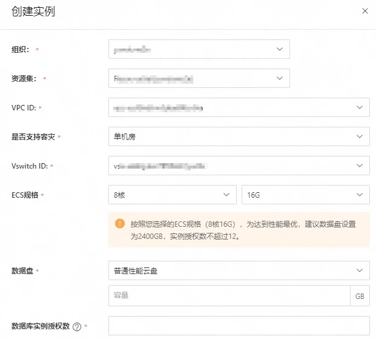

6. 单击**确定**，完成创建数据库审计系统。

## 3.2. 登录数据库审计系统（云盾安全中心登录）

该章节介绍如何在云盾安全中心直接登录数据库审计系统。

**背景信息**

确认您所使用的账号已具备相应部门的云资源权限，例如具备部门管理员角色权限。

**操作步骤**

1. 登录Apsara Uni-manager运营控制台。

2. 在控制台右上方，单击**安全**，选择**数据安全 > 数据库审计**。在**数据库审计**授权页面，选择**地域**并单击**角色授权访问**。

3. 在左侧导航栏，单击**数据库安全审计**。

4. 在需要登录数据库审计系统的**操作**栏，单击**详情**，登录到数据库审计系统。

## 3.3. 数据库审计系统初始化

### 3.3.1. 前提条件

数据库审计产品由Agent和Web控制台两部分组成，在使用数据库审计系统之前需要开放下列端口。

| 源 | 目的 | 端口 | 备注 |
| --- | --- | --- | --- |
| 运维管理端 | Web控制台 | 443 | Web控制台HTTPS服务通讯端口 |
| Agent | Web控制台 | 9266 | Agent与Web控制台之间的通讯端口 |
| 运维管理端 | Web控制台 | 22 | Web控制台SSH服务通讯端口 |

### 3.3.2. 添加被审计的数据库实例

云盾数据库审计系统支持对云服务器自建数据库实例和云服务商提供的云数据库实例进行审计。

**操作步骤**

1. 使用全局组织安全管理员登录云盾数据库审计系统。具体操作，请参见登录数据库审计系统（云盾安全中心登录）。

2. 在**概况/全库**页面，单击左侧数据库列表左上角的配置数据库  图标。

3. 在**配置 > 数据库**页面的**数据库列表**区域，单击增加数据库  图标。

   > **说明**
   >
   > 当需要添加的数据库较多时，可在数据库列表页面，单击
   >
   > 图标。下载数据库模板，填写并上传。
   >
   > 

4. 在右侧面板，填写被审计的数据库实例的相关信息，单击左上角的保存  图标。

   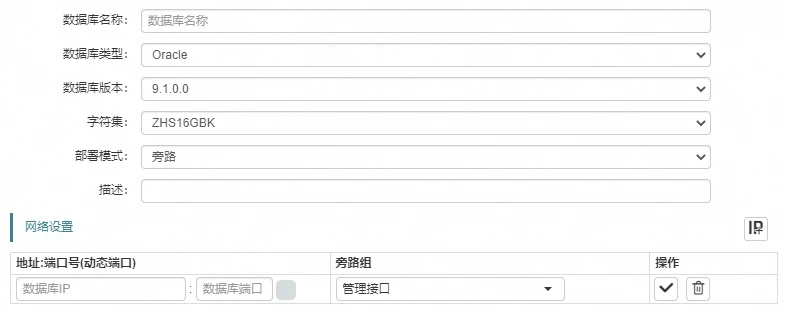

   表 1. 数据库实例信息说明

   | 参数 | 说明 |
   | --- | --- |
   | 数据库名称 | 为被审计的数据库实例指定一个名字。 |
   | 数据库类型 | 选择被审计的数据库实例的类型。 |
   | 数据库版本 | 选择被审计的数据库版本。 |
   | 字符集 | 选择数据库使用的字符集。 |
   | 部署模式 | 数据库网络部署模式，默认旁路，不支持修改。 |
   | 描述 | 为被审计的数据库实例添加注释。 |

   <table>
     <tr>
       <td>网络设置</td>
       <td>设置数据库IP和端口号，单击<strong>操作</strong>列的保存图标。 • 数据库IP • 云服务器（ECS）自建数据库：被审计数据库实例的IP地址。 • 云数据库（RDS）实例：被审计的RDS数据库实例的URL连接串。 • 端口：被审计数据库实例的端口号。 单击增加IP图标，可添加多组数据库IP和端口。</td>
     </tr>
   </table>

   > **说明**
   >
   > 添加SQL Server数据库时，还需要输入具有一定权限的用户名及其登录密码，单击**权限校验**，确认该用户有访问权限。安全管理员也可以单击**下载创建用户参考脚本**，根据参考脚本在相关数据库中创建特定用户用于数据库审计。

   数据库添加成功后，可以在**概况/全库**页面左侧的数据库列表处看到所添加的数据库的摘要信息。

### 3.3.3. 部署Agent程序

#### 3.3.3.1. 自动部署

Agent程序需要部署到数据库或应用服务器上，用于获取访问数据库的流量，帮助审计系统对获取到的流量实现分析与审计。

**背景信息**

自动部署Agent程序功能支持Linux、Windows系统的服务器。

- 服务器自建数据库实例：Agent程序需要部署在数据库所在的服务器上。

- RDS数据库实例：Agent程序需要部署在使用RDS数据库的业务实例对应的应用服务器上。

**操作步骤**

1. 使用全局组织安全管理员登录云盾数据库审计系统。具体操作，请参见登录数据库审计系统（云盾安全中心登录）。

2. 在左侧导航栏，选择**配置 > RMAgent组件**，在**RMAgent管理**页签，单击**ECS实例批量安装Agent**。

3. 在**ECS实例列表**中，选中要安装Agent的ECS实例前的复选框，单击**批量安装Agent**，然后单击**确定**。

   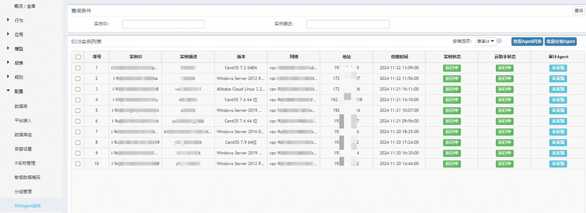

4. 在**ECS实例列表**，单击**查看Agent列表**，查看Agent信息。

   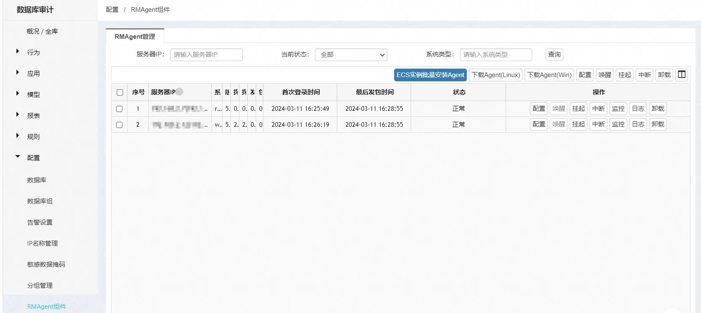

#### 3.3.3.2. Windows系统手动部署（应用服务与数据库服务器不同）

本章节介绍如何在应用服务和数据库部署在不同服务器的场景下手动部署Agent。

**操作步骤**

1. 使用全局组织安全管理员登录云盾数据库审计系统。具体操作，请参见登录数据库审计系统（云盾安全中心登录）。

2. 在**配置**页面，单击**RMAgent组件**页面，单击**下载Agent(Win)**。

   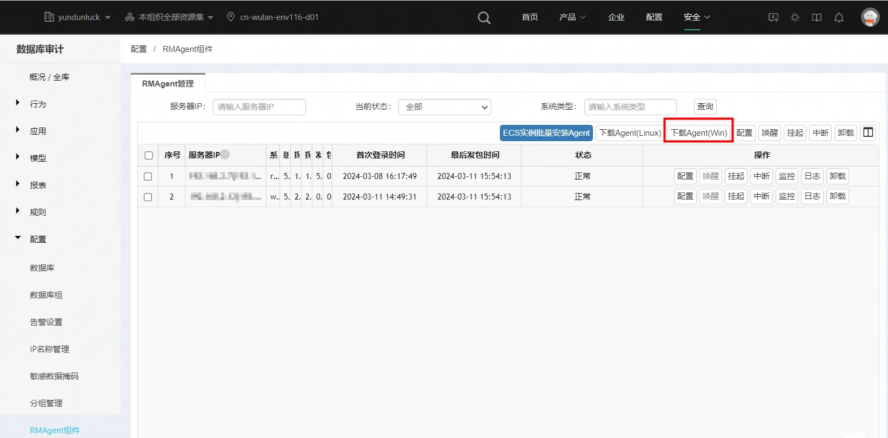

3. 将所下载好的Agent安装包放在Windows服务器上，解压后进入文件夹下，双击Rmagent_Setup.exe，进入安装步骤。

   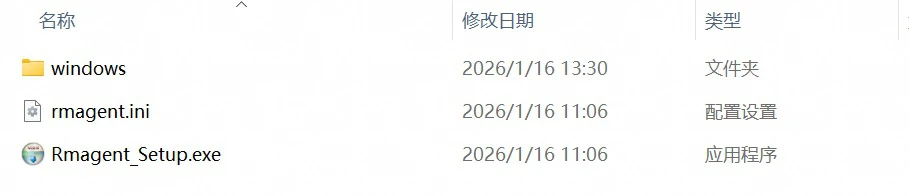

4. 选择语言Chinese，单击**OK**。

   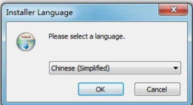

5. 弹出**rmagent3.2.5.3**安装对话框，单击**下一步**。

   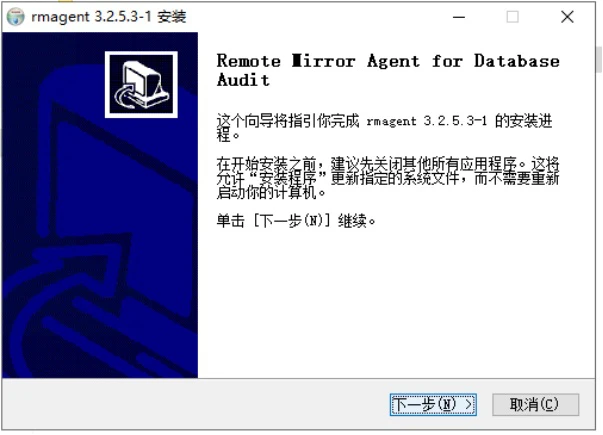

6. 弹出**许可证协议**对话框，单击**我接受**。

   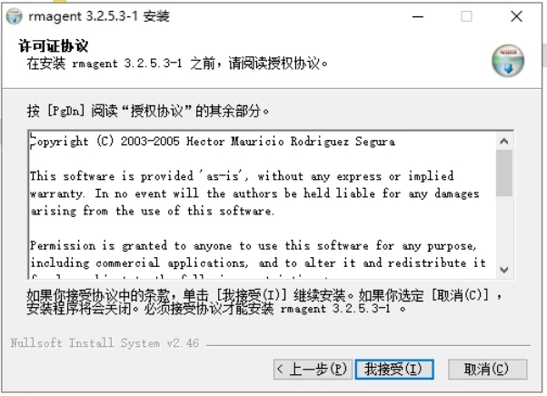

7. 弹出**选择组件**对话框，单击**下一步**。

   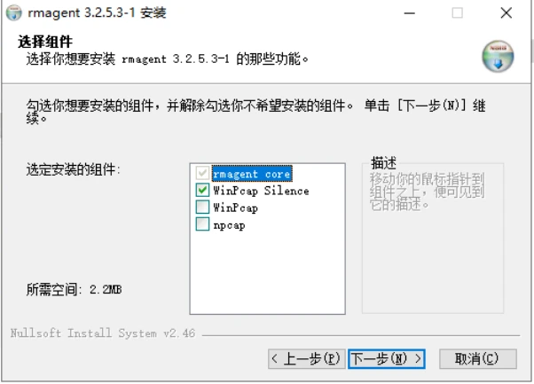

8. 弹出**选定安装位置**对话框，默认即可，单击**安装**。

   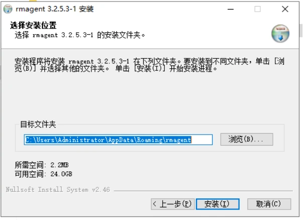

9. 弹出**rmagent**对话框，单击**完成**。

   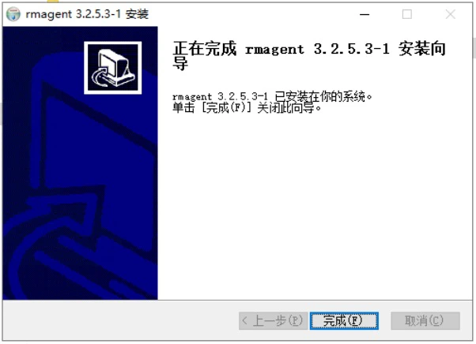

#### 3.3.3.3. Windows系统手动部署（应用服务与数据库服务器相同）

本章节介绍如何在应用服务和数据库部署在同一个服务器的场景下手动部署Agent。

**操作步骤**

1. 使用全局组织安全管理员登录云盾数据库审计系统。具体操作，请参见登录数据库审计系统（云盾安全中心登录）。

2. 在**配置**页面，单击**RMAgent组件**页面，单击<strong>下载Agent(Win)</strong>按钮。

   

3. 将所下载好的Agent安装包放在windows服务器上，解压后进入解压目录，修改rmagent.ini文件，将loopback=1取消注释，双击**Rmagent_Setup.exe**，进入安装步骤。

   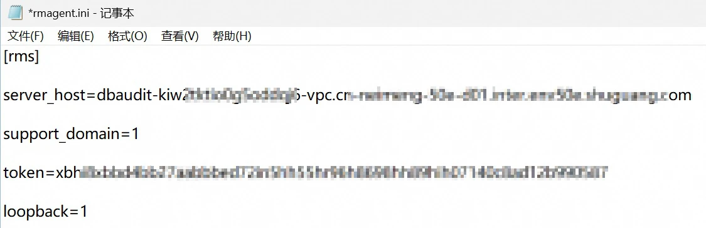

   

4. 选择**语言-Chinese**，单击**OK**。

   

5. 弹出**rmagent3.2.5.3**安装对话框，单击**下一步**。

   

6. 弹出**许可证协议**对话框，单击**我接受**。

   

7. 弹出**选择组件**对话框，选择npcap组件，不安装WinPcap组件，单击**下一步**。

   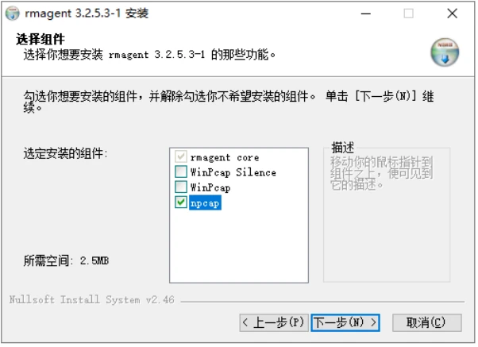

8. 弹出**选定安装位置**对话框，默认即可，单击**安装**。

   

9. 弹出Npcap安装对话框，单击**I Agree**。

   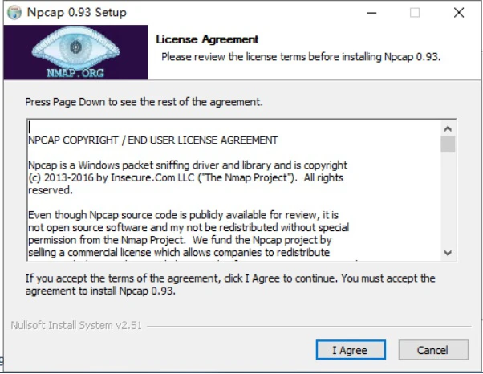

0. 在弹出的对话框勾选**Install Npcap in WinPcap API-compatible Mode**，单击**Install**。

   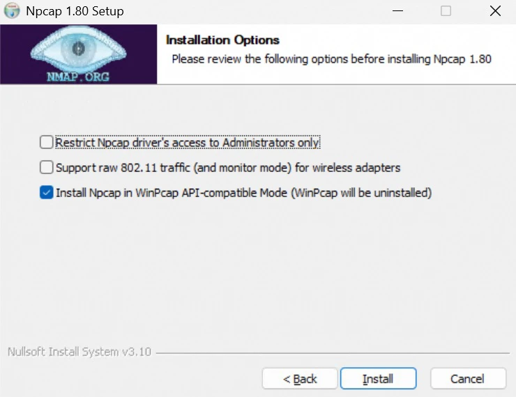

1. 在弹出的对话框单击**Next**。

   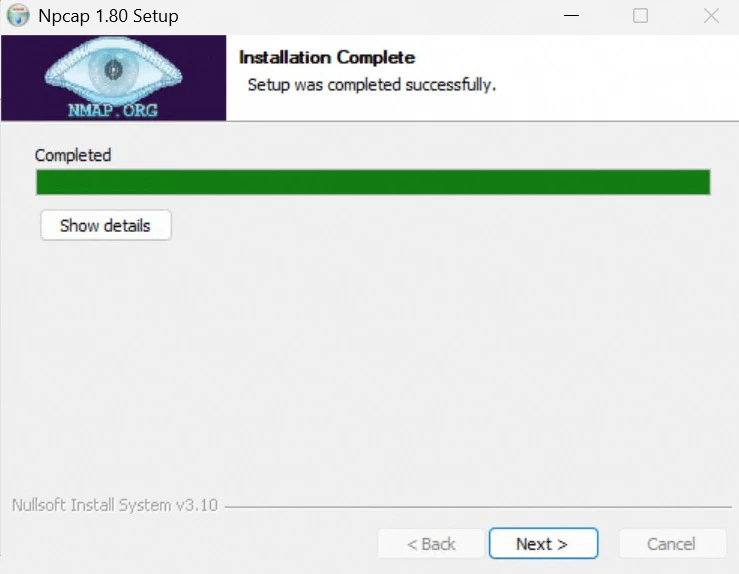

2. 安装Npcap程序完成，单击**Finish**。

   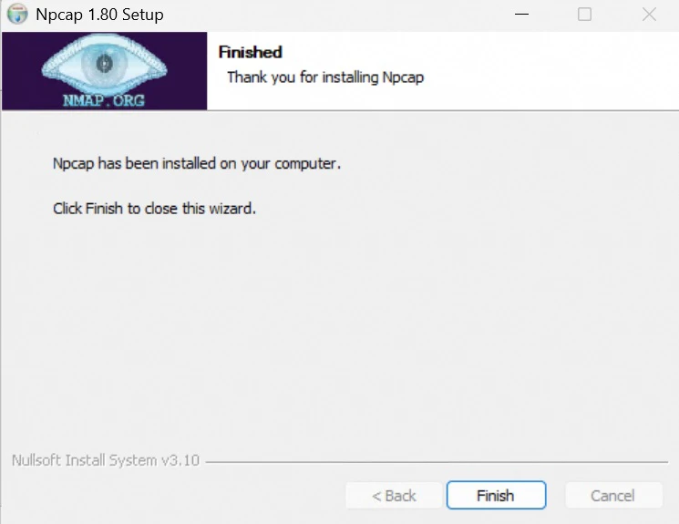

3. 弹出rmagent安装完成对话框，单击**完成**。

   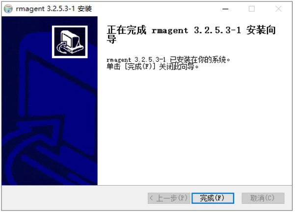

#### 3.3.3.4. Linux系统手动部署（应用服务与数据库服务器不同）

本章节介绍如何在应用服务和数据库部署在不同服务器的场景下手动部署Agent。

**操作步骤**

1. 使用全局组织安全管理员登录云盾数据库审计系统。具体操作，请参见登录数据库审计系统（云盾安全中心登录）。

2. 在**配置**页面，单击**RMAgent组件**页面，单击<strong>下载Agent(Linux)</strong>按钮。

   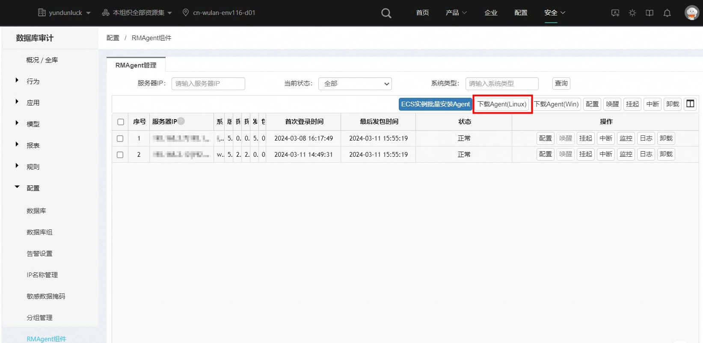

3. 将下载好的Agent上传到Linux服务器上（以 root 用户登录），上传成功后执行tar -zxvf yddbaudit_rmagent.tar.gz

   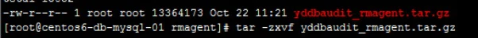

   

4. 文件解压后，执行./install.sh。

   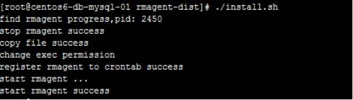

5. 打开RMAgent组件页面，查看Agent是否正常在线。

   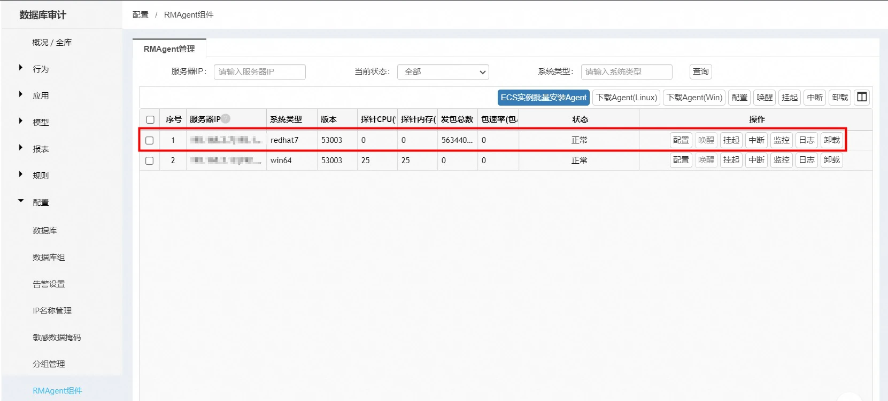

#### 3.3.3.5. Linux系统手动部署（应用服务与数据库服务器相同）

本章节介绍如何在应用服务和数据库部署在同一个服务器的场景下手动部署Agent。

**操作步骤**

1. 使用全局组织安全管理员登录云盾数据库审计系统。具体操作，请参见登录数据库审计系统（云盾安全中心登录）。

2. 在**配置**页面，单击**RMAgent组件**页面，单击<strong>下载Agent(Linux)</strong>按钮。

   

3. 将下载好的Agent上传到Linux服务器上（以 root 用户登录），上传成功后执行 `tar -zxvf yddbaudit_rmagent.tar.gz` 。

   

   文件解压后，执行

4. 文件解压后，执行 `./install.sh` 。

   

5. 打开RMAgent组件页面，查看Agent是否正常在线。

   

6. 打开RMAgent组件页面，选择安装成功的Agent，单击配置按钮，勾选**loopback**，填写1，单击**确定**，Agent会自动重新启动。

   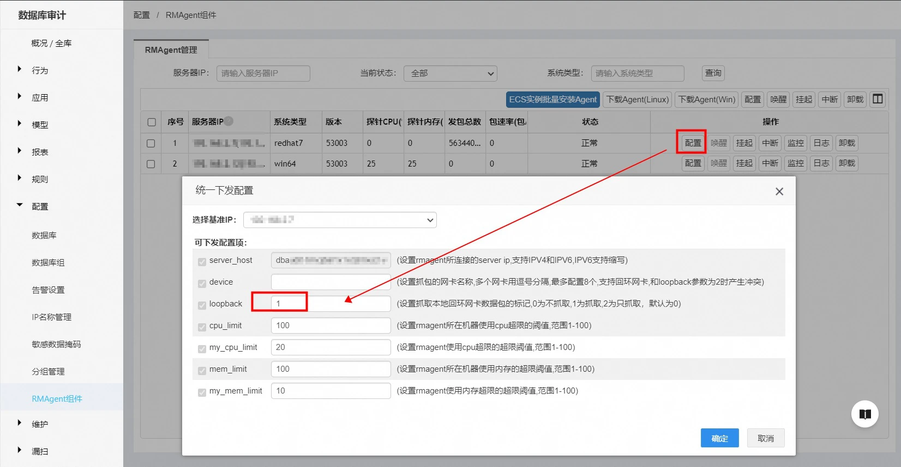

### 3.3.4. 部署测试

该章节介绍部署Agent后，测试数据库审计系统是否正常运行。

您可以通过已安装Agent程序的应用服务器访问被审计的数据库实例并执行SQL语句，然后使用安全管理员账号登录云盾数据库审计系统，查看是否有审计信息。

- 如果云盾数据库审计系统正常记录了该数据库实例的审计信息，则说明数据库实例部署成功。

- 如果云盾数据库审计系统未能记录到审计信息，请检查对应的Agent配置部署信息、Agent程序的服务进程和连接配置等。

# 4.全库配置及数据

## 4.1. 概况/全库

系统概况页展示当前数据库审计系统的审计状态，包括系统语句总量、审计时长、风险分布情况等。

**操作步骤**

1. 使用全局组织安全管理员登录云盾数据库审计系统。具体操作，请参见登录数据库审计系统（云盾安全中心登录）。

2. 查看全库概况页详情。

   图 1. 审计状态

   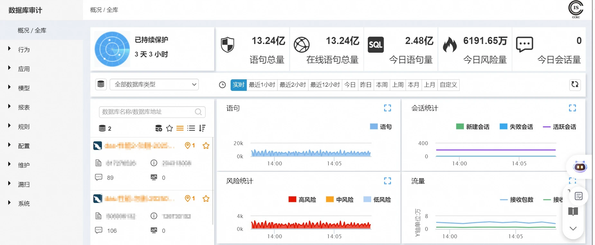

   - 实时审计状态信息如下所示，并且具有钻取功能。

   - 图形区域根据时间范围，作为统一查询维度。时间范围不同，图形的统计粒度也不同。

     - 数据库列表区域，是针对当前系统审计所有数据库的汇总展示区域，可以一览当前数据库审计全貌。数据库列表汇总展现了每条数据库的审计信息。包括：在线语句总量、在线风险量、活跃会话量、当前每秒语句量。

       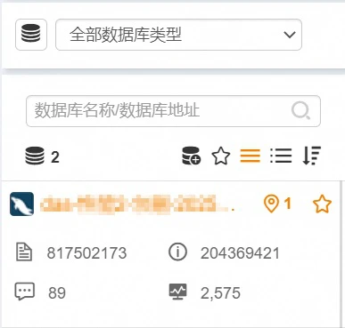

     - 语句分布图：以时间为单位统计某一时间范围内的语句执行情况。页面采用动态展现形式，可以通过单击统计图例的方式，根据统计需求动态展现图形。

       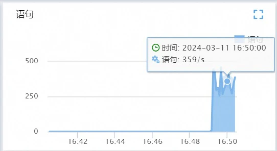

     - 会话统计：基于新建会话数、失败会话数、活跃会话数等统计某一时间范围内会话数变化趋势。

       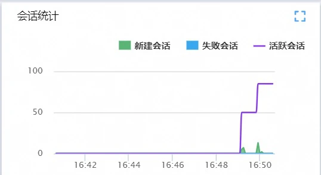

     - 风险统计：对各个数据库命中规则而构成风险项的统一展示，具体包括高风险、中风险和低风险，开始时间、结束时间，数据库类型。

       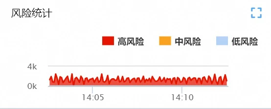

     - 流量：对该数据库审计系统接收流量的可视化展示，具体包括开始时间、结束时间，接收包数、接收流量。

       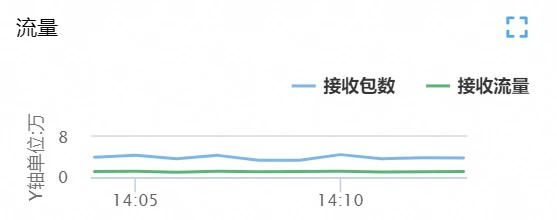

## 4.2. 行为

**概况/全库**界面展现了审计系统所审计的数据库的总体审计状态，而**行为**界面则展现了对受保护数据库所审计到的具体行为，相较于单个数据库的审计界面，**行为**界面则提供展现全部数据库的行为统计，即全局细化统计。审计系统对行为的统计包含**风险命中**、**行为检索**、**风险检索**和**统计信息对比**。

### 4.2.1. 风险命中

本文介绍如何查看风险命中规则的详细信息。

**操作步骤**

1. 在**行为 > 风险命中**页面，以时间为检索条件，逐一查询不同**风险类型**的详细命中规则。

   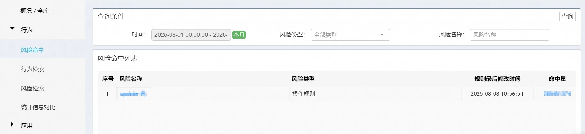

   规则清单中详细记录了**风险名称**、**风险类型**和**命中量**。

2. 单击每条记录的**风险名称**，跳转页面展现定制此条风险规则的详细信息。

   规则的详细配置方式将在规则（全局）中具体介绍。

   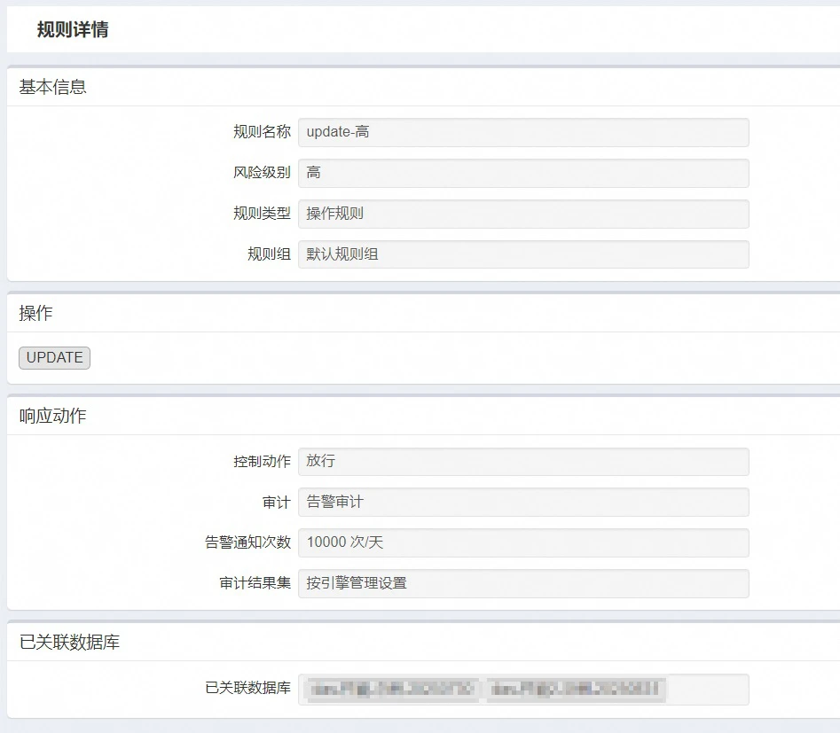

3. 单击每条记录的**命中量**跳转到命中列表清单，列表清单列举了风险发生的数据库、命中量。

   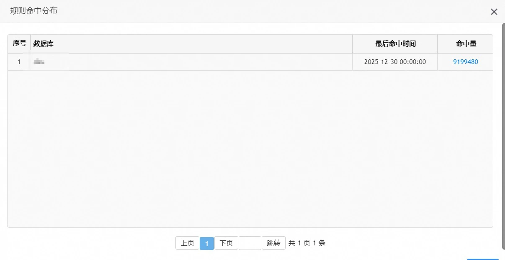

4. 单击**命中量**即可跳转到**风险检索**界面。详细介绍，请参见**风险检索**章节。

### 4.2.2. 行为检索

本文介绍行为检索的详细信息。

**概述**

**行为检索**统计了系统所审计到的全部数据库的SQL语句，统计信息包含客户端信息，服务器信息，会话信息等，相较于对单个数据库的SQL语句统计，此界面提供了对全部数据库进行统计的功能，并支持对客户端IP的排序。页面详细说明与单库语句统计页面说明一致，具体请参考**语句检索**章节。

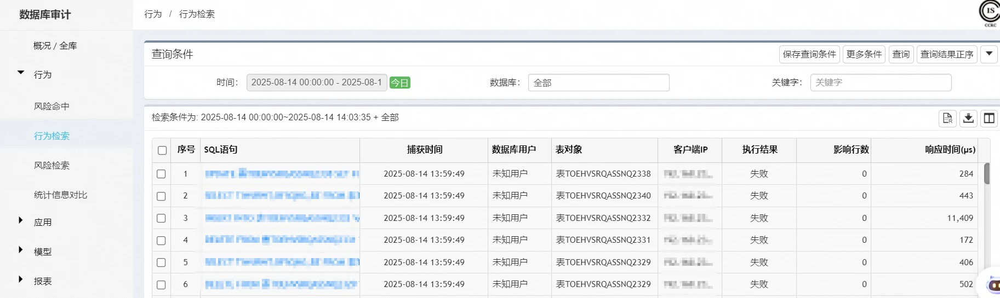

为了增加检索的便利性，目前检索条件可支持分页显示，如下图所示。

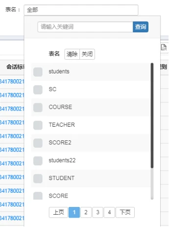

### 4.2.3. 风险检索

本文介绍风险检索的详细信息。

**概述**

**风险检索**页面按照所有命中风险的具体行为进行统计，通过列表清单的方式逐条展现每条风险语句详情。通过具体的SQL语句、（触发）时间、风险类型、风险名称、风险等级、数据库用户、客户端IP等展现风险语句的详细信息，可以将检索到的风险语句进行设置，添加到信任规则、敏感语句或者不审计语句操作。

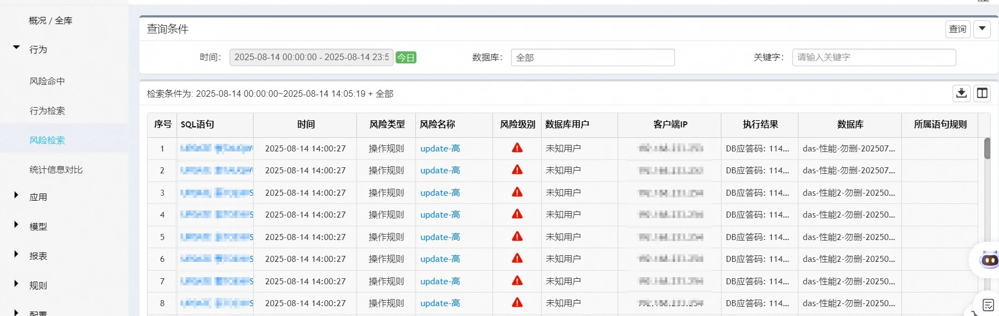

**操作步骤**

在**行为 > 风险检索**页面，单击**SQL语句**进入**语句详情**，展现每条语句的访问来源信息、应用身份信息、SQL语句信息、受影响对象、SQL语句、语句模板、结果集、SQL参数。

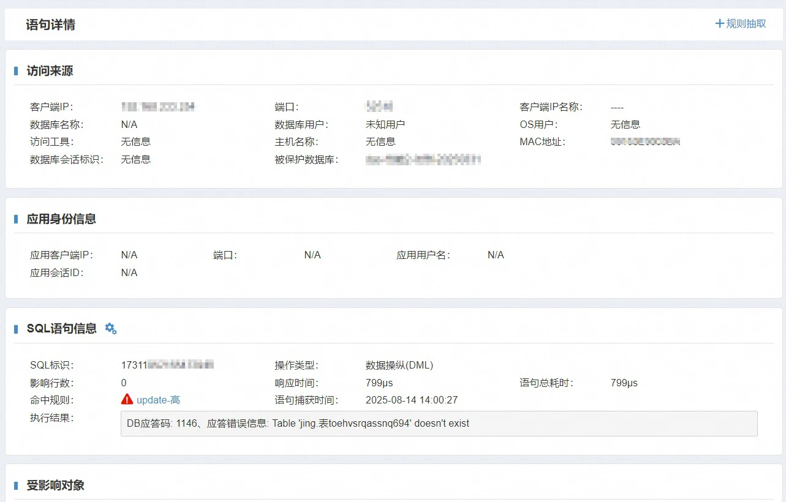

### 4.2.4. 统计信息环比

本文介绍统计对象间的信息环比功能。

信息环比功能包含以下内容：

- 同一数据库不同时间段的对比。

- 不同数据库同一时间的对比。

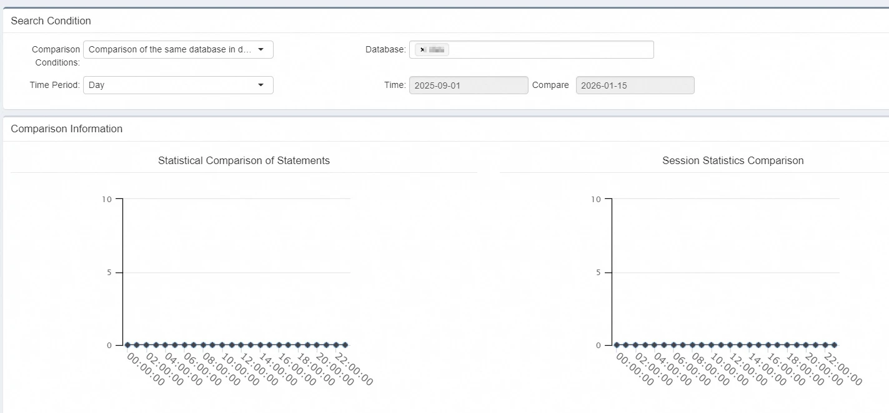

## 4.3. 应用

### 4.3.1. 应用身份

本文介绍应用身份的详细信息。

应用身份是针对应用终端用户访问应用服务器后应用服务器对数据库产生的访问记录行为的配置，传统的数据库安全审计产品只能审计到应用IP，但是不能解析出应用用户信息。数据库安全审计产品采用应用关联审计的审计模式，可以针对审计到应用用户信息做详细的解析。利用本系统提供的（应用）组件从应用登录机制出发，获取最精准的应用用户关联信息。参数模式配置如下图所示：

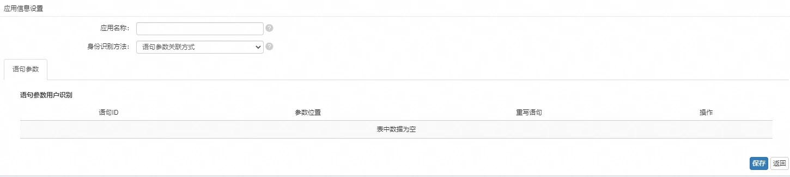

### 4.3.2. 自定义应用用户

通过设置自定义应用用户，可以支持新增以及批量导入应用用户，关联具体的登录语句信息，准确审计识别出应用用户。本文介绍如何自定义应用用户。

- 通过模板导入

  单击**导入**按钮，弹出**导入**对话框，并提供导入模板。

  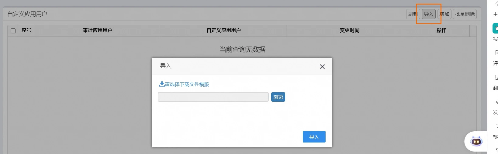

- 增加单个自定义应用用户

  单击**增加**按钮，在**增加**对话框中，进行审计应用用户以及自定义应用用户的配置。

  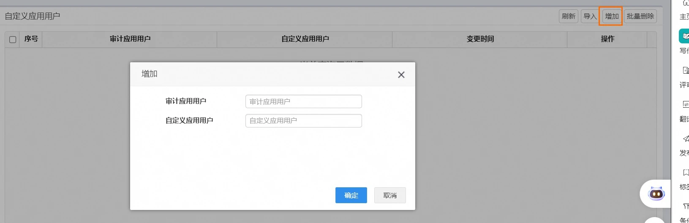

## 4.4. 模型

数据库安全审计产品针对数据库通讯协议进行完全解析，可建立学习期，归纳出语句模型信息。

### 4.4.1. 语句模型

数据库审计通过学习期，可以对语句进行统计学习，经过比对、统计、学习、分析，生成新的新型语句，用于对新型语句进行审计、监控，并可关联语句模板。

单击**模型 > 语句模型**，进行语句模板的查询，并对语句模板可批量设置为信任语句模板等操作。

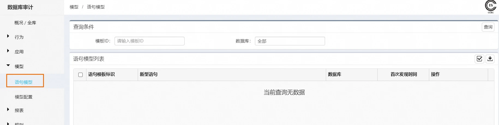

### 4.4.2. 模型配置

模型配置是针对具体的数据库进行学习的配置，并可对数据库独立的配置自己的学习期周期时间，也可随时对该数据库进行停止学习操作。

单击**模型 > 模型配置**，进行学习期的配置以及停止学习等操作。

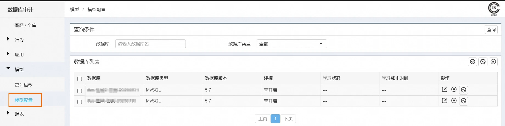

## 4.5. 报表（全局）

数据库审计采用全新的聚集式报表展现形式，将报表分为全局报表、数据库单库报表两种表现形式，全局报表还分综合报表、合规报表、专项报表、自定义报表、报表预存、定时推送六个二级页。

本章节介绍的是系统功能栏**报表**（全局），全局报表以聚合报表的展现形式，分栏展现系统内所有数据库的审计状态。报表形式分为日报、周报和月报。单击**预览**控件，即可查询、展现指定时间范围内的、指定数据库组的报表数据。

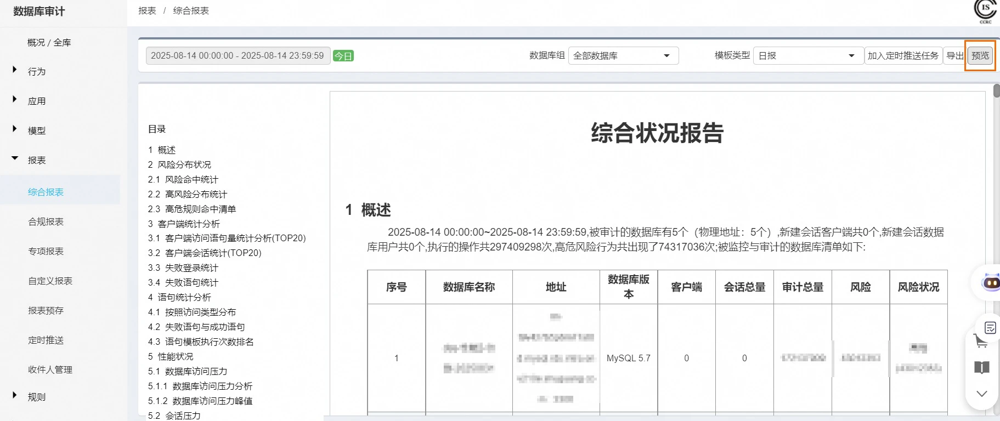

### 4.5.1. 综合报表

本文介绍综合报表的详细信息。

**报表名称**

综合状况报告

**报表类型**

日报、周报、月报。

**报表内容**

风险分布状况、客户端统计分析、语句统计分析、性能状况等等。

**统计图展现形式**

柱形图、曲线图、双轴折线图等等。

报表样例如下图，SQL总量趋势：

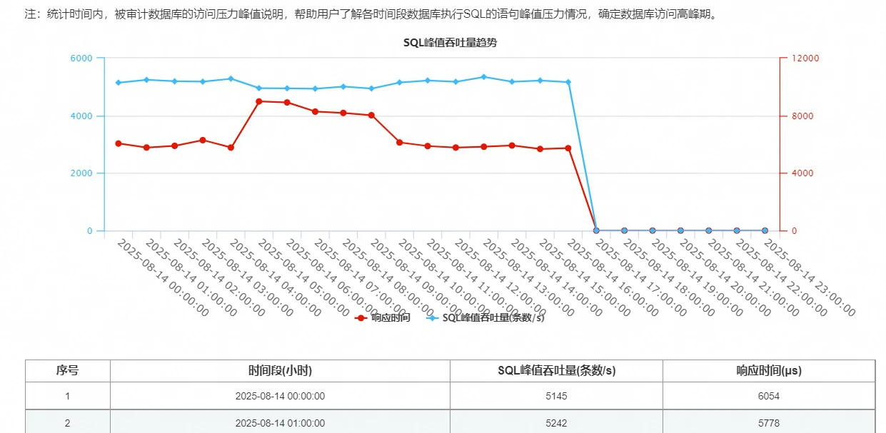

### 4.5.2. 合规报表

本文介绍合规报表的详细信息。

**报表名称**

SOX-萨班斯报告、PCI-报告、等保参考报告。

**报表类型**

包括SOX-萨班斯报告、PCI报告、等保参考报告。

**报表内容**

包括风险分布状况、语句统计分析等等。

**统计图展现形式**

柱形图等。

**报表样例**

风险命中统计：

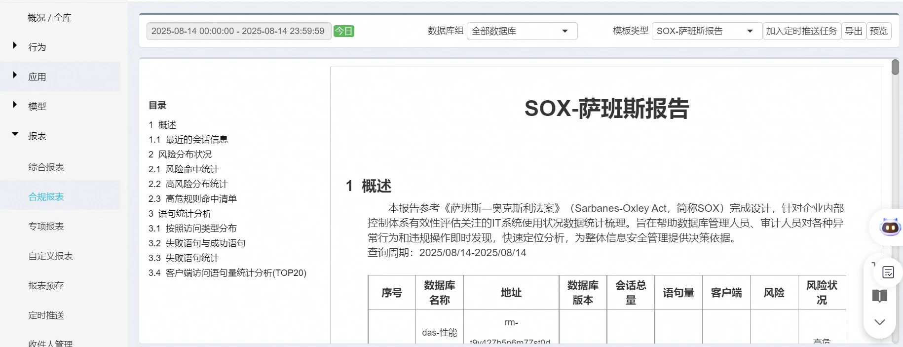

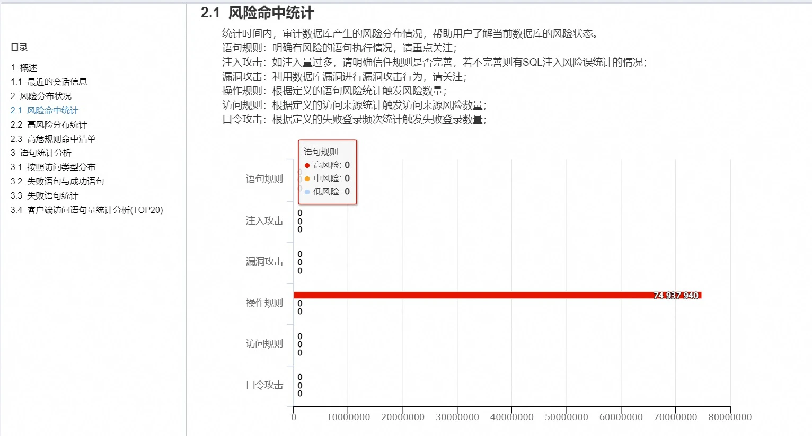

### 4.5.3. 专项报表

本文介绍专项报表的详细信息。

**报表名称**

风险综合分析报告、客户端风险分析报告等20多种报表。

**报表类型**

包括：风险分布统计报告、客户端风险分析报告、高危规则命中统计报告、数据库概要分析报告等20多种报表模板。

**报表内容**

包括风险分布状况等。

**统计图展现形式**

柱形图等。

**报表示例**

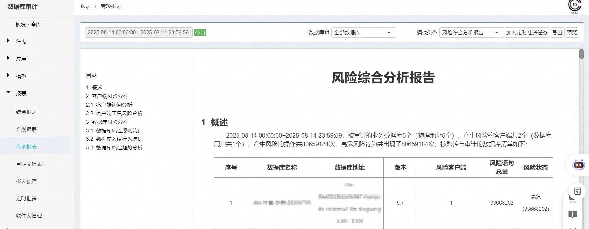

### 4.5.4. 自定义报表

本文介绍什么是自定义报表。

**概述**

自定义报表支持使用者自行制定作为报表统计、分析标准的元素，从而生成自定义标准的报表。

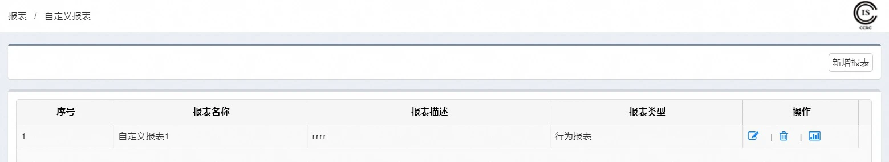

**操作步骤**

1. 新增自定义报表。

   单击**新增报表**新增自定义元素，可指定报表类型、查询条件和报表展示方式等。

   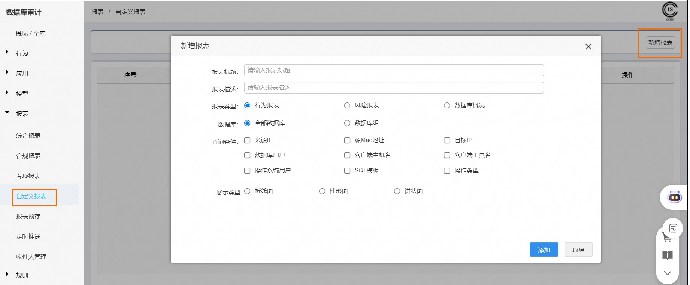

2. 制定好后，单击  图标查看报表。

   

3. 单击**导出**即可导出自定义报表。

   

### 4.5.5. 报表预存

本文介绍什么是报表预存。

**什么是报表预存**

报表预存功能支持对指定类型报表进行预存，对某类型报表预存后，以后再次查询则会直接读取预存信息，减少系统压力。

**开启预存功能**

单击**预存设置**选择报表进行开启预存功能。

### 4.5.6. 定时推送

本文介绍如何设置定时推送。

**概述**

报表是被审计数据库某一时间段内各方面性能，状态指标的汇总展现形式，可以清晰的体现数据库当前运行状态。本系统采用日报、周报、月报的形式做报表展现。添加报表定时推送功能，实现周期性向指定对象定点发送审计日志的报表功能。

报表预览展现后，点击右上角**加入定时推送任务**，将制定报表归纳到已经建好的**定时推送**任务清单中。

**操作步骤**

- **创建定时推送任务**

  在**报表 > 定时推送**页面的右上角，单击**添加**，输入任务名称、邮件主题、发送周期、发送时间等信息，新增一条定时推送任务。

  

- **查看定时推送任务列表**

  功能栏包括任务名称、邮件主题、发送周期、发送时间、描述、状态、操作。

  

- **查询发送历史信息**

  单击  查询本任务发送历史信息。

- **编辑定时推送任务**

  单击  编辑定时推送任务，单击  删除定时推送任务。

- **查询推送的报表信息**

  单击  查询本任务推送的报表信息。

  

### 4.5.7. 报表导出

本文介绍如何导出报表。

**操作步骤**

选择您要导出的报表，在页面右上角单击**导出**。

报表导出形式分为以下几种：doc、pdf、html、csv。

### 4.5.8. 收件人管理

收件人管理功能是针对报表定时推送任务，将任务发送到指定的邮箱。本文介绍如何管理收件人。

**操作步骤**

1. 在**报表 > 收件人管理**页面，单击  图标。

   

2. 输入收件人的用户名、邮箱地址、手机号码信息，然后单击  按钮。

   

## 4.6. 规则全局

### 4.6.1. 虚拟补丁查询

虚拟补丁针对利用数据库漏洞进行数据库攻击的行为告警。基于CVE等漏洞类型生成内建规则，不能进行自定义的添加和删除，但可以启用或禁用。

虚拟补丁列表显示所有支持的数据库版本下的所有漏洞攻击规则，包括漏洞名称、CVE标识、漏洞类型、影响范围、风险级别、通知告警、当前状态、操作（启用/禁用）等，虚拟补丁列表页提供相关的检索查询功能。

### 4.6.2. 规则管理

#### 4.6.2.1. 注入攻击

通过对SQL语句进行特征描述，以定义要阻止的SQL注入语句或危险SQL语句，以防御来源于某个IP的某个用户使用某些工具，在一定时间范围内发生的SQL注入风险。本文介绍如何设置注入攻击规则。

**操作步骤**

1. 在**规则 > 规则管理**页面，单击  按钮增加规则，**规则类型**选择**注入攻击**。

   

2. 配置规则。

   SQL注入的功能区包括了列表和新增、修改操作。新建SQL注入规则，包括：访问来源、操作、条件控制、执行结果、注入特征、响应动作等。

   

   

   

   

   

#### 4.6.2.2. 操作规则

操作规则用于降低来源于某个IP的某个用户使用某些工具，在一定时间范围内发生的指定对象和操作的风险。本文介绍如何设置操作规则。

**操作步骤**

1. 在**规则 > 规则管理**页面，单击  按钮增加规则，**规则类型**选择**操作规则**。

   

2. 配置操作规则的详细信息，然后单击右上角  按钮。

   

#### 4.6.2.3. 访问规则

访问规则用于降低来源于某个IP的某个用户使用某些工具，在一定时间范围内发生的风险。本文介绍如何设置访问规则。

**操作步骤**

1. 在**规则 > 规则管理**页面，单击  按钮增加规则，**规则类型**选择**访问规则**。

   

2. 输入访问来源、响应动作、时间限制设置等，然后单击右上角  按钮。

   

#### 4.6.2.4. 口令攻击

口令攻击规则用于降低来自于某个IP或用户的在指定时间范围内失败登录的风险。本文介绍如何设置口令攻击规则。

**操作步骤**

1. 在**规则 > 规则管理**页面，单击  按钮增加规则，**规则类型**选择**口令攻击**。

   

2. 输入访问来源、执行结果、响应动作等，然后单击右上角  按钮。

   

### 4.6.3. 规则启用

数据库组中的数据库，引用和取消引用规则、排优先级、生效优先级。

#### 4.6.3.1. 规则管理时创建关联

用户可以直接根据规则关联数据库，关联后规则即被引用。本文介绍如何在规则管理时创建关联。

**操作步骤**

- 新建规则或编辑规则时关联

  单击**已关联数据**库后的  即可添加。

  

- 指定现存规则关联

  选择规则后，单击右上方的  按钮即可关联。

  

  关联窗口如下，通过  批量选择数据库或者通过  选择全部数据库，选择完成后，单击**确定**即可实现关

  联。

  

#### 4.6.3.2. 引用、取消应用规则

本文介绍如何引用及取消应用规则。

**操作步骤**

1. 在查询条件处指定查询规则的条件。

   支持的条件为数据库、规则名称、规则类型、规则组、风险级别、是否启用、是否引用。

   

   规则列表中列出了满足条件的规则，操作下方的图标代表了引用关系。  代表规则已经被引用，  代表

   未被引用。

2. 选择好指定的数据库，在未引用的规则处点击  即可被数据库引用，在已引用规则处点击  即可取消引

   用规则。

   系统还支持批量引用、取消引用，操作时只需勾选规则前方方框，然后点击规则列表右上角按钮  或  即

   可，点击  或  启用禁用规则。

#### 4.6.3.3. 设置优先级

在访问数据库的行为同时满足多个规则时，优先级高的规则会被匹配。本文介绍如何设置优先级。

**操作步骤**

1. 对已引用的规则，在**操作**列单击  或  ，即可提高或降低所选择条目的优先级。

   

2. 调整好优先级后，单击列表右上方  按钮保存优先级设置。

   

## 4.7. 配置

### 4.7.1. 数据库

对数据库行为进行审计是本系统的核心功能，用户需要在此界面对被保护数据库进行管理。用户可以在此处查看已添加数据库的基本信息，并且对数据库进行添加、修改、删除的操作。

#### 4.7.1.1. 添加数据库

本文介绍如何添加数据库。

**操作步骤**

1. 在**配置 > 数据库**页面，单击数据库列表右上方按钮  开始添加新的数据库。

   

2. 输入数据库信息，单击  保存数据库连接信息，然后单击左上方  保存配置完成数据库添加。

   您需要指定数据库名称、数据库类型、版本，并输入数据库的连接信息（IP地址和服务端口）。

   

#### 4.7.1.2. 编辑数据库信息

本文介绍如何编辑数据库信息。

**操作步骤**

1. 在**配置 > 数据库**页面，通过查询条件定位到目标数据库。

2. 在**操作**列单击  图标后，查看当前数据库详情，再单击左上  按钮开始编辑现存信息，**编辑**页面与**添加数**

   **据库**页面相同。

   

3. 单击  图标保存。

   

#### 4.7.1.3. 删除数据库

本文介绍如何删除数据库。

**操作步骤**

1. 在**配置 > 数据库**页面，通过查询条件定位到目标数据库。

2. 在**操作**列单击  图标，即可删除被保护数据库。

   

3. 确认无误后，单击**确定**。

   

#### 4.7.1.4. 导入/导出数据库

本文介绍如何导入及导出数据库。

**操作步骤**

1. 在**配置 > 数据库**页面，单击数据库列表右上方  图标导入数据库，弹出**导入数据库**对话框，可下载导入

   数据库模板。

   

2. 单击数据库列表右上  图标导出数据库列表。

   

### 4.7.2. 平台接入

本文介绍如何将平台日志写入到SLS中。

**操作步骤**

在**配置 > 平台接入**页面，输入日志存储的参数，单击**保存**。

### 4.7.3. 数据库组

为一组数据库创建数据库组，目的是为便于对一组数据库报表查询。

1. 在**配置 > 数据库组**页面，点击  开始添加一个新的数据库组，并将对应的数据库，添加到数据库组中。

   

2. 点击“确定”，数据库组即可创建成功。

   

### 4.7.4. 告警设置

邮件通知基于通知管理中配置的邮箱，当审计系统或被审计数据库触发告警信息时，根据系统预定义的告警规则，通过邮件形式向指定的用户邮箱发送告警信息。此功能需要参照**通知管理**完成对邮件通知的配置。

**操作步骤**

1. 在<strong>配置 > 告警设置></strong>页面，点击列表右上方  按钮，添加新的邮件告警条目。

   

2. 依据场景或者需要自定义邮件标题、模板名称，并选择能够触发告警的风险等级。邮件的内容可以自定义，并根据内容模板进行选择。最后在“联系人”处填写接受邮件人的邮件地址，点击“保存”即可完成配置

   

3. 告警条目添加后，单击**操作**中的**启用**按钮，此条目才会真正生效。

   

### 4.7.5. IP名称管理

IP名称管理支持对数据库客户端的IP进行单独或者批量命名，便于查看，可手动添加IP，也可批量导入IP，修改业务化IP名称，在语句检索中即可查看到修改后的IP别名。

**操作步骤**

- 批量导入IP。

  在**配置 > IP名称管理**页面单击  ，先下载IP业务化文件模板编辑后再批量导入IP。

  

- 添加单个IP。

  <ol type="i">

  <li>

  单击  按钮，直接添加IP。

  

  </li>

  <li>

  单击**确定**即可保存。

  

  </li>

  </ol>

### 4.7.6. 敏感数据掩码

本文介绍如何配置敏感数据掩码。

**概述**

敏感数据掩码功能是审计系统提供的，针对审计到的客户敏感数据，例如身份证号、银行卡号等敏感信息对其遮掩后再呈现，审计系统称之为敏感数据掩码。

配置敏感数据掩码需要预先设置期望数据匹配上的匹配规则，和匹配后的呈现形式，通常这种匹配规则采用正则表达式来编写。

> **说明**
>
> 开启敏感数据掩码将影响产品的查询、导出效率。

系统内置了一些敏感数据掩码规则，您也可以自定义敏感数据掩码规则。内置的规则包含如下内容：身份证号、手机号码、金额、银行卡号、中文姓名、证件号、统一社会信用代码、纳税人识别号、日期、Email、座机号码、民族、护照号、GPS坐标。

**操作步骤**

1. 在**配置 > 敏感数据掩码**页面，点击  按钮，添加新的匹配规则。

   

2. 输入名称、匹配正则、掩码结果，单击**确定**即可添加成功。

   

3. 在指定条目的**操作**列，点击  按钮即可启用。

   

### 4.7.7. 分组管理

可根据IP地址、数据库用户、应用用户、时间、对象、操作系统用户添加分组，并在创建规则时，引用分组信息。

#### 4.7.7.1. IP地址组

本文介绍如何配置IP地址组。

**操作步骤**

1. 在**配置 > 分组管理**页面，单击**IP地址组**页签，然后单击  按钮，添加IP地址组。

   

2. 输入组名称、单个IP或IP地址段，添加后点击“保存”即可完成添加。

   

#### 4.7.7.2. 数据库用户组

本文介绍如何设置数据库用户组。

**操作步骤**

1. 在**配置 > 分组管理**页面，单击**数据库用户组**页签，单后单击  按钮，添加数据库用户组。

   

2. 输入组名称、数据库用户，添加后单击**保存**。

   

#### 4.7.7.3. 应用用户组

本文介绍如何设置应用用户组。

**操作步骤**

1. 在**配置 > 分组管理**页面，单击**应用用户组**页签， 然后单击  按钮，添加应用用户组。

   

2. 输入组名称、应用用户，添加后单击**保存**。

   

#### 4.7.7.4. 时间组

本文介绍如何设置时间组。

**操作步骤**

1. 在**配置 > 分组管理**页面，单击**时间组**页签，然后单击  按钮，添加时间组。

   

2. 输入组名称、支持细化选择到月、日、周、时，添加后单击**保存**。

   

#### 4.7.7.5. 对象组

本文介绍如何设置对象组。

**操作步骤**

1. 在**配置 > 分组管理**页面，单击**对象组**页签，然后单击  按钮，添加对象组。

   

2. 添加对象组默认支持按照对象和字段来添加，单击  添加更多对象组条件，添加好后单击**保存**。

   

#### 4.7.7.6. 操作系统用户组

本文介绍如何设置操作系统用户组。

**操作步骤**

1. 在**配置 > 分组管理**页面，单击**操作系统用户组**页签，然后单击  图标，添加操作系统用户组。

2. 输入组名称和系统用户，可以单击添加  图标，增加多个系统用户，然后单击**保存**完成添加。

   

### 4.7.8. RMAgent组件

RMAgent是虚拟化部署时或者一些不方便开通镜像流量的环境，用来给审计系统发送需要审计的流量，可以部署在数据服务器也可以部署在数据库客户端，部署正常后，审计系统可以对RMAgent进行监控和管理。

#### 4.7.8.1. RMAgent管理

RMAgent管理功能可以对已经与审计服务器对接成功的RMAgent进行管理。本文介绍如何进行RMAgent管理。

**操作步骤**

- 查看RMAgent列表。

  可以管理的RMAgent信息在列表中呈现，包括部署RMAgent所在主机的IP、操作系统、CPU使用率、状态等信息。通过**操作**中的多项操作，可以对指定RMAgent做不同的管理。

  

- 配置：对RMAgent的运行参数进行远程配置。

  

- 唤醒：针对于“挂起”功能，当“挂起”RMAgent后，RMAgent将暂停工作，但是进程不退出，“唤醒”后则可以使“挂起”的RMAgent恢复工作状态。

- 挂起：当“挂起”RMAgent后，RMAgent将暂停工作，但是进程不退出。

- 中断：直接停止RMAgent的进程。

- 监控：监控RMAgent所在主机的CPU负载，RMAgent接收包情况。

  

- 日志：下载RMAgent的运行日志到本地。

- 卸载：卸载RMagent，第一次卸载Agent时，需要重置口令，卸载时，输入口令可成功卸载Agent。

  

- 批量操作：勾选多个RMAgent的勾选框，可以同时对多个RMAgent进行配置、唤醒、挂起、中断和卸载的操作。

## 4.8. 维护

### 4.8.1. 引擎管理

该章节介绍如何管理数据库审计的引擎。

**操作步骤**

1. 单击**维护 > 引擎管理**页面。

   

2. 在**引擎管理**页面，您可对数据库引擎执行以下操作，对引擎进行管理。

   - 单击**开启**或**停止**，可启动或停止数据库审计引擎。

   - 单击**刷新**，刷新引擎的当前状态及配置信息。

   - 在常用配置区域，设置引擎的配置属性值，单击**保存**，修改引擎配置。

   - 单击**恢复默认值**，可将配置属性恢复至默认值。

### 4.8.2. 数据备份恢复

#### 4.8.2.1. 设置自动备份

数据库审计支持对审计日志进行自动备份，确保审计日志的安全性。

**背景信息**

审计日志支持对备份存储进行定制，可减少系统存储的压力。同时，支持日志恢复功能，方便您随时对备份数据进行查询和恢复。

**操作步骤**

1. 单击**维护 > 数据备份恢复**。

2. 在**自动备份配置**区域，设置开始备份时间、备份策略，选择是否上传服务器，服务器类型。

   

   - **开始备份时间**：自动备份以天为单位，通过开始备份时间确定在哪一整点时间开始每天的自动备份。

   - **备份策略**：自动备份默认备份2天前的数据，即备份自当天起2天前的数据。例如，在12月17日，自动备份默认备份12月15日当天的审计日志数据。

   - **上传服务器**：备份的审计日志，出于安全性和数据盘空间考虑支持选择自动上传到指定服务器。目前支持FTP、SFTP和NFS服务器。

   > **说明**
   >
   > 设置FTP服务器时，FTP路径是FTP服务器下的已有目录，而不是FTP服务器在操作系统上的存储目录。

3. 单击**保存**。

#### 4.8.2.2. 手动备份与恢复

该章节介绍如何手动备份和恢复当前系统配置数据。

**操作步骤**

1. 单击**维护 > 数据备份恢复**。

2. 在**系统配置信息备份/恢复**，单击**备份**。

   

3. 单击**确定**，对当前系统配置数据进行备份。

**后续步骤**

备份成功后，在**系统配置信息备份/恢复**区域，单击**恢复**并选择备份文件后，单击**确认**。

> **警告**
>
> 该备份的系统配置数据会覆盖当前系统配置数据。

#### 4.8.2.3. 查询备份清单

自动备份的数据默认会存储到数据库审计系统的硬盘，也可以选择上传到FTP服务器转存。安全管理员可在备份清单表中查看备份操作记录。

**操作步骤**

1. 选择**维护 > 数据备份恢复**。

2. 设置查询日期，默认查询条件以月为单位，统计某月内的备份记录。

3. 选择**服务器类型**。

   可选服务器类型包含**FTP**、**SFTP**、**NFS**和**OSS**。

4. 选择数据状态。

   可选择的数据状态如下。

   - **全部**：本系统审计到的全部数据查询。

   - **在线**：本系统中未被清理、恢复，并且在线可查询的初始数据。

   - **已恢复**：本系统中清理后被恢复的数据。

   - **已清理**：本系统中达到系统阈值被清理的数据。

   - **处理中**：本系统当前正在进行清理或者恢复的数据。

5. 单击**查询**或**刷新**，查看相应的备份记录。

   备份清单列表包含备份日期、数据状态、备份结果、FTP上传状态、空间占用等信息。

   > **说明**
   >
   > 如果自动备份启用FTP设置，且备份已成功转存至FTP服务器，在操作栏中单击**恢复**，可将该日志备份恢复至数据库审计系统硬盘。

### 4.8.3. 告警与数据清理

设置在线数据的清理门限（即阈值）与备份数据的告警门限和清理门限、自动清理间隔以及开始时间，当审计日志和备份文件达到上限后系统将自动启动清理。

**操作步骤**

1. 单击**维护 > 告警与数据清理**。

2. 根据需要，设置清理门限及清理周期。

   

   - **清理门限**：达到指定条数后，将清理旧的数据。

   - **告警门限**：当前产品数据盘分配的数据分区空间不足某值，如40%时生成系统告警。

   - **清理门限**：当前产品数据盘分配的数据分区空间不足某值，如50%时清理备份数据，释放存储空间。

3. 单击**保存**，完成数据自动清理任务的设置。

   被清理的数据，可以在清理列表中查看，并可对已经清理的数据进行恢复。

## 4.9. 漏扫

### 4.9.1. 漏洞扫描

新建扫描任务，对数据库进行漏洞扫描。

**操作步骤**

1. 在**漏扫 > 漏洞扫描**页面的默认分组下，单击**新建扫描**。

   

2. 选择数据库，若数据库未授权，则单击**未授权**，弹出授权信息页面，输入数据库用户名密码。

   

   

3. 打开任务基本设置页面，选择扫描方式，如：MySQL等保二级。

   

4. 单击下一步，打开**其他配置**页面，邮件通知默认不开启，单击**完成**。

5. 单击操作栏中的启动  图标，漏洞扫描任务执行成功，任务执行成功后可查看任务执行明细和报告。

   

### 4.9.2. 扫描策略

本文介绍如何查看、配置扫描策略功能。

**操作步骤**

1. 在**漏扫 > 扫描策略**页面，单击  按钮，自定义扫描策略。

   

2. 输入扫描策略详细信息。

   输入策略名称，选择策略，支持根据检索条件选择，如：MySQL，检测项类型：配置缺陷，选择检测项，单击添加选中项按钮，然后单击**保存**。

   

3. 查询检测项。

   支持数据库类型、风险等级、检测项类型等条件查询。

   

## 4.10. 系统

### 4.10.1. 通知管理

基于系统风险在通知管理界面可设置不同通知模式，包括：Email邮箱、SYSLOG、云安全管理中心SOC通知方式。

#### 4.10.1.1. 邮件设置

邮件是告警通知方式之一，本文介绍如何进行邮件设置。

**操作步骤**

1. 在**系统 > 通知管理**页面，单击**邮件设置**页签。

   

2. 配置SMTP服务器地址、端口、用户名、密码、发件人地址，并选择加密类型，单击**保存**。

3. 输入**收件人地址**，单击**发送测试邮件**，测试是否能成功接收到测试邮件。

#### 4.10.1.2. SYSLOG

本文介绍如何设置SYSLOG。

**概述**

用户基于SYSLOG告警方式添加递送名称、主机名、端口号、日志类型，并根据用户使用的传输协议选择SYSLOG通知的传输协议。

产品通过SYSLOG方式进行对外数据传输，可以传输的数据包括：

- 规则告警日志传输

- 审计数据传输

- 新型语句日志传输

- 会话数据传输

**操作步骤**

1. 在**系统 > 通知管理**页面，单击**SYSLOG**页签。

2. 输入投递名称、主机名、端口号等信息后，开启**启用**，然后单击**添加**。

   

   添加后，您也可以**修改**或**移除**SYSLOG信息。

#### 4.10.1.3. Cloud SOC

本文介绍如何设置Cloud SOC。

**概述**

用户基于云安全管理中心SOC告警方式添加递送名称、主机名、端口号、日志类型，并根据用户使用的传输协议选择SOC通知的传输协议。

产品通过云安全管理中心SOC方式进行对外数据传输，可以传输的数据包括：

- 规则告警日志传输

- 审计数据传输

- 新型语句日志传输

- 会话数据传输

**操作步骤**

1. 在**系统 > 通知管理**页面，单击**Cloud SOC**页签。

2. 配置递送名称、主机名、端口号等信息后，开启**启用**，然后单击**添加**。

   

   添加后，您也可以**修改**或**移除**Cloud SOC信息。

### 4.10.2. 系统告警

数据库审计系统告警信息的告警类型包括分区超限、CPU超限、内存超限、会话超限、包数超限、SQL数超限、Agent告警等。当满足告警条件时，就会产生对应的系统告警信息。本文介绍如何查看系统告警。

**操作步骤**

1. 在**系统 > 系统告警**页面，选择您要查询的系统告警，然后单击**查询**。

   

2. 查看产生的系统告警信息详情，包括系统名称、操作对象、发生时间、告警类型、描述。

### 4.10.3. 系统升级

系统升级主要通过页面上传升级包，实现数据库漏洞规则库或者RMAgent允许最大连接数量升级功能。升级成功后，可在**升级历史**页签，查看升级记录。

**数据库漏洞规则库升级**

1. 在**系统 > 系统升级**页面的**系统升级**页签，在上传右侧单击下拉框列表，选择**规则库升级文件**。

   

2. 单击**浏览**，选择目标规则文件，单击**上传**。

**RMAgent允许最大连接数升级**

1. 在**系统 > 系统升级**页面的**系统升级**页签，在上传右侧单击下拉框列表，选择**系统升级文件**。

   

2. 单击**浏览**，选择目标系统文件，单击**上传**。

**查看升级历史**

在**系统 > 系统升级**页面的**升级历史**页签，查看升级记录。

# 5.单库配置及数据

## 5.1. 概况/单库

### 5.1.1. 概况（单库）

本文介绍如何查看概况（单库）。

**操作步骤**

概况显示的是指定的单库审计状态。显示的三个统计图都支持超链接钻取，通过单击形式跳转到对应的页面。

1. 在**概况/单库**页面，选择要查询的时间范围，或者自定义时间范围。

   

2. 查看风险统计、会话统计、语句的概况。

   - 风险统计：展示风险分布图。

   - 会话统：展示会话统计图。

   - 语句：展示SQL分布图，SQL分布图采用双轴统计的方式，增加了数据库SQL语句的响应时间，并以折线的形式展现。

## 5.2. 风险

### 5.2.1. 风险统计

风险统计是对指定数据库某一查询周期内各类风险的统计概要说明，采用图表结构展现。统计结果按照风险类别和不同风险等级来进行统计。本文介绍如何查看风险统计结果。

**操作步骤**

1. 在**风险 > 风险统计**页面，选择要查询的时间。

2. 查看统计报表，其中蓝色数值支持超链接，单击后跳转到**风险命中**页面查看详细分析。

   

3. 查看统计分布图。

   

   报表统计图部分采用柱形展现各类风险分布情况，便于用户直观分析。统计图支持动态操作通过单击操纵图形分析风险。如下图：

   

### 5.2.2. 风险命中

风险命中是对基于风险统计的延伸，展现每种风险命中规则的详细信息。以时间为检索条件，逐一查询不同风险类型下不同风险级别的详细命中规则。本文介绍如何查看风险命中规则的详细信息。

**操作步骤**

1. 在**风险 > 风险命中**页面，选择要查询的时间、风险类型、风险级别和风险名称。

2. 查看风险命中列表。

   规则清单中详细记录了**风险名称**、**风险类型**、**风险级别**和**命中量**。

   

3. 单击**风险名称**，展现定制此条风险规则的详细信息。详细配置方式请在<strong>规则（全局）</strong>中查看。

   

4. 单击**命中量**，跳转到规则命中分布列表。

   列表中列举了风险发生的客户端IP、用户、执行数。锁定每个客户端IP、用户的执行数。

   

5. 单击**执行数**查看风险命中列表详情。

   - 上方的查询模板，记录了客户端IP、用户名称、风险类别、规则名称、风险级别、时间范畴以及模糊查询检索字段。

   - 下方的命中列表，详细罗列了每条风险语句的触发时间、SQL、执行结果、影响行数、响应时间、风险等级。

   

### 5.2.3. 风险检索

本文介绍如何查看风险检索信息。

**概述**

风险检索是风险设置的核心组件，通过列表清单的方式逐条展现每条风险语句详情。通过具体的SQL语句、（触发）时间、风险类型、风险名称、风险等级、数据库用户、客户端IP、展现风险语句的详细信息，并可以将检索到的风险语句进行设置，添加到信任规则、敏感语句或者不审计语句操作。

**操作步骤**

1. 在**风险 > 风险检索**页面，选择要查询的时间，在查询条件栏右上角点击  ，下拉展现查询面板，通过指

   定各个查询条件的内容添加查询条件。

   查询条件包含风险类型、风险等级、数据库用户、客户端IP等多个条件。

   

2. 单击**SQL语句**进入语句详情，展现每条语句的访问来源信息、应用身份信息、SQL语句信息、受影响对象、SQL语句、语句模板、业务语言、结果集、SQL参数。

   

3. 单击  即可将该SQL语句纳入现有的**语句规则**中。

   

### 5.2.4. 风险模板检索

本文介绍如何查看风险模板。

**概述**

风险模板检索是指命中风险的语句模板，去掉prepare参数，查询参数，注释，多余空格，换行之类的参数，其他格式一样的语句，归类为一种语句模板。它的作用为可以大大的减少存储空间，提高查询速度。通过语句模板可直接添加语句规则。

**操作步骤**

1. 在**风险 > 风险模板检索**页面，选择要查询的时间，在查询条件栏右上角点击  ，下拉展现查询面板，通

   过指定各个查询条件的内容添加查询条件。

   查询条件包含风险类型、风险级别、数据库用户、客户端IP等多个条件。

   

2. 语句规则设置。

   勾选您要设置语句规则的模板，然后单击右上角的  按钮，选择要设置的规则，单击  按钮。

   

3. 单击**深度追踪**  查看访问来源。

   

   

4. 单击**执行次数**，查看检索模板详情。

   

## 5.3. 语句

### 5.3.1. SQL统计

SQL统计是对指定数据库在某一查询周期内各类SQL语句的统计概要说明。采用图表结构展现。SQL统计分为上下两个区域，根据操作类型和语句来源 分别汇总统计了语句的执行语句次数。本文介绍如何查看SQL统计信息。

**操作步骤**

在**语句 > SQL统计**页面，输入查询时间，单击右上角**刷新**。

操作类型分类统计，以柱形图展现各类语句分布状态。

- 单击每条统计结果，右侧的统计图改以饼图分析该类操作的不同客户端IP分布。

  

- 单击**执行次数**跳转到**模板检索**页面。

  

- 语句来源分类统计，分类方式包括**客户端IP**、**数据库用户**、**工具和应用**三种分类统计形式，可以单项分类、多重分类。以饼状图帮助用户直观分析。

  

  在**客户端IP**分类的基础上，勾选添加**数据库用户**、**工具和应用**分类方式。

  

  点击每条统计结果，右侧的统计图以柱形图统计语句来源下的SQL类型分布。

  

  点击右上角的**返回**，图形返回。

### 5.3.2. 语句检索

本文介绍如何查看语句检索信息。

**操作步骤**

1. 在**语句 > 语句检索**页面，选择要查询的时间，在查询条件栏右上角点击  ，下拉展现查询面板，通过指

   定各个查询条件的内容添加查询条件。

   

   您也可以单击右上角的更多条件，添加检索条件。

   

2. 查看语句列表。

   语句列表中以网格式报表的形式，进行SQL语句检索分析。SQL语句分析项包括：SQL语句、捕获时间、数据库用户、客户端IP、执行结果、影响行数等信息

   

   可以通过列表右上角  的操作将报表导出CSV，或者通过  选择列表项展示内容，如下。

   

3. 单击**SQL语句**的链接，查看语句详情。

   语句详情详细描述了此条被审计SQL语句的相关信息，包括：访问来源、应用身份、SQL语句信息、受影响对象等。

   

4. 单击**会话标识**的链接，查看报表中的每条语句所属的会话详情。

   

### 5.3.3. 模板检索

**模板检索**是对SQL语句模板的查询页面，本系统采用**语句模板**的方式将SQL语句进行归纳整理，简化了SQL语句结构，对同一类SQL语句进行记录。模板检索可以快速定位高危SQL语句信息。本文介绍如何查看语句模板。

**操作步骤**

1. 在**语句 > 模板检索**页面，选择要查询的时间，在查询条件栏右上角点击  ，下拉展现查询面板，通过指

   定各个查询条件的内容添加查询条件。

   查询条件包括：客户端IP、数据库用户、工具或应用、MAC地址、SQL标识和操作。

   

2. 查看语句模板列表。语句模板包括语句模板、语句最后执行时间、执行次数等。

   

3. 每条模板语句列表最后，单击深度追踪  图标，可以进行**深度追踪**查询。

   

### 5.3.4. 失败SQL

失败SQL语句是统计选定时间内所有执行失败的语句。针对失败SQL语句进行分析，帮助分析数据库可能存在的风险途径。本文介绍如何查看失败SQL语句。

**操作步骤**

1. 在**语句 > 失败SQL**页面，选择要查询的时间，在查询条件栏右上角点击  ，下拉展现查询面板，通过指

   定各个查询条件的内容添加查询条件。

   查询条件包括：时间、数据库用户、客户端IP、MAC地址、工具或应用、操作和错误号。区别于本系统的普通查询，增加**错误号**查询条件。

   

2. 查看失败SQL语句的详细信息。

   

   会话详情支持通过列表右上方  按钮导出CSV。查询页面可以添加列设置，选择增加语句列表。

   

3. 单击**会话标识**，查看会话详情。

   

4. 单击**SQL语句**，查看语句详情。

   

### 5.3.5. TopSQL

本文介绍如何查看TopSQL。

**操作步骤**

1. 在**语句 > Top SQL**页面，选择要查询的时间，在查询条件栏右上角点击  ，下拉展现查询面板，通过

   指定各个查询条件的内容添加查询条件。

   TopSQL语句查询，根据平均耗时、耗时总量、执行次数几个维度针对数据库执行的语句信息进行查询排序，排列顺序由大到小。TopSQL的查询添加包括：

   - 排序方式：平均耗时、耗时总量、执行次数

   - Top统计数：10、50、100

   - 分析内容：每分钟耗时大于\*\*us，并且执行次数多于\*\*次（等同于条件过滤）

     

2. 查看Top SQL语句列表。

   

3. 右上角单击  图标，导出CSV格式的TopSQL统计表。

### 5.3.6. 新型语句

新型语句统计汇总了指定数据库某一时间周期内审计到的新的语句模板，基于此可以对新审计到的语句指定策略、查询明细。本文介绍如何查询新型语句模板。

**操作步骤**

1. 在**语句 > 新型语句**页面，选择要查询的时间，在查询条件栏右上角点击  ，下拉展现查询面板，通过指

   定各个查询条件的内容添加查询条件。

   

2. 查看新型语句列表。

   

3. 单击**新型语句**的链接，查看模板详情。

   

### 5.3.7. 访问源分析

访问源分析是对指定数据库在一定查询周期内访问源的统计概要说明。采用图表结构展现。本文介绍如何查看访问源分析。

**操作步骤**

1. 在**语句 > 访问源分析**页面，选择要查询的时间，然后单击右上角**查询**。

   支持根据**数据库地址**、数据库用户、客户端IP、工具和应用分别汇总执行语句次数。

   

2. 单击单库，查看该用户的各类操作的柱状统计图。

   

## 5.4. 会话

会话分析是对数据库的所有SESSION行为进行分类统计、分析和追踪，包括会话统计、会话检索、失败登录、活跃会话四个功能模块。通过会话分析功能基于数据库通讯会话做线索分析，可以快速的进行风险定位，提高数据库风险分析的效能。

### 5.4.1. 会话统计

会话统计是基于被审计数据库做整体性会话统计、分析。会话统计以图表结合的形式展现统计表，以饼状图直观展现不同IP、用户、工具在新建会话中的占比。本文介绍如何查看会话统计。

**操作步骤**

1. 在**会话 > 会话统计**页面，选择要查询的时间，根据您的需要勾选**客户端IP**、**数据库用户**、**工具和应用**，然后单击**查询**。

   

2. 右侧的饼状图，支持动态展现、图形隐藏等功能。

   - 动态展现

     - 仅勾选客户端IP时：

       

     - 勾选客户端IP和数据库用户时：

       

   - 图形隐藏

     

3. 单击**新建会话数**，跳转到**会话检索**。

   

### 5.4.2. 会话检索

会话检索通过可选条件分析会话信息。本文介绍如何检索会话信息。

**操作步骤**

1. 在**会话 > 会话检索**页面，选择要查询的时间，在查询条件栏右上角点击  ，下拉展现查询面板，通过指

   定各个查询条件的内容添加查询条件。

   

2. 查看会话列表。其中<strong>停留（分）</strong>表示计会话时长。

   

3. 单击**会话标识**，查看会话详情。

   

   

### 5.4.3. 失败登录

失败登录信息记录登录失败的会话信息，以网格式报表展现会话相关信息，并且统计失败总数。本文介绍如何查看失败登录信息。

**操作步骤**

1. 在**会话 > 失败登录**页面，选择要查询的时间，在查询条件栏右上角点击  ，下拉展现查询面板，通过指

   定各个查询条件的内容添加查询条件。

   

2. 查看失败登录列表。

   

3. 单击**失败总数**，查看失败登录清单。

   

### 5.4.4. 活跃会话

本文介绍如何查看活跃会话信息。

**操作步骤**

1. 在**会话 > 活跃会话**页面，选择要查询的时间，然后单击右上角**查询**。

2. 查看活跃会话信息，分为活跃会话趋势图、活跃会话统计表、活跃会话统计图。

   

## 5.5. 报表（单库）

报表功能是审计日志大数据系统化分析的具体表现形式。利用审计报告、周期报送的报表功能将审计日志和风险分析中所要体现的数据库安全趋势做更加直观的表现。帮助安全管理人员更加便捷、深入的剖析数据库运行风险。

**概述**

此处的报表描述的是指定数据库的报表展现形式，即单库报表。

图形展现形式，包括：饼状图、柱形图、条形图、双轴折线图等等。

报表结构，包括：

- 概况

- 总体访问情况

- 风险分布状况

- 风险命中统计

- 客户端风险分布

- 高危规则命中清单

- 会话分布情况

- 客户端和用户的访问次数

- 客户端的用户的失败登录

- 客户端和用户的并发会话

- 语句分布状况

- 语句类型分布

- 客户端访问语句量统计分析（TOP10）

- 失败语句与成功语句

- 失败语句分布

- 性能情况

- 数据库访问压力

- 访问量压力

- 访问量排名

- 耗时排名

### 5.5.1. 综合报表（单库）

本文介绍什么是综合报表。

**报表名称**

综合状况报告。

**报表类型**

日报、周报、月报。

**报表内容**

风险分布状况、会话分布状况、语句分布状况、性能状况等。

**统计图展现形式**

柱形图、曲线图、双轴折线图等。

**报表样例**

### 5.5.2. 合规报表（单库）

本文介绍什么是合规报表。

**报表名称**

SOX-萨班斯报告、PCI-报告。

**报表类型**

SOX-萨班斯报告、PCI报告。

**报表内容**

包括风险分布状况、语句分布状况等。

**统计图展现形式**

柱形图等。

**报表样例**

### 5.5.3. 专项报表（单库）

本文介绍什么是专项报表。

**报表名称**

综合风险分析报告、风险登录分析报告等多种报表。

**报表类型**

包括综合风险分析报告、风险登录分析报告、访问源分析报告、访问性能报告等多种报表类型。

**统计图展现形式**

柱形图等。

**报表样例**

### 5.5.4. 报表预存（单库）

报表预存功能支持对指定类型报表进行预存，对某类型报表预存后，以后再次查询则会直接读取预存信息，减少系统压力。本文介绍如何设置报表预存。

**操作步骤**

1. 在**报表 > 报表预存**页面，单击右上角的**预存设置**，选择报表开启预存功能。

   

2. 定位到要预存的报表，单击**操作**列的**设置**。

3. 进行**预存设置**后，单击保存。

   如果您不需要再设置某个报表的预存，可以单击**操作**列的**取消**。

### 5.5.5. 定时推送

报表是被审计数据库某一时间段内各方面性能，状态指标的汇总展现形式，可以清晰的体现数据库当前运行状态。本系统采用日报、周报、月报的形式做报表展现。为此添加报表定时推送功能，实现周期性向指定对象定点发送审计日志的报表功能。本文介绍如何设置定时推送。

**添加定时推送任务**

1. 在**报表 > 定时推送**页面，单击右上角**添加**，输入任务名称、邮件主体、发送周期、发送时间等信息，新增一条推送任务。

   

2. 在**综合报表**、**合规报表**等各报表页面，报表预览展现后，单击右上角**加入定时推送任务**，将制定报表归纳到已经建好的定时推送任务清单中。

   

   任务完成后，在定时推送列表里会产生对应的信息。

**查看定时推送任务的任务列表**

定位到目标定时推送任务，单击**操作**列的  图标，查询本任务推送的报表信息。

**查看任务发送历史信息**

定位到目标定时推送任务，单击**操作**列的  图标，查询本任务发送历史信息。

**编辑定时推送任务**

定位到目标定时推送任务，单击**操作**列的  图标，编辑定时推送任务。

**删除定时推送任务**

定位到目标定时推送任务，单击**操作**列的  图标，删除定时推送任务。

## 5.6. 规则（单库）

规则是数据库安全审计产品的灵魂所在，审计产品正式通过设置审计规则完成了数据库的合规审计。语句规则设置针对于单个数据库，可实现一条规则多个语句模板引用。

### 5.6.1. 虚拟补丁

虚拟补丁针对利用“数据库漏洞”进行数据库攻击的行为告警。基于CVE等漏洞类型生成内建规则，不能进行自定义的添加和删除，但可以启用或禁用。本文介绍如何启用和禁用虚拟补丁。

**操作步骤**

1. 在**规则 > 虚拟补丁**页面，选择查询条件，然后单击右上角**查询**。

   虚拟补丁列表显示当前数据库版本下的所有漏洞攻击规则，包括漏洞名称、CVE标识、漏洞类型、影响范围、风险级别、告警通知、控制动作、状态（启用/禁用）等。

   

2. 定位到目标虚拟补丁，单击**状态**列的  图标，启用该虚拟补丁。

3. 如果需要禁用某个虚拟补丁，单击**状态**列的  图标，禁用该虚拟补丁。

### 5.6.2. 语句规则

语句规则是本系统对指定数据库安全审计语句统一添加信任/风险规则的面板。基于指定数据库，罗列所有的语句模板，根据语句模板将对应的语句模板通过勾选方式加入信任语句、敏感语句和不审计语句。

**操作步骤**

1. 在**规则 > 语句规则**页面，单击  添加语句规则。

   

2. 设置规则的信息。

   - **风险级别**：选择**高**、**中**、**低**即可将SQL语句纳入黑名单语句，针对风险告警，选择**信任**将该SQL语句纳入信任语句。

   - **访问来源**：来源IP、数据库用户、客户端工具。

   - **应用身份**：输入应用客户端IP、应用用户。

   - **响应动作**：设置“响应动作”和告警通知次数。勾选不审计即可将该SQL语句纳入不审计语句名单，系统不审计该语句。

   - **时间限制设置**：根据需要设置时间。

3. 单击右上方  按钮保存规则。系统会提示是否马上关联语句模板。

   

4. 单击**确认**即可立即关联语句模板，用户可以通过筛选“未引用”的模板来检索出可用语句模板。

   

5. 选择模板，单击**操作**列的  实现与语句规则的引用。

   您也勾选多个模板，单击列表右上方  按钮实现批量引用。

### 5.6.3. 已引用规则

已引用规则界面展现了单个数据库已经引用的规则，提供按照规则名称搜索规则的功能。本文介绍如何查看已引用规则。

**操作步骤**

在**规则 > 已引用规则**页面，点击单个规则，右侧会显示规则的详情。

## 5.7. 配置（单库）

### 5.7.1. 业务化语言

业务化语言是将业务系统访问数据库产生的SQL语句显示成容易理解的描述。就是把审计到的表信息、对象信息人工翻译成能够理解的描述，然后将执行的语句翻译成能够读懂的业务化语言。

**操作步骤**

在**配置 > 业务化语言**页面，配置时可以分别对SCHEMA、表名、字段名进行自定义描述的配置。

### 5.7.2. 引擎动作

本文介绍如何配置引擎动作。

**操作步骤**

在**配置 > 引擎动作**页面，可实现对单库引擎的控制，从而控制针对特定的库是否进行审计。

