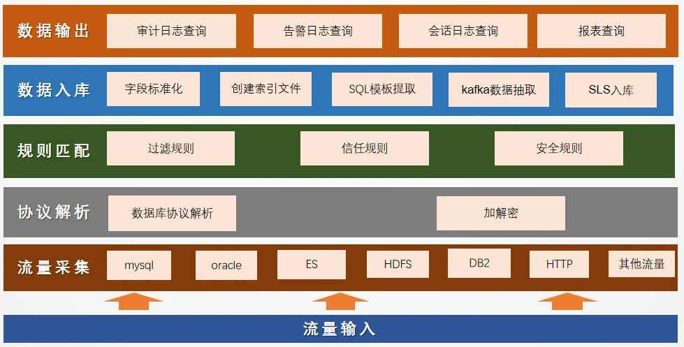
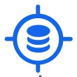
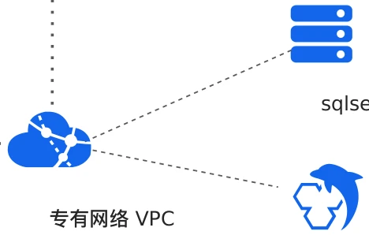

阿里云  
专有云  
数据库审计与风险控制 产品简介  
产品版本：V3.18.6  
文档版本：20260528

**目录**

- [1.什么是数据库审计与风险控制系统](#section-1)
- [2.产品优势](#section-2)
- [3.产品架构](#section-3)
- [4.功能特性](#section-4)
- [5.应用场景](#section-5)
- [6.使用限制](#section-6)
- [7.基本概念](#section-7)

# 1.什么是数据库审计与风险控制系统

数据库审计与风险控制系统以安全事件为中心，以全面审计和精确审计为基础，实时记录网络上的数据库活动，对数据库操作进行细粒度审计的合规性管理，对数据库遭受到的风险行为进行实时告警。它通过对用户访问数据库行为的记录、分析和汇报，来帮助用户事后生成合规报告、事故追根溯源，同时通过大数据搜索技术提供高效查询审计报告，定位事件原因，以便日后查询、分析、过滤，加强内外部数据库网络行为的监控与审计，提高数据资产安全。

# 2.产品优势

产品优势体现。

- **海量协议支持**

  支持审计众多主流的数据库、国产数据库等系统的最新版本，支持协议详情见下表：

  **协议类型**

  **协议**

  **版本**

  5.5、5.6、5.7、8.0

  MySQL

  2008、2012、2014、2016、

  RDS

  SQL Server

  2017、2019

  10、11、12、13、14、15

  PostgreSQL

  8i、9i、10g、11g、12c、18c、

  Oracle

  19c、21c

  4.0、4.1、5.0、5.1、5.5、5.6、

  MySQL

  5.7、8.0

  2000、2005、2008、2012、

  SQL Server

  2014、2016、2017、2019

  11.9、12.5

  Sybase ASE

  v80、v81、v82、v95、v97、

  DB2

  v10.5、v11.1、v11.5

  Informix

  IDS9

  5.5、5.7

  Oscar

  达梦（DM）

  DM7、DM8

  人大金仓（Kingbase)

  V6、V7、V8

  2010、2016、2021

  Cache

  9、10、11、12、13、14

  PostgreSQL

  所有版本

  Teradata

  GBase

  8.5a、8.8s

  5.1、5.2、5.3、5.5、10.0、

  MariaDB

  10.1、10.2、10.3

  1.0、2.0

  Hana

  100、200、300

  GaussDB

  数据库协议-关系型

  LibrA

  6

  K-DB

  11

  Sybase IQ

  15.4

  4.X、5.X

  TiDB

  7、8、9、10、11

  Vertica

  OceanBase

  2.X

  MySQL、PostgreSQL、兼容

  PolarDB

  Oracle语法

  1.0/MySQL5、1.0/MySQL8、

  PolarDB-X

  2.0/MySQL5.7

  MySQL、PostgreSQL

  AnalyticDB

  TBase

  V2

  HighGo

  6.0

  5.6、5.7、8.0

  Percona MySQL

  所有版本

  Clickhouse MySQL Vastbase

  2.x

  5.7、8.0

  TDSQL-C MYSQL

  10、14

  TDSQL-C PostgreSQL

  2.x、3.x、4.x、5.x

  MongoDB

  Hbase（Protobuf）

  所有版本

  Hbase（Thrift）

  thrift2、thrifrt1

  3.x、2.x、1.x

  Hive

  所有版本

  Redis

  所有版本

  Elasticsearch

  Cassandra

  3.X

  所有版本

  HDFS

  impala

  3.X

  数据库协议-非关系型

  graphbase

  6

  5、6

  Greenplum

  Spark SQL(thrift）

  2.x、1.x

  Spark SQL(RESTful）

  2.x、1.x

  所有版本

  SSDB

  ArangoDB

  3.4.9

  Neo4j

  4.2.0 4.x、5.x

  Percona MongoDB

  OrientDB

  3.1.6

  Hbase（Protobuf）

  所有版本

  Hbase（Thrift）

  thrift1、thrift2

  1.X、2.X、3.X

  Hive

  Cassandra

  3.X

  所有版本

  HDFS

  Impala

  3.X

  大数据协议

  5、6

  Graphbase

  Spark SQL(thrift）

  2.x、1.x

  Spark SQL(RESTful）

  2.x、1.x

  所有版本

  SSDB

  所有版本

  MAX COMPUTER

  所有版本

  Clickhouse HTTP

  所有版本

  Clickhouse MySQL

  graphbase

  6

  ArangoDB

  3.4.9

  图数据库协议

  Neo4j

  4.2.0

  OrientDB

  3.1.6

  <table>
    <tr>
      <td>全文</td>
      <td>Elasticsearch</td>
      <td>所有版本</td>
    </tr>
    <tr>
      <td rowspan="3">文档</td>
      <td>MongoDB</td>
      <td>5.x、4.x、3.x、2.x</td>
    </tr>
    <tr>
      <td>ArangoDB</td>
      <td>3.4.9</td>
    </tr>
    <tr>
      <td>Percona MongoDB</td>
      <td>4.x、5.x</td>
    </tr>
    <tr>
      <td>键值</td>
      <td>Redis</td>
      <td>所有版本</td>
    </tr>
    <tr>
      <td rowspan="5">其他协议</td>
      <td>HTTP</td>
      <td>所有版本</td>
    </tr>
    <tr>
      <td>Telnet</td>
      <td>所有版本</td>
    </tr>
    <tr>
      <td>FTP</td>
      <td>所有版本</td>
    </tr>
    <tr>
      <td>HTTPS</td>
      <td>所有版本</td>
    </tr>
    <tr>
      <td>Clickhouse HTTP</td>
      <td>所有版本</td>
    </tr>
  </table>

- **精准审计**

  数据库审计与风险控制系统审计准确率高，且审计日志内容丰富，支持审计客户端工具、主机名、操作系统用户名、执行人、数据库名等信息。

- **极致审计**

  支持超长SQL语句（最长4M）审计。

- **智能分析**

  可以对数据库自动建模及智能对异常行为告警功能。

# 3.产品架构

产品结构介绍。

数据库审计与风险控制系统从产品架构上可以自下而上分成流量输入、协议解析、规则匹配、数据入库、数据输出几个部分。如下图所示：

**流量输入层**

接入需要审计的流量信息，并对流量二三层网络协议和TCP层协议进行解析，提取IP、端口等信息，并根据过滤规则去除不需要进行审计的流量。

**协议解析层**

按照各种不同数据库的传输协议解析数据包中包含的有效信息，提取出数据库名称、SQL语句、客户端工具等信息，对协议的解析精确且全面。

**规则匹配**

将解析出来的SQL语句和安全规则进行匹配，以此来发现SQL语句中存在的可疑风险；规则匹配是采用Hyperscan引擎，Hyperscan利用SIMD（单指令多数据）技术来加速匹配过程，实现了高效的规则匹配。如果规则匹配的过程中没有发现风险，那么需要将SQL预计进行字段标准化形成一条审计日志，如果发现了风险，还会根据风险级别相应的产生一条标准化的告警日志。

**数据入库**

为了达到审计日志和告警日志可回溯的目的，需要将日志进行存储，此时入库程序就会将产生的日志存储到SLS日志服务当中。

**数据输出**

当需要进行审计日志和风险日志查询时，数据库审计与风险控制系统的数据输出模块提供了Web端查询功能。

除此之外，数据库审计系统还有系统管理模块，提供了丰富的管理功能，包括了Agent管理、系统告警等功能。

# 4.功能特性

**一级特性**

**二级特性**

**特性描述**

RDS数据库

支持审计MySQL、SQL Server、PostgreSQL。

支持审计Oracle、MySQL、SQL Server、Sybase ASE、DB2、Informix、Oscar、达梦DM、人大金仓（Kingbase)、Cache、PostgreSQL、Teradata、GBase 、MariaDB、Hana、GaussDB、LibrA 、K-DB、Sybase IQ、TiDB、

关系型数据库

Vertica、OceanBase、PolarDB、PolarDB-X、AnalyticDB、TBase、HighGo、Percona MySQL 、Clickhouse MySQL 、Vastbase 、TDSQL-C MYSQL、TDSQL-C PostgreSQL。

支持审计MongoDB、Hbase（Protobuf）、Hbase（Thrift）、Hive、Redis、Elasticsearch、Cassandra、HDFS、impala、graphbase、Greenplum、

非关系型数据库

Spark SQL(thrift）、SparkSQL(RESTful）、SSDB、ArangoDB、Neo4j、Percona MongoDB、OrientDB。

支持审计Hbase（Protobuf）、Hbase（Thrift）、Hive、Cassandra、

协议支持

大数据

HDFS、Impala、Graphbase、Spark SQL(thrift）、Spark SQL(RESTful）、SSDB、MAX COMPUTER、Clickhouse HTTP、Clickhouse MySQL。

图数据库

支持审计graphbase、ArangoDB、Neo4j、OrientDB。

全文

支持审计Elasticsearch。

文档

支持审计MongoDB、ArangoDB、Percona MongoDB。

键值

支持审计Redis。

支持审计HTTP、HTTPS。

web

资产管理

资产分组

支持对资产进行分组，譬如根据业务类型等进行分组管理。

业务化语言

支持对SQL语句进行语法翻译。

会话分析

支持会话分析，可以掌握账号从登录数据库到登出之间做的所有数据库操作。

支持展示审计日志详情信息，包括客户端IP、客户端MAC、客户端工具、服务器

审计信息显示

IP、服务器MAC、数据库账号、数据库名、SQL操作报文内容、SQL执行的返回结果内容等。

审计展示检索能力

支持以时间范围、报文、资产、数据库账号、客户端IP、服务端IP、操作类型、执

检索能力

行状态等维度进行日志检索。

统计对比

支持对审计到的SQL语句进行TOP 执行次数、执行时长等的统计排序对比。

双向审计

支持对SQL执行的返回内容进行审计，包括执行时长、影响行数、执行结果等。

本地审计

支持直接在数据库服务器上登录数据库进行操作场景的审计。

区分实例审计

支持多实例场景下实例区分审计。

审计信息

支持审计SQL执行的操作。

审计能力

结果集按规则审

支持配置过滤规则，按需进行数据审计。

计

长语句审计

支持长语句的SQL审计。

支持将应用层区域的审计数据与数据库层区域的审计数据综合起来进行“关联分

三层关联

析”。

敏感数据脱敏

支持对手机号、身份证号等敏感数据脱敏显示，也支持自定义配置敏感数据项。

系统内置900多条安全规则，覆盖了主流的应用场景，同时也可以自定义新增安全

规则策略

规则。

规则管理

支持对规则进行管理，包括增删改及设置规则匹配顺序等。

审计风险

数据库漏洞攻击

系统内置MySQL、Oracle等数据库类型的漏洞漏洞检测规则，帮助客户及时发现

监控能力

监测

风险。

支持在资产上挂载安全规则，挂载后有符合规则特征的数据会产生对应规则的告警

风险告警

日志。

风险分析

支持对各告警数据进行统计分析，并对高频告警规则进行展示。

IP地址组

支持创建IP地址组。

对象组

支持创建对象组。

关联数据

应用用户组

支持创建应用用户组。

管理

数据库用户组

支持创建数据库用户组。

时间组

支持创建时间组。

人员

支持创建人员信息。

报表展现

支持使用表格、图表等形式动态显示报表统计数据。

报表内容

报表导出

支持报表数据以HTML、PDF、PNG、WORD、EXCEL和CSV格式进行导出。

报表订阅

支持通过邮件方式发送报表数据，并可设置发送日报周报还是月报。

告警通知

支持以邮件、短信、SNMP及SYSLOG的形式根据高中低等级发送告警日志。

数据外送

日志外送

支持SYSLOG或KAFKA的形式将审计、告警、会话等日志外送出去。

Agent管理

支持对Agent进行管理，包括安装、卸载、启动及停止等。

调试工具

系统提供测试网络连通性等工具，便于出现故障时进行排查。

系统管理

操作日志

支持记录用户登录系统后的操作行为。

所有数据库默认支持从镜像流量或Agent转发流量中解析出对数据库的访问行为，

日志采集方式

针对RDS MySQL类型的数据库，额外支持从数据库自身的日志中解析出访问行为。

部署模式

支持安装Agent插件来采集流量。

旁路Agent部署

支持高可用，当一台故障时另一台可以继续承接流量进行审计，保证审计的稳定

部署模式

高可用

性。

业务监控

对接CMS监控

CMS可以对系统资源使用及业务指标进行实施监控。

# 5.应用场景

描述产品部署的应用场景。

数据库审计与风险控制系统+Agent的部署架构：

- 数据库是在ECS服务器上进行安装部署或者是阿里云云数据库。

- 需要采集运维端/应用端对数据库的访问操作记录。

架构解读：通过在数据库服务器或者数据库运维端/应用端上安装Agent流量采集插件，实现将数据库流量采集并传输到数据库审计与风险控制系统，进行数据库操作的全审计。

数据库审计

sqlserver自建

轻量应用服务器

云数据库 RD

# 6.使用限制

- **限制项**：Agent安装配置要求。

- **限制范围**：最低配置为2核4G。

- **限制说明**：数据库服务器的硬件配置最低2核4G，否则无法安装或安装后不稳定。

# 7.基本概念

本文对文档里出现的专业词做阐释。

- **本地回环口**

  回环接口是设备自身的逻辑接口，并不是真正的物理接口，假如流量是由一个本地进程为另一个本地进程产生的，它们将通过外出链的'lo'回环接口，然后返回进入链的'lo'回环接口。

- **API**

  应用程序编程接口，是一些预先定义的函数，目的是提供应用程序与开发人员基于此接口进行功能使用及开发。
