阿里云  
专有云  
数据库审计与风险控制 用户指南  
产品版本：V3.18.6  
文档版本：20251219

**目录**

- [1.什么是数据库审计与风险控制系统](#section-1)
- [2.使用须知](#section-2)
- [3.快速入门](#section-3)
    - [3.1. 登录Apsara Uni-manager运营控制台](#section-3-1)
    - [3.2. 创建数据库审计与风险控制实例](#section-3-2)
    - [3.3. 入门概述](#section-3-3)
    - [3.4. 登录数据库审计与风险控制系统](#section-3-4)
    - [3.5. Agent部署](#section-3-5)
        - [3.5.1. 自动安装Agent](#section-3-5-1)
        - [3.5.2. 手动安装Agent](#section-3-5-2)
            - [3.5.2.1. 下载Agent安装包](#section-3-5-2-1)
            - [3.5.2.2. Linux操作系统安装Agent程序](#section-3-5-2-2)
                - [3.5.2.2.1. 在线安装](#section-3-5-2-2-1)
                - [3.5.2.2.2. 离线安装](#section-3-5-2-2-2)
            - [3.5.2.3. Aix操作系统安装Agent程序](#section-3-5-2-3)
            - [3.5.2.4. Windows操作系统安装Agent程序](#section-3-5-2-4)
                - [3.5.2.4.1. 在线安装](#section-3-5-2-4-1)
                - [3.5.2.4.2. 离线安装](#section-3-5-2-4-2)
    - [3.6. 添加数据库资产](#section-3-6)
    - [3.7. 规则挂载](#section-3-7)
- [4.查询分析](#section-4)
    - [4.1. 查询审计日志](#section-4-1)
        - [4.1.1. 搜索审计日志](#section-4-1-1)
        - [4.1.2. 在查询结果中添加查询条件](#section-4-1-2)
        - [4.1.3. 查看审计日志详情](#section-4-1-3)
        - [4.1.4. 保存查询结果](#section-4-1-4)
        - [4.1.5. TOP SQL](#section-4-1-5)
    - [4.2. 查看告警日志](#section-4-2)
    - [4.3. 查看会话日志](#section-4-3)
    - [4.4. 查询SQL模板](#section-4-4)
- [5.报表中心](#section-5)
    - [5.1. 报表预览](#section-5-1)
    - [5.2. 报表订阅](#section-5-2)
- [6.智能分析](#section-6)
    - [6.1. 配置行为模型学习任务](#section-6-1)
    - [6.2. 结束学习](#section-6-2)
    - [6.3. 模型查询](#section-6-3)
- [7.规则配置](#section-7)
    - [7.1. 安全规则](#section-7-1)
        - [7.1.1. 规则管理](#section-7-1-1)
            - [7.1.1.1. 启用规则](#section-7-1-1-1)
            - [7.1.1.2. 禁用规则](#section-7-1-1-2)
        - [7.1.2. 白名单管理](#section-7-1-2)
        - [7.1.3. 设置](#section-7-1-3)
    - [7.2. 信任规则](#section-7-2)
    - [7.3. 过滤规则](#section-7-3)
        - [7.3.1. 按IP过滤](#section-7-3-1)
        - [7.3.2. 按SQL模板过滤](#section-7-3-2)
        - [7.3.3. 按规则过滤](#section-7-3-3)
    - [7.4. 规则维护](#section-7-4)
    - [7.5. 关联数据](#section-7-5)
        - [7.5.1. IP组管理](#section-7-5-1)
            - [7.5.1.1. 新增IP组](#section-7-5-1-1)
            - [7.5.1.2. 导入IP组](#section-7-5-1-2)
        - [7.5.2. 数据库账号组管理](#section-7-5-2)
            - [7.5.2.1. 导入数据库账号组](#section-7-5-2-1)
            - [7.5.2.2. 新增数据库账号组](#section-7-5-2-2)
        - [7.5.3. 应用用户组管理](#section-7-5-3)
            - [7.5.3.1. 新增应用用户组](#section-7-5-3-1)
            - [7.5.3.2. 导入应用用户组](#section-7-5-3-2)
        - [7.5.4. 时间组管理](#section-7-5-4)
            - [7.5.4.1. 新增时间组](#section-7-5-4-1)
            - [7.5.4.2. 导入时间组](#section-7-5-4-2)
        - [7.5.5. 对象组管理](#section-7-5-5)
            - [7.5.5.1. 新增对象组](#section-7-5-5-1)
            - [7.5.5.2. 导入对象组](#section-7-5-5-2)
        - [7.5.6. 人员管理](#section-7-5-6)
            - [7.5.6.1. 新增人员](#section-7-5-6-1)
            - [7.5.6.2. 导入人员](#section-7-5-6-2)
- [8.通知外送](#section-8)
    - [8.1. 告警通知](#section-8-1)
        - [8.1.1. 邮件方式通知告警](#section-8-1-1)
        - [8.1.2. 短信方式通知告警](#section-8-1-2)
        - [8.1.3. SNMP方式通知告警](#section-8-1-3)
        - [8.1.4. Syslog方式通知告警](#section-8-1-4)
    - [8.2. 日志外送](#section-8-2)
        - [8.2.1. 通过Syslog方式发送](#section-8-2-1)
        - [8.2.2. 通过KAFKA方式发送](#section-8-2-2)
- [9.系统管理](#section-9)
    - [9.1. Agent管理](#section-9-1)
        - [9.1.1. Agent安装](#section-9-1-1)
        - [9.1.2. Agent管理](#section-9-1-2)
            - [9.1.2.1. 监控Agent状态](#section-9-1-2-1)
            - [9.1.2.2. 修改Agent配置](#section-9-1-2-2)
            - [9.1.2.3. Agent标签](#section-9-1-2-3)
            - [9.1.2.4. 其他操作](#section-9-1-2-4)
    - [9.2. 系统配置](#section-9-2)
    - [9.3. 系统维护](#section-9-3)
    - [9.4. 辅助功能](#section-9-4)
        - [9.4.1. IP别名](#section-9-4-1)
        - [9.4.2. 账号别名](#section-9-4-2)
        - [9.4.3. 数据脱敏](#section-9-4-3)
        - [9.4.4. 应用身份识别](#section-9-4-4)
    - [9.5. 操作日志](#section-9-5)

# 1.什么是数据库审计与风险控制系统

数据库审计与风险控制是专业的数据库应用安全防护产品，帮助用户应对网站运营中的安全风险，为数据库应用提供全方位的防护，提供覆盖数据库使用全生命周期的安全防护解决方案。

产品功能分成原始信息收集、审计信息标准化、审计信息筛选、预警与报表四大模块。

**原始信息收集**

- 自建数据库/阿里云云数据库通过部署Agent插件方式进行流量采集。

**审计信息标准化**

- 支持国内外主流数据库，包括传统的数据库系统、大数据系统和Web系统等。

- 将不同数据库协议按照标准化的格式进行展示，方便管理人员阅读和分析。

**审计信息筛选**

- 根据5W1H（What、Where、When、Who、Why、How）分析模型进行规则设置，提供丰富的规则条件配置方法。

- 根据采集到的数据进行数据分析和产生行为模型。

- 审计结果查询。

**预警与报表**

- 内置900多条安全相关的风险分析规则。

- 规则灵活，可根据实际业务场景需要进行自定义规则配置。

- 内置23种高价值、符合法律法规的分析报表，可从数据库账号增删、密码修改、权限变更、高危操作、违规告警、账号复用、数据库性能分析等维度进行分析。

# 2.使用须知

在登录云盾控制台前，您需要确认本地PC浏览器和网络符合以下条件。

配置要求表

<table>
  <tr>
    <th width="90">使用内容</th>
    <th>使用约束</th>
  </tr>
  <tr>
    <td>浏览器</td>
    <td>推荐使用Chrome或firefox浏览器</td>
  </tr>
  <tr>
    <td>操作系统</td>
    <td>• Windows XP版本 • Windows 7及以上版本 • Mac系统</td>
  </tr>
</table>

网络端口开放需求表

| 源设备 | 源端口 | 目的设备 | 目的端口 | 协议 | 用途 |
| --- | --- | --- | --- | --- | --- |
| 客户端PC | any | 系统控制台 | 443 | TCP | 进行web界面管理 |
| Agent所在服务器 | any | 系统控制台 | 13001 | TCP | 系统下发配置信息至Agent |
| Agent所在服务器 | any | 系统控制台 | 13002 | TCP | 系统接收Agent发送的数据 |
| Agent所在服务器 | any | 系统控制台 | 8443 | TCP | Agent在线安装/下载 |

# 3.快速入门

此章节将帮助您进行系统的基础配置，实现数据库资产的审计。

## 3.1. 登录Apsara Uni-manager运营控制台

本文主要向您介绍如何登录Apsara Uni-manager运营控制台。

**前提条件**

- 登录Apsara Uni-manager运营控制台前，确认您已从部署人员处获取Apsara Uni-manager运营控制台的服务域名地址。

- 推荐使用Chrome浏览器。

**操作步骤**

1. 在浏览器地址栏中，输入Apsara Uni-manager运营控制台的服务域名地址，按回车键。

2. 输入正确的用户名及密码。

   请向运营管理员获取登录控制台的用户名和密码。

   > **说明**
   >
   > - **首次登录**
   >
   >   首次Apsara Uni-manager运营控制台时，需要修改登录用户名的密码，请按照提示完成密码修改。为提高安全性，密码长度必须为10~32位，且包含英文字母大小写、阿拉伯数字和特殊符号（感叹号（!）、at（@）、井号（#）、美元符号（$）、百分号（%）等）。
   >
   > - **忘记密码**
   >
   >   用户忘记登录密码时，单击忘记密码，输入账户名（当前账号的用户名）、邮箱（当前用户创建时所录入的邮箱）和验证码后，重置密码的链接将发至邮箱，进入链接后用户可输入新密码。

3. 单击**账号登录**。

4. 如果账号已激活MFA多因素认证，请根据以下两种情况进行操作：

   - 管理员强制开启MFA后的首次登录：

     <ol type="a">

     <li>

     在绑定虚拟MFA设备页面中，按页面提示步骤绑定MFA设备。

     </li>

     <li>

     按照步骤2重新输入账号和密码，单击**账号登录**。

     </li>

     </ol>

     <ol type="i" start="100">

     <li>

     输入6位MFA码后单击**认证**。

     </li>

     </ol>

   - 您已开启并绑定MFA：

     输入6位MFA码后单击**认证**。

     > **说明**
     >
     > 绑定并开启MFA的操作请参见管理多因素认证。

## 3.2. 创建数据库审计与风险控制实例

本文介绍如何创建数据库审计与风险控制实例。

**操作步骤**

1. 登录Apsara Uni-manager运营控制台。

2. 在数据库审计实例界面，单击**数据库审计与风险控制**，然后单击界面右上角的**创建实例。**

3. 进入创建实例面板，设置组织、资源集、VPC ID、Vswith ID、套餐规格及数据库实例授权数等，然后单击**确定**。

   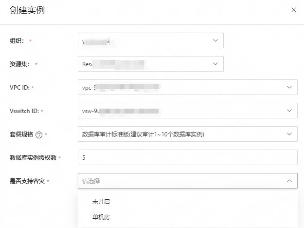

## 3.3. 入门概述

介绍系统入门主要业务流程。

创建数据库审计与风险控制示例后，可按如下流程进行系统的配置及使用。

险控制

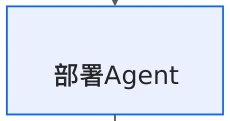

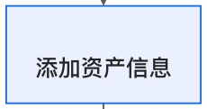

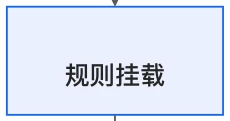

## 3.4. 登录数据库审计与风险控制系统

本文介绍如何登录数据库审计与风险控制系统。

**操作步骤**

1. 登录Apsara Uni-manager运营控制台。

2. 在控制台顶部菜单栏，单击**安全>数据安全>数据库审计**。

3. 进入数据库审计界面后，单击**数据库审计与风险控制。**

4. 选择需要登录的数据库审计与风险控制实例，单击操作栏里的**详情**按钮登录到系统。

## 3.5. Agent部署

此章节介绍Agent的安装部署方法。

**前提条件**

安装审计代理插件，需放通Agent所在服务器和系统之间的网络通信，具体见下表。

网络放通端口表

| 源设备 | 源端口 | 目的设备 | 目的端口 | 协议 | 用途 |
| --- | --- | --- | --- | --- | --- |
| Agent所在服务器 | any | 系统控制台 | 13001 | TCP | 系统下发配置信息至Agent |
| Agent所在服务器 | any | 系统控制台 | 13002 | TCP | 系统接收Agent发送的数据 |
| Agent所在服务器 | any | 系统控制台 | 8443 | TCP | Agent在线安装/下载 |

### 3.5.1. 自动安装Agent

本文介绍如何在数据库审计与风险控制系统中为服务器自动安装Agent。

**操作步骤**

1. 登录数据库审计与风险控制系统。

2. 在左侧导航栏，单击**系统管理 > Agent管理**，进入Agent安装页签，在通过云助手安装功能栏下，单击**开始安装**。

   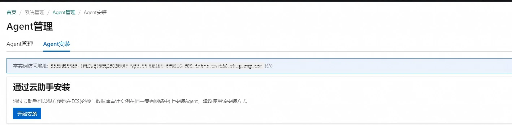

3. 在弹出的安装页面，可通过实例ID进行搜索选择需要安装Agent的服务器，单击**安装**。

   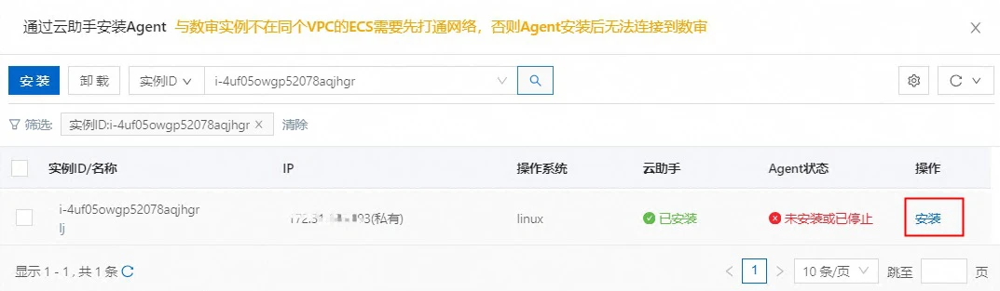

4. 待安装完成后，Agent状态会变为**运行中，已连接**。

   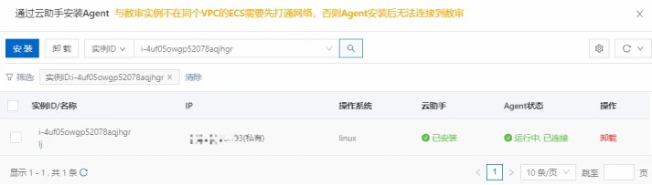

### 3.5.2. 手动安装Agent

#### 3.5.2.1. 下载Agent安装包

本文介绍如何下载Agent安装包。

**操作步骤**

1. 登录数据库审计与风险控制系统。

2. 首先确认要安装Agent服务器的操作系统及CPU架构，在菜单栏选择**系统管理>Agent管理**进入Agent管理页面，选择**Agent安装**页签，点击下载对应操作系统的Agent安装包。

   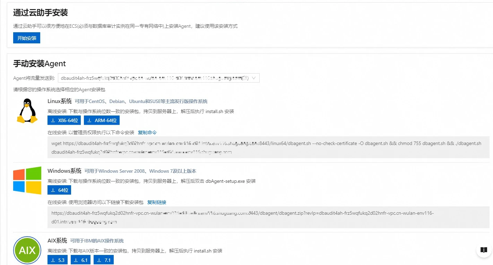

3. 上传Agent安装包到要审计的服务器。

   > **重要**
   >
   > - 下载的Agent安装包默认会将流量转发给当前系统的内网地址，如果要审计服务器和系统使用公网地址通信，请在解压后的Agent路径下agent.ini配置文件中找到serviceIp选项进行地址修改。
   >
   > - 无论是Linux版本安装包、AIX版本安装包还是Windows版本安装包，文件夹中均有“ReadMe”文档，文档内包含使用说明、文件说明、注意事项、运行环境说明、配置文件说明。在安装前请仔细阅读该文档并严格按照要求进行操作。

#### 3.5.2.2. Linux操作系统安装Agent程序

介绍Linux系统在线及离线安装Agent的两种方式。

##### 3.5.2.2.1. 在线安装

本文介绍如何在Linux操作系统在线安装Agent程序。

**前提条件**

- 服务器预装有wget命令。

- 数据库服务器到系统的8443端口通。

**操作步骤**

1. 在菜单栏选择**系统管理 > Agent管理**进入Agent管理页面，选择**Agent安装**页签，点击Linux系统下方的**复制命令**，获取Linux系统的在线安装链接。

   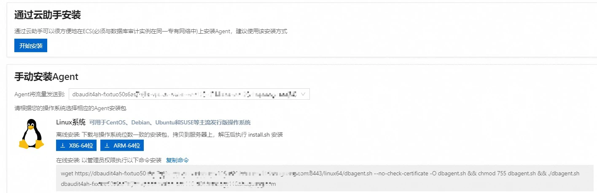

2. 以root用户登录Linux服务器操作系统CLI界面，执行在线安装命令。

   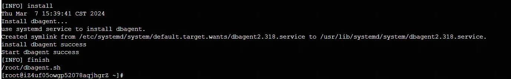

3. Agent程序安装完成并运行之后，登录Web管理平台，在菜单栏选择**系统管理 > Agent管理**，选择Agent管理页签，进入Agent管理列表页面，确认Agent连接状态为**连接正常**即可。

##### 3.5.2.2.2. 离线安装

本文介绍如何在Linux操作系统离线安装Agent程序。

**操作步骤**

1. 安装包下载完之后，将Agent安装包上传到Linux服务器指定目录，使用tar -zxvf命令进行解压。

   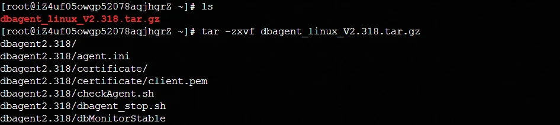

2. 进入Agent解压安装目录，执行install.sh脚本即可安装Agent程序。

   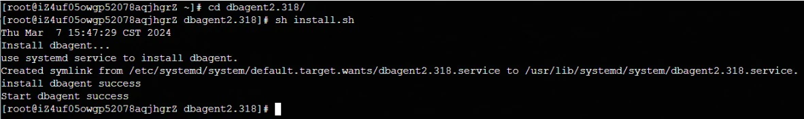

   > **说明**
   >
   > - 禁止直接运行二进制文件。
   >
   > - 解压目录不能出现空格。
   >
   > - 每次更换运行或解压目录需重新运行安装脚本。
   >
   > - Linux环境需以root用户运行脚本，指定解释器bash，或不指定解释器直接运行。

#### 3.5.2.3. Aix操作系统安装Agent程序

本文介绍如何在Aix操作系统安装Agent程序。

**操作步骤**

1. 安装包下载完之后，将Agent安装包上传到AIX服务器指定目录。

   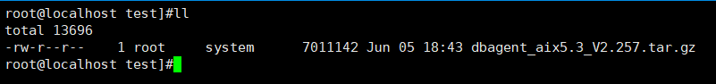

2. 先使用“gunzip dbagent_aix5.3_V2.257.tar.gz”命令解压Agent安装包，生成tar包，再使用“tar -xvf dbagent_aix5.3_V2.257.tar”命令解压tar包。

   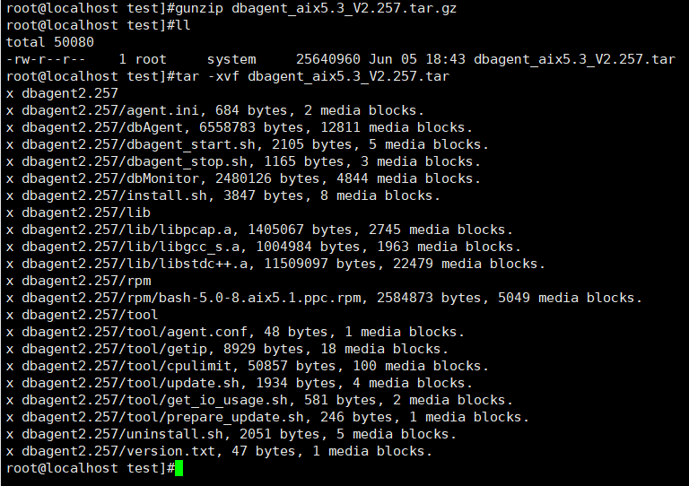

3. 在安装目录执行“./install.sh”命令即可安装Agent程序。

   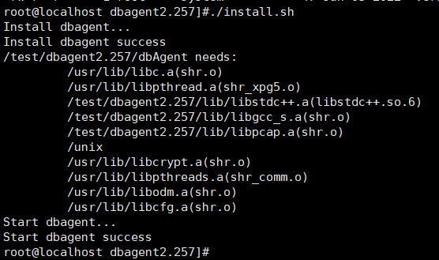

#### 3.5.2.4. Windows操作系统安装Agent程序

本章节介绍Windows系统在线和离线安装Agent的两种方式。

##### 3.5.2.4.1. 在线安装

本文介绍如何在Windows操作系统在线安装Agent程序。

**前提条件**

数据库服务器到数据库审计与风险控制的8443端口通。

**操作步骤**

1. 在菜单栏选择**系统管理 > Agent管理**进入Agent管理页面，选择**Agent安装**页签，单击Windows系统下方的**复制链接**，获取安装包下载链接。

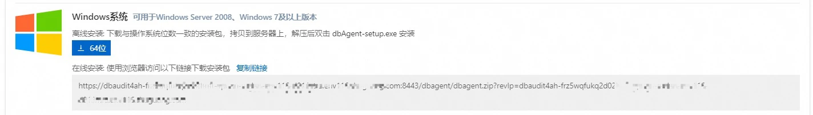

2. Windows服务器上打开浏览器，访问下载链接，自动下载Windows的安装包。

3. 参见离线安装。

##### 3.5.2.4.2. 离线安装

本文介绍如何进行Agent的离线安装。

**操作步骤**

1. 安装包下载完成之后，将Agent安装包上传到Windows服务器上。

2. 解压压缩包到指定运行目录。在Agent的安装目录以管理员身份运行dbAgent-setup.exe进入安装向导，单击**下一步**，如下图所示。

   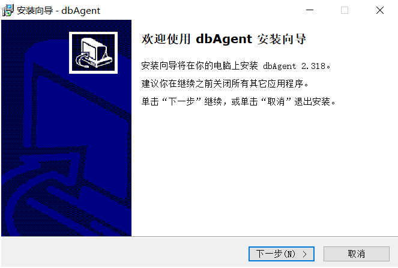

3. 单击**下一步**之后显示Install winpcap和Install npcap两个选项。

   - 没有本地审计的需求请选择Install winpcap。

   - 需要部署本地审计，则选择Install npcap。

   - 默认推荐使用Install winpcap安装方式，对于Windows操作系统的兼容性较好。

   - Data encrypted transmission仅需要配置agent数据传输加密情况下才需要勾选。

   > **说明**
   >
   > 本地审计含义：数据库和应用部署在同一台服务器上，或者运维客户端安装在数据库服务器上，流量交互都在本地。

   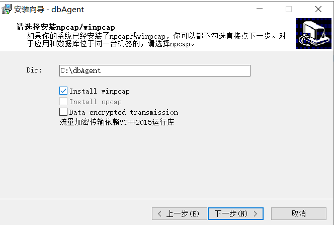

4. 单击**安装**即可。

   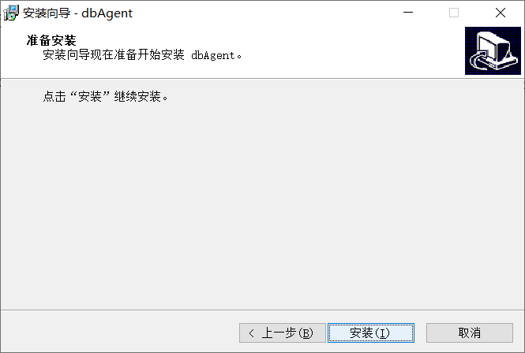

## 3.6. 添加数据库资产

添加资产包括单个添加和批量导入两种方式。本文介绍如何添加数据库资产。

**单个添加方式**

1. 在菜单栏选择**资产 > 资产管理**，进入资产管理页面，单击**添加**。

   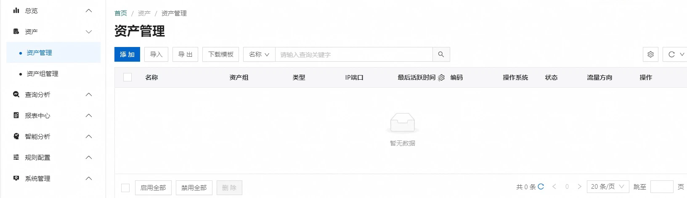

2. 在弹出的**添加资产**页面编辑相关信息。

   详细配置项和说明请参见下表。

   | 配置项 | 说明 |
   | --- | --- |
   | 保存后不关闭，继续添加资产 | 勾选此选项，则保存后继续停留在添加资产界面，方便添加下一个新的资产。 |
   | 保存时启用推荐的规则 | 勾选此选项，则保存时添加的资产会使用系统推荐的规则；不勾选此选项，保存时添加的资产不会使用系统推荐的规则。 |
   | 类型 | 设置资产类型，包括RDS数据库、关系型、非关系型、大数据、图形、全文、文档、键值、其他等类型。 |
   | 实例ID | 资产类型为RDS时必填，且会自动拉取已购买的RDS实例信息以供选择。 |
   | 资产组 | 设置资产所隶属的资产组，有关资产组的更多信息请参考资产组管理。 |
   | 名称 | 必须为中文字符、字母、数字、下划线“_”、点“.”或短横“-”，长度不超过64字符。 |
   | IP（域名）端口 | 数据库资产所在ECS服务器的IP及数据库端口号。您可以单击<strong>增加IP与端口</strong>，添加多个IP及端口号。当资产类型为RDS且选定实例ID后，会自动填充对应域名及端口信息。 |

**批量导入方式**

1. 单击**下载模板**，将模板文件下载至本地。

   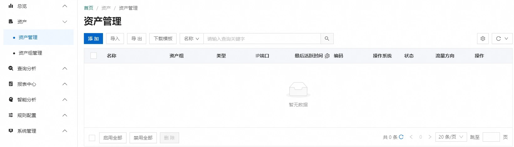

2. 根据模板填写要求进行资产信息填写，填写完成后，单击**导入**进行模板上传即可。

## 3.7. 规则挂载

资产挂载规则后可对资产进行的数据库访问操作行为进行安全检查，检测是否存在危险行为，帮助客户进行数据库安全治理。本文介绍如何配置规则挂载。

**操作步骤**

规则挂载有两种方式。

- 方式一

  在添加资产时，直接勾选右上角的**保存时启用推荐规则**。

  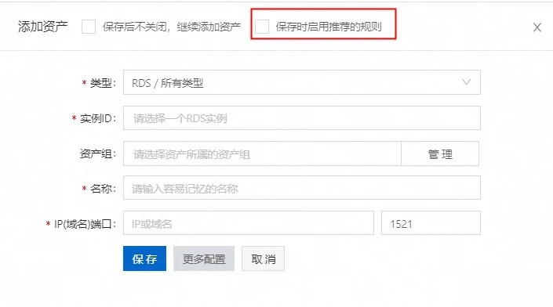

- 方式二

  添加资产后对多个资产统一进行规则挂载，具体参见启用规则。

# 4.查询分析

数据库审计与风险控制系统支持从多个维度查看数据库的访问操作记录。

- 可以根据审计日志查询所有的访问行为。

- 通过告警日志查看可疑的访问行为。

- 通过会话日志可以查看每一次访问行为内所有的访问记录。

- 通过SQL模板查询SQL语句操作记录。

## 4.1. 查询审计日志

数据库审计与风险控制系统通过对双向数据包进行解析、识别以及还原，不仅可以对数据库操作请求进行实时审计，还可对数据库系统返回结果进行完整的还原和审计。包括SQL报文、数据库命令执行时长、执行的结果集、客户端工具、客户端IP地址、服务端端口、数据库账号、对象、执行状态、数据库类型以及报文长度等内容。

### 4.1.1. 搜索审计日志

本文介绍如何搜索审计日志。

**操作步骤**

1. 登录数据库审计与风险控制系统。

2. 在左侧导航栏，选择**查询分析 > 审计日志**。

3. 选择**审计日志**页签，设置查询条件（时间范围、报文、资产、数据库账号、客户端IP、服务端IP、操作类型、执行状态等），单击**搜索**即可查询相关审计日志。

   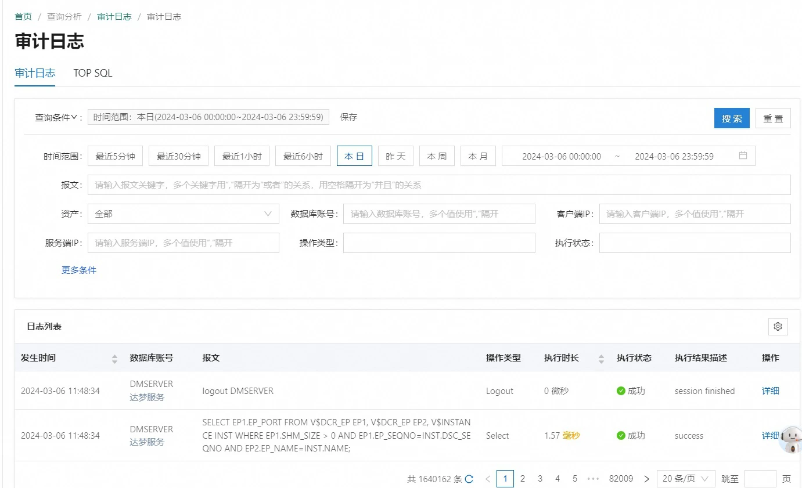

4. 单击**更多条件**弹出**更多条件**对话框，勾选查询条件，单击**确定**添加相应查询条件，单击**恢复默认**可恢复至默认查询条件。

   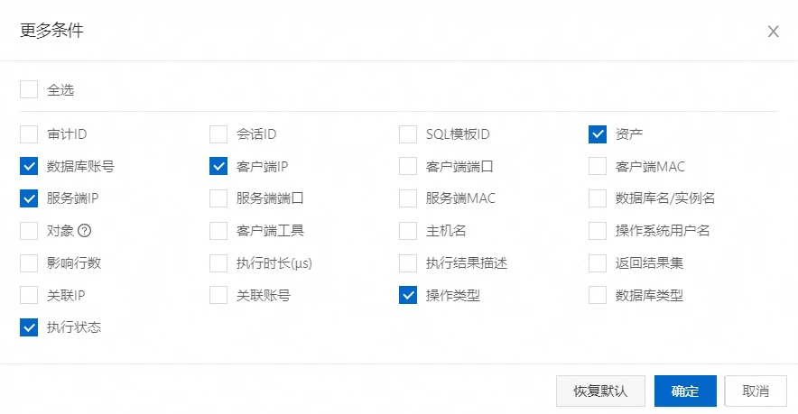

   各查询条件的说明如下。

   <table>
     <tr>
       <th width="144">选项</th>
       <th>说明</th>
     </tr>
     <tr>
       <td>时间范围</td>
       <td>设置日志查询的时间范围，默认为“最近5分钟”。</td>
     </tr>
     <tr>
       <td>报文</td>
       <td>审计到的SQL语句，可填多个关键字，用空格隔开，表示同时满足。</td>
     </tr>
     <tr>
       <td>审计ID</td>
       <td>唯一标识审计记录的ID。</td>
     </tr>
     <tr>
       <td>会话ID</td>
       <td>唯一标识会话记录的ID。</td>
     </tr>
     <tr>
       <td>SQL模板ID</td>
       <td>标识SQL模板的ID。</td>
     </tr>
     <tr>
       <td>资产</td>
       <td>可选择资产组或资产，资产组和资产可多选和混合选择，默认为全部资产。</td>
     </tr>
     <tr>
       <td>数据库账号</td>
       <td>登录到数据库的账号。</td>
     </tr>
     <tr>
       <td>客户端IP</td>
       <td>客户端IP地址，可填写IPv4和IPv6地址。</td>
     </tr>
     <tr>
       <td>客户端端口</td>
       <td>客户端端口号。</td>
     </tr>
     <tr>
       <td>客户端MAC</td>
       <td>客户端的MAC地址。</td>
     </tr>
     <tr>
       <td>服务端IP</td>
       <td>服务端IP地址，可填写IPv4或IPv6地址。</td>
     </tr>
     <tr>
       <td>服务端端口</td>
       <td>服务端端口号。</td>
     </tr>
     <tr>
       <td>服务端MAC</td>
       <td>服务端的MAC地址。</td>
     </tr>
     <tr>
       <td>数据库名/实例名</td>
       <td>数据库名称或者实例名称。</td>
     </tr>
     <tr>
       <td>对象</td>
       <td>数据库的库、表、字段、视图、存储过程、函数、触发器、索引、用户、角色、权限等数据库对象</td>
     </tr>
     <tr>
       <td>客户端工具</td>
       <td>客户端工具名称。</td>
     </tr>
     <tr>
       <td>主机名</td>
       <td>客户端主机名称。</td>
     </tr>
     <tr>
       <td>操作系统用户名</td>
       <td>客户端所在操作系统的用户名。</td>
     </tr>
     <tr>
       <td>影响行数</td>
       <td>SQL返回的影响行数，查询格式为M-N，如：10-10，10-20。</td>
     </tr>
     <tr>
       <td>执行时长</td>
       <td>执行SQL所用时长，查询格式为M-N，如：10-10，10-20。</td>
     </tr>
     <tr>
       <td>执行结果描述</td>
       <td>SQL语句执行完成后的结果描述，如：ORA-00942: table or view does not exist。</td>
     </tr>
     <tr>
       <td>返回结果集</td>
       <td>Select等语句执行后产生的返回结果集。默认保存5行数据，最大保存长度64KB。可在<strong>资产管理</strong>页面，点击&lt;<strong>编辑资产</strong>&gt;，修改保存行数和最大保存长度。</td>
     </tr>
     <tr>
       <td>关联IP/账号</td>
       <td>关联用户的客户端IP和账号。</td>
     </tr>
     <tr>
       <td>操作类型</td>
       <td>审计到的数据库操作的类型。</td>
     </tr>
     <tr>
       <td>数据库类型</td>
       <td>系统支持审计的数据库类型。</td>
     </tr>
     <tr>
       <td>执行状态</td>
       <td>默认为全部，可选择执行成功、执行失败、未知。</td>
     </tr>
   </table>

5. 单击  图标，即可设置查询结果的展示列。

   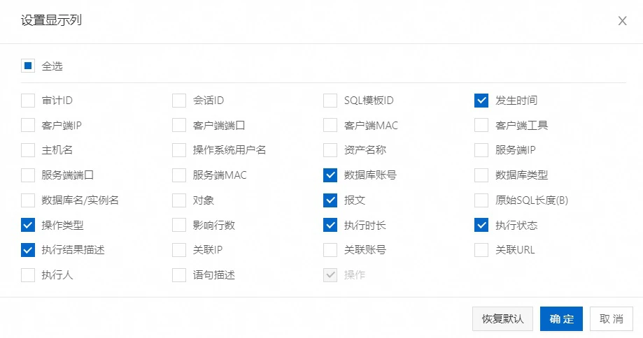

### 4.1.2. 在查询结果中添加查询条件

本文介绍如何在查询结果中添加查询条件。

**操作步骤**

1. 登录数据库审计与风险控制系统。

2. 在左侧导航栏，选择**查询分析 > 审计日志**。

3. 选择**审计日志**页签，通过单击**会话ID**、**客户端IP**、**客户端工具**、**主机名**、**操作系统用户名**、**服务端IP**、**数据库账号**、**数据库名/实例名**、**关联IP**、**关联账号**列的内容实现直接添加到查询条件并进行查询。

   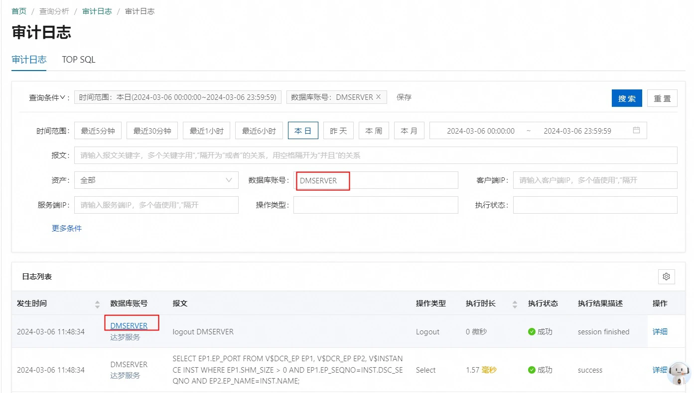

### 4.1.3. 查看审计日志详情

本文介绍如何查看审计日志详情。

**操作步骤**

1. 在查询结果列表中，单击**操作**列的**详细**，查看审计日志的详细信息。

   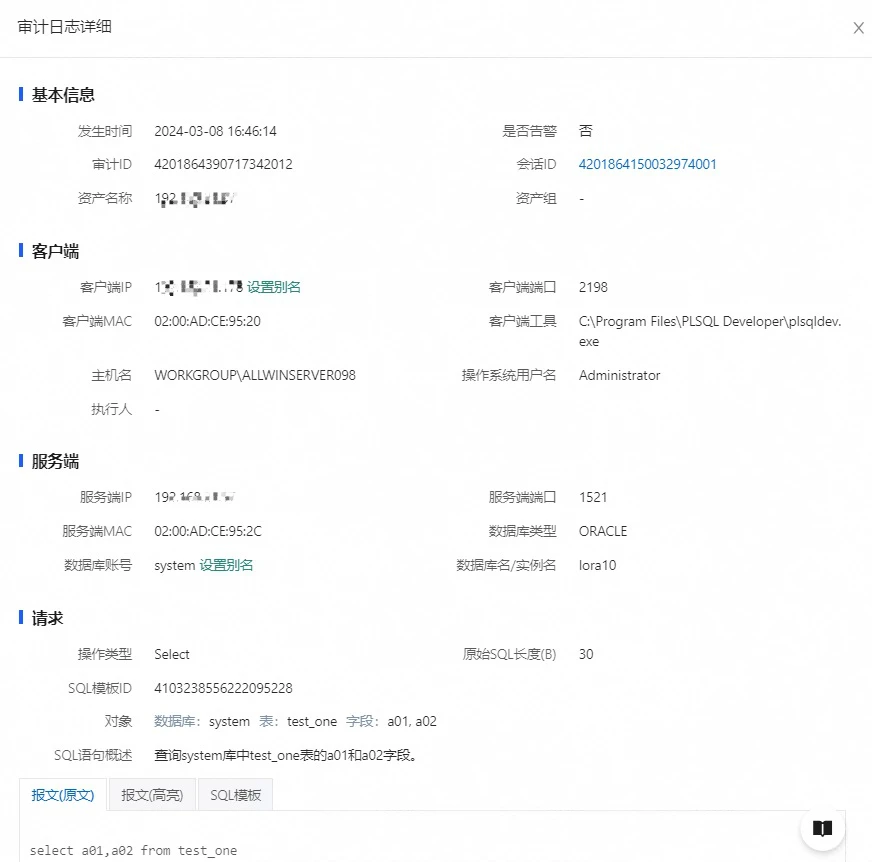

2. 单击客户端IP右边的**设置别名**，可以跳转到**新增IP别名**或者**编辑IP别名**页面。

   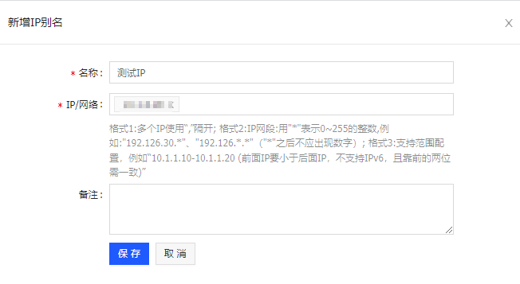

3. 单击数据库账号右边的**设置别名**，可以跳转到**新增账号别名**或者**编辑账号别名**页面。

   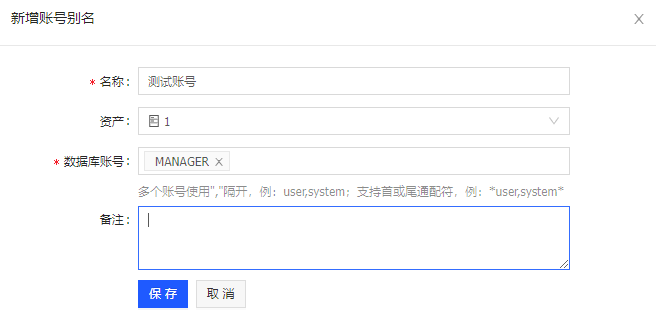

4. 单击**C/S应用用户名提取**，弹出**新增C/S应用身份识别配置**对话框，包括设置资产、SQL模板、以及参数的位置，单击**确定**。

   设置C/S应用用户名提取后，该设置将新增至C/S应用身份识别列表中。详情请参见应用身份识别。

   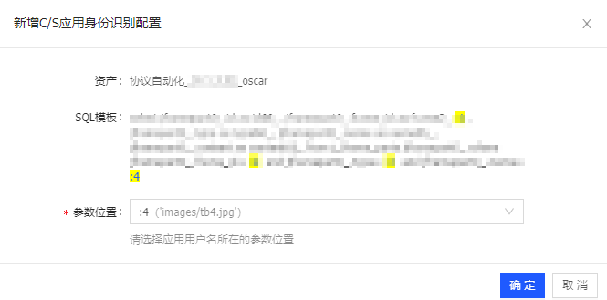

5. 在审计日志详情页面右下角单击**取证**，弹出**下载**对话框，可下载本条审计日志详情的完整页面。单击**上一条**或**下一条**可切换至临近的审计日志。

6. 在审计日志详情页面的请求部分，单击**SQL模板**可查看该报文的SQL模板，单击**过滤改模板**可以将该SQL模板添加过滤条件，也可以将已经添加为过滤条件的SQL模板取消过滤。详情请参见按SQL模板过滤。

   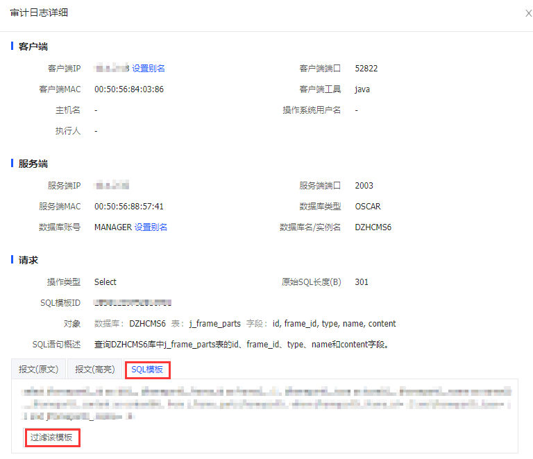

### 4.1.4. 保存查询结果

您可以对查询条件进行保存，方便后续查询。本文介绍如何保存查询结果。

**操作步骤**

1. 单击**查询条件**文本框中的**保存**。

   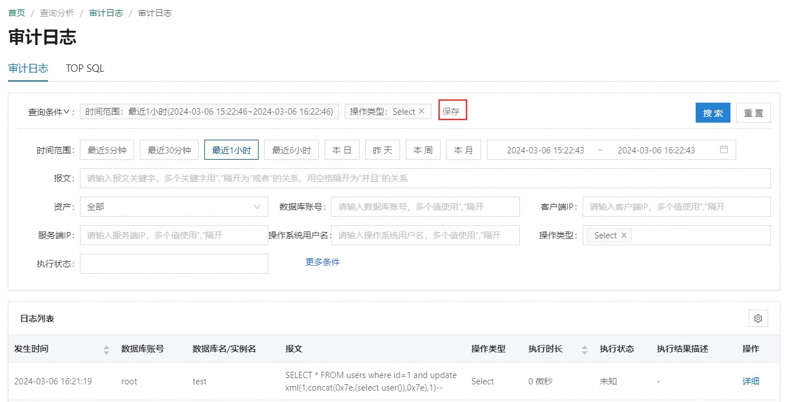

2. 在弹出的**保存查询条件**对话框中编辑名称，然后单击**确定**。

   名称必须为中文字符、字母、数字、下划线“_”、点“.”或短横“-”，长度不超过64字符。

   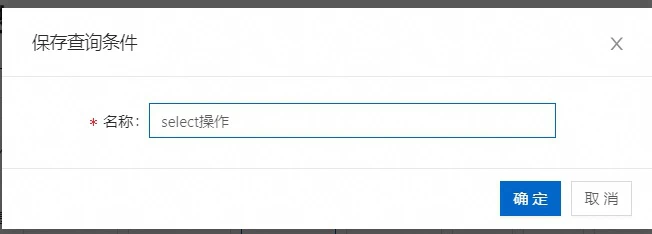

3. 单击**查询条件**后的  图标，可查看已保存的查询条件。

   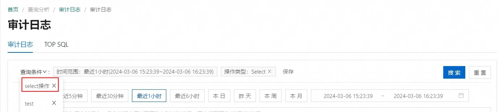

### 4.1.5. TOP SQL

本文介绍如何查看TOP SQL。

**操作步骤**

1. 登录数据库审计与风险控制系统。

2. 在左侧导航栏，选择**查询分析 > 审计日志**。

3. 选择**TOP SQL**页签，可设置过滤条件（时间范围、资产、Top数量、平均执行时长、执行次数、总执行时长），查询符合过滤条件的TOP SQL信息。

   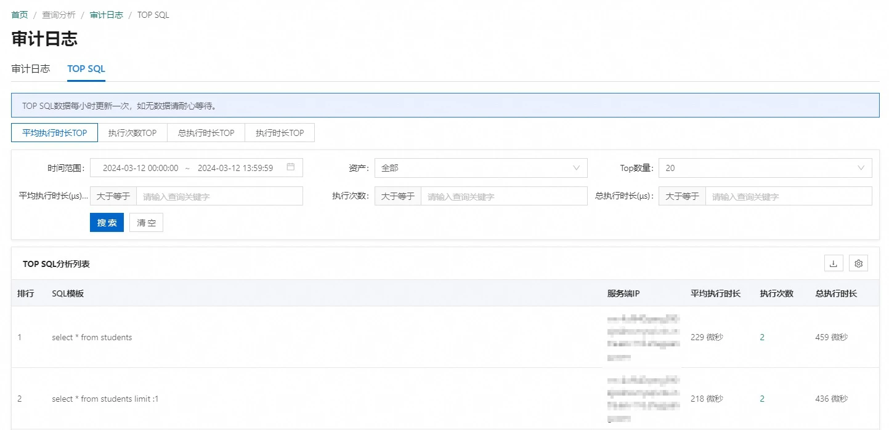

4. 在**平均执行时长TOP**、**执行次数TO**P和**总执行时长TOP**的TOP SQL分析列表中单击**执行次数**对应的显示列，可以跳转到**审计日志**页面。

   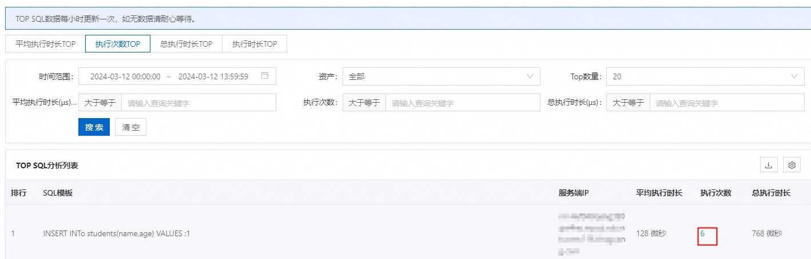

5. 在**执行时长TOP**的TOP SQL分析列表中，单击**审计ID**可以跳转到**审计日志**页面查看更详细的日志信息。

   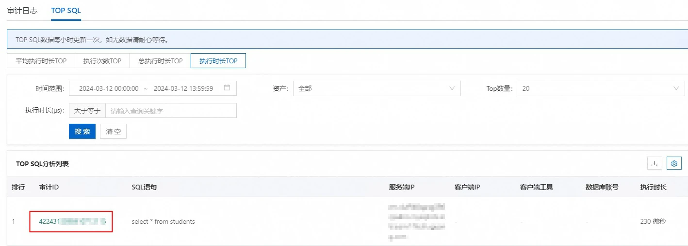

## 4.2. 查看告警日志

当系统根据安全规则捕捉到异常访问时，会根据匹配的安全规则的级别产生相应级别的告警信息。系统支持在告警日志页面查看的所有产生告警的SQL语句的信息和告警等级等相关内容，并可以根据时间、字段和告警等级、规则名称等条件进行筛选。

**查询告警日志**

1. 登录数据库审计与风险控制系统。

2. 在左侧导航栏，选择**查询分析 > 告警日志**。

3. 单击**告警日志**页签，设置查询条件（如时间范围、报文、资产等），单击**搜索**即可查询相关告警日志。

   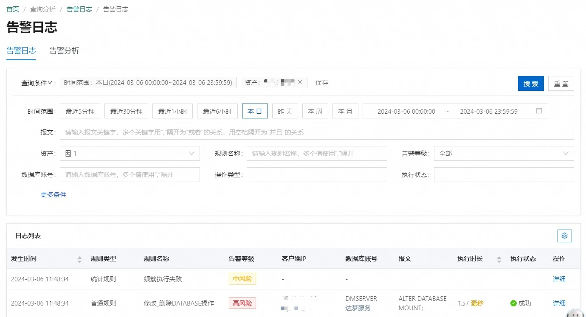

4. 在告警日志列表中，单击右侧**操作**列的**详细**可以查看该告警记录的详细信息，包括告警记录基本信息、客户端信息、服务端信息、请求详情、响应详情。

   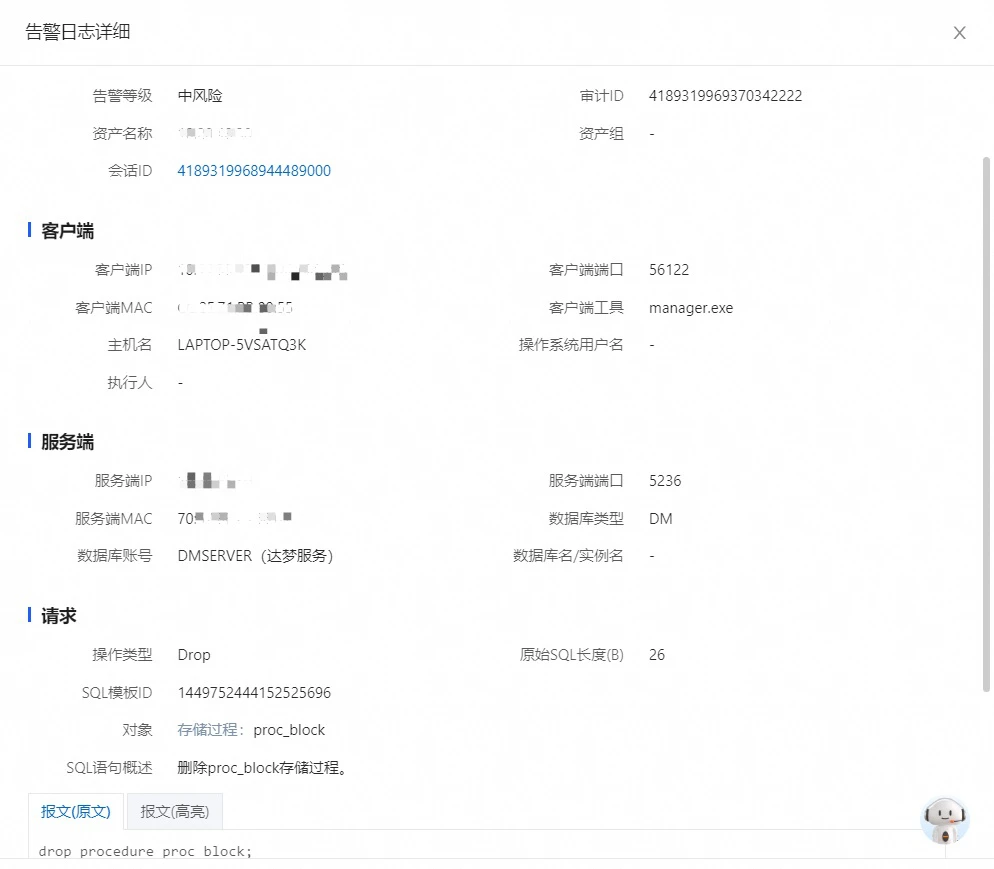

当触发的规则为统计规则告警时，需要进入**告警详情**页面才能查看客户端、服务端等信息。统计规则是根据不同维度来对多条审计日志进行统计展示，存在多条日志客户端IP/连接工具/数据库类型/SQL模板一致但报文等信息不一致的情况，所以必须进入至**告警详情**页面才可查看。

1. 在**告警日志**页面，单击统计规则告警项操作列的**详细**，进入**告警日志详细**页面。

   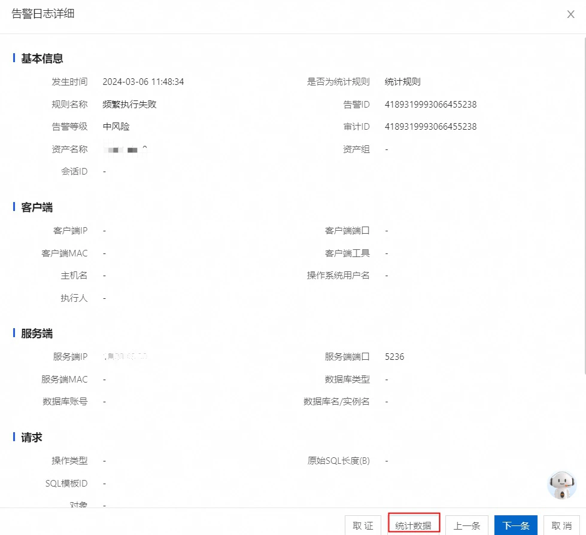

2. 单击**统计数据**，可查看客户端、数据库账号等信息。

   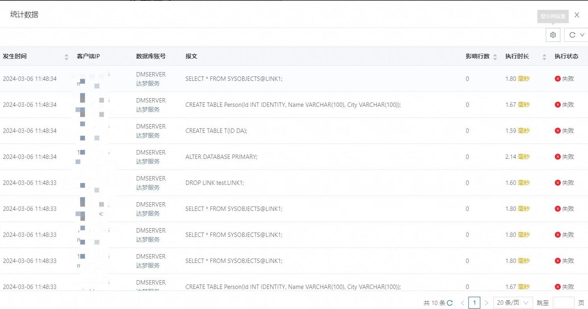

**查看告警分析**

1. 登录数据库审计与风险控制系统。

2. 在左侧导航栏，选择**查询分析 > 告警日志**。

3. 单击**告警分析**页签，可设置过滤条件（时间范围、规则名称、资产、数据库账号、客户端IP），查询符合过滤条件的告警信息。

   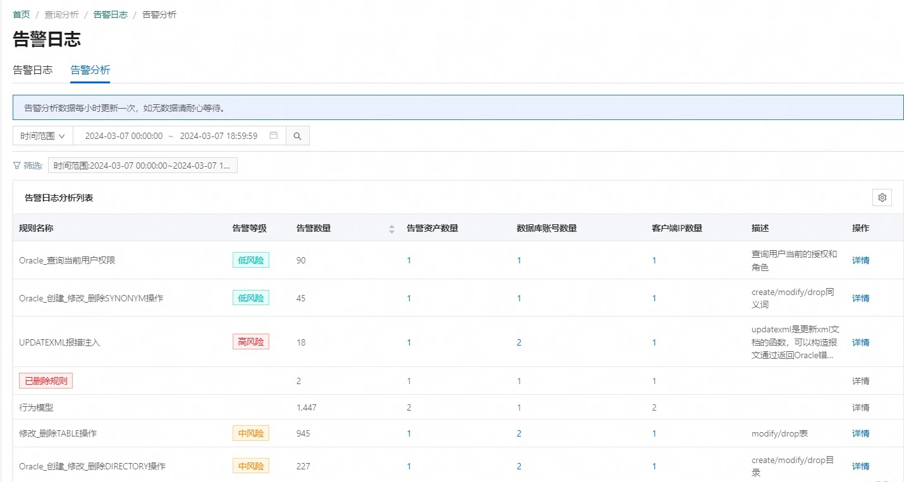

4. 单击**操作**列下的**详情**，可查看告警统计详情，包含规则详情、告警资产、各资产下的告警趋势、告警来源（维度包含客户端IP和数据库账号）和触发告警的SQL模板。

   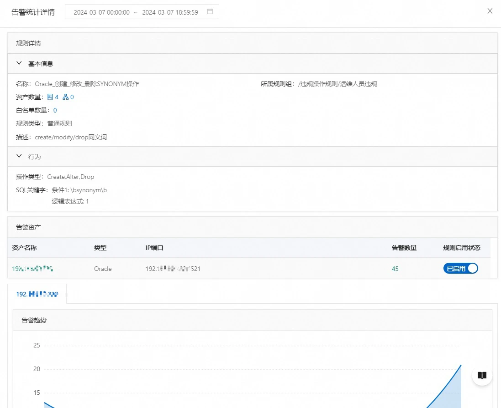

5. 在**规则详情**区域单击资产数量链接可编辑已启用该规则的资产，单击白名单数量链接可以编辑该规则上启用的白名单。

   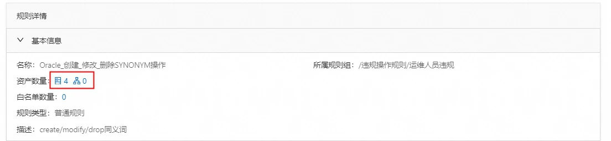

6. 在**告警资产**区域单击**规则启用状态**开关可以变更规则在某资产上的启用状态。

   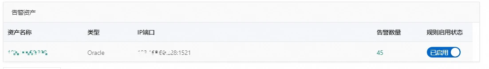

7. 在**告警来源**区域，单击**操作**列下的**不再告警**。

   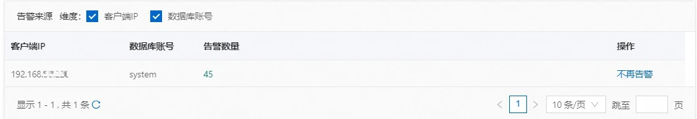

8. 在弹出的**不再告警**对话框中编辑相关信息，单击**确定**。将满足条件的客户端IP添加到信任规则和添加到规则白名单。

   - 选择**添加到白名单**，单击**确定**。添加为白名单后，系统对于此规则符合选中项的条件的相关操作不再产生告警。

   - 选择**添加到信任规则**，单击**确定**。添加为信任规则后，对于资产符合信任规则可选属性的将不再发生告警。

   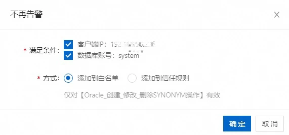

9. 在**触发告警的SQL模板**区域，单击**操作**列下的**不再告警**。

   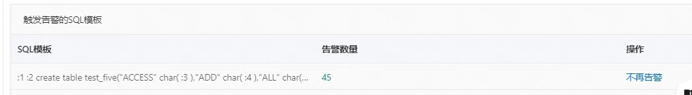

0. 在弹出的**不再告警**对话框中编辑相关信息，单击**确定**。

   将满足条件的SQL模板添加到信任规则和添加到规则白名单。对于普通规则产生的告警：

   - 选择**添加到白名单**，单击**确定**。添加为白名单后，系统对于此规则符白名单的条件的相关操作不再产生告警。

   - 选择**添加到信任规则**，单击**确定**。添加为信任规则后，对于资产符合信任规则的行为将不再发生告警。有关规则的更多信息，请参考规则配置。

## 4.3. 查看会话日志

会话（Session）是客户端与数据库服务器之间的不中断的SQL请求和响应序列，一个会话中可能包含一个或多个SQL请求和响，系统支持通过会话信息查看一次会话过程中产生的所有请求或响应日志。

**操作步骤**

会话的基本四元素是指客户端IP、客户端端口、服务端IP和服务端端口，会话的四元素可以定位在同时刻的唯一会话信息。

1. 登录数据库审计与风险控制系统。

2. 在左侧导航栏，选择**查询分析 > 会话日志**，设置查询条件（如时间范围、资产等），单击**搜索**即可查询相关会话信息。

   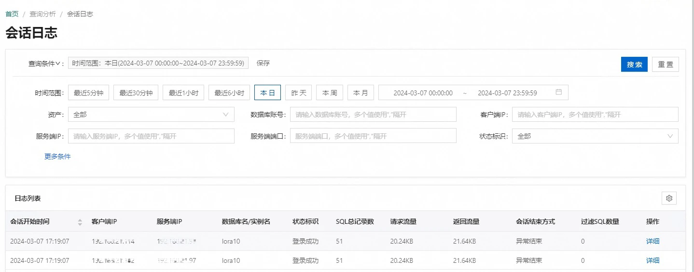

3. 单击**操作**列中的**详细**可查看会话详情。

   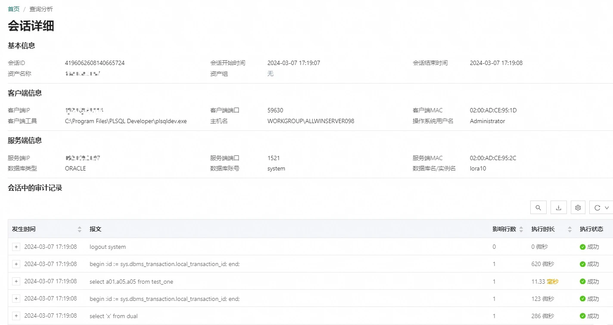

## 4.4. 查询SQL模板

SQL模板（SQL Template）是去参数化的SQL语句，系统支持将访问数据库系统的SQL语句使用的模板信息提取存储到磁盘中并可通过Web页面查看SQL模板集合。

**操作步骤**

系统可对审计结果去参数化的SQL模板进行查询，具体如下：

- SQL模板默认为开启状态，如需关闭SQL模板，请单击**修改**，弹出**SQL模板数量上限配置**对话框，关闭SQL模板收集开关，关闭后SQL模板数量将不在增加。

  

- 系统可对审计结果去参数化的SQL模板进行查询。

  在左侧导航栏，选择**查询分析 > SQL模板**，设置查询条件（如时间范围、SQL模板等），单击**搜索**即可查询相关SQL模板。

  

  > **说明**
  >
  > SQL模板数量默认最大为30万条，可点击<**修改**>修改此配置。

- 在SQL模板列表中单击**详细**，可以查看该SQL模板记录的详细信息，包括基本信息、模板、首次发生报文、不审计匹配的报文和数据库信息。其中请求详情中可以查看报文，返回详情可以查看SQL语句的返回信息。

  

# 5.报表中心

系统支持使用表格、图表等形式动态显示数据，报表中心通过公式化、逻辑化处理访问审计日志、告警日志等信息后形成各种不同类型的报表数据。

## 5.1. 报表预览

报表预览展示系统各类型报表信息。本文介绍如何预览报表。

**操作步骤**

1. 登录数据库审计与风险控制系统。

2. 在左侧导航栏，选择**报表中心 > 报表预览**，选择希望查阅的报表类型、资产或者资产组、报表时间范围，即可生成所需的报表文件。

   

   内置报表类型请参见下表。

   <table>
     <tr>
       <th width="154">报表类型</th>
       <th>说明</th>
     </tr>
     <tr>
       <td>塞班斯报表</td>
       <td>从计划与组织、确保和控制、评估风险、综合情况四个方面，全面分析数据库安全状况。</td>
     </tr>
     <tr>
       <td>综合分析报告</td>
       <td>从SQL语句执行情况分析、会话连接分析、风险事件分析和SQL性能分析四个角度对数据库态势进行综合分析。</td>
     </tr>
     <tr>
       <td>性能分析报表</td>
       <td>从性能变化趋势、性能最差的数据库/SID、耗时最久的SQL、性能最差的SQL、执行最多的SQL五个方面对数据库的性能做出分析。</td>
     </tr>
     <tr>
       <td>等保参考分析报表</td>
       <td>紧密切合当前信息安全技术网络安全等级保护评测要求GB/T 28448-2019（以下简称“等级保护2.0”）的大趋势，针对等级保护2.0里关注的安全审计中的入侵防范、恶意代码监测、安全审计监控等进行针对性的分析和展示。</td>
     </tr>
     <tr>
       <td>语句分析类报表</td>
       <td>从SQL语句分析、失败语句分析、SQL语句变化趋势、审计趋势分析和执行次数最多SQL模板分析5个维度分析和展示当前语句的信息。</td>
     </tr>
     <tr>
       <td>会话分析类报表</td>
       <td>包含会话数量变化趋势分析、新增会话分析、并发会话分析和失败会话分析4张报表。</td>
     </tr>
     <tr>
       <td>告警分析类报表</td>
       <td>从告警变化趋势分析、告警来源分析、告警对象分析、规则命中分析4个维度分析当前告警的情况。</td>
     </tr>
     <tr>
       <td>其他报表</td>
       <td>主要分为：客户端工具分析、数据库账号分析、数据库/SID分析、数据库访问来源IP分析。</td>
     </tr>
   </table>

3. 您可以直接阅读已生成的报表，也可以单击右上角的**导出**，选择导出格式（HTML、PDF、PNG、WORD、EXCEL和CSV）即可将报表按指定文件格式导出至本地。

## 5.2. 报表订阅

报表订阅实现根据需求周期性向指定对象定点发送报表的功能。

**操作步骤**

1. 登录数据库审计与风险控制系统。

2. 在左侧导航栏，选择**报表中心 > 报表订阅**。

3. 在**报表订阅**页面，单击**添加**。

4. 在**添加订阅任务**对话框，编辑相关信息，单击**保存**。

   

   详细配置项和说明请参见下表。

   | 配置项 | 说明 |
   | --- | --- |
   | 任务名称 | 设置任务名称。必须为中文字符、字母、数字、下划线“_”、点“.”或短横线“-”，长度不超过64字符。 |
   | 收件人邮箱 | 报表发送的接收人邮箱，可以设置多个。 |
   | 报表类型 | 指定要发送报表类型，可选择内置报表和自定义报表。 |
   | 报表格式 | 指定报表发送格式，支持HTML、PDF、PNG和WORD四种格式，默认为<strong>PDF</strong>。 |
   | 资产 | 指定要发送报表的资产，默认全部资产。任务周期可选<strong>每天(日报)</strong>、<strong>每周(周报)</strong>、<strong>每月(月报)</strong>、<strong>每年(年报)</strong>，默认为<strong>每天(日报)</strong>。 |
   | 发送时间 | 指定报表发送的时间，可选1:00~23:00的整点。 |
   | 时间范围 | 仅在任务周期选择<strong>每天(日报)</strong>时显示，只能选择连续的时间。指定报表统计的时间范围，支持选择外送某一时间段的报表数据。 |

# 6.智能分析

智能分析是指系统可以学习用户的数据库操作习惯，通过对用户操作所涉及的IP、客户端操作工具等信息进行统计分析，可对不在学习范围的异常行为进行告警。

## 6.1. 配置行为模型学习任务

行为模型学习任务是指系统对用户访问数据库的行为进行自学习，对用户行为所涉及到的资产IP、数据库用户名、客户端工具等信息进行汇总统计。本文介绍如何添加行为模型学习任务。

**操作步骤**

1. 登录数据库审计与风险控制系统。

2. 在左侧导航栏，选择**智能分析 > 行为模型**。

3. 单击**任务配置**页签，然后单击**添加**。

   

4. 进入**行为模型学习配置**页面，编辑相关信息，单击**开始学习**。

   

5. 如需配置其他更多信息，请单击**更多配置**，填写**学习范围（IP）**。

   

   详细配置请参见下表。

   <table>
     <tr>
       <th width="137">配置项</th>
       <th>说明</th>
     </tr>
     <tr>
       <td>资产</td>
       <td>选择已添加的资产。可通过名称、IP等关键字搜索资产，从而实现快速选择。</td>
     </tr>
     <tr>
       <td>学习维度</td>
       <td>指定行为模型引擎所学习（即统计分析）的维度，包括客户端工具名、数据库用户名、客户端IP、操作系统用户名、客户端主机名、数据库名、数据库的操作类型、服务端IP、表对象。</td>
     </tr>
     <tr>
       <td>学习截止时间</td>
       <td>行为模型学习任务的学习截止时间。</td>
     </tr>
     <tr>
       <td>告警等级</td>
       <td>包括不告警、低风险、中风险、高风险告警，默认为低风险告警。</td>
     </tr>
     <tr>
       <td>学习范围（IP）</td>
       <td>行为模型引擎学习客户端IP的范围。支持以下三种填写格式： • 可填写多个IP，每个IP之间用“,”隔开。 • IP网段，用“*”表示0~255，例如：192.XX.XX.10、10.XX.XX.155。 • IP范围，例如：192.XX.XX.1-192.XX.XX.128。</td>
     </tr>
   </table>

## 6.2. 结束学习

本文结束如何结束学习。

**操作步骤**

1. 单击学习任务列表**操作**列下的**结束学习**后，该资产新产生的审计日志会根据学习的内容进行匹配，在学习到的模型之外的审计日志会根据配置的告警等级，不产生或者产生对应告警等级的行为模型告警。

   已经结束学习的学习任务，单击学习任务列表**操作**列下的**重新学习**可重新配置行为模型学习任务。

   

2. 单击学习任务列表**操作**列下的**修改告警等级**，可设置行为模型之外的审计日志不告警或者产生对应的告警等级的告警。

   

## 6.3. 模型查询

本文介绍如何对学习到的行为模型进行查询。

**操作步骤**

1. 登录数据库审计与风险控制系统。

2. 在左侧导航栏，选择**智能分析 > 行为模型**。

3. 在行为模型学习任务列表中单击资产名链接或者选择**模型查询**页签再选择资产。

   

2. 进入**模型查询**页面，默认出现该资产学习行为发分析结果，可以选择筛选条件（如“客户端工具”等），单击**分析**下方会显示对应的分析结果。单击分析结果图中的节点，查看该节点关联的详细信息。

   

3. 设置查询条件（如客户端工具等），单击**搜索**即可查询相关行为模型信息。

   

# 7.规则配置

主要介绍规则如何配置及启用等，规则配置是指根据一些特征定义危险行为（安全规则）、可以信任的行为（信任规则）和不审计的行为（过滤规则），当系统审计到对数据库的操作匹配过滤规则的行为则不进行审计，对应匹配信任规则时不会触发告警，对应匹配安全规则时会触发告警。

> **说明**
>
> 系统匹配规则的顺序为：过滤规则>信任规则>安全规则。

## 7.1. 安全规则

安全规则库用来保存已发现的不安全SQL语句的特征信息，系统通过将审计到的SQL语句和安全规则进行匹配从而判断SQL语句中是否包含可疑行为。根据不安全SQL的特征，安全规则分成SQL注入攻击规则、漏洞攻击规则、账号安全规则、数据泄露规则和违规操作规则。

- SQL注入攻击是一种将SQL代码插入或添加到应用（用户）的输入参数中的攻击，之后再将这些参数传递给后台的数据库服务器加以解析并执行，SQL注入规则可以有效的发现此类攻击行为并产生告警。

- 漏洞攻击规则是根据已知的SQL漏洞信息而制定的，漏洞安全规则按照不同的漏洞类型可以分成缓冲区溢出、存储过程滥用、隐通道攻击和拒绝服务攻击。

- 账号安全规则是针对对数据库服务器进行暴力破解和登录失败场景下的安全规则。

- 数据泄露规则根据泄露场景分成拖库攻击、数据库外联、大流量返回、非授权访问，系统可以有效地发现这几种泄露场景并及时通知告警。

- 违规操作规则是针对于应用账号违规操作、运维人员的违规操作、数据库探测和异常语句场景。

系统内置900多条安全规则，覆盖了主流的应用场景，并且在不断地丰富。此外，用户可以自定义安全规则。

### 7.1.1. 规则管理

本文介绍规则的管理和新增功能。

**查看全部规则**

内置规则不可更改，默认为推荐规则，用户可以通过按钮切换到全部规则，操作方法如下：

1. 登录数据库审计与风险控制系统。

2. 在左侧导航栏，选择**规则配置 > 安全规则**。

3. 在**规则管理**页签，单击**推荐**，切换至**全部**。

   

**新增规则**

1. 登录数据库审计与风险控制系统。

2. 在左侧导航栏，选择**规则配置 > 安全规则**。

3. 在**规则管理**页签，单击**新增**。

   

4. 在**新增规则**对话框中编辑相关信息，单击**保存**。

   

   详细配置请参见下表。

   | 项目 | 配置项 | 说明 |
   | --- | --- | --- |

   设置规则名称，必须为中文字符、字母、数字、下划线“_”、点“.”或短

   名称

   横“-”，长度不超过64字符。

   描述

   规则描述。

   等级

   必选项，系统默认等级为中风险。等级包括高风险、中风险和低风险。

   必选项，可选择自定义的规则组，也可以选择系统默认规则组。可通过以下

   步骤对自定义规则组进行管理：点击所属规则组右边的<**规则组管理**>，可

   所属规则组

   新增、修改和删除自定义规则组。

   基本信息

   目前支持普通规则和统计规则两类。

   - **普通规则**：单条审计记录匹配配置的普通规则，会触发普通告警（例如一条

   规则类型

   select语句，可能会触发一条普通告警）。

   - **统计规则**：指定时间内多次匹配配置的统计规则，会触发一条统计告警（例如5分钟内10次select失败，可能会触发一条统计告警）。

   目前支持告警和告警并阻断。

   行为

   - **告警**：操作命中规则后，仍正常执行，无特殊控制。

   - **告警并阻断**：操作命中规则后，该操作对应的数据库连接断开。

   访问业务类型的客户端IP或IP组。可填写多个，以逗号“,”分隔。有关IP组

   客户端来源

   的更多信息，请参考IP组管理。

   客户端工具

   可配多个客户端工具，使用逗号“,”分隔，例如：db2bp.exe,java.exe。

   客户端端口

   可配置多个值或区间，多个值间以逗号“,”分隔，例如：10-15,20,25,30-。

   客户端MAC地

   可填多值，多个值间以逗号“,”分隔。

   址

   客户端

   操作系统用户

   可以选择字符串或者正则表达式，字符串可填多值，多个值间以逗号“,”分隔。

   主机名

   可以选择字符串或者正则表达式，字符串可填多值，多个值间以逗号“,”分隔。

   指定规则所匹配的应用IP或IP组，对应审计日志中的关联IP，可填多值，多个值

   应用IP

   间以逗号“,”分隔。有关IP组的更多信息，请参考IP组管理。

   指定规则所匹配的应用用户或用户组，对应审计日志中的关联账号，可填多值，

   应用用户名

   多个值间以逗号“,”分隔。有关应用用户组的更多信息，请参考应用用户组管理。

   服务端IP

   可填多值，多个值间以逗号“,”分隔。

   服务端端口

   可配置多个值或区间，多个值间以逗号“,”分隔，例如：10-15,20,25,30-40。

   指定规则所匹配的数据库登录用户账号或账号组或者使用正则表达式，可

   数据库账号

   填多值，多个值之间以“,”分隔。有关数据库账号组的更多信息，请参考

   服务端

   数据库账号组管理。

   服务端MAC地

   可填多值，多个值间以逗号“,”分隔。

   址

   数据库名

   可以选择字符串或者正则表达式，Oracle数据库输入SID，其他数据库输入数据

   （SID）

   库名，字符串可填多值，多个值间以逗号“,”分隔。

   对象组

   指定规则匹配的对象组。有关对象组的更多信息，请参考对象组管理。

   操作类型

   指定SQL语句的操作类型，如select、update、delete等。

   可填项，可填多值，多个值间以逗号“,”分隔。有关SQL模板ID的更多信息，请参

   SQL模板ID

   考查询SQL模板。

   SQL关键字：支持以正则表达式匹配报文。单击**正则验证**输入报文内容，单击**校验**，验证输入内容与执行结果关键字中的正则表达式是否匹配。单击**增加条件**添加多个条件。

   SQL关键字

   条件运算逻辑表达式：SQL关键字填写后，此项为必填项。条件间的关系，支持与、或、非、括号运算(&：与；|：或；~：非)，条件使用序号表示，即“1”表示条件1，例如：1&2，则代表有2个SQL关键字条件且两个关键字都要满足才能告

   行为

   警。

   SQL长度

   指定SQL语句的长度，取值范围：1B~64KB。

   关联表数

   SQL操作涉及表的个数大于等于此值时触发本规则，允许输入最大值为255。

   是否包含WHERE，支持三个选项：不判断、有WHERE子句、没有WHERE子句。默认为不判断。WHERE子句用于提取满足指定条件的SQL记录，语法如下：

   WHERE子句

   SELECT column_name,column_name

   FROM table_name

   WHERE column_name operator value;

   可填项，单位：秒、毫秒、微秒，取值范围：0到半个小时，SQL执行时长属于

   执行时长

   此范围，则触发规则。

   取值范围：0~999,999,999。SQL操作返回的记录数或受影响的行数属于此范

   影响行数

   围，则触发规则。

   支持以正则表达式方式匹配结果集。单击**正则验证**输入结果集内容，单击**校验**，验证输入内容与返回结果关键字的正则表达式是否匹配。可通过**添加条件**添加多

   结果

   个条件。

   返回结果集

   条件运算逻辑表达式：如正则表达式填写后，此项为必填项；条件间的关系，支持“与、或、非、括号”运算(&：与；|：或；~：非)，条件使用序号表示，即“1”表示条件1，例如：1&2，则代表有2个结果集条件，且结果集中需要同时满足这两个条件才能告警。

   执行状态

   包含三个执行状态：全部、成功、失败。默认为全部。

   执行结果描述

   支持以正则表达式方式匹配。

   生效时间

   可自定义或者选择时间组。有关时间组配置的更多信息，请参考时间组管理。

   每日最大告警次

   取值范围：0~99,999，输入0表示没有限制。

   其它

   数

   设置触发该规则的告警日志的返回结果集存储策略，包含使用资产设置、保存和

   结果集存储策略

   不保存。

> **说明**
>
> 内置规则包含特征规则及其他非特征规则，特征规则不可进行克隆和删除操作，非特征规则可进行克隆操作。

#### 7.1.1.1. 启用规则

本文介绍如何进行规则的启用。

**操作步骤**

1. 登录数据库审计与风险控制系统。

2. 在左侧导航栏，选择**规则配置 > 安全规则**。

3. 在**规则管理**页签的规则列表中勾选目标规则，单击**启用选中项**。

   

4. 在弹出对话框中勾选资产，单击**确定**，则可将已启用的规则直接应用到选择的资产上。

   

#### 7.1.1.2. 禁用规则

本文介绍如何禁用规则。

**操作步骤**

1. 登录数据库审计与风险控制系统。

2. 在左侧导航栏，选择**规则配置 > 安全规则**。

3. 在**规则管理**页签的规则列表中勾选规则，然后单击**禁用选中项**。

   

4. 在弹出的对话框中勾选资产，单击**确定**即可禁用规则。

   

### 7.1.2. 白名单管理

当触发规则的告警确认为正常业务操作时，可通过添加白名单方式避免产生误报。规则条件包含客户端、服务端、基本信息、结果、行为等，新增白名单的操作方法有两种。

**操作步骤**

**方式一：在白名单管理页签设置**

1. 登录数据库审计与风险控制系统。

2. 在左侧导航栏，选择**规则配置 > 安全规则**。

   

3. 在**白名单管理**页签，单击**新增**，进入新增白名单页面，编辑相关配置项（配置方法与新增自定义规则的参数配置方法相同，请参考规则管理），然后单击**保存**。

   

4. 启用白名单。添加白名单后，需在对应的规则上启用该白名单才会生效。

   <ol type="i">

   <li>

   在**规则管理**页签。单击**白名单数量**列中的数字链接。

   

   </li>

   <li>

   在弹出的对话框中将状态设置为**启用**即可启用白名单。

   

   </li>

   </ol>

**方式二：在告警日志页面设置**

1. 在**告警日志**页面单击**详细**，进入**告警日志详细**页面，单击**此类规则不告警**。

   

2. 选择**添加到规则白名单**，此种方式会自动将白名单挂载在告警日志对应的安全规则上。

   

> **说明**
>
> 需要将白名单上启用的所有安全规则禁用后才能删除该白名单。

### 7.1.3. 设置

设置规则的优先级状态，启用优先级可自定义规则匹配顺序，匹配上某条规则后，优先级更低的规则就不再匹配。关闭规则的优先级后，每个数据库操作行为可以触发的所有满足条件的安全规则。

## 7.2. 信任规则

当系统匹配信任规则后不会再匹配安全规则，不产生告警信息，本文介绍添加信任规则的两种方式。

**操作步骤**

**方式一：在信任规则页面设置**

1. 登录数据库审计与风险控制系统。

2. 在左侧导航栏，选择**规则配置 > 信任规则**。

   

3. 单击**新增**，在弹出的**新增规则**对话框中编辑相关信息，单击**保存**。详细配置请参见规则管理<strong>。</strong>

   

4. 信任规则配置后，单击规则后面的资产数量，应用到资产上即可。

**方式二：在告警日志页面设置**

1. 登录数据库审计与风险控制系统。

2. 在左侧导航栏，选择**查询分析 > 告警日志**，根据时间或规则名称进行告警日志查询，单击告警日志信息后面的**详情**，进入**告警日志详细**页面，单击**此类规则不告警**。

   

3. 选择**添加到信任规则**，此种方式会自动将信任规则启用到告警日志对应的资产上。

   

## 7.3. 过滤规则

过滤规则的功能是根据某些特定的条件过滤一些操作，系统对这些操作不审计，从而节省设备的磁盘空间，将有限的资源用来存储更有价值的审计数据。

过滤规则的过滤方式有三种，分别是按IP过滤、按SQL模板过滤和按规则过滤。

- 按IP过滤是设置某些IP地址为信任的IP地址，系统对这些IP地址发起的SQL请求不审计。

- 按SQL模板过滤是设置SQL模板为可信任的模板，当访问的SQL语句的模板是设置的过滤模板，则不进行审计。

- 按规则过滤是指按照特定的条件进行审计过滤，规则包括客户端信息、服务端信息、SQL请求和SQL结果等条件。

### 7.3.1. 按IP过滤

按IP过滤则是将新增的客户端IP认为是白名单，不审计该IP下任何信息。本文介绍新增按IP过滤规则的操作方法。

**操作步骤**

1. 登录数据库审计与风险控制系统。

2. 在左侧导航栏，选择**规则配置 > 过滤规则**。

   

3. 单击**新增**，进入**新增IP过滤**页面，编辑名称和不审计的IP，单击**保存**。

   

   详细配置项和说明请参见下表。

   <table>
     <tr>
       <th width="105">配置项</th>
       <th>说明</th>
     </tr>
     <tr>
       <td>名称</td>
       <td>必须为中文字符、字母、数字、下划线“_”、点“.”或短横“-”，长度不超过64字符。</td>
     </tr>
     <tr>
       <td>不审计的IP</td>
       <td>格式为“IP/掩码长度”，可配置多组，用“,”隔开。例如：1.2.3.4/32,10.0.0.0/8。</td>
     </tr>
   </table>

   > **重要**
   >
   > 资产中有符合上述不审计IP条件的客户端和服务端均不做任何审计，请谨慎添加。

### 7.3.2. 按SQL模板过滤

按SQL模板过滤是为用户提供常见的可信任的SQL模板，减少误告警，提高告警准确率。系统内置部分常见数据库的常见非违规SQL语句模板，且默认对全部对应的数据库生效。本文介绍用户如何启用或禁用指定模板。

**操作步骤**

1. 登录数据库审计与风险控制系统。

2. 在左侧导航栏，选择**规则配置 > 过滤规则**。

3. 在**SQL模板过滤**页签，勾选SQL模板，单击**启用选中项**或**禁用选中项**。

   

4. 在弹出的对话框中单击**确定**。

### 7.3.3. 按规则过滤

按规则过滤是为用户提供自定义的过滤规则，支持用户按照特定的条件设置过滤规则，规则包括客户端信息、服务端信息、SQL请求和SQL结果等条件。在资产上启用了过滤规则后，符合规则的内容则不会被审计。本文介绍如何设置按规则过滤。

**操作步骤**

1. 登录数据库审计与风险控制系统。

2. 在左侧导航栏，选择**规则配置 > 过滤规则**。

   

3. 添加自定义过滤规则。添加按规则过滤的规则的操作方法与添加安全规则的方法相同，请参见规则管理。

   添加自定义过滤规则后，需要在资产上启用过滤规则后才能生效。

4. 在**按规则过滤**页签，勾选规则，单击**启用选中项**。

   

5. 在弹出的**选择资产**对话框中勾选资产，单击**确定**。

   

## 7.4. 规则维护

规则维护界面可以进行导入、导出自定义安全规则操作。本文介绍如何维护规则。

**操作步骤**

1. 登录数据库审计与风险控制系统。

2. 在左侧导航栏，选择**规则配置 > 规则维护**。

3. 单击**导入规则**，选择自定义规则文件，即可导入自定义规则。

4. 单击**导出规则**，即可导出自定义规则至本地。

   

## 7.5. 关联数据

介绍系统如何进行IP组、数据库账号组、应用用户组、时间组、对象组以及人员的配置进行数据关联。

### 7.5.1. IP组管理

IP组是特定IP的集合，如自定义某规则需要在某固定IP集合内有效时，可以将此固定IP集合添加至IP组，便于用户在规则中使用。IP组管理页面提供新增、导入、导出、编辑、删除和查询功能。

#### 7.5.1.1. 新增IP组

本文介绍如何新增IP组。

**操作步骤**

1. 登录数据库审计与风险控制系统。

2. 在左侧导航栏，选择**规则配置 > 关联数据**。

3. 选择**IP组**页签，单击**新增**。

4. 在**新增IP组**页面，编辑名称和IP，单击**保存**。

   

   详细配置请参见下表。

   | 配置项 | 说明 |
   | --- | --- |
   | 名称 | 必须为中文字符、字母、数字、下划线“_”、点“.”或短横“-”，长度不超过64字符。 |
   | IP | • 可输入多个IP地址，用英文逗号隔开。 • 可输入地址范围，例如：10.1.1.10-10.1.1.20。 • 可输入地址段，例如：10.10.\*.\*，“\*”表示0~255。 |

#### 7.5.1.2. 导入IP组

通过批量导入IP组的方法可以提高创建IP组的效率。本文介绍如何批量导入IP组。

**操作步骤**

1. 登录数据库审计与风险控制系统。

2. 在左侧导航栏，选择**规则配置 > 关联数据**。

3. 选择**IP组**页签，单击**下载模板**，下载模板文件至本地。

   

4. 编辑模板文件，并保存。

5. 单击**导入**，在弹出的对话框中选择编辑好的模板文件，导入文件成功后页面会弹出提示信息，并将模板文件中的IP组添加至IP组列表中。

   

### 7.5.2. 数据库账号组管理

数据库账号组是特定数据库账号的集合。如自定义某规则需要在某固定数据库账号集合内有效时，可将这些数据库账号加入数据库账号组，在自定义规则时选择该数据库账号组即可。

数据库账号组管理页面提供增加、编辑、删除和查询功能。

#### 7.5.2.1. 导入数据库账号组

导入数据库账号组的方法与导入IP组的方法类似，不再赘述。

#### 7.5.2.2. 新增数据库账号组

本文介绍如何新增数据库账号组。

**操作步骤**

1. 登录数据库审计与风险控制系统。

2. 在左侧导航栏，选择**规则配置 > 关联数据**。

3. 选择**数据库账户组**页签，单击**新增**。

4. 进入**新增数据库账号**页面，编辑名称和数据库账号，单击**保存**。

   

   详细配置请参见下表。

   <table>
     <tr>
       <th width="106">配置项</th>
       <th>说明</th>
     </tr>
     <tr>
       <td>名称</td>
       <td>必须为中文字符、字母、数字、下划线“_”、点“.”或短横“-”，长度不超过64字符。</td>
     </tr>
     <tr>
       <td>数据库账号</td>
       <td>可输入多项，用英文逗号隔开。</td>
     </tr>
   </table>

### 7.5.3. 应用用户组管理

应用用户组是特定应用用户的集合。如自定义某规则需要在某固定应用用户集合内有效时，可以将这些应用用户加入到应用用户组，在创建规则时选择该应用用户组即可。

应用用户组管理页面提供增加、编辑、删除和查询功能。

#### 7.5.3.1. 新增应用用户组

本文介绍如何新增应用用户组。

**操作步骤**

1. 登录数据库审计与风险控制系统。

2. 在左侧导航栏，选择**规则配置 > 关联数据**。

3. 在**应用用户组**页签，单击**新增**。

4. 进入**新增应用用户**页面，编辑名称和应用用户名，单击**保存**。

   

#### 7.5.3.2. 导入应用用户组

导入应用用户组的操作方法与导入IP组的方法类似，不再赘述。

### 7.5.4. 时间组管理

时间组是一组特定组时间的集合。如自定义某规则需要在特定时间集合内有效时，可将这些时间加入到时间组，在创建规则时选择该时间组即可。

时间组管理页面提供增加、编辑、删除和查询功能。

#### 7.5.4.1. 新增时间组

本文介绍如何新增时间组。

**操作步骤**

1. 登录数据库审计与风险控制系统。

2. 在左侧导航栏，选择**规则配置 > 关联数据**。

3. 在**时间组**页签，单击**新增**。

4. 进入**新增时间组**页面，编辑名称，选择时间范围，点击<**保存**>。

   

#### 7.5.4.2. 导入时间组

导入时间组的操作方法与导入IP组方法相似，不再赘述。

### 7.5.5. 对象组管理

对象组是一组关键数据库的关键表及关键字段编辑行为对象集合。如自定义某规则需要在某固定对象集合内有效时，可将这些对象加入对象组，创建规则时选择该对象所在组即可。

对象组管理页面提供增加、编辑、删除、导入、导出和下载模板功能。

#### 7.5.5.1. 新增对象组

本文介绍如何新增对象组。

**操作步骤**

1. 登录数据库审计与风险控制系统。

2. 在左侧导航栏，选择**规则配置 > 关联数据**。

3. 在**对象组**页签，单击**新增**，编辑对象组名称，单击**保存并添加对象**。

   

4. 在**编辑对象组**页面，编辑资产、数据库/Schema等相关信息，单击**添加对象**。

   

   详细配置请参见下表。

   <table>
     <tr>
       <th width="144">配置项</th>
       <th>说明</th>
     </tr>
     <tr>
       <td>资产</td>
       <td>下拉列表可选择对象组所对应的要选择的资产，默认为所有资产通用。</td>
     </tr>
     <tr>
       <td>数据库/Schema</td>
       <td>Schema可视为同一个使用者所拥有的所有数据库对象之集合，例如：用户scott所建立的表emp，其完整名称为scott.emp,而scott就是emp的schema名称，所以Schema其实就是一个Oracle数据库的用户名称。</td>
     </tr>
     <tr>
       <td>表</td>
       <td>填写要添加的表名。</td>
     </tr>
     <tr>
       <td>用户</td>
       <td>数据库系统的用户。</td>
     </tr>
     <tr>
       <td>视图</td>
       <td>视图是从一个或几个基本表（或视图）中导出的虚拟的表。</td>
     </tr>
     <tr>
       <td>存储过程</td>
       <td>存储过程（Stored Procedure）是一种在数据库中存储复杂程序，以便外部程序调用的一种数据库对象。</td>
     </tr>
     <tr>
       <td>函数</td>
       <td>数据库系统定义的函数，例如：SUBSTRING('abcde',1,2)。</td>
     </tr>
     <tr>
       <td>字段</td>
       <td>填写要添加的字段名。</td>
     </tr>
     <tr>
       <td>索引</td>
       <td>是对数据库表中一个或多个列（例如，employee表的姓名（name）列）的值进行排序的结构。</td>
     </tr>
   </table>

#### 7.5.5.2. 导入对象组

导入对象组的操作方法与导入IP组方法相似，不再赘述。

### 7.5.6. 人员管理

系统支持对人员进行管理，包括新增、编辑、导入、导出和删除等。

#### 7.5.6.1. 新增人员

本文介绍如何新增人员。

**操作步骤**

1. 登录数据库审计与风险控制系统。

2. 在左侧导航栏，选择**规则配置 > 关联数据**。

3. 在**人员**页签，单击**新增**。

4. 在弹出的**新增人员**对话框中编辑工号、IP地址、姓名、手机号等信息，单击**保存**。

   

   详细配置请参见下表。

   | 配置项 | 说明 |
   | --- | --- |
   | 应用用户名 | 人员登录应用所使用的账号，可能是工号、英文名等信息。支持配置多个，多个值间以逗号“,”分隔。例：001,张三,zhangsan。审计日志中的关联账号满足该条件时，系统将会把人员当做此日志的执行人。 |
   | IP地址 | 人员所使用终端的IP地址。可配置多个，支持配置网段，示例： 10.10.1.1,10.10.1.2,10.1.1.10-10.1.1.20,10.10.\*.\*,10.10.1.\* 审计日志中的客户端IP或关联IP满足该条件时，系统将会把人员当做此日志的执行人，该条件优先级低于应用用户名。 |
   | 工号 | 人员对应的工号。 |
   | 姓名 | 人员对应的姓名。 |
   | 手机 | 人员对应的手机号。 |
   | 科室 | 人员所在部门。 |
   | 房间 | 人员所在房间号。 |
   | 主机名 | 人员所对应资产的主机名称。 |
   | Mac地址 | 人员所对应资产的物理Mac地址。 |

#### 7.5.6.2. 导入人员

导入人员的操作方法与导入IP组方法相似，不再赘述。

# 8.通知外送

## 8.1. 告警通知

系统支持多种消息通知模式，可及时将当前资产告警情况提供给管理员，目前支持邮件、短信、SNMP、Syslog四种通知方式。

### 8.1.1. 邮件方式通知告警

本文介绍如何通过邮件方式进行告警日志外发。

**配置邮件发送的信息**

1. 登录数据库审计与风险控制系统。

2. 在左侧导航栏选择**通知外送 > 告警通知**。

3. 在**邮件**页签的**邮件发送接口配置管理**区域，单击**编辑**。

   

4. 在**邮箱配置**对话框中编辑相关信息，单击**确定**。

   

   <table>
     <tr>
       <th width="150">配置项</th>
       <th>说明</th>
     </tr>
     <tr>
       <td>SMTP服务器</td>
       <td>SMTP服务器的IP或域名。</td>
     </tr>
     <tr>
       <td>SMTP服务器端口</td>
       <td>SMTP服务器所用端口。</td>
     </tr>
     <tr>
       <td>发件人</td>
       <td>发件人的邮箱。</td>
     </tr>
     <tr>
       <td>SMTP验证</td>
       <td>邮箱是否开启SMTP验证。</td>
     </tr>
     <tr>
       <td>用户名</td>
       <td>邮箱的用户名。</td>
     </tr>
     <tr>
       <td>密码</td>
       <td>邮箱客户端授权码。</td>
     </tr>
     <tr>
       <td>是否加密</td>
       <td>邮箱是否进行加密。</td>
     </tr>
     <tr>
       <td>编码</td>
       <td>服务器支持的编码方式，可选UTF-8或GBK。以上SMTP服务器相关配置与邮件服务器端设置保持一致即可。</td>
     </tr>
     <tr>
       <td>实时告警模板</td>
       <td>发送实时告警信息的模板，可修改默认模板，具体字段请依据填写说明编辑。</td>
     </tr>
     <tr>
       <td>聚合告警模板</td>
       <td>发送聚合告警信息的模板，可修改默认模板，具体字段请依据填写说明编辑。</td>
     </tr>
     <tr>
       <td>统计告警模板</td>
       <td>发送统计告警信息的模板，可修改默认模板，具体字段请依据填写说明编辑。</td>
     </tr>
     <tr>
       <td>系统告警模板</td>
       <td>发送系统告警信息的模板，可修改默认模板，具体字段请依据填写说明编辑。</td>
     </tr>
   </table>

**配置告警通知接收的信息**

配置邮件发送接口后，可对需要通过邮件发送接口发送通知的资产配置发送方式。

1. 在**邮件**页签的**告警通知接收配置管理**区域，单击**添加**。

2. 在**新增告警通知接收配置**面板，编辑相关信息，单击**保存**。

   

   <table>
     <tr>
       <th width="90">配置项</th>
       <th>说明</th>
     </tr>
     <tr>
       <td>资产</td>
       <td>选择要发送告警信息的资产，可选择多项。</td>
     </tr>
     <tr>
       <td>接收者</td>
       <td>接收告警信息的邮箱，可设置多个邮箱。</td>
     </tr>
     <tr>
       <td>告警等级</td>
       <td>选择要发送的告警信息的告警等级。</td>
     </tr>
     <tr>
       <td>通知周期</td>
       <td>同一个规则在通知周期内多次触发告警时只通知第一次触发的告警。取值范围：0~86400，单位为秒，0表示发送全部告警。如果设置为0，聚合通知功能将无法开启。</td>
     </tr>
     <tr>
       <td>聚合通知</td>
       <td>开启聚合通知功能后，系统会在通知周期结束后发送一条聚合告警信息。聚合消息示例如下：在过去*秒，总计触发*条告警（“*”为具体数值）。</td>
     </tr>
     <tr>
       <td>告警统计</td>
       <td>选择是否开启发送告警统计信息的功能。</td>
     </tr>
     <tr>
       <td>发送时间</td>
       <td>每天在设定的时间点发送前一天的告警统计信息。</td>
     </tr>
   </table>

### 8.1.2. 短信方式通知告警

本文介绍如何通过短信方式进行告警日志外发。

**配置短信发送的信息**

1. 登录数据库审计与风险控制系统。

2. 在左侧导航栏选择**通知外送 > 告警通知**。

3. 在**短信**页签的**短信发送接口配置管理**区域，单击**编辑**。

   

4. 在**短信配置**对话框中，编辑相关信息，单击**确定**。

   

   <table>
     <tr>
       <th width="139">配置项</th>
       <th>说明</th>
     </tr>
     <tr>
       <td>发送方式</td>
       <td>选择短信发送方式，支持<strong>Web接口</strong>和<strong>数据库接口</strong>。</td>
     </tr>
     <tr>
       <td>发送方法</td>
       <td><strong>发送方式</strong>为<strong>Web接口</strong>，设置GET或POST发送方法。</td>
     </tr>
     <tr>
       <td>URL</td>
       <td><strong>发送方式</strong>为<strong>Web接口</strong>，设置短信网关的接入URL。</td>
     </tr>
     <tr>
       <td>头信息</td>
       <td><strong>发送方式</strong>为<strong>Web接口</strong>，设置请求头。可添加多个请求头信息。</td>
     </tr>
     <tr>
       <td>Post参数</td>
       <td><strong>发送方式</strong>为<strong>Web接口</strong>，<strong>发送方法</strong>为<strong>POST</strong>，设置请求Post参数内容。如果使用Json方式，该值填写Json内容。</td>
     </tr>
     <tr>
       <td>数据库类型</td>
       <td><strong>发送方式</strong>为<strong>数据库接口</strong>，选择数据库的类型，支持MySQL、Oracle、DB2和SQL Server。</td>
     </tr>
     <tr>
       <td>数据库名称/SID</td>
       <td><strong>发送方式</strong>为<strong>数据库接口</strong>，设置短信通知接口数据库名称。</td>
     </tr>
     <tr>
       <td>用户名和密码</td>
       <td><strong>发送方式</strong>为<strong>数据库接口</strong>，设置短信通知接口数据库的用户名和密码。</td>
     </tr>
     <tr>
       <td>域名或者IP</td>
       <td><strong>发送方式</strong>为<strong>数据库接口</strong>，设置短信通知接口数据库的IP或域名。</td>
     </tr>
     <tr>
       <td>端口</td>
       <td><strong>发送方式</strong>为<strong>数据库接口</strong>，短信通知接口数据库的端口。</td>
     </tr>
     <tr>
       <td>参数顺序</td>
       <td><strong>发送方式</strong>为<strong>数据库接口</strong>，设置参数顺序，支持“先手机号码，后短信内容”和“先短信内容，后手机号码”。</td>
     </tr>
     <tr>
       <td>插入SQL模板</td>
       <td><strong>发送方式</strong>为<strong>数据库接口</strong>，根据页面提示，设置SQL模板。</td>
     </tr>
     <tr>
       <td>调用方式</td>
       <td><strong>发送方式</strong>为<strong>数据库接口</strong>，选择调用方式，可选择<strong>INSERT语句</strong>、<strong>存储过程</strong>。</td>
     </tr>
     <tr>
       <td>编码方式</td>
       <td>服务器支持的编码方式，主要为：UTF-8、GBK。以上配置与短信服务器端保持一致即可。</td>
     </tr>
     <tr>
       <td>实时告警模板</td>
       <td>发送实时告警信息的模板，可修改默认模板，具体字段请依据填写说明编辑。</td>
     </tr>
     <tr>
       <td>聚合告警模板</td>
       <td>发送聚合告警信息的模板，可修改默认模板，具体字段请依据填写说明编辑。</td>
     </tr>
     <tr>
       <td>统计告警模板</td>
       <td>发送统计告警信息的模板，可修改默认模板，具体字段请依据填写说明编辑。</td>
     </tr>
     <tr>
       <td>系统告警模板</td>
       <td>发送系统告警信息的模板，可修改默认模板，具体字段请依据填写说明编辑。</td>
     </tr>
   </table>

**配置告警通知接收的信息**

配置短信通知接口页面的相关信息后，可以给需要发送通知的资产配置发送方式。

> **重要**
>
> 短信网关由专门提供短信转发业务的服务商提供。短信网关用户通过网络将短信发送到短信网关，由短信网关负责将短信发给短信接收者，系统通过短信网关转发告警短信。用户需要事先向第三方服务商申请短信网关服务。

1. 在**短信**页签的**告警通知接收配置管理**区域，单击**添加**。

2. 在**新增告警通知接收配置**面板，编辑相关信息，单击**保存**。

   

   <table>
     <tr>
       <th width="90">配置项</th>
       <th>说明</th>
     </tr>
     <tr>
       <td>资产</td>
       <td>选择要发送告警信息的资产，可选择多个。</td>
     </tr>
     <tr>
       <td>接收者</td>
       <td>接收告警信息的手机号，可设置多个手机号。</td>
     </tr>
     <tr>
       <td>告警等级</td>
       <td>选择要发送的告警信息的告警等级。</td>
     </tr>
     <tr>
       <td>通知周期</td>
       <td>同一个规则在通知周期内多次触发告警时只通知第一次触发的告警。取值范围：0~86,400，单位为秒，0表示发送全部告警。如果设置为0，聚合通知功能将无法开启。</td>
     </tr>
     <tr>
       <td>聚合通知</td>
       <td>开启聚合通知功能后，系统会在通知周期结束后发送一条聚合告警信息。聚合消息示例如下：在过去*秒，总计触发*条告警。</td>
     </tr>
     <tr>
       <td>告警统计</td>
       <td>开启或关闭发送告警统计信息的功能。</td>
     </tr>
     <tr>
       <td>发送时间</td>
       <td>每天在设定的时间点发送前一天的告警统计信息。</td>
     </tr>
   </table>

### 8.1.3. SNMP方式通知告警

SNMP是简单网络管理协议（Simple Network Management Protocol）的简称，是标准IP网络管理协议，支持目前主流的网络管理系统。系统支持将告警信息发送到指定的SNMP服务器，以方便其他网络管理系统的远程监控。

**配置SNMP接收的信息**

1. 登录数据库审计与风险控制系统。

2. 在左侧导航栏选择**通知外送 > 告警通知**。

3. 在**SNMP**页签的**SNMP接收接口配置管理**区域，单击**新增**。

4. 在**新增SNMP接收**面板，编辑相关信息，单击**保存**。

   

   <table>
     <tr>
       <th width="126">配置项</th>
       <th>说明</th>
     </tr>
     <tr>
       <td>配置名称</td>
       <td>SNMP接收接口的配置名称。</td>
     </tr>
     <tr>
       <td>服务器地址</td>
       <td>SNMP服务器地址，可输入IP或者域名。</td>
     </tr>
     <tr>
       <td>端口</td>
       <td>SNMP服务器端口，默认为162。</td>
     </tr>
     <tr>
       <td>COMMUNITY</td>
       <td>定义信息流向，填写<strong>public</strong>，即公开。以上SNMP相关配置与SNMP服务器端保持一致即可。</td>
     </tr>
     <tr>
       <td>实时告警模板</td>
       <td>发送实时告警信息的模板，可修改默认模板，具体字段请依据填写说明编辑。</td>
     </tr>
     <tr>
       <td>聚合告警模板</td>
       <td>发送聚合告警信息的模板，可修改默认模板，具体字段请依据填写说明编辑。</td>
     </tr>
     <tr>
       <td>统计告警模板</td>
       <td>发送统计告警信息的模板，可修改默认模板，具体字段请依据填写说明编辑。</td>
     </tr>
     <tr>
       <td>系统告警模板</td>
       <td>发送系统告警信息的模板，可修改默认模板，具体字段请依据填写说明编辑。</td>
     </tr>
   </table>

**配置告警通知接收的信息**

配置好SNMP接收接口后，可以给需要发送通知的资产配置发送方式。

1. 在**SNMP**页签的**告警通知接收配置管理**区域，单击**添加**。

2. 在**新增告警通知接收配置**面板，编辑相关信息，单击**保存**。

   

   | 配置项 | 说明 |
   | --- | --- |
   | 资产 | 选择要发送告警信息的资产，可选择多个。 |
   | 接收者 | 选择SNMP接收接口，请参见上文<strong>配置SNMP接收的信息</strong>。例如：snmp。 |
   | 告警等级 | 选择要发送的告警信息的告警等级。 |
   | 通知周期 | 同一个规则在通知周期内多次触发告警时只通知第一次触发的告警。取值范围：0~86400，单位为秒，0表示发送全部告警。如果设置为0，聚合通知功能将无法开启。 |
   | 聚合通知 | 开启聚合通知功能后，系统会在通知周期结束后发送一条聚合告警信息。聚合消息示例如下：在过去\*秒，总计触发\*条告警。 |
   | 告警统计 | 开启或关闭发送告警统计信息的功能。 |
   | 发送时间 | 每天在设定的时间点发送前一天的告警统计信息。 |

### 8.1.4. Syslog方式通知告警

用户可通过配置Syslog通知方式将资产告警日志和系统日志发送到指定的Syslog服务器。

**配置SYSLOG接收的信息**

1. 登录数据库审计与风险控制系统。

2. 在左侧导航栏选择**通知外送 > 告警通知**。

3. 在**SYSLOG**页签的**短信发送接口配置管理**区域，单击**新增**。

4. 在**新增SYSLOG接收**面板，编辑相关信息，单击**保存**。

   

   <table>
     <tr>
       <th width="122">配置项</th>
       <th>说明</th>
     </tr>
     <tr>
       <td>配置名称</td>
       <td>Syslog接收接口的配置名称。</td>
     </tr>
     <tr>
       <td>服务器地址</td>
       <td>Syslog服务器地址，可为IP或者域名。</td>
     </tr>
     <tr>
       <td>端口</td>
       <td>Syslog服务器端口，默认为514。</td>
     </tr>
     <tr>
       <td>程序模块编码</td>
       <td>Syslog协议RFC 5424规定，消息中必须包含“程序模块编码”，Syslog服务端使用该编码区分发送消息的程序来源。建议选择默认值local0。</td>
     </tr>
     <tr>
       <td>严重等级</td>
       <td>选择向Syslog服务器发送告警所标记的严重等级。等级分为：Emergency、Alert、Critical、Error、Warning、Notice、Informational、Debug。以上Syslog相关配置与Syslog服务器端配置保持一致即可。</td>
     </tr>
     <tr>
       <td>实时告警模板</td>
       <td>发送实时告警信息的模板，可修改默认模板，具体字段请依据填写说明编辑。</td>
     </tr>
     <tr>
       <td>聚合告警模板</td>
       <td>发送聚合告警信息的模板，可修改默认模板，具体字段请依据填写说明编辑。</td>
     </tr>
     <tr>
       <td>统计告警模板</td>
       <td>发送统计告警信息的模板，可修改默认模板，具体字段请依据填写说明编辑。</td>
     </tr>
     <tr>
       <td>系统告警模板</td>
       <td>发送系统告警信息的模板，可修改默认模板，具体字段请依据填写说明编辑。</td>
     </tr>
   </table>

**配置告警通知接收的信息**

配置Syslog接收接口后，可以给需要发送通知的资产配置发送方式。

1. 在SYSLOG页签的**告警通知接收配置管理**区域，单击**添加**。

2. 在**新增告警通知接收配置**面板，编辑相关信息，单击**保存**。

   

   <table>
     <tr>
       <th width="90">配置项</th>
       <th>说明</th>
     </tr>
     <tr>
       <td>资产</td>
       <td>选择要发送告警信息的资产，可选择多个。</td>
     </tr>
     <tr>
       <td>接收者</td>
       <td>选择Syslog接收接口，请参见上文<strong>配置SYSLOG接收的信息</strong>。例如：syslog。</td>
     </tr>
     <tr>
       <td>告警等级</td>
       <td>选择要发送的告警信息的告警等级。</td>
     </tr>
     <tr>
       <td>通知周期</td>
       <td>同一个规则在通知周期内多次触发告警时只通知第一次触发的告警。取值范围：0~86400，单位为秒，0表示发送全部告警。如果设置为0，聚合通知功能将无法开启。</td>
     </tr>
     <tr>
       <td>聚合通知</td>
       <td>开启聚合通知功能后，系统会在通知周期结束后发送一条聚合告警信息。聚合消息示例如下：在过去*秒，总计触发*条告警。</td>
     </tr>
     <tr>
       <td>告警统计</td>
       <td>开启或关闭发送告警统计信息的功能。</td>
     </tr>
     <tr>
       <td>发送时间</td>
       <td>每天在设定的时间点发送前一天的告警统计信息。</td>
     </tr>
   </table>

## 8.2. 日志外送

系统可以通过日志外送接口将日志发送到第三方管理平台，目前系统支持通过Syslog和KAFKA两种不同的方式外发日志。发送日志的格式可以根据实际的情况进行调整，并且只有将日志外送接口挂载到数据库资产下才能外发日志。

### 8.2.1. 通过Syslog方式发送

本文介绍如何通过Syslog方式进行日志外发。

**配置日志外送的信息**

1. 登录数据库审计与风险控制系统。

2. 在左侧导航栏，选择**通知外送 > 日志外送**。

3. 在**SYSLOG**页签的**日志外送接口管理**区域，单击**新增**。

4. 在**新增日志外送接口**面板，编辑相关信息，单击**保存**。

   

   <table>
     <tr>
       <th width="138">配置项</th>
       <th>说明</th>
     </tr>
     <tr>
       <td>名称</td>
       <td>日志外送接口的配置名称。必须为中文字符、字母、数字、下划线“_”、点“.”或短横“-”，长度不超过64字符。</td>
     </tr>
     <tr>
       <td>服务器地址</td>
       <td>Syslog服务器地址，可为IP或者域名。</td>
     </tr>
     <tr>
       <td>端口</td>
       <td>Syslog服务器端口，默认为514。</td>
     </tr>
     <tr>
       <td>发送协议</td>
       <td>发送日志的传输层协议，可选择UDP或者TCP。</td>
     </tr>
     <tr>
       <td>是否发送消息头</td>
       <td>选择是否发送消息头。如果选择<strong>否</strong>，发送日志不会包含消息头，只包含数据部分。</td>
     </tr>
     <tr>
       <td>内容协议格式</td>
       <td>设置发送日志内容所采用的协议格式。请以Syslog服务器的实际情况为准。</td>
     </tr>
     <tr>
       <td>报文默认主机名</td>
       <td>如果选择发送消息头，需要配置默认发送的主机名。此项与Syslog服务端配置一致即可。</td>
     </tr>
     <tr>
       <td>报文默认应用名</td>
       <td>如果选择发送消息头，需要配置默认发送的应用名。此项与Syslog服务端配置一致即可。</td>
     </tr>
     <tr>
       <td>程序模块编码</td>
       <td>Syslog协议RFC 5424规定，消息中必须包含“程序模块编码”，Syslog服务端使用该编码区分发送消息的程序来源。建议选择默认值local0。</td>
     </tr>
     <tr>
       <td>严重等级</td>
       <td>选择向Syslog发送日志所标记的严重等级。等级分为：Emergency、Alert、Critical、Error、Warning、Notice、Informational、Debug。</td>
     </tr>
     <tr>
       <td>审计日志警模板</td>
       <td>设置发送审计日志的模板，具体字段请依据填写说明编辑。</td>
     </tr>
     <tr>
       <td>告警日志模板</td>
       <td>设置发送告警日志的模板，具体字段请依据填写说明编辑。</td>
     </tr>
     <tr>
       <td>会话日志模板</td>
       <td>设置发送会话日志的模板，具体字段请依据填写说明编辑。</td>
     </tr>
   </table>

**配置日志外送任务**

配置日志外送接口后，可以给需要发送日志的资产配置发送方式。

1. 在**SYSLOG**页签的**日志外送任务管理**区域，单击**新增**。

2. 在**新增日志外送任务**对话框中，编辑相关信息，单击**确定**。

   

   | 配置项 | 说明 |
   | --- | --- |
   | 资产 | 选择要发送日志信息的资产，可选择多个。 |
   | 日志类型 | 选择要发送的日志类型，可选择多个，包括审计日志（原始）、审计日志（汇聚）、告警日志和会话日志等。审计日志（汇聚）用于与AiThink平台对接时使用。日志类型详细说明，请参见<strong>查询分析</strong>章节。 |
   | 外送接口 | 选择Syslog日志外送接口，请参见上文<strong>配置日志外送的信息</strong>。 |
   | 外送选项 | 过滤不完整日志，过滤数据库账号为空的日志。用于与AiThink平台对接时使用，其他情况建议取消。 |

### 8.2.2. 通过KAFKA方式发送

本文介绍如何通过KAFKA方式进行日志外发。

**配置日志外送的信息**

1. 登录数据库审计与风险控制系统。

2. 在左侧导航栏，选择**通知外送 > 日志外送**。

3. 在KAFKA页签的**日志外送接口管理**区域，单击**新增**。

4. 在**新增日志外送接口**面板，编辑相关信息，单击**保存**。

   

   | 配置项 | 说明 |
   | --- | --- |
   | 名称 | 日志外送接口的名称。必须为中文字符、字母、数字、下划线“_”、点“.”或短横“-”，长度不超过64字符。 |
   | Kafka节点地址 | Kafka服务器的IP（域名）及端口号。例如：<code> 192.168.0.1:9200 </code>或者<code> example.com:9200 </code>。 |
   | Kafka主题 | 消息投放到Kafka服务器的主题。 |
   | Kafka分区 | 消息投放到的Kafka服务器的分区。Kafka服务器通过主题（topic）、分区（partition）和消费组（consumer group）三个概念灵活适应各种消息场合，通过提升硬件资源利用率提高系统吞吐量。以上Kafka相关配置与服务器端保持一致即可。 |
   | 审计日志警模板 | 设置发送审计日志的模板，具体字段请依据填写说明编辑。 |
   | 告警日志模板 | 设置发送告警日志的模板，具体字段请依据填写说明编辑。 |
   | 会话日志模板 | 设置发送会话日志的模板，具体字段请依据填写说明编辑。 |

**配置日志外送任务**

配置好Kafka日志外送接口后，可以为需要发送日志的资产设置发送方式。

1. 在**KAFKA**页签的**日志外送任务管理**区域，单击**新增**。

2. 在**新增日志外送任务**对话框中，编辑相关信息，单击**确定**。

   

   <table>
     <tr>
       <th width="90">配置项</th>
       <th>说明</th>
     </tr>
     <tr>
       <td>资产</td>
       <td>选择要发送日志信息的资产，可选择多个。</td>
     </tr>
     <tr>
       <td>日志类型</td>
       <td>选择要发送的日志类型，可选择多个，包括审计日志(原始)、审计日志(汇聚)、告警日志和会话日志。有关日志类型的更多信息，请参考查询分析。审计日志(汇聚)用于与AiThink平台对接时使用。</td>
     </tr>
     <tr>
       <td>外送接口</td>
       <td>选择Kafka日志外送接口，请参见上文<strong><em>配置日志外送的信息</em></strong>。</td>
     </tr>
     <tr>
       <td>外送选项</td>
       <td>过滤不完整日志，过滤数据库账号为空的日志。不建议使用。</td>
     </tr>
   </table>

# 9.系统管理

介绍如何对系统运行参数的设置、对系统资源的维护等，使系统更好地适配实际业务场景。系统管理包括Agent管理、系统配置、系统维护、辅助功能、系统告警和操作日志。

## 9.1. Agent管理

介绍Agent如何安装部署及进行管理配置等。

审计代理插件（Agent）是安装在数据库系统或者业务系统上的插件，其功能是捕获访问数据库系统的数据包，并将数据包发送至数据库审计与风险控制系统。

Agent支持的宿主机的类型如下表所示。

| 操作系统 | 系统位数 | 支持版本 |
| --- | --- | --- |
| Ubuntu | X64 | 14.04、16.04、18.04 |
| Debian | X64 | 7.6、8.7、9.5、10.11、11.2 |
| CentOS | X64 | 5.11、6.0、7.4、7.6、8 |
| RedHat | X64 | 6.5、7.0、7.5 |
| SUSE | X64 | 11SP4、12SP4 |
| Solaris X86 | X86 | 5.10、5.11 |
| Solaris Sparc | X64 | 5.10 |
| AIX |  | 5.3、6.1、7.1 |
| Windows | X64 | 7、10 |
| Windows | X86 | 7 |
| Windows Server | X64 | 2003、2008、2012、2016、2022 |
| euleros（欧拉） | x64 | EulerOS2.0 SP9 |
| 银河麒麟 | aarch64 | V10服务版 |
| 兆芯cpu+银河麒麟系统 | X64 | V10服务器版 |
| 兆芯cpu+中标麒麟系统 | X64 | 7 |
| 兆芯cpu+统信UOS | X86 | V20 |
| 海光cpu+统信UOS | X64 | V20 |
| 鲲鹏cpu+统信UOS | aarch64 | V20 |

### 9.1.1. Agent安装

具体参见Agent部署。

### 9.1.2. Agent管理

#### 9.1.2.1. 监控Agent状态

本文介绍如何监控Agent状态。

**操作步骤**

1. 登录数据库审计与风险控制系统。

2. 在左侧导航栏，选择**系统管理 > Agent管理**。

3. 在Agent管理页面，在已安装Agent列表的操作列下，点击**监控**进入Agent监控信息页面，用户可以根据需要设置监控的时段，或者选择不同的监控指标（CPU占用、内存占用、转发速率、丢包数量、磁盘读写）。

   

#### 9.1.2.2. 修改Agent配置

本文介绍如何进行Agent配置的修改。

**操作步骤**

1. 登录数据库审计与风险控制系统。

2. 在左侧导航栏，选择**系统管理 > Agent管理**。

3. 在**Agent管理**页签，在Agent列表中单击**操作**列中的**配置**。

   

4. 弹出修改Agent配置对话框，可根据需要修改相关参数，修改完成后单击**确定**。

   - 资源使用限制

     

     详细配置项和说明请参见下表。

     <table>
       <tr>
         <th width="123">配置项</th>
         <th>说明</th>
       </tr>
       <tr>
         <td>CPU亲和性</td>
         <td>启用后，Agent将仅在单颗CPU核心上工作。CPU亲和性指的是进程在指定的CPU上尽量长时间运行而不被迁移到其他处理器，也称为CPU关联性。在多核运行的机器上，每个CPU会有缓存，缓存着进程使用信息，如果进程被调度到其他CPU上，CPU缓存命中率会降低，导致处理性能降低。一旦修改配置，Agent会自动重启生效。</td>
       </tr>
       <tr>
         <td>CPU使用上限</td>
         <td>默认值为100%，取值范围：0%~100%，填0表示不限制。</td>
       </tr>
       <tr>
         <td>内存使用上限</td>
         <td>Agent缓存数据包所用的内存，默认值200MB，不能超过设备的最大内存。</td>
       </tr>
     </table>

   - 熔断保护（超过设置的任一阈值时，Agent暂停工作）

     

     详细配置请参见下表。

     | 配置项 | 说明 |
     | --- | --- |
     | 系统CPU使用阈值 | 默认值100%，取值范围：0%~100%，填0表示不限制。 |
     | 系统内存使用阈值 | 默认值100%，取值范围：0%~100%，填0表示不限制。 |
     | 系统磁盘读IO阈值 | 默认值0，表示不限制。不能超过系统磁盘的最大读速率。 |
     | 系统磁盘写IO阈值 | 默认值0，表示不限制。不能超过系统磁盘的最大写速率。 |

   - 抓包与过滤设置

     

     详细配置请参见下表。

     <table>
       <tr>
         <th width="106">配置项</th>
         <th>说明</th>
       </tr>
       <tr>
         <td>抓包网口</td>
         <td>配置后将只抓取指定网口上的流量，为空时抓取全部网口上的流量，多个网口请用空格分隔。</td>
       </tr>
       <tr>
         <td>抓包过滤串</td>
         <td>配置后，抓包网口将只抓取匹配该过滤串（通常设置为指定主机的指定端口流量，例如：host 192.168.0.1 and port 3306）的流量。一旦配置，将不再根据配置的资产自动抓包。</td>
       </tr>
       <tr>
         <td>按工具过滤</td>
         <td>填写后将不再转发指定客户端工具的流量，可填写多个，多个值请用逗号分隔。</td>
       </tr>
       <tr>
         <td>按账号过滤</td>
         <td>填写后将不再转发指定数据库账号的流量，可填写多个，多个值请用逗号分隔。</td>
       </tr>
     </table>

   - 本地回环审计配置

     系统支持本地回环审计功能，此功能可以实现不通过TCP/IP连接的本地数据库访问审计。

     本地回环审计是指Agent为客户端工具注入.so程序，客户端工具与服务端的通信流量客户端工具会复制一份发送给Agent，Agent转发给数据库审计与风险控制系统。Agent安装成功后，需要在Web界面开启“本地审计”功能。

     

     详细配置项和说明请参见下表。

     <table>
       <tr>
         <th width="199">配置项</th>
         <th>说明</th>
       </tr>
       <tr>
         <td>回环网口</td>
         <td>回环网口的名称，为空时会自动识别，不建议配置此项。</td>
       </tr>
       <tr>
         <td>回环抓包过滤串</td>
         <td>配置后回环网口将只抓取匹配该过滤串的流量。一旦配置，将不再根据配置的资产自动抓包。</td>
       </tr>
       <tr>
         <td>回环网口替换IP (v4/v6)</td>
         <td>将流量中本地回环的IPv4或IPv6地址改为设置的值，为空则不替换。</td>
       </tr>
       <tr>
         <td>远程登录审计</td>
         <td>默认关闭。启用后，本地流量中的IP端口会被远程连接的IP端口所替换。需要在资产界面添加被远程连接的服务器IP地址，若没有远程连接，则不做替换。一旦开启，性能会明显下降。</td>
       </tr>
       <tr>
         <td>本地审计</td>
         <td>支持审计非网络形式（进程间通信等）的数据库通信数据，目前仅支持Oracle，PostgreSQL，MySQL，SQL Server 的特定版本。</td>
       </tr>
     </table>

   - 其他

     

     详细配置项和说明请参见下表。

     <table>
       <tr>
         <th width="155">配置项</th>
         <th>说明</th>
       </tr>
       <tr>
         <td>调试模式</td>
         <td>默认关闭。开启后会记录下更详细的调试日志。</td>
       </tr>
       <tr>
         <td>数据传输加密</td>
         <td>默认关闭。开启后会对Agent转发的数据进行加密。</td>
       </tr>
       <tr>
         <td>CPU异常保护阈值</td>
         <td>当Agent的CPU使用超过该值时，Agent将自动修复异常。正常情况下，Agent的CPU使用不会超出所配的上限,该配置可作为兜底保护，防止特殊情况发生。默认值100%，填0表示关闭CPU异常保护功能。</td>
       </tr>
       <tr>
         <td>内存异常保护阈值</td>
         <td>当Agent的内存使用超过该值时，Agent将自动修复异常。该配置可作为兜底保护，防止特殊情况发生。默认值300M，填0表示关闭内存异常保护功能。</td>
       </tr>
     </table>

#### 9.1.2.3. Agent标签

在Agent比较多的场景下，Agent标签方便区分该Agent的业务属性或者物理位置等。

**添加或移除单个标签**

1. 登录数据库审计与风险控制系统。

2. 在左侧导航栏，选择**系统管理 > Agent管理**。

3. 在**Agent管理**页面，单击标签显示列对应区域。

   

4. 选择标签或者输入新的标签单击阅读即可完成标签添加。

5. 对应已经有标签的Agent，可以单击“X”移除该标签。

   

**批量添加或移除标签**

1. 登录数据库审计与风险控制系统。

2. 在左侧导航栏，选择**系统管理 > Agent管理**。

3. 选中Agent列表前方的复选框，鼠标移到设置标签，单击展开列表的**添加标签**或者**移除标签**可以批量添加或者移除Agent标签。

   

4. 输入关键字可以根据名称搜索标签。

   

5. 输入标签名称，单击**添加**可以在标签列表中添加新标签。

   

6. 单击标签列表的**编辑**、**删除**可以对该标签名称进行编辑和删除。

7. 选中标签列表前面的复选框，再单击**确定**即可完成批量添加或者移除标签。

#### 9.1.2.4. 其他操作

Agent管理页面中的其他操作请参见下表。

| 操作 | 说明 |
| --- | --- |
| 挂起 | 勾选处于<strong>连接正常</strong>状态的Agent，单击<strong>挂起</strong>可以让正在正常运行中的Agent不再传送数据，但保持连接状态。 |
| 唤醒 | 勾选处于<strong>挂起</strong>状态的Agent，单击<strong>唤醒</strong>可将该Agent转为正常运行状态。 |
| 启动 | 勾选处于<strong>停止</strong>状态的Agent，单击<strong>启动</strong>可将该Agent转为正常运行状态。 |
| 停止 | 勾选处于<strong>连接正常</strong>或者<strong>挂起</strong>状态的Agent，单击<strong>停止</strong>可停止Agent。 |
| 升级 | 勾选处于<strong>连接正常</strong>状态的Agent，单击<strong>升级</strong>可将当前Agent版本升级至内置Agent中的最新版本。 |
| 回退 | 勾选处于<strong>连接正常</strong>状态的Agent，单击<strong>回退</strong>可将当前Agent版本退回至升级前的Agent版本。 |
| 日志 | 单击操作列中的<strong>更多 &gt; 日志</strong>，可下载当前Agent的最近1天日志。 |
| 诊断 | 单击操作列中的<strong>更多 &gt; 诊断</strong>，查看当前Agent运行状态。 |
| 卸载 | 勾选处于<strong>连接正常</strong>、<strong>停止</strong>和<strong>挂起</strong>状态的Agent，单击<strong>卸载</strong>可远程卸载该Agent。 |
| 删除 | 勾选处于<strong>异常</strong>状态的Agent，单击<strong>删除</strong>可将当前Agent从Agent列表中删除。 |

## 9.2. 系统配置

许可证（License）是设备使用许可信息，只有系统有许可证的情况下，系统才能正常使用，否则将出现资产无法添加、设备无法审计的情况。可以在许可信息里查看可添加的实例数量。

**操作步骤**

1. 登录数据库审计与风险控制系统。

2. 在左侧导航栏，选择**系统管理 > 系统配置**。

3. 查看许可证信息。

   

## 9.3. 系统维护

系统支持日志打包下载、连通性检测，方便系统出现问题时进行排查溯源。

**日志打包下载**

1. 登录数据库审计与风险控制系统。

2. 在左侧导航栏，选择**系统管理 > 系统维护**。

3. 在**调试工具**页签，单击**下载**将日志文件下载至本地。

   

**连通性测试**

系统提供Ping、NC和Traceroute测试功能，以验证系统与目的主机是否网络连通。

**Ping测试**

Ping功能用来测试系统与目标主机是否网络可达。

1. 登录数据库审计与风险控制系统。

2. 在左侧导航栏，选择**系统管理 > 系统维护**。

3. 在**调试工具**页签，**连通性检测**区域选择操作类型为**ping**，输入IP（支持IPv4和IPv6地址），单击**查看输出结果**。

   

   可在弹出的对话框中显示测试结果。

   

**NC测试**

NC功能用来扫描目标主机的端口是否开放。

1. 登录数据库审计与风险控制系统。

2. 在左侧导航栏，选择**系统管理 > 系统维护**。

3. 在**调试工具**页签，**连通性检测**区域选择操作类型为**nc**，选择协议，输入IP（支持IPv4和IPv6地址）和端口，单击**查看输出结果**。

   

   在弹出的对话框中可查看测试结果。

   

**Traceroute**

Traceroute功能用来查看系统与目标主机之间经过的网关。

1. 登录数据库审计与风险控制系统。

2. 在左侧导航栏，选择**系统管理 > 系统维护**。

3. 在**调试工具**页签，在**连通性检测**区域选择操作类型为**traceroute**，输入IP（支持IPv4和IPv6地址），单击**查看输出结果**。

   

   在弹出的对话框中显示测试结果。

   

## 9.4. 辅助功能

介绍辅助功能的相关配置，可以将IP、数据库账号进行名称设置，更清晰明了使用者身份，而且可以设置数据脱敏，防止敏感信息泄露。

### 9.4.1. IP别名

为方便对网络进行识别，可对网段或IP地址设置别名。本文介绍如何设置IP别名。

**操作步骤**

1. 登录数据库审计与风险控制系统。

2. 在左侧导航栏，选择**系统管理 > 辅助功能**。

3. 在**IP别名**页签，单击**新增**。

   

4. 弹出**新增IP别名**对话框，编辑相关信息，单击**保存**。

   

   详细配置请参见下表。

   <table>
     <tr>
       <th width="78">配置项</th>
       <th>说明</th>
     </tr>
     <tr>
       <td>名称</td>
       <td>必须为中文字符、字母、数字、下划线“_”、点“.”或短横“-”，长度不超过64字符。</td>
     </tr>
     <tr>
       <td>IP/网络</td>
       <td>• 格式1：输入多个IP地址，用英文逗号分隔。 • 格式2：输入IP网段，用“*”表示0~255，例如：192.168.0.*。 • 格式3：IP范围，仅支持IPv4格式，例如：10.1.1.10-10.1.1.20。</td>
     </tr>
   </table>

### 9.4.2. 账号别名

为方便对数据库账号进行识别，可对数据库账号设置别名。本文介绍如何设置账号别名。

**操作步骤**

1. 登录数据库审计与风险控制系统。

2. 在左侧导航栏，选择**系统管理 > 辅助功能**。

3. 在**账号别名**页签，单击**新增**。

   

4. 弹出**新增账号别名**对话框，编辑相关信息，单击**保存**。

   

   详细配置请参见下表。

   <table>
     <tr>
       <th width="106">配置项</th>
       <th>说明</th>
     </tr>
     <tr>
       <td>名称</td>
       <td>必须为中文字符、字母、数字、下划线“_”、点“.”或短横“-”，长度不超过64字符。</td>
     </tr>
     <tr>
       <td>资产</td>
       <td>默认选择全部资产。</td>
     </tr>
     <tr>
       <td>数据库账号</td>
       <td>• 格式1：支持输入多个数据库账号，用英文逗号分隔。 • 格式2：支持首或尾通配符，例如：*user,system*。</td>
     </tr>
   </table>

### 9.4.3. 数据脱敏

数据脱敏可以将银行卡号、手机号码、身份证号码等敏感数据进行脱敏处理。本文介绍如何设置数据脱敏。

**操作步骤**

1. 登录数据库审计与风险控制系统。

2. 在左侧导航栏，选择**系统管理 > 辅助功能**。

3. 在**数据脱敏**页签，单击**新增**。

   

4. 弹出**新增数据脱敏**对话框，编辑相关信息，单击**保存**。

   

   详细配置请参见下表。

   <table>
     <tr>
       <th width="106">配置项</th>
       <th>说明</th>
     </tr>
     <tr>
       <td>名称</td>
       <td>必须为中文字符、字母、数字、下划线“_”、点“.”或短横“-”，长度不超过64字符。</td>
     </tr>
     <tr>
       <td>状态</td>
       <td>启用或禁用该规则。</td>
     </tr>
     <tr>
       <td>正则表达式</td>
       <td>正则表达式用于检索、替换符合特定模式（规则）的文本，例如：([^d]|530)。</td>
     </tr>
     <tr>
       <td>开始位置</td>
       <td>开始替换的字符位置。</td>
     </tr>
     <tr>
       <td>截取长度</td>
       <td>数据串中被替换的字符长度。</td>
     </tr>
   </table>

### 9.4.4. 应用身份识别

本文介绍什么是应用身份识别。

**概述**

应用身份识别功能就是三层关联功能，是将应用层区域的审计数据与数据库层区域的审计数据综合起来进行“关联分析”，从而将应用层操作准确对应到数据库层的操作。当发生安全事件时，根据关联审计记录的日志信息，可快速定位到网络中的责任人。所以通过三层关联审计即可实现应用与数据库的有效关联，追踪到最终用户端。

应用身份识别分为B/S应用身份识别和C/S应用身份识别。

**B/S应用身份识别**

B/S应用身份识别是指管理员添加应用身份识别后，系统会自动生成jar包，之后下载该jar包并安装到应用服务器。当有用户对应用的数据库进行操作时，系统会审计到用户、访问应用的URL以及使用的IP。

> **重要**
>
> B/S应用身份识别功能需要对用户业务中的应用服务器配置文件进行一些改动，此功能必须得到用户同意，并在测试环境成功使用才可正式应用在实际业务中。

1. 登录数据库审计与风险控制系统。

2. 在左侧导航栏，选择**系统管理 > 辅助功能**。

3. 在**应用身份识别**页签，再选择**B/S应用身份识别**页签，单击**添加**。

   

4. 弹出**新增B/S应用身份识别配置**对话框，编辑相关信息，单击**保存**。

   

   详细配置请参见下表。

   <table>
     <tr>
       <th width="153">配置项</th>
       <th>说明</th>
     </tr>
     <tr>
       <td>应用名称</td>
       <td>必须为中文字符、字母、数字、下划线“_”、点“.”或短横“-”，不超过64字符。</td>
     </tr>
     <tr>
       <td>中间件类型</td>
       <td>选择中间件类型，包括Weblogic、Tomcat和Jboss。</td>
     </tr>
     <tr>
       <td>中间件版本</td>
       <td>选择中间件的版本。</td>
     </tr>
     <tr>
       <td>JDK版本</td>
       <td>选择JDK（Java语言软件开发工具包）版本。</td>
     </tr>
     <tr>
       <td>数据库类型</td>
       <td>选择数据库类型，请根据应用的实际情况进行选择。</td>
     </tr>
     <tr>
       <td>登录URL关键字</td>
       <td>用户登录应用服务器的URL关键字。</td>
     </tr>
     <tr>
       <td>登录用户关键字</td>
       <td>用户登录应用服务器的用户名关键字。</td>
     </tr>
     <tr>
       <td>客户端IP提取方式</td>
       <td>分为x-forwarded-for和proxy两种。x-forwarded适用于普通Web应用；proxy适用于使用多层代理的Web应用。</td>
     </tr>
   </table>

5. 之后系统会自动生成jar包，单击**操作**列的**下载**下载jar包，将jar包安装至应用服务器（单击**下载说明文档**，可查看相应中间件类型的安装方法）。

   

6. 当有用户对应用的数据库进行操作时，系统可审计到用户的用户名、访问的URL和使用的IP。

**C/S应用身份识别**

C/S应用身份识别是指管理员通过审计到的审计日志配置C/S应用用户名提取（请参见查看审计日志详情），指定配置后的SQL模板来判断用户名。当系统审计到相同的SQL模板，就会直接关联出用户名。

1. 登录数据库审计与风险控制系统。

2. 在左侧导航栏，选择**查询分析 > 审计日志**。

3. 在**审计日志**页面，查询C/S架构客户端访问数据库时产生的登录行为SQL语句的审计日志，在日志详情页面提取C/S应用用户名（详情请参见查看审计日志详情）。之后该记录将会自动添加至C/S应用身份识别列表中。

   

4. 在左侧导航栏，选择**系统管理 > 辅助功能**。

5. 在**应用身份识别**页签，再选择**C/S应用身份识别**页签，可查看已添加的C/S应用身份识别条目。

   

## 9.5. 操作日志

系统可记录所有用户的操作，可以通过查看操作日志来审计其他用户的操作。本文介绍如何修改日志保存时间以及如何查询操作日志。

**修改日志保存时间**

支持修改操作日志的保留天数。

1. 登录数据库审计与风险控制系统。

2. 在左侧导航栏，选择**系统管理 > 操作日志**。

3. 在**日志查询**页签，单击**修改**。

   

4. 弹出**修改操作日志自动清理配置**对话框，设置日志保留天数（取值范围：180~1,000），单击**确定**。

**查询操作日志**

1. 登录数据库审计与风险控制系统。

2. 在左侧导航栏，选择**系统管理 > 操作日志**。

3. 在**日志查询**页签，可根据时间范围、用户、来源IP、操作名称、操作类型、操作内容和操作结果来搜索相

   应操作日志。点击  图标可导出操作日志。

   
