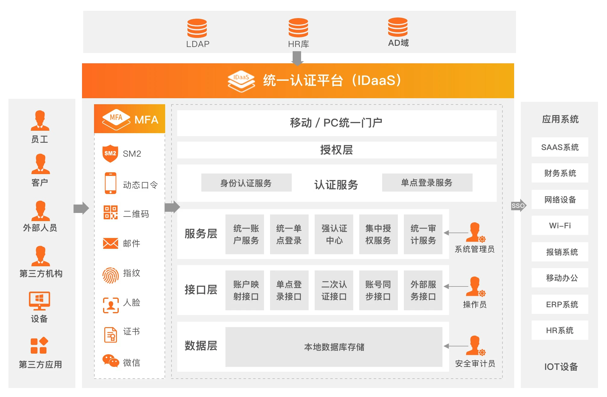

阿里云  
专有云  
应用身份服务  
产品简介  
产品版本：V3.18.6  
文档版本：20251029

**目录**

- [1.什么是应用身份服务](#section-1)
- [2.功能特性](#section-2)
- [3.产品架构](#section-3)
- [4.产品价值](#section-4)

# 1.什么是应用身份服务

阿里云云盾IDaaS是阿里云原生企业身份管理产品，集应用管理、账户管理、权限管理、身份安全、报表分析于一体，搭载无密码认证、企业钉钉等多种认证方式，旨在保护企业员工身份安全和非人身份凭据安全传递。

# 2.功能特性

**一级特性**

**二级特性**

**三级特性**

**特性描述**

快速前往

帮助用户快速使用产品。

消息提醒

包括许可证书即将到期、收到的未读信息。

用户数量

提供用户数量统计面板，快速检索用户。

概览

控制台概览

根据时间区间或者地理+F106位置，显示用户登录的地理位置分布

登录分布

图。

应用使用频

根据时间区间，呈现出应用使用频率最高的五个应用。

率

访问统计

通过时间区间，统计用户登录成功或者失败的次数。

其他管理

其他管理

其他管理

提供消息管理、审批中心、会话管理等。

操作日志

操作日志

查询用户认证使用情况以及管理员操作情况。

审计

进出日志

进出日志

查询账户的登录、退出日志记录。

应用管理，支持应用启用、禁用，单独开启二次认证，子账户管理等

应用列表

应用列表

功能。

应用

添加应用

添加应用

支持标准的JWT/OAuth/OIDC/SAML/CAS协议应用认证配置。

支持将应用授权给账户、组、组织机构以及分类，进行应用访问的授

应用授权

应用授权

权管理。

授权

支持应用入口的授权管理以及应用内权限模型的构建。

权限系统

权限系统

分类管理

分类管理

提供账户分类创建功能，账户基于属性特征进行分类管理。

新建机构及

支持组织机构的生命周期管理、账户的创建以及LDAP方式进行同步

账户

数据。

岗位变动

支持用户的入职、离职、兼职。

机构及组

用户目录

批量操作

支持批量导入、导出账户。

支持组织机构、账户的创建以及AD、LDAP、钉钉、SCIM接口等方

机构及组

式同步数据。

账户分类

支持在职人员、离职人员、僵尸账户、API账户的分类管理。

账户管理

针对账户的管理功能，提供生命周期管理、启用/禁用、重置密码、二

账户管理

次认证等功能。

支持对接RADIUS实现对防火墙、堡垒机、WIFI、交换机等设备的统

RADIUS

RADIUS

一认证和二次认证。

认证

支持配置外部认证源用户系统登录，包括短信、钉钉、企业微信、AD

认证源

认证源

等。

证书管理

证书管理

为用户签发移动端、PC端证书。

个性化设置

个性化设置

允许管理员设置公司的基本信息，包括图标、登录页样式等。

二次认证

设置是否在登录的时候开启二次认证以及认证的方式。

设置

安全设置

其他

支持配置密码安全策略、策略管理、许可证管理、僵尸账户清理等。

安全设置

支持配置密码安全策略、用户二次认证、默认登录方式等。

# 3.产品架构

云盾-IDaaS实现对内、对外服务的标准化、精准化、便捷化、平台化和协同化，在已有的安全体系下，构建一套统一、高效、安全的统一身份认证平台。它需要满足现有业务系统传统WEB端及未来移动端、物联网等多领域需求，实现业务系统数字化、网络化、智能化的同时，也需要满足服务内容规范化、服务便捷化、数据互通化， 提升对内、对外网上业务服务能力。在解决现有问题的同时不断发展，以“云大物移”为发展平台，为信息化发展助力、保驾护航。

云盾-IDaaS的统一身份认证管理平台——云盾-IDaaS （Identity platform） 是一套集中式的身份管理系统，主要面向企业应用开发者、IT管理员和企业员工，如：企业的应用开发商可按照云盾-IDaaS的认证接入标准将企业应用接入到平台上，云盾-IDaaS中提供开发者所需的各种接入方式SDK和示例指导。信息中心IT管理人员对企业员工进入应用所需要的认证方式，以及员工的访问权限配置等进行配置，对认证策略、权限策略进行集中管控，同时可以拉取企业现有的身份源数据以及按需推送到下游应用系统，打通员工上下游身份生命周期。企业员工可通过企业的唯一标识登录到云盾-IDaaS平台并一键进入到已授权的应用。平台可以对员工使用的环境、时间、设备等因素，智能判断当前用户的行为风险，自动作为防御动作。同时，审计管理员开始可以企业员工的使用情况和访问路径进行审计，可以看到用户使用平台和应用的情况以及审计管理员的重要操作，做到事后可追溯。从企业的三个不同角色在云盾-IDaaS 平台中，从应用开发接入到管理赋权，再到员工使用和行为审计，保障企业在日常办公的身份使用安全，构建以身份为核心的业务流转身份底座和完整的企业身份数据资产平台。

云盾-IDaaS采用了前后分离的开发技术，本着表现层开源化、接口层中台化、数据层水平化等几个原则，提供了丰富的功能。

# 4.产品价值

- **统一身份管理，提升工作效率**

  云盾-IDaaS能够实现账号与权限的快速分配，通过自助服务满足自动化用户管理流程，全面提高信息化水平。云盾-IDaaS对终端用户提供了自助服务，自助进行账户管理、权限申请，能够大幅较少管理工作，同时用户可以单点登录到权限范围内的所有系统，实现一次登录自由访问，大幅提高工作效率；对管理员用户创建了分级管理员的角色，将权限下放，实现权限精细化管控；同时针对开发对接系统，提供了插件管理能力，大幅提高主流应用上线效率。

- **降低开发成本，减少运营开销**

  统一身份认证管理，实现用户集中管理、信息共享，实现系统用户安全访问、互联互通，推进企业、集团、单位的统一身份管理体系提质，避免应用系统重复造轮子，大幅降低开发成本；同时面向不同的应用系统和用户，提供统一的、标准化的身份管理、认证运营服务体系，减少不同系统架构、协议带来的运营成本，大幅减少开销。

- **控制访问权限，助力业务安全**

  云盾-IDaaS内置权限系统，可以管控IDaaS自身及第三方系统的权限，包括角色、资源、主客体授权等，通过集中管理和控制对敏感数据及资源的访问权限，能够有效降低未授权访问的风险，同时通过最小授权原则，降低因权限过高而引发的安全问题。

- **多源组合认证，助力监管合规**

  无论是《网络信息安全等级保护2.0》中关于身份鉴别的合规要求，还是《商用密码检测规范》中关于双因素认证的合规要求，甚至国外的数据保护法规要求，如GDPR、HIPAA，均对身份安全提出了更为严格的要求。云盾-IDaaS通过全面的事件记录，完成事前预防、事中拦截、事后追溯，满足审计合规诉求，同时通过MFA满足身份鉴别的合规要求。云盾-IDaaS以身份灵活构建安全边界，符合等保、国密监管等要求。
