阿里云  
专有云  
应用身份服务  
用户指南  
产品版本：V3.18.6  
文档版本：20251029

**目录**

- [1.使用须知](#section-1)
- [2.接入Apsara Uni-manager运营控制台](#section-2)
- [3.接入Apsara Uni-manager运维控制台](#section-3)
- [4.应用](#section-4)
    - [4.1. 应用列表](#section-4-1)
    - [4.2. 添加应用](#section-4-2)
    - [4.3. 配置双因子](#section-4-3)
- [5.用户目录](#section-5)
    - [5.1. 机构及组](#section-5-1)
    - [5.2. 账户管理](#section-5-2)
    - [5.3. 分类管理](#section-5-3)
    - [5.4. 添加账户](#section-5-4)
    - [5.5. AD数据对接](#section-5-5)
- [6.认证](#section-6)
    - [6.1. 认证源](#section-6-1)
    - [6.2. RADIUS](#section-6-2)
    - [6.3. 证书管理](#section-6-3)
- [7.授权](#section-7)
    - [7.1. 权限系统](#section-7-1)
    - [7.2. 应用授权](#section-7-2)
    - [7.3. 访问授权](#section-7-3)
- [8.审计](#section-8)
    - [8.1. 操作日志](#section-8-1)
    - [8.2. 进/出日志](#section-8-2)
- [9.其他管理](#section-9)
    - [9.1. 审批中心](#section-9-1)
    - [9.2. 同步中心](#section-9-2)
    - [9.3. 消息管理](#section-9-3)
    - [9.4. 会话管理](#section-9-4)
    - [9.5. 我的消息](#section-9-5)
    - [9.6. 插件管理](#section-9-6)
- [10.设置](#section-10)
    - [10.1. 个性化设置](#section-10-1)
        - [10.1.1. 公司信息](#section-10-1-1)
        - [10.1.2. 系统信息设置](#section-10-1-2)
        - [10.1.3. 登录页设置](#section-10-1-3)
        - [10.1.4. 域名设置](#section-10-1-4)
    - [10.2. 安全设置](#section-10-2)
        - [10.2.1. 统一二次认证](#section-10-2-1)
        - [10.2.2. 注册/登录/登出](#section-10-2-2)
        - [10.2.3. 策略管理](#section-10-2-3)
        - [10.2.4. 短信配置](#section-10-2-4)
        - [10.2.5. 邮件配置](#section-10-2-5)
        - [10.2.6. 许可证管理](#section-10-2-6)
        - [10.2.7. IP 准入](#section-10-2-7)
        - [10.2.8. 僵尸账户清理](#section-10-2-8)
        - [10.2.9. 二次加密](#section-10-2-9)
    - [10.3. 配置登录安全策略](#section-10-3)
    - [10.4. 配置密码策略](#section-10-4)

<a id="section-1"></a>

# 1.使用须知

在登录云盾控制台前，您需要确认本地PC符合以下配置。本地PC需要满足如配置要求表中配置要求，才可以正常登录云盾控制台。

表 1. 配置要求表

<table>
  <tr>
    <th width="90">内容</th>
    <th>要求</th>
  </tr>
  <tr>
    <td>浏览器</td>
    <td>• Internet Explorer浏览器：11及以上版本<br>• Chrome浏览器（推荐）：42.0.0及以上版本<br>• Firefox浏览器：30及以上版本<br>• Safari浏览器：9.0.2版本及以上版本<br>• 国密浏览器：Chrome内核69及以上的主流国密浏览器</td>
  </tr>
  <tr>
    <td>操作系统</td>
    <td>• Windows XP版本<br>• Windows 7及以上版本<br>• Mac系统</td>
  </tr>
</table>

<a id="section-2"></a>

# 2.接入Apsara Uni-manager运营控制台

本文介绍如何配置应用身份服务（Alibaba Cloud IDentity as a Service，简称IDaaS）与Apsara Uni-manager运营控制台，实现通过IDaaS身份登录到Apsara Uni-manager运营控制台。

**前提条件**

登录IDaaS控制台前，确认您已从部署人员处获取IDaaS控制台的服务域名地址。

**在IDaaS添加Apsara Uni-manager运营控制台**

**添加应用实例并完成授权**

1. 登录云盾IDaaS控制台。

2. 在左侧导航栏，选择**应用 > 添加应用**。

3. 在**全部**页签的搜索框输入ASCM，选择Apsara Uni-manager运营控制台应用模板，单击**操作**列的**添加应用**。

4. 在<strong>添加应用（ASCM_SAML）</strong>对话框，单击**添加SigningKey**，填写SigningKey的名称、国家、省份、证书长度或有效期后，单击**提交**。

5. 定位到已添加的SigningKey，单击**操作**的**选择**，填写Apsara Uni-manager运营控制台对应的认证参数后，单击**提交**。

   | 配置项 | 说明 |
   | --- | --- |
   | IDP IdentityId | 填写身份提供方的身份ID，需与Apsara Uni-manager运营控制台保持一致。 |
   | SP Entity ID | 填写Apsara Uni-manager运营控制台的输入ID。该ID由Apsara Uni-manager运营控制台提供。 |
   | SP ACS URL | 填写Apsara Uni-manager运营控制台的ACS URL。该ACS URL由Apsara Uni-manager运营控制台提供。 |
   | NameIdFor mat | 选择 单点登录（SSO） 支持的SAML名称标识格式，选择<strong>SAML:1.1</strong>即可。 |
   | Binding | 选择传递认证报文的方式。 |
   | Sign Assertion | 报文的断言是否签名，选择<strong>关闭</strong>即可。 |
   | 账户关联方式 | 填写IDaaS中的账户与Apsara Uni-manager运营控制台中的账户关联方式。<br>• <strong>账户映射</strong>：表示IDaaS中的账户与Apsara Uni-manager运营控制台中的账户相同。<br>• <strong>账户关联</strong>：表示IDaaS中的账户与Apsara Uni-manager运营控制台中的账户不同。 |

6. 在**系统提示**对话框，单击**立即授权**。

7. 在**应用授权**页面，单击**账户**、**组**、**组织机构**或**分类**页签，选择要授权的对象。

   > **说明**
   >
   > 如果**账户**已添加到**组**、**组织机构**或**分类**中，授权**组**、**组织机构**或**分类**后，**账户**也会获得授权。

**获取Apsara Uni-manager运营控制台所需参数**

在IDaas中添加Apsara Uni-manager运营控制台应用实例并完成授权后，您可以执行如下操作，获取Apsara Uni-manager运营控制台所需参数。

1. 在左侧导航栏，选择**应用 > 应用列表**。

2. 在应用列表页面，目标应用的操作列，单击**详情**。

3. 在**应用信息**区域，单击**查看详情**。

4. 在<strong>应用详情（ASCM_SAML）</strong>面板，**IDP IdentityId** 字段处，单击**导出 IDaaS SAML 元配置文件**。导出文件后，您将获得一个 `.xml` 文件。您需要将文件中的如下参数，提供给Apsara Uni-manager运营控制台。

   | 参数 | 说明 |
   | --- | --- |
   | IdPName | IdP 认证系统显示名，对应导出文件中的<strong>IDP IdentityId</strong>参数。 |
   | SSOServic eUrl | IdP认证地址，对应导出文件中的<strong>SingleSignOnService</strong>参数的<strong>HTTP-Redirect</strong>。<br>说明如果配置了该变量，Apsara Uni-manager运营控制台登录页会出现<strong>授权登录</strong>按钮。单击<strong>授</strong><strong>权登录</strong>，页面会跳转到该变量指定的地址。 |
   | X509Certif icate | IdP证书，对应导出文件中的<strong>X509Certificate</strong>参数。 |

**在Apsara Uni-manager运营控制台配置Idp**

在三方系统作为 IdP，Apsara Uni-manager运营控制台作为 SP 的场景下，Apsara Uni-manager运营控制台需要配置用户侧Idp的接口和证书等信息，来实现SAML 2.0协议SP用户SSO的单点登录接入。

**一、配置变更方案**

1. 登录 `unimanager-base.IdentityService#` 容器。

2. 执行命令： `mysql -u${db_user} -P${db_port} -h${db_host} -D${db_name} -p${db_password}` 。

3. 执行如下insert语句。

   ```sql
   insert into config_global (config_key, config_value) values ('auth.idp.name', '替换为
   三⽅认证系统的显示名');
   insert into config_global (config_key, config_value) values ('auth.idp.protocol', 'SA
   ML2');
   insert into config_global (config_key, config_value) values ('auth.idp.ssoUrl', '替换
   为⽤户的SSOServiceUrl');
   insert into config_global (config_key, config_value) values ('auth.idp.x509cert', '替
   换为⽤户分配的证书');
   # 以下配置选填，若idp侧不⽀持单点登出，可以不⽤配置
   insert into config_global (config_key, config_value) values ('auth.idp.sloUrl', 'IDP
   侧的单点登出入⼝，此接⼝触发场景是IDP调⽤Apsara Uni-manager运营控制台SLO入⼝，返回Response时，调
   ⽤IDP的SLO入⼝地址')
   # v3.14/v3.16.2及以后才⽀持以下配置，Apsara Uni-manager运营控制台返回Response时，请求IDP是POS
   T还是GET： urn:oasis:names:tc:SAML:2.0:bindings:HTTP-Redirect | 
   urn:oasis:names:tc:SAML:2.0:bindings:HTTP-POST
   insert into config_global (config_key, config_value) values ('auth.idp.sloBinding', '
   Apsara Uni-manager运营控制台返回Response时，请求IDP的跳转⽅式，默认是
   urn:oasis:names:tc:SAML:2.0:bindings:HTTP-Redirect')
   ```

   > **说明**
   >
   > 如果配置时出现问题，可执行如下命令：
   >
   > - 紧急关闭SAML 2.0 SP模式： `delete from config_global where config_key = 'auth.idp.protocol';` 。
   >
   > - 恢复SAML 2.0 SP模式： `insert into config_global (config_key, config_value)`
   >
   >   ```text
   >   values ('auth.idp.protocol', 'SAML2'); 
   >   ```

**二、获取SP Metadata**

获取SP Metadata前，请确保已完成步骤一：配置变更方案。否则，配置的变化会造成SP Metadata的变化。

1. 在天基的资源报表里，获取 `unimanager-base.IdentityService#` 申请的DNS资源，从而得到域名 `${auth-domain}` 。

2. 拼接后获得SP Metadata地址： `http://${auth-domain}/ascm/auth/saml2/sp-metadata.xml` 。以下是用户SSO的sp-metadata.xml示例，仅供参考，具体的Endpoint和密钥等信息以具体环境生成的值为准。

   ```xml
   <md:EntityDescriptor xmlns:md="urn:oasis:names:tc:SAML:2.0:metadata" 
   entityID="https://asc2.inter.env10.***.com/saml2/spLogin">
   <md:SPSSODescriptor 
   protocolSupportEnumeration="urn:oasis:names:tc:SAML:2.0:protocol">
   <md:KeyDescriptor use="signing">
   <ds:KeyInfo xmlns:ds="http://www.***.org/2000/09/xmldsig#">
   <ds:X509Data>
   <ds:X509Certificate>
   *************
   </ds:X509Certificate>
   </ds:X509Data>
   </ds:KeyInfo>
   </md:KeyDescriptor>
   <md:NameIDFormat>
   urn:oasis:names:tc:SAML:1.1:nameid-format:emailAddress
   </md:NameIDFormat>
   <md:NameIDFormat>urn:oasis:names:tc:SAML:1.1:nameid-
   format:unspecified</md:NameIDFormat>
   <md:SingleLogoutService Binding="urn:oasis:names:tc:SAML:2.0:bindings:HTTP-Redirect" 
   Location="https://one.console.cloud.180e.com/ascm/spLogout"/>
   <md:AssertionConsumerService Binding="urn:oasis:names:tc:SAML:2.0:bindings:HTTP-POST"
   Location="https://asc2.inter.env10.shuguang.com/saml2/spLogin" index="1" 
   isDefault="true"/>
   <md:AttributeConsumingService index="1">
   </md:AttributeConsumingService>
   </md:SPSSODescriptor>
   </md:EntityDescriptor>
   ```

**三、配置用户SSO参数**

在SSO之前请确保已在Apsara Uni-manager运营控制台创建该用户。

用户的登录名通过**SAML Response**的**NameID**的**emailAddress**的**Value**节点传递，例如：

```xml
<saml2:NameID Format="urn:oasis:names:tc:SAML:1.1:nameid-
format:emailAddress">testuser</saml2:NameID>
```

完成配置后，您可以通过IDaaS的身份，单点登录Apsara Uni-manager运营控制台。

<a id="section-3"></a>

# 3.接入Apsara Uni-manager运维控制台

本文介绍如何配置应用身份服务（Alibaba Cloud IDentity as a Service，简称IDaaS）与Apsara Uni-manager运维控制台，实现通过IDaaS身份登录到Apsara Uni-manager运维控制台。

**前提条件**

登录IDaaS控制台前，确认您已从部署人员处获取IDaaS控制台的服务域名地址。

**在IDaaS添加Apsara Uni-manager运维控制台添加应用实例并完成授权**

1. 登录云盾IDaaS控制台。

2. 在左侧导航栏，选择**应用 > 添加应用**。

3. 在**全部**页签的搜索框输入ASO，选择Apsara Uni-manager运维控制台应用模板，单击**操作**列的**添加应用**。

4. 在<strong>添加应用（ASO_SAML）</strong>对话框，单击**添加SigningKey**，填写SigningKey的名称、国家、省份、证书长度或有效期后，单击**提交**。

5. 定位到已添加的SigningKey，单击**操作**的**选择**，填写Apsara Uni-manager运维控制台对应的认证参数后，单击**提交**。

   <table>
     <tr>
       <th width="160">配置项</th>
       <th>说明</th>
     </tr>
     <tr>
       <td>IDP IdentityId</td>
       <td>填写身份提供方的身份ID，需与Apsara Uni-manager运维控制台保持一致。</td>
     </tr>
     <tr>
       <td>SP Entity ID</td>
       <td>填写Apsara Uni-manager运维控制台的输入ID。该ID由Apsara Uni-manager运维控制台提供。</td>
     </tr>
     <tr>
       <td>SP ACS URL</td>
       <td>填写Apsara Uni-manager运维控制台的ACS URL。该ACS URL由Apsara Uni-manager运维控制台提供。</td>
     </tr>
     <tr>
       <td>NameIdFormat</td>
       <td>选择 单点登录（SSO） 支持的SAML名称标识格式，选择<strong>SAML:1.1</strong>即可。</td>
     </tr>
     <tr>
       <td>Binding</td>
       <td>选择传递认证报文的方式。</td>
     </tr>
     <tr>
       <td>Sign Assertion</td>
       <td>报文的断言是否签名，选择<strong>关闭</strong>即可。</td>
     </tr>
     <tr>
       <td>账户关联方式</td>
       <td>填写IDaaS中的账户与Apsara Uni-manager运维控制台中的账户关联方式。<br>• <strong>账户映射</strong>：表示IDaaS中的账户与Apsara Uni-manager运维控制台中的账户相同。<br>• <strong>账户关联</strong>：表示IDaaS中的账户与Apsara Uni-manager运维控制台中的账户不同。</td>
     </tr>
   </table>

6. 在**系统提示**对话框，单击**立即授权**。

7. 在**应用授权**页面，单击**账户**、**组**、**组织机构**或**分类**页签，选择要授权的对象。

   > **说明**
   >
   > 如果**账户**已添加到**组**、**组织机构**或**分类**中，授权**组**、**组织机构**或**分类**后，**账户**也会获得授权。

**获取Apsara Uni-manager运维控制台所需参数**

在IDaaS中添加应用实例并完成授权后，您可以执行如下操作，获取Apsara Uni-manager运维控制台所需参数。

1. 在左侧导航栏，选择**应用 > 应用列表**。

2. 在**应用信息**区域，单击**查看详情**。

3. 在<strong>应用详情（ASO_SAML）</strong>面板，单击**导出 IDaaS SAML 元配置文件**。导出文件后，您将获得一个 `.xml` 文件。您需要将文件中的如下参数，提供给Apsara Uni-manager运维控制台。

   <table>
     <tr>
       <th width="183">参数</th>
       <th>说明</th>
     </tr>
     <tr>
       <td>auth.idp.name</td>
       <td>IdP 认证系统显示名，对应导出文件中的<strong>IDP IdentityId</strong>参数。</td>
     </tr>
     <tr>
       <td>auth.idp.ssoUrl</td>
       <td>IdP认证页地址，对应导出文件中的<strong>SingleSignOnService</strong>参数的<strong>HTTP-</strong><strong>Redirect</strong>。<br>说明如果配置了该变量，Apsara Uni-manager运维控制台登录页会出现<strong>授权登录</strong>按钮。单击<strong>授权登录</strong>，页面会跳转到该变量指定的地址。</td>
     </tr>
     <tr>
       <td>auth.x509cert</td>
       <td>IdP证书，对应导出文件中的<strong>X509Certificate</strong>参数。</td>
     </tr>
     <tr>
       <td>auth.idp.protocol</td>
       <td>固定取值<strong>SAML2</strong>，表示标准的SAML2协议。在从IDP向Apsara Uni-manager运维控制台单点登录前，需先在Apsara Uni-manager运维控制台中完成用户创建。</td>
     </tr>
   </table>

**在Apsara Uni-manager运维控制台配置IdP一：配置变更方案**

1. 登录 `aso-mgr.asmgr#` 容器。

2. 执行命令： `mysql -h${api_db_host} -P${api_db_port} -u${api_db_name} -p${api_db_password} -D${api_db_name}` 。

3. 执行命令： `select config_key from client_site_config where config_key in`

```text
('auth.idp.name', 'auth.idp.ssoUrl', 'auth.idp.protocol', 'auth.x509cert', 
```

`'sync.user.default.password');` 。

- 如果查询结果有返回值，执行如下update语句，更新配置为步骤3获取到的用户实际的值。

  ```sql
  ## 其中xxx为⽤户实际的值;
  update client_site_config set config_value = 'xxx' where config_key = 
  'auth.idp.name';
  update client_site_config set config_value = 'xxx' where config_key = 
  'auth.idp.ssoUrl';
  update client_site_config set config_value = 'SAML2' where config_key = 
  'auth.idp.protocol';
  update client_site_config set config_value = 'xxx' where config_key = 
  'auth.x509cert';
  ```

- 如果查询结果没有返回值，执行如下insert语句，插入用户实际的值。

  ```sql
  insert into client_site_config(config_key, config_value) values('auth.idp.name', 'xxx');
  insert into client_site_config(config_key, config_value) values('auth.idp.ssoUrl', 
  'xxx');
  insert into client_site_config(config_key, config_value) 
  values('auth.idp.protocol', 'SAML2');
  insert into client_site_config(config_key, config_value) values('auth.x509cert', 'xxx');
  ```

**二：获取SP Metadata**

获取 SP Metadata前，请确保已完成步骤一：配置变更方案。否则，配置的变化会造成SP Metadata的变化。

1. 登录 `aso.mgr.asmgr#` 容器。

2. 在该容器内执行命令： `curl -H "Generated: N" 'http://127.0.0.1:8090/aso/api-gateway/saml2/sp-metadata.xml'` 。执行成功后，将得到用户SSO的sp-metadata.xml示例，仅供参考，具体的Endpoint和密钥等信息以具体环境生成的值为准。

   ```xml
   <?xml version="1.0" encoding="UTF-8"?>
   <md:EntityDescriptor xmlns:md="urn:oasis:names:tc:SAML:2.0:metadata"
     entityID="https://cn-neimeng-env141-d01.aso.intra.env141.shuguang.com/aso/api-gateway/saml2/spLogin">
     <md:SPSSODescriptor 
   protocolSupportEnumeration="urn:oasis:names:tc:SAML:2.0:protocol">
       <md:KeyDescriptor use="signing">
         <ds:KeyInfo xmlns:ds="http://www.w3.org/2000/09/xmldsig#">
           <ds:X509Data>
             <ds:X509Certificate>
               
   MIICnDCCAYSgAwIBAgIES8bCmTANBgkqhkiG9w0BAQsFADAPMQ0wCwYDVQQDEwRST09UMCAXDTIxMDMxNzA4NTA
   FoYDzIxMjEwMjIxMDg1MDQwWjAPMQ0wCwYDVQQDEwRST09UMIIBIjANBgkqhkiG9w0BAQEFAAOCAQ8AMIIBCgKC
   EAr4iE6JiXa/n9D6S0lP2SKWcChX1SBmVkFHoogaJqXhuRVI6K8v4e0r5v7TBG48MH9loDKIaEPkIFrcyRfUOdv
   g7vaK0CRyitClwNJ5Py/CG83zguN/RAajbmW7IY77N721/sDlCs+FInrtyEuqd0S6ZwqMaLTcxjxjagR5HV4+yO
   V8zysNOAp11gt+q1P/Sn55RpA2PLQz9NBsB7A7wF+d/gdVjFPonu4rFmp/JjPAulqUu16P5X60ILkC04pikFM1Z
   bBVTKq1cdKfJ2RmyAfSQ0NOgfiZvhAwT4ADz5YMRLnhh2mXL3lo0gn68F7JC78Yq02I2qIAaCM1fQIDAQABMA0G
   qGSIb3DQEBCwUAA4IBAQB5AhdbA9uRN2ZHSLkpRfwp+P5fPAFy4NGvxqWR8QQdRmQnph2kdNP5V8RzzqorghZFI
   k4HWaAy8Fn3oq2DEKlPFUqOS8MAUr1U7oX16BRKPCww1SRzgC6w11+FGOK9Dnt4KaytuewmTR0TuZQ6o9KMWDkH
   rmEz+6aC9qX/QRPKxAuN3vHc+K7+TDHpUKP0TCzNsSCUxWy9CjEg858UWnN6dZ263y3F55vr3KNHDi8DyONZG33
   QBT46xNlh9btjmlMEngOpqOay2GhcmLno6B/SHhcexgXLnTAWjCoTUGgB1QxoAPmbFphuVSja0dBPdml0R7PnjO
   Bk8K2U
             </ds:X509Certificate>
           </ds:X509Data>
         </ds:KeyInfo>
       </md:KeyDescriptor>
       <md:NameIDFormat>
         urn:oasis:names:tc:SAML:1.1:nameid-format:emailAddress
       </md:NameIDFormat>
       <md:AssertionConsumerService
         Binding="urn:oasis:names:tc:SAML:2.0:bindings:HTTP-POST"
         Location="https://cn-neimeng-env141-d01.aso.intra.env141.shuguang.com/aso/api-gateway/saml2/spLogin"
         index="1"
         isDefault="true"/>
       <md:AttributeConsumingService index="1">
       </md:AttributeConsumingService>
     </md:SPSSODescriptor>
   </md:EntityDescriptor>
   ```

**三：配置用户SSO参数**

在SSO之前请确保已在Apsara Uni-manager运维控制台创建该用户。

用户的登录名通过**SAML Response**的**NameID**的**emailAddress**的**Value**节点传递，例如：

```xml
<saml2:NameID Format="urn:oasis:names:tc:SAML:1.1:nameid-
format:emailAddress">testuser</saml2:NameID>
```

完成配置后，您可以使用IDaaS身份，单点登录Apsara Uni-manager运维控制台。

<a id="section-4"></a>

# 4.应用

<a id="section-4-1"></a>

## 4.1. 应用列表

**概述**

管理公司所有应用信息，单击菜单**应用 > 应用列表**展示出该公司下的所有应用，并可以以不同的维度筛选应用列表，IT管理员可以对所有应用进行维护。通过应用列表能直观知道自己公司目前有多少正在使用的应用，以及各类别的应用都有哪些。以及提供**添加应用**入口，可单击进行应用添加流程。

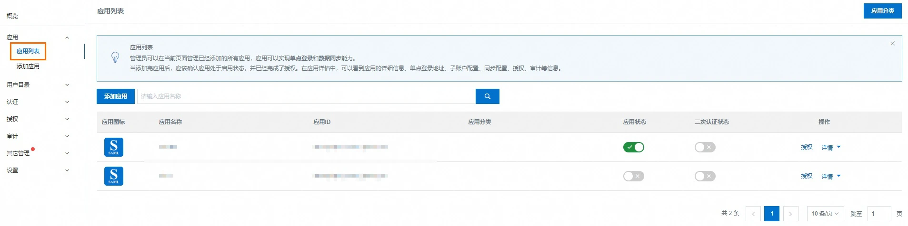

**禁用启用应用**

新添加的应用状态默认为启用状态，状态按钮显示为绿色，如需关闭，可单击此开关关闭应用；同样，关闭状态下，状态按钮显示为灰色，也可以通过单击此开关启用应用。

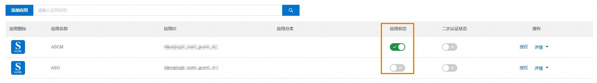

处于禁用的应用，即使被授权给用户，用户页面也不展示且不可进行单点登录。

**开启/关闭应用二次认证**

新添加的应用二次认证状态默认是关闭状态，如需开启/关闭，单击开关并确定即可，绿色为开启，灰色为关闭。

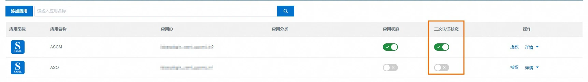

**授权**

单击应用列表中的**授权**，为当前选定的应用授权，授权分为两种方式：按**应用授权主体**和按**主体授权应用**，即主体包括账户、组、组织机构、分类，从应用列表应用后面单击授权进入应用授权主体页面，默认会精确搜索该应用，应用可以对账户/组/组织机构/分类进行正向/反向/取消/继承授权。

**详情**

详情处展示应用相关的功能操作。有以下几类信息：应用信息、账户管理、认证信息、授权、审计信息、API。

1. **应用信息**

   <ol type="i">

   <li>

   查看详情单击应用列表中**详情 > 应用信息 > 查看详情**进入页面，可以查看应用ID、应用名称、应用 Uuid等详细信息。

   - **安全等级**：可以设置成1-9的安全等级，用户认证等级低于应用安全等级时会强制触发二次认证，用户认证等级等于/高于应用安全等级时不会触发二次认证。

   - **IDP退出地址**：IDaaS提供的单点登出地址，业务系统在退出时调用可以实现该业务系统退出统一认证登录状态。

   - **SP支持退出与SP退出地址**（仅支持JWT模板）<strong>：</strong>IDaaS支持其退出登录的同时可以触发JWT-SP退出功能。配置要求：需要在JWT应用模板处开启SP支持退出开关，并填写 SP提供的退出地址。

   </li>

   <li>

   **修改应用**

   单击应用列表中**详情 > 应用信息 > 修改应用**，可以进入编辑页面对应用进行修改。

   </li>

   <li>

   **删除应用如果需要删除应用，需要先将应用禁用，然后再单击应用列表中详情 > 应用信息 > 删除应用。**

   </li>

   </ol>

2. **认证信息**单击即可复制IDaaS发起地址和SP发起地址。

3. **授权**管理应用内菜单和功能权限，单击**绑定权限系统**链接，可以给当前的应用绑定自建权限系统。一个应用只能绑定一个权限系统，一个权限系统可以被多个应用绑定。

4. **审计信息**查看日志：单击应用列表中的**详细 > 审计信息 > 查看日志**进入页面，

5. **API**单击即可复制API key和API Secret，应用对外调用的API接口。

<a id="section-4-2"></a>

## 4.2. 添加应用

应用是用户访问的对象，添加后管理员可以分配给指定用户访问。本文介绍如何在IDaaS中添加应用。

**前提条件**

登录IDaaS控制台前，确认您已从部署人员处获取IDaaS控制台的服务域名地址。

**操作步骤**

1. 登录云盾IDaaS控制台。

2. 在左侧导航栏，选择**应用**＞**添加应用**。

3. 在**标准协议**页签，定位到对应应用，单击**操作**列的**添加应用**。

   > **说明**
   >
   > 安全管理员可添加系统支持的各类标准认证协议类型的应用，例如JWT、SAML、OAuth2、CAS等。

添加完成后，管理员可以选择**应用**＞**应用列表**，在**应用列表**页面，对已创建的应用进行启用、禁用、开启和关闭二次认证等操作。

<a id="section-4-3"></a>

## 4.3. 配置双因子

接入Apsara Uni-manager运营控制台或Apsara Uni-manager运维控制台后，您可以通过应用身份服务（Alibaba Cloud IDentity as a Service，简称IDaaS）单点登录。如果要实现登录过程的双因子认证，还需要开启对应的二次认证。本文介绍如何开启二次认证。

**前提条件**

登录IDaaS控制台前，确认您已从部署人员处获取IDaaS控制台的服务域名地址。

1. 登录云盾IDaaS控制台。

2. 在左侧导航栏，选择**应用 > 应用列表**。

3. 在搜索框输入ASCM或ASO，打开**二次认证状态**开关。开启**二次认证状态**后，系统会默认使用 App认证（安装 App或IDP动态口令小程序）进行二次认证。

   - 如果您需切换认证方式，可执行如下操作：

     <ol type="a">

     <li>

     在左侧导航栏，选择**设置 > 安全设置**。

     </li>

     <li>

     在**安全设置**页面，单击**统一二次认证**。

     </li>

     </ol>

     <ol type="i" start="100">

     <li>

     在**二次认证配置**分页，配置**应用二次认证方式**后，单击**保存设置**。

     </li>

     </ol>

   - 如果满足国密要求，且您需要配置**第三方OTP配置**，可执行如下操作：

     <ol type="a">

     <li>

     在左侧导航栏，选择**设置 > 安全设置**。

     </li>

     <li>

     在**安全设置**页面，单击**统一二次认证**。

     </li>

     </ol>

     <ol type="i" start="100">

     <li>

     在**第三方OTP配置**分页，完成**OTP Server IP配置**后，单击**保存设置**。

     </li>

     <li value="500">

     在**二次认证配置**分页，配置**应用二次认证方式**为上一步配置的认证服务，单击**保存设置**。

     </li>

     </ol>

     完成配置后，配合硬件令牌，即可使用更换后的二次认证方式。

<a id="section-5"></a>

# 5.用户目录

<a id="section-5-1"></a>

## 5.1. 机构及组

机构及组是一个统一管理机构、组、账户数据的功能模块。通过此功能模块可以轻松管理企业机构账户数据生命周期。

**概述**

在机构及组中，管理员可以增、删、改、查单位或部门、组、账户。单位或部门（组织机构）中可新建，单位或部门（组织机构）、组、账户。组中可以添加账户成员。

**账户**

账户的管理包括：新建账户，查看并修改账户信息，禁用启用账户、转岗账户、账户离职、返聘账户、物理删除账户等。

**新建账户**

1. 操作入口。在控制台左侧导航栏，依次展开**用户目录 > 机构机组**，即可进入功能页面。

   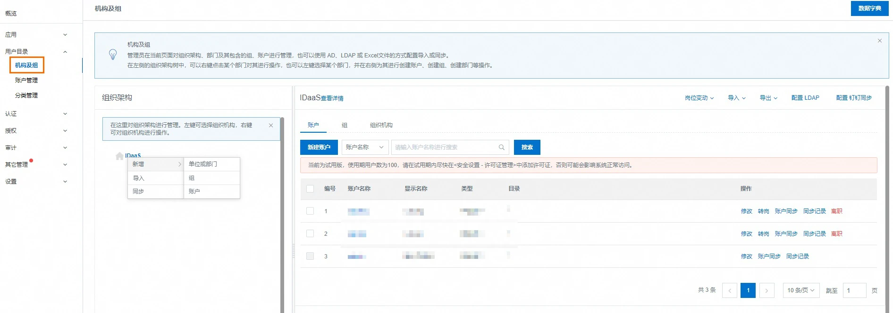

2. 在组织机构树上鼠标右键单击目标机构，**新增 > 账户**，或者在账户列表处单击**新增账户**。

3. 进入新增账户页面，输入必填信息，提交即可创建账户成功。各属性说明：

   | 属性名 | 说明 |
   | --- | --- |
   | 账户属性 | 账户的基本固定属性。 |
   | 父级 | 账户所属机构。 |
   | 账户名称 | 唯一，必填。 |
   | 显示名称 | 必填。 |
   | 密码 | 需要填写符合密码策略的密码，必填。 |
   | 邮箱 | 选填。 |
   | 手机号 | 选填。 |
   | 外部ID | 选填，如果不填写则系统自动生成，后续不可修改。 |
   | 排序号 | 账户在机构内的排序号，降序排列。 |
   | 生效时间 | 账户生效时间，如果还未达到生效时间，账户将处于未生效状态，不可登录认证。如不填写，提交后立即生效。 |
   | 过期时间 | 账户过期时间，到达设置时间后，账户将处于过期状态，不可登录认证。 |
   | 备注 | 选填。 |
   | 扩展属性 | 账户的可扩展属性，通过数据字典进行添加。 |
   | 人员-组织属性 | 账户兼职相关属性，每个机构下该属性内容需独立维护，通过数据字典添加。 |
   | 父级组 | 即可以勾选组，为组添加此账户为账户成员。 |

**修改账户**

1. 在账户列表里，可以通过单击账户名称或者**修改**进入账户属性页面进行部分属性修改和修改所属父级组。父级组页面：支持通过**添加父级组**、**移除**、**批量移除**进行修改父级组。

2. 转岗账户即更换账户的直属机构。

   <ol type="i">

   <li>

   机构里直属账户 – 操作里的**转岗**或者勾选目标账户后，单击**批量转岗**。

   </li>

   <li>

   进入转岗页面，鼠标单击选中目标机构，然后再单击**确定转岗**即可实现账户转岗。

   </li>

   <li>

   转岗后需要重新填写人员-组织属性（跟随机构）。

   </li>

   </ol>

**添加成员**

账户兼职即账户除了直属机构外，还可以从属于多个机构。

1. 前提：可以根据需要进入数据字典创建人员-组织属性字段，用于实现账户在不同机构中相关字段维护不同的内容。

2. 兼职入口：进入需要兼职账户的机构节点，单击**岗位变动 > 兼职**。

3. 进入兼职页面，输入要添加的账户名称和要填写的字段内容（职务字段 为通过数据字典添加人员-组织属性字段而来），提交即可。

4. 提交成功后，可以在当前的机构的账户列表中看到此账户信息，兼职账户与直属账户的区别：在从属机构的账户列表中，兼职账户只能被操作移除，不能被操作离职、转岗。

**移除账户**

移除账户即将账户移除出从属机构。需要进入机构节点的账户列表，单击目标账户的**移除**操作，或者勾选目标账户，再单击**批量移除**，移除后该账户的人员-组织字段将被清除。

**账户同步**

账户同步表示触发账户的增量同步，前提需要配置好同步任务。如果要单个同步一个账户内容，直接单击该账户的**账户同步**，然后选择同步任务，再单击**确定**即可。

**组**

**新建组**

1. 以下 2 中方式任选其一：

   <ol type="i">

   <li>

   在组织机构树下，鼠标右键单击某个组织机构节点，**新增 > 组**。

   </li>

   <li>

   进入右侧组列表页面，单击**新建组**。

   </li>

   </ol>

2. 进入新建组页面，输入必填项，提交即可新建组成功。各属性说明：

   | 属性名 | 说明 |
   | --- | --- |
   | 名称 | 组名称，自定义，同一个机构下唯一。 |
   | 外部ID | 是组的唯一标识。选填，如果不填写，则会自动生成。 |
   | 描述 | 选填。 |

3. 创建成功后，组列表展示最新数据。

**修改组**

支持修改组的基本属性和扩展属性。

1. 在组列表中单击组名称，进入组属性页面，或者单击组的**修改**操作。

2. 进入编辑页面后，可以修改组名称等组属性和扩展属性。

**组添加账户成员**

组仅支持添加已有账户为组账户成员。

1. 操作入口：在组列表中单击组名称，进入组属性页面，或者单击组的**修改**操作，然后单击**成员（账户）**。

2. 单击**添加成员**，进入选择账户成员页面，然后勾选目标账户，最后单击**确认**即可完成添加。

**组导入账户成员**

组支持通过EXCEL导入方式添加已有账户

1. 操作入口：在组列表中单击组名称，进入组属性页面，或者单击组的**修改**操作，然后单击<strong>成员（账户）</strong>页签。

2. 单击**导入成员。**

3. 下载导入模板，填写模板文档account_group_template.xls。模板文档填写示例：填写上已有的账户名称即可。

4. 然后上传文件并执行导入，进入预导入页面，如果数据没有错误，单击**确定上传导入**继续导入。

5. 导入成功后，成员（账户）页面更新最新数据。

**组移除账户成员**

前提：已经添加了账户成员

1. 操作入口：在组列表中单击组名称，进入组属性页面，或者单击组的**修改**操作，然后单击<strong>成员（账户）</strong>页签。

2. 在<strong>成员（账户）</strong>页面直接单击**移除**即可单个移除账户成员。或者勾选账户，进行批量移除。

**添加/移除互斥组**

如果当前组添加组1作为它的互斥组，则当前组的账户不能被组1添加，同理，组1里的账户也不能被当前组添加。

1. 操作入口：在组列表中单击组名称，进入组属性页面，或者单击组的**修改**操作，然后单击**互斥组**页签。

2. 单击**添加互斥组**，进入添加互斥组页面，勾选并单击**确认**即可。选择的组与当前组不能有相同的账户，否则添加失败，且有相关提示。

3. 添加完成后，互斥组列表展示最新数据，此时如果要移除，则单击目标组的**移除**操作或者勾选多个小组，单击**批量移除**即可。

**删除组**

支持删除组（不含有账户成员），如果组里有账户成员，则需要先移除账户成员。在组列表中单击组的 **删除**操作，或者勾选要删除的组，单击**批量删除**。

**组织机构**

**新建组织机构**

1. 新建组织机构。以下两种方式任选其一：

   <ol type="i">

   <li>

   鼠标右键单击组织机构树节点，选择**新增 > 单位或部门**。

   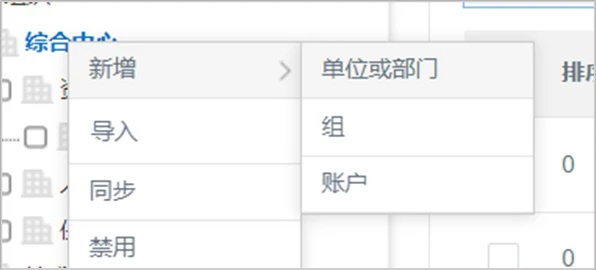

   </li>

   <li>

   进入组织机构列表页面，单击**新建组织机构**。

   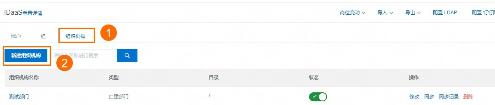

   </li>

   </ol>

2. 进入新建组织机构页面，填写必填项，进行提交即可创建机构成功。各属性说明：

   | 属性名 | 说明 |
   | --- | --- |
   | 父级 | 表示其所属上级机构。 |
   | 类型 | 有部门和组织可选，选择了组织需要填写行政区域（选填），其它无区别。 |
   | 名称 | 机构名称，自定义。 |
   | 外部ID | 是机构的唯一标识。选填，如果不填写，则会自动生成。 |
   | 描述 | 选填。 |
   | 排序号 | 在组织机构树的位置序号，选填。 |
   | 部门主管 | 可以选择账户作为部门主管，无实际意义。选填。 |
   | 生效时间 | 选填，如果填写将以此为生效时间，生效后机构才可以使用。 |

**修改组织机构**

支持组织机构修改除了外部ID、组织机构UUID外的所有属性。

1. 修改组织机构页面两个入口：

   <ol type="i">

   <li>

   直接单击要修改的组织机构**查看详情**。

   </li>

   <li>

   进入组织机构列表页面，单击目标机构的**修改**操作或者机构名称。

   </li>

   </ol>

2. 在修改组织机构页面修改内容，可以修改机构名称、描述、排序号、部门主管属性。修改完成后提交即可。

**组织机构同步**

支持单个组织机构触发增量同步。前提：已经配置好同步任务。

1. 执行同步入口两个

   <ol type="i">

   <li>

   在组织机构树上，鼠标右键单击目标机构，单击**同步**。

   </li>

   <li>

   在组织机构列表，单击目标机构的**同步**。

   </li>

   </ol>

2. 进入同步页面后，选择要同步目标应用，单击**同步**即可触发同步。组织机构同步页面说明：

   <ol type="i">

   <li>

   展示的应用实际是增量同步任务所关联的应用，可以取消勾选或者勾选。

   </li>

   <li>

   如果勾选是否同步子级机构和是否同步了子级账户，则在同步时会将目标机构下的所有子级数据都进行同步。

   </li>

   </ol>

**禁用启用组织机构**

可以禁用和启用组织机构，一般情况下组织机构都默认为启用状态。如果要禁用组织机构，前提是该组织机构下无子级数据（账户、组、组织机构）。被禁用的组织机构不再显示在组织机构树上。操作入口2个：

1. 组织机构树上鼠标右键单击目标机构节点，然后单击**禁用**。

2. 进入组织机构列表，单击禁用启用开关。

**移动组织机构**

支持组织机构通过移动操作更换其父级机构。

1. 在组织机构树上鼠标右键要移动的组织机构，然后单击**移动**。

2. 进入移动页面，鼠标单击要移动到的父级机构节点，并单击**确认移动**。

**组织机构树节点排序**

支持组织机构拖拽排序和修改序号进行排序，排序效果展示在组织机构树上。只有同一个机构节点下的机构才允许拖拽排序。在组织机构树上鼠标左键单击目标机构节点进行拖动，即可实现拖拽排序，注意只能在当前操作的机构的父级机构下拖拽移动，不可跨节点拖拽移动。或者可以通过直接修改机构序号，实现排序。进入机构编辑页面修改保存即可。序号越大，树上位置越靠后。

**删除组织机构**

支持单个删除、批量删除空组织机构。如果组织机构里还有其它数据（账户、组、组织机构），则需要先将清除机构里的数据才能删除机构。

1. 单个删除操作

   <ol type="i">

   <li>

   可以从组织机构树上进行删除操作。

   </li>

   <li>

   也可以进入组织机构列表，单击**删除**。

   </li>

   </ol>

2. 批量删除组织机构在组织机构树上勾选组织机构，可以看到批量删除操作。注意批量删除也只支持删除空的组织机构数据。

**岗位变动**

1. 入职即新建账户，可参考新建账户说明。单击**入职**，会显示新建账户页面。

2. 转岗即账户转岗，单击**转岗**，进入转岗页面，继续单击**转岗**进行后续操作即可。可参考转岗账户说明。

3. 离职即账户离职，逻辑删除。单击**离职**，进入离职页面，继续单击目标账户的**离职**进行后续操作，可参考离职账户说明。

**导入**

导入分为LDAP、EXCEL和钉钉同步，导出分为LDAP和EXCEL。

1. LDAP：使用LDAP导入时，需要配置LDAP，单击右上角**导入**，单击LDAP旁边的齿轮进入LDAP页面，**新建配置**需要配置服务器地址、端口号、BaseDN、管理员DN、密码、类型、状态。**组织机构导入**和**账户导入**，在导入账户以前必须先导入组织机构，（前置条件：LDAP配置成功）。可以使用多台AD将数据一起导入到IDaaS中，单击LADP 进入多AD配置页面，单击**编辑**进入编辑页面，对多AD可以进行删除。开启**定时任务从AD同步**可以通多定时任务定时拉取AD/LADP数据到IDaaS。

2. 钉钉同步：使用钉钉同步导入时，需要配置钉钉同步，单击右上角**导入**，单击钉钉同步旁边的齿轮进入钉钉同步配置页面。**新建配置**需要填写配置名称、钉钉CorpId、appKey、appSecret、默认密码等字段，配置完后，单击**测试连接**测试配置是否成功。**组织机构导入**和**账户导入**在导入账户以前必须先导入组织机构，（前置条件：钉钉同步配置成功）。支持多个钉钉数据源，支持多钉钉组织同步到一个IDaaS中，根据不同的配置进行区分。单击钉钉同步旁边的 ，可以进入**钉钉同步配置**页面。

3. EXCEL导入机构。

   <ol type="i">

   <li>

   进入导入机构页面。

   </li>

   <li>

   下载模板ou_template。模板填写说明：可以只填写必填的字段：机构编号和机构名称，其余字段根据实际需要填写即可。

   </li>

   <li>

   上传文件，再单击**导入文件**。

   </li>

   <li>

   导入文件后会进入到预览页面，单击**确认导入**执行导入。

   </li>

   </ol>

**导出**

1. 导出机构

   <ol type="i">

   <li>

   先单击进入目标机构页面。

   </li>

   <li>

   然后单击**导出 > 组织机构**。

   </li>

   <li>

   选择具体要导出的组织机构属性内容和导出条数，然后单击**确认**。

   </li>

   <li>

   导出文件名为：organization_info。

   </li>

   </ol>

2. 导出账户

   <ol type="i">

   <li>

   单击进入目标机构页面。

   </li>

   <li>

   单击**导出 > 账户**。

   </li>

   <li>

   选择具体要导出的账户属性和导出条数，然后单击**确认**。

   </li>

   <li>

   导出文件名为：account_info。

   </li>

   </ol>

**配置 LDAP**

详情请参见：AD数据对接。

**数据字典**

根据自己的需求，可以任意添加账户、组、组织机构、人员-组织属性等类别的扩展字段，支持四种类型：文本域、文本框、下拉框、日期，可以设置字段 默认值、占位符、描述、位置排序、是否为必填、是否可修改、是否唯一、是否加密、字段状态等性质。数据字典入口：机构及组页面的右上角**数据字典**。

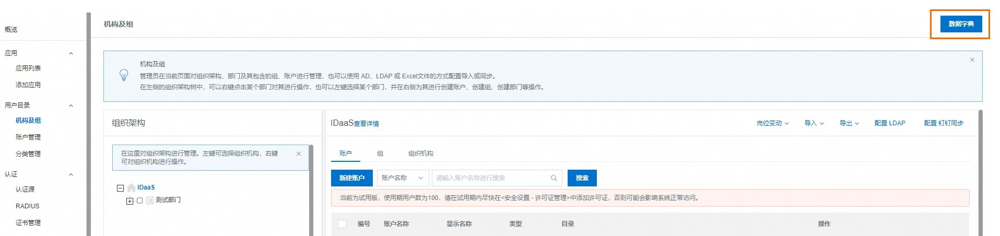

1. 添加字段。以添加账户的字段为例说明，各属性配置如下：

   <table>
     <tr>
       <th width="137">属性名</th>
       <th>说明</th>
     </tr>
     <tr>
       <td>字段名称</td>
       <td>必填，唯一。</td>
     </tr>
     <tr>
       <td>字段值</td>
       <td>必填，唯一。</td>
     </tr>
     <tr>
       <td>所属分类</td>
       <td>有账户、组织机构、组、人员-组织属性四类。选择账户，表示给账户添加扩展字段，选择组织机构和组类似。选择人员-组织属性，表示给账户添加跟随组织机构维护内容的字段。</td>
     </tr>
     <tr>
       <td>字段类型</td>
       <td>文本域、文本框、下拉框、日期，确定字段输入类型。</td>
     </tr>
     <tr>
       <td>默认值</td>
       <td>设置字段的默认值，需要依据字段类型进行设置，如果字段类型为日期，则设置的默认值。需要类似 2022-08-23，否则会有错误提示。</td>
     </tr>
     <tr>
       <td>占位符</td>
       <td>字段输入框里的提示，如：请输入时间。</td>
     </tr>
     <tr>
       <td>描述</td>
       <td>用于设置在字段输入框下方的提示内容。</td>
     </tr>
     <tr>
       <td>字段排序号</td>
       <td>用于设置在扩展属性页面字段位置，降序排列。</td>
     </tr>
     <tr>
       <td>是否为必填</td>
       <td>用于设置字段是否要必填。</td>
     </tr>
     <tr>
       <td>是否可修改</td>
       <td>用于设置字段是否支持编辑。</td>
     </tr>
     <tr>
       <td>是否唯一</td>
       <td>用于设置字段内容是否要唯一，设置后不允许修改。</td>
     </tr>
     <tr>
       <td>是否加密</td>
       <td>用于设置字段内容存储时是否加密，设置后不允许修改。</td>
     </tr>
     <tr>
       <td>用户是否可见</td>
       <td>用于设置账户类字段是否普通用户 - 个人信息处是否可见。</td>
     </tr>
     <tr>
       <td>用户是否可修改</td>
       <td>用于设置账户类字段是否普通用户 - 个人信息处是否可修改。</td>
     </tr>
     <tr>
       <td>字段状态</td>
       <td>用于控制字段状态，启用状态则在相关属性页面展示，处于禁用状态则不显示不支持使用。</td>
     </tr>
   </table>

2. 导入数据。

   <ol type="i">

   <li>

   可以EXCEL导入数据字典数据。

   </li>

   <li>

   下载导入模板:dataDictionary-Template。

   </li>

   <li>

   上传文件，然后单击**导入**。

   </li>

   </ol>

3. 导出数据。支持EXCEL批量导出扩展字段，直接单击**导出数据**即可。导出的文件为：dataDictionary-20\*\*\*\*\*\*161853.xls。

<a id="section-5-2"></a>

## 5.2. 账户管理

账户管理用于进行账户数据的管理。包括人员账户和API账户。

**人员账户**

在控制台左侧导航栏，依次展开**用户目录 > 账户管理**，进入模块后单击顶部标签栏的**人员账户**页签，即可进入**在职人员**功能页面。

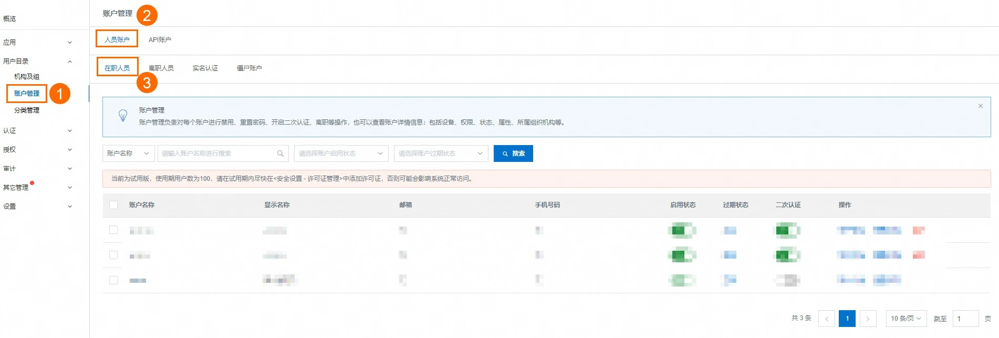

**概述**

- **在职人员页面**：可以查看所有的人员账户信息，包括账户名称、账户状态、生效状态、是否启用二次认证、查看账户详情、重置密码、离职等操作，并有license数量和当前账户数量显示提醒。

- **离职人员页面**：展示离职账户列表，可以进行返聘和物理删除操作。

- **实名认证页面**：用于展示通过APP进行实名认证的账户具体实名信息。

- **僵尸账户页面**：用于展示僵尸账户列表，可以进行禁用僵尸账户操作。

**查看账户详情**

账户详情页面可以查看该账户的详细信息，包括基础信息、证书信息、扩展字段信息、已授权应用、账户权限、应用子账户、隶属于组织机构、设备、报表、实名认证信息。单击**详情**可以查看。

**重置账户密码**

管理员可以重置账户密码。进入账户管理页面，单击目标账户的**重置密码**即可。

**开启/关闭用户二次认证**

管理员可以开启/关闭所管理用户的二次认证。前提：需要在设置模块设置好二次认证方式。进入管理员页面，单击目标账户的**二次认证**的开关即可。

**离职账户**

支持逻辑删除账户，被离职的账户会在**离职账户**页面显示。被离职的账户将不再可以进行使用。如果要使用则需要返聘。

**返聘账户**

支持将离职的账户进行返聘，返聘的账户只保留账户基本信息。返聘时支持返回原直属机构或者选择新的直属机构。

**物理删除账户**

物理删除账户后，IDaaS系统将不再有该账户相关数据（除了日志）。

**API 账户**

API账户管理租户所有的AKSK其中包括（应用、权限系统、移动端）除了这些还可以自己创建API账户，自建的API账户可以授权给应用，获取应用的id_token，可以对所有的API账户进行更新密钥，可以通过来源、创建人、密钥名称进行搜索。

**新建API账户**

单击**新建API账户**，在新建API账户页面填写名称，提交后即可创建成功。

**为API账户授权应用**

自建的API账户支持且仅支持授权给STS应用。前提：需要先上传STS应用插件，然后创建好STS应用。

1. 在API账户页面，单击目标API账户的**授权应用**。

2. 进入应用授权页面。勾选STS应用，单击保存即可完成应用授权。

**修改API账户**

自建API账户支持修改部分属性，可以修改IP白名单、应用白名单、备注属性。

**详情页面**

在详情页面可以获取API账户的AKSK，也可以重置密钥。

**审计日志页面**

API账户的启用禁用、新建、删除、重置秘钥、授权登录操作可以通过审计日志中查看到，单击API账户-选择指定的API账户操作下面的审计日志，会进入审计日志页面。

**禁用/启用API账户**

应用API账户的状态开关与应用列表处API开关保持一致。如禁用API账户，则表示ASKS被禁用，不允许被用于接口调用。如果启用，则AKSK可以正常被使用。

**删除自建API账户**

需要先禁用自建API账户，才会显示删除操作。

<a id="section-5-3"></a>

## 5.3. 分类管理

分类管理是基于ABAC的权限模型，将账户的属性通过配置索引进行自动归类，用于应用的授权，当账户属性发生变动时分类中的成员将自动发生变化。

**添加分类**

> **重要**
>
> 添加分类之前需要先添加数据字典扩展字段。

1. 在左侧菜单栏，单击**用户目录 > 分类管理**。

   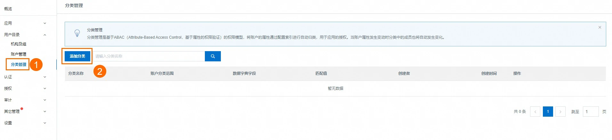

2. 在分类管理页面单击**添加分类**。配置以下参数：

   - **分类名称**：填写分类名称。

   - **数据字典**：根据添加的数据字典来选择。

   - **匹配值**：数据字典的匹配值。

   上述信息填写完成后，单击**确定**即可创建成功。

   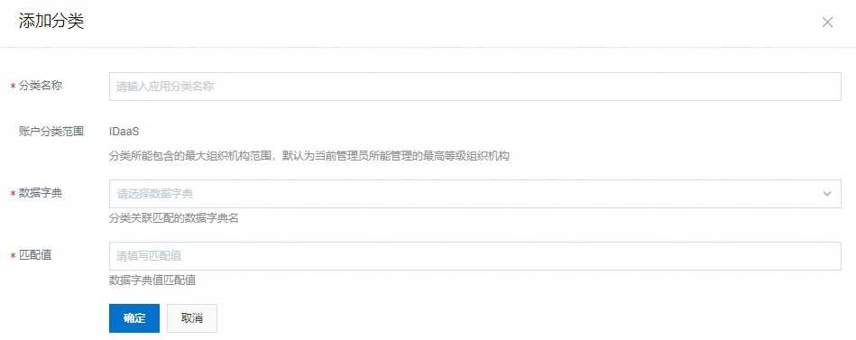

**查看详情**

可以单击已创建好的分类的**查看详情**，查看该分类的相关信息。

**查看成员**

可以通过单击分类的**查看成员**，查看符合该分类匹配值的账户。

**修改分类**

可以对添加的分类进行修改，可以修改分类名称、数据字典类型、匹配值。单击分类的**修改**即可进行编辑。

**删除分类**

可以直接删除分类，单击操作下面的**删除**按钮即可。

<a id="section-5-4"></a>

## 5.4. 添加账户

账户是系统的用户主体，所有的活动都是围绕账户发生。用户可以手动单个创建账户，也可以批量导入创建账户。本文介绍如何在IDaaS中添加账户。

**前提条件**

登录IDaaS控制台前，确认您已从部署人员处获取IDaaS控制台的服务域名地址。

**手动创建**

1. 登录云盾IDaaS控制台。

2. 在左侧导航栏，选择**用户目录**＞**机构及组**。

3. 单击要添加账户的组织架构。

4. 在目标组织架构的**账户**页签，单击**新建账户**。

5. 完成如下配置后，单击**提交**。

   > **说明**
   >
   > 需要注意的新建账户时，每个账户都是挂载到一个组织节点上的，创建账户前需要选中对应的组织节点。

   <table>
     <tr>
       <th colspan="2">配置项</th>
       <th>说明</th>
     </tr>
     <tr>
       <td rowspan="9">账户属性</td>
       <td>父级</td>
       <td>默认为选中的组织架构，不支持修改。</td>
     </tr>
     <tr>
       <td>账户名称</td>
       <td>填写账户的名称。账户名称不能以特殊字符开始，可包含大写字母、小写字母、数字、中划线(-)、下划线(_)、点(.)，且长度至少4位。</td>
     </tr>
     <tr>
       <td>显示名称</td>
       <td>填写账户的显示名称。</td>
     </tr>
     <tr>
       <td>密码</td>
       <td>设置账户密码。密码至少包含大写字母、小写字母、数字、特殊字符，且长度至少10位。</td>
     </tr>
     <tr>
       <td>邮箱</td>
       <td>设置账户关联的邮箱。<strong>邮箱</strong>和<strong>手机号</strong>至少填写一个，且系统会自动转为小写。</td>
     </tr>
     <tr>
       <td>手机号</td>
       <td>设置账户关联的手机号。<strong>邮箱</strong>和<strong>手机号</strong>至少填写一个。</td>
     </tr>
     <tr>
       <td>外部ID</td>
       <td>填写账户的外部ID。该ID为IDaaS平台中的唯一身份标识，若不填将由系统自动生成。</td>
     </tr>
     <tr>
       <td>过期时间</td>
       <td>填写账户的过期时间。如果不填，默认过期时间为2116-12-31。</td>
     </tr>
     <tr>
       <td>备注</td>
       <td>填写用户的备注信息。</td>
     </tr>
     <tr>
       <td colspan="2">扩展属性</td>
       <td>填写账户的动态扩展属性。如果暂没有可用的扩展属性，请先到<strong>数据字典</strong>中添加或启用。</td>
     </tr>
     <tr>
       <td colspan="2">父级组</td>
       <td>选择账户关联的父级组。如果暂没有可用的父级组，请先在<strong>组</strong>页签，新建组。</td>
     </tr>
   </table>

**手动导入**

1. 登录云盾IDaaS控制台。

2. 在左侧导航栏，选择**用户目录 > 机构及组**。

3. 在**人事组织**区域的右上方，选择**导入**＞**账户**。

   > **说明**
   >
   > 用户可以选择通过如下方式导入账户，包括LDAP、钉钉同步、EXCEL、SCIM。

4. 当选择EXCEL 方式导入账户时：

   <ol type="i">

   <li>

   单击**下载账户格式范例文档**，按要求填写要导入的账户信息。

   </li>

   <li>

   单击**上传文件**，选择要上传的文件后，单击**导入文件**。

   </li>

   </ol>

**管理账户**

完成账户添加后，用户可以在账户列表，查看已创建的账户，执行如下操作：

- 单击账户名称，可查看账户属性。

- 单击**操作**列的**修改**，修改账户属性。

- 单击**操作**列的**转岗**，将账户移出组。转岗之后账户原有的应用权限将会取消，将被赋予新岗位的应用权限。

- 单击**操作**列的**账户同步**，向已授权的第三方业务系统同步账户，需同时满足启用应用并开启SCIM同步账户。

- 单击**操作**列的**同步记录**，查看账户的同步记录。

- 单击**操作**列的**离职**，标记账户为离职。账户离职后将被移动到**账户管理**>**离职人员列表**。

<a id="section-5-5"></a>

## 5.5. AD数据对接

本文介绍如何配置拉取AD的人员组织数据到IDaaS中，以及将IDaaS的数据推送到AD中。

**前提条件**

登录IDaaS控制台前，确认您已从部署人员处获取IDaaS控制台的服务域名地址。

**新建配置**

1. 登录云盾IDaaS控制台。

2. 在左侧导航栏，选择**用户目录**＞**机构及组**。

3. 单击**配置LDAP**。

   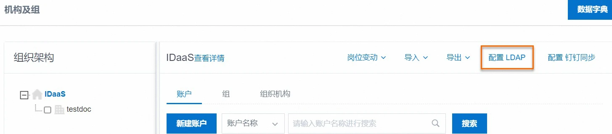

4. 在**LDAP配置**面板，单击**新建配置**。

5. 在**服务器链接**页签，完成如下配置后。

   <table>
     <tr>
       <th colspan="2">配置项</th>
       <th>说明</th>
     </tr>
     <tr>
       <td rowspan="5">连接</td>
       <td>AD/LDAP名称</td>
       <td>填写自定义名称。</td>
     </tr>
     <tr>
       <td>服务器地址</td>
       <td>填写AD或LDAP的服务地址。</td>
     </tr>
     <tr>
       <td>端口号</td>
       <td>填写AD或LDAP的服务端口，一般是389。</td>
     </tr>
     <tr>
       <td>Base DN</td>
       <td>填写AD/LDAP数据的根节点，或推送数据到AD/LDAP的根节点。</td>
     </tr>
     <tr>
       <td>连接方式</td>
       <td>是否通过SSL进行连接。</td>
     </tr>
     <tr>
       <td rowspan="2">账号</td>
       <td>管理员DN</td>
       <td>操作AD/LDAP数据的管理员账号。</td>
     </tr>
     <tr>
       <td>密码</td>
       <td>管理员密码。</td>
     </tr>
     <tr>
       <td>类型</td>
       <td>类型选择</td>
       <td>选择同步AD的数据还是LDAP服务的数据，可选项：<strong>Windows</strong> <strong>AD</strong>、<strong>OpenLDAP</strong>。</td>
     </tr>
     <tr>
       <td>位置</td>
       <td>所属OU节点</td>
       <td>数据导入本系统中组织机构的节点位置，若不选择，则导入到根OU下。</td>
     </tr>
     <tr>
       <td rowspan="3">状态</td>
       <td>LDAP同步至本系统</td>
       <td>是否开启拉取AD或LDAP的数据到IDaaS。</td>
     </tr>
     <tr>
       <td>本系统同步至LDAP</td>
       <td>是否开启IDaaS同步数据到AD或LDAP。</td>
     </tr>
     <tr>
       <td>定时任务AD同步</td>
       <td>是否开启每天凌晨自动通过定时任务拉取AD数据到IDaaS。</td>
     </tr>
   </table>

6. 单击**测试连接**，查看配置是否正确。

7. 在字段匹配规则页签，完成如下配置后，单击**保存**。除了**服务器链接**配置外，为了保证数据同步的正确性，还需要配置**字段匹配规则**，即IDaaS中的字段对应AD/LDAP中的名称。

   <table>
     <tr>
       <th width="122">配置项</th>
       <th>说明</th>
     </tr>
     <tr>
       <td>用户名</td>
       <td>AD或LDAP的什么字段匹配IDaaS中的用户名。</td>
     </tr>
     <tr>
       <td>外部ID</td>
       <td>AD或LDAP的什么字段匹配IDaaS中的外部ID。</td>
     </tr>
     <tr>
       <td>密码属性</td>
       <td>AD或LDAP的什么字段匹配IDaaS中的密码。</td>
     </tr>
     <tr>
       <td>删除配置</td>
       <td>AD或LDAP的数据进行删除时，IDaaS中如何处理，该字段选填。</td>
     </tr>
     <tr>
       <td>移动到OU</td>
       <td>AD或LDAP删除时，如果配置<strong>IDaaS移动到指定OU</strong>，移动到哪个OU下，填写OU到DN，该字段选填。</td>
     </tr>
     <tr>
       <td>用户唯一标识</td>
       <td>AD或LDAP中区分用户的唯一标识字段。</td>
     </tr>
     <tr>
       <td>邮箱</td>
       <td>AD或LDAP的什么字段匹配IDaaS中的邮箱，该字段选填。</td>
     </tr>
     <tr>
       <td>手机号</td>
       <td>AD或LDAP的什么字段匹配IDaaS中的手机号，该字段选填。</td>
     </tr>
     <tr>
       <td>昵称</td>
       <td>AD或LDAP的什么字段匹配IDaaS中的昵称，该字段选填。</td>
     </tr>
     <tr>
       <td>域名名称</td>
       <td>AD或LDAP使用的域名，该字段选填。</td>
     </tr>
     <tr>
       <td>CN属性值</td>
       <td>CN属性值，默认为 username，该字段选填。</td>
     </tr>
     <tr>
       <td>默认密码</td>
       <td>拉取AD/LDAP数据到IDaaS时，设置账户的默认密码，该字段选填。</td>
     </tr>
   </table>

**拉取数据**

1. 登录云盾IDaaS控制台。

2. 在左侧导航栏，选择**用户目录**＞**机构及组**。

3. 单击**导入**，选择**LDAP**>**组织机构**。

   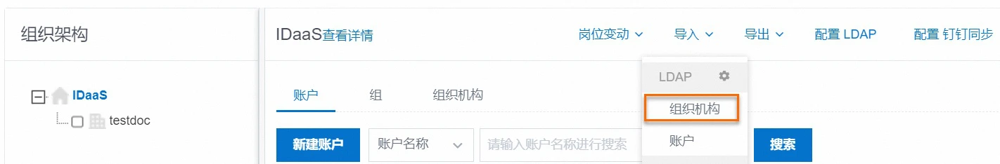

4. 在**LDAP列表**面板，定位到已添加的AD/LDAP服务，单击**导入**。

5. 在弹出的对话框中，单击**确定**，即可拉取AD/LDAP中的组织架构到IDaaS中。

6. 单击**导入**，选择**LDAP**>**账户**。

   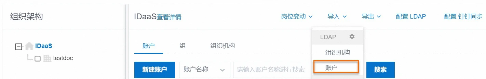

7. 在**LDAP列表**面板，定位到已添加的AD、LDAP服务，单击**导入**。

8. 在弹出的对话框中，单击**确定**，即可拉取AD、LDAP中的账户到IDaaS中。

   > **重要**
   >
   > 拉取数据时，需按照上述步骤，先拉取组织架构，再拉取账户。这样从AD或LDAP中拉取过来的账户与组织的关系才是正确的，也就是先有组织再挂载用户。

**推送数据**

1. 登录云盾IDaaS控制台。

2. 在左侧导航栏，选择**用户目录**＞**机构及组**。

3. 单击**导出**，选择**LDAP**>**组织机构**或**账户**。

4. 在推送配置中选择要导出的节点后，单击**确认**，即可将组织机构同步到AD、LDAP中。

   > **说明**
   >
   > 推送时，建议要么使用AD或LDAP作为身份源，把数据拉取到IDaaS中；要么将IDaaS作为身份源推送到AD、LDAP。不建议两者同时存在相互同步，否则容易出现数据异常。

<a id="section-6"></a>

# 6.认证

<a id="section-6-1"></a>

## 6.1. 认证源

平台支持外部认证源，可根据需要添加并使用。目前支持的认证方式包括：钉钉扫码登录，微信扫码登录，支付宝扫码登录，企业微信扫码登录等。配置认证源完成后，平台会在用户登录时使用具体的认证源去认证用户账户。此外，多种外部认证源组合进行使用称为组合认证源，可以在已经添加多个认证源的基础上进行组合认证源的添加使用。

**添加认证源**

1. 单击左侧菜单**认证 > 认证源**，单击右上角**添加认证源**。

   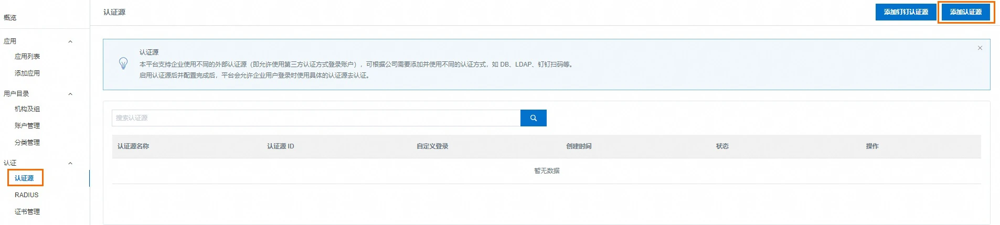

2. 然后单击对应的认证源的**添加认证源**。

3. 在添加认证源页面，单击具体要添加的认证源的**添加认证源**，进入相应页面填写相应参数并确定并启用，即可在登录页面看到添加的认证源。添加认证源之后管理员可以启用，用户在登录系统时可以任意选其一进行登录认证。

**修改认证源**

支持对已添加的认证源进行修改操作。

1. 单击**认证源**进入认证源列表页面。先禁用要修改的认证源，再单击**修改**。

2. 在修改页面输入新信息后单击提交，提交成功后需要记得启用该认证源即可。

**禁用启用认证源**

支持禁用/启用认证源，被禁用的认证源在登录页面不会显示，且可以进行修改操作。进入认证源列表，操作状态开关即可，灰色为禁用，绿色为启用。

**查看详情**

支持查看已添加的认证源详细信息。单击**认证源**，选择具体的认证源的**详情**即可。

**查看日志**

此处日志记录的是操作修改对应认证源的操作，单击**认证源**，单击认证源的**日志**。

**删除认证源**

支持直接删除认证源，如果该认证源被用于组合认证源则需要先删除组合认证源再进行删除。单击**认证源**，单击具体认证源的**删除**，然后确定即可。

<a id="section-6-2"></a>

## 6.2. RADIUS

本文围绕 RADIUS（远程用户拨号认证系统）展开，涵盖概念解析、功能价值、配置管理（如端口设置、认证方式、计费规则等）、操作入口（新建、编辑、删除 RADIUS 等）及配套资源（IDaaS RADIUS Server安装包、配置文件下载）等内容，为用户提供 RADIUS 系统的全面管理指导。

**一、RADIUS 系统概述**

RADIUS（Remote Authentication Dial In User Service，远程用户拨号认证系统）是一种用于实现**防火墙、堡垒机、Wi-Fi 等设备统一认证**的系统。通过 RADIUS，可集中管理不同设备的认证逻辑，提升安全性与管理效率。

**二、RADIUS 配置与管理**

1. 操作入口单击左侧菜单**认证 > RADIUS**，进入功能页面。

   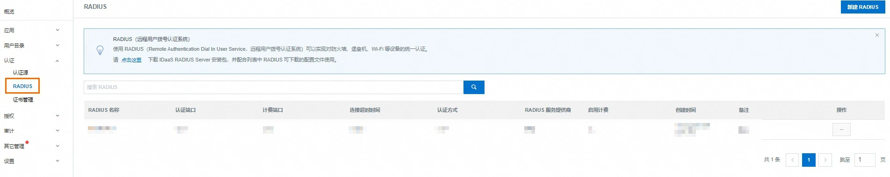

2. 基础配置项说明

   | 配置项 | 含义说明 |
   | --- | --- |
   | RADIUS 名称 | RADIUS 实例的唯一标识，用于区分不同认证场景。 |
   | 认证端口 | RADIUS 服务接收认证请求的网络端口（如“1812”）。 |
   | 计费端口 | RADIUS 服务接收计费请求的网络端口（如“1813”）。 |
   | 连接超时时间 | RADIUS 与客户端/服务器的连接超时时间（如“10000”毫秒）。 |
   | 认证方式 | 认证逻辑类型（如“OTP”，即一次性密码认证）。 |
   | RADIUS 服务提供商 | 提供 RADIUS 服务的厂商/平台（如“未知”，需根据实际场景配置）。 |
   | 启用计费 | 是否开启计费功能（如“否”，需根据业务需求选择）。 |
   | 备注 | 额外说明信息（如“暂无”，可补充业务背景、配置逻辑等）。 |

**三、新建 Radius**

1. 单击左侧菜单**认证 > Radius**，单击右上角**新建Radius**。

2. 在**新建Radius**页面，完成以下配置。

   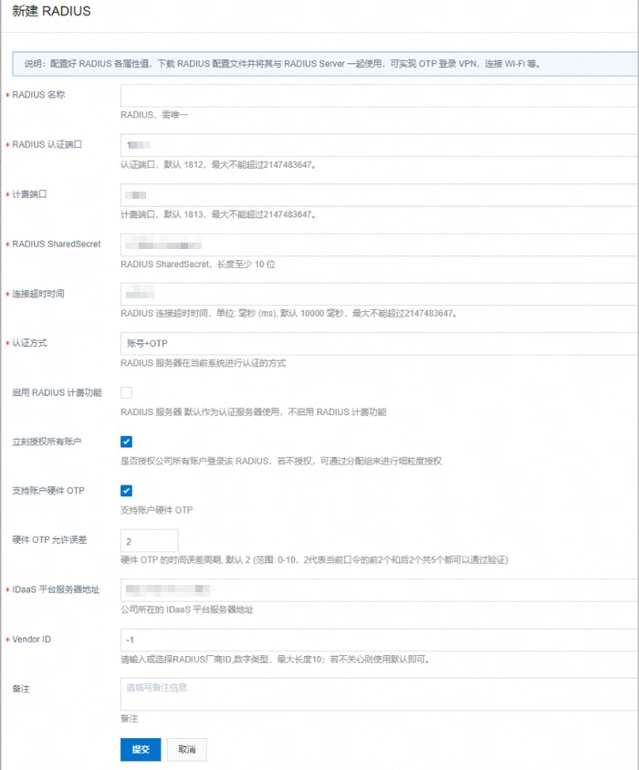

   | 参数名称 | 功能说明 | 默认值/备注 |
   | --- | --- | --- |
   | RADIUS 名称 | RADIUS 服务的标识，需全局唯一，用于区分不同 RADIUS 实例。 | 无（需用户自定义，且必须唯一） |
   | RADIUS 认证端口 | RADIUS 服务器接收认证请求的端口，用于处理用户身份验证。 | 默认 1812（若需自定义，需确保端口可用且与RADIUS 服务器配置一致） |
   | 计费端口 | RADIUS 服务器接收计费请求的端口，用于处理资源使用计费。 | 默认 1813（若需自定义，需确保端口可用且与RADIUS 服务器配置一致） |
   | RADIUS SharedSe cret | RADIUS 服务器与客户端的共享密钥，用于加密通信，保障数据传输安全。 | 长度至少 10 位（需与 RADIUS 服务器端共享密钥一致，确保通信有效性） |
   | 连接超时间 | RADIUS 服务器与客户端的连接超时时间（毫秒），超时后连接自动断开。 | 默认 10000 毫秒（可根据网络稳定性调整，避免无效连接占用资源） |
   | 认证方式 | RADIUS 服务器在当前系统的认证方式，决定用户身份验证的逻辑。 | 选项包括“账号+OTP”等（需根据业务场景选择，此处为示例配置） |
   | 启用RADIUS 计费功能 | 开启后，RADIUS 服务器作为计费服务器使用；关闭时仅作为认证服务器。 | 默认关闭（若需计费功能，需勾选并确保RADIUS 服务器支持计费逻辑） |
   | 立刻授权所有账户 | 若勾选，公司所有账户立即授权该RADIUS；否则通过分配组进行细粒度授权。 | 默认关闭（勾选后，账户无需额外操作即可使用RADIUS 服务） |
   | 支持账户硬件 OTP | 开启后，账户支持硬件 OTP（一次性密码）认证，增强安全性。 | 默认关闭（勾选后，需配置硬件 OTP 相关参数，如允许误差） |
   | 硬件 OTP允许误差 | 硬件 OTP 的时间误差周期（范围 0 -10），2 表示当前口令前后 2 个均有效。 | 默认 2（需根据硬件 OTP 设备的时钟精度调整，避免因误差导致认证失败） |
   | IDaaS 平台服务器地址 | 公司所在的 IDaaS 平台服务器地址，用于RADIUS 与平台的交互。 | 需填写有效地址（需与 IDaaS 平台配置一致，确保通信链路通畅） |
   | RADIUS 服务提供商 | RADIUS 服务的提供商，若不关心则使用默认即可。 | 默认“未知”（需根据实际服务提供商选择，如运营商、第三方服务商等） |
   | 备注 | 可选，用于记录配置说明、备注等信息。 | 无（非必填，按需填写） |

   配置完成后，单击**新建 Radius**。

**四、管理 Radius**

RADIUS 创建完成后，返回到RADIUS 主页，可在操作列对RADIUS 进行管理。

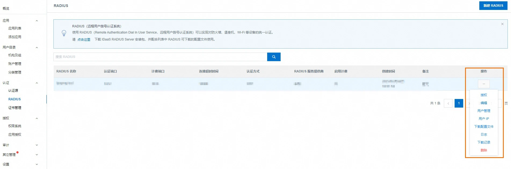

- 授权：支持授权Radius给对应的账户或者组。如果不进行授权，则账户无法进行Raiuds认证登录。默认情况下，会授权给公司所有账户。

  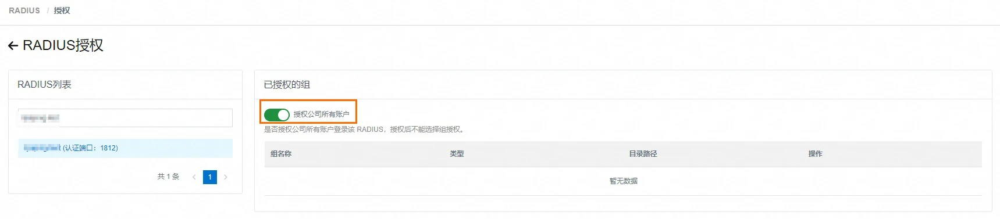

- 编辑 Radius：添加所填写属性信息都支持修改。单击“Radius”-对应所添加的Radius的**编辑**，可进入编辑页面，编辑后提交即可。

- 用户管理：用于管理Radius的用户，可以新建用户、导入用户、对radius账户进行重置密码、绑定OTP、删除。

- 用户IP：用于展示此radius中进行认证登录的账户对应的IP信息。

- 下载配置文件：提供配置文件下载入口。

- 下载记录：用于记录idaas-radius.config文件下载操作。

- 日志：用于记录IT管理员在Radius模块的操作。

- 删除Radius：支持直接删除Radius。

<a id="section-6-3"></a>

## 6.3. 证书管理

根证书管理用于用户自定义生成根证书。生成根证书后，新创建的账户或者是将证书重置后都将使用新生成的根证书进行个人证书的签发。

**证书源管理**

1. 单击**认证 > 证书管理**。

   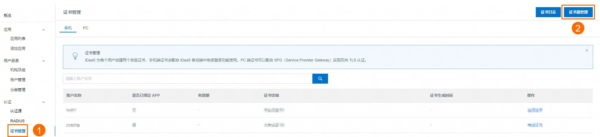

2. 单击页面右上角**证书源管理**进入页面，可以切换不同厂商的证书，目前支持 IDP自签、格尔、IDaaS私有证书（NGRA）三个厂商。

   <ol type="i">

   <li>

   IDP自签编辑名称、组织机构、组织名称、地区/城市、省/州、国家、根证书有效期、子证书有效期、是否启用。

   </li>

   <li>

   格尔厂商编辑格尔RARPC接口地址、格尔客户端证书、是否启用。

   <ol type="i" start="3">

   <li>

   IDaaS私有证书（NGRA）

   </li>

   </ol>

   编辑NGRA服务地址、Admin编号、根证书编号，是否启用。

   </li>

   </ol>

**证书日志**

证书日志功能用于记录关于证书管理的各项操作记录。用户可在该证书日志模块中检索日志以及生成相应的日志报表，单击**认证 > 证书管理**，单击**证书日志**跳转到操作日志界面。

**手机端证书**

手机端证书用于管理移动端免密码登录的P12证书，管理员可以查看所有账户的手机端证书。用户第一次登录移动端时则会自动下载对应的P12证书。手机端证书管理中，默认为手机端页面，如果绑定了APP操作里面会有重置证书。

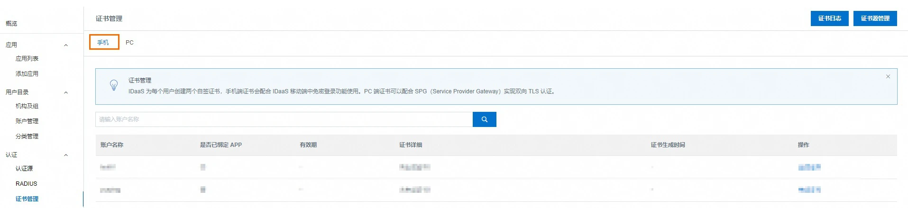

**生成证书**

管理员可以操作生成证书，为账户进行手机证书生成。单击**认证 > 证书管理**。 单击**生成证书**。

**上传证书**

用户可以自己上传IDaaS支持的厂商的.p12或.pfx证书。上传证书后，原先证书失效，单击**认证 > 证书管理**，单击操作下面**上传证书**进入页面，需要填写证书厂商、证书文件、证书密码，填写完成以后单击**上传证书**。

**导出公钥**

可将证书中的公钥信息导出，文件格式为.cer。

**导入公钥**

1. 可导入公钥文件。单击**证书管理 > 导入公钥**。

2. 进入**导入公钥**页面，选择证书厂商和上传公钥文件，然后单击**上传公钥**。

**PC端证书**

PC端证书用于管理用户PC端证书文件，IT管理员可以查看所有账户的PC证书。创建新账户成功后，系统会自动为该账户签发个人PC端证书。管理员可以单击**下载证书**下载相应用户的PC端证书，可以**重置证书**。还可以单击**详细**查看证书信息和设备信息。同时，管理员可以单击**导出公钥**导出其证书的公钥信息。

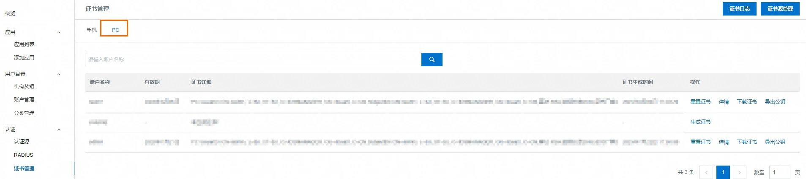

**生成证书**

管理员可以操作生成证书，为账户进行PC端证书生成。单击**认证 > 证书管理**，切换到PC页，单击**生成证书**。

**重置证书**

可以重置对应用户证书，重置以后需要重新下载。单击**证书管理**，切换到PC，对应账户的**重置证书**。

**查看详情**

在详情里面可以看到账户证书的基本信息。单击**证书管理**，切换到PC，对应账户的**详情**。

**下载证书**

可以下载对应账户的证书。单击**证书管理**，切换到PC，对应账户的**下载证书**。

**导出公钥**

可将证书中的公钥信息导出，文件格式为.cer 。单击**证书管理**，切换到PC，对应账户的**导出公钥**。

<a id="section-7"></a>

# 7.授权

<a id="section-7-1"></a>

## 7.1. 权限系统

本文围绕IDaaS权限系统管理展开，涵盖权限系统架构、系统管理操作（新增、授权、角色/资源管理、系统详情、修改、删除）、状态标识与分页展示等核心内容，为用户清晰呈现权限系统配置与维护的全流程。

**一、概述**

权限系统基于<strong>RBAC（基于角色的访问控制）</strong>模型构建，既可管理IDaaS自身系统权限，也能实现第三方应用的二三级授权（需开发者角色支持）。展示添加分级管理员、授权管理、角色管理、系统详情功能模块，通过添加分级管理员可以添加一级管理员、二级管理员、三级管理员，授权管理可以按主体授权客体，按客体授权主体进行授权，角色管理可以添加角色。

**二、系统管理操作**

1. 操作入口在控制台左侧导航栏，依次展开**授权 > 权限系统**，即可进入功能页面。

   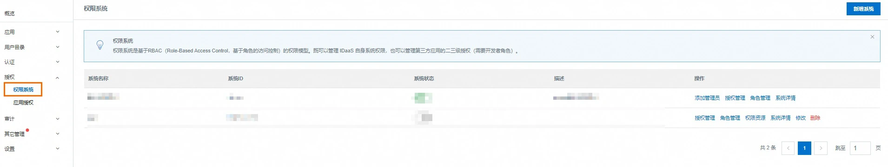

2. 新增系统单击页面右上角**新增系统**按钮，进入系统创建流程，完成系统信息配置后提交，即可新增权限系统。

3. 系统管理操作**默认权限系统**：

   - 状态：绿色（表示系统启用）。

   - 操作：

     - **添加管理员**：为系统指定管理员，赋予管理员权限。

     - **授权管理**：配置系统内资源的访问权限规则。

     - **角色管理**：创建、修改、删除系统角色，绑定角色与权限。

     - **系统详情**：查看系统配置、状态、关联资源等详细信息。

**三、功能说明**

**添加管理员**

新建的用户可以通过默认权限系统添分级管理员，可以给分级管理员分配角色、使用模块、权限系统，单击默认权限系统，单击**添加管理员**进入页面。

**授权管理**

授权管理可以对新增的角色进行授权，可以按人授权（给人授权对应的机构及组和新建的角色），按角色授权（将新建的角色授权给系统的用户和资源），单击**默认权限系统**，再单击**授权管理**进入页面。

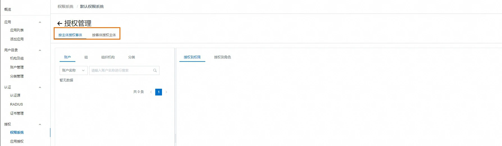

1. 按主体授权客体将账户、组、组织机构、分类授权给权限和角色，对其进行正向、反向、取消授权。

2. 按客体授权主体将资源和角色授权给账户、组、组织机构、分类，可以对其进行正向、反向、取消授权。

**角色管理**

默认系统有三个默认角色分别是管理员、审计管理员、开发者、系统操作员，用户关联管理员以后可以访问拥有管理员的权限，关联审计管理员以后可以从用户页面可以切换到审计管理员页面查看审计日志，关联开发者以后用户可以看到开发者模块，关联系统操作员可以拥有除了默认权限系统之外的所有菜单权限。

1. 新增角色可以根据自己的需要添加新的角色，并可以对新添加的角色进行删除和批量删除，单击角色管理页面的**新增角色**进入页面，填写角色名称、权限值单击**提交**，新添加的角色可以给角色关联权限，对添加内容进行编辑和删除。

2. 关联权限单击操作下的关联权限，可以给角色关联权限资源。确定哪些角色可以访问平台中的哪些数据资源。

3. 授权到主体单击操作下面的**授权到主体**可以将角色授权到账户、组、组织机构、分类。

4. 编辑对新增角色的名称、角色状态、关联权限资源进行编辑。

5. 导入可以进行批量导入角色，单击默认权限系统，单击**角色管理 > 导入角色**进入页面，填写excel信息以后上传。

6. 删除可以对新建的角色进行批量删除和单个删除。

**系统详情**

可以查看应用系统的详情，可以查看系统名称、系统ID、状态、API信息等。

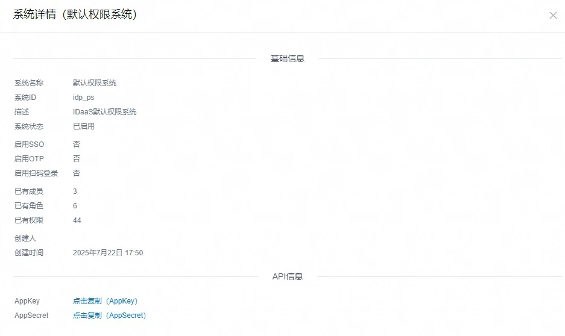

**新增系统**

除了默认系统以外可以添加新的系统，填写系统名称单击**确定**就可以添加成功。

1. 授权管理授权管理分为按主体授权客体、按客体授权主体授权。单击**导入账号关联权限资源**，下载导入账户关联权限资源格式范例文档，按照excel模板格式填写系统中账户和权限值，通过excel批量导入的形式将账户导入到指定的权限资源中。按主体授权客体，是给角色关联到权限和账号。单击**导入角色管线权限资源** ，下载导入角色关联权限格式范例文档，按照excel模板填写系统中的角色和权限值，通过excel批量导入的形式将角色导入到指定的权限资源中。

2. 角色管理可以根据自己的需要给新建权限系统添加新的角色，单击角色管理页面的**新增角色**进入页面，填写角色名称、权限值单击“提交”，新添加的角色可以给角色关联权限，对添加内容进行编辑和删除。并可以对新添加的角色进行删除和批量删除，通过**关联权限**可以将角色和权限进行关联；通过**授权到人**可以将角色授权给账号；通过**编辑**对角色的配置信息进行修改。

3. 权限资源页面可以实现对自建权限系统资源的管理，可以添加资源，对已有资源可以添加子级资源。也可以实现批量导入资源和批量导出资源，对新添加的资源可以进行编辑、删除。

4. 系统详情可查看系统的基础信息与 API 信息。

5. 修改可以对新增权限系统进行修改。

6. 删除单击删除按钮，弹出确认删除提示框，单击确定删除新增的系统。

<a id="section-7-2"></a>

## 7.2. 应用授权

本文围绕应用授权功能，从操作步骤、核心逻辑、注意事项等维度，系统讲解应用与主体及主体授权应用的授权关联，助力企业高效管理应用权限与主体资源。

**概述**

应用授权一般为永久授权，平台为IT管理员提供集中授权的入口，IT管理员可以根据应用授权主体，主体授权应用进行授权，主体由账户、组、组织机构、分类组成。

**按应用授权主体**

1. 功能概述应用授权主体功能是用于建立应用与主体（如账户、组、组织机构、分类等）的授权关联的核心功能模块，支持企业级权限管理与资源分配，确保应用权限与主体身份的精准绑定。页面默认按应用授权主体，按应用授权主体时，选中应用可以正向授权账户、组、组织机构、分类，对账户先进行正向授权，单击勾选会变成拒绝授权，再次单击会变成反向授权。

2. 操作步骤

   <ol type="i">

   <li>

   **进入功能页面** 在控制台左侧导航栏，依次展开**授权 > 应用授权**，即可进入功能页面。

   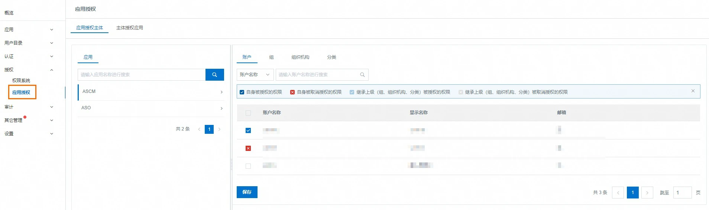

   <ol type="i" start="2">

   <li>

   **应用侧操作** 左侧区域为**应用**标签页，支持**应用名称搜索**（输入关键词后单击搜索图标），快速定位目

   </li>

   </ol>

   标应用。单击应用名称右侧的**箭头图标**，进入**应用授权主体**配置页面。

   </li>

   <li value="3">

   **主体侧配置** 右侧区域为**账户**标签页（也可切换至组、组织机构、分类标签，按需选择主体类型），支持账户名称搜索（输入关键词后单击搜索图标），快速筛选目标主体。

   - 选中目标主体：勾选对应主体的**复选框**，完成主体选择。

   - 保存配置：单击页面底部的**保存**按钮，完成应用与主体的授权关联。

   </li>

   </ol>

3. 核心逻辑与注意事项

   - **逻辑说明**：应用授权主体功能通过“应用→主体”的双向绑定，实现权限与身份的精准匹配，满足企业级权限管理需求。

   - **注意事项**：

     - 搜索时输入完整或关键应用/主体名称，提升搜索效率；

     - 选择主体时，确保主体类型（账户、组等）与业务场景匹配；

     - 保存前需确认主体选择无误，避免权限关联错误。

4. 功能价值通过应用授权主体功能，企业可高效完成应用与主体的权限关联，实现权限精细化管理与资源合规分配，助力业务安全与效率双提升。

**按主体授权应用**

按主体授权应用，选择需要授权的账户、组、组织机构、分类单个或者多个正向/反向/取消授权给应用，可以通过人员账户和api账户对应用进行授权，单击**保存**按钮即可。

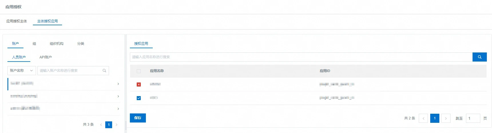

<a id="section-7-3"></a>

## 7.3. 访问授权

IDaaS支持基于角色的访问控制（Role-Based Access Control，简称RBAC）、基于属性的访问控制（Attribute-Based Access Control，简称ABAC） 两种授权方式来控制应用的访问权限。本文介绍如何在 IDaaS中分配用户的应用访问权限。

**前提条件**

登录IDaaS控制台前，确认您已从部署人员处获取IDaaS控制台的服务域名地址。

**操作步骤**

1. 登录云盾IDaaS控制台。

2. 在左侧导航栏，选择**授权**＞**应用授权**。

3. 单击**应用授权主体**或**主体授权应用**页签，选中目标账户后，单击**保存**。

   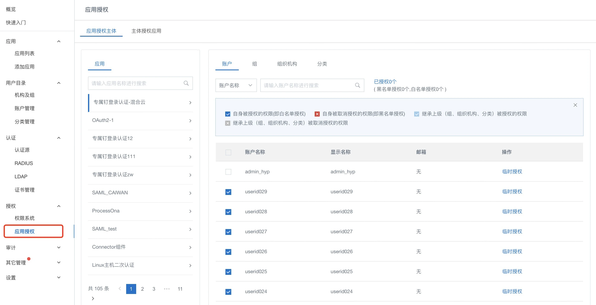

   管理员可灵活按照业务需求从不同的主体类型进行权限配置，最终账户的权限是取各维度的集合。在系统中添加账户和应用后，遵循权限最小化原则，默认所有用户是没有任何应用的访问权限，需要管理员进行初始化分配。

<a id="section-8"></a>

# 8.审计

<a id="section-8-1"></a>

## 8.1. 操作日志

本文档阐述操作日志功能的定位、入口、模块设计与应用场景，为用户理解“如何通过操作日志实现操作溯源、安全合规与问题排查”提供系统化指导。

**操作日志**

操作日志是系统**核心审计组件**，用于记录平台用户（含管理员、普通用户）执行的各类关键操作，覆盖批量操作、多因素认证等场景，为操作溯源、合规审计提供**权威数据支撑**。是将账户所有的操作日志集中记录管理和分析，不仅可以对账户行为进行监控，并且可以通过集中的审计数据进行数据挖掘，以便于事后的安全事故责任的认定。所有通过该平台操作的行为都有归档，IT管理员可以通过该信息查看到某个企业的某账户的操作记录。

1. 功能定位操作日志以全链路记录为核心，确保系统内所有关键操作可追溯，满足安全合规、问题排查等业务需求。

2. 操作入口在控制台左侧导航栏，依次展开**审计 > 操作日志**，即可进入配置页面。

   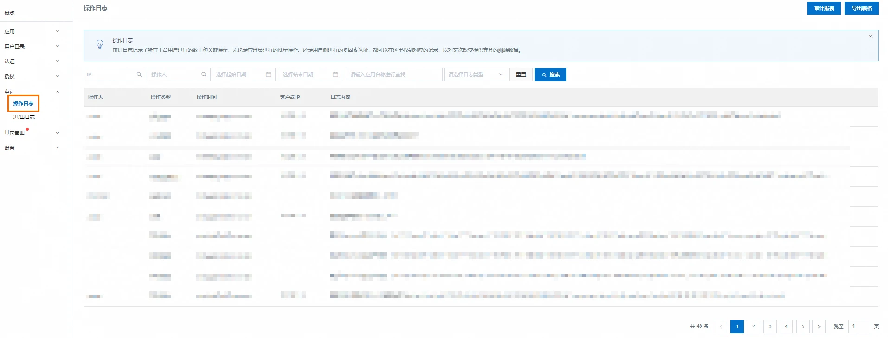

3. 功能模块

   <table>
     <tr>
       <th width="106">模块名称</th>
       <th>功能说明</th>
     </tr>
     <tr>
       <td>搜索与筛选</td>
       <td>支持按 <strong>IP、操作人、操作类型、操作时间（起止日期）、应用名称、日志类型</strong> 等维度精准筛选，快速定位目标日志。</td>
     </tr>
     <tr>
       <td>日志列表</td>
       <td>展示关键字段：<strong>操作人、操作类型、操作时间、客户端IP、日志内容</strong>，内容含系统事件详情（如登录、认证、配置变更等）。</td>
     </tr>
     <tr>
       <td>分页与导出</td>
       <td>支持分页浏览（如当前显示第1页，共48条记录），并提供 <strong>导出表格</strong> 功能，便于批量下载数据。</td>
     </tr>
   </table>

4. 场景应用

   - **安全合规**：满足行业监管要求，提供操作行为的“可追溯性”证据。

   - **问题排查**：快速定位系统异常（如登录失败、配置误操作）的源头，辅助故障分析。

   - **权限审计**：追踪管理员/普通用户的关键操作，防范权限滥用风险。

**导出表格**

支持导出日志数据，页面最多导出5万条日志。

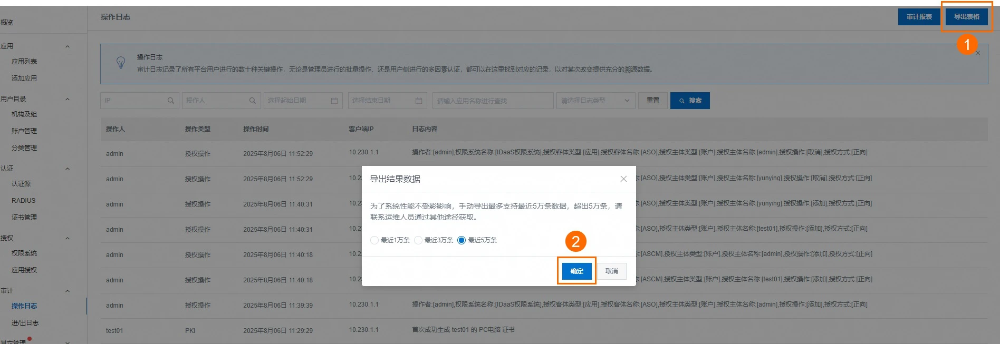

**审计报表**

可以查看登录、退出、应用操作、设置、登录失败、二次认证、认证（Cert）、推送历史、消息公告、推送同步（SCIM）这些的审计报表。

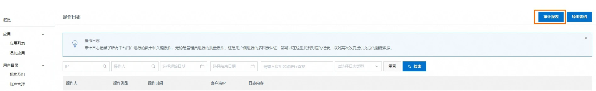

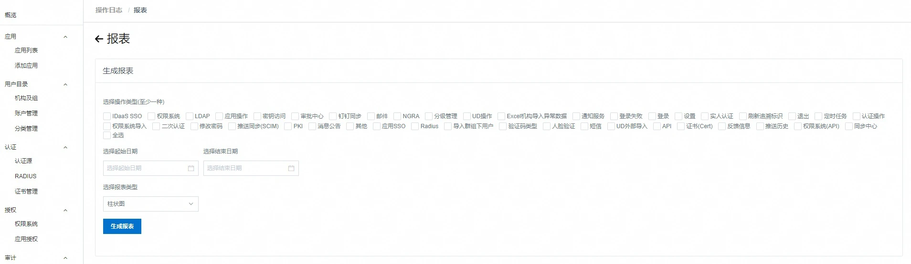

<a id="section-8-2"></a>

## 8.2. 进/出日志

本文围绕进出日志功能，从功能定位、操作界面、核心功能模块及使用逻辑等维度，系统呈现该功能的使用方法与核心价值，助力您高效完成账户登录退出日志的查询与管理。

**一、功能定位**

进出日志是用于**直**观查询单个账户登录、退出操作记录的功能模块，同时支持管理员通过筛选日志类型实现精准搜索，满足系统审计与运维场景下的日志管理需求。

**二、操作界面与核心模块**

1. **操作入口**

   - 在控制台左侧导航栏，单击 **审计 > 进/出日志**，进入日志进/出管理页面。

     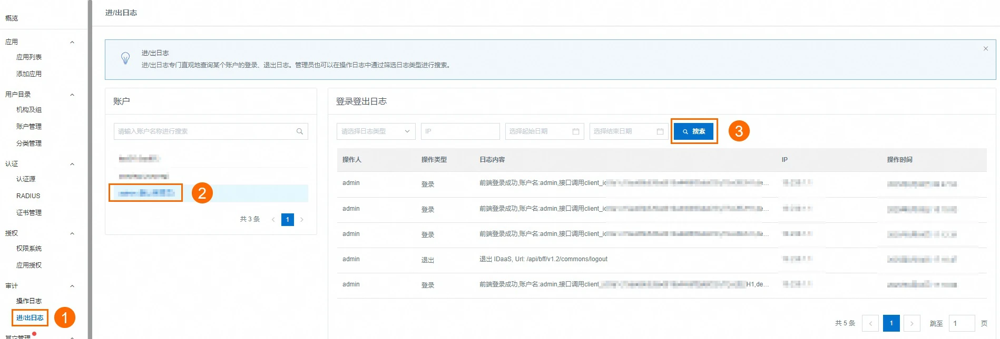

2. **账户选择模块**

   - 页面左侧提供**账户**列表，支持通过输入账户名称快速筛选目标账户；列表展示当前可查询的账户信息（如账户名、对应标识），并显示“共\*条”记录及分页控件（当前第1页，可切换页码）。

3. **日志查询模块**

   - 页面右侧为「登录登出日志」展示区，包含**筛选条件**与**日志列表**两部分：

     - **筛选条件**：提供**日志类型**（下拉选择）、**IP**（输入框）、**起始日期/结束日期**（日期选择器）及**搜索**按钮，支持多维度组合筛选日志。

     - **日志列表**：以表格形式呈现日志详情，列包含**操作人**（执行操作的账户）、**操作类型**（如“登录”）、**日志内容**（如“前端登录成功，账户名, 接口调用client_id, device_id”）、IP（ 操作发起的IP地址）、操作时间（操作发生的时间）。

**三、使用逻辑**

1. **账户选择**：在左侧账户列表中选择目标账户，系统自动加载该账户的登录登出日志至右侧列表。

2. **日志筛选**：通过右侧筛选条件（日志类型、IP、时间范围）细化查询条件，单击**搜索**按钮触发筛选逻辑，快速定位目标日志。

3. **日志查看**：日志列表按“操作时间”等维度排序，用户可直观浏览每条日志的执行主体、操作类型、关键参数（如client_id、device_id）及时间信息，满足审计与运维场景下的日志追溯需求。

<a id="section-9"></a>

# 9.其他管理

<a id="section-9-1"></a>

## 9.1. 审批中心

本文介绍审批中心的子账户审批、注册审批及应用审批功能如何使用。

**子账户审批**

管理员对普通账户添加的应用子账户申请进行审批，可以对申请进行查看、快速同意、快速拒绝、审批操作。

1. 页面入口在控制台左侧导航栏，依次展开**其他管理 > 审批中心**，进入模块后单击顶部标签栏的**子账户审批**，即可进入配置页面。

   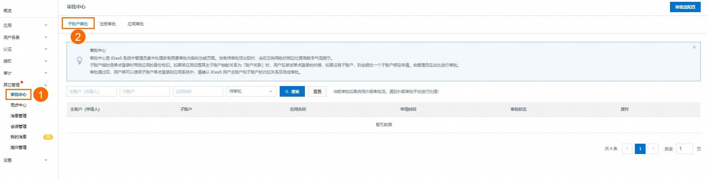

2. 搜索与筛选。页面提供多维度筛选条件，快速定位目标申请：

   - **主账户（申请人）**：输入申请人账号/名称。

   - **子账户**：输入待绑定的子账户账号。

   - **应用名称**：输入目标应用的名称。

   - **待审批**：选择审批状态（如**待处理**）。

   - **搜索**：单击蓝色**搜索**按钮，触发条件匹配。

   - **重置**：单击**重置**按钮，清空所有筛选条件。

3. 申请列表与操作列表展示**主账户（申请人**）、**子账户**、**应用名称**、**申请时间**、**审批状态**等关键信息。若列表显示暂无数据，表示当前无待处理的子账户绑定申请。

**注册审批**

平台自注册账户进行审批，可对推送过来的信息进行查看、快速同意、快速拒绝、审批操作。

1. 页面入口在控制台左侧导航栏，依次展开**其他管理 > 审批中心**，进入模块后单击顶部标签栏的**注册审批**，即可进入配置页面。

   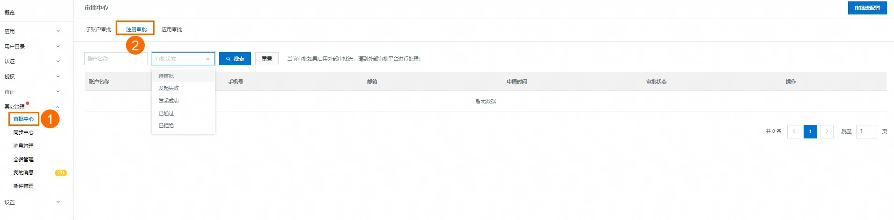

2. 页面核心组件

   - **筛选区域**：

     - **账户名称**：输入框支持模糊匹配，可快速定位目标注册申请。

     - **审批状态**：下拉菜单提供**待审批**、**发起失败**、**发起成功**、**已通过**、**已拒绝**等状态选项，用于精准筛选目标审批记录。

     - **搜索按钮**：单击后，系统将根据输入的**账户名称**和**审批状态**筛选条件，同步更新列表数据。

     - **重置按钮**：单击后，清除所有筛选条件，恢复列表为默认展示状态。

   - **列表区域**： 表格列包含**账户名称**、**手机号**、**邮箱**、**申请时间**、**审批状态**、**操作**，其中操作列提供对单条记录的审批操作入口。 若当前无符合条件的注册申请，列表会显示暂无数据提示。

3. 注册申请状态筛选通过**账户名称**输入框输入目标账户的关键信息），或在**审批状态**下拉菜单选择目标状态（如待审批），单击**搜索**按钮，系统将自动筛选并展示符合条件的注册申请列表。

**应用审批**

对账户申请访问的应用进行审批，可以对推送过来待审批的应用申请进行查看、快速同意、快速拒绝、审批操作。

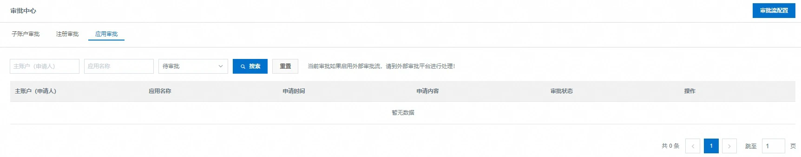

<a id="section-9-2"></a>

## 9.2. 同步中心

**概览**

同步中心是 IDaaS 系统中从第三方应用/AD 中获取组织架构和账户信息，由 IDaaS 同步到第三方应用/AD的配置、管理、审计中心。当前同步中心可以通过 IDaaS 独立的 Connector 组件与内网环境内的 AD 进行数据同步。Connector 组件可以将任意支持的多个系统之间的组织机构、账户等数据进行同步。如需使用 Connector 组件，请联系IDaaS 团队进行支持，单击**其他管理 > 同步中心**进入页面。

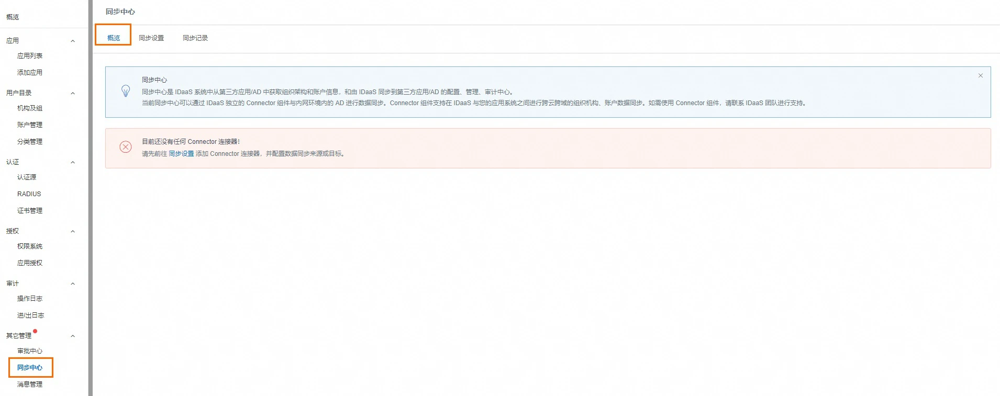

**同步设置**

首先需要新建connector，然后再建同步来源（入方向）和管理同步目标（出方向），单击**其他管理 > 同步中心**，再单击**同步设置**，默认为管理connector连接器。

1. 管理 Connector 连接器：单击**新建 Connector**，填写以下参数。

   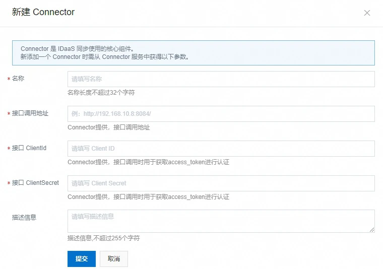

2. 管理同步来源（入方向）：首先需要选择一个可以用的connector，然后新建来源，配置这里是相对于IDaaS而言同步进来的数据来源，可以修改同步配置、立刻执行同步、详情、修改、删除等操作。

   <ol type="i">

   <li>

   修改同步配置：可以修改名称、目标根节点标识、描述；

   </li>

   <li>

   立即执行同步：单击以后可以立即同步数据；

   </li>

   <li>

   详情：可以查看新建来源的详情；

   </li>

   </ol>

3. 管理同步目标（出方向）：首先也需要选择一个可以用的connector，然后新建目标。填写目标名称、目标类型、关联应用授权同步范围、描述，勾选是否启用后提交。

**同步记录**

每次同步以后可以在同步记录页面查看到日志，可以查看到是成功还是失败，单击**其他管理 > 同步中心**，再单击**同步记录**。

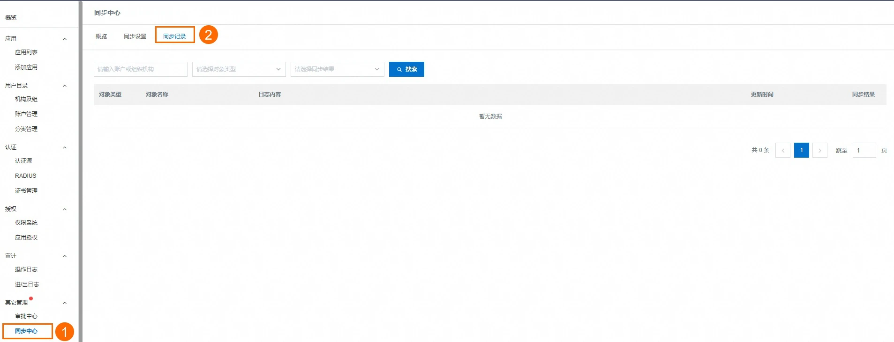

<a id="section-9-3"></a>

## 9.3. 消息管理

**概述**

管理员可以对公司内部的账户发布公告/通知。公告会给全部账户发布，通知则可以指定具体账户/组进行发布。

**发消息操作步骤**

1. 单击右上角**发消息**，进入消息发布页面。

   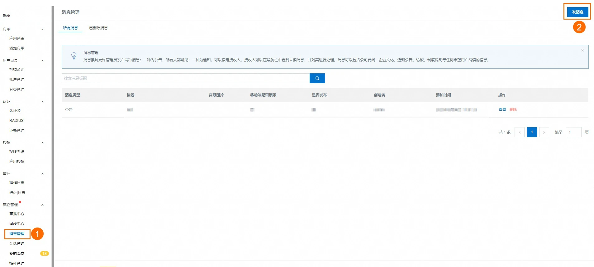

2. 选择消息类型，公告或通知。填写标题、内容及附件后，单击**发送**，即可发送成功。

   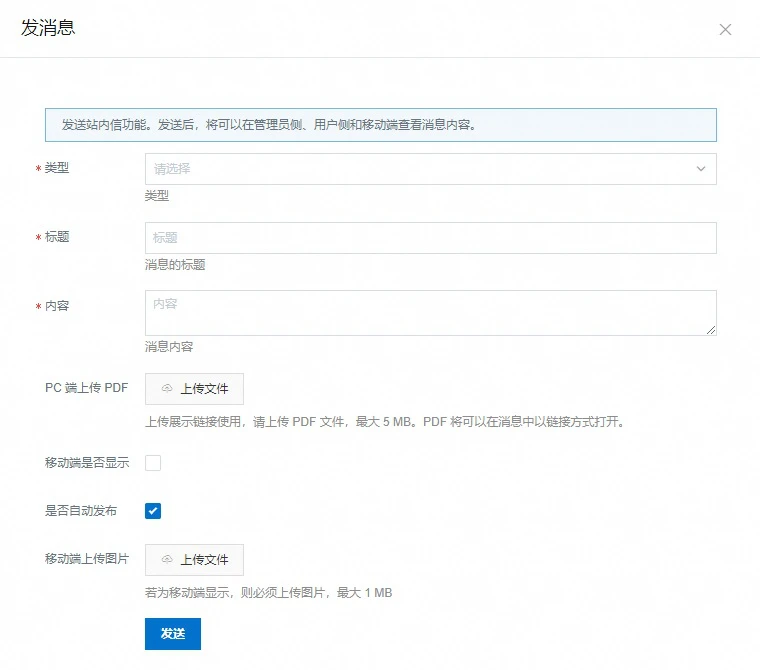

> **说明**
>
> - 公告的发送对象是公司的所有账户。如果要在移动端app中显示该公告，必须要上传相应图片才能发布。
>
> - 通知的发送对象可以是公司中的账户/组，由IT管理员设置收件人即可。如果要在移动端app中显示该通知，则必须要上传相应图片才能发布。

**查看公告/通知**

IT管理员单击公告/通知列表**查看**按钮，即可查看该条公告详情。


**删除公告/通知**

单击公告/消息列表**删除**按钮，确认删除后，即可删除该条公告/消息，所删除的公告/消息将显示在**已删除公告**列表中。

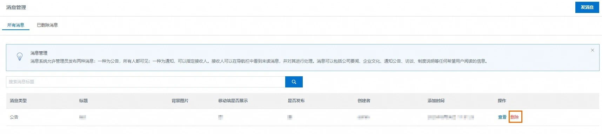

<a id="section-9-4"></a>

## 9.4. 会话管理

本文档介绍会话管理功能，阐述会话有效性判定逻辑、账户会话数量规则，以及会话管理界面的搜索、信息展示与注销操作等核心内容。

**概述**

会话管理可以查看所有当前仍然有效的会话列表，并且可以强制注销某个用户的会话。会话是否有效以登录令牌为准，如果没有手动退出，在令牌过期前（默认 2 小时），会话仍然有效。注销后，该用户凭证即刻失效，之后的所有操作都需要重新认证。一个账户在网页端只会有一个会话存在。移动端和网页端是两个会话范围，可以同时存在，单击**其他管理 > 会话管理**进入页面。

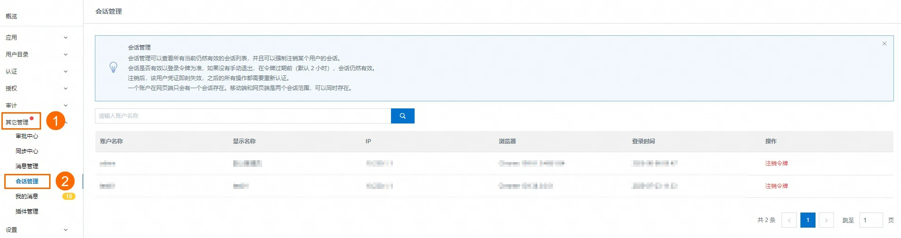

会话管理模块用于查看所有当前仍有效的会话列表，并支持强制注销指定用户的会话。

- **会话有效性判定**：以登录令牌为依据，若用户未手动退出，且登录令牌未过期（默认有效期为2小时），则会话持续有效；若用户注销，其登录凭证失效，后续操作需重新认证。

- **会话数量规则**：同一账户在网页端仅维持1个会话；移动端与网页端属于不同会话范围，可同时存在有效会话。

在会话管理界面，可通过“账户名称”搜索栏快速定位目标会话，列表中会展示**账户名称、显示名称、IP地址、浏览器版本、登录时间**等信息，且针对每个会话提供**注销令牌**操作入口，便于管理员灵活管理会话状态。

<a id="section-9-5"></a>

## 9.5. 我的消息

本文档介绍我的消息功能，从功能定位、核心模块（消息分类、列表展示、搜索与操作）等维度，系统阐述消息管理的实现逻辑与操作指引，助力用户高效完成消息查看、分类、操作等任务。

**一、功能概述**

我的消息功能为用户提供**消息管理**能力，支持查看当前用户的可见消息，涵盖未读、已读、已删除消息的分类展示与操作。在这里查看当前用户的可见消息。单击查看某消息会自动将其标记为已读，删除以后可以在**已删除消息**列表看到。

**二、核心功能模块**

1. 页面入口在控制台左侧导航栏，依次展开**其他管理 > 我的消息**，进入模块后单击顶部的标签栏，即可进入配置页面。

   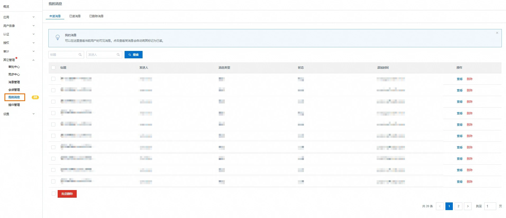

2. **消息分类标签** 提供**未读消息**、**已读消息**、**已删除消息**三个标签页，用户可快速切换查看不同状态的消息，满足消息归类管理需求。

3. **消息列表展示**

   - 列表包含**标题**（消息主题）、**发送人**（消息来源）、**消息类型**（如通知）、**状态**（未读/已读）、**添加时间**（消息生成时间）等关键信息，清晰呈现消息属性。

   - 每条消息右侧提供**查看**、**删除**操作按钮，支持单条消息的查看与删除；列表底部的**批量删除**按钮，可实现多条消息的批量删除，提升操作效率。

4. **搜索与筛选** 支持通过**标题**、**发送人**字段进行搜索，帮助用户快速定位目标消息，提升消息查找的便捷性。

<a id="section-9-6"></a>

## 9.6. 插件管理

本文档介绍插件管理功能，从概述、功能说明等维度，系统阐述插件管理的核心逻辑与操作要点，助力您高效完成插件的全生命周期管理。

**应用插件**

应用插件化，支持以插件的形式添加应用。将配置好的应用，上传到插件列表，将插件状态改为启用，按钮状态为打开状态，既可在**添加应用**菜单中进行添加使用。

- **插件类型**：包含应用插件与认证源插件两类，分别满足不同业务场景下的插件管理需求。

- **搜索功能**：通过顶部搜索框输入插件名称，可快速定位目标插件，提升管理效率。

- **列表展示**：在插件列表中，可查看插件的关键信息（如应用图标、应用名称、应用ID、当前版本、数据库版本、上传日期、插件状态等），直观掌握插件状态。

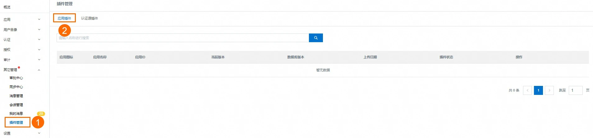

**认证源插件**

认证源插件化，支持以插件的形式添加认证源。将配置好的认证源，上传到插件列表，将插件状态改为启用，即可在**添加认证源**中进行添加使用。

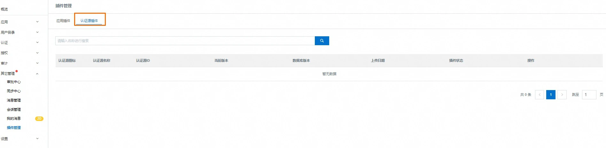

1. **功能说明**： 认证源插件是用于管理认证源相关资源的核心功能模块，支持对认证源的搜索、状态查看、版本管理等操作，助力开发者高效运维认证源资源。

2. **操作指引**：

   - **搜索认证源**：在页面顶部搜索框中输入认证源名称，单击搜索按钮，即可快速定位目标认证源。

   - **查看认证源信息**：列表展示认证源的**图标、名称、ID、当前版本、数据库版本、上传日期、插件状态**等关键信息，帮助开发者全面掌握资源状态。

<a id="section-10"></a>

# 10.设置

<a id="section-10-1"></a>

## 10.1. 个性化设置

<a id="section-10-1-1"></a>

### 10.1.1. 公司信息

本文档详细阐述了IDaaS平台个性化设置-公司信息功能的操作步骤、界面元素及注意事项，帮助您完成公司基础信息（如公司名称、标识、联系方式等）的配置与管理。

**功能描述**

在 IDaaS 平台的**个性化设置**模块中，公司信息功能支持管理员对企业的基础标识与联系信息进行统一管理。

**操作步骤**

1. **操作入口**：在控制台左侧导航栏，依次展开**设置 > 个性化设置**，进入模块后单击顶部标签栏的**公司信息**，即可进入公司信息配置页面。

   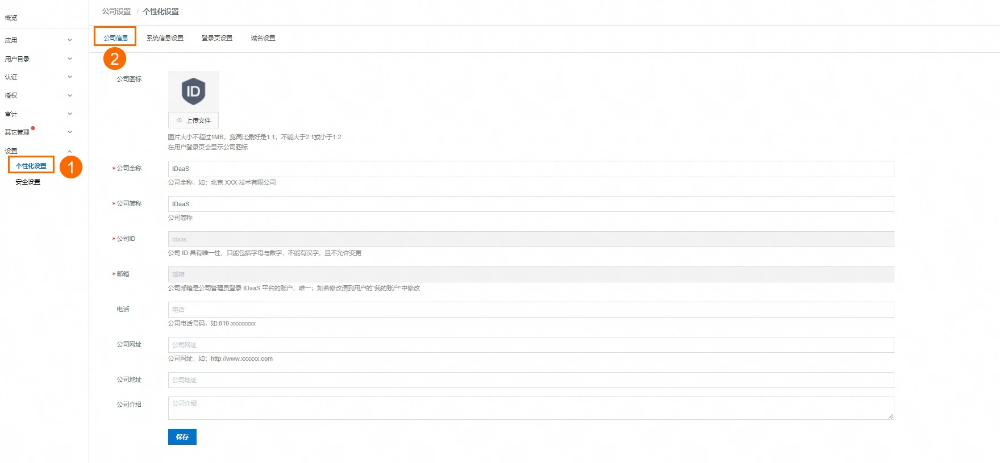

2. **公司标识配置公司图标**：页面左侧展示当前公司图标，单击**上传文件**按钮可替换图标。上传文件需满足：大小≤1MB，宽高比建议1:1（且宽高比需介于1:2与2:1之间）；替换后的图标会在用户登录页展示，直观呈现企业品牌特征。

3. **基础信息填写**。页面右侧为字段输入区，需填写以下核心信息（带星号字段为必填项）：

   <table>
     <tr>
       <th width="89">参数</th>
       <th>说明</th>
     </tr>
     <tr>
       <td><strong>公司全称</strong></td>
       <td>需填写完整的企业法定名称（如“北京XXX技术有限公司”），用于平台内统一展示企业全称。</td>
     </tr>
     <tr>
       <td>公司简称</td>
       <td>填写企业常用简称（如“IDaaS”），用于简化展示或业务场景中的快捷识别。</td>
     </tr>
     <tr>
       <td>公司ID</td>
       <td>系统自动生成的唯一标识，仅允许字母、数字组成，且不支持修改（用于平台内企业身份的唯一映射）。</td>
     </tr>
     <tr>
       <td>邮箱</td>
       <td>管理员登录IDaaS平台的唯一账号，若需修改需通过用户中心我的账户模块操作。</td>
     </tr>
     <tr>
       <td><strong>电话</strong></td>
       <td>填写企业官方电话（如“010-xxxxxxxx”），用于业务沟通或紧急联络。</td>
     </tr>
     <tr>
       <td>公司网址</td>
       <td>填写企业官方网站（如“http://www.xxxxx.com”），便于用户快速访问企业主页。</td>
     </tr>
     <tr>
       <td>公司地址</td>
       <td>填写企业办公地址（如“北京市XX区XX路XX号”），用于企业信息公示或线下业务对接。</td>
     </tr>
     <tr>
       <td><strong>公司介绍</strong></td>
       <td>可选填写企业业务背景、文化理念等信息，用于丰富平台内企业展示内容。</td>
     </tr>
   </table>

4. **保存操作**：所有信息填写完成后，单击页面底部**保存**按钮，系统将对输入内容进行校验（如字段格式、必填项完整性），校验通过后完成信息更新。

通过该功能，管理员可一站式配置企业基础信息与标识，保障平台内企业形象的一致性与信息的准确性，为后续业务运营、用户沟通等场景提供基础支撑。

<a id="section-10-1-2"></a>

### 10.1.2. 系统信息设置

本文档详细介绍了个性化设置中系统信息设置的功能说明与操作指引，涵盖系统名称、标题、图标、版权/版本/许可证信息的配置逻辑，帮助您高效完成系统视觉与信息标识的个性化配置。

**功能描述**

系统信息设置功能允许您配置系统中用户可见的核心信息，包括产品名称、系统图标、版权信息、版本信息等；若未配置或留空，系统将启用默认值。

**操作步骤**

1. 在控制台左侧导航栏，依次展开**设置 > 个性化设置**，进入模块后单击顶部标签栏的**系统信息设置**，即可进入配置页面。

   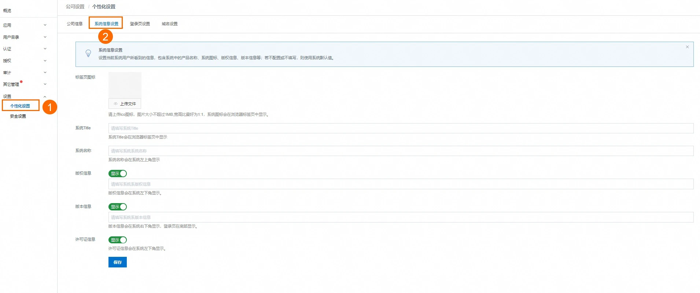

2. 具体配置项说明如下。

   - **标签页图标**：支持上传系统图标（格式需为  `.ico`  格式），文件大小不超过 1MB，推荐宽高比1:1。配置后，系统图标将在浏览器标签页中展示。

   - **系统Title**：通过输入框填写系统标题，配置后，系统标题将在浏览器标签页中显示。

   - **系统名称**：通过输入框填写系统名称，配置后，系统名称将在系统左上角展示。

   - **版权信息**：开启“显示”开关后，通过输入框填写版权信息，配置后，版权信息将在系统左下角显示。

   - **版本信息**：开启“显示”开关后，通过输入框填写版本信息，配置后，版本信息将在系统右下角（或登录页底部）显示。

   - **许可证信息**：开启“显示”开关后，通过输入框填写许可证信息，配置后，许可证信息将在系统左下角显示。

3. **保存操作**完成上述信息配置后，单击**保存**按钮，即可使配置生效。

<a id="section-10-1-3"></a>

### 10.1.3. 登录页设置

本文档介绍登录页设置功能的使用流程，包括自定义登录页的配置步骤、代码编辑逻辑，以及功能启用后对系统原有配置（如“公司信息”中公司名称/LOGO、“安全设置”中允许注册规则）的影响说明。

**功能说明**

登录页设置功能允许企业管理员自主定义登录页，通过自定义页面区域的代码编辑与功能按钮操作，实现登录页样式、交互逻辑的个性化配置，同时明确功能启用后对系统原有配置的覆盖规则，满足企业对登录页风格、功能的定制化需求。

**操作步骤**

1. **操作入口**在控制台左侧导航栏，依次展开**设置 > 个性化设置**，进入模块后单击顶部标签栏的**登录页设置**，即可进入配置页面。

   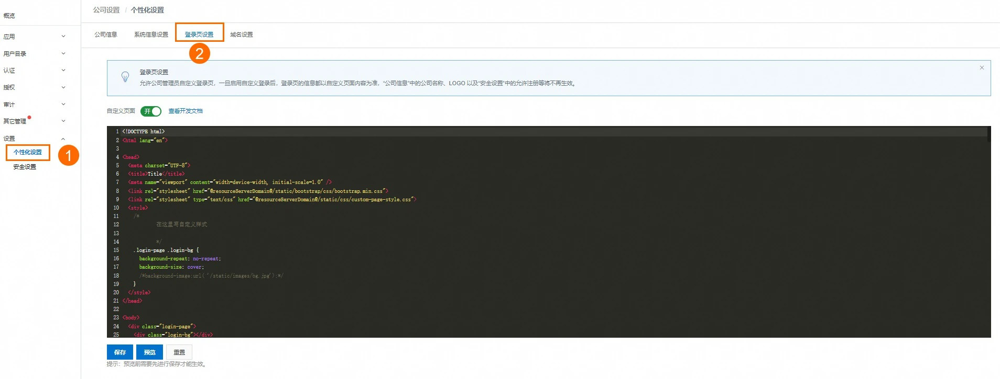

2. **自定义页面配置**

   <ol type="i">

   <li>

   开启自定义页面开关。

   </li>

   <li>

   在**自定义页面**区域，通过代码编辑器完成登录页的HTML结构、CSS样式、JS交互逻辑等开发工作。

   > **说明**
   >
   > 代码需遵循标准前端开发规范，同时可利用系统提供的资源引用变量（如 `@resourceServerDomain` ）快速接入系统内置资源（如Bootstrap样式库）。

   </li>

   </ol>

3. **功能按钮操作**

   - **保存**：单击**保存**按钮，提交自定义代码并保存至系统后台。

   - **预览**：需先完成**保存**操作，再单击**预览**按钮，查看自定义登录页的渲染效果，确保样式、交互逻辑符合预期。

   - **重置**：若需恢复默认登录页配置，可单击**重置**按钮，清空自定义代码并还原系统默认样式。

4. **功能生效与覆盖规则**当自定义登录页启用后，系统将优先以自定义页面的内容为登录页呈现依据，“公司信息”模块中的**公司名称、LOGO**，“安全设置”模块中的允许注册等配置将不再生效。

通过以上步骤，企业管理员可高效完成登录页的个性化定制，同时明确配置逻辑与系统原有功能的联动关系，保障登录页展示效果与业务规则的一致性。

<a id="section-10-1-4"></a>

### 10.1.4. 域名设置

本文介绍域名设置模块的功能与操作步骤，涵盖自定义域名的输入规范、保存操作等内容，助力您完成企业专属域名的配置。

**功能描述**

域名设置用于实现企业专属域名的自定义配置，实现用户登录地址的自定义，满足品牌化、可访问性等业务需求。

**操作步骤**

1. **操作入口**在控制台左侧导航栏，依次展开**设置 > 个性化设置**，进入模块后单击顶部标签栏的**域名设置**，即可进入配置页面。

   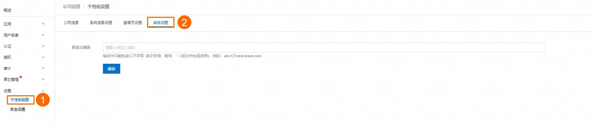

2. **自定义域名输入** 页面提供**自定义域名**输入框，需遵循以下规范：域名仅支持英文字母、数字、英文连词号（-），输入后系统会对格式进行校验（如非法字符会触发提示）。示例格式参考： `abc123-test.idaas.com` 。

   > **说明**
   >
   > 实际域名需结合企业自有域名规则，需提前完成域名解析等前置配置。

3. **保存配置**域名输入完成后，单击**保存**按钮提交配置。系统会对域名有效性（如解析状态、格式合规性）进行验证，验证通过后配置生效。

该功能通过标准化的输入规则与清晰的操作反馈，帮助您高效完成企业专属域名的配置，提升平台访问的专业性与品牌辨识度。

<a id="section-10-2"></a>

## 10.2. 安全设置

<a id="section-10-2-1"></a>

### 10.2.1. 统一二次认证

本文档介绍通过控制台配置统一二次认证功能，包括登录/应用二次认证的强制开启、认证方式设置（短信/移动APP）、离线认证支持以及第三方OTP服务的对接流程与测试方法。

**概述**

IT管理员有权设置是否开启统一二次认证，如果开启，公司所有账户在登录时都需要二次认证。

**二次认证配置**

在控制台左侧导航栏，依次展开**设置 > 安全设置**，单击顶部标签栏的**统一二次认证**，在左侧功能列表选择**二次认证配置**，进入配置界面。

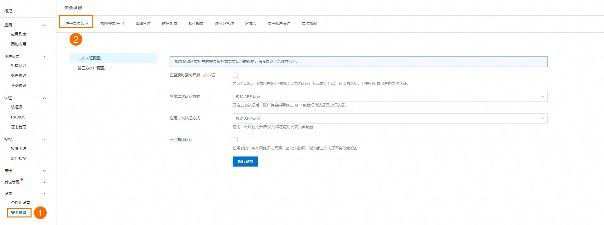

- **在登录时强制开启二次认证**：IT管理员可开启或关闭公司所有账户的登录二次认证。

- **登录二次认证方式**：IT管理员可统一设置登录二次认证方式-短信认证码认证或者移动APP认证。

- **应用二次认证方式**：IT管理员可统一设置应用二次认证方式-短信认证码认证或者移动APP认证。

  > **说明**
  >
  > 在SP发起登录时，如果登录二次认证和应用二次认证方式都开启且认证方式一致，则在账户认证时只触发进行登录二次认证。如果两者都开启且认证方式不一致，则账户认证时先进行登录二次认证然后再进行应用二次认证后方可登录进入业务系统。

- 允许离线认证：与移动APP认证配合使用，IT管理员可开启支持移动APP认证的离线二次认证，即可支持使用google、微软的身份认证器进行OTP二次认证。开启后，普通用户处可以自行开启用户二次认证-移动APP认证。

**第三方 OTP 配置**

第三方OTP配置是阿里云安全设置中，用于接入第三方认证厂商的 OTP（一次性密码）服务的配置功能。通过配置厂商信息、服务器 IP/端口等参数，实现与第三方 OTP 系统的对接，提升用户认证的安全性与灵活性。


1. **进入配置页面** 在控制台左侧导航栏，依次展开**设置 > 安全设置**，单击顶部标签栏的**统一二次认证**，在左侧功能列表选择**第三方 OTP 配置**，进入配置界面。

2. **开启第三方 OTP** 页面左侧选择**开启第三方 OTP**复选框（勾选后启用第三方 OTP 功能）。

3. **配置厂商信息** 在**厂商**下拉列表中，选择要接入的第三方 OTP 厂商（如“飞天诚信”等支持的厂商）。

4. **配置 OTP Server 参数**

   - **OTP Server IP 配置**：输入第三方 OTP 服务器的 IP 地址（需确保网络可达）。

   - **OTP Server 端口号配置**：输入第三方 OTP 服务器的端口号（需与厂商约定的端口一致）。

5. **保存配置** 单击页面底部的**保存设置**按钮，完成第三方 OTP 的基础配置。

6. **连通性测试**为验证第三方 OTP 服务的连通性，可执行以下测试：

   <ol type="i">

   <li>

   在 **连通性测试** 区域，填写**用户名**和**动态口令**（需使用第三方 OTP 系统的测试账号/动态码）。

   </li>

   <li>

   单击**测试**按钮，系统将自动检测与第三方 OTP 服务的连通性，返回测试结果（如**测试成功**或**测试失败**）。

   </li>

   </ol>

<a id="section-10-2-2"></a>

### 10.2.2. 注册/登录/登出

本文档阐述了注册审批、登录安全策略（含账户锁定/验证码规则/会话超时）及登出跳转地址的全流程配置方法，涵盖核心功能的参数说明与操作指引。

**注册**

1. 在控制台左侧导航栏，依次展开**设置 > 安全设置**，单击顶部标签栏的**注册/登录/登出**，在左侧功能列表选择**注册**，进入配置界面。

   

2. 勾选**允许注册**框以后可以在登录页面看到注册审批按钮，可以直接进行注册登录。勾选**注册需要审批**，开启注册审批后，用户注册后需要管理员进行审批，审批通过后才能激活账户。配置完成后，单击**保存设置**。

**登录**

1. 系统登录系统登录功能用于配置与用户登录系统相关的各项安全策略，涵盖**账户锁定、验证码显示规则、默认认证方式、会话超时**等核心环节，助力保障登录环节的安全性与便捷性。

   

   <ol type="i">

   <li>

   **账户锁定**

   - **功能描述**：开启后，用户登录失败时将触发**登录失败次数限制**机制，通过约束错误登录行为降低账号被暴力破解的风险。

   - **配置逻辑**：需在界面勾选对应开关以启用该功能。

   </li>

   <li>

   **显示验证码**

   - **功能描述**：控制登录页中“用户名+密码”登录方式下，是否展示验证码输入框。

   - **配置逻辑**：通过勾选开关实现开关控制，开启后登录页会强制显示验证码输入区域。

   </li>

   <li>

   **登录失败次数显示验证码**

   - **功能描述**：设置“登录失败后显示验证码”的触发阈值。当登录失败次数**大于**该阈值时，登录页才会展示验证码；若设置为  `0` ，则验证码始终强制显示。

   - **配置逻辑**：在下拉框中选择具体失败次数。

   </li>

   <li>

   **时间范围（分钟）**

   - **功能描述**：定义**登录失败次数的计数时间窗口**。当指定时间（如图中示例  `5`  分钟）内无任何登录操作时，登录失败次数将自动重置，避免因长时间无交互导致的“误锁”风险。

   - **配置逻辑**：在输入框中填写时间（单位为分钟），默认值为  `5`  分钟。

   </li>

   <li>

   **默认认证方式**

   

   - **功能描述**：设定系统默认的用户认证方式（如图中示例为  账户`+`密码 ）。

   - **配置逻辑**：在下拉框中选择目标认证方式；若应用发起认证且默认源安全等级不足，系统将自动切换为更高安全级别的认证源，此时该配置失效。

   </li>

   <li>

   **会话有效时间**

   - **功能描述**：设置用户会话的**最大空闲时长**。当会话在指定时间内无任何操作时，系统会自动退出，保障会话安全。

   - **配置逻辑**：在输入框中填写时间（单位为分钟），默认值为  `720`  分钟（即 12 小时）。

   </li>

   <li>

   **保存设置**

   - **功能描述**：单击该按钮后，系统将同步保存上述所有登录相关配置，确保新策略立即生效。

   通过以上配置，您可以灵活调整登录环节的安全策略，平衡“安全性”与“用户体验”，满足业务场景下的安全管控需求。

   </li>

   </ol>

2. 应用自动登录在 IDaaS 门户中，若需实现普通用户角色登录后自动单点登录配置的应用，可通过**安全设置 > 注册/登录/登出 > 登录 > 应用自动登录**页面完成配置。该功能适用于普通用户角色，满足登录 DaaS 门户后自动单点登录配置的应用场景。需注意：此功能对SP（Service Provider，即应用系统） 发起的单点登录请求无效。

   

   <ol type="i">

   <li>

   **启用自动登录** 勾选**开启自动登录**复选框以启用自动登录功能。

   <ol type="i" start="2">

   <li>

   **选择登录应用**

   - 在**登录应用**输入框中，输入目标应用的名称进行搜索，筛选出需自动登录的应用。

   - 选择一个或多个应用，选择多个时，登录后将在浏览器新标签页中打开对应应用。

   </li>

   <li>

   **设置是否保留 DaaS 门户**

   </li>

   </ol>

   - 勾选**是否保留 DaaS 门户**复选框，登录后会保留 DaaS 系统本身门户页面。

   - 若取消勾选，登录后将直接进入配置的应用，不再显示 DaaS 页面（默认为开启状态）。

   </li>

   <li value="4">

   **保存配置** 完成上述设置后，单击页面底部的**保存设置**按钮，确保配置生效。

   </li>

   </ol>

   通过以上配置，可实现普通用户登录 IDaaS 门户后自动跳转至指定应用，同时根据需求灵活选择是否保留 IDaaS 门户页面，提升系统操作效率与体验。

**登出**

登出配置用于设置用户在完成登出操作后，页面自动跳转的目标地址，帮助用户快速导航至预期页面，提升操作便捷性。


1. **进入配置界面** 在控制台左侧导航栏，依次展开**设置 > 安全设置**，单击顶部标签栏的**注册/登录/登出**，在左侧功能列表选择**登出**，进入配置界面。

2. **填写登出跳转地址**在页面中找到**登出跳转地址**配置项，输入目标跳转地址（需为合法、可访问的URL）。

3. **保存配置**单击页面右下角的**保存设置**按钮，完成登出跳转地址的配置。

配置生效后，当用户在 IDaaS 控制台右上角单击**登出**退出系统时，页面将自动跳转至您在**登出跳转地址**中配置的指定页面。

<a id="section-10-2-3"></a>

### 10.2.3. 策略管理

本文档阐述了注册审批、登录安全策略（含账户锁定/验证码规则/会话超时）及登出跳转地址的全流程配置方法，涵盖核心功能的参数说明与操作指引。

**密码策略**

在控制台左侧导航栏，依次展开**设置 > 安全设置**，单击顶部标签栏的**策略管理**，在左侧功能列表选择**密码策略**，进入配置界面。通过**密码策略**功能可统一配置公司用户的密码安全规则与通知策略，保障系统账户密码合规性与安全性。密码规则配置用于定义用户密码的组成类型、长度限制，及强制改密场景。


1. **规则类型**。选择公司密码的组成规则，支持以下类型：

   - 大小写字母+数字+特殊字符：密码需同时包含大写字母、小写字母、数字，且不能包含  `<`  和  `>`  特殊字符。

   - 其他规则（如“仅字母+数字”等，需结合产品实际支持的选项）：需满足对应规则的字符组合要求。

2. **最小长度**设置公司密码的最小长度，如输入  `10`  则表示密码长度不得低于 10 位。

3. **定期改密**勾选后，用户需定期修改密码才能继续使用系统（需结合产品规则，如周期性改密逻辑）。

4. **强制改密**勾选后，用户首次登录或被管理员重置密码后，必须强制更新密码才能进入系统。

5. **历史密码检测**勾选后，用户修改密码时，新密码不能与历史密码相同。

6. **历史密码检测次数**设置历史密码检测的次数范围（如输入  `1`  则表示检测“上 1 次”密码；输入  `2`  则表示检测“上 2次”密码，以此类推）。

7. **密码通知**。用于配置新增用户后的**初始密码通知方式**，需确保通知渠道已配置，具体说明如下：

   <ol type="i">

   <li>

   哪些新增用户方式需要通知？勾选需触发通知的用户新增场景：

   - 管理员手动添加用户后。

   - 管理员使用 Excel 导入用户后。

   - 管理员通过 LDAP 导入用户后。

   - 通过接口接收同步用户到系统后。

   </li>

   <li>

   通知方式。选择通知渠道：

   - 通过邮件通知：需提前在**邮件配置**中完成邮件服务的对接与参数配置。

   - 通过短信通知：需提前在**短信配置**中完成短信服务的对接与参数配置。

   </li>

   </ol>

8. 保存配置配置完成后，单击**保存设置**按钮，确保所有策略生效。

**用户名策略**

在控制台左侧导航栏，依次展开**设置 > 安全设置**，单击顶部标签栏的**策略管理**，在左侧功能列表选择**密码策略**，进入配置界面。此页面可对账户名称校验规则进行精细化配置，保障企业账号管理的安全性与合规性。


1. 配置**规则类型**（账户名称可包含的字符）。通过勾选复选框，指定账户名称允许包含的字符类型。

   - **大写字母**：勾选后，账户名称可包含  `A-Z`  等大写字符。

   - **小写字母**：勾选后，账户名称可包含  `a-z`  等小写字符。

   - **数字**：勾选后，账户名称可包含  `0-9`  等数字字符。

   - **中划线(-)**：勾选后，账户名称可包含  `-`  符号。

   - **下划线(_)**：勾选后，账户名称可包含  `_`  符号。

   - **点(.)**：勾选后，账户名称可包含  `.`  符号。

   - **@符号**：勾选后，账户名称可包含  `@`  符号。

2. 设置最小长度（账户名称长度限制）在**最小长度**输入框中，输入 4 - 18 **位**的整数，定义账户名称的最短长度要求。例如，若设置为 4，则账户名称需至少包含 4 个字符。

3. 开启手机号作为用户名功能勾选**允许手机号作为用户名**复选框后，后续添加账户时，可直接使用手机号作为账户名称（默认开启，勾选即生效）。

4. 保存配置完成上述参数调整后，单击页面底部的 **保存设置** 按钮，提交配置。系统会自动校验参数有效性，若配置合法则即时生效，若存在冲突（如规则类型与最小长度矛盾）则会弹出提示，需修正后重新提交。

通过上述步骤，可灵活定义企业账户的名称规则，兼顾安全性与管理便捷性，满足不同场景下的账号管控需求。

**弱密码检测**

弱密码检测用于**检测系统用户使用弱密码的情况**，通过技术手段排查账户使用弱密码的安全隐患。开启弱密码检测后，系统会阻止用户设置符合匹配规则的弱密码，从源头降低账户因弱密码引发的安全风险。


1. **开启弱密码检测**在**弱密码检测**配置区域，找到 <strong>开启弱密码检测”</strong>开关，单击开启该功能。

2. 配置弱密码匹配规则

   <ol type="i">

   <li>

   选择匹配方式。在**弱密码匹配**区域，根据需求选择匹配方式：

   - **使用自定义**：通过手动输入弱密码列表来定义弱密码规则。

   - **使用弱密码库**：采用系统内置的弱密码库（需确保该库已维护更新）来识别弱密码。

   </li>

   <li>

   配置自定义弱密码列表（若选择**使用自定义**）。在输入框中填写弱密码匹配列表，需遵循以下规则：

   - 多个弱密码需用换行符分隔（例如： `12345678` 、 `abc123` 、 `password` ，每行一个弱密码）。

   - 输入完成后，系统会基于该列表判断用户密码是否为弱密码。

   </li>

   </ol>

3. **应用外部导入**场景若需让弱密码检测规则覆盖外部导入的账户（如通过AD、LDAP、Excel、API导入的账户），则开启**应用于外部导入**开关。开启后，通过上述方式导入的账户若密码匹配弱密码规则，将无法完成导入。

4. 保存配置完成上述所有配置后，单击**保存设置**按钮，系统会自动应用弱密码检测策略。

> **重要**
>
> - 弱密码库需定期更新，以覆盖最新出现的弱密码模式（若使用内置弱密码库，需确保库的维护时效性）。
>
> - 自定义弱密码列表需精准匹配场景需求，避免因规则过于宽松导致弱密码检测失效。
>
> - 应用外部导入时，需确认规则对业务流程无冲突（如历史导入账户的密码合规性）。

通过上述配置，可有效减少系统中弱密码账户的数量，提升整体安全防护能力。

<a id="section-10-2-4"></a>

### 10.2.4. 短信配置

本文档阐述了短信网关配置流程及短信模板管理规范，确保短信服务的生产环境稳定运行与合法送达。

**短信网关一、进入配置界面**

在阿里云管理控制台中，通过以下路径进入**短信网关**配置页面。

1. 左侧导航栏选择**设置 > 安全设置**。

2. 顶部功能标签栏中，单击 **短信配置**页签。

3. 左侧二级导航栏中，选择 **短信网关**模块。


**二、参数配置说明**

短信网关配置需完成以下核心参数设置，确保短信服务的连接性与合规性：

<table>
  <tr>
    <th width="121">参数名称</th>
    <th>说明 &amp; 操作指导</th>
  </tr>
  <tr>
    <td>SMS服务商</td>
    <td>选择短信服务商（如“253云通讯平台(旧版)”），需确保服务商与当前租户的业务场景匹配。</td>
  </tr>
  <tr>
    <td>网关名称</td>
    <td>填写短信网关的唯一标识名称（支持中英文、数字、下划线，需符合业务管理规范）。</td>
  </tr>
  <tr>
    <td>网关描述</td>
    <td>可选填写，用于记录网关的功能定位、应用场景等说明性信息。</td>
  </tr>
  <tr>
    <td>SMS URL</td>
    <td>填写短信服务商提供的短信发送接口URL（需包含服务商指定的请求路径与参数规则）。</td>
  </tr>
  <tr>
    <td>API账户</td>
    <td>填写服务商分配的访问账户标识（如用户名、商户编码等）。</td>
  </tr>
  <tr>
    <td>API密码</td>
    <td>填写与API账户对应的访问密码（需妥善保管，避免泄露）。</td>
  </tr>
  <tr>
    <td>短信标题</td>
    <td>填写短信内容的标题/前缀（需符合运营商及服务商的合规要求，如禁用敏感词汇）。</td>
  </tr>
  <tr>
    <td>API扩展字段</td>
    <td>可选填写，用于传递短信发送时的额外业务参数（如模板变量、业务ID等，需服务商支持）。</td>
  </tr>
  <tr>
    <td>启用短信网关</td>
    <td>通过开关控制网关的启用状态：<br>• 开启：网关生效，可发送短信；<br>• 关闭：网关暂停，无法发送短信。</td>
  </tr>
</table>

**三、参数保存与测试**

完成参数填写后，执行以下操作验证配置有效性：

1. **保存配置**：单击页面底部的 <strong>保存设置]</strong>按钮，提交配置信息。

2. **测试验证**：在**发送测试短信**区域，选择国家码（如+86）并输入测试手机号码，单击**发送**按钮。系统将向该号码发送测试短信，若收到短信则说明配置正确；若未收到，需检查参数（如URL、账户密码、服务商配置等）并重新调试。

**四、注意事项**

- **参数合规性**：短信标题、API扩展字段等需严格遵循运营商与服务商的合规要求，避免因内容违规导致短信被拦截。

- **测试验证**：务必通过测试短信验证配置有效性，确保生产环境短信发送的稳定性。

- **权限管理**：仅允许具有短信配置权限的管理员操作该功能，避免非授权人员误操作。

通过以上步骤，可完成短信网关的参数配置与测试，保障短信服务的正常运行。

**短信模板**

在安全设置模块中，通过**短信模板**功能可实现对短信模板的编辑与配置，满足个性化短信内容需求，保障短信发送的精准性与合规性。


**一、操作步骤**

1. **模板编辑触发条件** 若需对短信模板内容进行修改，需先在**短信网关**配置中开启“自定义模板”功能。仅当自定义模板开关开启后，本页面的模板编辑入口才会生效。

2. **关键配置项说明**

   - **模板名称**：用于内部标识该模板的唯一名称，便于后续管理与区分（如图中示例名称为“重置密码”）。

   - **扩展ID（templateCode）**：阿里云短信模板的唯一标识，需在阿里云控制台完成短信模板申请后，获取对应的templateCode值进行填写。

   - **模板内容**：短信实际发送的文本内容，支持通过变量（如 `$(username)` 、 `$(password)` ）实现动态信息替换，确保短信内容的个性化与准确性。

3. **配置生效逻辑** 对模板名称、扩展ID、模板内容完成编辑后，单击**保存设置**按钮，系统会立即同步更新模板配置。后续发送短信时，系统将优先使用最新编辑的模板进行消息推送。

**二、注意事项**

- 若未在短信网关开启“自定义模板”开关，本页面的模板编辑功能将被限制，需先完成网关配置后方可操作。

- 模板内容需严格遵循阿里云短信服务的合规性要求（如不得包含违规信息、确保变量使用规范等），避免因内容问题导致短信发送失败或账号受限。

通过上述功能，您可以灵活配置短信模板，实现对短信内容、格式的精细化管理，保障业务场景中短信通知的高效性与合规性。

<a id="section-10-2-5"></a>

### 10.2.5. 邮件配置

本文档说明邮件网关配置流程（含SMTP主机地址、端口、安全协议设置）及邮件模板HTML内容定制规范，确保企业级邮件服务的生产环境稳定投递与合规性管理。

**一、邮件网关**

**操作场景**

在**安全设置**模块下，完成当前租户的邮件网关配置，确保邮件发送功能正常运行。

**操作步骤**

1. 进入配置页面在控制台左侧导航栏，依次展开**设置 > 安全设置**，单击顶部标签栏的**邮件配置**，在左侧功能列表选择**邮件网关**，进入邮件网关配置界面。

   

2. 填写配置参数。邮件网关配置界面包含以下关键参数，需按需填写：

   - **SMTP HOST**：用于发送邮件的主机地址（必填）。

   - **SMTP 端口**：用于发送邮件的端口（系统默认为 465，可按需修改）。

   - **邮箱地址**：用于发送邮件的邮箱地址（必填）。

   - **邮箱密码**：用于发送邮件的邮箱密码（必填）。

   - **安全类型**：选择邮件发送的安全加密方式，支持 **无**、**SSL**、**TLS** 三种选项（默认为 SSL，可根据实际需求调整）。

   - **启用邮件网关**：勾选该选项后，可对邮件模板内容进行自定义配置（默认勾选）。

3. 保存配置参数填写完成后，单击页面下方的**保存设置**按钮，完成邮件网关配置的保存。

4. 验证配置（可选）若需验证配置是否生效，可单击**发送测试邮件**输入框右侧的**发送**按钮，系统将向指定邮箱地址发送一条测试邮件，通过是否成功接收邮件确认配置准确性。

**注意事项**

- SMTP HOST、邮箱地址、邮箱密码为必填项，确保信息准确无误；

- 安全类型需与邮箱服务提供商的加密协议匹配，避免因协议不兼容导致发送失败；

- 邮件网关启用后，邮件模板内容可自定义，需结合业务场景合理配置。

**二、邮件模板**

**操作步骤**

1. 在**安全设置**页面，单击顶部导航栏的**邮件配置**页签，进入邮件配置功能模块。

2. 左侧导航栏选择**邮件模板**，进入邮件模板管理页面。

   

3. 在页面中，需完成以下关键配置：

   <ol type="i">

   <li>

   **模板名称**： 从下拉列表中选择要配置的邮件模板名称（如“邮件头部”、“邮件底部”等系统预设模板）。

   </li>

   <li>

   **模板内容**： 在代码编辑区域，填写邮件模板的 HTML 代码。代码中可包含自定义占位符（如  `$slogan$` ，代表系统默认标语，支持用户自定义替换），同时通过 HTML 语法定义邮件内容的样式、结构（如超链接、图片、文本排版等）。

   <ol type="i" start="3">

   <li>

   **保存与预览**： 配置完成后，单击页面底部的**保存设置**按钮，保存当前模板配置；若需查看配置后的邮

   </li>

   </ol>

   件呈现效果，可单击**预览**按钮。

   </li>

   </ol>

通过上述步骤，即可完成邮件模板的配置与效果验证，确保邮件发送内容符合业务需求。

<a id="section-10-2-6"></a>

### 10.2.6. 许可证管理

本文档说明许可证管理功能的操作流程与核心机制，重点涵盖试用期状态监控、到期预警提示及正式许可证更新操作，确保企业系统在合规授权下稳定运行。

**一、操作说明**

在控制台左侧导航栏，依次展开**设置 > 安全设置**，单击顶部标签栏的**许可证管理**，进入配置界面。**许可证管理**功能用于**集中管控系统许可证状态**，保障服务合法合规运行。


**二、核心功能**

1. **许可证状态可视化**。页面以清晰的界面呈现关键信息：

   - **试用期**：展示当前试用许可证的有效周期（如示例中“2025 - 07 - 22 17:49 — 2025 - 08 - 21 17:49”），帮助您精准把握试用窗口。

   - **是否过期**：通过“是/否”标识直观判断许可证时效，避免因过期导致服务中断。

   - **用户数**：呈现已激活用户数，助力您实时监控资源使用情况，提前规划容量扩容。

   - **机器码**：唯一标识设备或系统特征的编码，用于在许可证管理、设备绑定等场景中进行身份校验。

2. **试用版到期预警** 若系统处于**试用版**阶段，页面会以**红色提示框**主动推送风险通知：“当前为试用版，还未签发许可证，请在试用期（30天）内尽快更新正式许可证，否则会影响系统正常使用。”这一机制帮助您及时感知试用期风险，提前完成许可证续签或升级，保障业务连续性。

3. **许可证更新操作** 页面提供**更新许可证**操作按钮，单击后进入许可证更新流程：

   - 按指引填写许可证内容。

   - 完成单击**提交**，系统自动同步许可证信息，替换试用版许可证，保障服务在试用期后仍能稳定运行。

**三、注意事项**

- 试用版许可证**仅支持30天内更新**，逾期将无法通过原试用渠道续签。建议在试用期内尽早完成许可证签发，避免因操作延迟影响业务。

- 若企业已签署正式合同，需联系阿里云企业身份管理服务（IDaaS）技术支持团队，通过专属流程完成许可证同步。

通过**许可证管理**功能，您可高效掌控许可证生命周期，从试用到正式上线全程保障系统合法合规运行，为业务连续性提供基础保障。

<a id="section-10-2-7"></a>

### 10.2.7. IP 准入

本文介绍IP黑白名单功能，用于控制用户访问来源的IP准入规则，帮助您精细化管理访问权限。

**一、功能说明**

在控制台左侧导航栏，依次展开**设置 > 安全设置**，单击顶部标签栏的**IP 准入**，进入配置界面。IP黑白名单通过配置允许/禁止访问的IP范围，限制用户访问来源（覆盖Web端、移动端等渠道），但不针对应用侧做限制。


> **说明**
>
> 黑白名单优先级：当黑白名单同时开启时，系统优先处理黑名单规则。

**二、黑白名单配置步骤**

1. **黑名单配置**

- **启用开关**：单击**是否启用黑名单**右侧的开关按钮，开启黑名单功能。

- **IP地址管理**：

  - 输入支持的IP格式：支持单IP（如192.168.1.\*）、IP段（如192.168.1.\* - 192.168.1.\*\*\*）、IPv6地址。

  - 单击 `+` 按钮新增IP地址，单击 `×` 按钮删除指定IP。

- **UEBA临时阻断IP**：此列表为UEBA（用户实体行为分析）模块基于风险分析自动阻断的黑名单，若需解除，需在系统安全模块中操作。

  2. **白名单配置**

- **启用开关**：单击**是否启用白名单**右侧的开关按钮，开启白名单功能。

- **生效时间设置**：通过时间选择器设置**白名单生效时间**的起止时间（格式为 `HH:MM - HH:MM` ），仅在生效时段内生效。

- **IP地址管理**：

  - 输入支持的IP格式：同黑名单（单IP、IP段、IPv6）。

  - 单击 `+` 按钮新增IP地址；单击 `×` 按钮删除指定IP。

**三、保存配置**

完成黑白名单的启用、IP地址及生效时间等参数配置后，单击页面底部的**保存设置**按钮，即可生效配置规则。通过以上操作，您可以灵活管控用户访问来源的IP准入，保障系统安全与访问合规性。

<a id="section-10-2-8"></a>

### 10.2.8. 僵尸账户清理

本文档说明企业级僵尸账户自动化清理机制的配置流程与核心规则，通过闲置时长检测、定时扫描策略及分级禁用方案，系统性消除长期未维护账户带来的安全风险。

**一、功能说明**

僵尸账户指长时间无人使用却仍保有访问权限的账户。这类账户因缺乏维护，易被非法利用且风险隐蔽性高。为降低安全风险，需定期开展僵尸账户检测，识别并禁用无用账户，待合法需求时由管理员启用。僵尸账户清理功能通过配置检测规则、触发禁用动作、推送提醒邮件三步，实现对僵尸账户的自动化管理，助力企业高效排查安全风险。

**二、操作步骤**

1. **进入功能页面** 在控制台左侧导航栏，依次展开**设置 > 安全设置**，单击顶部标签栏的**僵尸账户清理**，进入配置界面。

   

2. **配置检测规则**

   - **检查僵尸账户**：勾选检查僵尸账户开关，开启此功能。

   - **最大闲置时间**：输入（单位：天）账户未登录的最长时长，超过该时长的账户将被判定为僵尸账户（计算依据为用户最后一次登录时间）。

   - **每日检查时间**：选择系统自动检测僵尸账户的时间（如08:00、14:00等），系统将在该时间点触发检测流程。

3. **配置禁用规则**

   - **自动禁用僵尸账户**：开启该开关后，系统将在每日检查时自动禁用满足“最大闲置时间”条件的僵尸账户。

   - **禁用前提醒**：输入（单位：天）禁用前需提前发送提醒邮件的天数（如输入“5”表示禁用前5天发送提醒，填“0”则不发送提醒）。邮件模板可在**邮件配置 > 邮件模板**中自定义内容，满足企业通知场景需求。

4. **保存与查看** 单击页面底部的**保存设置**按钮，完成配置后生效；若需查看当前检测到的僵尸账户列表，可单击**查看当前僵尸账户列表**进一步操作。

**三、注意事项**

- 配置“最大闲置时间”时，需结合企业业务场景合理设置（如业务活跃度低的场景可适当延长，业务频繁的场景建议缩短），避免误判有效账户。

- 邮件提醒需确保“邮件配置”模块已启用并完成收件人、邮件服务器等基础设置，确保通知正常触达用户。

- 禁用僵尸账户后，若用户后续有合法访问需求，可通过**管理员后台**手动启用账户，平衡安全与业务灵活性。

通过以上配置，企业可实现对僵尸账户的自动化检测与管控，有效降低因长期未维护账户带来的安全风险，保障业务安全与合规性。

<a id="section-10-2-9"></a>

### 10.2.9. 二次加密

本文档概述二次加密功能的配置流程，详细说明通过选择加密类型（KMS、KMS2或无）强化敏感数据防护的操作方法与协同安全策略要求。

**一、功能说明**

二次加密功能为敏感数据提供额外的安全防护，您可通过“二次加密类型”配置实现数据加密逻辑的灵活适配。

**二、操作步骤**

1. 在左侧导航栏选择**设置 > 安全设置** ，顶部菜单栏中单击**二次加密**进入配置界面。

   

2. 进入二次加密配置界面后，找到**二次加密类型**下拉框。

3. 根据业务安全策略，选择合适的加密类型（如需合规性保障，优先选择  `KMS` ；需自定义加密逻辑，选择  `KMS2` ；无需额外加密则选  无 ）；**二次加密类型**，通过下拉选择框配置加密逻辑，可选值包括：

   - **KMS**：集成阿里云密钥管理服务（KMS），利用云端加密密钥对敏感数据进行加密，满足合规性与数据安全要求；

   - **KMS2**：支持对加密算法、密钥管理策略的定制化配置，适配更复杂的业务安全需求；

   - **无**：关闭二次加密功能，仅保留基础加密逻辑（需结合业务场景权衡安全性与灵活性）。

4. 确认配置后，单击页面下方的**保存设置**按钮完成配置生效。

**三、注意事项**

- 二次加密需与系统底层加密策略协同生效，若对加密逻辑有特殊需求，建议在配置前查阅《密钥管理服务（KMS）用户指南》或咨询技术支持；

- 若选择“无”选项，需确保业务层面具备足够的安全防护措施（如数据脱敏、权限隔离等），避免因加密缺失导致安全风险。

通过上述步骤，您可灵活配置二次加密逻辑，为敏感数据构建更坚固的安全防护屏障。

<a id="section-10-3"></a>

## 10.3. 配置登录安全策略

用户可以控制用户登录时的异常锁定、是否显示验证码、以及登录方式等。本文介绍如何配置IDaaS中用户的登录策略。

**前提条件**

登录IDaaS控制台前，确认您已从部署人员处获取IDaaS控制台的服务域名地址。

**操作步骤**

1. 登录云盾IDaaS控制台。

2. 在左侧导航栏，选择**设置**＞**安全设置**。

3. 在**注册/登录/登出**页签，单击左侧**系统登录**分页，完成如下配置后，单击**保存设置**。

   

   <table>
     <tr>
       <th width="122">配置项</th>
       <th>说明</th>
     </tr>
     <tr>
       <td>账户锁定</td>
       <td>选中后，用户还需要设置<strong>密码错误锁定次数</strong>、<strong>账户解锁时间</strong>。当用户输入错误密码的次数超过<strong>密码错误锁定次数</strong>时，账户将被锁定，在<strong>账户解锁</strong><strong>时间</strong>前都不能再次登录。</td>
     </tr>
     <tr>
       <td>显示验证码</td>
       <td>选中后，用户在登录时需输入验证码。用户还需要进行如下验证码配置：<br>• <strong>登录失败次数显示验证码</strong>：如果登录失败次数超过设置的次数，显示验证码。<br>• <strong>时间范围</strong>：设置失败次数的计数时间范围。默认为5分钟，则5分钟后重置失败次数。</td>
     </tr>
     <tr>
       <td>默认认证方式</td>
       <td>选择的默认认证方式将会在用户认证的时候直接展示出来，如果是应用发起的认证，并且默认认证源安全等级不足时，会根据安全级别要求展示对应认证源，此配置将不再生效。</td>
     </tr>
     <tr>
       <td>会话有效时间</td>
       <td>如果用户没有任何操作的时间超过设置的时间，系统会自动退出。</td>
     </tr>
   </table>

<a id="section-10-4"></a>

## 10.4. 配置密码策略

用户可配置密码规则、长度、是否强制用户首次修改密码、定期改密、以及历史密码检测等。本文介绍如何配置IDaaS用户的密码策略。

**前提条件**

登录IDaaS控制台前，确认您已从部署人员处获取IDaaS控制台的服务域名地址。

**操作步骤**

1. 登录云盾IDaaS控制台。

2. 在左侧导航栏，选择**设置**＞**安全设置**。

3. 在**策略管理**页签，单击左侧**密码策略**分页，完成如下配置后，单击**保存设置**。

   

   <table>
     <tr>
       <th width="152">配置项</th>
       <th>说明</th>
     </tr>
     <tr>
       <td>规则类型</td>
       <td>填写选择公司的密码策略类型，密码至少要包含一个大写字母、一个小写字母和一个数字，密码不能包含小于(＜)、大于(&gt;)。</td>
     </tr>
     <tr>
       <td>最小长度</td>
       <td>选择公司的密码长度限制，即最小长度。</td>
     </tr>
     <tr>
       <td>定期改密</td>
       <td>选中后，用户需定期修改密码才能使用系统。</td>
     </tr>
     <tr>
       <td>强制改密</td>
       <td>选中后，用户首次登录或被管理员重置密码后必须强制更新密码才能进入系统。</td>
     </tr>
     <tr>
       <td>历史密码检测</td>
       <td>选中后，用户修改密码不能和历史使用密码相同。</td>
     </tr>
     <tr>
       <td>历史密码检测次数</td>
       <td>设置检测用户的历史密码次数，比如2次，则代表用户修改的密码不能和上2次使用的密码相同。</td>
     </tr>
     <tr>
       <td>密码通知</td>
       <td>• 选择密码通知的场景，可选项：<br>• 管理员手动添加用户后<br>• 管理员使用excel导入用户后<br>• 管理员通过LDAP导入用户后<br>• 通过接口接收同步用户到系统后<br>• 选择密码通知的方式，可选项：<strong>通过邮件通知</strong>、<strong>通过短信通知</strong>。</td>
     </tr>
   </table>
