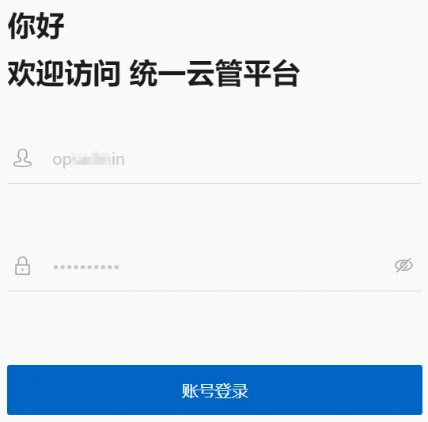
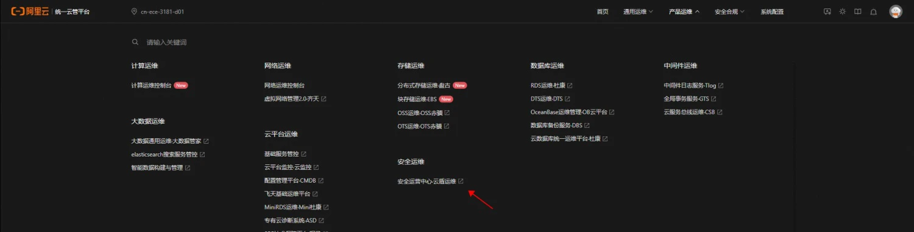
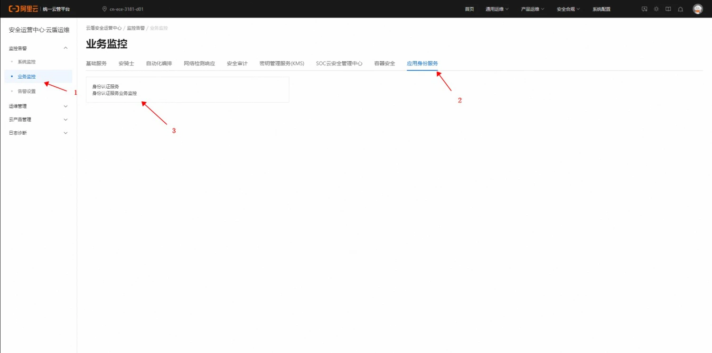
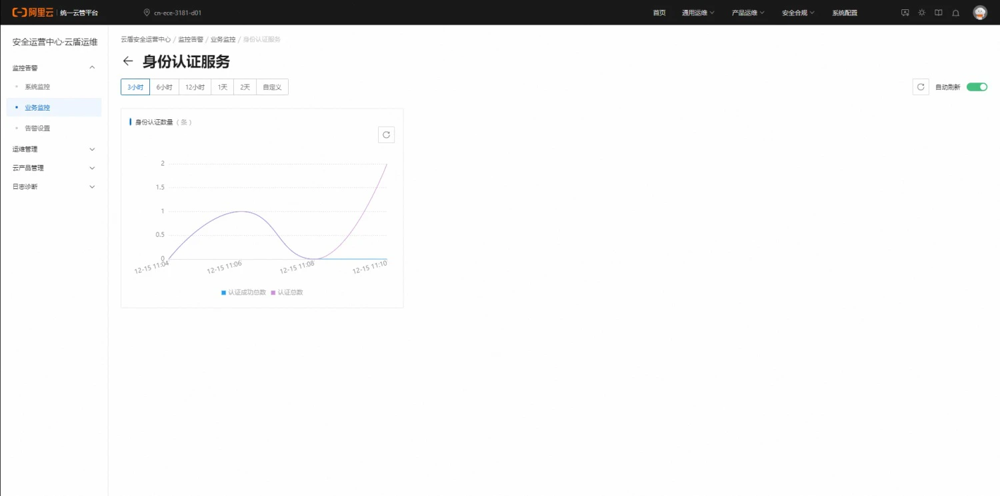
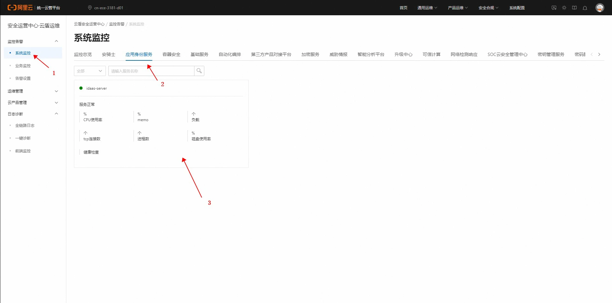
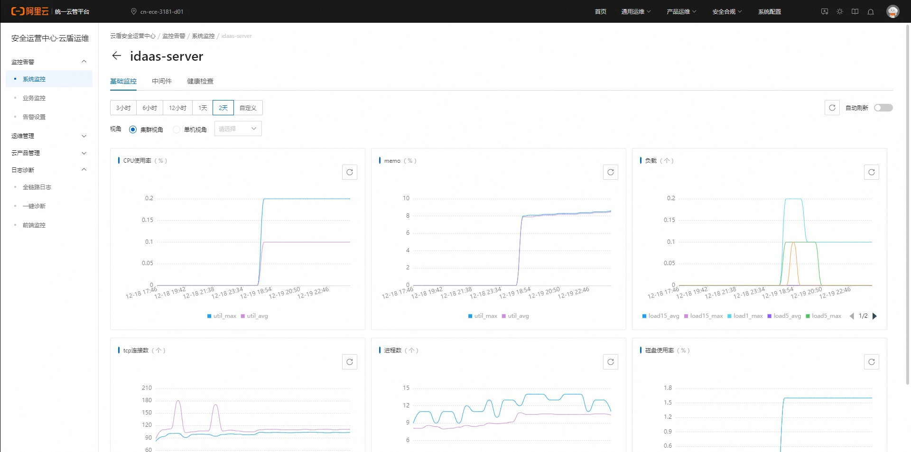
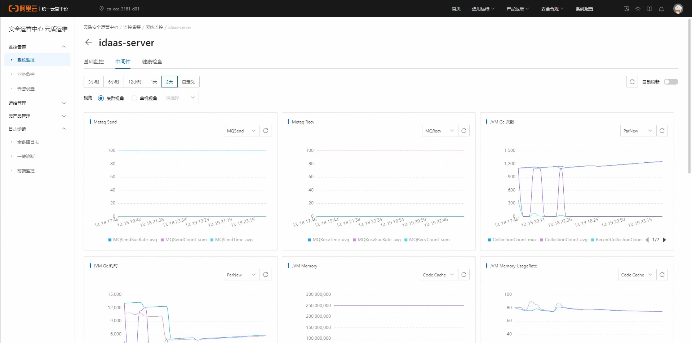
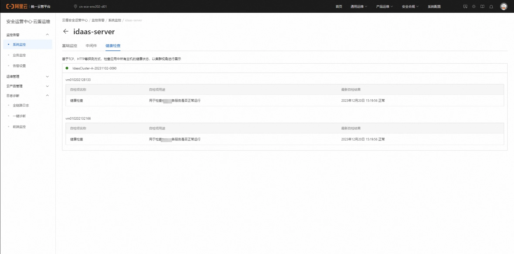

阿里云  
专有云  
应用身份服务  
运维指南  
产品版本：V3.18.6  
文档版本：20260528

**目录**

- [1.登录飞天基础运维平台](#section-1)
- [2.基础巡检](#section-2)
- [3.高级巡检](#section-3)
- [4.重启服务](#section-4)
- [5.鲁班监控](#section-5)

<a id="section-1"></a>

# 1.登录飞天基础运维平台

本文介绍如何登录飞天基础运维平台。

**前提条件**

- 已从部署人员或管理员处获取Apsara Uni-manager运维控制台的访问地址、用户名和密码。

  Apsara Uni-manager运维控制台访问地址格式为*ops*.asconsole.*intranet-domain-id*.com。

- 推荐使用Chrome浏览器。

**操作步骤**

1. 打开浏览器。

2. 在地址栏中，输入Apsara Uni-manager运维控制台的访问地址*ops*.asconsole.*intranet-domain-id*.com，按回车键。

   

   > 您可以单击页面右上角的下拉按钮来进行语言切换。
   >
   > **说明**

3. 输入正确的用户名及密码。

   > 登录Apsara Uni-manager运维控制台的用户名和密码请从部署人员或管理员处获取。
   >
   > **说明**

   首次登录Apsara Uni-manager运维控制台时，需要修改登录用户名的密码，请按照提示完成密码修改。

   为提高安全性，密码必须满足以下要求：

   - 英文大小写字母

   - 阿拉伯数字（0~9）

   - 特殊符号，包括感叹号（！）、at（@）、井号（#）、美元符号（$）、百分号（%）等

   - 密码长度10~20个字符

4. 单击**登录**。

5. 在Apsara Uni-manager运维控制台的顶部菜单栏，选择**产品运维 > 底座/云平台** > **飞天基础运维平台**。

<a id="section-2"></a>

# 2.基础巡检

应用身份服务IDaaS基础巡检内容为产品状态巡查。

1. 登录飞天基础运维平台。

2. 选择**运维 > 集群运维**。

3. 在**集群**搜索框输入**IdaasCluster**。

4. 单击集群名，进入**集群详情**页面。

5. 在**服务管理**页签的**服务**搜索框输入**idaas**，查看服务状态是否正常。

<a id="section-3"></a>

# 3.高级巡检

应用身份服务IDaaS高级巡检内容主要为服务状态和功能检查。

1. 登录IDaaS的两台物理机。

   <ol type="i">

   <li>

   登录飞天基础运维平台。

   </li>

   <li>

   单击**运维 > 集群运维**。

   </li>

   <li>

   在**集群**搜索框输入**IdaasCluster**，单击集群名进入**集群详情**页面。

   </li>

   <li>

   在**服务管理**页签中的**服务**搜索框输入**idaas**，单击**详情**，进入**服务详情**页面。

   </li>

   <li>

   在**服务角色**区域选择**idaas-server**。

   </li>

   <li>

   查看机器信息，单击**Terminal**登录IDaaS两台物理机。

   </li>

   </ol>

2. 查看服务运行状态。执行 `docker ps` ，如果有内容输出，则表示服务运行正常。

3. 查看服务日志状态。执行 `docker logs -f ${containerId/containerName}` ， `containerId` 为物理机ID， `containerName` 为物理机名称。如果有内容输出，则表示服务日志正常。

<a id="section-4"></a>

# 4.重启服务

本文介绍如何重启IDaaS服务。

**操作步骤**

1. 登录Docker容器。

   <ol type="i">

   <li>

   登录飞天基础运维平台。

   </li>

   <li>

   选择**运维**＞**集群运维**。

   </li>

   <li>

   在**集群**搜索框输入**IdaasCluster**，单击集群名进入**集群详情**页面。

   </li>

   <li>

   在**服务管理**页签中的**服务**搜索框输入**idaas**，单击**详情**，进入**服务详情**页面。

   </li>

   <li>

   在**服务角色**区域选择**idaas-server**。

   </li>

   <li>

   单击**Terminal**登录IDaaS两台机器，使用如下命令进入Docker容器。

   ```bash
   docker exec -it ${containerId/containnerName} /bin/bash 
   ```

   如果应用身份服务的ServerRole部署在Docker中可以使用Docker命令重启：

   ```bash
   docker restart ${containerId/containerName}
   ```

   其中，**containerId**为容器的ID，**containerName**为容器的名称。

   </li>

   </ol>

2. 重启**idaas-frontend**。

   用户可以关闭服务后，可以使用**docker**命令重启，也可以使用**nginx_env.sh**脚本重启。

   **idaas-frontend**的启动脚本为 `/data/public/nginx/nginx_env.sh` ，**tengine**的配置文件模板为 `/data/public/nginx/conf/nginx.conf.template` 。

3. 重启**idaas-server**。

   用户可以关闭服务后，可以使用**docker**命令重启，也可以使用**run.sh**脚本重启。

   idaas-server的启动脚本是 `/root/run.sh` ，配置文件模板是 `/data/applications/idp4/apache-tomcat/shared/idp4.properties.template` 和 `/data/applications/idp4/apache-tomcat/shared/tair-session.properties` 。

4. 重启**idaas-notify**。

   用户可以关闭服务后，可以使用**docker**命令重启，也可以使用**run.sh**脚本重启。

   **idaas-notify**的启动脚本是 `/data/applications/notify/run.sh` ，配置文件模板是 `/data/applications/notify/application.properties.template` 。

5. 重启**idaas-otpserver**。

   用户可以使用Docker命令重启，如果启动失败可以进入Docker容器以后使用脚本进行启动。

   **idaas-otpserver**的启动脚本是 `/root/otpserver/run.sh` 。

<a id="section-5"></a>

# 5.鲁班监控

通过鲁班监控平台查看服务运行情况。

**概述**

应用身份服务（IDaaS）接入了鲁班监控，可以在鲁班监控平台巡检应用身份服务的运行情况。目前鲁班监控包含应用身份服务的业务监控、系统监控以及一键诊断功能。首先需要登录**ASO**系统，进入系统“**安全运行中心云盾运维**”。



**一、业务监控**

进入 **监控告警 > 业务监控** 菜单，点击 **应用身份服务** 选项，选择 **身份认证服务** 监控



查看业务监控数据



**二、系统监控**

进入 **监控告警 > 系统监控** 菜单，点击 **引用身份服务** 选项，点击 **idaas-server** 面板



在基础监控中，可以查看服务的CPU、内存、进程、磁盘等监控信息，



中间件中，可以查看服务的JVM等信息，



健康检查中，可以查看服务运行是否正常


