阿里云  
专有云  
租户侧应用身份服务  
运维指南  
产品版本：V3.18.6  
文档版本：20251225

**目录**

- [1.IDaaS运维手册](#section-1)
    - [1.1. 部署架构](#section-1-1)
    - [1.2. 高可靠性](#section-1-2)
    - [1.3. 容灾备份](#section-1-3)
    - [1.4. 容量规划](#section-1-4)
    - [1.5. 热升级](#section-1-5)
- [2.IDaaS运维操作](#section-2)
    - [2.1. 登录飞天基础运维平台](#section-2-1)
    - [2.2. 系统监控日常巡检](#section-2-2)
    - [2.3. 获取产品的版本信息](#section-2-3)
    - [2.4. 登入服务容器](#section-2-4)
    - [2.5. 查询服务PV日志](#section-2-5)

<a id="section-1"></a>

# 1.IDaaS运维手册

<a id="section-1-1"></a>

## 1.1. 部署架构

本文主要介绍 `IDaaS` 产品的部署情况。

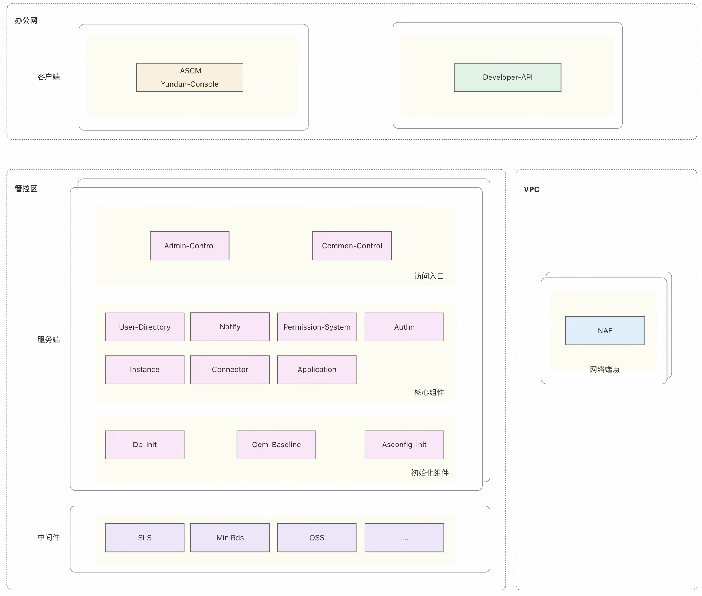

IDaaS组件清单如下：

| 序号 | 组件 | 说明 |
| --- | --- | --- |
| 1 | Admin-Control | 管控业务代理模块 |
| 2 | Common-Control | 服务业务代理模块 |
| 3 | Connector | 同步模块 |
| 4 | Permission-System | 权限模块 |
| 5 | Application | 应用模块 |
| 6 | Authn | 认证模块 |
| 7 | User-Directory | 用户目录模块 |
| 8 | Instance | 实例模块 |
| 9 | Notify | 通知模块 |
| 10 | Oem-Baseline | 网络端点模块 |
| 11 | Db-Init | 初始化基础内容模块 |
| 12 | Asconfig-Init | 初始化asconfig模块 |

<a id="section-1-2"></a>

## 1.2. 高可靠性

服务高可用保证说明。

IDaaS 服务端全部是无状态应用，通过VIP+Dubbo实现负载均衡保证服务可用性。

- 服务端本身是无状态的，部署在K8s集群中，至少有两个节点，只要有一个节点正常运行即可保证可用性。

- 数据存储在MiniRDS、SLS、OSS、Tair、MetaQ等中间件或云服务上，存储高可用性由中间件或云服务保证。

- 对外提供HTTPS协议的OpenAPI，通过DNS+VIP实现负载均衡保证可用性。

- 服务内部调用依赖Dubbo框架，由Dubbo的软负载保证可用性。

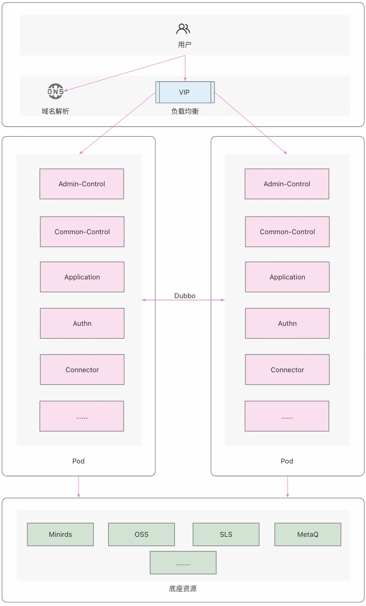

<a id="section-1-3"></a>

## 1.3. 容灾备份

业务双活架构介绍。

**同城容灾**

> **说明**
>
> 设计原则：业务双活

IDaaS 同城容灾架构遵循双活原则，数据由云存储或中间件自身保证容灾。

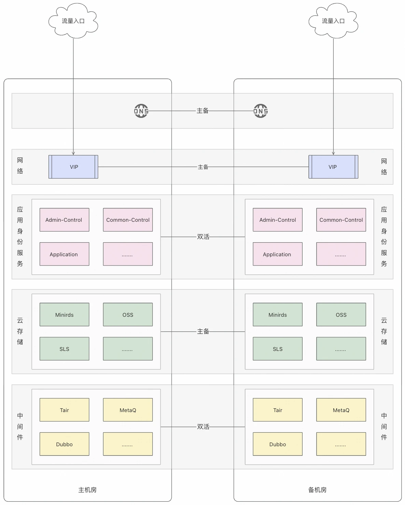

各组件同城容灾实现方案介绍：

| 序号 | 组件 | 说明 |
| --- | --- | --- |
| 1 | IDaaS | 双活部署，依赖中间件及云存储保证数据一致。 |
| 2 | DNS | 通过Anycast VIP实现主备机房流量隔离。 |
| 3 | VIP | 通过BGP路由实现主备切换。 |
| 4 | MiniRDS | 主从库binlog复制。 |
| 5 | SLS | 基于OSS备份实现数据同步。 |
| 6 | OSS | 主备机房数据同步。 |
| 7 | 中间件 | 双活部署，依赖MiniRDS保证数据一致。 |

**异地灾备**

> **说明**
>
> 设计原则：Region间相互独立

IDaaS 多Region架构遵循独立原则，单元Region对中心Region无任何依赖，数据及服务保证完全隔离。

<a id="section-1-4"></a>

## 1.4. 容量规划

本文主要说明 `IDaaS` 服务容量规划情况。

**服务资源规格定义**

| IDaaS规格 | IDaaSBaseCluster | 计算公式 |
| --- | --- | --- |
| small | 2 | UserCount &lt; 50000 |
| standard | 4 | UserCount &lt; 200000 |
| large | 6 | UserCount &lt; 500000 |

**MiniRDS资源规格定义**

| 数据库实例名称 | 数据库规格 | 磁盘(单位:G) |
| --- | --- | --- |
| idaas_eiam_user_directory | rds-mys2-large | 100 |
| idaas_eiam_permission_system | rds-mys2-large | 100 |
| idaas_eiam_as | rds-mys2-large | 100 |
| idaas_eiam_instance | rds-mys2-large | 100 |
| idaas_eiam_application | rds-mys2-large | 100 |
| idaas_eiam_connector | rds-mys2-large | 100 |
| idaas_eiam_notify | rds-mys2-large | 100 |

<a id="section-1-5"></a>

## 1.5. 热升级

IDaaS热升逻辑说明。

IDaaS 默认支持热升级，无需额外运维操作。

<a id="section-2"></a>

# 2.IDaaS运维操作

<a id="section-2-1"></a>

## 2.1. 登录飞天基础运维平台

本文介绍如何登录飞天基础运维平台。

**前提条件**

- 已从部署人员或管理员处获取Apsara Uni-manager运维控制台的访问地址、用户名和密码。

  Apsara Uni-manager运维控制台访问地址格式为*ops*.asconsole.*intranet-domain-id*.com。

- 推荐使用Chrome浏览器。

**操作步骤**

1. 打开浏览器。

2. 在地址栏中，输入Apsara Uni-manager运维控制台的访问地址*ops*.asconsole.*intranet-domain-id*.com，按回车键。

   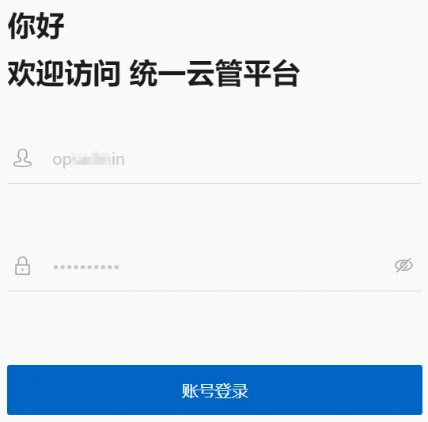

   > **说明**
   >
   > 您可以单击页面右上角的下拉按钮来进行语言切换。

3. 输入正确的用户名及密码。

   > **说明**
   >
   > 登录Apsara Uni-manager运维控制台的用户名和密码请从部署人员或管理员处获取。

   首次登录Apsara Uni-manager运维控制台时，需要修改登录用户名的密码，请按照提示完成密码修改。

   为提高安全性，密码必须满足以下要求：

   - 英文大小写字母

   - 阿拉伯数字（0~9）

   - 特殊符号，包括感叹号（！）、at（@）、井号（#）、美元符号（$）、百分号（%）等

   - 密码长度10~20个字符

4. 单击**登录**。

5. 在Apsara Uni-manager运维控制台的顶部菜单栏，选择**平台运维 > 飞天基础运维平台 > 资源管理**。

<a id="section-2-2"></a>

## 2.2. 系统监控日常巡检

本文主要介绍如何查看IDaaS服务系统监控。

**前提条件**

- 已从部署人员或管理员处获取Apsara Uni-manager运维控制台的访问地址、用户名和密码。

  Apsara Uni-manager运维控制台访问地址格式为*ops*.asconsole.*intranet-domain-id*.com。

- 推荐使用Chrome浏览器。

  1. **系统监控日常巡检**

- 你可以通过云盾运维中心，查看IDaaS服务下各个模块的系统监控。

  2. **登录安全运维中心**

- 首先，你需要登录到ASO平台。进入**产品运维 > 安全运维 > 云盾运维中心** 。

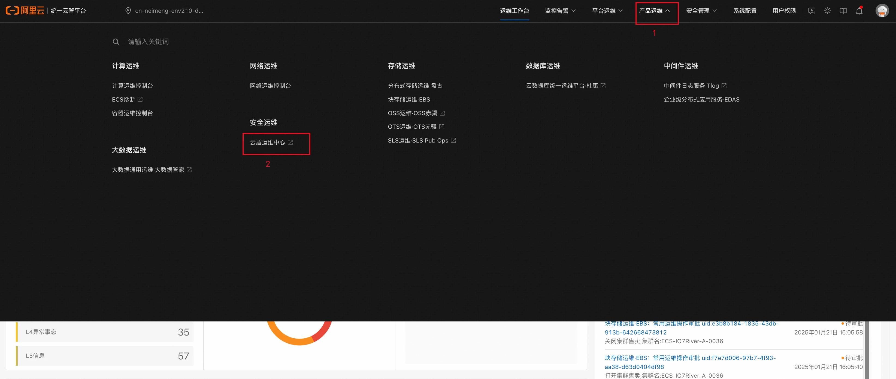

3. **查询IDaaS服务系统监控**

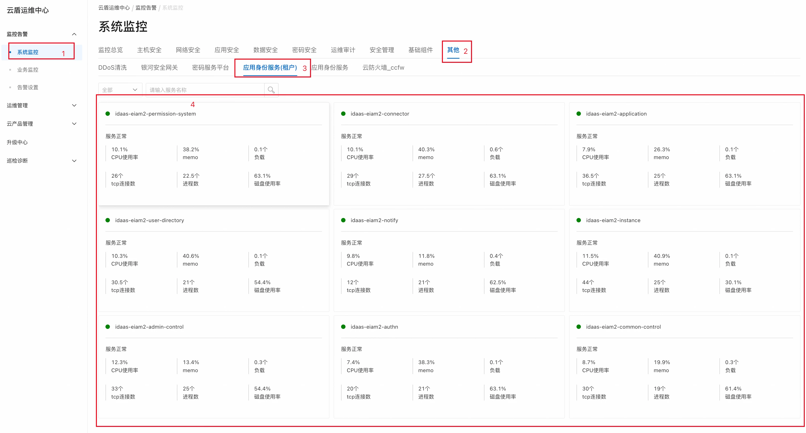

4. **点击各个模块,查询监控详情**

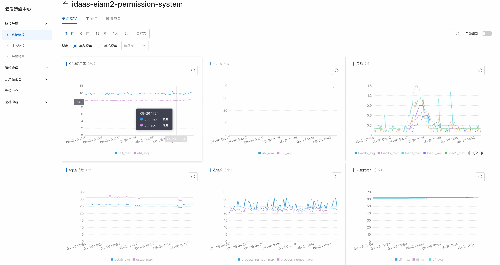

<a id="section-2-3"></a>

## 2.3. 获取产品的版本信息

本文介绍如何查询IDaaS服务版本信息。

**前提条件**

- 已从部署人员或管理员处获取Apsara Uni-manager运维控制台的访问地址、用户名和密码。

  Apsara Uni-manager运维控制台访问地址格式为*ops*.asconsole.*intranet-domain-id*.com。

- 推荐使用Chrome浏览器。

  1. **登录飞天基础运维平台（天基），在产品集群运维页面下查询到IDaaS产品**

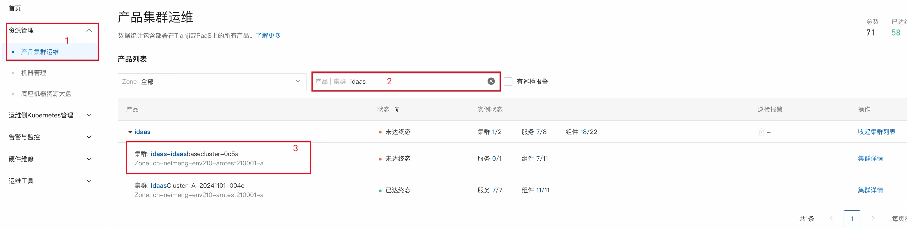

2. **在集群详情页，在终态配置页签下全局搜索product-build-id关键词，即可**

**找到对应的版本信息**

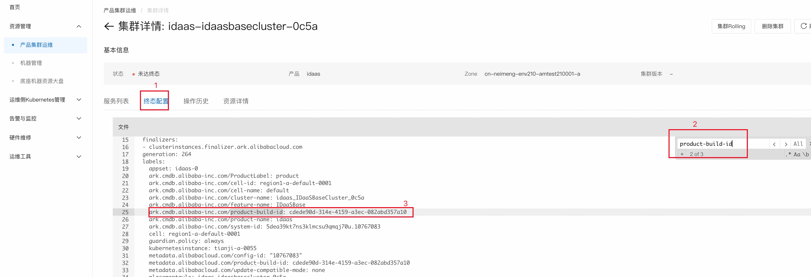

<a id="section-2-4"></a>

## 2.4. 登入服务容器

本文介绍如何登入  `IDaaS`  服务容器。

1. **查找到paas的master节点机器并登录**

常规情况下ops机器即为master，可登录机器执行以下命令来确认

```bash
kubectl get pod -nidaas
```

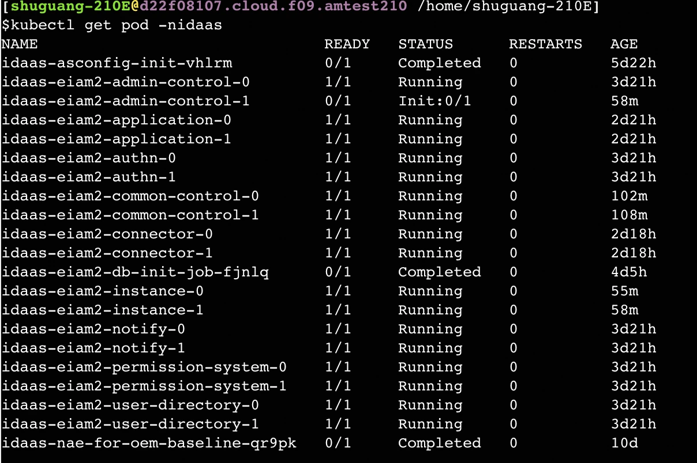

**PS: 如无以上内容输出，请确认是否为OPS机器。若非OPS机器，请参考以下内容：**


可通过 飞天基础运维平台（天基） 中运维侧Kubernetes管理中的节点列表，查询到角色为master的机器，如下图所示：

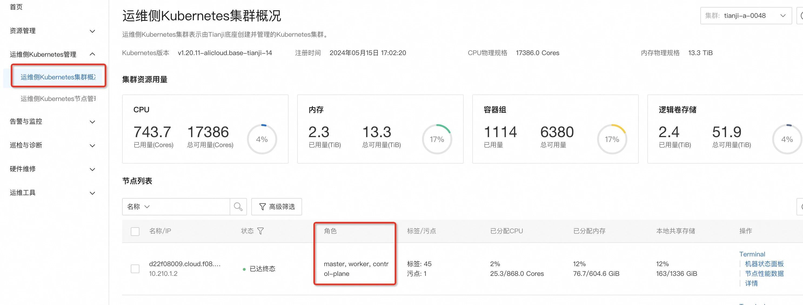

2. **确认目标Pod Id**

```bash
kubectl get pod -nidaas|grep <⽬标Pod>
```


3. **执行登录Pod命令**

```bash
kubectl exec -it <⽬标PodId> -nidaas -- bash
```

其中<目标PodId> 即为第二步中查询到的 idaas-eiam2-admin-control-0 或者 idaas-eiam2-authn-0

预期结果

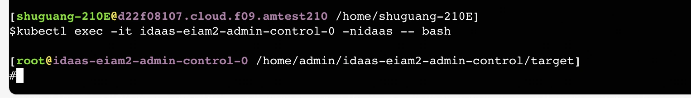

<a id="section-2-5"></a>

## 2.5. 查询服务PV日志

若因POD频繁重启导致无法进Pod查看日志，可通过以下方法进行查询。

1. **查找到paas的master节点机器并登录**

常规情况下ops机器即为master，可登录机器执行以下命令来确认

```bash
kubectl get pod -nidaas
```


**PS: 如无以上内容输出**：

可通过飞天基础运维平台（天基）中运维侧Kubernetes管理中的节点列表，查询到角色为master的机器


2. **查看POD所属STS的PV挂载**

举例：查询idaas-eiam2-admin-control

```bash
kubectl describe sts <Chart名称> -nidaas
```

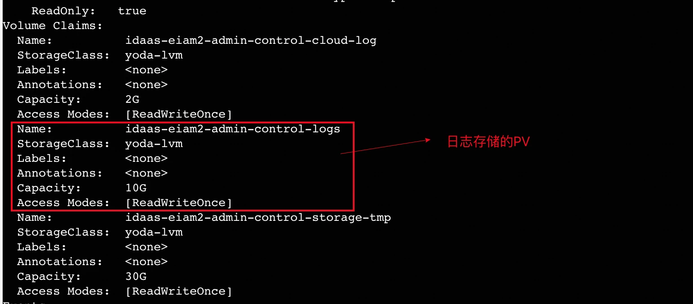

3. **查看STS创建的PV**

举例：查询idaas-eiam2-admin-control-logs

```bash
kubectl get pv | grep <写入指定查询的PV名称>
```

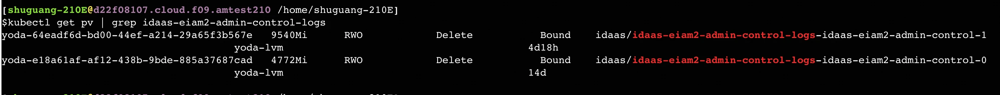

4. **查看对应PV挂载的物理机节点**

举例查询：yoda-64eadf6d-bd00-44ef-a214-29a65f3b567e

```bash
kubectl describe pv <写入PV ID>
```

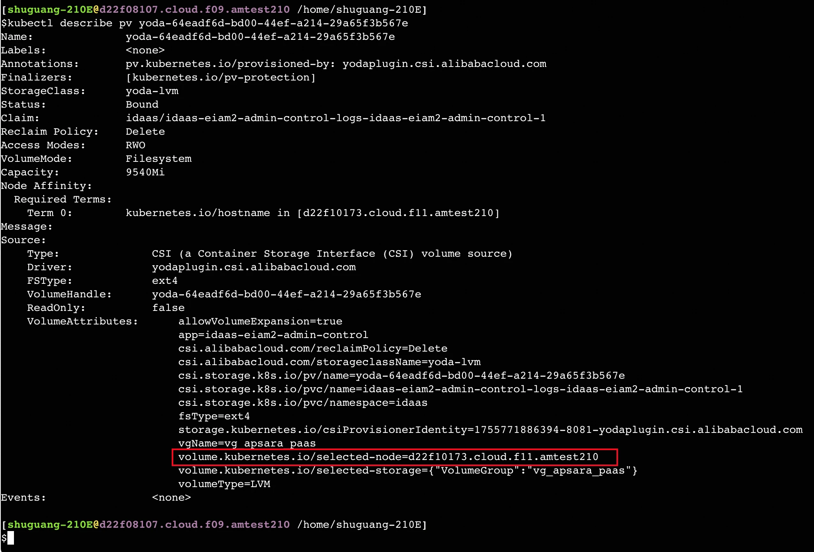

5. **通过** **`ssh`** **命令到对应的物理机器并且查看挂载目录**

举例：ssh d22f10173.cloud.f11.amtest210 （该机器为测试环境机器名称）

```bash
ssh <机器名称>
```

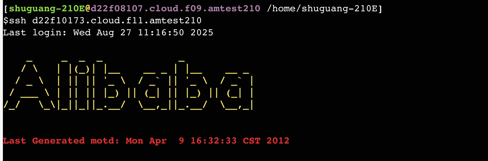

6. **查询日志所在磁盘目录**

举例查询：yoda-64eadf6d-bd00-44ef-a214-29a65f3b567e

```text
lsblk | grep '<写入PV ID>'
```

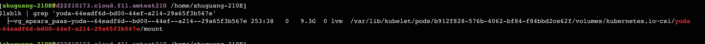

7. **进入该目录下，查询日志**

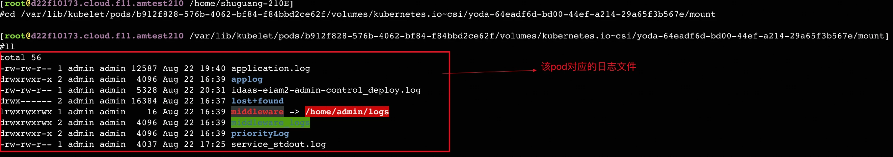
