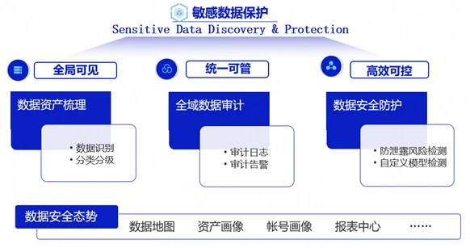
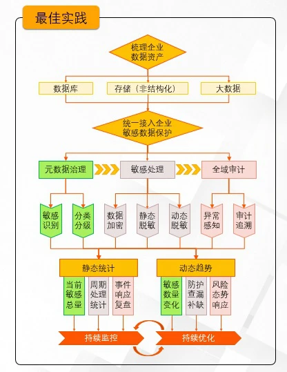
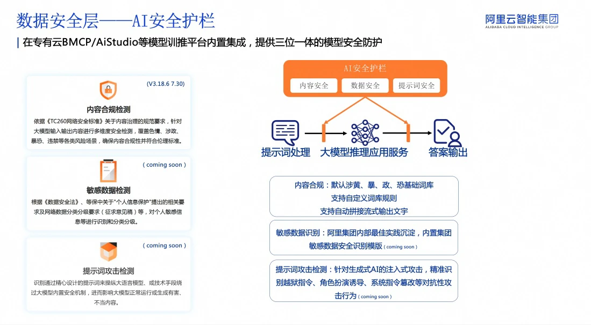

阿里云  
专有云  
敏感数据保护  
产品简介  
产品版本：V3.18.6  
文档版本：20251225

**目录**

- [1.什么是敏感数据保护](#section-1)
- [2.功能特性](#section-2)
- [3.产品优势](#section-3)
- [4.产品架构](#section-4)
- [5.应用场景](#section-5)
- [6.使用限制](#section-6)
- [7.基本概念](#section-7)

# 1.什么是敏感数据保护

敏感数据保护（Sensitive Data Discovery and Protection，以下简称SDDP）为阿里云第一款自主研发的数据安全可视化产品，在帮助客户实现等保2.0二级有关 “安全审计”与三级有关“个人信息保护”的合规要求的同时，并满足《数据安全法》中提出的有关要求，也充分利用阿里巴巴大数据分析能力以及人工智能相关技术，通过智能化的手段识别敏感数据，基于业务需求实现智能分类分级，并在此基础上通过敏感数据脱敏进行保护、结合数据异常行为检测和智能安全审计，做到数据安全可见、可控和合规。同时SDDP充分利用云原生优势，原生整合云上各类数据源，提供一体化的数据保护和防御机制。

敏感数据保护的整体产品核心如上图所示，说明如下：

- **全局可见**：通过数据自动识别与分类分级、数据流转可视等，实现云环境内数据安全的整体透明度。

- **统一可管**：通过覆盖数据产生、更新、使用和销毁的全链路数据行为日志，实现对云上全域数据资产的安全审计。

- **高效可控**：通过异常事件行为检测等多种管控手段，实现对数据的原生安全防护。

# 2.功能特性

**一级特性**

**二级特性**

**三级特性**

**特性描述**

授权账密管

实现可托管RDS、PolarDB-X（原DRDS）产品的账号密码。

理

资产中心

实现一键发现并接入云上数据资产，支持范围：OSS、RDS、

数据资产授

PloarDB-X（原DRDS）、TableStore、MaxCompute、ADB-

权

Mysql、ADB-PG、OceanBase、PolarDB本地盘版、PloarDB-X2.0。支持免输入密码一键授权数据识别、Ocr权限、数据审计权限。

数据资产

按照资产类型和数据域进行分类，提供针对云上数据源的资产地图能力，通过各维度的安全数据分析与汇总。目前针对数据资产的风险评估，基于数据流转、操作行为、权限配置、安全审计、访问情况和敏感

数据资产地

数据分布六个维度打分，最终进行整体分析和统计，得出数据风险值，

数据地图

图

快速定位高风险目标。

数据管理

数据域配置

支持管理员以实例为单位对所有数据资产进行分组管理。

提供对结构化数据、半结构化数据、非结构化数据进行敏感数据的自动

敏感数据自

识别能力，通过样本扫描、特征萃取、特征对比和文件聚类等算法，实

数据识别

动识别

现116种敏感数据的精准识别。支持解析169种文件类型（包括文本、办公类文档、压缩嵌套文件），支持OCR技术识别图片敏感数据。

针对不同敏感类型的数据资产，提供了全局搜索能力。通过搜索功能，

敏感数据查

用户能够基于数据源、敏感等级和敏感信息维度，进行数据资产的检索

数据检索

询

和展示，精确定位敏感数据在数据资产中的保存位置，同时支持对敏感数据识别结果进行手动订正。

内置“阿里巴巴及蚂蚁集团数据安全分类分级模板”、“金融分类分级模

分类分级模

板”、“内置能源分类分级模板”，用户可基于内置模板通过复制或修

板

改，来定制属于自己的分类分级模板。

级别配置

支持敏感等级的增加、删除、修改。

数据梳理

内置116条规则，包括通用敏感类、密钥敏感类、敏感图片类、位置敏

识别配置

识别模型

感类、个人敏感信息、设备敏感信息、企业敏感信息等。支持自定义的识别规则。

支持对分类分级的自定义配置，并在识别结果中进行统一的展示，实现

识别特征

对全域数据资产的整体识别、分类分级的统计；提供基于关键词、正则表达式、数据表列名的敏感数据识别能力。

识别任务监

识别任务可视化，及时发现异常识别任务。可配置是否自动扫描或手动

控

发起扫描任务。

任务管理

订正记录

展示所有手动订正记录，并支持手工订正和恢复能力。

导出任务

支持对敏感数据识别后分类分级结果的导出能力。

该功能实现数据资产的安全审计功能，提供了包括审计规则命中结果、审计规则检测的资产类型、命中规则的操作类型和操作账号等信息，覆盖资产数据产生、更新和使用等全链路的日志数据。支持对审计事件总

审计概览

审计概览

数、告警总数和SQL操作趋势的统计和展示，以及对最近发生的异常告警的统计和展示；以及提供了对于实例和Bucket维度的统计，包括对实例总数/表总数/列总数，敏感实例总数/敏感表总数/敏感列总数的统计，以及最敏感实例的TOP统计等。

支持RDS、PolarDB本地盘版会话信息展示和搜索，包括资产的账号、

会话日志

客户端IP、登录时间、会话时间、会话状态、操作内容等。

审计日志

该功能展示了资产的实例、库、账号、源IP地址、返回行数、时间等日志信息，用户可通过搜索功能定位和查看原始日志及其详细信息。支持

原始日志

的数据资产类型：OSS、RDS（Mysql）、MaxCompute、PolarDB本地盘版。

安全审计

展示了数据资产命中审计规则的结果、相关操作类型和操作账号等日志信息，用户可以通过搜索功能定位查看审计日志及其详细信息。通过选

异常审计告

择事件详情，可查看审计日志的具体命中内容，包括操作人账号、资产

审计告警

警

类型、数据扫描执行时长、抓取日志时间、数据库名称、源IP、影响行数、资产、表名称、危险等级、操作类型、命中规则名称等信息，提供给第三方进行审查。

内置数据库、OSS、MaxCompute审计规则，数据库审计规则包含异常操作、数据泄漏、漏洞攻击、SQL注入等方面；OSS审计规则包含

内置规则

SQL注入、风险操作等；MaxCompute审计支持异常操作、漏洞攻击、SQL注入规则。支持规则状态关闭能力。

审计配置

支持自定义新增、编辑、删除审计规则，对象包含资产名、访问者、客

自定义规则

户端IP、操作类型、操作量、执行时长等维度。

通过集中事件处理控制台，对预置与自定义的异常事件进行集中化的处理，提供基于部门账号、事件类型、责任账号、所处状态、告警时间段

风险告警

风险告警

等多个维度的事件告警和检索。在事件处理过程中，支持处理过程和结果的输入，并且支持事件产出详情核查。针对异常偏差和潜在风险进行详细描述，同时给予用户异常事件处置建议。

支持内置与自定义检测模型。对于内置规则，支持集中化的规则启用与

检测模型

检测模型

修改相关参数告警阈值配置；对于自定义规则，支持用户根据实际业务风险场景进行定制化的异常事件规则配置。

SDDP支持RDS账号、RAM账号、主账号的总用户数、休眠用户数、活

用户账号分

跃用户数、高风险用户数的周环比统计和账号量统计，同时支持用户基

析

本信息展示以及在流转、行为、配置、审计和访问维度上的分数变化统计。

风险治理

支持根据部门级别进行统计，包括部门名称、总人数、平台账号总数、

数据权限

权限概览

云账号总数、RAM子账号总数、权限泄漏风险总数、风险确认权限泄漏

分析

风险、昨日新增权限异常数和确认违例最多权限异常类型。

SDDP支持根据部门名称检索相关权限所属人员，支持模糊查询。SDDP还支持账号级别的权限集中展示，实现层次化、可视化的部门与

权限检索

人员对应关系展示。同时支持根据不同资产类别（MaxCompute项目/表/包、RDS库/表、DRDS库/表、OTS实例/表、OSS文件桶）实现结果随机筛选。

数据安全风险评估系统基于对《中华人民共和国网络安全法》、《中华人民共和国数据安全法》、《中华人民共和国个人信息保护法》、《GB/T 37988数据安全能力成熟度模型》和各行业、地区的标准及规

数据安全风

风险评估

范的解读，可从数据安全合规性风险、数据安全技术风险、数据安全管

险评估

理风险三个方面对数据安全现状进行全方位、多角度的评估，帮助用户摸清数据安全风险现状、识别风险等级及危害情况，形成数据数据安全风险评估报告。

对资产进行全面分析，通过资产管理和安全保障、异常和审计事件、敏

综合分析报

分析报告

感数据访问及规则命中和SQL语句执行情况四个角度对数据库进行综合

告

分析。

等保分析报

对资产有危害性的操作分析报表，提供数据库审计、入侵防范与监控、

报表中心

告

恶意代码监控、安全审计监控分析。

合规报告

帮助管理人员、数据安全负责人、数据安全管理员掌握数据整体情况，

数据安全法

增长趋势，及时发现各种异常和违规行为。会从数据态势、安全审查、

报告

数据保护、安全事件、风险评估五个维度快速分析定位和响应，落实数据安全保护责任。

支持第三方数据安全产品获取云上数据资产信息及指定数据资产操作日

开放能力

开放能力

开放能力

志，完成数据安全审计和风险检测。已完成兼容性适配的厂商：安恒、安华金和、闪捷信息。

实时检测AI交互过程中可能泄露的隐私数据与敏感信息，支持涉及个人隐私、企业隐私等敏感内容的识别，防范训练数据泄露与对话信息外溢

敏感内容

敏感内容识

风险。识别内容包括但不限于个人基本情况、个人资产、个人借贷、个

识别

别

人征信、个人房产、个人医疗、车辆、金融账户、手机号码、邮箱、位置、证件、密钥鉴别、设备识别码等。

敏感内容

敏感内容识

支持对长文本内容识别结果的统计, 包括识别的敏感内容类型、敏感等

敏感内容

识别结果

别结果统计

级以及相关分类识别的数量、处置建议。

实时检测

统计

敏感内容

敏感内容脱

支持可配置对输出的敏感内容进行脱敏处理。

脱敏

敏

# 3.产品优势

敏感数据保护（SDDP）是业界第一款同时实现结构化数据、半结构化和非结构化数据同标准识别的云端数据安全产品，也是业界第一款通过统一的平台集成非结构化数据，结构化数据库，大数据场景的云端数据安全风险检测和审计产品，在数据安全领域，敏感数据保护（SDDP）具备以下四大功能优势：

**合规性**

满足等保2.0二级有关“安全审计”与三级有关“个人信息保护”的合规要求以及《数据安全法》中提出的有关要求。感知危险操作，及时告警，保留全日志；多种预置合规方案与报告，能更清晰、更有条例的展示网络中符合等保相关规定的安全措施，为用户的网络通过等保测评助力。

**云原生**

充分利用云计算服务优势，为云上数据源提供一体化数据保护和防御机制。提供无代理Agentless模式，开箱即用，秒级接入。相较于传统软件化部署方式，服务架构更为健壮，可用性更高，成本也更低，同时系统自身安全性也更好。

**智能化**

运用大数据和机器学习能力，通过智能化的算法，对敏感数据和高风险活动，诸如数据异常访问和潜在的泄漏风险进行有效识别和监控，并提供修复建议。

**可视化**

提供敏感数据识别结果可视化能力，让企业数据安全现状一目了然。提供动态可视化的数据资产展示与检索，并支持一键检索海量数据中的敏感数据。

# 4.产品架构

**数据资产洞察**

- **数据源授权管理**：实现大数据场景下各类数据产品的统一授权管理，以对全域数据进行集中化的数据安全治理与风险感知能力。

- **数据域**：支持企业管理员基于业务属性、组织架构、数据特征等维度对数据资产进行划分。管理员将具有相同特征的数据资产划分到同一个数据域中，从而高效管理数据资产及资产中的敏感数据。

- **数据资产地图**：支持资产维度的实例相关信息统计、敏感数据分布情况、各类操作与数据行为的汇总分析，供数据安全管理人员集中统计使用。

**数据梳理**

- **自动识别**：通过机器学习模型，深度学习神经网络，OCR识别等方式，精准识别大数据环境内的敏感数据，并提供根据业务规则自定义敏感数据的能力。

- **增量检测**：在完成租户授权后，自动扫描和发现授权范围内新增的结构化RDS/PolarDB本地盘版/ADB数据库、表、列、大数据MaxCompute、非结构化OSS对象存储、OTS表格存储等不同类型的数据信息，对新增、变更的数据进行自动检测。

- **分类分级**：针对敏感数据识别结果，实现基于数据内容的数据分类和敏感程度的分级，并与内外部数据保护系统实现高效联动；数据的敏感等级不但可以支持自定义，同时还可支持对数据分类分级的结果进行手动订正。

- **结果检索**：通过对全量敏感数据识别结果的汇总，提供反向检索能力，帮助发现最关心的敏感数据分布情况，以便进行针对性的防护。

**安全审计**

- **智能安全审计**：汇聚各类云上数据源原始日志，通过内置及自定义的审计规则，细颗粒度解析数据操作行为，记录云上数据安全威胁，提供全方位的诊断、维护、可追溯及合规能力。

- **审计告警**：支持对低、中、高危操作进行告警，除时间、账号、实例等搜索项外，还支持按照操作类型、SQL命令以及影响的行数等信息进行筛选和搜索日志分析结果；支持通过邮件方式发送告警通知，支持配置同一规则的告警事件每日发送的通知数上限。

**风险治理**

- **数据泄露检测与防护**：通过智能化检测模型分析内外账号对敏感文件的访问行为，实现对敏感数据访问的异常检测，同时为数据安全管理团队提供相关告警。

- **异常行为检测**：集中归集各类异常告警事件，实现高效处理和应急响应。支持各租户事件隔离，通过时序分析技术还原责任主体行为基线，动态展示历史基线轨迹，有效提升应急响应能力。处理结果自动回流机器学习样本库，让检测结果日趋准确。支持各款产品日志分析，提供统一的配置异常、行为异常和流转异常事件的检测并提供处理建议。

- **平台账号权限统计**：实现大数据场景下各类数据产品的权限统一展示，通过解析云平台各类角色，实现多层级、多租户的账号权限映射关系分析，以及基于“数据、人、权限”三要素的统一查询能力。

- **用户账号行为分析**：支持对实例账号和RAM账号进行数量和行为统计，发现休眠及高风险用户等等，进行打分和相关风险指标统计。

**报表中心**

**数据安全报告**：通过综合分析报告、等保参考分析和数据安全法报告展示用户数据库资产的审计情况和安全风险的分析结果。发送月度数据安全防护态势，包括数据资产地图统计，异常告警统计，异常事件清单等信息。

**敏感内容实时检测**

实时检测AI交互过程中可能泄露的隐私数据与敏感信息，支持涉及个人隐私、企业隐私等敏感内容的识别，防范训练数据泄露与对话信息外溢风险。

# 5.应用场景

**场景一：数据安全治理**

通过了解企业核心数据分布，自动整合分类分级结果，以掌握核心数据防护态势。

利用敏感数据保护，在单平台实现云上全域数据治理覆盖；自动化“识别-分类-分级”，可持续的数据安全治理；治理结果通过API方式与业务系统集成。

**场景二：敏感数据使用与防泄漏**

在应用中对数据进行脱敏，以及在数据存储和数据分享过程中进行脱敏。

利用敏感数据保护，实现不同环境间数据的自动化批量脱敏，同时SDDP提供了20种以上算法，满足不同数据类型的匿名化、去标识化需求。

**场景三：数据安全态势感知**

全域数据安全审计，云端数据防泄漏，数据风险告警与应急响应。

利用敏感数据保护，实现单平台的统一全域数据风险监控；与数据治理结果联动，重点关注企业敏感数据的使用情况。

**场景四：数据安全防护可持续改进**

掌握重要数据变化趋势，评估整体数据安全风险，规划后续数据安全工作。

**场景五：AI访问输入输出敏感内容实时检测**

作为AI安全护栏整体内容检测的引擎能力，与内容合规检测、提示词攻击检测构成了大模型交互时输入输出内容检测能力。

# 6.使用限制

- 现支持的数据类型有：

  - 结构化数据存储：

    - 数据库类数据源：RDS、PolarDB本地盘版（PolarDB-O&PolarDB-M）、PolarDB-X、PolarDB-X 2.0、ADB-PG、ADB-Mysql、OceanBase、ECS自建数据库。

    - 大数据分析类数据源：MaxCompute。

  - 非结构化数据存储：OSS/TableStore文件。

- 敏感内容实时检测目前仅支持文本内容检测.

# 7.基本概念

- **敏感数据**

  指如果泄露可能对个人或组织造成伤害或构成风险的任何信息。

- **数据资产**

  由企业拥有或者控制的，能够为企业带来未来经济利益的，以物理或电子的方式记录的数据资源，如文件资料、电子数据等。

- **数据安全审计**

  智能解析数据库及大数据的通信流量，细粒度审计数据访问行为。通过对数据源全量行为的审计溯源、进行危险攻击的实时告警、风险语句的智能预警。

- **数据防泄漏**

  通过一定的技术和管理，防止组织内敏感数据或信息资产，违反安全约束而丧失组织控制、破坏数据机密性的策略和措施。 数据防泄露技术是防止数据泄露的技术措施和方法，是保护数据机密性、完整性、可用性的重要技术。

- **数据分类分级**

  以数据分类为基础，采用规范、明确的方法区分数据的重要性和敏感度差异，并确定数据级别。数据分级有助于行业机构根据数据不同级别，确定数据在其生命周期的各个环节应采取的数据安全防护策略和管控措施，进而提高机构的数据管理和安全防护水平，确保数据的完整性、保密性和可用性。

- **数据地图**

  在企业数据资产管理过程中，通过可视化的手段，使用多层次的图形化展示方法，将企业内各类数据所在位置集中在“数据地图”模块。

- **数据识别**

  查找要捕获的字段，然后将其转换为基于字符的数据的阶段；通过识别获取的数据存储在文档组合件阶段中设置的页面数据文件中。

- **数据检索**

  在一个大量的数据集合中，使用特定的查询语言或搜索技术，按照一定的条件和要求来搜索、筛选出符合要求的数据的过程。其目的是从大量数据中找到所需的数据，并对这些数据进行分析、处理或者展示。

- **审计告警**

  是一种自动化安全监测机制，它根据用户设定的参数和规则，实时监测与识别云上的异常事件，并通过多种方式向相关人员发送告警通知，以便及时采取适当的响应措施。
