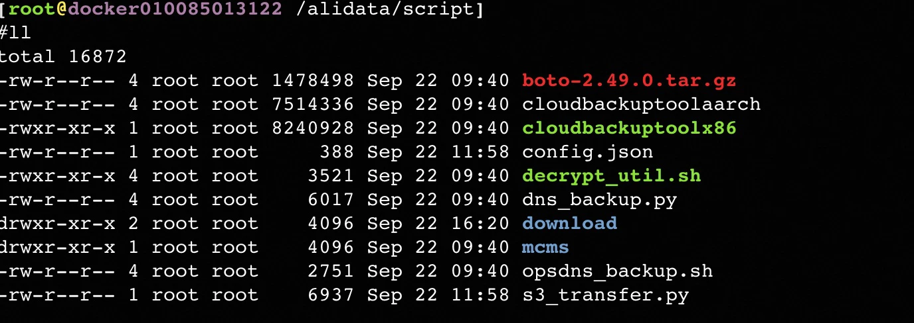
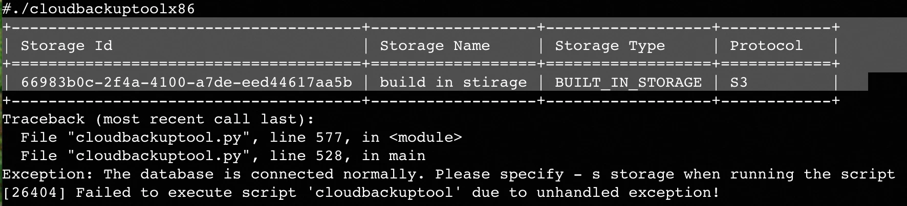
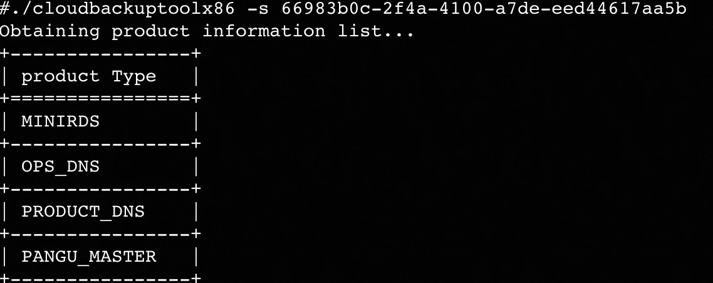
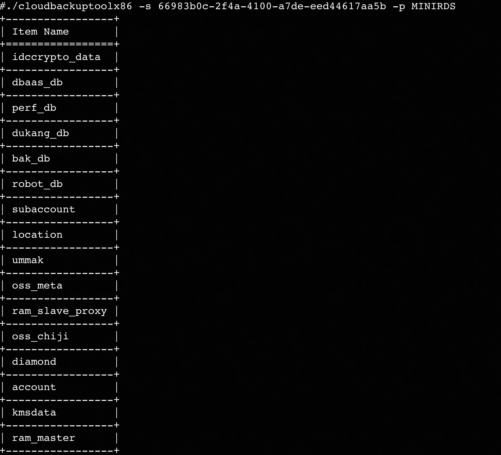
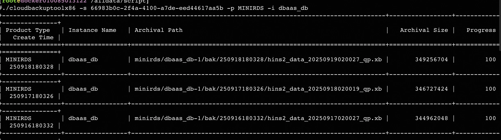
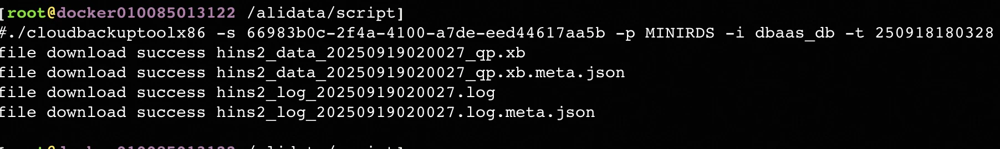
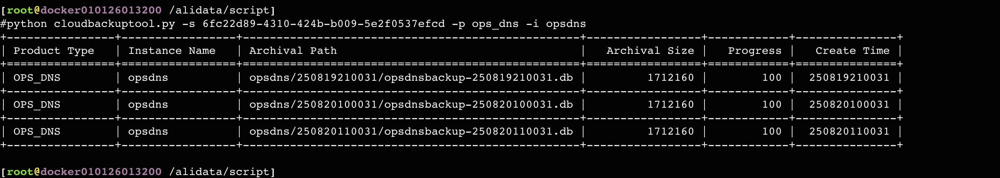
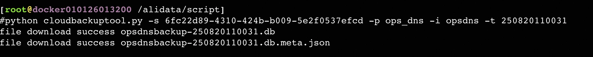
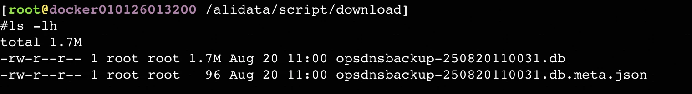

阿里云  
专有云  
灾备管理中心  
云平台备份运维指南  
产品版本：V3.18.6  
文档版本：20251225

**目录**

- [1.目的](#section-1)
- [2.常见运维处理](#section-2)
    - [2.1. 备份数据下载](#section-2-1)

<a id="section-1"></a>

# 1.目的

指导维护人员对云平台备份恢复进行预防维护，确保其能够稳定运行。维护人员可以根据本手册的指导，处理维护过程中发现的问题。如果根据本手册无法解决系统问题，请寻求阿里云工程师的技术支持。

<a id="section-2"></a>

# 2.常见运维处理

<a id="section-2-1"></a>

## 2.1. 备份数据下载

为了确保在任意的情况下（不依赖云平台）都可以管理和下载备份数据，我们会提供通用的工具方便使用者获取到当前的备份存储中的所有备份文件。

**背景信息**

物理机版本： `/cloud/app/ftpserver/FTPMaster#/ftpserver-`

```text
agent/current/script/cloudbackuptool 
```

容器版本： `/alidata/script/cloudbackuptool`

目录结构：

- cloudbackuptool->下载脚本可执行程序。

- config.json->可执行程序用到的配置文件，包含数据库信息以及存储配置信息。

进入FTP服务所在的物理机/容器指定路径下获取cloudbackuptool 文件。



config.json: 配置文件默认初始化ftp配置过的存储信息

```json
{
  "storage": {
    "storageType": "",     #存储类型 OSS/S3
    "accessKeyId": "",     #存储的ak
    "accessKeySecret": "", #存储的sk
    "ossEndpoint": "",     #存储的endpoint
    "port": 9600,          
    "ossBucket": "",       #存储的bucket
    "ossRegion": "",       #存储的region
    "useSsl" : false
  }
}
```

```text
cloudbackuptool
options:          
        -s storage id            指定存储     
        -p product name      指定产品
        -i instance name         指定实例
        -t create time           指定下载的备份集时间   
        -c config_file           指定config.json⽂件路径
```

**ⅰ. 列出备份集信息**

根据存储池为维度分别列出信息，功能列表如下：

- 列出当前所有的存储信息

- 根据指定的存储信息获取当前存储备份的所有产品列表

- 根据指定的产品信息获取当前存储备份的实例列表信息

- 根据指定的备份集创建时间下载对应的备份集数据

```text
./cloudbackuptool   #执⾏该命令获取当前环境中所有的存储信息
./cloudbackuptool -s 66983b0c-2f4a-4100-a7de-eed44617aa5b  #根据指定的存储信息获取当前存储备
份的所有产品列表
./cloudbackuptool -s 66983b0c-2f4a-4100-a7de-eed44617aa5b -p MINIRDS #根据指定的产品信息获
取当前存储备份的实例列表信息
./cloudbackuptool -s 66983b0c-2f4a-4100-a7de-eed44617aa5b -p MINIRDS -i dbaas_db #根据指
定的实例信息获取当前实例可下载的备份集列表
./cloudbackuptool -s 66983b0c-2f4a-4100-a7de-eed44617aa5b -p MINIRDS -i dbaas_db -t 250918180328 #根据指定的备份集创建时间下载对应的备份集信息
```

> **重要**
>
> 当./cloudbackuptool连接失败的时候，需要手动修改config.json内容，配置存储相关的信息，执行
>
> ./cloudbackuptool -c config.json 连接对应的存储。
>
> 对应的命令即为
>
> ./cloudbackuptool -c config.json #根据指定的存储信息获取当前存储备份的所有产品列表
>
> ./cloudbackuptool -c config.json -p MINIRDS #根据指定的产品信息获取当前存储备份的实例列表信息
>
> ./cloudbackuptool -c config.json -p MINIRDS -i dbaas_db #根据指定的实例信息获取当前实例可下载的备份集列表
>
> ./cloudbackuptool -c config.json -p MINIRDS -i dbaas_db -t 250918180328 #根据指定的备份集创建时间下载对应的备份集信息











**以opsdns为例**

备份记录下载脚本cloudbackuptool：

- 查看opsdns的备份记录cloudbackuptool -s 6fc22d89-4310-424b-b009-5e2f0537efcd -p ops_dns -i opsdns

  

- 下载最新的备份记录cloudbackuptool -s 6fc22d89-4310-424b-b009-5e2f0537efcd -p ops_dns -i opsdns -t 250820110031

  

- 下载成功后备份记录位于/alidata/script/download目录下，用于后续的数据恢复：

  

**以pangu为例**

**操作步骤**

1. 进入FTP服务所在的物理机/容器。

2. 执行以下命令，进入脚本存放路径。

   物理机路径： `cd /cloud/app/ftpserver/FTPMaster#/ftpserver-agent/current/script/`

   容器路径： `cd /alidata/script/cloudbackuptool`

3. 执行以下命令，获取可选的存储列表。

   ```text
   ./cloudbackuptool
   PyInstaller/loader/pyimod03_importers.py:495: CryptographyDeprecationWarning: Python 
   3.6 is no longer supported by the Python core team. Therefore, support for it is deprecated in cryptography. The next release of cryptography will remove support for Python 3.6.
   +--------------------------------------+------------------+------------------+---------
   -+
   | Storage Id                           | Storage Name     | Storage Type     | 
   Protocol   |
   +======================================+==================+==================+=========
   =+
   | aa1da887-7d4c-4e00-a7e8-1a85cc9c8489 | Built in storage | BUILT_IN_STORAGE | S3    
   |
   +--------------------------------------+------------------+------------------+---------
   -+
   | b9eba295-c94c-420d-a1cd-cdc731831a30 | oss-vault        | CUSTOM_STORAGE   | OSS   
   |
   +--------------------------------------+------------------+------------------+---------
   -+
   Traceback (most recent call last):
     File "cloudbackuptool.py", line 647, in <module>
     File "cloudbackuptool.py", line 596, in main
   Exception: The database is connected normally. Please specify - s storage when running the script
   [14556] Failed to execute script 'cloudbackuptool' due to unhandled exception!
   ```

4. 执行以下命令，添加存储参数获取备份的产品列表 -s {Storage Id}，对应上一步的存储ID。

   ```text
   ./cloudbackuptool -s {Storage Id}
   PyInstaller/loader/pyimod03_importers.py:495: CryptographyDeprecationWarning: Python 
   3.6 is no longer supported by the Python core team. Therefore, support for it is deprecated in cryptography. The next release of cryptography will remove support for Python 3.6.
   Obtaining product information list...
   +----------------+
   | product Type   |
   +================+
   | PANGU_MASTER   |
   +----------------+
   | MINIRDS        |
   +----------------+
   | OPS_DNS        |
   +----------------+
   | PRODUCT_DNS    |
   +----------------+
   | BUCKET         |
   ```

5. 执行以下命令，选择要查看的产品 -p {product}，对应上一步的product Type。

   ```text
   ./cloudbackuptool -s aa1da887-7d4c-4e00-a7e8-1a85cc9c8489 -p {product} 
   PyInstaller/loader/pyimod03_importers.py:495: CryptographyDeprecationWarning: Python 
   3.6 is no longer supported by the Python core team. Therefore, support for it is deprecated in cryptography. The next release of cryptography will remove support for Python 3.6.
   +------------------------------------------------+
   | Item Name                                      |
   +================================================+
   | AnalyticdbOnPanguHybrid-A-20251125-0160        |
   +------------------------------------------------+
   | CdsOssHybridCluster-A-20251125-00e8            |
   +------------------------------------------------+
   | HybridOdpsCluster-A-20251125-0095              |
   ```

6. 执行以下命令，获取要查看的实例 -i {instance} 对应上一步的Item Name。

   ```text
   ./cloudbackuptool -s aa1da887-7d4c-4e00-a7e8-1a85cc9c8489 -p PANGU_MASTER -i  {instance} -A-20251125-0160
   PyInstaller/loader/pyimod03_importers.py:495: CryptographyDeprecationWarning: Python 
   3.6 is no longer supported by the Python core team. Therefore, support for it is deprecated in cryptography. The next release of cryptography will remove support for Python 3.6.
   +----------------+-----------------------------------------+---------------------------
   --------------------------------------------------------------------+-----------------+
   ----------+---------------+
   | Product Type   | Instance Name                           | Archival Path             
   |   Archival Size |   Progress |Create Time |
   +================+=========================================+===========================
   ====================================================================+=================+
   ==========+===============+
   | PANGU_MASTER   | AnalyticdbOnPanguHybrid-A-20251125-0160 | 
   pangu_master/AnalyticdbOnPanguHybrid-A-20251125-
   0160/251212135320/pangu_master_op.134179593.cpt |         2256741 |        100 |  2512
   12135320 |
   +----------------+-----------------------------------------+---------------------------
   --------------------------------------------------------------------+-----------------+
   ----------+---------------+
   | PANGU_MASTER   | AnalyticdbOnPanguHybrid-A-20251125-0160 | 
   pangu_master/AnalyticdbOnPanguHybrid-A-20251125-
   0160/251212125318/pangu_master_op.133823271.cpt |         2235588 |        100 |  2512
   12125318 |
   +----------------+-----------------------------------------+---------------------------
   --------------------------------------------------------------------+-----------------+
   ----------+---------------+
   | PANGU_MASTER   | AnalyticdbOnPanguHybrid-A-20251125-0160 | 
   pangu_master/AnalyticdbOnPanguHybrid-A-20251125-
   0160/251212115215/pangu_master_op.133467610.cpt |         2236272 |        100 |  2512
   12115215 |
   +----------------+-----------------------------------------+---------------------------
   --------------------------------------------------------------------+-----------------+
   ----------+---------------+
   ```

7. 执行以下命令，选择要下载的备份集进行下载 -t {time}，上一步备份集对应的创建时间Create Time。

   ```text
   ./cloudbackuptool -s aa1da887-7d4c-4e00-a7e8-1a85cc9c8489 -p PANGU_MASTER -i AnalyticdbOnPanguHybrid-A-20251125-0160 -t {time}
   ```
