阿里云  
专有云  
云原生数据库  
PolarDB MySQL主备版 用户指南  
产品版本：V3.18.6  
文档版本：20260528

**目录**

- [1.登录云原生数据库PolarDB控制台](#section-1)
- [2.实例规格](#section-2)
- [3.快速入门](#section-3)
    - [3.1. 使用限制](#section-3-1)
    - [3.2. 使用流程](#section-3-2)
    - [3.3. MySQL 8.4的兼容性说明](#section-3-3)
- [4.实例管理](#section-4)
    - [4.1. 创建实例](#section-4-1)
    - [4.2. 查看实例基本信息](#section-4-2)
    - [4.3. 重启实例](#section-4-3)
    - [4.4. 变更配置](#section-4-4)
    - [4.5. 设置可维护时间段](#section-4-5)
    - [4.6. 修改数据复制方式](#section-4-6)
    - [4.7. 释放实例](#section-4-7)
    - [4.8. 升级内核小版本](#section-4-8)
    - [4.9. 实例回收](#section-4-9)
    - [4.10. 只读实例](#section-4-10)
        - [4.10.1. 概述](#section-4-10-1)
        - [4.10.2. 创建只读实例](#section-4-10-2)
        - [4.10.3. 查询只读实例详情](#section-4-10-3)
    - [4.11. 标签管理](#section-4-11)
- [5.参数配置](#section-5)
    - [5.1. 设置实例参数](#section-5-1)
    - [5.2. 使用参数模板](#section-5-2)
- [6.账号管理](#section-6)
    - [6.1. 创建账号](#section-6-1)
    - [6.2. 重置密码](#section-6-2)
    - [6.3. 修改账号权限](#section-6-3)
    - [6.4. 删除账号](#section-6-4)
    - [6.5. 锁定账号](#section-6-5)
- [7.数据库管理](#section-7)
    - [7.1. 创建数据库](#section-7-1)
    - [7.2. 删除数据库](#section-7-2)
- [8.数据库连接](#section-8)
    - [8.1. 修改连接地址和端口](#section-8-1)
    - [8.2. 通过DMS登录PolarDB数据库](#section-8-2)
    - [8.3. 临时混访方案（同时保留经典网络和专有网络地址）](#section-8-3)
    - [8.4. 切换网络类型](#section-8-4)
    - [8.5. 切换专有网络VPC和虚拟交换机](#section-8-5)
- [9.数据库代理](#section-9)
    - [9.1. 数据库独享代理](#section-9-1)
    - [9.2. 读写分离](#section-9-2)
        - [9.2.1. 开启读写分离](#section-9-2-1)
        - [9.2.2. 设置读写分离](#section-9-2-2)
        - [9.2.3. 关闭读写分离](#section-9-2-3)
- [10.监控与报警](#section-10)
    - [10.1. 查看系统资源和引擎监控](#section-10-1)
    - [10.2. 设置报警规则](#section-10-2)
- [11.云监控](#section-11)
    - [11.1. 查看监控大盘指标](#section-11-1)
    - [11.2. 报警历史](#section-11-2)
    - [11.3. 报警规则](#section-11-3)
        - [11.3.1. 创建报警规则](#section-11-3-1)
        - [11.3.2. 管理报警规则](#section-11-3-2)
- [12.数据安全性](#section-12)
    - [12.1. 设置白名单](#section-12-1)
    - [12.2. 设置SSL加密](#section-12-2)
    - [12.3. 设置透明数据加密TDE](#section-12-3)
    - [12.4. SQL审计](#section-12-4)
- [13.服务可用性](#section-13)
    - [13.1. 自动或手动主备切换](#section-13-1)
    - [13.2. 修改数据复制方式](#section-13-2)
- [14.数据库备份与恢复](#section-14)
    - [14.1. 自动备份](#section-14-1)
    - [14.2. 手动备份](#section-14-2)
    - [14.3. 下载数据备份和日志备份](#section-14-3)
    - [14.4. 一键上传Binlog](#section-14-4)
    - [14.5. 数据库恢复](#section-14-5)
    - [14.6. Native Flashback](#section-14-6)
- [15.自治服务](#section-15)
    - [15.1. 自治服务简介](#section-15-1)
    - [15.2. 一键诊断](#section-15-2)
    - [15.3. 会话管理](#section-15-3)
    - [15.4. 实时性能](#section-15-4)
    - [15.5. 空间分析](#section-15-5)
    - [15.6. 锁分析](#section-15-6)
    - [15.7. 性能趋势](#section-15-7)
    - [15.8. 慢SQL](#section-15-8)
    - [15.9. 诊断报告](#section-15-9)
- [16.日志管理](#section-16)
- [17.AI能力](#section-17)
    - [17.1. 智能迁移](#section-17-1)
        - [17.1.1. 智能迁移指引](#section-17-1-1)
        - [17.1.2. AI迁移助手](#section-17-1-2)
        - [17.1.3. RDS MySQL到PolarDB MySQL版白屏化迁移方案](#section-17-1-3)
        - [17.1.4. PolarDB MySQL 5.7到PolarDB MySQL 8.0白屏化迁移方案](#section-17-1-4)
    - [17.2. PolarDB MySQL通过MCP接入Dify的最佳实践](#section-17-2)
- [18.附录](#section-18)
    - [18.1. 租户组织对SLB服务授权操作](#section-18-1)

<a id="section-1"></a>

# 1.登录云原生数据库PolarDB控制台

本节以Chrome浏览器为例，介绍云产品用户如何登录到云原生数据库PolarDB。

**前提条件**

- 登录Apsara Uni-manager运营控制台前，确认您已从部署人员处获取Apsara Uni-manager运营控制台的服务域名地址。

- 推荐使用Chrome浏览器。

**操作步骤**

1. 在浏览器地址栏中，输入Apsara Uni-manager运营控制台的服务域名地址，按回车键。

   

   > **说明**
   >
   > - 单击页面右上角的当前语言可以切换其它语言。
   >
   > - 授权登录是第三方认证中配置了全局IdP设置才会显示，且“授权登录”名称用户可按需自定义。
   >
   > - 由于浏览器证书过期或环境开启HTTPS认证等出现多次单击继续访问或无Apsara Uni-manager运营控制台地址入口等现象，此时需要安装证书才能正常访问。单击页面右上角的**浏览器证书安装**，可打开浏览器证书安装指南。

2. 输入正确的用户名及密码。

   > **说明**
   >
   > - 请向运营管理员获取登录控制台的用户名和密码。
   >
   > - 首次登录Apsara Uni-manager运营控制台时，需要修改登录用户名的密码，请按照提示完成密码修改。为提高安全性，密码长度必须为10~32位，且包含英文字母大小写、阿拉伯数字和特殊符号（感叹号（!）、at（@）、井号（#）、美元符号（$）、百分号（%）等）。

3. 单击**账号登录**。

4. 如果账号已激活MFA多因素认证，请根据以下两种情况进行操作：

   - **管理员强制开启MFA后的首次登录**

     <ol type="a">

     <li>

     在绑定虚拟MFA设备页面中，按页面提示步骤绑定MFA设备。

     </li>

     <li>

     按照步骤2重新输入账号和密码，单击**账号登录**。

     </li>

     </ol>

     <ol type="i" start="100">

     <li>

     输入6位MFA码后单击**认证**。

     </li>

     </ol>

   - **您已开启并绑定MFA**

     输入6位MFA码后单击**认证**。

     > **说明**
     >
     > 绑定并开启MFA的操作请参见《 Apsara Uni-manager运营控制台 用户指南》的**管理多因素认证**章节。

5. 在页面顶部的菜单栏中，单击**产品 > 数据库 > 关系型数据库 > 云原生数据库PolarDB**。

<a id="section-2"></a>

# 2.实例规格

实例有不同的系列、版本、规格，性能也有区别，本文介绍PolarDB MySQL的实例规格。

> **说明**
>
> ARM架构不支持5.7。

**通用规格与独享规格对比**

| 规格类型 | 特点 | 适用场景 |
| --- | --- | --- |
| 独享规格 | • 每个独享规格的集群独占所分配到的计算资源（如CPU）。<br>• 不会与同一服务器上的其他集群共享计算资源，性能更加稳定可靠。 | 对性能稳定性要求高，以数据库为核心系统的业务场景，如金融、电商、政务和大中型互联网业务等。 |
| 通用规格 | • 同一服务器上的不同集群，会互相充分利用彼此空闲的计算资源（如CPU）。<br>• 通过复用计算资源享受规模红利，性价比更高。 | 有降低成本诉求，追求高性价比的应用场景。 |

**主实例**

**双机高可用版**

<table>
  <tr>
    <th>规格族</th>
    <th>支持版本</th>
    <th>规格代码</th>
    <th>CPU和内存</th>
    <th>最大IOPS</th>
    <th>最大连接数</th>
    <th>存储空间</th>
  </tr>
  <tr>
    <td rowspan="7"></td>
    <td>5.7、8.0</td>
    <td>rds.mysql.t1.small</td>
    <td>1核 1GB</td>
    <td>1200</td>
    <td>300</td>
    <td rowspan="7">5GB~2000GB</td>
  </tr>
  <tr>
    <td>5.7、8.0</td>
    <td>rds.mysql.s1.small</td>
    <td>1核 2GB</td>
    <td>2000</td>
    <td>600</td>
  </tr>
  <tr>
    <td>5.7、8.0</td>
    <td>rds.mysql.s2.large</td>
    <td>2核 4GB</td>
    <td>4000</td>
    <td>1200</td>
  </tr>
  <tr>
    <td>5.7、8.0</td>
    <td>rds.mysql.s2.xlarge</td>
    <td>2核 8GB</td>
    <td>6000</td>
    <td>2000</td>
  </tr>
  <tr>
    <td>5.7、8.0</td>
    <td>rds.mysql.s3.large</td>
    <td>4核 8GB</td>
    <td>8000</td>
    <td>2000</td>
  </tr>
  <tr>
    <td>8.0</td>
    <td>rds.mysql.m1.medi um</td>
    <td>4核 16GB</td>
    <td>14000</td>
    <td>4000</td>
  </tr>
  <tr>
    <td colspan="5"></td>
  </tr>
</table>

5.7、8.0

8核 16GB

rds.mysql.c1.large

20000

4000

5.7、8.0

8核 32GB

rds.mysql.c1.xlarge

28000

8000

rds.mysql.g2.2xlarg

50 GB~3000

5.7、8.0

16核 32GB

40000

8000

e

GB

通用型

5.7、8.0

16核 64GB

rds.mysql.c2.xlarge

40000

16000

5.7、8.0

16核 96GB

rds.mysql.c2.xlp2

40000

24000

5GB~3000GB

rds.mysql.c2.2xlarg

16核128GB

5.7

16000

32000

e

rds.mysql.g2.3xlarg

50 GB~3000

5.7、8.0

24核 48GB

40000

12000

e

GB

rds.mysql.x2.3xlarg

5.7、8.0

24核 48GB

50000

12000

e

rds.mysql.g4.3xlarg

5.7、8.0

24核 96GB

50000

24000

e

rds.mysql.g2.4xlarg

50 GB~3000

5.7、8.0

32核 64GB

60000

16000

e

GB

32核

rds.mysql.g4.4xlarg

5.7、8.0

60000

32000

e

128GB

64核

rds.mysql.g2.8xlarg

5.7、8.0

60000

32000

e

128GB

4核 16GB

mysql.x4.large.2

30000

2500

50GB~1000GB

4核 32GB

mysql.x8.large.2

40000

5000

8核 32GB

45000

5000

mysql.x4.xlarge.2

8核 64GB

500GB~3000G

mysql.x8.xlarge.2

50000

10000

B

500 GB~3000

16核 64GB

mysql.x4.2xlarge.2

60000

10000

GB

32核

1000GB~6000G

80000

20000

mysql.x4.4xlarge.2

128GB

B

rds.mysql.x2.2xlarg

16核 32GB

40000

8000

e

50 GB~2000 GB

rds.mysql.x4.3xlarg

24核 96GB

50000

24000

e

5.7、8.0

独享型

rds.mysql.x2.4xlarg

32核 64GB

60000

16000

e

32核

rds.mysql.x4.4xlarg

50 GB~3000

60000

32000

e

128GB

GB

64核

rds.mysql.x2.8xlarg

60000

32000

e

128GB

2核 16GB

mysql.x8.medium.2

15000

2500

50GB~1000GB

4核 32GB

mysql.x8.large.2

40000

5000

8核 64GB

mysql.x8.xlarge.2

50000

10000

500GB~3000G B

16核

mysql.x8.2xlarge.2

60000

20000

128GB

32核

mysql.x8.4xlarge.2

100000

40000

256GB

1000GB~6000G B

64核

mysql.x8.8xlarge.2

150000

80000

512GB

**只读实例**

<table>
  <tr>
    <th>规格族</th>
    <th>支持版本</th>
    <th>规格代码</th>
    <th>CPU和内存</th>
    <th>最大连接数</th>
    <th>存储空间</th>
  </tr>
  <tr>
    <td rowspan="2"></td>
    <td rowspan="2"></td>
    <td>rds.mysql.t1.small</td>
    <td>1核 1GB</td>
    <td>300</td>
    <td rowspan="2"></td>
  </tr>
  <tr>
    <td colspan="3"></td>
  </tr>
  <tr>
    <td rowspan="10">通用型</td>
    <td rowspan="10">5.7、8.0</td>
    <td colspan="3"></td>
    <td rowspan="8">5GB~2000GB</td>
  </tr>
  <tr>
    <td>rds.mysql.s1.small</td>
    <td>1核 2GB</td>
    <td>600</td>
  </tr>
  <tr>
    <td>rds.mysql.s2.large</td>
    <td>2核 4GB</td>
    <td>1200</td>
  </tr>
  <tr>
    <td>rds.mysql.s2.xlarge</td>
    <td>2核 8GB</td>
    <td>2000</td>
  </tr>
  <tr>
    <td>rds.mysql.s3.large</td>
    <td>4核 8GB</td>
    <td>2000</td>
  </tr>
  <tr>
    <td>rds.mysql.m1.medium</td>
    <td>4核 16GB</td>
    <td>4000</td>
  </tr>
  <tr>
    <td>rds.mysql.c1.large</td>
    <td>8核 16GB</td>
    <td>4000</td>
  </tr>
  <tr>
    <td>rds.mysql.c1.xlarge</td>
    <td>8核 32GB</td>
    <td>8000</td>
  </tr>
  <tr>
    <td>rds.mysql.c2.xlarge</td>
    <td>16核 64GB</td>
    <td>16000</td>
    <td rowspan="2">5GB~3000GB</td>
  </tr>
  <tr>
    <td>rds.mysql.c2.xlp2</td>
    <td>16核 96GB</td>
    <td>24000</td>
  </tr>
  <tr>
    <td rowspan="10">独享型</td>
    <td rowspan="10">5.7、8.0</td>
    <td>mysqlro.x8.medium.1</td>
    <td>2核 16GB</td>
    <td>2500</td>
    <td rowspan="4">50GB~1000GB</td>
  </tr>
  <tr>
    <td>mysqlro.x4.large.1</td>
    <td>4核 16GB</td>
    <td>2500</td>
  </tr>
  <tr>
    <td>mysqlro.x8.large.1</td>
    <td>4核 32GB</td>
    <td>5000</td>
  </tr>
  <tr>
    <td>mysqlro.x4.xlarge.1</td>
    <td>8核 32GB</td>
    <td>5000</td>
  </tr>
  <tr>
    <td>mysqlro.x8.xlarge.1</td>
    <td>8核 64GB</td>
    <td>10000</td>
    <td rowspan="4">500GB~3000G B</td>
  </tr>
  <tr>
    <td>mysqlro.x4.2xlarge.1</td>
    <td>16核 64GB</td>
    <td>10000</td>
  </tr>
  <tr>
    <td>mysqlro.x8.2xlarge.1</td>
    <td>16核 128GB</td>
    <td>20000</td>
  </tr>
  <tr>
    <td>mysqlro.x4.4xlarge.1</td>
    <td>32核 128GB</td>
    <td>20000</td>
  </tr>
  <tr>
    <td>mysqlro.x8.4xlarge.1</td>
    <td>32核 256GB</td>
    <td>40000</td>
    <td rowspan="2">1000GB~6000 GB</td>
  </tr>
  <tr>
    <td>mysqlro.x8.8xlarge.1</td>
    <td>64核 512GB</td>
    <td>80000</td>
  </tr>
</table>

<a id="section-3"></a>

# 3.快速入门

<a id="section-3-1"></a>

## 3.1. 使用限制

为保障实例的稳定及安全，PolarDB MySQL有部分使用上的约束，详情如下表所示：

| 约束项 | 使用约束 |
| --- | --- |
| 实例参数 | 大部分实例参数可以在PolarDB MySQL版专有云控制台或使用API进行修改。出于安全和稳定性考虑，部分参数不支持修改。 |
| 数据库root权限 | 不提供root或者sa权限。 |
| 数据库备份 | • 可使用命令行或图形界面进行逻辑备份。<br>• 仅限通过PolarDB MySQL版专有云控制台或API进行物理备份。 |
| 数据库还原 | • 可使用命令行或图形界面进行逻辑数据还原。<br>• 仅限通过PolarDB MySQL版专有云控制台或API进行物理还原。 |
| 搭建数据库复制 | PolarDB MySQL本身提供主备复制架构的双节点集群，无需您手动搭建。其中主备复制架构集群的备（slave）实例不对您开放，您的应用不可直接访问。 |
| 重启PolarDB实例 | 必须通过PolarDB MySQL版专有云控制台或API重启实例。 |
| 账号和数据库管理 | 默认需要通过PolarDB MySQL版专有云控制台进行账号和数据库管理。同时，MySQL也支持您通过创建高权限账号的方式来自行管理用户、密码和数据库。 |
| 普通账号 | • 不可以进行授权。<br>• 控制台有账号管理和数据库管理的界面。<br>• 支持创建普通账号的实例也支持创建高权限账号。 |
| 高权限账号 | • 可以为普通账号授权。<br>• PolarDB MySQL版专有云控制台上账号管理和数据库管理的界面消失，相关操作只能通过代码进行。<br>• 开通高权限账号后无法回退。 |

<a id="section-3-2"></a>

## 3.2. 使用流程

快速使用PolarDB MySQL版的基本流程包括创建PolarDB MySQL版实例、设置白名单、创建数据库、创建账号、连接实例。本章节向您介绍使用PolarDB MySQL版的基本步骤，旨在引导您一站式完成PolarDB MySQL版实例的搭建。

通常，从创建实例到可以开始使用实例，您需要完成以下操作：

1. 创建实例

   实例是虚拟化的数据库服务器，您可以根据业务需求创建合适的实例。您可以在一个实例中创建和管理多个数据库。

2. 设置白名单

   为保障数据库的安全稳定性，创建PolarDB MySQL版实例后，您需要将待访问实例的IP地址或IP段加入白名单中，以允许外部设备访问该实例。

   白名单可以使得PolarDB MySQL版实例得到高级别的访问安全保护，建议您定期维护白名单。设置白名单不会影响实例的正常运行。

3. 创建数据库和创建账号

   在使用数据库之前，您需要在PolarDB MySQL版实例中创建数据库和账号。

4. 通过DMS登录PolarDB数据库

   完成创建实例、设置白名单、创建数据库和账号等操作后，您可以使用通用数据库客户端连接到PolarDB实例。

<a id="section-3-3"></a>

## 3.3. MySQL 8.4的兼容性说明

为响应社区安全演进，PolarDB MySQL版采用统一自研内核，通过不同的启动参数同时兼容MySQL 8.0与MySQL 8.4。在完全兼容MySQL 8.0的基础上，对MySQL 8.4提供了**有限兼容**：支持其安全修复和内核参数配置，但暂不支持MySQL 8.4新增的语法、关键字、权限及内核特性。控制台中大版本统一显示为PolarDB MySQL 8，具体小版本（8.0或8.4）可通过控制台或API查询确认。

**兼容性说明**

**安全保障（支持）**

所有MySQL高危/严重级别CVE漏洞均经评估。若涉及到PolarDB内核，将给出修复方案或补丁；若不涉及将仅作澄清。

**内核参数（支持）**

- 管控类语法未对用户开放，不涉及兼容性问题。

- 支持通过控制台或API配置与MySQL 8.4一致的内核参数（如 `innodb_io_capacity` 、 `gtid_mode` 等）。

- 参数行为与官方MySQL 8.4保持一致，支持业务调优。

**新增语法与特性（不支持）**

PolarDB MySQL版对MySQL 8.4新语法、新关键字、新系统函数等上层特性暂不兼容，具体如下：

| 类别 | MySQL 8.4新增能力 | PolarDB MySQL 8.4兼容状态 |
| --- | --- | --- |
| 新关键字 | <code> AUTO </code>, <code> BERNOULLI </code>, <code> GTIDS </code>, <code> LOG </code>, <code> MANUAL </code>, <code> PARA</code> <code>LLEL </code>, <code> PARSE_TREE </code>, <code> QUALIFY </code>, <code> S3 </code>, <code> TABLESAMPLE </code>等（可用反引号引用） | 不支持 |
| 新权限 | <code> TRANSACTION_GTID_TAG </code>, <code> FLUSH_PRIVILEGES </code>, <code> OPTIMIZ</code> <code>E_LOCAL_TABLE </code>, <code> SET_ANY_DEFINER </code>, <code> ALLOW_NONEXISTENT</code> <code>_DEFINER</code> | 不支持 |
| GTID增强 | 带标签GTID格式<code> UUID:TAG:NUMBER </code>；<code> gtid_next='AUTOMATIC:mytag' </code>语法 | 不支持 |
| EXPLAIN增强 | <code> EXPLAIN ... FOR SCHEMA schema_name </code>、<code> EXPLAIN </code> <code>FORMAT=JSON INTO</code> <code>@var </code>、<code> explain_json_format_version </code>变量 | 不支持 |
| mysqldump增强 | <code> --output-as-version </code>选项生成旧版复制术语 | 不支持 |
| 直方图 | <code>ANALYZE TABLE ... UPDATE HISTOGRAM ... AUTO UPDATE</code> | 不支持 |

**使用建议**

- 若当前使用MySQL 8.0，可无缝迁移至PolarDB MySQL 8.4版，完全兼容。

- 若计划使用MySQL 8.4，PolarDB可提供同等安全能力，但请避免使用8.4的新增语法或新增特性。

- 建议以MySQL 8.0为兼容基准进行应用开发、测试与生产部署，确保稳定性与兼容性。

**相关操作**

**创建8.4内核实例**

可参见创建实例教程，创建内核版本为8.4的PolarDB MySQL实例，并在新建实例时完成以下两项关键配置：

- 语法兼容：选择**8（兼容8.0和8.4）**。

- 参数模板：选择 `mysql_innodb_8.4_standard_normal_safe` 。

**查看实例内核小版本**

- **方法一：通过控制台查看**

  访问**实例列表**页面或进入实例详情页，查看实例语法兼容大版本和语法兼容小版本。

  

  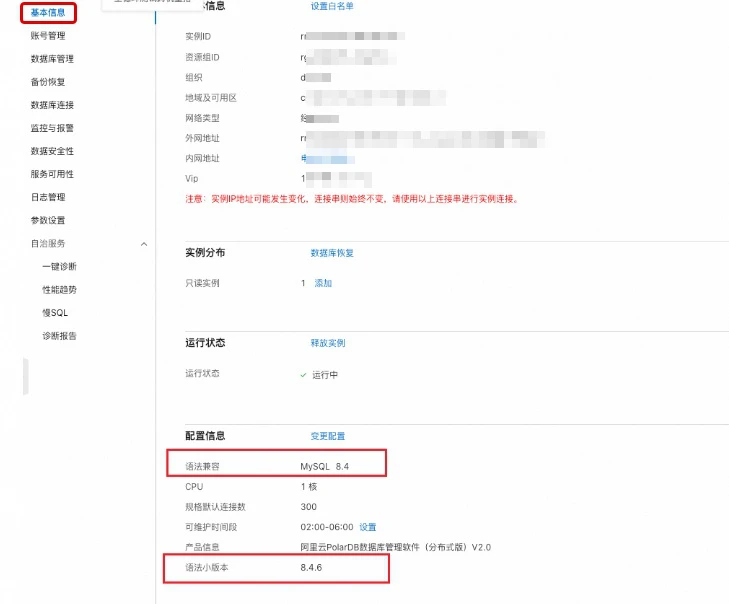

- **方法二：通过API查看**

  通过API（DescribeDBInstances或DescribeDBInstanceAttribute）查看实例语法兼容大版本和语法兼容小版本。

  返回字段将显示EngineVersion为8.4，grammarCompatibilityVersion为8.4.6。

<a id="section-4"></a>

# 4.实例管理

<a id="section-4-1"></a>

## 4.1. 创建实例

本文介绍如何通过云原生数据库PolarDB专有云控制台创建PolarDB MySQL实例。

**前提条件**

在创建实例前，请先申请可以登录阿里云控制台的账号。

**操作步骤**

1. 登录云原生数据库PolarDB控制台。

2. 在**实例列表**页面，单击左上角的**创建实例**。

3. 设置如下参数。

   **类别**

   **配置**

   **说明**

   实例所属组织。

   **组织**

   实例所属资源集。

   **资源集**

   实例所属地域。不同地域之间的产品内网不互通，创建实例后不支持更换地域。

   **地域**

   实例部署方案，目前支持**单可用区部署**和**多可用区部署**两种方案。

   **部署方案**

   **基本信**

   **主节点可用**

   实例主节点所属可用区。

   **息**

   **区**

   实例备节点所属的可用区。

   > **说明**
   >
   > 仅当部署方案选择**多可用区部署**时，需要配置该选项。

   **备节点可用区**

   实例所属主机的芯片架构。

   **芯片架构**

   选择**MySQL 语法兼容**。

   **数据库类型**

   选择与MySQL兼容的内核版本。

   - **5.7**

   - **8（兼容8.0和8.4）**

   **语法兼容**

   > **重要**
   >
   > 选项中的“8.4”表示PolarDB自研数据库引擎对MySQL 8.4功能特性的兼容实现，并非基于原生MySQL 8.4版本。具体详情，请参见MySQL 8.4的兼容性说明。

   本参数仅当**语法兼容**配置项为<strong>8（兼容8.0和8.4）</strong>时可配置。

   > **重要**
   >
   > 如需创建内核版本为8.4的集群，请务必将参数模板配置为 `mysql_innodb_8.4_standard_normal_safe` 。若下拉选项中未显示该模板，请先参见<strong>《运维指南》中“开启PolarDB MySQL 8.4内核参数开</strong>

   **参数模板**

   > **关”教程**，在Apsara Uni-manager运维控制台启用对应开关，启用后返回本页面刷新即可正常选择。若无运维平台操作权限，请联系阿里云技术支持协助开启。

   **规格配置**

   展示的小版本个数，可指定数据库的内核小版本，不指定表示创建最新内核小版本。

   **展示数据库小版本的数量**

   > **重要**
   >
   > 若控制台未显示相关配置项，请先参见<strong>《运维指南》中“开启PolarDB指定内核小版本开关”教程</strong>，在Apsara Uni-manager运维控制台启用对应开关，启用后返回本页面刷新即可正常选择。若无运维平台操作权限，请联系阿里云技术支持

   **数据库小版**

   > 协助开启。

   **本**

   设置数据库表名是否区分大小写。默认为不区分大小写。

   > **说明**
   >
   > - 若您本地数据库区分大小写时，建议您与本地数据库保持一致，选择**区分大小写**，便于您后续进行数据迁移等其他操作。
   >
   > - 默认为不区分大小写

   **表名大小写**

   > - 仅支持MySQL 8（兼容8.0和8.4）实例。
   >
   > - 实例创建后不支持修改，请谨慎选择。

   数据库的系列，目前支持**双机高可用版本**和**只读实例**两种系列。

   **系列**

   数据库的存储类型，固定为**本地SSD**。

   **存储类型**

   实例的规格，不同的内存大小对应不同的最大连接数和IOPS，具体请以控制台界面为

   **实例规格**

   准。

   存储空间包括数据空间、系统文件空间、Binlog文件空间和事务文件空间。实际可用

   **存储空间**

   存储空间请以控制台界面为准。

   **网络连接类**

   实例支持的网络连接类型。目前支持**公网连接**和**内网连接**两种。

   **型**

   实例支持的网络类型：

   - 经典网络：经典网络中的云服务在网络中不进行隔离，只能依靠云服务自身的安全组或白名单策略来阻挡非法访问。

   - 专有网络：（Virtual Private Cloud，简称VPC）专有网络帮助用户在阿里云上构建出一个隔离的网络环境。用户可以自定义专有网络里的路由表、IP地址范围和网

   **网络类型**

   关。建议您选择专有网络，更加安全。

   > **说明**
   >
   > 选择专有网络后，需要选择对应的专有网络VPC和交换机VSwitch。

   - **IPv4**：仅分配IPv4地址，适用于纯IPv4网络环境。

   - **IPv4/v6双栈**：同时分配IPv4和IPv6地址，适用于需要同时支持IPv4与IPv6客户端访问的混合网络场景。启用后需配置IPv6白名单以控制IPv6地址的访问权限。

   **网络**

   > **说明**
   >
   > - 如需配置该项参数需开启IPV6开关，具体操作，请参见<strong>《运维指南》</strong>中开启PolarDB IPv6开关章节。

   **IP类型**

   > - 如果提示未授权等信息，请参见租户组织对SLB服务授权操作。

   添加IP地址，允许这些IP地址访问该PolarDB实例。

   **IP白名单**

   > **说明**
   >
   > **IP类型**为IPv4/v6双栈时，**IPv6白名单**配置项可见且需配置。

   **IPv6白名单**

   **创建数量**

   创建的实例数量。

   **实例设置**

   实例的名称。实例名称需满足如下要求：

   - 以字母或中文开头，支持数字、“:”、“_”和“-”特殊字符。

   **实例名称**

   - 长度为2~64个字符。

   - 不能以 `http://` 或 `https://` 开头。

4. 完成上述参数配置后，单击**确认订单**。

> **说明**
>
> 界面右侧**配置概览**同步展示填写的配置信息，单击字段可以快速跳转到对应位置。方便用户查看整体配置信息。

<a id="section-4-2"></a>

## 4.2. 查看实例基本信息

您可以查看实例的基本信息、内网连接信息、运行状态、配置信息等详情。

**操作步骤**

1. 登录云原生数据库PolarDB控制台。

2. 您可以通过如下两种方式进入实例**基本信息**页面：

   - 在**实例列表**页面，单击目标实例的ID，进入实例**基本信息**页面。

   - 在**实例列表**页面，单击目标实例所对应**操作**栏中的**管理**，进入实例**基本信息**页面。

<a id="section-4-3"></a>

## 4.3. 重启实例

当实例出现连接数满或性能问题时，您可以手动重启实例。

**前提条件**

实例必须处于**运行中**状态。

**操作步骤**

1. 登录云原生数据库PolarDB控制台。

2. 在**实例列表**页面，单击目标实例ID或者单击实例右侧**操作**列下的**管理**，打开**基本信息**页面。

3. 单击右上角的**重启实例**。

   > **说明**
   >
   > 重启实例会造成连接中断，因此在重启前请做好业务安排，谨慎操作。

4. 在弹出的窗口中，单击**确定**。

<a id="section-4-4"></a>

## 4.4. 变更配置

如果当前实例配置无法满足应用的要求，或者当前实例的配置过高或者过低，您可以变更实例的配置，例如规格、存储空间。

**操作步骤**

1. 登录云原生数据库PolarDB控制台。

2. 在**实例列表**页面，单击目标实例ID。

3. 在**基本信息**页面的**配置信息**区域，单击**变更配置**。

4. 在**PolarDB变配**页面，选择**系列**、**存储类型**、**实例规格**、**存储空间**和**变配时间**。

5. 完成参数配置后，单击**提交**。

<a id="section-4-5"></a>

## 4.5. 设置可维护时间段

您可以根据业务需求设置PolarDB MySQL版实例的可运维时间段。

**背景信息**

为保障PolarDB MySQL版实例的稳定性，后端系统会不定期对实例进行维护操作。默认可维护时间段为02:00~06:00，您可以根据业务规律将可维护时间段设置在业务低峰期，以避免维护过程中可能对业务造成的影响。

**注意事项**

- 实例维护当天，为保障整个维护过程的稳定性，实例会在可维护时间段之前进入**实例维护中**的状态。当实例处于该状态时，对数据库的访问以及查询类操作（如性能监控）不会受到任何影响，但除了账号管理、数据库管理和IP白名单设置外的变更操作（如升降级、重启等）均暂时无法使用。

- 在可维护时间段内，实例会发生1到2次连接闪断，请确保应用程序具有重连机制。

**操作步骤**

1. 登录云原生数据库PolarDB控制台。

2. 在**实例列表**页面，单击实例ID或选择**操作 > 管理**。

3. 在**配置信息**区域，单击**可维护时间段**后的**设置**。

   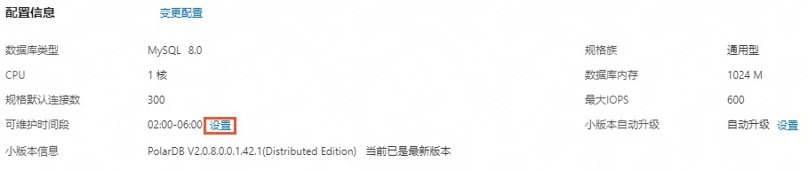

4. 选择一个可维护时间段，单击**确定**。

   > **说明**
   >
   > 时间段为北京时间。

<a id="section-4-6"></a>

## 4.6. 修改数据复制方式

您可以根据自身业务特点，设置PolarDB MySQL版的主备实例之间的数据复制方式，以提高云数据库的可用性。

**背景信息**

- 半同步

  应用发起的更新在主实例执行完成后，会将日志同步传输到所有备库，当集群中的至少一个节点收到日志后，不需要等待节点执行日志内容，事务就算完成了提交。

  当备实例不可用或者主备实例间出现网络异常时，半同步会退化为异步。

- 异步

  应用发起更新请求，即进行增加、删除、修改数据的操作时，主实例完成操作后会立即响应应用，同时主实例向备实例异步复制数据。因此，在异步数据复制方式下，备实例不可用时不会影响主实例上的操作，而主实例不可用时会引起主备库数据不一致的概率较低。

**操作步骤**

1. 登录云原生数据库PolarDB控制台。

2. 在**实例列表**页面，单击目标实例ID。

3. 在左侧导航栏中，单击**服务可用性**。

4. 单击**修改数据复制方式**。

   

5. 在弹出的对话框中，选择数据复制方式，单击**确定**。

   

<a id="section-4-7"></a>

## 4.7. 释放实例

您可以根据业务需求手动释放实例。

**注意事项**

- 只有在运行状态下的实例才能被手动释放。

- 释放后，实例立即被清除，数据不再保留，请提前备份数据。

**操作步骤**

1. 登录云原生数据库PolarDB控制台。

2. 在**实例列表**页面，单击目标实例对应操作栏中的**释放实例**。

   

3. 在弹出的**释放实例**对话框中，单击**释放**。

   > **说明**
   >
   > 支持实例释放保护，删除PolarDB MySQL实例，需输入MFA动态码。具体操作配置，请参见《统一云管平台》用户指南中的风险操作设置章节，在配置页风险操作设置界面完成配置。
   >
   > 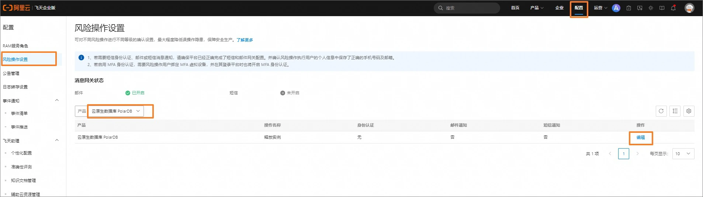

<a id="section-4-8"></a>

## 4.8. 升级内核小版本

PolarDB MySQL版实例支持自动升级或手动升级内核小版本，内核小版本的升级涉及性能提升、新功能或问题修复等。

**功能介绍**

PolarDB MySQL版实例默认自动升级内核小版本，您可以在**基本信息**页面看到**小版本自动升级**的设置情况。

- **自动升级**：每次重新登录实例控制台并查看实例基本信息时，系统会发起内核小版本的查询。若环境上有新的内核小版本发布，则会触发自动升级，自动升级操作将会在您设置的可维护时间段内进行，设置可维护时间段请参见设置可维护时间段。

- **手动升级**：每次重新登录实例控制台并查看实例基本信息时，系统会发起内核小版本的查询。若环境上有新的内核小版本发布，系统不会自动升级小版本，您可以在实例的**基本信息**页面手动升级内核小版本。

**注意事项**

- 升级内核小版本会重启实例，PolarDB MySQL服务可能会出现一次30秒的闪断，请您尽量在业务低峰期执行升级操作，或确保您的应用有自动重连机制。

- 升级内核小版本后无法降级。

- 如果执行了升配等操作，实例会升级到新的内核小版本。

**修改自动升级设置**

1. 登录云原生数据库PolarDB控制台。

2. 在**实例列表**页面，单击目标实例ID或者单击实例右侧**操作**列下的**管理**，打开**基本信息**页面。

3. 在**配置信息**区域，单击**小版本自动升级**右侧的**设置**。

4. 选择**自动升级**或**手动升级**，单击**确定**。

**手动升级内核小版本**

1. 登录云原生数据库PolarDB控制台。

2. 在**实例列表**页面，单击目标实例ID或者单击实例右侧**操作**列下的**管理**，打开**基本信息**页面。

3. 在**配置信息**区域右侧单击**升级内核小版本**。

   > **说明**
   >
   > **升级内核小版本**按钮仅在有新版本内核时可见。

4. 在弹出的对话框中，选择升级时间，单击**确定**。

**常见问题**

- 升级内核小版本后怎么小版本没变（ `SELECT @@version` ）？

  升级内核小版本是阿里云的内核小版本，不是MySQL的内核版本。您可以使用 `SHOW VARIABLES LIKE '%polardb_version%'` 查询您的内核小版本。

- 每次升级内核小版本只能往上升级一个版本吗？

  升级是直接升级到最新小版本。

<a id="section-4-9"></a>

## 4.9. 实例回收

您可以根据业务需求从回收站中恢复已删除的实例。

**操作步骤**

1. 登录云原生数据库PolarDB控制台

2. 在左侧导航栏单击选择**回收站**，单击目标实例对应操作栏中的**重建恢复**，重建恢复将会使用原实例的数据克隆一个新实例。

   

3. 在**实例列表**中可以查看到被删除的目标实例状态为**创建中**。

   

<a id="section-4-10"></a>

## 4.10. 只读实例

<a id="section-4-10-1"></a>

### 4.10.1. 概述

PolarDB MySQL版的实例支持添加只读实例，在对数据库有大量读请求和少量写请求时，只读实例用于分担主实例的数据库压力。本章节主要介绍只读实例的功能特点以及功能限制。

为了实现读取能力的弹性扩展，分担数据库压力，您可以在某个地域中创建一个或多个只读实例，利用只读实例满足大量的数据库读取需求，以此增加应用的吞吐量。

只读实例必须跟主实例在同一地域，但可以在不同的可用区。只读实例拓扑图如下所示：

云服务器 ECS

读写请求

只读请求

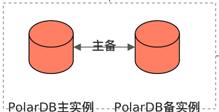

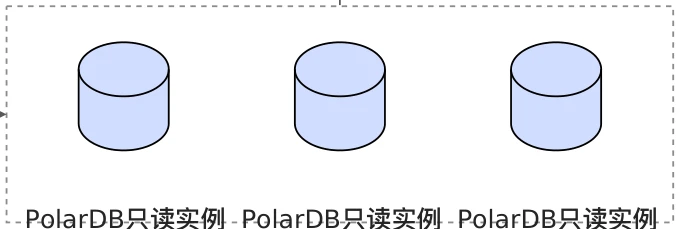

同步

PolarDB主实例

PolarDB备实例

PolarDB只读实例PolarDB只读实例PolarDB只读实例

PolarDB主实例

PolarDB只读实例

**只读实例有如下功能特点**：

- 规格可以与主实例不一致，并可以随时更改规格（没有时间限制），便于弹性升降级。

- 不需要维护账号与数据库，全部通过主实例同步。

- 独立的白名单配置。

- 提供系统性能监控。

  PolarDB提供近20个系统性能的监控视图。例如磁盘容量、IOPS、连接数、CPU利用率、网络流量等。用户可以轻松查看实例的负载。

- 提供优化建议：PolarDB提供多种优化建议。例如存储引擎检查、主键检查、大表检查、索引偏多、缺失索引等。用户可以根据优化建议并结合自身的应用来对数据库进行优化。

<a id="section-4-10-2"></a>

### 4.10.2. 创建只读实例

您可以通过创建不同规格的只读实例来满足业务需要。

**前提条件**

实例版本为双机高可用版（本地SSD盘）。

**注意事项**

- 1个主实例最多可以创建5个只读实例。

- 只读实例不支持备份设置以及临时备份。

- 只读实例不支持实例恢复。

- 只读实例不支持将数据迁移至只读实例。

- 只读实例不支持创建和删除数据库。

- 只读实例不支持创建账号、删除账号、账号授权以及修改账号密码。

- 创建只读实例后，主实例将不支持通过备份集直接覆盖实例来恢复数据。

**操作步骤**

1. 登录云原生数据库PolarDB控制台。

2. 在**实例列表**页面，单击目标实例ID或者单击实例右侧**操作**列下的**管理**，打开**基本信息**页面。

3. 在**基本信息**页面的**实例分布**区域，单击只读实例右侧的**添加**。

4. 在**PolarDB创建只读实例**页面设置只读实例的参数。

   <table>
     <tr>
       <th>项目</th>
       <th>参数</th>
       <th>说明</th>
     </tr>
     <tr>
       <td>区域</td>
       <td>地域</td>
       <td>PolarDB实例所在地域。</td>
     </tr>
     <tr>
       <td rowspan="6">规格配置</td>
       <td>数据库类型</td>
       <td>只读实例的数据库类型，与主实例一致，不可修改。</td>
     </tr>
     <tr>
       <td>数据库版本</td>
       <td>只读实例的数据库版本，与主实例一致，不可修改。</td>
     </tr>
     <tr>
       <td>系列</td>
       <td>固定为<strong>只读实例</strong>。</td>
     </tr>
     <tr>
       <td>存储类型</td>
       <td>只读实例的存储类型。</td>
     </tr>
     <tr>
       <td>实例规格</td>
       <td>只读实例规格。可以与主实例不一致，并且只读实例可以随时更改规格，便于弹性升降级。</td>
     </tr>
     <tr>
       <td>存储空间</td>
       <td>只读实例的存储空间，为保证数据同步有足够的I/O性能支撑，建议只读实例的规格和存储空间不小于主实例。</td>
     </tr>
     <tr>
       <td rowspan="4">网络类型</td>
       <td>网络类型</td>
       <td>只读实例的网络类型，与主实例一致，不可修改。</td>
     </tr>
     <tr>
       <td>IP类型</td>
       <td>• <strong>IPv4</strong>：仅分配IPv4地址，适用于纯IPv4网络环境。<br>• <strong>IPv4/v6双栈</strong>：同时分配IPv4和IPv6地址，适用于需要同时支持IPv4与IPv6客户端访问的混合网络场景。启用后需配置IPv6白名单以控制IPv6地址的访问权限。</td>
     </tr>
     <tr>
       <td>专有网络vpc</td>
       <td>网络类型为专有网络时，您需要选择对应的VPC。</td>
     </tr>
     <tr>
       <td>交换机vswitch</td>
       <td>网络类型为专有网络时，您需要选择对应的交换机。</td>
     </tr>
   </table>

5. 完成上述参数配置后，单击**提交**。

<a id="section-4-10-3"></a>

### 4.10.3. 查询只读实例详情

本章节介绍如何查询只读实例详情。您可以通过实例列表页面直接进入只读实例的管理页面，也可以通过主实例的只读实例列表进入只读实例的管理页面。管理方式与常规实例的管理类似，可执行的管理操作请以实际界面为准。

**直接通过只读实例查询实例详情**

1. 登录云原生数据库PolarDB控制台。

2. 在**实例列表**页面，单击目标只读实例的ID，进入实例的**基本信息**页面。

   在实例列表中，**实例类型**为**只读实例**的就是只读实例。

**通过主实例查询只读实例详情**

1. 登录云原生数据库PolarDB控制台

2. 在**实例列表**页面，单击目标实例ID或者单击实例右侧**操作**列下的**管理**，打开**基本信息**页面。

3. 在**基本信息**页面，将鼠标移动到**实例分布**窗口中的**只读实例**的数字上，就会显示只读实例ID。

   

4. 单击只读实例ID，即可进入只读实例的基本信息页面。

<a id="section-4-11"></a>

## 4.11. 标签管理

在实例数量较多的情况下，您可以创建多个标签，为实例绑定不同的标签对其进行分类，之后通过标签进行实例筛选。

**绑定标签**

1. 登录云原生数据库PolarDB控制台。

2. 在左侧导航栏单击实例列表<strong>。</strong>

3. 在**实例列表**页面，将鼠标移动到目标实例**标签**栏的

   图标上。

   

4. 在**编辑标签**页面单击<strong>+添加。</strong>

5. 输入**标签键**与输入**标签值。**

6. 单击**确定。**

**根据标签筛选实例**

1. 登录云原生数据库PolarDB控制台。

2. 在左侧导航栏单击实例列表<strong>。</strong>

3. 在**实例列表**页面<strong>，</strong>将鼠标移动到目标实例**标签**栏的

   图标上<strong>。</strong>

   

4. 单击**标签管理。**

5. 单击<strong>+创建/选择标签并绑定资源</strong>，选择目标标签<strong>。</strong>

6. 单击**下一步。**

7. 选择目标实例<strong>资源所在的组织和资源集，</strong>选择目标实例<strong>资源所在区域，</strong>选择目标实例所对应的**云产品。**

8. 单击**下一步。**

9. 单击**确认。**

**查看实例绑定的标签**

1. 登录云原生数据库PolarDB控制台。

2. 在左侧导航栏单击实例列表<strong>。</strong>

3. 在**实例列表**页面<strong>，</strong>将鼠标移动到目标实例**标签**栏的

   图标上<strong>。</strong>

   

**解绑标签**

1. 登录云原生数据库PolarDB控制台。

2. 在左侧导航栏单击实例列表<strong>。</strong>

3. 在**实例列表**页面， 将鼠标移动到目标实例**标签**栏的

   图标上<strong>。</strong>

   

4. 在**编辑标签**页面，将鼠标移动到**标签值**后的图标

   上<strong>。</strong>

   

5. 单击**确定。**

<a id="section-5"></a>

# 5.参数配置

<a id="section-5-1"></a>

## 5.1. 设置实例参数

您可以通过PolarDB控制台查看和修改部分参数的值，并追溯参数变更历史。

**注意事项**

- 为保障实例稳定性，控制台仅开放部分参数的修改权限。

- 修改参数值前，请参考**可修改参数**页面中的**可修改参数值**列。

- 部分参数修改后需重启实例，具体请参见控制台上**可修改参数**页面中的**是否重启**列。建议您在业务低峰期操作，并确保应用程序具有重连机制。

**修改参数值**

1. 登录云原生数据库PolarDB控制台。

2. 在**实例列表**页面，单击目标实例ID或者单击实例右侧**操作**列下的**管理**，打开**基本信息**页面。

3. 在左侧导航栏中，单击**参数设置**。

4. 在该页面，您可进行如下操作：

   - **导出参数**

     单击**导出参数**会以TXT格式将该实例的所有参数值保存到本地。

   - **批量修改参数文件并导入参数**

     <ol type="a">

     <li>

     导出的参数文件修改完成后，可以单击**导入参数**，将参数文件内容粘贴到对话框中。

     </li>

     <li>

     单击**确定**。

     </li>

     </ol>

     <ol type="i" start="100">

     <li>

     单击页面中的**提交参数**。

     > **说明**
     >
     > - 如果修改的参数需要重启实例才能生效，系统会提示您是否重启，建议您在业务低峰期操作，并确保应用程序具有重连机制。
     >
     > - 参数的修改未提交时，如果想取消修改，请单击**撤销**。

     </li>

     </ol>

   - **修改单个参数**

     <ol type="a">

     <li>

     在**可修改参数**列表内找到需要修改的参数，单击**运行参数值**列的  。

     </li>

     <li>

     根据提示的取值范围输入参数值，单击**确定**。

     </li>

     </ol>

     <ol type="i" start="100">

     <li>

     单击页面中的**提交参数**。

     > **说明**
     >
     > - 如果修改的参数需要重启实例才能生效，系统会提示您是否重启，建议您在业务低峰期操作，并确保应用程序具有重连机制。
     >
     > - 参数的修改未提交时，如果想取消修改，请单击**撤销**。

     </li>

     </ol>

**查看参数修改历史**

1. 登录云原生数据库PolarDB控制台

2. 在**实例列表**页面，单击目标实例ID或者单击实例右侧**操作**列下的**管理**，打开**基本信息**页面。

3. 在左侧导航栏中，单击**参数设置**。

4. 切换至**参数修改历史**页签下，选择时间范围并单击**确定**。

**参数说明**

| 参数名称 | 默认值 | 推荐值 | 是否重启 | 参数值范围 | 参数描述 |
| --- | --- | --- | --- | --- | --- |
| auto_increme nt_increment | 1 | 1 | 否 | \[1-65535\] | 设置自增列的步长，影响自增ID的递增间隔。 |
| auto_increme nt_offset | 1 | 1 | 否 | \[1-65535\] | 设置自增列的起始值，用于分布式主从复制场景。 |
| autocommit | ON | ON | 否 | \[ON\|OFF\] | 控制自动提交模式，ON表示每次SQL语句后自动提交，OFF则需手动提交。 |
| automatic_sp _privileges | ON | ON | 否 | \[ON\|OFF\] | 自动为存储过程分配权限，ON表示启用，OFF表示禁用。 |
| avoid_tempor al_upgrade | OFF | OFF | 否 | \[ON\|OFF\] | 避免时间类型升级，ON表示禁止升级，OFF表示允许。 |
| back_log | 3000 | 3000 | 是 | \[0-65535\] | 等待连接请求的队列长度 生效。 |
| binlog_cache_size | 2097152 | 128KB | 否 | \[4096-16777216\] | 二进制日志缓存大小，用于事务性语句的临时存储。 |
| binlog_checks um | CRC32 | CRC32 | 是 | \[CRC32\|NONE\] | 二进制日志校验算法，CRC32表示使用CRC32校验。 |
| binlog_order_commits | ON | ON | 否 | \[ON\|OFF\] | 按提交顺序写入二进制日志，ON表示启用，OFF表示禁用。 |
| binlog_row_im age | full | full | 否 | \[full\|minimal\] | 行模式二进制日志的记录方式，full表示记录完整行数据。 |
| binlog_rows_q uery_log_eve nts | OFF | OFF | 否 | \[ON\|OFF\] | 是否记录行级变更的查询事件，OFF表示禁用。 |
| binlog_stmt_c ache_size | 32768 | 32768 | 否 | \[4096-16777216\] | 非事务性语句的二进制日志缓存大小。 |
| block_encrypt ion_mode | "aes-128-ecb" | "aes-128-ecb" | 否 | \["aes-128-ecb"\|"aes-192-ecb"\|"aes-2... | 数据块加密算法，如AES-128-ECB。 |
| bulk_insert_b uffer_size | 4194304 | 4194304 | 否 | \[0-4294967295\] | 批量插入数据时的缓冲区大小。 |
| character_set _filesystem | binary | binary | 否 | \[utf8\|latin1\|g bk\|binary\] | 文件系统字符集，binary表示二进制处理。 |
| character_set _server | utf8 | utf8 | 是 | \[utf8\|latin1\|g bk\|gb18030\|u tf8mb4\] | 服务器默认字符集生效。 |
| concurrent_in sert | 1 | 1 | 否 | \[0\|1\|2\] | 并发插入策略，0表示禁止，1表示允许，2表示仅允许末尾插入。 |
| connect_time out | 10 | 10 | 否 | \[1-3600\] | 连接超时时间（秒），用于客户端连接等待。 |
| default_stora ge_engine | InnoDB | InnoDB | 是 | \[InnoDB\|inno db\] | 默认存储引擎，InnoDB表示使用InnoDB。 |
| default_time_zone | SYSTEM | Asia/Shanghai | 是 | \[SYSTEM\|-12:00\|-11:00\|-10:00\|-9:00\|... | 服务器默认时区，SYSTEM表示使用系统时区。 |
| default_week_format | 0 | 0 | 否 | \[0-7\] | 周格式设置，0表示周日为一周开始。 |
| delay_key_wri te | ON | ON | 否 | \[ON\|OFF\|ALL\] | 延迟索引写入策略，ON表示启用延迟写入。 |
| delayed_inser t_limit | 100 | 100 | 否 | \[1-4294967295\] | 延迟插入的最大行数，超过后强制写入。 |
| delayed_inser t_timeout | 300 | 300 | 否 | \[1-3600\] | 延迟插入超时时间（秒）。 |
| delayed_queu e_size | 1000 | 1000 | 否 | \[1-4294967295\] | 延迟插入队列的最大容量。 |
| disconnect_on _expired_pass word | ON | ON | 是 | \[ON\|OFF\] | 密码过期后断开连接，ON表示启用。 |
| div_precision_increment | 4 | 4 | 否 | \[0-30\] | 除法精度增加值，控制浮点运算精度。 |
| end_markers_in_json | OFF | OFF | 否 | \[ON\|OFF\] | JSON数据中的结束标记，OFF表示禁用。 |
| eq_range_ind ex_dive_limit | 100 | 100 | 否 | \[0-4294967295\] | 等值范围查询的索引深入限制。 |
| explicit_defau lts_for_timest amp | OFF | OFF | 否 | \[ON\|OFF\] | 显式定义时间戳默认值，OFF表示自动处理。 |
| flush_time | 0 | 0 | 否 | \[0-31536000\] | 表缓存刷新时间（秒），0表示禁用。 |
| ft_max_word_l en | 84 | 84 | 是 | \[10-4294967295\] | 全文索引最大单词长度 。 |
| ft_min_word_l en | 4 | 4 | 是 | \[1-3600\] | 全文索引最小单词长度 。 |
| ft_query_expa nsion_limit | 20 | 20 | 是 | \[0-1000\] | 查询扩展限制，控制自然语言搜索结果。 |
| general_log | OFF | OFF | 是 | OFF | 通用查询日志开关，OFF表示禁用。 |
| group_concat _max_len | 1024 | 1024 | 否 | \[4-18446744073 70954752\] | GROUP_CONC AT函数的最大返回长度。 |
| host_cache_si ze | 644 | 644 | 否 | \[0-65535\] | 主机缓存大小，用于存储连接信息。 |
| innodb_adapti ve_flushing | ON | ON | 否 | \[ON\|OFF\] | 自适应刷新策略，ON表示启用。 |
| innodb_adapti ve_flushing_l wm | 10 | 10 | 否 | \[0-70\] | 自适应刷新低水位线，控制刷新频率。 |
| innodb_adapti ve_hash_inde x | OFF | OFF | 否 | \[ON\|OFF\] | 自适应哈希索引，OFF表示禁用。 |
| innodb_adapti ve_max_sleep _delay | 150000 | 150000 | 否 | \[1-1000000\] | 自适应睡眠延迟最大值（微秒）。 |
| innodb_autoe xtend_increm ent | 64 | 64 | 否 | \[1-1000\] | 表空间自动扩展步长（页数）。 |
| innodb_autoin c_lock_mode | 2 | 2 | 是 | \[0\|1\|2\] | 自增锁模式，0表示传统模式，1表示交错模式，2表示无锁模式。 |
| innodb_buffer _pool_dump_a t_shutdown | ON | ON | 否 | \[ON\|OFF\] | 关闭时转储缓冲池内容，ON表示启用。 |
| innodb_buffer _pool_dump_p ct | 25 | 25 | 否 | \[1-100\] | 缓冲池转储百分比。 |
| innodb_buffer _pool_instanc es | {LEAST(DBIns tanceClassMe mory/107374 1824, 8)} | {LEAST(DBIns tanceClassMe mory/107374 1824, 8)} | 是 | \[1-64\] | 缓冲池实例数，影响并发性能。 |
| innodb_buffer _pool_load_at _startup | ON | ON | 是 | \[ON\|OFF\] | 启动时加载缓冲池内容，ON表示启用。 |
| innodb_chang e_buffer_max _size | 25 | 25 | 否 | \[0-50\] | 变更缓冲区最大大小（百分比）。 |
| innodb_chang e_buffering | all | all | 否 | \[none\|inserts\| deletes\|chang es\|purge... | 变更缓冲策略，all表示启用所有类型。 |
| innodb_check sum_algorith m | crc32 | crc32 | 否 | \[innodb\|crc32 \|none\|strict_i nnodb\|st... | InnoDB页校验算法，crc32表示使用CRC32。 |
| innodb_cmp_per_index_en abled | OFF | OFF | 否 | \[ON\|OFF\] | 按索引压缩统计，OFF表示禁用。 |
| innodb_comm it_concurrenc y | 0 | 0 | 是 | \[0-1000\] | 提交并发数，控制事务提交的并发性。 |
| innodb_compr ession_failure _threshold_pc t | 5 | 5 | 否 | \[0-100\] | 压缩失败阈值百分比。 |
| innodb_compr ession_level | 6 | 6 | 否 | \[0-9\] | 压缩级别（0-9），数值越高压缩率越高。 |
| innodb_compr ession_pad_p ct_max | 50 | 50 | 否 | \[0-70\] | 压缩填充最大百分比。 |
| innodb_concu rrency_tickets | 5000 | 5000 | 否 | \[1-4294967295\] | 线程并发票数，控制并发事务数量。 |
| innodb_deadl ock_detect | ON | ON | 否 | \[ON\|OFF\] | 死锁检测开关，ON表示启用。 |
| innodb_disabl e_sort_file_ca che | ON | ON | 否 | \[ON\|OFF\] | 禁用排序文件缓存，ON表示启用。 |
| innodb_flush_method | O_DIRECT | O_DIRECT | 是 | \[fsync\|O_DSY NC\|littlesync\| nosync\|O_... | 数据刷新方法，O_DIRECT表示直接IO。 |
| innodb_flush_neighbors | 0 | 0 | 否 | \[0\|1\|2\] | 刷新相邻页策略，0表示禁用。 |
| innodb_flush_sync | ON | ON | 否 | \[ON\|OFF\] | 刷新操作是否同步，ON表示启用。 |
| innodb_ft_cac he_size | 8000000 | 8000000 | 是 | \[1600000-80000000\] | 全文索引缓存大小 。 |
| innodb_ft_ena ble_diag_print | OFF | OFF | 否 | \[ON\|OFF\] | 启用诊断输出，OFF表示禁用。 |
| innodb_ft_ena ble_stopword | ON | ON | 否 | \[ON\|OFF\] | 启用停用词过滤，ON表示启用。 |
| innodb_ft_ma x_token_size | 84 | 84 | 是 | \[10-84\] | 全文索引最大令牌长度 。 |
| innodb_ft_min _token_size | 3 | 3 | 是 | \[0-16\] | 全文索引最小令牌长度 。 |
| innodb_ft_nu m_word_opti mize | 2000 | 2000 | 否 | \[0-10000\] | 优化词数，控制全文索引优化频率。 |
| innodb_ft_res ult_cache_limi t | 2000000000 | 2000000000 | 否 | \[1000000-4294967295\] | 全文搜索结果缓存限制。 |
| innodb_ft_sort _pll_degree | 2 | 2 | 是 | \[1-16\] | 并行排序线程数。 |
| innodb_ft_tota l_cache_size | 640000000 | 640000000 | 是 | \[32000000-1600000000\] | 全文索引总缓存大小。 |
| innodb_io_cap acity | 20000 | 20000 | 否 | \[0-18446744073 709551615\] | I/O容量，影响InnoDB的I/O调度。 |
| innodb_io_cap acity_max | 40000 | 40000 | 否 | \[0-18446744073 709551615\] | 最大I/O容量，用于高负载场景。 |
| innodb_large_prefix | OFF | OFF | 否 | \[ON\|OFF\] | 大前缀支持，ON表示启用。 |
| innodb_lock_wait_timeout | 50 | 50 | 否 | \[1-1073741824\] | 锁等待超时时间（秒）。 |
| innodb_log_ch ecksums | ON | ON | 否 | \[ON\|OFF\] | 事务日志校验，ON表示启用。 |
| innodb_log_co mpressed_pa ges | OFF | OFF | 否 | \[ON\|OFF\] | 压缩事务日志页，OFF表示禁用。 |
| innodb_log_fil e_size | {LEAST(DBIns tanceClassMe mory/6, 1572864000)} | 500M | 是 | \[4194304-10737418240 0\] | 事务日志文件大小 。 |
| innodb_lru_sc an_depth | {LEAST(DBIns tanceClassMe mory/104857 6/8, 8192)} | {LEAST(DBIns tanceClassMe mory/104857 6/8, 8192)} | 否 | \[100-18446744073 709551615\] | LRU列表扫描深度，影响缓冲池管理。 |
| innodb_max_dirty_pages_p ct | 75 | 75 | 否 | \[0-99\] | 脏页百分比上限，控制刷新频率。 |
| innodb_max_dirty_pages_p ct_lwm | 10 | 10 | 否 | \[0-99\] | 脏页低水位线，用于动态调整刷新。 |
| innodb_max_purge_lag | 0 | 0 | 否 | \[0-4294967295\] | 最大清除延迟，控制事务清理速度。 |
| innodb_max_purge_lag_del ay | 0 | 0 | 否 | \[0-10000000\] | 清除延迟最大等待时间（微秒）。 |
| innodb_max_undo_log_size | 1073741824 | 1073741824 | 否 | \[10485760-18446744073 709551615\] | 撤销日志最大大小。 |
| innodb_old_bl ocks_pct | 37 | 37 | 否 | \[5-95\] | 旧块占比，控制LRU替换策略。 |
| innodb_old_bl ocks_time | 1000 | 1000 | 否 | \[0-1024\] | 旧块停留时间（毫秒）。 |
| innodb_online _alter_log_ma x_size | 134217728 | 134217728 | 否 | \[134217728-2147483647\] | 在线DDL日志最大大小。 |
| innodb_open_files | {LEAST(DBIns tanceClassCP U\*500, 8000)} | {LEAST(DBIns tanceClassCP U\*500, 8000)} | 是 | \[1-8192\] | 最大打开文件数，受CPU限制。 |
| innodb_optimi ze_fulltext_on ly | OFF | OFF | 否 | \[ON\|OFF\] | 仅优化全文索引，OFF表示禁用。 |
| innodb_page_cleaners | {LEAST(DBIns tanceClassMe mory/107374 1824, 8)} | {LEAST(DBIns tanceClassMe mory/107374 1824, 8)} | 是 | \[1-64\] | 页面清理线程数。 |
| innodb_print_all_deadlocks | OFF | OFF | 否 | \[OFF\|ON\] | 打印所有死锁信息，OFF表示禁用。 |
| innodb_purge _batch_size | 300 | 300 | 是 | \[1-5000\] | 清除批次大小，控制事务清理效率。 |
| innodb_purge _rseg_truncat e_frequency | 128 | 128 | 否 | \[1-128\] | 清除回滚段截断频率。 |
| innodb_purge _threads | {LEAST(DBIns tanceClassMe mory/107374 1824, 8)} | {LEAST(DBIns tanceClassMe mory/107374 1824, 8)} | 是 | \[1-32\] | 清除线程数，影响事务清理性能。 |
| innodb_rando m_read_ahea d | OFF | OFF | 否 | \[ON\|OFF\] | 随机预读，OFF表示禁用。 |
| innodb_read_ahead_thresh old | 56 | 56 | 否 | \[0-1024\] | 预读阈值，控制预读行为。 |
| innodb_read_i o_threads | 4 | 4 | 是 | \[1-64\] | 读取I/O线程数。 |
| innodb_rollba ck_on_timeou t | OFF | OFF | 是 | \[OFF\|ON\] | 超时回滚，ON表示启用。 |
| innodb_rollba ck_segments | 128 | 128 | 否 | \[1-128\] | 回滚段数量，控制事务回滚能力。 |
| innodb_sort_b uffer_size | 1048576 | 1048576 | 是 | \[65536-67108864\] | 排序缓冲区大小。 |
| innodb_spin_wait_delay | 6 | 6 | 否 | \[0-4294967295\] | 自旋等待延迟（微秒）。 |
| innodb_stats_auto_recalc | ON | ON | 否 | \[ON\|OFF\] | 自动重新计算统计信息，ON表示启用。 |
| innodb_stats_method | nulls_equal | nulls_equal | 否 | \[nulls_equal\|n ulls_unequal\| nulls_ig... | 统计信息计算方法，nulls_equ al表示处理空值。 |
| innodb_stats_on_metadata | OFF | OFF | 否 | \[ON\|OFF\] | 元数据操作时更新统计信息，OFF表示禁用。 |
| innodb_stats_persistent | ON | ON | 否 | \[ON\|OFF\] | 持久化统计信息，ON表示启用。 |
| innodb_stats_persistent_sa mple_pages | 20 | 20 | 否 | \[0-4294967295\] | 持久化采样页数。 |
| innodb_stats_sample_pages | 8 | 8 | 否 | \[1-4294967296\] | 统计信息采样页数。 |
| innodb_stats_transient_sam ple_pages | 8 | 8 | 否 | \[1-4294967295\] | 临时统计信息采样页数。 |
| innodb_status _output | OFF | OFF | 否 | \[ON\|OFF\] | 输出InnoDB状态信息，OFF表示禁用。 |
| innodb_status _output_locks | OFF | OFF | 否 | \[ON\|OFF\] | 输出锁信息，OFF表示禁用。 |
| innodb_strict_mode | OFF | OFF | 否 | \[ON\|OFF\] | 严格模式，OFF表示禁用。 |
| innodb_sync_array_size | 128 | 128 | 是 | \[1-1024\] | 同步数组大小。 |
| innodb_sync_spin_loops | 30 | 30 | 否 | \[0-4294967295\] | 自旋等待次数。 |
| innodb_table_locks | ON | ON | 否 | \[ON\|OFF\] | 表级锁，ON表示启用。 |
| innodb_threa d_concurrenc y | 0 | 0 | 否 | \[0-1000\] | 线程并发数，控制并发事务数量。 |
| innodb_threa d_sleep_delay | 10000 | 10000 | 否 | \[0-1000000\] | 线程睡眠延迟（微秒）。 |
| innodb_undo_log_truncate | OFF | OFF | 否 | \[ON\|OFF\] | 撤销日志截断，OFF表示禁用。 |
| innodb_write_io_threads | 4 | 4 | 是 | \[1-64\] | 写入I/O线程数。 |
| interactive_ti meout | 7200 | 7200 | 否 | \[10-86400\] | 交互式连接超时时间（秒）。 |
| join_buffer_siz e | {LEAST(DBIns tanceClassMe mory/104857 6\*128, 262144)} | 352KB | 否 | \[128-4294967295\] | 连接缓冲区大小，受内存限制。 |
| key_cache_ag e_threshold | 300 | 300 | 否 | \[100-4294967295\] | 键缓存年龄阈值，控制缓存淘汰。 |
| key_cache_bl ock_size | 1024 | 1024 | 否 | \[512-16384\] | 键缓存块大小（字节）。 |
| key_cache_di vision_limit | 100 | 100 | 否 | \[1-100\] | 键缓存划分比例，控制热/冷数据分离。 |

<table>
  <tr>
    <td>loose_ssl_ciph er</td>
    <td>ALL:@SECLEV EL=0</td>
    <td>ALL:@SECLEV EL=0</td>
    <td>是</td>
    <td>.*</td>
    <td>指定TLS连接允许的加密套件列表。服务端仅接受列表中定义的加密算法与客户端进行握手协商。若列表中的算法均不被客户端支持，TLS连接将建立失败。默认值<code> ALL:@SEC</code> <code>LEVEL=0 </code>表示允许所有安全等级的加密套件，以最大化兼容性；建议根据安全合规要求配置高强度算法组合（如禁用弱加密算法），但需确保业务客户端支持所选算法，避免连接中断。</td>
  </tr>
  <tr>
    <td>lc_time_name s</td>
    <td>en_US</td>
    <td>en_US</td>
    <td>否</td>
    <td>[ja_JP|pt_BR|e n_US]</td>
    <td>时间格式区域设置，en_US表示美国英语。</td>
  </tr>
  <tr>
    <td>local_infile</td>
    <td>ON</td>
    <td>ON</td>
    <td>否</td>
    <td>[ON|OFF]</td>
    <td>允许加载本地文件，ON表示启用。</td>
  </tr>
  <tr>
    <td>lock_wait_tim eout</td>
    <td>31536000</td>
    <td>31536000</td>
    <td>否</td>
    <td>[1-1073741824]</td>
    <td>锁等待超时时间（秒）。</td>
  </tr>
  <tr>
    <td>log_error_ver bosity</td>
    <td>2</td>
    <td>2</td>
    <td>否</td>
    <td>[1-3]</td>
    <td>错误日志详细级别，2表示详细信息。</td>
  </tr>
  <tr>
    <td>log_queries_n ot_using_inde xes</td>
    <td>OFF</td>
    <td>OFF</td>
    <td>否</td>
    <td>[ON|OFF]</td>
    <td>记录未使用索引的查询，OFF表示禁用。</td>
  </tr>
  <tr>
    <td>log_slow_adm in_statements</td>
    <td>OFF</td>
    <td>OFF</td>
    <td>否</td>
    <td>[ON|OFF]</td>
    <td>记录慢管理语句，OFF表示禁用。</td>
  </tr>
  <tr>
    <td>log_throttle_q ueries_not_usi ng_indexes</td>
    <td>0</td>
    <td>0</td>
    <td>否</td>
    <td>[0-4294967295]</td>
    <td>未使用索引查询的节流限制。</td>
  </tr>
  <tr>
    <td>long_query_ti me</td>
    <td>1</td>
    <td>1</td>
    <td>否</td>
    <td>[0.1-31536000]</td>
    <td>慢查询时间阈值（秒）。</td>
  </tr>
  <tr>
    <td>loose_ccl_que ue_bucket_co unt</td>
    <td>4</td>
    <td>4</td>
    <td>否</td>
    <td>[1-64]</td>
    <td>队列桶数量，用于特定功能。</td>
  </tr>
  <tr>
    <td>loose_ccl_que ue_bucket_siz e</td>
    <td>64</td>
    <td>64</td>
    <td>否</td>
    <td>[1-4096]</td>
    <td>队列桶大小，用于特定功能。</td>
  </tr>
  <tr>
    <td>loose_collatio n_server</td>
    <td>utf8_general_ci</td>
    <td>utf8_general_ci</td>
    <td>是</td>
    <td>[utf8_bin|utf8 _general_ci|la tin1_bi...</td>
    <td>服务器默认排序规则，utf8_gene ral_ci表示通用校对。</td>
  </tr>
  <tr>
    <td>loose_innodb_data_file_purg e</td>
    <td>ON</td>
    <td>ON</td>
    <td>否</td>
    <td>[ON|OFF]</td>
    <td>启用InnoDB数据文件清理，ON表示启用。</td>
  </tr>
  <tr>
    <td>loose_innodb_data_file_purg e_interval</td>
    <td>100</td>
    <td>100</td>
    <td>否</td>
    <td>[0-10000]</td>
    <td>数据文件清理间隔。</td>
  </tr>
  <tr>
    <td>loose_innodb_data_file_purg e_max_size</td>
    <td>512</td>
    <td>512</td>
    <td>否</td>
    <td>[16-1073741824]</td>
    <td>数据文件清理最大大小。</td>
  </tr>
  <tr>
    <td>loose_innodb_log_optimize_ddl</td>
    <td>OFF</td>
    <td>OFF</td>
    <td>否</td>
    <td>[ON|OFF]</td>
    <td>优化DDL日志，OFF表示禁用。</td>
  </tr>
  <tr>
    <td>loose_innodb_numa_interle ave</td>
    <td>ON</td>
    <td>ON</td>
    <td>是</td>
    <td>[ON|OFF]</td>
    <td>NUMA交错配置，ON表示启用。</td>
  </tr>
  <tr>
    <td>loose_innodb_rds_faster_ddl</td>
    <td>ON</td>
    <td>ON</td>
    <td>否</td>
    <td>[ON|OFF]</td>
    <td>加速DDL操作，ON表示启用。</td>
  </tr>
  <tr>
    <td>loose_internal _tmp_disk_sto rage_engine</td>
    <td>INNODB</td>
    <td>INNODB</td>
    <td>否</td>
    <td>[INNODB|MYI SAM]</td>
    <td>内部临时表磁盘引擎，INNODB表示使用InnoDB。</td>
  </tr>
  <tr>
    <td>loose_max_ex ecution_time</td>
    <td>0</td>
    <td>0</td>
    <td>否</td>
    <td>[0-4294967295]</td>
    <td>查询最大执行时间（毫秒）。</td>
  </tr>
  <tr>
    <td>loose_max_st atement_time</td>
    <td>0</td>
    <td>0</td>
    <td>否</td>
    <td>[0-4294967295]</td>
    <td>语句最大执行时间（毫秒）。</td>
  </tr>
  <tr>
    <td>loose_opt_rds _enable_show _slave_lag</td>
    <td>ON</td>
    <td>ON</td>
    <td>否</td>
    <td>[ON|OFF]</td>
    <td>启用显示从库延迟，ON表示启用。</td>
  </tr>
  <tr>
    <td>loose_opt_rds _last_error_gti d</td>
    <td>ON</td>
    <td>ON</td>
    <td>否</td>
    <td>[ON|OFF]</td>
    <td>记录最后错误GTID，ON表示启用。</td>
  </tr>
  <tr>
    <td>loose_optimiz er_trace</td>
    <td>enabled=off,o ne_line=off</td>
    <td>enabled=off,o ne_line=off</td>
    <td>否</td>
    <td>.*</td>
    <td>优化器追踪配置，默认关闭。</td>
  </tr>
  <tr>
    <td>loose_optimiz er_trace_feat ures</td>
    <td>greedy_searc h=on,range_o ptimizer=on, dynamic_rang e= on,repeated_subselect=on</td>
    <td>greedy_searc h=on,range_o ptimizer=on, dynamic_rang e=on,repeate d_subselect= on</td>
    <td>否</td>
    <td>.*</td>
    <td>优化器追踪功能，如范围优化。</td>
  </tr>
  <tr>
    <td>loose_perform ance_point_io stat_interval</td>
    <td>2</td>
    <td>2</td>
    <td>否</td>
    <td>[0-60]</td>
    <td>IO统计间隔（秒）。</td>
  </tr>
  <tr>
    <td>loose_perform ance_point_io stat_volume_s ize</td>
    <td>10000</td>
    <td>10000</td>
    <td>是</td>
    <td>[0-100000]</td>
    <td>IO统计体积大小 。</td>
  </tr>
  <tr>
    <td>loose_perform ance_point_lo ck_rwlock_en abled</td>
    <td>ON</td>
    <td>ON</td>
    <td>否</td>
    <td>[ON|OFF]</td>
    <td>启用锁统计，ON表示启用。</td>
  </tr>
  <tr>
    <td>loose_perform ance_schema _accounts_siz e</td>
    <td>10000</td>
    <td>10000</td>
    <td>是</td>
    <td>[-1-1048576]</td>
    <td>账户统计大小。</td>
  </tr>
  <tr>
    <td>loose_perform ance_schema _digests_size</td>
    <td>10000</td>
    <td>10000</td>
    <td>是</td>
    <td>[-1-1048576]</td>
    <td>查询摘要大小。</td>
  </tr>
  <tr>
    <td>loose_perform ance_schema _hosts_size</td>
    <td>10000</td>
    <td>10000</td>
    <td>是</td>
    <td>[-1-1048576]</td>
    <td>主机统计大小。</td>
  </tr>
  <tr>
    <td>loose_perform ance_schema _max_cond_in stances</td>
    <td>10000</td>
    <td>10000</td>
    <td>是</td>
    <td>[-1-1048576]</td>
    <td>条件实例最大数。</td>
  </tr>
  <tr>
    <td>loose_perform ance_schema _max_file_inst ances</td>
    <td>1000</td>
    <td>1000</td>
    <td>是</td>
    <td>[-1-1048576]</td>
    <td>文件实例最大数。</td>
  </tr>
  <tr>
    <td>loose_perform ance_schema _max_index_s tat</td>
    <td>10000</td>
    <td>10000</td>
    <td>是</td>
    <td>[-1-1048576]</td>
    <td>索引统计最大数。</td>
  </tr>
  <tr>
    <td>loose_perform ance_schema _max_metada ta_locks</td>
    <td>10000</td>
    <td>10000</td>
    <td>是</td>
    <td>[-1-1048576]</td>
    <td>元数据锁最大数。</td>
  </tr>
  <tr>
    <td>loose_perform ance_schema _max_mutex_i nstances</td>
    <td>10000</td>
    <td>10000</td>
    <td>是</td>
    <td>[-1-104857600]</td>
    <td>互斥锁实例最大数 。</td>
  </tr>
  <tr>
    <td>loose_perform ance_schema _max_prepare d_statements _instances</td>
    <td>1000</td>
    <td>1000</td>
    <td>是</td>
    <td>[-1-4194304]</td>
    <td>预处理语句实例最大数 。</td>
  </tr>
  <tr>
    <td>loose_perform ance_schema _max_progra m_instances</td>
    <td>10000</td>
    <td>10000</td>
    <td>是</td>
    <td>[-1-1048576]</td>
    <td>程序实例最大数。</td>
  </tr>
  <tr>
    <td>loose_perform ance_schema _max_rwlock_instances</td>
    <td>10000</td>
    <td>10000</td>
    <td>是</td>
    <td>[-1-104857600]</td>
    <td>读写锁实例最大数 。</td>
  </tr>
  <tr>
    <td>loose_perform ance_schema _max_socket_instances</td>
    <td>1000</td>
    <td>1000</td>
    <td>是</td>
    <td>[-1-1048576]</td>
    <td>套接字实例最大数 。</td>
  </tr>
  <tr>
    <td>loose_perform ance_schema _max_table_h andles</td>
    <td>10000</td>
    <td>10000</td>
    <td>是</td>
    <td>[-1-1048576]</td>
    <td>表句柄最大数。</td>
  </tr>
  <tr>
    <td>loose_perform ance_schema _max_table_in stances</td>
    <td>1000</td>
    <td>1000</td>
    <td>是</td>
    <td>[-1-1048576]</td>
    <td>表实例最大数。</td>
  </tr>
  <tr>
    <td>loose_perform ance_schema _max_table_lo ck_stat</td>
    <td>10000</td>
    <td>10000</td>
    <td>是</td>
    <td>[-1-1048576]</td>
    <td>表锁统计最大数。</td>
  </tr>
  <tr>
    <td>loose_perform ance_schema _max_thread_instances</td>
    <td>10000</td>
    <td>10000</td>
    <td>是</td>
    <td>[-1-1048576]</td>
    <td>线程实例最大数。</td>
  </tr>
  <tr>
    <td>loose_perform ance_schema _setup_actors _size</td>
    <td>10000</td>
    <td>10000</td>
    <td>是</td>
    <td>[-1-1048576]</td>
    <td>Actor设置大小。</td>
  </tr>
  <tr>
    <td>loose_perform ance_schema _setup_object s_size</td>
    <td>10000</td>
    <td>10000</td>
    <td>是</td>
    <td>[-1-1048576]</td>
    <td>对象设置大小。</td>
  </tr>
  <tr>
    <td>loose_perform ance_schema _users_size</td>
    <td>10000</td>
    <td>10000</td>
    <td>是</td>
    <td>[-1-1048576]</td>
    <td>用户统计大小。</td>
  </tr>
  <tr>
    <td>loose_rds_aud it_max_sql_siz e</td>
    <td>8192</td>
    <td>8192</td>
    <td>否</td>
    <td>[0-32768]</td>
    <td>审计日志最大SQL长度。</td>
  </tr>
  <tr>
    <td>loose_rds_che ck_core_file_e nabled</td>
    <td>ON</td>
    <td>ON</td>
    <td>否</td>
    <td>[ON|OFF]</td>
    <td>启用核心文件检查，ON表示启用。</td>
  </tr>
  <tr>
    <td>loose_rds_kill_connections</td>
    <td>20</td>
    <td>20</td>
    <td>否</td>
    <td>[0-18446744073 709551615]</td>
    <td>最大连接数，超过后终止连接。</td>
  </tr>
  <tr>
    <td>loose_rds_set _connection_i d_enabled</td>
    <td>ON</td>
    <td>ON</td>
    <td>否</td>
    <td>[ON|OFF]</td>
    <td>启用连接ID设置，ON表示启用。</td>
  </tr>
  <tr>
    <td>loose_recycle _bin</td>
    <td>OFF</td>
    <td>OFF</td>
    <td>否</td>
    <td>[ON|OFF]</td>
    <td>启用回收站，ON表示启用。</td>
  </tr>
  <tr>
    <td>loose_recycle _bin_retention</td>
    <td>604800</td>
    <td>604800</td>
    <td>否</td>
    <td>[86400-1209600]</td>
    <td>回收站保留时间（秒）。</td>
  </tr>
  <tr>
    <td>loose_recycle _scheduler</td>
    <td>OFF</td>
    <td>OFF</td>
    <td>否</td>
    <td>[ON|OFF]</td>
    <td>回收站调度器，ON表示启用。</td>
  </tr>
  <tr>
    <td>loose_sql_safe _updates</td>
    <td>OFF</td>
    <td>OFF</td>
    <td>否</td>
    <td>[ON|OFF]</td>
    <td>安全更新模式，OFF表示禁用。</td>
  </tr>
  <tr>
    <td>loose_thread_pool_enabled</td>
    <td>ON</td>
    <td>ON</td>
    <td>否</td>
    <td>[ON|OFF]</td>
    <td>线程池启用，ON表示启用。</td>
  </tr>
  <tr>
    <td>loose_thread_pool_oversubs cribe</td>
    <td>32</td>
    <td>32</td>
    <td>否</td>
    <td>[10-64]</td>
    <td>线程池超分配比例。</td>
  </tr>
  <tr>
    <td>loose_thread_pool_size</td>
    <td>4</td>
    <td>1</td>
    <td>否</td>
    <td>[1-64]</td>
    <td>线程池大小，受CPU限制。</td>
  </tr>
  <tr>
    <td>loose_validate _password_ch eck_user_nam e</td>
    <td>ON</td>
    <td>ON</td>
    <td>否</td>
    <td>[ON|OFF]</td>
    <td>验证密码是否包含用户名，ON表示启用。</td>
  </tr>
  <tr>
    <td>loose_validate _password_le ngth</td>
    <td>8</td>
    <td>8</td>
    <td>否</td>
    <td>[0-256]</td>
    <td>密码最小长度。</td>
  </tr>
  <tr>
    <td>loose_validate _password_mi xed_case_cou nt</td>
    <td>1</td>
    <td>1</td>
    <td>否</td>
    <td>[0-256]</td>
    <td>混合大小写字符数要求。</td>
  </tr>
  <tr>
    <td>loose_validate _password_nu mber_count</td>
    <td>1</td>
    <td>1</td>
    <td>否</td>
    <td>[0-256]</td>
    <td>数字字符数要求。</td>
  </tr>
  <tr>
    <td>loose_validate _password_po licy</td>
    <td>1</td>
    <td>1</td>
    <td>否</td>
    <td>[0|1|2]</td>
    <td>密码策略等级（0-2）。</td>
  </tr>
  <tr>
    <td>loose_validate _password_sp ecial_char_co unt</td>
    <td>1</td>
    <td>1</td>
    <td>否</td>
    <td>[0-256]</td>
    <td>特殊字符数要求。</td>
  </tr>
  <tr>
    <td>low_priority_u pdates</td>
    <td>0</td>
    <td>0</td>
    <td>否</td>
    <td>[0|1]</td>
    <td>低优先级更新，0表示禁用。</td>
  </tr>
  <tr>
    <td>lower_case_ta ble_names</td>
    <td>1</td>
    <td>1</td>
    <td>是</td>
    <td>[0|1]</td>
    <td>表名大小写敏感性，1表示忽略大小写。</td>
  </tr>
  <tr>
    <td>master_verify _checksum</td>
    <td>OFF</td>
    <td>OFF</td>
    <td>否</td>
    <td>[ON|OFF]</td>
    <td>主库校验和验证，OFF表示禁用。</td>
  </tr>
  <tr>
    <td>max_allowed_packet</td>
    <td>1073741824</td>
    <td>1024M</td>
    <td>否</td>
    <td>[16384-1073741824]</td>
    <td>客户端最大包大小（字节）。</td>
  </tr>
  <tr>
    <td>max_binlog_c ache_size</td>
    <td>18446744073 709547520</td>
    <td>18446744073 709547520</td>
    <td>否</td>
    <td>[4096-18446744073 709547520]</td>
    <td>二进制日志缓存最大大小。</td>
  </tr>
  <tr>
    <td>max_binlog_st mt_cache_siz e</td>
    <td>18446744073 709547520</td>
    <td>18446744073 709547520</td>
    <td>否</td>
    <td>[4096-18446744073 709547520]</td>
    <td>非事务性语句缓存最大大小。</td>
  </tr>
  <tr>
    <td>max_connect_errors</td>
    <td>100</td>
    <td>100</td>
    <td>否</td>
    <td>[0-4294967295]</td>
    <td>最大连接错误次数。</td>
  </tr>
  <tr>
    <td>max_error_co unt</td>
    <td>64</td>
    <td>64</td>
    <td>否</td>
    <td>[0-65535]</td>
    <td>最大错误消息数量。</td>
  </tr>
  <tr>
    <td>max_heap_ta ble_size</td>
    <td>67108864</td>
    <td>67108864</td>
    <td>否</td>
    <td>[16384-18446744073 70954752]</td>
    <td>MEMORY表最大大小。</td>
  </tr>
  <tr>
    <td>max_join_size</td>
    <td>18446744073 709500000</td>
    <td>18446744073 709500000</td>
    <td>否</td>
    <td>[1-18446744073 709551615]</td>
    <td>连接操作最大行数。</td>
  </tr>
  <tr>
    <td>max_length_f or_sort_data</td>
    <td>1024</td>
    <td>1024</td>
    <td>否</td>
    <td>[0-838860]</td>
    <td>排序数据最大长度。</td>
  </tr>
  <tr>
    <td>max_points_in _geometry</td>
    <td>65536</td>
    <td>65536</td>
    <td>否</td>
    <td>[3-1048576]</td>
    <td>几何对象最大点数。</td>
  </tr>
  <tr>
    <td>max_prepare d_stmt_count</td>
    <td>16382</td>
    <td>16382</td>
    <td>否</td>
    <td>[0-1048576]</td>
    <td>最大预处理语句数。</td>
  </tr>
  <tr>
    <td>max_seeks_fo r_key</td>
    <td>18446744073 709500000</td>
    <td>18446744073 709500000</td>
    <td>否</td>
    <td>[1-18446744073 709551615]</td>
    <td>键查找最大次数。</td>
  </tr>
  <tr>
    <td>max_sort_len gth</td>
    <td>1024</td>
    <td>1024</td>
    <td>否</td>
    <td>[4-8388608]</td>
    <td>排序操作最大长度。</td>
  </tr>
  <tr>
    <td>max_sp_recur sion_depth</td>
    <td>0</td>
    <td>0</td>
    <td>否</td>
    <td>[0-255]</td>
    <td>存储过程递归深度限制。</td>
  </tr>
  <tr>
    <td>max_write_loc k_count</td>
    <td>102400</td>
    <td>102400</td>
    <td>否</td>
    <td>[1-102400]</td>
    <td>写锁最大计数。</td>
  </tr>
  <tr>
    <td>metadata_loc ks_cache_size</td>
    <td>1024</td>
    <td>1024</td>
    <td>是</td>
    <td>[1-1048576]</td>
    <td>元数据锁缓存大小 。</td>
  </tr>
  <tr>
    <td>min_examine d_row_limit</td>
    <td>0</td>
    <td>0</td>
    <td>否</td>
    <td>[0-4294967295]</td>
    <td>最小检查行数限制。</td>
  </tr>
  <tr>
    <td>myisam_sort_buffer_size</td>
    <td>262144</td>
    <td>262144</td>
    <td>否</td>
    <td>[262144-16777216]</td>
    <td>MyISAM排序缓冲区大小。</td>
  </tr>
  <tr>
    <td>mysql_native_password_pro xy_users</td>
    <td>OFF</td>
    <td>OFF</td>
    <td>否</td>
    <td>[ON|OFF]</td>
    <td>代理用户密码插件，OFF表示禁用。</td>
  </tr>
  <tr>
    <td>net_buffer_len gth</td>
    <td>16384</td>
    <td>16384</td>
    <td>否</td>
    <td>[1024-1048576]</td>
    <td>网络缓冲区长度（字节）。</td>
  </tr>
  <tr>
    <td>net_read_time out</td>
    <td>30</td>
    <td>30</td>
    <td>否</td>
    <td>[1-18446744073 709551615]</td>
    <td>读超时时间（秒）。</td>
  </tr>
  <tr>
    <td>net_retry_cou nt</td>
    <td>10</td>
    <td>10</td>
    <td>否</td>
    <td>[1-4294967295]</td>
    <td>连接重试次数。</td>
  </tr>
  <tr>
    <td>net_write_tim eout</td>
    <td>60</td>
    <td>60</td>
    <td>否</td>
    <td>[1-18446744073 709551615]</td>
    <td>写超时时间（秒）。</td>
  </tr>
  <tr>
    <td>ngram_token_size</td>
    <td>2</td>
    <td>2</td>
    <td>是</td>
    <td>[0-20]</td>
    <td>n-gram分词大小 。</td>
  </tr>
  <tr>
    <td>old_password s</td>
    <td>0</td>
    <td>0</td>
    <td>否</td>
    <td>[0|2]</td>
    <td>旧密码哈希算法，0表示禁用。</td>
  </tr>
  <tr>
    <td>open_files_lim it</td>
    <td>65535</td>
    <td>65535</td>
    <td>是</td>
    <td>[1-18446744073 709551615]</td>
    <td>最大打开文件数。</td>
  </tr>
  <tr>
    <td>optimizer_pru ne_level</td>
    <td>1</td>
    <td>1</td>
    <td>否</td>
    <td>[0|1]</td>
    <td>优化器剪枝级别，0表示禁用。</td>
  </tr>
  <tr>
    <td>optimizer_sea rch_depth</td>
    <td>62</td>
    <td>62</td>
    <td>否</td>
    <td>[0-62]</td>
    <td>优化器搜索深度。</td>
  </tr>
  <tr>
    <td>optimizer_tra ce_limit</td>
    <td>1</td>
    <td>1</td>
    <td>否</td>
    <td>[0-4294967295]</td>
    <td>优化器追踪记录限制。</td>
  </tr>
  <tr>
    <td>optimizer_tra ce_max_mem _size</td>
    <td>16384</td>
    <td>16384</td>
    <td>否</td>
    <td>[0-4294967295]</td>
    <td>优化器追踪内存限制。</td>
  </tr>
  <tr>
    <td>optimizer_tra ce_offset</td>
    <td>-1</td>
    <td>-1</td>
    <td>否</td>
    <td>[-2147483648-2147483647]</td>
    <td>优化器追踪偏移量。</td>
  </tr>
  <tr>
    <td>performance_schema</td>
    <td>{LEAST(DBIns tanceClassMe mory/858993 4592, 1)}</td>
    <td>{LEAST(DBIns tanceClassMe mory/858993 4592, 1)}</td>
    <td>是</td>
    <td>[0-1]</td>
    <td>性能模式启用，0表示禁用。</td>
  </tr>
  <tr>
    <td>preload_buffe r_size</td>
    <td>32768</td>
    <td>32768</td>
    <td>否</td>
    <td>[1024-1073741824]</td>
    <td>预加载缓冲区大小。</td>
  </tr>
  <tr>
    <td>query_alloc_bl ock_size</td>
    <td>8192</td>
    <td>8192</td>
    <td>否</td>
    <td>[1024-16384]</td>
    <td>查询分配块大小（字节）。</td>
  </tr>
  <tr>
    <td>query_cache_l imit</td>
    <td>1048576</td>
    <td>1048576</td>
    <td>否</td>
    <td>[1-1048576]</td>
    <td>查询缓存单条结果最大大小。</td>
  </tr>
  <tr>
    <td>query_cache_min_res_unit</td>
    <td>1024</td>
    <td>1024</td>
    <td>否</td>
    <td>[512-18446744073 709551608]</td>
    <td>查询缓存最小分配单元。</td>
  </tr>
  <tr>
    <td>query_cache_size</td>
    <td>0</td>
    <td>0</td>
    <td>否</td>
    <td>[0-10485760000]</td>
    <td>查询缓存总大小，0表示禁用。</td>
  </tr>
  <tr>
    <td>query_cache_type</td>
    <td>0</td>
    <td>0</td>
    <td>是</td>
    <td>[0|1|2]</td>
    <td>查询缓存类型，0表示禁用。</td>
  </tr>
  <tr>
    <td>query_cache_wlock_invalid ate</td>
    <td>OFF</td>
    <td>OFF</td>
    <td>否</td>
    <td>[ON|OFF]</td>
    <td>写锁时失效缓存，OFF表示禁用。</td>
  </tr>
  <tr>
    <td>query_preallo c_size</td>
    <td>8192</td>
    <td>8192</td>
    <td>否</td>
    <td>[8192-1048576]</td>
    <td>预分配查询缓冲区大小（字节）。</td>
  </tr>
  <tr>
    <td>range_alloc_bl ock_size</td>
    <td>4096</td>
    <td>4096</td>
    <td>否</td>
    <td>[4096-18446744073 709551615]</td>
    <td>范围分配块大小（字节）。</td>
  </tr>
  <tr>
    <td>range_optimiz er_max_mem _size</td>
    <td>8388608</td>
    <td>8388608</td>
    <td>是</td>
    <td>[0-18446744073 709551615]</td>
    <td>范围优化器内存限制 。</td>
  </tr>
  <tr>
    <td>rds_reserved_connections</td>
    <td>512</td>
    <td>512</td>
    <td>否</td>
    <td>[0-512]</td>
    <td>保留连接数。</td>
  </tr>
  <tr>
    <td>read_buffer_si ze</td>
    <td>{LEAST(DBIns tanceClassMe mory/104857 6*128, 262144)}</td>
    <td>704KB</td>
    <td>否</td>
    <td>[8200-2147479552]</td>
    <td>读缓冲区大小。</td>
  </tr>
  <tr>
    <td>relay_log_rec overy</td>
    <td>OFF</td>
    <td>OFF</td>
    <td>是</td>
    <td>[ON|OFF]</td>
    <td>中继日志恢复，OFF表示禁用。</td>
  </tr>
  <tr>
    <td>session_track _gtids</td>
    <td>OFF</td>
    <td>OFF</td>
    <td>否</td>
    <td>[OFF|OWN_GT ID|ALL_GTIDS]</td>
    <td>跟踪GTID，OFF表示禁用。</td>
  </tr>
  <tr>
    <td>sha256_pass word_proxy_u sers</td>
    <td>OFF</td>
    <td>OFF</td>
    <td>否</td>
    <td>[ON|OFF]</td>
    <td>SHA-256密码代理用户，OFF表示禁用。</td>
  </tr>
  <tr>
    <td>show_compati bility_56</td>
    <td>OFF</td>
    <td>OFF</td>
    <td>否</td>
    <td>[ON|OFF]</td>
    <td>兼容MySQL 5.6特性，OFF表示禁用。</td>
  </tr>
  <tr>
    <td>show_old_tem porals</td>
    <td>OFF</td>
    <td>OFF</td>
    <td>否</td>
    <td>[ON|OFF]</td>
    <td>显示旧时间类型，OFF表示禁用。</td>
  </tr>
  <tr>
    <td>slave_net_tim eout</td>
    <td>60</td>
    <td>60</td>
    <td>否</td>
    <td>[15-300]</td>
    <td>从库网络超时时间（秒）。</td>
  </tr>
  <tr>
    <td>slave_parallel _type</td>
    <td>LOGICAL_CLO CK</td>
    <td>LOGICAL_CLO CK</td>
    <td>是</td>
    <td>[DATABASE|L OGICAL_CLOC K]</td>
    <td>从库并行类型，LOGICAL_CLOCK表示逻辑时钟。</td>
  </tr>
  <tr>
    <td>slave_type_co nversions</td>
    <td></td>
    <td>-</td>
    <td>是</td>
    <td>[支持空格及|ALL_LOSSY |ALL_NON_LO SSY|ALL_...</td>
    <td>类型转换规则，支持空格及ALL_LOSSY等。</td>
  </tr>
  <tr>
    <td>slow_launch_t ime</td>
    <td>2</td>
    <td>2</td>
    <td>否</td>
    <td>[1-1024]</td>
    <td>慢启动时间（秒）。</td>
  </tr>
  <tr>
    <td>slow_query_lo g</td>
    <td>ON</td>
    <td>ON</td>
    <td>否</td>
    <td>[ON|OFF]</td>
    <td>慢查询日志开关，ON表示启用。</td>
  </tr>
  <tr>
    <td>sort_buffer_si ze</td>
    <td>262144</td>
    <td>704KB</td>
    <td>否</td>
    <td>[32768-4294967295]</td>
    <td>排序缓冲区大小。</td>
  </tr>
</table>

<table>
  <tr>
    <td>sql_mode</td>
    <td>ONLY_FULL_G ROUP_BY,STR ICT_TRANS_T ABLES,NO_ZE RO_IN_DATE,NO_ZER O_DATE,ERRO R_FOR_DIVISI ON_BY_ZERO, NO_EN GINE_SUBSTI TUTION</td>
    <td>ONLY_FULL_G ROUP_BY,STR ICT_TRANS_T ABLES,NO_ZE RO_IN_DATE, NO_ZERO_DA TE,ERROR_FO R_DIVISION_B Y_ZERO,NO_E NGINE_SUBST ITUTION</td>
    <td>否</td>
    <td>(\支持空格及|REAL_AS_F LOAT|PIPES_A S_CONC...</td>
    <td>SQL模式，控制SQL语法和验证规则。</td>
  </tr>
  <tr>
    <td>stored_progra m_cache</td>
    <td>256</td>
    <td>256</td>
    <td>否</td>
    <td>[16-524288]</td>
    <td>存储程序缓存大小。</td>
  </tr>
  <tr>
    <td>sync_master_i nfo</td>
    <td>10000</td>
    <td>10000</td>
    <td>否</td>
    <td>[0-18446744073 709551615]</td>
    <td>主库信息同步间隔（微秒）。</td>
  </tr>
  <tr>
    <td>sync_relay_lo g_info</td>
    <td>10000</td>
    <td>10000</td>
    <td>否</td>
    <td>[0-18446744073 709551615]</td>
    <td>中继日志信息同步间隔（微秒）。</td>
  </tr>
  <tr>
    <td>table_definitio n_cache</td>
    <td>{LEAST(DBIns tanceClassMe mory/107374 1824*512,<br>2048) }</td>
    <td>{LEAST(DBIns tanceClassMe mory/107374 1824*512, 2048)}</td>
    <td>否</td>
    <td>[400-524288]</td>
    <td>表定义缓存大小。</td>
  </tr>
  <tr>
    <td>table_open_c ache</td>
    <td>{LEAST(DBIns tanceClassMe mory/107374 1824*256,<br>2048) }</td>
    <td>{LEAST(DBIns tanceClassMe mory/107374 1824*256, 2048)}</td>
    <td>否</td>
    <td>[1-524288]</td>
    <td>表缓存大小。</td>
  </tr>
  <tr>
    <td>table_open_c ache_instance s</td>
    <td>{LEAST(DBIns tanceClassMe mory/107374 1824, 16)}</td>
    <td>{LEAST(DBIns tanceClassMe mory/107374 1824, 16)}</td>
    <td>是</td>
    <td>[1-64]</td>
    <td>表缓存实例数。</td>
  </tr>
  <tr>
    <td>thread_cache _size</td>
    <td>256</td>
    <td>256</td>
    <td>否</td>
    <td>[0-16384]</td>
    <td>线程缓存大小。</td>
  </tr>
  <tr>
    <td>thread_stack</td>
    <td>262144</td>
    <td>262144</td>
    <td>是</td>
    <td>[131072-18446744073 709551615]</td>
    <td>线程栈大小（字节） 。</td>
  </tr>
  <tr>
    <td>tls_version</td>
    <td>TLSv1.2</td>
    <td>TLSv1.2</td>
    <td>是</td>
    <td>[TLSv1,TLSv1.1,TLSv1.2|TLS v1,TLSv1....</td>
    <td>TLS版本，TLSv1.2表示使用指定版本。</td>
  </tr>
  <tr>
    <td>tmp_table_siz e</td>
    <td>2097152</td>
    <td>2097152</td>
    <td>否</td>
    <td>[262144-134217728]</td>
    <td>内存临时表最大大小。</td>
  </tr>
  <tr>
    <td>transaction_al loc_block_size</td>
    <td>8192</td>
    <td>8192</td>
    <td>否</td>
    <td>[1024-131072]</td>
    <td>事务分配块大小（字节）。</td>
  </tr>
  <tr>
    <td>transaction_is olation</td>
    <td>READ-COMMITTED</td>
    <td>READ-COMMITTED</td>
    <td>否</td>
    <td>[READ-UNCOMMITTE D|READ-COMMITTED| RE...</td>
    <td>事务隔离级别，READ-COMMITTED表示只能读取到已提交数据。</td>
  </tr>
  <tr>
    <td>transaction_p realloc_size</td>
    <td>4096</td>
    <td>4096</td>
    <td>否</td>
    <td>[1024-131072]</td>
    <td>事务预分配大小（字节）。</td>
  </tr>
  <tr>
    <td>updatable_vie ws_with_limit</td>
    <td>YES</td>
    <td>YES</td>
    <td>否</td>
    <td>[YES|NO]</td>
    <td>允许带LIMIT的视图更新，YES表示启用。</td>
  </tr>
  <tr>
    <td>wait_timeout</td>
    <td>86400</td>
    <td>86400</td>
    <td>否</td>
    <td>[1-31536000]</td>
    <td>非交互式连接超时时间（秒）。</td>
  </tr>
  <tr>
    <td>default_authe ntication_plug in</td>
    <td>mysql_native _password</td>
    <td>mysql_native _password</td>
    <td>是</td>
    <td>mysql_native _password、sha256_pass word、caching_sha2 _password</td>
    <td>用户密码加密算法。</td>
  </tr>
</table>

<a id="section-5-2"></a>

## 5.2. 使用参数模板

在配置实例时，如果多个实例中存在一个或多个参数的配置相同，您可以使用参数模板功能，对这些参数进行集中管理，并快速应用到实例，从而提升参数管理效率和实例配置效率。

**使用限制**

目前仅语法兼容版本为<strong>8（兼容8.0和8.4）</strong>版本的实例支持该功能，您可在实例详情页的**基本信息**页面中，查看语法兼容版本。

**新建参数模板**

1. 登录云原生数据库PolarDB控制台

2. 在**主备版 > 参数模板**页面，单击**创建参数模板**，并设置以下参数。

   <table>
     <tr>
       <th width="105">参数</th>
       <th>说明</th>
     </tr>
     <tr>
       <td>模板名称</td>
       <td>模板的名称。名称需要满足以下规则：<br>• 由英文、数字和下划线（_）组成，以字母开头，不能包含中文。<br>• 长度为8~64个字符。</td>
     </tr>
     <tr>
       <td>数据库引擎</td>
       <td>选择MySQL。</td>
     </tr>
     <tr>
       <td>数据库版本</td>
       <td>选择数据库引擎版本。</td>
     </tr>
     <tr>
       <td>描述</td>
       <td>备注该模板的相关信息，便于后续管理。长度为0~200个字符。</td>
     </tr>
     <tr>
       <td>添加配置</td>
       <td>单击<strong>添加配置</strong>会增加一行参数供用户选择<strong>参数名</strong>，并通过参考<strong>描述</strong>和<strong>可修改参数值</strong>设置<strong>配置值</strong>。用户还可看到是否重启实例、参数默认值等信息。<br>说明<br>• 需要配置下一个参数，请再次单击<strong>添加配置</strong>。<br>• 需要删除某个参数，请单击该参数右侧的<strong>删除</strong>。</td>
     </tr>
   </table>

3. 单击**确定**。

**应用参数模板**

参数模板创建后，用户可在如下两种场景下应用参数模板：

- 在新建实例时直接应用，新实例将自动继承模板中的配置。

- 如需批量应用于多个已有实例，可在**参数模板**页面选择目标模板，将其一键配置至最多10个实例。

> **重要**
>
> 如果参数模板中存在需要重启实例的参数，建议您在业务低峰期操作，并确保应用程序具有重连机制。

1. 登录云原生数据库PolarDB控制台

2. 在**主备版 > 参数模板**页面，单击目标模板所在行**操作**列的**应用到实例**。

3. 在**应用到实例**页面，选择需要应用参数模板的实例，单击  移动到右侧，同时您可以通过**参数对比**查看

   参数模板中参数配置值与实例中参数配置值的差异。

   > **说明**
   >
   > 应用参数模板到多个实例上时，请注意以下问题：
   >
   > - 请确认参数是否适用这些实例，请谨慎操作。
   >
   > - 单次操作只能将参数模板应用到10个实例，如需将参数模板应用至10个以上的实例可分批操作。

4. 单击**确定**。

**复制参数模板**

1. 登录云原生数据库PolarDB控制台

2. 在**主备版 > 参数模板**页面，单击目标模板所在行**操作**列的<strong>克隆，</strong>并设置以下参数。

3. 

   <table>
     <tr>
       <th width="105">参数</th>
       <th>说明</th>
     </tr>
     <tr>
       <td>模板名称</td>
       <td>模板的名称，默认为原参数模板名称_clone，您也可以重新命名。名称需满足以下规则：<br>• 由英文、数字和下划线（_）组成，以字母开头，不能包含中文。<br>• 长度为8~64个字符。</td>
     </tr>
     <tr>
       <td>数据库引擎</td>
       <td>默认MySQL。</td>
     </tr>
     <tr>
       <td>数据库版本</td>
       <td>默认仅支持<strong>8（兼容8.0和8.4）</strong>。</td>
     </tr>
     <tr>
       <td>描述</td>
       <td>备注该模板的相关信息，便于后续管理。长度为0~200个字符。</td>
     </tr>
     <tr>
       <td>添加配置</td>
       <td>默认为原参数模板中的参数配置项，您也可以根据需要重新进行配置。<br>说明<br>• 如果您需要添加某个参数，请单击<strong>添加配置</strong>。<br>• 如果您需要修改某个参数的配置值，请在该参数右侧的<strong>配置值</strong>输入框中重新输入。<br>• 如果您需要删除某个参数，请单击该参数右侧的<strong>删除</strong>。</td>
     </tr>
   </table>

4. 单击**确定**。

**删除参数模板**

1. 登录云原生数据库PolarDB控制台

2. 在**主备版 > 参数模板**页面，单击目标模板所在行**操作**列的**删除**。

3. 单击**确定**。

**附录：创建8.4内核实例的关键配置**

PolarDB默认提供名为 `mysql_innodb_8.4_standard_normal_safe` 的参数模板，用于标识和启用8.4功能兼容的自研内核。

若您希望创建8.4内核的实例，请务必在创建实例时完成以下两项配置：

- 语法兼容：选择8（兼容8.0和8.4）。

- 参数模板：选择 `mysql_innodb_8.4_standard_normal_safe` 。

<a id="section-6"></a>

# 6.账号管理

<a id="section-6-1"></a>

## 6.1. 创建账号

创建PolarDB MySQL实例以及设置好白名单之后，您需要在实例中创建数据库和账号。本章节介绍如何创建高权限账号和普通账号。

**背景信息**

PolarDB MySQL版实例支持两种数据库账号：高权限账号和普通账号。您可以在控制台管理所有账号和数据库，账号拥有的具体权限请参见文末账号权限列表。

<table>
  <tr>
    <th width="105">账号类型</th>
    <th>说明</th>
  </tr>
  <tr>
    <td>高权限账号</td>
    <td>• 只能通过控制台或API创建和管理。<br>• 一个实例中只能创建一个高权限账号，可以管理所有普通账号和数据库。<br>• 开放了更多权限，可满足个性化和精细化的权限管理需求，例如可按用户分配不同表的查询权限。<br>• 可以断开任意账号的连接。</td>
  </tr>
  <tr>
    <td>普通账号</td>
    <td>• 可以通过控制台、API或者SQL语句创建和管理。<br>• 一个实例可以创建最多500个普通账号。<br>• 需要手动给普通账号授予特定数据库的权限。<br>• 普通账号不能创建和管理其他账号，也不能断开其他账号的连接。</td>
  </tr>
</table>

| 账号类型 | 建库数量 | 建表数量 | 用户数 |
| --- | --- | --- | --- |
| 高权限账号 | 不限 | &lt;20万 | 与实例内核参数相关。 |
| 普通权限账号 | 500 | &lt;20万 | 与实例内核参数相关。 |

**创建高权限账号**

1. 登录云原生数据库PolarDB控制台

2. 在**实例列表**页面，单击目标实例ID或者单击实例右侧**操作**列下的**管理**，打开**基本信息**页面。

3. 在左侧导航栏中，单击**账号管理**。

4. 单击**创建账号**。

   

5. 设置以下参数。

   <table>
     <tr>
       <th width="105">参数</th>
       <th>说明</th>
     </tr>
     <tr>
       <td>数据库账号</td>
       <td>填写账号名称。要求如下：<br>• 长度为1~32个字符。<br>• 以字母开头，以字母或数字结尾。<br>• 由小写字母、大写字母、数字或下划线（_）组成。</td>
     </tr>
     <tr>
       <td>账号类型</td>
       <td>选择高权限账号。</td>
     </tr>
     <tr>
       <td>密码</td>
       <td>设置账号密码。要求如下：<br>• 长度为8~32个字符。<br>• 必须包含大写字母、小写字母、数字或特殊字符中的任意三种或以上类型。<br>• 特殊字符包括<code> !@#$%^&amp;*()_+-= </code>。<br>说明云原生数据库PolarDB支持按需自定义密码策略，但需先前往Apsara Uni-manager运维控制台配置自定义密码策略（配置方法，请参见<strong>《运维指南》中“配置PolarDB自定义密</strong><strong>码策略”教程</strong>），配置完成后再返回本页面刷新页面，系统将自动应用已配置的密码策略，并在输入不符合规则的密码时实时提示错误。若无运维平台操作权限，请联系阿里云技术支持协助配置。</td>
     </tr>
     <tr>
       <td>确认密码</td>
       <td>再次输入密码。</td>
     </tr>
     <tr>
       <td>备注说明</td>
       <td>非必填。备注该账号的相关信息，便于后续账号管理。最多支持256个字符。</td>
     </tr>
   </table>

6. 单击**确定**。

**重置高权限账号**

如果高权限账号自身出现问题，例如权限被意外回收（REVOKE ），您可以通过输入高权限账号的密码来重置高权限账号的权限，使其恢复正常。

1. 登录云原生数据库PolarDB控制台

2. 在**实例列表**页面，单击目标实例ID或者单击实例右侧**操作**列下的**管理**，打开**基本信息**页面。

3. 在左侧导航栏中，单击**账号管理**。

4. 单击**高权限账号**右侧操作栏中的的**重置账号权限**。

5. 输入高权限账号密码，单击**确定**。

**创建普通账号**

1. 登录云原生数据库PolarDB控制台

2. 在**实例列表**页面，单击目标实例ID或者单击实例右侧**操作**列下的**管理**，打开**基本信息**页面。

3. 在左侧导航栏中，单击**账号管理**。

4. 单击**创建账号**。

   

5. 设置以下参数。

   <table>
     <tr>
       <th width="105">参数</th>
       <th>说明</th>
     </tr>
     <tr>
       <td>数据库账号</td>
       <td>填写账号名称。要求如下：<br>• 长度为1~32个字符。<br>• 以字母开头，以字母或数字结尾。<br>• 由小写字母、大写字母、数字或下划线（_）组成。</td>
     </tr>
     <tr>
       <td>账号类型</td>
       <td>选择普通账号。</td>
     </tr>
     <tr>
       <td>授权数据库</td>
       <td>为该账号授予一个或多个数据库的权限。本参数可以留空，在创建账号后再给账号授权。<br>i. 从左侧选中一个或多个数据库，单击<code> &gt; </code>添加到右侧。<br>ii. 在右侧框中，为某个数据库选择<strong>读写</strong>、<strong>只读</strong>、<strong>仅DDL</strong>或<strong>仅DML</strong>。如果要为多个数据库批量设置相同的权限，则单击右侧框中右上角的按钮，比如<strong>全部设读</strong><strong>写</strong>。</td>
     </tr>
     <tr>
       <td>密码</td>
       <td>设置账号密码。要求如下：<br>• 长度为8~32个字符。<br>• 必须包含大写字母、小写字母、数字或特殊字符中的任意三种或以上类型。<br>• 特殊字符为<code> !@#$%^&amp;*()_+-= </code>。<br>说明云原生数据库PolarDB支持按需自定义密码策略，但需先前往Apsara Uni-manager运维控制台配置自定义密码策略（配置方法，请参见<strong>《运维指南》中“配置PolarDB自定义密</strong><strong>码策略”教程</strong>），配置完成后再返回本页面刷新页面，系统将自动应用已配置的密码策略，并在输入不符合规则的密码时实时提示错误。若无运维平台操作权限，请联系阿里云技术支持协助配置。</td>
     </tr>
     <tr>
       <td>确认密码</td>
       <td>再次输入密码。</td>
     </tr>
     <tr>
       <td>备注说明</td>
       <td>非必填。备注该账号的相关信息，便于后续账号管理。最多支持256个字符。</td>
     </tr>
   </table>

6. 单击**确定**。

**账号导出**

1. 登录云原生数据库PolarDB控制台

2. 在**实例列表**页面，单击目标实例ID或者单击实例右侧**操作**列下的**管理**，打开**基本信息**页面。

3. 在左侧导航栏中，单击**账号管理**。

4. 在**账号管理**页面，单击

   。

   

5. 在**导出**页面，您可选择**导出范围**和**需要导出的数据列**。

   

6. 单击**确定**。

**账号权限列表**

**账号**

**授权类型**

**权限**

**类型**

SELECT

INSERT

UPDATE

DELETE

CREATE

DROP

RELOAD

PROCESS

REFERENCES

INDEX

**高**

CREATE

REPLICATION

**权**

ALTER

TEMPORARY

LOCK TABLES

EXECUTE

-

SLAVE

**限**

TABLES

**账号**

REPLICATION

CREATE

ALTER

CREATE VIEW

SHOW VIEW

CLIENT

ROUTINE

ROUTINE

CREATE USER

EVENT

TRIGGER

-

-

REPLICATION

SELECT

LOCK TABLES

SHOW VIEW

PROCESS

SLAVE

**只读**

REPLICATION

-

-

-

-

CLIENT

SELECT

INSERT

UPDATE

DELETE

CREATE CREATE

DROP

REFERENCES

INDEX

ALTER

TEMPORARY TABLES

**读写**

CREATE

LOCK TABLES

EXECUTE

CREATE VIEW

SHOW VIEW

ROUTINE

ALTER

REPLICATION

EVENT

TRIGGER

PROCESS

ROUTINE

SLAVE

**普通账**

REPLICATION

-

-

-

-

**号**

CLIENT

CREATE

CREATE

DROP

INDEX

ALTER

TEMPORARY TABLES

**仅DDL**

CREATE

ALTER

LOCK TABLES

CREATE VIEW

SHOW VIEW

ROUTINE

ROUTINE

REPLICATION

REPLICATION

PROCESS

-

-

SLAVE

CLIENT

CREATE

SELECT

INSERT

UPDATE

DELETE

TEMPORARY TABLES

**仅DML**

LOCK TABLES

EXECUTE

SHOW VIEW

EVENT

TRIGGER

REPLICATION

REPLICATION

-

-

PROCESS

SLAVE

CLIENT

<a id="section-6-2"></a>

## 6.2. 重置密码

在使用PolarDB过程中，如果忘记数据库账号密码，可以通过PolarDB MySQL版专有云控制台重新设置密码。

**前提条件**

实例状态为**运行中**。

**操作步骤**

1. 登录云原生数据库PolarDB控制台。

2. 在**实例列表**页面，单击目标实例ID或者单击实例右侧**操作**列下的**管理**，打开**基本信息**页面。

3. 在左侧导航栏中，单击**账号管理**。

4. 在目标账号右侧的操作栏中，单击**重置密码**。

5. 在弹出的对话框中，输入新密码并确认后，单击**确定**。

   > **说明**
   >
   > 密码要求如下：
   >
   > - 长度为8~32个字符。
   >
   > - 必须包含大写字母、小写字母、数字或特殊字符中的任意三种或以上类型。
   >
   > - 特殊字符为：
   >
   >   !@#$%^&\*()_+-=

<a id="section-6-3"></a>

## 6.3. 修改账号权限

在使用PolarDB过程中，您可以根据需要随时调整实例中账号的权限。

**前提条件**

您可以根据需要修改普通账号的权限。高权限账号的权限只能重置为初始状态，无法修改为指定的权限。

**操作步骤**

1. 登录云原生数据库PolarDB控制台。

2. 在**实例列表**页面，单击目标实例ID或者单击实例右侧**操作**列下的**管理**，打开**基本信息**页面。

3. 在左侧导航栏中，单击**账号管理**。

4. 在目标账号所对应的操作栏中，单击**修改权限**。

5. 设置如下参数。

   <table>
     <tr>
       <th width="121">配置</th>
       <th>说明</th>
     </tr>
     <tr>
       <td>授权数据库</td>
       <td>在左侧<strong>未授权数据库</strong>区域中选中数据库，单击<strong>&gt;</strong>并为所选数据库授权。或在右侧<strong>已授权数据</strong><strong>库</strong>区域中选中数据库，单击<strong>移除</strong>取消数据库授权。</td>
     </tr>
     <tr>
       <td>已授权数据库</td>
       <td>在已授权数据库中，可以单独设置每个数据库的权限。也可以通过单击右上角的批量设置按钮（如<strong>全部设读写</strong>）批量设置所有数据库的权限。<br>• <strong>只读</strong>：为账号授权数据库的读权限。<br>• <strong>读写</strong>：为账号授权数据库的读写权限。<br>• <strong>仅DDL</strong>：为账号授权数据库的DDL操作权限。<br>• <strong>仅DML</strong>：为账号授权数据库的DML操作权限。</td>
     </tr>
   </table>

6. 配置完上述参数后，单击**确定**。

<a id="section-6-4"></a>

## 6.4. 删除账号

您可以通过控制台删除数据库账号。

**前提条件**

因业务结束或改变时，您可以在控制台上删除不需要的高权限账号、普通账号。

**操作步骤**

1. 登录云原生数据库PolarDB控制台。

2. 在**实例列表**页面，单击目标实例ID或者单击实例右侧**操作**列下的**管理**，打开**基本信息**页面。

3. 在左侧导航栏中，单击**账号管理**。

4. 在目标账号所对应的操作栏中，单击**删除**。

5. 在弹出的确认框中，单击**确定**。

   > **说明**
   >
   > 当账号状态为处理中时，无法删除。

<a id="section-6-5"></a>

## 6.5. 锁定账号

您可以通过控制台锁定数据库账号。

**前提条件**

因业务结束或改变时，您可以在控制台上锁定不需要的高权限账号、普通账号。

**锁定账号**

1. 登录云原生数据库PolarDB控制台

2. 在**实例列表**页面，单击目标实例ID或者单击实例右侧**操作**列下的**管理**，打开**基本信息**页面。

3. 在左侧导航栏中，单击**账号管理**。

4. 在目标账号所对应的操作栏中，单击**锁定**。

5. 在弹出的确认框中，单击**确定**。

**解锁账号**

1. 登录云原生数据库PolarDB控制台

2. 在**实例列表**页面，单击目标实例ID或者单击实例右侧**操作**列下的**管理**，打开**基本信息**页面。

3. 在左侧导航栏中，单击**账号管理**。

4. 在目标账号所对应的操作栏中，单击**解锁**。

5. 在弹出的确认框中，单击**确定**。

<a id="section-7"></a>

# 7.数据库管理

<a id="section-7-1"></a>

## 7.1. 创建数据库

创建PolarDB MySQL版实例以及设置好白名单之后，需要在实例中创建数据库和账号。

**操作步骤**

1. 登录云原生数据库PolarDB控制台。

2. 在**实例列表**页面，单击目标实例ID或者单击实例右侧**操作**列下的**管理**，打开**基本信息**页面。

3. 在左侧导航栏中，单击**数据库管理**。

4. 单击**创建数据库**。

5. 设置以下参数。

   <table>
     <tr>
       <th width="162">参数</th>
       <th>说明</th>
     </tr>
     <tr>
       <td>数据库（DB）名称</td>
       <td>• 长度为1~64个字符。<br>• 以小写字母开头，以小写字母或数字结尾。<br>• 由小写字母、数字、下划线（_）或中划线（-）组成。<br>• 数据库名称在实例内必须是唯一的。<br>说明下划线（_）会被视为2个字符。</td>
     </tr>
     <tr>
       <td>支持字符集</td>
       <td>从列表中选择需要的字符集。</td>
     </tr>
     <tr>
       <td>授权账号</td>
       <td>选中需要授权访问本数据库的账号。本参数可以留空，在创建数据库后再绑定账号。<br>说明此处只会显示普通账号，因为高权限账号拥有所有数据库的所有权限，不需要授权。</td>
     </tr>
     <tr>
       <td>备注说明</td>
       <td>非必填。用于备注该数据库的相关信息，便于后续数据库管理，最多支持256个字符。</td>
     </tr>
   </table>

6. 单击**创建**。

<a id="section-7-2"></a>

## 7.2. 删除数据库

您可以在PolarDB MySQL版专有云控制台上删除已经废弃的数据库。

**操作步骤**

1. 登录云原生数据库PolarDB控制台

2. 在**实例列表**页面，单击目标实例ID或者单击实例右侧**操作**列下的**管理**，打开**基本信息**页面。

3. 在左侧导航栏中，单击**数据库管理**。

4. 找到需要删除的数据库，单击其右侧操作栏中的**删除**。

5. 在弹出的确认框中，单击**确定**，删除数据库。

<a id="section-8"></a>

# 8.数据库连接

<a id="section-8-1"></a>

## 8.1. 修改连接地址和端口

本章介绍如何查看和修改数据库的连接地址。

**查看连接地址和端口**

1. 登录云原生数据库PolarDB控制台。

2. 在**实例列表**页面，单击目标实例ID或者单击实例右侧**操作**列下的**管理**，打开**基本信息**页面。

3. 在左侧导航栏中，单击**数据库连接**。

   您可以在**数据库连接**页面查看到**外网地址**和**外网端口**。

**修改连接地址和端口**

1. 登录云原生数据库PolarDB控制台。

2. 在**实例列表**页面，单击目标实例ID或者单击实例右侧**操作**列下的**管理**，打开**基本信息**页面。

3. 在左侧导航栏中，单击**数据库连接**。

4. 单击**修改连接地址**。

5. 在弹出的对话框中，选择连接类型，设置外网连接地址及端口号，单击**确定**。

   > **说明**
   >
   > - 由小写字母、大写字母、数字、中划线、点号组成，字母开头，且数字或字母结尾。
   >
   > - 每组（两个"."之间）不超过63个字符，总长度不超过253个字符。
   >
   > - 端口范围为3000~5999。

**申请或释放外网地址**

1. 登录云原生数据库PolarDB控制台。

2. 在**实例列表**页面，单击目标实例ID或者单击实例右侧**操作**列下的**管理**，打开**基本信息**页面。

3. 在左侧导航栏中单击**数据库连接**。

4. 单击公网地址右侧的**申请公网**或**释放公网**。

   > **重要**
   >
   > - 申请公网时可自定义配置是否开启IPv6地址。
   >
   > - 连接地址释放后无法恢复，只能重新申请。释放外网地址前，请确认您的应用程序已使用新的连接地址进行访问。

5. 单击**确定**。

**开启或关闭IPv6**

1. 登录云原生数据库PolarDB控制台。

2. 在**实例列表**页面，单击目标实例ID或者单击实例右侧**操作**列下的**管理**，打开**基本信息**页面。

3. 在左侧导航栏中单击**数据库连接**。

4. 打开或关闭**是否应用了IPv6**列下的开关。

   > **重要**
   >
   > 关闭IPv6连接地址后，通过IPv6地址访问数据库的业务连接将会中断，可能对正在运行的业务造成影响。请确认当前没有业务通过IPv6地址连接数据库后再进行操作。

5. 单击**确定**。

<a id="section-8-2"></a>

## 8.2. 通过DMS登录PolarDB数据库

您可以通过阿里云的数据管理服务DMS登录 PolarDB MySQL版实例的数据库。

**前提条件**

已经设置好IP白名单，设置IP白名单的方法请参见设置白名单。

**操作步骤**

1. 登录云原生数据库PolarDB控制台

2. 在**实例列表**页面，单击目标实例ID或者单击实例右侧**操作**列下的**管理**，打开**基本信息**页面。

3. 单击页面右上角的**登录数据库**，进入DMS的登录页面。

4. 在登录页面设置如下参数：

   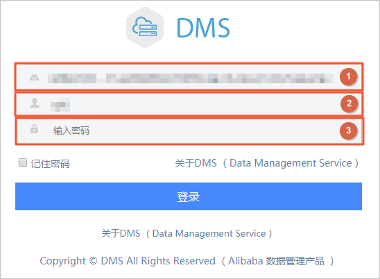

   - ①：实例的地址和端口，格式为 `<`内网地址`>:<`内网端口号`>` ，例如rm-bpxxxxxxx.xxx.aliyuncs.com:3433。查看内网地址和端口请参见查看连接地址和端口。

   - ②：实例的账号名称。

   - ③：实例的账号密码。

5. 单击**登录**。

   > **说明**
   >
   > 若您希望浏览器记住该账号的密码，可以先勾选**记住密码**，再单击**登录**。

<a id="section-8-3"></a>

## 8.3. 临时混访方案（同时保留经典网络和专有网络地址）

为满足日益增多的网络迁移需求，PolarDB新增了网络混访功能，可实现在无访问中断的情况下将经典网络平滑迁移到VPC上。

**背景信息**

以往将PolarDB实例从经典网络迁移到VPC时，经典网络的内网地址会变为VPC的内网地址（连接字符串没有变化，背后的IP地址有变化），会造成1次30秒内的闪断，而且经典网络中的ECS将不能再通过内网访问该PolarDB实例，为了能够平滑迁移网络，PolarDB新增了网络混访功能。

混访是指PolarDB实例可以同时被经典网络和专有网络中的ECS访问。在混访期间，PolarDB实例会保留原经典网络的内网地址并新增一个VPC下的内网地址，迁移网络时不会出现闪断。

基于安全性及性能的考虑，我们推荐您仅使用VPC，因此混访期有一定的期限，原经典网络的内网地址在保留时间到期后会被自动释放，应用将无法通过经典网络的内网地址访问数据库。为避免对业务造成影响，您需要在混访期中将VPC下的内网地址配置到您所有的应用中，以实现平滑的网络迁移。

例如，某一公司要将经典网络迁移至VPC时，若选用混访的迁移方式，在混访期内，一部分应用通过VPC访问数据库，一部分应用仍通过原经典网络的内网地址访问数据库，等所有应用都可以通过VPC访问数据库时，就可以将原经典网络的内网地址释放掉，如下图所示。

经典网络平滑迁移至VPC

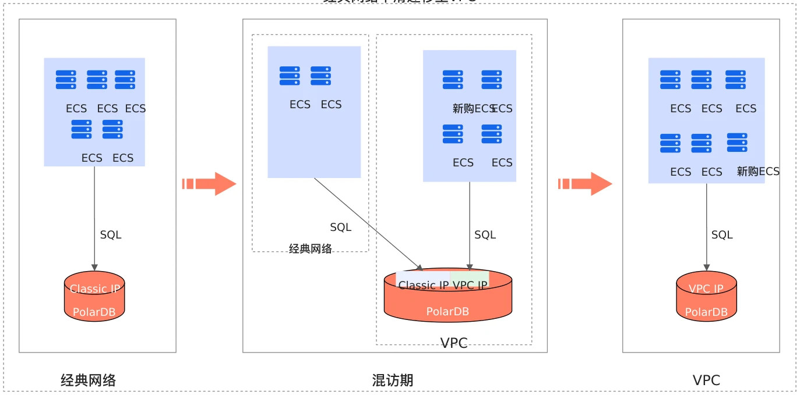

**功能限制**

在混访期间，有如下功能限制：

- 不支持切换成经典网络。

- 不支持迁移可用区。

**前提条件**

- 实例的网络类型是经典网络。

- 实例所在可用区已有可用的VPC和交换机。

**从经典网络迁移至VPC**

1. 登录云原生数据库PolarDB控制台

2. 在**实例列表**页面，单击目标实例ID或者单击实例右侧**操作**列下的**管理**，打开**基本信息**页面。

3. 在左侧导航栏中单击**数据库连接**。

4. 单击**切换专有网络**。

5. 在弹出的对话框中，选择VPC和交换机，以及是否保留经典网络地址。

   选择是否勾选**保留经典网络**，具体说明如下表所述。

   - **不勾选**：不保留经典网络地址，原经典网络地址变为VPC地址。

     如果不保留经典网络地址，则切换网络类型时，PolarDB实例会发生一次30秒的闪断，而且经典网络的ECS对该PolarDB实例的内网访问会立即断开。

   - **勾选**：保留经典网络地址，同时生成一个新的VPC地址。表示使用混访模式，即PolarDB可以同时被经典网络和VPC的ECS通过内网访问。

     如果保留经典网络地址，则切换网络类型时，PolarDB实例不会发生闪断，而且经典网络的ECS对该PolarDB实例的内网访问也不会断开，直到经典网络地址到期才断开。

     选择保留经典网络地址的有效时间，在这个时间到期前，请将VPC地址配置到VPC的ECS中，以实现业务平滑迁移到VPC。

6. 将VPC的ECS内网IP地址添加到PolarDB实例的专有网络白名单分组，使得ECS可以通过内网访问PolarDB。如果没有专有网络的分组，请新建分组。如何添加白名单请参见设置白名单。

<a id="section-8-4"></a>

## 8.4. 切换网络类型

您可以根据业务需求将PolarDB MySQL实例的网络类型在经典网络和专有网络之间切换。

**背景信息**

- 经典网络：实例之间不通过网络进行隔离，只能依靠实例自身的白名单策略来阻挡非法访问。

- 专有网络（VPC）：一个VPC就是一个隔离的网络环境。VPC的安全性较高，推荐您使用VPC网络。

  您可以自定义VPC中的路由表、IP地址范围和网关。此外，您还可以通过专线或者VPN的方式将自建机房与阿里云VPC组合成一个虚拟机房，实现应用平滑上云。

**从专有网络（VPC）切换为经典网络**

PolarDB MySQL实例切换为经典网络后，内网地址不变（连接字符串不变，该字符串对应的IP地址会改变），VPC中的ECS将不能再通过该内网地址访问该PolarDB MySQL实例，请注意变更应用端的连接地址。

> **说明**
>
> 在切换网络类型时，PolarDB MySQL服务可能会出现一次30秒的闪断，请您尽量在业务低峰期执行切换操作，或确保您的应用有自动重连机制，以避免闪断造成的影响。

1. 登录云原生数据库PolarDB控制台

2. 在**实例列表**页面，单击目标实例ID或者单击实例右侧**操作**列下的**管理**，打开**基本信息**页面。

3. 在页面左侧导航栏中单击**数据库连接**。

4. 在**数据库连接**页面，单击**切换为经典网络**。

5. 在弹出的对话框中，单击**确定**。

**从经典网络切换为专有网络（VPC）**

1. 登录云原生数据库PolarDB控制台

2. 在**实例列表**页面，单击目标实例ID或者单击实例右侧**操作**列下的**管理**，打开**基本信息**页面。

3. 在页面左侧导航栏中单击**数据库连接**。

4. 在**数据库连接**页面，单击**切换专有网络**。

5. 在弹出的对话框中，选择VPC和交换机，以及是否**保留原经典网络**地址，单击确定。

   关于**保留原经典网络**的详情，请参见临时混访方案（同时保留经典网络和专有网络地址）。

<a id="section-8-5"></a>

## 8.5. 切换专有网络VPC和虚拟交换机

您可以直接切换PolarDB MySQL实例的专有网络VPC和虚拟交换机。

**前提条件**

PolarDB MySQL实例的网络类型为专有网络。

**操作步骤**

1. 登录云原生数据库PolarDB控制台

2. 在**实例列表**页面，单击目标实例ID或者单击实例右侧**操作**列下的**管理**，打开**基本信息**页面。

3. 在页面左侧导航栏中单击**数据库连接**。

4. 在**数据库连接**页面，单击**切换交换机**。

5. 选择VPC和虚拟交换机，单击**确定**。

   > **说明**
   >
   > 如需新建VPC或虚拟交换机请单击**到控制台创建**。

6. 在弹出的风险提示框中单击**确定切换**。

   > **说明**
   >
   > - 切换过程会有30秒闪断，请确保应用程序具有重连机制。
   >
   > - 客户端缓存会导致只能读取数据，无法写入数据，请及时清理缓存。

<a id="section-9"></a>

# 9.数据库代理

<a id="section-9-1"></a>

## 9.1. 数据库独享代理

PolarDB MySQL提供数据库独享代理服务，基于独享代理提供更多高级功能，例如读写分离、连接池、事务拆分等。

**前提条件**

实例版本需为MySQL5.7或8.0双机高可用版（本地SSD盘）。

**背景信息**

PolarDB MySQL数据库独享代理服务是使用独立代理计算资源为当前实例提供代理服务，优势如下：

- 使用代理连接地址后可以不用反复变更应用内的连接地址，减少维护成本，只要不释放代理，代理连接地址可以永远使用。例如您在大促时期开启读写分离，大促结束后释放只读实例，关闭读写分离，也不用变更应用内的连接地址。

- 避免了共享实例代理时多用户争抢资源导致访问服务不稳定。

- 使用独立实例代理，资源可扩展，可承载更高流量。

**功能限制**

- 数据库独享代理暂不支持SSL加密。

- 数据库独享代理暂不支持压缩协议。

**注意事项**

- 当主实例或只读实例变更配置时可能会出现连接闪断。

- 使用代理连接地址时，如果没有启用事务拆分，事务请求都会路由到主实例。

- 使用代理连接地址进行读写分离时，不保证非事务读的一致性，业务上有读一致性需求可以封装到事务中。

- 使用代理连接地址时， `SHOW PROCESSLIST` 会将所有节点的结果合并后返回。

- 如果执行了Multi-Statements或存储过程，当前连接的后续请求会全部路由到主节点，需断开当前连接并重新连接才能恢复读写分离。

- 支持Hint语法 `/*FORCE_MASTER*/` 和 `/*FORCE_SLAVE*/` ，但是因为Hint的路由优先级最高，例如Hint不受一致性、事务的约束，需要您评估是否可以用于业务。另外Hint语句里不能包含改变环境变量的语句，例如 `/*FORCE_SLAVE*/ SET names utf8;` ，可能导致后续业务出错。

- 独享代理的连接模型是1：N（即您的一个连接会后端连接到主实例和所有只读实例），建议开通独享代理后，主实例和只读实例的连接数规格尽量一致，否则业务的连接数会受限于最小规格的实例连接数限制。

- 开启独享代理后，新增只读实例或只读实例重启，只有新的连接的请求才会路由到新的只读实例或重启的只读实例，老的连接请求不会路由过去。

- 主实例与只读实例的参数**max_prepared_stmt_count**需要保持一致。

**开通数据库独享代理**

1. 登录云原生数据库PolarDB控制台。

2. 在**实例列表**页面，单击目标实例ID或者单击实例右侧**操作**列下的**管理**，打开**基本信息**页面。

3. 在左侧导航栏中单击**数据库代理**。

4. 单击**立即开启**。

5. 在**开启数据库代理服务**页面，选择**网络类型**为<strong>内网地址（经典地址）</strong>或**外网地址**。

**页面介绍**

开启数据库独享代理后，您可以使用代理连接地址开通读写分离、连接池、事务拆分。

<table>
  <tr>
    <th>类别</th>
    <th>参数</th>
    <th>说明</th>
  </tr>
  <tr>
    <td rowspan="4">代理地址</td>
    <td>实例ID</td>
    <td>代理实例ID。</td>
  </tr>
  <tr>
    <td>关联代理实例数量</td>
    <td>代理连接地址关联的代理数量，可以通过增加代理数量提升代理处理请求的能力。公测结束后增加代理数量会产生费用。</td>
  </tr>
  <tr>
    <td>读写分离功能</td>
    <td>代理连接地址是否开通了读写分离功能。详情请参见开启读写分离。</td>
  </tr>
  <tr>
    <td>连接池</td>
    <td>您可以选择<strong>关闭</strong>、<strong>开启会话级连接池</strong>或<strong>开启事务级连接池</strong>。</td>
  </tr>
  <tr>
    <td rowspan="3">连接地址</td>
    <td>连接地址</td>
    <td>代理连接地址，独享代理目前提供一个代理地址，读写分离功能绑定该地址。<br>说明您可以单击右侧的<strong>复制地址</strong>将代理连接地址复制到剪贴板。</td>
  </tr>
  <tr>
    <td>端口</td>
    <td>代理连接地址的端口。</td>
  </tr>
  <tr>
    <td>网络地址类型</td>
    <td>代理地址的网络地址类型。</td>
  </tr>
  <tr>
    <td rowspan="3">代理实例</td>
    <td>代理类型</td>
    <td>当前仅支持<strong>独享代理</strong>。</td>
  </tr>
  <tr>
    <td>代理规格</td>
    <td>代理的规格，当前仅支持2核CPU、4GB内存的规格。</td>
  </tr>
  <tr>
    <td>开通数量（个）</td>
    <td>代理的数量。最多60个。<br>说明推荐的代理个数为主实例及只读实例CPU核数的1/8（向上取整）。例如主实例为8核CPU，只读实例为4核CPU，则推荐代理数量=⌈(8+4)/8⌉ = 2。</td>
  </tr>
</table>

**代理版本升级**

1. 登录云原生数据库PolarDB控制台

2. 在**实例列表**页面，单击目标实例ID或者单击实例右侧**操作**列下的**管理**，打开**基本信息**页面。

3. 在左侧导航栏中单击**数据库代理**。

4. 在**代理地址**页面单击**大版本升级：1.0升级到2.0**。

5. 在**小版本升级设置**页面选择**立即升级**或**可维护时间内进行升级**。

6. 单击**确定**。

**调整代理数量**

> **说明**
>
> 调整代理数量会导致应用闪断，请确保系统具备重连机制。

1. 登录云原生数据库PolarDB控制台

2. 在**实例列表**页面，单击目标实例ID或者单击实例右侧**操作**列下的**管理**，打开**基本信息**页面。

3. 在左侧导航栏中单击**数据库代理**。

4. 在**代理实例**区域的**开通数量**右侧修改数量，并在**调整方案**右侧单击**应用**。

5. 在弹出的对话框中，您可以选择**立即切换**来立即应用变更的代理数量，也可以选择**可维护时间内进行切换**或**指定切换开始时间**来设置变更生效的时间，单击**确定**。

**关闭代理服务**

1. 登录云原生数据库PolarDB控制台

2. 在**实例列表**页面，单击目标实例ID或者单击实例右侧**操作**列下的**管理**，打开**基本信息**页面。

3. 在左侧导航栏中单击**数据库代理**。

4. 在右上角单击**关闭代理服务**。

5. 在弹出的对话框中，单击**确定**。

<a id="section-9-2"></a>

## 9.2. 读写分离

<a id="section-9-2-1"></a>

### 9.2.1. 开启读写分离

读写分离是指通过独享代理地址（读写分离地址）实现读写请求的自动转发。

**前提条件**

- 实例版本为MySQL 5.7或8.0高可用版（本地SSD盘）。

- 已开启数据库代理或数据库独享代理。详情请参见开通数据库独享代理。

- 已创建至少一个只读实例。如何创建只读实例请参见创建只读实例。

**背景信息**

在对数据库有少量写请求，但有大量读请求的应用场景下，单个实例可能无法承受读取压力，甚至对业务产生影响。为了实现读取能力的弹性扩展，分担数据库压力，您可以创建一个或多个只读实例，利用只读实例满足大量的数据库读取需求。

创建只读实例后，您可以开通读写分离，开通读写分离后您会获得一个读写分离地址，在应用程序中配置读写分离地址，就可以使写请求自动转发到主实例，读请求自动转发到各个只读实例。

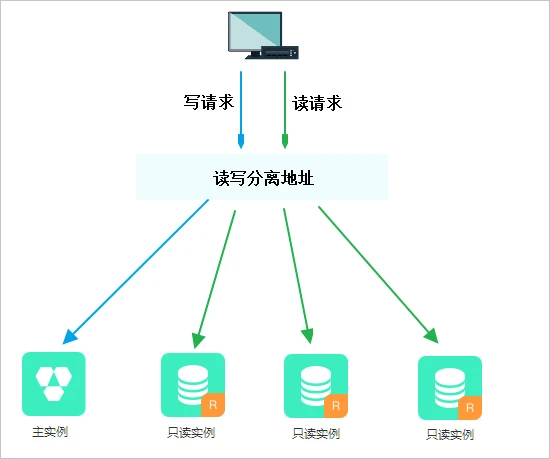

**读写分离地址和内外网地址区别**

开通读写分离后，您就可以将读写分离地址配置在应用程序中，客户端发出的请求到达该地址后会根据请求类型和实例权重自动分配给内部的各个实例。

应用程序中的地址如果是主实例的内网或外网地址，则请求只会交给主实例，而不会交给只读实例处理，必须在程序中添加主实例以及各个只读实例的地址及权重，才能达到读写分离地址的效果。

**转发逻辑**

- 只发往主实例

  - 所有DML操作（INSERT、UPDATE、DELETE、SELECT FOR UPDATE）。

  - 所有DDL操作（建表/库、删表/库、变更表结构、权限等）。

  - 所有事务中的请求。

  - 用户自定义函数。

  - 存储过程。

  - EXECUTE语句。

  - Multi Statements。

  - 使用到临时表的请求。

  - SELECT last_insert_id()。

  - 所有对用户变量的查询和更改。

  - SHOW PROCESSLIST。

  - KILL（SQL语句中的KILL，非命令KILL）。

- 发往只读实例或主实例

  - 非事务中的读请求。

  - COM_STMT_EXECUTE命令。

- 总是发往所有实例

  - 所有系统变量的更改。

  - USE命令。

  - COM_STMT_PREPARE命令。

  - COM_CHANGE_USER、COM_QUIT、COM_SET_OPTION等命令。

**功能优势**

- 统一读写分离地址，方便维护。

  不开通读写分离时，您需要在应用程序中分别配置主实例和每个只读实例的连接地址，才能实现将写请求发往主实例而将读请求发往只读实例。

  PolarDB读写分离功能提供一个独享代理地址，您连接该地址后即可对主实例和只读实例进行读写操作，读写请求被自动转发到对应实例，可降低维护成本。同时，您只需添加只读实例的个数，即可不断扩展系统的处理能力，应用程序无需做任何修改。

- 原生链路支持，提升性能，减少维护成本。

  如果您在云上自行搭建代理层实现读写分离，数据在到达数据库之前需要经历多个组件的语句解析和转发，对响应延迟有较大的影响。而PolarDB读写分离内置在PolarDB原生生态里，能够有效降低延迟，提升处理速度，同时减少客户的维护成本。

- 可设权重和阈值，符合多场景使用。

  您可以设置主实例和只读实例的读请求权重，以及设置只读实例的延迟阈值。

- 实例健康检查，提升数据库系统的可用性。

  读写分离模块将自动对主实例和只读实例进行健康检查，当发现某个实例出现宕机或者延迟超过阈值时，将不再分配读请求给该实例，读写请求在剩余的健康实例间进行分配。以此确保单个只读实例发生故障时，不会影响应用的正常访问。当实例被修复后，PolarDB会自动将该实例纳回请求分配体系内。

  > **说明**
  >
  > 为避免单点故障，建议您为一个主实例创建至少两个只读实例。

**注意事项**

- 当主实例或只读实例变更配置时，可能会出现连接闪断。

- 新增只读实例后，新建的连接才会被路由到新的只读实例上。

- 独享代理地址暂不支持SSL加密。

- 独享代理地址暂不支持压缩协议。

- 使用独享代理连接地址时，事务请求都会路由到主实例。

- 使用独享代理连接地址进行读写分离时，不保证非事务读的一致性，业务上有读一致性需求可以封装到事务中。

- 使用独享代理连接地址时， `show processlist` 会将所有节点的结果合并后返回。

- 如果开通了短连接优化功能， `show processlist` 可能会显示闲置的用户连接。

- 如果执行了Multi-Statements或存储过程，当前连接的后续请求会全部路由到主节点，需要断开当前连接并重新连接才能恢复读写分离。

- 支持Hint语法 `/*FORCE_MASTER*/` 和 `/*FORCE_SLAVE*/` ，但是因为Hint的路由优先级最高，例如Hint不受一致性、事务的约束，需要您评估是否可以用于业务。另外Hint语句里不能包含改变环境变量的语句，例如 `/*FORCE_SLAVE*/ set names utf8;` ，可能导致后续业务出错。

**前提条件**

已为主实例创建了只读实例，详情请参见创建只读实例。

**开通读写分离**

1. 登录云原生数据库PolarDB控制台

2. 在**实例列表**页面，单击目标实例ID或者单击实例右侧**操作**列下的**管理**，打开**基本信息**页面。

3. 在左侧导航栏中单击**数据库代理**。

4. 在**读写分离**页签，单击**立即开启**。

5. 设置如下参数。

   | 参数 | 说明 |
   | --- | --- |
   | 延迟阈值 | 只读实例同步主实例数据时允许的最长延迟时间。若一个只读实例的延迟时间超过该阈值，则不论该只读实例的权重是多少，读请求都不会转发至该只读实例。取值范围为0秒到3600秒。受限于SQL的执行情况，只读实例有一定的几率会出现延迟，建议该值不小于30秒。 |
   | 权重分配 | 实例的读权重越高，处理的读请求越多。例如，假设主实例有3个只读实例，读权重分别为0、100、200和200，则表示主实例不处理读请求（写请求仍然自动发往主实例），3个只读实例按照1：2：2的比例处理读请求。<br>• <strong>系统分配</strong>：系统根据实例规格自动分配各个实例的读权重。后续该主实例下新增的只读实例也会自动按照系统分配的权重加入到读写分离链路中，无需手动设置。<br>• <strong>自定义</strong>：手动设置各个实例的读权重，范围为0~10000。后续该主实例下新增只读实例的读权重默认为0，需要您手动修改。 |

6. 单击**确定**。

<a id="section-9-2-2"></a>

### 9.2.2. 设置读写分离

您可以通过云原生数据库PolarDB控制台设置延迟阈值和自定义读权重分配。

**前提条件**

- 实例版本为MySQL 5.7或8.0高可用版（本地SSD盘）。

- 已开通读写分离，详情请参见开启读写分离。

**操作步骤**

1. 登录云原生数据库PolarDB控制台

2. 在**实例列表**页面，单击目标实例ID或者单击实例右侧**操作**列下的**管理**，打开**基本信息**页面。

3. 在左侧导航栏中，单击**数据库代理**。

4. 单击**读写分离**页签中的**设置读写分离**。

5. 设置如下参数。

   <table>
     <tr>
       <th width="105">参数</th>
       <th>说明</th>
     </tr>
     <tr>
       <td>延迟阈值</td>
       <td>只读实例同步主实例数据时允许的最长延迟时间。若一个只读实例的延迟时间超过该阈值，则不论该只读实例的权重是多少，读请求都不会转发至该只读实例。取值范围为0秒到7200秒。受限于SQL的执行情况，只读实例有一定的几率会出现延迟，建议该值不小于30秒。</td>
     </tr>
     <tr>
       <td>读权重分配</td>
       <td>实例的读权重越高，处理的读请求越多。例如，假设主实例有3个只读实例，读权重分别为0、100、200和200，则表示主实例不处理读请求（写请求仍然自动发往主实例），3个只读实例按照1：2：2的比例处理读请求。<br>• <strong>系统分配</strong>：系统根据实例规格自动分配各个实例的读权重。后续该主实例下新增的只读实例也会自动按照系统分配的权重加入到读写分离链路中，无需手动设置。<br>• <strong>自定义</strong>：手动设置各个实例的读权重，范围为0至10000。后续该主实例下新增只读实例的读权重默认为0，需要您手动修改。</td>
     </tr>
   </table>

6. 单击**确定**。

<a id="section-9-2-3"></a>

### 9.2.3. 关闭读写分离

本文档介绍如何在云原生数据库PolarDB控制台上关闭读写分离。

**前提条件**

- 实例版本为MySQL 5.7或8.0高可用版（本地SSD盘）。

- 已开通读写分离，详情请参见开启读写分离。

**操作步骤**

1. 登录云原生数据库PolarDB控制台。

2. 在**实例列表**页面，单击目标实例ID或者单击实例右侧**操作**列下的**管理**，打开**基本信息**页面。

3. 在左侧导航栏，单击**数据库代理**。

4. 单击**读写分离**页签中的**关闭读写分离**。

5. 在弹出的**关闭读写分离**对话框中，单击**确定**。

<a id="section-10"></a>

# 10.监控与报警

<a id="section-10-1"></a>

## 10.1. 查看系统资源和引擎监控

为方便查看和掌握实例的运行状态，PolarDB MySQL版专有云控制台提供了丰富的性能监控项。

**前提条件**

实例版本为MySQL 5.7或8.0双机高可用版（本地SSD盘）。

**操作步骤**

1. 在**实例列表**页面，单击目标实例ID或者单击实例右侧**操作**列下的**管理**，打开**基本信息**页面。

2. 在左侧导航栏中，单击**监控与报警**。

3. 在**监控与报警**页面，选择**资源监控**、**引擎监控**或**部署监控**，并选择查询时间，即可查看相应的监控数据，具体监控项介绍如下。

   **类别**

   **监控项**

   **说明**

   CPU和内存使用率（%）

   实例的CPU和内存使用率（不含操作系统占用）。

   实例的磁盘空间使用量，包括：

   - 磁盘空间总体使用量。

   - 数据空间使用量。

   磁盘空间（单位：MByte）

   - 日志空间使用量。

   - 临时文件空间使用量。

   **资源监控**

   - 系统文件空间使用量。

   IOPS（单位：次/秒）

   实例的每秒I/O请求次数。

   当前总连接数

   实例当前总连接数，包括活跃连接数和总连接数。

   网络流量（单位：KB）

   实例每秒钟的输入、输出流量。

   TPS（平均每秒事务数）/QPS（平均每秒SQL语

   平均每秒事务数和平均每秒SQL语句执行次数。

   句执行次数）

   InnoDB缓存读命中率、使用

   InnoDB缓冲池的读命中率、利用率以及缓冲池脏块的百分比。

   率、脏块率（%）

   InnoDB读写量（单位：

   InnoDB每秒读取和写入的数据量。

   KB）InnoDB缓存请求次数

   InnoDB每秒钟的读取和写入次数。

   InnoDB每秒向日志文件的物理写入次数、日志写请求、向日志文件完

   InnoDB日志读/写/fsync

   成的fsync写数量。

   MySQL执行语句时在硬盘上

   数据库执行SQL语句时在硬盘上自动创建的临时表的数量。

   自动创建的临时表的数量

   数据库每秒SQL语句执行次数，包括：

   - Insert

   - Delete

   - Insert_Select

   **引擎监**

   MySQL_COMDML

   **控**

   - Replace

   - Replace_Select

   - Select

   - Update

   InnoDB每秒钟操作执行次数，包括：

   - 每秒向日志文件的物理写次数。

   MySQL_RowDML

   - 每秒从InnoDB表读取、更新、删除、插入的行数。

   实例当前的线程状态。包括：

   MySQL_ThreadStatus线程

   - 活跃线程数量。

   状态

   - 线程连接数量。

   InnoDB每秒写入redo log日

   InnoDB平均每秒钟写入的数据量。

   志量 （单位：bytes/s）

   InnoDB行锁等待次数和时长。包括：

   - Innodb_row_lock_waits：从数据库系统启动以来，行锁等待的总次数。

   MySQL_ROW_LOCK

   - Innodb_row_lock_time_avg：平均行锁等待时长。

   - Innodb_row_lock_time：所有InnoDB行锁等待时间的总和。

   每秒全表扫描的次数。

   MySQL_SelectScan

   备节点复制线程状态

   备节点复制线程状态。包括备节点IO线程状态和备节点SQL线程状态。

   **部署监控**

   备节点复制延迟（单位：

   备节点复制延迟时间。

   秒）

<a id="section-10-2"></a>

## 10.2. 设置报警规则

您可以通过PolarDB MySQL版专有云控制台创建报警规则，帮助您及时了解实例的监控数据异常并快速进行处理。

**前提条件**

实例版本为MySQL 5.7或8.0双机高可用版（本地SSD盘）。

**操作步骤**

1. 登录云原生数据库PolarDB控制台。

2. 在**实例列表**页面，单击目标实例ID或者单击实例右侧**操作**列下的**管理**，打开**基本信息**页面。

3. 在左侧导航栏中，单击**监控与报警**。

4. 在**报警**页签，单击**报警规则设置**。

5. 在**报警规则**页面，单击**创建告警规则**。

6. 在**创建/修改告警规则**页面，设置以下参数。

   <table>
     <tr>
       <th width="138">参数</th>
       <th>说明</th>
     </tr>
     <tr>
       <td>云产品选择</td>
       <td>默认值，无需选择。</td>
     </tr>
     <tr>
       <td>资源范围</td>
       <td>报警规则的作用范围，取值范围如下：<br>• <strong>实例维度</strong>：选择当前组织资源集下的一个或多个目标实例。<br>• <strong>资源集维度</strong>：选择当前组织和地域下的目标资源集。<br>• <strong>应用分组维度</strong>：选择当前组织和地域下的应用分组。<br>• <strong>全部资源</strong>：报警规则作用于指定云产品的全部资源上，对于新加入的资源生效。</td>
     </tr>
     <tr>
       <td>报警规则描述</td>
       <td>报警规则的主体。当监控数据满足报警条件时，触发报警规则。规则描述的设置方法如下：<br>i. 单击<strong>创建报警规则</strong>。ii. 在<strong>创建报警规则</strong>页面，设置<strong>规则名称</strong>、<strong>监控指标</strong>、<strong>监控维度、</strong>阈值及报警级别等。iii. 单击<strong>确定</strong>。</td>
     </tr>
     <tr>
       <td>沉默通道周期</td>
       <td>报警发生后未恢复正常，间隔多久重复发送一次报警通知。取值：<strong>5分钟</strong>、<strong>15分钟</strong>、<strong>30</strong><strong>分钟</strong>、<strong>1小时</strong>、<strong>3小时</strong>、<strong>6小时</strong>、<strong>12小时</strong>和<strong>24小时</strong>。当某监控指标超出报警阈值时触发报警，如果监控指标在通道沉默周期内持续超过报警阈值，在通道沉默周期内不会重复发送报警通知；如果监控指标在通道沉默周期后仍未恢复正常，则云监控将再次发送报警通知。例如，当<strong>通道沉默周期</strong>设置为<strong>12小时</strong>时，如果超出报警阈值的监控指标在首次触发报警后12小时仍未恢复正常，云监控将再次发送报警通知。</td>
     </tr>
     <tr>
       <td>生效时间</td>
       <td>报警规则的生效时间。报警规则只在生效时间内检查监控数据是否超出报警阈值。</td>
     </tr>
     <tr>
       <td>报警回调</td>
       <td>用于接收云监控通过POST请求推送报警消息的回调地址。<br>说明报警回调地址必须是云监控可访问的域名地址，仅支持HTTP协议，不支持填写IP。</td>
     </tr>
     <tr>
       <td>无数据处理方法</td>
       <td>无报警时的处理方法。取值范围如下：<br>• <strong>不做任何处理</strong>：无报警时不做任何处理。<br>• <strong>发送无数据报警</strong>：无报警时发送无数据报警给报警联系人。</td>
     </tr>
     <tr>
       <td>报警联系人</td>
       <td>选择报警信息发送的用户。</td>
     </tr>
   </table>

7. 单击**确定**。

<a id="section-11"></a>

# 11.云监控

<a id="section-11-1"></a>

## 11.1. 查看监控大盘指标

云监控（CloudMonitor，CMS）页面提供了丰富的性能监控项和秒级监控频率，方便您掌握集群或实例的运行状态并通过细粒度的监控数据快速定位运维问题。

**监控大盘**

1. 登录Apsara Uni-manager运营控制台。

2. 在顶部菜单栏，单击**产品 > 数据库**，选择目标数据库产品。

3. 您可以通过如下两种方式查看云监控信息。

   <ol type="i">

   <li>

   方式一

   <ol type="a">

   <li>

   在目标列表页面，单击目标实例或集群ID。

   </li>

   <li>

   在左侧导航栏中，选择**云监控**。

   </li>

   </ol>

   </li>

   <li>

   方式二

   <ol type="a">

   <li>

   在目标列表页面，单击目标实例监控列下的  图标。

   </li>

   <li>

   查看相关监控数据。

   </li>

   </ol>

   </li>

   </ol>

4. 您可以根据业务需求选择查看所需的监控信息，相关监控指标请参见<strong>《云监控CMS用户指南》</strong>中**云监控指标说明-数据库**章节。

   > **说明**
   >
   > 在**时间粒度**下拉框，您可以根据业务需求选择查看监控信息的时间段，支持查看**最近1分钟**到**最近30天**的数据。

<a id="section-11-2"></a>

## 11.2. 报警历史

当报警发生后，可以查看报警历史信息。支持导出并下载报警历史信息，便于在本地进行数据分析。

**操作步骤**

1. 登录Apsara Uni-manager运营控制台。

2. 在顶部菜单栏，单击**产品 > 数据库**，选择目标数据库产品。

3. 在目标列表页面，单击目标实例或集群ID。

4. 在左侧导航栏，单击**云监控**，选择**报警服务** > **报警历史**。

5. （可选）在**报警历史**页面，可通过**规则ID**、**规则名称**、**报警级别**和时间来筛选报警历史记录。

6. 在报警历史页面，执行以下操作。

   <table>
     <tr>
       <th width="122">操作任务</th>
       <th>操作步骤</th>
     </tr>
     <tr>
       <td>查看报警历史</td>
       <td>在<strong>报警历史</strong>列表中，可以直接查看目标报警历史的<strong>产品名称</strong>、<strong>故障实</strong><strong>例</strong>、<strong>发生时间</strong>、<strong>规则名称</strong>、<strong>状态</strong>、<strong>等级</strong>和<strong>通知对象</strong>。单击目标报警历史对应规格名称，可以查看报警规则详情。<br>说明报警历史默认支持查询最近2天的数据。</td>
     </tr>
     <tr>
       <td>导出报警历史</td>
       <td>i. 在<strong>报警历史</strong>页面，单击页面右上方的。<br>ii. 在<strong>导出任务</strong>对话框中，设置<strong>时间选择</strong>和<strong>任务名称</strong>后，单击<strong>确定</strong>。</td>
     </tr>
   </table>

<a id="section-11-3"></a>

## 11.3. 报警规则

<a id="section-11-3-1"></a>

### 11.3.1. 创建报警规则

创建报警规则，按照所设定的云产品监控指标阈值进行告警，及时通知相关用户。

**背景信息**

报警规则在生效时间内，根据默认的探测频率检测报警指标是否超出所设定的阈值，一旦检测到云产品监控指标超出阈值（出现异常），按照设定的报警联系人或其他报警信息处理平台进行告警。

> **说明**
>
> 最小报警探测频率为每分钟一次。

**操作步骤**

1. 登录Apsara Uni-manager运营控制台。

2. 在顶部菜单栏，单击**产品 > 数据库**，选择目标数据库产品。

3. 在目标列表页面，单击目标实例或集群ID。

4. 在左侧导航栏，单击**云监控**，选择**报警服务** > **报警规则**。

5. 单击列表上方的**创建报警规则**。

6. 在**创建报警规则**面板中，根据实际需要设置相应配置项。

   <table>
     <tr>
       <th width="105">配置项</th>
       <th>说明</th>
     </tr>
     <tr>
       <td>云产品选择</td>
       <td>默认，无需选择。</td>
     </tr>
     <tr>
       <td>资源范围</td>
       <td>报警规则关联资源的范围，支持以下几类。不同云产品可选择的范围类型存在一定差异。<br>• <strong>实例维度</strong>：选择当前组织资源集下的一个或多个目标实例。<br>• <strong>资源集维度</strong>：选择当前组织和地域下的目标资源集。<br>• <strong>应用分组维度</strong>：选择当前组织和地域下的应用分组。<br>• <strong>全部资源</strong>：默认不支持选择。</td>
     </tr>
   </table>

   <table>
     <tr>
       <th width="137">资源选择</th>
       <th>根据<strong>资源范围</strong>的选择，选择具体的资源实例、资源集或应用分组。</th>
     </tr>
     <tr>
       <td>报警规则描述</td>
       <td>报警规则的主体。当监控数据满足报警条件时，触发报警规则。规则描述设置方法：<br>i. 单击<strong>创建报警规则</strong>。ii. 在<strong>创建报警规则</strong>面板，设置<strong>规则名称</strong>、<strong>指标维度</strong>、<strong>监控指标</strong>、<strong>阈值及报警级别</strong>等。<br>说明指标维度仅在资源范围选择<strong>实例维度</strong>时才会显示。<br>iii. 单击<strong>确认</strong>。</td>
     </tr>
     <tr>
       <td>通道沉默周期</td>
       <td>报警发生后未恢复正常，间隔多久重复发送一次报警通知。取值：<strong>5分钟</strong>、<strong>15分钟</strong>、<strong>30分</strong><strong>钟</strong>、<strong>1小时</strong>、<strong>3小时</strong>、<strong>6小时</strong>、<strong>12小时</strong>和<strong>24小时</strong>。当某监控指标超出报警阈值时触发报警，如果监控指标在通道沉默周期内持续超过报警阈值，在通道沉默周期内不会重复发送报警通知；如果监控指标在通道沉默周期后仍未恢复正常，则云监控将再次发送报警通知。例如，当<strong>通道沉默周期</strong>设置为<strong>12小时</strong>时，如果超出报警阈值的监控指标在首次触发报警后12小时仍未恢复正常，云监控将再次发送报警通知。</td>
     </tr>
     <tr>
       <td>生效时间</td>
       <td>报警规则的生效时间。报警规则只在生效时间内检查监控数据是否超出报警阈值。</td>
     </tr>
     <tr>
       <td>报警回调</td>
       <td>用于接收云监控通过POST请求推送报警消息的回调地址。<br>说明报警回调地址必须是云监控可访问的域名地址，仅支持HTTP协议，不支持填写IP。</td>
     </tr>
     <tr>
       <td>无数据处理方法</td>
       <td>无监控数据时报警的处理方式。<br>• 不做任何处理<br>• 发送无数据报警</td>
     </tr>
     <tr>
       <td>报警联系人</td>
       <td>选择报警信息发送的用户组或用户。默认的云账号报警联系人组是一个空账号，可用于测试报警规则的有效性。</td>
     </tr>
   </table>

7. 单击**确定**。

**规则描述配置项说明**

| 配置项 | 说明 |
| --- | --- |
| 规则名称 | 填写报警规则名称。 |
| 监控指标 | 从当前报警规则所选择的云产品的所有监控指标中，选择目标指标项。各云产品的监控指标详情可参见云产品监控指标说明。 |
| 指标维度 | 指除实例ID之外的其他维度。仅在资源范围选择<strong>实例维度</strong>时才会显示。 |
| 阈值及报警级别（单位：%） | • 报警级别分为<strong>紧急</strong>、<strong>警告</strong>和<strong>普通</strong>。<br>• 监控数据的聚合值类型可以选择<strong>平均值</strong>、<strong>最小值</strong>和<strong>最大值</strong>。<br>• 监控数据的周期可以选择<strong>连续</strong>、<strong>连续5个周期</strong>、<strong>连续10个周期</strong>、<strong>连续15个周期</strong>、<strong>连续30个周</strong><strong>期</strong>、<strong>连续60个周期</strong>。<br>• 实际监控数据与报警阈值之间的比较关系，支持 “<strong>&gt;</strong>”、“ <strong>&gt;=</strong>”、“<strong>&lt;</strong>”、“<strong>&lt;=</strong> ”、“<strong>=</strong>”、“<strong>!=</strong>”、“<strong>同比昨天同时间上涨</strong>”、“<strong>同比昨天同时间下降</strong>”、“<strong>环比上周期上涨”</strong>、<strong>“环比上周期</strong><strong>下降”</strong>、<strong>“比上周期增量”</strong>、<strong>“比上周期降量”</strong>的选择。还支持设置阈值和触发次数，当监控数据达到设置的阈值的触发次数时，产生报警。 |

**规则配置示例**

为数据库实例创建一个名为example的报警规则，用于监控目标数据库实例的CPU使用率，当CPU使用率峰值（最大值）在五个探测周期内有三次大于等于70%的情况时触发报警，且报警级别为紧急。

适用于此场景的规则描述配置如下图所示。

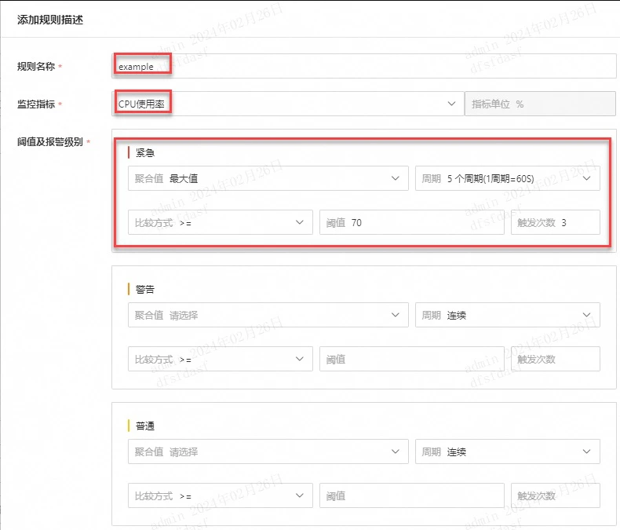

<a id="section-11-3-2"></a>

### 11.3.2. 管理报警规则

在报警规则列表中，可以对报警规则进行修改、禁用、启用、删除等操作。

**操作步骤**

1. 登录Apsara Uni-manager运营控制台。

2. 在顶部菜单栏，单击**产品 > 数据库**，选择目标数据库产品。

3. 在目标列表页面，单击目标实例或集群ID。

4. 在左侧导航栏，单击**云监控**，选择**报警服务** > **报警规则**。

5. 选择目标报警规则，执行相关操作。

   <table>
     <tr>
       <th width="154">操作任务</th>
       <th>操作步骤</th>
     </tr>
     <tr>
       <td>查看报警规则详情</td>
       <td>单击目标报警规则<strong>操作</strong>列的<strong>详情</strong>，在<strong>报警规则/报警历史/故障资源</strong>面板中可查看报警规则的详细信息。</td>
     </tr>
     <tr>
       <td>判断规则有效性</td>
       <td>单击目标报警规则<strong>有效性</strong>列的<strong>点击巡检</strong>，在有效性列可查看巡检结果。<br>说明<br>• 若巡检结果异常，可单击<strong>检测结果</strong>，在弹出的面板中查看<strong>告警规则执行异常</strong><strong>检测</strong>、<strong>告警规则加载检测</strong>、<strong>无效报警规则检测</strong>和<strong>告警规则回调检测</strong>结果。<br>• 单击<strong>重新检测</strong>，可重新检测规则有效性。</td>
     </tr>
     <tr>
       <td>查看规则执行记录</td>
       <td>单击目标报警规则<strong>规则执行记录</strong>列的<strong>查看规则执行记录</strong>，在<strong>报警规则执行记录</strong>面板中，可通过时间范围筛选执行记录。</td>
     </tr>
     <tr>
       <td>修改报警规则</td>
       <td>i. 单击目标报警规则<strong>操作</strong>列的<strong>编辑。</strong>ii. 在<strong>修改报警规则</strong>面板中，修改报警规则。相关配置参数说明请参见<strong>《创建报警规则》</strong>。iii. 修改完成后，单击<strong>确定</strong>。</td>
     </tr>
     <tr>
       <td>禁用报警规则</td>
       <td>当需要手动停止云产品的服务，进行维护或升级时，可以禁用报警规则，避免因人为变更而收到大量且无用的报警通知。<br>说明请先确认报警规则的<strong>状态</strong>为<strong>正常</strong>后，再进行禁用。<br>• 单个禁用<br>a. 单击目标报警规则<strong>操作</strong>列的图标，单击<strong>禁用。</strong><br>b. 在<strong>禁用报警规则</strong>对话框中，单击<strong>确定。</strong><br>• 批量禁用<br>a. 选中目标报警规则前的复选框，然后单击列表左下角的<strong>禁用</strong>。<br>b. 在<strong>禁用报警规则</strong>对话框，单击<strong>确定</strong>。</td>
     </tr>
     <tr>
       <td>启用报警规则</td>
       <td>完成云产品的维护或升级后，可以重新启用已被禁用的报警规则。<br>说明请先确认报警规则的<strong>状态</strong>为<strong>已禁用</strong>后，再进行禁用。<br>• 单个启用<br>a. 单击目标报警规则<strong>操作</strong>列的<strong>启用。</strong><br>b. 在<strong>启用报警规则</strong>对话框中，单击<strong>确定。</strong><br>• 批量启用<br>a. 选中目标报警规则前的复选框，然后单击列表左下角的<strong>启用</strong>。<br>b. 在<strong>启用报警规则</strong>对话框，单击<strong>确定</strong>。</td>
     </tr>
     <tr>
       <td>删除报警规则</td>
       <td>• 单个删除<br>a. 单击目标报警规则操作列的图标，单击<strong>删除</strong>。<br>b. 在<strong>删除报警规则</strong>对话框中，单击<strong>确定</strong>。<br>• 批量删除<br>a. 选中目标报警规则前的复选框，然后单击列表左下角的删除。<br>b. 在<strong>删除报警规则</strong>对话框中，单击<strong>确定</strong>。</td>
     </tr>
   </table>

<a id="section-12"></a>

# 12.数据安全性

<a id="section-12-1"></a>

## 12.1. 设置白名单

为了数据库的安全稳定，在创建PolarDB MySQL版实例后，需要先修改实例的白名单，将需要访问实例的IP地址或者IP段加入到PolarDB MySQL版实例的白名单中。

**背景信息**

白名单可以让PolarDB MySQL版实例得到高级别的访问安全保护，建议您定期维护白名单。设置白名单不会影响PolarDB MySQL版实例的正常运行。

设置白名单包括两种操作：

- 设置IP白名单：添加IP地址，允许这些IP地址访问该PolarDB MySQL版实例。

- 设置ECS安全组：添加ECS安全组，允许ECS安全组内的ECS实例访问该PolarDB MySQL版实例。

> **说明**
>
> 若ECS实例需通过内网地址访问PolarDB，请确保两者位于同一地域且网络类型一致（如均为VPC），否则即使配置白名单也无法连通。

**注意事项**

- 默认的IP白名单分组只能被修改或清空，不能被删除。

- 每个IP白名单分组最多添加1000个IP或IP段。当IP较多时，建议合并为IP段填入，例如IPv4的  `192.168.1.0/24` 或IPv6的 `2001:db8::/32` 。

**操作步骤**

1. 登录云原生数据库PolarDB控制台。

2. 在**实例列表**页面，单击目标实例ID或者单击实例右侧**操作**列下的**管理**，打开**基本信息**页面。

3. 在左侧导航栏中，单击**数据安全性**。

4. 在**白名单设置**页签中，执行以下任一操作：

   - 编辑默认分组：单击 `default` 分组后的**编辑**。

   - 新建自定义分组：单击**添加白名单分组**，创建时可指定网络类型为IPv4或IPv6，实现协议栈隔离管控。

5. 在弹出的面板中，您可以：

   - 删除已有IP地址或网段。

   - 单击**新增IP**，输入需授权的IP地址或CIDR网段（如 `10.10.10.0/24` 表示 `10.10.10.x` 全网段均可访问）。

     > **说明**
     >
     > 多个条目请用英文逗号（,）分隔，逗号前后不得包含空格，例如：IPv4的  `192.168.1.0/24` 或IPv6的 `2001:db8::/32` 。

   - 单击**加载ECS内网IP**，自动列出当前账号下所有ECS实例内网IP，便于快速选择。

   - 单击**导入文件（.txt）**，可批量导入 `.txt` 格式的IP列表。

   > **说明**
   >
   > 在 `default` 分组中新增IP后，系统将自动移除默认保留地址 `127.0.0.1` 。

<a id="section-12-2"></a>

## 12.2. 设置SSL加密

为了提高链路安全性，您可以启用SSL（Secure Sockets Layer）加密，并安装SSL CA证书到需要的应用服务。SSL在传输层对网络连接进行加密，能提升通信数据的安全性和完整性，但会同时增加网络连接响应时间。

**前提条件**

实例版本为MySQL 5.7或8.0双机高可用版。

**注意事项**

- SSL的证书有效期为1年，请在1年内更新证书有效期，否则使用加密连接的客户端程序将无法正常连接。

- 由于SSL加密的固有缺陷，启用SSL加密会显著增加CPU使用率，建议您仅在外网链路有加密需求的时候启用SSL加密。内网链路相对较安全，一般无需对链路加密。

- 读写分离地址不支持SSL加密。

- 关闭SSL加密会重启实例，请谨慎操作。

**开启SSL加密**

1. 登录云原生数据库PolarDB控制台。

2. 在**实例列表**页面，单击目标实例ID或者单击实例右侧**操作**列下的**管理**，打开**基本信息**页面。

3. 在左侧菜单栏中，单击**数据安全性**。

4. 单击**SSL**页签。

5. 单击**未开通**前面的开关。

6. 在**设置SSL**对话框中，选择要开通SSL加密的地址，单击**确定**。

7. 单击**下载CA证书**，下载SSL CA证书。

   下载的文件为压缩包，包含如下三个文件：

   - p7b文件：用于Windows系统中导入CA证书。

   - PEM文件：用于其他系统或应用中导入CA证书。

   - JKS文件：java中的truststore证书存储文件，密码统一为apsaradb，用于Java程序中导入CA证书链。

     > **说明**
     >
     > 在java中使用JKS证书文件时，jdk7和jdk8需要修改默认的jdk安全配置，在需要SSL访问的数据库所在机器的 `jre/lib/security/java.security` 文件中，修改如下两项配置：
     >
     > ```text
     > jdk.tls.disabledAlgorithms=SSLv3, RC4, DH keySize < 224
     > jdk.certpath.disabledAlgorithms=MD2, RSA keySize < 1024
     > ```
     >
     > 若不修改jdk安全配置，会报如下错误。其它类似报错，一般也都由Java安全配置导致。
     >
     > ```text
     > javax.net.ssl.SSLHandshakeException: DHPublicKey does not comply to algorithm constraints
     > ```

**配置SSL CA证书**

开通SSL加密后，应用或者客户端连接PolarDB时需要配置SSL CA证书。本文以MySQL Workbench和Navicat为例，介绍SSL CA证书的安装方法。其它应用或者客户端请参见对应产品的使用说明。

**MySQL Workbench配置方法**

1. 打开MySQL Workbench。

2. 选择**Database > Manage Connections** 。

3. 启用**Use SSL**，并导入SSL CA证书，如下图所示。

   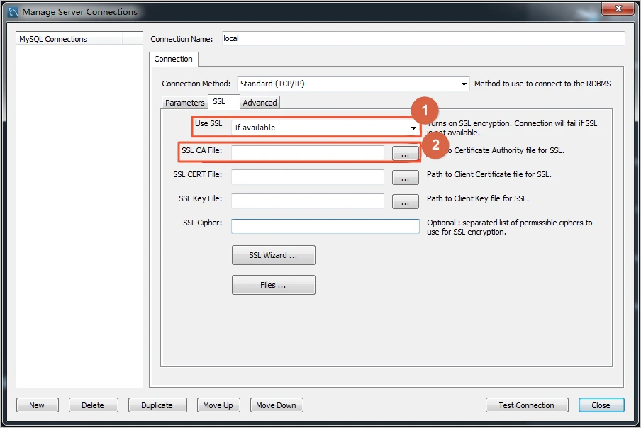

**Navicat配置方法**

1. 打开Navicat。

2. 在目标数据库上单击鼠标右键，选择**编辑连接**。

3. 单击**SSL**页签，选择.pem格式CA证书的路径，参照下图进行设置。

   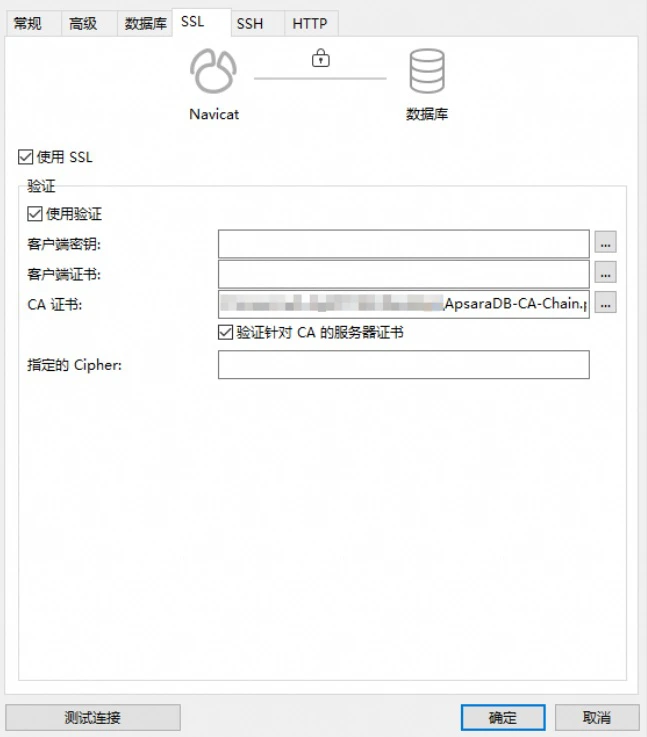

4. 单击**确定**。

   > **说明**
   >
   > 如果报 `connection is being used` 错误，是由于之前的会话未断开，请关闭Navicat重新打开。

5. 双击目标数据库测试能否正常连接。

**更新证书有效期**

> **说明**
>
> **更新有效期**操作将会重启实例，重启前请做好业务安排，谨慎操作。

1. 登录云原生数据库PolarDB控制台。

2. 在**实例列表**页面，单击目标实例ID或者单击实例右侧**操作**列下的**管理**，打开**基本信息**页面。

3. 在左侧菜单栏中，单击**数据安全性**。

4. 单击**SSL**页签。

5. 单击**更新有效期**。

6. 在弹出的**更新SSL证书有效期**对话框中，单击**确定**。

**关闭SSL加密**

> **说明**
>
> - 关闭SSL加密会重启PolarDB实例，系统会触发主备切换降低影响，但仍建议您在业务低峰期操作。
>
> - SSL加密关闭后，数据库访问性能会有一定程度提升，但安全性上会有削弱，因此在非安全环境下不建议关闭SSL加密。

1. 登录云原生数据库PolarDB控制台。

2. 在**实例列表**页面，单击目标实例ID或者单击实例右侧**操作**列下的**管理**，打开**基本信息**页面。

3. 在左侧菜单栏中，单击**数据安全性**。

4. 单击**SSL**页签。

5. 单击**已开通**前面的开关，在弹出的提示框中单击**确定**。

<a id="section-12-3"></a>

## 12.3. 设置透明数据加密TDE

透明数据加密TDE（Transparent Data Encryption）可对数据文件执行实时I/O加密和解密，数据在写入磁盘之前进行加密，从磁盘读入内存时进行解密。TDE不会增加数据文件的大小，开发人员无需更改任何应用程序，即可使用TDE功能。

**前提条件**

- 实例类型为MySQL 5.7或8.0双机高可用版（本地SSD盘）。

- 已开通KMS。如果您未开通KMS，可在开通TDE过程中根据引导开通KMS。

**背景信息**

加密使用的密钥由密钥管理服务（KMS）产生和管理，PolarDB不提供加密所需的密钥和证书。部分可用区不仅可以使用阿里云自动生成的密钥，也可以使用自带的密钥材料生成数据密钥，然后授权PolarDB使用。

**注意事项**

> **说明**
>
> 开通TDE加密功能的实例，误删后支持通过回收站进行数据恢复。

- TDE开通过程中会重启实例造成连接中断，请做好业务安排，谨慎操作。

- TDE开通后无法关闭。

- TDE开通后无法修改密钥。

- TDE开通后，用户如果要恢复数据到本地，需要先通过PolarDB解密数据。

- TDE开通后，会显著增加CPU使用率。

- 使用已有自定义密钥时，需要注意：

  - 禁用密钥、设置密钥删除计划或者删除密钥材料都会造成密钥不可用。

  - 撤销授权关系后，重启PolarDB实例会导致PolarDB实例不可用。

  - 需要使用主账号或者具有AliyunSTSAssumeRoleAccess权限的账号。

**使用由阿里云自动生成的密钥**

1. 登录云原生数据库PolarDB控制台。

2. 在**实例列表**页面，单击目标实例ID或者单击实例右侧**操作**列下的**管理**，打开**基本信息**页面。

3. 在左侧导航栏中单击**数据安全性**。

4. 在**TDE**页签单击**未开通**左边的滑块。

5. 在**TDE设置**对话框中，选择**使用由阿里云自动生成的密钥**，单击**确定**。

**使用已有自定义密钥**

1. 登录云原生数据库PolarDB控制台。

2. 在**实例列表**页面，单击目标实例ID或者单击实例右侧**操作**列下的**管理**，打开**基本信息**页面。

3. 在左侧菜单栏中单击**数据安全性**。

4. 在**TDE**页签，单击**未开通**左边的滑块。

5. 在**TDE设置**对话框中，选择**使用已有自定义密钥**，选择密钥，单击**确定**。

   > **说明**
   >
   > 如果没有自定义密钥，需要单击**前往创建**。

**加密操作**

登录数据库，执行如下命令，对要加密的表进行加密。

```sql
ALTER TABLE <tablename> engine＝innodb,encryption='Y';
```

**解密操作**

如果您要对TDE加密的表解密，请执行如下命令。

```sql
ALTER TABLE <tablename> engine＝innodb,encryption='N';
```

**常见问题**

- Q：开启TDE后，常用数据库工具（Navicat等）还能正常使用吗？

  A：可以正常使用。

- Q：加密后查看数据为什么还是明文的？

  A：查询数据时会解密并读取到内存，所以是明文显示。开启TDE可以防止备份泄露导致数据泄露，备份文件是加密的，无法用于恢复到本地，如果要恢复数据到本地，需要先解密数据。

<a id="section-12-4"></a>

## 12.4. SQL审计

您可以通过PolarDB的SQL审计功能查看SQL明细、定期审计SQL。

**背景信息**

PolarDB MySQL版的增量数据可以通过SQL审计或Binlog日志来查看，但是两者又有区别：

- SQL审计：类似于MySQL的审计日志，会统计所有DML和DDL操作信息，这些信息是系统通过网络协议分析所得。SQL审计不解析实际的参数值，在SQL查询量较大的时候会丢失少量记录。因此通过这种方式来统计增量数据可能会出现不准确的情况。

- Binlog日志：准确记录数据库所有的增、删、改操作信息以及恢复用户的增量数据。Binlog日志先暂存在实例中，系统定期将实例中已经写完数据的Binlog日志转移至OSS保存7天。无法保存正在写入数据的Binlog文件，所以在**备份恢复**页面，单击**一键上传Binlog**后仍有部分Binlog日志没有被上传。这种方式可以准确记录数据库的增量数据，但是无法获取实时日志。

**注意事项**

- SQL审计的保存时间为30天。

- SQL审计导出的文件可以保存2天，超过2天的文件会被系统定时清理。

**查看SQL审计信息**

1. 登录云原生数据库PolarDB控制台。

2. 在**实例列表**页面，单击目标实例ID或者单击实例右侧**操作**列下的**管理**，打开**基本信息**页面。

3. 在左侧菜单栏中，单击**数据安全性**。

4. 单击**SQL审计**页签。

   您可以通过时间范围、数据库名称、数据库用户、关键词搜索或按Top SQL 耗时排序等条件查询SQL信息。

**关闭SQL审计**

> **说明**
>
> SQL审计功能关闭后，包括历史审计内容在内的SQL审计记录会被清空。请将SQL审计内容导出并妥善保存至本地后，再关闭SQL审计功能。

为节约成本，您可以在不需要审计SQL时关闭SQL审计功能，详细步骤如下。

1. 登录云原生数据库PolarDB控制台。

2. 在**实例列表**页面，单击目标实例ID或者单击实例右侧**操作**列下的**管理**，打开**基本信息**页面。

3. 在左侧菜单栏中，单击**数据安全性**。

4. 单击**SQL审计**页签。

5. 单击**导出文件**，将SQL审计内容导出并妥善保存至本地。

6. 导出文件后，单击**关闭SQL审计**。

7. 在弹出的确认框中，单击**确定**。

**切换审计日志存储位置**

审计日志默认存储在SLS-inner，为缓解海量审计日志写入SLS-inner引发的性能压力，保障专有云平台管控平面稳定性及监控采集链路的正常运行，可根据需要将审计日志存储位置切换至SLS-PUB。

1. 登录云原生数据库PolarDB控制台。

2. 在左侧导航栏，单击**实例列表**，单击目标实例ID进入**基本信息**页面。

3. 在左侧菜单栏中，单击**数据安全性**。

4. 在页面右侧，单击**SQL审计**页签。

5. 开启审计日志存储至SLS-PUB。

   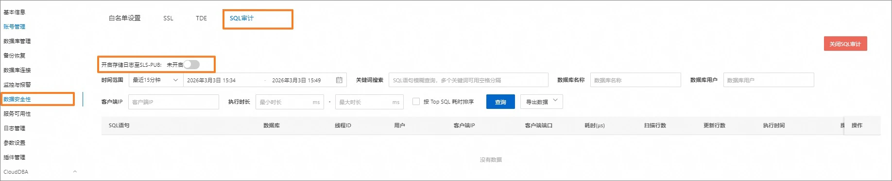

   > **重要**
   >
   > 切换后无法回退，请谨慎操作。

<a id="section-13"></a>

# 13.服务可用性

<a id="section-13-1"></a>

## 13.1. 自动或手动主备切换

您可以设置主备实例自动切换或手动切换，切换后原来的主实例会变成备实例。

**背景信息**

- 自动切换：实例默认为自动切换，当主实例出现故障无法访问时，会自动切换到备实例。

- 手动切换：您可以随时手动对主备库进行切换。

> **说明**
>
> 主备实例的数据会实时同步，您只能访问主实例，备实例仅作为备份形式存在，不提供业务访问。

**注意事项**

- 主备实例切换过程中可能会有闪断，请确保您的应用程序具有自动重连机制。

- 如果实例下挂载有只读实例，那么主备实例切换后，只读实例的数据会有几分钟的延迟，因为需要重建复制链路、同步增量数据等。

**手动切换主备实例**

1. 登录云原生数据库PolarDB控制台。

2. 在**实例列表**页面，单击目标实例ID或者单击实例右侧**操作**列下的**管理**，打开**基本信息**页面。

3. 在左侧导航栏中，选择**服务可用性**。

4. 在页面右侧单击**主备库切换**。

   > **说明**
   >
   > 实例主备切换过程中可能会有1~2次闪断，请确保应用具备重连机制。

5. 在弹出的**实例主备切换**对话框中，选择主备切换时间，单击**确定**。

**常见问题**

Q：备实例可以访问吗？

A：不可以访问。您只能访问主实例，备实例仅作为备份形式存在，不提供业务访问。

<a id="section-13-2"></a>

## 13.2. 修改数据复制方式

您可以根据自身业务特点，设置PolarDB MySQL主备实例之间的数据复制方式，以提高数据库可用性。

**前提条件**

实例版本为MySQL 5.7或8.0双机高可用版（本地SSD盘）。

**复制方式介绍**

- 半同步

  应用发起的更新在主实例执行完成后，会将日志同步传输到备实例，备实例收到日志，事务就算完成了提交，不需要等待备实例执行日志内容。

  当备实例不可用或者主备实例间出现网络异常时，半同步会退化为异步。

- 异步

  应用发起更新请求，即进行增加、删除、修改数据的操作时，主实例完成操作后会立即响应应用，同时主实例向备实例异步复制数据。因此，在异步数据复制方式下，备实例不可用时不会影响主实例上的操作，而主实例不可用时会引起主备库数据不一致的概率较低。

**操作步骤**

1. 登录云原生数据库PolarDB控制台。

2. 在**实例列表**页面，单击目标实例ID或者单击实例右侧的**操作**列下的**管理**，打开**基本信息**页面。

3. 在左侧导航栏中，单击**服务可用性**。

4. 在页面右侧单击**修改数据复制方式**。

5. 在弹出的对话框中，选择数据复制方式，单击**确定**。

**常见问题**

Q：使用哪种数据复制方式好呢？

A：根据您的业务需求进行选择。如果要求极高的响应速度，建议您使用异步；其他情况下可以使用折中的方案，即半同步。

<a id="section-14"></a>

# 14.数据库备份与恢复

<a id="section-14-1"></a>

## 14.1. 自动备份

PolarDB自动备份支持全量物理备份，PolarDB按照设定的备份策略自动备份数据。本章将介绍如何设置自动备份的备份策略。

**操作步骤**

1. 登录云原生数据库PolarDB控制台。

2. 在**实例列表**页面，单击目标实例ID或者单击实例右侧**操作**列下的**管理**，打开**基本信息**页面。

3. 在左侧导航栏中，单击**备份恢复**。

4. 在**备份设置**页签，单击**编辑**。

   > **说明**
   >
   > 为了确保数据安全，修改备份设置后，系统会将新设置的周期和时间与原设置进行对比，选择其中最近的时间点进行备份。即下一次备份可能仍会按原设置的周期和时间进行。例如原设置为星期三19:00-20:00，您在星期三19:00之前修改设置为星期四19:00-20:00，系统在星期三19:00-20:00仍然会进行备份。

5. 设置如下参数。

   <table>
     <tr>
       <th width="152">配置</th>
       <th>说明</th>
     </tr>
     <tr>
       <td>数据备份保留天数</td>
       <td>数据备份文件可以保留7~730天，默认为7天。</td>
     </tr>
     <tr>
       <td>备份周期</td>
       <td>可以设置为一星期中的某一天或者某几天。</td>
     </tr>
     <tr>
       <td>备份时间</td>
       <td>可以设置为一天的任意时段，以小时为单位。建议设置为业务低峰期时间。</td>
     </tr>
     <tr>
       <td>保留时长</td>
       <td>设置常规备份（热备）的保留时长和实例释放前是否长期保留。<br>说明数据备份超过730天的备份集自动转化为归档备份，归档备份的保留天数大于等于30天。</td>
     </tr>
     <tr>
       <td>日志备份</td>
       <td>可以设置是否开启日志备份。<br>重要关闭日志备份会导致所有日志备份被清除，并且无法使用按时间点恢复数据的功能。</td>
     </tr>
     <tr>
       <td>日志备份保留天数</td>
       <td>日志备份文件保留的天数，保留7～730天，默认为7天。</td>
     </tr>
   </table>

6. 完成上述参数配置后，单击**保存**。

<a id="section-14-2"></a>

## 14.2. 手动备份

手动备份支持全量物理备份和全量逻辑备份，本章节介绍如何手动备份PolarDB数据。

**操作步骤**

1. 登录云原生数据库PolarDB控制台。

2. 在**实例列表**页面，单击目标实例ID或者单击实例右侧**操作**列下的**管理**，打开**基本信息**页面。

3. 单击**基本信息**页面右上角的**备份实例**。

4. 设置好备份方式、备份策略，单击**确定**。

   > **说明**
   >
   > 备份方式有如下两种：
   >
   > - 物理备份：直接备份所有数据库中的文件。
   >
   > - 逻辑备份：通过SQL从数据库中抽取数据并以文本的形式进行备份。选择逻辑备份后，还需要选择备份策略：
   >
   >   - 实例备份：备份整个实例。
   >
   >   - 单库备份：备份实例中的某一个数据库。

<a id="section-14-3"></a>

## 14.3. 下载数据备份和日志备份

为保障用户权益，PolarDB提供了未加密的数据备份和日志备份下载，方便用户存档，也可用于恢复到本地数据库。

**下载限制**

| 数据库类型 | 数据备份下载 | 日志备份下载 |
| --- | --- | --- |
| MySQL | MySQL 5.7或8.0 本地SSD盘：支持下载全量的物理备份和逻辑备份。 | 所有版本均支持下载日志备份。 |

**操作步骤**

1. 登录云原生数据库PolarDB控制台。

2. 在**实例列表**页面，单击目标实例ID或者单击实例右侧**操作**列下的**管理**，打开**基本信息**页面。

3. 在左侧导航栏中单击**备份恢复**。

4. 根据想要下载的备份类型，选择相应的标签页：

   - 下载数据备份：选择**数据备份**页签。

   - 下载日志备份：选择**日志备份**页签。

5. 选择要查询的时间范围。

6. 找到目标的数据备份或日志备份，并单击其对应**操作**栏中的**下载**。

   > **说明**
   >
   > - 若数据备份用于数据恢复，请选择离要恢复的时间点最近的数据备份文件。
   >
   > - 若日志备份是用于恢复到本地数据库，请注意如下事项：
   >
   >   - 日志备份的Binlog所在实例编号必须与数据备份的备份所在实例编号一致。
   >
   >   - 日志备份的起始时间段必须在您选择的数据备份时间点之后，在要恢复数据的时间点之前。

7. 在弹出的菜单中单击**已了解，要公网下载**。即可通过浏览器直接下载备份文件。

   > **说明**
   >
   > 在Linux系统中下载时，可以使用如下命令：
   >
   > ```bash
   > wget -c '<备份⽂件下载地址>' -O <⽂件名称>
   > ```
   >
   > - -c：启用断点续传模式。
   >
   > - -O：将下载的结果保存为指定的文件名，建议您使用URL中包含的原文件名。
   >
   > - 下载地址有多个参数时建议为下载地址添加单引号，避免下载失败。

<a id="section-14-4"></a>

## 14.4. 一键上传Binlog

**背景信息**

PolarDB MySQL支持一键上传Binlog，将日志备份上传到OSS保存。

**操作步骤**

1. 登录云原生数据库PolarDB控制台。

2. 在**实例列表**页面，单击目标实例ID或者单击实例右侧**操作**列下的**管理**，打开**基本信息**页面。

3. 在左侧导航栏中，单击**备份恢复**，进入**备份恢复**页面。

4. 单击页面右上角的**一键上传Binlog**。

5. 在弹出的**上传Binlog**对话框中，单击**确定**。

<a id="section-14-5"></a>

## 14.5. 数据库恢复

克隆实例是指新建一个实例，可以复制出与主实例一模一样的内容，包括实例数据和实例设置。克隆实例主要用于恢复主实例数据，或批量创建相同实例。

**前提条件**

创建克隆实例时，主实例需要满足如下条件：

- 主实例状态为运行中。

- 当前没有迁移任务。

- 已开启数据备份和日志备份。

- 若要按备份集克隆实例，则主实例必须至少有一个已完成备份的备份集。

**背景信息**

创建克隆实例有两种方式，分为指定备份集创建和指定有效期内备份的时间点创建。

> **说明**
>
> - 克隆实例仅复制主实例的内容，不复制主实例下只读实例的内容。复制内容包括主实例的数据库信息、账号信息和实例设置。例如白名单设置、备份设置、参数设置、阈值报警设置等。
>
> - 克隆实例的数据库类型需要与主实例一致，其它设置均可与主实例不同。例如系列、可用区、网络类型、实例规格、存储空间等。若创建克隆实例是用于恢复主实例数据，建议您选择大于主实例的规格和存储空间，否则因性能限制，数据恢复所需时间可能会较长。
>
> - 克隆实例的账号类型需要与主实例一致，但可以修改克隆实例的账号密码。

**操作步骤**

1. 登录云原生数据库PolarDB控制台。

2. 在**实例列表**页面，单击目标实例ID或者单击实例右侧**操作**列下的**管理**，打开**基本信息**页面。

3. 在左侧导航栏中，单击**备份恢复**。

4. 在**数据备份**的备份列表中，找到要恢复的备份，单击操作栏中的**恢复**。

5. 在弹出的**恢复**窗口中，单击**确定**

6. 在**PolarDB恢复**页面，设置如下参数。

   **项目**

   **选项**

   **说明**

   PolarDB实例所在地域。

   **区域**

   **地域**

   主实例数据的还原方式，支持以下两种：

   **还原方式**

   - **按时间点**

   - **按备份集**

   选择需要还原到的时间。

   **还原时间**

   > **说明**

   **数据库恢复**

   > 当**还原方式**为**按时间点**时，需要填写该参数。

   选择需要还原的备份集。

   **备份集**

   > **说明**
   >
   > 当**还原方式**为**按备份集**时，需要填写该参数。

   克隆实例的名称。

   **实例名称**

   数据库的类型，不可修改。

   **数据库类型**

   数据库的版本，不可修改。

   **数据库版本**

   数据库的系列，请以控制台界面为准。

   **系列**

   数据库的存储类型，请以控制台界面为准。

   **存储类型**

   **规格配置**

   克隆实例的实例规格。

   > **说明**

   **实例规格**

   > 建议您选择大于主实例的规格和存储空间，否则因性能限制，数据恢复所需时间可能较长。

   存储空间包括数据空间、系统文件空间、Binlog文件空间和事务文件空间。实际可用存储空间请以控制台界面为准。

   **存储空间**

   > **说明**
   >
   > 本地SSD盘的独享套餐等规格，由于资源独享的原因，存储空间大小和实例规格绑定。

   PolarDB实例支持的网络类型：

   - 经典网络：经典网络中的云服务在网络上不进行隔离，只能依靠云服务自身的安全组或白名单策略来阻挡非法访问。

   **网络类型**

   - 专有网络：（Virtual Private Cloud，简称VPC）专有网络帮助用户在阿里云上构建出一个隔离的网络环境。用户可以自定义专有网络内的路由表、IP地址范围和网关。建议您选择专有网络，更加安全。

   选择您的VPC。

   **网络类型**

   > **说明**

   **VPC**

   > 当**网络类型**为**专有网络**时，需要填写该参数。

   选择VPC下的交换机。

   > **说明**

   **VSwitch**

   > 当**网络类型**为**专有网络**时，需要填写该参数。

7. 完成上述参数配置后，单击**提交**。

<a id="section-14-6"></a>

## 14.6. Native Flashback

Native Flashback功能可以通过SQL语句查询或恢复指定时间点的数据，保证在误操作后可以快速获取历史数据。

**功能说明**

数据库运维过程中的误操作可能会给业务带来严重的影响，常见的恢复手段通过备份集恢复，需要额外的系统资源，在数据量较大时恢复时间不可控。

PolarDB MySQL版设计和实现了Native Flashback功能，无需复杂的恢复操作，通过简单的SQL语句即可查询或恢复误操作前的历史数据，节省了大量宝贵的时间，保证业务平稳运行。

**前提条件**

- 实例为PolarDB MySQL8.0集群系列。

- 内核小版本为8.0.0.1.42.1及以上。如何查看或升级内核小版本，请参见升级内核小版本。

**注意事项**

- 仅支持使用InnoDB引擎的表。

- 需要消耗额外的undo表空间，可以通过innodb_undo_space_supremum_size进行配置。

- Native Flashback的查询结果取最接近指定时间点的数据，不保证查询到的数据与指定时间点的数据完全匹配。

- 暂不支持跨DDL操作的历史版本数据查询和恢复。例如您无法通过Native Flashback查询某个已经被删除的表的内容。

**语法**

Native Flashback提供了全新的 `AS OF` 语法，通过该语法指定需要回滚的时间。语法规则如下：

```sql
SELECT ... FROM <表名>
  AS OF TIMESTAMP <表达式>;
```

其中，在表达式中指定回滚的时间，该表达式支持多种形式，示例：

```sql
SELECT ... FROM tablename
  AS OF TIMESTAMP '2020-11-11 00:00:00';

SELECT ... FROM tablename
  AS OF TIMESTAMP now();

SELECT ... FROM tablename
  AS OF TIMESTAMP (SELECT now());

SELECT ... FROM tablename
  AS OF TIMESTAMP DATE_SUB(now(), INTERVAL 1 minute);
```

**参数说明**

Native Flashback功能开放了如下可配置参数：

| 参数名称 | 级别 | 说明 |
| --- | --- | --- |
| innodb_rds_flashbac k_task_enabled | Global | Native Flashback的功能开关。<br>• <strong>OFF</strong>（默认）：关闭。<br>• <strong>ON</strong>：开启。<br>说明<br>• 关闭Native Flashback功能时，需要同步将<strong>innodb_undo_retention</strong>参数设置为0。<br>• 命令行格式：<code> --innodb-rds-</code><code>flashback-task-enabled=# </code>。 |
| innodb_undo_retenti on | Global | 描述：undo记录的保留时长，超出该时长的undo记录无法查询。取值范围：0~4294967295。默认值：0。单位：秒。<br>说明<br>• 该参数的值越大，Native Flashback支持的回档查询时间越长，同时undo表空间占用的存储空间也会上升。<br>• innodb_rds_flashback_task_enable <strong>d</strong>参数设置为OFF时，需同步将本参数设置为0。<br>• 命令行格式：<code> --innodb-undo-</code><code>retention=# </code>。 |
| innodb_undo_space_supremum_size | Global | undo表空间可占用的最大磁盘空间。取值范围：0~4294967295。默认值：10240。单位：MB。<br>说明<br>• 占用空间超过这个值时，忽略<code> innodb_undo_retention </code>参数强制清理undo记录。<br>• 命令行格式：<code> --innodb-undo-space-</code><code>supremum-size=# </code>。 |

<table>
  <tr>
    <td>innodb_undo_space_reserved_size</td>
    <td>Global</td>
    <td>预留的undo表空间大小，在<code> innodb_undo_retention </code>参数非0的情况下，将使用这部分空间尽可能多地保留undo记录。<br>• 取值范围：0~4294967295。默认值：0。单位：MB。<br>说明<br>• 该参数的值太大可能导致undo历史记录过多，影响实例性能。如非必要，请保持该参数为0。<br>• 命令行格式：<code> --innodb-undo-space-</code><code>reserved-size=# </code>。</td>
  </tr>
</table>

**使用示例**

```text
# 获取时间点
MySQL> SELECT now();
+---------------------+
| now()               |
+---------------------+
| 2025-05-23 15:43:09 |
+---------------------+
1 row in set (0.00 sec)

# 查看数据
MySQL > SELECT * FROM mt1;
+----+------+
| id | c1   |
+----+------+
|  1 |    1 |
|  2 |    2 |
|  3 |    3 |
|  4 |    4 |
|  5 |    5 |
+----+------+
5 rows in set (0.00 sec)

# 不带WHERE条件的更新操作
MySQL > UPDATE mt1 SET c1 = 100;

Query OK, 5 rows affected (0.00 sec)
Rows matched: 5  Changed: 5  Warnings: 0

MySQL > SELECT * FROM mt1;
+----+------+
| id | c1   |
+----+------+
|  1 |  100 |
|  2 |  100 |
|  3 |  100 |
|  4 |  100 |
|  5 |  100 |
+----+------+
5 rows in set (0.00 sec)

# 查询历史时间点的数据，成功返回结果
MySQL > SELECT * FROM mt1 AS OF timestamp '2020-10-14 15:44:09';
+----+------+
| id | c1   |
+----+------+
|  1 |    1 |
|  2 |    2 |
|  3 |    3 |
|  4 |    4 |
|  5 |    5 |
+----+------+
5 rows in set (0.00 sec)

# 如果超出保留的历史数据范围，返回失败
MySQL > SELECT * FROM mt1 AS OF timestamp '2020-10-13 14:44:09';
ERROR 7545 (HY000): The snapshot to find is out of range

# 开始恢复数据
MySQL > CREATE TABLE mt1_tmp LIKE mt1; # 创建⼀个与原表结构相同的临时表
Query OK, 0 rows affected (0.03 sec)

MySQL > INSERT INTO mt1_tmp
             -> SELECT * FROM mt1 AS OF
             -> TIMESTAMP '2020-10-14 15:44:09'; # 将原表中的历史数据写入临时表
 
Query OK, 5 rows affected (0.01 sec) 
Records: 5  Duplicates: 0  Warnings: 0
 
MySQL > SELECT * FROM mt1_tmp; # 确认临时表中的数据是否正确 
+----+------+
| id | c1   |
+----+------+
|  1 |    1 |
|  2 |    2 |
|  3 |    3 |
|  4 |    4 |
|  5 |    5 |
+----+------+
5 rows in set (0.00 sec)
 
MySQL > rename TABLE mt1 TO mt1_bak,
             -> mt1_tmp TO mt1; #（进⾏本操作需要先停⽌业务读写）更改原表表名为mt1_bak，并将临时
表名改成原表表名，完成数据恢复
Query OK, 0 rows affected (0.02 sec)

MySQL > SELECT * FROM mt1; # 确认恢复完成后的数据 
+----+------+
| id | c1   |
+----+------+
|  1 |    1 |
|  2 |    2 |
|  3 |    3 |
|  4 |    4 |
|  5 |    5 |
+----+------+ 
5 rows in set (0.01 sec) 
```

<a id="section-15"></a>

# 15.自治服务

<a id="section-15-1"></a>

## 15.1. 自治服务简介

自治服务是一种基于机器学习和专家经验实现数据库自感知、自修复、自优化、自运维及自安全的云服务，帮助用户消除数据库管理的复杂性及人工操作引发的服务故障，有效保障数据库服务的稳定、安全及高效。

**功能介绍**

自治服务主要包含如下功能：

- 一键诊断

  诊断实例，并提供可视化的诊断结果供您查看。

- 会话管理

  查看会话、统计会话、分析SQL和优化SQL。

- 实时性能

  实时查看实例的QPS、TPS、连接数、网络流量等信息。

- 空间分析

  查看空间概况、变化趋势、异常列表、表空间和数据空间。

- 锁分析

  查看和分析数据库最近一次发生的死锁。

- 性能趋势

  查看和对比性能趋势、自定义性能趋势大盘、查看异常诊断信息和查看实例拓扑结构。

- 慢SQL

  查看慢日志趋势和统计信息。

- 诊断报告

  自动或手动诊断实例，查看实例的健康状况、告警、慢SQL等信息。

<a id="section-15-2"></a>

## 15.2. 一键诊断

自治服务提供PolarDB MySQL一键诊断功能，可以诊断实例并提供可视化的诊断结果。

**进入一键诊断页面**

1. 登录云原生数据库PolarDB控制台。

2. 在**实例列表**页面，单击目标实例ID或者单击实例右侧**操作**列下的**管理**，打开**基本信息**页面。

3. 在左侧导航栏中，单击**自治服务 > 一键诊断**。

4. 单击**一键诊断**页签。

   > **说明**
   >
   > 详细说明请参见 **《数据库自治服务DAS > 用户指南中的一键诊断章节。》**

<a id="section-15-3"></a>

## 15.3. 会话管理

自治服务提供PolarDB MySQL实例会话功能，可以查看、管理目标实例的会话。

**进入会话管理页面**

1. 登录云原生数据库PolarDB控制台。

2. 在**实例列表**页面，单击目标实例ID或者单击实例右侧**操作**列下的**管理**，打开**基本信息**页面。

3. 在左侧导航栏中，单击**自治服务 > 一键诊断**。

4. 单击**会话管理**页签。

   > **说明**
   >
   > 详细说明请参见 **《数据库自治服务DAS > 用户指南中的实例会话章节。》**

<a id="section-15-4"></a>

## 15.4. 实时性能

自治服务提供PolarDB MySQL版实时性能功能，可以查看MySQL的实时性能。

**进入实时性能页面**

1. 登录云原生数据库PolarDB控制台。

2. 在**实例列表**页面，单击目标实例ID或者单击实例右侧**操作**列下的**管理**，打开**基本信息**页面。

3. 在左侧导航栏中，单击**自治服务 > 一键诊断**。

4. 单击**实时性能**页签。

   > **说明**
   >
   > 详细说明请参见 **《数据库自治服务DAS > 用户指南中的实时性能章节。》**

<a id="section-15-5"></a>

## 15.5. 空间分析

自治服务提供PolarDB MySQL版空间分析功能，能够帮助您及时发现数据库中的空间异常，避免影响数据库稳定性。

**背景信息**

空间分析功能可以直观地查看数据库实例的空间使用概况、空间剩余可用天数，以及数据库中某个表的空间使用情况、空间碎片、空间异常诊断等。

**进入空间分析页面**

1. 登录云原生数据库PolarDB控制台

2. 在**实例列表**页面，单击目标实例ID或者单击实例右侧**操作**列下的**管理**，打开**基本信息**页面。

3. 在左侧导航栏中，单击**自治服务 > 一键诊断**。

4. 单击**空间分析**页签。

   > **说明**
   >
   > 详细说明请参见 **《数据库自治服务DAS > 用户指南中的空间分析章节。》**

<a id="section-15-6"></a>

## 15.6. 锁分析

当数据库出现死锁、事务阻塞或元数据锁（MDL）等待等问题时，可借助DAS提供的锁分析功能，对锁等待关系进行可视化诊断，快速定位阻塞源头与依赖链路，有效提升问题排查效率，保障数据库服务的稳定性与高可用性。

**功能简介**

锁分析功能支持对数据库实例进行多维度的死锁分析、事务阻塞分析、元数据锁等待分析。

- **最近死锁分析**：DAS基于 `SHOW ENGINE INNODB STATUS` 返回的最近一次死锁日志进行分析。如果发生过多次死锁，DAS只会对最近一次死锁进行分析。

- **其他锁分析**：DAS根据 `information_schema` 和 `performance_schema` 相关数据，实时分析数据库实例当前会话中的元数据锁和事务阻塞情况。

  - 元数据锁分析：DAS根据 `information_schema.processlist` 等的数据，推导锁等待关系，并生成相应的关系图。

  - 事务阻塞分析：DAS根据 `information_schema.processlist` ， `information_schema.innodb_trx` ，以及 `information_schema.innodb_lock_waits` （MySQL 5.6和5.7使用该数据）和 `performance_schema.data_lock_waits` （MySQL 8.0使用该数据）分析事务阻塞关系，并生成相应的关系图。

**操作步骤**

1. 登录云原生数据库PolarDB控制台。

2. 在**实例列表**页面，单击目标实例ID或者单击实例右侧**操作**列下的**管理**，打开**基本信息**页面。

3. 在左侧导航栏中，单击**自治服务 > 一键诊断**，在**锁分析**页签下：

   **死锁分析**

   <ol type="i">

   <li>

   **发起最近死锁诊断**

   在**最近死锁分析**页签下，单击**创建分析**。

   > **说明**
   >
   > 若发生过多次死锁，触发分析时只能分析最近一次死锁，然后保留本次分析得到的死锁相关数据。

   </li>

   <li>

   **查看详情**

   <ol type="a">

   <li>

   诊断完成后，选择时间段，单击最近死锁分析中诊断任务列表**详情**列下的**查看详情**，查看该时间段内曾经触发过的死锁诊断任务结果。

   </li>

   <li>

   弹出的抽屉页会显示对应死锁详情，点击查看即可。

   </li>

   </ol>

   </li>

   </ol>

   **其他锁分析**

   <ol type="i">

   <li>

   **发起其他锁分析诊断**

   在**最近死锁分析**区域，单击**创建分析**。

   </li>

   <li>

   **查看详情**

   <ol type="a">

   <li>

   单击诊断结果前的  展开元数据锁等待和事务阻塞分析相关信息。

   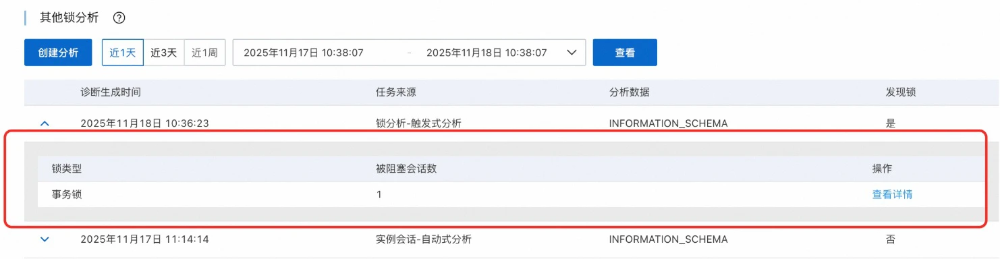

   </li>

   <li>

   单击**查看详情**，将显示对应的事务锁详情。

   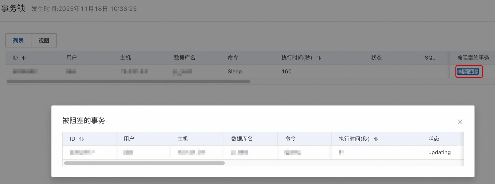

   </li>

   </ol>

   </li>

   </ol>

<a id="section-15-7"></a>

## 15.7. 性能趋势

自治服务提供PolarDB MySQL版性能趋势功能，支持多种查看性能趋势的方式，不仅支持性能趋势区间查看，也支持性能趋势对比查看和自定义性能趋势查看。

**进入性能趋势页面**

1. 登录云原生数据库PolarDB控制台。

2. 在**实例列表**页面，单击目标实例ID或者单击实例右侧**操作**列下的**管理**，打开**基本信息**页面。

3. 在左侧导航栏中，单击**自治服务 > 性能趋势**。

   > **说明**
   >
   > 有关性能趋势的详细说明，请参见 **《数据库自治服务DAS > 用户指南中的性能趋势章节。》**

<a id="section-15-8"></a>

## 15.8. 慢SQL

自治服务提供PolarDB MySQL版慢SQL功能，可以查看慢日志趋势、慢日志执行情况和慢日志优化建议。

**进入慢SQL页面**

1. 登录云原生数据库PolarDB控制台。

2. 在**实例列表**页面，单击目标实例ID或者单击实例右侧**操作**列下的**管理**，打开**基本信息**页面。

3. 在左侧导航栏中，单击**自治服务 > 慢SQL**。

   > **说明**
   >
   > 详细说明请参见 **《数据库自治服务DAS > 用户指南中的慢SQL章节。》**

<a id="section-15-9"></a>

## 15.9. 诊断报告

自治服务提供PolarDB MySQL版诊断报告功能，支持创建和查看诊断报告。

**进入诊断报告页面**

1. 登录云原生数据库PolarDB控制台

2. 在**实例列表**页面，单击目标实例ID或者单击实例右侧**操作**列下的**管理**，打开**基本信息**页面。

3. 在左侧导航栏中，单击**自治服务 > 诊断报告**。

4. 在打开的页面中，单击**发起诊断**。

   > **说明**
   >
   > 详细说明请参见 **《数据库自治服务DAS > 用户指南中的诊断报告章节。》**

<a id="section-16"></a>

# 16.日志管理

PolarDB实例都支持日志管理，您可以通过控制台查询实例的错误日志和慢日志明细，帮助故障定位分析。

**操作步骤**

1. 登录云原生数据库PolarDB控制台

2. 在**实例列表**页面，单击目标实例ID或者单击实例右侧**操作**列下的**管理**，打开**基本信息**页面。

3. 在左侧导航栏中，单击**日志管理**。

4. 在**日志管理**页面，选择查询**慢日志明细**或者**主备切换日志**，选择时间范围，单击**查询**。

   <table>
     <tr>
       <th width="122">查询项</th>
       <th>内容</th>
     </tr>
     <tr>
       <td>慢日志明细</td>
       <td>记录1个月内数据库中执行时间超过1秒的SQL语句，并进行相似语句去重。<br>说明<br>控制台每分钟更新一次，实时的慢日志明细可以查看<code> mysql.slow_log </code>表。</td>
     </tr>
     <tr>
       <td>主备切换日志</td>
       <td>记录主备实例切换的日志。</td>
     </tr>
   </table>

   

5. 在**日志管理**页面，选择查询**错误日志**。单击

   在**导出**对话框中选择**导出范围**选择**全部**或者**选中数据**，

   在**需要导出的数据列**中选择**采集时间**或者**错误信息**。

   | 查询项 | 内容 |
   | --- | --- |
   | 错误日志 | 记录1个月内数据库运行出错的日志。 |

<a id="section-17"></a>

# 17.AI能力

<a id="section-17-1"></a>

## 17.1. 智能迁移

<a id="section-17-1-1"></a>

### 17.1.1. 智能迁移指引

云原生数据库PolarDB智能一键迁移是基于DTS能力构建的一站式数据库迁移平台，提供从场景选择、前置检查、任务配置到地址切换的全链路可视化引导流程。通过自动化配置与无缝切换能力，实现应用无感迁移；同时集成AI迁移助手，支持智能问答、日志诊断与优化建议，显著提升迁移效率与成功率。

**功能简介**

云原生数据库PolarDB智能一键迁移是一项面向企业级用户的全流程、低门槛、智能化数据库迁移解决方案。该功能将原本分散在多个控制台的操作整合至PolarDB控制台统一界面，用户无需跳转即可完成从实例准备到业务割接的全部动作。

**核心能力**

| 能力类别 | 功能说明 |
| --- | --- |
| 全链路可视化 | 四步引导式流程，状态清晰可见，所有操作闭环管理。 |
| 自动化配置 | 根据迁移场景自动匹配DTS链路、创建迁移任务，减少人工干预。 |
| 应用无感切换 | 支持数据库连接地址一键切换，业务零中断。 |
| AI智能辅助 | 内嵌AI迁移助手，实时解答问题、分析日志、给出修复建议。 |

**支持的迁移场景**

当前支持以下迁移路径，系统会根据所选场景自动加载对应的操作方案与检查项，确保迁移方案合规高效。

<table>
  <tr>
    <th width="183">迁移链路分类</th>
    <th>支持的迁移链路</th>
  </tr>
  <tr>
    <td>MySQL引擎迁移</td>
    <td>• RDS MySQL到PolarDB MySQL主备版<br>• RDS MySQL到PolarDB MySQL集群版<br>• PolarDB MySQL主备版5.7到PolarDB MySQL主备版8.0<br>• PolarDB MySQL主备版到PolarDB MySQL集群版<br>• PolarDB MySQL集群版到PolarDB MySQL集群版</td>
  </tr>
  <tr>
    <td>PostgreSQL引擎迁移</td>
    <td>• RDS PostgreSQL到PolarDB PostgreSQL主备版<br>• PolarDB PostgreSQL主备版到PolarDB PostgreSQL主备版</td>
  </tr>
  <tr>
    <td>PolarDB-X引擎迁移</td>
    <td>• RDS MySQL到PolarDB-X 2.0<br>• PolarDB-X 2.0到PolarDB-X 2.0</td>
  </tr>
</table>

**使用流程**

智能一键迁移采用线性四步引导模式，您可在同一页面完成全部迁移操作。

**步骤一：选择迁移场景**

1. 登录云原生数据库PolarDB控制台。

2. 在左侧导航栏中，进入**AI能力 > 智能迁移**页面，选择源数据库和目标PolarDB实例类型。

**功能优势**

- 系统自动识别迁移需求，预填充后续流程所需参数；

- 自动推荐最优DTS链路与同步策略；

- 配置成本大幅降低，避免手动选型错误。

**步骤二：执行前置检查**

单击**去查看**，系统将根据所选场景跳转至官方迁移指南文档获取详细操作指引，以及迁移前检查清单等，例如源库是否开启Binlog及格式是否正确、安全组与白名单是否放通通信等。

**功能优势**

- 检查内容与场景强绑定，避免遗漏；

- 快速链接官网文档，排查效率大幅提升。

**步骤三：创建DTS数据迁移任务**

确认前置检查完成后，单击**去迁移**，系统将自动为您在该页面弹出DTS迁移任务配置页面，仅需根据步骤二中的方案要求填写关键信息，即可快速构建迁移链路。

**功能优势**

- 无需跳转至DTS控制台，所有任务状态在本页面集中展示；

- 配置时间大幅减少，任务快速启动；

- 任务异常实时告警，便于及时干预。

**步骤四：查看迁移结果并切换数据库地址**

当增量同步延迟趋近于0且无报错时，可进行最终的应用连接切换。

> **说明**
>
> 建议在业务低峰期执行地址切换，并提前验证应用程序的重连机制。

1. 在**数据库迁移结果**区域确认迁移状态正常时，单击任务操作列下的**迁移地址**。

   您可在结果列表中，查看任务的创建时间、运行状态、任务开始时源端行数和任务结束时目标端行数等详情。

   > **说明**
   >
   > 任务开始后若源端数据发生变化，会导致任务结束时目标端行数与源端不一致。

2. 在弹出的页签中，确认源库和目标库信息，单击**切换地址**。

**功能优势**

- 实现应用无感迁移，业务无中断；

- 切换过程可追溯、可回滚，安全保障高。

<a id="section-17-1-2"></a>

### 17.1.2. AI迁移助手

AI迁移助手是一键迁移平台的智能辅助工具，基于DTS MCP（Model Context Protocol）服务提供自然语言问答、任务状态查询和故障诊断能力，帮助用户快速解决迁移过程中的链路查询、配置指导与异常处理问题。

**功能简介**

AI迁移助手集成于PolarDB控制台“智能迁移”页面，通过理解用户提问，自动调用DTS后端数据与日志，提供准确的迁移支持建议。无需跳转，即可获得实时、可操作的解决方案。其中主要能力包括：

- 意图识别：支持中文自然语言输入，精准解析问题意图。

- 链路查询：查询当前Region支持的DTS迁移组合及连接方式（如云实例、公网IP）等。

- 配置指导：返回指定链路支持的迁移对象类型（表、索引等）和DDL操作范围等。

- 状态监控：实时获取任务运行状态、延迟、流量、同步进度等。

- 故障诊断：分析任务日志，定位异常原因并给出修复建议。

**使用入口**

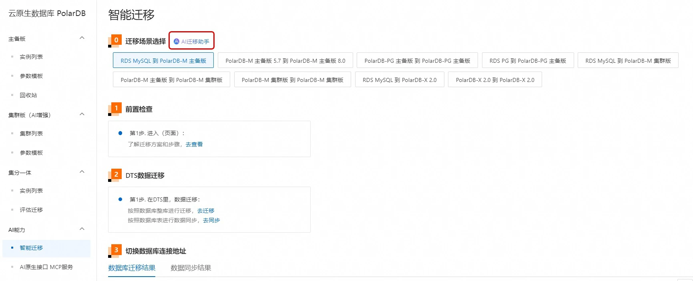

**示例场景**

**场景1：查询迁移链路支持情况**

用户问题：当前环境是否支持RDS PostgreSQL到PolarDB PostgreSQL的迁移？支持的数据源连接方式有哪些（如云实例、公网IP等）？

AI智能响应：DTS MCP自动识别当前Region、产品版本及网络环境，实时返回该区域下所有可用的DTS链路组合，明确标注源和目标数据库类型、支持的连接模式（VPC内网/云实例/公网IP）及限制项。提升信息获取效率，减少因链路不明确导致的工单咨询量约20%。

**场景2：查询迁移任务如何配置**

- 用户问题：从RDS PostgreSQL云实例到PolarDB PostgreSQL的迁移链路中，支持哪些迁移对象类型和同步操作？

- AI智能响应：DTS MCP根据用户输入的源端与目标端信息，自动检索并返回该链路支持的迁移对象（如表、视图、函数、存储过程等），以及支持的DDL/DML同步范围和操作限制，提供结构初始化、全量迁移、增量同步等阶段的配置指引，显著降低任务配置复杂度达20%。

**场景3：排查任务异常**

- 用户问题：DTS迁移任务l65e721当前运行是否正常？存在的异常如何应对？

- AI智能响应：DTS MCP自动拉取任务实时状态、延迟趋势、同步进度、吞吐流量及错误日志，精准判断任务健康度；若检测到异常或潜在风险，AI助手将生成诊断报告并推荐修复方案，有效降低故障响应时间与人工介入需求，助力工单及预警量下降30%。

<a id="section-17-1-3"></a>

### 17.1.3. RDS MySQL到PolarDB MySQL版白屏化迁移方案

本文为您介绍RDS MySQL到PolarDB MySQL版白屏化迁移方案，帮助您快速完成迁移操作。

> **说明**
>
> 一键迁移功能依赖RDS、PolarDB、DTS和oneconsole，需要同时将上述组件版本升级至目标版本及以上。

**一.概述**

支持将RDS MySQL版实例迁移到PolarDB MySQL版实例，支持的MySQL版本如下：

| 源端 | 目标端 |
| --- | --- |
| RDS MySQL 5.6 | PolarDB 5.7、8.0 |
| RDS MySQL 5.7 | PolarDB 5.7、8.0 |
| RDS MySQL 8.0 | PolarDB 8.0（不支持降级大版本迁移） |

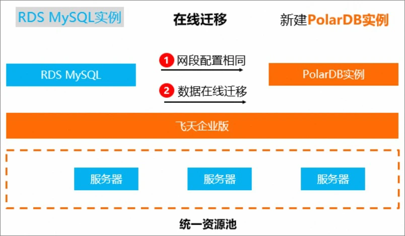

**用户告知**

- 需得到客户许可时操作。

- 迁移过程涉及实例连接地址的切换，建议在业务低峰期执行。

**优势说明**

- 支持连接地址迁移：可保留数据库原连接地址，应用端无需修改连接地址。

- 支持迁移回切：迁移切换后，若发现兼容性等问题，支持切回原来的实例。

- 迁移进度随时查看：支持查看当前的迁移进度，方便制定切换计划。

- 支持增量迁移，停机时间小于10分钟：通过DTS实现数据在线热迁移，数据迁移过程中无需停机。仅实例切换过程涉及一次闪断（即当业务从RDS MySQL切换至PolarDB时），需要申请约10分钟的停机窗口。

**限制说明**

- 不支持跨地域迁移：仅支持同一个Region中的实例进行迁移，不支持跨Region迁移。

- 如果涉及跨MySQL大版本迁移（如RDS MySQL5.7到PolarDB 8.0等），语法差异需要用户自行评估：由于MySQL大版本之间并非完全兼容，当用户涉及跨大版本迁移时，应用对语法的兼容性需要自行评估。

- 连接地址切换的限制：切换地址仅进行DNS的切换，实际使用中有如下限制：

  - 带地址切换只会互换RDS和PolarDB的域名；VSwitch、VIP等配置不会切换。端口也不会发生切换。

  - DNS缓存问题：切换域名后，可能会存在DNS解析缓存问题，在缓存过期时间内可能会出现连接不上数据库或数据库只支持读操作，无法执行写入操作等情况，可以通过手工刷新服务器的DNS缓存加速缓存更新。

- 其他限制及注意事项：请参见《数据传输服务DTS用户指南》中数据迁移配置案例下《从RDS MySQL迁移至PolarDB MySQL版》中源库和目标库的注意事项及限制。

**二.创建PolarDB实例**

使用前需要先手工创建PolarDB MySQL实例。建议您在正式迁移前，先进行测试数据的迁移和演练，充分评估好SQL语法兼容性，避免语法错误或数据混乱。

**创建PolarDB实例注意事项**

- 实例规格：推荐创建的实例规格与待迁移的RDS MySQL实例规格一致。

- VPC网络：建议选择与现有环境一致的VPC网络。如果选择了不同的VPC，请迁移前确认VPC网络可以被应用端访问。

- 网络白名单：实例创建成功后，需要配置与RDS MySQL一致的IP白名单，避免实例切换后，应用无法访问PolarDB实例。

迁移前后实例ID发生了变化，如果涉及到如下场景，需要提前与相关应用系统沟通，确保迁移后相关系统也及时做好切换，否则，可能会导致应用系统使用异常。

带地址切换不涉及数据库连接地址和端口修改，对于已有的连接地址不受影响，但是当进行变更配置的时候，需要在如下的系统中重新配置：

- 数据库产品：DTS，DMS 通过云实例方式访问

- 大数据产品：DataWorks，DataHub通过云实例方式访问

- 云监控系统：切换到监控新的实例

> **说明**
>
> 使用时需注意弹性伸缩产品ESS目前不支持PolarDB MySQL。

**三.迁移前置检查**

**仔细阅读DTS迁移限制说明，评估约束限制**

数据迁移是基于DTS实现的，在迁移前，请仔细阅读《数据传输服务DTS用户指南》中数据迁移配置案例下《从RDS MySQL迁移至PolarDB MySQL版》中源库和目标库的注意事项及限制，明确注意事项和约束限制，并按要求完成迁移前的准备。

**语法兼容性检查**

如果涉及跨MySQL大版本迁移，请在迁移前做好应用的SQL语法兼容性验证和开发。确保迁移前后，应用都能正常使用。MySQL各版本间差异，请参见升级数据库版本和MySQL release notes。

**四.DTS数据迁移**

**操作步骤**

1. 登录云原生数据库PolarDB控制台，在左侧导航栏选择**AI能力 > 智能迁移**。

2. 在智能迁移页面，单击**RDS MySQL到PolarDB-M 主备版**。

3. 单击**去迁移**配置迁移任务。

4. 配置源库和目标库信息。

   **类别**

   **配置**

   **说明**

   DTS会自动生成一个任务名称，建议配置具有业务意义的名称（无唯一性

   无

   **任务名称**

   要求），便于后续识别。

   创建数据迁移实例时已指定，不可变更。

   **实例地区**

   **是否跨阿里云账**

   选择**不跨账号**。

   **号**

   **RDS实例ID**

   选择源RDS实例ID。

   源库信息

   填入源RDS的数据库账号，需具备REPLICATION CLIENT、REPLICATION SLAVE、SHOW VIEW和所有迁移对象的SELECT权限。

   **数据库账号**

   > **说明**
   >
   > 当源RDS实例的数据库类型为**MySQL 5.5**或**MySQL 5.6**时，无需配置**数据库账号**和**数据库密码**。

   填入该数据库账号的密码。

   **数据库密码**

   根据需求选择连接方式。如果设置为**SSL安全连接**，您需要提前开启RDS

   **连接方式**

   实例的SSL加密功能。

   创建数据迁移实例时已指定，不可变更。

   **实例地区**

   **是否跨阿里云账**

   选择**不跨账号**。

   **号**

   **PolarDB实例**

   选择目标PolarDB实例ID。

   **ID**

   目标库信息

   填入目标PolarDB MySQL版实例的数据库账号，需具备目标数据库的读

   **数据库账号**

   写权限。

   填入该数据库账号的密码。

   **数据库密码**

   根据需求选择连接方式。

   **连接方式**

5. 配置完成后，单击页面下方的**测试连接以进行下一步**。

6. 如果您的PolarDB MySQL实例具备白名单设置，请将弹跳框中提示的DTS服务器的IP地址，加入PolarDB MySQL版实例的白名单设置中。白名单设置完成后，单击**测试连接以进行下一步**。

   > **说明**
   >
   > 如果您的PolarDB MySQL实例无需进行白名单设置，请直接单击**测试连接以进行下一步**。

7. 选择迁移对象及迁移类型。

   | 配置 | 说明 |
   | --- | --- |
   | 任务步骤 | • 如果只需要进行全量数据迁移，同时选中<strong>库表结构迁移</strong>和<strong>全量迁移</strong>。<br>• 如果需要进行不停机迁移，同时选中<strong>库表结构迁移</strong>、<strong>全量迁移</strong>和<strong>增量迁移</strong>。<br>说明如果未选中<strong>增量迁移</strong>，为保障数据一致性，全量数据迁移期间请勿在源数据库中写入新的数据。 |
   | 目标已存在表的处理模式 | • <strong>预检查并报错拦截</strong>：检查目标数据库中是否有同名的表。如果目标数据库中没有同名的表，则通过该检查项目；如果目标数据库中有同名的表，则在预检查阶段提示错误，数据迁移任务不会被启动。<br>• <strong>忽略报错并继续执行</strong>：跳过目标数据库中是否有同名表的检查项。<br>警告选择为<strong>忽略报错并继续执行</strong>，可能导致数据不一致，给业务带来风险，例如：<br>• 表结构一致的情况下，在目标库遇到与源库主键的值相同的记录，则会保留目标库中的该条记录，即源库中的该条记录不会迁移至目标库中。<br>• 表结构不一致的情况下，可能导致只能迁移部分列的数据或迁移失败。 |
   | 目标库对象名称大小写策略 | 您可以配置目标实例中迁移对象的库名、表名和列名的英文大小写策略。默认情况下选择<strong>DTS默认策</strong><strong>略</strong>，您也可以选择与源库、目标库默认策略保持一致。 |
   | 源库对象 | 在<strong>源库对象</strong>框中单击待迁移的对象，然后单击图标将其移动至<strong>已选择对象</strong>框。<br>说明<br>• 您可以根据实际情况，展开导航树进行正则搜索。<br>• 迁移对象选择的粒度为库、表。 |
   | 已选择对象 | 默认情况下，迁移对象在目标库中的名称与源库保持一致。<br>说明<br>• 如需按库或表级别选择迁移的SQL操作，请在<strong>已选择对象</strong>中右击待迁移对象，并在弹出的对话框中选择所需迁移的SQL操作。<br>• 如果使用了对象名映射功能，可能会导致依赖这个对象的其他对象迁移失败。 |

8. 单击**下一步高级配置**，进行高级配置。

   | 配置项目 | 配置说明 |
   | --- | --- |

   | 选择目标库的引擎类型 | 请根据实际情况，选择目标库的引擎类型为<strong>InnoDB</strong>或<strong>X-Engine</strong>。 |
   | --- | --- |
   | 源库、目标库无法连接后的重试时间 | 在迁移任务启动后，若源库或目标库连接失败则DTS会报错。对于可预期的报错，DTS会立即进行持续的重试连接，默认重试720分钟，您也可以在取值范围（10~1440分钟）内自定义重试时间，建议设置30分钟以上。如果DTS在设置的时间内重新连接上源、目标库，迁移任务将自动恢复。否则，迁移任务将失败。<br>说明针对同源或者同目标的多个DTS实例，如DTS实例A和DTS实例B，设置网络重试时间时A设置30分钟，B设置60分钟，则重试时间以低的30分钟为准。 |

9. 上述配置完成后，单击页面下方的**下一步预检查并启动**。

   > **重要**
   >
   > - 在数据迁移任务正式启动之前，会先进行预检查。只有预检查通过后，才能成功启动数据迁移任务。
   >
   > - 如果预检查失败，请单击**查看详情**并请根据提示修复问题，然后重新进行预检查。

0. **预检查通过率**显示为100%时，单击**返回列表**。

   > 如果未选择增量数据迁移，您只需等待迁移任务完成即可，迁移任务会自动结束；如果
   >
   > **说明**
   >
   > 选择了增量数据迁移，迁移任务不会自动结束，您需要等待迁移任务处于**运行中**且无延迟时，手动结束迁移任务。

**五.切换数据库地址连接**

在迁移中单击切换即可。DNS切换后，客户端有缓存，可能还是会继续连接源数据库，需要断开源数据库的数据库连接。

**六.迁移回滚（可选）**

再次执行步骤五切换数据库地址链接即可将地址进行回迁。

<a id="section-17-1-4"></a>

### 17.1.4. PolarDB MySQL 5.7到PolarDB MySQL 8.0白屏化迁移方案

本文为您介绍PolarDB MySQL 5.7到PolarDB MySQL 8.0白屏化迁移方案，帮助您快速完成迁移操作。

> **说明**
>
> 一键迁移功能依赖RDS、PolarDB、DTS和oneconsole，需要同时将上述组件版本升级至目标版本及以上。

**一.概述**

支持将PolarDB MySQL 5.7 版实例迁移到PolarDB MySQL 8.0 版实例，常用于PolarDB MySQL大版本升级。

整体方案如下：新建PolarDB MySQL 8.0实例后，通过DTS进行数据在线迁移，迁移后切换地址即可。

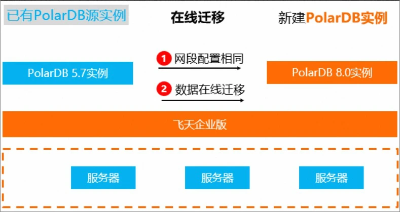

**用户告知**

- 需得到客户许可时操作。

- 迁移过程涉及实例连接地址的切换，建议在业务低峰期执行。

**优势说明**

- 支持连接地址迁移：可保留数据库原连接地址，应用端无需修改连接地址。

- 支持迁移回切：迁移切换后，若发现兼容性等问题，支持切回原来的实例。

- 迁移进度随时查看：支持查看当前的迁移进度，方便制定切换计划。

- 支持增量迁移，停机时间小于10分钟：通过DTS实现数据在线热迁移，数据迁移过程中无需停机。仅实例切换过程涉及一次闪断（即当业务从PolarDB 5.7切换至PolarDB 8.0时），需要申请约10分钟的停机窗口。

**限制说明**

- 不支持跨地域迁移：仅支持同一个Region中的实例进行迁移，不支持跨Region迁移。

- MySQL大版本之间并非完全兼容，当涉及跨大版本迁移时，应用对语法的兼容性需要自行评估。

- 连接地址切换的限制：切换地址仅进行DNS的切换，实际使用中有如下限制：

  - 带地址切换只会互换RDS和PolarDB的域名；Vswitch、Vip等配置不会切换。端口也不会发生切换。

  - DNS缓存问题：切换域名后，可能会存在DNS解析缓存问题，在缓存过期时间内可能会出现连接不上数据库或数据库只支持读操作，无法执行写入操作等情况，可以通过手工刷新服务器的DNS缓存加速缓存更新。

- 其他限制及注意事项：请参见《数据传输服务DTS用户指南》中数据迁移配置案例下对应源库和目标库的注意事项及限制。

**二.创建PolarDB MySQL实例**

执行迁移操作前需创建PolarDB MySQL实例。建议在迁移正式版本前，先进行测试数据的迁移和演练，避免误操作导致的数据错误或混乱。

**注意事项**

- 实例规格：推荐创建的实例规格与待迁移的PolarDB 5.7实例规格一致。

- VPC网络：建议选择与现有环境一致的VPC网络。如果选择了不同的VPC，请迁移前确认VPC网络可以被应用端访问。

- 网络白名单：实例创建成功后，需要配置与原PolarDB 5.7一致的IP白名单，避免实例切换后，应用无法访问PolarDB 8.0实例。

迁移前后的实例ID发生了变化，如果涉及到如下场景，建议提前与相关系统沟通，确保迁移后相关系统的切换。带地址切换不涉及数据库连接地址和端口修改，对于已有的连接地址不受影响，但是当进行变更配置的时候，需要您在如下的系统中重新配置：

- 数据库产品：DTS、DMS 通过云实例方式访问。

- 大数据产品： DataWorks、DataHub通过云实例方式访问。

- 云监控系统：切换到监控新的实例。

**三.迁移前置检查**

**仔细阅读DTS迁移限制说明，评估约束限制**

数据迁移是基于DTS实现的，在迁移前，请仔细阅读《数据传输服务DTS用户指南》中数据迁移配置案例下对应源库和目标库的注意事项及限制，明确注意事项和约束限制，并按要求完成迁移前的准备。

**语法兼容性检查**

请在迁移前做好应用的SQL语法兼容性验证和开发。确保迁移前后，应用都能正常使用。MySQL各版本间差异，请参见升级数据库版本和MySQL release notes。

**四.DTS数据迁移**

**操作步骤**

1. 登录云原生数据库PolarDB控制台，在左侧导航栏选择**AI能力 > 智能迁移**。

2. 在智能迁移页面，单击**PolarDB-M主备版 5.7到PolarDB-M主备版 8.0**。

3. 单击**去迁移**配置迁移任务。

4. 配置源库和目标库信息。

   **类别**

   **配置**

   **说明**

   DTS会自动生成一个任务名称，建议配置具有业务意义的名称（无唯一性

   **任务名称**

   无

   要求），便于后续识别。

   创建数据迁移实例时已指定，不可变更。

   **实例地区**

   **是否跨阿里云账**

   选择**不跨账号**。

   **号**

   选择**主备版**。

   **架构类型**

   **PolarDB实例**

   选择源PolarDB MySQL实例ID。

   **ID**

   填入源PolarDB MySQL的数据库账号，需具备REPLICATION CLIENT、

   **数据库账号**

   REPLICATION SLAVE、SHOW VIEW和所有迁移对象的SELECT权限。

   填入该数据库账号的密码。

   **数据库密码**

   根据需求选择连接方式。如果设置为**SSL安全连接**，您需要提前开启

   **连接方式**

   PolarDB MySQL实例的SSL加密功能。

   创建数据迁移实例时已指定，不可变更。

   **实例地区**

   **是否跨阿里云账号**

   选择**不跨账号**。

   选择**主备版**。

   **架构类型**

   **PolarDB实例**

   选择目标PolarDB MySQL实例ID。

   **ID**

   填入目标PolarDB MySQL版实例的数据库账号，需具备目标数据库的读

   **数据库账号**

   写权限。

   填入该数据库账号的密码。

   **数据库密码**

   根据需求选择连接方式。如果设置为**SSL安全连接**，您需要提前开启

   **连接方式**

   PolarDB MySQL实例的SSL加密功能。

5. 配置完成后，单击页面下方的**测试连接以进行下一步**。

6. 选择迁移对象及迁移类型。

   | 配置 | 说明 |
   | --- | --- |
   | 任务步骤 | • 如果只需要进行全量数据迁移，同时选中<strong>库表结构迁移</strong>和<strong>全量迁移</strong>。<br>• 如果需要进行不停机迁移，同时选中<strong>库表结构迁移</strong>、<strong>全量迁移</strong>和<strong>增量迁移</strong>。<br>说明如果未选中<strong>增量迁移</strong>，为保障数据一致性，全量数据迁移期间请勿在源数据库中写入新的数据。 |
   | 目标已存在表的处理模式 | • <strong>预检查并报错拦截</strong>：检查目标数据库中是否有同名的表。如果目标数据库中没有同名的表，则通过该检查项目；如果目标数据库中有同名的表，则在预检查阶段提示错误，数据迁移任务不会被启动。<br>• <strong>忽略报错并继续执行</strong>：跳过目标数据库中是否有同名表的检查项。<br>警告选择为<strong>忽略报错并继续执行</strong>，可能导致数据不一致，给业务带来风险，例如：<br>• 表结构一致的情况下，在目标库遇到与源库主键的值相同的记录，则会保留目标库中的该条记录，即源库中的该条记录不会迁移至目标库中。<br>• 表结构不一致的情况下，可能导致只能迁移部分列的数据或迁移失败。 |
   | 目标库对象名称大小写策略 | 您可以配置目标实例中迁移对象的库名、表名和列名的英文大小写策略。默认情况下选择<strong>DTS默认策</strong><strong>略</strong>，您也可以选择与源库、目标库默认策略保持一致。 |
   | 源库对象 | 在<strong>源库对象</strong>框中单击待迁移的对象，然后单击图标将其移动至<strong>已选择对象</strong>框。<br>说明<br>• 您可以根据实际情况，展开导航树进行正则搜索。<br>• 迁移对象选择的粒度为库、表。 |
   | 已选择对象 | 默认情况下，迁移对象在目标库中的名称与源库保持一致。<br>说明<br>• 如需按库或表级别选择迁移的SQL操作，请在<strong>已选择对象</strong>中右击待迁移对象，并在弹出的对话框中选择所需迁移的SQL操作。<br>• 如果使用了对象名映射功能，可能会导致依赖这个对象的其他对象迁移失败。 |

7. 单击**下一步高级配置**，进行高级配置。

   | 配置项目 | 配置说明 |
   | --- | --- |
   | 选择目标库的引擎类型 | 请根据实际情况，选择目标库的引擎类型为<strong>InnoDB</strong>或<strong>X-Engine</strong>。 |
   | 源库、目标库无法连接后的重试时间 | 在迁移任务启动后，若源库或目标库连接失败则DTS会报错。对于可预期的报错，DTS会立即进行持续的重试连接，默认重试720分钟，您也可以在取值范围（10~1440分钟）内自定义重试时间，建议设置30分钟以上。如果DTS在设置的时间内重新连接上源、目标库，迁移任务将自动恢复。否则，迁移任务将失败。<br>说明针对同源或者同目标的多个DTS实例，如DTS实例A和DTS实例B，设置网络重试时间时A设置30分钟，B设置60分钟，则重试时间以低的30分钟为准。 |

8. 上述配置完成后，单击页面下方的**下一步预检查并启动**。

   > **重要**
   >
   > - 在数据迁移任务正式启动之前，会先进行预检查。只有预检查通过后，才能成功启动数据迁移任务。
   >
   > - 如果预检查失败，请单击**查看详情**并请根据提示修复问题，然后重新进行预检查。

9. **预检查通过率**显示为100%时，单击**返回列表**。

   > 如果未选择增量数据迁移，您只需等待迁移任务完成即可，迁移任务会自动结束；如果
   >
   > **说明**
   >
   > 选择了增量数据迁移，迁移任务不会自动结束，您需要等待迁移任务处于**运行中**且无延迟时，手动结束迁移任务。

**五.切换数据库地址连接**

在迁移中单击切换即可。DNS切换后，客户端有缓存，可能还是会继续连接源数据库，需要断开源数据库的数据库连接。

**六.迁移回滚（可选）**

再次执行步骤五切换数据库地址链接即可将地址进行回迁。

<a id="section-17-2"></a>

## 17.2. PolarDB MySQL通过MCP接入Dify的最佳实践

本文介绍如何将PolarDB MySQL版实例接入API网关提供的MCP（Managed Capability Provider）服务，并在AI Studio的Dify平台中调用该数据库能力。MCP服务可将数据库操作封装为AI可调用的接口，适用于**智能问答、数据查询**场景（暂不支持数据变更和删除）。所有组件必须部署在**同一VPC网络下**以确保网络连通性。

**准备工作**

在开始操作前，请确认已完成以下准备工作：

- **获取必要权限**

  您的阿里云账号需具备以下产品的管理权限。

  - 云数据库PolarDB

  - API网关（Higress引擎）

  - 容器服务Kubernetes版（ACK）

  - 云解析DNS（PrivateZone）

  - AI Studio（Dify）

- **确认网络规划**

  确保使用同一个VPC网络，用于统一部署以下资源。

  - PolarDB MySQL实例

  - API网关（Higress）所依赖的Kubernetes集群

  - Dify所在的AI资源池

> **说明**
>
> 需提前在容器服务ACK控制台确认目标Kubernetes集群的VPC ID。

**前提条件**

| 组件 | 要求 |
| --- | --- |
| PolarDB MySQL实例 | • 网络类型为专有网络（VPC）<br>• 与API网关所用Kubernetes集群位于同一VPC |
| API网关实例 | • 引擎类型必须为Higress<br>• 成功导入目标Kubernetes集群<br>• 与PolarDB实例同VPC |
| Dify实例 | • 部署在与上述VPC相同的网络环境中<br>• 必须安装MCP SSE插件 |
| 网络连通性 | • PolarDB实例白名单需放通API网关的VPC外部IP<br>• Dify能通过私有DNS解析MCP域名 |

> **说明**
>
> 若各组件不在同一VPC，需通过云企业网（CEN）、高速通道或VPC对等连接打通网络，本文暂不覆盖跨VPC场景。

**注意事项**

- **权限安全**：为MCP服务创建的数据库账号为普通账号，仅授予必要只读权限即可。

- **DNS配置**：私有域名必须以英文句点 `.` 结尾（如 `mcp-mysql.example.com.` ），否则解析可能失败。

- **端口协议**：PolarDB MySQL默认端口为3306，MCP后端服务协议请选择HTTP（API网关内部会处理协议转换）。

- **重启影响**：修改数据库白名单或DNS配置后，可能需要等待数秒至数分钟生效。

**步骤1：创建AI网关实例**

1. **将K8s集群导入API网关控制台**

   访问**API 网关控制台**，在**集群管理**页面，单击**导入K8s集群**进行导入。

   > **重要**
   >
   > - API网关实例依赖的K8s集群和后续创建的PolarDB MySQL实例必须**位于同一VPC网络**。
   >
   > - **查找K8s集群VPC网络的方法**：访问**容器服务 Kubernetes版控制台**，在**集群**页面单击目标集群名称，进入集群详情页后，在**集群信息**页面的**集群资源**页签下，即可查看到虚拟专有网络VPC的详情。
   >
   >   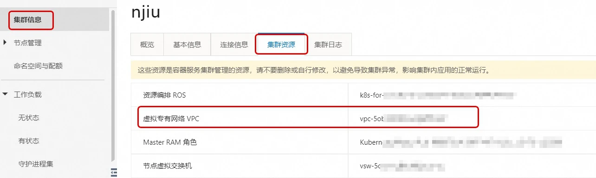

2. **创建网关实例**

   在**AI网关**页面，单击**创建实例**，重点关注如下参数的配置：

   - 网关类型：选择**AI网关**。

   - 部署架构：选择**K8s**。

   - K8s集群：选择步骤1已导入的K8s集群。

   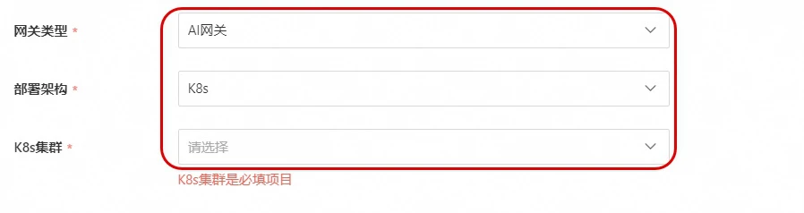

   > **说明**
   >
   > 更多参数项的配置方法，请参见API网关官网教程中的“AI网关用户指南”手册中的“创建网关实例”教程。

3. **记录该网关实例的VPC外部IP**

   网关实例创建完成后，可在**API 网关控制台概览**页面的**接入点**页签下获取该网关实例的VPC外部IP，并记录，用于后续数据库白名单配置。

**步骤2：创建并配置PolarDB MySQL实例**

1. **创建PolarDB MySQL实例**

   创建时网络类型需选择**专有网络**，同时并确保所选VPC与API网关实例所依赖的K8s集群**位于同一VPC网络**中。

   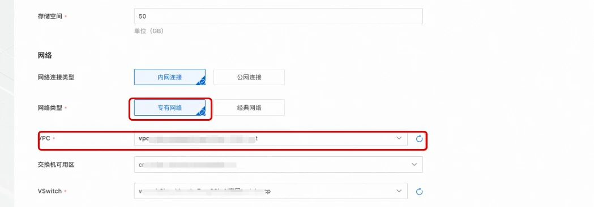

2. 创建数据库

   实例创建完成后，进入实例详情页的**数据库管理**页面，创建数据库 `mcp_db_server` ，并在数据库中插入测试数据，可通过DMS连接到PolarDB数据库并插入测试数据。

   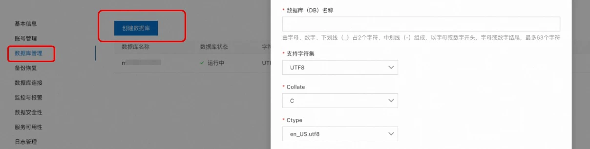

3. 创建账号

   进入实例详情页的**账号管理**页面，创建普通账号并为其授权（只读权限）上一步已创建的数据库。

   > **说明**
   >
   > 目前MCP服务调用仅支持数据查询类，**暂不支持数据变更和删除**，因此仅授予只读权限即可。

   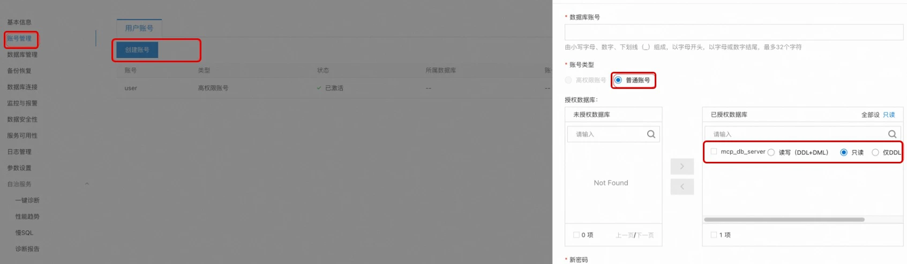

4. **配置数据库白名单**

   进入实例详情页的**数据安全性**页面，将1.3中已获取的API网关实例的VPC外部IP，添加至数据库实例的白名单分组中。

   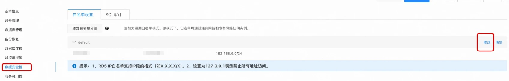

5. **记录数据库实例的内网连接地址和端口号**

   用于后续在API网关中创建MCP服务配置。查看方法，请参见查看连接地址和端口。

**步骤3：在API网关中创建MCP服务**

**3.1 创建服务**

访问步骤1中已创建的网关实例，在实例详情页的**服务管理**页面中，创建服务。重点关注如下参数的配置：

- 来源类型：选择**DNS域名**。

- 节点：选择步骤2.5已获取到的数据库实例的连接地址和端口。

- 协议类型：选择**HTTP**。

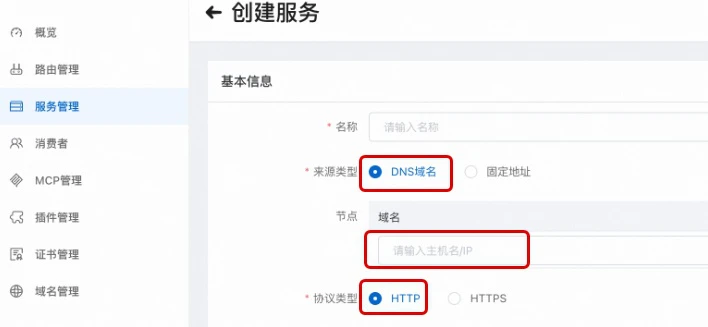

> **说明**
>
> 更多参数项的配置方法，请参见API网关官网教程中的“AI网关用户指南”手册中的“创建服务”教程。

**3.2 创建域名**

访问步骤1中已创建的网关实例，在实例详情页的**域名管理**页面中，单击**关联域名**，协议选择**HTTP**。

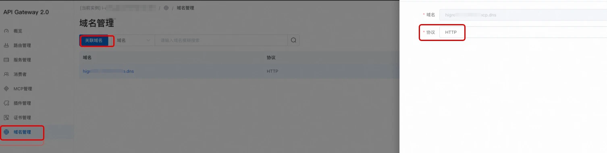

**3.3 创建MCP服务**

访问步骤1中已创建的网关实例，在实例详情页的**MCP管理**页面中，单击**创建MCP服务**。重点关注如下参数的配置：

- MCP接入点：选择3.2中创建的域名。

- 服务类型：选择**DB**。

- 后端服务：选择3.1中创建的服务。

- 数据库配置：数据库类型、用户名、密码和数据库名按照步骤2中的信息正确填写即可。

> **说明**
>
> 更多参数项的配置方法，请参见API网关官网教程中的“AI网关用户指南”手册中的“MCP服务管理”教程。

**步骤4：配置私有DNS（使Dify可解析MCP域名）**

1. **添加域名**

   访问**云解析 DNS控制台**，在**私网域名服务 > VPC私有域名**页面的**租户内网域名**页签下，单击**添加域**

   

   **名**。重点关注**租户内网域名**参数的配置，填写3.2中的域名，**注意必须在域名末尾加** 英文句号（`.`） 。

   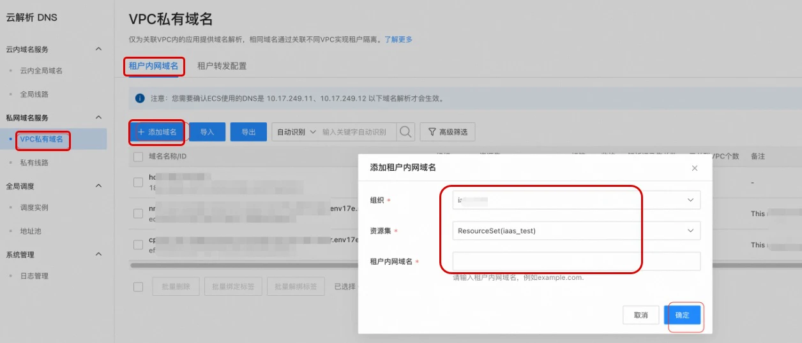

2. **添加解析记录**

   单击4.1已创建域名的**操作**列下的**解析配置**，在跳转的页面中单击**添加解析记录**。重点关注**添加条目**参数的配置，填入1.3中获取的IP，注意记录名称留空不填。

   

   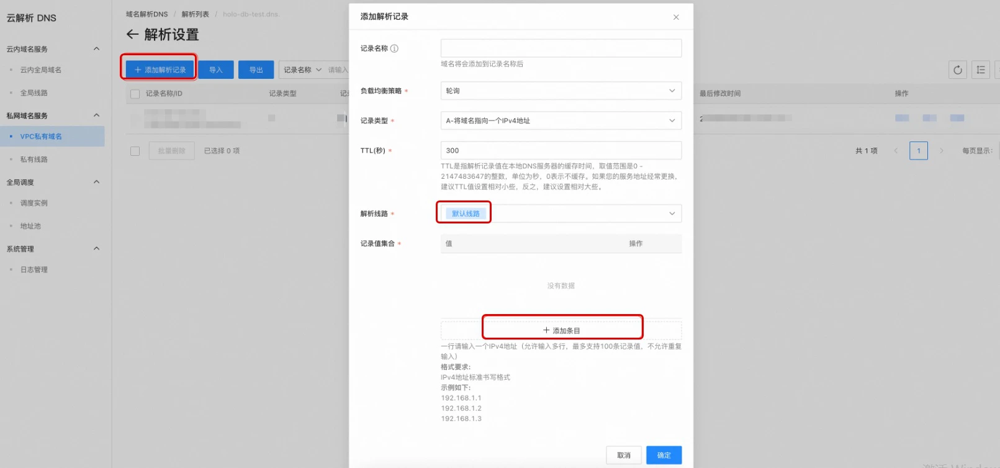

3. **关联VPC**

   单击4.1已创建域名的**操作**列下的**关联VPC**，在弹出的对话框中配置**关联VPC**，**所选VPC必须和API网关实例对应的VPC网络一致**。

   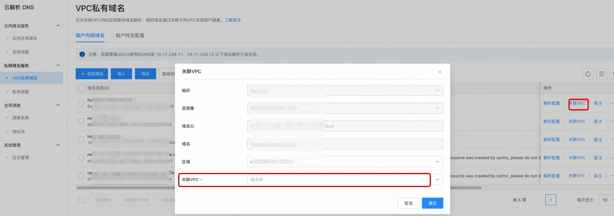

**步骤5：在Dify中调用MCP服务**

> **说明**
>
> 使用Dify前，需提前完成如下准备工作，并知晓如下注意事项：
>
> - 已存在资源池和资源配额。
>
> - 在ACK控制台扩容新的ECS节点，并加入资源配额，推荐2台16核32G，200G硬盘的ECS的节点。
>
> - 为防止出现不可预测的bug，或者创建Dify中由于资源抢占/节点污点不能容忍造成的Dify创建不顺利，建议创建Dify前，创建Dify专用资源配额，在其中添加ECS机器，后续在该资源配额上创建Dify。
>
> - 默认配置下，一个Dify实例需要4核8GB的CPU。

1. **创建Dify实例**

   > **说明**
   >
   > 具体教程，请参见AI Studio官网教程中的“用户指南（AI Studio）”手册中的相关教程。

   <ol type="i">

   <li>

   进入**AI Studio控制台**，访问**开源Agent开发平台 > Dify开源版**页面，单击**创建Dify**按钮，打开新建Dify的页面。

   </li>

   <li>

   基础配置：输入应用的名称、描述、选择已创建的资源配额 、输入管理员密码，单击**下一步**。

   </li>

   <li>

   参数等配置：建议Dify版本选择1.7.1，另外需要提前在OSS控制台创建一个Bucket，将其填写到**参数**配置项中（authVersion值保持不变请保持不变）。

   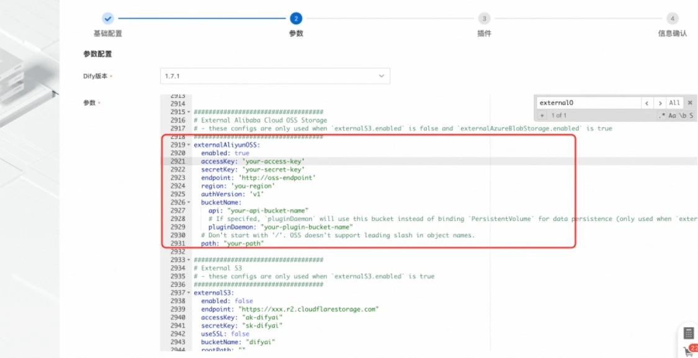

   </li>

   <li>

   选择安装插件：**MCP SSE插件必须安装**，其他插件按需选择即可。

   </li>

   </ol>

   等待应用状态变为运行中即可，请耐心等待，一般在5分钟左右。

2. **添加Dify用户**

   > **说明**
   >
   > 创建前需确保已成功完成5.1操作创建了一个Dify实例，且其状态为运行中。

   <ol type="i">

   <li>

   进入**AI Studio控制台**，访问**开源Agent开发平台 > Dify开源版**页面，单击目标Dify实例的**用户管理**按钮，进入用户管理。

   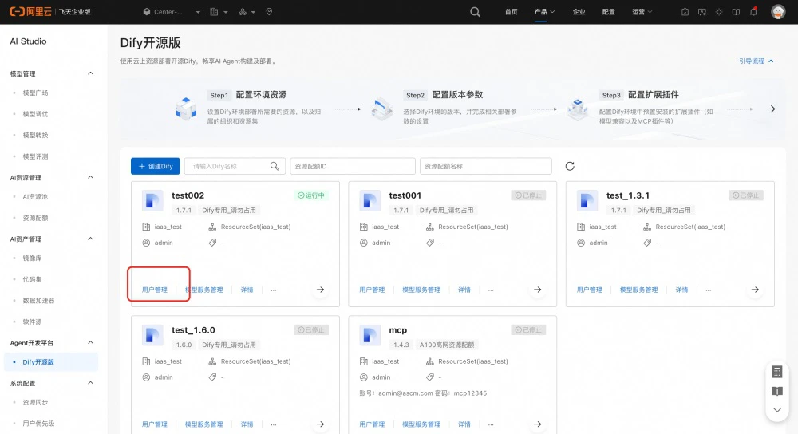

   </li>

   <li>

   单击**添加用户**按钮添加一个用户。

   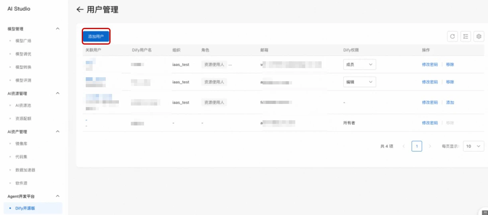

   </li>

   <li>

   在关联用户中选择一个未添加过的用户，输入**8位**密码，设置为**管理员**。

   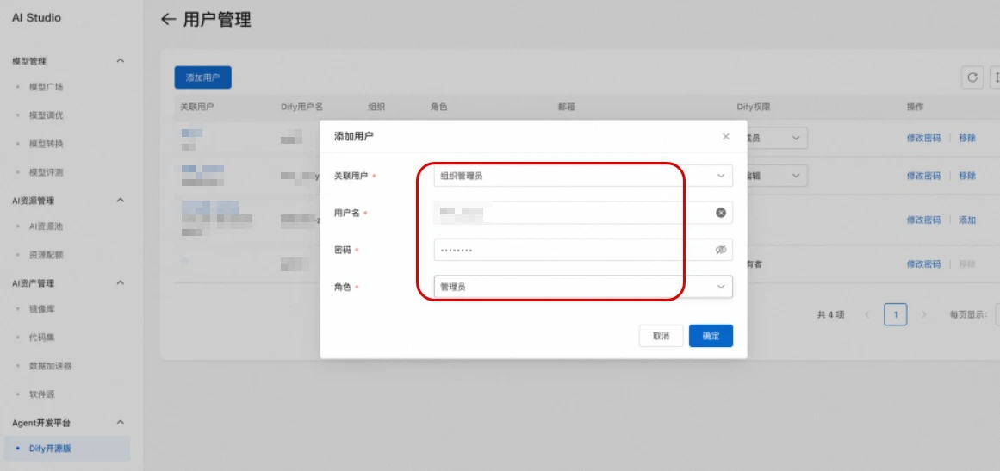

   </li>

   </ol>

3. **添加Dify模型**

   <ol type="i">

   <li>

   单击Dify实例下的**模型服务管理**。

   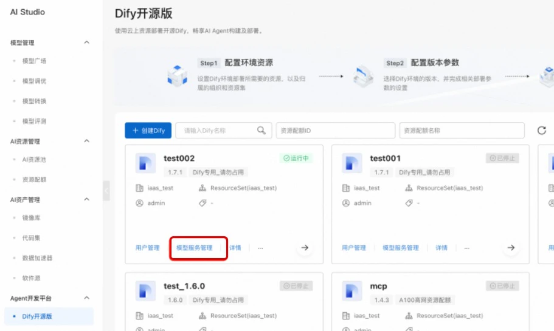

   </li>

   <li>

   单击**添加模型**。

   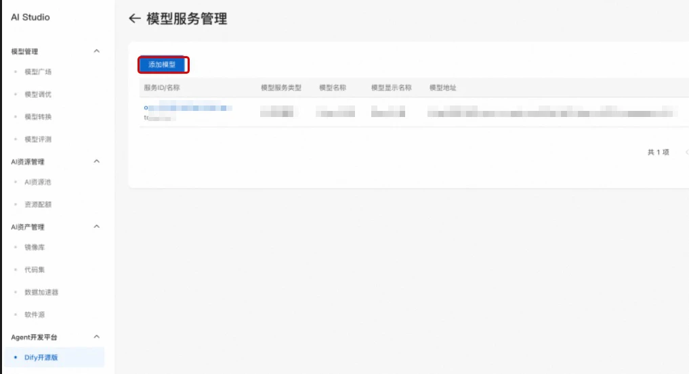

   </li>

   <li>

   配置如下模型信息。

   > **说明**
   >
   > 选择完成后，会自动填入模型名称、模型地址和API Key，需注意，如果此处API Key一栏没有值，则表示您不是模型服务的创建人，请联系在线服务创建人获取API Key并手工填入。

   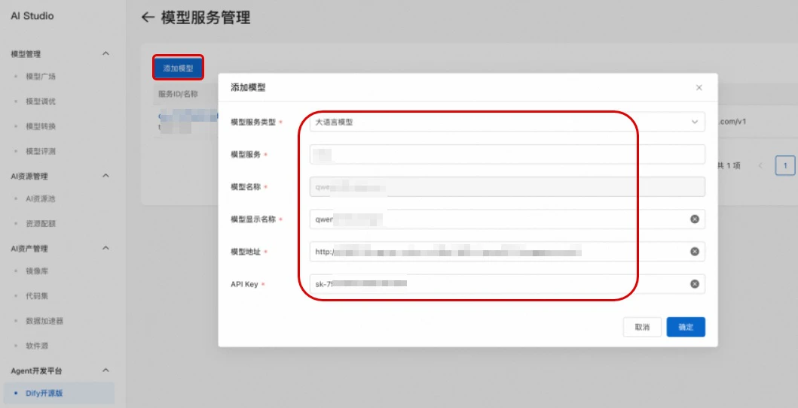

   </li>

   </ol>

4. **登录Dify实例**

   <ol type="i">

   <li>

   单击Dify实例下的  。

   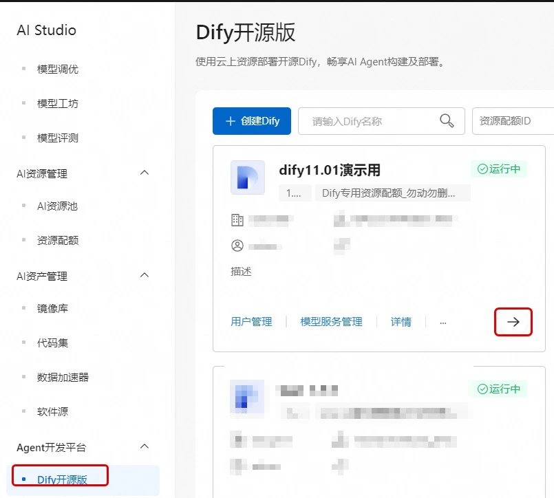

   </li>

   <li>

   在弹出的对话框中，输入**邮箱地址**和**密码**，单击**登录**。

   

   </li>

   </ol>

5. **配置MCP服务**

   进入Dify实例后，依次单击**工具 > 发现和调用 MCP 工具 > 授权** ，打开MCP插件的配置标签并进入配置。

   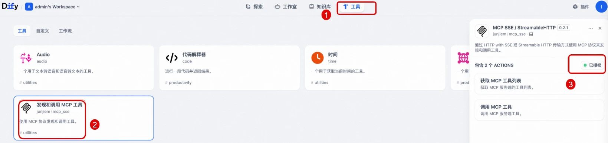

   编辑JSON配置：

   `sever_name` 按需配置即可， `url` 字段为3.3中创建的MCP服务详情页面的MCP管理页面中可获取，复制SSE接入点即可。

   ```json
   {
       "server_name": {
           "url": "xxxxxxxxxx",
           "headers": {},
           "timeout": 50,
           "sse_read_timeout": 50
       }
   }
   ```

   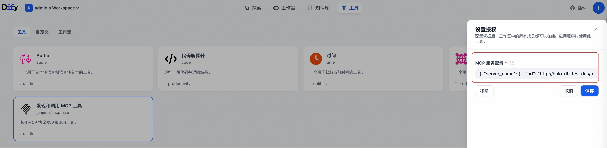

   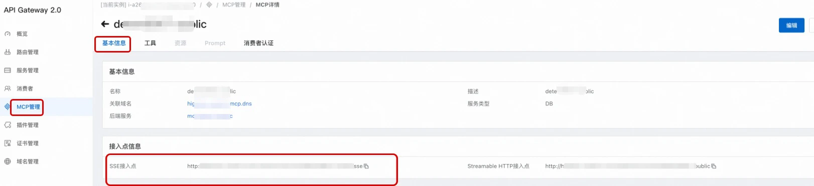

6. **进入应用调用大模型进行查询对话**

   <ol type="i">

   <li>

   保存MCP配置后，单击**工作室** > **某个具体应用。**

   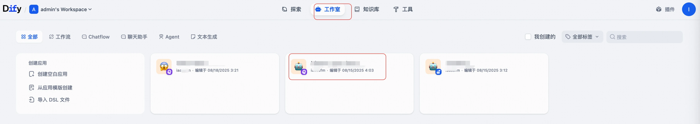

   </li>

   <li>

   进入应用后，添加MCP相关工具后，即可在右侧对话框中与大模型进行对话。

   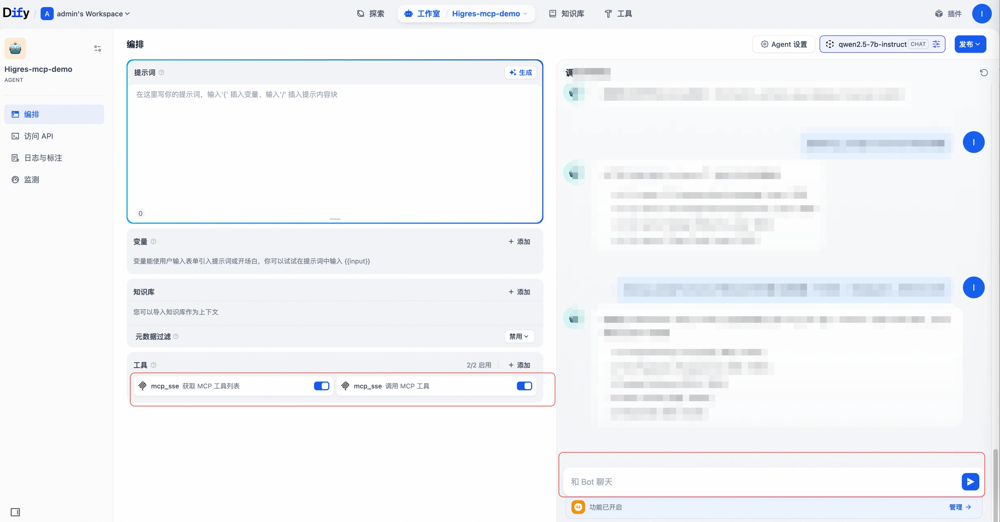

   </li>

   </ol>

<a id="section-18"></a>

# 18.附录

<a id="section-18-1"></a>

## 18.1. 租户组织对SLB服务授权操作

本文为您介绍如何完成SLB服务授权操作，帮助您快速解决问题。

> **重要**
>
> 若您的业务场景需要申请创建并使用IPv6实例，必须确保当前租户组织已显式授予数据库产品访问SLB服务的权限。若未完成此授权操作，则无法成功创建IPv6实例。

**操作步骤**

1. 登录Apsara Uni-manager运营控制台。

2. 在页面顶部的菜单栏中，单击**配置**。

3. 在左侧导航栏，单击**RAM服务角色**。

4. 在RAM服务角色页面，单击左上角**创建RAM服务角色**。

   **服务名称**选择**负载均衡SLB**，**授权组织名称**选择需要授权的组织即可。

   

5. 单击**确定**，完成授权。
