阿里云  
专有云  
云原生数据库  
PolarDB MySQL主备版 运维指南  
产品版本：V3.18.6  
文档版本：20260528

**目录**

- [1.产品架构](#section-1)
    - [1.1. 系统架构](#section-1-1)
    - [1.2. 组件架构](#section-1-2)
- [2.数据库运维平台·杜康智能版 操作指南](#section-2)
    - [2.1. 登录云数据库统一运维平台·杜康智能版](#section-2-1)
    - [2.2. 杜康智能版首页概览](#section-2-2)
    - [2.3. 实例管理](#section-2-3)
        - [2.3.1. 实例详情页简介](#section-2-3-1)
        - [2.3.2. 查看实例信息](#section-2-3-2)
        - [2.3.3. 实例运维操作](#section-2-3-3)
            - [2.3.3.1. 注意事项](#section-2-3-3-1)
            - [2.3.3.2. 备库重搭](#section-2-3-3-2)
            - [2.3.3.3. 实例迁移](#section-2-3-3-3)
            - [2.3.3.4. 小版本升级](#section-2-3-3-4)
            - [2.3.3.5. 规格变更](#section-2-3-3-5)
            - [2.3.3.6. 锁定实例](#section-2-3-3-6)
            - [2.3.3.7. HA切换](#section-2-3-3-7)
            - [2.3.3.8. 存储空间变更](#section-2-3-3-8)
        - [2.3.4. 监控告警](#section-2-3-4)
        - [2.3.5. 实例诊断](#section-2-3-5)
        - [2.3.6. 状态巡检](#section-2-3-6)
        - [2.3.7. 审计日志](#section-2-3-7)
        - [2.3.8. 变更记录](#section-2-3-8)
        - [2.3.9. 任务管理](#section-2-3-9)
        - [2.3.10. 备份管理](#section-2-3-10)
        - [2.3.11. 数据恢复](#section-2-3-11)
        - [2.3.12. 安全配置](#section-2-3-12)
        - [2.3.13. 参数配置](#section-2-3-13)
        - [2.3.14. 运维配置](#section-2-3-14)
        - [2.3.15. 标签配置](#section-2-3-15)
        - [2.3.16. 数据库管理](#section-2-3-16)
        - [2.3.17. 账号管理](#section-2-3-17)
    - [2.4. 智能运维](#section-2-4)
        - [2.4.1. 智能主机诊断](#section-2-4-1)
        - [2.4.2. 一键信息采集](#section-2-4-2)
        - [2.4.3. 自动化脚本管理](#section-2-4-3)
    - [2.5. 主机管理](#section-2-5)
        - [2.5.1. 主机软件包管理](#section-2-5-1)
        - [2.5.2. 物理机分组](#section-2-5-2)
    - [2.6. 软件包管理](#section-2-6)
- [3.数据库运维平台·杜康 操作指南](#section-3)
    - [3.1. 登录云数据库统一运维平台·杜康](#section-3-1)
    - [3.2. 首页](#section-3-2)
    - [3.3. 实例管理](#section-3-3)
        - [3.3.1. 实例列表](#section-3-3-1)
        - [3.3.2. 实例详情](#section-3-3-2)
        - [3.3.3. 通用实例运维](#section-3-3-3)
            - [3.3.3.1. 注意事项](#section-3-3-3-1)
            - [3.3.3.2. 实例检查](#section-3-3-3-2)
            - [3.3.3.3. 实例诊断](#section-3-3-3-3)
            - [3.3.3.4. 实例重启](#section-3-3-3-4)
            - [3.3.3.5. 实例迁移](#section-3-3-3-5)
            - [3.3.3.6. 小版本升级](#section-3-3-3-6)
            - [3.3.3.7. 实例参数管理](#section-3-3-3-7)
            - [3.3.3.8. 规格变更](#section-3-3-3-8)
            - [3.3.3.9. 存储空间变更](#section-3-3-3-9)
            - [3.3.3.10. HA切换](#section-3-3-3-10)
            - [3.3.3.11. 锁定实例](#section-3-3-3-11)
            - [3.3.3.12. 备份与恢复](#section-3-3-3-12)
            - [3.3.3.13. 备库重搭](#section-3-3-3-13)
            - [3.3.3.14. 实例任务管理](#section-3-3-3-14)
            - [3.3.3.15. 关闭实例分配](#section-3-3-3-15)
        - [3.3.4. 其他实例运维](#section-3-3-4)
            - [3.3.4.1. RDS MySQL两节点本地盘版升级至PolarDB MySQL主备版](#section-3-3-4-1)
            - [3.3.4.2. PolarDB MySQL备节点常见运维操作](#section-3-3-4-2)
            - [3.3.4.3. PolarDB PostgreSQL共享存储版同城容灾切换](#section-3-3-4-3)
            - [3.3.4.4. PolarDB-X实例SQL信息查询](#section-3-3-4-4)
            - [3.3.4.5. PolarDB-X任务失败处理](#section-3-3-4-5)
            - [3.3.4.6. PolarDB-X数据节点规格变更](#section-3-3-4-6)
            - [3.3.4.7. PolarDB-X实例资源配置](#section-3-3-4-7)
            - [3.3.4.8. Tair增加Proxy实例节点](#section-3-3-4-8)
            - [3.3.4.9. Tair临时放大主备同步buffer](#section-3-3-4-9)
            - [3.3.4.10. AnalyticDB MySQL3.0登入console并执行SQL](#section-3-3-4-10)
        - [3.3.5. 实例批量管理](#section-3-3-5)
            - [3.3.5.1. 批量迁移实例](#section-3-3-5-1)
            - [3.3.5.2. 批量实例参数刷新](#section-3-3-5-2)
            - [3.3.5.3. 批量DIY参数刷新](#section-3-3-5-3)
            - [3.3.5.4. 批量Redis参数刷新](#section-3-3-5-4)
            - [3.3.5.5. 批量任务管理](#section-3-3-5-5)
            - [3.3.5.6. 批量任务类型管理](#section-3-3-5-6)
            - [3.3.5.7. SQL模板管理](#section-3-3-5-7)
        - [3.3.6. 实例计划迁移管理](#section-3-3-6)
        - [3.3.7. 实例大盘](#section-3-3-7)
    - [3.4. 主机管理](#section-3-4)
        - [3.4.1. 新建主机](#section-3-4-1)
        - [3.4.2. 批量配置主机](#section-3-4-2)
        - [3.4.3. 查看主机信息](#section-3-4-3)
        - [3.4.4. 物理机分组](#section-3-4-4)
        - [3.4.5. 主机软件包管理](#section-3-4-5)
    - [3.5. 集群管理](#section-3-5)
        - [3.5.1. 设置集群参数](#section-3-5-1)
        - [3.5.2. 管理服务类型](#section-3-5-2)
        - [3.5.3. 管理服务节点](#section-3-5-3)
        - [3.5.4. DB配置模板](#section-3-5-4)
        - [3.5.5. 方寸山集群管理](#section-3-5-5)
        - [3.5.6. Location管理](#section-3-5-6)
    - [3.6. 任务管理](#section-3-6)
        - [3.6.1. 管理中断任务](#section-3-6-1)
        - [3.6.2. 临时关闭任务管理](#section-3-6-2)
        - [3.6.3. 工作流运维](#section-3-6-3)
    - [3.7. 系统管理](#section-3-7)
        - [3.7.1. 功能概览](#section-3-7-1)
        - [3.7.2. 切换日志统一存储位置](#section-3-7-2)
    - [3.8. 重要组件检查](#section-3-8)
    - [3.9. 异常信息处理](#section-3-9)
    - [3.10. 附录](#section-3-10)
        - [3.10.1. 登录Apsara Uni-manager运维控制台](#section-3-10-1)
- [4.Apsara Uni-manager平台运维](#section-4)
    - [4.1. 开启PolarDB IPv6开关](#section-4-1)
    - [4.2. 配置PolarDB自定义密码策略](#section-4-2)
    - [4.3. 开启 8.4内核参数开关](#section-4-3)
    - [4.4. 开启PolarDB指定内核小版本开关](#section-4-4)
- [5.安全维护](#section-5)
    - [5.1. 网络安全维护](#section-5-1)
    - [5.2. 账号密码维护](#section-5-2)
- [6.故障处理](#section-6)
    - [6.1. 故障应急机制](#section-6-1)
    - [6.2. 建立备货机制](#section-6-2)
    - [6.3. 故障处理方法](#section-6-3)
    - [6.4. 常见故障处理](#section-6-4)
        - [6.4.1. 磁盘空间不足](#section-6-4-1)
        - [6.4.2. 复制中断](#section-6-4-2)
        - [6.4.3. Swap不足](#section-6-4-3)
        - [6.4.4. Load过高](#section-6-4-4)
        - [6.4.5. 复制延迟](#section-6-4-5)
        - [6.4.6. 模块异常](#section-6-4-6)
    - [6.5. 硬件故障处理](#section-6-5)
        - [6.5.1. 内存、主板、CPU、电源等需要停机更换](#section-6-5-1)
- [7.高危操作](#section-7)

<a id="section-1"></a>

# 1.产品架构

<a id="section-1-1"></a>

## 1.1. 系统架构

本文介绍云原生数据库PolarDB MySQL的系统架构。

**备份系统**

云原生数据库PolarDB MySQL可以随时发起数据库的备份，能够根据备份策略将数据库恢复至任意时刻，提高了数据可回溯性。

- 自动备份：PolarDB提供多种备份类型，备份开始时间可由用户根据自己的业务低峰灵活配置。

- 手动备份：您可在需要时随时发起手动备份操作。

- 克隆实例：克隆实例是指新建一个实例，可以复制出与主实例一模一样的内容，包括实例数据和实例设置。克隆实例主要用于恢复主实例数据，或批量创建相同实例。

- 备份文件下载：您可以在用户备份文件保留期间登录PolarDB管理控制台，下载备份文件至本地。

**数据迁移系统**

云原生数据库PolarDB MySQL提供了数据迁移服务DTS（Data Transmission Service）工具，方便您快速迁移数据库。

- 实例间复制数据库：PolarDB提供实例间数据库迁移功能，可非常简便地将数据库迁移至其他实例。

- 数据迁入迁出：PolarDB提供专业工具和向导式迁移服务来帮助用户将数据迁入或迁出PolarDB。

**监控系统**

云原生数据库PolarDB MySQL提供物理层、网络层、应用层等多方位的监控服务，保证业务可用性。

- 性能监控：PolarDB提供近20种系统性能监控项，包括磁盘容量、IOPS、连接数、CPU利用率、网络流量、TPS、QPS、缓存命中率等等。

- SQL审计：系统会记录发往PolarDB实例的SQL语句及其他附加信息，包括连接IP、访问数据库名称、访问账号、执行时间、返回记录数等。您可依此查找问题和对实例的安全性进行排查。

- 阈值报警：当实例出现状态或性能异常时，PolarDB提供短信报警功能。

- Web操作日志：系统对PolarDB控制台中所有修改类操作进行日志记录，供管理员查看，最长可保留30天。

**控制系统**

当实例主机或者实例出现异常crash后，PolarDB高可用组件检查到异常后会在30秒内进行切换，保证应用的正常运行，保障PolarDB高可用。

**任务调度系统**

用户可通过PolarDB控制台或者通过PolarDB API进行实例创建、删除、内外切换，后端以任务的形式进行调度，可对实例所有操作进行跟踪和展示。

<a id="section-1-2"></a>

## 1.2. 组件架构

本文列举云原生数据库PolarDB MySQL的各组件及其作用。

| 组件 | 作用 |
| --- | --- |
| 元数据库（包括整体元数据库、杜康、FTP、DRC、性能库） | 负责各组件元数据管理以及任务流。 |
| proxy | 负责数据库的分库分表以及数据路由、数据防火墙等功能。 |
| 茅台 | 负责云原生数据库PolarDB MySQL的资源、任务、备份、性能、发布、SQL调优等功能。 |
| aurora | 负责整个DB节点的高可用。 |
| PolarDB API | 负责与前端API进行交互。 |
| DB节点 | 负责存储用户数据。 |
| DRC | 负责用户入云的数据导入以及实例间的数据迁移。 |
| REDIS | 负责存储实例的SQL明细、性能数据等。 |
| 杜康 | 用于后台数据库管理平台系统。 |
| 消息中心 | 负责控制节点跟DB节点之间的消息通信。 |
| Jstorm/kafka/zookee per | 用户SQL存储到kafka，然后再通过jstorm写入到sls中，zookeeper用于配置文件管理。 |
| FTP | 提供Windows用户备份集上传服务。 |
| Bianque | 负责函数诊断。 |
| Logagent | 负责主机日志收集。 |
| Erlbox | 负责管理各日志收集组件。 |
| Mscheck | 负责主备数据校验。 |
| Mysqlpcap | 负责将用户SQL信息收集到Redis。 |
| Tcprt | 负责收集用户链路的响应时间。 |
| Webdump | 负责收集用户的公网流量。 |

<a id="section-2"></a>

# 2.数据库运维平台·杜康智能版 操作指南

<a id="section-2-1"></a>

## 2.1. 登录云数据库统一运维平台·杜康智能版

本文介绍如何登录云数据库统一运维平台·杜康智能版平台。

**前提条件**

- 已从部署人员或管理员处获取Apsara Uni-manager运维控制台的访问地址、用户名和密码。

  Apsara Uni-manager运维控制台访问地址格式为 `region-id.ops.console.intranet-domain-id.com` 。

- 推荐使用Chrome浏览器。

**操作步骤**

1. 打开浏览器。

2. 在地址栏中，输入Apsara Uni-manager运维控制台的访问地址，按回车键。

   > **说明**
   >
   > 您可单击右上角的下拉列表切换语言。

   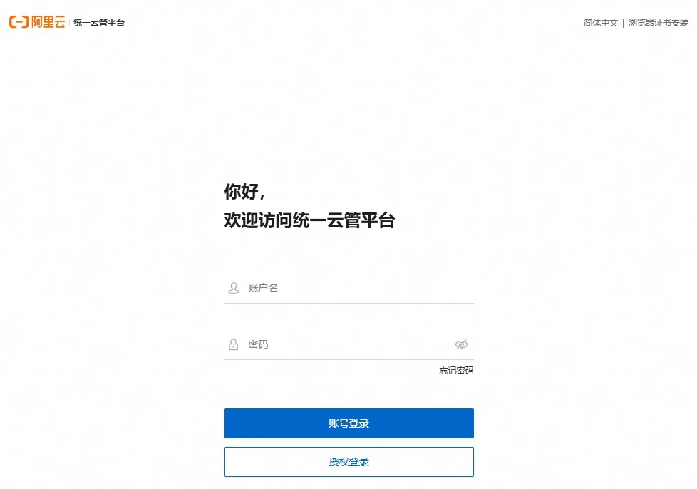

3. 输入正确的用户名及密码。

   > **说明**
   >
   > - 登录Apsara Uni-manager运维控制台的用户名和密码请从部署人员或管理员处获取。
   >
   > - 若连续输入密码错误三次，系统将启动图片验证码登录功能；若连续输入错误五次，账户将被锁定，请联系管理员进行激活。

   首次登录Apsara Uni-manager运维控制台时，需要修改登录用户名的密码，请按照提示完成密码修改。

   为提高安全性，密码必须满足以下要求：

   - 必须包含英文大小写字母。

   - 必须包含阿拉伯数字（0~9）。

   - 必须包含特殊符号，包括感叹号（!）、at（@）、井号（#）、美元符号（$）、百分号（%）等。

   - 密码长度为10~20个字符。

4. 单击**账号登录**。

5. 单击顶部菜单栏的**产品运维**，并在**数据库运维**下选择**云数据库统一运维平台·杜康智能版**。

<a id="section-2-2"></a>

## 2.2. 杜康智能版首页概览

作为数据库智能运维平台的核心入口，杜康智能版首页通过全局化数据展示、异常快速定位和智能导航体系，帮助用户在短时间内掌握系统运行态势，高效完成日常运维操作。本教程将从客户视角出发，详解首页核心模块及其价值。

**首页核心价值**

首页作为您的数据库运维中枢，具备三大核心能力：

- 全局掌控：一屏览尽所有实例、集群、任务运行状态。

- 异常预警：实时识别系统风险点，提供处理指引。

- 知识库：一键直达官方教程与指南，快速提升运维效率。

**全局概览区：10秒掌握系统健康度**

**系统状态概览**

点击对应指标可进入对应详情页查看具体详情。

| 指标 | 内容 | 使用价值 |
| --- | --- | --- |
| 健康状态 | 综合评分（如85.2分）及"良好"标识等 | 快速判断系统整体健康水平 |
| 关键指标 | 总数据库类型数、总集群数、总实例数、总主机数 | 掌握资源规模，预估运维负载 |

**异常数据概览**

当发现“实例异常”环形图显示异常时，可立即点击进入排查具体是哪些实例存在问题。

- 八大异常维度：实例异常、资源配额异常、主机异常、系统运行异常、集群异常、实例备份异常、实例HA状态异常、任务中断数

- 可视化呈现：环形图+具体数值（如，HA切换任务异常2个）

- 使用价值：

  - 一眼识别异常类型及数量

  - 通过颜色区分（黄色预警/红色严重）优先处理高危问题

  - 点击异常模块直接进入详情页进行处理

**核心监控区：深度掌握关键组件**

**高可用HA信息**

- 核心指标：HA实例数、HA状态异常数、HA切换次数

- 动态趋势图：HA切换任务趋势（支持1小时/4小时/12小时等时间维度切换）

- 使用价值：

  - 监控数据库高可用能力

  - 通过趋势图识别异常切换频次（如短时间内切换次数陡增）

  - 保障业务连续性

**核心管控组件状态**

- 组件清单：RDSAPI、Dukang、DBass、Perf、Bak等关键组件

- 状态标识：绿色“正常”、红色“异常”

- 使用价值：确认运维平台自身运行状态

**实例/集群管理看板**

| 模块 | 关键能力 | 客户操作 |
| --- | --- | --- |
| 实例管理 | • 按数据库类型（MySQL/Redis等）统计实例状态<br>• 按芯片类型（Hygon/Phytium等）分布统计 | 点击“查看更多”直接进入处理页面 |
| 集群管理 | • 资源售卖TOP 5排行<br>• 主机监控状态（正常/异常）<br>• 主机芯片分布统计 | 通过TOP 5识别高负载集群 |

**任务与风险管控**

**任务管理**

- 任务状态环：实时显示任务总数（如304个）及运行中/等待中/已中断比例

- 任务详情表：包含任务ID、名称、来源、耗时等关键信息

- 客户操作：

  - 观测任务中断详情查看中断来源等

  - 点击**查看更多**跳转至对应页面，对中断任务进行干预

**系统巡检（黑榜/红榜）**

- 黑榜TOP 8：数据库性能问题（如pgxc_replication_stop、pgxc_conf_inconsistent等）

- 红榜TOP 8：配置与安全风险（如docker_hostnames_unavailable等）

- 雷达图：直观展示问题严重程度

- 使用价值：

  - 优先处理红榜高危问题

  - 预防性规避系统风险

**使用示例：发现数据库响应变慢**

1. 第一步：首页查看“系统状态概览”确认健康评分是否下降

2. 第二步：检查“异常数据概览”中“实例异常”是否出现新增

3. 第三步：在“系统巡检”黑榜中发现“pgxc_replication_stop”问题

4. 第四步：访问实例详情页的相关功能界面直接处理，也可方案官网教程寻找相关解决方案

**首页使用最佳实践**

1. 每日晨间检查

   - 重点查看：健康状态评分、异常数据概览、系统巡检红榜

   - 操作建议：对新增异常记录，纳入当日运维计划。

2. 故障应急响应

   - 当收到告警时：优先核对首页异常数据概览与任务管理状态

   - 关键动作：通过“快捷导航→处理流程库”决策标准化应急方案

3. 知识沉淀利用

   - 发现新问题时：先在首页搜索框输入关键词（如“连接数超限”）

   - 价值点：自动匹配知识库文章，避免重复踩坑

<a id="section-2-3"></a>

## 2.3. 实例管理

<a id="section-2-3-1"></a>

### 2.3.1. 实例详情页简介

杜康智能版实例详情页是云数据库统一运维平台·杜康智能版的核心功能模块，用于全面展示和管理数据库实例的运行状态、配置信息、性能指标及运维操作。

**核心功能**

- **全景信息展示**：集中展示实例基本信息、规格配置、网络拓扑、主机信息等核心属性，通过环形图直观呈现CPU、内存、磁盘、IOPS、连接数等资源使用率。

- **可视化拓扑**：支持逻辑拓扑和物理拓扑两种视图，以图形化方式展示实例的组织结构和部署关系。

- **多维度监控告警**：提供动态监控指标大盘，，通过折线图展示，可按节点级切换和时间范围筛选。

- **智能诊断工具集**：提供360°全景诊断、专项诊断（慢SQL分析、实例卡慢诊断、实时信息、InnoDB状态等）和状态巡检，助力快速定位性能瓶颈和故障根因。

- **审计日志与变更记录**：支持SQL审计日志查询、归档及历史归档下载，记录实例所有操作变更的10类日志（通用日志、HA日志、API日志、管理日志等）。

- **备份与恢复管理**：管理数据备份策略和binlog备份策略，支持按备份集恢复和按时间点恢复（PITR）。

- **安全与参数配置**：管理IP白名单、安全组、内核参数、管控参数、运维配置和实例标签，确保实例安全合规运行。

- **数据库与账号管理**：管理实例下的数据库列表和用户账号/系统账号，支持创建、删除、授权、密码管理等操作。

**适用场景**

- 日常运维巡检：快速查看实例健康状态、资源水位和性能指标。

- 故障排查定位：通过360°诊断、专项诊断和审计日志，精准定位故障根因。

- 配置管理变更：调整备份策略、安全配置、运行参数等实例配置。

- 数据安全管理：执行备份恢复、账号权限管理等数据安全操作。

**使用须知**

**使用限制**

当前杜康智能版新版实例详情页仅支持MySQL类型实例，详情见下表。其他实例类型的运维操作，请参考《数据库运维平台·杜康 操作指南》的“实例管理”章节。

| 限制项 | 说明 |
| --- | --- |
| 物理拓扑可见性 | 仅MySQL且非新架构实例显示物理拓扑。 |
| 实例视图可见性 | 仅当前实例为主实例时显示实例视图菜单。 |
| Maxscale日志 | 仅MySQL类型实例可见。 |
| 实例实时信息 | 仅MySQL类型实例可见。 |
| InnoDB实时状态 | 仅MySQL类型实例可见。 |
| InnoDB状态 | 仅MySQL类型实例可见。 |
| 主机联通性检测 | 仅MySQL类型实例支持。 |
| SQL执行限制 | 仅支持单行语句，不支持回车换行；PolarDB子实例需切换到主库执行。 |
| 执行SQL最大返回行数 | 1~10000行。 |
| 实例卡慢诊断 | 每页固定展示50条记录。 |
| 审计日志归档 | 归档到OSS存储，操作前有确认弹窗。 |
| 账号密码复杂度 | 至少包含大写、小写、数字、特殊符号中的三种，长度8~32位。 |

**安全注意事项**

> **警告**
>
> - SQL执行存在风险，请谨慎操作。
>
> - 专项诊断页面的批量Kill会话操作前有确认弹窗，批量终止会话可能影响业务。
>
> - 删除数据库和删除账号操作不可逆，操作前有确认弹窗。
>
> - 修改内核参数时，部分参数需重启实例才能生效，建议在业务低峰期操作。

**快速入门**

**步骤一：进入实例详情页**

1. 登录云数据库统一运维平台·杜康智能版。在左侧导航栏中，选择<strong>实例管理 > 实例列表，</strong>在实例列表中找到目标实例，单击实例名称。

2. 页面将跳转至实例详情页，默认展示**基本信息**页面。

**步骤二：查看基本信息**

在**基本信息**页面，您可以查看以下信息：

- **基本信息卡片**：实例ID、实例名称、数据库类型、数据库版本、实例状态、锁定状态、地域及可用区、集群名称、所属数据中心。

- **SLB信息**：实例关联的负载均衡地址和端口。

- **性能概览**：通过环形图展示CPU使用率、内存使用率、磁盘使用率、IOPS使用率、连接数使用率。

  右侧提供**性能监控**和**资源配置**两个快捷入口按钮。

- **规格信息**：CPU核数、内存大小、磁盘容量、最大连接数等。

- **主机信息**：实例所在的物理主机详情。MySQL类型实例支持“联通性检测”功能。

- **网络信息**：VPC、交换机、内网/外网地址等。

**步骤三：查看监控指标**

1. 在实例详情页左侧菜单栏，单击**监控告警**。

2. 在监控大盘中，查看目标监控指标（如CPU、内存、QPS、TPS、网络流量等）。

3. 选择时间范围查看历史数据。

   每个监控面板可独立选择监控的节点（实例级或子节点级），页面通过折线图展示。

**常见问题（FAQ）**

**为什么物理拓扑页签不显示？**

物理拓扑仅对MySQL且非新架构实例显示。如果您的实例不是MySQL类型或属于新架构，则该页签不会展示。

**为什么实例视图菜单不显示？**

实例视图仅在当前实例为主实例时显示。如果当前实例是只读实例或备实例，则不会显示此菜单。

**执行SQL时提示“notinwhiteList”如何处理？**

请将当前操作IP地址添加到实例的IP白名单中。进入实例详情页，在左侧菜单栏单击**安全配置 > IP白名单**，添加当前操作IP后重新执行SQL。

**执行SQL为什么不支持多行语句？**

执行SQL功能仅支持单行语句，不支持回车换行。请将多行SQL合并为单行后执行。

**PolarDB子实例执行SQL失败如何处理？**

PolarDB子实例需要切换到主库执行。在执行SQL页面的主备库选择中，选择"主库"后重新执行。

**Kill会话操作会影响业务吗？**

Kill会话会终止选中的会话进程，可能影响正在执行的业务操作。建议在确认会话不影响核心业务后再执行。操作前有确认弹窗提示，请谨慎操作。

**InnoDB实例实时状态切换到其他页面后数据消失了如何处理？**

切换到其他标签页时会自动停止采集。返回InnoDB实例实时状态页签后，需手动单击**START**按钮重新启动采集。

**审计日志归档失败怎么办？**

请检查以下内容：

- 确认OSS存储配置正确。

- 确认筛选条件下的日志数据量未超出限制。

- 在SQL归档历史中查看失败原因，根据提示处理后重新归档。

**账号密码修改失败怎么办？**

请确认密码满足复杂度要求：至少包含大写、小写、数字、特殊符号中的三种，长度8~32位。如果仍失败，请联系管理员确认账号状态是否正常。

**如何查看主备数据一致性检查结果？**

进入实例详情页，在左侧菜单栏单击**变更记录 > 主备不一致检查**，查看检查结果列表。对于状态为“未开始/失败/已中断/检查中”的任务，可进入**参数配置**页面检查配置。

**标签的过期时间有什么作用？**

部分标签支持设置过期时间，到达过期时间后标签值可能失效或触发特定行为。在编辑标签时，可通过日期选择器设置过期时间（精确到时分秒），也可不设置（显示“无过期属性”）。

<a id="section-2-3-2"></a>

### 2.3.2. 查看实例信息

本文介绍如何在云数据库统一运维平台·杜康智能版的实例详情页查看实例基本信息（含规格、性能、网络等）、逻辑与物理拓扑结构，以及主实例下的子实例视图详情。

**实例基本信息**

1. 登录云数据库统一运维平台·杜康智能版。在左侧导航栏中，选择<strong>实例管理 > 实例列表，</strong>在实例列表中找到目标实例，单击实例名称。

2. 页面默认展示**基本信息**页面，由多个信息卡片纵向排列组成。

3. 查看以下信息卡片：

   - **基本信息**：实例ID、实例名称、数据库类型、数据库版本、实例状态、锁定状态、地域及可用区（点击可查看详情弹窗）、集群名称、所属数据中心。

   - **SLB信息**：实例关联的负载均衡地址、端口等。

   - **性能信息**：环形图展示CPU使用率、内存使用率、磁盘使用率（已用磁盘/总磁盘容量）、IOPS使用率、连接数使用率。右侧提供**性能监控**和**资源配置**快捷入口。

   - **规格信息**：CPU核数、内存大小、磁盘容量、最大连接数等规格配置。

   - **其他信息**：实例的补充配置信息。

   - **主机信息**：实例所在的物理主机详情。MySQL类型实例支持“联通性检测”功能。

   - **网络信息**：VPC、交换机、内网/外网地址等网络配置。

**实例拓扑**

**查看逻辑拓扑**

1. 登录云数据库统一运维平台·杜康智能版。在左侧导航栏中，选择<strong>实例管理 > 实例列表，</strong>在实例列表中找到目标实例，单击实例名称。

2. 在左侧菜单栏，单击**实例拓扑**。

3. 默认展示逻辑拓扑视图。

   逻辑拓扑展示实例的逻辑组织结构图，通过不同颜色区分节点类型。支持以下操作：

   - 选择实例名称进行筛选。

   - 展开/收起图例说明。

   - 单击刷新按钮更新拓扑数据。

**查看物理拓扑**

> **说明**
>
> 仅符合如下条件的实例支持该拓扑：
>
> - 实例数据库类型为MySQL。
>
> - 实例非新架构。

1. 登录云数据库统一运维平台·杜康智能版。在左侧导航栏中，选择<strong>实例管理 > 实例列表，</strong>在实例列表中找到目标实例，单击实例名称。

2. 在左侧菜单栏，单击**实例拓扑**。

3. 在页面上方，单击切换到**物理拓扑**页签。

   物理拓扑展示实例的物理部署结构图，使用不同颜色的连线区分链路类型：

   | 连线颜色 | 链路类型 |
   | --- | --- |
   | 紫色 | 业务入口链路 |
   | 橙色 | 管控探测链路 |
   | 蓝色 | 复制链路 |
   | 青色 | 备份链路 |

**实例视图**

**查看子实例列表**

查看主实例下的子实例列表，需确保**当前实例为主实例**。

1. 登录云数据库统一运维平台·杜康智能版。在左侧导航栏中，选择<strong>实例管理 > 实例列表，</strong>在实例列表中找到目标实例，单击实例名称。

2. 在左侧菜单栏，单击**实例视图**。

3. 查看主实例下的所有关联子实例，按实例类型分组展示（主实例、只读实例、备用只读实例等）。

   每个子实例卡片包含以下信息：

   - **实例信息**：实例名称（支持复制）、所属集群、锁定状态。

   - **主机列表**：主机IP、端口、主从角色、主机实例ID，支持单击**查看详情**进行联通性检测。

<a id="section-2-3-3"></a>

### 2.3.3. 实例运维操作

<a id="section-2-3-3-1"></a>

#### 2.3.3.1. 注意事项

**操作前必读**

> **警告**
>
> - 本章节所述的部分操作（例如实例重启、小版本升级、备份恢复等）均涉及底层基础设施的核心变更，具有不可逆性或高风险性，操作不当可能导致数据丢失、服务中断或性能抖动等风险。
>
> - 在执行任何运维操作前，请务必仔细阅读相关教程与控制台界面的注意事项和重点风险提示，必要时请在阿里云专业技术人员的指导下操作。一旦单击提交或确认等指令，即视为您已充分知悉所有潜在风险并自愿承担由此产生的一切后果，请谨慎操作。

<a id="section-2-3-3-2"></a>

#### 2.3.3.2. 备库重搭

当备库发生异常时，您可以执行备库重搭操作，保障主备高可用架构的持续性。

**使用场景**

一般在以下情况下需要备库重搭：

- 备库出现故障，无法正常提供服务；

- 备库数据损坏，导致主从数据不一致或同步中断；

- 需要更换备库所在服务器（如硬件升级、迁移、资源调整等）。

**注意事项**

- 备库重搭操作不影响主库操作，对线上业务无影响。

- 如果是主备库不一致而重搭，请先**主动下发主库备份**，以防止备库备份失效，主库备份操作尽量在业务低峰期进行。您可在**数据备份管理 > 备份策略**页面，单击**创建临时备份**，详情请参见备份管理。

**操作步骤**

1. 登录云数据库统一运维平台·杜康智能版。

2. 在左侧导航栏中，选择**实例管理 > 实例列表**。

3. 单击目标用户实例名，页面将跳转至**基本信息**页面。

   > **说明**
   >
   > 您可以通过在搜索框中输入关键词快速查询目标实例，也可以单击高级搜索以定制过滤条件，精准定位目标实例。

4. 在页面顶部，单击**重搭[备库重搭|节点重搭]**。

5. 在弹出的对话框中，按照指引完成所需设置，相关配置项如下表所示，具体请以控制台界面为准。

   | 配置项 | 说明 |
   | --- | --- |
   | 是否强制主库备份 | 默认不勾选。您可主动选择是否要求任务流必须从主实例所在的物理主机（而非备库所在主机）发起备份操作，即备份集必须由主库生成。<br>说明在备库实例或所在主机出现<strong>性能异常</strong>或<strong>访问异常</strong>时，建议勾选<strong>是否强制主</strong><strong>库备份</strong>，避免仍从备库发起备份导致任务流中断或无法完成。 |
   | 选择需要重搭的主机 | 单击选择，需确认所选项的<strong>实例角色</strong>为备库，例如<code> slave </code>。 |
   | 是否与实例主副本强制对齐内核小版本 | 出现该选项时，请根据实际情况进行选择。<br>说明<br>• 选择<strong>是</strong>，将强制不在目标主机使用其他小版本，若目标主机缺少可与实例主副本一致的内核小版本，将会导致重搭失败，建议参考小版本升级文档，提前手动补齐目标主机的内核小版本 。<br>• 选择<strong>否</strong>，将优先在目标主机使用与实例主副本一致的内核小版本，如在目标主机上缺少与实例主副本一致的内核小版本，则使用目标主机上最新有效小版本。 |
   | 选择<strong>本地重搭</strong>或<strong>跨机重搭</strong> | • 如果集群可分配资源充足，建议优先选择<strong>跨机重搭</strong>。<br>• 如果备节点所在物理机操作系统异常或文件系统异常造成只读场景时，必须选择<strong>跨机重搭</strong>。<br>重要此时在发起备库重搭前，应先关停备库实例或关闭异常主机，避免备实例因系统环境异常而干扰任务流步骤的正常执行，造成任务中断且无法绕过。<br>• 如果所选主机集群模式为对机，只能选择<strong>本地重搭</strong>。 |
   | 指定主机 | 如果在上一步选择了<strong>跨机重搭</strong>，可选择指定机房或主机。<br>说明<br>• 一般情况下不需要<strong>指定主机，</strong>迁移交由资源管理器进行最佳调度，更多注意事项可查看控制台界面蓝框内的补充说明。<br>• 单击<strong>排除主机原因</strong>，可查看物理机被排除在可选主机列表之外的详细原因。 |

6. 完成配置后，单击**提交**。

7. 操作完成后，可在**任务管理**查看任务进度，直至任务完成。如果发现任务中断，请联系阿里云技术支持。查看任务进度操作，请参见任务管理章节。

<a id="section-2-3-3-3"></a>

#### 2.3.3.3. 实例迁移

云数据库统一运维平台·杜康（智能版）支持对实例执行跨可用区或跨子域迁移操作。迁移可用于资源调度、容灾演练、硬件升级等场景，支持主实例、备实例（Standby）及只读实例（RO）的迁移配置。

**操作前准备**

- 执行迁移提交前，建议先记录当前实例的主机信息。

- 检查待迁移的物理实例（即实际运行的主/备/只读节点）、物理实例所属的逻辑实例是否存在运行中或异常中断的任务。若存在此类任务，务必先完成处理或清理后再进行迁移。

**操作步骤**

1. 登录云数据库统一运维平台·杜康智能版。

2. 在左侧导航栏，单击**实例管理 > 实例列表**。

3. 单击**用户实例名**进入实例详情页，找到迁移入口：

4. 在**基本信息**页面顶部，单击**迁移**按钮。

5. 配置迁移目标，单击**提交**。

   > **说明**
   >
   > - 不同数据库引擎的迁移配置项可能略有差异，请以实际页面为准。
   >
   > - VPC实例（专有网络类型实例）不支持随机可用区。
   >
   > - 跨可用区迁移时vSwitchID必填。
   >
   > - 主可用区模式下，主备节点必须在同一区域下。
   >
   > - 售卖实例只能迁移到售卖子域，内部实例只能迁移到ODBS子域。

   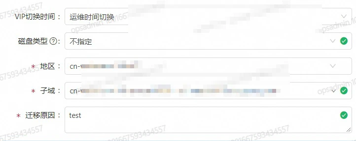

   | 配置项 | 说明 |
   | --- | --- |
   | VIP切换时间 | • <strong>运维时间切换</strong>：在预设维护窗口执行，可在实例详情页<strong>基本信息</strong>页面的<strong>运维时间信</strong><strong>息</strong>区域设置。<br>• <strong>立即切换</strong>：即时生效，可能影响业务。<br>• <strong>指定时间</strong>：自定义切换时间点，需配置。 |
   | 磁盘类型 | 按需选择即可，允许不指定磁盘类型。可指定的磁盘类型包括：<br>• SSD<br>• SATA<br>• 混合存储 |
   | 地区 | 必须与原实例一致，可选项有限，请以控制台显示为准。 |
   | 子域 | 选择目标子域。 |
   | 迁移原因 | 填写迁移理由，便于审计与工单追踪。 |
   | 是否与源实例主副本强制对齐内核小版本 | 控制目标主机内核小版本的行为：<br>• <strong>是</strong>（强制对齐）：严格要求目标主机拥有与源实例完全一致的内核小版本。若缺失则迁移失败，建议提前确认目标主机版本是否已就绪。<br>• <strong>否</strong>（智能适配）：优先尝试匹配源版本；若目标主机缺失该版本，则自动使用目标主机上最新有效的小版本。<br>说明若被迁移实例是只读实例，则该只读实例的源实例为对应主实例。 |
   | 指定主机 | • 勾选目标主机：手动指定迁移到特定物理主机，成功率会降低。<br>• 不勾选目标主机（推荐）：由资源管理器自动分配最优主机，成功率较高。<br>说明单击说明部分的“排除主机原因”，可展示物理机被排除在可选主机列表之外的详细原因。 |

**查看迁移任务进度**

单击**提交**后，页面将自动跳转到任务管理**任务管理 > 迁移任务**页面，可在该页面查看迁移进度。

**查看迁移前后主机信息**

访问实例详情页的**基本信息**页面，在**主机信息**区域，查看迁移前后的主机ID等信息。

<a id="section-2-3-3-4"></a>

#### 2.3.3.4. 小版本升级

云数据库统一运维平台·杜康（智能版）支持对数据库实例进行安全、可控的内核小版本升级。此类升级通常包含性能优化、新功能特性引入及已知问题修复，可用于保障数据库稳定高效运行。

**前提条件**

目标实例必须为“非临时实例”，且需同时满足“使用中”和“未被锁定”状态。

**注意事项**

- 若不指定目标版本号，系统将默认执行升级至该系列下的最新小版本。

- 升级内核小版本会重启实例，PolarDB MySQL服务可能会出现一次30秒的闪断，请您尽量在业务低峰期执行升级操作，或确保您的应用有自动重连机制。

- 内核小版本一旦升级成功，不支持降级回退至旧版本，请务必谨慎操作。

**操作步骤**

1. 登录云数据库统一运维平台·杜康智能版。

2. 在左侧导航栏中，选择**实例管理** > **实例列表**。

3. 在实例列表中找到目标实例，并单击对应的**用户实例名**进入实例详情页。

4. 在**基本信息**页面的顶部单击**版本升级**按钮，自定义配置如下参数，单击**提交**。

   > **说明**
   >
   > 本文以PolarDB MySQL主备版小版本升级为例演示。不同数据库类型的配置项及界面展示可能存在差异，请以实际控制台页面为准。

   <table>
     <tr>
       <th width="105">配置项</th>
       <th>说明</th>
     </tr>
     <tr>
       <td>数据库版本</td>
       <td>显示当前实例所属的大版本，系统仅支持在同一大版本下进行小版本升级。</td>
     </tr>
     <tr>
       <td>小版本号</td>
       <td>选择目标小版本，右侧将自动显示当前实例小版本以供对比。</td>
     </tr>
     <tr>
       <td>指定方式</td>
       <td>• <strong>运维时间切换</strong>：在预设维护窗口执行，可在实例详情页<strong>基本信息</strong>页面的<strong>运维时间信息</strong>区域设置。<br>• <strong>立即切换</strong>：即时生效，可能影响业务。<br>• <strong>指定时间</strong>：自定义切换时间点，需配置。</td>
     </tr>
   </table>

**查看升级进度**

升级任务发起后，可前往**任务管理**页面查看升级进度。

<a id="section-2-3-3-5"></a>

#### 2.3.3.5. 规格变更

本文为您介绍如何进行规格变更，帮助您解决问题。

**前置检查**

在执行规格变更前，请务必完成以下自查：

- 实例状态确认：确保实例处于“运行中”状态，且无其他正在执行的任务（如备份、迁移、重启等）。

- 数据备份建议：建议在操作前手动创建一次临时快照或全量备份，以便在异常情况下快速恢复。

**注意事项**

- 务必在业务低峰期操作，变更过程中可能会出现5-30秒的连接闪断。务必确保应用程序具备自动重连机制，避免业务报错。

- 建议保持“强制对齐内核小版本”默认选项，防止集群内节点版本不一致引发兼容性问题。

- 若目标规格不可选，必须单击“排除规格原因”查看具体限制，切勿盲目尝试。

- 变更后需实时监控任务进度直至完成，一旦任务中断或长时间停滞，应立即联系阿里云技术支持。

- 严格执行审核流程，仔细核对变更前后CPU、内存及磁盘数值，防止因误操作导致资源浪费或服务降级。

**适用场景**

- 性能扩容：应对业务增长或突发流量，解决CPU/内存瓶颈导致的响应慢、排队长等问题。

- 成本优化：针对低负载或非核心环境，通过降配释放闲置资源以降低运维成本。

- 存储扩容：当磁盘使用率触及警戒线时，紧急扩容存储空间以防写入锁定或服务中断。

- 版本治理：借变配之机强制对齐内核小版本，消除集群内节点版本不一致带来的兼容性与稳定性隐患。

- 故障修复：在实例迁移或高可用切换后，修正目标节点规格以恢复标准配置或统一集群架构。

**操作步骤**

1. 登录云数据库统一运维平台·杜康智能版。

2. 在**实例管理 > 实例列表**页面，单击目标实例名称。

3. 在基本信息页中，单击**更多 > 规格变更**。

4. 在变更页面，选择是否对齐内核小版本并填写**存储空间（GB）**、**实例规格**、**切换模式**和**变更原因**等信息，单击**下一步**。

   > **说明**
   >
   > 如发生迁移是否与源实例主副本强制对齐内核小版本：
   >
   > - 是：强制不在目标主机使用其他小版本，若目标主机缺少可与主副本一致的内核小版本，将会导致变配失败，建议参考杜康运维手册提前手动补齐目标主机的内核小版本。小版本升级，请参见小版本升级。
   >
   > - 否：优先在目标主机使用与实例主副本一致的内核小版本，如在目标主机上缺少与实例主副本一致的内核小版本，则使用目标主机上最新有效小版本。

5. 填写**审核意见**后，确认无误，单击**审核变更**。

6. 操作完成后，可在**任务管理**查看任务进度，直至任务完成。如果发现任务中断，请联系阿里云技术支持。查看任务进度操作，请参见实例任务管理章节。

<a id="section-2-3-3-6"></a>

#### 2.3.3.6. 锁定实例

本文为您介绍如何锁定实例，帮助您解决问题。

**注意事项**

- 务必在业务低峰期操作，并确保应用程序具备自动重连机制，以应对可能出现的问题。

- 磁盘满锁必须先清理空间或扩容，回滚锁严禁强行重启，必须解决根本问题（如水位过高、变更失败）后方可尝试解锁。

- 提交后需全程值守观察进度，若任务中断或卡死，严禁盲目重试，应立即联系阿里云技术支持介入防止死锁。

- 实例锁定后将变为只读状态并影响业务，请务必在运维窗口内实施该操作，并注意执行风险。

**适用场景**

本章节仅列举部分适用场景供参考，其他场景请根据实际情况处理。

- 业务下线“冷静期”验证：删除实例前先执行手动锁，设置7天以上观察期，确认无隐蔽依赖或业务投诉后再彻底删除，防止误删生产数据。

- 紧急故障隔离与止损：遭遇恶意攻击、异常 SQL 消耗或数据篡改时，立即手动锁切断所有连接，阻止故障扩散并为排查争取时间。

- 资源耗尽自我保护：当磁盘写满或硬件故障时，系统自动触发磁盘满锁或迁移锁，防止元数据损坏并确保数据强一致性。

- 高风险变更回滚保护：规格变更或升级失败时，系统自动触发回滚锁冻结实例状态，防止数据处于不一致的“中间态”。

**操作步骤**

1. 登录云数据库统一运维平台·杜康智能版。

2. 在**实例管理 > 实例列表**页面，单击目标实例名称。

3. 在基本信息页中，单击**更多 > 锁定实例**。

4. 选择**锁模式**和**锁定原因**，单击**提交**。

5. 操作完成后，可在**任务管理**查看任务进度，直至任务完成。如果发现任务中断，请联系阿里云技术支持。查看任务进度操作，请参见实例任务管理章节。

<a id="section-2-3-3-7"></a>

#### 2.3.3.7. HA切换

本文为您介绍如何手动完成HA切换，帮助您快速解决问题。

**背景信息**

正常情况下，当主节点发生故障时，系统会自动进行HA切换以恢复服务。而手动HA切换通常用于主动运维场景，即在不等待故障发生的情况下，人为地将流量从当前的主节点转移到备节点，使原备节点晋升为新主节点。

**前置检查**

在执行手动HA切换前，请务必确认以下事项：

- 实例状态检查：确保目标实例处于“运行中”状态，且当前无其他正在执行的操作（如规格变更、重启、备份恢复等）。

- 主备同步状态：必须确认备节点数据同步正常。确保延迟时间为0或在允许的范围内（通常建议<1秒）。若备节点同步滞后，强制切换可能导致数据丢失。

- 备节点健康度：确认备节点所在宿主机资源充足，网络连通性正常，无硬件告警。

**注意事项**

- 建议在业务低峰期操作，并确保有完善的自动重连机制，规避极端网络波动风险。

- 切换完成后需实时监控任务进度直至完成，一旦任务中断或长时间停滞，应立即联系阿里云技术支持。

- 建议等待主备数据同步完成后，再执行切换操作。

**适用场景**

- 底层资源维护/升级：当主节点的物理机、宿主机或存储设备需要进行停机维护、固件升级或迁移时，先手动切换业务至备节点，避免业务中断。

- 故障隐患消除：监控发现当前主节点存在硬件问题或网络抖动等，但未完全宕机，主动切换至健康的备节点以规避风险。

**操作步骤**

1. 登录云数据库统一运维平台·杜康智能版。

2. 在**实例管理 > 实例列表**页面，单击目标实例名称。

3. 在基本信息页中，单击右侧**更多 > HA切换**。

4. 确认主备信息无误后，选择**切换方式**和**指定方式**，单击**提交**。

   > **说明**
   >
   > - 立即切换：用于紧急避险。
   >
   > - 运维时间切换：适合纳入日常运维窗口（如每天凌晨等），由系统自动执行。
   >
   > - 指定时间点切换：适合配合特定的变更窗口（如配合应用发布等）。

5. 操作完成后，可在**任务管理**查看任务进度，直至任务完成。如果发现任务中断，请联系阿里云技术支持。查看任务进度操作，请参见实例任务管理章节。

**结果验证**

- 上文步骤4中主备节点的IP与端口信息发生了互换。

- HA任务流正常跑完。

**回滚方案**

根据操作步骤重新操作一遍，再次将主备节点进行互换。

<a id="section-2-3-3-8"></a>

#### 2.3.3.8. 存储空间变更

本文为您介绍如何进行存储空间变更操作，帮助您快速解决问题。

**注意事项**

- 主实例状态为运行中，且无未完成的变更任务（如升级、迁移、备份中）。

- 建议在业务低峰期操作，规避极端网络波动风险。

- 缩容后的存储空间值不能小于实例当前已使用存储空间+20GiB。

- 变更针对集群逻辑实例生效，修改主实例存储配置将同步应用于该集群下所有只读及备节点，请谨慎操作。

**使用场景和预解决的问题**

**存储升配（扩容）**

- 应对业务增长：当业务数据量快速增加，磁盘使用率接近阈值（如 80%），需紧急扩容以避免数据库因空间满而进入“只读”状态或服务中断。

- 预留缓冲空间：在预计有大促活动、批量数据导入或历史数据归档前，提前扩容以预留足够的写入缓冲。

- 解除性能限制：在某些场景下，更大的存储配额可能关联更高的 IOPS 上限（视具体实例规格策略而定），从而提升吞吐能力。

**存储降配（缩容）**

- 成本优化：当业务数据经过清理（如删除大表、归档历史数据）后，实际用量远低于当前配额，通过降配释放闲置资源，直接降低月度账单。

- 修正过度配置：纠正项目初期因预估不准导致的资源浪费，将存储调整至与实际业务匹配的水位。

**操作步骤**

1. 登录云数据库统一运维平台·杜康智能版。

2. 在**实例管理 > 实例列表**页面，单击目标实例名称。

3. 在基本信息页中，单击**更多 > 存储空间变更**。

4. 在弹框中填写目标存储空间大小，单击**提交**。

**查看任务详情**

1. 登录云数据库统一运维平台·杜康智能版。

2. 在**实例列表 > 任务管理**页面，您可以查看任务执行的详细状态。

   > **说明**
   >
   > - 支持查看所有任务、中断任务、暂停任务等多种任务状态的详情。
   >
   > - 支持自定义列表项，您可根据需要自定义想要查看的任务字段。

<a id="section-2-3-4"></a>

### 2.3.4. 监控告警

本文介绍如何在云数据库统一运维平台·杜康智能版中查看实例的性能监控大盘，包括动态选择监控指标、切换监控节点粒度、筛选时间范围以及通过全局目录快速检索特定监控项，助力全方位掌握实例运行状态。

**查看性能监控**

1. 登录云数据库统一运维平台·杜康智能版。在左侧导航栏中，选择<strong>实例管理 > 实例列表，</strong>在实例列表中找到目标实例，单击实例名称。

2. 在左侧菜单栏，单击**监控告警**。

3. 在监控大盘中，根据需要执行以下操作：

   - **选择监控指标**：系统将根据实例类型动态展示可用的监控指标（如 CPU、内存、QPS、TPS、网络流量等）。

   - **切换监控节点**：每个监控面板支持独立选择监控粒度，可在实例级或子节点级之间切换。

   - **选择时间范围**：支持自定义时间范围，以便查看不同时间段的历史性能数据。

   - **查看整体监控目录**：单击页面中部右侧的  图标，将展开整体监控指标目录。支持输入关键字快速检

     索并定位目标监控项。

     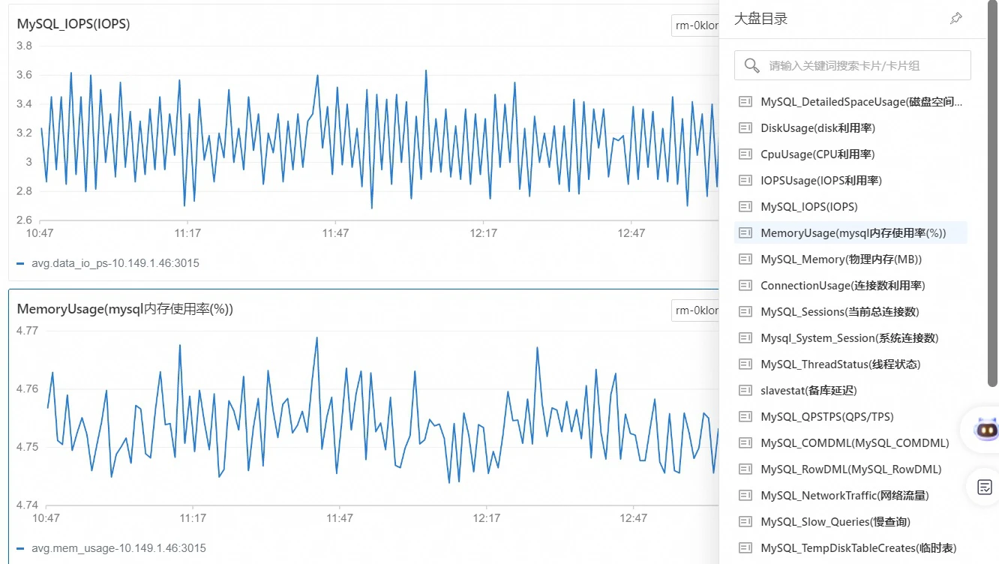

<a id="section-2-3-5"></a>

### 2.3.5. 实例诊断

本文介绍如何在云数据库统一运维平台·杜康智能版中对数据库实例进行全方位健康检查与性能分析，包括查看360°全景诊断报告、执行Maxscale日志查询、实时会话监控、InnoDB状态检测、慢SQL与卡慢诊断，以及在线安全执行SQL语句。

**查看全景诊断报告**

通过查看实例的360°全景诊断报告，可快速掌握实例整体健康状况。

1. 登录云数据库统一运维平台·杜康智能版。在左侧导航栏中，选择<strong>实例管理 > 实例列表，</strong>在实例列表中找到目标实例，单击实例名称。

2. 在左侧菜单栏，单击**360诊断**。

3. 查看以下诊断内容：

   - **基本信息**：诊断结果摘要，使用三色指示灯标识（绿色正常/橙色警告/红色异常）。

   - **磁盘空间趋势**：时间序列折线图展示磁盘空间变化趋势（单位MB），默认展示最近2天的数据。支持自定义时间范围。

   - **同主机下实例**：列表展示与当前实例在同一物理主机上的其他实例信息，包含：主机IP（可点击跳转至主机详情）、主机端口、实例名称（可点击跳转至对应实例详情）、实例ID、磁盘使用率、数据库类型。

   - **HA切换记录**：表格展示高可用切换的历史记录。

   - **任务记录**：表格展示实例相关的任务执行记录。

   - **运维记录**：表格展示实例的运维操作日志记录。

**专项诊断**

**查看实例Maxscale日志**

查看MySQL实例的Maxscale代理层日志，**仅数据库类型为MySQL的实例支持该项**。

1. 登录云数据库统一运维平台·杜康智能版。在左侧导航栏中，选择<strong>实例管理 > 实例列表，</strong>在实例列表中找到目标实例，单击实例名称。

2. 在左侧菜单栏，单击**专项诊断**。

3. 切换到**实例Maxscale日志**页签。

4. 设置筛选条件（可选）：

   | 筛选条件 | 说明 |
   | --- | --- |
   | 开始时间/结束时间 | 精确到时分秒。 |
   | 日志级别 | 下拉选择：info/notice/warning/error。 |
   | 日志内容 | 关键字搜索。 |

5. 查看日志表格，包含以下字段：

   | 字段 | 说明 |
   | --- | --- |
   | 日志时间 | 日志产生的时间。 |
   | 日志级别 | info/notice/warning/error。 |
   | 日志内容 | 具体日志信息。 |

**查看实例实时信息**

查看MySQL实例当前正在执行的会话进程列表，**仅数据库类型为MySQL的实例支持该项**。

1. 登录云数据库统一运维平台·杜康智能版。在左侧导航栏中，选择<strong>实例管理 > 实例列表，</strong>在实例列表中找到目标实例，单击实例名称。

2. 在左侧菜单栏，单击**专项诊断**。

3. 切换到**实例实时信息**页签。

4. 页面上方展示连接数趋势折线图，下方为会话列表。

5. 设置筛选条件（可选）：

   <table>
     <tr>
       <th width="109">筛选条件</th>
       <th>说明</th>
     </tr>
     <tr>
       <td>Command</td>
       <td>多选：All/Query/Sleep/Connect，默认选中Query。</td>
     </tr>
     <tr>
       <td>State</td>
       <td>下拉选择，包含20+种线程状态。</td>
     </tr>
     <tr>
       <td>Time≥</td>
       <td>输入秒数，筛选执行时间超过指定值的会话。</td>
     </tr>
     <tr>
       <td>Info</td>
       <td>SQL关键字模糊匹配。</td>
     </tr>
     <tr>
       <td>Host</td>
       <td>IP/端口模糊匹配。</td>
     </tr>
   </table>

6. 查看会话列表，包含以下字段：

   | 字段 | 说明 |
   | --- | --- |
   | USER | 连接用户。 |
   | HOST | 客户端地址。 |
   | 线程ID | 会话线程编号。 |
   | DB | 当前数据库。 |
   | COMMAND | 命令类型（Query/Sleep/Connect等）。 |
   | TIME | 已执行时间（秒）。 |
   | STATE | 线程状态。 |
   | INFO | 正在执行的SQL语句。 |

7. （可选）批量**Kill会话**：勾选多条会话后，单击**Kill会话**按钮，在确认弹窗中确认后批量终止选中的会话。

**查看InnoDB实例实时状态**

实时采集并展示InnoDB存储引擎的关键运行指标，**仅数据库类型为MySQL的实例支持该项**。

1. 登录云数据库统一运维平台·杜康智能版。在左侧导航栏中，选择<strong>实例管理 > 实例列表，</strong>在实例列表中找到目标实例，单击实例名称。

2. 在左侧菜单栏，单击**专项诊断**。

3. 切换到**InnoDB实例实时状态**页签。

4. 在操作区域设置数据采集间隔（1~300秒）。

5. 单击**START**按钮，启动实时轮询采集。

   页面以仿终端（暗色主题）风格展示以下指标分组：

   > **说明**
   >
   > 异常值会以红色高亮显示。

   | 指标分组 | 包含指标 |
   | --- | --- |
   | MySQL状态 | QPS、TPS、连接数等。 |
   | InnoDB行操作 | 读取行数、插入行数、更新行数、删除行数。 |
   | 线程 | 活跃线程数、等待线程数。 |
   | InnoDB页面 | 脏页数、空闲页、数据页。 |
   | Fsync | 文件同步操作统计。 |

6. 单击**STOP**按钮，停止采集。

   > **说明**
   >
   > 切换到其他标签页时自动停止采集，返回时需手动重新启动。

**查看InnoDB状态**

查看InnoDB引擎的详细运行状态信息，**仅数据库类型为MySQL的实例支持该项**。

1. 登录云数据库统一运维平台·杜康智能版。在左侧导航栏中，选择<strong>实例管理 > 实例列表，</strong>在实例列表中找到目标实例，单击实例名称。

2. 在左侧菜单栏，单击**专项诊断**。

3. 切换到**InnoDB状态**页签。

   页面展示InnoDB引擎的详细运行状态信息，包括内存使用、事务状态、日志写入等诊断数据。

**慢SQL分析**

分析实例的慢SQL日志。

1. 登录云数据库统一运维平台·杜康智能版。在左侧导航栏中，选择<strong>实例管理 > 实例列表，</strong>在实例列表中找到目标实例，单击实例名称。

2. 在左侧菜单栏，单击**专项诊断**。

3. 切换到**慢SQL分析**页签。

4. 设置筛选条件（可选）：

   | 筛选条件 | 说明 |
   | --- | --- |
   | 开始时间/结束时间 | 默认最近3小时。 |
   | 数据库名称 | 输入搜索。 |
   | 数据排序类型 | 开始时间/查询时间，默认按开始时间排序。 |

5. 查看慢SQL列表，包含以下字段：

   | 字段 | 说明 |
   | --- | --- |
   | 数据库名称 | 执行慢SQL的数据库。 |
   | 用户主机 | 发起查询的用户和主机地址。 |
   | 查询时间（s） | SQL执行耗时（秒）。 |
   | 锁时间（s） | SQL等待锁的时间（秒）。 |
   | 扫描行数 | SQL扫描的总行数。 |
   | 返回行数 | SQL最终返回的行数。 |
   | 开始时间 | SQL开始执行的时间。 |
   | 查询语句 | 完整的SQL语句。 |

**实例卡慢诊断**

对实例卡顿、响应缓慢等问题进行诊断。

1. 登录云数据库统一运维平台·杜康智能版。在左侧导航栏中，选择<strong>实例管理 > 实例列表，</strong>在实例列表中找到目标实例，单击实例名称。

2. 在左侧菜单栏，单击**专项诊断**。

3. 切换到**实例卡慢诊断**页签。

4. 设置筛选条件（可选）：

   | 筛选条件 | 说明 |
   | --- | --- |
   | 开始时间/结束时间 | 默认最近1天。 |

5. 查看卡慢诊断列表，包含以下字段：

   | 字段 | 说明 |
   | --- | --- |
   | 问题SQL | 导致卡慢的SQL语句。 |
   | 查询时间（s） | SQL执行耗时（秒）。 |
   | 开始时间 | SQL开始执行的时间。 |
   | 优化建议 | 系统给出的优化方案。 |

   > **说明**
   >
   > 每页固定展示50条记录。

**执行SQL**

在线执行SQL语句并查看结果。

> **警告**
>
> SQL执行存在风险，请谨慎操作。

1. 登录云数据库统一运维平台·杜康智能版。在左侧导航栏中，选择<strong>实例管理 > 实例列表，</strong>在实例列表中找到目标实例，单击实例名称。

2. 在左侧菜单栏，单击**专项诊断**。

3. 切换到**执行SQL**页签。

4. 在执行区域配置以下信息：

   | 配置项 | 说明 |
   | --- | --- |
   | 主备库选择 | 单选按钮：选择在主库或备库上执行。 |
   | 数据库选择 | 下拉选择目标数据库。 |
   | 最大返回行数 | 设置查询结果的最大返回行数（1~10000）。 |
   | SQL输入框 | 输入要执行的SQL语句（仅支持单行语句，不支持回车换行）。 |

5. 单击**执行**按钮。

6. 查看执行结果：

   - **执行结果**页签：

     - SELECT查询：以表格形式展示查询结果，底部显示返回行数和执行耗时（毫秒）。

     - DML操作（INSERT/UPDATE/DELETE）：显示影响行数和执行耗时。

   - **执行历史**页签：

     展示所有历史执行记录，包含SQL语句、执行时间、目标数据库、成功/失败状态。成功记录显示返回行数和耗时，失败记录显示错误信息。

   > **说明**
   >
   > 对于PolarDB子实例，需切换到主库执行。

<a id="section-2-3-6"></a>

### 2.3.6. 状态巡检

本文介绍如何在云数据库统一运维平台·杜康智能版中查看实例的状态巡检记录，包括可用性检测日志、故障事件记录以及运行错误日志，助力快速定位实例异常与潜在风险。

**查看可用性**

查看实例的可用性检测日志，监控实例存活状态及可用性指标变化。

1. 登录云数据库统一运维平台·杜康智能版。在左侧导航栏中，选择<strong>实例管理 > 实例列表，</strong>在实例列表中找到目标实例，单击实例名称。

2. 在左侧菜单栏，单击**状态巡检**。

3. 切换到**查看可用性**页签。

   页面以表格形式展示实例的可用性检测日志，记录实例的存活状态和可用性指标变化情况。支持按时间范围筛选。

**查看故障**

查看实例的故障事件记录，了解故障发生时间、类型及影响范围。

1. 登录云数据库统一运维平台·杜康智能版。在左侧导航栏中，选择<strong>实例管理 > 实例列表，</strong>在实例列表中找到目标实例，单击实例名称。

2. 在左侧菜单栏，单击**状态巡检**。

3. 切换到**查看故障**页签。

   页面以表格形式展示实例的故障事件记录，包含故障发生时间、故障类型、影响范围等信息。支持按时间范围筛选。

**查看错误日志**

查看实例运行过程中产生的错误日志，辅助排查运行异常。

1. 登录云数据库统一运维平台·杜康智能版。在左侧导航栏中，选择<strong>实例管理 > 实例列表，</strong>在实例列表中找到目标实例，单击实例名称。

2. 在左侧菜单栏，单击**状态巡检**。

3. 切换到**查看错误日志**页签。

   页面以表格形式展示实例运行过程中产生的错误日志信息，帮助排查运行异常。支持按时间范围筛选。

<a id="section-2-3-7"></a>

### 2.3.7. 审计日志

本文介绍如何在云数据库统一运维平台·杜康智能版中管理实例的SQL审计日志，包括按条件查询与筛选实时日志、将历史日志归档至OSS存储，以及查看和下载归档历史记录。

**查看SQL审计日志**

查询和筛选实例的SQL审计日志，以便追踪数据库操作行为。

1. 登录云数据库统一运维平台·杜康智能版。在左侧导航栏中，选择<strong>实例管理 > 实例列表，</strong>在实例列表中找到目标实例，单击实例名称。

2. 在左侧菜单栏，单击**审计日志**。

3. 设置筛选条件（可选）：

   | 筛选条件 | 说明 |
   | --- | --- |
   | 开始时间/结束时间 | 精确到时分秒，默认最近1天。 |
   | 日志类型 | 用户日志/其他日志。 |
   | 数据排序类型 | 默认/查询时间。 |
   | 关键字搜索 | 输入关键字搜索。 |

4. 查看审计日志列表，包含以下字段：

   | 字段 | 说明 |
   | --- | --- |
   | SQL语句 | 被审计的SQL内容。 |
   | 执行时间 | SQL的执行时间点。 |
   | 执行结果 | SQL执行的返回结果。 |
   | 数据库 | 执行SQL的目标数据库。 |
   | 用户名 | 执行SQL的用户。 |
   | 客户端IP | 发起请求的客户端地址。 |
   | 消耗时间（微秒） | SQL执行耗时。 |
   | 返回记录数 | SQL查询返回的记录条数。 |
   | tid | 事务ID。 |

**SQL归档**

将审计日志导出并归档到OSS存储，以满足长期留存或合规审计需求。

1. 登录云数据库统一运维平台·杜康智能版。在左侧导航栏中，选择<strong>实例管理 > 实例列表，</strong>在实例列表中找到目标实例，单击实例名称。

2. 在左侧菜单栏，单击**审计日志**。

3. 进入审计日志页面，设置筛选条件，确定需要归档的日志范围。

4. 单击**SQL归档**按钮。

5. 在弹窗中确认后，系统将审计日志导出归档到OSS存储。

**查看SQL归档历史**

查看历史归档记录及下载归档文件。

1. 登录云数据库统一运维平台·杜康智能版。在左侧导航栏中，选择<strong>实例管理 > 实例列表，</strong>在实例列表中找到目标实例，单击实例名称。

2. 在左侧菜单栏，单击**审计日志**，进入审计日志页面。

3. 单击**SQL归档历史**按钮。展示历史归档记录，包含以下字段：

   | 字段 | 说明 |
   | --- | --- |
   | 归档开始时间 | 归档数据的起始时间。 |
   | 归档结束时间 | 归档数据的截止时间。 |
   | 文件名 | 归档文件名称。 |
   | 文件大小 | 归档文件大小。 |
   | 失败原因 | 若归档失败则显示原因。 |
   | 过滤SQL参数 | 归档时使用的筛选参数。 |
   | 状态 | 归档状态。 |
   | 下载地址 | 单击可下载归档文件。 |

<a id="section-2-3-8"></a>

### 2.3.8. 变更记录

本文介绍如何在云数据库统一运维平台·杜康智能版中查看实例的各类变更与运维记录，涵盖通用操作日志、HA切换日志、API调用日志、管理日志、主备一致性检查、自动化机器人（ROBOT/酒保）任务历史、数据迁移及恢复日志，助力全面审计实例生命周期内的关键事件。

**通用日志查询**

查看实例的通用操作日志列表，支持按时间筛选，并提供查看API详情或任务步骤的入口。

1. 登录云数据库统一运维平台·杜康智能版。在左侧导航栏中，选择<strong>实例管理 > 实例列表，</strong>在实例列表中找到目标实例，单击实例名称。

2. 在左侧菜单栏，单击**变更记录**。

3. 默认展示**通用日志查询**页签。

4. 设置筛选条件（可选）：

   | 筛选条件 | 说明 |
   | --- | --- |
   | 开始时间 | 筛选起始时间。 |
   | 结束时间 | 筛选截止时间。 |

5. 查看通用日志列表，包含以下字段：

   日志类型、操作描述、操作时间、操作人。

6. 根据日志类型执行操作：

   - API日志：单击**查看详情**，跳转至详情页。

   - 任务日志：单击**查看任务步骤**或**查看任务历史**。

**HA日志**

查看高可用（HA）切换事件的详细记录，包括切换前后的主库地址、切换结果及根因分析。

1. 登录云数据库统一运维平台·杜康智能版。在左侧导航栏中，选择<strong>实例管理 > 实例列表，</strong>在实例列表中找到目标实例，单击实例名称。

2. 在左侧菜单栏，单击**变更记录**。

3. 切换到**HA日志**页签。

4. 查看HA日志列表，包含以下字段：

   | 字段 | 说明 |
   | --- | --- |
   | UUID | 切换事件唯一标识。 |
   | 切换前MasterIP | 切换前的主库地址。 |
   | 切换后MasterIP | 切换后的主库地址。 |
   | 端口 | 服务端口。 |
   | VIP/VPORT | 虚拟IP和端口。 |
   | 库类型 | 数据库类型。 |
   | 切换时间 | 切换发生的时间。 |
   | 切换结果 | 成功/失败/忽略（彩色标签显示）。 |
   | 切换根因 | 触发切换的原因。 |
   | 切换类型 | 切换的方式。 |

5. 单击**HA切换步骤**或**关联任务**链接，查看详细信息。

**API日志**

查看通过API调用产生的操作日志，支持按接口名称和时间筛选，并可查看完整的请求与响应信息。

1. 登录云数据库统一运维平台·杜康智能版。在左侧导航栏中，选择<strong>实例管理 > 实例列表，</strong>在实例列表中找到目标实例，单击实例名称。

2. 在左侧菜单栏，单击**变更记录**。

3. 切换到**API日志**页签。

4. 设置筛选条件（可选）：

   | 筛选条件 | 说明 |
   | --- | --- |
   | 开始时间 | 筛选起始时间。 |
   | 结束时间 | 筛选截止时间。 |
   | 接口名称 | 筛选特定接口。 |

5. 查看API日志列表，包含以下字段：

   接口名、实例名、日志创建时间、请求时间、响应时间、请求内容、请求结果、耗时（ms）、操作用户、访问IP、AccessId。

6. 单击**查看详情**，侧边抽屉展示完整请求和响应信息。

**管理日志**

查看系统管理类操作日志，支持屏蔽特定用户的操作记录，便于聚焦关键管理行为。

1. 登录云数据库统一运维平台·杜康智能版。在左侧导航栏中，选择<strong>实例管理 > 实例列表，</strong>在实例列表中找到目标实例，单击实例名称。

2. 在左侧菜单栏，单击**变更记录**。

3. 切换到**管理日志**页签。

4. 设置筛选条件（可选）：

   | 筛选条件 | 说明 |
   | --- | --- |
   | 开始时间 | 筛选起始时间。 |
   | 结束时间 | 筛选截止时间。 |
   | 屏蔽用户名 | 屏蔽特定用户的操作日志。 |

5. 查看管理日志列表，包含以下字段：

   实例名、角色描述、操作对象类别、操作对象ID（部分可点击跳转）、创建时间、操作用户、操作描述。

**主备不一致检查**

查看主从数据一致性检查的任务状态与结果，支持对异常任务进行重试、中断或参数配置。

1. 登录云数据库统一运维平台·杜康智能版。在左侧导航栏中，选择<strong>实例管理 > 实例列表，</strong>在实例列表中找到目标实例，单击实例名称。

2. 在左侧菜单栏，单击**变更记录**。

3. 切换到**主备不一致检查**页签。

4. 查看检查结果列表，包含以下字段：

   | 字段 | 说明 |
   | --- | --- |
   | 实例ID | 可点击跳转至实例详情。 |
   | 任务ID | 检查任务编号。 |
   | 库名 | 被检查的数据库（空值显示“全库”）。 |
   | 表名 | 被检查的数据表（空值显示“全表”）。 |
   | 状态 | 未开始/已开启/检查中/完成/失败/已中断/已停止等。 |
   | 创建时间 | 检查任务创建时间。 |
   | 修改时间 | 最后更新时间。 |
   | 描述 | 检查结果描述。 |

5. 根据任务状态执行操作：

   | 状态 | 可用操作 |
   | --- | --- |
   | 检查中 | • 尝试中断。<br>• 尝试停止。 |
   | 失败/已中断/已停止 | 重试。 |
   | 所有已启动任务 | 查看详情。 |
   | 未开始/失败/已中断/检查中 | 参数配置，打开配置弹窗。 |

**ROBOT日志**

查看自动化运维机器人（ROBOT）的处理日志，包括处理结果状态及详细步骤查看入口。

1. 登录云数据库统一运维平台·杜康智能版。在左侧导航栏中，选择<strong>实例管理 > 实例列表，</strong>在实例列表中找到目标实例，单击实例名称。

2. 在左侧菜单栏，单击**变更记录**。

3. 切换到**ROBOT日志**页签。

4. 查看ROBOT日志列表，包含以下字段：

   任务类型、处理结果（开始处理/处理成功/处理失败/自动修复/拒绝处理/无法处理，彩色标签显示）、处理时间。

5. 单击**步骤详情**链接，查看详细处理步骤。

**酒保修复历史**

查看系统自动修复引擎（酒保）的历史操作记录，涵盖异常类型、修复方法及SQL详情等信息。

1. 登录云数据库统一运维平台·杜康智能版。在左侧导航栏中，选择<strong>实例管理 > 实例列表，</strong>在实例列表中找到目标实例，单击实例名称。

2. 在左侧菜单栏，单击**变更记录**。

3. 切换到**酒保修复历史**页签。

4. 查看修复历史列表，包含以下字段：

   ID、异常类型、修复方法、安全等级（彩色标签）、修复SQL详情、异常信息、处理结果（成功/失败）、任务ID（链接跳转）、创建时间、修改时间。

**酒保任务历史**

查看系统自动化运维任务（酒保）的完整历史记录，支持展开查看实例详情及修复方案。

1. 登录云数据库统一运维平台·杜康智能版。在左侧导航栏中，选择<strong>实例管理 > 实例列表，</strong>在实例列表中找到目标实例，单击实例名称。

2. 在左侧菜单栏，单击**变更记录**。

3. 切换到**酒保任务历史**页签。

4. 查看任务历史列表，包含以下字段：

   | 字段 | 说明 |
   | --- | --- |
   | 任务ID | 链接跳转至任务详情。 |
   | 异常类型 | 检测到的异常类型。 |
   | 问题及修复方法 | 可展开查看详细修复方案。 |
   | 实例信息 | 可展开查看实例详情。 |
   | 安全等级 | 彩色标签显示。 |
   | 异常信息 | 异常详细信息。 |
   | 任务类型 | 仅诊断/诊断及修复。 |
   | 来源 | 任务触发来源。 |
   | 状态 | 8种任务状态。 |
   | 目标实例信息 | 目标实例详情。 |
   | 创建时间/修改时间 | 时间记录。 |

**迁移列表**

查看实例数据迁移操作的记录，包括源与目标的版本、规格信息及迁移状态。

1. 登录云数据库统一运维平台·杜康智能版。在左侧导航栏中，选择<strong>实例管理 > 实例列表，</strong>在实例列表中找到目标实例，单击实例名称。

2. 在左侧菜单栏，单击**变更记录**。

3. 切换到**迁移列表**页签。

4. 查看迁移列表，包含以下字段：

   迁移ID（链接跳转）、当前集群、源版本、源实例规格、迁移版本、迁移实例规格、迁移状态、切换时间、迁移时间、迁移信息。

**恢复日志**

查看数据恢复操作的历史记录，区分基于备份集或时间点的恢复类型，并记录保留原实例等配置。

1. 登录云数据库统一运维平台·杜康智能版。在左侧导航栏中，选择<strong>实例管理 > 实例列表，</strong>在实例列表中找到目标实例，单击实例名称。

2. 在左侧菜单栏，单击**变更记录**。

3. 切换到**恢复日志**页签。

4. 查看恢复日志列表，包含以下字段：

   迁移ID（链接跳转）、当前集群、恢复类型（基于备份集/基于时间点）、备份集ID、恢复时间点、迁移状态、保留原实例（是/否）、迁移时间、迁移信息。

<a id="section-2-3-9"></a>

### 2.3.9. 任务管理

本文介绍如何在云数据库统一运维平台·杜康智能版中查看与当前实例相关的任务列表，支持按状态和时间筛选，并提供查看子任务、修改备注、干预记录、查看详情及批量重试等操作功能。

**查看任务列表**

1. 登录云数据库统一运维平台·杜康智能版。在左侧导航栏中，选择<strong>实例管理 > 实例列表，</strong>在实例列表中找到目标实例，单击实例名称。

2. 在左侧菜单栏，单击**任务管理**。

3. 设置筛选条件（可选）：

   - 按任务状态筛选。

   - 按时间范围筛选。

4. 查看任务列表，包含以下字段：

   | 字段 | 说明 |
   | --- | --- |
   | 任务ID | 任务唯一标识。 |
   | 任务名称 | 任务名称。 |
   | 来源 | 任务触发来源。 |
   | 操作对象 | 任务操作的目标对象。 |
   | 父任务 | 所属的父任务。 |
   | 状态 | 任务执行状态。 |
   | 进度 | 任务执行进度。 |
   | 耗时 | 任务执行耗时。 |
   | 执行人 | 任务执行人。 |
   | 创建时间 | 任务创建时间。 |
   | 修改时间 | 任务最后修改时间。 |
   | 责任人 | 任务责任人。 |
   | 备注 | 任务备注信息。 |

5. 在**操作**列下，支持执行以下操作：

   - 查看子任务。

   - 修改备注/添加备注。

   - 干预记录。

   - 查看详情。

**任务重试**

对于失败或需要重新执行的任务，支持批量重试操作。

1. 登录云数据库统一运维平台·杜康智能版。在左侧导航栏中，选择<strong>实例管理 > 实例列表，</strong>在实例列表中找到目标实例，单击实例名称。

2. 在左侧菜单栏，单击**任务管理**。

3. 在任务列表中，勾选单个或多个需要重试的任务。

4. 单击页面上方的**批量重试**按钮。

<a id="section-2-3-10"></a>

### 2.3.10. 备份管理

本文介绍如何在云数据库统一运维平台·杜康智能版中管理实例的数据备份与日志备份，包括查看和修改自动备份策略及binlog备份策略，以及查询历史备份记录等操作。

**注意事项**

- 下载限制：杜康控制台暂不支持直接下载备份集文件。如需离线归档或本地恢复，请登录ASCM（Apsara Uni-manager）运营控制台进行下载操作。

- 恢复耗时：数据恢复时长受实例规格、数据量大小、网络带宽及集群负载等多重因素影响，请在业务低峰期执行并耐心等待。

**数据备份管理**

**查看和修改备份策略**

查看实例的自动数据备份策略配置，支持查看备份周期、时间窗口、保留天数等参数，并允许根据需求修改策略配置。

1. 登录云数据库统一运维平台·杜康智能版。在左侧导航栏中，选择<strong>实例管理 > 实例列表，</strong>在实例列表中找到目标实例，单击实例名称。

2. 在左侧菜单栏，单击**数据备份管理**。

3. 切换到**备份策略**页签。

4. 查看当前数据备份策略配置，包含：

   实例名称、数据库、备份开关、备份不落地、保留天数、预估时间、DB列表、备份时间、备份状态、下次备份时间、备份方法、备份类型、备份机IP、机房、备份开始时间、备份上传开始时间、备份周期、备份压缩、备份来源、实例释放之后备份保留策略及备注等信息。

5. （可选）修改备份策略：根据界面提示修改配置项后保存。

   | 配置项 | 说明 |
   | --- | --- |
   | 备份保留天数 | 备份集的保留周期。默认7天，按需设置（如30天），过期自动清理。 |
   | 备份级别 | 支持一般、中、高，按需配置。 |
   | 备份时间 | 按需修改，建议业务低峰期，例如06:00。 |
   | 备份周期 | 可设置为一星期中的某几天。为了数据安全，一周需至少备份两次。 |
   | 备份不落地 | • 关闭<br>• 仅数据不落地 |
   | 备份压缩 | 备份压缩方式，按需修改。 |
   | 压缩并行度 | 控制备份进程的并发线程数，按需修改。 |

**创建临时备份**

> **重要**
>
> 临时备份有效期仅保留18小时，超时自动失效需重新发起。

1. 登录云数据库统一运维平台·杜康智能版。在左侧导航栏中，选择<strong>实例管理 > 实例列表，</strong>在实例列表中找到目标实例，单击实例名称。

2. 在左侧菜单栏，单击**数据备份管理**。

3. 切换到**备份策略**页签，单击**创建临时备份**。

   | 配置项 | 说明 |
   | --- | --- |

   | 备份类型 | • <strong>AUTO</strong>：系统判断<br>• <strong>FULL</strong>：全量备份 |
   | --- | --- |
   | 备份方法 | • 快照备份<br>• 备库物理备份<br>• 主库物理备份 |
   | 备份时间 | 可精确到秒级别。 |

**创建单库备份**

1. 登录云数据库统一运维平台·杜康智能版。在左侧导航栏中，选择<strong>实例管理 > 实例列表，</strong>在实例列表中找到目标实例，单击实例名称。

2. 在左侧菜单栏，单击**数据备份管理**。

3. 切换到**备份策略**页签，单击**创建单库备份**。

4. 配置备份时间等信息，单击**提交**。

**查看备份历史**

查看历史数据备份记录列表，支持查看备份详情以及执行基于备份集的恢复操作。

1. 登录云数据库统一运维平台·杜康智能版。在左侧导航栏中，选择<strong>实例管理 > 实例列表，</strong>在实例列表中找到目标实例，单击实例名称。

2. 在左侧菜单栏，单击**数据备份管理**。

3. 切换到**备份历史**页签。

4. 查看备份历史列表，包含备份时间、备份类型、备份大小、备份状态等信息。

5. 在**操作**列，可执行以下操作：

   - 查看备份详情。

   - 执行备份恢复操作。

**常规备份修复**

支持对因异常导致状态不完整或失败的常规备份任务进行修复的功能，纠正备份记录状态以保障数据一致性。

1. 登录云数据库统一运维平台·杜康智能版。在左侧导航栏中，选择<strong>实例管理 > 实例列表，</strong>在实例列表中找到目标实例，单击实例名称。

2. 在左侧菜单栏，单击**数据备份管理**。

3. 切换到**备份历史**页签，单击**常规备份修复**。

4. 阅读界面提示后**确定**即可。

**日志备份管理**

**查看和修改binlog备份策略**

查看实例的binlog日志备份策略配置，支持查看备份保留时长等参数，并允许根据需求修改策略配置。

1. 登录云数据库统一运维平台·杜康智能版。在左侧导航栏中，选择<strong>实例管理 > 实例列表，</strong>在实例列表中找到目标实例，单击实例名称。

2. 在左侧菜单栏，单击**binlog备份管理**。

3. 切换到**binlog备份策略**页签。

4. 查看当前binlog备份策略配置，包含：

   备份保留时长、上传压缩、远端存储保留天数、本地保留个数、上传方式、磁盘过高清理、磁盘空间严重警告阈值、本地保留时间、本地保留空间、日志备份及本地清理方式等参数。

5. （可选）修改策略配置：根据界面提示修改参数后保存。

   <table>
     <tr>
       <th width="184">配置项</th>
       <th>说明</th>
     </tr>
     <tr>
       <td>上传方式</td>
       <td>• 不上传<br>• 上传<br>• 秒级上传</td>
     </tr>
     <tr>
       <td>本地清理方式</td>
       <td>• 不清理<br>• 清理</td>
     </tr>
     <tr>
       <td>上传压缩</td>
       <td><br>选择<code> </code>不压缩<code> </code>、<code> zlib </code>或<code> lz4</code>压缩<code> </code>。开启压缩可节省带宽和远端存储，但可能增加本地CPU开销。</td>
     </tr>
     <tr>
       <td>日志备份</td>
       <td>• <strong>关闭</strong>：关闭日志备份会导致所有日志备份被清除，并且无法使用按时间点恢复数据的功能。<br>• <strong>开启</strong>：启用日志备份功能。</td>
     </tr>
     <tr>
       <td>远端存储保留天数</td>
       <td>定义日志在远端存储的保留时长，超出部分自动清理。</td>
     </tr>
     <tr>
       <td>本地保留时间</td>
       <td>备份保留时长超过设定的保留时长。超过保留时长的本地日志（Binlog）文件，当被备份后（需开启日志备份功能），会被自动清理。</td>
     </tr>
     <tr>
       <td>本地保留空间</td>
       <td>监控本地Binlog目录占总磁盘空间的占比（%）。</td>
     </tr>
     <tr>
       <td>本地保留个数</td>
       <td>日志文件数超过设置的文件保留个数。自动删除最早的本地日志（Binlog）文件，直至本地日志文件数低于设定的文件保留个数。</td>
     </tr>
     <tr>
       <td>磁盘空间严重警告阈值</td>
       <td>当本地Binlog占用空间超过该百分比时，触发严重告警。</td>
     </tr>
     <tr>
       <td>磁盘过高清理</td>
       <td>• <strong>开启</strong>：磁盘极度紧张时，强制清理旧日志以保实例运行（可能导致无法恢复早期时间点）。<strong>关闭</strong>：磁盘满时可能导致实例挂起。</td>
     </tr>
   </table>

**查看binlog备份历史**

查看历史binlog日志备份记录列表，支持查看备份时间、文件大小及备份状态等信息。

1. 登录云数据库统一运维平台·杜康智能版。在左侧导航栏中，选择<strong>实例管理 > 实例列表，</strong>在实例列表中找到目标实例，单击实例名称。

2. 在左侧菜单栏，单击**binlog备份管理**。

3. 切换到**binlog备份历史**页签。

4. 查看binlog备份历史列表，包含备份时间、文件大小、备份状态等信息。

**日志重载**

当修改策略未同步至底层Agent时，可手动触发重载。

1. 登录云数据库统一运维平台·杜康智能版。在左侧导航栏中，选择<strong>实例管理 > 实例列表，</strong>在实例列表中找到目标实例，单击实例名称。

2. 在左侧菜单栏，单击**binlog备份管理**。

3. 切换到**binlog备份历史**页签，单击**重载**。

**清理日志**

1. 登录云数据库统一运维平台·杜康智能版。在左侧导航栏中，选择<strong>实例管理 > 实例列表，</strong>在实例列表中找到目标实例，单击实例名称。

2. 在左侧菜单栏，单击**binlog备份管理**。

3. 切换到**binlog备份历史**页签，单击**清理日志**。

   > **重要**
   >
   > 此操作发起后不可恢复。

<a id="section-2-3-11"></a>

### 2.3.11. 数据恢复

本文介绍如何在云数据库统一运维平台·杜康智能版中执行数据恢复操作，包括基于备份集的恢复和基于时间点的恢复。

**按备份集恢复数据**

将实例数据恢复至某个已完成且有效的备份集所对应的时间点。

> **重要**
>
> - 执行恢复前，实例必须至少有一个“成功”且“有效”（可在备份列表的“**是否有效**”列查看）的备份集。无效或损坏的备份集无法用于恢复。
>
> - 若当前无可用备份集，请先执行 “创建临时备份” 操作生成。

1. 登录云数据库统一运维平台·杜康智能版。在左侧导航栏中，选择<strong>实例管理 > 实例列表，</strong>在实例列表中找到目标实例，单击实例名称。

2. 在左侧菜单栏，单击**数据备份管理**。

3. 切换到**备份历史**页签下，单击目标备份集操作列下的按**备份集恢复**按钮。

4. 阅读页面备份集信息，配置如下信息，单击**提交**。

   <table>
     <tr>
       <th width="105">配置项</th>
       <th>说明</th>
     </tr>
     <tr>
       <td>保留实例</td>
       <td>按需勾选是否保留当前实例。对于专享型实例的恢复，可选择保留当前实例或替换当前实例（覆盖性恢复）。<br>• 保留当前实例：用户实例的当前数据不影响，系统将产生一个子实例，用来恢复用户所期望的备份数据。该子实例只读状态，默认保留2天，过期系统自动删除。<br>• 替换当前实例：用户实例的当前数据丢失，回滚到用户所期望的备份数据。</td>
     </tr>
     <tr>
       <td>跨集群分配</td>
       <td>按需勾选是否跨集群分配。当本集群无资源分配时，可向同一个数据中心的其他集群申请资源。需注意，若使用VIP访问实例，恢复后可能需重新绑定或修改VIP配置。</td>
     </tr>
     <tr>
       <td>网络类型</td>
       <td>按需勾选网络类型（<strong>私网</strong>/<strong>公网</strong>）。</td>
     </tr>
   </table>

**按时间点恢复数据**

将实例数据恢复至日志保留周期内的任意指定时间点。

> **重要**
>
> 按时间点恢复时，需确保：
>
> - 日志备份已开启。
>
> - 存在有效全量类型的备份集，且两个全量备份之间未发生过覆盖性恢复。
>
> - 目标时间点必须在日志保留周期内。

1. 登录云数据库统一运维平台·杜康智能版。在左侧导航栏中，选择<strong>实例管理 > 实例列表，</strong>在实例列表中找到目标实例，单击实例名称。

2. 在左侧菜单栏，单击**数据备份管理**。

3. 切换到**备份历史**页签下，单击页面上方的**恢复到时间点**按钮。

4. 在弹出的对话框中，配置如下信息，单击**提交**。

   <table>
     <tr>
       <th width="105">配置项</th>
       <th>说明</th>
     </tr>
     <tr>
       <td>恢复时间点</td>
       <td>支持选择到秒级别。</td>
     </tr>
     <tr>
       <td>跨集群分配</td>
       <td>按需勾选是否跨集群分配。当本集群无资源分配时，可向同一个数据中心的其他集群申请资源。需注意，若使用VIP访问实例，恢复后可能需重新绑定或修改VIP配置。</td>
     </tr>
     <tr>
       <td>网络类型</td>
       <td>按需选择网络类型（<strong>私网</strong>/<strong>公网</strong>）。</td>
     </tr>
   </table>

<a id="section-2-3-12"></a>

### 2.3.12. 安全配置

本文介绍如何在云数据库统一运维平台·杜康智能版中管理实例的IP白名单规则及关联的安全组规则。

**管理IP白名单**

该功能支持查看、添加、修改及删除实例的IP白名单规则，以控制访问实例的IP地址范围。

1. 登录云数据库统一运维平台·杜康智能版。在左侧导航栏中，选择<strong>实例管理 > 实例列表，</strong>在实例列表中找到目标实例，单击实例名称。

2. 在左侧菜单栏，单击**安全配置**。

3. 切换到**IP白名单**页签。

4. 查看当前白名单列表。

5. 执行以下操作：

   - **添加白名单规则**：根据界面提示添加新的IP白名单规则。

   - **修改白名单规则**：选择已有规则进行修改。

   - **删除白名单规则**：选择需要删除的规则并确认删除。

   > **说明**
   >
   > 只有在白名单中的IP地址才允许访问该实例。

**管理安全组**

该功能支持查看已关联的安全组列表，并执行关联新安全组或解除已有安全组关联的操作。

1. 登录云数据库统一运维平台·杜康智能版。在左侧导航栏中，选择<strong>实例管理 > 实例列表，</strong>在实例列表中找到目标实例，单击实例名称。

2. 在左侧菜单栏，单击**安全配置**。

3. 切换到**安全组**页签。

4. 查看已关联的安全组列表。

5. 执行以下操作：

   - **关联安全组**：关联新的安全组到当前实例。

   - **解除安全组关联**：选择已关联的安全组并解除关联。

<a id="section-2-3-13"></a>

### 2.3.13. 参数配置

本文介绍如何在云数据库统一运维平台·杜康智能版中查看和修改数据库内核层面及管控系统层面的运行参数。

**查看和修改内核实例参数**

该功能支持以表格形式展示所有可配置的内核参数，包括参数名、默认值、当前值、取值范围等，并允许用户根据需求修改参数值及查看修改历史。

1. 登录云数据库统一运维平台·杜康智能版。在左侧导航栏中，选择<strong>实例管理 > 实例列表，</strong>在实例列表中找到目标实例，单击实例名称。

2. 在左侧菜单栏，单击**参数配置**。

3. 切换到**内核实例参数**页签。

4. 查看参数列表，以表格形式展示所有可配置参数，包含以下信息：

   | 配置项 | 说明 |
   | --- | --- |
   | 参数名 | 参数的名称标识。 |
   | 默认值 | 参数的系统默认设定值。 |
   | 当前值 | 参数当前的实际运行值。 |
   | 取值范围 | 参数允许设置的最小值和最大值区间。 |
   | 单位 | 参数值的计量单位。 |
   | 整除因子 | 参数值需满足的整除条件。 |
   | 用户可见 | 标识该参数是否对用户可见。 |
   | 用户可修改 | 标识该参数是否允许用户进行修改。 |

5. （可选）修改参数值：

   - 找到需要修改的参数，单击编辑按钮，配置新值。

   - 保存修改。

   > **说明**
   >
   > - 部分参数修改后需重启实例才能生效，建议在业务低峰期操作。
   >
   > - 典型参数包括：缓冲区大小（innodbbufferpoolsize）、连接超时时间（waittimeout）、最大连接数（maxconnections）、字符集（characterset_server）等。

6. （可选）查看参数修改历史，包含以下信息：

   | 配置项 | 说明 |
   | --- | --- |
   | 参数名 | 被修改参数的名称。 |
   | 旧值 | 修改前的参数值。 |
   | 新值 | 修改后的参数值。 |
   | 修改时间 | 执行修改操作的具体时间。 |

**查看管控实例参数**

该功能支持查看管控系统层面的实例参数列表，包括参数名称和当前参数值。

1. 登录云数据库统一运维平台·杜康智能版。在左侧导航栏中，选择<strong>实例管理 > 实例列表，</strong>在实例列表中找到目标实例，单击实例名称。

2. 在左侧菜单栏，单击**参数配置**。

3. 切换到**管控实例参数**页签。

4. 查看管控参数列表，包含参数名称和当前参数值。

<a id="section-2-3-14"></a>

### 2.3.14. 运维配置

本文介绍如何在云数据库统一运维平台·杜康智能版中管理实例的临时资源分配及底层运维策略，包括临时提升计算/存储资源以应对突发负载，以及配置高可用、日志审计、性能采集等系统级参数。

**临时资源配置**

该功能支持在业务高峰期或紧急情况下，临时调整实例的计算资源（CPU、IOPS）、连接数及存储空间，并设定自动恢复时间，以便在不变更实例规格的前提下缓解资源瓶颈。

> **重要**
>
> - 临时提升资源水位仅用于缓解短期问题。如需长时间提升，请执行实例规格变更（即变配）操作。
>
> - 所有临时配置均包含“恢复值”和“恢复时间”，到达指定时间后系统将自动还原至原始配置。

1. 登录云数据库统一运维平台·杜康智能版。在左侧导航栏中，选择<strong>实例管理 > 实例列表，</strong>在实例列表中找到目标实例，单击实例名称。

2. 在左侧菜单栏，单击**运维配置**。

3. 切换到**临时资源配置**页签。

4. 查看当前临时资源配置，根据业务需求，在以下模块中配置参数并提交：

   **设置IOPS**

   临时调整实例的磁盘读写性能上限。

   | 配置项 | 说明 |
   | --- | --- |
   | IOPS | 输入期望临时提升到的IOPS数值。 |
   | 恢复值 | 显示当前实例的标准IOPS配置，到期后将恢复至此值。 |
   | 恢复时间 | 选择临时配置失效并恢复原状的具体时间点。 |

   **设置CPU**

   临时调整实例可使用的CPU核数或比例。

   | 配置项 | 说明 |
   | --- | --- |
   | CPU | 输入期望临时提升到的CPU数值。 |
   | 恢复值 | 显示当前实例的标准CPU配置，到期后将恢复至此值。 |
   | 恢复时间 | 选择临时配置失效并恢复原状的具体时间点。 |

   **设置最大连接数**

   临时增加实例允许的最大客户端连接数量。

   | 配置项 | 说明 |
   | --- | --- |
   | 最大连接数 | 输入期望临时提升到的最大连接数数值。 |
   | 恢复值 | 显示当前实例的标准最大连接数配置，到期后将恢复至此值。 |
   | 恢复时间 | 选择临时配置失效并恢复原状的具体时间点。 |

   **设置reserved_connections连接数**

   临时调整保留连接数（通常用于内部监控或特权账户）。

   | 配置项 | 说明 |
   | --- | --- |
   | reserved_connections | 输入期望临时调整到的保留连接数数值。 |
   | 恢复值 | 显示当前实例的标准保留连接数配置，到期后将恢复至此值。 |
   | 恢复时间 | 选择临时配置失效并恢复原状的具体时间点。 |

   **设置磁盘空间**

   临时扩容实例的存储空间以应对数据激增。

   > **说明**
   >
   > 临时扩容磁盘空间后不可缩容，到期后系统将恢复为原始磁盘空间大小。

   | 配置项 | 说明 |
   | --- | --- |
   | 最大磁盘空间 | 输入期望临时扩容到的磁盘总容量（单位：GB）。 |
   | 恢复值 | 显示当前实例的标准磁盘容量配置，到期后将恢复至此值。 |
   | 恢复时间 | 选择临时配置失效并恢复原状的具体时间点。 |

   **设置磁盘空间检查**

   控制是否开启磁盘空间超限锁定机制。

   > **说明**
   >
   > 关闭磁盘空间检查后，即使磁盘空间超限也不会锁定实例。

   | 配置项 | 说明 |
   | --- | --- |
   | 是否检查磁盘空间 | 选择“开启”或“关闭”。开启时，磁盘满将触发保护机制；关闭时则不拦截。 |
   | 恢复值 | 显示当前的默认开关状态，到期后将恢复至此状态。 |
   | 恢复时间 | 选择临时配置失效并恢复原状的具体时间点。 |

**运维配置**

该功能支持配置实例的高可用策略、日志审计、SQL明细采集及性能监控频率等底层运维参数，以满足特定的合规性或稳定性需求。

1. 登录云数据库统一运维平台·杜康智能版。在左侧导航栏中，选择<strong>实例管理 > 实例列表，</strong>在实例列表中找到目标实例，单击实例名称。

2. 在左侧菜单栏，单击**运维配置**。

3. 切换到**运维配置**页签。

4. 查看当前运维配置，包含维护窗口、自动修复策略等参数。根据运维需求，在以下模块中配置参数并提交：

   **设置实例内存隔离**

   控制是否对实例进行严格的内存资源隔离。

   > **重要**
   >
   > 设置打开时会对实例做严格内存隔离。关闭内存隔离可能导致故障，暂时取消此功能！

   | 配置项 | 说明 |
   | --- | --- |
   | 实例内存隔离 | 选择“开启”或“关闭”。建议保持开启以保障稳定性。 |

   **设置可用性和可靠性策略**

   配置主备同步模式及高可用切换优先级，平衡数据安全性与业务连续性。

   <table>
     <tr>
       <th width="152">配置项</th>
       <th>说明</th>
     </tr>
     <tr>
       <td>sync_binlog设置</td>
       <td>• 安全模式：主备均为1，数据最安全但性能较低。<br>• 普通模式：（默认值）参数为1/1000，平衡性能与安全。<br>• 高性能模式：参数为1000/1000，性能最高但极端情况下可能丢失少量数据。</td>
     </tr>
     <tr>
       <td>HA优先模式</td>
       <td>• 可用性优先：（默认值）优先保证业务不中断，可能牺牲部分数据一致性。<br>• 可靠性优先：优先保证数据不丢失，切换耗时可能稍长。</td>
     </tr>
     <tr>
       <td>Binlog同步设置</td>
       <td>• 异步模式：（默认值）主库写入后立即返回，备库异步复制，性能最好。<br>• 半同步模式：至少一个备库确认接收后返回，默认推荐。<br>• 双通道模式：增强型同步机制，提供更高的一致性保障。</td>
     </tr>
   </table>

   **设置大实例迁移方案**

   控制是否启用针对大型实例的特殊迁移逻辑。

   | 配置项 | 说明 |
   | --- | --- |
   | 大实例迁移方案 | 选择“开启”或“关闭”。开启后，在大实例迁移时将采用特定优化策略。 |

   **设置SQL明细数据源**

   配置SQL审计明细数据的存储目的地。

   > **说明**
   >
   > 如需修改，请联系天象值班辅助。

   <table>
     <tr>
       <th width="138">配置项</th>
       <th>说明</th>
     </tr>
     <tr>
       <td>SQL明细数据源</td>
       <td>• 仅写入SLS<br>• 仅写入方寸山<br>• 同时写入SLS和方寸山<br>• 仅写入kepler<br>• 同时写入SLS和kepler</td>
     </tr>
   </table>

   **设置是否开启SQL明细采集**

   控制是否采集详细的SQL执行记录。

   | 配置项 | 说明 |
   | --- | --- |
   | SQL明细采集 | 选择“开启”或“关闭”。开启后会消耗一定性能用于采集审计日志。 |

   **设置日志审计版本**

   选择日志审计功能的实现版本。

   > **说明**
   >
   > 如需修改，请联系天象值班辅助。

   <table>
     <tr>
       <th width="122">配置项</th>
       <th>说明</th>
     </tr>
     <tr>
       <td>日志审计版本</td>
       <td>• 旧版日志审计：传统审计逻辑。<br>• 新版日志审计：优化后的审计逻辑，性能更优。</td>
     </tr>
   </table>

   **设置表一致性验证百分比**

   设置在主备切换或恢复时，进行表一致性校验的数据采样比例。

   | 配置项 | 说明 |
   | --- | --- |
   | 表一致性验证百分比 | 输入百分比数值（0~100）。0%表示不验证，100%表示全量验证。 |

   **设置备份集回放验证超时**

   配置在恢复子实例、创建只读实例、创建灾备实例以及备库重搭时，对备份集进行回放验证的超时时间。

   > **说明**
   >
   > 设置为非0时，上述操作会对备份集进行验证，确保备份可用性。

   | 配置项 | 说明 |
   | --- | --- |
   | 备份集回放验证超时 | 输入超时时间（单位：秒）。设为0则跳过验证。 |

   **设置性能采集频率**

   配置实例性能指标（如CPU、内存、IO等）的采集间隔。

   | 配置项 | 说明 |
   | --- | --- |
   | 采集频率 | 输入采集间隔时间（单位：秒）。频率越高，监控越精细，但系统开销越大。 |

<a id="section-2-3-15"></a>

### 2.3.15. 标签配置

本文介绍如何在云数据库统一运维平台·杜康智能版中查看和编辑实例的标签信息，包括标签类型、当前值及过期时间等属性。

**查看和编辑实例标签**

1. 登录云数据库统一运维平台·杜康智能版。在左侧导航栏中，选择<strong>实例管理 > 实例列表，</strong>在实例列表中找到目标实例，单击实例名称。

2. 在左侧菜单栏，单击**标签配置**。

3. 查看标签列表，包含以下字段：

   | 字段 | 说明 |
   | --- | --- |
   | 标签类型 | 标签的分类名称。 |
   | 默认值 | 标签的系统默认值。 |
   | 取值范围 | 标签允许设置的值范围。 |
   | 取值说明 | 对各取值含义的说明。 |
   | 当前值 | 标签当前设置的值。 |
   | 当前过期时间 | 标签的过期时间（部分标签无此属性则显示“无过期属性”）。 |

4. （可选）编辑标签：

   单击目标标签行的**编辑**按钮。

   > **说明**
   >
   > 不可编辑的标签会隐藏此按钮。

5. 在弹窗中编辑以下信息：

   | 配置项 | 说明 |
   | --- | --- |
   | 标签类型 | 只读，不可修改。 |
   | 当前值 | 输入框，必填。 |
   | 过期时间 | 日期选择器，精确到时分秒，可选。 |

6. 单击**确定**，列表自动刷新。

<a id="section-2-3-16"></a>

### 2.3.16. 数据库管理

本文介绍如何在云数据库统一运维平台·杜康智能版中管理实例下的数据库，包括查看数据库列表与详情、创建（单个或批量）数据库以及删除数据库。

**查看数据库列表**

支持查看实例下所有数据库的列表信息，包括名称、状态、账号关联情况、字符集等，并支持通过搜索框快速定位特定数据库。

1. 登录云数据库统一运维平台·杜康智能版。在左侧导航栏中，选择<strong>实例管理 > 实例列表，</strong>在实例列表中找到目标实例，单击实例名称。

2. 进入实例详情页，在左侧菜单栏，单击**数据库信息**。

3. 查看数据库列表，包含以下字段：

   | 字段 | 说明 |
   | --- | --- |
   | 数据库名称 | 数据库名。 |
   | 数据库状态 | 运行中/创建中/删除中等。 |
   | 账号信息 | 显示“当前数/最大数”，可单击跳转至账号列表。 |
   | 字符集 | 数据库使用的字符编码（如<code> utf8 </code>）。 |
   | 业务类型 | 数据库所属的业务分类。 |
   | 备注 | 数据库的备注说明。 |

4. （可选）在搜索框中输入数据库名称进行搜索。

**创建数据库**

1. 登录云数据库统一运维平台·杜康智能版。在左侧导航栏中，选择<strong>实例管理 > 实例列表，</strong>在实例列表中找到目标实例，单击实例名称。

2. 进入实例详情页，在左侧菜单栏，单击**数据库信息**。

3. 在数据库列表页面，单击**创建数据库**按钮。

4. 在弹窗中填写数据库配置信息，单击**确定**。

**批量创建数据库**

支持一次性创建多个数据库，提高批量初始化效率。

1. 登录云数据库统一运维平台·杜康智能版。在左侧导航栏中，选择<strong>实例管理 > 实例列表，</strong>在实例列表中找到目标实例，单击实例名称。

2. 进入实例详情页，在左侧菜单栏，单击**数据库信息**。

3. 在数据库列表页面，单击**批量创建数据库**按钮。

   > **说明**
   >
   > 多个数据库名称间用英文逗号（,）分隔。

4. 在弹窗中填写多个数据库的配置信息，单击**确定**。

**查看数据库详情**

支持查看指定数据库的详细信息，包括其下属表列表等深层结构信息。

1. 登录云数据库统一运维平台·杜康智能版。在左侧导航栏中，选择<strong>实例管理 > 实例列表，</strong>在实例列表中找到目标实例，单击实例名称。

2. 进入实例详情页，在左侧菜单栏，单击**数据库信息**。

3. 在目标数据库行的操作列，单击**详情**。

   展示数据库的详细信息（如表结构等）。

**删除数据库**

支持删除不再需要的数据库，执行前需确认数据库名称以防误删。

1. 登录云数据库统一运维平台·杜康智能版。在左侧导航栏中，选择<strong>实例管理 > 实例列表，</strong>在实例列表中找到目标实例，单击实例名称。

2. 进入实例详情页，在左侧菜单栏，单击**数据库信息**。

3. 在目标数据库行的操作列，单击**删除**。

4. 在确认弹窗中确认数据库名称后，单击**确定**。

<a id="section-2-3-17"></a>

### 2.3.17. 账号管理

本文介绍如何在云数据库统一运维平台·杜康智能版中对实例的用户账号与系统账号进行全生命周期管理，包含账号查看、创建（普通/高权限/管理）、密码维护（修改/重置/查看）、备注编辑、权限授权及删除等核心功能。

**用户账号**

**查看用户账号列表**

支持查看和管理用户创建的数据库账号列表及状态信息。

1. 登录云数据库统一运维平台·杜康智能版。在左侧导航栏中，选择<strong>实例管理 > 实例列表，</strong>在实例列表中找到目标实例，单击实例名称。

2. 进入实例详情页，在左侧菜单栏，单击**账号信息**。

3. 切换到**用户账号**页签。

4. （可选）按账号名和数据库名进行筛选。

5. 查看用户账号列表，包含以下字段：

   | 字段 | 说明 |
   | --- | --- |
   | 账号名 | 数据库账号名称。 |
   | 账号状态 | 显示账号当前处于创建中、使用中或删除中的状态。 |
   | 数据库类型 | 标识账号所属的数据库引擎类型。 |
   | 账户类型 | 区分普通账户、全局只读账户、全局日志只读账户或用户高权限账户等类型。 |
   | 备注 | 展示该账号的备注说明信息。 |

**创建普通用户账户**

支持创建拥有基本读写权限的普通用户账户。

1. 登录云数据库统一运维平台·杜康智能版。在左侧导航栏中，选择<strong>实例管理 > 实例列表，</strong>在实例列表中找到目标实例，单击实例名称。

2. 进入实例详情页，在左侧菜单栏，单击**账号信息**，进入**用户账号**页面。

3. 单击**创建普通用户账户**按钮。

4. 在弹窗中填写账号配置信息。

5. 单击**确定**。

**创建高权限用户账户**

支持创建拥有更高操作权限的高权限用户账户。

1. 登录云数据库统一运维平台·杜康智能版。在左侧导航栏中，选择<strong>实例管理 > 实例列表，</strong>在实例列表中找到目标实例，单击实例名称。

2. 进入实例详情页，在左侧菜单栏，单击**账号信息**，进入**用户账号**页面。

3. 单击**创建高权限用户账户**按钮。

4. 在弹窗中填写账号配置信息。

5. 单击**确定**。

**创建管理账号**

支持创建具备实例管理权限的管理员账号。

1. 登录云数据库统一运维平台·杜康智能版。在左侧导航栏中，选择<strong>实例管理 > 实例列表，</strong>在实例列表中找到目标实例，单击实例名称。

2. 进入实例详情页，在左侧菜单栏，单击**账号信息**，进入**用户账号**页面。

3. 单击**创建管理账号**按钮。

4. 在弹窗中填写账号配置信息。

5. 单击**确定**。

**修改密码**

支持修改用户账号的登录密码。

1. 登录云数据库统一运维平台·杜康智能版。在左侧导航栏中，选择<strong>实例管理 > 实例列表，</strong>在实例列表中找到目标实例，单击实例名称。

2. 进入实例详情页，在左侧菜单栏，单击**账号信息**，进入**用户账号**页面。

3. 在目标账号行的操作列，单击**修改密码**。

4. 在弹窗中填写以下信息：

   | 配置项 | 说明 |
   | --- | --- |
   | 旧密码 | 输入当前正在使用的密码。 |
   | 新密码 | 输入新密码，需满足复杂度要求。 |
   | 确认新密码 | 再次输入新密码以确认无误。 |

   > **说明**
   >
   > 密码需满足复杂度要求：至少包含大写、小写、数字、特殊符号中的三种，长度8~32位。

5. 单击**确定**。

**重置密码**

支持在无需旧密码的情况下强制重置用户账号的登录密码。

1. 登录云数据库统一运维平台·杜康智能版。在左侧导航栏中，选择<strong>实例管理 > 实例列表，</strong>在实例列表中找到目标实例，单击实例名称。

2. 进入实例详情页，在左侧菜单栏，单击**账号信息**，进入**用户账号**页面。

3. 在目标账号行的操作列，单击**重置密码**。

4. 在弹窗中填写以下信息：

   | 配置项 | 说明 |
   | --- | --- |
   | 新密码 | 输入新密码，需满足复杂度要求。 |
   | 确认新密码 | 再次输入新密码以确认无误。 |

   > **说明**
   >
   > 密码需满足复杂度要求：至少包含大写、小写、数字、特殊符号中的三种，长度8~32位。

5. 单击**确定**。

**修改备注**

支持修改或添加用户账号的备注说明信息。

1. 登录云数据库统一运维平台·杜康智能版。在左侧导航栏中，选择<strong>实例管理 > 实例列表，</strong>在实例列表中找到目标实例，单击实例名称。

2. 进入实例详情页，在左侧菜单栏，单击**账号信息**，进入**用户账号**页面。

3. 在目标账号行的操作列，单击**修改备注**。

4. 在弹窗的文本框中输入备注内容。

5. 单击**确定**。

**授权/取消授权**

支持为普通用户账号设置或取消特定数据库的访问权限。

> **说明**
>
> - 账号必须为普通账户。
>
> - 账号需具备权限列表。

1. 登录云数据库统一运维平台·杜康智能版。在左侧导航栏中，选择<strong>实例管理 > 实例列表，</strong>在实例列表中找到目标实例，单击实例名称。

2. 进入实例详情页，在左侧菜单栏，单击**账号信息**，进入**用户账号**页面。

3. 在目标账号行的操作列，单击**授权**。

   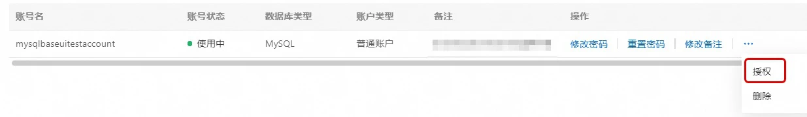

4. 进行授权或取消授权操作：

   - 授权：单击**编辑**，在弹窗中展示数据库权限管理表格，设置权限（读写/只读/只允许DML/只允许DDL）。

   - 取消授权：单击**取消授权**。

5. 单击**确定**，再次单击**确定**。

**删除用户账号**

支持删除不再需要的用户账号以释放资源。

1. 登录云数据库统一运维平台·杜康智能版。在左侧导航栏中，选择<strong>实例管理 > 实例列表，</strong>在实例列表中找到目标实例，单击实例名称。

2. 进入实例详情页，在左侧菜单栏，单击**账号信息**，进入**用户账号**页面。

3. 在目标账号行的操作列，单击**删除**。

   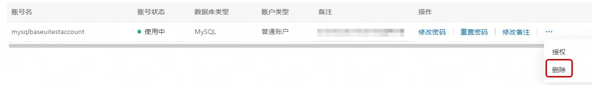

4. 在确认弹窗中确认后，单击**确定**。

**系统账号**

**查看系统账号列表**

支持查看系统内置的各类运维账号列表及其状态。

1. 登录云数据库统一运维平台·杜康智能版。在左侧导航栏中，选择<strong>实例管理 > 实例列表，</strong>在实例列表中找到目标实例，单击实例名称。

2. 进入实例详情页，在左侧菜单栏，单击**账号信息**，切换到**系统账号**页签。

3. 查看系统账号列表，包含以下字段：账号名、账号状态、数据库类型、账户类型、备注。

**查看运维密码**

支持查看系统账号的运维密码并提供一键复制功能。

1. 登录云数据库统一运维平台·杜康智能版。在左侧导航栏中，选择<strong>实例管理 > 实例列表，</strong>在实例列表中找到目标实例，单击实例名称。

2. 进入实例详情页，在左侧菜单栏，单击**账号信息**，切换到**系统账号**页签。

3. 在目标账号行的操作列，单击**查看运维密码**。

4. 弹窗展示账号名和密码，均支持一键复制。

**重置系统账号密码**

支持重置系统账号的密码并提示特殊权限类型的限制。

1. 登录云数据库统一运维平台·杜康智能版。在左侧导航栏中，选择<strong>实例管理 > 实例列表，</strong>在实例列表中找到目标实例，单击实例名称。

2. 进入实例详情页，在左侧菜单栏，单击**账号信息**，切换到**系统账号**页签。

3. 在目标账号行的操作列，单击**重置密码**。

4. 在弹窗中填写以下信息：

   | 配置项 | 说明 |
   | --- | --- |
   | 新密码 | 输入新密码，需满足复杂度要求。 |
   | 确认新密码 | 再次输入新密码以确认无误。 |

   > **说明**
   >
   > - 密码需满足复杂度要求：至少包含大写、小写、数字、特殊符号中的三种，长度8~32位。
   >
   > - 部分特殊权限类型（如aurora/replicator）会隐藏重置密码按钮。

5. 单击**确定**。

**删除系统账号**

支持删除指定的系统账号（需谨慎操作）。

1. 登录云数据库统一运维平台·杜康智能版。在左侧导航栏中，选择<strong>实例管理 > 实例列表，</strong>在实例列表中找到目标实例，单击实例名称。

2. 进入实例详情页，在左侧菜单栏，单击**账号信息**，切换到**系统账号**页签。

3. 在目标账号行的操作列，单击**删除**。

4. 在确认弹窗中确认后，单击**确定**。

<a id="section-2-4"></a>

## 2.4. 智能运维

<a id="section-2-4-1"></a>

### 2.4.1. 智能主机诊断

云数据库统一运维平台·杜康智能版提供基于火焰图的智能主机性能诊断能力，可自动解析CPU热点函数、异常调用栈及资源消耗路径，精准定位系统级性能瓶颈，适用于数据库高负载、响应延迟、内核级卡顿等场景的根因分析与跨实例性能对比。

**背景信息**

- 定义：火焰图是一种可视化性能分析工具，用于展示程序在CPU上的执行路径。

- X轴（宽度）：代表CPU采样样本的数量。柱子越宽，表示该函数及其调用链消耗的CPU时间越多，是主要的性能热点。

- Y轴（高度）：代表调用栈深度，直观展示函数间的层级调用关系。

- 颜色：不同颜色代表不同的代码模块或调用栈。

- 核心逻辑：通过“宽度”快速定位最耗时的代码路径，将复杂的性能数据转化为直观的图形。

**使用场景**

在数据库运维中，火焰图可以解决以下典型问题。更多详情，请参见典型数据库诊断案例。

- CPU使用率飙高：当数据库进程CPU满载时，通过火焰图可快速定位是哪些函数（如排序、哈希计算、正则匹配）占用了大量计算资源。

- 响应延迟抖动：当业务出现周期性卡顿，可通过对比不同时间段的火焰图，找出导致延迟突增的异常调用栈。

- 锁竞争与自旋：当QPS上不去但CPU未满载时，火焰图可捕捉到 `mutex_lock` 、 `futex` 等锁相关函数的异常热度，分析锁竞争瓶颈。

- 优化效果验证：在进行参数调整、版本升级或SQL优化后，通过“热点对比”功能，直观查看热点函数是否变窄或消失，量化优化成果。

- 内核级卡顿排查：当问题涉及系统调用（如频繁的网络包处理、内存拷贝），火焰图可展示内核态函数的耗时分布。

**注意事项**

- **数据时效限制**：系统默认仅允许查看最近7天内采集的数据（以文件元数据中的采集时间为准）。

- **历史数据处理**：若需分析超期数据，建议重新采集数据后再分析。

**准备工作**

在目标主机部署轻量探针，采集相关数据，可联系阿里云技术人员协助处理。

**操作步骤**

1. **访问智能主机诊断页面**

   <ol type="i">

   <li>

   登录云数据库统一运维平台·杜康智能版。

   </li>

   <li>

   在左侧导航栏单击**智能运维 > 智能主机诊断**。

   </li>

   </ol>

2. **上传采集数据**

   单击页面右上角**上传**按钮，选择本地采集的性能文件，系统将自动解析并生成可视化火焰图，渲染至结果页。

3. **查看分析结果**

   系统解析完成后，您可从宏观概览（热点分布页签）、微观定位（进程函数调用关系热点图）、差异对比（热点对比页签）三个维度查看和分析性能数据。

   - **热点分布页签**

     - 热点进程分布图：以环形图展示各进程的CPU占用比例。

     - 进程热点时序图：展示进程热度随时间的变化趋势。建议观察波峰，垂直柱子越高、越密集，代表该时间段CPU负载越高。

     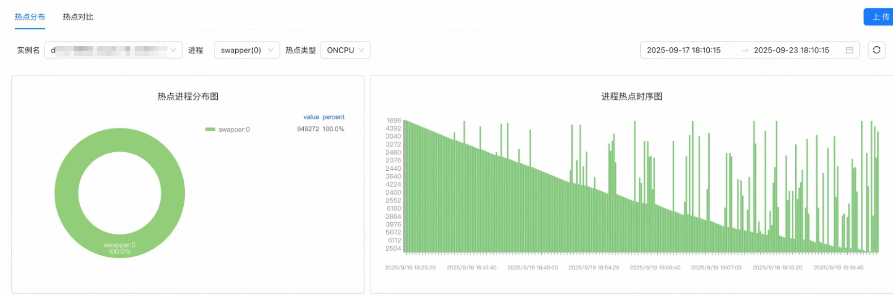

     进程函数调用关系热点图：

     - 自身热度：该函数本身执行代码所消耗的时间。

     - 总热度：该函数及其所有子函数消耗的总时间。

     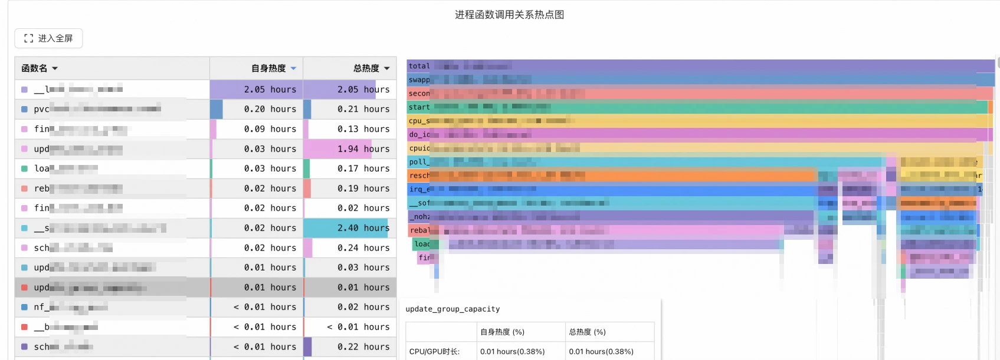

   - **热点对比页签**

     通过热点对比可查看相同/不同实例、进程、时间段的差分火焰图，可用于验证优化效果、定位版本退化或环境差异导致的性能问题。

     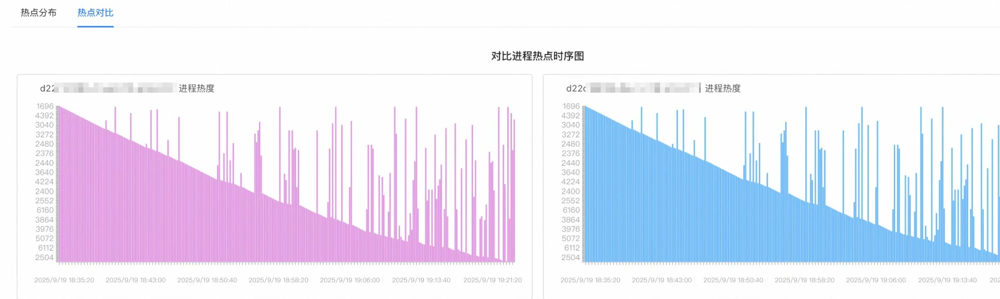

**典型数据库诊断案例**

> **说明**
>
> 以下案例仅供参考，具体请根据实际情况处理。

**案例一：数据库CPU使用率飙高**

- 故障现象：监控告警显示数据库实例CPU利用率持续超过90%，业务响应严重变慢。

- 诊断思路：确认是“真忙”（计算密集型）还是“假忙”（锁等待/空转）。

- 操作步骤：

  <ol type="i">

  <li>

  在故障时间段采集主机性能文件并上传至本平台。

  </li>

  <li>

  查看进程函数调用关系热点图。

  </li>

  <li>

  寻找最宽的函数柱状图。

  </li>

  </ol>

- 分析判定：

  - 情形A（SQL计算热点）：若热点函数为 `mysql_parse` 、 `sort_table` 、 `hash_join` 或具体业务表名相关函数。

    - 结论：存在低效SQL（如全表扫描、复杂排序）。

    - 对策：提取对应SQL进行执行计划分析，优化索引。

  - 情形B（系统调用热点）：若热点函数为 `sys_call_table` 、 `network_receive` 。

    - 结论：网络包处理或系统调用频繁。

    - 对策：检查网络连接数、带宽瓶颈或中间件配置。

  - 情形C（锁竞争热点）：若热点函数为 `mutex_lock` 、 `futex_wait` 。

    - 结论：线程大量时间在等待锁，而非执行计算。

    - 对策：排查死锁日志，优化事务粒度。

**案例二：业务响应延迟周期性抖动**

- 故障现象：QPS平稳，但业务接口出现周期性卡顿（Latency Spike）。

- 诊断思路：对比“正常时段”与“卡顿时段”的性能差异。

- 操作步骤：

  <ol type="i">

  <li>

  分别采集“正常时段”和“卡顿时段”的性能文件。

  </li>

  <li>

  使用平台的热点对比功能，上传两份文件生成差分火焰图。

  </li>

  <li>

  观察差异图中新增的红色热点区域。

  </li>

  </ol>

- 分析判定：

  - 若差异热点集中在 `gc_worker` 或内存分配函数。

    - 结论：可能是垃圾回收（GC）或内存分配导致的停顿。

  - 若差异热点集中在特定业务逻辑函数。

    - 结论：该时间段有特定定时任务或批处理作业干扰。

  - 对策：调整批处理作业时间，或优化内存配置。

**案例三：内核级卡顿排查**

- 故障现象：数据库进程CPU不高，但负载（Load Average）极高，出现僵死状态。

- 诊断思路：排查是否陷入内核态无法返回。

- 操作步骤：

  <ol type="i">

  <li>

  上传性能文件，查看火焰图内核态（Kernel Mode） 部分。

  </li>

  <li>

  搜索系统调用函数，如 `rwsem` 、 `spin_lock` 。

  </li>

  </ol>

- 分析判定：

  - 若发现大量时间消耗在内核锁等待或频繁的上下文切换（

    间消耗在内核锁等待或频繁的上

    ）。

  - 若发现大量时间消耗在内核锁等待或频繁的上下文切换（ `context_switch` ）。

    - 结论：系统资源争用严重，或存在驱动/内核Bug。

    - 对策：检查系统日志（dmesg），评估是否需要升级内核或调整系统参数（如文件句柄数、网络缓冲区）。

**案例四：优化效果验证**

- 故障现象：完成SQL优化或参数调整后，需确认性能是否真正提升。

- 诊断思路：量化热点函数的变化。

- 操作步骤：

  <ol type="i">

  <li>

  采集“优化前”与“优化后”的性能文件。

  </li>

  <li>

  使用热点对比功能。

  </li>

  <li>

  观察原热点函数的宽度变化。

  </li>

  </ol>

- 分析判定：

  - 若原热点函数柱子明显变窄或消失。

    - 结论：优化生效，性能瓶颈已消除。

  - 若原热点函数宽度不变，但出现了新的热点。

    - 结论：瓶颈转移，需继续优化新热点。

<a id="section-2-4-2"></a>

### 2.4.2. 一键信息采集

云数据库统一运维平台·杜康智能版提供一键信息采集能力，支持通过多种检索参数（包括关键字、杜康任务流ID、DTS任务ID、实例ID）快速触发诊断任务，自动聚合相关服务日志并生成结构化诊断报告。本指南以DTS任务诊断为例，介绍基于任务ID与关键字的两种采集方式，并说明日志下载、解密及离线导入分析的操作流程。

**适用场景**

- 快速定位问题：在任务异常时，通过任务ID或业务关键词一键触发全链路日志采集。

- 支持离线分析：可将加密日志包导出并在非生产环境回放，便于开发或L2等支持团队深入排查。

- 统一诊断入口：无论任务来源如何，均通过同一平台完成采集、查看与分析，提升运维效率。

**注意事项**

- 上传的日志压缩包需符合内部格式规范（含特定路径结构与元数据），非标准日志无法被解析。

- 铜雀平台为内部中心化测试平台，仅限L2及以上权限人员访问，不部署于用户局点。

**使用建议**

现场问题建议优先通过控制台“查看详情”直接分析；当需跨环境协作、长期归档或深度调试时，再使用日志下载与导入功能。

**支持的采集类型**

- 基于实例ID或任务ID采集：仅支持RDS MySQL实例。

- 基于关键字采集：仅支持采集控制台下拉框中预配置的SR（Service Rule）日志类型，具体详情以控制台展示为准。

- 基于关键字采集：目前支持选择RDS MySQL、DTS和PolarDB-X三种场景。

**方法一：基于任务ID的诊断流程**

适用于任务已创建且ID明确的情况，如客户反馈某迁移任务失败。

1. **访问一键信息采集页面**

   <ol type="i">

   <li>

   登录云数据库统一运维平台·杜康智能版。

   </li>

   <li>

   在左侧导航栏单击**智能运维 > 一键信息采集**。

   </li>

   </ol>

2. **发起诊断**

   一键信息采集参数类型选择**DTS任务ID**，并**输入参数值**，单击**开始诊断**。

   系统将自动调用后端服务，聚合该任务相关的调度、执行、监控及错误日志。

   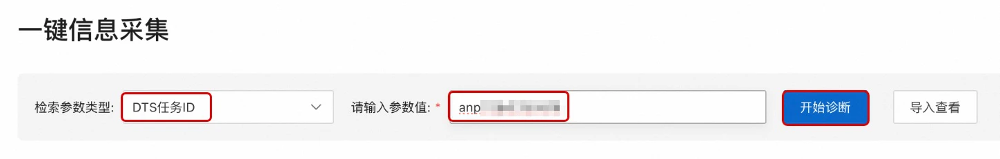

3. **查看诊断日志**

   诊断完成后，单击操作列下的**查看详情**，在任务详情页再次单击**查看详情**，查看日志。

   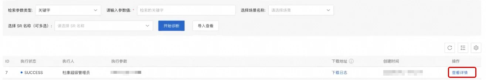

   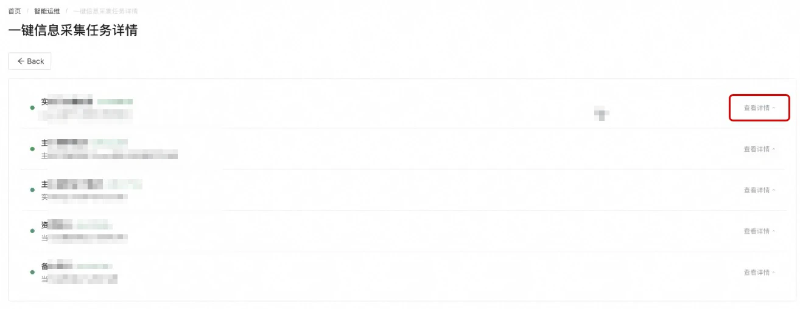

   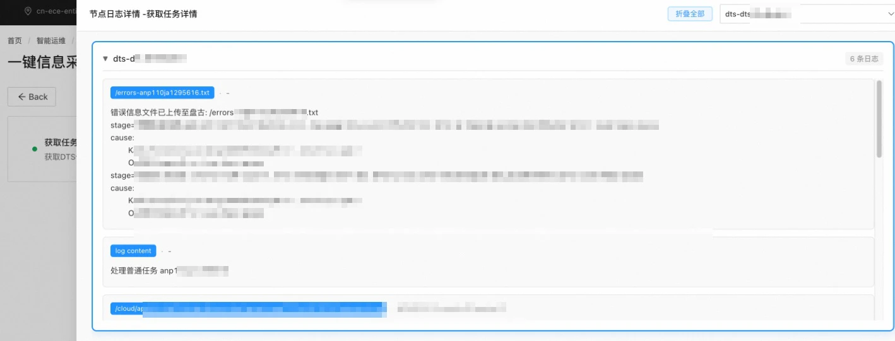

4. **下载日志压缩包**

   单击操作列下的**下载日志**，下载任务对应的日志压缩包。

   

   下载后日志示例如下：

   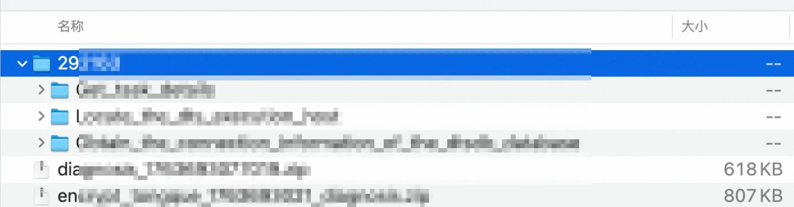

5. **日志解密**

   日志下载后前往铜雀平台，在诊断预案页面，单击页面右上方**日志解析**按钮，对日志解密。

   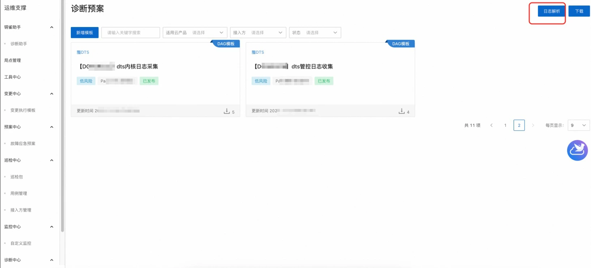

**方法二：基于关键字的诊断流程**

适用于无法直接获取任务ID，但可通过业务上下文模糊匹配的场景。

1. **访问一键信息采集页面**

   <ol type="i">

   <li>

   登录云数据库统一运维平台·杜康智能版。

   </li>

   <li>

   在左侧导航栏单击**智能运维 > 一键信息采集**。

   </li>

   </ol>

2. **发起诊断**

   检索参数类型选择**关键字**，并**输入参数值**，场景名称选择**dts**，单击**开始诊断**。

   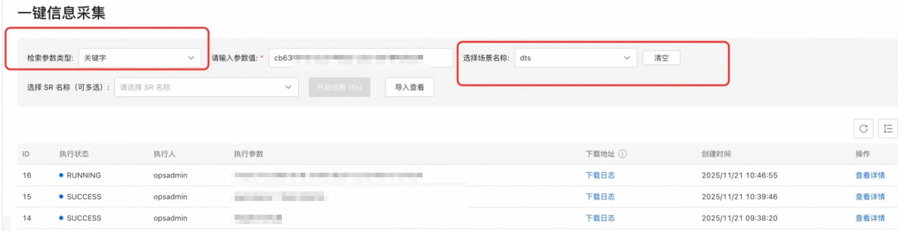

3. **查看诊断日志**

   诊断完成后，单击操作列下的**查看详情**，在任务详情页再次单击**查看详情**，查看日志。

   

   

   

4. **下载日志压缩包**

   单击操作列下的**下载日志**，下载任务对应的日志压缩包。

   

   下载后日志示例如下：

   

5. **日志解密**

   日志下载后前往铜雀平台，在诊断预案页面，单击页面右上方**日志解析**按钮，对日志解密。

   

**离线日志导入与回放分析**

在**一键信息采集**页面中，单击**导入查看**，将已下载且符合格式规范的日志压缩包（ `.zip` ）上传至该页面，系统将自动解析并展示日志内容，用于离线回放分析。

日志下载方法，请参见方法一或方法二的步骤4。

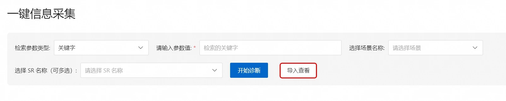

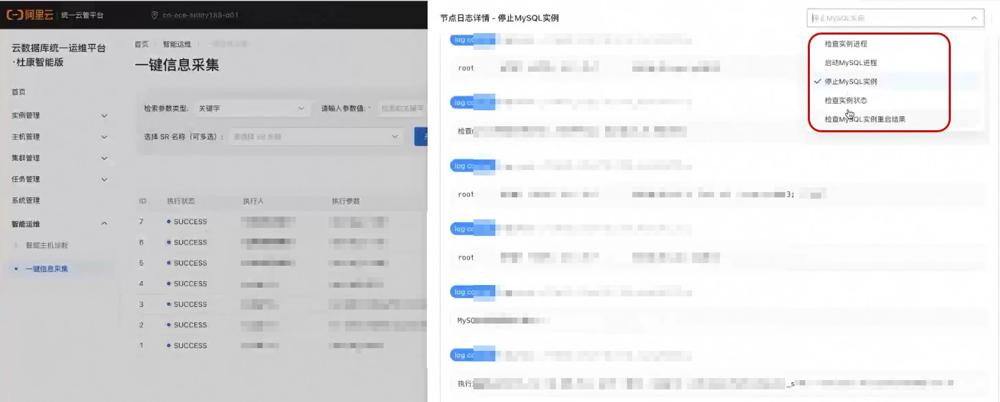

<a id="section-2-4-3"></a>

### 2.4.3. 自动化脚本管理

云数据库统一运维平台·杜康智能版提供自动化脚本管理能力，将高频、复杂的黑屏运维操作（如实例状态订正、备份任务干预、资源清理等）转化为标准化的自动执行流程，旨在通过内置的风险分级与审批机制，显著降低人工操作耗时与出错风险，提升专有云数据库运维的效率与安全性。

**使用前须知**

- **风险须知**：本文所述的自动化脚本涉及底层元数据修改及管控逻辑变更。若无法准确判断操作对业务的影响，请勿擅自执行。请务必先提交工单至阿里云技术人员处进行评估协助。

- **审批机制**：所有脚本执行任务均遵循“先审批，后执行”的安全原则。任务发起后，必须经“平台运维管理员”审批通过方可生效执行，任何未经审批的任务将无法运行。其中：

  - 低风险脚本：审批通过后，系统将自动触发执行。

  - 中/高风险脚本：审批通过后，任务状态将变为 “待确认”。此时，发起人必须手动确认执行，任务才会真正开始运行。若未进行此操作，任务将一直处于等待状态。

**使用场景**

- **异常状态修复**：当数据库实例因底层引擎缺失、任务中断或元数据不一致导致状态异常（如ServiceTest不终态、测试实例残留）时。

- **紧急故障处理**：实例无法正常重启、备份任务长时间挂起（Check状态）且常规手段无效时。

- **资源水位治理**：OSS备份存储空间或实例本地磁盘因历史数据/日志积压导致水位过高，需批量清理失效数据时。

- **流程阻塞解除**：在容灾升级或特殊变更场景中，需跳过非关键检测步骤以推进整体流程时。

**功能优势**

- **简化流程，风险可视**：内置经过验证的标准脚本，一键处理复杂底层逻辑；执行前明确展示风险等级（低/中/高）及影响范围，辅助决策。

- **标准化审批流**：集成严格的审批机制，支持自动生成审批链接发送给授权人，审批通过后自动触发执行，确保操作合规可追溯。

- **全链路透明监控**：提供实时的任务状态追踪、详细执行日志下载及异常中断能力，实现操作过程的全程透明化。

- **降低人为失误**：通过参数化配置替代手动命令行操作，大幅减少因手误导致的生产事故。

**支持的自动化脚本**

**脚本概述**

| 支持的自动化脚本 | 脚本描述 | 风险等级 | 支持的数据库类型 |
| --- | --- | --- | --- |
| hack ServiceTest#使之终态 | 强制终止ServiceTest巡检流程，使实例状态进入“终态”，用于解决因环境差异导致的升级阻塞。 | 低风险 | RDS MySQL<br>PolarDB MySQL主备版Tair（兼容Redis）<br>MongoDB |
| MySQL测试实例中断任务及状态订正 | 清理因任务中断而残留的MySQL测试实例及相关任务流，释放资源并恢复状态一致性。 | 低风险 | RDS MySQL<br>PolarDB MySQL主备版 |
| 强制取消MySQL实例备份任务 | 针对备份任务长时间滞留Check状态且正常取消无效的场景，强制清理异常任务记录。 | 低风险 | RDS MySQL<br>PolarDB MySQL主备版 |
| 强制重启MySQL实例 | 当实例状态异常且白屏重启失败时，通过底层指令强制重启实例（不支持TDE加密实例）。 | 中风险 | RDS MySQL<br>PolarDB MySQL主备版 |
| 清理OSS中历史失效的备份集或日志数据 | 基于保留策略，批量清理OSS Bucket中超期的全量/增量备份文件，释放存储空间。 | 中风险 | RDS MySQL<br>PolarDB MySQL主备版Tair（兼容Redis） |
| 解决MySQL实例增量日志不上传与不清理问题 | 订正<code> bak </code>元数据库中<code> archivelog_list </code>表的异常状态记录，解决增量日志不上传或本地不清理导致的积压问题。 | 低风险 | RDS MySQL<br>PolarDB MySQL主备版 |

**hack ServiceTest#使之终态**

本脚本用于特殊需求场景（如环境紧急升级、容灾单机房升级、客户主动要求），需对ServiceTest#进行Hack操作使其强制进入“终态”。

> **说明**
>
> - ServiceTest主要作用是对实例全生命周期进行周期性自动化巡检，覆盖实例创建、账号管理、备份执行及实例销毁等关键场景；该机制能够主动探测并精准捕获环境中的接口异常或功能故障，为平台稳定性提供实时监测保障。主动Hack将强制终止检测流程，导致上述能力失效。
>
> - 停止ServiceTest仅影响平台侧的自检逻辑，不会干扰业务实例的正常运行，对生产环境无直接风险。

**典型场景**

- 排查发现未部署对应引擎集群，导致ServiceTest无法自然终态。

- 容灾环境中仅升级了A机房，B机房未升级，需让ServiceTest终态以避免卡住整体升级流程。

- 客户明确要求跳过测试环节。

1. 登录云数据库统一运维平台·杜康智能版。

2. 在左侧导航栏单击**智能运维 > 自动化脚本管理**。

3. 单击脚本**操作**列下的**执行**按钮。

4. 在弹出的面板中，仔细阅读脚本详情（脚本描述、影响实体、风险等级、风险提示等），在**参数设置**区域，配置如下信息：

   - **db_type**：填写数据库类型，支持mysql、polaro、redis、mongo。

   - **执行原因**：备注执行原因，便于后续审批查看。

5. 单击**确定执行**。

   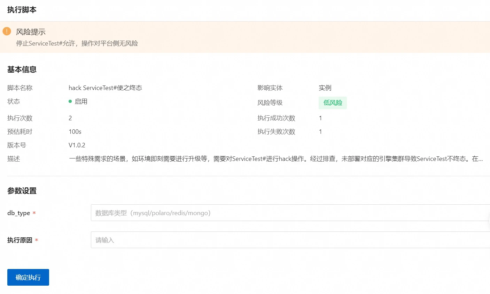

**MySQL测试实例中断任务及状态订正**

通常测试实例创建成功后系统会自动删除，但可能由于中断任务，导致创建的测试实例无法通过测试任务来删除，需要人为处理。

> **说明**
>
> 测试任务残留清理对云平台本身无影响。

1. 登录云数据库统一运维平台·杜康智能版。

2. 在左侧导航栏单击**智能运维 > 自动化脚本管理**。

3. 单击脚本**操作**列下的**执行**按钮。

4. 在弹出的面板中，仔细阅读脚本详情（脚本描述、影响实体、风险等级、风险提示等），在**参数设置**区域，配置如下信息：

   - **custins_id**：填写实例ID。

   - **task_id**：填写中断的任务ID，可在**任务管理**页面，进入任务详情页获取。

   - **pengine_id**：填写Pengine ID，可在**任务管理**页面，进入任务详情页获取。

   - **执行原因**：备注执行原因，便于后续审批查看。

5. 单击**确定执行**。

   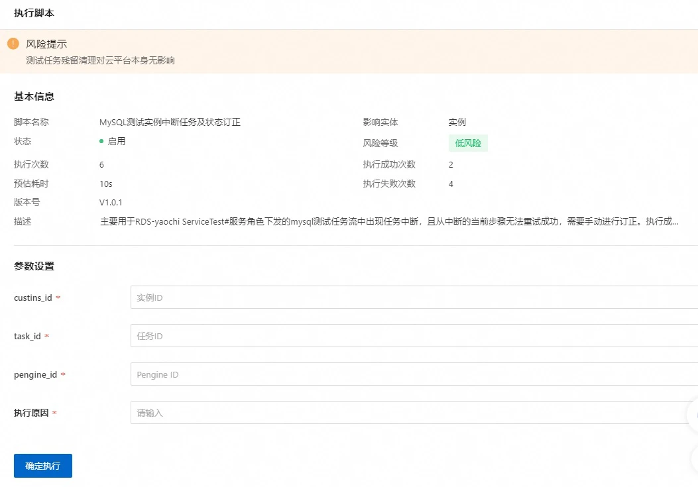

**强制取消MySQL实例备份任务**

本脚本仅限备份异常应急场景使用。当实例备份状态长时间滞留于 `check` 状态，且手动取消备份任务无效时，可通过此脚本强制清理异常任务记录。

> **说明**
>
> 本脚本属于修复备份规避风险的操作，因此使用无风险。

1. 登录云数据库统一运维平台·杜康智能版。

2. 在左侧导航栏单击**智能运维 > 自动化脚本管理**。

3. 单击脚本**操作**列下的**执行**按钮。

4. 在弹出的面板中，仔细阅读脚本详情（脚本描述、影响实体、风险等级、风险提示等），在**参数设置**区域，配置如下信息：

   - **custins_id**：填写实例ID。

   - **执行原因**：备注执行原因，便于后续审批查看。

5. 单击**确定执行**。

   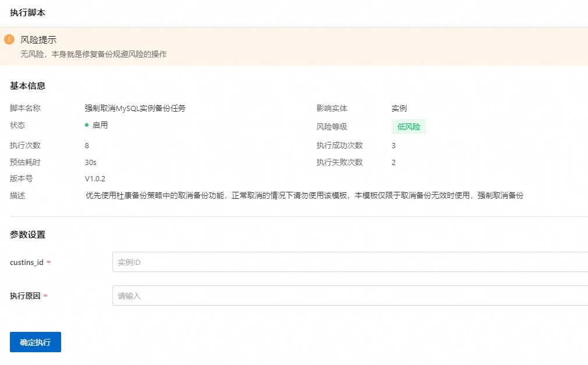

**强制重启MySQL实例**

当MySQL实例状态异常，无法通过白屏界面重启（例如报错： `The process doesn't have the permission to invoke the program. Please contact with RDS operator` ）时，可通过本脚本强制重启。

> **重要**
>
> - 业务影响：强制重启将导致实例在重启期间无法连接，操作前务必与业务方沟通，并在业务低峰期执行。
>
> - 使用限制：不支持已开启TDE（透明数据加密）的实例使用此方案。

1. 登录云数据库统一运维平台·杜康智能版。

2. 在左侧导航栏单击**智能运维 > 自动化脚本管理**。

3. 单击脚本**操作**列下的**执行**按钮。

4. 在弹出的面板中，仔细阅读脚本详情（脚本描述、影响实体、风险等级、风险提示等），在**参数设置**区域，配置如下信息：

   - **custins_id**：填写实例ID。

   - **hostins_id**：填写主机实例ID，可在实例详情页的**基本信息**页面获取。

   - **执行原因**：备注执行原因，便于后续审批查看。

5. 单击**确定执行**。

   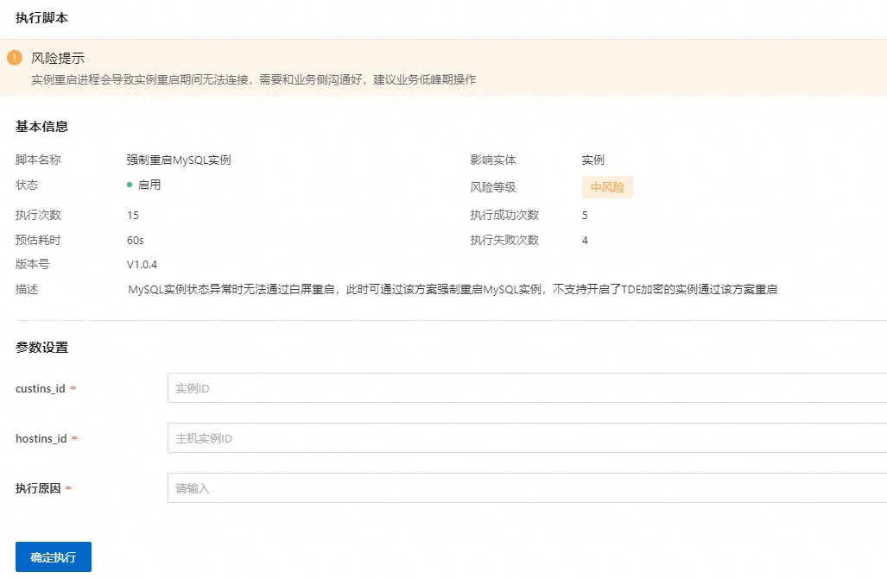

**清理OSS中历史失效的备份集或日志数据**

经OSS水位分析发现 `rds-backup`  Bucket中存在大量超期未清理的全量/增量备份文件（已超出历史备份的保留周期）。若不及时清理，将导致OSS存储水位持续高涨，进而引发新备份任务失败。

> **重要**
>
> - 业务影响：清理操作仅针对历史失效数据，不影响正在运行的业务实例。
>
> - 风险警示：误删除有效备份文件将导致历史数据缺失，无法执行特定时间点的数据恢复（PITR）。执行前请务必严格核对待删除文件列表及时间范围。

1. 登录云数据库统一运维平台·杜康智能版。

2. 在左侧导航栏单击**智能运维 > 自动化脚本管理**。

3. 单击脚本**操作**列下的**执行**按钮。

4. 在弹出的面板中，仔细阅读脚本详情（脚本描述、影响实体、风险等级、风险提示等），在**参数设置**区域，配置如下信息：

   - **remain_days**：填写实例ID。指定清理操作的时间范围，表示清理多少天之前的历史数据。不得少于8天，避免误删除近期数据。

   - **执行原因**：备注执行原因，便于后续审批查看。

5. 单击**确定执行**。

   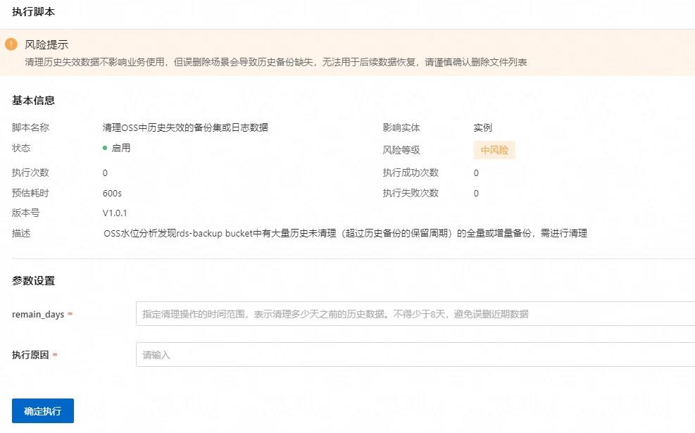

**解决MySQL实例增量日志不上传与不清理问题**

> **说明**
>
> 本脚本仅修正管控侧元数据逻辑，不影响业务实例的正常使用。

**典型场景**

- OSS水位异常：监控显示 `rds-backup` 存储空间被大量占用，且数据量曲线持续上涨无阶段性下降（表明增量日志未成功归档至OSS）。

- 本地磁盘积压：实例本地Binlog或其他增量日志因清理机制失效而持续积压，导致实例磁盘水位过高告警。

1. 登录云数据库统一运维平台·杜康智能版。

2. 在左侧导航栏单击**智能运维 > 自动化脚本管理**。

3. 单击脚本**操作**列下的**执行**按钮。

4. 在弹出的面板中，仔细阅读脚本详情（脚本描述、影响实体、风险等级、风险提示等），在**参数设置**区域，配置如下信息：

   - **custins_id**：填写实例ID。

   - **hostins_id**：填写主机实例ID，多个值以英文逗号（,）分隔，最多支持两个值。可在实例详情页的**基本信息**页面获取。

   - **执行原因**：备注执行原因，便于后续审批查看。

5. 单击**确定执行**。

   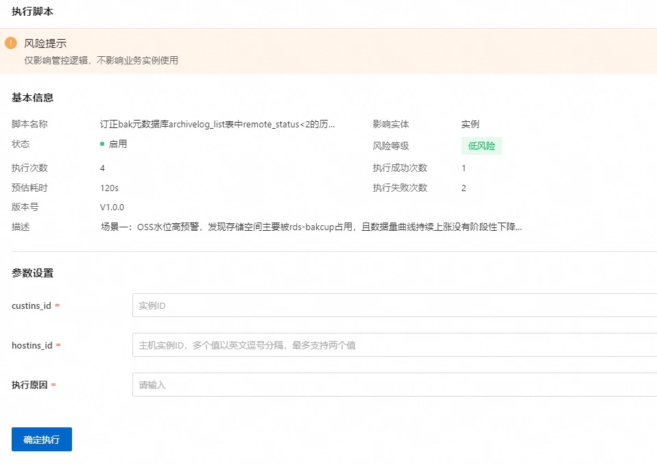

**通用操作**

**查看脚本详情**

单击脚本**操作**列下的**脚本详情**按钮，在弹出的面板中可查看完整的脚本描述、影响实体、脚本执行次数、脚本执行成功次数、风险等级及详细风险提示等。

**查看脚本执行记录**

支持从单个脚本详情或全量列表两个入口查询历史任务，两者均提供统一的审批进度、执行状态及详细过程日志查看功能。在任一入口的详情页中，均可获取如下详细信息：

| 执行记录详情 | 说明 |
| --- | --- |
| 审批信息 | 页面将跳转至“运维变更控制台”的流程审批页面，在该页面可同意、驳回或转交审批任务。 |
| 执行信息 | 单击<strong>执行信息</strong>，可查看执行状态、执行原因、执行结果、脚本的执行开始和结束时间等。 |
| 执行过程 | 系统将跳转至铜雀平台，展示颗粒度更细的实时执行日志与过程追踪。 |

- **入口一：查看单个脚本的执行记录**

  单击目标脚本**操作**列下的**执行记录**按钮，在弹出的面板中可查询历史任务的审批进度、执行状态及详细过程日志。

  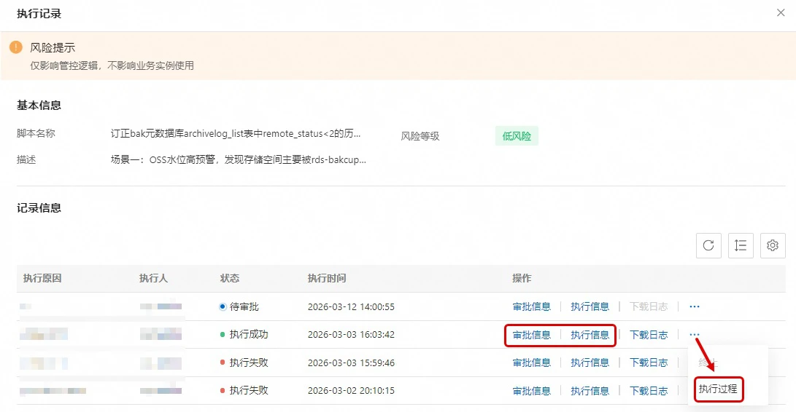

- **入口二：查看全量脚本的执行记录**

  在左侧导航栏的**智能运维 > 自动化脚本管理 > 执行记录**页签下，在此页面可统一查询所有脚本历史任务的审批进度、执行状态及详细过程日志。

  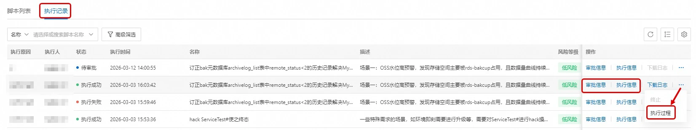

**下载脚本执行日志**

单击脚本**操作**列下的**执行记录**按钮，在弹出的面板中单击**下载日志**，可获取当前任务的完整执行日志文件。

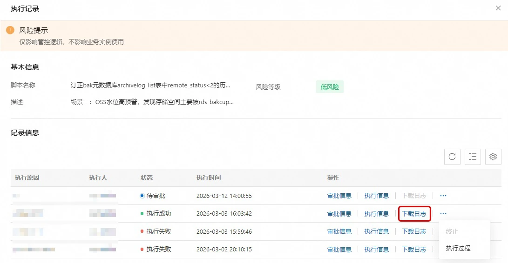

**禁用脚本**

若需暂时停用某脚本，单击脚本**操作**列下的**禁用**按钮，单击**确定**即可。

**终止脚本执行**

> **说明**
>
> 仅支持终止状态为**待审批**的任务，已执行成功或已执行失败的任务不可终止。

单击脚本**操作**列下的**执行记录**按钮，在弹出的面板中单击

**> 终止**。


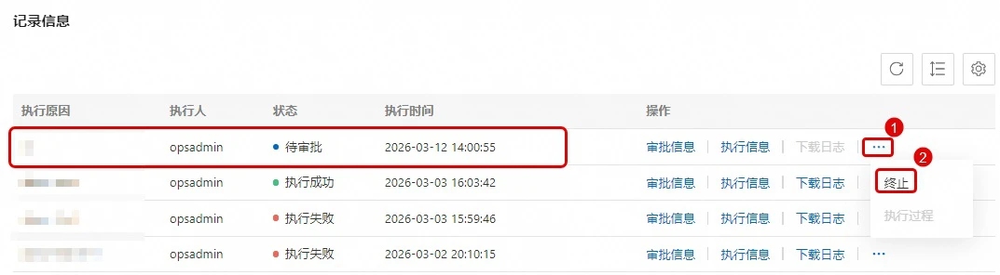

<a id="section-2-5"></a>

## 2.5. 主机管理

<a id="section-2-5-1"></a>

### 2.5.1. 主机软件包管理

本文介绍云数据库主机上软件包的核心管理功能，包括安装、卸载及操作记录查询。用户可通过统一界面，安全、可追溯地维护主机运行环境，确保数据库服务的稳定性与合规性。

**使用场景**

- 集群扩容与版本一致性保障

  - 场景：数据库集群横向扩容时，新节点初始版本与存量节点不一致。

  - 作用：通过批量安装指定版本软件包，为新节点补齐内核，确保集群内所有节点版本统一，避免兼容性问题。

- 紧急故障修复与版本回滚

  - 场景：现网版本出现已知缺陷（Bug），或新版本升级后出现性能回归。

  - 作用：通过批量下发补丁包进行快速修复；或在升级异常时，快速卸载新版本、回滚至稳定版本，最小化业务中断时间。

- 灰度发布与风险熔断

  - 场景：新版本发布初期，需控制风险范围，防止缺陷扩散。

  - 作用：通过软件包的“启用/禁用”状态控制分发权限。可先仅对特定主机启用（灰度），确认稳定后全量开放；若发现严重缺陷，立即禁用软件包（熔断）。

**支持的数据库类型**

当前支持以下类型的天基架构软件包：

- RDS MySQL

- PolarDB MySQL主备版

- PolarDB PostgreSQL

- PolarDB PostgreSQL（Oracle）

**安装软件包**

1. 登录云数据库统一运维平台·杜康。

2. 在左侧导航栏单击**主机管理 > 系统主机**，单击**操作**列下的**详情**进入主机详情页面。

3. 进入左侧导航栏中的**主机软件包管理**页面，单击**未安装**软件包**操作**列下的**软件包版本管理**。

4. 在弹出的面板中，单击**安装**。

5. 在弹出的对话框中，勾选**操作说明**并填写**操作原因**，单击**确定**。

   您可以关注目标主机**安装状态**列的进度展示，从**安装中**变更为**已安装**表示已安装完成。

**卸载软件包**

> **重要**
>
> 卸载软禁包属于高危运维操作，若数据库实例运行依赖该包中的动态库或二进制文件，强制卸载可能导致依赖缺失，进而引发数据库实例无法启动或服务中断。
>
> 执行卸载前，请务必确认目标主机上无运行中的关键实例，或已做好充分的容灾与回滚预案。

1. 登录云数据库统一运维平台·杜康。

2. 在左侧导航栏单击**主机管理 > 系统主机**，单击**操作**列下的**详情**进入主机详情页面。

3. 进入左侧导航栏中的**主机软件包管理**页面，单击**已安装**软件包**操作**列下的**软件包版本管理**。

4. 在弹出的面板中，单击**卸载**。

5. 在弹出的对话框中，勾选**操作说明**并填写**操作原因**，单击**确定**。

   您可以关注目标主机**安装状态**列的进度展示，从**卸载中**变更为**未安装**表示已卸载完成。

**查询软件包变更记录**

用于查询软件包的安装或卸载是否成功。

1. 登录云数据库统一运维平台·杜康。

2. 在左侧导航栏单击**主机管理 > 系统主机**，单击**操作**列下的**详情**进入主机详情页面。

3. 进入左侧导航栏中的**主机软件包管理**页面，单击**软件包变更记录**按钮。

   页面将展示操作类型、操作时间、结果描述等信息。

<a id="section-2-5-2"></a>

### 2.5.2. 物理机分组

云数据库统一运维平台·杜康智能版支持通过物理机分组功能构建独立的逻辑资源池，实现底层硬件资源的物理隔离与精细化调度，以确保不同业务场景下的资源独占性与稳定性。

**背景信息**

通过**物理机分组**功能，可构建多物理机资源池，以实现物理机资源隔离。该功能具有以下实际价值：

- 不同等级不同类别的数据库实例，可使用不同的物理机资源池，以实现物理隔离。

- 测试环境和生产环境物理机资源隔离，避免测试实例和生产实例创建在相同物理机上，避免测试实例性能压测等场景影响生产实例。

- 新老机型换代，老旧机器和新机器规划不同的资源池，分开使用。

> **说明**
>
> - 物理机分组功能当前仅支持PolarDB-X 2.0实例。
>
> - 创建物理机分组后，用户可在Apsara Uni-manager运营控制台创建数据库实例时，指定实例所在的物理机资源池，详情请参见相应《用户指南》中《创建实例》等章节。

**查看全部分组信息**

1. 登录云数据库统一运维平台·杜康智能版。

2. 左侧菜单栏单击**主机管理 > 系统主机**。

3. 单击上方**物理机分组**按钮，进入**物理机分组**页面，即可查看当前所有分组信息。

**创建物理机分组**

1. 在**物理机分组**页面，单击**创建分组**按钮。

2. 在**创建分组**页面，填写**分组名称**、**数据库类型**和选择**机器**等。

   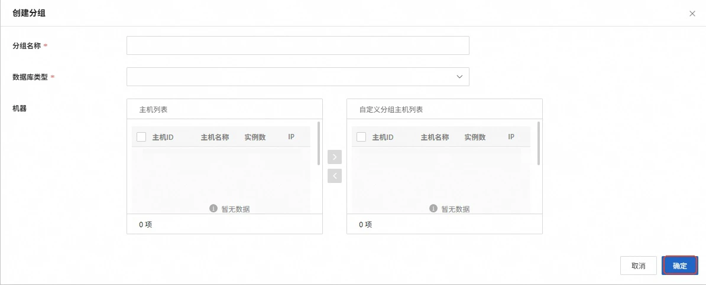

3. 选择空闲物理机，单击  加入当前物理机分组。

4. 单击**创建**按钮即可成功创建分组。

**编辑物理机分组**

1. 在**物理机分组**页面，单击**编辑**按钮。

2. 在**编辑分组**页面编辑**数据库类型**和**机器**。

3. 编辑完成后，单击**确定**按钮。

**删除物理机分组**

> **说明**
>
> 删除物理机分组之前，请确保先将物理机上的实例清空。

1. 在**物理机分组**页面，单击**删除**按钮。

2. 删除对话框中，单击**确定**删除该分组。

<a id="section-2-6"></a>

## 2.6. 软件包管理

本文介绍了杜康智能版中软件包的三项核心操作：启用/禁用、批量安装/卸载，以及查询变更记录。

**使用场景**

- 集群扩容与版本一致性保障

  - 场景：数据库集群横向扩容时，新节点初始版本与存量节点不一致。

  - 作用：通过批量安装指定版本软件包，为新节点补齐内核，确保集群内所有节点版本统一，避免兼容性问题。

- 紧急故障修复与版本回滚

  - 场景：现网版本出现已知缺陷（Bug），或新版本升级后出现性能回归。

  - 作用：通过批量下发补丁包进行快速修复；或在升级异常时，快速卸载新版本、回滚至稳定版本，最小化业务中断时间。

- 灰度发布与风险熔断

  - 场景：新版本发布初期，需控制风险范围，防止缺陷扩散。

  - 作用：通过软件包的“启用/禁用”状态控制分发权限。可先仅对特定主机启用（灰度），确认稳定后全量开放；若发现严重缺陷，立即禁用软件包（熔断）。

**注意事项**

杜康智能版（新版本）尚未完全兼容老杜康（旧版本）的证书体系。因此，在访问杜康智能版的部分页面前，请先登录老杜康完成认证。

**支持的数据库类型**

当前**仅支持**以下类型的天基架构软件包：

- RDS MySQL

- PolarDB MySQL主备版

- PolarDB PostgreSQL

- PolarDB PostgreSQL（Oracle）

**启用/禁用软件包**

1. 登录云数据库统一运维平台·杜康智能版。

2. 在左侧导航栏单击**软件包管理 > 软件包列表**，单击**操作**列下的**禁用**或**启用**按钮。

   - 禁用：被禁用的软件包无法后续安装在主机中。

   - 启用：启用状态的软件包可后续安装在主机中。

**安装/卸载软件包**

用于批量为多个主机安装或卸载某个软件包。请注意，主机和软件包的**OS系统版本**及**芯片架构**必须保持一致，否则主机将不会显示在页面中。

> **重要**
>
> 卸载软件包属于高危运维操作，若数据库实例运行依赖该包中的动态库或二进制文件，强制卸载可能导致依赖缺失，进而引发数据库实例无法启动或服务中断。
>
> 执行卸载前，请务必确认目标主机上无运行中的关键实例，或已做好充分的容灾与回滚预案。

1. 登录云数据库统一运维平台·杜康智能版。

2. 在左侧导航栏单击**软件包管理 > 软件包列表**，单击**操作**列下的**主机管理**按钮。

3. 在弹出的面板中，勾选一个或多个主机，单击**安装**或**卸载**。

   - 安装：勾选前请确保**安装状态**列显示**未安装**。

   - 卸载：勾选前请确保**安装状态**列显示**已安装**。

4. 在弹出的对话框中，勾选**操作说明**并填写**操作原因**，单击**确定**。

   在主机管理面板中，您可以关注目标主机安装状态列的进度展示：

   - 安装：从**安装中**变更为**已安装**表示已安装完成。

   - 卸载：从**卸载中**变更为**未安装**表示已卸载完成。

**查询软件包变更记录**

用于查询软件包的启用、禁用、安装或卸载是否成功，可满足运维合规与故障复盘需求。

1. 登录云数据库统一运维平台·杜康智能版。

2. 在左侧导航栏单击**软件包管理 > 软件包列表**，单击**操作**列下的**变更记录**按钮。

   页面将展示操作类型、操作时间、结果描述等信息，支持通过上方筛选条件（时间范围、操作类型）快速定位记录。

<a id="section-3"></a>

# 3.数据库运维平台·杜康 操作指南

<a id="section-3-1"></a>

## 3.1. 登录云数据库统一运维平台·杜康

本文介绍运维工程师等相关用户如何登录到云数据库统一运维平台·杜康。

**通过Apsara Uni-manager运维控制台登录**

**前提条件**

- 已从部署人员或管理员处获取Apsara Uni-manager运维控制台的访问地址、用户名和密码。

  Apsara Uni-manager运维控制台访问地址格式为 `region-id.ops.console.intranet-domain-id.com` 。

- 推荐使用Chrome浏览器。

**操作步骤**

1. 打开浏览器。

2. 在地址栏中，输入Apsara Uni-manager运维控制台的访问地址，按回车键。

   

   > **说明**
   >
   > 您可以单击右上角的当前语言切换其它语言。当前支持简体中文、English语言切换。

3. 输入正确的用户名及密码。

   > **说明**
   >
   > - 登录Apsara Uni-manager运维控制台的用户名和密码请从部署人员或管理员处获取。
   >
   > - 若连续输入密码错误三次，系统将启动图片验证码登录功能；若连续输入错误五次，账户将被锁定，请联系管理员进行激活。
   >
   > - 首次登录Apsara Uni-manager运维控制台时，需要修改登录用户名的密码，请按照提示完成密码修改。
   >
   >   为提高安全性，密码必须满足以下要求：
   >
   >   - 必须包含英文大小写字母。
   >
   >   - 必须包含阿拉伯数字（0~9）。
   >
   >   - 必须包含特殊符号，包括感叹号（!）、at（@）、井号（#）、美元符号（$）、百分号（%）等。
   >
   >   - 密码长度为10~20个字符。

4. 单击**同意协议并登录**。

5. 在Apsara Uni-manager运维控制台的顶部菜单栏单击**产品运维**。在**数据库运维**下选择**云数据库统一运维平台·杜康**。

<a id="section-3-2"></a>

## 3.2. 首页

本文档介绍杜康数据库运维平台首页的概览，以及跳转到其他页面的操作步骤。

**首页概览**

1. 登录云数据库统一运维平台·杜康。

2. 首页显示整体大盘信息（**实例按版本分布情况**、**主机按型号分布情况**）及异常展示、实例查询、高级查询入口等。

3. 运维人员收到数据库相关的P0或P1告警时，可在杜康首页和异常列表页，确认任务、组件、主机、实例有无异常，尽快对高风险事件进行处理或确认。

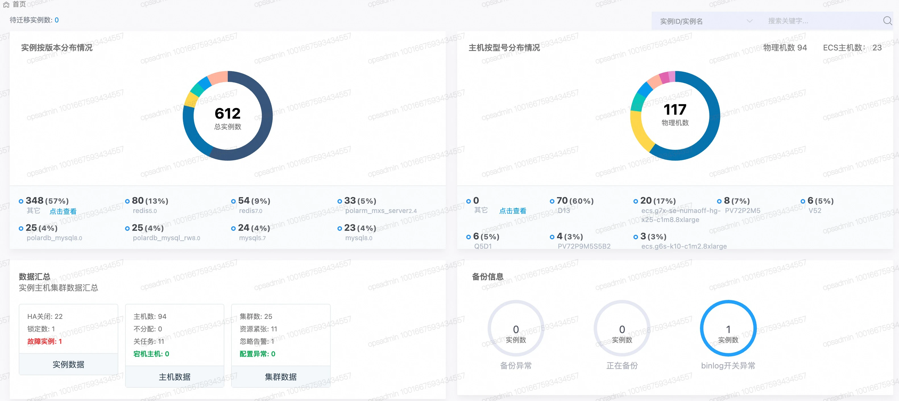

您可以单击异常信息后的数量，了解异常信息详情。如单击**备份异常**中的数量，进入异常实例信息页面。该界面显示所有的数据库实例异常信息，请分别点开处理。

**数据汇总**

展示了实例、主机和集群三种维度下的数据汇总。

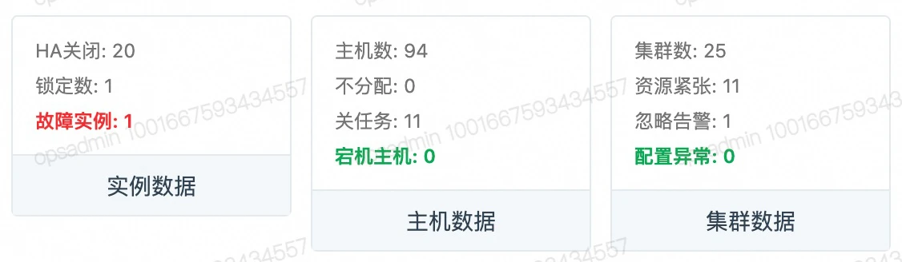

- 单击**HA关闭**，可查看按数据库引擎分类的HA关闭实例统计图。

- 单击其他数据项，可跳转至按特定条件筛选的实例列表、主机列表或集群列表结果页。

在以下区域，可查看不同类型的大盘或异常数据，支持点击跳转至相应页面。

**备份信息**

分别展示了备份异常、正在备份、binlog开关异常等状态的实例数，可点击跳转至相应的实例列表页面，查看实例状态、异常原因、检测时间等详细信息。


**高可用HA信息**

分别展示了HA关闭、实例HA状态异常的实例数，以及最近一小时HA切换次数。

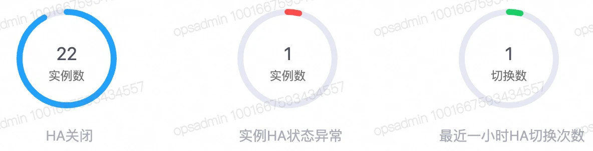

**资源信息**

分别展示了资源配置异常、系统运行异常两类异常数量统计结果。诊断等级包括错误、警告和提示。单击右侧的异常数量，可跳转至列表详情页。

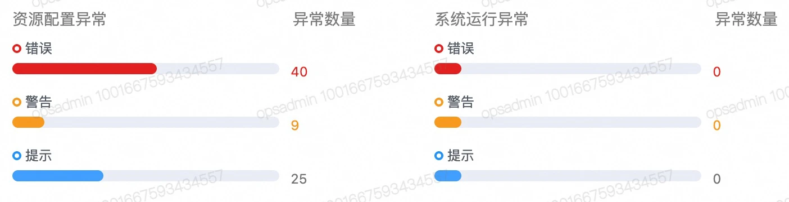

**任务信息**

分别展示了运行、等待、中断三种状态的任务总数。单击**任务数**，可跳转至**任务管理 > 实例任务**页面。

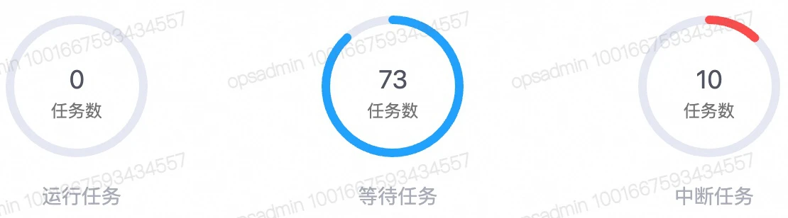

**依赖组件状态**

以可视化形式呈现依赖组件的健康状态，包括rdsapi、perf、bak、dukang、dbass等。

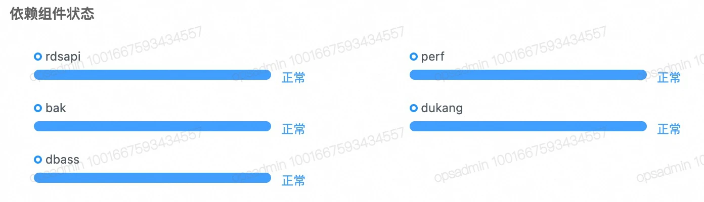

**系统巡检**

该区域展示健康状态总分、异常项的黑榜和红榜Top 8排名数据图表。

- 黑榜TOP 8：数据库性能问题（如pgxc_replication_stop、pgxc_conf_inconsistent等）

- 红榜TOP 8：配置与安全风险（如docker_hostnames_unavailable等）

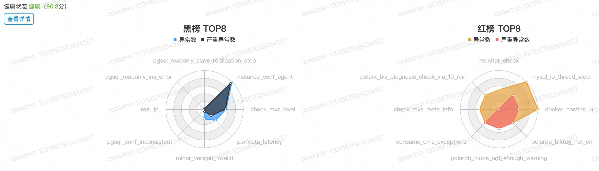

**异常列表页**

单击**系统巡检**区域左上角的**查看详情**按钮，将跳转至**异常列表 > 客户实例**页，默认展示异常等级为严重的**客户实例**。

- 可通过左侧导航栏切换至**主机**、**主机实例**、**HA**、**定时服务**、**备份**等页面，查看异常等级为严重的各类资源信息。

- 也可切换至**异常大盘**页面，支持按照分数和组件名排序、按照组件名搜索。

  单击组件名，将跳转至异常主机列表页，可针对问题主机执行异常处理操作。

<a id="section-3-3"></a>

## 3.3. 实例管理

<a id="section-3-3-1"></a>

### 3.3.1. 实例列表

实例列表能够查看单个实例的基本信息、数据链路、数据库信息、账号信息等。

**操作步骤**

1. 登录云数据库统一运维平台·杜康。

2. 在**杜康-数据库管理平台**首页，单击**实例管理 > 实例列表**。

   在实例列表页面中，您可以进行如下操作：

   - 单击页面上方**批量查询**按钮，输入实例名批量查询实例。

   - 单击页面上方**高级搜索**按钮，通过数据库类型、实例状态等作为搜索条件，查询目标实例。

   - 单击目标实例名，进入单个实例的实例详情页面，查询实例信息或管理实例。

   - 更多操作，请参见实例诊断、实例批量管理、实例大盘、实例计划迁移管理等。

<a id="section-3-3-2"></a>

### 3.3.2. 实例详情

在实例详情页面，您可以查看实例的基本信息并执行运维操作。

**操作步骤**

1. 登录云数据库统一运维平台·杜康。

2. 在左侧导航栏中，选择**实例管理 > 实例列表**。

   > **说明**
   >
   > 对于特定的数据库集群实例（如redis、gpdb），请选择**实例管理 > 集群实例列表**。

3. 在实例列表中定位到目标实例，并单击对应的**用户实例名**。

   > **说明**
   >
   > 您也可以通过在搜索框中输入关键词快速查询目标实例。单击**高级搜索**筛选更多过滤条件，精准定位目标实例。

4. 在**实例详情**页中，您可以查看实例的基本信息，在页面底部通过单击按钮执行快捷运维操作，或通过左侧导航栏跳转至对应页面，执行更多实例运维管理操作。关于杜康控制台支持的实例运维能力，请参见实例运维概览。

**实例运维概览**

> **说明**
>
> - 下表以新版页面进行介绍，如果您采用的是旧版，可单击页面上方的**切换到新版**。
>
> - 不同引擎实例提供的运维能力存在差异，请以杜康控制台上的实际情况为准。

<table>
  <tr>
    <th>左侧导航栏菜单</th>
    <th>页面简介</th>
    <th>备注</th>
  </tr>
  <tr>
    <td>基本信息</td>
    <td>• 展示目标实例的基本信息，包括实例拓扑、实例状态、网络信息、性能信息、管控参数、SLB连接信息、地域信息、主机实例信息、实例规格、运维时间信息等。<br>• 在页面底部，对当前实例执行运维管理操作，例如迁移、版本升级、规格变更、HA切换、备库重搭、重启实例和删除实例、存储空间变更等（具体以控制台界面显示为准）。</td>
    <td>无。</td>
  </tr>
  <tr>
    <td>实例全景</td>
    <td>集中展示该实例的各角色信息概览、磁盘空间趋势、HA切换记录、慢SQL索引建议、任务记录、运维记录等信息。</td>
    <td>无。</td>
  </tr>
  <tr>
    <td>数据链路</td>
    <td>展示该实例的数据链路图。</td>
    <td>无。</td>
  </tr>
  <tr>
    <td>实例诊断</td>
    <td>展示该实例关键性能指标的趋势图，并支持选择展示的时间段。</td>
    <td>详情请参见实例诊断。</td>
  </tr>
  <tr>
    <td><strong>任务列表</strong> / <strong>任务管理</strong></td>
    <td>展示任务列表，并查看单个任务参数、任务操作和执行日志。</td>
    <td>详情请参见实例任务管理。</td>
  </tr>
  <tr>
    <td>跳转白名单</td>
    <td>跳转至任务管理页面，可新增白名单。</td>
    <td>无。</td>
  </tr>
  <tr>
    <td>跳转审批列表</td>
    <td>跳转至任务管理页面，可查看任务ID对应的审批人等信息。</td>
    <td>无。</td>
  </tr>
  <tr>
    <td>实例变更记录</td>
    <td>展示实例通用日志、任务日志、HA日志、API日志、管理日志、主备不一致检查、ROBOT日志、酒保修复历史、酒保任务历史。</td>
    <td>无。</td>
  </tr>
  <tr>
    <td>数据库信息</td>
    <td>• 展示实例中的数据库信息。<br>• 创建数据库、迁移数据库、删除数据库等。</td>
    <td>迁移数据库、删除数据库等为高危操作。</td>
  </tr>
  <tr>
    <td>账号信息</td>
    <td>• 展示当前实例的账号信息。<br>• 创建账号，修改密码，重置账号密码等。</td>
    <td>重置密码，修改密码等为高危操作。</td>
  </tr>
  <tr>
    <td>内核-实例参数</td>
    <td rowspan="2">可执行修改实例的参数或查看参数修改历史等操作。</td>
    <td rowspan="2">修改实例的参数为高危操作。详情请参见实例参数管理。</td>
  </tr>
  <tr>
    <td>管控-实例参数</td>
  </tr>
  <tr>
    <td>实例SQL信息</td>
    <td>查看实例的SQL日志明细、慢SQL明细，索引统计等。</td>
    <td>无。</td>
  </tr>
  <tr>
    <td>配置实例</td>
    <td>包括设置白名单、实例标签配置、实例资源配置、实例性能配置、实例运维配置等。其中：<br>• 白名单：创建、配置白名单，配置安全组等。<br>• 实例标签配置：配置实例标签。<br>• 实例资源配置：设置IOPS、设置CPU、设置最大连接数和设置磁盘空间等。<br>• 实例性能配置：设置性能采集频率。<br>• 实例运维配置：设置实例内存隔离、设置可用性和可靠性策略、设置是否开启SQL明细采集和设置日志审计版本等。</td>
    <td>高危操作，除白名单外一般不建议修改。</td>
  </tr>
  <tr>
    <td>备份恢复</td>
    <td>• 展示备份历史。<br>• 恢复到时间点，获取备份详情，获取上传信息，按备份集恢复到实例等。</td>
    <td rowspan="2">恢复到时间点为高危操作，请慎重操作。详情请参见备份与恢复。</td>
  </tr>
  <tr>
    <td>备份策略</td>
    <td>• 展示备份信息和备份策略，展示Binlog备份ID。<br>• 修改备份策略，创建临时备份，创建单库备份，修改Binlog备份策略，清理日志。</td>
  </tr>
  <tr>
    <td>BINLOG日志</td>
    <td>• 展示Binlog备份历史，Binlog生产和消费数量趋势，展示Binlog日志列表。<br>• 获取Binlog下载链接，上传信息。</td>
    <td>无。</td>
  </tr>
  <tr>
    <td>BINLOG管理</td>
    <td>• 查看Binlog备份历史。<br>• 查看和修改Binlog备份策略，包括上传方式、上传时是否压缩、本地清理方式、是否开启日志备份、本地保留时间和保留个数等。</td>
    <td>无。</td>
  </tr>
  <tr>
    <td>迁移恢复日志</td>
    <td>展示查询迁移列表，实例恢复日志，实例间数据库迁移日志等。</td>
    <td>无。</td>
  </tr>
  <tr>
    <td>历史可用性</td>
    <td>查看可用性、查看故障和查看错误日志。</td>
    <td>无。</td>
  </tr>
</table>

<a id="section-3-3-3"></a>

### 3.3.3. 通用实例运维

<a id="section-3-3-3-1"></a>

#### 3.3.3.1. 注意事项

**操作前必读**

> **警告**
>
> - 本章节所述的部分操作（例如实例重启、小版本升级、备份恢复等）均涉及底层基础设施的核心变更，具有不可逆性或高风险性，操作不当可能导致数据丢失、服务中断或性能抖动等风险。
>
> - 在执行任何运维操作前，请务必仔细阅读相关教程与控制台界面的注意事项和重点风险提示，必要时请在阿里云专业技术人员的指导下操作。一旦单击提交或确认等指令，即视为您已充分知悉所有潜在风险并自愿承担由此产生的一切后果，请谨慎操作。

<a id="section-3-3-3-2"></a>

#### 3.3.3.2. 实例检查

本文为您介绍实例相关的检查操作，帮助您快速解决问题。

**背景信息**

主从同步、版本一致与读写隔离是保障数据库安全稳定的基础，实例诊断目的是让运维人员能够快速通过SQL命令直接探查数据库底层状态，从而在日常巡检、故障排查或灾备演练中，迅速确认实例是否处于健康、安全的运行状态。

**适用场景**

- 日常健康巡检：定期确认主从延迟为零、版本一致及读写角色正确，预防潜在风险。

- 故障应急排查：快速定位数据不一致、写入失败或切换异常的根本原因（如同步中断、版本不匹配或配置错误）。

- 变更与演练验证：在升级、切换演练或重保前夕，验证操作后实例状态是否符合预期。

- 合规与安全审计：确保实例运行于受支持的安全版本，并杜绝违规的写入路径。

**注意事项**

- 白名单前置检查：若在执行SQL时返回  `not in whiteList`  错误，必须优先登录控制台将当前操作IP添加至实例白名单，否则无法获取任何诊断结果。

- 主备角色区分：执行命令时需明确区分主库与备库。虽然操作界面允许分别选择，但判断标准截然不同（例如：主库  `read_only`  应为OFF，备库应为ON；同步状态主要在备库查看）。切勿混淆角色导致误判。

- 若检查结果异常，严禁擅自强制修复或重启，应保留证据并立即联系阿里云技术支持，以防人为扩大故障或导致数据丢失。

**操作步骤**

本章节操作命令以MySQL为例，具体请以实际情况为主。

**主从同步检查**

1. 登录云数据库统一运维平台·杜康。

2. 在**实例管理 > 实例列表**页面，单击目标实例名称。

3. 在左侧导航栏，选择**实例诊断**，单击右侧**执行SQL**页签。

4. 在页面下方，分别选择**主库**、**备库**，在命令框中输入以下命令，单击**执行**，查看输出结果。

   ```text
   show slave status\G;
   ```

5. 符合以下结果，则表明主从同步状态正常；如果检查结果不符合预期，请联系阿里云技术支持。

   > **说明**
   >
   > 如果出现 `not in whiteList` ，请检查白名单设置。

   - Slave_IO_Running : Yes

   - Slave_SQL_Running : Yes

   - Seconds_Behind_Master : 0

   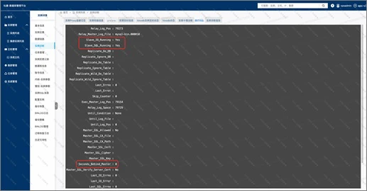

**实例只读性检查**

1. 登录云数据库统一运维平台·杜康。

2. 在**实例管理 > 实例列表**页面，单击目标实例名称。

3. 在左侧导航栏，选择**实例诊断**，单击右侧**执行SQL**页签。

4. 在页面下方，分别选择**主库**、**备库**，在命令框中输入以下命令，单击**执行**，查看输出结果。

   ```text
   show variables like 'read_only';
   ```

5. 如果主库查询该参数为"OFF"，备库查询为"ON"，则表明符合预期；如果检查结果不符合预期，请联系阿里云技术支持。

**实例小版本检查**

1. 登录云数据库统一运维平台·杜康。

2. 在**实例管理 > 实例列表**页面，单击目标实例名称。

3. 在左侧导航栏，选择**实例诊断**，单击右侧**执行SQL**页签。

4. 在页面下方，分别选择**主库**、**备库**，在命令框中输入以下命令，单击**执行**，查看输出结果，从而获取主库和备库的小版本号及内核版本号。

   ```text
   show variables like 'rds_release_date'; 
   select version();
   ```

<a id="section-3-3-3-3"></a>

#### 3.3.3.3. 实例诊断

云数据库统一运维平台·杜康的实例诊断功能提供全方位的数据库健康检查与性能分析服务。支持实时监控实例资源水位、性能指标及引擎内部状态，助力运维人员精准定位性能瓶颈、高效排查异常故障及优化实例配置，全面提升数据库运维效率与稳定性。

**使用场景**

- 性能瓶颈分析：当实例出现CPU飙升、IOPS饱和或内存使用率过高时，可用于定位资源水位瓶颈，识别异常消耗源。

- 异常故障排查：当实例出现连接数激增、主备延迟异常或请求响应变慢时，可用于快速定位故障根因，缩短故障处理修复时间（MTTR）。

- SQL优化：当业务反馈慢查询、需要识别高消耗语句时，可用于获取慢SQL列表及优化建议。

- 紧急运维操作：需要在控制台直接执行诊断类SQL或查看底层引擎状态时，可直连实例执行特定诊断指令。

**操作步骤**

1. 登录云数据库统一运维平台·杜康。

2. 在左侧导航栏中，选择**实例管理** > **实例列表**。

3. 在实例列表中找到目标实例，然后单击对应的**用户实例名**。

4. 在**实例详情**导航栏中选择**实例诊断**，您可根据诊断需求，切换至下方对应的功能页签查看数据或执行操作。

   > **说明**
   >
   > 不同数据库引擎的诊断能力存在差异，实际展示的功能页签请以控制台页面为准。下文展示以PolarDB MySQL为例。

   | 功能模块 | 功能说明 |
   | --- | --- |
   | 实例Proxy连接日志 | 展示通过Proxy层连接实例的日志信息。 |
   | 实例Maxscale日志 | 展示通过Maxscale层连接实例的日志信息。<br>说明请根据实际支持情况查看Proxy连接日志或Maxscale日志相关信息。 |
   | 实例性能信息 | 展示实例核心性能指标的趋势图。<br>• 支持时间区间：15 分钟、3 小时、6 小时、12 小时、1 天、2 天或自定义。<br>• 支持查看的指标项：磁盘空间详情、磁盘利用率、CPU利用率、IOPS利用率等。<br>说明支持的指标项较多，具体展示指标以控制台实际配置为准。 |
   | 实例实时信息 | 查看实例的连接数趋势。 |
   | Innodb实例实时状态 | 通过直连用户实例获取状态，可自定义间隔时间（秒）。 |
   | Innodb状态 | 通过直连用户实例执行<code> SHOW ENGINE INNODB STATUS </code>命令获取Innodb状态信息。用于深度分析死锁、事务等待等底层问题，可自定义间隔时间（秒）。 |
   | 实例卡慢诊断 | 自动分析实例内的慢SQL及卡顿问题，提供优化建议，可自定义时间区间查询。 |
   | 执行SQL | i. 配置SQL执行位置：<strong>主库</strong>或<strong>备库</strong>，并配置目标数据库和最大返回行数。ii. 输入执行SQL并单击<strong>执行</strong>按钮。<br>重要<br>• 执行SQL有风险，可能导致故障，请谨慎操作。<br>• 执行SQL不支持回车，只能执行单行语句。<br>• PolarDB子实例需要切换到主库执行。 |

<a id="section-3-3-3-4"></a>

#### 3.3.3.4. 实例重启

云数据库统一运维平台·杜康支持对多种数据库实例执行重启操作，以应对服务异常、配置生效或维护需求。

**注意事项**

- **功能覆盖范围**：实例重启功能适用于绝大多数数据库实例类型（如RDS、PolarDB、AnalyticDB等），但仅AnalyticDB实例支持“冷/热重启策略”及“节点选择”等高级配置。

- **服务中断**：重启期间实例将短暂不可用，请避开业务高峰期操作。

**操作步骤**

1. 登录云数据库统一运维平台·杜康。

2. 在左侧导航栏，单击**实例管理 > 实例列表**。

3. 单击**用户实例名**进入实例详情页，向下滚动至页面底部，单击**重启实例**。

   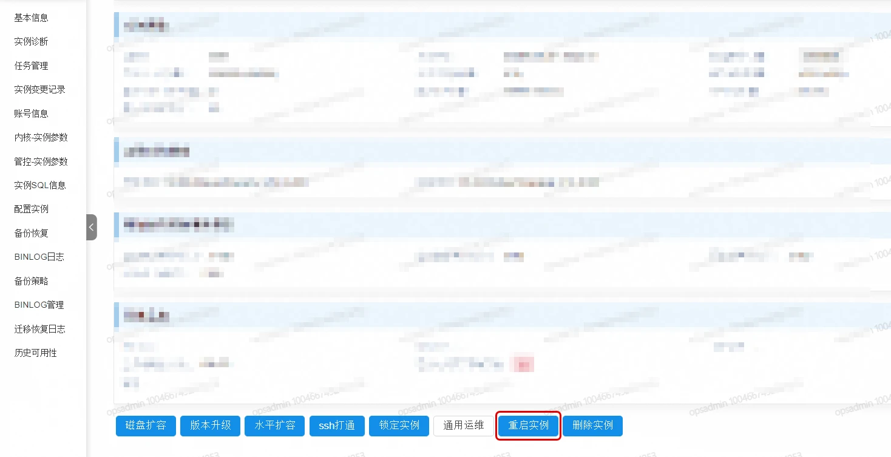

4. 二次确认或配置重启策略，单击**确定**。本文以 `analyticdb` 为例介绍重启页面。

   > **说明**
   >
   > 数据库类型不同，页面所展示/支持的重启策略不同，具体以页面展示为准。

   <table>
     <tr>
       <th width="89">配置项</th>
       <th>说明</th>
     </tr>
     <tr>
       <td>重启策略</td>
       <td>• <strong>热启动</strong>：仅重启容器内进程，保留原有容器环境，类似<code> docker restart </code>。适用于快速恢复进程异常，中断时间短。<br>• <strong>冷启动</strong>：销毁并重建容器，重置运行环境，类似<code> docker rm &amp;&amp; docker run </code>。适用于解决容器环境污染或深层状态异常，中断时间较长。</td>
     </tr>
     <tr>
       <td>并发数</td>
       <td>控制同时执行重启的节点数量。值越小，对业务影响越低但总耗时越长；值越大，并行度高但瞬时负载压力大。建议根据业务容忍度配置。</td>
     </tr>
     <tr>
       <td>主机实例</td>
       <td>列出当前实例下的所有计算节点。可按需勾选部分节点进行滚动重启（例如仅重启异常节点），避免全量重启影响整体服务。</td>
     </tr>
   </table>

   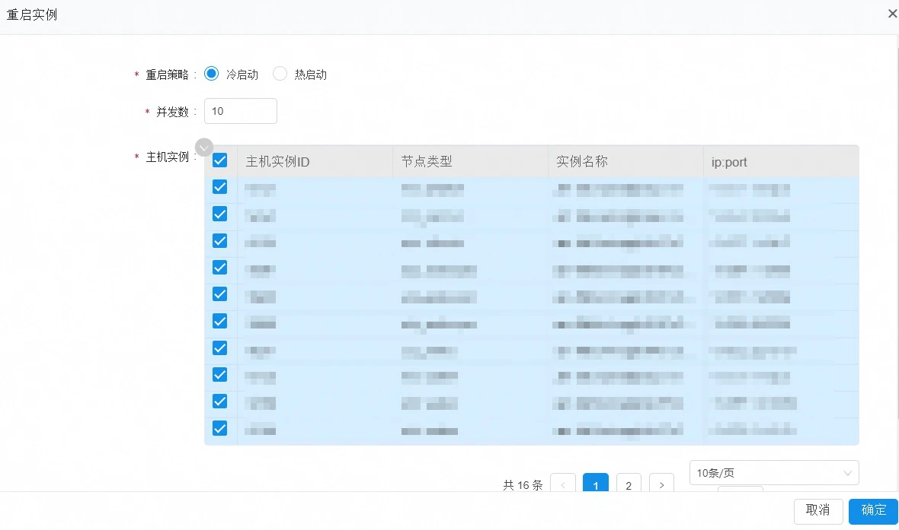

<a id="section-3-3-3-5"></a>

#### 3.3.3.5. 实例迁移

云数据库统一运维平台·杜康支持对实例执行跨可用区或跨子域迁移操作。迁移可用于资源调度、容灾演练、硬件升级等场景，支持主实例、备实例（Standby）及只读实例（RO）的迁移配置。

**操作前准备**

- 执行迁移提交前，建议先记录当前实例的主机信息。

- 检查待迁移的物理实例（即实际运行的主/备/只读节点）、物理实例所属的逻辑实例是否存在运行中或异常中断的任务。若存在此类任务，务必先完成处理或清理后再进行迁移。

**操作步骤**

1. 登录云数据库统一运维平台·杜康。

2. 在左侧导航栏，单击**实例管理 > 实例列表**。

3. 单击**用户实例名**进入实例详情页，找到迁移入口：

   > **说明**
   >
   > 不同数据库引擎的入口展示可能略有差异，请以实际页面为准。

   - 迁移入口一：

     在**基本信息**页面，向下滚动至页面底部，单击**迁移**按钮。

   - 迁移入口二：

     <ol type="a">

     <li>

     在**基本信息**页面，找到**子实例信息**区域，在该区域单击standby实例（备节点实例）ID或ro实例（只读实例）ID，进入子实例详情页。本文以迁移到standby实例为例演示。

     </li>

     <li>

     向下滚动至页面底部，单击**迁移**按钮。

     </li>

     </ol>

4. 配置迁移目标，单击**提交**。

   > **说明**
   >
   > - 不同数据库引擎的迁移配置项可能略有差异，请以实际页面为准。
   >
   > - VPC实例（专有网络类型实例）不支持随机可用区。
   >
   > - 跨可用区迁移时vSwitchID必填。
   >
   > - 主可用区模式下，主备节点必须在同一区域下。
   >
   > - 售卖实例只能迁移到售卖子域，内部实例只能迁移到ODBS子域。

   

   | 配置项 | 说明 |
   | --- | --- |
   | VIP切换时间 | • <strong>运维时间切换</strong>：在预设维护窗口执行，可在实例详情页<strong>基本信息</strong>页面的<strong>运维时间信</strong><strong>息</strong>区域设置。<br>• <strong>立即切换</strong>：即时生效，可能影响业务。<br>• <strong>指定时间</strong>：自定义切换时间点，需配置。 |
   | 磁盘类型 | 按需选择即可，允许不指定磁盘类型。可指定的磁盘类型包括：<br>• SSD<br>• SATA<br>• 混合存储 |
   | 地区 | 必须与原实例一致，可选项有限，请以控制台显示为准。 |
   | 子域 | 选择目标子域。 |
   | 迁移原因 | 填写迁移理由，便于审计与工单追踪。 |
   | 是否与源实例主副本强制对齐内核小版本 | 控制目标主机内核小版本的行为：<br>• <strong>是</strong>（强制对齐）：严格要求目标主机拥有与源实例完全一致的内核小版本。若缺失则迁移失败，建议提前确认目标主机版本是否已就绪。<br>• <strong>否</strong>（智能适配）：优先尝试匹配源版本；若目标主机缺失该版本，则自动使用目标主机上最新有效的小版本。<br>说明若被迁移实例是只读实例，则该只读实例的源实例为对应主实例。 |
   | 指定主机 | • 勾选目标主机：手动指定迁移到特定物理主机，成功率会降低。<br>• 不勾选目标主机（推荐）：由资源管理器自动分配最优主机，成功率较高。<br>说明单击说明部分的“排除主机原因”，可展示物理机被排除在可选主机列表之外的详细原因。 |

**查看迁移任务进度**

单击**提交**后，页面将自动跳转到任务管理**任务管理 > 迁移任务**页面，可在该页面查看迁移进度。

**查看迁移前后主机信息**

访问实例详情页的**基本信息**页面，在**主机实例信息**区域，查看迁移前后的主机ID等信息。

<a id="section-3-3-3-6"></a>

#### 3.3.3.6. 小版本升级

云数据库统一运维平台·杜康支持对数据库实例进行安全、可控的内核小版本升级。此类升级通常包含性能优化、新功能特性引入及已知问题修复，可用于保障数据库稳定高效运行。

**前提条件**

目标实例必须为“非临时实例”，且需同时满足“使用中”和“未被锁定”状态。

**注意事项**

- 若不指定目标版本号，系统将默认执行升级至该系列下的最新小版本。

- 升级内核小版本会重启实例，PolarDB MySQL服务可能会出现一次30秒的闪断，请您尽量在业务低峰期执行升级操作，或确保您的应用有自动重连机制。

- 内核小版本一旦升级成功，不支持降级回退至旧版本，请务必谨慎操作。

**操作步骤**

1. 登录云数据库统一运维平台·杜康。

2. 在左侧导航栏中，选择**实例管理** > **实例列表**。

3. 在实例列表中找到目标实例，并单击对应的**用户实例名**进入实例详情页。

4. 在**基本信息**页面的底部单击**版本升级**按钮，自定义配置如下参数，单击**提交**。

   > **说明**
   >
   > 本文以PolarDB MySQL主备版小版本升级为例演示。不同数据库类型的配置项及界面展示可能存在差异，请以实际控制台页面为准。

   <table>
     <tr>
       <th width="105">配置项</th>
       <th>说明</th>
     </tr>
     <tr>
       <td>数据库版本</td>
       <td>显示当前实例所属的大版本，系统仅支持在同一大版本下进行小版本升级。</td>
     </tr>
     <tr>
       <td>小版本号</td>
       <td>选择目标小版本，右侧将自动显示当前实例小版本以供对比。</td>
     </tr>
     <tr>
       <td>指定方式</td>
       <td>• <strong>运维时间切换</strong>：在预设维护窗口执行，可在实例详情页<strong>基本信息</strong>页面的<strong>运维时间信息</strong>区域设置。<br>• <strong>立即切换</strong>：即时生效，可能影响业务。<br>• <strong>指定时间</strong>：自定义切换时间点，需配置。</td>
     </tr>
   </table>

**查看升级进度**

升级任务发起后，可前往**任务管理**页面查看升级进度。

<a id="section-3-3-3-7"></a>

#### 3.3.3.7. 实例参数管理

云数据库统一运维平台·杜康支持手动配置实例内核参数及查看管控参数列表，可用于信息查询或故障排查场景。

> **说明**
>
> 不同引擎实例提供的实例参数管理能力存在差异，请以杜康控制台上的实际情况为准。

**内核-实例参数**

1. 登录云数据库统一运维平台·杜康。

2. 在左侧导航栏中，选择**实例管理 > 实例列表**。

3. 单击目标用户实例名，页面将跳转至**基本信息**页面。

   > **说明**
   >
   > 您可以通过在搜索框中输入关键词快速查询目标实例，也可以单击高级搜索以定制过滤条件，精准定位目标实例。

4. 在左侧导航栏单击**内核-实例参数**，该页面不同页签下支持的能力如下：

   > **重要**
   >
   > 若修改的参数需重启实例才能生效，建议您在业务低峰期操作，并确保应用程序具有重连机制。

   | 分类 | 描述 | 是否可修改 | 是否需重启实例才会生效 |
   | --- | --- | --- | --- |
   | 只读参数 | 不支持修改的参数，不同版本、形态的只读参数可能不同。 | 否 | 不涉及 |
   | 读写参数（不会重启数据库） | 支持修改，需符合取值范围校验，以控制台页面取值范围为准。 | 是 | 否 |
   | 读写参数（会自动重启数据库） | 支持修改，需符合取值范围校验，以控制台页面取值范围为准。 | 是 | 是 |
   | 正在同步的参数 | 处于下发中或未完全生效的历史参数记录，当前实例不会应用该状态下的参数。 | 不涉及 | 不涉及 |
   | 参数修改历史 | 参数修改记录查询。 | 不涉及 | 不涉及 |

**管控-实例参数**

1. 登录云数据库统一运维平台·杜康。

2. 在左侧导航栏中，选择**实例管理 > 实例列表**。

3. 单击目标用户实例名，页面将跳转至**基本信息**页面。

   > **说明**
   >
   > 您可以通过在搜索框中输入关键词快速查询目标实例，也可以单击高级搜索以定制过滤条件，精准定位目标实例。

4. 在左侧导航栏单击**管控-实例参数**。

   在**管控-实例参数**页面，您可以查看相关参数列表，包括**参数名**、**参数值**以及**修改人**信息。

<a id="section-3-3-3-8"></a>

#### 3.3.3.8. 规格变更

本文为您介绍如何进行规格变更，帮助您解决问题。

**前置检查**

在执行规格变更前，请务必完成以下自查：

- 实例状态确认：确保实例处于“运行中”状态，且无其他正在执行的任务（如备份、迁移、重启等）。

- 数据备份建议：建议在操作前手动创建一次临时快照或全量备份，以便在异常情况下快速恢复。

**注意事项**

- 务必在业务低峰期操作，变更过程中可能会出现5-30秒的连接闪断。务必确保应用程序具备自动重连机制，避免业务报错。

- 建议保持“强制对齐内核小版本”默认选项，防止集群内节点版本不一致引发兼容性问题。

- 若目标规格不可选，必须单击“排除规格原因”查看具体限制，切勿盲目尝试。

- 变更后需实时监控任务进度直至完成，一旦任务中断或长时间停滞，应立即联系阿里云技术支持。

- 严格执行审核流程，仔细核对变更前后CPU、内存及磁盘数值，防止因误操作导致资源浪费或服务降级。

**适用场景**

- 性能扩容：应对业务增长或突发流量，解决CPU/内存瓶颈导致的响应慢、排队长等问题。

- 成本优化：针对低负载或非核心环境，通过降配释放闲置资源以降低运维成本。

- 存储扩容：当磁盘使用率触及警戒线时，紧急扩容存储空间以防写入锁定或服务中断。

- 版本治理：借变配之机强制对齐内核小版本，消除集群内节点版本不一致带来的兼容性与稳定性隐患。

- 故障修复：在实例迁移或高可用切换后，修正目标节点规格以恢复标准配置或统一集群架构。

**操作步骤**

1. 登录云数据库统一运维平台·杜康。

2. 在**实例管理 > 实例列表**页面，单击目标实例名称。

3. 在基本信息页中，单击页面下方**规格变更**按钮。

   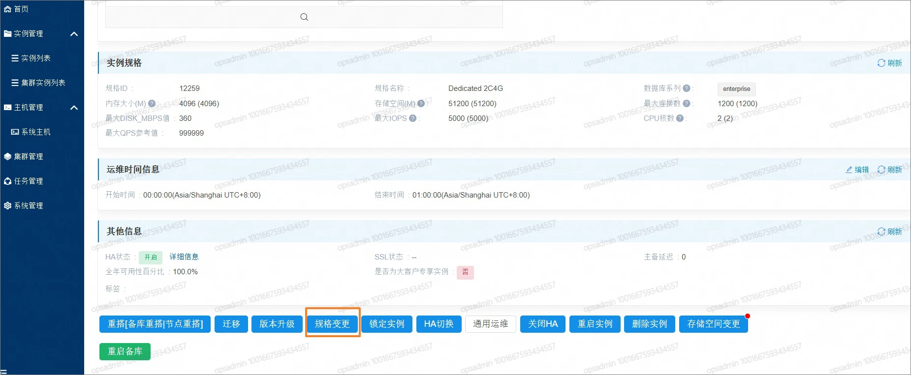

4. 在变更页面，选择是否对齐内核小版本并填写**存储空间（GB）**、**实例规格**、**切换模式**和**变更原因**等信息，单击**下一步**。

   > **说明**
   >
   > 如发生迁移是否与源实例主副本强制对齐内核小版本：
   >
   > - 是：强制不在目标主机使用其他小版本，若目标主机缺少可与主副本一致的内核小版本，将会导致变配失败，建议参考杜康运维手册提前手动补齐目标主机的内核小版本。小版本升级，请参见小版本升级。
   >
   > - 否：优先在目标主机使用与实例主副本一致的内核小版本，如在目标主机上缺少与实例主副本一致的内核小版本，则使用目标主机上最新有效小版本。

5. 填写**审核意见**后，确认无误，单击**审核变更**。

6. 操作完成后，可在**任务管理**查看任务进度，直至任务完成。如果发现任务中断，请联系阿里云技术支持。查看任务进度操作，请参见实例任务管理。

<a id="section-3-3-3-9"></a>

#### 3.3.3.9. 存储空间变更

本文为您介绍如何进行存储空间变更操作，帮助您快速解决问题。

**注意事项**

- 主实例状态为运行中，且无未完成的变更任务（如升级、迁移、备份中）。

- 建议在业务低峰期操作，规避极端网络波动风险。

- 缩容后的存储空间值不能小于实例当前已使用存储空间+20GiB。

- 变更针对集群逻辑实例生效，修改主实例存储配置将同步应用于该集群下所有只读及备节点，请谨慎操作。

**使用场景和预解决的问题**

**存储升配（扩容）**

- 应对业务增长：当业务数据量快速增加，磁盘使用率接近阈值（如 80%），需紧急扩容以避免数据库因空间满而进入“只读”状态或服务中断。

- 预留缓冲空间：在预计有大促活动、批量数据导入或历史数据归档前，提前扩容以预留足够的写入缓冲。

- 解除性能限制：在某些场景下，更大的存储配额可能关联更高的 IOPS 上限（视具体实例规格策略而定），从而提升吞吐能力。

**存储降配（缩容）**

- 成本优化：当业务数据经过清理（如删除大表、归档历史数据）后，实际用量远低于当前配额，通过降配释放闲置资源，直接降低月度账单。

- 修正过度配置：纠正项目初期因预估不准导致的资源浪费，将存储调整至与实际业务匹配的水位。

**操作步骤**

1. 登录云数据库统一运维平台·杜康。

2. 在**实例管理 > 实例列表**页面，单击目标实例名称。

3. 在基本信息页中，单击页面下方**存储空间变更**按钮。

   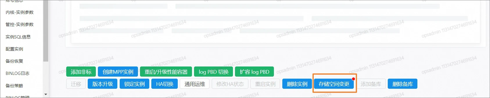

4. 在弹框中填写目标存储空间大小，单击**提交**。

**查看任务详情**

1. 登录云数据库统一运维平台·杜康。

2. 在**实例管理 > 任务列表**页面，您可以查看任务执行的详细状态。

   > **说明**
   >
   > - 支持查看所有任务、中断任务、暂停任务等多种任务状态的详情。
   >
   > - 支持自定义列表项，您可根据需要自定义想要查看的任务字段。

<a id="section-3-3-3-10"></a>

#### 3.3.3.10. HA切换

本文为您介绍如何手动完成HA切换，帮助您快速解决问题。

**背景信息**

正常情况下，当主节点发生故障时，系统会自动进行HA切换以恢复服务。而手动HA切换通常用于主动运维场景，即在不等待故障发生的情况下，人为地将流量从当前的主节点转移到备节点，使原备节点晋升为新主节点。

**前置检查**

在执行手动HA切换前，请务必确认以下事项：

- 实例状态检查：确保目标实例处于“运行中”状态，且当前无其他正在执行的操作（如规格变更、重启、备份恢复等）。

- 主备同步状态：必须确认备节点数据同步正常。确保延迟时间为0或在允许的范围内（通常建议<1秒）。若备节点同步滞后，强制切换可能导致数据丢失。

- 备节点健康度：确认备节点所在宿主机资源充足，网络连通性正常，无硬件告警。

**注意事项**

- 建议在业务低峰期操作，并确保有完善的自动重连机制，规避极端网络波动风险。

- 切换完成后需实时监控任务进度直至完成，一旦任务中断或长时间停滞，应立即联系阿里云技术支持。

- 建议等待主备数据同步完成后，再执行切换操作。

**适用场景**

- 底层资源维护/升级：当主节点的物理机、宿主机或存储设备需要进行停机维护、固件升级或迁移时，先手动切换业务至备节点，避免业务中断。

- 故障隐患消除：监控发现当前主节点存在硬件问题或网络抖动等，但未完全宕机，主动切换至健康的备节点以规避风险。

**操作步骤**

1. 登录云数据库统一运维平台·杜康。

2. 在**实例管理 > 实例列表**页面，单击目标实例名称。

3. 在基本信息页中，单击页面下方**HA切换**按钮。

4. 确认主备信息无误后，选择**切换方式**和**指定方式**，单击提交。

   > **说明**
   >
   > - 立即切换：用于紧急避险。
   >
   > - 运维时间切换：适合纳入日常运维窗口（如每天凌晨等），由系统自动执行。
   >
   > - 指定时间点切换：适合配合特定的变更窗口（如配合应用发布等）。

5. 操作完成后，可在**任务管理**查看任务进度，直至任务完成。如果发现任务中断，请联系阿里云技术支持。查看任务进度操作，请参见实例任务管理。

**结果验证**

- 上文步骤4中主备节点的IP与端口信息发生了互换。

- HA任务流正常跑完。

**回滚方案**

根据操作步骤重新操作一遍，再次将主备节点进行互换。

<a id="section-3-3-3-11"></a>

#### 3.3.3.11. 锁定实例

本文为您介绍如何锁定实例，帮助您解决问题。

**注意事项**

- 务必在业务低峰期操作，并确保应用程序具备自动重连机制，以应对可能出现的问题。

- 磁盘满锁必须先清理空间或扩容，回滚锁严禁强行重启，必须解决根本问题（如水位过高、变更失败）后方可尝试解锁。

- 提交后需全程值守观察进度，若任务中断或卡死，严禁盲目重试，应立即联系阿里云技术支持介入防止死锁。

- 实例锁定后将变为只读状态并影响业务，请务必在运维窗口内实施该操作，并注意执行风险。

**适用场景**

本章节仅列举部分适用场景供参考，其他场景请根据实际情况处理。

- 业务下线“冷静期”验证：删除实例前先执行手动锁，设置7天以上观察期，确认无隐蔽依赖或业务投诉后再彻底删除，防止误删生产数据。

- 紧急故障隔离与止损：遭遇恶意攻击、异常 SQL 消耗或数据篡改时，立即手动锁切断所有连接，阻止故障扩散并为排查争取时间。

- 资源耗尽自我保护：当磁盘写满或硬件故障时，系统自动触发磁盘满锁或迁移锁，防止元数据损坏并确保数据强一致性。

- 高风险变更回滚保护：规格变更或升级失败时，系统自动触发回滚锁冻结实例状态，防止数据处于不一致的“中间态”。

**操作步骤**

1. 登录云数据库统一运维平台·杜康。

2. 在**实例管理 > 实例列表**页面，单击目标实例名称。

3. 在基本信息页中，单击页面下方**锁定实例**按钮。

4. 选择**锁模式**和**锁定原因**，单击**提交**。

5. 操作完成后，可在**任务管理**查看任务进度，直至任务完成。如果发现任务中断，请联系阿里云技术支持。查看任务进度操作，请参见实例任务管理。

<a id="section-3-3-3-12"></a>

#### 3.3.3.12. 备份与恢复

云数据库统一运维平台·杜康支持自动化策略配置、手动临时备份及多维度恢复（按备份集、按时间点）能力。通过全量、增量和日志备份机制，在误操作、硬件故障或逻辑损坏场景下，可满足严格的RPO（恢复点目标）与RTO（恢复时间目标）要求。

**注意事项**

- 下载限制：杜康控制台暂不支持直接下载备份集文件。如需离线归档或本地恢复，请登录ASCM（Apsara Uni-manager）运营控制台进行下载操作。

- 恢复耗时：数据恢复时长受实例规格、数据量大小、网络带宽及集群负载等多重因素影响，请在业务低峰期执行并耐心等待。

**日志备份的作用**

是否开启日志备份决定了数据恢复的粒度：

| 配置状态 | 恢复能力 | 适用场景 |
| --- | --- | --- |
| 未开启日志备份 | 仅支持按备份集恢复。只能将数据回滚到最近一次全量/增量备份完成的时间点。 | 对数据一致性要求不高，或可接受少量数据丢失的场景。 |
| 开启日志备份 | 支持按时间点恢复（PITR）。可将数据精确恢复至日志保留周期内的任意秒级时间点。 | 生产环境核心业务，需应对误删表、误更新等精细操作失误。 |

**备份策略管理**

**查看备份策略**

1. 登录云数据库统一运维平台·杜康。

2. 在左侧导航栏中，选择**实例管理** > **实例列表**。

3. 在实例列表中找到目标实例，然后单击对应的**用户实例名**。

4. 在**实例详情**导航栏中选择**备份策略**，在该页面查看数据备份策略和日志备份策略。

**修改数据备份策略**

1. 登录云数据库统一运维平台·杜康。

2. 在左侧导航栏中，选择**实例管理** > **实例列表**。

3. 在实例列表中找到目标实例，然后单击对应的**用户实例名**。

4. 在**实例详情**导航栏中选择**备份策略**，单击**修改备份策略**，阅读告警提示并单击**确认**。

5. 在弹出的对话框中，修改如下配置项并单击**确定**。

   | 配置项 | 说明 |
   | --- | --- |
   | 备份保留天数 | 备份集的保留周期。默认7天，按需设置（如30天），过期自动清理。 |
   | 备份级别 | 支持一般、中、高，按需配置。 |
   | 备份时间 | 按需修改，建议业务低峰期，例如06:00。 |
   | 备份周期 | 可设置为一星期中的某几天。为了数据安全，一周需至少备份两次。 |
   | 备份不落地 | • 关闭<br>• 仅数据不落地 |
   | 备份压缩 | 备份压缩方式，按需修改。 |
   | 压缩并行度 | 控制备份进程的并发线程数，按需修改。 |

**修改Binlog日志备份策略**

1. 登录云数据库统一运维平台·杜康。

2. 在左侧导航栏中，选择**实例管理** > **实例列表**。

3. 在实例列表中找到目标实例，然后单击对应的**用户实例名**。

4. 在**实例详情**导航栏中选择**备份策略**，滑动到页面底部单击**修改BINLOG备份策略**。

5. 在弹出的对话框中，修改如下配置项并单击**提交**。

   <table>
     <tr>
       <th width="184">配置项</th>
       <th>说明</th>
     </tr>
     <tr>
       <td>上传方式</td>
       <td>• 不上传<br>• 上传<br>• 秒级上传</td>
     </tr>
     <tr>
       <td>本地清理方式</td>
       <td>• 不清理<br>• 清理</td>
     </tr>
     <tr>
       <td>上传压缩</td>
       <td><br>选择<code> </code>不压缩<code> </code>、<code> zlib </code>或<code> lz4</code>压缩<code> </code>。开启压缩可节省带宽和远端存储，但可能增加本地CPU开销。</td>
     </tr>
     <tr>
       <td>日志备份</td>
       <td>• <strong>关闭</strong>：关闭日志备份会导致所有日志备份被清除，并且无法使用按时间点恢复数据的功能。<br>• <strong>开启</strong>：启用日志备份功能。</td>
     </tr>
     <tr>
       <td>远端存储保留天数</td>
       <td>定义日志在远端存储的保留时长，超出部分自动清理。</td>
     </tr>
     <tr>
       <td>本地保留时间</td>
       <td>备份保留时长超过设定的保留时长。超过保留时长的本地日志（Binlog）文件，当被备份后（需开启日志备份功能），会被自动清理。</td>
     </tr>
     <tr>
       <td>本地保留空间</td>
       <td>监控本地Binlog目录占总磁盘空间的占比（%）。</td>
     </tr>
     <tr>
       <td>本地保留个数</td>
       <td>日志文件数超过设置的文件保留个数。自动删除最早的本地日志（Binlog）文件，直至本地日志文件数低于设定的文件保留个数。</td>
     </tr>
     <tr>
       <td>磁盘空间严重警告阈值</td>
       <td>当本地Binlog占用空间超过该百分比时，触发严重告警。</td>
     </tr>
     <tr>
       <td>磁盘过高清理</td>
       <td>• <strong>开启</strong>：磁盘极度紧张时，强制清理旧日志以保实例运行（可能导致无法恢复早期时间点）。<strong>关闭</strong>：磁盘满时可能导致实例挂起。</td>
     </tr>
   </table>

**重载Binlog日志备份策略**

当修改策略未同步至底层Agent时，可手动触发重载。

1. 登录云数据库统一运维平台·杜康。

2. 在左侧导航栏中，选择**实例管理** > **实例列表**。

3. 在实例列表中找到目标实例，然后单击对应的**用户实例名**。

4. 在**实例详情**导航栏中选择**备份策略**，滑动到页面底部单击**重载BINLOG备份策略**，单击**确定**。

**清理Binlog日志**

1. 登录云数据库统一运维平台·杜康。

2. 在左侧导航栏中，选择**实例管理** > **实例列表**。

3. 在实例列表中找到目标实例，然后单击对应的**用户实例名**。

4. 在**实例详情**导航栏中选择**BINLOG管理**，在**Binlog备份策略**页签下，单击右上角的**清理日志**按钮。

**创建临时备份**

> **重要**
>
> 临时备份有效期仅保留18小时，超时自动失效需重新发起。

1. 登录云数据库统一运维平台·杜康。

2. 在左侧导航栏中，选择**实例管理** > **实例列表**。

3. 在实例列表中找到目标实例，然后单击对应的**用户实例名**。

4. 在**实例详情**导航栏中选择**备份策略**，单击**创建临时备份**，阅读告警提示并单击**确定**。

5. 在弹出的对话框中，修改如下配置项并单击**确定**。

   | 配置项 | 说明 |
   | --- | --- |
   | 备份类型 | • <strong>AUTO</strong>：系统判断<br>• <strong>FULL</strong>：全量备份 |
   | 备份方法 | • 备库物理备份<br>• 主库物理备份 |
   | 备份时间 | 可精确到分钟级别。 |

**数据恢复操作**

**按备份集恢复数据**

将实例数据恢复至某个已完成备份集的时间点。

> **重要**
>
> 执行恢复前，实例必须至少有一个“成功”且“有效”（可在备份列表的“**是否有效**”列查看）的备份集。无效或损坏的备份集无法用于恢复。若当前无可用备份集，请先执行 “创建临时备份” 操作生成。

1. 登录云数据库统一运维平台·杜康。

2. 在左侧导航栏中，选择**实例管理** > **实例列表**。

3. 在实例列表中找到目标实例，然后单击对应的**用户实例名**。

4. 在**实例详情**导航栏中选择**备份恢复**，单击目标备份集操作列下的按**备份集恢复**按钮。

5. 阅读页面备份集信息，配置如下信息，单击**提交**。

   | 配置项 | 说明 |
   | --- | --- |
   | 保留实例 | 按需勾选是否保留当前实例。对于专享型实例的恢复，可选择保留当前实例或替换当前实例（覆盖性恢复）。<br>• 保留当前实例：用户实例的当前数据不影响，系统将产生一个子实例，用来恢复用户所期望的备份数据。该子实例只读状态，默认保留2天，过期系统自动删除。<br>• 替换当前实例：用户实例的当前数据丢失，回滚到用户所期望的备份数据。 |
   | 跨集群分配 | 按需勾选是否跨集群分配。当本集群无资源分配时，可向同一个数据中心的其他集群申请资源。需注意，若使用VIP访问实例，恢复后可能需重新绑定或修改VIP配置。 |
   | 网络类型（<strong>私网</strong>/<strong>公</strong><strong>网</strong>） | 按需勾选网络类型。 |

**按时间点恢复数据**

> **重要**
>
> 按时间点恢复时，需确保：
>
> - 日志备份已开启。
>
> - 存在有效全量类型的备份集，且两个全量备份之间未发生过覆盖性恢复。
>
> - 目标时间点必须在日志保留周期内。

1. 登录云数据库统一运维平台·杜康。

2. 在左侧导航栏中，选择**实例管理** > **实例列表**。

3. 在实例列表中找到目标实例，然后单击对应的**用户实例名**。

4. 在**实例详情**导航栏中选择**备份恢复**，单击页面上方的**恢复到时间点**按钮。

5. 在弹出的对话框中阅读高危提示，单击**确定**。

6. 在弹出的对话框中，配置如下信息，单击**提交**。

   <table>
     <tr>
       <th width="192">配置项</th>
       <th>说明</th>
     </tr>
     <tr>
       <td>恢复时间点</td>
       <td>支持选择到秒级别。</td>
     </tr>
     <tr>
       <td>跨集群分配</td>
       <td>按需勾选是否跨集群分配。当本集群无资源分配时，可向同一个数据中心的其他集群申请资源。需注意，若使用VIP访问实例，恢复后可能需重新绑定或修改VIP配置。</td>
     </tr>
     <tr>
       <td>网络类型（<strong>私网</strong>/<strong>公网</strong>）</td>
       <td>按需选择网络类型。</td>
     </tr>
   </table>

**查看备份历史**

**数据备份历史**

1. 登录云数据库统一运维平台·杜康。

2. 在左侧导航栏中，选择**实例管理** > **实例列表**。

3. 在实例列表中找到目标实例，然后单击对应的**用户实例名**。

4. 在**实例详情**导航栏中选择**备份恢复**，在该页面中可查看数据备份历史。

**Binlog日志备份历史**

1. 登录云数据库统一运维平台·杜康。

2. 在左侧导航栏中，选择**实例管理** > **实例列表**。

3. 在实例列表中找到目标实例，然后单击对应的**用户实例名**。

4. 在**实例详情**导航栏中选择**BINLOG管理**，在**备份历史**页签下，查看Binlog日志备份历史。

<a id="section-3-3-3-13"></a>

#### 3.3.3.13. 备库重搭

当备库发生异常时，您可以执行备库重搭操作，保障主备高可用架构的持续性。

**使用场景**

一般在以下情况下需要备库重搭：

- 备库出现故障，无法正常提供服务；

- 备库数据损坏，导致主从数据不一致或同步中断；

- 需要更换备库所在服务器（如硬件升级、迁移、资源调整等）。

**注意事项**

- 备库重搭操作不影响主库操作，对线上业务无影响。

- 如果是主备库不一致而重搭，请先**主动下发主库备份**，以防止备库备份失效，主库备份操作尽量在业务低峰期进行。您可在**实例详情 > 备份策略**页面，单击**创建临时备份**，详情请参见备份与恢复。

**操作步骤**

1. 登录云数据库统一运维平台·杜康。

2. 在左侧导航栏中，选择**实例管理 > 实例列表**。

3. 单击目标用户实例名，页面将跳转至**基本信息**页面。

   > **说明**
   >
   > 您可以通过在搜索框中输入关键词快速查询目标实例，也可以单击高级搜索以定制过滤条件，精准定位目标实例。

4. 在页面底部，单击**重搭[备库重搭|节点重搭]**。

5. 在弹出的对话框中，按照指引完成所需设置，相关配置项如下表所示，具体请以控制台界面为准。

   | 配置项 | 说明 |
   | --- | --- |
   | 是否强制主库备份 | 默认不勾选。您可主动选择是否要求任务流必须从主实例所在的物理主机（而非备库所在主机）发起备份操作，即备份集必须由主库生成。<br>说明在备库实例或所在主机出现<strong>性能异常</strong>或<strong>访问异常</strong>时，建议勾选<strong>是否强制主</strong><strong>库备份</strong>，避免仍从备库发起备份导致任务流中断或无法完成。 |
   | 选择需要重搭的主机 | 单击选择，需确认所选项的<strong>实例角色</strong>为备库，例如<code> slave </code>。 |
   | 是否与实例主副本强制对齐内核小版本 | 出现该选项时，请根据实际情况进行选择。<br>说明<br>• 选择<strong>是</strong>，将强制不在目标主机使用其他小版本，若目标主机缺少可与实例主副本一致的内核小版本，将会导致重搭失败，建议参考小版本升级文档，提前手动补齐目标主机的内核小版本 。<br>• 选择<strong>否</strong>，将优先在目标主机使用与实例主副本一致的内核小版本，如在目标主机上缺少与实例主副本一致的内核小版本，则使用目标主机上最新有效小版本。 |
   | 选择<strong>本地重搭</strong>或<strong>跨机重搭</strong> | • 如果集群可分配资源充足，建议优先选择<strong>跨机重搭</strong>。<br>• 如果备节点所在物理机操作系统异常或文件系统异常造成只读场景时，必须选择<strong>跨机重搭</strong>。<br>重要此时在发起备库重搭前，应先关停备库实例或关闭异常主机，避免备实例因系统环境异常而干扰任务流步骤的正常执行，造成任务中断且无法绕过。<br>• 如果所选主机集群模式为对机，只能选择<strong>本地重搭</strong>。 |
   | 指定主机 | 如果在上一步选择了<strong>跨机重搭</strong>，可选择指定机房或主机。<br>说明<br>• 一般情况下不需要<strong>指定主机，</strong>迁移交由资源管理器进行最佳调度，更多注意事项可查看控制台界面蓝框内的补充说明。<br>• 单击<strong>排除主机原因</strong>，可查看物理机被排除在可选主机列表之外的详细原因。 |

6. 完成配置后，单击**提交**。

7. 操作完成后，可在**任务管理**查看任务进度，直至任务完成。如果发现任务中断，请联系阿里云技术支持。查看任务进度操作，请参见实例任务管理。

<a id="section-3-3-3-14"></a>

#### 3.3.3.14. 实例任务管理

本文为您介绍查看任务详情的方式，帮助您快速查看任务进度，任务详情等信息。

**查看任务详情**

> **说明**
>
> 根据数据库存储类型不同，实例任务详情查看分为两种：
>
> - Pengine实例任务：面向本地盘架构。
>
> - GrandCanal任务列表：共享存储架构。

**方式一：查看Pengine实例任务详情**

1. 登录云数据库统一运维平台·杜康。

2. 在**实例管理 > 实例列表**页面，单击目标实例名称。

3. 在实例详情内，单击左侧**任务列表**，您可以在任务列表页面查看任务执行的详细状态。

4. 在顶部下拉框中选择任务状态（如**中断的任务**、**运行的任务**等）。

5. （可选）使用快速筛选按钮（**我执行的**、**我创建的**、**我负责的**）或输入实例名过滤。

6. 在任务列表中找到目标任务，单击右侧**操作**列的操作按钮查看完整信息。

**方式二：查看GrandCanal实例任务详情**

1. 登录云数据库统一运维平台·杜康。

2. 在**实例管理 > 实例列表**页面，单击目标实例名称。

3. 在实例详情内，单击左侧**任务列表**，您可以在任务列表页面查看任务执行的详细状态。

4. 在顶部标签页中选择任务状态分类。

5. （可选）按**产品CODE**（如polardb_mysql、redis）、**目标类型**、**工作流ID**等字段搜索或筛选。

6. 在任务列表中找到目标任务，单击右侧**操作**列的**详情**查看完整信息。

   > **说明**
   >
   > - 支持查看所有任务、中断任务、暂停任务等多种任务状态的详情。
   >
   > - 支持自定义列表项，您可根据需要自定义想要查看的任务字段。

<a id="section-3-3-3-15"></a>

#### 3.3.3.15. 关闭实例分配

**背景信息**

在云数据库集群运行过程中，早期部署的存量集群可能因业务长期积累，导致关键资源指标（如 CPU 利用率、内存使用率、连接数）持续处于高水位状态。若继续向这些高负载节点调度新实例，将加剧负载不均，引发性能瓶颈。

**注意事项**

- 操作后需同时检查dbaas库（主机状态）与dukang库（调度任务），确保管控面与数据面状态同步。

- 关闭高水位节点前需确认低水位集群资源充足，避免因可用资源池缩小导致新实例创建失败或业务扩容受阻。

- 涉及多主机批量关闭时，需建立二次确认机制或灰度执行，防止误操作低水位集群导致流量无法写入。

**操作前检查清单**

| 检查项 | 标准/阈值 | 验证方法 |
| --- | --- | --- |
| 目标主机水位 | CPU/内存/连接数 &gt; 阈值 X%（建议 85%）。 | 监控大盘或主机详情页。 |
| 承接集群容量 | 低水位集群剩余资源足以承接预计新增流量。 | 资源报表或容量规划工具。 |
| 业务时段 | 非业务高峰期，无重大变更窗口。 | 运维日历确认。 |
| 双库状态预检 | <code> dbaas </code> 库主机状态正常，<code> dukang </code> 库无异常挂起任务。 | 执行下方SQL验证。 |

**状态基线检查（SQL 示例）**

操作前需记录当前状态，以便操作后对比。

1. 检查dbaas库（主机基础状态）。

   ```text
   -- 登录 dbaas 库
   SELECT id, status, allocatable, cpu_usage, mem_usage 
   FROM hostinfo 
   WHERE id = '<⽬标主机 ID>';
   -- 预期：allocatable 应为 1 (允许分配)
   ```

2. 检查dukang库（调度任务状态）。

   ```sql
   -- 登录 dukang 库
   -- 确认是否存在针对该主机的 pending 状态调度任务
   SELECT * FROM scheduler_tasks 
   WHERE host_id = '<⽬标主机 ID>' AND status = 'pending';
   -- 预期：无记录或记录已处理完毕
   ```

**操作步骤**

1. 登录云数据库统一运维平台·杜康。

2. 本操作支持两种模式，请根据场景选择：

   **单主机精细化控制**

   <ol type="i">

   <li>

   在左侧导航栏单击**主机管理 > 系统主机**，单击**操作**列下的**详情**进入主机详情页面。

   </li>

   <li>

   在主机详情页主机信息页签下，单击**关闭实例分配**。

   </li>

   <li>

   在弹框中选择是否永久关闭实例分配。

   > **说明**
   >
   > - 如果选择**否**，支持设置恢复实例分配的时间，如果不选择时间，默认7天后恢复。
   >
   > - 如果选择**是**，此操作不会自动恢复，需人工手动重新开启。

   </li>

   <li>

   单击**确定**完成。

   </li>

   </ol>

   **多主机批量处理**

   <ol type="i">

   <li>

   在左侧导航栏单击**主机管理 > 系统主机**。

   </li>

   <li>

   在主机列表勾选目标主机，单击右上角**批量配置**。

   </li>

   <li>

   在批量配置参数弹窗，配置相关信息后，单击**提交**。

   </li>

   </ol>

3. 设置完成后，可在主机信息模块下**允许分配实例**处查看是否完成设置。

**回滚操作**

**情况一：临时关闭的提前恢复**

1. 进入主机详情页，单击“开启实例分配”。

2. 验证dukang库中  `system_param_record`  对应任务状态变更为“已完成”或被清除。

**情况二：永久关闭的重新开启**

1. 进入主机详情页，单击 “开启实例分配”。

2. 验证dbaas库  `hostinfo`  表中  `allocatable`  字段已翻转为允许状态。

3. 必须执行测试实例创建，确保调度器能重新识别该节点。

**情况三：误操作紧急恢复（批量误关）**

1. 立即停止后续批量任务。

2. 在主机列表页反向勾选被误关的低水位主机。

3. 执行批量 “开启实例分配”操作。

<a id="section-3-3-4"></a>

### 3.3.4. 其他实例运维

<a id="section-3-3-4-1"></a>

#### 3.3.4.1. RDS MySQL两节点本地盘版升级至PolarDB MySQL主备版

**注意事项**

为确保数据库迁移过程的平滑性与业务稳定性，请在执行迁移前仔细核对以下环境要求、实例状态等信息。

**支持范围与限制汇总**

| 分类 | 检查项 | 不支持/需调整场景说明 | 处理建议 |
| --- | --- | --- | --- |
| 操作系统服务器OS版本 | 搭载非兼容版本OS（如部分旧版定制 OS） | 不支持搭载6U OS的服务器 | 若服务器部署了不兼容的操作系统版本，请先将服务器操作系统升级至推荐版本（如7U 及以上标准Linux发行版）。 |
| 数据库版本 | RDS MySQL 5.6 | 不支持直接迁移。 | 请先将实例版本升级至MySQL 5.7 或 8.0，然后再执行迁移操作。 |
| 实例架构 | RDS MySQL三节点版 | 不支持该架构直接迁移。 | 请先将实例迁移至PolarDB集分一体版，再执行后续操作。 |
| 关联实例 | 存在只读实例的主实例 | 不支持单独切换主实例。 | 主实例及其关联的所有只读实例将作为一个整体群组同时切换至PolarDB，不支持单独切换。 |

**实例健康状态要求**

在发起迁移任务前，请务必确保源RDS MySQL实例处于健康且空闲的状态，以满足数据一致性与系统稳定性的要求：

- 同步状态正常：

  - 主备节点间无同步延迟（主备同步延迟为0）。

  - 若存在只读实例，主实例与所有只读实例间的同步延迟必须为0。

- 资源负载低位：

  - 实例的CPU利用率低于75%。

  - 实例的内存利用率低于75%。

- 无进行中任务：

  - 实例未处于备份、重启、规格变更或其他运维流程中。

**其他建议**

- 连接代理组件适配：

  如果您的业务使用了数据库Proxy集群，建议在迁移前或迁移后将连接代理切换。至MaxScale，以获得更好的兼容性与性能表现。

- 迁移不可逆性说明：

  为保障数据的一致性与长期运行的稳定性，RDS MySQL升级至PolarDB MySQL主备版后，默认不支持回退至原RDS MySQL引擎。请在执行前充分评估业务需求。

- 灰度发布策略：

  - 强烈建议优先在非生产环境（如测试环境、预发环境）进行迁移演练。

  - 在完成充分的业务功能测试、性能压测及兼容性验证后，再安排生产环境业务的正式切换。

- 内核版本统一趋势：

  - 随着产品演进，新建实例及部分存量实例的内核将逐步统一采用PolarDB MySQL内核，以享受更优的性能特性与维护体验。在备库重建等日常运维场景中，系统将优先使用新一代内核技术。

**业务影响**

- **对应用的影响**：内核小版本升级过程中会触发一次主备节点的HA倒换，业务连接不会中断，但应用读写数据库可能会出现秒级中断（通常为10秒左右）。

- **API访问方式变更**：切换后，产品代码将更新为PolarDB。通过API方式访问的服务（如云平台外的第三方监控工具、管理工具等），需在切换后调整为PolarDB的配置。

- **上下游生态工具与对接产品**：切换后，相关功能仍需支持以PolarDB MySQL主备版模式正常运行，部分配置信息可能需要更新为PolarDB MySQL的格式。涉及的场景包括：

  - 内部运维平台：如ASO、CMS等；

  - 生态工具：DTS、DBS、云盾日志审计、DataWorks等；

  - 同城容灾与异地备份：ASRDR/BR等。

  详细影响信息，请参见下文升级风险。

**解决方案**

**环境检查**

- 成功部署PolarDB MySQL主备版（product-polardb、product-rds）。

- 版本要求：3.18.6所有版本。

- PolarDB对应版本为3.18.6所有版本。

- ASCM（统一运营平台）对应版本为v3.16.2r-ascm-SP024及以上版本。

**操作步骤**

**前置准备**

1. 登录Apsara Uni-manager运维控制台。

2. 在顶部菜单栏，选择**平台运维 > 飞天基础运维平台 > 资源管理 > 产品集群运维**，在集群详情页，单击**终态配置**。

3. 配置PolarDB MySQL内核包：修改mysql_7u集群的**kv.conf变量**与**tag.conf变量**"PolarDB_Mysql": "true" 。单击**预览并提交**。

   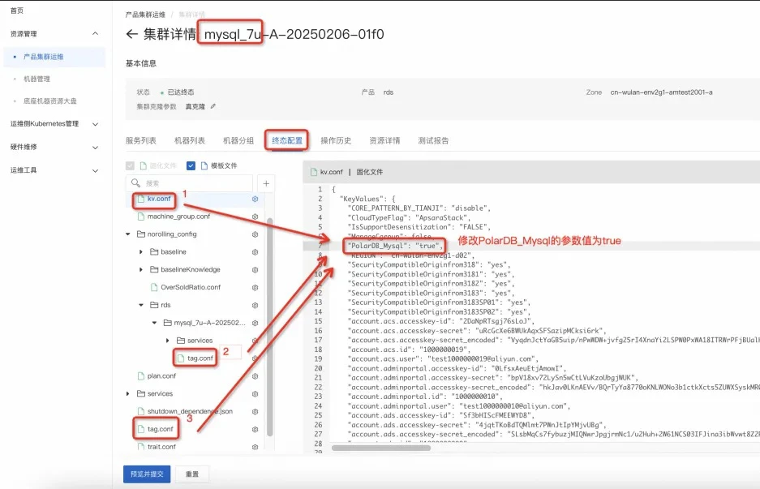

4. 修改集群变量后，系统将执行滚动更新，请耐心等待集群恢复正常运行状态。

5. 在mysql_7u的机器上可查询到PolarDB MySQL内核包，则确认为成功，登录RDS物理机：

   ```bash
   rpm -qa |grep polardb
   ```

   

6. 元数据库dbaas中会生成对于PolarDB MySQL内核的版本引用，确认步骤3中的rpm已经被写入dbaas中。

   登录dbaas：

   ```sql
   select * from minor_version_release where db_type='mysql' order by id desc;
   ```

   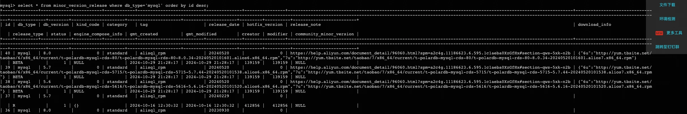

7. 确认功能正常：以上配置成功后，在ASCM上创建一个PolarDB MySQL实例，确认实例的备份恢复、监控、参数调整等各项功能正常。

   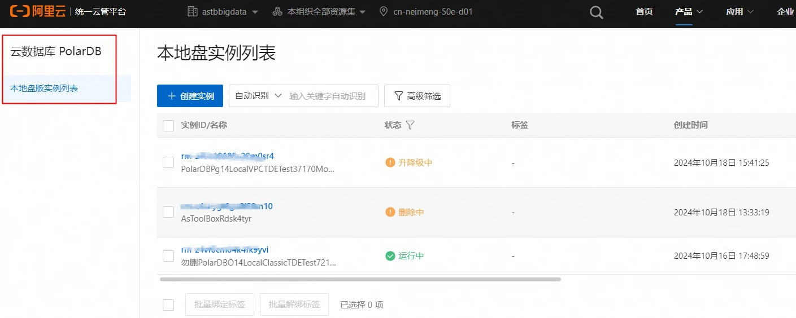

8. 在杜康上配置参数RDS_UPGRADE_TO_POLARDB_WHITE_LIST为false，保证**一键升级PolarDB**按钮可见。

   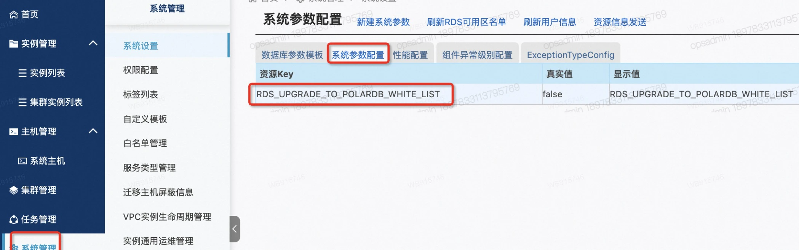

**一键升级**

1. 登录云数据库统一运维平台·杜康。

2. 在左侧导航栏中，选择**实例管理 > 实例列表**。

3. 在实例列表中定位到目标实例，并单击对应的用户实例名。

   > **说明**
   >
   > 您也可以通过在搜索框中输入关键词快速查询目标实例。单击**高级搜索**筛选更多过滤条件，精准定位目标实例。

4. 在**基本信息**页中，单击**一键升级PolarDB**。

   

5. 在**一键升级PolarDB**弹框中单击**提交**，并在提示对话框单击**确认**。

   

6. 升级完成后，执行如下命令确认实例内核（含只读实例）已经是PolarDB内核了。执行不报错并能查到PolarDB内核版本信息。

   ```text
   show polardb_version。
   ```

7. 登录ASCM控制台，确认实例已经切换到了PolarDB产品下，查看目标实例信息。

8. 订正PolarDB MySQL主备版在ASCM上的组织、资源集信息。详细订正操作，请参见<strong>《统一运管平台用户指南》</strong>中**变更实例归属**章节。

   在全部（或一批次）RDS升级完毕，且确认业务正常后，执行一次订正操作。保证升级后的PolarDB MySQL主备版和升级前的RDS实例的组织、资源集归属完全一致。

9. 登录到目标数据库。

   ```text
   use brm;
   ```

0. 对资源表进行备份。

   ```sql
   create table if not exists resource_instance_bak241104 like resource_instance;
   ```

   ```sql
   insert into resource_instance_bak241104 select * from resource_instance;
   ```

1. 数据检查。检查有哪些PolarDB MySQL主备版资源，升级后的组织、资源集归属和升级前的RDS不一致了。

   ```text
   select 
   a.d_binstance_id,a.organization_id,a.resource_group_id,'rds_instance',b.organization_id
   .resource_group_id,b.type from resource_instance b join rds_instance a on a.d_binstance_id = b.instance_id where b.type = 'polardb_instance' and a.resource_group_id != b.resource_group_id;
   ```

2. 方案执行。将升级前后RDS和PolarDB MySQL主备版的组织、资源集拉齐。

   ```sql
   update resource_instance b join rds_instance a on a.d_binstance_id = b.instance_id set b.organization_id=a.organization_id, b.resource_group_id=a.resource_group_id where b.type = 'polardb_instance' and a.resource_group_id != b.resource_group_id;
   ```

**回滚方案**

<strong>场景1：</strong>若发生异常，需要将切换到PolarDB MySQL的实例回滚到RDS MySQL实例，则参考如下步骤。

- **回滚元数据**

  同一个实例的主实例、只读实例、备用只读需要在同一个事务中完成。

- **回滚SQL：**

  - rds-yaochi.phoenixrds:

    ```text
    UPDATE rds_instancesetproduct_code='rds',gmt_modified=now() WHERE instance_id = xxxlimit1;
    ```

  - rds-maotai.dbaas：

    ```text
    DELETE FROM custins_param WHERE custins_id = xxx AND name = "pop_code" AND  VALUES 
    = "polardb" limit 1;
    DELETE FROM custins_param WHERE custins_id = xxx AND name = "upgrade_to_polardb" limit 1;
    ```

<strong>场景2：</strong>如果是节点在版本升级的过程中出现故障，可以通过在杜康上执行备库重搭来恢复节点和实例。

**升级风险**

对周边产品（按产品线分类）的影响如下表所示：

**数据库**

| 产品 | 影响说明 | 影响风险 |
| --- | --- | --- |
| RDS | <strong>内核版本自动更新：</strong>存量MySQL内核在所有实例恢复场景下，5.7和8.0版本会自动升级到最新PolarDB内核 | 低 |
| minirds | <strong>内核版本自动更新：</strong>存量MySQL内核在所有实例恢复场景下，8.0版本会自动升级到最新PolarDB内核 | 低 |
| PolarDB | <strong>其他PolarDB系列自动开启：</strong>如果客户现场已经部署RDS PolarDB-O产品，本次补丁实施后也将支持在PolarDB页面创建PolarDB PG实例；原有RDS创建PolarDB-O的实例不受影响；RDS PolarDB-O：内核自动升级到最新版本<br>说明新建PolarDB的实例暂时无法直接登录DMS，需要登录DMS后，新增纳管MySQL实例才可以使用。 | 低 |
| DTS | 已经创建的DTS迁移、同步、订阅任务不受影响。<strong>涉及影响</strong>：新建或改配场景（修改数据库的连接串，账号，密码）下，无法支持VPC场景，仅能支持公网方式。 | 中 |
| DMS | 对于已经创建的无影响。<strong>涉及影响</strong>：新建或改配场景（修改数据库的连接串，账号，密码）下，需要重新配置：新建PolarDB实例暂时无法通过PolarDB纳管，需要通过MySQL方式纳管：需要升级到v3.16.2r-dts-hotfeature-SP020可以解决（已发布） | 无 |
| DBS | 有影响，需要替换到ASR-BR涉及影响：已创建的DBS备份计划失效，需要重新指定备份策略。PolarDB的备份支持两种方案：PolarDB控制台和ASR-BR备份平台。建议PolarDB的备份统一使用ASR-BR进行管理。<br>• PolarDB控制台适用于简单的备份策略，备份集保存在默认空间，无法更改备份集地址。<br>• ASR-BR控制台支持本地备份和异地备份，可以指定备份保存地址以及丰富的备份策略。需要在切换前改为通过实例控制台进行备份。修复方式：<br>1. 通过实例控制台进行备份。<br>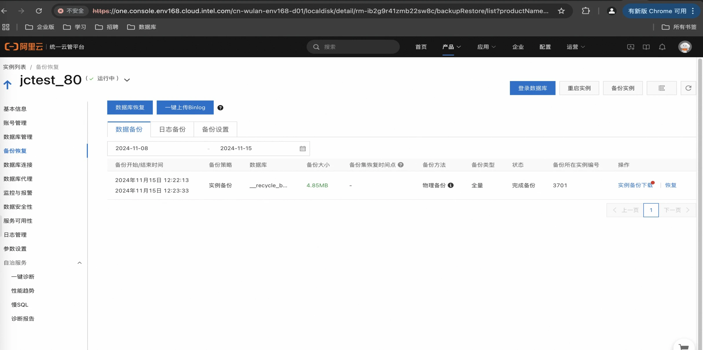<br>2. 采用ASR-BR备份方法如下<br>i. 在ASCM选择<strong>备份管理平台ASR-BR</strong>。<br>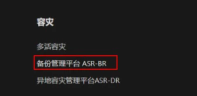<br>ii. 创建备份计划，实例类型选择PolarDB本地盘<br>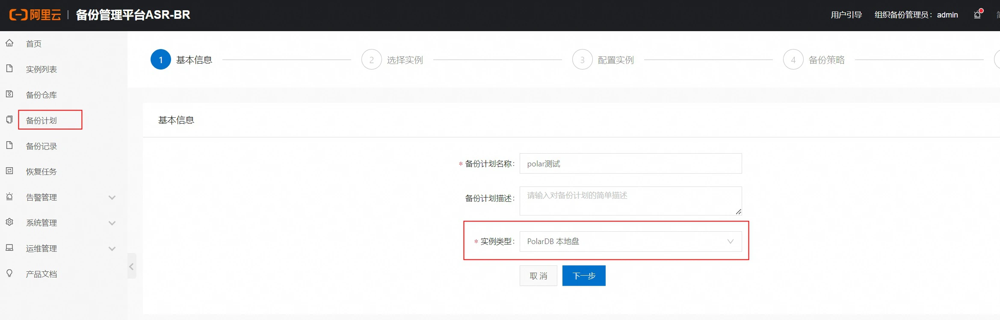<br>iii. 选择备份的数据库实例。<br>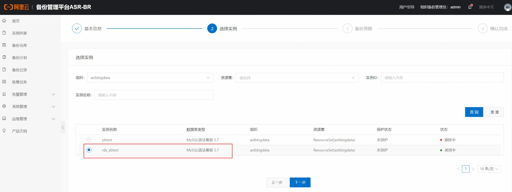<br>iv. 设置备份策略。<br>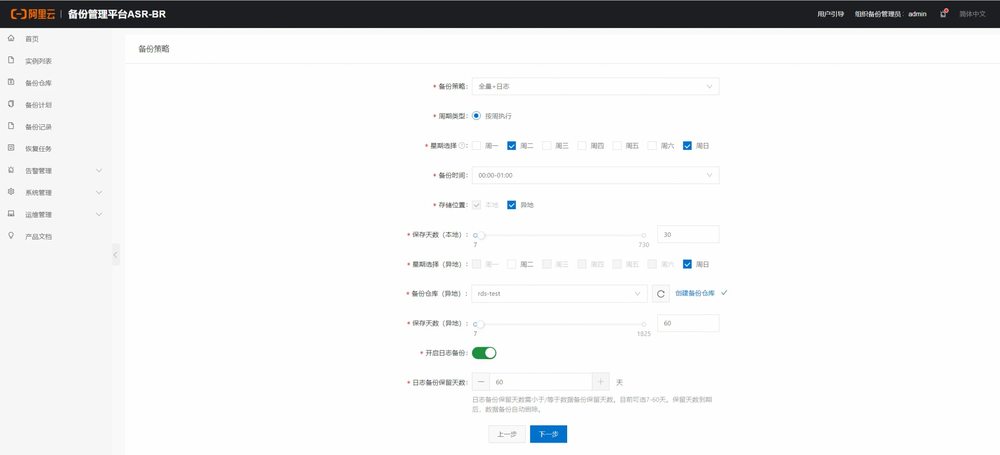 | 高 |
| DAS | 无影响 | 无 |

**大数据**

| 产品 | 影响说明 | 影响风险 |
| --- | --- | --- |
| DataWorks | 已创建场景数据源，离线作业等均无影响。<br>说明暂未支持VPC方式，需要有KB可以支持，执行KB后可以支持。<br>如果未执行KB，经典网络场景下，新建或改配场景（修改数据库的连接串，账号，密码）的时候，不再支持通过实例方式访问，需要通过字串方式访问。通过字符串方式来修改，修改操作如下：<br>1. 登录DataWorks平台，选择<strong>数据汇聚 &gt; 数据集成</strong>。<br>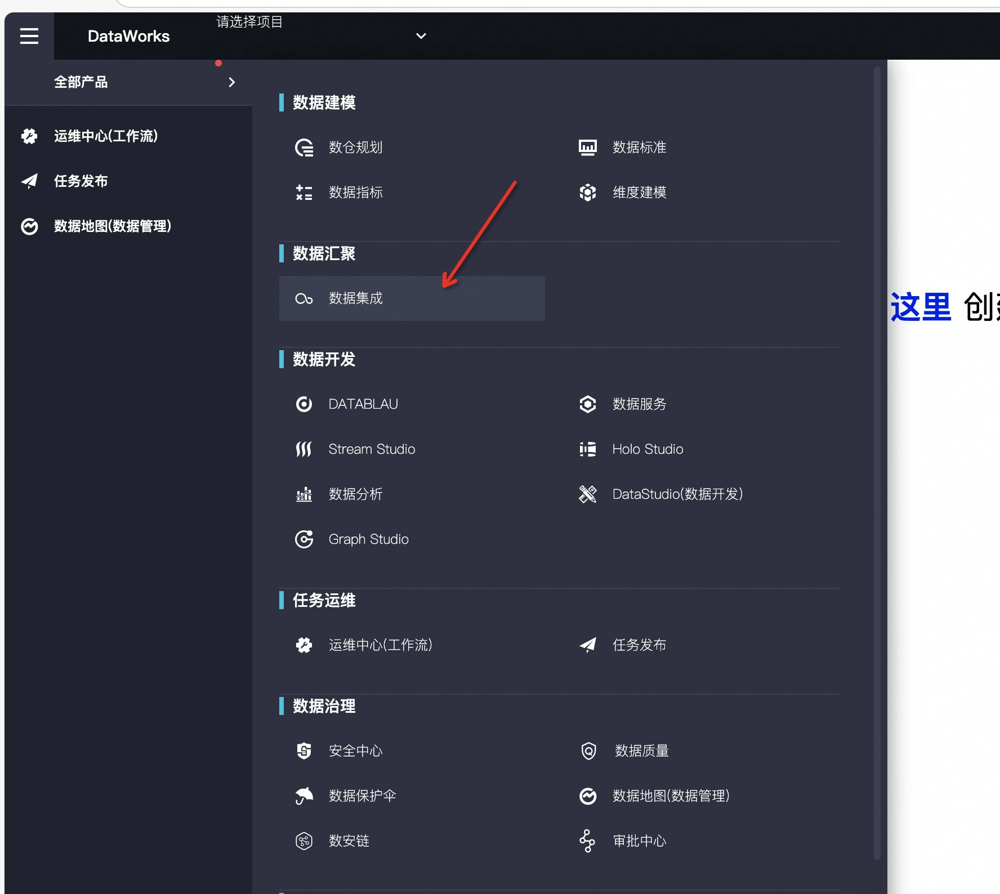<br>2. 选择MySQL数据库。<br><br>3. 在新增MySQL数据源页面，数据源类型选择<strong>链接串模式</strong>。 | 无 |


<table>
  <tr>
    <td>Blink</td>
    <td>无影响仅有连接串模式访问：正常无影响</td>
    <td>无</td>
  </tr>
  <tr>
    <td>Flink</td>
    <td>无影响仅有连接串模式访问：不受影响</td>
    <td>无</td>
  </tr>
  <tr>
    <td>Datahub</td>
    <td>无影响存量已经有的实例不受影响。<br>说明入口仍然为MySQL类型，数据同步使用子串方式访问，实例ID等信息不变。</td>
    <td>无</td>
  </tr>
</table>

**数据智能**

| 产品 | 影响说明 | 影响风险 |
| --- | --- | --- |
| Dataphin | 无影响已经创建的数据源无影响。新建数据源中仅支持连接串方式，正常无影响<br> | 无 |
| QuickBI | 新建数据源中仅有连接串方式：正常无影响 | 无 |
| DataV | 无影响 | 无 |
| DataQ | 有影响已有创建的不受影响。其他：云资源暂未支持。 | 无 |

**统一云管**

| 产品 | 影响说明 | 影响风险 |
| --- | --- | --- |
| ASCM | 有影响需要配置配额，为用户开通PolarDB配额。<br> | 中 |
| ASO | 告警信息无影响，资源归属仍然归属为RDS。<br> | 无 |
| CMS | 存量告警无异常，归属仍然为RDS涉及影响：新建需要按照PolarDB创建规则（监控指标与RDS新链路一致），新建需要选择PolarDB本地盘。<br> | 中 |
| ASR（bcmc） | 有影响ASR同城容灾支持租户把应用涉及的多个实例加入到保护组统一切换，保护组不支持配置PolarDB MySQL。<br><br>需要确认项目是否使用了ASR同城容灾保护组功能，如果已经使用需要hotfeature支持。 | 中 |
| ASR-DR | 有影响ASR-DR异地容灾保护组需要重新配置。<br> | 中 |
| ASR-BR | 有影响存量无影响。新建需要重新配置PolarDB实例的备份策略。 | 中 |
| AOP | 无影响 | 低 |

**安全**

| 产品 | 影响说明 | 影响风险 |
| --- | --- | --- |
| SDDP | 无影响 | 低 |

**弹性计算**

| 产品 | 影响说明 | 影响风险 |
| --- | --- | --- |
| ESS 弹性伸缩 | 有影响暂时未支持PolarDB，如果使用了RDS弹性伸缩类的，不建议切换<br> | 中 |
| ROS 资源编排 | 有影响需要修改ROS弹性伸缩脚本的API变更为PolarDB。 | 中 |

**云平台外部系统**

| 产品 | 影响说明 | 影响风险 |
| --- | --- | --- |
| 监控类 | 有影响需要对接PolarDB，监控的产品需要选择为PolarDB。 | 中 |
| API类 | 有影响外部系统需要重新对接PolarDB。<br>• PolarDB-MySQL主备版的pop_code是polardb，version是 2024-01-30<br>• RDS MySQL的pop_code是rds，version是2014-08-15<br>• OpenAPI：PolarDB-MySQL主备版和RDS MySQL是一致的，接口名和参数都一样，只换了pop_code和version。 | 中 |

<a id="section-3-3-4-2"></a>

#### 3.3.4.2. PolarDB MySQL备节点常见运维操作

本文为您介绍备节点常见操作，帮助您快速解决问题。

**注意事项**

- 建议选择业务低峰期（如凌晨02:00~04:00）进行相关操作。

- 删除备库时需要确认逻辑实例无进行中的任务。

- 需要确认主节点是可服务状态，且无运行中、中断的任务。

- 备节点物理实例无运行中、中断的任务。

- 备库规格**不小于**主实例规格。

**Standby节点本地重建**

1. 登录云数据库统一运维平台·杜康。

2. 在**实例管理 > 实例列表**页面，单击目标实例名称。

3. 在基本信息页中子实例信息模块，单击目标实例名。

4. 在实例的详情中，单击**standby节点本地重建**。

5. 在弹框中，单击**确定**。

**添加备库**

1. 登录云数据库统一运维平台·杜康。

2. 在**实例管理 > 实例列表**页面，单击目标实例名称。

3. 在基本信息页中，单击**添加备库**。

4. 在弹框中单击**确认**。

   > **说明**
   >
   > 增加一个standby节点预计耗时5分钟（具体耗时与数据库负载、库表数量等因素有关），整个过程对数据库无任何影响。

**删除备库**

1. 登录云数据库统一运维平台·杜康。

2. 在**实例管理 > 实例列表**页面，单击目标实例名称。

3. 在基本信息页中，单击**删除备库**。

4. 在弹框中单击**确定**。

   > **说明**
   >
   > 如果不存在备库则该按钮置灰。

**HA切换**

1. 登录云数据库统一运维平台·杜康。

2. 在**实例管理 > 实例列表**页面，单击目标实例名称。

3. 在基本信息页中，单击**HA切换**。

4. 在HA切换页面，选择目标节点，单击**提交**。

   > **说明**
   >
   > HA切换支持RW与RO、Standby节点切换，只有当不存在可用的RO节点时，才允许RW与Standby节点进行HA切换。

**查看任务详情**

1. 登录云数据库统一运维平台·杜康。

2. 在**实例管理 > 任务列表**页面，您可以查看任务执行的详细状态。

   > **说明**
   >
   > - 支持查看所有任务、中断任务、暂停任务等多种任务状态的详情。
   >
   > - 支持自定义列表项，您可根据需要自定义想要查看的任务字段。

<a id="section-3-3-4-3"></a>

#### 3.3.4.3. PolarDB PostgreSQL共享存储版同城容灾切换

为保障业务连续性，PolarDB PostgreSQL集群共享存储版支持同城容灾场景下的高可用切换能力。用户可通过运维平台执行**只读转读写**或**备转读写**操作，实现主节点故障后的快速恢复或主动容灾演练。

**只读转读写**

1. 登录云数据库统一运维平台·杜康。

2. 在左侧导航栏中，选择**实例管理 > 实例列表**

3. 单击目标用户实例名，跳转至**基本信息**页面。

4. 在页面底部，单击**只读转读写**，单击**确定**。

   > **重要**
   >
   > 切换时可能会在30秒内有1~2次连接闪断。

   切换完成后，可在**基本信息**页面的**实例拓扑**区域查看切换后的架构。

**备转读写**

1. 登录云数据库统一运维平台·杜康。

2. 在左侧导航栏中，选择**实例管理 > 实例列表**

3. 单击目标用户实例名，跳转至**基本信息**页面。

4. 在页面底部，单击**备转读写**，在弹窗中选择**切换模式**：

   - **强切**：立即切换，可能丢失未同步的数据，仅建议在极端故障场景下使用。

   - **热切**：等待备库与主库数据完全追平后自动切换，保障数据一致性。只读节点正常时，建议优先选择热切。

5. 单击**确定**执行切换。

   > **重要**
   >
   > 备转读写操作将删除现有只读节点并重建，期间只读节点业务会中断，请知晓该风险并谨慎操作。

   切换完成后，可在**基本信息**页面的**实例拓扑**区域查看切换后的架构。

<a id="section-3-3-4-4"></a>

#### 3.3.4.4. PolarDB-X实例SQL信息查询

本文介绍如何查看SQL日志明细(SLS) 、慢SQL明细、SQL注入检测、主键统计等实例SQL信息。下文以查看SQL日志明细为例。

**使用场景**

- <strong>定位突发高负载原因：</strong>时间范围设为故障发生前后30分钟，按“消耗时间”降序排列，找出Top 5最耗时的SQL，联系开发确认是否可优化。

- <strong>验证上线后SQL表现：</strong>上线新版本前记录基准SQL耗时，上线后对比同一SQL的执行时间和返回行数变化

**操作步骤**

1. 登录云数据库统一运维平台·杜康。

2. 在**实例管理 > 实例列表**页面，单击目标实例名称。

3. 在左侧导航栏，单击**实例SQL信息**，选择<strong>SQL日志明细（SLS）</strong>页签。

4. 支持按照**日期时间**、**日志类型**、**数据排序类型**和**关键词**查询SQL信息。

   > **说明**
   >
   > - 查询时关键字之间用空格分隔。
   >
   > - **SQL归档**：
   >
   >   - 将当前查询结果导出或保存到历史归档库。
   >
   >   - 适用于定期备份重要SQL日志供后续审计或复盘使用。
   >
   > - **SQL归档查询**：
   >
   >   - 进入已归档的历史SQL日志查询界面。
   >
   >   - 可跨时间段检索过去保存的SQL记录。

<a id="section-3-3-4-5"></a>

#### 3.3.4.5. PolarDB-X任务失败处理

PolarDB-X集群下挂的存储节点和GMS节点都是独立可运维的RDS MySQL实例，因此在PolarDB-X的创建、变配、升级、释放、增加节点的任务中，都会触发RDS MySQL的任务流。如果RDS MySQL的任务流失败，那么父类的PolarDB-X的任务也会失败。PolarDB-X所有任务步骤都是保障幂等，可以进行重试。但是有些情况是需要特殊处理的，例如RDS任务失败时，本文介绍了常见的几种RDS MySQL任务失败时的处理方法。

**PolarDB-X创建任务失败**

如果PolarDB-X创建任务失败，卡在create_polardbx_cluster任务的wait_create_xdb_complete步骤，可能原因是PolarDB-X等待下挂的参与本次存储节点和GMS节点创建超时导致失败。

解决方法：首先检查这些RDS MySQL节点的创建任务是否正常，然后参见《RDS MySQL运维指南》对任务进行重试等操作。


在PolarDB-X实例详情页，单击对应的RDS实例，在打开的页面左侧菜单栏中单击**任务列表**，可以找到对应存储节点和GMS节点的任务流。


**PolarDB-X释放任务失败**

- 如果delete_polardbx_cluster任务卡在drop_storage或者drop_meta_db，这两步分别是释放GMS的请求和释放存储节点的请求，可以一直重试。（如果RDS的实例状态为非运行中，需要等待RDS其他任务执行完成后，才能继续重试。）

- 如果delete_polardbx_cluster任务卡在wait_drop_storage这一步，是在等待RDS的释放任务完成，需要去检查这些RDS MySQL节点的释放任务是否正常。然后参见《RDS MySQL运维指南》对任务进行重试等操作。

**PolarDB-X变配任务失败**

- 如果modify_polardbx_cluster任务卡在modify_storage_srv_class，这一步是变配存储节点和GMS节点的请求，如果集群资源不足会导致失败。可以添加集群资源，如果没有资源添加可以跳转到do_disable_aurora这一步 ，继续变配计算节点。

- 如果modify_polardbx_cluster任务卡在wait_xdb_status_activation，这一步是在等待RDS的变配任务完成，需要检查这些RDS MySQL节点的变配任务是否正常，然后参见《RDS MySQL运维指南》对任务进行重试等操作。

**PolarDB-X内核版本升级任务失败**

- 如果upgrade_polardbx_cluster任务卡在upgrade_storage_version，这一步是升级存储节点和GMS节点的请求，如果RDS实例状态是非运行中会导致失败，可以等待其他RDS任务运行结束后，重试此任务即可。

- 如果upgrade_polardbx_cluster任务卡在 wait_xdb_status_activation，这一步是在等待RDS的变配任务完成，需要去检查这些RDS MySQL节点的升级任务是否正常，然后参见《RDS MySQL运维指南》对任务进行重试等操作。

**PolarDB-X增加节点任务失败**

如果add_node_polardbx_cluster任务卡在wait_new_storage_activation，这一步是在等待新存储节点的创建任务完成，需要去检查这些RDS MySQL节点的创建任务是否正常。然后参见《RDS MySQL运维指南》对任务进行重试等操作。

**PolarDB-X备份任务失败**

- 如果卡在wait_backup_job_finished这一步，是在等待新存储节点的备份任务完成。

- 如果卡在additional_backup_set_info这一步，是获取RDS备份集的信息，比例备份集大小等。这一步会失败，是因为wait_backup_job_finished时，显示任务完成，但是完成的备份集不可用，同样需要检查存储节点的备份任务完成情况。

在每个存储节点的实例详情页，单击左侧**备份恢复**，即可查看备份任务情况。

<a id="section-3-3-4-6"></a>

#### 3.3.4.6. PolarDB-X数据节点规格变更

本文为您介绍如何进行数据节点规格变更，帮助您解决问题。

**注意事项**

数据节点变更配置后，PolarDB-X实例数据节点的规格不一致，实例操作方式将发生如下变化：

- 实例将无法整体进行升降配，需要对计算节点和数据节点单独变配。

- 实例将无法通过修改数据节点数量的方式进行缩容，请在数据节点管理页面删除指定数据节点的方式进行缩容。

**操作步骤**

1. 登录云数据库统一运维平台·杜康。

2. 在**实例管理 > 实例列表**页面，单击目标实例名称。

3. 在基本信息页中，单击页面下方**规格变更**按钮。

   

4. 在变更页面，填写**存储空间（GB）**、**实例规格**、**切换模式**和**变更原因**等信息，单击**下一步**。

5. 填写**审核意见**后，确认无误，单击**确认无误，提交审批**。

**查看任务详情**

1. 登录云数据库统一运维平台·杜康。

2. 在**实例管理 > 任务列表**页面，您可以查看任务执行的详细状态。

   > **说明**
   >
   > - 支持查看所有任务、中断任务、暂停任务等多种任务状态的详情。
   >
   > - 支持自定义列表项，您可根据需要自定义想要查看的任务字段。

<a id="section-3-3-4-7"></a>

#### 3.3.4.7. PolarDB-X实例资源配置

实例资源配置支持设置IOPS、CPU规格和磁盘空间等操作，本文以IOPS设置为例，介绍具体操作流程，帮您快速解决问题。

**注意事项**

- 不要随意调高IOPS，可能导致底层存储超负荷，引发延迟甚至宕机。

- 修改logic实例会批量修改DN节点的IOPS配置，也可以单独修改每个节点的IOPS配置。

- 恢复时间务必设置合理，避免忘记恢复造成资源浪费或安全隐患。

- CPU规格需合理设置，过低会导致SQL执行缓慢、连接超时、事务堆积。

- 磁盘空间设置必须在操作后立即跟进真实扩容或清理数据，并在合适时间恢复限制。

- 若设置不检查磁盘空间，可能导致主机磁盘被打满，请谨慎使用。

**使用场景**

- 临时提高IOPS上限保障业务连续性，防止突然爆发大量写入，导致磁盘IO打满。

- 临时降低IOPS进行限流保护，防止恶意程序或异常SQL导致磁盘过载。

- 故障排查时隔离问题实例，降低CPU配额观察是否缓解集群压力。

- 磁盘使用率已达95%以上，临时扩大配额让业务继续运行，同时安排扩容。

**操作步骤**

1. 登录云数据库统一运维平台·杜康。

2. 在**实例管理 > 实例列表**页面，单击目标实例名称。

3. 在左侧导航栏，单击**配置实例**，选择**实例资源配置**页签。

4. 在**设置IOSP**模块，填写**目标IOPS值**，设置**恢复时间**，单击**提交**。

5. 在弹框中，单击**确定**。

   > **说明**
   >
   > - 设置恢复时间后，IOPS值将在该时间到达后5分钟内恢复。

<a id="section-3-3-4-8"></a>

#### 3.3.4.8. Tair增加Proxy实例节点

当业务流量增长或现有Proxy实例负载过高（如CPU、内存或网络带宽达到阈值）时，您可通过增加Proxy节点数量进行横向扩容，可有效分担客户端请求压力，提升系统的整体吞吐量与高可用性。

**操作步骤**

1. 登录云数据库统一运维平台·杜康。

2. 在**实例管理 > 实例列表**页面，单击目标实例名称。

3. 在基本信息页中，单击页面下方**增加proxy实例节点**按钮。

   

4. 在弹框中填写目标节点数量，单击**提交**。

<a id="section-3-3-4-9"></a>

#### 3.3.4.9. Tair临时放大主备同步buffer

在高写入负载场景下，主备同步延迟增大，导致从库数据滞后，影响读取的一致性和故障切换的可靠性，此时可以同步放大主备同步buffer大小，提升主备同步吞吐量，降低延迟。本文为您介绍临时放大主备同步buffer的运维操作。

**注意事项**

- 实例重启后自动重置为默认值。

- 修改前需要确认机器内存是否足够。

- 建议选择业务低峰期（如凌晨02:00-04:00）进行相关操作。

**操作步骤**

1. 登录云数据库统一运维平台·杜康。

2. 在**实例管理 > 实例列表**页面，单击目标实例名称。

3. 在基本信息页中，单击页面下方**临时放大主备同步buffer**按钮。

   

4. 在弹框中填写目标放大比例，单击**提交**。

   > **说明**
   >
   > - 放大比例取值范围：[1.0,5.0]。
   >
   > - 支持对normal、db和logic实例进行操作，对logic实例进行操作时，会对下面的所有db实例执行该操作。
   >
   >   - normal实例：即Redis-Normal实例，是标准单节点或主从架构的Redis实例。
   >
   >   - db实例：属于Redis-Logic集群架构中的数据节点角色子实例，即集群版中实际存储数据的DB角色子实例。
   >
   >   - logic实例：即Redis-Logic集群实例（含Proxy+CS+DB多角色），是具备读写分离、分片路由能力的集群化部署形态。

<a id="section-3-3-4-10"></a>

#### 3.3.4.10. AnalyticDB MySQL3.0登入console并执行SQL

本文档为您介绍如何通过杜康平台跳转至AnalyticDB MySQL3.0原生Console，并利用SQL Editor执行诊断命令以核查实例状态。

**操作步骤**

1. 登录云数据库统一运维平台·杜康。

2. 在**实例管理 > 实例列表**页面，单击**高级搜索**，输入对应的实例名或实例ID，数据库类型选择**analyticdb**后单击**搜索**，单击用户实例名进入该AnalyticDB MySQL3.0实例的主实例基本详情页面。

3. 在基本信息页中，单击实例ID后的**console**。

4. 在**AnalyticDB Console**中，单击左侧导航栏**SQL Editor**。

5. 选择目标数据库，输入SQL命令（如查询AnalyticDB版本： `select adb_version()` ），单击**Execute**执行，页面下方可查看执行结果。

<a id="section-3-3-5"></a>

### 3.3.5. 实例批量管理

<a id="section-3-3-5-1"></a>

#### 3.3.5.1. 批量迁移实例

本文介绍批量迁移实例的操作步骤。

**操作步骤**

1. 登录云数据库统一运维平台·杜康。

2. 在**杜康-数据库管理平台**首页，单击**实例管理 > 实例列表**。

3. 在**实例列表**页面上方，单击**实例批量管理**，进入**实例批量操作**页面。

4. 单击**实例批量操作**栏下的**批量实例迁移**。

5. 单击**批量实例迁移等待列表**页面中的**下载模板文件**，根据模板文件填写内容。

6. 单击**选择文件**。

7. 选择填写完毕的模板文件后单击**提交**。

> **说明**
>
> - HaProxy链路实例只有在同集群内迁移才不会发生闪断。
>
> - 该批量实例迁移操作不经过审批，请谨慎操作！

**后续步骤**

您可以单击**实例批量迁移**页面上方的**批量实例迁移已成功列表**和**批量实例迁移失败列表**，查看已迁移实例的详情信息。

<a id="section-3-3-5-2"></a>

#### 3.3.5.2. 批量实例参数刷新

本文介绍如何对批量实例参数进行刷新。

**操作步骤**

1. 登录云数据库统一运维平台·杜康。

2. 在**杜康-数据库管理平台**首页，单击**实例管理 > 实例列表**。

3. 在**实例列表**页面上方，单击**实例批量管理**，进入**实例批量操作**页面。

4. 单击**实例批量操作**栏下的**批量实例参数刷新**。

5. 选择需要刷新的实例集群，单击**选择参数模板**。

   > **重要**
   >
   > 实例参数变更有可能引起实例闪断或不可用等风险，请在使用时参见控制台提示进行必要操作。

6. 选择数据库参数模板并单击**下一步**。

7. 选择实例，单击**提交**。

**后续步骤**

您可以单击**批量实例参数刷新**页面上方的**批量刷新参数实例已成功列表**和**批量刷新参数实例失败列表**，查看已刷新过的实例参数的详情信息。

<a id="section-3-3-5-3"></a>

#### 3.3.5.3. 批量DIY参数刷新

本文介绍如何对批量DIY参数进行刷新。

**操作步骤**

1. 登录云数据库统一运维平台·杜康。

2. 在**杜康-数据库管理平台**首页，单击**实例管理 > 实例列表**。

3. 在**实例列表**页面上方，单击**实例批量管理**，进入**实例批量操作**页面。

4. 单击**实例批量操作**栏下的**批量DIY参数刷新**。

5. 在**批量DIY刷新参数等待列表**页面中，配置以下信息。

   <table>
     <tr>
       <th width="81">配置项</th>
       <th>说明</th>
     </tr>
     <tr>
       <td>实例名</td>
       <td>您需要在<strong>实例名</strong>后的文本框中输入需要进行DIY参数刷新的实例。<br>说明<br>• 请确保每次输入的实例名都是同类型同版本的数据库实例。<br>• 所有的输入请规范，去掉空格、tab、空行。<br>• 只支持免重启的参数。</td>
     </tr>
     <tr>
       <td>db类型</td>
       <td>数据库类型。选择输入的实例的数据库类型。</td>
     </tr>
     <tr>
       <td>db版本</td>
       <td>数据库版本。选择对应数据库版本。</td>
     </tr>
     <tr>
       <td>备注</td>
       <td>输入备注信息。</td>
     </tr>
   </table>

6. 信息配置完成后，单击**去选择参数**。

7. 单击弹出的**确认**对话框中的**确定**。

8. 选中需要修改的参数，并且在最右侧填写修改值。

9. 单击左下方**保存**。

**后续步骤**

您可以单击**批量实例参数刷新**页面上方的**批量刷新参数实例已成功列表**或**批量刷新参数实例失败列表**，查看已刷新过的DIY参数的详情信息。

<a id="section-3-3-5-4"></a>

#### 3.3.5.4. 批量Redis参数刷新

本文介绍如何对批量Redis参数进行刷新。

**操作步骤**

1. 登录云数据库统一运维平台·杜康。

2. 在**杜康-数据库管理平台**首页，单击**实例管理 > 实例列表**。

3. 在**实例列表**页面上方，单击**实例批量管理**，进入**实例批量操作**页面。

4. 单击**实例批量操作**栏下的**批量Redis参数刷新**。

5. 在**redis2.8集群**列表中选择需要修改参数的集群。

6. 在**redis2.8数据库2.8读写参数**列表中找到想要修改的目标参数，在右侧**设置值**里填写数值，并单击**保存**。

7. 在弹出的**修改配置**对话框中，单击**确定**。

<a id="section-3-3-5-5"></a>

#### 3.3.5.5. 批量任务管理

本文介绍如何管理批量任务。

**创建任务**

1. 登录云数据库统一运维平台·杜康。

2. 在**杜康-数据库管理平台**首页，单击**实例管理 > 实例列表**。

3. 在**实例列表**页面上方，单击**实例批量管理**，进入**实例批量操作**页面。

4. 单击**实例批量操作**栏下的**批量任务管理**。

5. 单击页面上方**创建任务**，进入**创建任务**页面。

6. 在弹出的**创建任务**页面中，配置如下参数信息：

   <table>
     <tr>
       <th width="137">配置</th>
       <th>说明</th>
     </tr>
     <tr>
       <td>任务类型</td>
       <td>您可根据实际情况选择目标任务类型。例如：<strong>批量开启SQL WALL</strong>、<strong>批量链路切换</strong>、<strong>批</strong><strong>量实例小版本升级</strong>等等。</td>
     </tr>
     <tr>
       <td>任务提示</td>
       <td>系统将根据不同的任务类型提示您对应任务的注意事项。</td>
     </tr>
     <tr>
       <td>任务参数</td>
       <td>不同的任务类型对应不同的任务参数，请您按照实际任务进行选择。</td>
     </tr>
     <tr>
       <td>时间规则</td>
       <td>• <strong>立即下发</strong>：立刻执行任务。<br>• <strong>运维时间</strong>：在运维时间才会执行任务。<br>• <strong>指定时间</strong>：指定时间段内才会执行任务。</td>
     </tr>
     <tr>
       <td>发送短信</td>
       <td>是否发送短信提醒：<br>• 是<br>• 否</td>
     </tr>
     <tr>
       <td>实例来源</td>
       <td>可选择实例的来源为<strong>集群</strong>或<strong>Sql模板</strong>。</td>
     </tr>
     <tr>
       <td>请选择来源集群</td>
       <td><strong>实例来源</strong>为<strong>集群</strong>时可选。选择来源集群填充<strong>输入实例</strong>。</td>
     </tr>
     <tr>
       <td>请选择Sql模板</td>
       <td><strong>实例来源</strong>为<strong>Sql模板</strong>时可选。选择Sql模板填充<strong>输入实例</strong>。<br>说明单击右侧<strong>创建模板</strong>可以跳转至<strong>SQL模板管理</strong>页面创建SQL脚本。</td>
     </tr>
     <tr>
       <td>输入实例</td>
       <td>输入需要批量执行任务的实例，一行一个实例名。</td>
     </tr>
     <tr>
       <td>备注</td>
       <td>填写备注内容。<br>说明此项为选填内容。</td>
     </tr>
   </table>

7. 单击**提交**。

<a id="section-3-3-5-6"></a>

#### 3.3.5.6. 批量任务类型管理

本文介绍新增任务类型的操作步骤。

**操作步骤**

1. 登录云数据库统一运维平台·杜康。

2. 在**杜康-数据库管理平台**首页，单击**实例管理 > 实例列表**。

3. 在**实例列表**页面上方，单击**实例批量管理**，进入**实例批量操作**页面。

4. 单击**实例批量操作**栏下的**批量任务类型管理**。

5. 单击页面上方**新建类型**，进入**新建类型**页面。

6. 在弹出的**新建类型**页面中，配置如下参数信息：

   | 配置 | 说明 |
   | --- | --- |
   | 名称 | 新任务类型名称。 |
   | 编号 | 新任务类型编号。 |
   | API | 新任务的API名称。 |
   | api实例参数名 | • API实例的参数名称。<br>• 默认为<strong>DBInstanceName</strong>。 |
   | 提示信息 | 系统给出的提示信息、注意事项内容。 |
   | 参数规则 | 包括参数名、API参数名、参数类型等等。 |
   | 校验规则 | 包括校验关系、属性名、校验规则、校验值等等。 |
   | 最高并发 | 最高并发数。 |
   | 停止失败率 | 任务停止或失败的概率。 |
   | 备注 | 填写备注内容。 |

7. 单击**提交**。

<a id="section-3-3-5-7"></a>

#### 3.3.5.7. SQL模板管理

本文介绍新增SQL模板的操作步骤。

**操作步骤**

1. 登录云数据库统一运维平台·杜康。

2. 在**杜康-数据库管理平台**首页，单击**实例管理 > 实例列表**。

3. 在**实例列表**页面上方，单击**实例批量管理**，进入**实例批量操作**页面。

4. 单击**实例批量操作**栏下的**SQL模板管理**。

5. 单击页面上方**新增模板**，进入**NewTemplate**页面。

6. 在弹出的**NewTemplate**页面中，配置如下参数信息：

   | 配置 | 说明 |
   | --- | --- |
   | 模板名称 | 填写新模板名称。 |
   | 模板类型 | 选择模板类型。 |
   | 数据库名称 | 选择目标数据库。 |
   | 数据库类型 | 选择目标数据库类型。 |
   | Sql脚本 | 填写SQL脚本。 |
   | 新增原因 | 填写新增模板原因。 |

   > **说明**
   >
   > 自定义SQL模板只允许SELECT语句，且目前仅能用于dbaas库的查询。所有SQL模板的创建均需要BPMS审批。为保证SQL模板不会被其余同学误执行，导致批量任务下发给错误的实例，请在SQL模板中详细描述模板名称和新增原因。

7. 单击**提交**。

<a id="section-3-3-6"></a>

### 3.3.6. 实例计划迁移管理

实例计划迁移列表上传有两种方式，分别按实例或者按主机IP进行批量提交。本文介绍实例计划迁移的具体操作。

**操作步骤**

1. 登录云数据库统一运维平台·杜康。

2. 在**杜康-数据库管理平台**首页，单击**实例管理 > 实例列表**。

3. 在**实例列表**页面上方单击**实例计划迁移管理**。

4. 选择实例计划迁移列表上传方式。

   > **说明**
   >
   > - 方式一：按实例提交时，在遇到不可迁移的实例时会全部阻止提交。
   >
   > - 方式二：按主机IP提交时，会直接过滤不可迁移的实例。

5. 单击右侧**下载模板文件**，根据模板文件填写内容。

6. 单击**选择文件**，选择填写完毕的模板文件。

7. 单击**提交**。

**后续步骤**

您可以单击**实例计划迁移管理**页面上方的**推送成功列表**或**已删除列表**，查看详情信息。

<a id="section-3-3-7"></a>

### 3.3.7. 实例大盘

您可以在实例大盘中查看实例的CPU利用率、连接数利用率等等。

**操作步骤**

1. 登录云数据库统一运维平台·杜康。

2. 在**杜康-数据库管理平台**首页，单击**实例管理 > 实例列表**。

3. 在**实例列表**页面上方单击**实例大盘**。

4. 您可查看实例的CPU、连接数、IOPS、磁盘利用率大盘情况，默认展示前20项。

   

<a id="section-3-4"></a>

## 3.4. 主机管理

<a id="section-3-4-1"></a>

### 3.4.1. 新建主机

本文介绍如何新建主机。

**操作步骤**

1. 登录云数据库统一运维平台·杜康。

2. 在左侧导航栏，选择**主机管理 > 系统主机**。

3. 单击页面上方的**应急处理方案**。

4. 单击**新建主机**。

5. 配置主机参数，单击**提交**。

<a id="section-3-4-2"></a>

### 3.4.2. 批量配置主机

本文介绍如何批量配置主机。

**操作步骤**

1. 登录云数据库统一运维平台·杜康。

2. 在左侧导航栏，选择**主机管理 > 系统主机**。

3. 选中需要批量配置主机信息的主机，在页面上方单击**批量配置**。

4. 配置参数并单击**提交**。

<a id="section-3-4-3"></a>

### 3.4.3. 查看主机信息

文本介绍如何查看主机信息。

**操作步骤**

1. 登录云数据库统一运维平台·杜康。

2. 在左侧导航栏，选择**主机管理 > 系统主机**。

3. 可根据IP或者主机名，筛选出对应的主机。

4. 单击目标IP，在**主机详情**页面中，查看主机详情信息，例如CPU、内存、实例个数、磁盘用量等。

   您也可以单击左侧功能选项，查看主机实例信息、性能信息、备份信息和账号信息等。

<a id="section-3-4-4"></a>

### 3.4.4. 物理机分组

云数据库统一运维平台·杜康支持通过物理机分组功能构建独立的逻辑资源池，实现底层硬件资源的物理隔离与精细化调度，以确保不同业务场景下的资源独占性与稳定性。

**背景信息**

通过**物理机分组**功能，可构建多物理机资源池，以实现物理机资源隔离。该功能具有以下实际价值：

- 不同等级不同类别的数据库实例，可使用不同的物理机资源池，以实现物理隔离。

- 测试环境和生产环境物理机资源隔离，避免测试实例和生产实例创建在相同物理机上，避免测试实例性能压测等场景影响生产实例。

- 新老机型换代，老旧机器和新机器规划不同的资源池，分开使用。

> **说明**
>
> - 物理机分组功能当前仅支持PolarDB-X 2.0实例。
>
> - 创建物理机分组后，用户可在Apsara Uni-manager运营控制台创建数据库实例时，指定实例所在的物理机资源池，详情请参见相应《用户指南》中《创建实例》等章节。

**查看全部分组信息**

1. 登录云数据库统一运维平台·杜康。

2. 左侧菜单栏单击**主机管理 > 系统主机**。

3. 单击上方**物理机分组**按钮，进入**物理机分组**页面，即可查看当前所有分组信息。

**创建物理机分组**

1. 在**物理机分组**页面，单击**创建分组**按钮。

2. 在**创建分组**页面，填写**分组名称**、**数据库类型**和选择**机器**等。

   

3. 选择空闲物理机，单击  加入当前物理机分组。

4. 单击**创建**按钮即可成功创建分组。

**编辑物理机分组**

1. 在**物理机分组**页面，单击**编辑**按钮。

2. 在**编辑分组**页面编辑**数据库类型**和**机器**。

3. 编辑完成后，单击**确定**按钮。

**删除物理机分组**

> **说明**
>
> 删除物理机分组之前，请确保先将物理机上的实例清空。

1. 在**物理机分组**页面，单击**删除**按钮。

2. 删除对话框中，单击**确定**删除该分组。

<a id="section-3-4-5"></a>

### 3.4.5. 主机软件包管理

本文介绍云数据库主机上软件包的核心管理功能，包括安装、卸载及操作记录查询。用户可通过统一界面，安全、可追溯地维护主机运行环境，确保数据库服务的稳定性与合规性。

**使用场景**

- 集群扩容与版本一致性保障

  - 场景：数据库集群横向扩容时，新节点初始版本与存量节点不一致。

  - 作用：通过批量安装指定版本软件包，为新节点补齐内核，确保集群内所有节点版本统一，避免兼容性问题。

- 紧急故障修复与版本回滚

  - 场景：现网版本出现已知缺陷（Bug），或新版本升级后出现性能回归。

  - 作用：通过批量下发补丁包进行快速修复；或在升级异常时，快速卸载新版本、回滚至稳定版本，最小化业务中断时间。

- 灰度发布与风险熔断

  - 场景：新版本发布初期，需控制风险范围，防止缺陷扩散。

  - 作用：通过软件包的“启用/禁用”状态控制分发权限。可先仅对特定主机启用（灰度），确认稳定后全量开放；若发现严重缺陷，立即禁用软件包（熔断）。

**支持的数据库类型**

当前支持以下类型的天基架构软件包：

- RDS MySQL

- PolarDB MySQL主备版

- PolarDB PostgreSQL

- PolarDB PostgreSQL（Oracle）

**安装软件包**

1. 登录云数据库统一运维平台·杜康。

2. 在左侧导航栏单击**主机管理 > 系统主机**，单击**操作**列下的**详情**进入主机详情页面。

3. 进入左侧导航栏中的**主机软件包管理**页面，单击**未安装**软件包**操作**列下的**软件包版本管理**。

4. 在弹出的面板中，单击**安装**。

5. 在弹出的对话框中，勾选**操作说明**并填写**操作原因**，单击**确定**。

   您可以关注目标主机**安装状态**列的进度展示，从**安装中**变更为**已安装**表示已安装完成。

**卸载软件包**

> **重要**
>
> 卸载软禁包属于高危运维操作，若数据库实例运行依赖该包中的动态库或二进制文件，强制卸载可能导致依赖缺失，进而引发数据库实例无法启动或服务中断。
>
> 执行卸载前，请务必确认目标主机上无运行中的关键实例，或已做好充分的容灾与回滚预案。

1. 登录云数据库统一运维平台·杜康。

2. 在左侧导航栏单击**主机管理 > 系统主机**，单击**操作**列下的**详情**进入主机详情页面。

3. 进入左侧导航栏中的**主机软件包管理**页面，单击**已安装**软件包**操作**列下的**软件包版本管理**。

4. 在弹出的面板中，单击**卸载**。

5. 在弹出的对话框中，勾选**操作说明**并填写**操作原因**，单击**确定**。

   您可以关注目标主机**安装状态**列的进度展示，从**卸载中**变更为**未安装**表示已卸载完成。

**查询软件包变更记录**

用于查询软件包的安装或卸载是否成功。

1. 登录云数据库统一运维平台·杜康。

2. 在左侧导航栏单击**主机管理 > 系统主机**，单击**操作**列下的**详情**进入主机详情页面。

3. 进入左侧导航栏中的**主机软件包管理**页面，单击**软件包变更记录**按钮。

   页面将展示操作类型、操作时间、结果描述等信息。

<a id="section-3-5"></a>

## 3.5. 集群管理

<a id="section-3-5-1"></a>

### 3.5.1. 设置集群参数

本文介绍如何设置集群参数。

**操作步骤**

1. 登录云数据库统一运维平台·杜康。

2. 在左侧导航栏，单击**集群管理**。

3. 在**系统集群**页面中，选中目标集群，单击**集群参数设置**，设置目标项并单击**提交**。

   > **重要**
   >
   > - 一次仅支持配置一个集群。
   >
   > - 不同数据库类型（如MySQL、MongoDB等）所支持的参数项存在差异，具体以控制台实际显示为准。

   | 支持的配置项 | 参数项说明 |
   | --- | --- |
   | 设置超卖百分比 | 支持配置CPU（单位为百分比，取值范围<code> [100,10000] </code>，0表示不限制）、内存（单位为百分比，取值范围\[100,100\]）和磁盘（单位为百分比，取值范围<code> [100,5000] </code>）的超卖比例。 |
   | 设置新建MySQL默认支持权限放开 | 支持选项为：权限不放开、权限支持以后放开、权限放开（默认支持权限放开）。<br>说明新建MySQL实例时，若用户未指定权限策略，则采用集群的此项默认配置。 |
   | 设置表一致性验证百分比 | 单位为百分比，取值范围<code> [0,100] </code>，用于控制系统对表数据一致性校验的抽样比例。 |
   | 设置备份集回放验证超时 | 单位为秒，取值范围<code> [0,86400] </code>。<br>说明设置为非0时，在恢复子实例、创建只读实例、创建灾备实例及备库重建过程中，将对备份集进行回放验证，超时即终止验证。 |
   | 设置备份集验证百分比 | 单位为百分比，取值范围<code> [0,100] </code>。<br>说明设置为非0时，系统会定期按比例抽取备份集创建临时验证子实例，验证完成后立即删除。 |

   <table>
     <tr>
       <td>设置备份不落地</td>
       <td>设置后，集群内所有实例统一采用该备份落盘策略。支持选项：关闭、仅数据不落地、数据日志不落地。</td>
     </tr>
     <tr>
       <td>设置备份压缩</td>
       <td>设置后，集群内所有实例的备份文件统一采用该压缩方式。支持选项：不压缩、zlib压缩。</td>
     </tr>
     <tr>
       <td>设置备份流式恢复</td>
       <td>设置后，集群内所有实例在恢复时统一采用流式恢复模式。支持选项：关闭、流式恢复。</td>
     </tr>
     <tr>
       <td>设置实例HA优先模式</td>
       <td>控制高可用切换时的优先策略。支持选项：可用性优先（默认值）、可靠性优先。</td>
     </tr>
     <tr>
       <td>设置sync_binlog刷新方式</td>
       <td>用于配置MySQL集群binlog持久化行为。支持选项：安全模式（主备sync_binlog均为1）、普通模式（1/1000）、高性能模式（1000/1000），默认为普通模式。</td>
     </tr>
     <tr>
       <td>设置PetaData流式搬迁</td>
       <td>设置后，集群内所有PetaData实例统一采用该数据搬迁方式。支持选项：关闭、流式搬迁。</td>
     </tr>
     <tr>
       <td>设置支持业务类型</td>
       <td>设置为RDS时，该集群仅允许创建RDS实例；默认支持RDS。支持选项：RDS、PetaData、全部。</td>
     </tr>
     <tr>
       <td>设置BINLOG上传方式</td>
       <td>控制Binlog是否上传至远端存储。支持选项：不上传、上传（默认值）。</td>
     </tr>
     <tr>
       <td>设置BINLOG本地清理方式</td>
       <td>控制本地Binlog文件是否自动清理。支持选项：不清理、清理（默认值）。</td>
     </tr>
     <tr>
       <td>设置BINLOG备份压缩</td>
       <td>设置Binlog备份的压缩方式。支持选项：不压缩、zlib压缩（默认值）。</td>
     </tr>
     <tr>
       <td>设置BINLOG磁盘空间警告阈值</td>
       <td>当Binlog占用磁盘空间达到该阈值时触发警告。单位为百分比，取值范围<code> [0,100] </code>。</td>
     </tr>
     <tr>
       <td>设置BINLOG磁盘空间严重警告阈值</td>
       <td>当Binlog占用磁盘空间达到该阈值时触发严重告警。单位为百分比，取值范围<code> [0,100] </code>。</td>
     </tr>
     <tr>
       <td>设置磁盘类型</td>
       <td>指定集群底层存储介质类型。支持选项：SSD（默认值）、SATA、ECS、混合、POLAR。</td>
     </tr>
     <tr>
       <td>设置MySQL大实例迁移方案</td>
       <td>控制是否启用针对大规格MySQL实例的专用迁移流程。支持选项：关闭、开启。</td>
     </tr>
     <tr>
       <td>设置打开自动扩容</td>
       <td>开启后，集群内实例在满足条件时可自动触发扩容。支持选项：关闭、开启。</td>
     </tr>
     <tr>
       <td>设置arch_version</td>
       <td>用于标识集群架构版本，具体取值由平台内部管理。</td>
     </tr>
     <tr>
       <td>设置perf_status</td>
       <td>用于指定性能监控数据采集链路类型。支持选项：旧链路、灰度秒级链路、秒级链路。</td>
     </tr>
     <tr>
       <td>设置主机支持千兆网卡</td>
       <td>新建集群时若未显式指定，则默认为不支持千兆网卡。支持选项：不支持（默认值）、支持。</td>
     </tr>
   </table>

<a id="section-3-5-2"></a>

### 3.5.2. 管理服务类型

本文介绍如何管理服务类型。

**操作步骤**

1. 登录云数据库统一运维平台·杜康。

2. 在**杜康-数据库管理平台**页面，单击**集群管理**。

3. 单击**服务类型管理**打开**服务类型管理**页面。

   - 单击目标服务类型右侧**操作**列的**编辑**，修改服务类型。

   - 单击目标服务类型右侧**操作**列的**删除**，删除服务类型。

<a id="section-3-5-3"></a>

### 3.5.3. 管理服务节点

本文介绍如何新建、编辑或删除服务节点。

**操作步骤**

1. 登录云数据库统一运维平台·杜康。

2. 在**杜康-数据库管理平台**页面，选择**集群管理**。

3. 在左侧导航栏，单击**服务节点管理**。

   - 单击页面上方的**新建服务节点**，配置相关参数，单击**确定**。

   - 单击目标节点右侧**操作**列的**编辑**，修改服务节点。

   - 单击目标节点右侧**操作**列的**删除**，删除服务节点。

<a id="section-3-5-4"></a>

### 3.5.4. DB配置模板

本文介绍如何管理DB模板。

**操作步骤**

1. 登录云数据库统一运维平台·杜康。

2. 在**杜康-数据库管理平台**页面，选择**集群管理**。

3. 在左侧导航栏中，单击**DB配置模板**打开**DB配置模板**页面。

   

   - 单击页面上方的**新建DB模板**按钮，填写模板信息，单击**操作**列下的**保存**。

   - 单击**操作**列的**编辑**，修改已有模板，单击**操作**列下的**保存**。

   - 单击**操作**列的**删除**，删除已有模板，单击**确定**。

<a id="section-3-5-5"></a>

### 3.5.5. 方寸山集群管理

本文介绍方寸山集群的管理操作。

**操作步骤**

1. 登录云数据库统一运维平台·杜康。

2. 在**杜康-数据库管理平台**页面，选择**集群管理**。

3. 在左侧导航栏中，单击**方寸山集群管理**进入**集群组配置**页面。

   

4. 在页面上方，单击**新建集群组**。

5. 选择**区域**，输入**集群组**名称，单击**确定**。

6. 单击新集群**操作**列下的**设置集群**，设置资源类型，单击**确定**。

7. （可选）单击目标集群**操作**列下的**修改集群组**，修改集群组名称。

8. （可选）单击目标集群**操作**列下的**删除集群组**，删除集群组。

<a id="section-3-5-6"></a>

### 3.5.6. Location管理

本文介绍如何配置集群的Location。

**操作步骤**

1. 登录云数据库统一运维平台·杜康。

2. 在**杜康-数据库管理平台**页面左侧导航栏，单击**集群管理**。

3. 在左侧导航栏中，单击**Location**打开Location页面。

4. 您可以搜索框中输入关键字查询集群，并在查询结果中对目标集群进行管理。

   > **说明**
   >
   > 您也可以在页面下方进行集群一致性检查和子域一致性检查操作。

   - 添加集群Location节点：单击目标单元、地区或可用区后的**添加**按钮，参数填写完成后单击**提交**。

   - 管理参数：单击目标单元、地区、可用区或子域后的**参数**按钮，新增、编辑或删除参数。

   - 删除单元、地区、可用区或子域：单击目标单元、地区、可用区或子域后的**删除**按钮。

<a id="section-3-6"></a>

## 3.6. 任务管理

<a id="section-3-6-1"></a>

### 3.6.1. 管理中断任务

本文介绍如何管理中断任务，包括用户实例任务、主机实例任务、主机任务。本文以用户实例任务为例，介绍如何管理中断任务。

**操作步骤**

1. 登录云数据库统一运维平台·杜康。

2. 在**杜康-数据库管理平台**页面，单击**任务管理**，在**实例任务**页面左上角的框中选择**中断的任务**。

   > **说明**
   >
   > - 如果有失败的任务，请按如下步骤处理。
   >
   > - 如果没有失败的任务，则结束本操作。

3. 单击**任务名称**列的任务，查看分析任务失败原因。

   > **说明**
   >
   > 通常情况下，如果遇到从库状态异常、连接超时或密码错误等问题时，可以通过使用问题实例的IP地址登录目标实例，并对异常进行修复。

   

4. 完成修复后，单击**操作**列下的**操作**，跳转到任务详情页面。

   

5. 单击**执行任务**。

6. 在弹出的**重新执行任务**窗口中，单击**当前步骤重试**，重新执行任务。

   > **重要**
   >
   > 如果您需要从指定步骤开始执行，可以单击**从指定步骤继续**。在不理解任务及步骤功能的时，请勿操作。

   

7. 在任务管理中选择**运行的任务**，查看任务执行情况。

   

   > **说明**
   >
   > 如果任务执行失败，按本步骤重新排查。

<a id="section-3-6-2"></a>

### 3.6.2. 临时关闭任务管理

本文介绍如何管理临时关闭的任务。

**操作步骤**

1. 登录云数据库统一运维平台·杜康。

2. 在**杜康-数据库管理平台**页面，单击**任务管理**，在跳转到的页面左上角的选框中单击**临时关闭的任务**。

   - 单击**任务名称**中的某个任务名查看任务的执行步骤。

   - 单击**操作对象**中的某个操作对象名，查看该操作对象下的任务日志。

   - 单击**执行人**中的某个执行人名字，查看该执行人的详细信息。

   - 单击**操作**栏中的**操作**按钮，查看临时关闭的任务原因。

     - 在弹出的窗口中，单击**执行任务**，重新执行任务。

     - 在弹出的窗口中，单击**干预记录**，查看任务干预记录详情。

   - 单击**添加备注**为任务添加备注信息。

<a id="section-3-6-3"></a>

### 3.6.3. 工作流运维

本文介绍了查看任务列表和工作流运维的方法。

数据库各种实例的运维操作，例如创建实例、重启、变配等流程，都会触发一个任务流，当任务流正常结束时，相关操作才会完成；如果工作流某个步骤失败，需要进行排查和处理。

**查看任务列表**

1. 登录云数据库统一运维平台·杜康。

2. 单击**实例管理 > 实例列表**。

3. 通过上方**高级搜索**筛选想要查看的PolarDB-X实例。

4. 定位到目标实例，单击**用户实例名**。

5. 左侧菜单栏中单击**任务列表**，页面右侧可以查看该实例的所有任务、正在中断中任务、等待任务、中断任务、临时关闭任务、暂停任务、运行任务，支持筛选条件和自定义列表项。

**查看工作流详情页**

在任务列表页，单击**任务ID**，可进入工作流详情页。

- **基本信息**：展示工作流的基本信息，包括任务ID、工作流ID、工作流耗时、工作流开始/结束时间等信息。

  

- **当前步骤执行日志**：展示了当前步骤的执行日志详情。

  

- **工作流步骤**：此页面展示了工作流每一个步骤的执行详情（执行时间、参数、状态、耗时等），以及步骤的运维操作（重试、步骤跳转、临时关闭等）。

  步骤正常执行结束。

  

  步骤执行失败时，支持重试、步骤跳转、临时关闭操作。

- **任务干预日志**：展示了每一次工作流运维的操作信息。

  

- **中断工作流运维**：任务列表页进入中断任务页签，单击中断任务的ID进入工作流详情页，针对中断步骤进行运维。

  - 重试：单击后重试当前步骤，如果步骤仍然中断，请联系阿里云技术支持。

  - 临时关闭：当某个工作流不需要处理或者暂时不需要处理时，关闭该工作流，以免影响其他工作流运行。执行该操作前请联系阿里云技术支持。

  - 跳转到指定步骤：向前或者向后跳转到某一步骤执行。执行该操作前请联系阿里云技术支持。

<a id="section-3-7"></a>

## 3.7. 系统管理

<a id="section-3-7-1"></a>

### 3.7.1. 功能概览

本文介绍系统管理的各项功能特性。

表 1. 系统管理

| 功能特性 | 作用 | 备注 |
| --- | --- | --- |
| 系统设置 | 新建套餐、系统配置、数据库参数模板、系统参数配置、流量统计规则、性能配置、运营商信息、组件异常级别配置、linux内核参数设置。 | 高危操作。 |
| 权限配置 | 添加角色、权限码管理。 | 权限码管理为高危操作。 |
| 通用配置 | AclCache开关、邮件开关、新建集群信息、发送集群信息。 | 无。 |
| 标签列表 | 添加标签，查看标签类型、别名、取值等。 | 无。 |
| 集群管理 | 新建集群、刷新管理机白名单、刷新同步模式、刷新资源缓存等。 | 高危操作。 |
| 白名单管理 | 查看或刷新区域白名单。 | 无。 |
| 服务类型管理 | 修改或删除服务类型。 | 新建服务类型为高危操作。 |
| 迁移主机屏蔽信息 | 添加或删除屏蔽主机IP。 | 无。 |
| AccessKey管理 | 新建key、查看AccessKey、查看运维API日志。 | 高危操作。 |
| 方寸山集群配置 | 查看集群组配置、新建集群组等。 | 高危操作。 |
| 容灾管理 | 包括链路组件巡检、管控组件巡检、容灾切换、容灾任务。 | 无。 |
| 定时任务管理 | 管理系统中的各项定时任务。 | 无。 |

<a id="section-3-7-2"></a>

### 3.7.2. 切换日志统一存储位置

数据库的审计日志等系统日志默认写入SLS-inner（内部日志服务），用户无法直接访问。如有明确的全局日志治理需求或集中分析需求，需将日志统一写入您可管理的SLS-PUB（公共日志服务），可通过本功能进行全局切换。

**操作前须知（谨慎使用）**

> **重要**
>
> - 本操作为**一次性全局配置**，**生效后无法回退**。开启后**所有已有实例和新增实例均会受影响**，具体表现为各云数据库实例详情页，数据安全性页面 > SQL审计页签下的“开启存储日志至SLS-PUB”开关按钮会默认打开，后续默认所有日志（审计日志、慢日志、错误日志等）均会转存到SLS-PUB，请谨慎操作。
>
> - 对于单个实例的日志可见性需求，请前往ASCM控制台，在实例详情页面 > 数据安全性 > SQL审计页面，启用“开启存储日志至SLS-PUB”开关。该方式支持按需启用、独立管理，且不影响其他实例，更安全、灵活、可控。

**前提条件**

- 已开通SLS日志服务。

- 已在数据库实例所在地域创建SLS Project（即SLS-PUB）。

**操作步骤**

1. 登录云数据库统一运维平台·杜康。

2. 在左侧导航栏，单击**系统管理**，进入**系统设置**页面。

3. 切换到**系统参数配置**页签下，将DUKANG_OPEN_PUB_SLS值修改为**true**。

   

   > **说明**
   >
   > 该值修改为true后，页面才会展示全局切换入口。

4. 单击页面顶部的**数据库实例日志存储**按钮，全局开启存储至SLS-PUB。

   

5. 单击**确定**，在弹出的对话框中，再次阅读风险提示后单击**确定**。

   > **重要**
   >
   > 切换为一次性单向操作，一旦启用SLS-PUB存储，无法再切回SLS-inner，生效时间为3分钟内。

   后续可前往ASCM控制台，在实例详情页面 > 数据安全性 > SQL审计页面看到相关记录更新。

**日志查询说明**

切换存储位置后，日志查询行为如下：

- 查询切换前的时间范围：能查到SLS-inner中的历史日志。

- 查询切换后的时间范围：可以查到SLS-PUB中的新日志。

- 查询跨越切换点的时间范围：仅能查到SLS-PUB中的日志。此前存储在SLS-inner中的历史日志不会自动合并展示，需单独选择切换前的时间范围进行查询。

<a id="section-3-8"></a>

## 3.8. 重要组件检查

**操作步骤**

1. 登录云数据库统一运维平台·杜康。

2. 在左侧导航栏，单击**重要组件**。

   > **说明**
   >
   > 如果找不到重要组件的入口，可以通过链接直接访问： `https://[`杜康平台首页访问地址`]/component/home#` 。

3. 在重要组件页面，查看重要组件功能信息，具体可参考下表。

   > **重要**
   >
   > 重要组件中内容均为高危操作，非专业人员不建议修改。

   | 功能特性 | 作用 |
   | --- | --- |
   | 异常实例信息 | 查看最近短信告警信息、查看备库中断的实例列表、查看备库延迟超过600s的实例列表、查看HA关闭的实例列表、查看超卖主机信息。 |
   | HA信息 | 查看系统负载表，HA切换记录，HA依赖接口响应时间统计，异常详情等HA信息。 |
   | 备份信息 | 查看备份失败趋势，最近备份失败详情，Binlog异常实例。 |
   | binlog信息 | 查看binlog服务状态、binlog异常实例、binlog状态统计等。 |
   | SLB运维管理 | 查看SLB集群实例数，RDS集群信息。 |
   | 实例链路机房不一致 | 查看主节点与SLB不再同一个机房的实例列表。 |
   | Proxy Cluster信息 | 查看ProxyCluster信息。 |
   | 页面配置 | 新增、编辑、移除页面。 |
   | pengineClassMeta工具 | 新增、编辑、删除、导出pengineClassMeta信息。 |
   | pengineStepMeta工具 | 新增、编辑、删除、导出pengineStepMeta信息。 |
   | 产品性能汇总分析 | 显示产品性能信息。 |
   | 消息列表 | 查看消息列表信息。 |
   | 消息发送记录 | 查看消息发送记录。 |
   | ROBOT管理 | 包括ROBOT处理日志、开关控制、告警联系人、修复统计等。 |
   | Redis Proxy慢日志管理 | 查看Redis Proxy的慢日志，分析其原因。 |

<a id="section-3-9"></a>

## 3.9. 异常信息处理

通过杜康运维平台，用户可以及时发现和处理数据库告警，对现有的监控项不断进行改进和优化。

**操作步骤**

1. 登录云数据库统一运维平台·杜康。

2. 在左侧导航栏，单击**首页**。

3. 您可以在**数据汇总**、**备份信息**、**高可用HA信息**、**ResourceManager**和**任务信息**等区域，单击异常状态后的数量，进入对应异常信息任务页面。

4. 选中需要处理的异常，单击**操作**列的**处理异常**。

   > **说明**
   >
   > 如果要同时处理多个异常，您可以选中所有要处理的异常后，单击列表左上角的**批量处理**。

5. 在弹出的**处理异常**对话框中，查看详细信息，并根据详细信息排除故障。

   > **说明**
   >
   > 如果批量处理，在弹出的**批量处理异常**对话框中，查看详细信息，并根据详细信息排除故障。

6. 单击**提交**。

<a id="section-3-10"></a>

## 3.10. 附录

<a id="section-3-10-1"></a>

### 3.10.1. 登录Apsara Uni-manager运维控制台

本文介绍运维工程师等相关用户如何登录到Apsara Uni-manager运维控制台。

**前提条件**

- 已从部署人员或管理员处获取Apsara Uni-manager运维控制台的访问地址、用户名和密码。

  Apsara Uni-manager运维控制台访问地址格式为*region-id*.ops.console.*intranet-domain-id*。

- 推荐使用Chrome浏览器。

**操作步骤**

1. 打开浏览器。

2. 在地址栏中，输入Apsara Uni-manager运维控制台的访问地址，按回车键。

   

   > **说明**
   >
   > 您可以单击右上角的当前语言切换其它语言。当前支持简体中文、English语言切换。

3. 输入正确的用户名及密码。

   > **说明**
   >
   > - 登录Apsara Uni-manager运维控制台的用户名和密码请从部署人员或管理员处获取。
   >
   > - 若连续输入密码错误三次，系统将启动图片验证码登录功能；若连续输入错误五次，账户将被锁定，请联系管理员进行激活。
   >
   > - 首次登录Apsara Uni-manager运维控制台时，需要修改登录用户名的密码，请按照提示完成密码修改。
   >
   >   为提高安全性，密码必须满足以下要求：
   >
   >   - 必须包含英文大小写字母。
   >
   >   - 必须包含阿拉伯数字（0~9）。
   >
   >   - 必须包含特殊符号，包括感叹号（!）、at（@）、井号（#）、美元符号（$）、百分号（%）等。
   >
   >   - 密码长度为10~20个字符。

4. 单击**同意协议并登录**。

<a id="section-4"></a>

# 4.Apsara Uni-manager平台运维

<a id="section-4-1"></a>

## 4.1. 开启PolarDB IPv6开关

在阿里云专有云环境中，若需在创建PolarDB实例时配置IPv6地址，需先在Apsara Uni-manager运维控制台中启用IPv6展示开关。启用后，PolarDB专有云运营控制台的实例创建界面将显示IPv6配置选项。

> **重要**
>
> 本操作属于账号级别的全局配置，一旦开启，将对当前账号下所有租户在PolarDB专有云运营控制台中的实例创建界面生效——即允许配置IPv6配置项。

**适用产品**

- PolarDB MySQL主备版

- PolarDB PostgreSQL主备版

**前提条件**

- 已从部署人员或管理员处获取Apsara Uni-manager运维控制台的访问地址、用户名和密码。

  Apsara Uni-manager运维控制台访问地址格式为*ops*.asconsole.*intranet-domain-id*.com。

- 推荐使用Chrome浏览器。

**操作步骤**

1. **登录Apsara Uni-manager运维控制台**

   <ol type="i">

   <li>

   打开浏览器。

   </li>

   <li>

   在地址栏中，输入Apsara Uni-manager运维控制台的访问地址，按回车键。

   

   > **说明**
   >
   > 您可以单击右上角的下拉列表切换语言。

   </li>

   <li>

   输入正确的用户名及密码。

   > **说明**
   >
   > - 登录Apsara Uni-manager运维控制台的用户名和密码请从部署人员或管理员处获取。
   >
   > - 若连续输入密码错误三次，系统将启动图片验证码登录功能；若连续输入错误五次，账户将被锁定，请联系管理员进行激活。

   首次登录Apsara Uni-manager运维控制台时，需要修改登录用户名的密码，请按照提示完成密码修改。

   为提高安全性，密码必须满足以下要求：

   - 必须包含英文大小写字母。

   - 必须包含阿拉伯数字（0~9）。

   - 必须包含特殊符号，包括感叹号（!）、at（@）、井号（#）、美元符号（$）、百分号（%）等。

   - 密码长度为10~20个字符。

   </li>

   <li>

   单击**账号登录**。

   </li>

   </ol>

2. **导航至**PolarDB**开关管理页面**

   <ol type="i">

   <li>

   鼠标移动至Apsara Uni-manager运维控制台的顶部菜单栏的**平台运维**处，在**管控服务运维**下选择**UniConsole管控研发平台**。

   </li>

   <li>

   在**产品列表**页面搜索**polardb**，单击**操作**列下的**开关列表**。

   

   </li>

   </ol>

3. **启用IPv6展示开关**

   在**polardb开关列表**页面，搜索 `enableIPv6` 并开启该开关。

   

   > **说明**
   >
   > 单击**操作**列下的**修改开关状态**按钮，启用该开关。开关启用后，当前账号下所有租户在访问PolarDB专有云运营控制台创建实例时，均可看到并配置IPv6选项。

4. **创建**PolarDB**实例并设置IPv6**

   开关启用生效后，请前往PolarDB专有云运营控制台，参见<strong>《用户指南》手册中的“创建实例”教程</strong>，创建实例时设置**IP类型**配置项即可。

<a id="section-4-2"></a>

## 4.2. 配置PolarDB自定义密码策略

在阿里云专有云环境中，若需为PolarDB数据库创建符合自定义密码策略的账号，您需首先在Apsara Uni-manager运维控制台中配置相应的密码策略。配置完成后，该策略将自动同步至云原生数据库PolarDB专有云运营控制台的账号创建界面，供后续创建数据库账号时使用。

> **重要**
>
> 本操作属于账号级别的全局配置。一旦启用，将对当前账号下所有租户在云原生数据库PolarDB专有云运营控制台中创建数据库账号时生效。

**功能说明**

- 白屏化设置：支持通过控制台界面直观设置密码复杂度规则。

- 实时校验：在创建数据库账号时，系统将实时验证所设密码是否符合策略要求。

- 多场景适配：适用于不同安全等级的数据库实例，满足企业级合规性与安全性需求。

**适用产品**

- PolarDB MySQL

- PolarDB PostgreSQL

**前提条件**

- 已从部署人员或管理员处获取Apsara Uni-manager运维控制台的访问地址、用户名和密码。

  Apsara Uni-manager运维控制台访问地址格式为*ops*.asconsole.*intranet-domain-id*.com。

- 推荐使用Chrome浏览器。

**操作步骤**

1. **登录Apsara Uni-manager运维控制台**

   <ol type="i">

   <li>

   打开浏览器。

   </li>

   <li>

   在地址栏中，输入Apsara Uni-manager运维控制台的访问地址，按回车键。

   

   > **说明**
   >
   > 您可以单击右上角的下拉列表切换语言。

   </li>

   <li>

   输入正确的用户名及密码。

   > **说明**
   >
   > - 登录Apsara Uni-manager运维控制台的用户名和密码请从部署人员或管理员处获取。
   >
   > - 若连续输入密码错误三次，系统将启动图片验证码登录功能；若连续输入错误五次，账户将被锁定，请联系管理员进行激活。

   首次登录Apsara Uni-manager运维控制台时，需要修改登录用户名的密码，请按照提示完成密码修改。

   为提高安全性，密码必须满足以下要求：

   - 必须包含英文大小写字母。

   - 必须包含阿拉伯数字（0~9）。

   - 必须包含特殊符号，包括感叹号（!）、at（@）、井号（#）、美元符号（$）、百分号（%）等。

   - 密码长度为10~20个字符。

   </li>

   <li>

   单击**账号登录**。

   </li>

   </ol>

2. **导航至PolarDB开关管理页面**

   <ol type="i">

   <li>

   鼠标移动至Apsara Uni-manager运维控制台的顶部菜单栏的**平台运维**处，在**管控服务运维**下选择**UniConsole管控研发平台**。

   </li>

   <li>

   在**产品列表**页面搜索**polardb**，单击**操作**列下的**渠道列表**。

   

   </li>

   </ol>

3. **配置自定义密码策略**

   <ol type="i">

   <li>

   **配置密码策略**

   在**polardb渠道列表**页面，搜索**PASSWORD_RULES**并单击**编辑**配置密码策略，单击**确定**。

   

   </li>

   <li>

   **配置策略描述**

   在**polardb渠道列表**页面，搜索**PASSWORD_RULES_MESSAGE**并填写对应策略描述，单击**确定**。

   

   > **说明**
   >
   > 完成上述配置后，当前账号下所有租户在云原生数据库PolarDB专有云运营控制台中创建数据库账号时，均将强制遵循该自定义密码策略。

   </li>

   </ol>

4. **创建符合策略的数据库账号**

   密码策略生效后，请前往云原生数据库PolarDB专有云运营控制台，参见<strong>《用户指南》手册中的“创建账号”教程</strong>创建数据库账号。系统将自动应用已配置的密码策略，并在输入不符合规则的密码时实时提示错误。

<a id="section-4-3"></a>

## 4.3. 开启 8.4内核参数开关

在阿里云专有云环境中，若需创建内核版本为MySQL 8.4的PolarDB MySQL主备版实例，您需先在Apsara Uni-manager运维控制台中启用8.4内核参数开关。启用后，该选项将同步至云原生数据库PolarDB专有云运营控制台的实例创建界面，供创建实例时选择。

> **重要**
>
> 本操作属于账号级别的全局配置，一旦开启，将对当前账号下所有租户在云原生数据库PolarDB专有云运营控制台中的实例创建界面生效——即统一显示MySQL 8.4参数模板选项（ `mysql_innodb_8.4_standard_normal_safe` ）。

**前提条件**

- 已从部署人员或管理员处获取Apsara Uni-manager运维控制台的访问地址、用户名和密码。

  Apsara Uni-manager运维控制台访问地址格式为*ops*.asconsole.*intranet-domain-id*.com。

- 推荐使用Chrome浏览器。

**操作步骤**

1. **登录Apsara Uni-manager运维控制台**

   <ol type="i">

   <li>

   打开浏览器。

   </li>

   <li>

   在地址栏中，输入Apsara Uni-manager运维控制台的访问地址，按回车键。

   

   > **说明**
   >
   > 您可以单击右上角的下拉列表切换语言。

   </li>

   <li>

   输入正确的用户名及密码。

   > **说明**
   >
   > - 登录Apsara Uni-manager运维控制台的用户名和密码请从部署人员或管理员处获取。
   >
   > - 若连续输入密码错误三次，系统将启动图片验证码登录功能；若连续输入错误五次，账户将被锁定，请联系管理员进行激活。

   首次登录Apsara Uni-manager运维控制台时，需要修改登录用户名的密码，请按照提示完成密码修改。

   为提高安全性，密码必须满足以下要求：

   - 必须包含英文大小写字母。

   - 必须包含阿拉伯数字（0~9）。

   - 必须包含特殊符号，包括感叹号（!）、at（@）、井号（#）、美元符号（$）、百分号（%）等。

   - 密码长度为10~20个字符。

   </li>

   <li>

   单击**账号登录**。

   </li>

   </ol>

2. **导航至PolarDB开关管理页面**

   <ol type="i">

   <li>

   鼠标移动至Apsara Uni-manager运维控制台的顶部菜单栏的**平台运维**处，在**管控服务运维**下选择**UniConsole管控研发平台**。

   </li>

   <li>

   在**产品列表**页面搜索**polardb**，单击**操作**列下的**开关列表**。

   

   </li>

   </ol>

3. **启用MySQL 8.4模板开关**

   在**polardb开关列表**页面，搜索**showPolarDBLocaldisk84Template**并开启该开关。

   > **说明**
   >
   > 启用此开关后，当前账号下所有租户在访问云原生数据库PolarDB专有云运营控制台创建实例时，参数模板选项中将可选择 `mysql_innodb_8.4_standard_normal_safe` ，从而支持创建内核版本为8.4的实例。

4. **创建PolarDB MySQL 8.4实例**

   开关启用生效后，请前往云原生数据库PolarDB专有云运营控制台，参见<strong>《用户指南》手册中的“创建实例”教程</strong>创建内核版本为8.4的PolarDB MySQL实例，并在新建实例时完成以下两项关键配置：

   - 语法兼容：选择**8（兼容8.0和8.4）**。

   - 参数模板：选择 `mysql_innodb_8.4_standard_normal_safe` 。

<a id="section-4-4"></a>

## 4.4. 开启PolarDB指定内核小版本开关

在阿里云专有云环境中，如您需在创建主备版实例时指定实例的内核小版本，您需要先在Apsara Uni-manager运维控制台中启用小版本展示开关。启用后，该选项将同步至云原生数据库PolarDB专有云运营控制台的实例创建界面，供您在创建实例时进行配置。

> **重要**
>
> 本操作属于账号级别的全局配置，一旦开启，将对当前账号下所有租户在云原生数据库PolarDB专有云运营控制台中的实例创建界面生效——即允许配置数据库小版本配置项。

**前提条件**

- 已从部署人员或管理员处获取Apsara Uni-manager运维控制台的访问地址、用户名和密码。

  Apsara Uni-manager运维控制台访问地址格式为*ops*.asconsole.*intranet-domain-id*.com。

- 推荐使用Chrome浏览器。

**操作步骤**

1. **登录Apsara Uni-manager运维控制台**

   <ol type="i">

   <li>

   打开浏览器。

   </li>

   <li>

   在地址栏中，输入Apsara Uni-manager运维控制台的访问地址，按回车键。

   

   > **说明**
   >
   > 您可以单击右上角的下拉列表切换语言。

   </li>

   <li>

   输入正确的用户名及密码。

   > **说明**
   >
   > - 登录Apsara Uni-manager运维控制台的用户名和密码请从部署人员或管理员处获取。
   >
   > - 若连续输入密码错误三次，系统将启动图片验证码登录功能；若连续输入错误五次，账户将被锁定，请联系管理员进行激活。

   首次登录Apsara Uni-manager运维控制台时，需要修改登录用户名的密码，请按照提示完成密码修改。

   为提高安全性，密码必须满足以下要求：

   - 必须包含英文大小写字母。

   - 必须包含阿拉伯数字（0~9）。

   - 必须包含特殊符号，包括感叹号（!）、at（@）、井号（#）、美元符号（$）、百分号（%）等。

   - 密码长度为10~20个字符。

   </li>

   <li>

   单击**账号登录**。

   </li>

   </ol>

2. **导航至PolarDB开关管理页面**

   <ol type="i">

   <li>

   鼠标移动至Apsara Uni-manager运维控制台的顶部菜单栏的**平台运维**处，在**管控服务运维**下选择**UniConsole管控研发平台**。

   </li>

   <li>

   在**产品列表**页面搜索**polardb**，单击**操作**列下的**开关列表**。

   

   </li>

   </ol>

3. **启用内核小版本展示开关**

   在**polardb开关列表**页面，搜索 `showPolarDBMiniVersion` 并开启该开关。

   > **说明**
   >
   > 开关启用后，当前账号下所有租户在访问云原生数据库PolarDB专有云运营控制台创建实例时，将支持配置指定数据库小版本。

4. **创建PolarDB实例并指定数据库小版本**

   开关启用生效后，请前往云原生数据库PolarDB专有云运营控制台，参见<strong>《用户指南》手册中的“创建实例”教程</strong>，创建实例时设置**数据库小版本**配置项即可。

<a id="section-5"></a>

# 5.安全维护

<a id="section-5-1"></a>

## 5.1. 网络安全维护

网络安全维护包括设备安全和网络安全。

**设备安全**

检查网络设备，启用设备的安全管理协议和配置。

检查网络设备软件版本，及时升级到更安全的版本。

具体安全维护方法请参见各设备的产品文档。

**网络安全**

根据系统网络的现状，可以适当选配入侵检测系统（IDS）或入侵防御系统（IPS）对来自外部或者内部网络的数据流量进行检测，实时防御网络内的异常行为和攻击行为。

<a id="section-5-2"></a>

## 5.2. 账号密码维护

账号密码包括PolarDB系统密码和设备密码。

为了保证账号安全，请定期修改系统和设备密码，并使用高复杂度的密码。

<a id="section-6"></a>

# 6.故障处理

<a id="section-6-1"></a>

## 6.1. 故障应急机制

为减少故障对业务的影响，需要建立故障应急机制。

**响应机制**

维护人员应该建立故障应急响应机制，以保证出现故障或者安全事故后，可以快速联系到责任人，尽快排除故障，恢复生产。

<a id="section-6-2"></a>

## 6.2. 建立备货机制

对于易损硬件，维护人员应该建立备货机制，以防止硬件故障长时间影响生产恢复。

<a id="section-6-3"></a>

## 6.3. 故障处理方法

故障发生后，运维人员应当根据故障现象及时排查，本文介绍处理故障的流程。

维护人员在日常维护中发现系统故障后，可以通过运维管理平台了解故障详细信息，根据日志信息分析故障原因及解决故障。

如遇不能解决的故障，请收集故障信息（包括系统信息、故障现象等），联系阿里云技术支持工程师，并在技术支持工程师的指导下解决问题。

故障解决后，维护人员应及时对问题进行回顾、总结和改进。

<a id="section-6-4"></a>

## 6.4. 常见故障处理

<a id="section-6-4-1"></a>

### 6.4.1. 磁盘空间不足

磁盘空间不足会导致各类操作无法进行。

**可能原因**

监控日志、MySQL数据文件、MySQL日志文件过大。

**解决方法**

- 如果是监控日志，一般放在(/usr/local/rds/log)，可以将之前的日志删掉。

- 如果是MySQL数据文件（/u01），需要将实例进行扩容或者迁移到其他机器上。

- 如果是MySQL日志文件（/u02），可以在杜康系统上清理日志。

<a id="section-6-4-2"></a>

### 6.4.2. 复制中断

主库数据复制到备库时可能会出现复制中断的故障。

**可能原因**

主备数据不一致、网络不通、表损坏。

**解决方法**

- 如果是主备数据不一致建议直接重新搭建从库。

  在杜康平台上，实例管理中，选择进入具体的实例，单击**备库重搭**，重新搭建从库。

- 如果是网络不通，可以先试着ping实例地址，确定是否网络问题。

- 如果是表损坏导致，可以通过备实例修复损坏的表。

  命令如下：

  ```text
   repair table a; 
   start slave; 
  ```

<a id="section-6-4-3"></a>

### 6.4.3. Swap不足

本文介绍Swap不足的可能原因以及解决方法。

**可能原因**

实例太多或者程序异常导致消耗内存太多。

**解决方法**

- 如果是因为该机器上实例太多，建议直接将部分实例迁移到其他机器上。

- 如果是其他原因，按如下方法处理：

  <ol type="i">

  <li>

  如果是主库，将服务切换到从库。

  </li>

  <li>

  执行如下命令，释放cache。

  ```text
   /proc/sys/vm/drop_caches; 
  ```

  </li>

  <li>

  清理swap。

  ```text
   swapoff -a ; date ; swapon –a; 
  ```

  </li>

  </ol>

<a id="section-6-4-4"></a>

### 6.4.4. Load过高

本文介绍Load过高的可能原因以及解决方法。

**可能原因**

正在备份、或者程序并发太多、SQL执行效率不高。

**解决方法**

- 如果是备份，可先不处理。

- 如果程序并发太多，可以联系对应开发将并发降下来。

- 如果SQL执行效率不高，先试着explain下。如果不能通过索引来进行优化，需要联系开发进行确认。

- 降低对CPU、IO的资源限制。

<a id="section-6-4-5"></a>

### 6.4.5. 复制延迟

本文介绍导致复制延迟的原因以及解决方法。

**可能原因**

系统正在备份、无主键、io瓶颈、大事务等。

**解决方法**

- 如果是短时间的延迟（延迟小于5000ms）并且可以看到延迟在降低时，可能是由于大事务引起，可不用处理。

- 打开并行处理。

- 登录到实例，执行如下命令：

  ```text
   stop slave; 
   set global slave_parallel_workers=8; 
   start slave; 
  ```

<a id="section-6-4-6"></a>

### 6.4.6. 模块异常

本文介绍模块异常的可能原因及解决方法。

**可能原因**

模块未加载。

**解决方法**

执行如下命令，加载模块。

`insmod $`模块文件`.ko`

或者

`modprode $`模块文件`.ko`

<a id="section-6-5"></a>

## 6.5. 硬件故障处理

<a id="section-6-5-1"></a>

### 6.5.1. 内存、主板、CPU、电源等需要停机更换

本文介绍停机前的操作步骤。

当需要进行停机维修时：

- 如果能进入到系统，则按正常步骤停止该机器上面的服务。

  <ol type="i">

  <li>

  关闭实例，视设备性能，大概需要1分钟。

  ```text
   /bin/bash /etc/init.d/mysql stop 
  ```

  </li>

  <li>

  查询是否还有MySQL实例。

  ```text
   ps -ef|grep mysql; 
  ```

  </li>

  <li>

  所有实例都正常关闭后，再关闭主机。

  ```text
   shutdown -h now 
  ```

  </li>

  <li>

  如果不能进入系统，只有强制关机。

  当机器修好后，可能会出现部分slave坏掉的情况，维护人员可以登录**杜康-数据库管理平台**进行备库重搭。

  </li>

  </ol>

<a id="section-7"></a>

# 7.高危操作

**功能类型**

**高风险操作**

**影响**

释放外网地址

客户端将无法通过原外网连接地址连接实例。

- 切换过程会有30秒闪断，请确保应用程序具有重连机制。

连接实例

切换虚拟交换机

- 客户端缓存会导致只能读取数据，无法写入数据，请及时清理缓存。

更改网络类型

经典网络切换成专有网络后，不可恢复。

重启实例

会造成30秒左右的连接中断。建议在重启前停止业务写入，请谨慎操作。

释放实例

实例被释放后，会立即被清除，数据不再保存。

管理实例

- 实例进入回收站后，实例内的数据库账号均会被释放。

实例回收站

- 销毁实例会同时销毁所有备份，请谨慎操作。

- 出现一次约30秒的闪断。

变更配置

- 部分情况下，数据库、账号、网络等相关的大部分操作都无法执行。

- 变配期间，请勿进行DDL操作。

- 主备实例切换过程中会出现闪断，请您确保应用程序具有自动重连机制。

主备切换

- 只读实例的数据会有几分钟的延迟。

- 切换时会发生闪断。请您确保应用程序具有自动重连机制。如果没有重连机制，需手动重连。

迁移可用区

- 切换时实例可用性会受到短暂影响。

变更实例

设置可维护时间

可维护时间段内，实例会发生1到2次连接闪断。请您确保应用程序具有自

段

动重连机制。

应用程序可能无法连接上数据库。

修改连接地址

> **说明**
>
> 连接地址或端口修改后，应用程序内的连接地址或端口也需要修改。

<table>
  <tr>
    <td rowspan="2">升级版本</td>
    <td>升级实例版本</td>
    <td>• 实例版本升级后无法回退。<br>• 会造成虚拟IP（VIP）的变更。<br>• 升级时实例会有几分钟不可用。<br>• 大版本升级可能会出现兼容性问题。</td>
  </tr>
  <tr>
    <td>升级内核小版本</td>
    <td>• 内核小版本升级后无法回退。<br>• 升级时实例会有几分钟不可用。</td>
  </tr>
  <tr>
    <td>管理参数</td>
    <td>设置实例参数</td>
    <td>部分参数修改后，在提交参数时会立即重启实例。</td>
  </tr>
  <tr>
    <td>账号与权限</td>
    <td>删除账号</td>
    <td>删除高权限账号会导致主备复制、主实例和只读实例复制、HA高可用、备份等功能不可用。</td>
  </tr>
  <tr>
    <td rowspan="2">管理数据库</td>
    <td>修改字符集排序规则与时区</td>
    <td>修改过程中会重启实例，实例将处于不可用状态。</td>
  </tr>
  <tr>
    <td>删除数据库</td>
    <td>删除数据库会导致无法访问数据库。</td>
  </tr>
  <tr>
    <td rowspan="2">数据安全</td>
    <td>设置白名单</td>
    <td>在白名单中添加0.0.0.0/0表示允许所有IP地址访问该实例。该操作存在高安全风险，请谨慎设置。</td>
  </tr>
  <tr>
    <td>切换为高安全白名单模式</td>
    <td>切换后无法切回通用白名单模式。</td>
  </tr>
  <tr>
    <td>加密</td>
    <td>云盘加密</td>
    <td>• 云盘加密功能开启后无法关闭。<br>• 如果您禁用或删除了密钥管理服务KMS，会导致使用了该服务的实例无法正常工作，受影响的操作包括创建快照、恢复快照和备库重建等。</td>
  </tr>
</table>
