阿里云  
专有云  
云原生数据库  
PolarDB MySQL集群版 开发指南  
产品版本：V3.18.6  
文档版本：20260528

**目录**

- [1.快速入门](#section-1)
    - [1.1. 开发文档使用说明](#section-1-1)
    - [1.2. API调用流程说明](#section-1-2)
- [2.准备工作](#section-2)
    - [2.1. 登录开发者门户](#section-2-1)
    - [2.2. 查看API信息及其EndPoint](#section-2-2)
    - [2.3. 获取AccessKey](#section-2-3)
    - [2.4. 获取STS AccessKey](#section-2-4)
    - [2.5. 获取公共Header参数](#section-2-5)
- [3.Java SDK调用](#section-3)
    - [3.1. 快速开始](#section-3-1)
    - [3.2. 使用手册](#section-3-2)
        - [3.2.1. 安装Java SDK](#section-3-2-1)
        - [3.2.2. 设置身份验证凭证](#section-3-2-2)
        - [3.2.3. 发起调用](#section-3-2-3)
        - [3.2.4. 错误处理](#section-3-2-4)
        - [3.2.5. 使用CommonRequest进行调用](#section-3-2-5)
        - [3.2.6. 常见错误](#section-3-2-6)
- [4.Python SDK调用示例](#section-4)
    - [4.1. 快速开始](#section-4-1)
    - [4.2. 使用手册](#section-4-2)
        - [4.2.1. 安装Python SDK](#section-4-2-1)
        - [4.2.2. 设置身份验证凭证](#section-4-2-2)
        - [4.2.3. 设置HTTPS请求](#section-4-2-3)
        - [4.2.4. 发起调用](#section-4-2-4)
        - [4.2.5. 错误处理](#section-4-2-5)
        - [4.2.6. 使用CommonRequest进行调用](#section-4-2-6)
- [5.Go SDK调用示例](#section-5)
    - [5.1. 快速开始](#section-5-1)
    - [5.2. 使用手册](#section-5-2)
        - [5.2.1. 安装Go SDK核心包](#section-5-2-1)
        - [5.2.2. 设置身份验证凭证](#section-5-2-2)
        - [5.2.3. 发起调用](#section-5-2-3)
        - [5.2.4. 错误处理](#section-5-2-4)
        - [5.2.5. 使用CommonRequest进行调用](#section-5-2-5)
- [6.API参考](#section-6)
    - [6.1. DescribeSQLListV4](#section-6-1)
    - [6.2. DescribeSQLLogRecordsV4](#section-6-2)
    - [6.3. RestartDBNode](#section-6-3)
    - [6.4. 查询参数模版列表](#section-6-4)
    - [6.5. DescribeTasks](#section-6-5)
    - [6.6. DescribeMetaList](#section-6-6)
    - [6.7. DescribeDBClusterPerformance](#section-6-7)
    - [6.8. DescribeDBClusters](#section-6-8)
    - [6.9. DescribeLogBackupPolicy](#section-6-9)
    - [6.10. EvaluateRegionResource](#section-6-10)
    - [6.11. ModifyDBClusterDeletion](#section-6-11)
    - [6.12. ModifyBackupPolicy](#section-6-12)
    - [6.13. DescribeDBClusterAttribute](#section-6-13)
    - [6.14. ModifyDBClusterParameters](#section-6-14)
    - [6.15. ModifyDBClusterSSL](#section-6-15)
    - [6.16. ModifyDBClusterTDE](#section-6-16)
    - [6.17. ModifyDBEndpointAddress](#section-6-17)
    - [6.18. ModifyDBNodeClass](#section-6-18)
    - [6.19. ModifyLogBackupPolicy](#section-6-19)
    - [6.20. ModifyMaskingRules](#section-6-20)
    - [6.21. RestoreTable](#section-6-21)
    - [6.22. DescribeCharacterSetName](#section-6-22)
    - [6.23. DescribeBackupPolicy](#section-6-23)
    - [6.24. DeleteParameterGroup](#section-6-24)
    - [6.25. DeleteMaskingRules](#section-6-25)
    - [6.26. DeleteDBEndpointAddress](#section-6-26)
    - [6.27. DeleteBackup](#section-6-27)
    - [6.28. CreateDBNodes](#section-6-28)
    - [6.29. CreateDBEndpointAddress](#section-6-29)
    - [6.30. CreateDBCluster](#section-6-30)
    - [6.31. CreateDatabase](#section-6-31)
    - [6.32. CreateAccount](#section-6-32)
    - [6.33. ModifyDBClusterPrimaryZone](#section-6-33)
    - [6.34. CheckAccountName](#section-6-34)
    - [6.35. 查看PolarDB MySQL集群内核版本信息](#section-6-35)
    - [6.36. 将标签从集群上解绑](#section-6-36)
    - [6.37. 开启或关闭集群热备节点](#section-6-37)
    - [6.38. 对集群进行手动主备切换](#section-6-38)
    - [6.39. 查看慢日志明细](#section-6-39)
    - [6.40. 查询集群SQL洞察功能](#section-6-40)
    - [6.41. 查询待处理事件的详情](#section-6-41)
    - [6.42. 查询参数模板列表](#section-6-42)
    - [6.43. 查询指定的参数模板信息](#section-6-43)
    - [6.44. 查询 PolarDB 集群的地址信息](#section-6-44)
    - [6.45. CheckKMSAuthorized](#section-6-45)
    - [6.46. 创建全局白名单](#section-6-46)
    - [6.47. 删除全局白名单](#section-6-47)
    - [6.48. 查询备份日志列表](#section-6-48)
    - [6.49. 查询备份可恢复时间范围](#section-6-49)
    - [6.50. 查询 PolarDB 集群的规格列表](#section-6-50)
    - [6.51. 查看集群的 IP 白名单](#section-6-51)
    - [6.52. 查询源 IP 地址能否正常访问数据库](#section-6-52)
    - [6.53. 查询 PolarDB 集群的迁移状态](#section-6-53)
    - [6.54. DescribeDBClusterMonitor](#section-6-54)
    - [6.55. DescribeDBClusterParameters](#section-6-55)
    - [6.56. DescribeDBClusterSSL](#section-6-56)
    - [6.57. DescribeDBClusterTDE](#section-6-57)
    - [6.58. DescribeDBNodePerformance](#section-6-58)
    - [6.59. 查询集群中指定节点的参数](#section-6-59)
    - [6.60. 修改白名单名称](#section-6-60)
    - [6.61. 修改关联关系](#section-6-61)
    - [6.62. DescribeMaskingRules](#section-6-62)
    - [6.63. 查看不同任务类型下待处理事件的数量](#section-6-63)
    - [6.64. 修改全局白名单](#section-6-64)
    - [6.65. 修改全局白名单名称](#section-6-65)
    - [6.66. 修改全局白名单关联关系](#section-6-66)
    - [6.67. 为PolarDB集群添加标签](#section-6-67)
    - [6.68. CheckDBName](#section-6-68)
    - [6.69. DeleteDBCluster](#section-6-69)
    - [6.70. CancelScheduleTasks](#section-6-70)
    - [6.71. CloseDBClusterMigration](#section-6-71)
    - [6.72. CreateBackup](#section-6-72)
    - [6.73. CreateDBClusterEndpoint](#section-6-73)
    - [6.74. CreateParameterGroup](#section-6-74)
    - [6.75. DeleteAccount](#section-6-75)
    - [6.76. DeleteDatabase](#section-6-76)
    - [6.77. DeleteDBClusterEndpoint](#section-6-77)
    - [6.78. DeleteDBNodes](#section-6-78)
    - [6.79. DescribeDBClusterAuditLogCollector](#section-6-79)
    - [6.80. UpgradeDBClusterVersion](#section-6-80)
    - [6.81. RevokeAccountPrivilege](#section-6-81)
    - [6.82. ResetAccount](#section-6-82)
    - [6.83. ModifyDBNodesClass](#section-6-83)
    - [6.84. ModifyDBDescription](#section-6-84)
    - [6.85. ModifyDBClusterStorageSpace](#section-6-85)
    - [6.86. ModifyAccountPassword](#section-6-86)
    - [6.87. ModifyDBClusterAccessWhitelist](#section-6-87)
    - [6.88. ModifyDBClusterAndNodesParameters](#section-6-88)
    - [6.89. ModifyDBClusterAuditLogCollector](#section-6-89)
    - [6.90. ModifyDBClusterDescription](#section-6-90)
    - [6.91. ModifyDBClusterEndpoint](#section-6-91)
    - [6.92. ModifyDBClusterMigration](#section-6-92)
    - [6.93. ModifyDBClusterMonitor](#section-6-93)
    - [6.94. GrantAccountPrivilege](#section-6-94)
    - [6.95. ModifyAccountDescription](#section-6-95)
    - [6.96. DescribeAccounts](#section-6-96)
    - [6.97. DescribeBackupTasks](#section-6-97)
    - [6.98. DescribeDatabases](#section-6-98)
    - [6.99. DescribeDBClusterAvailableResources](#section-6-99)
    - [6.100. DescribeDBClustersWithBackups](#section-6-100)
    - [6.101. DescribeDetachedBackups](#section-6-101)
    - [6.102. DescribeRegions](#section-6-102)
    - [6.103. ModifyDBNodesParameters](#section-6-103)
    - [6.104. CheckServiceLinkedRole](#section-6-104)
    - [6.105. CreateServiceLinkedRole](#section-6-105)
    - [6.106. DescribeBackups](#section-6-106)
    - [6.107. UpgradeDBClusterMinorVersion](#section-6-107)
    - [6.108. ModifyDBClusterResourceGroup](#section-6-108)
    - [6.109. DescribeUserEncryptionKeyList](#section-6-109)
    - [6.110. DescribeDBProxyPerformance](#section-6-110)
- [7.附录](#section-7)
    - [7.1. STS概要](#section-7-1)
        - [7.1.1. 什么是STS](#section-7-1-1)
        - [7.1.2. AssumeRole](#section-7-1-2)

<a id="section-1"></a>

# 1.快速入门

<a id="section-1-1"></a>

## 1.1. 开发文档使用说明

本文为您介绍在使用专有云API进行开发工作时，如何查看所需要的产品文档。

**使用流程**

您可以按照以下流程图中步骤，判断自己所需要使用的开发文档。


**前提条件**

通过运维人员或运营管理员获取专有云的版本。

**操作步骤**

您可以通过阿里云专有云文档中心，获取需要的产品文档。

1. 通过浏览器打开专有云文档中心。

2. 根据专有云的版本单击**企业版**、**敏捷版**或**一体机**标签。

3. 在下拉列表中，选择对应的专有云版本。

   

4. 在左侧导航栏中，选择目标产品名称。

5. 单击目标文档区域的**查看详情**或**下载PDF**。

<a id="section-1-2"></a>

## 1.2. API调用流程说明

阿里云专有云支持通过POP网关调用专有云API，为了使您拥有与公有云一致的体验，自企业版V3.16.0开始，专有云API默认使用POP网关方式调用。本文介绍通过POP网关调用专有云API的流程。

**流程图**


**调用步骤**

1. 获取AccessKey。

   获取调用时所需要的AccessKey参数，请参见获取AccessKey或获取STS AccessKey。

   > **说明**
   >
   > 推荐使用个人AccessKey或STS AccessKey调用Apsara Uni-manager运营控制台及云产品接口。

2. 获取RegionID。

   获取调用时所需要的RegionID参数，请参见获取公共Header参数。

3. 获取组织ID与资源集ID。

   - 组织ID需要通过API进行获取，获取方式请参见*Apsara Uni-manager运营控制台开发指南*中的*GetOrganizati onList章节*。

   - 资源集ID需要通过API进行获取，获取方式请参见*Apsara Uni-manager运营控制台开发指南*中的*ListResourc eGroup章节*。

   > **说明**
   >
   > 调用API时，请在Header参数中增加组织ID `<x-acs-organizationid>` 和资源集ID `<x-acs-`

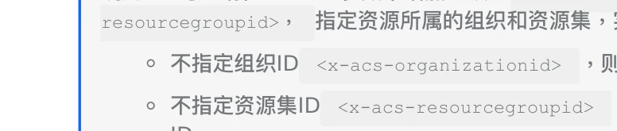

> `resourcegroupid>`， 指定资源所属的组织和资源集，实现实例资源的隔离查询。
>
> - 不指定组织ID `<x-acs-organizationid>` ，则默认获取当前用户所属的组织。
>
> - 不指定资源集ID `<x-acs-resourcegroupid>` ，则默认为空，如果指定资源集需要同时指定组织ID。

4. 获取对应的API参考文档。

   您需要查看目标云产品的开发指南，了解API的功能与使用方式，开发指南的使用流程及获取方法请参见开发文档使用说明。

5. 获取云产品Endpoint。

6. 获取云产品SDK并调用云产品API。

<a id="section-2"></a>

# 2.准备工作

<a id="section-2-1"></a>

## 2.1. 登录开发者门户

首先，您需要了解产品开放API接口的相关信息，包括产品名称（code）、开放API接口名称、API版本。

**背景信息**

Apsara Uni-manager运营控制台API目录中的API信息仅供调用参考，具体API的使用方式需要参见云产品的开发指南。如果发生不一致情况，以开发指南支持情况为准。

**操作步骤**

1. 在浏览器地址栏中，输入Apsara Uni-manager运营控制台的服务域名地址，按回车键。

2. 输入正确的用户名及密码。

   请向运营管理员获取登录控制台的用户名和密码。

   > **说明**
   >
   > 首次登录Apsara Uni-manager运营控制台时，需要修改登录用户名的密码，请按照提示完成密码修改。为提高安全性，密码长度必须为10~32位，且至少包含以下两种类型：
   >
   > - 英文大写或小写字母（A~Z、a~z）
   >
   > - 阿拉伯数字（0~9）
   >
   > - 特殊符号（感叹号（!）、at（@）、井号（#）、美元符号（$）、百分号（%）等）

3. 单击**账号登录**。

4. 如果账号已激活MFA多因素认证，请根据以下两种情况进行操作：

   - 管理员强制开启MFA后的首次登录：

     <ol type="a">

     <li>

     在绑定虚拟MFA设备页面中，按页面提示步骤绑定MFA设备。

     </li>

     <li>

     按照步骤2重新输入账号和密码，单击**账号登录**。

     </li>

     </ol>

     <ol type="i" start="100">

     <li>

     输入6位MFA码后单击**认证**。

     </li>

     </ol>

   - 您已开启并绑定MFA：

     输入6位MFA码后单击**认证**。

5. 在页面顶部的菜单栏中，选择**产品 > 应用服务 > 开发者门户**。

<a id="section-2-2"></a>

## 2.2. 查看API信息及其EndPoint

您在使用SDK时，需要获取产品名称、API名称和API版本。本文介绍如何查看API信息。

**背景信息**

API审计中的API仅供调用参考，具体API的使用方式需要参见各云产品的API文档。如果发生不一致情况，以API支持情况为准。

**操作步骤**

1. 登录开发者门户。

2. 在**开发者门户**页面，选择**API集成** > **API调试**。

   

3. 在左侧导航栏中选择目标云产品。

4. 在**版本**下拉列表中，选择目标API版本。

5. 在下方API列表中，您可浏览当前版本的所有API接口。

6. 选中对应接口，在参数名下获取云产品的POP Endpoint信息。

   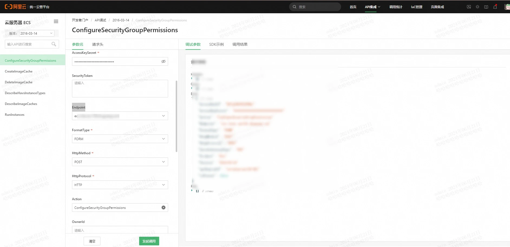

<a id="section-2-3"></a>

## 2.3. 获取AccessKey

AccessKey支持RAM和STS两种授权模式，在发起调用时选择使用其中一种AccessKey即可。本文将为您介绍如何获取通过RAM授权的AccessKey。

**背景信息**

AccessKey通过使用AccessKey ID和AccessKey Secret对称加密，实现验证某个请求发送者的身份的功能。其中AccessKey ID用于标示用户，AccessKey Secret是用户用于加密签名的字符串。

AccessKey的两种授权模式如下：

- 通过RAM授权给第三方请求者的AccessKey ID和AccessKey Secret。

- 通过STS授权给第三方请求者的AccessKey ID、AccessKey Secret和Security Token。获取方式请参见获取STS AccessKey。

Apsara Uni-manager运营控制台提供了个人AccessKey和组织AccessKey（只有运营管理员和一级组织管理员可以获取组织AccessKey），推荐使用个人账号AccessKey调用Apsara Uni-manager运营控制台及云产品相关接口。如果使用个人账号AccessKey，需要在Header中添加以下限制性参数，否则可能提示权限不足：

> **警告**
>
> 个人账号AccessKey是由Apsara Uni-manager运营控制台权限体系管控的受限AccessKey，组织AccessKey相对权限较大，需要管理员确认操作的安全性。

<table>
  <tr>
    <th width="206">参数名称</th>
    <th>描述</th>
  </tr>
  <tr>
    <td>x-acs-regionid</td>
    <td>地域，如：cn-hangzhou-*。</td>
  </tr>
  <tr>
    <td>x-acs-organizationid</td>
    <td>Apsara Uni-manager运营控制台中对应的组织ID。获取方法可参见<strong>《Apsara Uni-manager运营控制台开发指</strong><strong>南》</strong>中的<strong>《GetOrganizationList》</strong>文档。</td>
  </tr>
  <tr>
    <td>x-acs-resourcegroupid</td>
    <td>Apsara Uni-manager运营控制台中对应的资源集ID。获取方法可参见<strong>《Apsara Uni-manager运营控制台开发指</strong><strong>南》</strong>中的<strong>《ListResourceGroup》</strong>文档。</td>
  </tr>
  <tr>
    <td>x-acs-instanceid</td>
    <td>进行操作的实例ID，例如，ECS的实例ID可以从ECS列表中查询到。</td>
  </tr>
</table>

**获取个人账号AccessKey**

获取个人账号AccessKey的方法如下：

1. 登录Apsara Uni-manager运营控制台。

2. 在系统界面右上角，单击当前登录用户头像，单击**个人信息**。

3. 在**阿里云AccessKey**区域，您可以查看个人账户的AccessKey信息。

   

   > **说明**
   >
   > Accesskey ID和AccessKey Secret是您访问云资源时的密钥，具有该账号完整的权限，请您妥善保管。

**获取组织AccessKey**

获取组织AccessKey的方法如下：

1. 管理员登录Apsara Uni-manager运营控制台。

2. 在顶部菜单栏，单击**企业**。

3. 在左侧导航栏中，选择**资源管理 > 组织管理**。

4. 在组织结构中，单击目标一级组织名称。

5. 单击**管理Accesskey**。

6. 在弹出的对话框中，查看组织AccessKey信息。

<a id="section-2-4"></a>

## 2.4. 获取STS AccessKey

本文为您介绍如何利用STS方式，调用专有云的产品API。

**背景信息**

阿里云临时安全令牌STS（Security Token Service）是阿里云提供的一种临时访问权限管理服务。您可以选择使用STS方式，调用专有云的产品API。

STS AccessKey由AccessKey ID、AccessKey Secret及SecurityToken三元组组成，使用STS方式调用云产品API时，三元组缺一不可。更多STS内容请参见什么是STS。

**操作步骤**

1. 获取用户角色的 `RAM Role` 。

   <ol type="i">

   <li>

   登录Apsara Uni-manager运营控制台。

   </li>

   <li>

   单击页面右上角的用户头像，单击**个人信息**。

   </li>

   <li>

   单击**查看当前角色策略**。

   在**当前选择角色策略**对话框中查看 `RAM Role` 。

   </li>

   </ol>

2. 获取STS Accesskey三元组。

   > **说明**
   >
   > 以下代码示例中可变参数均需替换为您实际的相关信息，尖括号（<>）在最终代码中不保留。
   >
   > 涉及替换的可变参数如下：
   >
   > - &lt;yourRegionID>，请替换为您实际的地域ID。
   >
   > - &lt;yourAccessKeyID>，请替换为您实际的AccessKey ID。
   >
   > - &lt;yourAccessKeySecret>，请替换为您实际的AccessKey Secret。
   >
   > - &lt;yourRoleSessionName>，请替换为您当前实际的会话名称。
   >
   > - &lt;yourRoleArn>，请替换为您实际的RAM Role。
   >
   > - &lt;sts.aliyuns.com>，请替换为实际的STS Endpoint。

   ```xml
   public static void main(String[] args) {
       // 创建DefaultAcsClient实例并初始化。
       // 请替换为您实际的地域ID、AccessKey ID、AccessKey Secret
       DefaultProfile profile = DefaultProfile.getProfile("<yourRegionID>", "
   <yourAccessKeyID>", "<yourAccessKeySecret>");
       HttpClientConfig clientConfig = HttpClientConfig.getDefault();
       clientConfig.setIgnoreSSLCerts(true);
       clientConfig.setProtocolType(ProtocolType.HTTPS);
       profile.setHttpClientConfig(clientConfig);
       IAcsClient client = new DefaultAcsClient(profile);
       String assumeRole = callAssumeRole(client);
       if (StringUtils.isEmpty(assumeRole)) return;
       JSONObject assumeRoleJson = JSONObject.parseObject(assumeRole);
       JSONObject credentials = assumeRoleJson.getJSONObject("Credentials");
       // 获取到STS三元组
       String stsAK = credentials.getString("AccessKeyId");
       String stsSK = credentials.getString("AccessKeySecret");
       String stsToken = credentials.getString("SecurityToken");
   }

   private static String callAssumeRole(IAcsClient client) {
       CommonRequest request = new CommonRequest();
       // <sts.aliyuns.com> 请替换为实际的STS Endpoint，⼀般格式为sts-
   vpc.${global:region}.${global:internet-domain}
       request.setSysDomain("<sts.aliyuns.com>");
       request.setSysProduct("Sts");
       request.setSysAction("AssumeRole");
       request.setSysVersion("2015-04-01");
       request.setSysMethod(MethodType.POST);
       request.setHttpContentType(FormatType.FORM);
       // 业务参数，设置本次调⽤Session的别名，<yourRoleSessionName>请您替换为实际值
       request.putQueryParameter("RoleSessionName", "<yourRoleSessionName>");
       // 扮演的Role⾓⾊ARN，<yourRoleArn>请替换为上⼀步获取到的实际Ram Role ARN
       request.putQueryParameter("RoleArn", "<yourRoleArn>");
       try {
           CommonResponse response = client.getCommonResponse(request);
           return response.getData();
       } catch (ServerException e) {
           System.out.println(e.getErrCode());
           System.out.println(e.getErrMsg());
       } catch (ClientException e) {
           System.out.println(e.getErrCode());
           System.out.println(e.getErrMsg());
       }
       return null;
   }
   ```

3. 通过STS AccessKey三元组调用云产品的接口，下列代码以ECS的 `DescribeZones` 接口为示例。

   > **说明**
   >
   > 以下代码示例中可变参数均需替换为您实际的相关信息，尖括号（<>）在最终代码中不保留。
   >
   > 涉及替换的可变参数如下：
   >
   > - &lt;yourRegionID>，请替换为您实际的地域ID。
   >
   > - &lt;yourStsAccesskeyID>，请替换为您实际的STS Accesskey ID。
   >
   > - &lt;yourStsAccessKeySecret>，请替换为您实际的STS Accesskey Secret。
   >
   > - &lt;yourStsToken>，请替换为实际STS三元组中的SecurityToken。
   >
   > - &lt;yourResourceGroupID>，请替换为您实际的资源集ID。
   >
   > - &lt;yourOrganizationID>，请替换为您实际的组织ID。

   ```xml
   public static void main(String[] args) {
       // <yourRegionID>请替换为您实际的地域ID
       // <yourStsAccessKeyID>, <yourStsAccessKeySecret>请替换为前⼀步获取到的STS三元组中AccessKeyID
   、AccessKeySecret
       DefaultProfile profile = DefaultProfile.getProfile("<yourRegionID>", "
   <yourStsAccesskey>", "<yourStsAccessSecret>");
       HttpClientConfig clientConfig = HttpClientConfig.getDefault();
       clientConfig.setIgnoreSSLCerts(true);
       clientConfig.setProtocolType(ProtocolType.HTTPS);
       profile.setHttpClientConfig(clientConfig);
       IAcsClient client = new DefaultAcsClient(profile);
       CommonRequest request = new CommonRequest();
       request.setSysDomain("ecs.aliyuns.com");
       request.setSysProduct("Ecs");
       request.setSysAction("DescribeZones");
       request.setSysVersion("2014-05-26");
       request.setSysMethod(MethodType.POST);
       request.setHttpContentType(FormatType.FORM);
       //<yourRegionID>请替换为您实际的地域ID
       request.putHeadParameter("x-acs-regionid", "<yourRegionID>");
       // <yourStsToken>请替换为您前⼀步获取到的STS三元组中SecurityToken
       request.putQueryParameter("SecurityToken", "<yourStsToken>");
       // 非必填,请替换为您实际的资源集ID
       // request.putHeadParameter("x-acs-resourcegroupid", "<yourResourceGroupID>");
       // 必填,请替换为您实际的组织ID
       request.putHeadParameter("x-acs-organizationid", "<yourOrganizationID>");
       try {
           CommonResponse response = client.getCommonResponse(request);
           System.out.println(response.getData());
       } catch (ServerException e) {
           System.out.println(e.getErrCode());
           System.out.println(e.getErrMsg());
       } catch (ClientException e) {
           System.out.println(e.getErrCode());
           System.out.println(e.getErrMsg());
       }
   }
   ```

<a id="section-2-5"></a>

## 2.5. 获取公共Header参数

调用专有云API时需要提供多个Header参数。本文为您介绍这些参数的含义及其获取方式，并对调用后的一些返回值做出解释。

**Header参数描述**

| 名称 | 描述 |
| --- | --- |
| x-acs-regionid | 环境Region，获取方式请参见获取Region ID。 |
| x-acs-organizationid | Apsara Uni-manager运营控制台上的组织ID，获取方式请参见获取组织ID。 |
| x-acs-resourcegroupid | Apsara Uni-manager运营控制台上的资源集ID，获取方式请参见获取资源集ID。 |
| x-acs-instanceid | 进行操作的实例ID，获取方式请参见获取集群ID。 |

**获取Region ID**

1. 管理员登录Apsara Uni-manager运营控制台。

2. 在顶部菜单栏中，单击**企业**。

3. 在左侧导航栏中，选择**资源管理**>**地域管理**。

4. 单击目标组织名称。

5. 在右侧**Region列表**中查看Region ID。

**获取组织ID**

组织ID需要通过API进行获取，获取方式请参见*Apsara Uni-manager运营控制台开发指南*中的*GetOrganizationList章节*。

**获取资源集ID**

资源集ID需要通过API进行获取，获取方式请参见*Apsara Uni-manager运营控制台开发指南*中的*ListResourceGroup章节*。

**获取集群ID**

实例ID可以通过Apsara Uni-manager运营控制台中的云产品实例列表进行获取，获取步骤如下：

1. 登录Apsara Uni-manager运营控制台。

2. 在顶部的菜单栏中，选择**产品**>**数据库**>**云原生关系型数据库PolarDB**。

3. 在集群列表中查看**集群ID**。

**返回参数**

对于列表类的云产品资源实例接口，调用后会默认增加如下返回值。

| 名称 | 描述 |
| --- | --- |
| ResourceGroupName | 资源集名称。 |
| ResourceGroup | 资源集ID。 |
| DepartmentName | 组织名称。 |
| Department | 组织ID。 |

<a id="section-3"></a>

# 3.Java SDK调用

<a id="section-3-1"></a>

## 3.1. 快速开始

本节介绍如何获取PolarDB Java SDK并开始调用。

**环境准备**

- 使用阿里云专有云Java SDK，您需要一个授权账号以及一对AccessKey ID和AccessKey Secret。在Apsara Stack控制台上获取和查看您的AccessKey。

- 获取产品的endpoint。

- 阿里云专有云Java SDK需要1.6以上的JDK。

**安装阿里云专有云 Java SDK**

如果您使用Apache Maven来管理Java项目，只需在项目的pom.xml中导入JAR文件。

要使用产品的开发工具包，必须安装SDK核心库以及产品的SDK。

其中，SDK核心库的版本为3.7.1，PolarDB SDK的版本为1.8.27。

```xml
<dependencies>
        <dependency>
            <groupId>com.aliyun</groupId>
            <artifactId>aliyun-java-sdk-core</artifactId>
            <version>3.7.1</version>
            <scope>system</scope>
            <systemPath>${project.basedir}/lib/aliyun-java-sdk-core-3.7.1.jar</systemPath>
        </dependency>
        <dependency>
            <groupId>com.aliyun</groupId>
            <artifactId>aliyun-java-ecs</artifactId>
            <version>3.5.0</version>
            <scope>system</scope>
            <systemPath>${project.basedir}/lib/aliyun-java-sdk-polardb-1.8.27.jar</systemPath>
        </dependency>
    </dependencies>
```

**使用Java SDK**

以下这个代码示例展示了调用阿里云专有云Java SDK的3个主要步骤：

1. 创建并初始化DefaultAcsClient实例。

2. 创建API请求并设置参数。

3. 发起请求并处理应答或异常。

   ```java
   package com.testprogram;
    import com.aliyuncs.profile.DefaultProfile;
    import com.aliyuncs.DefaultAcsClient;
    import com.aliyuncs.IAcsClient;
    import com.aliyuncs.exceptions.ClientException;
    import com.aliyuncs.exceptions.ServerException;
    import com.aliyuncs.ecs.model.v20140526.*;
    public class Main {
        public static void main(String[] args) {
            // 创建DefaultAcsClient实例并初始化
            DefaultProfile profile = DefaultProfile.getProfile(
                "<your-region-id>",          // 区域名
                "<your-access-key-id>",      // 授权账号的AccessKey ID
                "<your-access-key-secret>"); // 授权账号Access Key Secret
            // 设置当前产品的endpoint 
           profile.addEndpoint("your-region-id", "your-region-id", "product", "endpoint");
            IAcsClient client = new DefaultAcsClient(profile);
            // 创建API请求并设置参数
            DescribeInstancesRequest request = new DescribeInstancesRequest();
            request.setPageSize(10);
            // 发起请求并处理应答或异常
            DescribeInstancesResponse response;
            try {
                response = client.getAcsResponse(request);
                for (DescribeInstancesResponse.Instance instance:response.getInstances()) {
                    System.out.println(instance.getPublicIpAddress());
                }
            } catch (ServerException e) {
                e.printStackTrace();
            } catch (ClientException e) {
                e.printStackTrace();
            }
        }
    }
   ```

<a id="section-3-2"></a>

## 3.2. 使用手册

<a id="section-3-2-1"></a>

### 3.2.1. 安装Java SDK

本文档介绍如何安装及调用PolarDB Java SDK。

阿里云专有云Java SDK支持1.6及以上版本的JDK，可以通过导入JAR文件的方式进行安装。

您可以点击SDK下载下载PolarDB JAR文件。

无论您使用Eclipse还是IntelliJ作为集成开发环境，都可以通过导入JAR文件的方式安装 PolarDB Java SDK。

安装方法如下：

- 使用Eclipse安装

  完成以下操作，在Eclipse的项目中安装ECS Java SDK：

  <ol type="i">

  <li>

  将下载的 `aliyun-java-sdk-polardb.jar` 文件复制到您的项目文件夹中。

  </li>

  <li>

  在Eclipse中打开您的项目，右键单击该项目，单击**Properties**。

  </li>

  <li>

  在弹出的对话框中，单击**Java Build Path > Libraries > Add JARs**添加下载的JAR文件。

  </li>

  <li>

  单击**Apply and Close**。

  </li>

  </ol>

- 使用IntelliJ安装完成以下操作，在IntelliJ的项目中安装阿里云专有云Java SDK：

  <ol type="i">

  <li>

  将下载的 `aliyun-java-sdk-polardb.jar` 文件复制到您的项目文件夹中。

  </li>

  <li>

  在IntelliJ中打开您的项目，在菜单栏中单击**File > Project Structure**。

  </li>

  <li>

  单击**Apply**，然后单击**OK**。

  </li>

  </ol>

<a id="section-3-2-2"></a>

### 3.2.2. 设置身份验证凭证

当使用阿里云专有云SDK访问阿里云专有云服务时，您需要提供授权的账号进行身份验证。

目前，Java SDK支持通过AccessKey进行身份验证，获取AccessKey的方法请参见获取AccessKey。

使用AccessKey作为访问凭据时，需要在初始化Client时设置凭证。

> 确保包含AccessKey的代码不会泄漏（例如提交到外部公开的GitHub项目），否则将会危害您的
>
> **重要**
>
> 信息安全。

```text
DefaultProfile profile = DefaultProfile.getProfile(
    "<your-region-id>",          // 区域名
    "<your-access-key-id>",      // 授权账号的AccessKey ID
    "<your-access-key-secret>"); // 授权账号AccessKey Secret
```

<a id="section-3-2-3"></a>

### 3.2.3. 发起调用

本节介绍如何使用 PolarDB Java SDK发起请求。

**操作步骤**

1. 新建一个AcsClient。

   ```text
   IAcsClient client = new DefaultAcsClient(profile);
   ```

2. 创建请求。

   请求类的命名规范为 `${apiName}Request` ，其中<strong>${apiName}</strong>为API名称，例如DescribeDBCluster。

   在引入多个产品SDK时，有可能存在Request类同名的情况，请注意按照package区分。

   ```text
   DescribeInstancesRequest request = new DescribeInstancesRequest();
   request.setPageSize(10);
   ```

3. 发起调用并处理应答。

   ```java
   DescribeInstancesResponse response;
   try {
       response = client.getAcsResponse(request);
       for (DescribeInstancesResponse.Instance instance:response.getInstances()) {
           System.out.println(instance.getPublicIpAddress());
       }
   } catch (ServerException e) {
       e.printStackTrace();
   } catch (ClientException e) {
       e.printStackTrace();
   }
   ```

   正常情况下，应答中的所有字段，都会被反序列化到response中，您可以直接调用 `response.getXXX()` 来获得应答中的字段。

   ```text
   instanceStatus := response.getStatus()
   ```

   如果出现了异常，或您需要原始HTTP应答的情况下，您可以通过以使用 `doAction()` 来获取原始应答。

   ```text
   HttpResponse response = client.doAction(request);
   ```

<a id="section-3-2-4"></a>

### 3.2.4. 错误处理

在使用Java SDK时，当服务端或者SDK端出错时，SDK会返回相应的异常信息。这些异常信息中会包含具体的错误信息包括错误码（Error Code）和错误消息（Error Message）。

一般情况下，您不需要Java SDK返回的错误进行处理。您只需要根据服务端的错误提示处理服务端错误即可。

- `ServerException` 是服务端错误信息。

- `ClientException` 是SDK端错误信息。

例如，当出现如下错误时，您可以根据具体的错误信息，修改AccessKey的ID即可。

```text
com.aliyuncs.exceptions.ClientException: InvalidAccessKeyId.NotFound : Specified access key isnot found.
```

如果您需要对SDK的错误进行处理，可以参考如下示例编写代码：

```java
try {
    FooResponse response = client.getAcsResponse(request);
    // 处理Response
    // ...
}catch (ServerException e){
    // 这⾥可以添加您⾃⼰的错误处理逻辑
    // 例如，打印具体的错误信息
    System.out.println("ErrorCode=" + e.getErrCode());
    System.out.println("ErrorMessage=" + e.getErrMsg());
    // 如果遇上棘⼿问题，可以提交⼯单，并将RequestId提供给我们
    System.out.println("ResponseId=" + e.getRequestId());
}catch (ClientException e){
    // 这⾥可以添加您⾃⼰的错误处理逻辑
    // 例如，打印具体的错误信息
    System.out.println("ErrorCode=" + e.getErrCode());
    System.out.println("ErrorMessage=" + e.getErrMsg());
}
```

<a id="section-3-2-5"></a>

### 3.2.5. 使用CommonRequest进行调用

当您要调用的某个产品的API没有提供SDK时，可以采用泛用型的API调用方式（CommonRequest）。使用CommonRequest调用方式可实现任意Open API接口的调用。

**CommonRequest调用特点**

CommonRequest的特点如下：

1. 轻量：只需Core包即可发起调用，无需下载安装各产品的SDK。

2. 简便：无需更新SDK即可调用最新发布的API。

3. 快速迭代。

**使用CommonRequest**

发起一次CommonRequest请求，您需要获取以下几个参数的值。您可以在各产品的API文档中获取以下参数的值。

- 域名(domain)：该产品的服务地址。

- API版本(version)：该API的版本号，格式为YYYY-MM-DD。

  您可以在各产品的API文档的公共参数部分获取API版本。

- 接口信息：要调用的接口名称。

  您需要获取**Action**参数，使用 `request.ApiName = "<Action>"` 的方式来指定API名称。

  例如RunInstances接口，在发起CommonRequest请求时，需要使用 `request.ApiName = "RunInstances"` 来指定API名称。

  您需要获取**PathPattern**参数，使用 `request.PathPattern = "<PathPattern>"` 的方式来指定RESTful路径。

  例如查看所有集群实例的API的**PathPattern**为 `/clusters` ，在发起CommonRequest请求时，要使用 `request.PathPattern = "/clusters"` 指定RESTful路径。

**示例：调用RPC风格的API**

以下代码展示了如何使用CommonRequest的方式调用DescribeInstanceStatus接口：

```java
import com.aliyuncs.CommonRequest;
import com.aliyuncs.CommonResponse;
import com.aliyuncs.DefaultAcsClient;
import com.aliyuncs.IAcsClient;
import com.aliyuncs.exceptions.ClientException;
import com.aliyuncs.exceptions.ServerException;
import com.aliyuncs.profile.DefaultProfile;
public class Sample {
    public static void main(String[] args) {
        // 创建DefaultAcsClient实例并初始化
        DefaultProfile profile = DefaultProfile.getProfile(
            "<your-region-id>",          // 您的地域ID
            "<your-access-key-id>",      // 您的AccessKey ID
            "<your-access-key-secret>"); // 您的AccessKey Secret
        IAcsClient client = new DefaultAcsClient(profile);
        // 创建API请求并设置参数
        CommonRequest request = new CommonRequest();
        request.setDomain("ecs.aliyuncs.com");
        request.setVersion("2014-05-26");
        request.setAction("DescribeInstanceStatus");
        request.putQueryParameter("PageNumber", "1");
        request.putQueryParameter("PageSize", "30");
        try {
            CommonResponse response = client.getCommonResponse(request);
            System.out.println(response.getData());
        } catch (ServerException e) {
            // TODO Auto-generated catch block
            e.printStackTrace();
        } catch (ClientException e) {
            // TODO Auto-generated catch block
            e.printStackTrace();
        }
    }
}
```

**示例：调用RESTful风格的API**

以下代码展示了如何使用CommonRequest的方式调用查看所有集群实例接口：

```java
import com.aliyuncs.CommonRequest;
import com.aliyuncs.CommonResponse;
import com.aliyuncs.DefaultAcsClient;
import com.aliyuncs.IAcsClient;
import com.aliyuncs.exceptions.ClientException;
import com.aliyuncs.exceptions.ServerException;
import com.aliyuncs.profile.DefaultProfile;
public class Sample {
    public static void main(String[] args) {
        // 创建DefaultAcsClient实例并初始化
        DefaultProfile profile = DefaultProfile.getProfile(
            "<your-region-id>",          // 您的地域ID
            "<your-access-key-id>",      // 您的AccessKey ID
            "<your-access-key-secret>"); // 您的AccessKey Secret
        IAcsClient client = new DefaultAcsClient(profile);
        // 创建API请求并设置参数
        CommonRequest request = new CommonRequest();
        request.setDomain("cs.aliyuncs.com");
        request.setVersion("2015-12-15");
        request.setUriPattern("/clusters");
        try {
            CommonResponse response = client.getCommonResponse(request);
            System.out.println(response.getData());
        } catch (ServerException e) {
            // TODO Auto-generated catch block
            e.printStackTrace();
        } catch (ClientException e) {
            // TODO Auto-generated catch block
            e.printStackTrace();
        }
    }
}
```

<a id="section-3-2-6"></a>

### 3.2.6. 常见错误

您可以参考本文档中提供的常见问题排查SDK使用中的问题。

| 错误码 | 错误信息 | 原因 | 解决方法 |
| --- | --- | --- | --- |
| <code>SDK.CanNotResol</code><br><code>veEndpoint</code> | <code>Can not</code><br><code>resolve</code><br><code>endpoint, please</code><br><code>check the user</code><br><code>guide</code> | SDK无法自动获取调用的产品在特定region的endpoint（域名）。 | 检查提供的区域ID和endpoint是否正确。获取endpoint后，可以通过以下代码设定endpoint：<br><code>DefaultProfile.addEndpoint("your-</code><br><code>region-id", "your-region-id",</code><br><code>"product", "endpoint"");</code> |
| <code>SDK.JsonUnmarsh</code><br><code>alError</code> | <code>Failed to</code><br><code>unmarshal</code><br><code>response</code> | SDK反序列化应答失败，大部分情况下是由于SDK实际收到的应答结构与ApiMeta不符（例如字段不匹配，格式不正确等原因）导致的。 | 您可以通过使用<code> client.doAction(request) </code>方法，获取原始的HTTP应答。 |
| <code>SDK.TimeoutErro</code><br><code>r</code> | <code>The request</code><br><code>timed out 4</code><br><code>times(3 for</code><br><code>retry), perhaps</code><br><code>we should have</code><br><code>the</code><br><code>threshold raised</code><br><code>a little?</code> | 请求超时，并且所有重试均失败。 | 如果存在其他低质量网络场景，建议考虑适当延长超时时间或最大重试次数。 |
| <code>SDK.ServerError</code>：<code>InvalidProtocol.N</code><br><code>eedSsl</code> | <code>Your request</code><br><code>is denied as</code><br><code>lack of ssl</code><br><code>protect.Recommend</code><br><code>:https://error-</code><br><code>center.aliyun.com</code><br><code>/status/search?</code><br><code>Keyword=InvalidPr</code><br><code>otocol.NeedSsl&amp;so</code><br><code>urce=PopGw</code> | API只接受HTTPS请求，不接受HTTP请求。 | 在发送request前，添加以下代码：<br><code>request.setProtocol(ProtocolType.H</code><br><code>TTPS)</code> |

<a id="section-4"></a>

# 4.Python SDK调用示例

<a id="section-4-1"></a>

## 4.1. 快速开始

本节介绍如何获取PolarDB Python SDK并开始调用。

**环境准备**

- 使用Python SDK前，您需要一个授权账号以及一对AccessKey ID和AccessKey Secret。具体请参见获取AccessKey。

- 获取Endpoint，具体操作参见获取Endpoint。

**安装Python SDK**

1. 安装SDK核心库。

   - 如果您使用的是Python 2.x，执行以下命令，安装阿里云SDK核心库：

     ```bash
     pip install aliyun-python-sdk-core
     ```

   - 如果您使用的是Python 3.x，执行以下命令，安装阿里云SDK核心库：

     ```bash
     pip3 install aliyun-python-sdk-core-v3
     ```

2. 安装SDK。

   以下以安装云服务器ECS的SDK为例：

   - 如果您使用的是Python 2.x，执行以下命令，安装云服务器ECS的SDK：

     ```bash
     pip install aliyun-python-sdk-ecs
     ```

   - 如果您使用的是Python 3.x，执行以下命令，安装云服务器ECS的SDK：

     ```bash
     pip3 install aliyun-python-sdk-ecs
     ```

**使用Python SDK**

以下示例以ECS为例展示调用Python SDK的3个主要步骤：

1. 创建Client实例。在创建Client实例时，您需要获取Region ID、AccessKey ID和AccessKey Secret。

2. 创建API请求并设置参数。

3. 发起请求并处理应答或异常。

   > **说明**
   >
   > 以下代码示例中可变参数均需替换为您实际的相关信息，尖括号（<>）在最终代码中不保留。
   >
   > 涉及替换的可变参数如下：
   >
   > - &lt;yourRegionID>，请替换为您实际的地域ID。
   >
   > - &lt;yourAccessKeyID>，请替换为您实际的AccessKey ID。
   >
   > - &lt;yourAccessKeySecret>，请替换为您实际的AccessKey Secret。
   >
   > - &lt;ecs.aliyuns.com>，请替换为您实际的产品访问地址。

   ```python
   #!/usr/bin/env python
   #coding=utf-8
   from aliyunsdkcore import client
   from aliyunsdkcore.profile import region_provider
   from aliyunsdkecs.request.v20140526 import DescribeInstancesRequest
   # global config
   region_id = '<yourRegionID>' # 请替换为您实际的地域ID
   access_key = '<yourAccessKeyID>' # 请替换为您实际的的AccessKey ID
   acces_secret = '<yourAccessKeySecret>' # 请替换为您实际的AccessKey Secret
   # product config
   product_name = 'ECS' # 填写产品名称
   endpoint = '<ecs.aliyuns.com>' # 产品访问域名,当前为示例值,请替换为您实际的产品访问地址
   # create client
   region_provider.modify_point(product_name, region_id, endpoint)
   clt = client.AcsClient(access_key, acces_secret, region_id)
   # setup request
   request = DescribeInstancesRequest.DescribeInstancesRequest()
   request.set_accept_format('json') # 设置返回数据格式
   # get response
   response = clt.do_action_with_exception(request)
   print response
   ```

<a id="section-4-2"></a>

## 4.2. 使用手册

<a id="section-4-2-1"></a>

### 4.2.1. 安装Python SDK

本文档介绍如何安装及调用PolarDB Python SDK。

阿里云专有云Python SDK支持Python 2.6.x、2.7.x和3.x及以上环境，您可以通过pip安装专有云Python SDK。

> **说明**
>
> 使用产品的开发工具包，都必须安装阿里云Python SDK核心库。例如，如果要使用ECS的Python SDK，您需要安装阿里云Python SDK核心库和ECS的Python SDK。

- 如果您使用的是Python 2.x，执行以下命令，安装阿里云SDK核心库：

  ```bash
  pip install aliyun-python-sdk-core
  ```

- 如果您使用的是Python 3.x，执行以下命令，安装阿里云SDK核心库：

  ```bash
  pip3 install aliyun-python-sdk-core-v3
  ```

安装云产品的SDK，以下以安装ECS的SDK为例。

- 如果您使用的是Python 2.x，执行以下命令，安装ECS的SDK：

  ```bash
  pip install aliyun-python-sdk-ecs
  ```

- 如果您使用的是Python 3.x，执行以下命令，安装ECS的SDK：

  ```bash
  pip3 install aliyun-python-sdk-ecs
  ```

<a id="section-4-2-2"></a>

### 4.2.2. 设置身份验证凭证

当使用阿里云SDK访问阿里云专有云服务时，您需要提供授权的账号进行身份验证。

目前Python SDK支持通过AccessKey进行身份验证，获取AccessKey的方法请参见获取AccessKey。

使用AccessKey作为访问凭据时，需要在初始化Client时设置凭证。

> **重要**
>
> 确保包含AccessKey的代码不会泄漏（例如提交到外部公开的GitHub项目），否则将会危害您的信息安全。

```text
clt = client.AcsClient(secret_id, secret_key, region_id)
```

<a id="section-4-2-3"></a>

### 4.2.3. 设置HTTPS请求

Python SDK支持使用HTTP和HTTPS协议发起 API 请求。

使用Python SDK时，您可以为某个请求指定使用HTTP或HTTPS协议，您也可以设置全局默认协议。

> **说明**
>
> 产品的默认协议（HTTP/HTTPS）优先于设置的全局默认协议。

**添加OpenSSL依赖**

Python SDK的HTTPS协议依赖Python的OpenSSL支持。要使用阿里云SDK通过HTTPS协议发送请求，您需要在Python中添加OpenSSL 支持。OpenSSL支持TLS1.2及以上版本。

运行 `python -c "import ssl"` 检查Python环境是否支持OpenSSL。运行后，如果没有出现 `ImportError: No module named ssl` 的错误信息，说明已经支持OpenSSL。

若没有OpenSSL，运行以下命令安装：

```bash
pip install pyopenssl  #Python2使⽤此命令。
```

> **说明**
>
> 若本地环境为Python3，则运行 `pip3 install pyopenssl` 命令。

**设置单个请求的HTTP/HTTPS协议**

参考以下代码示例为一个接口设置HTTPS调用：

```text
request = DescribeInstancesRequest()
request.set_protocol_type("https")
# 取值："https" 或 "http"
```

**设置全局默认协议**

参考以下代码示例设置全局默认协议：

```python
import aliyunsdkcore.request
aliyunsdkcore.request.set_default_protocol_type("https")
# 创建请求并调⽤ client.do_action_with_exception() 来发送请求
```

<a id="section-4-2-4"></a>

### 4.2.4. 发起调用

本节介绍如何使用PolarDB Python SDK发起请求。

**操作步骤**

1. 导入相关产品的SDK。

   ```python
   from aliyunsdkcore import client
   from aliyunsdkcore.profile import region_provider
   from aliyunsdkecs.request.v20140526 import DescribeInstancesRequest
   ```

2. 新建一个AcsClient。

   ```text
   client.region_provider.modify_point(product_name, region_id, endpoint)
   clt = client.AcsClient(access_key, access_secret, region_id)
   ```

3. 创建Request对象。

   ```text
   request = DescribeInstancesRequest.DescribeInstancesRequest()
   request.set_accept_format('json')
   ```

4. 发起调用并处理返回。

   ```text
   response = clt.do_action_with_exception(request)

   print response
   ```

<a id="section-4-2-5"></a>

### 4.2.5. 错误处理

在使用Python SDK时，当服务端或者SDK端出错时，SDK会返回相应的异常信息。这些异常信息中会包含具体的错误信息包括错误码（Error Code）和错误消息（Error Message）。

一般情况下，您不需要对Python SDK返回的错误进行处理。您只需要根据服务端的错误提示处理服务端错误即可。

- `ServerException` 是服务端错误信息。

- `ClientException` 是SDK端错误信息。

例如，当出现如下错误时，您可以根据具体的错误信息，修改AccessKey的ID即可。

```text
aliyunsdkcore.acs\_exception.exceptions.ServerException: HTTP Status: 404 
Error:InvalidAccessKeyId.NotFound Specified access key is not found.
```

如果您需要对SDK的错误进行处理，可以参考如下示例编写代码：

```text
try:
    response = client.do_action_with_exception(request)
except ServerException as e:
    # 这⾥可以添加您⾃⼰的错误处理逻辑
    # 例如，打印具体的错误信息
    print e.get_http_status()
    print e.get_error_code()
    print e.get_error_msg()
```

<a id="section-4-2-6"></a>

### 4.2.6. 使用CommonRequest进行调用

当您要调用的某个产品的API没有提供SDK时，或者提供的SDK中的请求Request参数和返回Response值不符合需求时，可以采用泛用型的API调用方式（CommonRequest）。使用CommonRequest调用方式可实现任意Open API接口的调用。

**CommonRequest调用特点**

CommonRequest的特点如下：

1. 轻量：只需Core包即可发起调用，无需下载安装各产品的SDK。

2. 简便：无需更新SDK即可调用最新发布的API。

3. 快速迭代。

**使用CommonRequest**

发起一次CommonRequest请求，您需要获取以下几个参数的值。您可以在各产品的API文档中获取以下参数的值。

- 域名(domain)：该产品的服务地址。

- API版本(version)：该API的版本号，格式为YYYY-MM-DD。

  您可以在各产品的API文档的公共参数部分获取API版本。

- 接口信息：要调用的接口名称。

  - RPC风格的API：

    您需要获取**Action**参数，使用 `request.set_action_name('Action')` 的方式来指定API名称。

    例如RunInstances接口，在发起CommonRequest请求时，需要使用 `request.set_action_name('RunInstances')` 来指定API名称。

  - RESTful风格的API：

    您需要获取**PathPattern**参数，使用 `request.set_uri_pattern('Pattern')` 的方式来指定RESTful。

    例如查看所有集群实例的API的**PathPattern**为 `/api/v1/clusters` ，在发起CommonRequest请求时，要使用 `request.set_uri_pattern ('/api/v1/clusters')` 指定RESTful路径。

**示例：调用RPC风格的API**

以下代码为云服务器（ECS）的DescribeInstanceStatus接口，获取实例状态列表的调用示例：

> **说明**
>
> 以下代码示例中可变参数均需替换为您实际的相关信息，尖括号（<>）在最终代码中不保留。
>
> 涉及替换的可变参数如下：
>
> - &lt;yourRegionID>，请替换为您实际的地域ID。
>
> - &lt;yourAccessKeyID>，请替换为您实际的AccessKey ID。
>
> - &lt;yourAccessKeySecret>，请替换为您实际的AccessKey Secret。
>
> - &lt;yourSecurityToken>，请替换为您实际的SecurityToken。
>
> - &lt;yourResourceGroupID>，请替换为您实际的资源集ID。
>
> - &lt;yourOrganizationID>，请替换为您实际的组织ID。
>
> - &lt;yourInstanceID>，请替换为您实际的实例ID。
>
> - &lt;ecs.aliyuncs.com>，请替换为您实际的产品访问地址。

```python
from aliyunsdkcore.client import AcsClient
from aliyunsdkcore.request import CommonRequest
# 请替换为您实际的AccessKey ID、AccessKey Secret、地域ID
client = AcsClient('{<yourAccessKeyID>}', '{<yourAccessKeySecret>}', '{<yourRegionID>}')
request = CommonRequest()
request.set_product('Ecs')
request.set_action_name('DescribeInstanceStatus')
request.set_version('2014-05-26')
request.set_domain('<ecs.aliyuncs.com>') #产品访问域名,当前为示例值,请替换为您实际的产品访问地址
# or:
# request = = CommonRequest(product='Ecs', action_name='DescribeInstanceStatus',version='2014-05-26',domain='ecs.aliyuncs.com')
######
# 设置请求协议类型,⽀持https或http,默认为http
# 设置https⽅法如下：
# request.set_protocol_type('https') 
######
request.set_accept_format('json')
request.set_method('POST')
request.add_query_param('PageNumber', '1')
request.add_query_param('PageSize', '30')
######
# 当使⽤STS AccessKey调⽤接⼝时，需要在参数中加上SecurityToken字段
# 调⽤⽅法如下：
# request.add_query_param("SecurityToken", "<yourSecurityToken>");
# 请替换为您实际的SecurityToken
######
# 非必填，请替换为您实际的资源集ID
request.add_header("x-acs-resourcegroupid", "<yourResourceGroupID>")
# 必填，请替换为您实际的组织ID
request.add_header("x-acs-organizationid", "<yourOrganizationID>")
# 必填，调⽤来源说明
request.add_header("x-acs-caller-sdk-source","ApiTestDemo")
# 非必填（企业版V3.15.0及之前历史版本需要），请替换为您实际的地域ID
request.add_header("x-acs-regionid", "<yourRegionID>")
# 非必填（修改、删除、查询单实例详情时需要），请替换为您实际的实例ID
# request.add_header("x-acs-instanceid", "<yourInstanceID>")

response = client.do_action_with_exception(request)
print(str(response, encoding = 'utf-8'))
```

**示例：调用RESTful风格的API**

当调用RESTful风格的API时，业务参数传参方式根据接口请求方式和ContentType分为两种：

- 接口请求方式为 `GET` 或 `DELETE` ，或ContentType为 `application/x-www-form-urlencoded` ，使用以下方式传参：

  将请求参数放在Query中，例如 `request.add_query_param("page_number", "1")` 。

- 接口请求方式为 `POST` 或 `PUT` ，且ContentType为 `application/json` ，使用以下方式传参：

  将请求参数放在Body中，例如：

  ```text
  body = '{"page_number":"1",page_size"5":"SecurityToken","":"<yourSecurityToken>"}'
  request.set_content(body.encode('utf-8'))
  ```

以下代码为容器服务（CS）的DescribeClusterV1接口，获取集群列表的调用示例：

> **说明**
>
> 以下代码示例中可变参数均需替换为您实际的相关信息，尖括号（<>）在最终代码中不保留。
>
> 涉及替换的可变参数如下：
>
> - &lt;yourRegionID>，请替换为您实际的地域ID。
>
> - &lt;yourAccessKeyID>，请替换为您实际的AccessKey ID。
>
> - &lt;yourAccessKeySecret>，请替换为您实际的AccessKey Secret。
>
> - &lt;yourSecurityToken>，请替换为您实际的SecurityToken。
>
> - &lt;yourResourceGroupID>，请替换为您实际的资源集ID。
>
> - &lt;yourOrganizationID>，请替换为您实际的组织ID。
>
> - &lt;yourInstanceID>，请替换为您实际的实例ID。
>
> - &lt;cs.aliyuncs.com>，请替换为您实际的产品访问地址。

```python
from aliyunsdkcore.client import AcsClient
from aliyunsdkcore.request import CommonRequest
######
# API:CS-DescribeClusterV1
######
# 请替换为您实际的AccessKey ID、AccessKey Secret、地域ID
client = AcsClient('{<yourAccessKeyID>}', '{<yourAccessKeySecret>}', '{<yourRegionID>}')
request = CommonRequest()
request.set_product('CS')
request.set_version('2015-12-15')
request.set_uri_pattern('/api/v1/clusters') # Pattern 
request.set_domain('<cs.aliyuncs.com>') # 产品访问域名,当前为示例值,请替换为您实际的产品访问地址
# or:
# request = CommonRequest(product='CS', version='2015-12-15', uri_pattern='/api/v1/clusters', domain='cs.aliyuns.com')
######
# 设置请求协议类型,⽀持 HTTP 或 HTTPS,默认为HTTP
# 设置https⽅法如下：
# request.set_protocol_type('https') 
######
request.set_accept_format('json')
request.set_method('GET')
request.add_header('Content-Type', 'application/json')
# 非必填，请替换为您实际的资源集ID
request.add_header("x-acs-resourcegroupid", "<yourResourceGroupID")
# 必填，请替换为您实际的组织ID
request.add_header("x-acs-organizationid", "<yourOrganizationID>")
# 必填，调⽤来源说明
request.add_header("x-acs-caller-sdk-source","ApiTestDemo")
# 非必填（企业版V3.15.0及之前历史版本需要）,请替换为您实际的地域ID
request.add_header("x-acs-regionid", "<yourRegionID>")
# 非必填（修改、删除、查询单实例详情时需要）,请替换为您实际的实例ID
# request.add_header("x-acs-instanceid", "<yourInstanceID>")
# 业务参数,请求⽅式为GET、DELETE 或ContentType为application/x-www-form-urlencoded,则使⽤以下⽅式传数据
request.add_query_param("page_number", "1")
request.add_query_param("page_size", "5")
######
# 当使⽤STS AccessKey调⽤接⼝时，需要在参数中加上SecurityToken字段
# 调⽤⽅法如下：
# body = '''{\"SecurityToken\", \"<yourSecurityToken>\"}'''
# 请替换为您实际的SecurityToken
######
######
# 若接⼝请求⽅式是POST、PUT 且ContentType为application/json,则以下⽅式传数据
# body = '{"page_number":"1",page_size"5":"SecurityToken","":"<your-SecurityToken>"}'
# request.set_content(body.encode('utf-8'))
######
response = client.do_action_with_exception(request)
print(str(response, encoding = 'utf-8'))
```

<a id="section-5"></a>

# 5.Go SDK调用示例

<a id="section-5-1"></a>

## 5.1. 快速开始

阿里云Go SDK让您不用复杂编程即可访问。本操作介绍如何获取阿里云PolarDB Go SDK并开始调用。

**环境准备**

- 使用Python SDK前，您需要一个授权账号以及一对AccessKey ID和AccessKey Secret。在Apsara Uni-manager运营控制台上获取和查看您的AccessKey。

- 获取PolarDB的Endpoint，具体操作参见获取Endpoint。

**安装阿里云Go SDK核心包**

阿里云Go SDK支持Go 1.10.x及更高版本，您可以通过执行以下命令安装Go SDK核心包。

```text
go get -u github.com/aliyun/alibaba-cloud-sdk-go/sdk
```

**使用Go SDK**

以下这个代码示例展示了调用阿里云Go SDK的3个主要步骤：

1. 初始化Client实例。

2. 创建API请求并设置参数。

3. 发起请求并处理应答或异常。

   > **说明**
   >
   > 以下代码示例中可变参数均需替换为您实际的相关信息，尖括号（<>）在最终代码中不保留。
   >
   > 涉及替换的可变参数如下：
   >
   > - &lt;yourRegionID>，请替换为您实际的地域ID。
   >
   > - &lt;yourAccessKeyID>，请替换为您实际的AccessKey ID。
   >
   > - &lt;yourAccessKeySecret>，请替换为您实际的AccessKey Secret。
   >
   > - &lt;Endpoint>，请替换为您实际的Endpoint。

   ```go
   package main
   import (
       "github.com/aliyun/alibaba-cloud-sdk-go/services/ecs"
       "github.com/aliyun/alibaba-cloud-sdk-go/sdk/requests"
       "fmt"
   )
   func main() { 
       // 创建ecsClient实例
       ecsClient, err := ecs.NewClientWithAccessKey(
           "<yourRegionID>",             // 请替换为您实际的地域ID
           "<yourAccessKeyID>",         // 请替换为您实际的的AccessKey ID
           "<yourAccessKeySecret>")        // 请替换为您实际的AccessKey Secret
       if err != nil {
           // 异常处理
           panic(err)
       }
       // 创建API请求并设置参数
       request := ecs.CreateDescribeInstancesRequest()
       // 设置当前产品的Endpoint 
       request.Domain = "<Endpoint>"
       // 等价于 request.PageSize = "10"
       request.PageSize = requests.NewInteger(10)
       // 发起请求并处理异常
       response, err := ecsClient.DescribeInstances(request)
       if err != nil {
           // 异常处理
           panic(err)
       }
       fmt.Println(response)
   }
   ```

4. （可选）切换HTTP/HTTPS协议。

   ```text
   request.Scheme = "HTTPS"
   ```

<a id="section-5-2"></a>

## 5.2. 使用手册

<a id="section-5-2-1"></a>

### 5.2.1. 安装Go SDK核心包

本文档介绍如何安装 Go SDK核心包。

阿里云Go SDK支持Go 1.10.x及以上版本，您可以通过执行以下命令安装Go SDK核心包。

```text
go get -u github.com/aliyun/alibaba-cloud-sdk-go/sdk
```

<a id="section-5-2-2"></a>

### 5.2.2. 设置身份验证凭证

当使用阿里云专有云SDK访问阿里云专有云服务时，您需要提供授权的账号进行身份验证。

目前Go SDK支持通过AccessKey进行身份验证，获取AccessKey的方法请参见获取AccessKey。

使用AccessKey作为访问凭据，需要在初始化Client时设置凭证。

> **重要**
>
> 确保包含AccessKey的代码不会泄漏（例如提交到外部公开的GitHub项目），否则将会危害您的阿里云账号的信息安全。

以下代码以ECS为例，展示初始化ecsClient实例。

```text
// 初始化ecsClient实例
ecsClient, err := ecs.NewClientWithAccessKey(
        "<yourRegionID>",                 // 请替换为您实际的地域ID
        "<yourAccessKeyID>",             // 请替换为您实际的的AccessKey ID
        "<yourAccessKeySecret>")        // 请替换为您实际的AccessKey Secret
```

> **说明**
>
> 以上代码示例中可变参数均需替换为您实际的相关信息，尖括号（<>）在最终代码中不保留。

<a id="section-5-2-3"></a>

### 5.2.3. 发起调用

本文介绍如何使用PolarDB Go SDK发起调用。

以下步骤以ECS为例，展示使用ECS Go SDK发起调用。

1. 导入云产品SDK。

   ```text
   import github.com/aliyun/alibaba-cloud-sdk-go/services/ecs
   ```

2. 新建一个产品名Client，该client中包含产品名的所有API。

   > **说明**
   >
   > 以下代码示例中可变参数均需替换为您实际的相关信息，尖括号（<>）在最终代码中不保留。

   ```text
   ecsClient,err := <ecs>.NewClientWithAccessKey(  //请替换为您实际的产品名称
       "<yourRegionID>",  // 请替换为您实际的RegionID         
       "<yourAccessKeyID>",  // 请替换为您实际的AccessKeyID                
       "<yourAccessKeySecret>")  // 请替换为您实际的AccessKeySecret
   ecsClient.Domain = "ecs.aliyuns.com" //设置请求域名地址，当前为示例值，请求根据实际请求地址替换。
   ```

3. 使用 `xxx.CreateXXXRequest` 方法创建一个请求。

   该方法的命名规范为 `${service}.Create${apiName}Request` ，其中：

   - <strong>${service}</strong>为产品名称(小写)。例如ecs。

   - <strong>${apiName}</strong>为API名称，例如DescribeInstances。

   ```text
   request := ecs.CreateDescribeInstanceAttributeRequest()
   request.InstanceId = ""
   ```

4. 发起调用。

   ```text
   response, err := ecsClient.DescribeInstanceAttribute(request)
   ```

<a id="section-5-2-4"></a>

### 5.2.4. 错误处理

阿里云Go SDK在服务端或者SDK端出错时，会返回相应的错误信息，即 `sdk.errors` 包下的 `ClientError` 和 `ServerError` 。这些错误是基于Go的标准Error接口实现的，您可以像处理Go标准错误一样来处理阿里云Go SDK返回的错误。

**简单处理异常**

您可以通过以下代码来简单处理错误。

```text
response,err  := ecsClient.DescribeInstances(request)
if err != nil {
    //获取异常信息
   err.Error()
}
```

**ClientError**

当SDK内部的任意调用出现error，并无法自动化处理时，SDK会返回一个 `ClientError` 。

以下以ECS为例，您可以通过以下代码来判断并获取 `ClientError` 中的错误信息：

> 使用具体异常结构时需要引入异常结构包 `github.com/aliyun/alibaba-cloud-sdk-`
>
> **重要**
>
> `go/sdk/errors` ，引入方法请参考：
>
> ```go
> package main
> import (
>     "github.com/aliyun/alibaba-cloud-sdk-go/services/ecs" //ecs请替换为您实际的产品名称
>     "github.com/aliyun/alibaba-cloud-sdk-go/sdk/requests"
>     // 新增的错误包
>     "github.com/aliyun/alibaba-cloud-sdk-go/sdk/errors"
>     "fmt"
> )
> ```

```text
response, err := ecsClient.DescribeInstances(request)
if clientError, ok := err.(*errors.ClientError); ok{
    // 获取错误码
    clientError.ErrorCode()
    // 获取错误描述
    clientError.Message()
    // 获取原始错误(可能为nil)
    clientError.OriginError()
}
```

**ServerError**

当服务端返回错误的应答时，SDK会将该应答封装成 `ServerError` 返回。在这种情况下，您依然可以从Response中获得原始的HTTP应答。

以下以ECS为例，您可以通过以下代码来判断并获取ServerError以及Response中的错误信息：

> 使用具体异常结构时需要引入异常结构包 `github.com/aliyun/alibaba-cloud-sdk-`
>
> **重要**
>
> `go/sdk/errors` ，引入方法请参考：
>
> ```go
> package main
> import (
>     "github.com/aliyun/alibaba-cloud-sdk-go/services/ecs" //ecs请替换为您实际的产品名称
>     "github.com/aliyun/alibaba-cloud-sdk-go/sdk/requests"
>     // 新增的错误包
>     "github.com/aliyun/alibaba-cloud-sdk-go/sdk/errors"
>     "fmt"
> )
> ```

```text
response, err := ecsClient.DescribeInstances(request)    
if serverError, ok := err.(*errors.ServerError); ok{
    // 获取错误码
    serverError.ErrorCode()
    // 获取错误描述
    serverError.Message()
    // 获取原始http应答
    response.GetOriginHttpResponse()
}
```

<a id="section-5-2-5"></a>

### 5.2.5. 使用CommonRequest进行调用

当您要调用的某个产品的API没有提供SDK时，或者提供的SDK中的请求Request参数和返回Response值不符合需求时，可以采用泛用型的API调用方式（CommonRequest）。使用CommonRequest调用方式可实现任意Open API接口的调用。

**示例：调用RPC风格的API**

以下代码为云产品 ECS（云服务器）的DescribeInstanceStatus接口，获取实例状态列表的调用示例（ECS产品属于RPC的调用风格）：

> 以下代码示例中可变参数均需替换为您实际的相关信息，尖括号（<>）在最终代码中不保留。
>
> **说明**
>
> 涉及替换的可变参数如下：
>
> - &lt;yourRegionID>，请替换为您实际的地域ID。
>
> - &lt;yourAccessKeyID>，请替换为您实际的AccessKey ID。
>
> - &lt;yourAccessKeySecret>，请替换为您实际的AccessKey Secret。
>
> - &lt;ecs.aliyuncs.com>，请替换为您实际的产品访问请求地址。
>
> - &lt;yourSecurityToken>，请替换为您实际的SecurityToken。
>
> - &lt;yourResourceGroupID>，请替换为您实际的资源集ID。
>
> - &lt;yourOrganizationID>，请替换为您实际的组织ID。
>
> - &lt;yourInstanceID>，请替换为您实际的实例ID。

```go
package main
import (
    "github.com/aliyun/alibaba-cloud-sdk-go/sdk/requests"
    "github.com/aliyun/alibaba-cloud-sdk-go/sdk"
    "fmt"
)
func main() {
    client, err := sdk.NewClientWithAccessKey(
        "<yourRegionID>",        //请替换为您实际的地域ID
        "<yourAccessKeyID>",     //请替换为您实际的AccessKey ID
        "<yourAccessKeySecret>") //请替换为您实际的AccessKey Secret
    if err != nil {
        panic(err)
    }
    request := requests.NewCommonRequest()
    request.Method = "POST"
    request.Domain = "<ecs.aliyuncs.com>" // 请求访问地址,当前为示例值,请根据实际请求地址替换
    request.Product = "Ecs"
    request.Version = "2014-05-26"
    // 因为是RPC接⼝，因此需指定APIName(Action)
    request.ApiName = "DescribeInstanceStatus"
    // 业务参数
    request.QueryParams["PageNumber"] = "1"
    request.QueryParams["PageSize"] = "30"
    /* 
     当使⽤STS AccessKey调⽤RPC接⼝时，需要在参数中加上SecurityToken字段
     调⽤⽅式如下：
     request.QueryParams["SecurityToken"]="<yourSecurityToken>"
     请替换为您实际的SecurityToken
     */
    request.Headers["x-acs-caller-sdk-source"] = "ApiTestDemo" // 必填，调⽤来源说明
    request.Headers["x-acs-regionid"] = "<yourRegionID>" // 非必填（企业版V3.15.0及之前历史版本需要
），请替换为您实际的地域ID
    request.Headers["x-acs-resourcegroupid"] = "<yourResourceGroupID>" // 非必填，请替换为您实际的
资源集ID
    request.Headers["x-acs-organizationid"] = "<yourOrganizationID>" // 必填，请替换为您实际的组织I
D
    // request.Headers["x-acs-instanceid"] = "<yourInstanceID>" // 非必填（修改、删除、查看单实例详
情时需要），请替换为您实际的实例ID
    response, err := client.ProcessCommonRequest(request)
    if err != nil {
        panic(err)
    }
    fmt.Print(response.GetHttpContentString())
}
```

**示例：调用RESTful风格的API**

当调用RESTful风格的API时，业务参数传参方式根据接口请求方式和ContentType分为两种：

- 接口请求方式为 `GET` 或 `DELETE` ，或ContentType为 `application/x-www-form-urlencoded` ，使用以下方式传参：

  将请求参数放在Query中，例如 `request.QueryParams["page_number"] = "1"` 。

- 接口请求方式为 `POST` 或 `PUT` ，且ContentType为 `application/json` ，使用以下方式传参：将请求参数放在Body中，例如：

  ```text
  body := "{\"page_number\":\"1\",page_size:\"5\"}"
  request.SetContent([]byte(body))
  request.SetContentType("application/json")
  ```

以下代码为云产品 CS(容器服务) 的DescribeClusterV1接口，获取集群列表的调用示例（CS产品属于RESTful的调用风格）：

> 以下代码示例中可变参数均需替换为您实际的相关信息，尖括号（<>）在最终代码中不保留。
>
> **说明**
>
> 涉及替换的可变参数如下：
>
> - &lt;yourRegionID>，请替换为您实际的地域ID。
>
> - &lt;yourAccessKeyID>，请替换为您实际的AccessKey ID。
>
> - &lt;yourAccessKeySecret>，请替换为您实际的AccessKey Secret。
>
> - &lt;cs.aliyuncs.com>，请替换为您实际的产品访问请求地址。
>
> - &lt;yourSecurityToken>，请替换为您实际的SecurityToken。
>
> - &lt;yourResourceGroupID>，请替换为您实际的资源集ID。
>
> - &lt;yourOrganizationID>，请替换为您实际的组织ID。
>
> - &lt;yourInstanceID>，请替换为您实际的实例ID。

```go
package main
import (
    "github.com/aliyun/alibaba-cloud-sdk-go/sdk/requests"
    "github.com/aliyun/alibaba-cloud-sdk-go/sdk"
    "fmt"
)
func main() {
    client, err := sdk.NewClientWithAccessKey(
        "<yourRegionID>",         //请替换为您实际的地域ID
        "<yourAccessKeyID>",      //请替换为您实际的AccessKey ID
        "<yourAccessKeySecret>")  //请替换为您实际的AccessKey Secret
    if err != nil {
        panic(err)
    }
    request := requests.NewCommonRequest()
    request.Method = "GET"
    request.Domain = "cs.aliyuncs.com" // 请求访问地址,当前为示例值,请根据实际请求地址替换
    request.Product = "CS"
    request.Version = "2015-12-15"
    // 因为是Restful接⼝，因此需指定PathPattern
    request.PathPattern = "/api/v1/clusters"
    // 当使⽤STS AccesssKey调⽤ROA接⼝时 需要在header中加上x-acs-security-token字段
    // request.Headers["x-acs-security-token"] = "<yourSecurityToken>"
    // 必填值，调⽤来源说明
    request.Headers["x-acs-caller-sdk-source"] = "ApiTestDemo"
    // 非必填，企业版V3.15.0及之前历史版本需要
    request.Headers["x-acs-regionid"] = "<yourRegionID>"
    // 非必填，请替换为您实际的资源集ID
    request.Headers["x-acs-resourcegroupid"] = "<yourResourceGroupID>"
    // 必填，请替换为您实际的组织ID
    request.Headers["x-acs-organizationid"] = "<yourOrganizationID>"
    // 非必填，修改、删除、查看单实例详情时需要，请替换为您实际的实例ID
    // request.Headers["x-acs-instanceid"] = "<yourInstanceID>"
    // 业务参数,当请求⽅式为GET、DELETE 或 ContentType为application/x-www-form-urlencoded时，使⽤以下
⽅式传数据
    // request.QueryParams["page_number"] =  "1"
    // request.QueryParams["page_size"] = "5"
    // 当接⼝请求⽅式是POST、PUT 且ContentType为application/json时，则使⽤以下⽅式传数据
    // body := "{\"page_number\":\"1\",page_size:\"5\"}"
    // request.SetContent([]byte(body))
    // request.SetContentType("application/json")
    response, err := client.ProcessCommonRequest(request)
    if err != nil {
        panic(err)
    }
    fmt.Print(response.GetHttpContentString())
}
```

<a id="section-6"></a>

# 6.API参考

这是 API 参考内容

<a id="section-6-1"></a>

## 6.1. DescribeSQLListV4

调用DescribeSQLListV4接口查询PolarDB集群的慢日志明细。

**请求头**

该接口使用公共请求头，无特殊请求头。请参见公共请求参数文档。

**请求参数**

| 参数名称 | 类型 | 位置 | 是否必选 | 示例 | 说明 |
| --- | --- | --- | --- | --- | --- |
| Action | String | System | 是 | DescribeSQLListV4 | 系统规定参数。取值：DescribeSQLListV4 |
| InstanceID | String | Query | 是 | rm-my6ypxhaff547\*\*\*\* | 实例ID。 |
| StartTime | String | Query | 是 | 2025-08-07T06:47:00Z | 查询开始时间。格式为<code> yyyy-MM-</code><code>ddTHH:mmZ </code>（UTC时间）。 |
| EndTime | String | Query | 是 | 2025-08-07T07:02:00Z | 查询结束时间。格式为<code> yyyy-MM-</code><code>ddTHH:mmZ </code>（UTC时间）。 |
| PageSize | Intege r | Query | 否 | 30 | 每页记录数。取值：<br>• 30<br>• 50<br>• 100默认值为<strong>30</strong>。 |
| PageNumb er | Intege r | Query | 否 | 1 | 页码，取值范围为大于0但不超过Integer最大值的整数，默认值为<strong>1</strong>。 |
| Engine | String | Query | 否 | PolarDBMySQLLocalDisk | 数据库引擎。 |

**返回数据**

| 参数名称 | 类型 | 示例 | 说明 |
| --- | --- | --- | --- |
| SQLTemplateIte ms | Array | SQL List | 慢日志明细列表。 |
| -SQLHash | String | _455294895%\*\*\*\* | 慢日志统计里的SQL语句唯一标识符，可用于获取该SQL语句的慢日志明细。 |
| -InstanceId | String | rm-my6ypxhaff547\*\*\*\* | 实例ID。 |
| -SQLContent | String | /\* Query from DMS-WEBSQL-0-Qid_1754550112435 by user 142195380638\*\*\*\* \*/select sleep(1) from dual | SQL命令详情。 |
| -QueryTime | Long | 1 | SQL执行时长（s）。 |
| -RowsExam | Long | 0 | 扫描行数。 |
| -SourceIP | Long | 10.XXX.XX.165 | 源端IP。 |
| -StartTime | String | 2025-08-07 15:01:52.488 | 后台执行该任务的时间。 |
| -RowsSent | Long | 1 | 返回行数。 |
| -DBName | String | testdb | 数据库名称。 |
| -UserHost | Long | testadmin@10.XXX.X X.165 | 用户的主机IP地址，用于标识网络中的客户端设备。 |
| RequestId | String | 5B2E3D79-21A0-4471-8055-ED2AF71F\*\*\*\* | 请求ID。 |
| success | String | true | 请求结果。取值：：请求成功。<br>• true<br>• false：请求失败。 |
| code | String | 200 | 接口状态或POP错误码。 |
| message | String | Successful | 请求返回消息。<em>请求成功时该参数返回Successful；请求失败</em><em>时会返回请求异常信息（如错误码等）。</em> |
| TotalRecordCou nt | Integer | 3 | 总记录数。 |
| PageNumber | Integer | 1 | 页码。 |
| PageRecordCou nt | Integer | 3 | 本页记录数量。 |

**示例**

请求示例

```text
http(s)://[Endpoint]/?Action=DescribeSQLListV4
&Action=DescribeSQLListV4
&InstanceID=rm-my6ypxhaff547****
&StartTime=2025-08-07T06:47:00Z
&EndTime=2025-08-07T07:02:00Z
&公共请求参数
```

正常返回示例

`JSON`  格式

```text
HTTP/1.1 200 OK
Content-Type:application/json
{
 "TotalRecordCount":3,
 "code":"200",
 "PageRecordCount":3,
 "RequestId":"5B2E3D79-21A0-4471-8055-ED2AF71F****",
 "SQLTemplateItems":[
  {
   "RowsSent":1,
   "UserHost":testadmin@10.XXX.XX.165,
   "SQLHash":"_455294895%****",
   "RowsExam":0,
   "SourceIP":10.XXX.XX.165,
   "SQLContent":"/* Query from DMS-WEBSQL-0-Qid_1754550112435 by user 142195380638**** */ select sleep(1) from dual",
   "InstanceId":"rm-my6ypxhaff547****",
   "StartTime":"2025-08-07 15:01:52.488",
   "DBName":"testdb",
   "QueryTime":1
  }
 ],
 "PageNumber":1,
 "success":"true",
 "message":"Successful"
}
```

`XML`  格式

```xml
<TotalRecordCount>3</TotalRecordCount>
<code>200</code>
<PageRecordCount>3</PageRecordCount>
<RequestId>5B2E3D79-21A0-4471-8055-ED2AF71F****</RequestId>
<SQLTemplateItems>
 <RowsSent>1</RowsSent>
 <UserHost>testadmin@10.XXX.XX.165</UserHost>
 <SQLHash>_455294895%****</SQLHash>
 <RowsExam>0</RowsExam>
 <SourceIP>10.XXX.XX.165</SourceIP>
 <SQLContent>/* Query from DMS-WEBSQL-0-Qid_1754550112435 by user 142195380638**** */ select sleep(1) from dual</SQLContent>
 <InstanceId>rm-my6ypxhaff547****</InstanceId>
 <StartTime>2025-08-07 15:01:52.488</StartTime>
 <DBName>testdb</DBName>
 <QueryTime>1</QueryTime>
</SQLTemplateItems>
<PageNumber>1</PageNumber>
<success>true</success>
<message>Successful</message>
```

**错误码**

| HttpCod e | 错误码 | 错误信息 | 描述 |
| --- | --- | --- | --- |
| 404 | CallEcsApi.Failure | CallEcsApi.Failure | call ecs api failure. |
| 404 | InvalidDB.NotFound | InvalidDB.NotFound | Specified db does not exist or DB status does not support this operation. |
| 404 | InvalidEngine.NotFou nd | InvalidEngine.NotFound | Specified engine does not exist or engine version does not support this operation. |
| 400 | InvalidTask.NotFoun d | InvalidTaskId.NotFound | The "ImportId" is not found. |
| 403 | IncorrectTaskStatus | OperationDenied.IncorrectTaskSt atus | The operation is not permitted due to status of import. |
| 403 | IncorrectMigrationSt atus | OperationDenied.IncorrectMigrati onStatus | Migration status does not support this operation. |
| 404 | InvalidMigrationID.N otFound | InvalidMigrationID.NotFound | The specified migration record does not exist. |
| 403 | OperationDenied.Pay Type | OperationDenied.PayType | The operation is not permitted due to pay type of instance. |
| 403 | GetvSwitch.Failure | OperationDenied.VSwitchNotAcce ss | No availble vSwitch. |
| 403 | GetCluster.Failure | OperationDenied.ClusterNotAcces s | No availble cluster. |
| 403 | IncorrectSQLLogActiv eStatus | OperationDenied.SQLLogActiveSt atus | The operation is not permitted due to SQLLogActive status. |
| 403 | InvalidClassicNetwor k.ValueNotSupported | OperationDenied.ClassicNetwork NotSupported | The operation is not permitted due to create classicNetwork instance. |
| 403 | InvalidDBInstanceSy ncMode | OperationDenied.DBInstanceSync Mode | The operation is not permitted due to instance sync mode. |
| 403 | OperationDenied.Res ource | OperationDenied.Resource | The resource is out of usage. |
| 403 | Forbidden.BidInvalid | OperationDenied.BidInvalid | The operation is not permitted due to ownerId or resourceOwnerId. |
| 403 | Forbidden.AccountN oFound | OperationDenied.AccountNoFoun d | The specified ownerId or resourceOwnerId is not found. |
| 403 | InvalidInstanceUseTy pe.NotSupport | OperationDenied.DBInstanceUseT ypeNotSupport | The specified dbinstance use type is not found. |
| 400 | TIME_RANGE_OVER_LIMIT | TIME_RANGE_OVER_LIMIT | search time range cannot be longer than three days. |
| 400 | TIME_RANGE_OVER_LIMIT.AUDIT | TIME_RANGE_OVER_LIMIT.AUDIT | search time range cannot be longer than 7 days. |
| 400 | TIME_RANGE_OVER_LIMIT.AUDIT_DOWNL OAD | TIME_RANGE_OVER_LIMIT.AUDIT_DOWNLOAD | search time range cannot be longer than 7 days for exporting files. |
| 400 | TIME_RANGE_OVER_LIMIT.SLOW_LOG | TIME_RANGE_OVER_LIMIT.SLOW_LOG | search time range cannot be longer than 7 days. |
| 400 | TIME_RANGE_OVER_LIMIT.ERROR_LOG | TIME_RANGE_OVER_LIMIT.ERROR _LOG | search time range cannot be longer than 7 days. |
| 400 | TOO_MANY_DOWNLO AD_REQUEST_TO_OS S | TOO_MANY_DOWNLOAD_REQUES T_TO_OSS | too many download request is made in 30 minutes, please wait pre request complete. |
| 400 | IGNITE_LOG_CLUSTE R_DEACTIVATED | IGNITE_LOG_CLUSTER_DEACTIVA TED | backend app is upgrading, please try again later. |
| 400 | IdempotenceParamN otMatch | IdempotenceParamNotMatch | The specified parameter not match. |
| 400 | DefaultVpc.NotSuppo rt | DefaultVpc.NotSupport | The default VPC create is not supported. |
| 400 | Forbidden.RegionNot Found | Forbidden.RegionNotFound | The provided RegionId does not exist. |
| 400 | ClassicNetworkType.NotSupport | ClassicNetworkType.NotSupport | The Classic instance network create is not supported. |
| 400 | InvalidVpcIdOrVswitc hId.NotSupported | InvalidVpcIdOrVswitchId.NotSupp orted | The specified vpcId or vSwitchId is not supported. |
| 400 | InvalidVpcIdRegion.N otSupported | InvalidVpcId.NotSupported | The specified vpcId or vSwitchId is not supported. |
| 400 | InvalidVSwitchId.Not Supported | InvalidVSwitchId.NotSupported | The specified VPC zone is not supported. |
| 400 | InvalidVSwitchId.Not Supported | InvalidVSwitchId.NotSupported | The specified VPC zone is not supported. |
| 400 | InvalidQuantity.Malfo rmed | InvalidQuantity.NotSupported | The specified instance quantity is not supported. |
| 400 | TargetSubnet.NotClo udInstanceIp | InvalidCloudInstanceIp.NotFound | The specified cloud instance ip is not exist. |
| 400 | InvalidRetainInstanc e.Format | InvalidRestoreTime.Malformed | The specified retain instance is not valid. |
| 400 | InvalidRestoreTime.F ormat | InvalidRestoreTime.Malformed | The specified parameter "RestoreTime" is not valid. |
| 404 | InvalidBackupSetID.NotFound | InvalidBackupId.NotFound | The BackupId provided does not exist. |
| 403 | InvalidBackup.NotFo und | OperationDenied.NotFoundBacku p | The operation is not permitted due to no backup. |
| 403 | InvalidBackupSetIdO rRestoreTime.NotFou nd | OperationDenied.NotFoundBacku pSetIdOrRestoreTime | The operation is not permitted due to no backupSetId or restoreTime. |
| 403 | IncorrectBackupSetM ethod | OperationDenied.BackupMethod | The operation is not permitted method of backup. |
| 403 | InvalidBackupLogSta tus | OperationDenied.BackupLogStatu s | The Current backup log enable status does not support this operation. |
| 403 | SecurityIPList.Duplic ate | OperationDenied.SecurityIPListDu plicate | The Specified same security IP already exists. |
| 403 | BackupSetDeleteNot Support | OperationDenied.BackupSetDelet eNotSupport | The Specified backup does not support this operation. |
| 400 | FUWU_BIZ_COMMODI TY_VERIFY_FAIL_256 59 | InvalidRegion.ValueNotSupported | The specified parameter "Region" is not valid. |
| 403 | ReadDBInstanceExce eded | QuotaExceeded.ReadonlyDBInsta nceCount | The quota of primary instance mounted read only instance. |
| 403 | LX_RORDS_BIZ_MAIN RDS_QUOTA_ERROR | QuotaExceeded.ReadonlyDBInsta nceCount | The quota of primary instance mounted read only instance. |
| 403 | LX_RORDS_BIZ_MAIN RDS_TYPE_ERROR | OperationDenied.PrimaryDBInsta nceType | The operation is not permitted due to type of primary instance. |
| 403 | LX_RDS_BIZ_QUERY_INSTANCE_ERROR | InvalidDBInstanceId.NotFound | The DBInstanceId provided does not exist. |
| 404 | IZ_INVALID | InvalidZoneId.NotFound | The provided ZoneId does not exist. |
| 404 | Abs.InvalidDBInstanc eId.Malformed | InvalidDBInstanceId.NotFound | The DBInstanceId provided does not exist. |
| 404 | InvalidLogRetention | InvalidLogRetention.NotSupport | The specified log retention is not valid,The current instance type does not support this operation. |
| 403 | UploadLimitExceede d | QuotaExceeded.Upload | The quota of file exceeds. |
| 403 | -113 | ChargeTypeViolation | The operation is not permitted due to charge type of the instance. |
| 403 | LX_SYSTEM | System.Error | The operation is error for current isntance. |
| 403 | InvalidStartTime.Malf ormed | InvalidStartTime.Format | The specified parameter "StartTime" is not valid. |
| 403 | InvalidEndTime.Malfo rmed | InvalidEndTime.Format | The specified parameter "EndTime" is not valid. |
| 400 | Abs.Engine.Malforme d | InvalidEngine.Malformed | The specified parameter "Engine" is not valid. |
| 400 | InvalidAction | InvalidAction | Specified action is not valid. |
| 400 | Abs.InvalidDBinstanc eNetType.ValueNotS upported | InvalidDBinstanceNetType.ValueN otSupport | The specified parameter "DBinstanceNetType" is not valid. |
| 400 | Abs.InstanceUsedTyp e.ValueNotSupported | InvalidDBInstanceType.ValueNotS upport | The specified parameter"DBInstanceType" is not valid. |
| 400 | InvalidPageSize | InvalidPageSize | Specified parameter pageSize is not valid. |
| 400 | InvalidPageSize.Malf ormed | InvalidPageSize.Malformed | The specified parameter "PageSize" is not valid. |
| 400 | InvalidExpirePeriod.Malformed | InvalidExpirePeriod.Malformed | The specified parameter "ExpirePeriod" is not valid. |
| 400 | InvalidEngineVersion.Malformed | InvalidEngineVersion.ValueNotSu pport | The specified parameter "EngineVersion" is not valid. |
| 400 | InvalidEngine.Malfor med | InvalidEngine.ValueNotSupport | The specified parameter "Engine" is not valid. |
| 400 | InvalidLogBackupRet entionPeriod.Malform ed | InvalidLogBackupRetentionPeriod.Malformed | The Specified LogBackupRetentionPeriod is not valid. |
| 400 | OperationDenied.DBI nstanceType | IncorrectDBInstanceType.ChildDB InstanceNotSupport | The operation is not permitted due to instance type. |
| 403 | IncorrectBackupSetS tate | OperationDenied.BackupStatus | The operation is not permitted due to status of instancebackup. |
| 404 | InvalidOASBackupSe tID.NotFound | InvalidBackupID.NotFound | The BackupID provided does not exist. |
| 404 | OASBackupSetExtrac tFinished | QuotaExceeded.BackupExtractFin ished | The Specified OAS backup set had extracted finish. |
| 400 | OASExtractTimesExc eeded | QuotaExceeded.OASExtractTimes Exceeded | The Current DB Instance backup set had extracted too many times from OAS today. |
| 403 | DBSizeExceeded | QuotaExceeded.DBInstanceStora ge | The quota of instance storage exceeds. |
| 400 | InvalidDBInfo.Format | InvalidDBInfo.Malformed | The specified parameter "DBInfo" is not valid or db not exist. |
| 403 | NotValidRegion. | OperationDenied.Region | The operation is not permitted due to different region. |
| 403 | InvalidTargetDBInsta nceName.Format | OperationDenied.DBInstanceId | The operation is not permitted due to DBInstanceId and SourceDBInstanceId is same. |
| 400 | InvalidFileName.For mat | InvalidFileName.Malformed | The specified parameter "FileName" is not valid. |
| 404 | InvalidFileName.NotF ound | InvalidFileName.NotFound | The FileName provided does not exist. |
| 400 | FileNotCompleted | InvalidFileName.NotCompleted | The specified "FileName" is not completed . |
| 400 | FileNotUploaded | InvalidFileName.NotCompleted | The specified "FileName" is not completed . |
| 400 | FileNotAvailable | InvalidFileName.NotAvailable | The specified "FileName" is not Available . |
| 403 | FileSizeExceeded | QuotaExceeded.FileSize | The quota of file size exceeds. |
| 403 | Abs.IsLockTable.Malf ormed | InvalidIsLockTable.Malformed | The specified parameter "IsLockTable" is not valid. |
| 400 | InvalidDBInstanceNa me.Format | InvalidDBInstanceId.MalFormed | The specified parameter "DBInstanceId" is not valid. |
| 400 | ParameterLeastAsso ciate | ParameterLeastAssociate | Must input at least one optional parameter. |
| 400 | Abs.InvalidMaintainTi me | InvalidMaintainTime.MalFormed | The specified parameter "MaintainTime" is not valid. |
| 400 | InvalidPeriod.Malfor med | InvalidPeriod.Malformed | The Specified parameter "Period" is not valid. |
| 400 | PARAMETER_MUST_N OT_NULL | PARAMETER_MUST_NOT_NULL | The parameter must not be null. |
| 400 | PARAMETER_ERROR | PARAMETER_ERROR | The parameter must not be null. |
| 404 | IntranetNetTypeNotE xists | IntranetNetTypeNotExists | Current DB instance network type does not support this operation. |
| 400 | InvalidVSwitchId.Mis match | InvalidVSwitchId.Mismatch | Specified instance and vSwitch are not in the same zone. |
| 404 | InvalidVPCId.NotFou nd | InvalidVPCId.NotFound | Specified VPC ID is not found. |
| 400 | InvalidVSwitchId.Not Found | InvalidVSwitchId.NotFound | Specified vSwitch is not found in specified VPC. |
| 400 | VpcIzNoNotEqualsRd sMultIzNo | VpcIzNoNotEqualsRdsMultIzNo | Specified VPC IzNo does not equal to RDS IzNo. |
| 403 | VPC_SYSTEM_ERROR | OperationDenied | VPC system error, please check params. |
| 400 | VPC_CLOUD_INSTAN CEIP_USED | InvalidPrivateIpAddress.Duplicate d | Specified private IP address is duplicated. |
| 400 | Invalid.TargetCloudIn stanceIp | InvalidPrivateIpAddress.Mismatch | Specified private IP address is not in the CIDR block of virtual switch. |
| 400 | IncorrecttVpcId | IncorrectVpcId.Mismatch | The specified parameter "VpcId " is not valid. |
| 400 | IncorrectInstanceNet workType | InvalidInstanceNetworkType.Valu eNotSupported | The specified parameter "InstanceNetworkType" is not valid. |
| 403 | InvalidCloudInstanceI d.Duplicated | OperationDenied.SwitchToVPC | Specified instance cannot be switched to VPC. |
| 400 | InvalidIzNo.NotSuppo rted | InvalidIzNo.NotSupported | Specified VCP zone is not supported. |
| 403 | OperationDenied.Swi tchToVPC | OperationDenied.Switch | Specified instance cannot be switched to VPC. |
| 404 | InvalidCloudInstance.ID | InvalidDBInstanceName.NotFoun d | The DBInstanceId provided does not exist. |
| 403 | SlaveLagExceeded | Exceeded.SlaveLag | The slave lag exceeds. |
| 403 | LockTimeout | LockTimeout | The request processing has failed due to lock timeout. |
| 403 | BackupTimesExceed ed | Exceeded.BackupTimes | The backup times exceeds. |
| 404 | Abs.dbInstanceId.Not Found | InvalidDBInstanceId.NotFound | The DBInstanceId provided does not exist. |
| 404 | INST_NOT_BELONG_T O_USER | InvalidDBInstanceId.NotFound | The DBInstanceId provided does not exist. |
| 400 | FUWU_BIZ_COMMODI TY_VERIFY_FAIL_269 15 | InvalidDBInstanceStorage.ValueN otSupported | The specified parameter "DBInstanceStorage" is not valid. |
| 400 | MissingParameter | MissingParameter | The input parameters "DBInstanceClass" and "DBInstanceStorage" all blank or no change. |
| 400 | LX_RDS_BIZ_INSTAN CE_UPGRADE_ERROR | MissingParameter | The input parameters "DBInstanceClass" and "DBInstanceStorage" all blank or no change. |
| 400 | Abs.dbInstanceClass OrdbInstanceStorage.MissParameter | MissingParameter | The input parameters "DBInstanceClass" and "DBInstanceStorage" all blank or no change. |
| 400 | LX_BARDS_BIZ_UPGR ADE_INSTANCE_ERR OR | OperationDenied.DBInstanceType | The operation is not permitted due to type of the instance. |
| 400 | Abs.InstanceUsedTyp e.ValueNotSupported | OperationDenied.DBInstanceType | The operation is not permitted due to type of the instance. |
| 403 | LX_BARDS_BIZ_UPGR ADE_STORAG | OperationDenied.DBInstanceStor ageReduce | The operation is not permitted due to reduce storage. |
| 403 | LX_BARDS_BIZ_UPGR ADE_STORAGE_ERRO R | OperationDenied.DBInstanceStor ageReduce | The operation is not permitted due to reduce storage. |
| 403 | FUWU_BIZ_COMMODI TY_VERIFY_FAIL_269 14 | InvaildDBInstanceClassInRegion.N otAvailable | The DBInstanceClass in the Region is not available. |
| 403 | LX_RDS_BIZ_STATUS _ERROR | OperationDenied.DBInstanceStat us | The operation is not permitted due to instance status. |
| 400 | ILLEGAL_ARGUMENT | MissingParameter | The input parameters "DBInstanceClass" and "DBInstanceStorage" all blank or no change. |
| 400 | InvalidSourceDataba seUserName.Malfor med | InvalidDBInfo.Format | The specified parameter "SourceDatabaseUserName" is not valid. |
| 400 | InvalidQueryTime.For mat | InvalidQueryTime.Format | he specified parameter "QueryTime" is not valid. |
| 400 | Abs.SourceDatabase Port.Malformed | InvalidSourceDatabasePort.Malfor med | The specified parameter 'SourceDatabasePort' is not valid. |
| 400 | Abs.ImportDataType.Malformed | InvalidImportDataType.Malforme d | The specified parameter 'ImportDataType' is not valid. |
| 400 | ClusterDRCNotSupoo rt | OperationDenied.DBInstnceInRegi on | The operation is not permitted due to DBInstance in the region. |
| 404 | InvalidOrderCharge.NotSupport | InvalidOrderCharge.NotSupport | The specified order charge does not support in RDS. |
| 404 | IncorrectInstanceUse Type | InvalidDBInstanceIdUseType | InvalidDBInstanceIdUseType. |
| 403 | IncorrectMigrationID | InvalidImportId.ImportIdvalue | The operation is not permitted due to ImportId value. |
| 403 | InvalidSwitchType | InvalidSwitchType.Malformed | The specified parameter InvalidSwitchType is not valid. |
| 403 | HaStatusNotSupport | OperationDenied.HaStatus | The operation is not permitted due to hastatus no supported. |
| 404 | QuotaExceeded.Tag OnDBInstance | QuotaExceeded.TagOnDBInstanc e | The quota of tag on DBInstance exceeds. |
| 400 | Tag.Mismatch | Tag.Mismatch | Tag-Key and InvalidDBInstanceName.NotFoun dag-Value is mismatch. |
| 400 | InvalidTag.1.key.Malf ormed | InvalidTag.1.key.Malformed | The specified parameter 'Tag.1.key' is not valid. |
| 400 | InvalidTag.2.key.Malf ormed | InvalidTag.2.key.Malformed | The specified parameter 'Tag.2.key' is not valid. |
| 400 | InvalidTag.3.key.Malf ormed | InvalidTag.3.key.Malformed | The specified parameter 'Tag.3.key' is not valid. |
| 400 | InvalidTag.4.key.Malf ormed | InvalidTag.4.key.Malformed | The specified parameter 'Tag.4.key' is not valid. |
| 400 | InvalidTag.5.key.Malf ormed | InvalidTag.5.key.Malformed | The specified parameter 'Tag.5.key' is not valid. |
| 400 | InvalidTag.1.value.M alformed | InvalidTag.1.value.Malformed | The specified parameter 'Tag.1.value' is not valid. |
| 400 | InvalidTag.2.value.M alformed | InvalidTag.2.value.Malformed | The specified parameter 'Tag.2.value' is not valid. |
| 400 | InvalidTag.3.value.M alformed | InvalidTag.3.value.Malformed | The specified parameter 'Tag.3.value' is not valid. |
| 400 | InvalidTag.4.value.M alformed | InvalidTag.4.value.Malformed | The specified parameter 'Tag.4.value' is not valid. |
| 400 | InvalidTag.5.value.M alformed | InvalidTag.5.value.Malformed | The specified parameter 'Tag.5.value' is not valid. |
| 400 | TAG_KEY_ILLEGAL | Tag.Malformed | The specified parameter Tag is not valid. |
| 400 | TAG_VALUE_ILLEGAL | Tag.Malformed | The specified parameter Value is not valid. |
| 400 | Tag.NoRegionIdExist | Tag.NoRegionIdExist | the region Id can not be blank. |
| 400 | Tag.NoTagInfoExist | Tag.NoTagInfoExist | all the tags and tagN parameters is null. |
| 400 | Tag.TagKeyCanNotB eAll | Tag.TagKeyCanNotBeAll | tag key can not be all. |
| 400 | Tag.TagKeyDuplex | Tag.TagKeyDuplex | tag key must be sole in one operation. |
| 400 | Tag.NoDBInstanceId Exist | Tag.NoDBInstanceIdExist | the dbinstance Id can not be blank. |
| 400 | Tag.TooManyDBInsta nceIds | Tag.TooManyDBInstanceIds | the dbinstance Ids is more than 30. |
| 400 | Tag.TooManyTagsFor OneInstance | Tag.TooManyTagsForOneInstance | total 10 tags can be added to one resource. |
| 400 | Tag.SetTagInfoAtTwo Paramters | Tag.SetTagInfoAtTwoParamters | only tags or tagN parameter could be setted. |
| 400 | Tag.Allow5TagInfos | Tag.Allow5TagInfos | only 5 tags allowed in one operation. |
| 400 | Tag.TagKeyIsBlank | Tag.TagKeyIsBlank | tag key can not be blank. |
| 400 | Tag.TagKeyStartWith.aliyun | Tag.TagKeyStartWith.aliyun | tag key and value can not be started with aliyun. |
| 400 | Tag.TagKeyTooLong | Tag.TagKeyTooLong | the max tag key's length is 64. |
| 400 | Tag.TagValueTooLon g | Tag.TagValueTooLong | the max tag value's length is 128. |
| 400 | Tag.InvalidTagsPara mter | Tag.InvalidTagsParamter | tags paramter is invalid. |
| 400 | Abs.InvalidTimePerio d | OperationDenied.TimePeriod | The specified parameter "TimePeriod" is not valid. |
| 400 | Abs.InvalidStartTime | InvalidStartTime.Malformed | The specified parameter "StartTime" is not valid. |
| 400 | Abs.InvalidEndTime | InvalidEndTime.Malformed | The specified parameter "EndTime" is not valid. |
| 403 | EnabledSSLNotSupp ort | OperationDenied.EnabledSSLNotS upport | The specified parameter "EnabledSSL" is not valid. |
| 403 | InvalidRequest.NotFi nished | OperationDenied.RequestNotFinis hed | The specified request not finished. |
| 403 | InvalidRequest.Exists | OperationDenied.RequestExists | The specified request already exists. |
| 400 | Abs.instanceNames.Malformed | InvalidDBInstanceId.QuotaExceed ed | The quota of instance ID exceeded. |
| 400 | InvalidOrderTask.Not Support | InvalidOrderTask.NotSupport | The Current InstanceId exist Order Task in RDS. |
| 400 | RenewChange.Exist | RenewChange.Exist | The Current InstanceId exist renewChange order in RDS. |
| 400 | INVITATION_CODE_BI Z_FAIL | InvalidEActionCode.CodeBizNotSu pported | The specified action code biz is not valid. |
| 400 | FUWU_BIZ_COMMODI TY_VERIFY_FAIL_260 80 | InvalidEngine.VauleNotSupported | The specified parameter "Engine" is not valid. |
| 400 | FUWU_BIZ_COMMODI TY_VERIFY_FAIL_260 63 | InvalidEngineVersion.ValueNotSu pported | The specified parameter "EngineVersion" is not valid. |
| 400 | FUWU_BIZ_COMMODI TY_VERIFY_FAIL_260 35 | InvalidEngineVersion.ValueNotSu pported | The specified parameter "EngineVersion" is not valid. |
| 400 | FUWU_BIZ_COMMODI TY_VERIFY_FAIL_260 36 | InvalidEngineVersion.ValueNotSu pported | The specified parameter "EngineVersion" is not valid. |
| 400 | InvalidEngineVersion.ValueNotSupported | InvalidEngineVersion.ValueNotSu pported | The specified parameter "EngineVersion" is not valid. |
| 400 | FUWU_BIZ_COMMODI TY_VERIFY_FAIL_260 62 | InvalidDBInstanceClass.ValueNot Supported | The specified parameter "DBInstanceClass" is not valid. |
| 400 | Abs.dbInstanceClass.NotFound | InvalidDBInstanceClass.ValueNot Supported | The specified parameter "DBInstanceClass" is not valid. |
| 400 | FUWU_BIZ_COMMODI TY_VERIFY_FAIL_Miss ingParameter | InvalidDBInstanceClass.ValueNot Supported | The specified parameter "DBInstanceClass" is not valid. |
| 400 | FUWU_BIZ_COMMODI TY_VERIFY_FAIL_260 37 | InvalidDBInstanceStorage.ValueN otSupported | The specified parameter "DBInstanceStorage" is not valid. |
| 400 | InvalidDBInstanceSto rage.ValueNotSuppor ted | InvalidDBInstanceStorage.ValueN otSupported | The specified parameter "DBInstanceStorage" is not valid. |
| 400 | Abs.dbInstanceNetTy pe.ValueNotSupporte d | InvalidDBInstanceNetType.Value NotSupported | The specified parameter "InvalidDBInstanceNetType" is not valid. |
| 400 | FUWU_BIZ_COMMODI TY_VERIFY_FAIL | FUWU_BIZ_COMMODITY_VERIFY_F AIL | Oops, unable to complete your payment. The reason for this error may be due to one of the following: 1. Your bank account funds are insufficient. 2. Your account is not yet verified. 3. You have already exceeded the maximum limit of RDS instances. |
| 400 | QUERY_PRICE_RESPO NSE_ERROR | QueryPriceResonse.Failed | query price response error. |
| 400 | LX_CREATE_ORDER_FAILED | CreateOrder.Failed | Create order failed. |
| 404 | InvalidRegion.NotFou nd | InvalidRegionId.NotFound | The provided RegionId does not exist. |
| 404 | INQUERY_ORDER_FE E_FAILED | QueryPrice.Failed | QueryPrice Failed. |
| 404 | InvalidRegionId.NotF ound | InvalidRegionId.NotFound | The provided RegionId is not found. |
| 404 | InvalidRegion_Zone_NotFound | InvalidRegionId.NotFound | The provided RegionId is not found. |
| 404 | FUWU_BIZ_COMMODI TY_VERIFY_FAIL_260 38 | InvalidRegionId.NotFound | The RegionId provided does not exist. |
| 400 | Abs.dbInstanceDescr iption.Malformed | InvalidDBInstanceDescription.Mal formed | The specified parameter "DBInstanceDescription" is not valid. |
| 403 | FUWU_BIZ_COMMODI TY_VERIFY_FAIL_260 44 | InvalidEngineVersionInRegion.Not Available | The EngineVersion in the Region is not available. |
| 403 | FUWU_BIZ_COMMODI TY_VERIFY_FAIL_260 45 | InvalidEngineVersionInRegion.Not Available | The EngineVersion in the Region is not available. |
| 403 | FUWU_BIZ_COMMODI TY_VERIFY_FAIL_261 75 | InvaildEngineInRegion.NotAvailab le | The engine type in this region is not available. |
| 403 | InvalidUserRegionPri vilege.Malformed | RegionUnauthorized | There is no authority to create instance in the specified region. |
| 403 | LX_USER_BUY_COMM ODITY_COUNT_EXCE EDED_LIMIT | QuotaExceeded.CreateInstance | The quota of create instance exceeds. |
| 403 | INST_HAS_UNPAID_O RDER | INST_HAS_UNPAID_ORDER | The instanceId has unpaid order. |
| 403 | GET_COMMODITY_FA ILED | COMMODITY.FAILED | The commodity is error. |
| 403 | MONEY_LESSTHAN_1 00 | MoneyLessThan100 | The Account Monet less Than 100. |
| 403 | InvalidOrderCharge.NotPay | InvalidOrderCharge.NotPay | The specified parameter OrderCharge is not pay. |
| 400 | Abs.MissingOwnerId OrOwnerAccount | MissingParameter | The input parameter "OwnerId" or "OwnerAccount" that is mandatory for processing this request is not supplied. |
| 400 | UnsupportedParamet er | UnsupportedParameter | Unsupported parameter. |
| 400 | InvalidDBInstanceCo nnType.Format | InvalidDBInstanceConnType.Form at | The specified instance connection type is not valid. |
| 400 | InvalidSecurityIPList.Format | InvalidSecurityIps.MalFormed | The specified parameter "SecurityIps" is not valid. |
| 400 | InvalidBackupSetLoc ation | InvalidBackupLocation.Malformed | The specified parameter "BackupLocation" is not valid. |
| 400 | InvalidParameters.Fo rmat | InvalidParameters.Malformed | The specified parameter "Parameters" is not valid. |
| 400 | InvalidConfigValue | InvalidSQLCollectorStatus.ValueN otSupported | The specified SQLCollectorStatus value not support. |
| 400 | InvalidSqlLog.Malfor med | InvalidSQLCollectorStatus.Malfor med | The specified parameter "SQLCollectorStatus" is not valid. |
| 400 | QuotaExceeded.Start Diagnose | QuotaExceeded.StartDiagnose | The quota of start diagnose exceeds now,try again later. |
| 400 | TaskExists | TaskExists | Specified task have existed. |
| 400 | InvalidDBInstanceDe scription.Format | InvalidDBInstanceDescription.Mal formed | The specified parameter "DBInstanceDescription" is not valid. |
| 400 | InvalidConnectionStri ng.Format | InvalidConnectionString.Malforme d | The specified parameter "ConnectionStringPrefix" is not valid. |
| 400 | InvalidGroupName.F ormat | InvalidGroupName.Malformed | The specified parameter "DBInstanceIPArrayName" is not valid. |
| 400 | Abs.backupSetStatus.ValueNotSupported | InvalidBackupStatus.ValueNotSup port | The specified parameter "BackupStatus" is not valid. |
| 400 | Abs.jobMode.ValueN otSupported | InvalidBackupMode.ValueNotSup port | The specified parameter "BackupMode" is not valid. |
| 400 | Abs.InvalidDescriptio n.Malformed | InvalidDBDescription.Malformed | The specified parameter "DBDescription" is not valid. |
| 400 | Abs.backupTime.Val ueNotSupported | InvalidPreferredBackupTime.Malf ormed | The specified parameter "PreferredBackupTime" is not valid. |
| 400 | Abs.backupPeriod.Ma lformed | InvalidPreferredBackupPeriod.Mal formed | The specified parameter "PreferredBackupPeriod" is not valid. |
| 400 | InvalidAccountName.Format | InvalidAccountName.Malformed | The specified parameter "AccountName" is not valid. |
| 400 | InvalidAccountName.Forbid | InvalidAccountName.keyword | The specified parameter "AccountName" is a keyword. |
| 400 | InvalidAccountName.Duplicate | InvalidAccountName.Duplicate | Invalid "AccountName" specified, duplicated. |
| 400 | InvalidAccountPassw ord.Format | InvalidAccountPassword.Malform ed | The specified parameter "AccountPassword" is not valid. |
| 400 | AccountLimitExceed ed | QuotaExceeded.AccountName | Account limit exceeded. |
| 400 | SwitchTimesLimitExc eeded | QuotaExceeded.SwitchTime | SwitchTimes limit exceeded. |
| 400 | InvalidTDEstatus.For mat | InvalidTDEstatus.Format | The specified TDEStatus is not valid. |
| 400 | InvalidConnectionMo de | InvalidConnectionMode.ValueNot Supported | The specified parameter "ConnectionMode" is not valid. |
| 400 | InvalidAccountPrivile ge.Malformed | InvalidAccountPrivilege.ValueNot Support | The specified "AccountPrivilege" is not valid. |
| 400 | IncorrectEngineVersi on | InvaildEngineInRegion.ValueNotS upported | The engine is not supported in the region. |
| 400 | InvalidDBName.Form at | InvalidDBName.Malformed | The specified parameter "DBName" is not valid. |
| 400 | DBLimitExceeded | QuotaExceeded.DBName | The database operation execeed. |
| 400 | InvalidDBName.Dupli cate | InvalidDBName.Duplicate | The Security db Name is not in the available range or occupied. |
| 400 | InvalidCharacterSetN ame.Format | InvalidCharsetName.ValueNotSup port | The specified parameter "CharsetName" is not valid. |
| 400 | InvalidDBDescription.Format | InvalidDBDescription.Malformed | The specified parameter "DBDescription" is not valid. |
| 400 | InvalidDBName.Forbi d | InvalidParameter.Keyword | The specified parameter "DBName" is keyword. |
| 400 | InvalidUserType.NotS upport | InvalidUserType.NotSupport | The operation is not permitted due to type of account. |
| 400 | InvalidExpiredTime.F ormat | InvalidExpiredTime.Malformed | The specified "ExpiredTime" is not valid. |
| 400 | InvalidBackupMetho d.Format | InvalidBackupMethod.ValueNotSu pport | The specified parameter "BackupMethod" is not valid. |
| 400 | InvalidBackupLog.Ma lformed | InvalidBackupLog.Malformed | The specified parameter "backupPeriod" is not valid. |
| 400 | InvalidStartTime.For mat | InvalidStartTime.Malformed | The specified parameter "StartTime" is not valid. |
| 400 | InvalidEndTime.Form at | InvalidEndTime.Malformed | The specified parameter "EndTime" is not valid. |
| 400 | InvalidMaxRecordsPe rPage.Malformed | InvalidPageSize.Malformed | The specified parameter "PageSize" is not valid. |
| 400 | InvalidSortKey.Malfor med | InvalidSortKey.Malformed | The specified parameter "SortKey" is not valid. |
| 400 | InvalidSortMethod.M alformed | InvalidSortMethod.Malformed | The specified parameter "SortMethod" is not valid. |
| 400 | InvalidParameter | InvalidParameter | Invalid parameter. |
| 400 | InvalidPort.Malforme d | InvalidPort.Malformed | The specified parameter "Port" is not valid. |
| 400 | InvalidKey.Malforme d | InvalidPerformanceKey.Malforme d | The specified parameter "Key" is not valid. |
| 400 | InvalidQueryKeyword.NotSupport | InvalidQueryKeyword.Malformed | the query key contains exception character. |
| 400 | InvalidParameterCo mbination | InvalidStartTimeAndEndTime.Malf ormed | The end time must be greater than the start time. |
| 400 | InvalidParameter.Res ourceOwnerAccount | InvalidParameter.ResourceOwner Account | The specified parameter "resourceOwnerAccount" is not valid. |
| 400 | InvalidStorage.Forma t | InvalidStorage.Format | The specified "storage" is not valid. |
| 403 | Abs.ApiForbiddenByS ubBid | ActionUnauthorized | The specified action is not available for you. |
| 403 | Forbidden | Forbidden.RAM | User not authorized to operate on the specified resource, or this API doesn't support RAM. |
| 403 | RAM.ApiNotSupporte d | Forbidden.NotSupportRAM | This action does not support accessed by RAM mode. |
| 403 | RISK_CONTROL_RES ULT_FAIL | Forbidden.RiskControl | This operation is forbidden by aliyun risk control system. |
| 403 | InvalidRegion.NotSu pport | OperationDenied.NotSupport | the specified instance region does not support this operation. |
| 403 | IncorrectDBInstanceL ockMode | OperationDenied.LockMode | The operation is not permitted due to instance being locked. |
| 403 | IncorrectDBInstance State | OperationDenied.DBInstanceStat us | The operation is not permitted due to status of instance. |
| 403 | IncorrectDBInstance Type | OperationDenied.DBInstanceType | The operation is not permitted due to type of the instance. |
| 403 | ChildDBInstanceNotS upport | OperationDenied.DBInstanceType | The operation is not permitted due to type of the instance. |
| 403 | GuardDBInstanceNot Support | OperationDenied.DBInstanceType | The operation is not permitted due to type of the instance. |
| 403 | ReadDBInstanceNotS upport | OperationDenied.DBInstanceType | The operation is not permitted due to type of the instance. |
| 403 | IncorrectDBInstance Engine | OperationDenied.DBInstanceEngi ne | The operation is not permitted due to engine of instance. |
| 403 | IncorrectDBInstance NetType | OperationDenied.DBInstanceNetT ype | The operation is not permitted due to network type of the instance. |
| 403 | IncorrectDBInstance ConnType | OperationDenied.PublicConnectio nExists | The specified public connection already existed. |
| 403 | InsufficientResource Capacity | OperationDenied | The resource is out of usage. |
| 403 | ClusterNotSupport | OperationDenied.ClusterNotSupp ort | The instance cluster does not support this operation. |
| 403 | IncorrectDBInstance | OperationDenied.DBInstance | The operation is not permitted due to type of the instance. |
| 403 | IncorrectGuardDBIns tanceVersion | OperationDenied.GuardDBInstanc eLower | The operation is not permitted due to higher guard instance version. |
| 403 | IncorrectMasterDBIn stanceState | OperationDenied.MasterDBInstan ceState | The operation is not permitted due to status of master instance. |
| 403 | IncorrectAccountStat us | OperationDenied.AccountStatus | The operation is not permitted due to status of account. |
| 403 | IncorrectAccountTyp e | OperationDenied.AccountType | The operation is not permitted due to type of account. |
| 403 | ConcurrentTaskExce eded | OperationDenied.TaskExceeded | The concurrent tasks exceeded allowed amount. |
| 403 | IncorrectDBInstance AccountMode | OperationDenied.AccountMode | The operation is not permitted due to account mode of instance. |
| 403 | DBNameAndAccount PrivilegeCount | OperationDenied.DBNameAndAcc ountPrivilegeCount | The operation is not permitted due to count of database or account privilege. |
| 403 | OldPasswordWrong | OperationDenied.PasswordWrong | The operation is not permitted due to wrong of password. |
| 403 | IncorrectDBType | OperationDenied.DBType | The operation is not permitted due to type of the database. |
| 403 | IncorrectDBState | OperationDenied.DBStatus | The operation is not permitted due to status of the database. |
| 403 | BackupJobExists | OperationDenied.BackupJobExists | The operation is not permitted due to backup job exist. |
| 400 | Abs.backupMethod.V alueNotSupported | InvalidBackupMethod.ValueNotSu pport | The specified parameter "BackupMethod" is not valid. |
| 400 | Abs.backupType.Val ueNotSupported | InvalidBackupType.ValueNotSupp ort | The specified parameter "BackupType" is not valid. |
| 404 | INSUFFICIENT_BALAN CE | InsufficientBalance | Your account does not have enough balance. |
| 400 | FUWU_BIZ_COMMODI TY_VERIFY_FAIL_INSU FFICIENT_BALANCE | InsufficientBalance | Your account does not have enough balance. |
| 400 | INSTANCE_PRODUCE _FAILED | CreateOrder.Failed | The instance order is error. |
| 404 | InvalidDBInstanceNa me.NotFound | InvalidDBInstanceId.NotFound | The specified instance is not found. |
| 404 | InvalidInstanceId | InvalidDBInstanceId.NotFound | The specified instance is not found. |
| 404 | InvalidDB.NotFound | InvalidDB.NotFound | The Specified db does not exist or DB status does not support. |
| 404 | InvalidDBInstance.No tFound | InvalidDBInstanceId.NotFound | The specified instance is not found. |
| 404 | RAM.InstanceNotFou nd | Forbidden.InstanceNotFound | The specified instance is not found. |
| 404 | InvalidConnectionStri ng.Duplicate | InvalidConnectionStringPrefix.Du plicated | Specified connection string needs to be same as current network type. |
| 404 | AtLeastOneNetTypeE xists | AtLeastOneNetTypeExists | The specified network type at least one. |
| 404 | NetTypeExists | NetTypeExists | The specified public network type already exists. |
| 404 | InvalidConnectionStri ngOrPort.Duplicate | InvalidConnectionString.Duplicate | Specified connection string or port needs to be same as current network type. |
| 404 | InvalidConnectionStri ng.NotFound | InvalidConnectionString.NotFound | The specified connection string or network type is not found. |
| 404 | ConnectionStringLen gthExceeded | ConnectionStringLengthExceeded | The specified connection string is too long. |
| 404 | InvalidSecurityIPList.QuotaExceeded | InvalidSecurityIPListLength.Malfor med | The security IP address is not in the available range or occupied. |
| 404 | InvalidSecurityIPList.NotFound | InvalidSecurityIPs.NotFound | The specified security ip list has no matching value or at least one security IP is needed. |
| 404 | InvalidSecurityIPList.Duplicate | InvalidInstanceIp.Duplicate | Invalid security IP list specified, duplicated. |
| 404 | InvalidDBInstanceNe tType.NotFound | InvalidDBInstanceNetType.NotFo und | The specified instance network type is not found. |
| 403 | ChildDBInstanceExist s | OperationDenied.ChildDBInstance Exists | The specified instance had child instance. |
| 404 | GuardInstance.Exist | InvalidGuardInstanceId.Exist | The guard instance has exist. |
| 404 | InvalidDBInstanceCla ss.NotFound | InvalidDBInstanceClass.NotFound | The specified instance class is not found. |
| 404 | InvalidUser.NotFoun d | InvalidUser.NotFound | The specified user does not exist. |
| 404 | InvalidOperatorPermi ssion.NotFound | InvalidOperatorPermission.NotFo und | The permission provided does not exist. |
| 404 | InvalidDBName.NotF ound | InvalidDBName.NotFound | The specified database is not found. |
| 404 | ParamNotFound | Param.NotFound | The specified params is not found. |
| 404 | InvalidAccountName.NotFound | InvalidAccountName.NotFound | The specified account is not found. |
| 500 | Invalid.Request | InternalError | The request processing has failed due to some unknown error, exception or failure. |
| 500 | Unkown.Exception | InternalError | The request processing has failed due to some unknown error, exception or failure. |
| 500 | Unknown.Exception | InternalError | The request processing has failed due to some unknown error, exception or failure. |
| 500 | -101 | InternalError | The request processing has failed due to some unknown error, exception or failure. |
| 500 | -130 | InternalError | The request processing has failed due to some unknown error, exception or failure. |
| 500 | -100 | InternalError | The request processing has failed due to some unknown error, exception or failure. |
| 500 | -40 | InternalError | The request processing has failed due to some unknown error, exception or failure. |
| 500 | 200 | InternalError | The request processing has failed due to some unknown error, exception or failure. |
| 500 | 400 | InternalError | The request processing has failed due to some unknown error, exception or failure. |
| 500 | 403 | InternalError | The request processing has failed due to some unknown error, exception or failure. |
| 500 | 500 | InternalError | The request processing has failed due to some unknown error, exception or failure. |
| 503 | ServiceUnavailable | ServiceUnavailable | The request has failed due to a temporary failure of the server. |
| 500 |  | InternalError | The request processing has failed due to some unknown error, exception or failure. |

<a id="section-6-2"></a>

## 6.2. DescribeSQLLogRecordsV4

调用DescribeSQLLogRecordsV4接口查询PolarDB集群的审计日志明细。

**请求头**

该接口使用公共请求头，无特殊请求头。请参见公共请求参数文档。

**请求参数**

| 参数名称 | 类型 | 位置 | 是否必选 | 示例 | 说明 |
| --- | --- | --- | --- | --- | --- |
| Action | String | System | 是 | DescribeSQLLogRecordsV4 | 系统规定参数。取值：DescribeSQLLogRecordsV4 |
| InstanceID | String | Query | 是 | pc-nj2s8v32e6hrb\*\*\*\* | 实例ID。 |
| StartTime | String | Query | 是 | 2025-06-21T15:00:00Z | 查询开始时间。格式为<code> yyyy-MM-</code><code>ddTHH:mmZ </code>（UTC时间）。 |
| EndTime | String | Query | 是 | 2025-06-21T16:00:00Z | 查询结束时间。格式为<code> yyyy-MM-</code><code>ddTHH:mmZ </code>（UTC时间）。 |
| EngineNam e | String | Query | 否 | PolarDB_MySQL | 实例名称。 |

**返回数据**

| 参数名称 | 类型 | 示例 | 说明 |
| --- | --- | --- | --- |
| SQLRecordItem s | Array | SQL | 审计日志明细列表。 |
| -DBName | String | test_db | 数据库名称。 |
| -AccountName | String | test_acc | 账号名称。 |
| -SourceIP | String | 47.100.XX.XX | 源端IP。 |
| -SourcePort | String | 5432 | 源端口号。 |
| -DBNodeRole | String | master | 实例角色。 |
| -SQLText | String | select id,name from tb_table; | SQL语句。 |
| -ExecuteProcessI D | String | 12345 | 进程号。 |
| -SqlTotalCostTim eFloat | Long | 10 | SQL执行的绝对时间（ms）。 |
| -ScanRows | Long | 1 | 扫描行数。 |
| -ReturnRows | Long | 1 | 返回行数。 |
| -UpdateRows | Long | 1 | 更新行数。 |
| -ExecuteTime | String | 2025-06-21T15:00:00Z | 执行时间，格式为UTC时间：<code> yyyy-MM-</code><code>ddTHH:mm:ssZ </code>。 |
| -ExecuteThreadI d | String | 123456 | 线程号。 |
| RequestId | String | 9B7BFB11-C077-4FE3-B051-F69CEB\*\*\*\*\*\* | 请求ID。 |
| PageNumber | Integer | 1 | 页码。 |

**示例**

请求示例

```text
http(s)://[Endpoint]/?Action=DescribeSQLLogRecordsV4
&InstanceID=pc-nj2s8v32e6hrb****
&StartTime=2025-06-21T15:00:00Z
&EndTime=2025-06-21T16:00:00Z
&公共请求参数
```

正常返回示例

`JSON`  格式

```text
HTTP/1.1 200 OK
Content-Type:application/json
{
 "TotalRecordCount":"",
 "PageRecordCount":"",
 "RequestId":"9B7BFB11-C077-4FE3-B051-F69CEB******",
 "SQLRecordItems":[
  {
   "SqlTotalCostTimeFloat":10,
   "ExecuteThreadId":"123456",
   "ExecuteTime":"2025-06-21T15:00:00Z",
   "DBNodeRole":"master",
   "ExecuteProcessID":"12345",
   "SourcePort":"5432",
   "ReturnRows":1,
   "SQLText":"select id,name from tb_table;",
   "UpdateRows":1,
   "SourceIP":"47.100.XX.XX",
   "ScanRows":1,
   "DBName":"test_db",
   "AccountName":"test_acc"
  }
 ],
 "PageNumber":1
}
```

`XML`  格式

```xml
<TotalRecordCount  />
<PageRecordCount  />
<RequestId>9B7BFB11-C077-4FE3-B051-F69CEB******</RequestId>
<SQLRecordItems>
 <SqlTotalCostTimeFloat>10</SqlTotalCostTimeFloat>
 <ExecuteThreadId>123456</ExecuteThreadId>
 <ExecuteTime>2025-06-21T15:00:00Z</ExecuteTime>
 <DBNodeRole>master</DBNodeRole>
 <ExecuteProcessID>12345</ExecuteProcessID>
 <SourcePort>5432</SourcePort>
 <ReturnRows>1</ReturnRows>
 <SQLText>select id,name from tb_table;</SQLText>
 <UpdateRows>1</UpdateRows>
 <SourceIP>47.100.XX.XX</SourceIP>
 <ScanRows>1</ScanRows>
 <DBName>test_db</DBName>
 <AccountName>test_acc</AccountName>
</SQLRecordItems>
<PageNumber>1</PageNumber>
```

**错误码**

| HttpCod e | 错误码 | 错误信息 | 描述 |
| --- | --- | --- | --- |
| 404 | CallEcsApi.Failure | CallEcsApi.Failure | call ecs api failure. |
| 404 | InvalidDB.NotFound | InvalidDB.NotFound | The Specified db does not exist or DB status does not support. |
|  |  |  |  |
| HttpCod e | 错误码 | 错误信息 | 描述 |

<table>
  <tr>
    <td>404</td>
    <td>InvalidEngine.NotFou nd</td>
    <td>InvalidEngine.NotFound</td>
    <td>Specified engine does not exist or engine version does not support this operation.</td>
  </tr>
  <tr>
    <td>400</td>
    <td>InvalidTask.NotFoun d</td>
    <td>InvalidTaskId.NotFound</td>
    <td>The "ImportId" is not found.</td>
  </tr>
  <tr>
    <td>403</td>
    <td>IncorrectTaskStatus</td>
    <td>OperationDenied.IncorrectTaskSt atus</td>
    <td>The operation is not permitted due to status of import.</td>
  </tr>
  <tr>
    <td>403</td>
    <td>IncorrectMigrationSt atus</td>
    <td>OperationDenied.IncorrectMigrati onStatus</td>
    <td>Migration status does not support this operation.</td>
  </tr>
  <tr>
    <td>404</td>
    <td>InvalidMigrationID.N otFound</td>
    <td>InvalidMigrationID.NotFound</td>
    <td>The specified migration record does not exist.</td>
  </tr>
  <tr>
    <td>403</td>
    <td>OperationDenied.Pay Type</td>
    <td>OperationDenied.PayType</td>
    <td>The operation is not permitted due to pay type of instance.</td>
  </tr>
  <tr>
    <td>403</td>
    <td>GetvSwitch.Failure</td>
    <td>OperationDenied.VSwitchNotAcce ss</td>
    <td>No availble vSwitch.</td>
  </tr>
  <tr>
    <td>403</td>
    <td>GetCluster.Failure</td>
    <td>OperationDenied.ClusterNotAcces s</td>
    <td>No availble cluster.</td>
  </tr>
  <tr>
    <td>403</td>
    <td>IncorrectSQLLogActiv eStatus</td>
    <td>OperationDenied.SQLLogActiveSt atus</td>
    <td>The operation is not permitted due to SQLLogActive status.</td>
  </tr>
  <tr>
    <td>403</td>
    <td>InvalidClassicNetwor k.ValueNotSupported</td>
    <td>OperationDenied.ClassicNetwork NotSupported</td>
    <td>The operation is not permitted due to create classicNetwork instance.</td>
  </tr>
  <tr>
    <td>403</td>
    <td>InvalidDBInstanceSy ncMode</td>
    <td>OperationDenied.DBInstanceSync Mode</td>
    <td>The operation is not permitted due to instance sync mode.</td>
  </tr>
  <tr>
    <td>403</td>
    <td>OperationDenied.Res ource</td>
    <td>OperationDenied.Resource</td>
    <td>The resource is out of usage.</td>
  </tr>
  <tr>
    <td>403</td>
    <td>Forbidden.BidInvalid</td>
    <td>OperationDenied.BidInvalid</td>
    <td>The operation is not permitted due to ownerId or resourceOwnerId.</td>
  </tr>
  <tr>
    <td>403</td>
    <td>Forbidden.AccountN oFound</td>
    <td>OperationDenied.AccountNoFoun d</td>
    <td>The specified ownerId or resourceOwnerId is not found.</td>
  </tr>
  <tr>
    <td>403</td>
    <td>InvalidInstanceUseTy pe.NotSupport</td>
    <td>OperationDenied.DBInstanceUseT ypeNotSupport</td>
    <td>The specified dbinstance use type is not found.</td>
  </tr>
  <tr>
    <td>400</td>
    <td>TIME_RANGE_OVER_LIMIT</td>
    <td>TIME_RANGE_OVER_LIMIT</td>
    <td>search time range cannot be longer than three days.</td>
  </tr>
  <tr>
    <td>400</td>
    <td>TIME_RANGE_OVER_LIMIT.AUDIT</td>
    <td>TIME_RANGE_OVER_LIMIT.AUDIT</td>
    <td>search time range cannot be longer than 7 days.</td>
  </tr>
  <tr>
    <td>400</td>
    <td>TIME_RANGE_OVER_LIMIT.AUDIT_DOWNL OAD</td>
    <td>TIME_RANGE_OVER_LIMIT.AUDIT_DOWNLOAD</td>
    <td>search time range cannot be longer than 7 days for exporting files.</td>
  </tr>
</table>

| HttpCod e | 错误码 | 错误信息 | 描述 |
| --- | --- | --- | --- |
| 400 | TIME_RANGE_OVER_LIMIT.SLOW_LOG | TIME_RANGE_OVER_LIMIT.SLOW_LOG | search time range cannot be longer than 7 days. |
| 400 | TIME_RANGE_OVER_LIMIT.ERROR_LOG | TIME_RANGE_OVER_LIMIT.ERROR _LOG | search time range cannot be longer than 7 days. |
| 400 | TOO_MANY_DOWNLO AD_REQUEST_TO_OS S | TOO_MANY_DOWNLOAD_REQUES T_TO_OSS | too many download request is made in 30 minutes, please wait pre request complete. |
| 400 | IGNITE_LOG_CLUSTE R_DEACTIVATED | IGNITE_LOG_CLUSTER_DEACTIVA TED | backend app is upgrading, please try again later. |
| 400 | IdempotenceParamN otMatch | IdempotenceParamNotMatch | The specified parameter not match. |
| 400 | DefaultVpc.NotSuppo rt | DefaultVpc.NotSupport | The default VPC create is not supported. |
| 400 | Forbidden.RegionNot Found | Forbidden.RegionNotFound | The provided RegionId does not exist. |
| 400 | ClassicNetworkType.NotSupport | ClassicNetworkType.NotSupport | The Classic instance network create is not supported. |
| 400 | InvalidVpcIdOrVswitc hId.NotSupported | InvalidVpcIdOrVswitchId.NotSupp orted | The specified vpcId or vSwitchId is not supported. |
| 400 | InvalidVpcIdRegion.N otSupported | InvalidVpcId.NotSupported | The specified vpcId or vSwitchId is not supported. |
| 400 | InvalidVSwitchId.Not Supported | InvalidVSwitchId.NotSupported | The specified VPC zone is not supported. |
| 400 | InvalidVSwitchId.Not Supported | InvalidVSwitchId.NotSupported | The specified VPC zone is not supported. |
| 400 | InvalidQuantity.Malfo rmed | InvalidQuantity.NotSupported | The specified instance quantity is not supported. |
| 400 | TargetSubnet.NotClo udInstanceIp | InvalidCloudInstanceIp.NotFound | The specified cloud instance ip is not exist. |
| 400 | InvalidRestoreTime.F ormat | InvalidRestoreTime.Malformed | The specified parameter "RestoreTime" is not valid. |
| 400 | InvalidRestoreTime.F ormat | InvalidRestoreTime.Malformed | The specified parameter "RestoreTime" is not valid. |
| 404 | InvalidBackupSetID.NotFound | InvalidBackupId.NotFound | The BackupId provided does not exist. |
| 403 | InvalidBackup.NotFo und | OperationDenied.NotFoundBacku p | The operation is not permitted due to no backup. |
| 403 | InvalidBackupSetIdO rRestoreTime.NotFou nd | OperationDenied.NotFoundBacku pSetIdOrRestoreTime | The operation is not permitted due to no backupSetId or restoreTime. |
| 403 | IncorrectBackupSetM ethod | OperationDenied.BackupMethod | The operation is not permitted method of backup. |
| 403 | InvalidBackupLogSta tus | OperationDenied.BackupLogStatu s | The Current backup log enable status does not support this operation. |
| 403 | SecurityIPList.Duplic ate | OperationDenied.SecurityIPListDu plicate | The Specified same security IP already exists. |
| 403 | BackupSetDeleteNot Support | OperationDenied.BackupSetDelet eNotSupport | The Specified backup does not support this operation. |
| 400 | FUWU_BIZ_COMMODI TY_VERIFY_FAIL_256 59 | InvalidRegion.ValueNotSupported | The specified parameter "Region" is not valid. |
| 403 | LX_RORDS_BIZ_MAIN RDS_QUOTA_ERROR | QuotaExceeded.ReadonlyDBInsta nceCount | The quota of primary instance mounted read only instance. |
| 403 | LX_RORDS_BIZ_MAIN RDS_QUOTA_ERROR | QuotaExceeded.ReadonlyDBInsta nceCount | The quota of primary instance mounted read only instance. |
| 403 | LX_RORDS_BIZ_MAIN RDS_TYPE_ERROR | OperationDenied.PrimaryDBInsta nceType | The operation is not permitted due to type of primary instance. |
| 404 | InvalidDBInstance.No tFound | InvalidDBInstanceId.NotFound | The specified instance is not found. |
| 404 | IZ_INVALID | InvalidZoneId.NotFound | The provided ZoneId does not exist. |
| 404 | Abs.InvalidDBInstanc eId.Malformed | InvalidDBInstanceId.NotFound | The DBInstanceId provided does not exist. |
| 404 | InvalidLogRetention | InvalidLogRetention.NotSupport | The specified log retention is not valid,The current instance type does not support this operation. |
| 403 | UploadLimitExceede d | QuotaExceeded.Upload | The quota of file exceeds. |
| 403 | -113 | ChargeTypeViolation | The operation is not permitted due to charge type of the instance. |
| 403 | LX_SYSTEM | System.Error | The operation is error for current isntance. |
| 403 | InvalidStartTime.Malf ormed | InvalidStartTime.Format | The specified parameter "StartTime" is not valid. |
| 403 | InvalidEndTime.Malfo rmed | InvalidEndTime.Format | The specified parameter "EndTime" is not valid. |
| 400 | Abs.Engine.Malforme d | InvalidEngine.Malformed | The specified parameter "Engine" is not valid. |
| 400 | InvalidAction | InvalidAction | Specified action is not valid. |
| 400 | Abs.InvalidDBinstanc eNetType.ValueNotS upported | InvalidDBinstanceNetType.ValueN otSupport | The specified parameter "DBinstanceNetType" is not valid. |
| 400 | Abs.InstanceUsedTyp e.ValueNotSupported | InvalidDBInstanceType.ValueNotS upport | The specified parameter"DBInstanceType" is not valid. |
| 400 | InvalidPageSize | InvalidPageSize | Specified parameter pageSize is not valid. |
| 400 | InvalidMaxRecordsPe rPage.Malformed | InvalidPageSize.Malformed | The specified parameter "PageSize" is not valid. |
| 400 | InvalidExpirePeriod.Malformed | InvalidExpirePeriod.Malformed | The specified parameter "ExpirePeriod" is not valid. |
| 400 | InvalidEngineVersion.Malformed | InvalidEngineVersion.ValueNotSu pport | The specified parameter "EngineVersion" is not valid. |
| 400 | InvalidEngine.Malfor med | InvalidEngine.ValueNotSupport | The specified parameter "Engine" is not valid. |
| 400 | InvalidLogBackupRet entionPeriod.Malform ed | InvalidLogBackupRetentionPeriod.Malformed | The Specified LogBackupRetentionPeriod is not valid. |
| 400 | OperationDenied.DBI nstanceType | IncorrectDBInstanceType.ChildDB InstanceNotSupport | The operation is not permitted due to instance type. |
| 403 | IncorrectBackupSetS tate | OperationDenied.BackupStatus | The operation is not permitted due to status of instancebackup. |
| 404 | InvalidOASBackupSe tID.NotFound | InvalidBackupID.NotFound | The BackupID provided does not exist. |
| 404 | OASBackupSetExtrac tFinished | QuotaExceeded.BackupExtractFin ished | The Specified OAS backup set had extracted finish. |
| 400 | OASExtractTimesExc eeded | QuotaExceeded.OASExtractTimes Exceeded | The Current DB Instance backup set had extracted too many times from OAS today. |
| 403 | DBSizeExceeded | QuotaExceeded.DBInstanceStora ge | The quota of instance storage exceeds. |
| 400 | InvalidDBInfo.Format | InvalidDBInfo.Malformed | The specified parameter "DBInfo" is not valid or db not exist. |
| 403 | NotValidRegion. | OperationDenied.Region | The operation is not permitted due to different region. |
| 403 | InvalidTargetDBInsta nceName.Format | OperationDenied.DBInstanceId | The operation is not permitted due to DBInstanceId and SourceDBInstanceId is same. |
| 400 | InvalidFileName.For mat | InvalidFileName.Malformed | The specified parameter "FileName" is not valid. |
| 404 | InvalidFileName.NotF ound | InvalidFileName.NotFound | The FileName provided does not exist. |
| 400 | FileNotUploaded | InvalidFileName.NotCompleted | The specified "FileName" is not completed . |
| 400 | FileNotUploaded | InvalidFileName.NotCompleted | The specified "FileName" is not completed . |
| 400 | FileNotAvailable | InvalidFileName.NotAvailable | The specified "FileName" is not Available . |
| 403 | FileSizeExceeded | QuotaExceeded.FileSize | The quota of file size exceeds. |
| 403 | Abs.IsLockTable.Malf ormed | InvalidIsLockTable.Malformed | The specified parameter "IsLockTable" is not valid. |
| 400 | InvalidDBInstanceNa me.Format | InvalidDBInstanceId.MalFormed | The specified parameter "DBInstanceId" is not valid. |
| 400 | ParameterLeastAsso ciate | ParameterLeastAssociate | Must input at least one optional parameter. |
| 400 | Abs.InvalidMaintainTi me | InvalidMaintainTime.MalFormed | The specified parameter "MaintainTime" is not valid. |
| 400 | InvalidPeriod.Malfor med | InvalidPeriod.Malformed | The Specified parameter "Period" is not valid. |
| 400 | PARAMETER_MUST_N OT_NULL | PARAMETER_MUST_NOT_NULL | The parameter must not be null. |
| 400 | PARAMETER_ERROR | PARAMETER_ERROR | The parameter must not be null. |
| 404 | IntranetNetTypeNotE xists | IntranetNetTypeNotExists | Current DB instance network type does not support this operation. |
| 400 | InvalidVSwitchId.Mis match | InvalidVSwitchId.Mismatch | Specified instance and vSwitch are not in the same zone. |
| 404 | InvalidVPCId.NotFou nd | InvalidVPCId.NotFound | Specified VPC ID is not found. |
| 400 | InvalidVSwitchId.Not Found | InvalidVSwitchId.NotFound | Specified vSwitch is not found in specified VPC. |
| 400 | VpcIzNoNotEqualsRd sMultIzNo | VpcIzNoNotEqualsRdsMultIzNo | Specified VPC IzNo does not equal to RDS IzNo. |
| 403 | InsufficientResource Capacity | OperationDenied | The resource is out of usage. |
| 400 | VPC_CLOUD_INSTAN CEIP_USED | InvalidPrivateIpAddress.Duplicate d | Specified private IP address is duplicated. |
| 400 | Invalid.TargetCloudIn stanceIp | InvalidPrivateIpAddress.Mismatch | Specified private IP address is not in the CIDR block of virtual switch. |
| 400 | IncorrecttVpcId | IncorrectVpcId.Mismatch | The specified parameter "VpcId " is not valid. |
| 400 | IncorrectInstanceNet workType | InvalidInstanceNetworkType.Valu eNotSupported | The specified parameter "InstanceNetworkType" is not valid. |
| 403 | InvalidCloudInstanceI d.Duplicated | OperationDenied.SwitchToVPC | Specified instance cannot be switched to VPC. |
| 400 | InvalidIzNo.NotSuppo rted | InvalidIzNo.NotSupported | Specified VCP zone is not supported. |
| 403 | OperationDenied.Swi tchToVPC | OperationDenied.Switch | Specified instance cannot be switched to VPC. |
| 404 | InvalidCloudInstance.ID | InvalidDBInstanceName.NotFoun d | The DBInstanceId provided does not exist. |
| 403 | SlaveLagExceeded | Exceeded.SlaveLag | The slave lag exceeds. |
| 403 | LockTimeout | LockTimeout | The request processing has failed due to lock timeout. |
| 403 | BackupTimesExceed ed | Exceeded.BackupTimes | The backup times exceeds. |
| 404 | Abs.dbInstanceId.Not Found | InvalidDBInstanceId.NotFound | The DBInstanceId provided does not exist. |
| 404 | INST_NOT_BELONG_T O_USER | InvalidDBInstanceId.NotFound | The DBInstanceId provided does not exist. |
| 400 | InvalidDBInstanceSto rage.ValueNotSuppor ted | InvalidDBInstanceStorage.ValueN otSupported | The specified parameter "DBInstanceStorage" is not valid. |
| 400 | Abs.MissingOwnerId OrOwnerAccount | MissingParameter | The input parameter "OwnerId" or "OwnerAccount" that is mandatory for processing this request is not supplied. |
| 400 | LX_RDS_BIZ_INSTAN CE_UPGRADE_ERROR | MissingParameter | The input parameters "DBInstanceClass" and "DBInstanceStorage" all blank or no change. |
| 400 | Abs.dbInstanceClass OrdbInstanceStorage.MissParameter | MissingParameter | The input parameters "DBInstanceClass" and "DBInstanceStorage" all blank or no change. |
| 403 | ReadDBInstanceNotS upport | OperationDenied.DBInstanceType | The operation is not permitted due to type of the instance. |
| 400 | Abs.InstanceUsedTyp e.ValueNotSupported | OperationDenied.DBInstanceType | The operation is not permitted due to type of the instance. |
| 403 | LX_BARDS_BIZ_UPGR ADE_STORAGE_ERRO R | OperationDenied.DBInstanceStor ageReduce | The operation is not permitted due to reduce storage. |
| 403 | LX_BARDS_BIZ_UPGR ADE_STORAGE_ERRO R | OperationDenied.DBInstanceStor ageReduce | The operation is not permitted due to reduce storage. |
| 403 | FUWU_BIZ_COMMODI TY_VERIFY_FAIL_269 14 | InvaildDBInstanceClassInRegion.N otAvailable | The DBInstanceClass in the Region is not available. |
| 403 | IncorrectDBInstance State | OperationDenied.DBInstanceStat us | The operation is not permitted due to status of instance. |
| 400 | ILLEGAL_ARGUMENT | MissingParameter | The input parameters "DBInstanceClass" and "DBInstanceStorage" all blank or no change. |
| 400 | InvalidSourceDataba seUserName.Malfor med | InvalidDBInfo.Format | The specified parameter "SourceDatabaseUserName" is not valid. |
| 400 | InvalidQueryTime.For mat | InvalidQueryTime.Format | he specified parameter "QueryTime" is not valid. |
| 400 | Abs.SourceDatabase Port.Malformed | InvalidSourceDatabasePort.Malfor med | The specified parameter 'SourceDatabasePort' is not valid. |
| 400 | Abs.ImportDataType.Malformed | InvalidImportDataType.Malforme d | The specified parameter 'ImportDataType' is not valid. |
| 400 | ClusterDRCNotSupoo rt | OperationDenied.DBInstnceInRegi on | The operation is not permitted due to DBInstance in the region. |
| 404 | InvalidOrderCharge.NotSupport | InvalidOrderCharge.NotSupport | The specified order charge does not support in RDS. |
| 404 | IncorrectInstanceUse Type | InvalidDBInstanceIdUseType | InvalidDBInstanceIdUseType. |
| 403 | IncorrectMigrationID | InvalidImportId.ImportIdvalue | The operation is not permitted due to ImportId value. |
| 403 | InvalidSwitchType | InvalidSwitchType.Malformed | The specified parameter InvalidSwitchType is not valid. |
| 403 | HaStatusNotSupport | OperationDenied.HaStatus | The operation is not permitted due to hastatus no supported. |
| 404 | QuotaExceeded.Tag OnDBInstance | QuotaExceeded.TagOnDBInstanc e | The quota of tag on DBInstance exceeds. |
| 400 | Tag.Mismatch | Tag.Mismatch | Tag-Key and InvalidDBInstanceName.NotFoun dag-Value is mismatch. |
| 400 | InvalidTag.1.key.Malf ormed | InvalidTag.1.key.Malformed | The specified parameter 'Tag.1.key' is not valid. |
| 400 | InvalidTag.2.key.Malf ormed | InvalidTag.2.key.Malformed | The specified parameter 'Tag.2.key' is not valid. |
| 400 | InvalidTag.3.key.Malf ormed | InvalidTag.3.key.Malformed | The specified parameter 'Tag.3.key' is not valid. |
| 400 | InvalidTag.4.key.Malf ormed | InvalidTag.4.key.Malformed | The specified parameter 'Tag.4.key' is not valid. |
| 400 | InvalidTag.5.key.Malf ormed | InvalidTag.5.key.Malformed | The specified parameter 'Tag.5.key' is not valid. |
| 400 | InvalidTag.1.value.M alformed | InvalidTag.1.value.Malformed | The specified parameter 'Tag.1.value' is not valid. |
| 400 | InvalidTag.2.value.M alformed | InvalidTag.2.value.Malformed | The specified parameter 'Tag.2.value' is not valid. |
| 400 | InvalidTag.3.value.M alformed | InvalidTag.3.value.Malformed | The specified parameter 'Tag.3.value' is not valid. |
| 400 | InvalidTag.4.value.M alformed | InvalidTag.4.value.Malformed | The specified parameter 'Tag.4.value' is not valid. |
| 400 | InvalidTag.5.value.M alformed | InvalidTag.5.value.Malformed | The specified parameter 'Tag.5.value' is not valid. |
| 400 | TAG_VALUE_ILLEGAL | Tag.Malformed | The specified parameter Value is not valid. |
| 400 | TAG_VALUE_ILLEGAL | Tag.Malformed | The specified parameter Value is not valid. |
| 400 | Tag.NoRegionIdExist | Tag.NoRegionIdExist | the region Id can not be blank. |
| 400 | Tag.NoTagInfoExist | Tag.NoTagInfoExist | all the tags and tagN parameters is null. |
| 400 | Tag.TagKeyCanNotB eAll | Tag.TagKeyCanNotBeAll | tag key can not be all. |
| 400 | Tag.TagKeyDuplex | Tag.TagKeyDuplex | tag key must be sole in one operation. |
| 400 | Tag.NoDBInstanceId Exist | Tag.NoDBInstanceIdExist | the dbinstance Id can not be blank. |
| 400 | Tag.TooManyDBInsta nceIds | Tag.TooManyDBInstanceIds | the dbinstance Ids is more than 30. |
| 400 | Tag.TooManyTagsFor OneInstance | Tag.TooManyTagsForOneInstance | total 10 tags can be added to one resource. |
| 400 | Tag.SetTagInfoAtTwo Paramters | Tag.SetTagInfoAtTwoParamters | only tags or tagN parameter could be setted. |
| 400 | Tag.Allow5TagInfos | Tag.Allow5TagInfos | only 5 tags allowed in one operation. |
| 400 | Tag.TagKeyIsBlank | Tag.TagKeyIsBlank | tag key can not be blank. |
| 400 | Tag.TagKeyStartWith.aliyun | Tag.TagKeyStartWith.aliyun | tag key and value can not be started with aliyun. |
| 400 | Tag.TagKeyTooLong | Tag.TagKeyTooLong | the max tag key's length is 64. |
| 400 | Tag.TagValueTooLon g | Tag.TagValueTooLong | the max tag value's length is 128. |
| 400 | Tag.InvalidTagsPara mter | Tag.InvalidTagsParamter | tags paramter is invalid. |
| 400 | Abs.InvalidTimePerio d | OperationDenied.TimePeriod | The specified parameter "TimePeriod" is not valid. |
| 400 | InvalidStartTime.For mat | InvalidStartTime.Malformed | The specified parameter "StartTime" is not valid. |
| 400 | InvalidEndTime.Form at | InvalidEndTime.Malformed | The specified parameter "EndTime" is not valid. |
| 403 | EnabledSSLNotSupp ort | OperationDenied.EnabledSSLNotS upport | The specified parameter "EnabledSSL" is not valid. |
| 403 | InvalidRequest.NotFi nished | OperationDenied.RequestNotFinis hed | The specified request not finished. |
| 403 | InvalidRequest.Exists | OperationDenied.RequestExists | The specified request already exists. |
| 400 | Abs.instanceNames.Malformed | InvalidDBInstanceId.QuotaExceed ed | The quota of instance ID exceeded. |
| 400 | InvalidOrderTask.Not Support | InvalidOrderTask.NotSupport | The Current InstanceId exist Order Task in RDS. |
| 400 | RenewChange.Exist | RenewChange.Exist | The Current InstanceId exist renewChange order in RDS. |
| 400 | INVITATION_CODE_BI Z_FAIL | InvalidEActionCode.CodeBizNotSu pported | The specified action code biz is not valid. |
| 400 | FUWU_BIZ_COMMODI TY_VERIFY_FAIL_260 80 | InvalidEngine.VauleNotSupported | The specified parameter "Engine" is not valid. |
| 400 | InvalidEngineVersion.ValueNotSupported | InvalidEngineVersion.ValueNotSu pported | The specified parameter "EngineVersion" is not valid. |
| 400 | FUWU_BIZ_COMMODI TY_VERIFY_FAIL_260 35 | InvalidEngineVersion.ValueNotSu pported | The specified parameter "EngineVersion" is not valid. |
| 400 | FUWU_BIZ_COMMODI TY_VERIFY_FAIL_260 36 | InvalidEngineVersion.ValueNotSu pported | The specified parameter "EngineVersion" is not valid. |
| 400 | InvalidEngineVersion.ValueNotSupported | InvalidEngineVersion.ValueNotSu pported | The specified parameter "EngineVersion" is not valid. |
| 400 | FUWU_BIZ_COMMODI TY_VERIFY_FAIL_Miss ingParameter | InvalidDBInstanceClass.ValueNot Supported | The specified parameter "DBInstanceClass" is not valid. |
| 400 | Abs.dbInstanceClass.NotFound | InvalidDBInstanceClass.ValueNot Supported | The specified parameter "DBInstanceClass" is not valid. |
| 400 | FUWU_BIZ_COMMODI TY_VERIFY_FAIL_Miss ingParameter | InvalidDBInstanceClass.ValueNot Supported | The specified parameter "DBInstanceClass" is not valid. |
| 400 | FUWU_BIZ_COMMODI TY_VERIFY_FAIL_260 37 | InvalidDBInstanceStorage.ValueN otSupported | The specified parameter "DBInstanceStorage" is not valid. |
| 400 | InvalidDBInstanceSto rage.ValueNotSuppor ted | InvalidDBInstanceStorage.ValueN otSupported | The specified parameter "DBInstanceStorage" is not valid. |
| 400 | Abs.dbInstanceNetTy pe.ValueNotSupporte d | InvalidDBInstanceNetType.Value NotSupported | The specified parameter "InvalidDBInstanceNetType" is not valid. |
| 400 | FUWU_BIZ_COMMODI TY_VERIFY_FAIL | FUWU_BIZ_COMMODITY_VERIFY_F AIL | Oops, unable to complete your payment. The reason for this error may be due to one of the following: 1. Your bank account funds are insufficient. 2. Your account is not yet verified. 3. You have already exceeded the maximum limit of RDS instances. |
| 400 | QUERY_PRICE_RESPO NSE_ERROR | QueryPriceResonse.Failed | query price response error. |
| 400 | INSTANCE_PRODUCE _FAILED | CreateOrder.Failed | The instance order is error. |
| 404 | FUWU_BIZ_COMMODI TY_VERIFY_FAIL_260 38 | InvalidRegionId.NotFound | The RegionId provided does not exist. |
| 404 | INQUERY_ORDER_FE E_FAILED | QueryPrice.Failed | QueryPrice Failed. |
| 404 | InvalidRegionId.NotF ound | InvalidRegionId.NotFound | The provided RegionId is not found. |
| 404 | InvalidRegion_Zone_NotFound | InvalidRegionId.NotFound | The provided RegionId is not found. |
| 404 | FUWU_BIZ_COMMODI TY_VERIFY_FAIL_260 38 | InvalidRegionId.NotFound | The RegionId provided does not exist. |
| 400 | InvalidDBInstanceDe scription.Format | InvalidDBInstanceDescription.Mal formed | The specified parameter "DBInstanceDescription" is not valid. |
| 403 | FUWU_BIZ_COMMODI TY_VERIFY_FAIL_260 45 | InvalidEngineVersionInRegion.Not Available | The EngineVersion in the Region is not available. |
| 403 | FUWU_BIZ_COMMODI TY_VERIFY_FAIL_260 45 | InvalidEngineVersionInRegion.Not Available | The EngineVersion in the Region is not available. |
| 403 | FUWU_BIZ_COMMODI TY_VERIFY_FAIL_261 75 | InvaildEngineInRegion.NotAvailab le | The engine type in this region is not available. |
| 403 | InvalidUserRegionPri vilege.Malformed | RegionUnauthorized | There is no authority to create instance in the specified region. |
| 403 | LX_USER_BUY_COMM ODITY_COUNT_EXCE EDED_LIMIT | QuotaExceeded.CreateInstance | The quota of create instance exceeds. |
| 403 | INST_HAS_UNPAID_O RDER | INST_HAS_UNPAID_ORDER | The instanceId has unpaid order. |
| 403 | GET_COMMODITY_FA ILED | COMMODITY.FAILED | The commodity is error. |
| 403 | MONEY_LESSTHAN_1 00 | MoneyLessThan100 | The Account Monet less Than 100. |
| 403 | InvalidOrderCharge.NotPay | InvalidOrderCharge.NotPay | The specified parameter OrderCharge is not pay. |
| 400 | Abs.MissingOwnerId OrOwnerAccount | MissingParameter | The input parameter "OwnerId" or "OwnerAccount" that is mandatory for processing this request is not supplied. |
| 400 | UnsupportedParamet er | UnsupportedParameter | Unsupported parameter. |
| 400 | InvalidDBInstanceCo nnType.Format | InvalidDBInstanceConnType.Form at | The specified instance connection type is not valid. |
| 400 | InvalidSecurityIPList.Format | InvalidSecurityIps.MalFormed | The specified parameter "SecurityIps" is not valid. |
| 400 | InvalidBackupSetLoc ation | InvalidBackupLocation.Malformed | The specified parameter "BackupLocation" is not valid. |
| 400 | InvalidParameters.Fo rmat | InvalidParameters.Malformed | The specified parameter "Parameters" is not valid. |
| 400 | InvalidConfigValue | InvalidSQLCollectorStatus.ValueN otSupported | The specified SQLCollectorStatus value not support. |
| 400 | InvalidSqlLog.Malfor med | InvalidSQLCollectorStatus.Malfor med | The specified parameter "SQLCollectorStatus" is not valid. |
| 400 | QuotaExceeded.Start Diagnose | QuotaExceeded.StartDiagnose | The quota of start diagnose exceeds now,try again later. |
| 400 | TaskExists | TaskExists | Specified task have existed. |
| 400 | InvalidDBInstanceDe scription.Format | InvalidDBInstanceDescription.Mal formed | The specified parameter "DBInstanceDescription" is not valid. |
| 400 | InvalidConnectionStri ng.Format | InvalidConnectionString.Malforme d | The specified parameter "ConnectionStringPrefix" is not valid. |
| 400 | InvalidGroupName.F ormat | InvalidGroupName.Malformed | The specified parameter "DBInstanceIPArrayName" is not valid. |
| 400 | Abs.backupSetStatus.ValueNotSupported | InvalidBackupStatus.ValueNotSup port | The specified parameter "BackupStatus" is not valid. |
| 400 | Abs.jobMode.ValueN otSupported | InvalidBackupMode.ValueNotSup port | The specified parameter "BackupMode" is not valid. |
| 400 | InvalidDBDescription.Format | InvalidDBDescription.Malformed | The specified parameter "DBDescription" is not valid. |
| 400 | Abs.backupTime.Val ueNotSupported | InvalidPreferredBackupTime.Malf ormed | The specified parameter "PreferredBackupTime" is not valid. |
| 400 | Abs.backupPeriod.Ma lformed | InvalidPreferredBackupPeriod.Mal formed | The specified parameter "PreferredBackupPeriod" is not valid. |
| 400 | InvalidAccountName.Format | InvalidAccountName.Malformed | The specified parameter "AccountName" is not valid. |
| 400 | InvalidAccountName.Forbid | InvalidAccountName.keyword | The specified parameter "AccountName" is a keyword. |
| 400 | InvalidAccountName.Duplicate | InvalidAccountName.Duplicate | Invalid "AccountName" specified, duplicated. |
| 400 | InvalidAccountPassw ord.Format | InvalidAccountPassword.Malform ed | The specified parameter "AccountPassword" is not valid. |
| 400 | AccountLimitExceed ed | QuotaExceeded.AccountName | Account limit exceeded. |
| 400 | SwitchTimesLimitExc eeded | QuotaExceeded.SwitchTime | SwitchTimes limit exceeded. |
| 400 | InvalidTDEstatus.For mat | InvalidTDEstatus.Format | The specified TDEStatus is not valid. |
| 400 | InvalidConnectionMo de | InvalidConnectionMode.ValueNot Supported | The specified parameter "ConnectionMode" is not valid. |
| 400 | InvalidAccountPrivile ge.Malformed | InvalidAccountPrivilege.ValueNot Support | The specified "AccountPrivilege" is not valid. |
| 400 | IncorrectEngineVersi on | InvaildEngineInRegion.ValueNotS upported | The engine is not supported in the region. |
| 400 | InvalidDBName.Form at | InvalidDBName.Malformed | The specified parameter "DBName" is not valid. |
| 400 | DBLimitExceeded | QuotaExceeded.DBName | The database operation execeed. |
| 400 | InvalidDBName.Dupli cate | InvalidDBName.Duplicate | The Security db Name is not in the available range or occupied. |
| 400 | InvalidCharacterSetN ame.Format | InvalidCharsetName.ValueNotSup port | The specified parameter "CharsetName" is not valid. |
| 400 | InvalidDBDescription.Format | InvalidDBDescription.Malformed | The specified parameter "DBDescription" is not valid. |
| 400 | InvalidDBName.Forbi d | InvalidParameter.Keyword | The specified parameter "DBName" is keyword. |
| 400 | InvalidUserType.NotS upport | InvalidUserType.NotSupport | The operation is not permitted due to type of account. |
| 400 | InvalidExpiredTime.F ormat | InvalidExpiredTime.Malformed | The specified "ExpiredTime" is not valid. |
| 400 | Abs.backupMethod.V alueNotSupported | InvalidBackupMethod.ValueNotSu pport | The specified parameter "BackupMethod" is not valid. |
| 400 | InvalidBackupLog.Ma lformed | InvalidBackupLog.Malformed | The specified parameter "backupPeriod" is not valid. |
| 400 | InvalidStartTime.For mat | InvalidStartTime.Malformed | The specified parameter "StartTime" is not valid. |
| 400 | InvalidEndTime.Form at | InvalidEndTime.Malformed | The specified parameter "EndTime" is not valid. |
| 400 | InvalidMaxRecordsPe rPage.Malformed | InvalidPageSize.Malformed | The specified parameter "PageSize" is not valid. |
| 400 | InvalidSortKey.Malfor med | InvalidSortKey.Malformed | The specified parameter "SortKey" is not valid. |
| 400 | InvalidSortMethod.M alformed | InvalidSortMethod.Malformed | The specified parameter "SortMethod" is not valid. |
| 400 | InvalidParameter | InvalidParameter | Invalid parameter. |
| 400 | InvalidPort.Malforme d | InvalidPort.Malformed | The specified parameter "Port" is not valid. |
| 400 | InvalidKey.Malforme d | InvalidPerformanceKey.Malforme d | The specified parameter "Key" is not valid. |
| 400 | InvalidQueryKeyword.NotSupport | InvalidQueryKeyword.Malformed | the query key contains exception character. |
| 400 | InvalidParameterCo mbination | InvalidStartTimeAndEndTime.Malf ormed | The end time must be greater than the start time. |
| 400 | InvalidParameter.Res ourceOwnerAccount | InvalidParameter.ResourceOwner Account | The specified parameter "resourceOwnerAccount" is not valid. |
| 400 | InvalidStorage.Forma t | InvalidStorage.Format | The specified "storage" is not valid. |
| 403 | Abs.ApiForbiddenByS ubBid | ActionUnauthorized | The specified action is not available for you. |
| 403 | Forbidden | Forbidden.RAM | User not authorized to operate on the specified resource, or this API doesn't support RAM. |
| 403 | RAM.ApiNotSupporte d | Forbidden.NotSupportRAM | This action does not support accessed by RAM mode. |
| 403 | RISK_CONTROL_RES ULT_FAIL | Forbidden.RiskControl | This operation is forbidden by aliyun risk control system. |
| 403 | InvalidRegion.NotSu pport | OperationDenied.NotSupport | the specified instance region does not support this operation. |
| 403 | IncorrectDBInstanceL ockMode | OperationDenied.LockMode | The operation is not permitted due to instance being locked. |
| 403 | IncorrectDBInstance State | OperationDenied.DBInstanceStat us | The operation is not permitted due to status of instance. |
| 403 | IncorrectDBInstance Type | OperationDenied.DBInstanceType | The operation is not permitted due to type of the instance. |
| 403 | ChildDBInstanceNotS upport | OperationDenied.DBInstanceType | The operation is not permitted due to type of the instance. |
| 403 | GuardDBInstanceNot Support | OperationDenied.DBInstanceType | The operation is not permitted due to type of the instance. |
| 403 | ReadDBInstanceNotS upport | OperationDenied.DBInstanceType | The operation is not permitted due to type of the instance. |
| 403 | IncorrectDBInstance Engine | OperationDenied.DBInstanceEngi ne | The operation is not permitted due to engine of instance. |
| 403 | IncorrectDBInstance NetType | OperationDenied.DBInstanceNetT ype | The operation is not permitted due to network type of the instance. |
| 403 | IncorrectDBInstance ConnType | OperationDenied.PublicConnectio nExists | The specified public connection already existed. |
| 403 | InsufficientResource Capacity | OperationDenied | The resource is out of usage. |
| 403 | ClusterNotSupport | OperationDenied.ClusterNotSupp ort | The instance cluster does not support this operation. |
| 403 | IncorrectDBInstance | OperationDenied.DBInstance | The operation is not permitted due to type of the instance. |
| 403 | IncorrectGuardDBIns tanceVersion | OperationDenied.GuardDBInstanc eLower | The operation is not permitted due to higher guard instance version. |
| 403 | IncorrectMasterDBIn stanceState | OperationDenied.MasterDBInstan ceState | The operation is not permitted due to status of master instance. |
| 403 | IncorrectAccountStat us | OperationDenied.AccountStatus | The operation is not permitted due to status of account. |
| 403 | IncorrectAccountTyp e | OperationDenied.AccountType | The operation is not permitted due to type of account. |
| 403 | ConcurrentTaskExce eded | OperationDenied.TaskExceeded | The concurrent tasks exceeded allowed amount. |
| 403 | IncorrectDBInstance AccountMode | OperationDenied.AccountMode | The operation is not permitted due to account mode of instance. |
| 403 | DBNameAndAccount PrivilegeCount | OperationDenied.DBNameAndAcc ountPrivilegeCount | The operation is not permitted due to count of database or account privilege. |
| 403 | OldPasswordWrong | OperationDenied.PasswordWrong | The operation is not permitted due to wrong of password. |
| 403 | IncorrectDBType | OperationDenied.DBType | The operation is not permitted due to type of the database. |
| 403 | IncorrectDBState | OperationDenied.DBStatus | The operation is not permitted due to status of the database. |
| 403 | BackupJobExists | OperationDenied.BackupJobExists | The operation is not permitted due to backup job exist. |
| 400 | Abs.backupMethod.V alueNotSupported | InvalidBackupMethod.ValueNotSu pport | The specified parameter "BackupMethod" is not valid. |
| 400 | Abs.backupType.Val ueNotSupported | InvalidBackupType.ValueNotSupp ort | The specified parameter "BackupType" is not valid. |
| 400 | FUWU_BIZ_COMMODI TY_VERIFY_FAIL_INSU FFICIENT_BALANCE | InsufficientBalance | Your account does not have enough balance. |
| 400 | FUWU_BIZ_COMMODI TY_VERIFY_FAIL_INSU FFICIENT_BALANCE | InsufficientBalance | Your account does not have enough balance. |
| 400 | INSTANCE_PRODUCE _FAILED | CreateOrder.Failed | The instance order is error. |
| 404 | InvalidDBInstanceNa me.NotFound | InvalidDBInstanceId.NotFound | The specified instance is not found. |
| 404 | InvalidInstanceId | InvalidDBInstanceId.NotFound | The specified instance is not found. |
| 404 | InvalidDB.NotFound | InvalidDB.NotFound | The Specified db does not exist or DB status does not support. |
| 404 | InvalidDBInstance.No tFound | InvalidDBInstanceId.NotFound | The specified instance is not found. |
| 404 | RAM.InstanceNotFou nd | Forbidden.InstanceNotFound | The specified instance is not found. |
| 404 | InvalidConnectionStri ng.Duplicate | InvalidConnectionStringPrefix.Du plicated | Specified connection string needs to be same as current network type. |
| 404 | AtLeastOneNetTypeE xists | AtLeastOneNetTypeExists | The specified network type at least one. |
| 404 | NetTypeExists | NetTypeExists | The specified public network type already exists. |
| 404 | InvalidConnectionStri ngOrPort.Duplicate | InvalidConnectionString.Duplicate | Specified connection string or port needs to be same as current network type. |
| 404 | InvalidConnectionStri ng.NotFound | InvalidConnectionString.NotFound | The specified connection string or network type is not found. |
| 404 | ConnectionStringLen gthExceeded | ConnectionStringLengthExceeded | The specified connection string is too long. |
| 404 | InvalidSecurityIPList.QuotaExceeded | InvalidSecurityIPListLength.Malfor med | The security IP address is not in the available range or occupied. |
| 404 | InvalidSecurityIPList.NotFound | InvalidSecurityIPs.NotFound | The specified security ip list has no matching value or at least one security IP is needed. |
| 404 | InvalidSecurityIPList.Duplicate | InvalidInstanceIp.Duplicate | Invalid security IP list specified, duplicated. |
| 404 | InvalidDBInstanceNe tType.NotFound | InvalidDBInstanceNetType.NotFo und | The specified instance network type is not found. |
| 403 | ChildDBInstanceExist s | OperationDenied.ChildDBInstance Exists | The specified instance had child instance. |
| 404 | GuardInstance.Exist | InvalidGuardInstanceId.Exist | The guard instance has exist. |
| 404 | InvalidDBInstanceCla ss.NotFound | InvalidDBInstanceClass.NotFound | The specified instance class is not found. |
| 404 | InvalidUser.NotFoun d | InvalidUser.NotFound | The specified user does not exist. |
| 404 | InvalidOperatorPermi ssion.NotFound | InvalidOperatorPermission.NotFo und | The permission provided does not exist. |
| 404 | InvalidDBName.NotF ound | InvalidDBName.NotFound | The specified database is not found. |
| 404 | ParamNotFound | Param.NotFound | The specified params is not found. |
| 404 | InvalidAccountName.NotFound | InvalidAccountName.NotFound | The specified account is not found. |
| 500 |  | InternalError | The request processing has failed due to some unknown error, exception or failure. |
| 500 | Unkown.Exception | InternalError | The request processing has failed due to some unknown error, exception or failure. |
| 500 | Unknown.Exception | InternalError | The request processing has failed due to some unknown error, exception or failure. |
| 500 | -101 | InternalError | The request processing has failed due to some unknown error, exception or failure. |
| 500 | -130 | InternalError | The request processing has failed due to some unknown error, exception or failure. |
| 500 | -100 | InternalError | The request processing has failed due to some unknown error, exception or failure. |
| 500 | -40 | InternalError | The request processing has failed due to some unknown error, exception or failure. |
| 500 | 200 | InternalError | The request processing has failed due to some unknown error, exception or failure. |
| 500 | 400 | InternalError | The request processing has failed due to some unknown error, exception or failure. |
| 500 | 403 | InternalError | The request processing has failed due to some unknown error, exception or failure. |
| 500 | 500 | InternalError | The request processing has failed due to some unknown error, exception or failure. |
| 503 | ServiceUnavailable | ServiceUnavailable | The request has failed due to a temporary failure of the server. |
| 500 |  | InternalError | The request processing has failed due to some unknown error, exception or failure. |

<a id="section-6-3"></a>

## 6.3. RestartDBNode

调用RestartDBNode接口重启PolarDB集群节点。

**请求头**

该接口使用公共请求头，无特殊请求头。请参见公共请求参数文档。

**请求语法**

```text
  HTTP/1.1
```

**请求参数**

| 参数名称 | 类型 | 位置 | 是否必选 | 示例 | 说明 |
| --- | --- | --- | --- | --- | --- |
| DBNodeId | String | Query | 是 | pi-\*\*\*\*\*\*\*\*\*\*\*\*\* | 集群节点ID。<em>您可以通</em><em>过</em><em><code> DescribeDBCluste</code></em> <em><code>rs </code></em><em>接口查看账号下所有</em><em>集群的详细信息，包括节</em><em>点ID。</em> |
| AccessKeyI d | String | Query | 否 |  |  |
| AccessKeyI d | String | Query | 否 |  |  |
| Action | String | Query | 否 |  |  |
| OwnerId | Long | Query | 否 |  |  |
| ResourceO wnerAccou nt | String | Query | 否 |  |  |
| ResourceO wnerId | Long | Query | 否 |  |  |
| OwnerAcco unt | String | Query | 否 |  |  |

**返回数据**

| 参数名称 | 类型 | 示例 | 说明 |
| --- | --- | --- | --- |
| RequestId | String | D0CEC6AC-7760-409A-A0D5-E6CD86\*\*\*\*\*\* | 请求ID。 |

**示例**

请求示例

```text
  HTTP/1.1
{
"DBNodeId":"null"
}
```

正常返回示例

`JSON`  格式

```json
{
 "RequestId":""
}
```

<a id="section-6-4"></a>

## 6.4. 查询参数模版列表

查询数据库集群默认参数的列表。

**请求头**

该接口使用公共请求头，无特殊请求头。请参见公共请求参数文档。

**请求参数**

| 参数名称 | 类型 | 位置 | 是否必选 | 示例 | 说明 |
| --- | --- | --- | --- | --- | --- |
| DBType | String | Query | 是 | MySQL | 数据库引擎类型，当前仅支持<strong>MySQL</strong>。 |
| DBVersion | String | Query | 是 | 5.7 | 数据库版本，取值范围如下：<br>• 5.6<br>• 5.7<br>• 8.0 |
| RegionId | String | Query | 是 | cn-hangzhou | 地域ID。<em>您可以通</em><em>过</em><em><code> DescribeRegions</code></em><em><code> </code></em><em>接口查看当前账号下的</em><em>所有可用地域信息，包括</em><em>地域ID。</em> |
| ResourceGr oupId | String | Query | 否 | rg-\*\*\*\*\*\*\*\*\*\*\*\* | 资源组ID。 |
| AccessKeyI d | String | Query | 否 |  |  |
| AccessKeyI d | String | Query | 否 |  |  |
| Action | String | Query | 否 |  |  |
| OwnerId | Long | Query | 否 |  |  |
| ResourceO wnerAccou nt | String | Query | 否 |  |  |
| ResourceO wnerId | Long | Query | 否 |  |  |
| OwnerAcco unt | String | Query | 否 |  |  |


**返回数据**

| 参数名称 | 类型 | 示例 | 说明 |
| --- | --- | --- | --- |
| ParameterCount | String | 183 | 参数数量。 |
| DBVersion | String | 5.7 | 数据库引擎版本。 |
| Parameters | Array |  | 参数列表。 |
| -CheckingCode | String | \[ROW\|STATEMENT\|MI XED\] | 参数取值范围。 |
| -ParameterName | String | binlog_format | 参数名称。 |
| -ParameterValue | String | ROW | 参数默认值。 |
| -ForceModify | String | true | 参数是否可修改，取值范围如下：<br>• true：可修改：不可修改<br>• false |
| -ForceRestart | String | false | 参数修改后，是否需要重启新参数值才生效。取值范围如下：：需要重启<br>• true<br>• false：不需要重启 |
| -ParameterDescr iption | String | What form of binary logging the master will use. | 参数描述。 |
| -IsNodeAvailable | String | 1 | 是否是全局参数。取值：：是全局参数。修改后的参数值会默认同步到<br>• 0其他节点；<br>• 1：不是全局参数。修改后的参数值可自定义需要同步的节点。 |
| -ParamRelyRule | String | utf8 | 参数依赖。 |
| RequestId | String | D963934D-8605-4473-8EAC-54C719\*\*\*\*\*\* | 请求ID。 |
| DBType | String | MySQL | 数据库引擎类型。 |
| Engine | String | POLARDB | 数据库引擎。 |

**示例**

`JSON`  格式

```text
HTTP/1.1 200 OK
Content-Type:application/json
{
 "ParameterCount":"183",
 "DBVersion":"5.7",
 "Parameters":{
  "ForceModify":"true",
  "CheckingCode":"[ROW|STATEMENT|MIXED]",
  "ParameterValue":"ROW",
  "ForceRestart":"false",
  "IsNodeAvailable":"1",
  "ParamRelyRule":"utf8",
  "ParameterName":"binlog_format",
  "ParameterDescription":"What form of binary logging the master will use."
 },
 "RequestId":"D963934D-8605-4473-8EAC-54C719******",
 "DBType":"MySQL",
 "Engine":"POLARDB"
}
```

**错误码**

| HttpCod e | 错误码 | 错误信息 | 描述 |
| --- | --- | --- | --- |
| 400 | InvalidDBType.NotFo und | InvalidDBType.NotFound | The Specified DBType does not found. |
| 400 | InvalidDBVersion.Mal formed | InvalidDBVersion.Malformed | The Specified DBVersion is not valid. |

<a id="section-6-5"></a>

## 6.5. DescribeTasks

调用DescribeTasks接口查看通过API生成的任务（如创建集群）进度详情。

**请求头**

该接口使用公共请求头，无特殊请求头。请参见公共请求参数文档。

**请求参数**

| 参数名称 | 类型 | 位置 | 是否必选 | 示例 | 说明 |
| --- | --- | --- | --- | --- | --- |
| DBClusterI d | String | Query | 否 | pc-\*\*\*\*\*\*\*\*\*\*\*\*\*\*\* | 集群ID。<em><code> DBNodeId </code></em><em>和</em><em><code> DBCl</code></em> <em><code>usterId </code></em><em>必选其一填</em><em>入。您可以通</em><em>过</em><em><code> DescribeDBCluste</code></em> <em><code>rs </code></em><em>接口查看账号下所有</em><em>集群的详细信息，包括集</em><em>群ID。</em> |
| DBNodeId | String | Query | 否 | pi-\*\*\*\*\*\*\*\*\*\*\*\*\*\*\* | 节点ID。<em><code> DBNodeId </code></em><em>和</em><em><code> DBCl</code></em> <em><code>usterId </code></em><em>必选其一填</em><em>入。您可以通</em><em>过</em><em><code> DescribeDBCluste</code></em> <em><code>rs </code></em><em>接口查看账号下所有</em><em>集群的详细信息，包括节</em><em>点ID。</em> |
| StartTime | String | Query | 是 | 2020-11-30T00:00Z | 查询开始时间，格式为<code> YYYY-MM-</code><code>DDThh:mmZ </code>（UTC时间）。 |
| EndTime | String | Query | 是 | 2020-12-02T03:00Z | 查询结束时间，查询结束时间需晚于开始时间，格式为<code> YYYY-MM-</code><code>DDThh:mmZ </code>（UTC时间）。 |
| Status | String | Query | 否 | Running | 任务状态，取值范围如下：<br>• Waiting：任务等待执行中<br>• Running：任务正在执行中：任务已完成<br>• Finished：任务已关闭<br>• Closed<br>• Pause：任务已暂停：任务已中断<br>• Stop<br>• <em>若该参数留空，仅返</em><em>回当前集群或节点下</em><em>所有状态</em><em>为</em><strong><em>Waiting</em></strong><em>或</em><strong><em>Run</em></strong> <strong><em>ning</em></strong><em>的任务详情。</em><br>• 支持输入多个任务状态，各状态之间用逗号分割查询。 |
| PageSize | Intege r | Query | 否 | 30 | 每页记录数，取值为<strong>30</strong>、<strong>50</strong>或<strong>100</strong>。默认值为<strong>30</strong>。 |
| PageNumb er | Intege r | Query | 否 | 1 | 页码，取值为大于0且不超过Integer数据类型的最大值。默认值为<strong>1</strong>。 |
| ResourceO wnerAccou nt | String | Query | 否 |  |  |
| OwnerAcco unt | String | Query | 否 |  |  |

**返回数据**

| 参数名称 | 类型 | 示例 | 说明 |
| --- | --- | --- | --- |
| TotalRecordCou nt | Integer | 1 | 总记录数。 |
| PageRecordCou nt | Integer | 30 | 本页记录数。 |
| Tasks | Array |  | 任务详情。 |
| -TaskId | String | 111111111 | 目标任务ID。 |
| -BeginTime | String | 2020-12-02T02:39:15Z | 任务开始时间，格式为<code> YYYY-MM-</code><code>DDThh:mm:ssZ </code>（UTC时间）。 |
| -FinishTime | String | 2020-12-02T02:40:15Z | 任务完成时间，格式为<code> YYYY-MM-</code><code>DDThh:mm:ssZ </code>（UTC时间）。 |
| -ExpectedFinishT ime | String | null | 预计结束时间。若无特殊情况，该参数为空。 |
| -TaskAction | String | CreateDBInstance | 目标任务所使用的API接口，例如<code> CreateDBInstance </code>。 |
| -Progress | Integer | 100 | 任务进度百分比。 |
| -DBName | String | test | 数据库名称。<em>仅涉及数据库相关操作的任务会返回该参数。</em> |
| -ProgressInfo | String | null | 任务进度的描述信息。若目标任务无进度描述信息，该参数为空。 |
| -TaskErrorCode | String | null | 任务出错时的错误码。<em>仅当任务状态为</em><strong><em>Stop</em></strong><em>时返回该参数。</em> |
| -TaskErrorMessa ge | String | null | 任务出错时的错误信息。<em>仅当任务状态为</em><strong><em>Stop</em></strong><em>时返回该参数。</em> |
| -StepsInfo | String | \[{\\"remain\\":0,\\"nam e\\":\\"init_task\\",\\"pro gress\\":100}, {\\"remain\\":1764,\\"n ame\\":\\"create_insta nce\\",\\"progress\\":0}, {\\"remain\\":1,\\"name \\":\\"init_cluster\\",\\"pr ogress\\":0}, {\\"remain\\":2,\\"name \\":\\"create_backup\\",\\ "progress\\":0}\] | 任务子步骤详情。 |
| -Remain | Integer | 1767 | 任务预计剩余时间，单位为秒。 |
| -StepProgressInf o | String | 1/4 | 任务子步骤进度。例如<code> 1/4 </code>表示该任务共包含4个子步骤，当前正在执行第一步。 |
| -CurrentStepNa me | String | create_instance | 当前任务的子步骤名称。 |
| EndTime | String | 2020-12-02T03:00Z | 查询结束时间。 |
| RequestId | String | 4352AD99-9FF5-41A6-A319-068089\*\*\*\*\*\* | 请求ID。 |
| PageNumber | Integer | 1 | 页码。 |
| StartTime | String | 2020-11-30T00:00Z | 查询开始时间。 |
| DBClusterId | String | pc-\*\*\*\*\*\*\*\*\*\*\*\*\*\*\* | 任务所对应的集群ID。 |

**示例**

请求示例

```text
http(s)://[Endpoint]/?Action=DescribeTasks
&StartTime=2020-11-30T00:00Z
&EndTime=2020-12-02T03:00Z
&公共请求参数
```

正常返回示例

`JSON`  格式

```text
HTTP/1.1 200 OK
Content-Type:application/json
{
 "TotalRecordCount":1,
 "PageRecordCount":30,
 "Tasks":{
  "ExpectedFinishTime":"null",
  "Progress":100,
  "TaskId":"111111111",
  "Remain":1767,
  "TaskAction":"CreateDBInstance",
  "BeginTime":"2020-12-02T02:39:15Z",
  "TaskErrorMessage":"null",
  "StepProgressInfo":"1/4",
  "FinishTime":"2020-12-02T02:40:15Z",
  "StepsInfo":"[{\\\"remain\\\":0,\\\"name\\\":\\\"init_task\\\",\\\"progress\\\":100},
{\\\"remain\\\":1764,\\\"name\\\":\\\"create_instance\\\",\\\"progress\\\":0},
{\\\"remain\\\":1,\\\"name\\\":\\\"init_cluster\\\",\\\"progress\\\":0},
{\\\"remain\\\":2,\\\"name\\\":\\\"create_backup\\\",\\\"progress\\\":0}]",
  "CurrentStepName":"create_instance",
  "ProgressInfo":"null",
  "DBName":"test",
  "TaskErrorCode":"null"
 },
 "EndTime":"2020-12-02T03:00Z",
 "RequestId":"4352AD99-9FF5-41A6-A319-068089******",
 "PageNumber":1,
 "StartTime":"2020-11-30T00:00Z",
 "DBClusterId":"pc-***************"
}
```

<a id="section-6-6"></a>

## 6.6. DescribeMetaList

调用DescribeMetaList接口查看支持恢复的库表信息详情。

**请求头**

该接口使用公共请求头，无特殊请求头。请参见公共请求参数文档。

**请求参数**

| 参数名称 | 类型 | 位置 | 是否必选 | 示例 | 说明 |
| --- | --- | --- | --- | --- | --- |
| SecurityTo ken | String | Query | 否 |  |  |
| DBClusterI d | String | Query | 是 | pc-\*\*\*\*\*\*\*\*\*\*\*\*\*\* | 集群ID。<em>您可以通</em><em>过</em><em><code> DescribeDBCluste</code></em> <em><code>rs </code></em><em>接口查询账号下所有</em><em>集群的信息详情。</em> |
| BackupId | String | Query | 否 | 111111 | 备份集ID。<br>• <em>查询</em><em>时，</em><em><code> BackupId </code></em><em>和</em><em><code> RestoreTime </code></em><em>参</em><em>数必选其一传入。</em><br>• 您可以通过<code> DescribeBackups </code>接口查看备份集ID。 |
| RestoreTim e | String | Query | 否 | 2020-10-04T01:40:00Z | 还原时间点，格式为YYYY-MM-DDThh:mmZ（UTC时间）。<em>查询</em><em>时，</em><em><code> BackupId </code></em><em>和</em><em><code> R</code></em> <em><code>estoreTime </code></em><em>参数必选</em><em>其一传入。您可以通</em><em>过</em><em><code> DescribeBackups</code></em><em><code> </code></em><em>接口查看还原时间点。</em> |
| GetDbNam e | String | Query | 否 | test_db | 传入具体的数据库名称（如<code> test_db </code>）以获取目标数据库所有支持恢复的数据表名称。<br>• <em>每次仅支持传入一个</em><em>数据库名称。</em><br>• 若该参数留空，您可以查看当前备份集下所有支持恢复的数据库名称，但无法查看各数据库下对应的数据表名称。 |


| 参数名称 | 类型 | 位置 | 是否必选 | 示例 | 说明 |
| --- | --- | --- | --- | --- | --- |
| PageSize | Intege r | Query | 否 | 30 | 每页记录数，取值范围如下：<br>• 30<br>• 50<br>• 100默认值为<strong>30</strong>。 |
| PageNumb er | Intege r | Query | 否 | 1 | 页码，取值范围为大于0但不超过Integer最大值的整数，默认值为<strong>1</strong>。 |
| ResourceO wnerAccou nt | String | Query | 否 |  |  |
| OwnerAcco unt | String | Query | 否 |  |  |
| RegionId | String | Host | 否 |  |  |

**返回数据**

| 参数名称 | 类型 | 示例 | 说明 |
| --- | --- | --- | --- |
| TotalPageCount | String | 1 | 总页数。 |
| TotalRecordCou nt | String | 2 | 总记录数。 |
| PageSize | String | 30 | 本页记录数。 |
| RequestId | String | AA815DE7-B576-4B22-B33C-3FB31A\*\*\*\*\*\* | 请求ID。 |
| PageNumber | String | 1 | 页码。 |
| DBClusterId | String | pc-bp1s826a1up\*\*\*\*\*\* | 集群ID。 |
| Items | Array |  | 支持恢复的库表信息详情。 |
| -Tables | String |  |  |
| -Database | String | test_db | 支持恢复的数据库名称。 |

**示例**

请求示例

```text
http(s)://[Endpoint]/?Action=DescribeMetaList
&DBClusterId=pc-**************
&公共请求参数
```

正常返回示例

`JSON`  格式

```text
HTTP/1.1 200 OK
Content-Type:application/json
{
 "TotalPageCount":"1",
 "TotalRecordCount":"2",
 "PageSize":"30",
 "RequestId":"AA815DE7-B576-4B22-B33C-3FB31A******",
 "PageNumber":"1",
 "DBClusterId":"pc-bp1s826a1up******",
 "Items":{
  "Database":"test_db",
  "Tables":""
 }
}
```

**错误码**

| HttpCod e | 错误码 | 错误信息 | 描述 |
| --- | --- | --- | --- |
| 400 | InvalidRestoreType.F ormat | InvalidRestoreType.Format | Specified restore type is not valid. |
| 400 | InvalidRestoreTime.F ormat | InvalidRestoreTime.Format | Specified restore time is not valid. |
| 400 | InvalidBackupSetID.NotFound | InvalidBackupSetID.NotFound | Specified backup set ID does not exist. |
| 400 | IncorrectBackupSetS tate | IncorrectBackupSetState | Current backup set state does not support operations. |
| 400 | InvalidDBName.Dupli cate | InvalidDBName.Duplicate | Specified DB name already exists in the This instance. |
| 400 | InvalidParameters.Fo rmat | InvalidParameters.Format | Specified parameters is not valid. |
| 400 | InsufficientResource Capacity | InsufficientResourceCapacity | There is insufficient capacity available for the requested instance. |
| 400 | InvalidRestoreType.N otFound | InvalidRestoreType.NotFound | At least one of BackupId and RestoreTime is malformed. |
| 400 | MissingUserID | MissingUserID | The request is missing a user_id parameter. |
| 400 | MissingUID | MissingUID | The request is missing a uid parameter. |
| 404 | InvalidDBInstance.No tFound | InvalidDBCluster.NotFound | The DBClusterId provided does not exist in our records. |
| 404 | InvalidBackup.NotFo und | InvalidBackup.NotFound | The available backup does not exist in recovery time. |

<a id="section-6-7"></a>

## 6.7. DescribeDBClusterPerformance

调用DescribeDBClusterPerformance接口查询PolarDB集群的性能数据。

**请求头**

该接口使用公共请求头，无特殊请求头。请参见公共请求参数文档。

**请求参数**

| 参数名称 | 类型 | 位置 | 是否必选 | 示例 | 说明 |
| --- | --- | --- | --- | --- | --- |
| DBClusterI d | String | Query | 是 | pc-\*\*\*\*\*\*\*\*\*\*\*\*\*\*\*\* | 集群ID。 |
| Key | String | Query | 是 | PolarDBDiskUsage | 查询的性能指标，多个值间用英文逗号（,）分隔。<em>最多可传入5个查询的性</em><em>能指标。</em> |
| StartTime | String | Query | 是 | 2020-09-23T01:01Z | 查询开始时间。格式为<code> yyyy-MM-</code><code>ddTHH:mmZ </code>（UTC时间）。 |
| EndTime | String | Query | 是 | 2020-09-23T01:00Z | 查询结束时间。格式为<code> yyyy-MM-</code><code>ddTHH:mmZ </code>（UTC时间）。 |

**返回数据**

| 参数名称 | 类型 | 示例 | 说明 |
| --- | --- | --- | --- |
| PerformanceKey s | Array |  | 集群性能数据列表。 |
| -Points | Array |  | 性能数据数组。 |
| --Value | String |  |  |
| --Timestamp | Long |  |  |
| -MetricName | String | mean_data_size | 具体的性能指标度量名称。 |
| -Measurement | String | PolarDBDiskUsage | 性能指标。 |
| -DBNodeId | String | pi-\*\*\*\*\*\*\*\*\*\*\*\*\* | 数据库集群节点ID。<em>当请求参数中</em><em><code> Key </code></em><em>的值设置</em><em>为</em><em><code> PolarDBDiskUsage </code></em><em>时，不会返回该参</em><em>数。</em> |
| DBVersion | String | 8.0 | 兼容数据库版本。 |
|  |  |  |  |
| 参数名称 | 类型 | 示例 | 说明 |

<table>
  <tr>
    <td>EndTime</td>
    <td>String</td>
    <td>2020-09-23T01:01:00Z</td>
    <td>查询结束时间。格式：<code> yyyy-MM-</code><code>ddTHH:mm:ssZ </code>（UTC时间）。</td>
  </tr>
  <tr>
    <td>RequestId</td>
    <td>String</td>
    <td>35D3E3DA-4650-407A-BFF5-59BFF1******</td>
    <td>请求ID。</td>
  </tr>
  <tr>
    <td>StartTime</td>
    <td>String</td>
    <td>2020-09-23T01:00:00Z</td>
    <td>查询开始时间。格式：<code> yyyy-MM-</code><code>ddTHH:mm:ssZ </code>（UTC时间）。</td>
  </tr>
  <tr>
    <td>DBClusterId</td>
    <td>String</td>
    <td>pc-*****************</td>
    <td>数据库集群ID。</td>
  </tr>
  <tr>
    <td>DBType</td>
    <td>String</td>
    <td>MySQL</td>
    <td>兼容数据库类型。</td>
  </tr>
  <tr>
    <td>Engine</td>
    <td>String</td>
    <td></td>
    <td></td>
  </tr>
</table>

**示例**

请求示例

```text
http(s)://[Endpoint]/?Action=DescribeDBClusterPerformance
&DBClusterId=pc-****************
&Key=PolarDBDiskUsage
&StartTime=2020-09-23T01:01Z
&EndTime=2020-09-23T01:00Z
&公共请求参数
```

正常返回示例

`JSON`  格式

```text
HTTP/1.1 200 OK
Content-Type:application/json
{
 "PerformanceKeys":{
  "Measurement":"PolarDBDiskUsage",
  "MetricName":"mean_data_size",
  "-Points":{
   "Value":"",
   "Timestamp":""
  },
  "DBNodeId":"pi-*************"
 },
 "DBVersion":"8.0",
 "EndTime":"2020-09-23T01:01:00Z",
 "RequestId":"35D3E3DA-4650-407A-BFF5-59BFF1******",
 "StartTime":"2020-09-23T01:00:00Z",
 "DBClusterId":"pc-*****************",
 "DBType":"MySQL",
 "Engine":""
}
```

**错误码**

| HttpCod e | 错误码 | 错误信息 | 描述 |
| --- | --- | --- | --- |
| 400 | InvalidKey.Malforme d | InvalidKey.Malformed | The specified parameter Key is not valid. |
| 400 | InvalidEndTime.Malfo rmed | InvalidEndTime.Malformed | The specified parameter EndTime is not valid. |
| 400 | InvalidStartTime.Malf ormed | InvalidStartTime.Malformed | The specified parameter StartTime is not valid. |
| 400 | InvalidParameterCo mbination | InvalidParameterCombination | The end time must be greater than the start time. |
| 404 | InvalidDBClusterId.N otFound | InvalidDBClusterId.NotFound | The DBClusterId provided does not exist in our records. |

<a id="section-6-8"></a>

## 6.8. DescribeDBClusters

查询PolarDB集群列表或被RAM授权的集群列表详情。

**请求头**

该接口使用公共请求头，无特殊请求头。请参见公共请求参数文档。

**请求参数**

| 参数名称 | 类型 | 位置 | 是否必选 | 示例 | 说明 |
| --- | --- | --- | --- | --- | --- |
| RegionId | String | Query | 是 | cn-hangzhou | 地域ID。<em>您可以通过接</em><em>口</em><em><code> DescribeRegions</code></em><em><code> </code></em><em>查看可用的地域。</em> |


| 参数名称 | 类型 | 位置 | 是否必选 | 示例 | 说明 |
| --- | --- | --- | --- | --- | --- |
| DBClusterI ds | String | Query | 否 | pc-\*\*\*\*\*\*\*\*\*\*\*\*\*\*\*\* | 集群ID。多个集群ID间用英文逗号（,）隔开。 |
| DBClusterD escription | String | Query | 否 | pc-\*\*\*\*\*\*\*\*\*\*\*\*\*\*\*\* | 集群描述，可模糊查询。 |
| Connection String | String | Query | 否 | \*\*\*\*\*\*\*\*.rwlb.polardb-pg-public.rds.aliyuncs.com | 数据库连接地址。 |
| DBClusterS tatus | String | Query | 否 | Running | 集群状态。 |
| DBType | String | Query | 否 | MySQL | 数据库类型，取值范围如下：<br>• MySQL<br>• PostgreSQL<br>• Oracle |
| DBVersion | String | Query | 否 | 5.6 | 数据库版本。 |
| RecentCrea tionInterval | Intege r | Query | 否 | 7 | 筛选最近N天创建的集群。取值范围：0~15。 |
| RecentExpi rationInterv al | Intege r | Query | 否 | 6 | 筛选N天后过期的集群。取值范围：0~15。 |
| Expired | Boole an | Query | 否 | true | 是否集群已过期。取值范围：<br>• true<br>• false |
| PageSize | Intege r | Query | 否 | 30 | 每页记录数，取值为<strong>30</strong>、<strong>50</strong>或<strong>100</strong>。默认值为<strong>30</strong>。 |
| PageNumb er | Intege r | Query | 否 | 10 | 页码，取值为大于0且不超过Integer数据类型的最大值，默认值为<strong>1</strong>。 |
| ResourceGr oupId | String | Query | 否 | rg-\*\*\*\*\*\*\*\*\*\* | 资源组ID。 |
| Tag | Repea tList | Query | 否 |  | 1 |
| PayType | String | Query | 否 | Postpaid | 付费类型，取值范围如下：：按量付费<br>• Postpaid<br>• Prepaid：预付费（包年包月） |
| DBNodeIds | String | Query | 否 | pi-\*\*\*\*\*\*\*\*\*\*\*\*\*\*\* | 节点ID。支持传入多个节点ID，多个ID间用英文逗号（,）分隔。 |
| ResourceO wnerAccou nt | String | Query | 否 |  |  |
| OwnerAcco unt | String | Query | 否 |  |  |

**返回数据**

| 参数名称 | 类型 | 示例 | 说明 |
| --- | --- | --- | --- |
| TotalRecordCou nt | Integer | 16 | 总记录数。 |
| PageRecordCou nt | Integer | 5 | 本页集群数量。 |
| RequestId | String | 9B7BFB11-C077-4FE3-B051-F69CEB\*\*\*\*\*\* | 请求ID。 |
| PageNumber | Integer | 12 | 页数。 |
| Items | Array |  | 集群列表。 |
| -Tags | Array |  | 标签列表。 |
| --Key | String |  |  |
| --Value | String |  |  |
| -DBNodes | Array |  | 节点列表。 |
| --DBNodeClass | String |  |  |
| --ZoneId | String |  |  |
| --DBNodeRole | String |  |  |
| --DBNodeId | String |  |  |
| --RegionId | String |  |  |
| -VpcId | String | vpc-\*\*\*\*\*\*\*\*\*\*\*\*\*\*\*\* | 专有网络ID。 |
| -ExpireTime | String | 2020-11-14T16:00:00Z | 集群到期时间。<em>仅付费方式为</em><strong><em>Prepaid</em></strong><em>（包年包月）的集群</em><em>会返回具体参数值，</em><strong><em>Postpaid</em></strong><em>（按量付</em><em>费）集群则返回空值。</em> |
| -Expired | String | false | 集群是否到期。取值范围：<br>• true<br>• false<em>仅付费方式为</em><strong><em>Prepaid</em></strong><em>（包年包月）的集群</em><em>支持返该参数。</em> |
| -DBNodeNumber | Integer | 2 | 节点数量。 |
| -CreateTime | String | 2020-08-14T05:58:42Z | 创建时间。 |
| -PayType | String | Prepaid | 付费类型。取值范围：：按量付费。<br>• Postpaid<br>• Prepaid：包年包月（预付费）。 |
| -StoragePayType | String | Prepaid | 存储计费类型。取值范围：：按容量计费（按量计费）。<br>• Postpaid<br>• Prepaid：按空间计费（包年包月）。 |
| -ServerlessType | String | AgileServerless | Serverless类型。当前取值固定为<strong>AgileServerless</strong>（敏态）。 |
| -DBProxyCluster Class | String |  |  |
| -HotStandbyClus ter | String |  |  |
| -DBNodeClass | String | polar.mysql.x4.large | 节点规格。 |
| -DBType | String | MySQL | 数据库类型。 |
| -LockMode | String | Unlock | 集群的锁定状态，取值范围如下：<br>• Unlock：正常。：手动触发锁定。<br>• ManualLock<br>• LockByExpiration：集群过期自动锁定。 |
| -RegionId | String | cn-hangzhou | 地域ID。 |
| -DeletionLock | Integer | 0 | 集群删除的保护状态，取值范围如下：<br>• 0：未锁定。：锁定。<br>• 1<em>锁定状态时，不可以删除集群。</em> |
| -DBVersion | String | 5.6 | 数据库版本。 |
| -DBClusterId | String | pc-\*\*\*\*\*\*\*\*\*\*\*\*\*\*\*\* | 集群ID。 |
| -DBClusterStatus | String | Running | 集群状态。 |
| -ResourceGroupI d | String | rg-\*\*\*\*\*\*\*\*\*\*\*\* | 资源组ID。 |
| -StorageUsed | Long | 3009413120 | 集群已经使用的存储用量，单位为Byte。 |
| -StorageSpace | Long | 50 | 按空间计费（包年包月）的存储空间。单位：Byte。 |
| -DBClusterNetwo rkType | String | VPC | 集群的网络类型。 |
| -DBClusterDescri ption | String | GDN-1 | 集群描述。 |
| -ZoneId | String | cn-hangzhou-i | 可用区ID。 |
| -Engine | String | POLARDB | 集群引擎。 |
| -Category | String | Normal | 集群系列，目前支持如下系列：：集群版<br>• Normal<br>• Basic：单节点：高压缩引擎（X-Engine）<br>• Archive<br>• NormalMultimaster：多主集群（库表） |

**示例**

请求示例

```text
http(s)://[Endpoint]/?Action=DescribeDBClusters
&RegionId=cn-hangzhou
&公共请求参数
```

正常返回示例

`JSON`  格式

```text
HTTP/1.1 200 OK
Content-Type:application/json
{
 "TotalRecordCount":16,
 "PageRecordCount":5,
 "RequestId":"9B7BFB11-C077-4FE3-B051-F69CEB******",
 "PageNumber":12,
 "Items":{
  "DeletionLock":0,
  "Category":"Normal",
  "ResourceGroupId":"rg-************",
  "StoragePayType":"Prepaid",
  "-Tags":{
   "Value":"",
   "Key":""
  },
  "HotStandbyCluster":"",
  "DBClusterId":"pc-****************",
  "DBType":"MySQL",
  "DBClusterNetworkType":"VPC",
  "DBProxyClusterClass":"",
  "DBVersion":"5.6",
  "-DBNodes":{
   "ZoneId":"",
   "DBNodeRole":"",
   "DBNodeId":"",
   "RegionId":"",
   "DBNodeClass":""
  },
  "Engine":"POLARDB",
  "ZoneId":"cn-hangzhou-i",
  "DBClusterStatus":"Running",
  "CreateTime":"2020-08-14T05:58:42Z",
  "DBClusterDescription":"GDN-1",
  "Expired":"false",
  "PayType":"Prepaid",
  "LockMode":"Unlock",
  "DBNodeClass":"polar.mysql.x4.large",
  "StorageUsed":3009413120,
  "DBNodeNumber":2,
  "VpcId":"vpc-****************",
  "StorageSpace":50,
  "ServerlessType":"AgileServerless",
  "RegionId":"cn-hangzhou",
  "ExpireTime":"2020-11-14T16:00:00Z"
 }
}
```

**错误码**

| HttpCod e | 错误码 | 错误信息 | 描述 |
| --- | --- | --- | --- |
| 400 | InvalidRegionId.Malfo rmed | InvalidRegionId.Malformed | The specified parameter RegionId is not valid. |
| 400 | NumberExceed.Tags | NumberExceed.Tags | The Tags parameter's number is exceed. |
| 400 | InvalidPageSize.Malf ormed | InvalidPageSize.Malformed | The specified parameter PageSize is not valid. |
| 400 | InvalidPageNumber.Malformed | InvalidPageNumber.Malformed | The specified parameter PageNumber is not valid. |
| 500 | InternalError | InternalError | The request processing has failed due to some unknown error, exception or failure. |
| 503 | ServiceUnavailable | ServiceUnavailable | The request has failed due to a temporary failure of the server. |

<a id="section-6-9"></a>

## 6.9. DescribeLogBackupPolicy

调用DescribeLogBackupPolicy接口查询PolarDB集群日志备份的保留策略。

**请求头**

该接口使用公共请求头，无特殊请求头。请参见公共请求参数文档。

**请求语法**

```text
  HTTP/1.1
```

**请求参数**

| 参数名称 | 类型 | 位置 | 是否必选 | 示例 | 说明 |
| --- | --- | --- | --- | --- | --- |
| DBClusterI d | String | Query | 是 | pc-\*\*\*\*\*\*\*\*\*\*\*\*\*\*\*\*\* | 集群ID。<em>您可以调</em><em>用</em><em><code> DescribeDBCluste</code></em> <em><code>rs </code></em><em>接口查看目标地域下</em><em>所有的集群信息，包括集</em><em>群ID。</em> |
| ResourceO wnerAccou nt | String | Query | 否 |  |  |
| OwnerAcco unt | String | Query | 否 |  |  |

**返回数据**

| 参数名称 | 类型 | 示例 | 说明 |
| --- | --- | --- | --- |
| LogBackupAnot herRegionRegio n | String |  |  |
| LogBackupRete ntionPeriod | Integer | 7 | 日志保留周期，取值范围如下：<br>• 3～7300：日志保留周期，单位天。<br>• -1：永久保留。 |
| LogBackupAnot herRegionReten tionPeriod | String |  |  |
| RequestId | String | 62EE0051-102B-488D-9C79-D607B8\*\*\*\*\*\* | 请求ID。 |
| EnableBackupL og | Integer | 1 | 是否开启日志备份，取值范围如下：<br>• 0：未开启。<br>• 1：开启（默认全部开启且不支持关闭）。 |

**示例**

请求示例

```text
  HTTP/1.1
{
"DBClusterId":"null"
}
```

正常返回示例

`JSON`  格式

```json
{
 "LogBackupAnotherRegionRegion":"",
 "LogBackupRetentionPeriod":"",
 "LogBackupAnotherRegionRetentionPeriod":"",
 "RequestId":"",
 "EnableBackupLog":""
}
```

**错误码**

| HttpCod e | 错误码 | 错误信息 | 描述 |
| --- | --- | --- | --- |
| 400 | InvalidDBClusterId.M alformed | InvalidDBClusterId.Malformed | The specified parameter DBClusterId is not valid. |
| 404 | InvalidDBInstance.No tFound | InvalidDBCluster.NotFound | The DBClusterId provided does not exist in our records. |

<a id="section-6-10"></a>

## 6.10. EvaluateRegionResource

调用EvaluateRegionResource接口进行资源评估。

**请求头**

该接口使用公共请求头，无特殊请求头。请参见公共请求参数文档。

**请求语法**

```text
  HTTP/1.1
```

**请求参数**

| 参数名称 | 类型 | 位置 | 是否必选 | 示例 | 说明 |
| --- | --- | --- | --- | --- | --- |
| DBType | String | Query | 是 | MySQL | 数据库引擎类型，取值范围如下：<br>• MySQL<br>• PostgreSQL<br>• Oracle |
| DBVersion | String | Query | 是 | 8.0 | 数据库引擎版本号。<br>• MySQL版本号取值范围如下：<br>• 5.6<br>• 5.7<br>• 8.0<br>• PostgreSQL版本号取值范围如下：<br>• 11<br>• 14<br>• Oracle版本号取值为<strong>11</strong>。 |
| SubDomain | String | Query | 否 | cn-beijing-i-aliyun | 子域。即顶级域名（一级域名或父域名）的下一级。例如：父域名为：cn-beijing，则它的子域可以为cn-beijing-i-aliyun。 |
| DBNodeCla ss | String | Query | 是 | polar.mysql.x4.large | 节点规格。 |
| DBInstance ConnType | String | Query | 否 | lvs | 指定集群链路类型，后端随机选择默认值，取值范围如下：<br>• lvs：Linux虚拟服务器。<br>• proxy：代理服务器。：域名系统。<br>• dns |
| DispenseM ode | String | Query | 否 | 1 | 是否返回支持单可用区部署功能的可用区列表。取值范围如下：<br>• 0（默认）：不返回。<br>• 1：返回。 |
| NeedMaxSc aleLink | String | Query | 是 | true | 是否创建Maxscale，取值范围如下：（默认）：创建<br>• true Maxscale。<br>• false：不创建Maxscale。 |
| ResourceGr oupId | String | Query | 否 | rg-\*\*\*\*\*\*\*\*\*\*\*\* | 资源组ID。 |
| RegionId | String | Query | 是 | cn-hangzhou | 地域ID。<em>您可以通</em><em>过</em><em><code> DescribeRegions</code></em><em><code> </code></em><em>接口查看可用地域。</em> |
| ZoneId | String | Query | 是 | cn-hangzhou-g | 可用区ID。<em>您可以通</em><em>过</em><em><code> DescribeRegions</code></em><em><code> </code></em><em>接口查看可选的可用</em><em>区。</em> |
| AccessKeyI d | String | Query | 否 |  |  |
| AccessKeyI d | String | Query | 否 |  |  |
| Action | String | Query | 否 |  |  |
| OwnerId | Long | Query | 否 |  |  |
| ResourceO wnerAccou nt | String | Query | 否 |  |  |
| ResourceO wnerId | Long | Query | 否 |  |  |
| OwnerAcco unt | String | Query | 否 |  |  |


**返回数据**

| 参数名称 | 类型 | 示例 | 说明 |
| --- | --- | --- | --- |
| DBInstanceAvail able | String | true | 是否有足够的资源。：有足够的资源。<br>• true<br>• false：资源不足。 |
| DBVersion | String | 8.0 | 数据库引擎版本号。<br>• MySQL版本号取值范围如下：<br>• 5.6<br>• 5.7<br>• 8.0<br>• PostgreSQL版本号取值范围如下：<br>• 11<br>• 14<br>• Oracle版本号取值为<strong>11</strong>。 |
| RequestId | String | 69A85BAF-1089-4CDF-A82F-0A140F\*\*\*\*\*\* | 请求ID。 |
| DBType | String | MySQL | 数据库引擎类型，取值范围如下：<br>• MySQL<br>• PostgreSQL<br>• Oracle |

**示例**

请求示例

```text
  HTTP/1.1
{
"DBType":"null",
"DBVersion":"null",
"DBNodeClass":"null",
"NeedMaxScaleLink":"null",
"RegionId":"null",
"ZoneId":"null"
}
```

正常返回示例

`JSON`  格式

```json
{
 "DBInstanceAvailable":"",
 "DBVersion":"",
 "RequestId":"",
 "DBType":""
}
```

**错误码**

| HttpCod e | 错误码 | 错误信息 | 描述 |
| --- | --- | --- | --- |
| 400 | InvalidDBType.Malfor med | InvalidDBType.Malformed | The Specified DBType is not valid. |
| 400 | InvalidDBVersion.Mal formed | InvalidDBVersion.Malformed | The Specified DBVersion is not valid. |
| 404 | SubDomain.Malform ed | SubDomain.Malformed | The specified SubDomain does not exist or ZoneId is not valid. |

<a id="section-6-11"></a>

## 6.11. ModifyDBClusterDeletion

调用ModifyDBClusterDeletion接口开启或者关闭集群保护锁。

**请求头**

该接口使用公共请求头，无特殊请求头。请参见公共请求参数文档。

**请求语法**

```text
  HTTP/1.1
```

**请求参数**

| 参数名称 | 类型 | 位置 | 是否必选 | 示例 | 说明 |
| --- | --- | --- | --- | --- | --- |
| DBClusterI d | String | Query | 是 | pc-bp1313h70cd5m\*\*\*\* | 目标集群ID。<em>您可以通</em><em>过</em><em><code> DescribeDBCluste</code></em> <em><code>rs </code></em><em>接口查看集群ID。</em> |
| Protection | Boole an | Query | 否 | true | 开启或者关闭集群保护锁，默认值为false，取值：：开启集群保护<br>• true锁，开启后不能直接释放该集群，需要关闭集群保护锁后重新释放。<br>• false：关闭集群保护锁。 |
| AccessKeyI d | String | Query | 否 |  |  |
| AccessKeyI d | String | Query | 否 |  |  |
| Action | String | Query | 否 |  |  |
| OwnerId | Long | Query | 否 |  |  |
| ResourceO wnerAccou nt | String | Query | 否 |  |  |
| ResourceO wnerId | Long | Query | 否 |  |  |
| OwnerAcco unt | String | Query | 否 |  |  |

**返回数据**

| 参数名称 | 类型 | 示例 | 说明 |
| --- | --- | --- | --- |
| RequestId | String | 24C80BD8-C710-4138-893A-D2AFED4FC13D | 请求ID。 |

**示例**

请求示例

```text
  HTTP/1.1
{
"DBClusterId":"null"
}
```

正常返回示例

`JSON`  格式

```json
{
 "RequestId":""
}
```

**错误码**

| HttpCod e | 错误码 | 错误信息 | 描述 |
| --- | --- | --- | --- |
| 404 | InvalidDBInstance.No tFound | InvalidDBCluster.NotFound | The DBClusterId provided does not exist in our records. |

<a id="section-6-12"></a>

## 6.12. ModifyBackupPolicy

调用ModifyBackupPolicy接口修改PolarDB集群的自动备份策略。

**请求头**

该接口使用公共请求头，无特殊请求头。请参见公共请求参数文档。

**请求语法**

```text
  HTTP/1.1
```

**请求参数**

| 参数名称 | 类型 | 位置 | 是否必选 | 示例 | 说明 |
| --- | --- | --- | --- | --- | --- |
| DBClusterI d | String | Query | 是 | pc-bp13wz9586voc\*\*\*\* | 集群ID。<em>您可以调</em><em>用</em><em><code> DescribeDBCluste</code></em> <em><code>rs </code></em><em>接口查看目标地域下</em><em>所有的集群信息，包括集</em><em>群ID。</em> |
| PreferredB ackupTime | String | Query | 否 | 15:00Z-16:00Z | 执行自动备份的时间段，格式为<code> hh:mmZ-</code><code>hh:mmZ </code>（UTC时间），且输入的数值必须为间隔1个小时的整点，如<code> 14:00Z-</code><code>15:00Z </code>。 |
| PreferredB ackupPerio d | String | Query | 否 | Monday,Tuesday | 备份周期，取值范围如下：：周一<br>• Monday<br>• Tuesday：周二：周三<br>• Wednesday<br>• Thursday：周四：周五<br>• Friday：周六<br>• Saturday<br>• Sunday：周日<br>• <em>至少需要选择2天，多</em><em>个值之间用英文逗号</em><em>（,）隔开。</em><br>• 如果您的PolarDB MySQL版所在的地域支持跨地域备份功能，将不支持该参数。 |
| DataLevel1 BackupRet entionPerio d | String | Query | 否 | 3 | 一级备份保留周期，取值范围为3~14，单位为天。 |
| DataLevel2 BackupRet entionPerio d | String | Query | 否 | 0 | 二级备份保留周期，取值范围如下：：关闭二级备份功能。<br>• 0<br>• 30～7300：二级备份保留周期，单位为天。<br>• 1：二级备份永久保留。<em>创建集群时，默认取值</em><em>为</em><strong><em>0</em></strong><em>，即关闭二级备份</em><em>功能。</em> |
| BackupRet entionPolic yOnCluster Deletion | String | Query | 否 | NONE | 删除集群时是否保留备份：<br>• ALL：永久保留全部备份。：永久保留最后<br>• LATEST一个备份。：不保留备份集。<br>• NONE<em>默认取值为NONE。</em> |
| BackupFre quency | String | Query | 否 | Normal | 备份频率，取值如下：<br>• Normal（默认）：常规备份，每天定时备份一次。<br>• 2/24H：高频备份，每2小时备份一次。：高频备份，每3<br>• 3/24H小时备份一次。：高频备份，每4<br>• 4/24H小时备份一次。<br>• <em>开启高频备份后，备</em><em>份完成时间在24小时</em><em>内的备份会全部保</em><em>留。超过24小时的，</em><em>系统将仅保留每日</em><em>00:00点后完成的第一</em><em>个备份，其他均被删</em><em>除。</em><br>• 开启高频备份后，备份周期<strong>PreferredBackupPe</strong> riod参数会默认选择一周内的所有天数（即从周一至周日）。<br>• 如果您的PolarDB MySQL版所在的地域支持跨地域备份功能，将不支持该参数。 |
| DataLevel1 BackupFre quency | String | Query | 否 | Normal | 备份频率，取值如下：<br>• Normal（默认）：常规备份，每天定时备份一次。<br>• 2/24H：高频备份，每2小时备份一次。：高频备份，每3<br>• 3/24H小时备份一次。：高频备份，每4<br>• 4/24H小时备份一次。<br>• <em>PolarDB</em> <em>PostgreSQL版（兼容</em><em>Oracle）、PolarDB</em> <em>PostgreSQL版不支持</em><em>该参数。</em><br>• 如果您的PolarDB MySQL版所在的地域不支持跨地域备份功能，将不支持该参数。 |
| DataLevel1 BackupTim e | String | Query | 否 | 15:00Z-16:00Z | 执行自动备份的时间段，格式为<code> hh:mmZ-</code><code>hh:mmZ </code>（UTC时间），且输入的数值必须为间隔1个小时的整点，如<code> 14:00Z-</code><code>15:00Z </code>。<br>• <em>PolarDB</em> <em>PostgreSQL版（兼容</em><em>Oracle）、PolarDB</em> <em>PostgreSQL版不支持</em><em>该参数。</em><br>• 如果您的PolarDB MySQL版所在的地域不支持跨地域备份功能，将不支持该参数。 |
| DataLevel1 BackupPeri od | String | Query | 否 | Monday,Tuesday | 一级备份周期，取值范围如下：：周一<br>• Monday<br>• Tuesday：周二：周三<br>• Wednesday：周四<br>• Thursday<br>• Friday：周五：周六<br>• Saturday<br>• Sunday：周日<br>• <em>至少需要选择2天，多</em><em>个值之间用英文逗号</em><em>（,）隔开。</em><br>• PolarDB PostgreSQL版（兼容Oracle）、PolarDB PostgreSQL版不支持该参数。<br>• 如果您的PolarDB MySQL版所在的地域不支持跨地域备份功能，将不支持该参数。 |
| DataLevel2 BackupPeri od | String | Query | 否 | Monday,Tuesday | 二级备份周期，取值范围如下：：周一<br>• Monday<br>• Tuesday：周二：周三<br>• Wednesday<br>• Thursday：周四：周五<br>• Friday<br>• Saturday：周六<br>• Sunday：周日<br>• <em>至少需要选择2天，多</em><em>个值之间用英文逗号</em><em>（,）隔开。</em><br>• PolarDB PostgreSQL版（兼容Oracle）、PolarDB PostgreSQL版不支持该参数。<br>• 如果您的PolarDB MySQL版所在的地域不支持跨地域备份功能，将不支持该参数。 |
| DataLevel2 BackupAno therRegion Region | String | Query | 否 | cn-hangzhou | 二级备份跨地域备份区域。 |
| DataLevel2 BackupAno therRegion RetentionP eriod | String | Query | 否 | 30 | 二级备份跨地域备份保留周期。取值范围如下：<br>• 0：关闭二级备份功能。<br>• 30～7300：二级备份保留周期，单位为天。：二级备份永久保留。<br>• 1<em>创建集群时，默认取值</em><em>为</em><strong><em>0</em></strong><em>，即关闭二级备份</em><em>跨地域备份功能。</em> |
| ResourceO wnerAccou nt | String | Query | 否 |  |  |
| OwnerAcco unt | String | Query | 否 |  |  |

**返回数据**

| 参数名称 | 类型 | 示例 | 说明 |
| --- | --- | --- | --- |
| RequestId | String | C5A5DF0E-5968-4DC1-882E-AC2FE7\*\*\*\*\*\* | 请求ID。 |

**示例**

请求示例

```text
  HTTP/1.1
{
"DBClusterId":"null"
}
```

正常返回示例

`JSON`  格式

```json
{
 "RequestId":""
}
```

**错误码**

| HttpCod e | 错误码 | 错误信息 | 描述 |
| --- | --- | --- | --- |
| 400 | InvalidDataLevel1Ba ckupRetentionPeriod.Malformed | InvalidDataLevel1BackupRetentio nPeriod.Malformed | The specified parameter DataLevel1BackupRetentionPerio d is not valid. |
| 400 | InvalidDataLevel2Ba ckupRetentionPeriod.Malformed | InvalidDataLevel2BackupRetentio nPeriod.Malformed | The specified parameter DataLevel2BackupRetentionPerio d is not valid. |
| 400 | InvalidBackupRetenti onPeriod.Malformed | InvalidBackupRetentionPeriod.Mal formed | The specified parameter BackupRetentionPeriod is not valid. |
| 400 | InvalidBackupFreque ncy.Malformed | InvalidBackupFrequency.Malform ed | The specified parameter BackupFrequency is not valid. |
| 400 | InvalidPreferredBack upPeriod.Malformed | InvalidPreferredBackupPeriod.Mal formed | The specified parameter PreferredBackupPeriod is not valid. |
| 400 | InvalidDataLevel2Ba ckupPeriod.Malforme d | InvalidDataLevel2BackupPeriod.M alformed | The specified parameter DataLevel2BackupPeriod is not valid. |
| 400 | InvalidDataLevel1Ba ckupPeriod.Malforme d | InvalidDataLevel1BackupPeriod.M alformed | The specified parameter DataLevel1BackupPeriod is not valid. |
| 403 | IncorrectBackupPolic y | IncorrectBackupPolicy | Current DB type does not support low frequency backupPolicy operation. |
| 404 | InvalidDBInstance.No tFound | InvalidDBCluster.NotFound | The DBClusterId provided does not exist in our records. |
| 404 | InvalidDBClusterId.N otFound | InvalidDBClusterId.NotFound | The DBClusterId provided does not exist in our records. |
| 404 | InvalidParam | InvalidParam | new archiveBackup policy already exists. dumpretention parameter cannot used alone |

<a id="section-6-13"></a>

## 6.13. DescribeDBClusterAttribute

调用DescribeDBClusterAttribute接口查看PolarDB集群的详细属性。

**请求头**

该接口使用公共请求头，无特殊请求头。请参见公共请求参数文档。

**请求参数**

| 参数名称 | 类型 | 位置 | 是否必选 | 示例 | 说明 |
| --- | --- | --- | --- | --- | --- |
| DBClusterI d | String | Query | 是 | pc-\*\*\*\*\*\*\*\*\*\*\*\*\*\*\*\*\* | 集群ID。<em>您可以通</em><em>过</em><em><code> DescribeDBCluste</code></em> <em><code>rs </code></em><em>接口查看账号下所有</em><em>集群的详细信息，包括集</em><em>群ID。</em> |
| ResourceO wnerAccou nt | String | Query | 否 |  |  |
| OwnerAcco unt | String | Query | 否 |  |  |

**返回数据**

| 参数名称 | 类型 | 示例 | 说明 |
| --- | --- | --- | --- |
| DeletionLock | Integer | 0 | 集群删除的锁定状态，取值范围如下：<br>• 0：未锁定，可删除集群。：锁定，不可删除集群。<br>• 1 |
| Category | String | Normal | 产品系列。取值范围如下：<br>• Normal：集群版：单节点<br>• Basic<br>• Archive：高压缩引擎（X-Engine）：多主架构集群版<br>• NormalMultimaster：标准版<br>• SENormal<br>• <em>仅PolarDB MySQL版支持单节点产品系列。</em><br>• 仅PolarDB MySQL版8.0.1版本的集群，支持标准版产品系列。<br>• 仅PolarDB MySQL版8.0版本的集群，支持高压缩引擎（X-Engine）和多主架构集群版产品系列。 |
| ResourceGroupI d | String | rg-\*\*\*\*\*\*\*\*\*\*\*\*\*\*\* | 资源组ID。 |
| StoragePayType | String | Prepaid | 存储计费类型。取值范围如下：<br>• Postpaid：按容量计费（按量付费）。：按空间计费（包年包月）。<br>• Prepaid |
| DataLevel1Back upChainSize | Long | 74448896 | 一级备份（快照）总大小，单位为Byte。 |
| DBClusterId | String | pc-\*\*\*\*\*\*\*\*\*\*\*\*\*\*\*\*\* | 集群ID。 |
| ProxyStatus | String | Running | 数据库代理的状态。取值范围：<br>• Creating：创建中：运行中<br>• Running<br>• Deleting：释放中：重启中<br>• Rebooting<br>• DBNodeCreating：正在增加节点<br>• DBNodeDeleting：正在删除节点：正在变更节点规格<br>• ClassChanging<br>• NetAddressCreating：正在创建网络连接：正在删除网络连接<br>• NetAddressDeleting<br>• NetAddressModifying：正在修改网络连接<br>• Deleted：已释放 |
| DBType | String | MySQL | 数据库引擎类型。 |
| DBClusterNetwo rkType | String | VPC | 集群的网络类型。 |
| BlktagUsed | Long | 5,242,880 | 当前blktag使用量。 |
| ProxyStandardC puCores | String | 2 | 数据库代理标准配置CPU核数。 |
| IsLatestVersion | Boolean | false | 是否为最新内核版本。取值范围如下：<br>• true：是：否<br>• false |
| StorageMax | Long | 10995116277760 | 当前集群规格的最大存储容量，单位为Byte。 |
| DBVersion | String | 8.0 | 数据库引擎版本。 |
| DBNodes | Array |  | 节点信息详情。 |
| -CreationTime | String | 2020-03-23T21:35:43Z | 节点创建时间。 |
| -FailoverPriority | Integer | 1 | Failover优先级。每个节点都有一个Failover优先级，决定了当故障切换时，该节点被选举为主节点的概率高低。数值越大，优先级越高，取值范围为1~15。 |
| -MaxIOPS | Integer | 32000 | 最大I/O请求次数，即IOPS。 |
| -DBNodeClass | String | polar.mysql.x4.large | 节点规格。 |
| -DBNodeRole | String | Reader | 节点角色，取值范围如下：<br>• Writer：主节点。：只读节点。<br>• Reader |
| -ZoneId | String | cn-hangzhou-i | 可用区ID。 |
| -MaxConnections | Integer | 8000 | 最大集群并发连接数。 |
| -DBNodeStatus | String | Running | 节点状态，取值范围如下：：创建中<br>• Creating<br>• Running：运行中：删除中<br>• Deleting：重启中<br>• Rebooting<br>• DBNodeCreating：正在增加节点：正在删除节点<br>• DBNodeDeleting<br>• ClassChanging：正在变更节点规格：正在创建网络连接<br>• NetAddressCreating<br>• NetAddressDeleting：正在删除网络连接<br>• NetAddressModifying：正在修改网络连接：小版本升级中<br>• MinorVersionUpgrading：实例维护中<br>• Maintaining<br>• Switching：切换中 |
| -DBNodeId | String | pi-\*\*\*\*\*\*\*\*\*\*\*\*\*\*\*\* | 节点ID。 |
| -ImciSwitch | String | ON | 是否开启列存索引。取值范围：<br>• ON：开启：关闭<br>• OFF |
| -HotReplicaMode | String | ON | 是否开启热备。取值范围：<br>• ON：开启：关闭<br>• OFF |
| -AddedCpuCores | String | 6 | 秒级弹性扩核的CPU核数。 |
| -MasterId | String | pi-bp18z52akld3\*\*\*\*\* | 多主架构集群版的主节点ID。 |
| -SccMode | String | ON | 节点是否开启全局一致性（高性能模式）功能。取值范围：：开启全局一致性（高性能模式）功能。<br>• ON：关闭全局一致性（高性能模式）功能。<br>• OFF |
| -ServerWeight | String |  |  |
| ZoneIds | String | cn-hangzhou-i,cn-hangzhou-g | 可用区ID。 |
| InodeUsed | Long | 4,194,304 | 当前inode使用量。 |
| MaintainTime | String | 18:00Z-19:00Z | 集群的可维护时间段，格式为<code> HH:mmZ-</code><code>HH:mmZ </code>（UTC时间）。例如<code> 16:00Z-</code><code>17:00Z </code>表示，0点到1点（UTC+08:00）可以进行例行维护。 |
| Engine | String | POLARDB | 集群引擎。 |
| Tags | Array |  | 标签信息详情。 |
| -Key | String | test | 标签键。 |
| -Value | String | MySQL | 标签值。 |
| BlktagTotal | Long | 7,864,320 | 文件系统最大blktag数。 |
| StorageType | String | HighPerformance | 存储类型，取值固定为<strong>HighPerformance</strong>。 |
| RequestId | String | 074467EF-86B9-4C23-ACBF-E9B81A\*\*\*\*\*\* | 请求ID。 |
| VPCId | String | vpc-\*\*\*\*\*\*\*\*\*\*\*\*\*\*\*\*\*\*\* | 专有网络ID。 |
| DBClusterStatus | String | Running | 集群状态。 |
| VSwitchId | String | vsw-\*\*\*\*\*\*\*\*\*\*\*\*\*\*\*\*\*\*\*\*\* | 虚拟交换机ID。 |
| DBClusterDescri ption | String | test | 集群描述。 |
| Expired | String | false | 集群是否到期。<em>仅付费方式为</em><strong><em>Prepaid</em></strong><em>（包年包月）的集群</em><em>支持返回该参数。</em> |
| ProxyCpuCores | String | 4 | 数据库代理CPU核数。 |
| PayType | String | Prepaid | 付费类型。取值范围：<br>• Postpaid：按量付费。：预付费（包年包月）。<br>• Prepaid |
| LockMode | String | Unlock | 锁定模式，取值范围：<br>• Unlock：未锁定。：手动触发锁定。<br>• ManualLock<br>• LockByExpiration：集群过期自动锁定。 |
| StorageUsed | Long | 3012558848 | 存储空间的使用量，单位为Byte。 |
| InodeTotal | Long | 6,291,456 | 文件系统最大inode数。 |
| IsProxyLatestVe rsion | Boolean | false | 是否为数据库代理最新版本，取值范围如下：<br>• true：是：否<br>• false |
| StorageSpace | Long | 50 | 按空间计费（包年包月）的存储空间。单位：GB。 |
| DBVersionStatu s | String | Stable | 当前数据库小版本状态，取值范围如下：<br>• Stable：当前版本状态稳定。：当前版本过旧，建议升级到最新版本。<br>• Old<br>• HighRisk：当前版本有严重缺陷，请立即升级到最新的版本。 |
| ServerlessType | String | AgileServerless | Serverless类型。当前取值固定为<strong>AgileServerless</strong>（敏态）。 |
| CreationTime | String | 2020-08-14T05:58:42Z | 集群创建时间。 |
| SubCategory | String | Exclusive | 计算节点的规格类型，取值范围如下：<br>• Exclusive：独享规格：通用规格<br>• General<em>仅PolarDB MySQL版且产品系列为集群版时，</em><em>支持返回该参数。</em> |
| SQLSize | Long | 0 | SQL的存储量，单位为Byte。若数值为-1，则表示没有数据。 |
| RegionId | String | cn-hangzhou | 地域ID。 |
| ProxyType | String | Exclusive | 数据库代理类型，取值范围：<br>• Exclusive：企业独享版：企业通用版<br>• General |
| ExpireTime | String | 2020-11-14T16:00:00Z | 集群到期时间。<em>仅付费方式为</em><strong><em>Prepaid</em></strong><em>（包年包月）的集群</em><em>会返回具体参数值，</em><strong><em>Postpaid</em></strong><em>（按量付</em><em>费）集群则返回空值。</em> |

**示例**

请求示例

```text
http(s)://[Endpoint]/?Action=DescribeDBClusterAttribute
&DBClusterId=pc-*****************
&公共请求参数
```

正常返回示例

`JSON`  格式

```text
HTTP/1.1 200 OK
Content-Type:application/json
{
 "DeletionLock":0,
 "Category":"Normal",
 "ResourceGroupId":"rg-***************",
 "StoragePayType":"Prepaid",
 "DataLevel1BackupChainSize":74448896,
 "DBClusterId":"pc-*****************",
 "ProxyStatus":"Running",
 "DBType":"MySQL",
 "DBClusterNetworkType":"VPC",
 "BlktagUsed":5242880,
 "ProxyStandardCpuCores":"2",
 "IsLatestVersion":false,
 "StorageMax":10995116277760,
 "DBVersion":"8.0",
 "DBNodes":{
  "DBNodeStatus":"Running",
  "ZoneId":"cn-hangzhou-i",
  "MaxConnections":8000,
  "AddedCpuCores":"6",
  "DBNodeRole":"Reader",
  "ImciSwitch":"ON",
  "DBNodeId":"pi-****************",
  "MaxIOPS":32000,
  "DBNodeClass":"polar.mysql.x4.large",
  "CreationTime":"2020-03-23T21:35:43Z",
  "SccMode":"ON",
  "MasterId":"pi-bp18z52akld3*****",
  "FailoverPriority":1,
  "HotReplicaMode":"ON",
  "ServerWeight":""
 },
 "ZoneIds":"cn-hangzhou-i,cn-hangzhou-g",
 "InodeUsed":4194304,
 "MaintainTime":"18:00Z-19:00Z",
 "Engine":"POLARDB",
 "Tags":{
  "Value":"MySQL",
  "Key":"test"
 },
 "BlktagTotal":7864320,
 "StorageType":"HighPerformance",
 "RequestId":"074467EF-86B9-4C23-ACBF-E9B81A******",
 "VPCId":"vpc-*******************",
 "DBClusterStatus":"Running",
 "VSwitchId":"vsw-*********************",
 "DBClusterDescription":"test",
 "Expired":"false",
 "ProxyCpuCores":"4",
 "PayType":"Prepaid",
 "LockMode":"Unlock",
 "StorageUsed":3012558848,
 "InodeTotal":6291456,
 "IsProxyLatestVersion":false,
 "StorageSpace":50,
 "DBVersionStatus":"Stable",
 "ServerlessType":"AgileServerless",
 "CreationTime":"2020-08-14T05:58:42Z",
 "SubCategory":"Exclusive",
 "SQLSize":0,
 "RegionId":"cn-hangzhou",
 "ProxyType":"Exclusive",
 "ExpireTime":"2020-11-14T16:00:00Z"
}
```

**错误码**

| HttpCod e | 错误码 | 错误信息 | 描述 |
| --- | --- | --- | --- |
| 400 | InvalidDBClusterId.M alformed | InvalidDBClusterId.Malformed | The specified parameter DBClusterId is not valid. |
| 404 | InvalidDBInstance.No tFound | InvalidDBCluster.NotFound | The DBClusterId provided does not exist in our records. |

<a id="section-6-14"></a>

## 6.14. ModifyDBClusterParameters

调用ModifyDBClusterParameters接口修改PolarDB集群的参数或将已有的参数模板应用到目标集群上。

**请求头**

该接口使用公共请求头，无特殊请求头。请参见公共请求参数文档。

**请求语法**

```text
  HTTP/1.1
```

**请求参数**

| 参数名称 | 类型 | 位置 | 是否必选 | 示例 | 说明 |
| --- | --- | --- | --- | --- | --- |
| DBClusterI d | String | Query | 是 | pc-\*\*\*\*\*\*\*\*\*\*\*\*\*\* | 集群ID。<em>您可以调</em><em>用</em><em><code> DescribeDBCluste</code></em> <em><code>rs </code></em><em>接口查看目标地域下</em><em>所有的集群信息，包括集</em><em>群ID。</em> |
| Parameters | String | Query | 否 | {"wait_timeout":"86","inno db_old_blocks_time":"10"} | 参数及其值的JSON串，参数的值都是字符串类型，例如<code> {"wait_timeout":"86"</code><code>,"innodb_old_blocks_tim</code> <code>e":"10"} </code>。<br>• <em>您可以通过接</em><em>口</em><em><code> DescribeDBClus</code></em> <em><code>terParameters </code></em><em>查</em><em>看PolarDB集群的参</em><em>数。</em><br>• 若目标集群为PolarDB PostgreSQL版或PolarDB PostgreSQL版（兼容Oracle），该参数必填。<br>• 若目标集群为PolarDB MySQL版，您需在该参数或<code> ParameterGroupId</code><code> </code>参数中选择一个传入。 |
| Parameter GroupId | String | Query | 否 | pcpg-\*\*\*\*\*\*\*\*\*\*\*\*\*\* | 参数模板ID。<br>• <em>您可以通</em><em>过</em><em><code> DescribeParame</code></em> <em><code>terGroups </code></em><em>接口查</em><em>看参数模板ID。</em><br>• 您需在该参数或<code> Parameters </code>参数中选择一个传入。<br>• 仅PolarDB MySQL版支持该参数。 |


| 参数名称 | 类型 | 位置 | 是否必选 | 示例 | 说明 |
| --- | --- | --- | --- | --- | --- |
| PlannedSta rtTime | String | Query | 否 | 2022-04-28T14:00:00Z | 开始执行定时（即在目标时间段内执行）任务的最早时间。格式为<code> YYYY-MM-</code><code>DDThh:mm:ssZ </code>（UTC）。<br>• <em>开始时间的取值范围</em><em>为未来24小时内的任</em><em>意时间点。例如当前</em><em>时间为</em><em><code> 2021-01-</code></em><em><code>14T09:00:00Z </code></em><em>，</em><em>此处允许填入的开始</em><em>时间范围为</em><em><code> 2021-</code></em><em><code>01-</code></em><em><code>14T09:00:00Z </code></em><em>~</em><em><code> </code></em> <em><code>2021-01-</code></em><em><code>15T09:00:00Z </code></em><em>。</em><br>• 若该参数留空，默认立即执行任务。 |
| PlannedEn dTime | String | Query | 否 | 2022-04-28T14:30:00Z | 开始执行目标定时任务的最晚时间。格式为<code> YYYY-MM-</code><code>DDThh:mm:ssZ </code>（UTC）。<br>• <em>最晚时间需晚于开始</em><em>时间的30分钟或以</em><em>上。</em><br>• 若设置了<code> PlannedStartTime</code><code> </code>但未指定该参数，执行目标任务的最晚时间默认为<code> </code>开始时间<code>+30</code>分钟<code> </code>。例如当设置<code> PlannedStartTime</code><code> </code>为<code> 2021-01-</code><code>14T09:00:00Z </code>且该参数留空时，目标任务最晚将于<code> 2021-01-</code><code>14T09:30:00Z </code>开始执行。 |
| FromTimeS ervice | Boole an | Query | 否 | false | 立即执行或定时执行修改参数并重启集群。取值：<br>• false（默认值）：定时执行<br>• true：立即执行 |
| AccessKeyI d | String | Query | 否 |  |  |
| AccessKeyI d | String | Query | 否 |  |  |
| Action | String | Query | 否 |  |  |
| OwnerId | Long | Query | 否 |  |  |

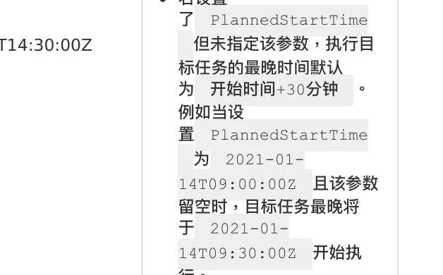

| 参数名称 | 类型 | 位置 | 是否必选 | 示例 | 说明 |
| --- | --- | --- | --- | --- | --- |
| ResourceO wnerAccou nt | String | Query | 否 |  |  |
| ResourceO wnerId | Long | Query | 否 |  |  |
| OwnerAcco unt | String | Query | 否 |  |  |

**返回数据**

| 参数名称 | 类型 | 示例 | 说明 |
| --- | --- | --- | --- |
| RequestId | String | C5D526E5-91B5-48B8-B980-FE07FF\*\*\*\*\*\* | 请求ID。 |

**示例**

请求示例

```text
  HTTP/1.1
{
"DBClusterId":"null"
}
```

正常返回示例

`JSON`  格式

```json
{
 "RequestId":""
}
```

**错误码**

| HttpCod e | 错误码 | 错误信息 | 描述 |
| --- | --- | --- | --- |
| 400 | InvalidParameters.Fo rmat | InvalidParameters.Format | Specified parameters is not valid. |
| 400 | InvalidParameters.Fo rmat | InvalidParameters.Format | The specified parameters are invalid. |
| 400 | MinorVersionNotSup port | MinorVersionNotSupport | Custins minor version does not support current action. |
| 404 | InvalidDBClusterId.N otFound | InvalidDBClusterId.NotFound | The DBClusterId provided does not exist in our records. |

<a id="section-6-15"></a>

## 6.15. ModifyDBClusterSSL

调用ModifyDBClusterSSL接口开通、关闭PolarDB集群的SSL加密或更新PolarDB集群的CA证书。

**请求头**

该接口使用公共请求头，无特殊请求头。请参见公共请求参数文档。

**请求语法**

```text
  HTTP/1.1
```

**请求参数**

| 参数名称 | 类型 | 位置 | 是否必选 | 示例 | 说明 |
| --- | --- | --- | --- | --- | --- |
| DBClusterI d | String | Query | 是 | pc-\*\*\*\*\*\*\*\*\*\*\*\* | 集群ID。 |
| SSLEnabled | String | Query | 否 | Enable | 修改SSL状态，取值：<br>• Disable：关闭SSL加密。<br>• Enable：开启SSL加密。：更新CA证<br>• Update书。<em>开启SSL加密或更新CA</em><em>证书后，需要下载和配置</em><em>证书。</em> |
| DBEndpoin tId | String | Query | 否 | pe-\*\*\*\*\*\*\*\*\*\*\*\*\*\*\*\*\*\* | 连接地址ID。<br>• <em>若目标集群为</em><em>PolarDB MySQL版，</em><em>该参数必填。</em><br>• 若目标集群为PolarDB PostgreSQL版或PolarDB PostgreSQL版（兼容Oracle），无需传入该参数，默认所有地址开启SSL加密。 |
| NetType | String | Query | 否 | Public | 连接地址的网络类型，需要与<strong>DBEndpointId</strong>参数传入的连接地址的网络类型保持一致，取值：：公网<br>• Public<br>• Private：私网：私网（经典网<br>• Inner络）<br>• <em>若目标集群为</em><em>PolarDB MySQL版，</em><em>该参数必填。</em><br>• 若目标集群为PolarDB PostgreSQL版或PolarDB PostgreSQL版（兼容Oracle），无需传入该参数，默认所有地址开启SSL加密。 |
| SSLAutoRot ate | String | Query | 否 | Enable | 是否开启SSL证书自动轮转，取值：：开启<br>• Enable：关闭<br>• Disable |
| ResourceO wnerAccou nt | String | Query | 否 |  |  |
| OwnerAcco unt | String | Query | 否 |  |  |

**返回数据**

| 参数名称 | 类型 | 示例 | 说明 |
| --- | --- | --- | --- |
| RequestId | String | A94B1755-6D8B-4E27-BF3C-8562BC\*\*\*\*\*\* | 请求ID。 |

**示例**

请求示例

```text
  HTTP/1.1
{
"DBClusterId":"null"
}
```

正常返回示例

`JSON`  格式

```json
{
 "RequestId":""
}
```

**错误码**

| HttpCod e | 错误码 | 错误信息 | 描述 |
| --- | --- | --- | --- |
| 404 | InvalidDBInstance.No tFound | InvalidDBCluster.NotFound | The DBClusterId provided does not exist in our records. |

<a id="section-6-16"></a>

## 6.16. ModifyDBClusterTDE

调用ModifyDBClusterTDE接口开启PolarDB MySQL版集群的TDE功能或修改加密方式。

**请求头**

该接口使用公共请求头，无特殊请求头。请参见公共请求参数文档。

**请求语法**

```text
  HTTP/1.1
```

**请求参数**

| 参数名称 | 类型 | 位置 | 是否必选 | 示例 | 说明 |
| --- | --- | --- | --- | --- | --- |
| DBClusterI d | String | Query | 是 | pc-\*\*\*\*\*\*\*\*\*\*\*\* | 集群ID。 |
| TDEStatus | String | Query | 是 | Enable | 修改TDE状态。取值固定为<strong>Enable</strong>。 |
| RoleArn | String | Query | 否 | acs:ram::1406926\*\*\*\*\*:rol e/aliyunrdsinstanceencrypt iondefaultrole | 角色的全局资源描述符，用来指定具体角色。 |
| Encryption Key | String | Query | 否 | 749c1df7-\*\*\*\*-\*\*\*\*-\*\*\*\*-\*\*\*\*\*\*\*\*\* | 自定义密钥ID。 |
| EncryptNe wTables | String | Query | 否 | ON | 是否开启自动加密所有新建的表。取值：：开启<br>• ON<br>• OFF：关闭 |
| ResourceO wnerAccou nt | String | Query | 否 |  |  |
| OwnerAcco unt | String | Query | 否 |  |  |

**返回数据**

| 参数名称 | 类型 | 示例 | 说明 |
| --- | --- | --- | --- |
| RequestId | String | 5F859238-2A36-4A8D-BD0F-732112\*\*\*\*\*\* | 请求ID。 |

**示例**

请求示例

```text
  HTTP/1.1
{
"DBClusterId":"null",
"TDEStatus":"null"
}
```

正常返回示例

`JSON`  格式

```json
{
 "RequestId":""
}
```

**错误码**

| HttpCod e | 错误码 | 错误信息 | 描述 |
| --- | --- | --- | --- |
| 400 | InvalidTDEstatus | InvalidTDEStatus.AlreadyEnabled | TDE has already enabled in the this cluster. |
| 400 | InvalidDBType.Malfor med | InvalidDBType.Malformed | The Specified DBType is not valid. |
| 403 | UnsupportedKmsSer vice.NotEnabled | UnsupportedKmsService.NotEnab led | KMS service is not enabled. |
| 403 | OperationDenied.DB NodeType | OperationDenied.DBNodeType | The operation is not permitted due to type of node. |
| 403 | IncorrectGdnState | IncorrectGdnState | db instance %s status is not available:%s. |
| 404 | InvalidDBInstance.No tFound | InvalidDBCluster.NotFound | The DBClusterId provided does not exist in our records. |

<a id="section-6-17"></a>

## 6.17. ModifyDBEndpointAddress

调用ModifyDBEndpointAddress接口修改PolarDB集群的连接地址，包括主地址、默认集群地址、自定义集群地址和私有域名。

**请求头**

该接口使用公共请求头，无特殊请求头。请参见公共请求参数文档。

**请求语法**

```text
  HTTP/1.1
```

**请求参数**

| 参数名称 | 类型 | 位置 | 是否必选 | 示例 | 说明 |
| --- | --- | --- | --- | --- | --- |
| DBClusterI d | String | Query | 是 | pc-\*\*\*\*\*\*\*\*\*\*\*\*\*\*\* | 集群ID。<em>您可以通</em><em>过</em><em><code> DescribeDBCluste</code></em> <em><code>rs </code></em><em>接口查看账号下所有</em><em>集群的详细信息，包括集</em><em>群ID。</em> |
| DBEndpoin tId | String | Query | 是 | pe-\*\*\*\*\*\*\*\*\*\*\*\*\*\*\*\* | 连接地址ID。<em>您可以通过接</em><em>口</em><em><code> DescribeDBCluste</code></em> <em><code>rEndpoints </code></em><em>查询连接</em><em>地址ID。</em> |
| NetType | String | Query | 是 | Public | 连接地址的网络类型，取值范围如下：：公网<br>• Public<br>• Private：私网&lt;props="china"&gt;-：经典网络Inner &lt;props="china"&gt;仅PolarDB MySQL版集群支持经典网络类型。 |
| Connection StringPrefix | String | Query | 否 | example | 新的连接地址前缀，需满足如下条件：<br>• 由小写字母、数字、中划线（-）组成。<br>• 以字母开头，以数字或字母结尾。<br>• 长度为6~30个字符。 |
| PrivateZon eAddressPr efix | String | Query | 否 | aliyundoc | 私有域名前缀。需满足如下条件：<br>• 由小写字母、数字、中划线（-）组成。<br>• 以字母开头，以数字或字母结尾。<br>• 长度为6~30个字符。<br>• <em>对于PolarDB的每一</em><em>个私网地址，均可以</em><em>绑定一个用户的私有</em><em>域名，该域名仅在当</em><em>前地域内指定的VPC</em><em>中生效。私有域名实</em><em>际上是通过</em><em>PrivateZone管理</em><em>的，通过CNAME映射</em><em>到PolarDB自带的私</em><em>网地址上，该功能</em><em>PrivateZone会收取</em><em>少量费用。</em><br>• 仅<strong>NetType=Private</strong>时该参数有意义。 |
| PrivateZon eName | String | Query | 否 | aliyundoc.com | 私有域名Zone名称。<em>仅</em><strong><em>NetType=Privat</em></strong><em>时该参数有意义。</em><strong><em>e</em></strong> |
| Port | String | Query | 否 | 3306 | 端口号，取值范围为3000～5999。<br>• <em>仅PolarDB MySQL版</em><em>集群支持该参数，若</em><em>该参数留空，则默认</em><em>端口号为3306。</em> |
| ResourceO wnerAccou nt | String | Query | 否 |  |  |
| OwnerAcco unt | String | Query | 否 |  |  |

**返回数据**

| 参数名称 | 类型 | 示例 | 说明 |
| --- | --- | --- | --- |
| RequestId | String | D0CEC6AC-7760-409A-A0D5-E6CD86\*\*\*\*\*\* | 请求ID。 |

**示例**

请求示例

```text
  HTTP/1.1
{
"DBClusterId":"null",
"DBEndpointId":"null",
"NetType":"null"
}
```

正常返回示例

`JSON`  格式

```json
{
 "RequestId":""
}
```

**错误码**

| HttpCod e | 错误码 | 错误信息 | 描述 |
| --- | --- | --- | --- |
| 404 | InvalidDBInstance.No tFound | InvalidDBCluster.NotFound | The DBClusterId provided does not exist in our records. |

<a id="section-6-18"></a>

## 6.18. ModifyDBNodeClass

调用ModifyDBNodeClass接口变更PolarDB集群节点规格。

**请求头**

该接口使用公共请求头，无特殊请求头。请参见公共请求参数文档。

**请求语法**

```text
  HTTP/1.1
```

**请求参数**

| 参数名称 | 类型 | 位置 | 是否必选 | 示例 | 说明 |
| --- | --- | --- | --- | --- | --- |
| DBClusterI d | String | Query | 是 | pc-\*\*\*\*\*\*\*\*\*\*\*\*\* | 集群ID。 |
| ModifyType | String | Query | 是 | Upgrade | 变更类型，取值范围如下：<br>• Upgrade：升级规格：降级规<br>• Downgrade格 |
| DBNodeTar getClass | String | Query | 是 | polar.mysql.x4.large | 所有节点的目标规格。 |
| ClientToke n | String | Query | 否 | 6000170000591aed949d0f 54a343f1a4233c1e7d1c5c \*\*\*\*\*\* | 用于保证请求的幂等性，防止重复提交请求。由客户端生成该参数值，保证在不同请求间唯一，大小写敏感、不超过64个ASCII字符。 |
| PlannedSta rtTime | String | Query | 否 | 2021-01-14T09:00:00Z | 开始执行定时（即在目标时间段内执行）升级配置任务的最早时间。格式为<code> YYYY-MM-</code><code>DDThh:mm:ssZ </code>（UTC）。<br>• <em>仅</em><em>当</em><em><code> ModifyType </code></em><em>取</em><em>值</em><em>为</em><em><code> Upgrade </code></em><em>时，</em><em>该参数生效。</em><br>• 开始时间的取值范围为未来24小时内的任意时间点。例如当前时间为<code> 2021-01-</code><code>14T09:00:00Z </code>，此处允许填入的开始时间范围为<code> 2021-01-</code><code>14T09:00:00Z </code>~<code> 2021</code> <code>-01-15T09:00:00Z </code>。<br>• 若该参数留空，默认立即执行升级配置任务。 |
| PlannedEn dTime | String | Query | 否 | 2021-01-14T09:30:00Z | 开始执行目标定时任务的最晚时间。格式为<code> YYYY-MM-</code><code>DDThh:mm:ssZ </code>（UTC）。<br>• <em>最晚时间需晚于开始</em><em>时间的30分钟或以</em><em>上。</em><br>• 若设置了<code> PlannedStartTime</code><code> </code>但未指定该参数，执行目标任务的最晚时间默认为<code> </code>开始时间<code>+30</code>分钟<code> </code>。例如当设置<code> PlannedStartTime</code><code> </code>为<code> 2021-01-</code><code>14T09:00:00Z </code>且该参数留空时，目标任务最晚将于<code> 2021-01-</code><code>14T09:30:00Z </code>开始执行。 |
| SubCategor y | String | Query | 否 | normal_general | 集群子系列。取值范围如下：：<br>• normal_exclusive独享规格：通<br>• normal_general用规格 |
| ResourceO wnerAccou nt | String | Query | 否 |  |  |
| OwnerAcco unt | String | Query | 否 |  |  |
| StorageSpa ce | Long | Query | 否 |  |  |

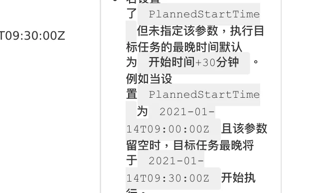

**返回数据**

| 参数名称 | 类型 | 示例 | 说明 |
| --- | --- | --- | --- |
| RequestId | String | 685F028C-4FCD-407D-A559-072D63\*\*\*\*\*\* | 请求ID。 |
| DBClusterId | String | pc-\*\*\*\*\*\*\*\*\*\*\*\*\* | 数据库集群ID。 |
| OrderId | String | 2035629\*\*\*\*\*\* | 订单ID。 |

**示例**

请求示例

```text
  HTTP/1.1
{
"DBClusterId":"null",
"ModifyType":"null",
"DBNodeTargetClass":"null"
}
```

正常返回示例

`JSON`  格式

```json
{
 "RequestId":"",
 "DBClusterId":"",
 "OrderId":""
}
```

**错误码**

| HttpCod e | 错误码 | 错误信息 | 描述 |
| --- | --- | --- | --- |
| 403 | OperationDenied.Ro EqualSpec | OperationDenied.RoEqualSpec | must exist at least ro class equal with rw |

<a id="section-6-19"></a>

## 6.19. ModifyLogBackupPolicy

调用ModifyLogBackupPolicy接口修改PolarDB集群的日志备份保留策略。

**请求头**

该接口使用公共请求头，无特殊请求头。请参见公共请求参数文档。

**请求语法**

```text
  HTTP/1.1
```

**请求参数**

| 参数名称 | 类型 | 位置 | 是否必选 | 示例 | 说明 |
| --- | --- | --- | --- | --- | --- |
| DBClusterI d | String | Query | 是 | pc-\*\*\*\*\*\*\*\*\*\*\*\*\*\*\*\* | 集群ID。<em>您可以调</em><em>用</em><em><code> DescribeDBCluste</code></em> <em><code>rs </code></em><em>接口查看目标地域下</em><em>所有的集群信息，包括集</em><em>群ID。</em> |
| LogBackup RetentionP eriod | String | Query | 否 | 3 | 日志保留周期，取值范围如下：<br>• 3～7300：日志保留周期，单位为天。<br>• -1：永久保留。 |
| LogBackup AnotherRe gionRegion | String | Query | 否 | cn-hangzhou | 日志备份跨地域备份区域。 |
| LogBackup AnotherRe gionRetenti onPeriod | String | Query | 否 | 30 | 日志备份跨地域备份保留周期。取值范围如下：<br>• 0：关闭日志备份跨地域备份功能。<br>• 30～7300：日志备份跨地域备份保留周期，单位为天。<br>• -1：永久保留。<em>创建集群时，默认取值</em><em>为</em><strong><em>0</em></strong><em>，即关闭日志备份</em><em>跨地域备份功能。</em> |
| ResourceO wnerAccou nt | String | Query | 否 |  |  |
| OwnerAcco unt | String | Query | 否 |  |  |

**返回数据**

| 参数名称 | 类型 | 示例 | 说明 |
| --- | --- | --- | --- |
| RequestId | String | 345174B4-FAB3-412E-A326-BEDDA9\*\*\*\*\*\* | 请求ID。 |

**示例**

请求示例

```text
  HTTP/1.1
{
"DBClusterId":"null"
}
```

正常返回示例

`JSON`  格式

```json
{
 "RequestId":""
}
```

**错误码**

| HttpCod e | 错误码 | 错误信息 | 描述 |
| --- | --- | --- | --- |
| 404 | InvalidDBInstance.No tFound | InvalidDBCluster.NotFound | The DBClusterId provided does not exist in our records. |

<a id="section-6-20"></a>

## 6.20. ModifyMaskingRules

调用ModifyMaskingRules接口修改脱敏规则配置或新增脱敏规则。

**请求头**

该接口使用公共请求头，无特殊请求头。请参见公共请求参数文档。

**请求语法**

```text
  HTTP/1.1
```

**请求参数**

| 参数名称 | 类型 | 位置 | 是否必选 | 示例 | 说明 |
| --- | --- | --- | --- | --- | --- |
| DBClusterI d | String | Query | 是 | pc-\*\*\*\*\*\*\*\*\*\*\*\*\*\*\*\*\* | 集群ID。<em>您可以通</em><em>过</em><em><code> DescribeDBCluste</code></em> <em><code>rs </code></em><em>接口查看账号下所有</em><em>集群的详细信息，包括集</em><em>群ID。</em> |
| RuleName | String | Query | 否 | testrule | 脱敏规则名称。一次仅支持输入一个规则名称。<br>• <em>您可以通过接</em><em>口</em><em><code> DescribeMaskin</code></em> <em><code>gRules </code></em><em>查看目标集</em><em>群下的所有脱敏规则</em><em>详情，包括规则名</em><em>称。</em><br>• 若输入的规则名称不存在于当前集群中，系统会自动根据该名称和<code> RuleConfig </code>值创建一个新的脱敏规则。 |
|  |  |  |  |  | 需要修改的脱敏规则的配置参数及其值的JSON串，参数的值都是字符串类型，例如：<code> {"auto": </code> <code>{"databases": ["db1"],</code><br><code>"tables": ["tb1"],</code><br><code>"columns": ["c1,c2"]</code><br><code>}, "description":</code><br><code>"This rule will be</code><br><code>applied to the columns</code><br><code>c1 and c2 in table</code><br><code>t1", "enabled": true,</code><br><code>"applies_to":</code> <code>["user"]} </code>。其中：<br>• <code> "auto" </code>：必填，表示支持动态脱敏算法。<br>• <code> "databases" </code>：选填。需要应用当前规则的数据库名称，支持输入多个数 |
|  |  |  |  |  |  |
| 参数名称 | 类型 | 位置 | 是否必选 | 示例 | 据库名称，多个名称间用英说明文逗号（,）分隔。若该参数 |
| RuleConfig | String | Query | 否 | {"auto": {"databases": \["db1"\], "tables": \["tb1"\], "columns": \["c1,c2"\] }, "description": "This rule will be applied to the columns c1 and c2 in table t1", "enabled": true, "applies_to": \["user"\]} | 留空，表示该规则将应用到当前集群中的所有数据库。<br>• <code> "tables" </code>：选填。需要应用当前规则的表名称，支持输入多个表库名称，多个名称间用英文逗号（,）分隔。若该参数留空，表示该规则将应用到当前集群中的所有表。<br>• <code> "columns" </code>：必填。需要应用当前规则的字段名称，支持输入多个字段名称，多个名称间用英文逗号（,）分隔。<br>• <code> "description" </code>：选填。脱敏规则的描述，选填。字符长度不能超过64个字符。<br>• <code> "enabled" </code>：必填。启用或禁用目标脱敏规则。取值为<strong>true</strong>（启用）或<strong>false</strong>（禁用）。<br>• <code> "applies_to" </code>：需要应用当前规则的数据库账号名称，支持输入多个数据库账号名，多个账号间用英文逗号（,）分隔。<br>• <code> "exempted" </code>：不需要应用当前规则的数据库账号名称，支持输入多个数据库账号名，多个账号间用英文逗号（,）分隔。<br>• <em>若输入</em><em>了</em><em><code> RuleName </code></em><em>参</em><em>数，</em><em><code> RuleConfig </code></em><em>参数必传。</em><br>• <code> "applies_to" </code>和<code> "e</code> <code>xempted" </code>，需要选择其中的一个进行输入。 |
| RuleNameL ist | String | Query | 否 | testrule | 脱敏规则名称列表。支持一次输入一个或多个规则名称，多个名称间用英文逗号（,）分隔。<em><code> RuleName </code></em><em>和</em><em><code> Rule</code></em> <em><code>NameList </code></em><em>参数，需要</em><em>选择其中的一个进行输</em><em>入。</em> |
| Enable | String | Query | 否 | true | 启用或禁用目标脱敏规则。取值范围如下：：启用。<br>• true<br>• false：禁用。<em>仅</em><em>当</em><em><code> RuleNameList </code></em><em>有</em><em>参数值输入时，该参数生</em><em>效。</em> |

**返回数据**

| 参数名称 | 类型 | 示例 | 说明 |
| --- | --- | --- | --- |
| RequestId | String | 99B355CE-526C-478B-B730-AD9D7C\*\*\*\*\*\* | 请求ID。 |
| Message | String | Message | 请求返回消息。<em>请求成功时该参数返回Successful，请求失败</em><em>时会返回请求异常信息（如错误码等）。</em> |
| Success | Boolean | true | 请求结果。取值：<br>• true：请求成功。：请求失败。<br>• false |

**示例**

请求示例

```text
  HTTP/1.1
{
"DBClusterId":"null"
}
```

正常返回示例

`JSON`  格式

```json
{
 "RequestId":"",
 "Message":"",
 "Success":""
}
```

<a id="section-6-21"></a>

## 6.21. RestoreTable

调用RestoreTable恢复PolarDB库表。

**请求头**

该接口使用公共请求头，无特殊请求头。请参见公共请求参数文档。

**请求语法**

```text
  HTTP/1.1
```

**请求参数**

| 参数名称 | 类型 | 位置 | 是否必选 | 示例 | 说明 |
| --- | --- | --- | --- | --- | --- |
| SecurityTo ken | String | Query | 否 |  |  |
| DBClusterI d | String | Query | 是 | pc-bp\*\*\*\*\*\*\*\*\*\*\*\*\*\*\* | 集群ID。<em>您可以通</em><em>过</em><em><code> DescribeDBCluste</code></em> <em><code>rs </code></em><em>接口查询账号下所有</em><em>集群的信息详情。</em> |
| TableMeta | String | Query | 是 | \[ { "tables":\[ {"name":"testtb", "type":"table", "newname":"testtb_restore " } \], "name":"testdb", "type":"db", "newname":"testdb_restor e" } \] | 需要还原的目标库表信息的JSON串，库表信息的值都是字符串类型。 例如，<code> [ { </code><code>"tables":[ {</code><br><code>"name":"testtb",</code><br><code>"type":"table",</code><br><code>"newname":"testtb_resto</code><br><code>re" } ],</code><br><code>"name":"testdb",</code><br><code>"type":"db",</code><br><code>"newname":"testdb_resto</code> <code>re" } ] </code>。<br><em>您可以通</em><em>过</em><em><code> DescribeMetaList</code></em><em><code> </code></em><em>接口查看支持恢复的库</em><em>表名称详情，并将支持恢</em><em>复的库表信息填入上述例</em><em>子中的对应位置。</em> |
| BackupId | String | Query | 否 | 111111 | 备份集ID。<em>若需要按备份集还原目标</em><em>库表，该参数必传。您可</em><em>以通</em><em>过</em><em><code> DescribeBackups</code></em><em><code> </code></em><em>接口查看备份集ID。</em> |

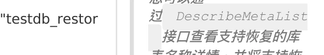


| 参数名称 | 类型 | 位置 | 是否必选 | 示例 | 说明 |
| --- | --- | --- | --- | --- | --- |
| RestoreTim e | String | Query | 否 | 2020-10-04T01:40:00Z | 还原时间点，格式为YYYY-MM-DDThh:mmZ（UTC时间）。<br>• <em>若需要按时间点还</em><em>原，该参数必填。</em><br>• 仅支持恢复到7天内的任意时间点。 |
| ResourceO wnerAccou nt | String | Query | 否 |  |  |
| OwnerAcco unt | String | Query | 否 |  |  |
| RegionId | String | Host | 否 |  |  |

**返回数据**

| 参数名称 | 类型 | 示例 | 说明 |
| --- | --- | --- | --- |
| RequestId | String | 0C47508C-9DC8-455B-985E-2F2FA8\*\*\*\*\*\* | 请求ID。 |

**示例**

请求示例

```text
  HTTP/1.1
{
"DBClusterId":"null",
"TableMeta":"null"
}
```

正常返回示例

`JSON`  格式

```json
{
 "RequestId":""
}
```

**错误码**

| HttpCod e | 错误码 | 错误信息 | 描述 |
| --- | --- | --- | --- |
| 400 | InvalidRestoreType.F ormat | InvalidRestoreType.Format | Specified restore type is not valid. |
| 400 | InvalidRestoreTime.F ormat | InvalidRestoreTime.Format | Specified restore time is not valid. |
| 400 | InvalidBackupSetID.NotFound | InvalidBackupSetID.NotFound | Specified backup set ID does not exist. |
| 400 | IncorrectBackupSetS tate | IncorrectBackupSetState | Current backup set state does not support operations. |
| 400 | InvalidDBName.Dupli cate | InvalidDBName.Duplicate | Specified DB name already exists in the This instance. |
| 400 | InvalidParameters.Fo rmat | InvalidParameters.Format | Specified parameters is not valid. |
| 400 | InsufficientResource Capacity | InsufficientResourceCapacity | There is insufficient capacity available for the requested instance. |
| 400 | InvalidRestoreType.N otFound | InvalidRestoreType.NotFound | At least one of BackupId and RestoreTime is malformed. |
| 400 | MissingUserID | MissingUserID | The request is missing a user_id parameter. |
| 400 | MissingUID | MissingUID | The request is missing a uid parameter. |
| 404 | InvalidDBInstance.No tFound | InvalidDBCluster.NotFound | The DBClusterId provided does not exist in our records. |
| 404 | InvalidBackup.NotFo und | InvalidBackup.NotFound | The available backup does not exist in recovery time. |

<a id="section-6-22"></a>

## 6.22. DescribeCharacterSetName

调用DescribeCharacterSetName接口查看PolarDB MySQL版数据库支持的字符集列表。

**请求头**

该接口使用公共请求头，无特殊请求头。请参见公共请求参数文档。

**请求语法**

```text
  HTTP/1.1
```

**请求参数**

| 参数名称 | 类型 | 位置 | 是否必选 | 示例 | 说明 |
| --- | --- | --- | --- | --- | --- |
| RegionId | String | Query | 是 | cn-hangzhou | 地域ID。<em>您可以通</em><em>过</em><em><code> DescribeRegions</code></em><em><code> </code></em><em>接口查看可用地域。</em> |


| 参数名称 | 类型 | 位置 | 是否必选 | 示例 | 说明 |
| --- | --- | --- | --- | --- | --- |
| DBClusterI d | String | Query | 否 | pc-\*\*\*\*\*\*\*\*\*\*\*\*\*\*\*\* | 集群ID。<em>当前仅支持查看PolarDB</em> <em>MySQL版集群数据库支</em><em>持的字符集列表。若输入</em><em>PolarDB PostgreSQL版</em><em>集群或PolarDB</em> <em>PostgreSQL版（兼容</em><em>Oracle）集群的集群</em><em>ID，</em><em><code> CharacterSetNa</code></em> <em><code>meItems </code></em><em>会返回空值。</em> |
| ResourceO wnerAccou nt | String | Query | 否 |  |  |
| OwnerAcco unt | String | Query | 否 |  |  |

**返回数据**

| 参数名称 | 类型 | 示例 | 说明 |
| --- | --- | --- | --- |
| RequestId | String | 34458CD3-33E0-4624-BFEF-840C15\*\*\*\*\*\* | 请求ID。 |
| Engine | String | POLARDB | 集群引擎。 |
| CharacterSetNa meItems | String |  |  |

**示例**

请求示例

```text
  HTTP/1.1
{
"RegionId":"null"
}
```

正常返回示例

`JSON`  格式

```json
{
 "RequestId":"",
 "Engine":""
}
```

**错误码**

| HttpCod e | 错误码 | 错误信息 | 描述 |
| --- | --- | --- | --- |
| 400 | InvalidRegionId.Malfo rmed | InvalidRegionId.Malformed | The specified parameter RegionId is not valid. |

<a id="section-6-23"></a>

## 6.23. DescribeBackupPolicy

调用DescribeBackupPolicy接口查看PolarDB集群的自动备份策略。

**请求头**

该接口使用公共请求头，无特殊请求头。请参见公共请求参数文档。

**请求语法**

```text
  HTTP/1.1
```

**请求参数**

| 参数名称 | 类型 | 位置 | 是否必选 | 示例 | 说明 |
| --- | --- | --- | --- | --- | --- |
| DBClusterI d | String | Query | 是 | pc-\*\*\*\*\*\*\*\*\*\*\*\*\* | 集群ID。<em>您可以调</em><em>用</em><em><code> DescribeDBCluste</code></em> <em><code>rs </code></em><em>接口查看目标地域下</em><em>所有的集群信息，包括集</em><em>群ID。</em> |
| ResourceO wnerAccou nt | String | Query | 否 |  |  |
| OwnerAcco unt | String | Query | 否 |  |  |

**返回数据**

| 参数名称 | 类型 | 示例 | 说明 |
| --- | --- | --- | --- |
| DataLevel2Back upAnotherRegio nRegion | String | cn-hangzhou | 二级备份跨地域备份区域。 |
| DataLevel1Back upRetentionPeri od | String | 7 | 一级备份保留周期，取值范围为3~14，单位为天。 |
| DataLevel2Back upAnotherRegio nRetentionPerio d | String | 30 | 二级备份跨地域备份保留周期。取值范围如下：<br>• 0：关闭二级备份功能。<br>• 30～7300：二级备份保留周期，单位为天。<br>• 1：二级备份永久保留。<em>创建集群时，默认取值为</em><strong><em>0</em></strong><em>，即关闭二级备份</em><em>跨地域备份功能。</em> |
| RequestId | String | EADFCE0F-9FB5-4685-B395-1440B\*\*\*\*\*\* | 请求ID。 |
| PreferredBacku pTime | String | 07:00Z-08:00Z | 执行自动备份的时间段，格式为<code> HH:mmZ-</code><code>HH:mmZ </code>（UTC时间）。 |
| BackupRetentio nPolicyOnCluste rDeletion | String | NONE | 删除集群时是否保留备份：<br>• ALL：永久保留全部备份。：永久保留最后一个备份。<br>• LATEST<br>• NONE（默认）：不保留备份集。 |
| BackupFrequen cy | String | Normal | 备份频率，取值如下：（默认）：常规备份，每天定时备份一<br>• Normal次。：增强备份，每2小时备份一次。<br>• 2/24H<br>• 3/24H：增强备份，每3小时备份一次。：增强备份，每4小时备份一次。<br>• 4/24H<br>• <em>开启增强备份后，备份完成时间在24小时内</em><em>的备份会全部保留。超过24小时的，系统将</em><em>仅保留每日00:00点后完成的第一个备份，</em><em>其他均被删除。</em><br>• 开启增强备份后，备份周期<strong>PreferredBackupPeriod</strong>参数会默认选择一周内的所有天数（即从周一至周日）。 |
| DataLevel1Back upTime | String | 15:00Z-16:00Z | 执行自动备份的时间段，格式为<code> hh:mmZ-</code><code>hh:mmZ </code>（UTC时间），且输入的数值必须为间隔1个小时的整点，如<code> 14:00Z-15:00Z </code>。<br>• <em>PolarDB PostgreSQL版（兼容Oracle）、</em><em>PolarDB PostgreSQL版不支持该参数。</em><br>• 如果您的PolarDB MySQL版所在的地域不支持跨地域备份功能，将不支持该参数。 |
| PreferredNextB ackupTime | String | 2020-11-16T07:30Z | 下一次备份的时间，格式为<code> YYYY-MM-</code><code>DDThh:mmZ </code>（UTC时间）。 |
| DataLevel2Back upRetentionPeri od | String | 0 | 二级备份保留周期，取值范围如下：<br>• 0：关闭二级备份功能。<br>• 30～7300：二级备份保留周期，单位为天。<br>• -1：二级备份永久保留。<em>创建集群时，默认取值为</em><strong><em>0</em></strong><em>，即关闭二级备份</em><em>功能。</em> |
| PreferredBacku pPeriod | String | Monday,Tuesday,We dnesday,Thursday,Fri day,Saturday,Sunday | 数据备份周期，取值范围如下：<br>• Monday：周一<br>• Tuesday：周二<br>• Wednesday：周三<br>• Thursday：周四<br>• Friday：周五<br>• Saturday：周六<br>• Sunday：周日 |
| DataLevel1Back upFrequency | String | Normal | 备份频率，取值如下：（默认）：常规备份，每天定时备份一<br>• Normal次。：高频备份，每2小时备份一次。<br>• 2/24H<br>• 3/24H：高频备份，每3小时备份一次。：高频备份，每4小时备份一次。<br>• 4/24H<br>• <em>PolarDB PostgreSQL版（兼容Oracle）、</em><em>PolarDB PostgreSQL版不支持该参数。</em><br>• 如果您的PolarDB MySQL版所在的地域不支持跨地域备份功能，将不支持该参数。 |
| DataLevel2Back upPeriod | String | Monday,Tuesday | 二级备份周期，取值范围如下：：周一<br>• Monday<br>• Tuesday：周二：周三<br>• Wednesday<br>• Thursday：周四：周五<br>• Friday<br>• Saturday：周六<br>• Sunday：周日<br>• <em>至少需要选择2天，多个值之间用英文逗号</em><em>（,）隔开。</em><br>• PolarDB PostgreSQL版（兼容Oracle）、PolarDB PostgreSQL版不支持该参数。<br>• 如果您的PolarDB MySQL版所在的地域不支持跨地域备份功能，将不支持该参数。 |
| DataLevel1Back upPeriod | String | Monday,Tuesday | 一级备份周期，取值范围如下：<br>• Monday：周一：周二<br>• Tuesday<br>• Wednesday：周三<br>• Thursday：周四：周五<br>• Friday<br>• Saturday：周六：周日<br>• Sunday<br>• <em>至少需要选择2天，多个值之间用英文逗号</em><em>（,）隔开。</em><br>• PolarDB PostgreSQL版（兼容Oracle）、PolarDB PostgreSQL版不支持该参数。<br>• 如果您的PolarDB MySQL版所在的地域不支持跨地域备份功能，将不支持该参数。 |
| BackupRetentio nPeriod | Integer |  |  |

**示例**

请求示例

```text
  HTTP/1.1
{
"DBClusterId":"null"
}
```

正常返回示例

`JSON`  格式

```json
{
 "DataLevel2BackupAnotherRegionRegion":"",
 "DataLevel1BackupRetentionPeriod":"",
 "DataLevel2BackupAnotherRegionRetentionPeriod":"",
 "RequestId":"",
 "PreferredBackupTime":"",
 "BackupRetentionPolicyOnClusterDeletion":"",
 "BackupFrequency":"",
 "DataLevel1BackupTime":"",
 "PreferredNextBackupTime":"",
 "DataLevel2BackupRetentionPeriod":"",
 "PreferredBackupPeriod":"",
 "DataLevel1BackupFrequency":"",
 "DataLevel2BackupPeriod":"",
 "DataLevel1BackupPeriod":""
}
```

**错误码**

| HttpCod e | 错误码 | 错误信息 | 描述 |
| --- | --- | --- | --- |
| 400 | InvalidDBClusterId.M alformed | InvalidDBClusterId.Malformed | The specified parameter DBClusterId is not valid. |
| 404 | InvalidDBInstance.No tFound | InvalidDBCluster.NotFound | The DBClusterId provided does not exist in our records. |

<a id="section-6-24"></a>

## 6.24. DeleteParameterGroup

调用DeleteParameterGroup接口删除PolarDB参数模板。

**请求头**

该接口使用公共请求头，无特殊请求头。请参见公共请求参数文档。

**请求语法**

```text
  HTTP/1.1
```

**请求参数**

| 参数名称 | 类型 | 位置 | 是否必选 | 示例 | 说明 |
| --- | --- | --- | --- | --- | --- |
| RegionId | String | Query | 是 | cn-hangzhou | 地域ID。<em>您可以通过接</em><em>口</em><em><code> DescribeRegions</code></em><em><code> </code></em><em>查看可用地域。</em> |
| Parameter GroupId | String | Query | 是 | pcpg-\*\*\*\*\*\*\*\*\*\*\*\*\*\* | 参数模板ID。<em>您可以通过接</em><em>口</em><em><code> DescribeParamete</code></em> <em><code>rGroups </code></em><em>查看参数模板</em><em>ID。</em> |
| ResourceGr oupId | String | Query | 否 |  |  |
| ResourceO wnerAccou nt | String | Query | 否 |  |  |
| OwnerAcco unt | String | Query | 否 |  |  |


**返回数据**

| 参数名称 | 类型 | 示例 | 说明 |
| --- | --- | --- | --- |
| RequestId | String | 4F7195E7-5F74-479D-AF59-1B4BF9\*\*\*\*\*\* | 请求ID。 |

**示例**

请求示例

```text
  HTTP/1.1
{
"RegionId":"null",
"ParameterGroupId":"null"
}
```

正常返回示例

`JSON`  格式

```json
{
 "RequestId":""
}
```

**错误码**

| HttpCod e | 错误码 | 错误信息 | 描述 |
| --- | --- | --- | --- |
| 400 | InvalidRegionId.Malfo rmed | InvalidRegionId.Malformed | The specified parameter RegionId is not valid. |
| 400 | InvalidParameterGro upId.Malformed | InvalidParameterGroupId.Malform ed | The Specified parameter ParameterGroupId is not valid. |

<a id="section-6-25"></a>

## 6.25. DeleteMaskingRules

调用DeleteMaskingRules接口删除目标脱敏规则。

**请求头**

该接口使用公共请求头，无特殊请求头。请参见公共请求参数文档。

**请求语法**

```text
  HTTP/1.1
```

**请求参数**

| 参数名称 | 类型 | 位置 | 是否必选 | 示例 | 说明 |
| --- | --- | --- | --- | --- | --- |
| RuleNameL ist | String | Query | 是 | testrule | 需要删除的脱敏规则名称。支持输入多个规则名称进行批量删除，多个名称间用英文逗号（,）分隔。<em>您可以通</em><em>过</em><em><code> DescribeMaskingR</code></em> <em><code>ules </code></em><em>接口查看目标集</em><em>群下所有脱敏规则的详</em><em>情，包括规则名称。</em> |
| DBClusterI d | String | Query | 是 | pc-\*\*\*\*\*\*\*\*\*\*\*\*\*\*\*\*\* | 集群ID。<em>您可以通</em><em>过</em><em><code> DescribeDBCluste</code></em> <em><code>rs </code></em><em>接口查看账号下所有</em><em>集群的详细信息，包括集</em><em>群ID。</em> |

**返回数据**

| 参数名称 | 类型 | 示例 | 说明 |
| --- | --- | --- | --- |
| RequestId | String | 2BCEE25B-797C-426B-BA7B-D28CCF\*\*\*\*\*\* | 请求ID。 |
| Message | String | Successful | 请求返回消息。<em>请求成功时该参数返回</em><em><code> Successful </code></em><em>，请求</em><em>失败时会返回请求异常信息（如错误码等）。</em> |
| Success | Boolean | true | 请求结果。取值：：请求成功。<br>• true<br>• false：请求失败。 |

**示例**

请求示例

```text
  HTTP/1.1
{
"RuleNameList":"null",
"DBClusterId":"null"
}
```

正常返回示例

`JSON`  格式

```json
{
 "RequestId":"",
 "Message":"",
 "Success":""
}
```

**错误码**

| HttpCod e | 错误码 | 错误信息 | 描述 |
| --- | --- | --- | --- |
| 404 | InvalidDBClusterId.M alformed | InvalidDBClusterId.Malformed | The specified parameter DBClusterId is not valid. |

<a id="section-6-26"></a>

## 6.26. DeleteDBEndpointAddress

调用DeleteDBEndpointAddress接口释放PolarDB集群的公网或经典网络连接地址。

**请求头**

该接口使用公共请求头，无特殊请求头。请参见公共请求参数文档。

**请求语法**

```text
  HTTP/1.1
```

**请求参数**

| 参数名称 | 类型 | 位置 | 是否必选 | 示例 | 说明 |
| --- | --- | --- | --- | --- | --- |
| DBClusterI d | String | Query | 是 | pc-\*\*\*\*\*\*\*\*\*\*\*\* | 集群ID。<em>您可以通</em><em>过</em><em><code> DescribeDBCluste</code></em> <em><code>rs </code></em><em>接口查看账号下所有</em><em>集群的详细信息，包括集</em><em>群ID。</em> |
| DBEndpoin tId | String | Query | 是 | pe-\*\*\*\*\*\*\*\*\*\*\*\*\*\*\* | 连接地址ID。<em>您可以通过接</em><em>口</em><em><code> DescribeDBCluste</code></em> <em><code>rEndpoints </code></em><em>查询</em><em>DBEndpointId。</em> |
| NetType | String | Query | 是 | Public | &lt;props="intl"&gt;连接地址的网络类型，仅支持<strong>Public</strong>（公网）类型。&lt;props="china"&gt;连接地址的网络类型，取值范围如下：<br>• &lt;props="china"&gt;<strong>Publi</strong> c：公网。<br>• &lt;props="china"&gt;<strong>Inne</strong> r：经典网络。 |
| AccessKeyI d | String | Query | 否 |  |  |
| AccessKeyI d | String | Query | 否 |  |  |
| Action | String | Query | 否 |  |  |
| OwnerId | Long | Query | 否 |  |  |
| ResourceO wnerAccou nt | String | Query | 否 |  |  |
| ResourceO wnerId | Long | Query | 否 |  |  |
| OwnerAcco unt | String | Query | 否 |  |  |

**返回数据**

| 参数名称 | 类型 | 示例 | 说明 |
| --- | --- | --- | --- |
| RequestId | String | D0CEC6AC-7760-409A-A0D5-E6CD86\*\*\*\*\*\* | 请求ID。 |

**示例**

请求示例

```text
  HTTP/1.1
{
"DBClusterId":"null",
"DBEndpointId":"null",
"NetType":"null"
}
```

正常返回示例

`JSON`  格式

```json
{
 "RequestId":""
}
```

**错误码**

| HttpCod e | 错误码 | 错误信息 | 描述 |
| --- | --- | --- | --- |
| 400 | InvalidDBEndpointId.Malformed | InvalidDBEndpointId.Malformed | The specified parameter DBEndpointId is not valid. |
| 400 | NetTypeUsed.Gdn | NetTypeUsed.Gdn | Specified endpoint?s net type is used by global database. |
| 404 | InvalidDBInstance.No tFound | InvalidDBCluster.NotFound | The DBClusterId provided does not exist in our records. |
| 404 | InvalidDBClusterId.N otFound | InvalidDBClusterId.NotFound | The DBClusterId provided does not exist in our records. |
| 404 | EndpointStatus.NotS upport | EndpointStatus.NotSupport | Current endpoint status does not support this operation. |

<a id="section-6-27"></a>

## 6.27. DeleteBackup

调用DeleteBackup接口删除PolarDB集群的备份。

**请求头**

该接口使用公共请求头，无特殊请求头。请参见公共请求参数文档。

**请求语法**

```text
  HTTP/1.1
```

**请求参数**

| 参数名称 | 类型 | 位置 | 是否必选 | 示例 | 说明 |
| --- | --- | --- | --- | --- | --- |
| DBClusterI d | String | Query | 是 | pc-\*\*\*\*\*\*\*\*\*\*\*\*\*\* | 集群ID。 |
| BackupId | String | Query | 是 | 11111111 | 备份ID，多个备份之间用英文逗号（,）分隔。<em>您可以通</em><em>过</em><em><code> DescribeBackups</code></em><em><code> </code></em><em>接口查询BackupId。</em> |
| AccessKeyI d | String | Query | 否 |  |  |
| AccessKeyI d | String | Query | 否 |  |  |
| Action | String | Query | 否 |  |  |
| OwnerId | Long | Query | 否 |  |  |
| ResourceO wnerAccou nt | String | Query | 否 |  |  |
| ResourceO wnerId | Long | Query | 否 |  |  |
| OwnerAcco unt | String | Query | 否 |  |  |


**返回数据**

| 参数名称 | 类型 | 示例 | 说明 |
| --- | --- | --- | --- |
| RequestId | String | 3CF4F9FE-BF77-4739-8D68-B8DF5D\*\*\*\*\*\* | 请求ID。 |

**示例**

请求示例

```text
  HTTP/1.1
{
"DBClusterId":"null",
"BackupId":"null"
}
```

正常返回示例

`JSON`  格式

```json
{
 "RequestId":""
}
```

**错误码**

| HttpCod e | 错误码 | 错误信息 | 描述 |
| --- | --- | --- | --- |
| 400 | InvalidBackupSetID.NotFound | InvalidBackupSetID.NotFound | The specified parameter BackupId is not valid. |
| 404 | InvalidDBClusterId.N otFound | InvalidDBClusterId.NotFound | The DBClusterId provided does not exist in our records. |

<a id="section-6-28"></a>

## 6.28. CreateDBNodes

调用CreateDBNodes接口增加PolarDB集群的只读节点。

**请求头**

该接口使用公共请求头，无特殊请求头。请参见公共请求参数文档。

**请求语法**

```text
  HTTP/1.1
```

**请求参数**

| 参数名称 | 类型 | 位置 | 是否必选 | 示例 | 说明 |
| --- | --- | --- | --- | --- | --- |
| ResourceGr oupId | String | Query | 否 | rg-\*\*\*\*\*\*\*\*\*\*\*\* | 资源组ID。 |
| DBClusterI d | String | Query | 是 | pc-\*\*\*\*\*\*\*\*\*\*\*\*\* | 集群ID。 |
| ClientToke n | String | Query | 否 | 6000170000591aed949d0f 54a343f1a4233c1e7d1c5c \*\*\*\*\*\* | 用于保证请求的幂等性，防止重复提交请求。由客户端生成该参数值，保证在不同请求间唯一，大小写敏感、不超过64个ASCII字符。 |
| EndpointBi ndList | String | Query | 否 | pe-\*\*\*\*\*\*\*\*\*\*\*\*\*\*\*\*,pe-\*\*\*\*\*\*\*\*\*\*\*\*\*\*\*\* | 指定新增节点需要加入的集群连接地址的地址ID。若需要同时加入多个连接地址，多个连接地址ID间用英文逗号（,）分隔。<br>• <em>您可以通过调</em><em>用</em><em><code> DescribeDBClus</code></em> <em><code>terEndpoints </code></em><em>接</em><em>口查看集群连接地址</em><em>的详情，包括连接地</em><em>址ID。</em><br>• 支持填入默认集群连接地址和自定义集群连接地址的地址ID。<br>• 若该参数留空，默认将新增节点加入所有开启了<strong>新节点</strong>自动加入功能（即<code> AutoAddNewNodes</code><code> </code>取值为<code> Enable </code>）的集群连接地址。 |
| PlannedSta rtTime | String | Query | 否 | 2021-01-14T09:00:00Z | 开始执行定时（即在目标时间段内执行）新增节点任务的最早时间。格式为<code> YYYY-MM-</code><code>DDThh:mm:ssZ </code>（UTC）。<br>• <em>开始时间的取值范围</em><em>为未来24小时内的任</em><em>意时间点。例如当前</em><em>时间为</em><em><code> 2021-01-</code></em><em><code>14T09:00:00Z </code></em><em>，</em><em>此处允许填入的开始</em><em>时间范围为</em><em><code> 2021-</code></em><em><code>01-</code></em><em><code>14T09:00:00Z </code></em><em>~</em><em><code> </code></em> <em><code>2021-01-</code></em><em><code>15T09:00:00Z </code></em><em>。</em><br>• 若该参数留空，默认立即执行新增节点任务。 |


| 参数名称 | 类型 | 位置 | 是否必选 | 示例 | 说明 |
| --- | --- | --- | --- | --- | --- |
| PlannedEn dTime | String | Query | 否 | 2021-01-14T09:30:00Z | 开始执行目标定时任务的最晚时间。格式为<code> YYYY-MM-</code><code>DDThh:mm:ssZ </code>（UTC）。<br>• <em>最晚时间需晚于开始</em><em>时间的30分钟或以</em><em>上。</em><br>• 若设置了<code> PlannedStartTime</code><code> </code>但未指定该参数，执行目标任务的最晚时间默认为<code> </code>开始时间<code>+30</code>分钟<code> </code>。例如当设置<code> PlannedStartTime</code><code> </code>为<code> 2021-01-</code><code>14T09:00:00Z </code>且该参数留空时，目标任务最晚将于<code> 2021-01-</code><code>14T09:30:00Z </code>开始执行。 |
| DBNode | Repea tList | Query | 是 |  | 新增节点的信息。 |
| ImciSwitch | String | Query | 否 | ON | 是否开启列存索引。取值范围：：开启<br>• ON<br>• OFF：关闭（默认值）<em>PolarDB PostgreSQL版</em><em>（兼容Oracle）和</em><em>PolarDB PostgreSQL版</em><em>不支持该参数。</em> |
| ResourceO wnerAccou nt | String | Query | 否 |  |  |
| OwnerAcco unt | String | Query | 否 |  |  |
| NodeType | String | Query | 否 |  |  |


**返回数据**

| 参数名称 | 类型 | 示例 | 说明 |
| --- | --- | --- | --- |
| RequestId | String | E053E730-5755-4AA9-AA9D-A47867\*\*\*\*\*\* | 请求ID。 |
| DBClusterId | String | pc-\*\*\*\*\*\*\*\*\*\*\*\*\*\*\* | 数据库集群ID。 |
| OrderId | String | 2148126708\*\*\*\*\* | 订单ID。 |
| DBNodeIds | String |  |  |

**示例**

请求示例

```text
  HTTP/1.1
{
"DBClusterId":"null",
"DBNode":"null"
}
```

正常返回示例

`JSON`  格式

```json
{
 "RequestId":"",
 "DBClusterId":"",
 "OrderId":""
}
```

**错误码**

| HttpCod e | 错误码 | 错误信息 | 描述 |
| --- | --- | --- | --- |
| 400 | ORDER.ARREARAGE | ORDER.ARREARAGE | ????????????????????????? |
| 404 | InvalidDBClusterId.N otFound | InvalidDBClusterId.NotFound | The DBClusterId provided does not exist in our records. |

<a id="section-6-29"></a>

## 6.29. CreateDBEndpointAddress

调用CreateDBEndpointAddress接口创建PolarDB集群的公网或经典网络连接地址。

**请求头**

该接口使用公共请求头，无特殊请求头。请参见公共请求参数文档。

**请求语法**

```text
  HTTP/1.1
```

**请求参数**

| 参数名称 | 类型 | 位置 | 是否必选 | 示例 | 说明 |
| --- | --- | --- | --- | --- | --- |
| DBClusterI d | String | Query | 是 | pc-\*\*\*\*\*\*\*\*\*\*\*\*\*\* | 集群ID。 |
| DBEndpoin tId | String | Query | 是 | pe-\*\*\*\*\*\*\*\*\*\*\*\*\*\* | 连接地址ID。<em>可通过接</em><em>口</em><em><code> DescribeDBCluste</code></em> <em><code>rEndpoints </code></em><em>查询连接</em><em>地址详情。</em> |
| Connection StringPrefix | String | Query | 否 | test-1 | 新的连接地址前缀。连接地址前缀需满足如下条件：<br>• 由小写字母、数字、中划线（-）组成。<br>• 以字母开头，以数字或字母结尾。<br>• 长度为6~40个字符。 |
| NetType | String | Query | 是 | Public | 新增连接地址的网络类型，取值范围如下：：公网。<br>• Public<br>• Inner：经典网络。<em>对于PolarDB MySQL版</em><em>集群，允许传</em><em>入</em><strong><em>Public</em></strong><em>和</em><strong><em>Inner</em></strong><em>；对于PolarDB</em> <em>PostgreSQL版和</em><em>PolarDB PostgreSQL版</em><em>（兼容Oracle）集群，</em><em>只允许传入</em><strong><em>Public</em></strong><em>。</em> |
| AccessKeyI d | String | Query | 否 |  |  |
| AccessKeyI d | String | Query | 否 |  |  |
| Action | String | Query | 否 |  |  |
| OwnerId | Long | Query | 否 |  |  |
| ResourceO wnerAccou nt | String | Query | 否 |  |  |
| ResourceO wnerId | Long | Query | 否 |  |  |
| OwnerAcco unt | String | Query | 否 |  |  |

**返回数据**

| 参数名称 | 类型 | 示例 | 说明 |
| --- | --- | --- | --- |
| RequestId | String | 6BD9CDE4-5E7B-4BF3-9BB8-83C73E\*\*\*\*\*\* | 请求ID。 |

**示例**

请求示例

```text
  HTTP/1.1
{
"DBClusterId":"null",
"DBEndpointId":"null",
"NetType":"null"
}
```

正常返回示例

`JSON`  格式

```json
{
 "RequestId":""
}
```

**错误码**

| HttpCod e | 错误码 | 错误信息 | 描述 |
| --- | --- | --- | --- |
| 400 | EndpointStatus.NotS upport | EndpointStatus.NotSupport | Current endpoint status does not support this operation. |
| 400 | NetTypeExists | NetTypeExists | Specified net type already existed. |
| 404 | InvalidDBInstance.No tFound | InvalidDBCluster.NotFound | The DBClusterId provided does not exist in our records. |
| 404 | InvalidDBClusterId.N otFound | InvalidDBClusterId.NotFound | The DBClusterId provided does not exist in our records. |

<a id="section-6-30"></a>

## 6.30. CreateDBCluster

调用CreateDBCluster接口创建PolarDB集群。

**请求头**

该接口使用公共请求头，无特殊请求头。请参见公共请求参数文档。

**请求语法**

```text
  HTTP/1.1
```

**请求参数**

| 参数名称 | 类型 | 位置 | 是否必选 | 示例 | 说明 |
| --- | --- | --- | --- | --- | --- |
| RegionId | String | Query | 是 | cn-hangzhou | 地域ID。<em>您可以通</em><em>过</em><em><code> DescribeRegions</code></em><em><code> </code></em><em>接口查看可用地域。</em> |


| 参数名称 | 类型 | 位置 | 是否必选 | 示例 | 说明 |
| --- | --- | --- | --- | --- | --- |
| ZoneId | String | Query | 否 | cn-hangzhou-g | 可用区ID。<em>您可以通</em><em>过</em><em><code> DescribeRegions</code></em><em><code> </code></em><em>接口查看可选的可用</em><em>区。</em> |
| DBType | String | Query | 是 | MySQL | 数据库引擎类型，取值范围如下：<br>• MySQL<br>• PostgreSQL<br>• Oracle |
| DBVersion | String | Query | 是 | 5.6 | 数据库引擎版本号。<br>• MySQL版本号取值范围如下：<br>• 5.6<br>• 5.7<br>• 8.0<br>• PostgreSQL版本号取值范围如下：<br>• 11<br>• 14<br>• Oracle版本号取值为<strong>11</strong>。 |
| DBNodeCla ss | String | Query | 是 | polar.mysql.x2.medium | 节点规格。<em>如需创建Serverless集</em><em>群，请传</em><em>入</em><strong><em>polar.mysql.sl.sm</em></strong> <strong><em>all</em></strong><em>。</em> |
| ClusterNet workType | String | Query | 否 | VPC | 集群网络类型，当前仅支持专有网络，取值固定为<strong>VPC</strong>。 |
| DBClusterD escription | String | Query | 否 | test | 集群名称，集群名称需满足如下要求：<br>• 不能以<code> http:// </code>或<code> https</code><code>:// </code>开头。<br>• 长度为2~256个字符。 |
| PayType | String | Query | 是 | Postpaid | 付费类型，取值范围如下：<br>• Postpaid：按量付费：预付费（包<br>• Prepaid年包月） |


| 参数名称 | 类型 | 位置 | 是否必选 | 示例 | 说明 |
| --- | --- | --- | --- | --- | --- |
| AutoRenew | Boole an | Query | 否 | true | 是否自动续费，取值范围如下：：自动续费。<br>• true<br>• false：不自动续费。默认为<strong>false</strong>。<em>当参数</em><strong><em>PayType</em></strong><em>取值</em><em>为</em><strong><em>Prepaid</em></strong><em>时，该参</em><em>数才生效。</em> |
| Period | String | Query | 否 | Month | 若付费类型为<strong>Prepaid</strong>时，该参数为必传参数。指定预付费集群为包年或包月类型。<br>• Year：包年。即选择包年包月时，单位为年。<br>• Month：包月。即选择包年包月时，单位为月。 |
| UsedTime | String | Query | 否 | 1 | • 当<strong>Period</strong>为<strong>Month</strong>时，<strong>UsedTime</strong>取值为整数类型，取值范围为<code> [1-</code><code>9] </code>。<br>• 当<strong>Period</strong>为<strong>Year</strong>时，取值为整数UsedTime类型，取值范围为<code> [1-</code><code>3] </code>。 |
| VPCId | String | Query | 否 | vpc-\*\*\*\*\*\*\*\*\*\* | 专有网络ID。 |
| VSwitchId | String | Query | 否 | vsw-\*\*\*\*\*\*\*\*\*\* | 虚拟交换机ID。<em>如果已选择VPCId，则</em><em>VSwitchId必选。</em> |
| CreationOp tion | String | Query | 否 | Normal | 创建方式，取值范围如下：<br>• Normal：创建一个全新的PolarDB集群。<br>• CloneFromPolarDB：从现有PolarDB集群克隆数据到新的PolarDB集群。<br>• CloneFromRDS：从现有RDS实例克隆数据到新的PolarDB集群。<br>• MigrationFromRDS：从现有RDS实例迁移数据到新的PolarDB集群。创建的PolarDB集群是只读模式，且默认开启Binlog。<br>• CreateGdnStandby：创建一个从集群。<br>&lt;props="china"&gt;\* UpgradeFromPolarDB：从PolarDB升级迁移。默认为<strong>Normal</strong>。<em>当</em><strong><em>DBType</em></strong><em>为</em><strong><em>MySQ</em></strong> <strong><em>L</em></strong><em>且</em><strong><em>DBVersion</em></strong><em>为</em><em>时，本参数取值可</em><strong><em>8.0</em></strong><em>以</em><em>为</em><strong><em>CreateGdnStandb</em></strong><em>。</em><strong><em>y</em></strong> |
| SourceRes ourceId | String | Query | 否 | rm-\*\*\*\*\*\*\*\*\*\*\*\*\* | 源RDS实例ID或源PolarDB集群ID。仅当<strong>CreationOption</strong>为<strong>Mi</strong>、<strong>Clo</strong>grationFromRDS neFromRDS或<strong>CloneFr</strong> omPolarDB时，该参数必填。<br>• 若<strong>CreationOption</strong>为MigrationFromRDS或<strong>CloneFromRDS</strong>，您需要为本参数传入源RDS实例ID。源RDS实例版本需为RDS MySQL 5.6 、5.7或8.0高可用版。<br>• 若<strong>CreationOption</strong>为<strong>C</strong> loneFromPolarDB，您需要为本参数传入源PolarDB集群ID。克隆集群和源集群的DBType默认保持一致。例如源集群为MySQL 8.0，则克隆集群也需设置<strong>DBType</strong>为<strong>MySQL</strong>且<strong>DBVersion</strong>为<strong>8.0</strong>。 |
| CloneDataP oint | String | Query | 否 | LATEST | 克隆数据的时间节点，取值：<br>• LATEST：最新时间点的数据。<br>• BackupID：历史备份集ID，请传入具体的备份集ID。<br>• Timestamp：历史时间点，请传入具体的时间，格式：<code> YYYY-MM-</code><code>DDThh:mm:ssZ </code>（UTC时间）。默认为<strong>LATEST</strong>。<em>若</em><strong><em>CreationOption</em></strong><em>为</em><strong><em>CloneFromRDS</em></strong><em>，则本参数取值只能</em><em>为</em><strong><em>LATEST</em></strong><em>。</em> |
| ClientToke n | String | Query | 否 | 6000170000591aed949d0f 5\*\*\*\*\*\*\*\*\*\*\*\*\*\*\*\*\*\*\*\* | 用于保证请求的幂等性。由客户端生成该参数值，保证在不同请求间唯一，大小写敏感、不超过64个ASCII 字符。 |
| ResourceGr oupId | String | Query | 否 | rg-\*\*\*\*\*\*\*\*\*\*\*\* | 资源组ID。 |
| SecurityIPLi st | String | Query | 否 | 10.\*\*\*.\*\*\*.\*\*\* | PolarDB集群白名单IP地址。<em>支持配置多个白名单IP地</em><em>址，多个IP地址之间使用</em><em>英文逗号分隔。</em> |
| TDEStatus | Boole an | Query | 否 | true | 开启TDE加密。取值范围如下：<br>• true：开启。：关闭（默认<br>• false值）。<br>• <em>仅</em><em>当</em><strong><em>DBType</em></strong><em>为</em><strong><em>Post</em></strong> <strong><em>greSQL</em></strong><em>或</em><strong><em>Oracl</em></strong><em>时，本参数生效。</em><strong><em>e</em></strong><br>• 您可以调用<code> ModifyDBClusterTDE</code><code> </code>接口为PolarDB MySQL集群开启TDE加密。<br>• TDE功能开启后不可关闭。 |
| GDNId | String | Query | 否 | gdn-\*\*\*\*\*\*\*\*\*\*\* | 全球数据库网络ID。<em>当</em><strong><em>CreationOption</em></strong><em>为</em><strong><em>CreateGdnStandb</em></strong><em>时，本参数必填。</em><strong><em>y</em></strong> |

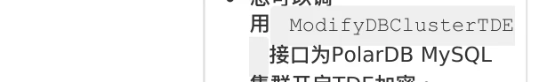

| 参数名称 | 类型 | 位置 | 是否必选 | 示例 | 说明 |
| --- | --- | --- | --- | --- | --- |
| CreationCa tegory | String | Query | 否 | Normal | 产品系列，取值范围如下：<br>• Normal：集群版（默认值）<br>• Basic：单节点：高压<br>• ArchiveNormal缩引擎（X-Engine）<br>• NormalMultimaster：多主架构集群版<br>• SENormal：标准版<br>• <em>仅</em><em>当</em><strong><em>DBType</em></strong><em>为</em><strong><em>MyS</em></strong><em>，</em><strong><em>QL</em></strong><em>且</em><strong><em>DBVersion</em></strong><em>为</em><strong><em>5</em></strong><strong><em>.6</em></strong><em>、</em><strong><em>5.7</em></strong><em>或</em><strong><em>8.0</em></strong><em>时，支持设置产品系</em><em>列为</em><strong><em>Basic</em></strong><em>。</em><br>• 仅当<strong>DBType</strong>为<strong>MySQL</strong>，且<strong>DBVersion</strong>为<strong>8.0</strong>时，支持设置产品系列为<strong>ArchiveNormal</strong>和<strong>N</strong> ormalMultimaster。<br>• 仅当<strong>DBType</strong>为<strong>MySQL</strong>，且<strong>DBMinorVersion</strong>为8.0.1时，支持设置产品系列<strong>SENormal</strong>。 |
| DefaultTim eZone | String | Query | 否 | SYSTEM | 集群时区（UTC），可选取值范围为\*\*-12:00~+13:00<strong>内</strong>的所有整点时间，如00:00\*\*。默认取值为<strong>SYSTEM</strong>，默认时区与Region所在时区一致。<em>仅</em><em>当</em><strong><em>DBType</em></strong><em>为</em><strong><em>MySQ</em></strong> <strong><em>L</em></strong><em>时，该参数生效。</em> |
| LowerCase TableName s | String | Query | 否 | 1 | 表名是否区分大小写，取值范围如下：<br>• 1：不区分大小写：区分大小写<br>• 0默认取值为<strong>1</strong>。<em>仅</em><em>当</em><strong><em>DBType</em></strong><em>为</em><strong><em>MySQ</em></strong> <strong><em>L</em></strong><em>时，该参数生效。</em> |
| BackupRet entionPolic yOnCluster Deletion | String | Query | 否 | NONE | 删除集群时备份集保留策略，取值范围如下：：永久保留全部备<br>• ALL份。<br>• LATEST：永久保留最后一个备份（删除前自动备份）。<br>• NONE：集群删除时不保留备份集。创建集群时，默认取值为<strong>NONE</strong>，即集群删除时不保留备份集。<br>• <em>仅</em><em>当</em><strong><em>DBType</em></strong><em>为</em><strong><em>MyS</em></strong><em>时，该参数生</em><strong><em>QL</em></strong><em>效。</em><br>• Serverless集群不支持该参数。 |
| StorageSpa ce | Intege r | Query | 否 | 50 | 按空间计费（包年包月）的存储空间。单位：GB。<em>PolarDB MySQL标准版</em><em>存储空间的取值范围：</em><em>20~32000。</em> |
| DBMinorVe rsion | String | Query | 否 | 8.0.1 | 数据库引擎小版本号。取值范围如下：<br>• 8.0.2<br>• 8.0.1<em>当参</em><em>数</em><strong><em>DBType</em></strong><em>为</em><strong><em>MySQ</em></strong><em>且</em><strong><em>DBVersion</em></strong><em>为</em><strong><em>L</em></strong><em>时，该参数才生</em><strong><em>8.0</em></strong><em>效。</em> |
| Parameter GroupId | String | Query | 否 | pcpg-\*\*\*\*\*\*\*\*\*\*\*\*\*\* | 参数模板ID。<em>您可以通</em><em>过</em><em><code> DescribeParamete</code></em> <em><code>rGroups </code></em><em>接口查看目标</em><em>地域的参数模板列表，包</em><em>括参数模板ID。</em> |
| Tag | Repea tList | Query | 否 |  | 1 |
| StorageTyp e | String | Query | 否 | PSL4 | 企业版存储类型取值如下：<br>• PSL5<br>• PSL4标准版存储类型取值如下：<br>• ESSDPL1<br>• ESSDPL2<br>• ESSDPL3 <em>Serverless集群不支持</em><em>该参数。</em> |
| DBNodeNu m | Intege r | Query | 否 | 1 | 标准版节点个数。取值如下：（默认）：表示只有1<br>• 1个读写节点。：表示有1个只读节点<br>• 2和一个读写节点。 |
| HotStandby Cluster | String | Query | 否 | ON | 是否开启热备集群。取值范围如下：（默认）：开启热备<br>• ON集群。<br>• OFF：关闭热备集群。<br>• STANDBY：标准版开启热备集群。<em>标准版集群的默认值</em><em>为</em><strong><em>OFF</em></strong><em>。</em> |
| ProxyType | String | Query | 否 | Exclusive | 数据库代理类型，取值范围如下：（默认）：关闭数据<br>• OFF库代理。<br>• EXCLUSIVE：企业独享版<br>• GENERAL：企业通用版 |
| ProxyClass | String | Query | 否 | polar.maxscale.g2.medium.c | 标准版数据库代理规格。取值如下：<br>• polar.maxscale.g2.m edium.c：2核。<br>• polar.maxscale.g2.lar：4核。ge.c<br>• polar.maxscale.g2.xla：8核。rge.c<br>• polar.maxscale.g2.2xl：16核。arge.c<br>• polar.maxscale.g2.3xl：24核。arge.c<br>• polar.maxscale.g2.4xl arge.c：32核。<br>• polar.maxscale.g2.8xl arge.c：64核。 |
| ResourceO wnerAccou nt | String | Query | 否 |  |  |
| OwnerAcco unt | String | Query | 否 |  |  |

**返回数据**

| 参数名称 | 类型 | 示例 | 说明 |
| --- | --- | --- | --- |
| RequestId | String | E56531A4-E552-40BA-9C58-137B80\*\*\*\*\*\* | 请求ID。 |
| ResourceGroupI d | String | rg-\*\*\*\*\*\*\*\*\*\*\*\*\*\*\* | 资源组ID。 |
| DBClusterId | String | pc-bp1s826a1up\*\*\*\*\*\* | 集群ID。 |
| OrderId | String | 211454967\*\*\*\*\*\* | 订单ID。 |

**示例**

请求示例

```text
  HTTP/1.1
{
"RegionId":"null",
"DBType":"null",
"DBVersion":"null",
"DBNodeClass":"null",
"PayType":"null"
}
```

正常返回示例

`JSON`  格式

```json
{
 "RequestId":"",
 "ResourceGroupId":"",
 "DBClusterId":"",
 "OrderId":""
}
```

**错误码**

| HttpCod e | 错误码 | 错误信息 | 描述 |
| --- | --- | --- | --- |
| 400 | InvalidBackupRetenti onPolicyOnClusterDe letion.Malformed | InvalidBackupRetentionPolicyOnC lusterDeletion.Malformed | The specified BackupRetentionPolicyOnCluster Deletion is invalid. |
| 400 | InvalidLowerCaseTab leNames.Malformed | InvalidLowerCaseTableNames.Mal formed | The specified LowerCaseTableNames is invalid. |
| 400 | InvalidLowerCaseTab leNames.Malformed | InvalidLowerCaseTableNames.Mal formed | The specified LowerCaseTableNames value is invalid. |
| 400 | InvalidDefaultTimeZo ne.Malformed | InvalidDefaultTimeZone.Malforme d | The specified DefaultTimeZone is invalid. |
| 400 | Location.FailedGetSu bDomain | Location.FailedGetSubDomain | The specified regionId does not match the zoneId or the zoneId does not exist. |
| 400 | MissParameter.GDNI d | MissParameter.GDNId | The GDNId parameter is required. |
| 400 | EntityNotExist.Resou rceGroup | EntityNotExist.ResourceGroup | The resource group does not exist.. |

<a id="section-6-31"></a>

## 6.31. CreateDatabase

调用CreateDatabase接口为PolarDB集群创建一个新的数据库。

**请求头**

该接口使用公共请求头，无特殊请求头。请参见公共请求参数文档。

**请求语法**

```text
  HTTP/1.1
```

**请求参数**

| 参数名称 | 类型 | 位置 | 是否必选 | 示例 | 说明 |
| --- | --- | --- | --- | --- | --- |
| DBClusterI d | String | Query | 是 | pc-\*\*\*\*\*\*\*\*\*\*\*\*\*\* | 集群ID。 |
| DBName | String | Query | 是 | testDB | 数据库名称，名称需满足如下要求：<br>• 由小写字母、数字、中划线（-）、下划线（_）组成。<br>• 以字母开头，以字母或数字结尾，最长64个字符。<em>请勿使用保留关键字作为</em><em>数据库名称，</em><em>如</em><em><code> test </code></em><em>、</em><em><code> mysql </code></em><em>等。</em> |
| CharacterS etName | String | Query | 是 | utf8 | 字符集。 |
| DBDescript ion | String | Query | 否 | testdesc | 数据库备注信息，备注信息需满足如下要求：<br>• 不能以<code> http:// </code>或<code> https</code><code>:// </code>开头。<br>• 长度为2~256个字符。<em>当集群为PolarDB</em> <em>PostgreSQL版（兼容</em><em>Oracle）或PolarDB</em> <em>PostgreSQL版时，该参</em><em>数必填；当集群为</em><em>PolarDB MySQL版时，</em><em>该参数非必填。</em> |
| AccountNa me | String | Query | 否 | testacc | 授权访问该数据库的账号名。可通过接口<code> DescribeAccounts </code>查询账号信息。<br>• <em>只支持输入普通账</em><em>号，高权限账号默认</em><em>拥有数据库全部权限</em><em>无需授权。</em><br>• 当集群为PolarDB PostgreSQL版（兼容Oracle）或PolarDB PostgreSQL版时，该参数必填；当集群为PolarDB MySQL版时，该参数非必填。 |
| AccountPri vilege | String | Query | 否 | ReadWrite | 账号权限，取值范围如下：<br>• ReadWrite：读写。：只读。<br>• ReadOnly<br>• DMLOnly：只允许DML。<br>• DDLOnly：只允许DDL。<br>• ReadIndex：只读+索引。若该参数不填，则默认为<strong>ReadWrite</strong>。<br>• <em>该参数仅</em><em>当</em><strong><em>AccountName</em></strong><em>为非空值时生效。</em><br>• 当集群为PolarDB PostgreSQL版（兼容Oracle）或PolarDB PostgreSQL版时，该参数必填；<br>• 当集群为PolarDB MySQL版时，该参数非必填。 |
| Collate | String | Query | 否 | C | 语言环境设置，用于指定新建数据库的排序规则。<br>• <em>语言环境必须</em><em>与</em><strong><em>CharacterSetNa</em></strong> <strong><em>me</em></strong><em>参数设置的字符</em><em>集兼容。</em><br>• 当集群为PolarDB PostgreSQL版（兼容Oracle）或PolarDB PostgreSQL版时，该参数必填；当集群为PolarDB MySQL版时，不支持该参数。 关于该参数的取值范围，请登录PolarDB控制台，在<strong>配置与管理</strong>&gt; <strong>数</strong>据库管理页签，单击<strong>创建</strong>数据库进行查看。 |
| Ctype | String | Query | 否 | C | 语言环境设置，用于指定数据库的字符分类。<br>• <em>语言环境必须</em><em>与</em><strong><em>CharacterSetNa</em></strong> <strong><em>me</em></strong><em>参数设置的字符</em><em>集兼容。</em><br>• 与<strong>Collate</strong>传入信息一致。<br>• 当集群为PolarDB PostgreSQL版（兼容Oracle）或PolarDB PostgreSQL版时，该参数必填；当集群为PolarDB MySQL版时，该参数非必填。 关于该参数的取值范围，请登录PolarDB控制台，在<strong>配置与管理</strong>&gt; <strong>数</strong>据库管理页签，单击<strong>创建</strong>数据库进行查看。 |
| AccessKeyI d | String | Query | 否 |  |  |
| AccessKeyI d | String | Query | 否 |  |  |
| Action | String | Query | 否 |  |  |
| OwnerId | Long | Query | 否 |  |  |
| ResourceO wnerAccou nt | String | Query | 否 |  |  |
| ResourceO wnerId | Long | Query | 否 |  |  |
| OwnerAcco unt | String | Query | 否 |  |  |

**返回数据**

| 参数名称 | 类型 | 示例 | 说明 |
| --- | --- | --- | --- |
| RequestId | String | 93E98F25-BE02-40DA-83E3-F77F8D\*\*\*\*\*\* | 请求ID。 |

**示例**

请求示例

```text
  HTTP/1.1
{
"DBClusterId":"null",
"DBName":"null",
"CharacterSetName":"null"
}
```

正常返回示例

`JSON`  格式

```json
{
 "RequestId":""
}
```

**错误码**

| HttpCod e | 错误码 | 错误信息 | 描述 |
| --- | --- | --- | --- |
| 400 | InvalidDBName.Malf ormed | InvalidDBName.Malformed | The specified parameter DBName is not valid. |
| 400 | Database.AddError | Database.AddError | Instance %s add database minidoc error |
| 404 | InvalidDBInstance.No tFound | InvalidDBCluster.NotFound | The DBClusterId provided does not exist in our records. |

<a id="section-6-32"></a>

## 6.32. CreateAccount

调用CreateAccount接口创建PolarDB数据库账号。

**请求头**

该接口使用公共请求头，无特殊请求头。请参见公共请求参数文档。

**请求语法**

```text
  HTTP/1.1
```

**请求参数**

| 参数名称 | 类型 | 位置 | 是否必选 | 示例 | 说明 |
| --- | --- | --- | --- | --- | --- |
| DBClusterI d | String | Query | 是 | pc-\*\*\*\*\*\*\*\*\*\*\*\*\*\* | 集群ID。 |
| AccountNa me | String | Query | 是 | testacc | 账号名称，需符合如下要求：<br>• 以小写字母开头，以字母或数字结尾。<br>• 由小写字母、数字或下划线组成。<br>• 长度为2~16个字符。<br>• 不能使用某些预留的用户名，如root、admin等。 |
| AccountPas sword | String | Query | 是 | Test1111 | 账号密码，需符合如下要求：<br>• 至少包含大写字母、小写字母、数字或特殊字符中的任意三种。<br>• 长度为8~32个字符。<br>• 特殊字符为<code> !@#$%^&amp;*</code> <code>()_+-= </code>。 |
| AccountTyp e | String | Query | 否 | Normal | 账号类型，取值范围如下：<br>• Normal：普通账号。：高权限账号。<br>• Super<br>• <em>若该参数留空，则默</em><em>认创建</em><strong><em>Super</em></strong><em>账</em><em>号。</em><br>• 当集群为PolarDB PostgreSQL版（兼容Oracle）或PolarDB PostgreSQL版时，每个集群允许创建多个高权限账号，高权限账号相比普通账号拥有更多权限。<br>• 当集群为PolarDB MySQL版时，每个集群最多只允许创建1个高权限账号，高权限账号相比普通账号拥有更多权限。 |
| AccountDe scription | String | Query | 否 | testdes | 账号备注说明，需满足如下要求：<br>• 不能以<code> http:// </code>或<code> https</code><code>:// </code>开头。<br>• 长度为2~256个字符。 |
| DBName | String | Query | 否 | testdb | 允许目标账号访问的数据库名称，支持传入多个数据库名称，多个数据库名称间用英文逗号（,）分隔。<em>仅PolarDB MySQL版集</em><em>群的普通账号支持该参</em><em>数。</em> |
| AccountPri vilege | String | Query | 否 | ReadWrite | 账号权限，取值范围如下：<br>• ReadWrite：读写：只读<br>• ReadOnly<br>• DMLOnly：只允许DML<br>• DDLOnly：只允许DDL：只读+索<br>• ReadIndex引<br>• <em>必须要传</em><em>入</em><em><code> DBName </code></em><em>参</em><em>数，</em><em><code> AccountPrivi</code></em> <em><code>lege </code></em><em>才能生效。</em><br>• 若为<code> DBName </code>参数传入了多个数据库名称，您需要为目标数据库分别授予相应的权限，多个账号权限间用英文逗号（,）分隔。例如，需要授权数据库DB1读写权限，授权数据库DB2只读权限，您需要设置<code> DBName </code>为<code> DB1,DB2</code><code> </code>，并设置<code> AccountPrivilege</code><code> </code>为<code> ReadWrite,ReadOn</code> <code>ly </code>。<br>• 仅PolarDB MySQL版集群的普通账号支持设置该参数。 |
| ClientToke n | String | Query | 否 | 6000170000591aed949d0f 54a343f1a4233c1e7d1c5c \*\*\*\*\*\* | 用于保证请求的幂等性，防止重复提交请求。由客户端生成该参数值，保证在不同请求间唯一，大小写敏感、不超过64个ASCII字符。 |
| ResourceO wnerAccou nt | String | Query | 否 |  |  |
| OwnerAcco unt | String | Query | 否 |  |  |

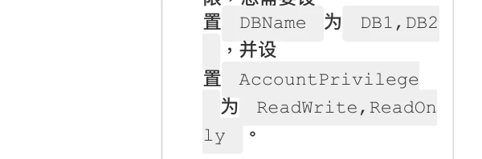

**返回数据**

| 参数名称 | 类型 | 示例 | 说明 |
| --- | --- | --- | --- |
| RequestId | String | CED079B7-A408-41A1-BFF1-EC608E\*\*\*\*\*\* | 请求ID。 |

**示例**

请求示例

```text
  HTTP/1.1
{
"DBClusterId":"null",
"AccountName":"null",
"AccountPassword":"null"
}
```

正常返回示例

`JSON`  格式

```json
{
 "RequestId":""
}
```

**错误码**

| HttpCod e | 错误码 | 错误信息 | 描述 |
| --- | --- | --- | --- |
| 400 | LockTimeout | LockTimeout | The request processing has failed due to lock timeout. |
| 400 | EngineMigration.Acti onDisabled | EngineMigration.ActionDisabled | Specified action is disabled while custins is in engine migration. |
| 404 | InvalidDBClusterId.N otFound | InvalidDBClusterId.NotFound | The DBClusterId provided does not exist in our records. |

<a id="section-6-33"></a>

## 6.33. ModifyDBClusterPrimaryZone

调用ModifyDBClusterPrimaryZone修改PolarDB集群的主可用区。

**请求头**

该接口使用公共请求头，无特殊请求头。请参见公共请求参数文档。

**请求参数**

| 参数名称 | 类型 | 位置 | 是否必选 | 示例 | 说明 |
| --- | --- | --- | --- | --- | --- |
| DBClusterI d | String | Query | 是 | pc-\*\*\*\*\*\*\*\*\*\*\*\*\*\* | 集群ID。<em>您可以调</em><em>用</em><em><code> DescribeDBCluste</code></em> <em><code>rs </code></em><em>接口查看目标地域下</em><em>所有的集群信息，包括集</em><em>群ID。</em> |
| ZoneId | String | Query | 是 | cn-hangzhou-g | 新的主可用区ID。<em>可通过接</em><em>口</em><em><code> DescribeRegions</code></em><em><code> </code></em><em>查看可用的可用区。</em> |


| 参数名称 | 类型 | 位置 | 是否必选 | 示例 | 说明 |
| --- | --- | --- | --- | --- | --- |
| VSwitchId | String | Query | 否 | vsw-\*\*\*\*\*\*\*\*\*\*\*\*\*\* | 目标可用区的虚拟交换机（VSwitch）ID。<br>• <em>当集群为PolarDB</em> <em>PostgreSQL版（兼容</em><em>Oracle）或PolarDB</em> <em>PostgreSQL版时，该</em><em>参数必填。</em><br>• 当集群为PolarDB MySQL版时：<br>• 如果目标可用区没有创建过Vswitch，则使用默认的Vswitch，该参数非必填。<br>• 如果目标可用区已创建过Vswitch，该参数必填。 |
| PlannedSta rtTime | String | Query | 否 | 2021-01-14T09:00:00Z | 开始执行定时（即在目标时间段内执行）变更主可用区任务的最早时间。格式为<code> YYYY-</code><code>MM-</code><code>DDThh:mm:ssZ </code>（UTC）。<br>• <em>开始时间的取值范围</em><em>为未来24小时内的任</em><em>意时间点。例如当前</em><em>时间为</em><em><code> 2021-01-</code></em><em><code>14T09:00:00Z </code></em><em>，</em><em>此处允许填入的开始</em><em>时间范围为</em><em><code> 2021-</code></em><em><code>01-</code></em><em><code>14T09:00:00Z </code></em><em>~</em><em><code> </code></em> <em><code>2021-01-</code></em><em><code>15T09:00:00Z </code></em><em>。</em><br>• 若该参数留空，默认立即执行变更主可用区任务。 |
| PlannedEn dTime | String | Query | 否 | 2021-01-14T09:30:00Z | 开始执行目标定时任务的最晚时间。格式为<code> YYYY-MM-</code><code>DDThh:mm:ssZ </code>（UTC）。<br>• <em>最晚时间需晚于开始</em><em>时间的30分钟或以</em><em>上。</em><br>• 若设置了<code> PlannedStartTime</code><code> </code>但未指定该参数，执行目标任务的最晚时间默认为<code> </code>开始时间<code>+30</code>分钟<code> </code>。例如当设置<code> PlannedStartTime</code><code> </code>为<code> 2021-01-</code><code>14T09:00:00Z </code>且该参数留空时，目标任务最晚将于<code> 2021-01-</code><code>14T09:30:00Z </code>开始执行。 |
| FromTimeS ervice | Boole an | Query | 否 | false | 立即执行或定时执行更换主可用区。取值：<br>• false（默认值）：定时执行<br>• true：立即执行 |
| ResourceO wnerAccou nt | String | Query | 否 |  |  |
| OwnerAcco unt | String | Query | 否 |  |  |

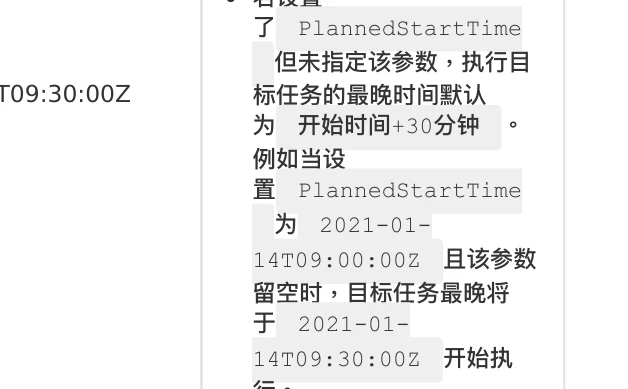

**返回数据**

| 参数名称 | 类型 | 示例 | 说明 |
| --- | --- | --- | --- |
| RequestId | String | ED12C6FF-3261-4571-AB57-3570F6\*\*\*\*\*\* | 请求ID。 |

**示例**

请求示例

```text
http(s)://[Endpoint]/?Action=ModifyDBClusterPrimaryZone
&DBClusterId=pc-**************
&ZoneId=cn-hangzhou-g
&公共请求参数
```

正常返回示例

`JSON`  格式

```text
HTTP/1.1 200 OK
Content-Type:application/json
{
 "RequestId":"ED12C6FF-3261-4571-AB57-3570F6******"
}
```

**错误码**

| HttpCod e | 错误码 | 错误信息 | 描述 |
| --- | --- | --- | --- |
| 400 | ScheduleTaskExist | ScheduleTaskExist | The specified cluster already has a scheduled task. |
| 404 | InvalidDBInstance.No tFound | InvalidDBCluster.NotFound | The DBClusterId provided does not exist in our records. |

<a id="section-6-34"></a>

## 6.34. CheckAccountName

调用CheckAccountName接口校验账号名称是否合法或当前集群中是否已存在重名的账号。

**请求头**

该接口使用公共请求头，无特殊请求头。请参见公共请求参数文档。

**请求语法**

```text
  HTTP/1.1
```

**请求参数**

| 参数名称 | 类型 | 位置 | 是否必选 | 示例 | 说明 |
| --- | --- | --- | --- | --- | --- |
| DBClusterI d | String | Query | 是 | pc-\*\*\*\*\*\*\*\*\*\*\*\*\*\*\*\* | 集群ID。<em>您可以调</em><em>用</em><em><code> DescribeDBCluste</code></em> <em><code>rs </code></em><em>接口查看目标地域下</em><em>所有的集群信息，包括集</em><em>群ID。</em> |
| AccountNa me | String | Query | 是 | test_acc | 账号名称。 |

**返回数据**

| 参数名称 | 类型 | 示例 | 说明 |
| --- | --- | --- | --- |
| RequestId | String | 925B84D9-CA72-432C-95CF-738C22\*\*\*\*\*\* | 请求ID。 |

**示例**

请求示例

```text
  HTTP/1.1
{
"DBClusterId":"null",
"AccountName":"null"
}
```

正常返回示例

`JSON`  格式

```json
{
 "RequestId":""
}
```

**错误码**

| HttpCod e | 错误码 | 错误信息 | 描述 |
| --- | --- | --- | --- |
| 400 | InvalidAccountName.Duplicate | InvalidAccountName.Duplicate | The specified account name already exists. |

<a id="section-6-35"></a>

## 6.35. 查看PolarDB MySQL集群内核版本信息

查看PolarDB MySQL集群当前内核版本的详细信息。

**请求头**

该接口使用公共请求头，无特殊请求头。请参见公共请求参数文档。

**请求参数**

| 参数名称 | 类型 | 位置 | 是否必选 | 示例 | 说明 |
| --- | --- | --- | --- | --- | --- |
| DBClusterI d | String | Query | 是 | pc-\*\*\*\*\*\*\*\*\*\*\*\*\*\*\*\* | 集群ID。<em>您可以通</em><em>过</em><em><code> DescribeDBCluste</code></em> <em><code>rs </code></em><em>接口查看账号下所有</em><em>集群的详细信息（如集群</em><em>ID）。</em> |
| ResourceO wnerAccou nt | String | Query | 否 |  |  |
| OwnerAcco unt | String | Query | 否 |  |  |

**返回数据**

| 参数名称 | 类型 | 示例 | 说明 |
| --- | --- | --- | --- |
| DBRevisionVersi on | String | 8.0.1.1.7 | 数据库引擎的修订版本号。<em>针对PolarDB MySQL版5.6版本的集群，仅发</em><em>布日期在20200831之后的</em><em><code> Revision </code></em> <em><code>Version </code></em><em>信息会被返回，否则该参数为空。</em> |
| RequestId | String | 47921222-0D37-4133-8C0D-017DC3\*\*\*\*\*\* | 请求ID。 |
| DBClusterId | String | pc-\*\*\*\*\*\*\*\*\*\*\*\*\*\*\*\* | 集群ID。 |
| ProxyRevisionV ersion | String | 2.4.15 | 数据库代理的版本。 |
| DBLatestVersio n | String | 8.0.1.1.16 | 数据库内核引擎的最新版本。 |
| ProxyLatestVers ion | String | 2.4.17 | 数据库代理的最新版本。 |
| ProxyVersionSta tus | String | Stable | 数据库代理的版本状态。取值范围如下：：当前版本状态稳定。<br>• Stable<br>• Old：当前版本过旧，建议升级到最新版本。<br>• HighRisk：当前版本有严重缺陷，请立即升级到最新的版本。 |
| IsLatestVersion | String | true | 当前数据库内核引擎版本是否为最新版本，取值范围如下：<br>• true<br>• false |
| IsProxyLatestVe rsion | String | true | 当前数据库代理版本是否为最新版本，取值范围如下：<br>• true<br>• false |
| DBVersion | String | 8.0 | 数据库引擎的大版本号，取值范围如下：<br>• 8.0<br>• 5.7<br>• 5.6 |
| DBVersionStatu s | String | Stable | 当前数据库小版本状态，取值范围如下：：当前版本状态稳定。<br>• Stable<br>• Old：当前版本过旧，建议升级到最新版本。<br>• HighRisk：当前版本有严重缺陷，请立即升级到最新的版本。 |
| DBMinorVersion | String | 8.0.1 | 数据库引擎小版本号。<br>• 当<code> DBVersion </code>为<strong>8.0</strong>时，取值范围如下：<br>• 8.0.2<br>• 8.0.1<br>• 当<code> DBVersion </code>为<strong>5.7</strong>时，取值为<strong>5.7.28</strong>。<br>• 当<code> DBVersion </code>为<strong>5.6</strong>时，取值为<strong>5.6.16</strong>。 |

**示例**

请求示例

```text
http(s)://[Endpoint]/?Action=DescribeDBClusterVersion
&DBClusterId=pc-****************
&公共请求参数
```

正常返回示例

`JSON`  格式

```text
HTTP/1.1 200 OK
Content-Type:application/json
{
 "ProxyVersionStatus":"Stable",
 "IsLatestVersion":"true",
 "IsProxyLatestVersion":"true",
 "DBVersion":"8.0",
 "DBRevisionVersion":"8.0.1.1.7",
 "RequestId":"47921222-0D37-4133-8C0D-017DC3******",
 "DBVersionStatus":"Stable",
 "DBClusterId":"pc-****************",
 "ProxyRevisionVersion":"2.4.15",
 "DBLatestVersion":"8.0.1.1.16",
 "DBMinorVersion":"8.0.1",
 "ProxyLatestVersion":"2.4.17"
}
```

**错误码**

| HttpCod e | 错误码 | 错误信息 | 描述 |
| --- | --- | --- | --- |
| 400 | InvalidDBClusterId.M alformed | InvalidDBClusterId.Malformed | The specified parameter DBClusterId is not valid. |
| 404 | InvalidDBClusterId.N otFound | InvalidDBClusterId.NotFound | The DBClusterId provided does not exist in our records. |

<a id="section-6-36"></a>

## 6.36. 将标签从集群上解绑

将标签从PolarDB集群上解绑。

**请求头**

该接口使用公共请求头，无特殊请求头。请参见公共请求参数文档。

**请求参数**

| 参数名称 | 类型 | 位置 | 是否必选 | 示例 | 说明 |
| --- | --- | --- | --- | --- | --- |
| RegionId | String | Query | 是 | cn-hangzhou | 地域ID。<em>可通过接</em><em>口</em><em><code> DescribeRegions</code></em><em><code> </code></em><em>查看可用的地域。</em> |
| ResourceTy pe | String | Query | 是 | cluster | 资源类型，取值固定为<strong>cluster</strong>。 |
| All | Boole an | Query | 否 | true | 是否解绑全部标签，取值为<strong>true</strong>或<strong>false</strong>，默认值为<strong>false</strong>。<em>仅当</em><em><code> TagKey.n </code></em><em>取值</em><em>为空时该参数生效。</em> |
| ResourceId | Repea tList | Query | 是 | pc-\*\*\*\*\*\*\*\*\*\*\*\*\*\*\* | 目标集群ID。 |
| TagKey | Repea tList | Query | 否 | type | 标签键。 |
| AccessKeyI d | String | Query | 否 |  |  |
| AccessKeyI d | String | Query | 否 |  |  |
| Action | String | Query | 否 |  |  |
| OwnerId | Long | Query | 否 |  |  |
| ResourceO wnerAccou nt | String | Query | 否 |  |  |
| ResourceO wnerId | Long | Query | 否 |  |  |
| OwnerAcco unt | String | Query | 否 |  |  |


**返回数据**

| 参数名称 | 类型 | 示例 | 说明 |
| --- | --- | --- | --- |
| RequestId | String | 2D69A58F-345C-4FDE-88E4-BF5189\*\*\*\*\*\* | 请求ID。 |

**示例**

`JSON`  格式

```text
HTTP/1.1 200 OK
Content-Type:application/json
{
 "RequestId":"2D69A58F-345C-4FDE-88E4-BF5189******"
}
```

<a id="section-6-37"></a>

## 6.37. 开启或关闭集群热备节点

开启或关闭集群热备节点。

**请求头**

该接口使用公共请求头，无特殊请求头。请参见公共请求参数文档。

**请求参数**

| 参数名称 | 类型 | 位置 | 是否必选 | 示例 | 说明 |
| --- | --- | --- | --- | --- | --- |
| DBClusterI d | String | Query | 是 | pc-\*\*\*\*\*\*\*\*\*\*\*\*\*\*\*\*\* | 集群ID。<em>您可以通</em><em>过</em><em><code> DescribeDBCluste</code></em> <em><code>rs </code></em><em>接口查看账号下所有</em><em>集群的详细信息，包括集</em><em>群ID。</em> |
| DBNodeId | String | Query | 是 | pi-\*\*\*\*\*\*\*\*\*\*\*\*\*\*\*\*\* | 数据库集群节点ID。 |
| HotReplica Mode | String | Query | 是 | ON | 是否开启热备。取值范围：：开启<br>• ON<br>• OFF：关闭 |
| ResourceO wnerAccou nt | String | Query | 否 |  |  |
| OwnerAcco unt | String | Query | 否 |  |  |

**返回数据**

| 参数名称 | 类型 | 示例 | 说明 |
| --- | --- | --- | --- |
| RequestId | String | 9F4DDFBF-205C-5A3E-8DC2-C6\*\*\*\*\*\*\*\*\*\* | 请求ID。 |
| DBClusterId | String | pc-\*\*\*\*\*\*\*\*\*\*\*\*\*\*\*\*\* | 集群ID。<em>您可以调用</em><em><code> DescribeDBClusters </code></em><em>接口查</em><em>看目标地域下所有的集群信息，包括集群ID。</em> |
| OrderId | String | 2148126708\*\*\*\*\* | 生成的订单ID。 |

**示例**

`JSON`  格式

```text
HTTP/1.1 200 OK
Content-Type:application/json
{
 "RequestId":"9F4DDFBF-205C-5A3E-8DC2-C6**********",
 "DBClusterId":"pc-*****************",
 "OrderId":"2148126708*****"
}
```

**错误码**

| HttpCod e | 错误码 | 错误信息 | 描述 |
| --- | --- | --- | --- |
| 404 | InvalidDBInstanceCla ss.NotFound | InvalidDBInstanceClass.NotFound | rw class code must be equal with hot replica |

<a id="section-6-38"></a>

## 6.38. 对集群进行手动主备切换

对PolarDB集群进行手动主备切换，可以指定一个只读节点为新的主节点。

**请求头**

该接口使用公共请求头，无特殊请求头。请参见公共请求参数文档。

**请求参数**

| 参数名称 | 类型 | 位置 | 是否必选 | 示例 | 说明 |
| --- | --- | --- | --- | --- | --- |
| DBClusterI d | String | Query | 是 | pc-\*\*\*\*\*\*\*\*\*\*\*\*\*\* | 数据库集群ID。 |
| TargetDBN odeId | String | Query | 否 | pi-\*\*\*\*\*\*\*\*\*\*\* | 将要切换为主节点的节点ID，如果不填，则系统自动选举。您可以通过接口<code> DescribeDBClusters</code><code> </code>查询节点ID等信息。<br>• <em>自动选举主节点： 系</em><em>统找出当前可以被选</em><em>举的所有只读节点。</em><em>选择优先级最高的一</em><em>个或多个只读节点。</em><em>如果切换第一个节点</em><em>失败（例如，网络原</em><em>因、复制状态异常</em><em>等），则会尝试切换</em><em>下一个，直至成功。</em><br>• <em>当集群为PolarDB</em> <em>PostgreSQL版（兼容</em><em>Oracle）或PolarDB</em> <em>PostgreSQL版时，该</em><em>参数必填；当集群为</em><em>PolarDB MySQL版</em><em>时，该参数非必填。</em> |
| ClientToke n | String | Query | 否 | 6000170000591aed949d0f 54a343f1a4233c1e7d1c5\* \*\*\*\*\* | 用于保证请求的幂等性，防止重复提交请求。由客户端生成该参数值，保证在不同请求间唯一，大小写敏感、不超过64个ASCII字符。 |
| ResourceO wnerAccou nt | String | Query | 否 |  |  |
| OwnerAcco unt | String | Query | 否 |  |  |


**返回数据**

| 参数名称 | 类型 | 示例 | 说明 |
| --- | --- | --- | --- |
| RequestId | String | D0CEC6AC-7760-409A-A0D5-E6CD86\*\*\*\*\*\* | 请求ID。 |

**示例**

`JSON`  格式

```text
HTTP/1.1 200 OK
Content-Type:application/json
{
 "RequestId":"D0CEC6AC-7760-409A-A0D5-E6CD86******"
}
```

**错误码**

| HttpCod e | 错误码 | 错误信息 | 描述 |
| --- | --- | --- | --- |
| 400 | HaStatusNotSupport | HaStatusNotSupport | Current DB instance HA status does not support this operation. |
| 404 | InvalidDBInstance.No tFound | InvalidDBCluster.NotFound | The DBClusterId provided does not exist in our records. |

<a id="section-6-39"></a>

## 6.39. 查看慢日志明细

查看PolarDB集群的慢日志明细。

**请求头**

该接口使用公共请求头，无特殊请求头。请参见公共请求参数文档。

**请求参数**

| 参数名称 | 类型 | 位置 | 是否必选 | 示例 | 说明 |
| --- | --- | --- | --- | --- | --- |
| RegionId | String | Query | 是 | cn-hangzhou | 地域ID。<em>您可以调</em><em>用</em><em><code> DescribeRegions</code></em><em><code> </code></em><em>接口查看目标账号下的</em><em>可用地域信息，包括地域</em><em>ID。</em> |
| DBClusterI d | String | Query | 是 | pc-\*\*\*\*\*\*\*\*\*\*\*\* | 集群ID。<em>您可以调</em><em>用</em><em><code> DescribeDBCluste</code></em> <em><code>rs </code></em><em>接口查看目标地域下</em><em>所有的集群信息，包括集</em><em>群ID。</em> |
| StartTime | String | Query | 是 | 2022-11-15T16:00Z | 查询开始时间。格式为<code> YYYY-MM-</code><code>DDThh:mmZ </code>（UTC时间）。<br>• <em>支持查看最多30天内</em><em>的慢日志信息。</em><br>• <em>该参数输入的是UTC</em><em>时间（即0时区），如</em><em>果您的服务当前处于</em><em>其他时区，请您进行</em><em>时间转换。例如，当</em><em>前您的服务所在时区</em><em>的时间是北京时间</em><em>（UTC+8时</em><em>间）12:00点，如果您</em><em>需要查询北京时间</em><em>08:00点-12:00点的</em><em>慢日志信息，那么应</em><em>该输入的时间是00:00</em><em>点-04:00点。</em> |


| 参数名称 | 类型 | 位置 | 是否必选 | 示例 | 说明 |
| --- | --- | --- | --- | --- | --- |
| EndTime | String | Query | 是 | 2022-11-16T04:00Z | 查询结束时间，需要晚于查询开始时间，且查询开始时间与结束时间的时间间隔需在24小时之内。格式为<code> YYYY-MM-</code><code>DDThh:mmZ </code>（UTC时间）。<br><em>该参数输入的是UTC时间</em><em>（即0时区），如果您的</em><em>服务当前处于其他时区，</em><em>请您进行时间转换。例</em><em>如，当前您的服务所在时</em><em>区的时间是北京时间</em><em>（UTC+8时间）12:00</em><em>点，如果您需要查询北京</em><em>时间08:00点-12:00点的</em><em>慢日志信息，那么应该输</em><em>入的时间是00:00点-</em><em>04:00点。</em> |
| DBName | String | Query | 否 | testdb | 数据库名称。 |
| PageSize | Intege r | Query | 否 | 30 | 每页记录数，取值范围如下：<br>• 30<br>• 50<br>• 100默认值为<strong>30</strong>。 |
| PageNumb er | Intege r | Query | 否 | 1 | 页码，取值范围为大于0且不超过Integer的最大值。默认值为<strong>1</strong>。 |
| SQLHASH | String | Query | 否 | U2FsdGVk\*\*\*\* | 慢日志统计里的SQL语句唯一标识符，可用于获取该SQL语句的慢日志明细。 |
| ResourceO wnerAccou nt | String | Query | 否 |  |  |
| OwnerAcco unt | String | Query | 否 |  |  |

**返回数据**

| 参数名称 | 类型 | 示例 | 说明 |
| --- | --- | --- | --- |
| TotalRecordCou nt | Integer | 1 | 总SQL语句个数。 |
| PageRecordCou nt | Integer | 1 | 本页记录数。 |
| RequestId | String | A7E6A8FD-C50B-46B2-BA85-D8B8D3\*\*\*\*\*\* | 请求ID。 |
| PageNumber | Integer | 1 | 页码。 |
| DBClusterId | String | pc-\*\*\*\*\*\*\*\*\*\*\*\*\*\*\*\*\* | 集群ID。 |
| Items | Array |  | 慢日志明细列表。 |
| -ExecutionStartT ime | String | 2021-04-07T03:47Z | SQL开始执行的时间。格式为<code> YYYY-MM-</code><code>DDThh:mmZ </code>（UTC时间）。 |
| -HostAddress | String | testdb\[testdb\] @ \[100.\*\*.\*\*.242\] | 连接数据库的客户端地址。 |
| -QueryTimes | Long | 20 | SQL执行时长，单位为秒。 |
| -SQLText | String | /\* Query from \*\*\* by user 111 \*/ SELECT sleep(20) | 查询语句。 |
| -ReturnRowCoun ts | Long | 0 | 返回行数。 |
| -ParseRowCount s | Long | 0 | 解析行数。 |
| -DBName | String | testdb | 数据库名称。 |
| -LockTimes | Long | 0 | SQL锁定时长，单位为秒。 |
| -DBNodeId | String | pi-\*\*\*\*\*\*\*\*\*\*\*\*\*\*\*\*\* | 节点ID。 |
| -QueryTimeMS | Long | 100 | 查询时间。单位毫秒。 |
| Engine | String | polardb_mysql | 数据库引擎。 |

**示例**

`JSON`  格式

```text
HTTP/1.1 200 OK
Content-Type:application/json
{
 "TotalRecordCount":1,
 "PageRecordCount":1,
 "RequestId":"A7E6A8FD-C50B-46B2-BA85-D8B8D3******",
 "PageNumber":1,
 "DBClusterId":"pc-*****************",
 "Items":{
  "QueryTimes":20,
  "ExecutionStartTime":"2021-04-07T03:47Z",
  "ReturnRowCounts":0,
  "LockTimes":0,
  "DBName":"testdb",
  "ParseRowCounts":0,
  "DBNodeId":"pi-*****************",
  "HostAddress":"testdb[testdb] @  [100.**.**.242]",
  "QueryTimeMS":100,
  "SQLText":"/* Query from *** by user 111 */ SELECT sleep(20)"
 },
 "Engine":"polardb_mysql"
}
```

<a id="section-6-40"></a>

## 6.40. 查询集群SQL洞察功能

查看目标集群的SQL洞察功能是否已开启。

**请求头**

该接口使用公共请求头，无特殊请求头。请参见公共请求参数文档。

**请求参数**

| 参数名称 | 类型 | 位置 | 是否必选 | 示例 | 说明 |
| --- | --- | --- | --- | --- | --- |
| DBClusterI d | String | Query | 是 | pc-\*\*\*\*\*\*\*\*\*\*\*\*\*\*\*\* | 集群ID。<em>您可以通</em><em>过</em><em><code> DescribeDBCluste</code></em> <em><code>rs </code></em><em>接口查看账号下所有</em><em>集群的详细信息（如集群</em><em>ID）。</em> |
| AccessKeyI d | String | Query | 否 |  |  |
| AccessKeyI d | String | Query | 否 |  |  |
| Action | String | Query | 否 |  |  |
| OwnerId | Long | Query | 否 |  |  |
| ResourceO wnerAccou nt | String | Query | 否 |  |  |
| ResourceO wnerId | Long | Query | 否 |  |  |
|  |  |  |  |  |  |
| 参数名称 | 类型 | 位置 | 是否必选 | 示例 | 说明 |

<table>
  <tr>
    <td>OwnerAcco unt</td>
    <td>String</td>
    <td>Query</td>
    <td>否</td>
    <td></td>
    <td></td>
  </tr>
</table>

**返回数据**

| 参数名称 | 类型 | 示例 | 说明 |
| --- | --- | --- | --- |
| RequestId | String | 3655211B-4D74-4E13-91E6-FF2AFE\*\*\*\*\*\* | 请求ID。 |
| DBClusterId | String | pc-bp1s826a1up\*\*\*\*\*\* | 集群ID。 |
| SQLCollectorSta tus | String | Enable | SQL洞察功能是否开启，取值范围如下：：已开启<br>• Enable<br>• Disabled：未开启 |

**示例**

`JSON`  格式

```text
HTTP/1.1 200 OK
Content-Type:application/json
{
 "RequestId":"3655211B-4D74-4E13-91E6-FF2AFE******",
 "DBClusterId":"pc-bp1s826a1up******",
 "SQLCollectorStatus":"Enable"
}
```

<a id="section-6-41"></a>

## 6.41. 查询待处理事件的详情

查询待处理事件的详情。

**请求头**

该接口使用公共请求头，无特殊请求头。请参见公共请求参数文档。

**请求参数**

| 参数名称 | 类型 | 位置 | 是否必选 | 示例 | 说明 |
| --- | --- | --- | --- | --- | --- |
| SecurityTo ken | String | Query | 否 |  |  |
| Region | String | Query | 是 | all | 待处理事件所在地域的地域ID，您可以调用<code> DescribeRegions </code>接口查看PolarDB支持的地域和可用区。<br>• <em>您可以输入</em><strong><em>all</em></strong><em>查看</em><em>您账户下所有的待处</em><em>理事件。</em><br>• <em>当</em><em><code> Region </code></em><em>设置</em><em>为</em><strong><em>all</em></strong><em>时，</em><em><code> TaskTy</code></em> <em><code>pe </code></em><em>也必须设置</em><em>为</em><strong><em>all</em></strong><em>。</em> |
| TaskType | String | Query | 是 | all | 待处理事件的任务类型，取值范围如下：<br>• DatabaseSoftwareUp：数据库软件grading升级<br>• DatabaseHardwareM：硬件维护aintenance与升级<br>• DatabaseStorageUpg：数据库存储升rading级<br>• DatabaseProxyUpgra ding：代理小版本升级：表示查询上述所有<br>• all类型的待处理事件详情<em>当</em><em><code> Region </code></em><em>设置</em><em>为</em><strong><em>all</em></strong><em>时，</em><em><code> TaskType</code></em><em><code> </code></em><em>也必须设置为</em><strong><em>all</em></strong><em>。</em> |
| IsHistory | Intege r | Query | 否 | 0 | 是否返回历史任务，取值范围如下：<br>• 0：返回当前任务：返回历史任务<br>• 1默认取值为<strong>0</strong>。 |
| PageSize | Intege r | Query | 否 | 30 | 每页记录数，取值为<strong>30</strong>、<strong>50</strong>或<strong>100</strong>。默认值为<strong>30</strong>。 |
| PageNumb er | Intege r | Query | 否 | 1 | 页码，取值为大于0且不超过Integer数据类型的最大值，默认值为<strong>1</strong>。 |
| ResourceGr oupId | String | Query | 否 | rg-\*\*\*\*\*\*\*\*\*\*\*\* | 资源组ID。 |


| 参数名称 | 类型 | 位置 | 是否必选 | 示例 | 说明 |
| --- | --- | --- | --- | --- | --- |
| ResourceO wnerAccou nt | String | Query | 否 |  |  |
| OwnerAcco unt | String | Query | 否 |  |  |
| RegionId | String | Host | 否 |  |  |

**返回数据**

| 参数名称 | 类型 | 示例 | 说明 |
| --- | --- | --- | --- |
| TotalRecordCou nt | Integer | 1 | 总记录数。 |
| RequestId | String | 2F029645-FED9-4FE8-A6D3-488954\*\*\*\*\*\* | 请求ID。 |
| PageSize | Integer | 30 | 每页记录数。 |
| PageNumber | Integer | 1 | 页码。 |
| Items | Array |  | 任务列表。 |
| -Status | Integer | 3 | 任务状态。<br>• 若您设置<code> IsHistory </code>为<strong>0</strong>，则返回待处理任务状态的详情，取值范围如下：：等待用户设置任务开始时间<br>• 2<br>• 3：等待处理：任务正在处理中（不支持在该状态下修改<br>• 4任务执行时间）<br>• 若您设置<code> IsHistory </code>为<strong>1</strong>，则返回历史任务状态的详情，取值范围如下：：任务结束且执行成功<br>• 5<br>• 6：任务结束但执行失败：任务已取消<br>• 7 |
| -PrepareInterval | String | 04:00:00 | 待处理事件切换之前所需的准备时间，格式为<code> HH:mm:ss </code>。 |
| -Deadline | String | 2020-06-11T15:59:59Z | 任务执行时间可调整范围的最晚期限，格式为<code> yyyy-MM-ddTHH:mm:ssZ </code>（UTC时间）。 |
| -DBType | String | MySQL | 数据库引擎类型，取值范围如下：<br>• MySQL<br>• PostgreSQL<br>• Oracle |
| -TaskType | String | DatabaseSoftwareUp grading | 待处理事件的任务类型。 |
| -StartTime | String | 2020-06-09T18:00:00Z | 后台执行该任务的时间点，格式为<code> yyyy-MM-</code><code>ddTHH:mm:ssZ </code>（UTC时间）。 |
| -DBVersion | String | 8.0 | 数据库引擎版本号。<br>• MySQL版本号取值范围如下：<br>• 5.6<br>• 5.7<br>• 8.0<br>• PostgreSQL版本号取值范围如下：<br>• 11<br>• 14<br>• Oracle版本号取值为<strong>11</strong>。 |
| -ModifiedTime | String | 2020-06-09T22:00:42Z | 修改时间，格式为<code> yyyy-MM-</code><code>ddTHH:mm:ssZ </code>（UTC时间）。 |
| -DBClusterId | String | pc-\*\*\*\*\*\*\*\*\*\*\*\* | 集群ID。 |
| -Region | String | cn-hangzhou | 任务所在地域的地域ID。 |
| -ResultInfo | String | manualCancel | 任务执行结果，取值范围如下：<br>• manualCancel：手动取消任务：参数检查未通过<br>• paramCheckNotPass<em>仅当</em><em><code> Status </code></em><em>（任务状态）取值为</em><strong><em>6</em></strong><em>（任</em><em>务结束但执行失败）或</em><strong><em>7</em></strong><em>（任务已取消）时，</em><em>返回该参数。</em> |
| -CreatedTime | String | 2020-06-09T22:00:42Z | 创建任务的时间点，格式为<code> yyyy-MM-</code><code>ddTHH:mm:ssZ </code>（UTC时间）。 |
| -Id | Integer | 111111 | 目标任务ID。 |
| -SwitchTime | String | 2020-06-09T22:00:00Z | 待处理事件预计的切换时间，格式为<code> yyyy-MM-</code><code>ddTHH:mm:ssZ </code>（UTC时间）。 |

**示例**

`JSON`  格式

```text
HTTP/1.1 200 OK
Content-Type:application/json
{
 "TotalRecordCount":1,
 "RequestId":"2F029645-FED9-4FE8-A6D3-488954******",
 "PageSize":30,
 "PageNumber":1,
 "Items":{
  "Status":3,
  "CreatedTime":"2020-06-09T22:00:42Z",
  "Deadline":"2020-06-11T15:59:59Z",
  "StartTime":"2020-06-09T18:00:00Z",
  "DBClusterId":"pc-************",
  "DBType":"MySQL",
  "DBVersion":"8.0",
  "ModifiedTime":"2020-06-09T22:00:42Z",
  "TaskType":"DatabaseSoftwareUpgrading",
  "PrepareInterval":"04:00:00",
  "Region":"cn-hangzhou",
  "Id":111111,
  "ResultInfo":"manualCancel",
  "SwitchTime":"2020-06-09T22:00:00Z"
 }
}
```

**错误码**

| HttpCod e | 错误码 | 错误信息 | 描述 |
| --- | --- | --- | --- |
| 400 | RequiredParam.NotF ound | RequiredParam.NotFound | Required input param is not found. |

<a id="section-6-42"></a>

## 6.42. 查询参数模板列表

查看目标地域的参数模板列表。

**请求头**

该接口使用公共请求头，无特殊请求头。请参见公共请求参数文档。

**请求参数**

| 参数名称 | 类型 | 位置 | 是否必选 | 示例 | 说明 |
| --- | --- | --- | --- | --- | --- |
| RegionId | String | Query | 是 | cn-hangzhou | 地域ID。<em>您可以通</em><em>过</em><em><code> DescribeRegions</code></em><em><code> </code></em><em>接口查看当前账号下的</em><em>所有可用地域信息，包括</em><em>地域ID。</em> |
| DBType | String | Query | 否 | MySQL | 数据库引擎类型，当前仅支持<strong>MySQL</strong>类型。 |


| 参数名称 | 类型 | 位置 | 是否必选 | 示例 | 说明 |
| --- | --- | --- | --- | --- | --- |
| DBVersion | String | Query | 否 | 8.0 | 数据库引擎版本号，取值范围如下：<br>• 5.6<br>• 5.7<br>• 8.0 |
| ResourceGr oupId | String | Query | 否 | rg-\*\*\*\*\*\*\*\*\*\*\*\* | 资源组ID。 |
| ResourceO wnerAccou nt | String | Query | 否 |  |  |
| OwnerAcco unt | String | Query | 否 |  |  |

**返回数据**

| 参数名称 | 类型 | 示例 | 说明 |
| --- | --- | --- | --- |
| ParameterGrou ps | Array |  | 参数模板列表。 |
| -DBType | String | MySQL | 数据库引擎类型。 |
| -DBVersion | String | 8.0 | 数据库引擎版本号。 |
| -ParameterGrou pName | String | test | 参数模板名称。 |
| -ForceRestart | String | 1 | 应用该参数模板是否需要重启集群，取直范围如下：：不需要重启<br>• 0<br>• 1：需要重启 |
| -ParameterGrou pType | String | 1 | 参数模板类型，取值范围如下：：系统默认模板<br>• 0<br>• 1：用户自定义模板：系统自动备份模板（应用模板后系统会自动<br>• 2备份之前的参数设置为模板） |
| -ParameterCount s | Long | 2 | 参数模板内的参数数量。 |
| -ParameterGrou pDesc | String | testgroup | 参数模板描述。 |
| -CreateTime | String | 2023-03-10T08:40:39Z | 参数模板创建时间，格式为<code> yyyy-MM-</code><code>ddTHH:mm:ssZ </code>（UTC时间）。 |
| -ParameterGrou pId | String | pcpg-\*\*\*\*\*\*\*\*\*\*\*\*\*\* | 参数模板ID。 |
| RequestId | String | 944CED46-A6F7-40C6-B6DC-C6E5CC\*\*\*\*\*\* | 请求ID。 |

**示例**

`JSON`  格式

```text
HTTP/1.1 200 OK
Content-Type:application/json
{
 "ParameterGroups":{
  "DBVersion":"8.0",
  "ParameterGroupId":"pcpg-**************",
  "ParameterGroupName":"test",
  "ForceRestart":"1",
  "ParameterGroupType":"1",
  "ParameterGroupDesc":"testgroup",
  "CreateTime":"2023-03-10T08:40:39Z",
  "ParameterCounts":2,
  "DBType":"MySQL"
 },
 "RequestId":"944CED46-A6F7-40C6-B6DC-C6E5CC******"
}
```

**错误码**

| HttpCod e | 错误码 | 错误信息 | 描述 |
| --- | --- | --- | --- |
| 400 | InvalidRegionId.Malfo rmed | InvalidRegionId.Malformed | The specified parameter RegionId is not valid. |

<a id="section-6-43"></a>

## 6.43. 查询指定的参数模板信息

查询目标参数模板详情。

**请求头**

该接口使用公共请求头，无特殊请求头。请参见公共请求参数文档。

**请求参数**

| 参数名称 | 类型 | 位置 | 是否必选 | 示例 | 说明 |
| --- | --- | --- | --- | --- | --- |
| RegionId | String | Query | 是 | cn-hangzhou | 地域ID。<em>您可以通</em><em>过</em><em><code> DescribeRegions</code></em><em><code> </code></em><em>接口查看当前账号下的</em><em>所有可用地域信息，包括</em><em>地域ID。</em> |


| 参数名称 | 类型 | 位置 | 是否必选 | 示例 | 说明 |
| --- | --- | --- | --- | --- | --- |
| Parameter GroupId | String | Query | 是 | pcpg-\*\*\*\*\*\*\*\*\*\*\*\*\*\* | 参数模板ID。<em>您可以通</em><em>过</em><em><code> DescribeParamete</code></em> <em><code>rGroups </code></em><em>接口查询目标</em><em>地域下所有参数模板的详</em><em>细信息，包括参数模板</em><em>ID。</em> |
| ResourceGr oupId | String | Query | 否 | rg-\*\*\*\*\*\*\*\*\*\*\*\* | 资源组ID。 |
| ResourceO wnerAccou nt | String | Query | 否 |  |  |
| OwnerAcco unt | String | Query | 否 |  |  |

**返回数据**

| 参数名称 | 类型 | 示例 | 说明 |
| --- | --- | --- | --- |
| RequestId | String | F1F16757-D31B-49CA-9BF4-305BAF\*\*\*\*\*\* | 请求ID。 |
| ParameterGrou p | Array |  | 参数模板信息列表。 |
| -ParameterDetail | Array |  | 参数列表。 |
| --ParamValue | String |  |  |
| --ParamName | String |  |  |
| -DBType | String | MySQL | 数据库引擎类型。 |
| -DBVersion | String | 8.0 | 数据库引擎版本号。 |
| -ParameterGrou pName | String | test | 参数模板名称。 |
| -ForceRestart | String | 1 | 应用该参数模板是否需要重启集群，取直范围如下：<br>• 0：不需要重启：需要重启<br>• 1 |
| -ParameterGrou pType | String | 1 | 参数模板类型，取值范围如下：<br>• 0：系统默认模板：用户自定义模板<br>• 1：系统自动备份模板（应用模板后系统会自动<br>• 2备份之前的参数设置为模板） |
| -ParameterCount s | Integer | 2 | 参数模板内的参数数量。 |
| -ParameterGrou pDesc | String | testgroup | 参数模板描述。 |
| -CreateTime | String | 2023-03-10T08:40:39Z | 参数模板创建时间，格式为<code> yyyy-MM-</code><code>ddTHH:mm:ssZ </code>（UTC时间）。 |
| -ParameterGrou pId | String | pcpg-\*\*\*\*\*\*\*\*\*\*\*\*\*\* | 参数模板ID。 |

**示例**

`JSON`  格式

```text
HTTP/1.1 200 OK
Content-Type:application/json
{
 "RequestId":"F1F16757-D31B-49CA-9BF4-305BAF******",
 "ParameterGroup":{
  "-ParameterDetail":{
   "ParamValue":"",
   "ParamName":""
  },
  "DBVersion":"8.0",
  "ParameterGroupId":"pcpg-**************",
  "ParameterGroupName":"test",
  "ForceRestart":"1",
  "ParameterGroupType":"1",
  "ParameterGroupDesc":"testgroup",
  "CreateTime":"2023-03-10T08:40:39Z",
  "ParameterCounts":2,
  "DBType":"MySQL"
 }
}
```

**错误码**

| HttpCod e | 错误码 | 错误信息 | 描述 |
| --- | --- | --- | --- |
| 400 | InvalidRegionId.Malfo rmed | InvalidRegionId.Malformed | The specified parameter RegionId is not valid. |
| 400 | InvalidParameterGro upId.Malformed | InvalidParameterGroupId.Malform ed | The Specified parameter ParameterGroupId is not valid. |

<a id="section-6-44"></a>

## 6.44. 查询 PolarDB 集群的地址信息

查询PolarDB集群的地址信息。

**请求头**

该接口使用公共请求头，无特殊请求头。请参见公共请求参数文档。

**请求参数**

| 参数名称 | 类型 | 位置 | 是否必选 | 示例 | 说明 |
| --- | --- | --- | --- | --- | --- |
| DBClusterI d | String | Query | 是 | pc-\*\*\*\*\*\*\*\*\*\*\*\*\* | 集群ID。<em>您可以通</em><em>过</em><em><code> DescribeDBCluste</code></em> <em><code>rs </code></em><em>接口查看账号下所有</em><em>集群的详细信息，包括集</em><em>群ID。</em> |
| DBEndpoin tId | String | Query | 否 | pe-\*\*\*\*\*\*\*\*\*\*\*\*\* | 集群地址ID。 |
| ResourceO wnerAccou nt | String | Query | 否 |  |  |
| OwnerAcco unt | String | Query | 否 |  |  |

**返回数据**

| 参数名称 | 类型 | 示例 | 说明 |
| --- | --- | --- | --- |
| RequestId | String | 2DC120BF-6EBA-4C63-BE99-B09F9E\*\*\*\*\*\* | 请求ID。 |
| Items | Array |  | 集群地址详情。 |
| -AddressItems | Array |  | 连接串信息。 |
| --VSwitchId | String |  |  |
| --PrivateZoneCon nectionString | String |  |  |
| --ConnectionStrin g | String |  |  |
| --NetType | String |  |  |
| --Port | String |  |  |
| --VpcInstanceId | String |  |  |
| --VPCId | String |  |  |
| --IPAddress | String |  |  |
| -NodeWithRoles | String | Reader1 | 目标连接地址下各节点的角色名称，其中主节点为<strong>Writer</strong>；由于一个连接地址下可加入多个只读节点，因此每个只读节点的角色名称后会加上数字作为区分，如<strong>Reader1</strong>、<strong>Reader2</strong>，以此类推。<em>仅PolarDB PostgreSQL版集群和PolarDB</em> <em>PostgreSQL版（兼容Oracle）集群支持该参</em><em>数。</em> |
| -Nodes | String | pi-\*\*\*\*\*\*\*\*\*\*\*\*\*\*\*,pi-\*\*\*\*\*\*\*\*\*\*\*\*\*\*\* | 连接地址配置的节点列表。 |
| -ReadWriteMode | String | ReadOnly | 读写模式：：可读可写（自动读写分离）。<br>• ReadWrite<br>• ReadOnly：只读。 |
| -DBEndpointId | String | pe-\*\*\*\*\*\*\*\*\*\*\*\*\* | 连接地址ID。 |
| -EndpointConfig | String | {\\"DistributedTransa ction\\":\\"off\\",\\"Consi stLevel\\":\\"0\\",\\"Load BalanceStrategy\\":\\"l oad\\",\\"MasterAccept Reads\\":\\"on\\"} | 集群地址的高级配置。：事务拆分状态，<br>• DistributedTransaction取值范围如下：<br>• on：事务拆分已开启：事务拆分已关闭<br>• off<br>：会话一致性级别，取值范围<br>• ConsistLevel如下：：最终一致性<br>• 0<br>• 1：会话一致性。：全局一致性<br>• 2<br>：负载均衡策略，基<br>• LoadBalanceStrategy于负载的自动调度，取值固定为<strong>load</strong>。：主库是否接受读，<br>• MasterAcceptReads取值范围如下：<br>• on：主库接受读<br>• off：主库不接受读 |
| -DBEndpointDes cription | String | test | 地址名称。 |
| -EndpointType | String | Custom | 集群地址类型：：默认集群地址。<br>• Cluster<br>• Primary：主地址。<br>• Custom：自定义集群地址。 |
| -AutoAddNewNo des | String | Enable | 新节点是否自动加入默认集群地址：<br>• Enable。。<br>• Disable |
| -DBClusterId | String | pc-bp1s826a1up\*\*\*\*\*\* | 集群ID。 |

**示例**

`JSON`  格式

```text
HTTP/1.1 200 OK
Content-Type:application/json
{
 "RequestId":"2DC120BF-6EBA-4C63-BE99-B09F9E******",
 "Items":{
  "DBEndpointId":"pe-*************",
  "NodeWithRoles":"Reader1",
  "AutoAddNewNodes":"Enable",
  "-AddressItems":{
   "PrivateZoneConnectionString":"",
   "VPCId":"",
   "VSwitchId":"",
   "Port":"",
   "VpcInstanceId":"",
   "ConnectionString":"",
   "IPAddress":"",
   "NetType":""
  },
  "EndpointType":"Custom",
  "DBClusterId":"pc-bp1s826a1up******",
  "Nodes":"pi-***************,pi-***************",
  "ReadWriteMode":"ReadOnly",
  "EndpointConfig":"
{\\\"DistributedTransaction\\\":\\\"off\\\",\\\"ConsistLevel\\\":\\\"0\\\",\\\"LoadBalanceStrate
\\":\\\"load\\\",\\\"MasterAcceptReads\\\":\\\"on\\\"}",
  "DBEndpointDescription":"test"
 }
}
```

**错误码**

| HttpCod e | 错误码 | 错误信息 | 描述 |
| --- | --- | --- | --- |
| 404 | InvalidDBInstance.No tFound | InvalidDBCluster.NotFound | The DBClusterId provided does not exist in our records. |
| 404 | InvalidDBClusterId.N otFound | InvalidDBClusterId.NotFound | The DBClusterId provided does not exist in our records. |
| 404 | InvalidDBInstance.No tFound | InvalidDBCluster.NotFound | The DBClusterId provided does not exist in our records. |
| 404 | InvalidDBClusterId.N otFound | InvalidDBClusterId.NotFound | The DBClusterId provided does not exist in our records. |

<a id="section-6-45"></a>

## 6.45. CheckKMSAuthorized

调用CheckKMSAuthorized接口查看用户KMS开通状态。

**请求头**

该接口使用公共请求头，无特殊请求头。请参见公共请求参数文档。

**请求参数**

| 参数名称 | 类型 | 位置 | 是否必选 | 示例 | 说明 |
| --- | --- | --- | --- | --- | --- |
| RegionId | String | Query | 否 | cn-hangzhou | 地域ID。<em>您可以调用</em><em>DescribeRegions 接口</em><em>查看目标账号下的可用地</em><em>域信息，包括地域 ID。</em> |
| DBClusterI d | String | Query | 是 | pc-\*\*\*\*\*\*\*\*\*\*\*\* | 集群ID。<em>您可以调用</em><em>DescribeDBClusters</em><em>接口查看目标地域下所有</em><em>的集群信息，包括集群</em><em>ID。</em> |
| TDERegion | String | Query | 否 | cn-beijing | TDE密钥所在地域。 |

**返回数据**

| 参数名称 | 类型 | 示例 | 说明 |
| --- | --- | --- | --- |
| AuthorizationSt ate | Integer | 0 | 授权状态。取值范围如下：<br>• 0：未授权。：已授权。<br>• 1 |
| RequestId | String | A7E6A8FD-C50B-46B2-BA85-D8B8D3\*\*\*\*\*\* | 请求ID。 |
| RoleArn | String | acs:ram::1406926\*\*\* \*\*:role/aliyunrdsinsta nceencryptiondefault role | 角色的全局资源描述符，用来指定具体角色。详情请参见RAM角色概览。 |
| DBClusterId | String | pc-\*\*\*\*\*\*\*\*\*\*\*\* | 集群ID。 |

**示例**

请求示例

```text
http(s)://[Endpoint]/?Action=CheckKMSAuthorized
&DBClusterId=pc-************
&公共请求参数
```

正常返回示例

`JSON`  格式

```text
HTTP/1.1 200 OK
Content-Type:application/json
{
 "AuthorizationState":0,
 "RequestId":"A7E6A8FD-C50B-46B2-BA85-D8B8D3******",
 "DBClusterId":"pc-************",
 "RoleArn":"acs:ram::1406926*****:role/aliyunrdsinstanceencryptiondefaultrole"
}
```

**错误码**

| HttpCod e | 错误码 | 错误信息 | 描述 |
| --- | --- | --- | --- |
| 403 | UnsupportedKmsSer vice.NotEnabled | UnsupportedKmsService.NotEnab led | KMS service is not enabled. |
| 404 | InvalidDBInstance.No tFound | InvalidDBCluster.NotFound | The DBClusterId provided does not exist in our records. |

<a id="section-6-46"></a>

## 6.46. 创建全局白名单

创建全局IP白名单模板。

**请求头**

该接口使用公共请求头，无特殊请求头。请参见公共请求参数文档。

**请求参数**

| 参数名称 | 类型 | 位置 | 是否必选 | 示例 | 说明 |
| --- | --- | --- | --- | --- | --- |
| SecurityTo ken | String | Query | 否 |  |  |
| ResourceGr oupId | String | Query | 否 | rg-\*\*\*\*\*\*\*\*\*\*\*\* | 资源组ID。 |
| RegionId | String | Query | 是 | cn-hangzhou | 地域ID。 |
| GlobalIgNa me | String | Query | 是 | test_123 | IP白名单模板名称。IP白名单模板名称需满足如下要求：<br>• 由小写字母、数字、下划线（_）组成。<br>• 由字母开头、字母或数字结尾。<br>• 长度为2~120个字符。 |
| GIpList | String | Query | 是 | 192.168.0.1 | 白名单模板内的IP地址。<em>多个IP地址需要用英文逗</em><em>号隔开，所有IP白名单累</em><em>积支持添加1000个IP地</em><em>址或地址段。</em> |
| Action | String | Query | 否 |  |  |
| AccessKeyI d | String | Query | 否 |  |  |
| OwnerId | Long | Query | 否 |  |  |
| ResourceO wnerAccou nt | String | Query | 否 |  |  |
| ResourceO wnerId | Long | Query | 否 |  |  |
| OwnerAcco unt | String | Query | 否 |  |  |
| AccessKeyI d | String | Query | 否 |  |  |

**返回数据**

| 参数名称 | 类型 | 示例 | 说明 |
| --- | --- | --- | --- |
| RequestId | String | 9B7BFB11-C077-4FE3-B051-F69CEB\*\*\*\*\*\* | 请求ID。 |
| GlobalSecurityIP Group | Array |  | 全局IP白名单模板信息。 |
| -GlobalSecurityG roupId | String | g-zsldxfiwjmti0kcm\*\*\*\* | IP白名单模板ID。 |
| -GlobalIgName | String | test_123 | IP白名单模板名称。IP白名单模板名称需满足如下要求：<br>• 由小写字母、数字、下划线（_）组成。<br>• 由字母开头、字母或数字结尾。<br>• 长度为2~120个字符。 |
| -SecurityIPType | String |  |  |
| -GIpList | String | 192.168.0.1 | 白名单模板内的IP地址。<em>多个IP地址需要用英文逗号隔开，所有IP白名单</em><em>累积支持添加1000个IP地址或地址段。</em> |
| -WhitelistNetTyp e | String |  |  |
| -RegionId | String | cn-hangzhou | 地域ID。 |

**示例**

`JSON`  格式

```text
HTTP/1.1 200 OK
Content-Type:application/json
{
 "RequestId":"9B7BFB11-C077-4FE3-B051-F69CEB******",
 "GlobalSecurityIPGroup":{
  "SecurityIPType":"",
  "GlobalIgName":"test_123",
  "GIpList":"192.168.0.1",
  "GlobalSecurityGroupId":"g-zsldxfiwjmti0kcm****",
  "RegionId":"cn-hangzhou",
  "WhitelistNetType":""
 }
}
```

**错误码**

| HttpCod e | 错误码 | 错误信息 | 描述 |
| --- | --- | --- | --- |
| 400 | RequiredParam.NotF ound | RequiredParam.NotFound | Required input param is not found. |
| 400 | InvalidSecurityIPList.QuotaExceeded | InvalidSecurityIPList.QuotaExceed ed | Specified security IP list is not valid: Exceeding the allowed amount of IP address in the list. |
| 400 | InvalidSecurityIPList.Format | InvalidSecurityIPList.Format | Specified security IP list format is not valid. |
| 400 | InvalidSecurityIPList.Duplicate | InvalidSecurityIPList.Duplicate | Specified security IP list is not valid: Duplicate IP address in the list |
| 404 | InvalidUser.NotFoun d | InvalidUser.NotFound | Specified user does not exist. |

<a id="section-6-47"></a>

## 6.47. 删除全局白名单

删除全局IP白名单模板。

**请求头**

该接口使用公共请求头，无特殊请求头。请参见公共请求参数文档。

**请求参数**

| 参数名称 | 类型 | 位置 | 是否必选 | 示例 | 说明 |
| --- | --- | --- | --- | --- | --- |
| SecurityTo ken | String | Query | 否 |  |  |
| RegionId | String | Query | 是 | cn-hangzhou | 地域ID。 |
| GlobalIgNa me | String | Query | 否 | test_123 | IP白名单模板名称。IP白名单模板名称需满足如下要求：<br>• 由小写字母、数字、下划线（_）组成。<br>• 由字母开头、字母或数字结尾。<br>• 长度为2~120个字符。 |
| GlobalSecu rityGroupId | String | Query | 是 | g-zsldxfiwjmti0kcm\*\*\*\* | IP白名单模板ID。 |
| ResourceGr oupId | String | Query | 否 | rg-\*\*\*\*\*\*\*\*\*\* | 资源组ID。 |
| Action | String | Query | 否 |  |  |
| AccessKeyI d | String | Query | 否 |  |  |
| OwnerId | Long | Query | 否 |  |  |
| ResourceO wnerAccou nt | String | Query | 否 |  |  |
| ResourceO wnerId | Long | Query | 否 |  |  |
| OwnerAcco unt | String | Query | 否 |  |  |
| AccessKeyI d | String | Query | 否 |  |  |

**返回数据**

| 参数名称 | 类型 | 示例 | 说明 |
| --- | --- | --- | --- |
| RequestId | String | 9B7BFB11-C077-4FE3-B051-F69CEB\*\*\*\*\*\* | 请求ID。 |
| GlobalSecurityIP Group | Array |  | 全局IP白名单模板信息。 |
| -DBInstances | String |  |  |
| -GlobalSecurityG roupId | String | g-zsldxfiwjmti0kcm\*\*\*\* | IP白名单模板ID。 |
| -GlobalIgName | String | test_123 | IP白名单模板名称。IP白名单模板名称需满足如下要求：<br>• 由小写字母、数字、下划线（_）组成。<br>• 由字母开头、字母或数字结尾。<br>• 长度为2~120个字符。 |
| -SecurityIPType | String |  |  |
| -GIpList | String | 192.168.0.1 | 白名单模板内的IP地址。<em>多个IP地址需要用英文逗号隔开，所有IP白名单</em><em>累积支持添加1000个IP地址或地址段。</em> |
| -WhitelistNetTyp e | String |  |  |
| -RegionId | String | cn-hangzhou | 地域ID。 |

**示例**

`JSON`  格式

```text
HTTP/1.1 200 OK
Content-Type:application/json
{
 "RequestId":"9B7BFB11-C077-4FE3-B051-F69CEB******",
 "GlobalSecurityIPGroup":{
  "SecurityIPType":"",
  "GlobalIgName":"test_123",
  "GIpList":"192.168.0.1",
  "GlobalSecurityGroupId":"g-zsldxfiwjmti0kcm****",
  "RegionId":"cn-hangzhou",
  "DBInstances":"",
  "WhitelistNetType":""
 }
}
```

**错误码**

| HttpCod e | 错误码 | 错误信息 | 描述 |
| --- | --- | --- | --- |
| 400 | RequiredParam.NotF ound | RequiredParam.NotFound | Required input param is not found. |

<a id="section-6-48"></a>

## 6.48. 查询备份日志列表

查询备份日志列表、获取备份日志下载地址。

**请求头**

该接口使用公共请求头，无特殊请求头。请参见公共请求参数文档。

**请求参数**

| 参数名称 | 类型 | 位置 | 是否必选 | 示例 | 说明 |
| --- | --- | --- | --- | --- | --- |
| DBClusterI d | String | Query | 是 | pc-\*\*\*\*\*\*\*\*\*\*\*\*\*\* | 集群ID。 |
| StartTime | String | Query | 是 | 2020-02-01T15:00Z | 查询开始时间。格式为<code>YYYY-MM-</code><code>DDThh:mmZ </code>（UTC时间）。 |
| EndTime | String | Query | 是 | 2020-02-12T15:00Z | 查询结束时间，需晚于查询开始时间。格式为<code> YYYY-MM-</code><code>DDThh:mmZ </code>（UTC时间）。 |
| BackupReg ion | String | Query | 否 | cn-hangzhou | 备份地域。 |
| PageSize | Intege r | Query | 否 | 30 | 每页记录数，取值范围如下：<br>• 30<br>• 50<br>• 100默认值为<strong>30</strong>。 |
| PageNumb er | Intege r | Query | 否 | 1 | 页码，取值范围为大于0且不超过Integer的最大值的整数，默认值为<strong>1</strong>。 |
| ResourceO wnerAccou nt | String | Query | 否 |  |  |
| OwnerAcco unt | String | Query | 否 |  |  |

**返回数据**

| 参数名称 | 类型 | 示例 | 说明 |
| --- | --- | --- | --- |
| TotalRecordCou nt | String | 2 | 总记录数。 |
| PageRecordCou nt | String | 2 | 本页记录数。 |
| RequestId | String | ADAC63DB-0691-4ECE-949A-FAEA68\*\*\*\*\*\* | 请求ID。 |
| PageNumber | String | 1 | 页码。 |
| Items | Array |  | 备份日志详情。 |
| -BackupLogId | String | 1111111111 | 备份日志ID。 |
| -IntranetDownlo adLink | String | http://\*\*\*\*\*\*\*\*\*\*\*.oss -cn-hangzhou-internal.aliyuncs.com | 备份日志的内网下载链接。 |
| -LinkExpiredTim e | String | 2020-02-14T08:40:50Z | 下载链接的过期时间。 |
| -BackupLogStart Time | String | 2020-02-12T03:54:43Z | 本次备份日志开始时间，格式为<code> YYYY-MM-</code><code>DD'T'HH:mm:ssZ </code>（UTC时间）。 |
| -BackupLogEndT ime | String | 2020-02-12T03:55:31Z | 本次备份日志结束时间，格式为<code> YYYY-MM-</code><code>DD'T'HH:mm:ssZ </code>（UTC时间）。 |
| -DownloadLink | String | http://\*\*\*\*\*\*\*\*\*\*\*.oss -cn-hangzhou.aliyuncs.co m | 备份日志的公网下载链接。 |
| -BackupLogSize | String | 1073741824 | 备份日志大小，单位为Byte。 |
| -BackupLogNam e | String | ib_logfile1 | 备份日志文件名。 |

**示例**

`JSON`  格式

```text
HTTP/1.1 200 OK
Content-Type:application/json
{
 "TotalRecordCount":"2",
 "PageRecordCount":"2",
 "RequestId":"ADAC63DB-0691-4ECE-949A-FAEA68******",
 "PageNumber":"1",
 "Items":{
  "DownloadLink":"http://***********.oss-cn-hangzhou.aliyuncs.com",
  "BackupLogEndTime":"2020-02-12T03:55:31Z",
  "BackupLogId":"1111111111",
  "BackupLogName":"ib_logfile1",
  "LinkExpiredTime":"2020-02-14T08:40:50Z",
  "BackupLogSize":"1073741824",
  "IntranetDownloadLink":"http://***********.oss-cn-hangzhou-internal.aliyuncs.com",
  "BackupLogStartTime":"2020-02-12T03:54:43Z"
 }
}
```

**错误码**

| HttpCod e | 错误码 | 错误信息 | 描述 |
| --- | --- | --- | --- |
| 400 | InvalidStartTime.Malf ormed | InvalidStartTime.Malformed | The specified parameter StartTime is not valid. |
| 400 | InvalidEndTime.Malfo rmed | InvalidEndTime.Malformed | The specified parameter EndTime is not valid. |
| 400 | InvalidPageSize.Malf ormed | InvalidPageSize.Malformed | The specified parameter PageSize is not valid. |
| 400 | InvalidPageNumber.Malformed | InvalidPageNumber.Malformed | The specified parameter PageNumber is not valid. |
| 404 | InvalidDBInstance.No tFound | InvalidDBCluster.NotFound | The DBClusterId provided does not exist in our records. |
| 404 | InvalidDBClusterId.M alformed | InvalidDBClusterId.Malformed | The specified parameter DBClusterId is not valid. |

<a id="section-6-49"></a>

## 6.49. 查询备份可恢复时间范围

调用DescribeLocalAvailableRecoveryTime接口查询备份可恢复时间范围，即实例支持按时间点恢复的最早可恢复时间点（RPO）信息。

**适用引擎**

- PolarDB MySQL集群版

- PolarDB PostgreSQL主备版

**请求头**

该接口使用公共请求头，无特殊请求头。请参见公共请求参数文档。

**请求参数**

| 参数名称 | 类型 | 位置 | 是否必选 | 示例 | 说明 |
| --- | --- | --- | --- | --- | --- |
| DBInstanceI d | Strin g | Quer y | 是 | rm-wq64n542y9j\*\*\*\*\*\* | 实例ID。 |

**返回数据**

| 参数名称 | 类型 | 示例 | 说明 |
| --- | --- | --- | --- |
| RequestId | String | 9B7BFB11-C077-4FE3-B051-F69CEB\*\*\*\*\*\* | 请求ID。 |
| Message | String | Successful | 请求返回消息。<em>请求成功时该参数返回Successful，请求失败</em><em>时会返回请求异常信息（如错误码等）。</em> |
| Success | Boolean | true | 请求结果。取值：<br>• <strong>true</strong>：请求成功。<br>• <strong>false</strong>：请求失败。 |
| Data | Struct | {} | 返回数据。 |
| -RecoveryEndTi me | String | 2026-01-26T13:01:15Z | 恢复截止时间。 |
| -RecoveryBeginT ime | String | 2026-01-21T04:30:32Z | 备份可恢复的起始时间。 |
| -DBInstanceNam e | String | rm-wq64n542y9j\*\*\*\*\*\* | 实例名称。 |

**示例**

请求示例

```text
http(s)://[Endpoint]/?Action=DescribeLocalAvailableRecoveryTime
&DBInstanceId=rm-wq64n542y9j******
&公共请求参数
```

正常返回示例

`JSON`  格式

```text
HTTP/1.1 200 OK
Content-Type:application/json
{
 "RequestId":"9B7BFB11-C077-4FE3-B051-F69CEB******",
 "Message":"Successful",
 "Data":{
  "RecoveryEndTime":"2026-01-26T13:01:15Z",
  "RecoveryBeginTime":"2026-01-21T04:30:32Z",
  "DBInstanceName":"rm-wq64n542y9j******"
 },
 "Success":true
}
```

`XML`  格式

```xml
<RequestId>9B7BFB11-C077-4FE3-B051-F69CEB******</RequestId>
<Message>Successful</Message>
<Data>
 <RecoveryEndTime>2026-01-26T13:01:15Z</RecoveryEndTime>
 <RecoveryBeginTime>2026-01-21T04:30:32Z</RecoveryBeginTime>
 <DBInstanceName>rm-wq64n542y9j******</DBInstanceName>
</Data>
<Success>true</Success>
```

**错误码**

<table>
  <tr>
    <td>HttpCode</td>
    <td>错误码</td>
    <td>错误信息</td>
    <td>描述</td>
  </tr>
  <tr>
    <td>400</td>
    <td>IInvalidDBInstanceNa me.NotFound</td>
    <td>IInvalidDBInstanceName.NotFoun d</td>
    <td>The specified DB instance name does not exist.</td>
  </tr>
  <tr>
    <td>400</td>
    <td>MissingUserID</td>
    <td>MissingUserID</td>
    <td>The request is missing a user_id parameter.</td>
  </tr>
  <tr>
    <td>400</td>
    <td>MissingUID</td>
    <td>MissingUID</td>
    <td>The request is missing a uid parameter.</td>
  </tr>
</table>

<a id="section-6-50"></a>

## 6.50. 查询 PolarDB 集群的规格列表

查看集群规格列表。

**请求头**

该接口使用公共请求头，无特殊请求头。请参见公共请求参数文档。

**请求参数**

| 参数名称 | 类型 | 位置 | 是否必选 | 示例 | 说明 |
| --- | --- | --- | --- | --- | --- |
| ResourceGr oupId | String | Query | 否 | rg-\*\*\*\*\*\*\*\*\*\*\*\* | 资源组ID。 |
| Commodity Code | String | Query | 是 | polardb_sub | 商品Code。取值范围如下：<br>• polardb_sub：中国内地包年包月。<br>• polardb_sub _intl：中国香港及海外包年包月。<br>• polardb_payg：中国内地按量付费。<br>• polardb_payg_intl：中国香港及海外按量付费。<br>• polardb_sub_jushita：聚石塔包年包月。<br>• polardb_payg_jushita：聚石塔按量付费。<br>• polardb_sub_cainiao：菜鸟包年包月。<br>• polardb_payg_cainiao：菜鸟按量付费。 |
| OrderType | String | Query | 否 | BUY | 订单类型，取值范围如下：<br>• BUY：新购。<br>• UPGRADE：变更配置。<br>• RENEW：续费。<br>• CONVERT：转换付费类型。 |
| RegionId | String | Query | 否 | cn-hangzhou | 地域ID。<em>如果您使用的是阿里云国</em><em>际站账号，该参数必填。</em> |
| ResourceO wnerAccou nt | String | Query | 否 |  |  |
| OwnerAcco unt | String | Query | 否 |  |  |

**返回数据**

| 参数名称 | 类型 | 示例 | 说明 |
| --- | --- | --- | --- |
| RequestId | String | 69A85BAF-1089-4CDF-A82F-0A140F\*\*\*\*\*\* | 请求ID。 |
| Items | Array |  | 集群规格列表。 |
| -Psl4MaxIOPS | String | 48000 | PSL4最大I/O请求次数，即IOPS。单位：次/秒。 |
| -ClassTypeLevel | String | enterprise | 规格类型。 |
| -Cpu | String | 8 | CPU核数。单位：个。 |
| -ReferencePrice | String | 200000 | 价格。&lt;props="china"&gt;单位：分（人民币）。&lt;props="intl"&gt;单位：美分（美元）。<br>• <em>CommodityCode参数中传入按量付费的商</em><em>品Code时，显示为每小时的价格。</em><br>• <em>CommodityCode参数中传入包年包月的商</em><em>品Code时，显示为每月的价格。</em> |
| -MaxConnections | String | 8000 | 最大集群并发连接数。 |
| -MemoryClass | String | 32 | 内存容量。单位：GB。 |
| -ClassCode | String | polar.mysql.x4.medi um | 集群规格。 |
| -ClassGroup | String | Exclusive package | 集群规格族。取值范围：<br>• Exclusive package：独享套餐。<br>• Exclusive physical machine：独占物理机。<br>• Beginner：入门级。<br>• Historical specifications：历史规格。 |
| -Psl5MaxIOPS | String | 96000 | PSL5最大I/O请求次数，即IOPS。单位：次/秒。 |
| -MaxIOPS | String | 32000 | 最大I/O请求次数，即IOPS。单位：次/秒。 |
| -MaxStorageCap acity | String | 20 | 最大存储容量。单位：TB。 |
| RegionId | String | cn-hangzhou | 地域ID。 |

**示例**

`JSON`  格式

```text
HTTP/1.1 200 OK
Content-Type:application/json
{
 "RequestId":"69A85BAF-1089-4CDF-A82F-0A140F******",
 "Items":{
  "ClassTypeLevel":"enterprise",
  "ClassCode":"polar.mysql.x4.medium",
  "MaxConnections":"8000",
  "Psl4MaxIOPS":"48000",
  "ClassGroup":"Exclusive package",
  "Psl5MaxIOPS":"96000",
  "Cpu":"8",
  "MemoryClass":"32",
  "ReferencePrice":"200000",
  "MaxIOPS":"32000",
  "MaxStorageCapacity":"20"
 },
 "RegionId":"cn-hangzhou"
}
```

<a id="section-6-51"></a>

## 6.51. 查看集群的 IP 白名单

查看允许访问数据库集群的 IP 白名单和安全组。

**请求头**

该接口使用公共请求头，无特殊请求头。请参见公共请求参数文档。

**请求参数**

| 参数名称 | 类型 | 位置 | 是否必选 | 示例 | 说明 |
| --- | --- | --- | --- | --- | --- |
| DBClusterI d | String | Query | 是 | pc-\*\*\*\*\*\*\*\*\*\*\*\*\*\*\* | 集群ID。 |
| ResourceO wnerAccou nt | String | Query | 否 |  |  |
| OwnerAcco unt | String | Query | 否 |  |  |

**返回数据**

| 参数名称 | 类型 | 示例 | 说明 |
| --- | --- | --- | --- |
| RequestId | String | 559E91A2-CDA3-4E9F-808B-29D738\*\*\*\*\*\* | 请求ID。 |
| Items | Array |  | 集群的IP白名单分组列表。 |
| -DBClusterIPArra yAttribute | String | hidden | IP白名单分组属性。 |
| -DBClusterIPArra yName | String | default | IP白名单分组名称。 |
| -SecurityIps | String | 11.\*\*\*.\*\*\*.\*\*\*,11.\*\*\*.\* \*\*.\*\*\* | IP白名单分组下的IP列表，最多1000个，多个IP间用英文逗号（,）隔开，支持如下两种格式：<br>• IP地址形式，例如：10.xx.xx.24。<br>• CIDR形式，例如：10.xx.xx.24/24（无类域间路由，24表示了地址中前缀的长度，范围为1~32）。 |
| DBClusterSecuri tyGroups | Array |  | 集群关联的ECS安全组列表。 |
| -SecurityGroupId | String | sg-bp\*\*\*\*\*\*\*\*\*\*\*\*\*\* | ECS安全组ID。 |
| -SecurityGroupN ame | String | vpc-\*\*\*\*\*\*\*\*\*\*\*\*\*\*\*\*\*\*\*\* | ECS安全组名称。 |

**示例**

`JSON`  格式

```text
HTTP/1.1 200 OK
Content-Type:application/json
{
 "RequestId":"559E91A2-CDA3-4E9F-808B-29D738******",
 "Items":{
  "SecurityIps":"11.***.***.***,11.***.***.***",
  "DBClusterIPArrayName":"default",
  "DBClusterIPArrayAttribute":"hidden"
 },
 "DBClusterSecurityGroups":{
  "SecurityGroupName":"vpc-********************",
  "SecurityGroupId":"sg-bp**************"
 }
}
```

**错误码**

| HttpCod e | 错误码 | 错误信息 | 描述 |
| --- | --- | --- | --- |
| 404 | InvalidDBInstance.No tFound | InvalidDBCluster.NotFound | The DBClusterId provided does not exist in our records. |
|  |  |  |  |
| HttpCod e | 错误码 | 错误信息 | 描述 |

<a id="section-6-52"></a>

## 6.52. 查询源 IP 地址能否正常访问数据库

调用接口DescribeDBClusterConnectivity查询源IP地址能否正常访问数据库。

**请求头**

该接口使用公共请求头，无特殊请求头。请参见公共请求参数文档。

**请求参数**

| 参数名称 | 类型 | 位置 | 是否必选 | 示例 | 说明 |
| --- | --- | --- | --- | --- | --- |
| SecurityTo ken | String | Query | 否 |  |  |
| ResourceGr oupId | String | Query | 否 | rg-\*\*\*\*\*\*\*\*\*\*\*\* | 资源组ID。 |
| DBClusterI d | String | Query | 是 | pc-xxxxxxxxxxxxx | 集群ID。 |
| SourceIpAd dress | String | Query | 是 | 192.\*\*\*.\*\*\*.1 | 用户源IP地址。 |
| Action | String | Query | 否 |  |  |
| AccessKeyI d | String | Query | 否 |  |  |
| OwnerId | Long | Query | 否 |  |  |
| ResourceO wnerAccou nt | String | Query | 否 |  |  |
| ResourceO wnerId | Long | Query | 否 |  |  |
| OwnerAcco unt | String | Query | 否 |  |  |
| AccessKeyI d | String | Query | 否 |  |  |

**返回数据**

| 参数名称 | 类型 | 示例 | 说明 |
| --- | --- | --- | --- |
| ConnCheckError Code | String | SRC_IP_NOT_IN_USER _WHITELIST | 连接诊断错误码。取值范围如下：：源<br>• SRC_IP_NOT_IN_USER_WHITELIST IP地址没有加入白名单。：连接正常。<br>• CONNECTION_ABNORMAL |
| ConnCheckResu lt | String | Failed | 连接诊断结果。取值范围如下：<br>• Success<br>• Failed |
| RequestId | String | 73A85BAF-1039-4CDE-A83F-1A140F\*\*\*\*\*\* | 请求ID。 |
| ConnCheckError Message | String | Src ip:192.\*\*\*.\*\*\*.1 not in user whitelist | 连接诊断错误信息。 |
| DBClusterId | String | pc-xxxxxxxxxxxxx | 集群ID。 |

**示例**

`JSON`  格式

```text
HTTP/1.1 200 OK
Content-Type:application/json
{
 "ConnCheckErrorCode":"SRC_IP_NOT_IN_USER_WHITELIST",
 "ConnCheckResult":"Failed",
 "RequestId":"73A85BAF-1039-4CDE-A83F-1A140F******",
 "ConnCheckErrorMessage":"Src ip:192.***.***.1 not in user whitelist",
 "DBClusterId":"pc-xxxxxxxxxxxxx"
}
```

**错误码**

| HttpCod e | 错误码 | 错误信息 | 描述 |
| --- | --- | --- | --- |
| 400 | InvalidAction | InvalidAction | Specified action is not valid. |

<a id="section-6-53"></a>

## 6.53. 查询 PolarDB 集群的迁移状态

查询PolarDB集群的迁移状态。

**请求头**

该接口使用公共请求头，无特殊请求头。请参见公共请求参数文档。

**请求参数**

| 参数名称 | 类型 | 位置 | 是否必选 | 示例 | 说明 |
| --- | --- | --- | --- | --- | --- |
| DBClusterI d | String | Query | 是 | pc-\*\*\*\*\*\*\*\*\*\*\*\*\*\* | 集群ID。 |
| Action | String | Query | 否 |  |  |
| AccessKeyI d | String | Query | 否 |  |  |
| OwnerId | Long | Query | 否 |  |  |
| ResourceO wnerAccou nt | String | Query | 否 |  |  |
| ResourceO wnerId | Long | Query | 否 |  |  |
| OwnerAcco unt | String | Query | 否 |  |  |
| RegionId | String | Host | 否 |  |  |
| AccessKeyI d | String | Query | 否 |  |  |

**返回数据**

| 参数名称 | 类型 | 示例 | 说明 |
| --- | --- | --- | --- |
| Comment | String | test | 迁移异常的注释信息，若迁移无异常则返回空值。 |
| RequestId | String | F2A9EFA7-915F-4572-8299-85A307\*\*\*\*\*\* | 请求ID。 |
| DBClusterId | String | pc-\*\*\*\*\*\*\*\*\*\*\*\*\*\*\*\* | 集群ID。 |
| SrcDbType | String | PolarDBMySQL | 源数据库类型。取值如下：：PolarDB大版本升级迁移<br>• PolarDBMySQL时的源数据库类型。：将数据从RDS迁移至PolarDB MySQL时<br>• RDS的源数据类型。 |
| SourceRDSDBIn stanceId | String | rm-\*\*\*\*\*\*\*\*\*\*\*\* | 源RDS实例ID。 |
| DBClusterRead WriteMode | String | ro | 集群读写模式，取值范围如下：<br>• rw：读写。：只读。<br>• ro |
| MigrationStatus | String | RDS2POLARDB_SYNC ING | PolarDB集群的迁移状态，取值范围如下：<br>• NO_MIGRATION：没有迁移任务。：数据克隆中。<br>• RDS2POLARDB_CLONING<br>• RDS2POLARDB_SYNCING：数据同步中，此时PolarDB的读写状态为只读，RDS的读写状态为可读可写。：数据库切换中。<br>• SWITCHING<br>• POLARDB2RDS_SYNCING：数据库切换完成，此时PolarDB的读写状态为可读可写，RDS的读写状态为只读。您可以修改应用内的连接地址。<br>• ROLLBACK：迁移回滚中，回滚完成后，状态变更为<strong>RDS2POLARDB_SYNCING</strong>。<br>• CLOSING_MIGRATION：关闭迁移任务中。 |
| DtsInstanceId | String | dts\*\*\*\*\*\*\*\*\*\*618bs | 同步任务ID。 |
| RdsEndpointList | Array |  | RDS连接地址详情。 |
| -AddressItems | Array |  | 连接串详情。 |
| --VSwitchId | String |  |  |
| --ConnectionStrin g | String |  |  |
| --NetType | String |  |  |
| --Port | String |  |  |
| --VPCId | String |  |  |
| --IPAddress | String |  |  |
| --SSLEnabled | String |  |  |
| -DBEndpointId | String | rm-\*\*\*\*\*\*\*\*\*\*\*\*-normal | 连接地址ID。 |
| -EndpointType | String | Normal | 连接地址类型，取值范围如下：：普通地址<br>• Normal<br>• ReadWriteSplitting：读写分离地址 |
| DBClusterEndpo intList | Array |  | PolarDB连接地址详情。 |
| -AddressItems | Array |  | 连接串详情。 |
| --VSwitchId | String |  |  |
| --ConnectionStrin g | String |  |  |
| --NetType | String |  |  |
| --Port | String |  |  |
| --VPCId | String |  |  |
| --IPAddress | String |  |  |
| --SSLEnabled | String |  |  |
| -DBEndpointId | String | pe-\*\*\*\*\*\*\*\*\*\*\* | 连接地址ID。 |
| -EndpointType | String | Cluster | 连接地址类型，取值范围如下：<br>• Cluster：默认集群地址：主地址<br>• Primary<br>• Custom：自定义集群地址 |
| ExpiredTime | String | 2020-06-17T01:56:36Z | RDS与PolarDB之间的复制关系到期时间，格式为<code> YYYY-MM-DDThh:mm:ssZ </code>（UTC时间）。 |
| Topologies | String | RDS2POLARDB | 同步关系，取值范围如下：：从RDS到PolarDB同步<br>• RDS2POLARDB<br>• POLARDB2RDS：从PolarDB到RDS同步 |
| RdsReadWriteM ode | String | rw | 源RDS实例读写模式，取值范围如下：：读写<br>• rw：只读<br>• ro |
| DelayedSecond s | Integer | 0 | RDS与PolarDB之间的复制延迟时间，单位为秒。 |

**示例**

`JSON`  格式

```text
HTTP/1.1 200 OK
Content-Type:application/json
{
 "Comment":"test",
 "RequestId":"F2A9EFA7-915F-4572-8299-85A307******",
 "DBClusterId":"pc-****************",
 "SrcDbType":"PolarDBMySQL",
 "SourceRDSDBInstanceId":"rm-************",
 "DBClusterReadWriteMode":"ro",
 "MigrationStatus":"RDS2POLARDB_SYNCING",
 "DtsInstanceId":"dts**********618bs",
 "RdsEndpointList":{
  "DBEndpointId":"rm-************-normal",
  "-AddressItems":{
   "SSLEnabled":"",
   "VPCId":"",
   "VSwitchId":"",
   "Port":"",
   "ConnectionString":"",
   "IPAddress":"",
   "NetType":""
  },
  "EndpointType":"Normal"
 },
 "DBClusterEndpointList":{
  "DBEndpointId":"pe-***********",
  "-AddressItems":{
   "SSLEnabled":"",
   "VPCId":"",
   "VSwitchId":"",
   "Port":"",
   "ConnectionString":"",
   "IPAddress":"",
   "NetType":""
  },
  "EndpointType":"Cluster"
 },
 "ExpiredTime":"2020-06-17T01:56:36Z",
 "Topologies":"RDS2POLARDB",
 "RdsReadWriteMode":"rw",
 "DelayedSeconds":0
}
```

<a id="section-6-54"></a>

## 6.54. DescribeDBClusterMonitor

调用DescribeDBClusterMonitor接口查询PolarDB集群的监控数据采集频率。

**请求头**

该接口使用公共请求头，无特殊请求头。请参见公共请求参数文档。

**请求参数**

| 参数名称 | 类型 | 位置 | 是否必选 | 示例 | 说明 |
| --- | --- | --- | --- | --- | --- |
| DBClusterI d | String | Query | 是 | pc-\*\*\*\*\*\*\*\*\*\*\*\*\*\*\*\* | 集群ID。 |

**返回数据**

| 参数名称 | 类型 | 示例 | 说明 |
| --- | --- | --- | --- |
| RequestId | String | 593AE1C5-B70C-463F-9207-074639\*\*\*\*\*\* | 请求ID。 |
| Period | String | 60 | 监控数据的采集间隔，单位为秒。 |

**示例**

请求示例

```text
http(s)://[Endpoint]/?Action=DescribeDBClusterMonitor
&DBClusterId=pc-****************
&公共请求参数
```

正常返回示例

`JSON`  格式

```text
HTTP/1.1 200 OK
Content-Type:application/json
{
 "RequestId":"593AE1C5-B70C-463F-9207-074639******",
 "Period":"60"
}
```

<a id="section-6-55"></a>

## 6.55. DescribeDBClusterParameters

调用DescribeDBClusterParameters接口查看PolarDB集群当前参数运行列表。

**请求头**

该接口使用公共请求头，无特殊请求头。请参见公共请求参数文档。

**请求参数**

| 参数名称 | 类型 | 位置 | 是否必选 | 示例 | 说明 |
| --- | --- | --- | --- | --- | --- |
| DBClusterI d | String | Query | 是 | pc-\*\*\*\*\*\*\*\*\*\* | 集群ID。 |

**返回数据**

| 参数名称 | 类型 | 示例 | 说明 |
| --- | --- | --- | --- |
| RunningParame ters | Array |  |  |
| -CheckingCode | String | \[utf8\|latin1\|gbk\|utf8 mb4\] | 目标参数的取值范围。 |
| -DataType | String | INT | 参数值类型。取值：<br>• INT：整数类型。：字符串类型。<br>• STRING<br>• B：字节类型。 |
| -ParameterName | String | character_set_server | 参数名。 |
| -ParameterValue | String | utf8 | 参数值。 |
| -ForceRestart | Boolean | true | 是否需要重启生效。取值：：否。<br>• false<br>• true：是。 |
| -ParameterDescr iption | String | The server's default character set. | 参数描述。 |
| -ParameterStatu s | String | Normal | 参数状态。取值：：正常。<br>• Normal<br>• Modifying：修改中。 |
| -DefaultParamet erValue | String | utf8 | 参数默认值。 |
| -IsModifiable | Boolean | true | 是否可修改。取值：：不可修改。<br>• false<br>• true：可修改。 |
| -IsNodeAvailable | String | 0 | 是否是全局参数。取值如下：：是全局参数。修改后的参数值会默认同步到<br>• 0其它节点。<br>• 1：不是全局参数。修改后的参数值可自定义需要同步的节点。 |
| -ParamRelyRule | String | utf8 | 参数依赖。 |
| -Factor | String | 20 | 整除因子。对于整数和字节类型的参数，参数值除了必须满足参数的可选范围，还须是Factor（不等于0）的倍数。 |
| DBVersion | String | 5.6 | 数据库引擎版本号。 MySQL版本号取值范围如下：<br>• 5.6<br>• 5.7<br>• 8.0 PostgreSQL版本号取值范围如下：<br>• 11<br>• 14 Oracle版本号取值为<strong>11</strong>。 |
| RequestId | String | EBEAA83D-1734-42E3-85E3-E25F6E\*\*\*\*\*\* | 请求ID。 |
| DBType | String | MySQL | 数据库类型，取值：。<br>• MySQL<br>• PostgreSQL。。<br>• Oracle |
| Engine | String | POLARDB | 引擎。 |

**示例**

请求示例

```text
http(s)://[Endpoint]/?Action=DescribeDBClusterParameters
&DBClusterId=pc-**********
&公共请求参数
```

正常返回示例

`JSON`  格式

```text
HTTP/1.1 200 OK
Content-Type:application/json
{
 "RunningParameters":{
  "DefaultParameterValue":"utf8",
  "IsModifiable":true,
  "CheckingCode":"[utf8|latin1|gbk|utf8mb4]",
  "ParameterValue":"utf8",
  "ParameterStatus":"Normal",
  "ForceRestart":true,
  "IsNodeAvailable":"0",
  "Factor":"20",
  "ParamRelyRule":"utf8",
  "DataType":"INT",
  "ParameterName":"character_set_server",
  "ParameterDescription":"The server's default character set."
 },
 "DBVersion":"5.6",
 "RequestId":"EBEAA83D-1734-42E3-85E3-E25F6E******",
 "DBType":"MySQL",
 "Engine":"POLARDB"
}
```

**错误码**

| HttpCod e | 错误码 | 错误信息 | 描述 |
| --- | --- | --- | --- |
| 400 | InvalidDBClusterId.M alformed | InvalidDBClusterId.Malformed | The specified parameter DBClusterId is not valid. |

<a id="section-6-56"></a>

## 6.56. DescribeDBClusterSSL

调用DescribeDBClusterSSL接口查询PolarDB集群SSL设置。

**请求头**

该接口使用公共请求头，无特殊请求头。请参见公共请求参数文档。

**请求参数**

| 参数名称 | 类型 | 位置 | 是否必选 | 示例 | 说明 |
| --- | --- | --- | --- | --- | --- |
| DBClusterI d | String | Query | 是 | pc-\*\*\*\*\*\*\*\*\*\*\*\* | 集群ID。<em>您可以通过</em><em>DescribeDBClusters接</em><em>口查看账号下所有集群的</em><em>详细信息，包括集群ID。</em> |

**返回数据**

| 参数名称 | 类型 | 示例 | 说明 |
| --- | --- | --- | --- |
| Items | Array |  |  |
| -SSLExpireTime | String | 2021-11-13T07:14:22Z | SSL证书有效期。格式：<code> yyyy-MM-</code><code>ddTHH:mm:ssZ </code>（UTC时间）。 |
| -SSLEnabled | String | Enabled | 是否开启SSL加密。取值：<br>• Enabled：开启。：关闭。<br>• Disabled |
| -SSLConnectionS tring | String | pc-\*\*\*\*\*\*\*\*\*\*\*\*.mysql.p olardb.rds.aliyuncs.c om | SSL链路地址。 |
| -DBEndpointId | String | pe-\*\*\*\*\*\*\*\*\*\*\*\* | 集群地址ID。 |
| RequestId | String | C890995A-CF06-4F4D-8DB8-DD26C2\*\*\*\*\*\* | 请求ID。 |
| SSLAutoRotate | String | Enable | 是否开启SSL证书自动轮转。取值：<br>• Enable：开启。：关闭。<br>• Disable<em>该参数仅PolarDB MySQL版支持。</em> |

**示例**

请求示例

```text
http(s)://[Endpoint]/?Action=DescribeDBClusterSSL
&DBClusterId=pc-************
&公共请求参数
```

正常返回示例

`JSON`  格式

```text
HTTP/1.1 200 OK
Content-Type:application/json
{
 "RequestId":"C890995A-CF06-4F4D-8DB8-DD26C2******",
 "SSLAutoRotate":"Enable",
 "Items":{
  "SSLConnectionString":"pc-************.mysql.polardb.rds.aliyuncs.com",
  "SSLExpireTime":"2021-11-13T07:14:22Z",
  "DBEndpointId":"pe-************",
  "SSLEnabled":"Enabled"
 }
}
```

**错误码**

| HttpCod e | 错误码 | 错误信息 | 描述 |
| --- | --- | --- | --- |
| 400 | InvalidDBClusterId.M alformed | InvalidDBClusterId.Malformed | The specified parameter DBClusterId is not valid. |
| 404 | InvalidDBInstance.No tFound | InvalidDBCluster.NotFound | The DBClusterId provided does not exist in our records. |

<a id="section-6-57"></a>

## 6.57. DescribeDBClusterTDE

调用DescribeDBClusterTDE接口查询PolarDB MySQL引擎集群的TDE设置详情。

**请求头**

该接口使用公共请求头，无特殊请求头。请参见公共请求参数文档。

**请求参数**

| 参数名称 | 类型 | 位置 | 是否必选 | 示例 | 说明 |
| --- | --- | --- | --- | --- | --- |
| DBClusterI d | String | Query | 是 | pc-\*\*\*\*\*\*\*\*\*\*\*\*\*\*\* | 集群ID。 |

**返回数据**

| 参数名称 | 类型 | 示例 | 说明 |
| --- | --- | --- | --- |
| TDEStatus | String | Enabled | 是否开通TDE加密，取值：：开通。<br>• Enabled<br>• Disabled：关闭。 |
| RequestId | String | E37D1508-EC3B-4E06-A24A-C7AC31\*\*\*\*\*\* | 请求ID。 |
| DBClusterId | String | pc-\*\*\*\*\*\*\*\*\*\*\*\*\*\*\* | 集群ID。 |
| EncryptionKey | String | 2a4f4ac2-\*\*\*\*-\*\*\*\*-\*\*\*\*-\*\*\*\*\*\*\*\*\*\*\*\* | 自定义密钥ID。 |
| EncryptNewTabl es | String | ON | 是否开启自动加密所有新建的表。取值：<br>• ON：开启。：关闭。<br>• OFF |
| TDERegion | String | cn-beijing | TDE密钥所在的地域。 |

**示例**

请求示例

```text
http(s)://[Endpoint]/?Action=DescribeDBClusterTDE
&DBClusterId=pc-***************
&公共请求参数
```

正常返回示例

`JSON`  格式

```text
HTTP/1.1 200 OK
Content-Type:application/json
{
 "TDEStatus":"Enabled",
 "RequestId":"E37D1508-EC3B-4E06-A24A-C7AC31******",
 "EncryptNewTables":"ON",
 "TDERegion":"cn-beijing",
 "DBClusterId":"pc-***************",
 "EncryptionKey":"2a4f4ac2-****-****-****-************"
}
```

**错误码**

| HttpCod e | 错误码 | 错误信息 | 描述 |
| --- | --- | --- | --- |
| 404 | InvalidDBInstance.No tFound | InvalidDBCluster.NotFound | The DBClusterId provided does not exist in our records. |
| 404 | InvalidDBClusterId.N otFound | InvalidDBClusterId.NotFound | The DBClusterId provided does not exist in our records. |

<a id="section-6-58"></a>

## 6.58. DescribeDBNodePerformance

调用DescribeDBNodePerformance接口查询PolarDB集群节点的性能数据。

**请求头**

该接口使用公共请求头，无特殊请求头。请参见公共请求参数文档。

**请求参数**

| 参数名称 | 类型 | 位置 | 是否必选 | 示例 | 说明 |
| --- | --- | --- | --- | --- | --- |
| DBNodeId | String | Query | 是 | pi-\*\*\*\*\*\*\*\*\*\*\*\*\* | 数据库集群节点ID。 |
| Key | String | Query | 是 | PolarDBDiskUsage | 查询的性能指标，多个值间用英文逗号（,）分隔，详细参数请参见性能参数表。<em>最多可传入5个查询的性</em><em>能指标。</em> |
| StartTime | String | Query | 是 | 2020-09-23T01:00Z | 查询开始时间。格式为<code> yyyy-MM-</code><code>ddTHH:mmZ </code>（UTC时间）。 |
| EndTime | String | Query | 是 | 2020-09-23T01:01Z | 查询结束时间。格式为<code> yyyy-MM-</code><code>ddTHH:mmZ </code>（UTC时间）。 |
| DBClusterI d | String | Query | 否 | pc-\*\*\*\*\*\*\*\*\*\*\*\*\*\*\*\* | 集群ID。 |

**返回数据**

| 参数名称 | 类型 | 示例 | 说明 |
| --- | --- | --- | --- |
| PerformanceKey s | Array |  | 集群性能数据列表。 |
| -Points | Array |  | 性能数据数组。 |
| --Value | String | 9.33 | 监控指标数据值。 |
| --Timestamp | Long | 1600822800000 | 监控指标的具体时间点，格式为Unix时间戳，单位为毫秒（ms）。 |
| -MetricName | String | mean_sys_dir_size | 具体的性能指标度量名称。 |
| -Measurement | String | PolarDBDiskUsage | 性能指标。 |
| DBVersion | String | 8.0 | 兼容数据库版本。 |
| EndTime | String | 2020-09-23T01:01:00Z | 查询结束时间。格式为<code> yyyy-MM-</code><code>ddTHH:mm:ssZ </code>（UTC时间）。 |
| RequestId | String | E2FDB684-751D-424D-98B9-704BEA\*\*\*\*\*\* | 请求ID。 |
| StartTime | String | 2020-09-23T01:00:00Z | 查询开始时间。格式为<code> yyyy-MM-</code><code>ddTHH:mm:ssZ </code>（UTC时间）。 |
| DBType | String | MySQL | 兼容数据库类型。 |
| DBNodeId | String | pi-\*\*\*\*\*\*\*\*\*\*\*\*\*\*\*\*\* | 数据库集群节点ID。 |
| Engine | String | POLARDB | 数据库引擎。 |

**示例**

请求示例

```text
http(s)://[Endpoint]/?Action=DescribeDBNodePerformance
&DBNodeId=pi-*************
&Key=PolarDBDiskUsage
&StartTime=2020-09-23T01:00Z
&EndTime=2020-09-23T01:01Z
&公共请求参数
```

正常返回示例

`JSON`  格式

```text
HTTP/1.1 200 OK
Content-Type:application/json
{
 "PerformanceKeys":{
  "Measurement":"PolarDBDiskUsage",
  "MetricName":"mean_sys_dir_size",
  "-Points":{
   "Value":"",
   "Timestamp":""
  }
 },
 "DBVersion":"8.0",
 "EndTime":"2020-09-23T01:01:00Z",
 "RequestId":"E2FDB684-751D-424D-98B9-704BEA******",
 "StartTime":"2020-09-23T01:00:00Z",
 "DBType":"MySQL",
 "DBNodeId":"pi-*****************",
 "Engine":""
}
```

**错误码**

| HttpCod e | 错误码 | 错误信息 | 描述 |
| --- | --- | --- | --- |
| 404 | InvalidDBNodeId.Not Found | InvalidDBNodeId.NotFound | The DBNodeId provided does not exist in our records. |

<a id="section-6-59"></a>

## 6.59. 查询集群中指定节点的参数

查询集群中指定节点的参数。

**请求头**

该接口使用公共请求头，无特殊请求头。请参见公共请求参数文档。

**请求参数**

| 参数名称 | 类型 | 位置 | 是否必选 | 示例 | 说明 |
| --- | --- | --- | --- | --- | --- |
| DBClusterI d | String | Query | 是 | pc-\*\*\*\*\*\*\*\*\*\*\*\*\*\*\*\* | 集群ID。 |
| DBNodeIds | String | Query | 是 | pi-\*\*\*\*\*\*\*\*\*\*\*\*\*\*\*\*,pi-\*\*\*\*\*\*\*\*\*\*\*\*\*\*\*\* | 节点ID。支持传入多个节点ID，多个节点ID间用英文逗号（,）分隔。 |
| AccessKeyI d | String | Query | 否 |  |  |
| AccessKeyI d | String | Query | 否 |  |  |
| Action | String | Query | 否 |  |  |
| OwnerId | Long | Query | 否 |  |  |
| ResourceO wnerAccou nt | String | Query | 否 |  |  |
| ResourceO wnerId | Long | Query | 否 |  |  |
| OwnerAcco unt | String | Query | 否 |  |  |

**返回数据**

| 参数名称 | 类型 | 示例 | 说明 |
| --- | --- | --- | --- |
| DBVersion | String | 5.6 | MySQL版本号。取值范围：<br>• 5.6<br>• 5.7<br>• 8.0 |
| DBNodeIds | Array |  | 节点ID列表。 |
| -RunningParame ters | Array |  | 当前节点运行的参数列表。 |
| --CheckingCode | String |  |  |
| --DataType | String |  |  |
| --DefaultParamet erValue | String |  |  |
| --ForceRestart | Boolean |  |  |
| --IsModifiable | Boolean |  |  |
| --ParameterDescr iption | String |  |  |
| --ParameterName | String |  |  |
| --ParameterStatu s | String |  |  |
| --ParameterValue | String |  |  |
| --IsNodeAvailable | String |  |  |
| --ParamRelyRule | String |  |  |
| --Factor | String |  |  |
| -DBNodeId | String | pi-bp1r4qe3s534\*\*\*\*\* | 节点ID。 |
| RequestId | String | 9B7BFB11-C077-4FE3-B051-F69CEB\*\*\*\*\*\* | 请求ID。 |
| DBType | String | MySQL | 数据库类型。取值固定为<strong>MySQL</strong>。 |
| Engine | String | POLARDB | 集群引擎。 |

**示例**

`JSON`  格式

```text
HTTP/1.1 200 OK
Content-Type:application/json
{
 "DBVersion":"5.6",
 "DBNodeIds":{
  "-RunningParameters":{
   "DefaultParameterValue":"",
   "IsModifiable":"",
   "CheckingCode":"",
   "ParameterStatus":"",
   "ParameterValue":"",
   "ForceRestart":"",
   "IsNodeAvailable":"",
   "Factor":"",
   "ParamRelyRule":"",
   "DataType":"",
   "ParameterName":"",
   "ParameterDescription":""
  },
  "DBNodeId":"pi-bp1r4qe3s534*****"
 },
 "RequestId":"9B7BFB11-C077-4FE3-B051-F69CEB******",
 "DBType":"MySQL",
 "Engine":"POLARDB"
}
```

**错误码**

| HttpCod e | 错误码 | 错误信息 | 描述 |
| --- | --- | --- | --- |
| 404 | InvalidDBCluster.Not Found | InvalidDBCluster.NotFound | The specified DBClusterId is not found. |
| 404 | InvalidDBClusterId.N otFound | InvalidDBClusterId.NotFound | The DBClusterId provided does not exist in our records. |

<a id="section-6-60"></a>

## 6.60. 修改白名单名称

查询全局IP白名单模板列表。

**请求头**

该接口使用公共请求头，无特殊请求头。请参见公共请求参数文档。

**请求参数**

| 参数名称 | 类型 | 位置 | 是否必选 | 示例 | 说明 |
| --- | --- | --- | --- | --- | --- |
| SecurityTo ken | String | Query | 否 |  |  |
| ResourceGr oupId | String | Query | 否 | rg-\*\*\*\*\*\*\*\*\*\*\*\* | 资源组ID。 |
| RegionId | String | Query | 是 | cn-hangzhou | 地域ID。 |
| GlobalSecu rityGroupId | String | Query | 否 | g-zsldxfiwjmti0kcm\*\*\*\* | IP白名单模板ID。 |
| Action | String | Query | 否 |  |  |
| AccessKeyI d | String | Query | 否 |  |  |
| OwnerId | Long | Query | 否 |  |  |
| ResourceO wnerAccou nt | String | Query | 否 |  |  |
| ResourceO wnerId | Long | Query | 否 |  |  |
| OwnerAcco unt | String | Query | 否 |  |  |
| AccessKeyI d | String | Query | 否 |  |  |

**返回数据**

| 参数名称 | 类型 | 示例 | 说明 |
| --- | --- | --- | --- |
| RequestId | String | 9B7BFB11-C077-4FE3-B051-F69CEB\*\*\*\*\*\* | 请求ID。 |
| GlobalSecurityIP Group | Array |  | 全局IP白名单模板信息。 |
| -DBInstances | String |  |  |
| -GlobalSecurityG roupId | String | g-zsldxfiwjmti0kcm\*\*\*\* | IP白名单模板ID。 |
| -GlobalIgName | String | test_123 | IP白名单模板名称。IP白名单模板名称需满足如下要求：<br>• 由小写字母、数字、下划线（_）组成。<br>• 由字母开头、字母或数字结尾。<br>• 长度为2~120个字符。 |
| -SecurityIPType | String |  |  |
| -GIpList | String | 192.168.0.1 | 白名单模板内的IP地址。<em>多个IP地址需要用英文逗号隔开，所有IP白名单</em><em>累积支持添加1000个IP地址或地址段。</em> |
| -WhitelistNetTyp e | String |  |  |
| -RegionId | String | cn-hangzhou | 地域ID。 |

**示例**

`JSON`  格式

```text
HTTP/1.1 200 OK
Content-Type:application/json
{
 "RequestId":"9B7BFB11-C077-4FE3-B051-F69CEB******",
 "GlobalSecurityIPGroup":{
  "SecurityIPType":"",
  "GlobalIgName":"test_123",
  "GIpList":"192.168.0.1",
  "GlobalSecurityGroupId":"g-zsldxfiwjmti0kcm****",
  "RegionId":"cn-hangzhou",
  "DBInstances":"",
  "WhitelistNetType":""
 }
}
```

**错误码**

| HttpCod e | 错误码 | 错误信息 | 描述 |
| --- | --- | --- | --- |
| 400 | RequiredParam.NotF ound | RequiredParam.NotFound | Required input param is not found. |
| 400 | InvalidAction | InvalidAction | Specified action is not valid. |
| 404 | InvalidUser.NotFoun d | InvalidUser.NotFound | Specified user does not exist. |

<a id="section-6-61"></a>

## 6.61. 修改关联关系

查询集群与全局IP白名单模板的关联关系。

**请求头**

该接口使用公共请求头，无特殊请求头。请参见公共请求参数文档。

**请求参数**

| 参数名称 | 类型 | 位置 | 是否必选 | 示例 | 说明 |
| --- | --- | --- | --- | --- | --- |
| SecurityTo ken | String | Query | 否 |  |  |
| RegionId | String | Query | 是 | cn-hangzhou | 地域ID。 |
| DBClusterI d | String | Query | 是 | pc-\*\*\*\*\*\*\*\*\*\*\*\*\*\*\*\*\* | 集群ID。 |
| ResourceGr oupId | String | Query | 否 | rg-\*\*\*\*\*\*\*\*\*\* | 资源组ID。 |
| Action | String | Query | 否 |  |  |
| AccessKeyI d | String | Query | 否 |  |  |
| OwnerId | Long | Query | 否 |  |  |
| ResourceO wnerAccou nt | String | Query | 否 |  |  |
| ResourceO wnerId | Long | Query | 否 |  |  |
| OwnerAcco unt | String | Query | 否 |  |  |
| AccessKeyI d | String | Query | 否 |  |  |

**返回数据**

| 参数名称 | 类型 | 示例 | 说明 |
| --- | --- | --- | --- |
| RequestId | String | 9B7BFB11-C077-4FE3-B051-F69CEB\*\*\*\*\*\* | 请求ID。 |
| DBClusterId | String | pc-\*\*\*\*\*\*\*\*\*\*\*\*\*\*\*\*\* | 集群ID。 |
| GlobalSecurityIP GroupRel | Array |  | 全局IP白名单模板信息。 |
| -GlobalSecurityG roupId | String | g-zsldxfiwjmti0kcm\*\*\*\* | IP白名单模板ID。 |
| -GIpList | String | 192.168.0.1 | 白名单模板内的IP地址。<em>多个IP地址需要用英文逗号隔开，所有IP白名单</em><em>累积支持添加1000个IP地址或地址段。</em> |
| -RegionId | String | cn-hangzhou | 地域ID。 |
| -WhitelistNetTyp e | String |  |  |
| -GlobalIgName | String | test_123 | IP白名单模板名称。IP白名单模板名称需满足如下要求：<br>• 由小写字母、数字、下划线（_）组成。<br>• 由字母开头、字母或数字结尾。<br>• 长度为2~120个字符。 |

**示例**

`JSON`  格式

```text
HTTP/1.1 200 OK
Content-Type:application/json
{
 "RequestId":"9B7BFB11-C077-4FE3-B051-F69CEB******",
 "DBClusterId":"pc-*****************",
 "GlobalSecurityIPGroupRel":{
  "GlobalIgName":"test_123",
  "GIpList":"192.168.0.1",
  "GlobalSecurityGroupId":"g-zsldxfiwjmti0kcm****",
  "RegionId":"cn-hangzhou",
  "WhitelistNetType":""
 }
}
```

**错误码**

| HttpCod e | 错误码 | 错误信息 | 描述 |
| --- | --- | --- | --- |
| 400 | RequiredParam.NotF ound | RequiredParam.NotFound | Required input param is not found. |

<a id="section-6-62"></a>

## 6.62. DescribeMaskingRules

调用DescribeMaskingRules接口查询PolarDB集群下所有的脱敏规则或目标脱敏规则的详情。

**请求头**

该接口使用公共请求头，无特殊请求头。请参见公共请求参数文档。

**请求参数**

| 参数名称 | 类型 | 位置 | 是否必选 | 示例 | 说明 |
| --- | --- | --- | --- | --- | --- |
| DBClusterI d | String | Query | 是 | pc-\*\*\*\*\*\*\*\*\*\*\*\*\*\*\*\*\* | 集群ID。<em>您可以通过</em><em>DescribeDBClusters接</em><em>口查看账号下所有集群的</em><em>详细信息，包括集群ID。</em> |
| RuleNameL ist | String | Query | 否 | testrule | 脱敏规则名称。 |

**返回数据**

| 参数名称 | 类型 | 示例 | 说明 |
| --- | --- | --- | --- |
| RequestId | String | 2F83D131-1C18-4599-889D-729A9D\*\*\*\*\*\* | 请求ID。 |
| Message | String | Successful | 请求返回消息。<em>请求成功时该参数返回Successful，请求失败</em><em>时会返回请求异常信息（如错误码等）。</em> |
| Success | Boolean | true | 请求结果。取值：：请求成功。<br>• true<br>• false：请求失败。 |
| DBClusterId | String | pc-bp1s826a1up\*\*\*\*\*\* | 集群ID。 |
| Data | Struct |  |  |
| -RuleList | String | "{\\"testrule\\": {\\"auto\\": {\\"databases\\": \[\],\\"tables\\": \[\\"t1\\"\],\\"columns\\": \[\\"c1\\"\]},\\"applies_to\\ ": \[\],\\"description\\":\\"Th is rule will be applied to the columns c1 in table t1\\",\\"enabled\\":\\"tru e\\"}}" | 脱敏规则详细配置。<em>关于各参数的详细介绍，详情请参见</em><em>ModifyMaskingRules中RuleConfig的参数描</em><em>述。</em> |

**示例**

请求示例

```text
http(s)://[Endpoint]/?Action=DescribeMaskingRules
&DBClusterId=pc-*****************
&公共请求参数
```

正常返回示例

`JSON`  格式

```text
HTTP/1.1 200 OK
Content-Type:application/json
{
 "RequestId":"2F83D131-1C18-4599-889D-729A9D******",
 "Message":"Successful",
 "DBClusterId":"pc-bp1s826a1up******",
 "Data":{
  "RuleList":""
 },
 "Success":true
}
```

**错误码**

| HttpCod e | 错误码 | 错误信息 | 描述 |
| --- | --- | --- | --- |
| 400 | Abs.InvalidAccount.N otFound | Abs.InvalidAccount.NotFound | account is not found. |
| 404 | InvalidDBClusterId.N otFound | InvalidDBClusterId.NotFound | The DBClusterId provided does not exist in our records. |

<a id="section-6-63"></a>

## 6.63. 查看不同任务类型下待处理事件的数量

查看不同任务类型下待处理事件的数量。

**请求头**

该接口使用公共请求头，无特殊请求头。请参见公共请求参数文档。

**请求参数**

| 参数名称 | 类型 | 位置 | 是否必选 | 示例 | 说明 |
| --- | --- | --- | --- | --- | --- |
| SecurityTo ken | String | Query | 否 |  |  |
| RegionId | String | Query | 是 | cn-hangzhou | 地域ID。 |
| IsHistory | Intege r | Query | 否 | 1 | 是否返回历史任务，取值范围如下：：返回当前任务<br>• 0<br>• 1：返回历史任务默认取值为<strong>0</strong>。 |
| ResourceGr oupId | String | Query | 否 | rg-\*\*\*\*\*\*\*\*\*\*\*\* | 资源组ID。 |
| ResourceO wnerAccou nt | String | Query | 否 |  |  |
| OwnerAcco unt | String | Query | 否 |  |  |

**返回数据**

| 参数名称 | 类型 | 示例 | 说明 |
| --- | --- | --- | --- |
| RequestId | String | 314127C2-B6C1-4F58-B1F6-E6B645\*\*\*\*\*\* | 请求ID。 |
| TypeList | Array |  | 待处理事件的详情。 |
| -TaskType | String | DatabaseSoftwareUp grading | 待处理事件的任务类型，取值范围如下：：数据库<br>• DatabaseSoftwareUpgrading软件升级：硬件<br>• DatabaseHardwareMaintenance维护与升级：数据库存<br>• DatabaseStorageUpgrading储升级：代理小版本<br>• DatabaseProxyUpgrading升级 |
| -Count | Integer | 1 | 待处理事件的数量。 |

**示例**

`JSON`  格式

```text
HTTP/1.1 200 OK
Content-Type:application/json
{
 "RequestId":"314127C2-B6C1-4F58-B1F6-E6B645******",
 "TypeList":{
  "TaskType":"DatabaseSoftwareUpgrading",
  "Count":1
 }
}
```

**错误码**

| HttpCod e | 错误码 | 错误信息 | 描述 |
| --- | --- | --- | --- |
| 400 | RequiredParam.NotF ound | RequiredParam.NotFound | Required input param is not found. |

<a id="section-6-64"></a>

## 6.64. 修改全局白名单

修改IP白名单模板。

**请求头**

该接口使用公共请求头，无特殊请求头。请参见公共请求参数文档。

**请求参数**

| 参数名称 | 类型 | 位置 | 是否必选 | 示例 | 说明 |
| --- | --- | --- | --- | --- | --- |
| SecurityTo ken | String | Query | 否 |  |  |
| ResourceGr oupId | String | Query | 否 | rg-\*\*\*\*\*\*\*\*\*\* | 资源组ID。 |
| RegionId | String | Query | 是 | cn-hangzhou | 地域ID。 |
| GlobalIgNa me | String | Query | 是 | test_123 | IP白名单模板名称。IP白名单模板名称需满足如下要求：<br>• 由小写字母、数字、下划线（_）组成。<br>• 由字母开头、字母或数字结尾。<br>• 长度为2~120个字符。 |
| GlobalSecu rityGroupId | String | Query | 是 | g-zsldxfiwjmti0kcm\*\*\*\* | IP白名单模板ID。 |
| GIpList | String | Query | 是 | 192.168.0.1 | 白名单模板内的IP地址。<em>多个IP地址需要用英文逗</em><em>号隔开，所有IP白名单累</em><em>积支持添加1000个IP地</em><em>址或地址段。</em> |
| Action | String | Query | 否 |  |  |
| AccessKeyI d | String | Query | 否 |  |  |
| OwnerId | Long | Query | 否 |  |  |
| ResourceO wnerAccou nt | String | Query | 否 |  |  |
| ResourceO wnerId | Long | Query | 否 |  |  |
| OwnerAcco unt | String | Query | 否 |  |  |
| AccessKeyI d | String | Query | 否 |  |  |

**返回数据**

| 参数名称 | 类型 | 示例 | 说明 |
| --- | --- | --- | --- |
| RequestId | String | 9B7BFB11-C077-4FE3-B051-F69CEB\*\*\*\*\*\* | 请求ID。 |
| GlobalSecurityIP Group | Array |  | 全局IP白名单模板信息。 |
| -DBInstances | String |  |  |
| -GlobalSecurityG roupId | String | g-zsldxfiwjmti0kcm\*\*\*\* | IP白名单模板ID。 |
| -GlobalIgName | String | test_123 | IP白名单模板名称。IP白名单模板名称需满足如下要求：<br>• 由小写字母、数字、下划线（_）组成。<br>• 由字母开头、字母或数字结尾。<br>• 长度为2~120个字符。 |
| -SecurityIPType | String |  |  |
| -GIpList | String | 192.168.0.1 | 白名单模板内的IP地址。<em>多个IP地址需要用英文逗号隔开，所有IP白名单</em><em>累积支持添加1000个IP地址或地址段。</em> |
| -WhitelistNetTyp e | String |  |  |
| -RegionId | String | cn-hangzhou | 地域ID。 |

**示例**

`JSON`  格式

```text
HTTP/1.1 200 OK
Content-Type:application/json
{
 "RequestId":"9B7BFB11-C077-4FE3-B051-F69CEB******",
 "GlobalSecurityIPGroup":{
  "SecurityIPType":"",
  "GlobalIgName":"test_123",
  "GIpList":"192.168.0.1",
  "GlobalSecurityGroupId":"g-zsldxfiwjmti0kcm****",
  "RegionId":"cn-hangzhou",
  "DBInstances":"",
  "WhitelistNetType":""
 }
}
```

**错误码**

| HttpCod e | 错误码 | 错误信息 | 描述 |
| --- | --- | --- | --- |
| 400 | RequiredParam.NotF ound | RequiredParam.NotFound | Required input param is not found. |
| 400 | InvalidSecurityIPList.QuotaExceeded | InvalidSecurityIPList.QuotaExceed ed | Specified security IP list is not valid: Exceeding the allowed amount of IP address in the list. |
| 400 | InvalidSecurityIPList.Format | InvalidSecurityIPList.Format | Specified security IP list format is not valid. |
| 400 | InvalidSecurityIPList.Duplicate | InvalidSecurityIPList.Duplicate | Specified security IP list is not valid: Duplicate IP address in the list |

<a id="section-6-65"></a>

## 6.65. 修改全局白名单名称

修改全局IP白名单模板名称。

**请求头**

该接口使用公共请求头，无特殊请求头。请参见公共请求参数文档。

**请求参数**

| 参数名称 | 类型 | 位置 | 是否必选 | 示例 | 说明 |
| --- | --- | --- | --- | --- | --- |
| SecurityTo ken | String | Query | 否 |  |  |
| RegionId | String | Query | 是 | cn-hangzhou | 地域ID。 |
| GlobalIgNa me | String | Query | 是 | test_123 | IP白名单模板名称。IP白名单模板名称需满足如下要求：<br>• 由小写字母、数字、下划线（_）组成。<br>• 由字母开头、字母或数字结尾。<br>• 长度为2~120个字符。 |
| GlobalSecu rityGroupId | String | Query | 是 | g-zsldxfiwjmti0kcm\*\*\*\* | IP白名单模板ID。 |
| ResourceGr oupId | String | Query | 否 | rg-\*\*\*\*\*\*\*\*\*\*\*\* | 资源组ID。 |
| Action | String | Query | 否 |  |  |
| AccessKeyI d | String | Query | 否 |  |  |
| OwnerId | Long | Query | 否 |  |  |
| ResourceO wnerAccou nt | String | Query | 否 |  |  |
| ResourceO wnerId | Long | Query | 否 |  |  |
| OwnerAcco unt | String | Query | 否 |  |  |
| AccessKeyI d | String | Query | 否 |  |  |

**返回数据**

| 参数名称 | 类型 | 示例 | 说明 |
| --- | --- | --- | --- |
| RequestId | String | 9B7BFB11-C077-4FE3-B051-F69CEB\*\*\*\*\*\* | 请求ID。 |
| GlobalSecurityIP Group | Array |  | 全局IP白名单模板信息。 |
| -GlobalSecurityG roupId | String | g-zsldxfiwjmti0kcm\*\*\*\* | IP白名单模板ID。 |
| -GlobalIgName | String | test_123 | IP白名单模板名称。IP白名单模板名称需满足如下要求：<br>• 由小写字母、数字、下划线（_）组成。<br>• 由字母开头、字母或数字结尾。<br>• 长度为2~120个字符。 |
| -SecurityIPType | String |  |  |
| -GIpList | String | 192.168.0.1 | 白名单模板内的IP地址。<em>多个IP地址需要用英文逗号隔开，所有IP白名单</em><em>累积支持添加1000个IP地址或地址段。</em> |
| -WhitelistNetTyp e | String |  |  |
| -RegionId | String | cn-hangzhou | 地域ID。 |

**示例**

`JSON`  格式

```text
HTTP/1.1 200 OK
Content-Type:application/json
{
 "RequestId":"9B7BFB11-C077-4FE3-B051-F69CEB******",
 "GlobalSecurityIPGroup":{
  "SecurityIPType":"",
  "GlobalIgName":"test_123",
  "GIpList":"192.168.0.1",
  "GlobalSecurityGroupId":"g-zsldxfiwjmti0kcm****",
  "RegionId":"cn-hangzhou",
  "WhitelistNetType":""
 }
}
```

**错误码**

| HttpCod e | 错误码 | 错误信息 | 描述 |
| --- | --- | --- | --- |
| 400 | RequiredParam.NotF ound | RequiredParam.NotFound | Required input param is not found. |

<a id="section-6-66"></a>

## 6.66. 修改全局白名单关联关系

修改集群与全局IP白名单模板的关联关系。

**请求头**

该接口使用公共请求头，无特殊请求头。请参见公共请求参数文档。

**请求参数**

| 参数名称 | 类型 | 位置 | 是否必选 | 示例 | 说明 |
| --- | --- | --- | --- | --- | --- |
| SecurityTo ken | String | Query | 否 |  |  |
| RegionId | String | Query | 是 | cn-hangzhou | 地域ID。 |
| DBClusterI d | String | Query | 是 | pc-\*\*\*\*\*\*\*\*\*\*\*\*\*\*\*\*\* | 集群ID。 |
| GlobalSecu rityGroupId | String | Query | 是 | g-zsldxfiwjmti0kcm\*\*\*\* | IP白名单模板ID。 |
| ResourceGr oupId | String | Query | 否 | rg-\*\*\*\*\*\*\*\*\*\* | 资源组ID。 |
| Action | String | Query | 否 |  |  |
| AccessKeyI d | String | Query | 否 |  |  |
| OwnerId | Long | Query | 否 |  |  |
| ResourceO wnerAccou nt | String | Query | 否 |  |  |
| ResourceO wnerId | Long | Query | 否 |  |  |
| OwnerAcco unt | String | Query | 否 |  |  |
| AccessKeyI d | String | Query | 否 |  |  |

**返回数据**

| 参数名称 | 类型 | 示例 | 说明 |
| --- | --- | --- | --- |
| RequestId | String | 9B7BFB11-C077-4FE3-B051-F69CEB\*\*\*\*\*\* | 请求ID。 |
| DBClusterId | String | pc-\*\*\*\*\*\*\*\*\*\*\*\*\*\*\*\*\* | 集群ID。 |
| GlobalSecurityIP GroupRel | Array |  | 全局IP白名单模板信息。 |
| -GlobalSecurityG roupId | String | g-zsldxfiwjmti0kcm\*\*\*\* | IP白名单模板ID。 |
| -GIpList | String | 192.168.0.1 | 白名单模板内的IP地址。<em>多个IP地址需要用英文逗号隔开，所有IP白名单</em><em>累积支持添加1000个IP地址或地址段。</em> |
| -RegionId | String | cn-hangzhou | 地域ID。 |
| -WhitelistNetTyp e | String |  |  |
| -GlobalIgName | String | test_123 | IP白名单模板名称。IP白名单模板名称需满足如下要求：<br>• 由小写字母、数字、下划线（_）组成。<br>• 由字母开头、字母或数字结尾。<br>• 长度为2~120个字符。 |

**示例**

`JSON`  格式

```text
HTTP/1.1 200 OK
Content-Type:application/json
{
 "RequestId":"9B7BFB11-C077-4FE3-B051-F69CEB******",
 "DBClusterId":"pc-*****************",
 "GlobalSecurityIPGroupRel":{
  "GlobalIgName":"test_123",
  "GIpList":"192.168.0.1",
  "GlobalSecurityGroupId":"g-zsldxfiwjmti0kcm****",
  "RegionId":"cn-hangzhou",
  "WhitelistNetType":""
 }
}
```

**错误码**

| HttpCod e | 错误码 | 错误信息 | 描述 |
| --- | --- | --- | --- |
| 400 | RequiredParam.NotF ound | RequiredParam.NotFound | Required input param is not found. |
| 400 | InvalidParameters.Fo rmat | InvalidParameters.Format | The specified parameters are invalid. |

<a id="section-6-67"></a>

## 6.67. 为PolarDB集群添加标签

为PolarDB集群添加标签。

**请求头**

该接口使用公共请求头，无特殊请求头。请参见公共请求参数文档。

**请求参数**

| 参数名称 | 类型 | 位置 | 是否必选 | 示例 | 说明 |
| --- | --- | --- | --- | --- | --- |
| RegionId | String | Query | 是 | cn-hangzhou | 地域ID。 |
| ResourceTy pe | String | Query | 是 | cluster | 资源类型，取值固定为<strong>cluster</strong>。 |
| ResourceId | Repea tList | Query | 是 | pc-\*\*\*\*\*\*\*\*\*\*\*\*\*\*\*\*\* | 目标集群ID。 |
| Tag | Repea tList | Query | 是 |  | 标签列表。 |
| ResourceO wnerAccou nt | String | Query | 否 |  |  |
| OwnerAcco unt | String | Query | 否 |  |  |

**返回数据**

| 参数名称 | 类型 | 示例 | 说明 |
| --- | --- | --- | --- |
| RequestId | String | 1CB5286F-AF5A-4E09-BFE9-588D4C\*\*\*\*\*\* | 请求ID。 |

**示例**

`JSON`  格式

```text
HTTP/1.1 200 OK
Content-Type:application/json
{
 "RequestId":"1CB5286F-AF5A-4E09-BFE9-588D4C******"
}
```

**错误码**

| HttpCod e | 错误码 | 错误信息 | 描述 |
| --- | --- | --- | --- |
| 400 | NumberExceed.Cust omTags | NumberExceed.Tags | The number of tags is exceed , Valid : 20 |

<a id="section-6-68"></a>

## 6.68. CheckDBName

调用CheckDBName接口校验数据库名称是否合法或当前集群中是否已存在重名的数据库。

**请求头**

该接口使用公共请求头，无特殊请求头。请参见公共请求参数文档。

**请求参数**

| 参数名称 | 类型 | 位置 | 是否必选 | 示例 | 说明 |
| --- | --- | --- | --- | --- | --- |
| DBClusterI d | String | Query | 是 | pc-\*\*\*\*\*\*\*\*\*\*\*\*\*\*\*\* | 集群ID。<em>您可以调用</em><em>DescribeDBClusters接</em><em>口查看目标地域下所有的</em><em>集群信息，包括集群ID。</em> |
| DBName | String | Query | 是 | test_db | 数据库名称。 |

**返回数据**

| 参数名称 | 类型 | 示例 | 说明 |
| --- | --- | --- | --- |
| RequestId | String | CDB3258F-B5DE-43C4-8935-CBA0CA\*\*\*\*\*\* | 请求ID。 |
| DBName | String | test_db | 数据库名称。 |

**示例**

请求示例

```text
http(s)://[Endpoint]/?Action=CheckDBName
&DBClusterId=pc-****************
&DBName=test_db
&公共请求参数
```

正常返回示例

`JSON`  格式

```text
HTTP/1.1 200 OK
Content-Type:application/json
{
 "RequestId":"CDB3258F-B5DE-43C4-8935-CBA0CA******",
 "DBName":"test_db"
}
```

**错误码**

| HttpCod e | 错误码 | 错误信息 | 描述 |
| --- | --- | --- | --- |
| 400 | InvalidDBName.Dupli cate | InvalidDBName.Duplicate | The specified DB name already exists. |

<a id="section-6-69"></a>

## 6.69. DeleteDBCluster

调用DeleteDBCluster接口释放按量付费的PolarDB集群。

**请求头**

该接口使用公共请求头，无特殊请求头。请参见公共请求参数文档。

**请求语法**

```text
  HTTP/1.1
```

**请求参数**

| 参数名称 | 类型 | 位置 | 是否必选 | 示例 | 说明 |
| --- | --- | --- | --- | --- | --- |
| DBClusterI d | String | Query | 是 | pc-\*\*\*\*\*\*\*\*\*\*\*\*\*\* | 集群 ID。 |
| BackupRet entionPolic yOnCluster Deletion | String | Query | 否 | NONE | 删除集群时备份集保留策略，取值范围如下：<br>• ALL：长期保留全部备份。<br>• LATEST：长期保留最后一个备份（删除前自动备份）。<br>• NONE：集群删除时不保留备份集。 |

**返回数据**

| 参数名称 | 类型 | 示例 | 说明 |
| --- | --- | --- | --- |
| RequestId | String | D0CEC6AC-7760-409A-A0D5-E6CD86\*\*\*\*\*\* | 请求 ID。 |

**示例**

请求示例

```text
  HTTP/1.1
{
"DBClusterId":"null"
}
```

正常返回示例

`JSON`  格式

```json
{
 "RequestId":""
}
```

**错误码**

| HttpCod e | 错误码 | 错误信息 | 描述 |
| --- | --- | --- | --- |
| 403 | OperationDenied.DB ClusterDeletionLock | OperationDenied.DBClusterDeleti onLock | The operation is not permitted due to the deletion lock of cluster. |
| 403 | OperationDenied.Op erateStatus | OperationDenied.OperateStatus | Specified action is denied by operate status. |
| 404 | InvalidDBInstance.No tFound | InvalidDBCluster.NotFound | The DBClusterId provided does not exist in our records. |

<a id="section-6-70"></a>

## 6.70. CancelScheduleTasks

**请求头**

该接口使用公共请求头，无特殊请求头。请参见公共请求参数文档。

**请求语法**

```text
  HTTP/1.1
```

**请求参数**

| 参数名称 | 类型 | 位置 | 是否必选 | 示例 | 说明 |
| --- | --- | --- | --- | --- | --- |
| DBClusterI d | String | Query | 是 |  |  |
| TaskId | String | Query | 是 |  |  |
| ResourceGr oupId | String | Query | 否 |  |  |
| callerBid | String | System | 否 |  |  |
| callerUid | Long | System | 否 |  |  |
| callerType | String | System | 否 |  |  |
| callerParen tId | Long | System | 否 |  |  |
| SecurityTo ken | String | System | 否 |  |  |
| AccessKeyI d | String | Query | 否 |  |  |
| app_ip | String | System | 否 |  |  |
| security_tr ansport | Boole an | System | 否 |  |  |
| proxy_trust _transport_info | Boole an | System | 否 |  |  |
| proxy_origi nal_securit y_transport | Boole an | System | 否 |  |  |
| proxy_origi nal_source_ip | String | System | 否 |  |  |
| ak_mfa_pre sent | Boole an | System | 否 |  |  |
| RequestId | String | System | 否 |  |  |
| AccessKeyI d | String | Query | 否 |  |  |
| Action | String | Query | 否 |  |  |
| app_ip | String | System | 否 |  |  |
| OwnerId | Long | Query | 否 |  |  |
| callerUidE mail | String | System | 否 |  |  |
| callerBidE mail | String | System | 否 |  |  |
| ownerIdLog inEmail | String | System | 否 |  |  |
| ResourceO wnerAccou nt | String | Query | 否 |  |  |
| ResourceO wnerId | Long | Query | 否 |  |  |
| enable | Boole an | System | 否 |  |  |
| requestCon tent | String | System | 否 |  |  |
| OwnerAcco unt | String | Query | 否 |  |  |
| Product | String | System | 否 |  |  |
| Category | String | System | 否 |  |  |

**返回数据**

| 参数名称 | 类型 | 示例 | 说明 |
| --- | --- | --- | --- |
| RequestId | String |  |  |
| Success | Boolean |  |  |

**示例**

请求示例

```text
  HTTP/1.1
{
"DBClusterId":"null",
"TaskId":"null"
}
```

正常返回示例

`JSON`  格式

```json
{
 "RequestId":"",
 "Success":""
}
```

**错误码**

| HttpCod e | 错误码 | 错误信息 | 描述 |
| --- | --- | --- | --- |
| 400 | InvalidDBNodeId.Malf ormed | InvalidDBNodeId.Malformed | The specified parameter DBNodeId is not valid. |

<a id="section-6-71"></a>

## 6.71. CloseDBClusterMigration

调用CloseDBClusterMigration接口取消或完成RDS一键升级到PolarDB的迁移任务。

**请求头**

该接口使用公共请求头，无特殊请求头。请参见公共请求参数文档。

**请求语法**

```text
  HTTP/1.1
```

**请求参数**

| 参数名称 | 类型 | 位置 | 是否必选 | 示例 | 说明 |
| --- | --- | --- | --- | --- | --- |
| DBClusterI d | String | Query | 是 | pc-\*\*\*\*\*\*\*\*\*\*\*\*\*\* | 集群ID。 |
| ContinueEn ableBinlog | Boole an | Query | 否 | true | 是否继续打开Binlog，取值范围如下：<br>• true：继续打开Binlog：关闭Binlog<br>• false默认取值为<strong>true</strong>。<em>关闭Binlog将会重启您的</em><em>PolarDB集群。</em> |
| ResourceO wnerAccou nt | String | Query | 否 |  |  |
| OwnerAcco unt | String | Query | 否 |  |  |
| RegionId | String | Host | 否 |  |  |

**返回数据**

| 参数名称 | 类型 | 示例 | 说明 |
| --- | --- | --- | --- |
| RequestId | String | 3AA69096-757C-4647-B36C-29EBC2\*\*\*\*\*\* | 请求ID。 |

**示例**

请求示例

```text
  HTTP/1.1
{
"DBClusterId":"null"
}
```

正常返回示例

`JSON`  格式

```json
{
 "RequestId":""
}
```

<a id="section-6-72"></a>

## 6.72. CreateBackup

调用CreateBackup接口为PolarDB集群创建全量快照备份。

**请求头**

该接口使用公共请求头，无特殊请求头。请参见公共请求参数文档。

**请求语法**

```text
  HTTP/1.1
```

**请求参数**

| 参数名称 | 类型 | 位置 | 是否必选 | 示例 | 说明 |
| --- | --- | --- | --- | --- | --- |
| DBClusterI d | String | Query | 是 | pc-\*\*\*\*\*\*\*\*\*\*\*\*\* | 集群ID。 |
| ClientToke n | String | Query | 否 | 6000170000591aed949d0f 54a343f1a4233c1e7d1c5c \*\*\*\*\*\* | 用于保证请求的幂等性，防止重复提交请求。由客户端生成该参数值，保证在不同请求间唯一，大小写敏感、不超过64个ASCII字符。 |
| ResourceO wnerAccou nt | String | Query | 否 |  |  |
| OwnerAcco unt | String | Query | 否 |  |  |

**返回数据**

| 参数名称 | 类型 | 示例 | 说明 |
| --- | --- | --- | --- |
| RequestId | String | F3322AFE-083E-4D77-A074-421301\*\*\*\*\*\* | 请求ID。 |
| BackupJobId | String | 11111111 | 备份集ID。 |

**示例**

请求示例

```text
  HTTP/1.1
{
"DBClusterId":"null"
}
```

正常返回示例

`JSON`  格式

```json
{
 "RequestId":"",
 "BackupJobId":""
}
```

**错误码**

| HttpCod e | 错误码 | 错误信息 | 描述 |
| --- | --- | --- | --- |
| 403 | BackupTimesExceed ed | BackupTimesExceeded | The maximum number of backups per day is exceeded. |
| 404 | InvalidDBClusterId.N otFound | InvalidDBClusterId.NotFound | The DBClusterId provided does not exist in our records. |

<a id="section-6-73"></a>

## 6.73. CreateDBClusterEndpoint

调用CreateDBClusterEndpoint接口创建PolarDB自定义集群地址。

**请求头**

该接口使用公共请求头，无特殊请求头。请参见公共请求参数文档。

**请求语法**

```text
  HTTP/1.1
```

**请求参数**

| 参数名称 | 类型 | 位置 | 是否必选 | 示例 | 说明 |
| --- | --- | --- | --- | --- | --- |
| DBClusterI d | String | Query | 是 | pc-\*\*\*\*\*\*\*\*\*\*\*\*\*\* | 集群ID。 |
| EndpointTy pe | String | Query | 是 | Custom | 自定义集群地址类型，取值固定为<strong>Custom</strong>。 |
| Nodes | String | Query | 否 | pi-\*\*\*\*\*\*\*\*\*\*,pi-\*\*\*\*\*\*\*\*\* | 加入目标地址的读负载节点，多个节点间用英文逗号（,）分隔。 默认为全部节点。<br>• <em>PolarDB MySQL版需</em><em>要传入节点ID。</em><br>• PolarDB PostgreSQL版和PolarDB PostgreSQL版（兼容Oracle）需要传入节点角色名称，例如<code> Writer,Reader1,Rea</code> <code>der2 </code>。取值<br>• ReadWriteMode为<strong>ReadOnly</strong>时，支持只挂载一个节点。但当此节点故障时，该地址可能会有最多1小时的不可用，请勿用于生产环境。因此，推荐至少选择2个节点，以提升可用性。<br>• ReadWriteMode取值为<strong>ReadWrite</strong>时，至少要选择2个节点。<br>• PolarDB MySQL版支持选择任意两个节点。当两个节点都是只读节点时，写请求都会发往主节点。<br>• PolarDB PostgreSQL版和PolarDB PostgreSQL版（兼容Oracle）必须包含主节点。 |
| ReadWrite Mode | String | Query | 否 | ReadOnly | 读写模式，取值范围如下：<br>• ReadWrite：可读可写（自动读写分离）。<br>• ReadOnly：只读。默认为<strong>ReadOnly</strong>。 |
| AutoAddNe wNodes | String | Query | 否 | Disable | 新节点是否自动加入本地址，取值范围如下：<br>• Enable：新节点自动加入本地址。<br>• Disable：新节点不自动加入本地址。默认取值为<strong>Disable</strong>。 |
|  |  |  |  |  | 集群地址的高级配置，格式为JSON，目前支持设置一致性级别、事务拆分、主库不接受读和连接池。 |
|  |  |  |  |  |  |
| 参数名称 | 类型 | 位置 | 是否必选 | 示例 | • 设置一致性级别，格式说明为<code> {"ConsistLevel":"</code> |
| EndpointCo nfig | String | Query | 否 | {"ConsistLevel": "1","DistributedTransactio n": "on"} | 一致性级别<code>"} </code>，取值范围如下：：最终一致性<br>• 0<br>• 1：会话一致性（默认值）<br>• 2：全局一致性<br>• 设置事务拆分，格式为<code> {"DistributedTrans</code> <code>action":"</code>事务拆分<code>"} </code>，取值范围如下：<br>• on：开启事务拆分（默认值）<br>• off：关闭事务拆分<br>• 设置主库不接受读，格式为<code> {"MasterAcceptRead</code> <code>s":"</code>主库不接受读<code>"} </code>，取值范围如下：<br>• on：表示主库接受读：表示主库不接受<br>• off读（默认值）<br>• 设置连接池，格式为<code> {"ConnectionPersis</code> <code>t":"</code>连接池<code>"} </code>，取值范围如下：<br>• off：关闭连接池（默认值）<br>• Session：开启会话级连接池：开启<br>• Transaction事务级连接池<br>• <em>仅当PolarDB MySQL</em><em>版集群地址的读写模</em><em>式为\*\*可读可写（自</em><em>动读写分离）\*\*时，</em><em>支持设置事务拆分、</em><em>主库不接受读和连接</em><em>池。</em><br>• 仅PolarDB MySQL版支持将一致性级别设置为全局一致性。<br>• 如果参数<strong>ReadWriteMode</strong>取值为<strong>ReadOnly</strong>，一致性级别取值只能为<strong>0</strong>。<br>• 您可以同时设置一致性级别、事务拆分、主库不接受读和连接池，例如<code> {"ConsistLevel":"1</code> <code>","DistributedTransac</code><br><code>tion":"on","Connectio</code><br><code>nPersist":"Session","</code><br><code>MasterAcceptReads":"o</code> <code>n"} </code>。<br>• 事务拆分的设置受一致性级别设置的约束。例如一致性级别取值为<strong>0</strong>时，不支持 |
|  |  |  |  |  |  |
|  |  |  |  |  | 开启事务拆分；一致性级别 |
| 参数名称 | 类型 | 位置 | 是否必选 | 示例 | 说明取值为<strong>1</strong>或<strong>2</strong>时，支持 |
| ClientToke n | String | Query | 否 | 6000170000591aed949d0f \*\*\*\*\*\*\*\*\*\*\*\*\*\*\*\*\*\* | 用于保证请求的幂等性，防止开启事务拆分。重复提交请求。由客户端生成该参数值，保证在不同请求间唯一，大小写敏感、不超过64个ASCII字符。 |
| DBEndpoin tDescriptio n | String | Query | 否 | test | 自定义集群地址名称。 |
| ResourceO wnerAccou nt | String | Query | 否 |  |  |
| OwnerAcco unt | String | Query | 否 |  |  |

**返回数据**

| 参数名称 | 类型 | 示例 | 说明 |
| --- | --- | --- | --- |
| RequestId | String | CD35F3-F3-44CA-AFFF-BAF869\*\*\*\*\*\* | 请求ID。 |

**示例**

请求示例

```text
  HTTP/1.1
{
"DBClusterId":"null",
"EndpointType":"null"
}
```

正常返回示例

`JSON`  格式

```json
{
 "RequestId":""
}
```

**错误码**

| HttpCod e | 错误码 | 错误信息 | 描述 |
| --- | --- | --- | --- |
| 400 | ClusterEndpoint.Stat usNotValid | ClusterEndpoint.StatusNotValid | Cluster endpoint status is not valid. |
| 400 | EndpointNum.Error | EndpointNum.Error | Endpoint number error. |
| 400 | LockTimeout | LockTimeout | The request processing has failed due to lock timeout. |
| 404 | EndpointConfig.Invali d | EndpointConfig.Invalid | Endpoint config is invalid. |
| 404 | InvalidDBClusterId.N otFound | InvalidDBClusterId.NotFound | The DBClusterId provided does not exist in our records. |
| 404 | EndpointConfig.Confl ict | EndpointConfig.Conflict | Endpoint config is invalid, CausalConsistRead should be session since node SCC mode enabled. |

<a id="section-6-74"></a>

## 6.74. CreateParameterGroup

调用CreateParameterGroup接口创建PolarDB参数模板。

**请求头**

该接口使用公共请求头，无特殊请求头。请参见公共请求参数文档。

**请求语法**

```text
  HTTP/1.1
```

**请求参数**

| 参数名称 | 类型 | 位置 | 是否必选 | 示例 | 说明 |
| --- | --- | --- | --- | --- | --- |
| RegionId | String | Query | 是 | cn-hangzhou | 参数模板所在地域的地域ID。<em>您可以通过接口</em><em>DescribeRegions查看</em><em>地域ID。</em> |
| DBType | String | Query | 是 | MySQL | 数据库引擎类型，当前仅支持<strong>MySQL</strong>。 |
| DBVersion | String | Query | 是 | 8.0 | 数据库引擎版本号，取值范围如下：<br>• 5.6<br>• 5.7<br>• 8.0 |
| Parameter GroupNam e | String | Query | 是 | test_group | 参数模板的名称，需满足如下要求：<br>• 由英文、数字、和下划线（<em>）组成，以字母开头，不</em><em>能包含中文，不能以下划线</em><em>（</em>）结尾。<br>• 长度为8~64个字符。 |
| Parameter GroupDesc | String | Query | 否 | test_group | 参数模板的描述，长度为0~199个字符。 |
| Parameters | String | Query | 是 | {"wait_timeout":"86400","i nnodb_old_blocks_time":"1 000"} | 参数及其值的JSON串，参数的值都是字符串类型，例如<code> {"wait_timeout":"864</code> <code>00","innodb_old_blocks_</code><code>time":"1000"} </code>。<br><em>您可以通过接口</em><em>DescribeParameterTe</em> <em>mplates查看目标数据库</em><em>引擎版本数据库集群的所</em><em>有参数详情，包括参数名</em><em>称、取值范围等。</em> |
| ResourceGr oupId | String | Query | 否 | rg-\*\*\*\*\*\*\*\*\*\* | 资源组ID。 |

**返回数据**

| 参数名称 | 类型 | 示例 | 说明 |
| --- | --- | --- | --- |
| RequestId | String | 514D1D87-E243-4A5F-A87D-2785C3\*\*\*\*\*\* | 请求ID。 |
| ParameterGrou pId | String | pcpg-\*\*\*\*\*\*\*\*\*\*\*\*\*\* | 参数模板ID。<em>您可以通过DescribeParameterGroups接口</em><em>查看目标地域的参数模板列表，包括参数模板</em><em>ID。</em> |

**示例**

请求示例

```text
  HTTP/1.1
{
"RegionId":"null",
"DBType":"null",
"DBVersion":"null",
"ParameterGroupName":"null",
"Parameters":"null"
}
```

正常返回示例

`JSON`  格式

```json
{
 "ParameterGroupId":"",
 "RequestId":""
}
```

**错误码**

| HttpCod e | 错误码 | 错误信息 | 描述 |
| --- | --- | --- | --- |
| 400 | InvalidRegionId.Malfo rmed | InvalidRegionId.Malformed | he specified parameter RegionId is not valid. |
| 400 | InvalidDBVersion.Mal formed | InvalidDBVersion.Malformed | The Specified DBVersion is not valid. |
| 400 | InvalidParameterGro upName.Malformed | InvalidParameterGroupName.Malf ormed | The Specified parameter ParameterGroupName is not valid. |
| 400 | NumberExceed.para meterGroupDesc | NumberExceed.parameterGroupD esc | The ParameterGroupDesc parameter\`s number is exceed. |
| 400 | InvalidEngine.Unsup ported | InvalidEngine.Unsupported | The specified Engine does not support this feature. |
| 400 | ParamGroupsNameIn valid | ParamGroupsNameInvalid | The Specified parameter ParameterGroupName is not valid. |
| 404 | InvalidDBType.NotFo und | InvalidDBType.NotFound | The Specified DBType does not found. |

<a id="section-6-75"></a>

## 6.75. DeleteAccount

调用DeleteAccount接口删除PolarDB数据库账号。

**请求头**

该接口使用公共请求头，无特殊请求头。请参见公共请求参数文档。

**请求语法**

```text
  HTTP/1.1
```

**请求参数**

| 参数名称 | 类型 | 位置 | 是否必选 | 示例 | 说明 |
| --- | --- | --- | --- | --- | --- |
| DBClusterI d | String | Query | 是 | pc-\*\*\*\*\*\*\*\*\*\*\*\*\* | 集群ID。 |
| AccountNa me | String | Query | 是 | testacc | 账号名称。 |
| AccessKeyI d | String | Query | 否 |  |  |
| AccessKeyI d | String | Query | 否 |  |  |
| Action | String | Query | 否 |  |  |
| OwnerId | Long | Query | 否 |  |  |
| ResourceO wnerAccou nt | String | Query | 否 |  |  |
| ResourceO wnerId | Long | Query | 否 |  |  |
| OwnerAcco unt | String | Query | 否 |  |  |

**返回数据**

| 参数名称 | 类型 | 示例 | 说明 |
| --- | --- | --- | --- |
| RequestId | String | 2FED790E-FB61-4721-8C1C-07C627\*\*\*\*\*\* | 请求ID。 |

**示例**

请求示例

```text
  HTTP/1.1
{
"DBClusterId":"null",
"AccountName":"null"
}
```

正常返回示例

`JSON`  格式

```json
{
 "RequestId":""
}
```

**错误码**

| HttpCod e | 错误码 | 错误信息 | 描述 |
| --- | --- | --- | --- |
| 400 | GdnRole.NotSupport | GdnRole.NotSupport | Specified gdn role is not support. |
| 400 | ConcurrentTaskExce eded | ConcurrentTaskExceeded | Concurrent task exceeding the allowed amount. |
| 400 | Account.DelError | Account.DelError | Instance %s remove Account crawl_r error |
| 400 | Connect.Timeout | Connect.Timeout | Service can not connect to instance temporarily. |
| 401 | AccountActionForbid den | AccountActionForbidden | Some objects depend on the special account. |
| 404 | InvalidDBClusterId.N otFound | InvalidDBClusterId.NotFound | The DBClusterId provided does not exist in our records. |

<a id="section-6-76"></a>

## 6.76. DeleteDatabase

调用DeleteDatabase接口删除PolarDB集群下的数据库。

**请求头**

该接口使用公共请求头，无特殊请求头。请参见公共请求参数文档。

**请求语法**

```text
  HTTP/1.1
```

**请求参数**

| 参数名称 | 类型 | 位置 | 是否必选 | 示例 | 说明 |
| --- | --- | --- | --- | --- | --- |
| DBClusterI d | String | Query | 是 | pc-\*\*\*\*\*\*\*\*\*\*\*\*\* | 集群ID。 |
| DBName | String | Query | 是 | testdb | 数据库名称。 |

**返回数据**

| 参数名称 | 类型 | 示例 | 说明 |
| --- | --- | --- | --- |
| RequestId | String | 2FED790E-FB61-4721-8C1C-07C627\*\*\*\*\*\* | 请求ID。 |

**示例**

请求示例

```text
  HTTP/1.1
{
"DBClusterId":"null",
"DBName":"null"
}
```

正常返回示例

`JSON`  格式

```json
{
 "RequestId":""
}
```

**错误码**

| HttpCod e | 错误码 | 错误信息 | 描述 |
| --- | --- | --- | --- |
| 404 | InvalidDBInstance.No tFound | InvalidDBCluster.NotFound | The DBClusterId provided does not exist in our records. |
| 404 | InvalidDBClusterId.N otFound | InvalidDBClusterId.NotFound | The DBClusterId provided does not exist in our records. |

<a id="section-6-77"></a>

## 6.77. DeleteDBClusterEndpoint

调用DeleteDBClusterEndpoint接口释放PolarDB自定义集群地址。

**请求头**

该接口使用公共请求头，无特殊请求头。请参见公共请求参数文档。

**请求语法**

```text
  HTTP/1.1
```

**请求参数**

| 参数名称 | 类型 | 位置 | 是否必选 | 示例 | 说明 |
| --- | --- | --- | --- | --- | --- |
| DBClusterI d | String | Query | 是 | pc-\*\*\*\*\*\*\*\*\*\*\*\*\*\*\*\*\*\* | 集群ID。 |
| DBEndpoin tId | String | Query | 是 | pe-\*\*\*\*\*\*\*\*\*\*\*\*\*\*\*\*\*\* | 自定义集群地址ID。 |
| AccessKeyI d | String | Query | 否 |  |  |
| AccessKeyI d | String | Query | 否 |  |  |
| Action | String | Query | 否 |  |  |
| OwnerId | Long | Query | 否 |  |  |
| ResourceO wnerAccou nt | String | Query | 否 |  |  |
| ResourceO wnerId | Long | Query | 否 |  |  |
| OwnerAcco unt | String | Query | 否 |  |  |

**返回数据**

| 参数名称 | 类型 | 示例 | 说明 |
| --- | --- | --- | --- |
| RequestId | String | CD3FA5F3-FAF3-44CA-AFFF-BAF869\*\*\*\*\*\* | 请求ID。 |

**示例**

请求示例

```text
  HTTP/1.1
{
"DBClusterId":"null",
"DBEndpointId":"null"
}
```

正常返回示例

`JSON`  格式

```json
{
 "RequestId":""
}
```

**错误码**

| HttpCod e | 错误码 | 错误信息 | 描述 |
| --- | --- | --- | --- |
| 404 | InvalidDBClusterId.N otFound | InvalidDBClusterId.NotFound | The DBClusterId provided does not exist in our records. |

<a id="section-6-78"></a>

## 6.78. DeleteDBNodes

调用DeleteDBNodes接口删除PolarDB集群的只读节点。

**请求头**

该接口使用公共请求头，无特殊请求头。请参见公共请求参数文档。

**请求语法**

```text
  HTTP/1.1
```

**请求参数**

| 参数名称 | 类型 | 位置 | 是否必选 | 示例 | 说明 |
| --- | --- | --- | --- | --- | --- |
| DBClusterI d | String | Query | 是 | pc-\*\*\*\*\*\*\*\*\*\*\*\*\*\* | 集群ID。 |
| ClientToke n | String | Query | 否 | 6000170000591aed949d0f 54a343f1a42\*\*\*\*\*\*\*\*\*\*\* | 用于保证请求的幂等性，防止重复提交请求。由客户端生成该参数值，保证在不同请求间唯一，大小写敏感、不超过64个ASCII字符。 |
| DBNodeId | Repea tList | Query | 是 | pi-\*\*\*\*\*\*\*\*\*\*\*\* |  |
| AccessKeyI d | String | Query | 否 |  |  |
| AccessKeyI d | String | Query | 否 |  |  |
| Action | String | Query | 否 |  |  |
| OwnerId | Long | Query | 否 |  |  |
| ResourceO wnerAccou nt | String | Query | 否 |  |  |
| ResourceO wnerId | Long | Query | 否 |  |  |
| OwnerAcco unt | String | Query | 否 |  |  |

**返回数据**

| 参数名称 | 类型 | 示例 | 说明 |
| --- | --- | --- | --- |
| RequestId | String | 6566B2E6-3157-4B57-A693-AFB751\*\*\*\*\*\* | 请求ID。 |
| DBClusterId | String | pc-\*\*\*\*\*\*\*\*\*\*\*\*\*\* | 数据库集群ID。 |
| OrderId | String | 2035638\*\*\*\*\*\*\* | 订单ID。 |

**示例**

请求示例

```text
  HTTP/1.1
{
"DBClusterId":"null",
"DBNodeId":"null"
}
```

正常返回示例

`JSON`  格式

```json
{
 "RequestId":"",
 "DBClusterId":"",
 "OrderId":""
}
```

**错误码**

| HttpCod e | 错误码 | 错误信息 | 描述 |
| --- | --- | --- | --- |
| 400 | InvalidDBNodeNum.Malformed | InvalidDBNodeNum.Malformed | The number of parameter DBNode.N is not valid. |
| 403 | OperationDenied.DB NodeRole | OperationDenied.DBNodeRole | The operation is not permitted due to the role of node. |
| 404 | InvalidDBClusterId.N otFound | InvalidDBClusterId.NotFound | The DBClusterId provided does not exist in our records. |

<a id="section-6-79"></a>

## 6.79. DescribeDBClusterAuditLogCollector

调用DescribeDBClusterAuditLogCollector接口查看PolarDB集群的SQL采集功能（例如审计日志、SQL洞察等）是否开启。

**请求头**

该接口使用公共请求头，无特殊请求头。请参见公共请求参数文档。

**请求语法**

```text
  HTTP/1.1
```

**请求参数**

| 参数名称 | 类型 | 位置 | 是否必选 | 示例 | 说明 |
| --- | --- | --- | --- | --- | --- |
| DBClusterI d | String | Query | 是 | pc-\*\*\*\*\*\*\*\*\*\*\*\*\*\*\* | 集群ID。 |

**返回数据**

| 参数名称 | 类型 | 示例 | 说明 |
| --- | --- | --- | --- |
| CollectorStatus | String | Disabled | SQL采集功能的状态，取值范围如下：<br>• Enable：开启。<br>• Disabled：关闭。 |
| RequestId | String | 59011D2B-2A38-4207-A86C-72BC1F882D19 | 请求ID。 |

**示例**

请求示例

```text
  HTTP/1.1
{
"DBClusterId":"null"
}
```

正常返回示例

`JSON`  格式

```json
{
 "CollectorStatus":"",
 "RequestId":""
}
```

**错误码**

| HttpCod e | 错误码 | 错误信息 | 描述 |
| --- | --- | --- | --- |
| 404 | InvalidDBClusterId.M alformed | InvalidDBClusterId.Malformed | The DBClusterId provided does not exist in our records. |

<a id="section-6-80"></a>

## 6.80. UpgradeDBClusterVersion

调用UpgradeDBClusterVersion接口升级PolarDB MySQL版集群的内核版本。

**请求头**

该接口使用公共请求头，无特殊请求头。请参见公共请求参数文档。

**请求语法**

```text
  HTTP/1.1
```

**请求参数**

| 参数名称 | 类型 | 位置 | 是否必选 | 示例 | 说明 |
| --- | --- | --- | --- | --- | --- |
| DBClusterI d | String | Query | 是 | pc-\*\*\*\*\*\*\*\*\*\*\*\*\*\*\*\* | 集群ID。<em>您可以通过</em><em>DescribeDBClusters接</em><em>口查看账号下所有集群的</em><em>详细信息（如集群ID）。</em> |
| UpgradePol icy | String | Query | 否 | HOT | 内核版本升级策略。取值：<br>• HOT：热升级。：冷升级。目前仅<br>• COLD PolarDB MySQL版8.0集群版支持该升级方式。 |
| UpgradeLa bel | String | Query | 否 | INNOVATE | 内核版本升级标签。取值固定为<strong>INNOVATE</strong>。<em>当传入该参数</em><em>时，</em><em><code> UpgradePolicy</code></em><em><code> </code></em><em>必须传入</em><strong><em>COLD</em></strong><em>。</em> |
| PlannedSta rtTime | String | Query | 否 | 2021-01-14T09:00:00Z | 开始执行定时（即在目标时间段内执行）内核版本升级任务的最早时间。格式为<code> YYYY-</code><code>MM-</code><code>DDThh:mm:ssZ </code>（UTC）。<br>• <em>开始时间的取值范围</em><em>为未来24小时内的任</em><em>意时间点。例如当前</em><em>时间为</em><em><code> 2021-01-</code></em><em><code>14T09:00:00Z </code></em><em>，</em><em>此处允许填入的开始</em><em>时间范围为</em><em><code> 2021-</code></em><em><code>01-</code></em><em><code>14T09:00:00Z </code></em><em>~</em><em><code> </code></em> <em><code>2021-01-</code></em><em><code>15T09:00:00Z </code></em><em>。</em><br>• 若该参数留空，默认立即执行内核版本升级任务。 |


| 参数名称 | 类型 | 位置 | 是否必选 | 示例 | 说明 |
| --- | --- | --- | --- | --- | --- |
| PlannedEn dTime | String | Query | 否 | 2021-01-14T09:30:00Z | 开始执行目标定时任务的最晚时间。格式为<code> YYYY-MM-</code><code>DDThh:mm:ssZ </code>（UTC）。<br>• <em>最晚时间需晚于开始</em><em>时间的30分钟或以</em><em>上。</em><br>• 若设置了<code> PlannedStartTime</code><code> </code>但未指定该参数，执行目标任务的最晚时间默认为<code> </code>开始时间<code>+30</code>分钟<code> </code>。例如当设置<code> PlannedStartTime</code><code> </code>为<code> 2021-01-</code><code>14T09:00:00Z </code>且该参数留空时，目标任务最晚将于<code> 2021-01-</code><code>14T09:30:00Z </code>开始执行。 |
| FromTimeS ervice | Boole an | Query | 否 | false | 立即执行或定时执行内核版本升级。取值：<br>• false（默认值）：定时执行。：立即执行。<br>• true<em>调用该接口时无需使用该</em><em>参数。</em> |
| UpgradeTy pe | String | Query | 否 | PROXY | 升级类型。取值：<br>• PROXY：仅升级数据库代理（Proxy）。<br>• DB：仅升级内核引擎。（默认值）：同时升<br>• ALL级数据库代理（Proxy）和内核引擎。 |


**返回数据**

| 参数名称 | 类型 | 示例 | 说明 |
| --- | --- | --- | --- |
| RequestId | String | CAE6755F-B79A-4861-B227-801FE8\*\*\*\*\*\* | 请求ID。 |

**示例**

请求示例

```text
  HTTP/1.1
{
"DBClusterId":"null"
}
```

正常返回示例

`JSON`  格式

```json
{
 "RequestId":""
}
```

**错误码**

| HttpCod e | 错误码 | 错误信息 | 描述 |
| --- | --- | --- | --- |
| 400 | ScheduleTaskExist | ScheduleTaskExist | The specified dbCluster already has a scheduled task. |
| 400 | InvalidUpgradeLabel.Malformed | InvalidUpgradeLabel.Malformed | The specified parameter UpgradeLabel is not valid. |
| 403 | OperationDenied.Up gradeType | OperationDenied.UpgradeType | The operation is not permitted due to gdn limit |
| 403 | IncorrectGdnStandby DBVersion | IncorrectGdnStandbyDBVersion | Current gdn standby cluster is not the latest db version. |
| 404 | InvalidDBInstance.No tFound | InvalidDBCluster.NotFound | The DBClusterId provided does not exist in our records. |

<a id="section-6-81"></a>

## 6.81. RevokeAccountPrivilege

调用RevokeAccountPrivilege接口移除PolarDB普通账号对数据库的访问权限。

**请求头**

该接口使用公共请求头，无特殊请求头。请参见公共请求参数文档。

**请求语法**

```text
  HTTP/1.1
```

**请求参数**

| 参数名称 | 类型 | 位置 | 是否必选 | 示例 | 说明 |
| --- | --- | --- | --- | --- | --- |
| DBClusterI d | String | Query | 是 | pc-\*\*\*\*\*\*\*\*\*\*\*\*\*\*\*\* | 集群ID。 |
| AccountNa me | String | Query | 是 | testacc | 账号名称。<em>仅支持普通账号，不支持</em><em>高权限账号。</em> |
| DBName | String | Query | 是 | testdb | 数据库名称。支持同时传入多个数据库，多个数据库名称之间用英文逗号（,）分隔。 |
| AccessKeyI d | String | Query | 否 |  |  |
| AccessKeyI d | String | Query | 否 |  |  |
| Action | String | Query | 否 |  |  |
| OwnerId | Long | Query | 否 |  |  |
| ResourceO wnerAccou nt | String | Query | 否 |  |  |
| ResourceO wnerId | Long | Query | 否 |  |  |
| OwnerAcco unt | String | Query | 否 |  |  |

**返回数据**

| 参数名称 | 类型 | 示例 | 说明 |
| --- | --- | --- | --- |
| RequestId | String | 2FED790E-FB61-4721-8C1C-07C627\*\*\*\*\*\* | 请求ID。 |

**示例**

请求示例

```text
  HTTP/1.1
{
"DBClusterId":"null",
"AccountName":"null",
"DBName":"null"
}
```

正常返回示例

`JSON`  格式

```json
{
 "RequestId":""
}
```

**错误码**

| HttpCod e | 错误码 | 错误信息 | 描述 |
| --- | --- | --- | --- |
| 404 | InvalidDBInstance.No tFound | InvalidDBCluster.NotFound | The DBClusterId provided does not exist in our records. |

<a id="section-6-82"></a>

## 6.82. ResetAccount

调用ResetAccount接口重置PolarDB高权限账号。

**请求头**

该接口使用公共请求头，无特殊请求头。请参见公共请求参数文档。

**请求语法**

```text
  HTTP/1.1
```

**请求参数**

| 参数名称 | 类型 | 位置 | 是否必选 | 示例 | 说明 |
| --- | --- | --- | --- | --- | --- |
| DBClusterI d | String | Query | 是 | pc-\*\*\*\*\*\*\*\*\*\*\*\*\*\* | 集群ID。 |
| AccountNa me | String | Query | 是 | testacc | 账号名称。<em>仅支持重置高权限账号。</em> |
| AccountPas sword | String | Query | 否 | Pw123456 | 账号密码，密码需满足如下要求：<br>• 大写字母、小写字母、数字、特殊字符至少占三种。<br>• 长度为8~32位。<br>• 特殊字符为<code> !@#$%^&amp;*</code> <code>()_+-= </code> 。 |
| AccessKeyI d | String | Query | 否 |  |  |
| AccessKeyI d | String | Query | 否 |  |  |
| Action | String | Query | 否 |  |  |
| OwnerId | Long | Query | 否 |  |  |
| ResourceO wnerAccou nt | String | Query | 否 |  |  |
| ResourceO wnerId | Long | Query | 否 |  |  |
| OwnerAcco unt | String | Query | 否 |  |  |

**返回数据**

| 参数名称 | 类型 | 示例 | 说明 |
| --- | --- | --- | --- |
| RequestId | String | 2FED790E-FB61-4721-8C1C-07C627\*\*\*\*\*\* | 请求ID。 |

**示例**

请求示例

```text
  HTTP/1.1
{
"DBClusterId":"null",
"AccountName":"null"
}
```

正常返回示例

`JSON`  格式

```json
{
 "RequestId":""
}
```

**错误码**

| HttpCod e | 错误码 | 错误信息 | 描述 |
| --- | --- | --- | --- |
| 403 | ConcurrentTaskExce eded | ConcurrentTaskExceeded | The number of concurrent tasks exceeds the quota. |
| 404 | InvalidDBInstance.No tFound | InvalidDBCluster.NotFound | The DBClusterId provided does not exist in our records. |

<a id="section-6-83"></a>

## 6.83. ModifyDBNodesClass

调用ModifyDBNodesClass接口变更PolarDB集群单个节点的规格。

**请求头**

该接口使用公共请求头，无特殊请求头。请参见公共请求参数文档。

**请求语法**

```text
  HTTP/1.1
```

**请求参数**

| 参数名称 | 类型 | 位置 | 是否必选 | 示例 | 说明 |
| --- | --- | --- | --- | --- | --- |
| DBClusterI d | String | Query | 是 | pc-\*\*\*\*\*\*\*\*\*\*\*\*\* | 集群ID。 |
| ModifyType | String | Query | 是 | Upgrade | 变更类型，取值范围如下：<br>• Upgrade：升级规格。：降级规<br>• Downgrade格。 |
| ClientToke n | String | Query | 否 | 6000170000591aed949d0f 54a343f1a4233c1e7d1c5c \*\*\*\*\*\* | 用于保证请求的幂等性，防止重复提交请求。由客户端生成该参数值，保证在不同请求间唯一，大小写敏感、不超过64个ASCII字符。 |
| PlannedSta rtTime | String | Query | 否 | 2021-01-14T09:00:00Z | 开始执行定时（即在目标时间段内执行）升级配置任务的最早时间。格式为<code> YYYY-MM-</code><code>DDThh:mm:ssZ </code>（UTC）。<br>• <em>仅</em><em>当</em><em><code> ModifyType </code></em><em>取</em><em>值</em><em>为</em><em><code> Upgrade </code></em><em>时，</em><em>该参数生效。</em><br>• 开始时间的取值范围为未来24小时内的任意时间点。例如当前时间为<code> 2021-01-</code><code>14T09:00:00Z </code>，此处允许填入的开始时间范围为<code> 2021-01-</code><code>14T09:00:00Z </code>~<code> 2021</code> <code>-01-15T09:00:00Z </code>。<br>• 若该参数留空，默认立即执行升级配置任务。 |
| PlannedEn dTime | String | Query | 否 | 2021-01-14T09:30:00Z | 开始执行目标定时任务的最晚时间。格式为<code> YYYY-MM-</code><code>DDThh:mm:ssZ </code>（UTC）。<br>• <em>最晚时间需晚于开始</em><em>时间的30分钟或以</em><em>上。</em><br>• 若设置了<code> PlannedStartTime</code><code> </code>但未指定该参数，执行目标任务的最晚时间默认为<code> </code>开始时间<code>+30</code>分钟<code> </code>。例如当设置<code> PlannedStartTime</code><code> </code>为<code> 2021-01-</code><code>14T09:00:00Z </code>且该参数留空时，目标任务最晚将于<code> 2021-01-</code><code>14T09:30:00Z </code>开始执行。 |

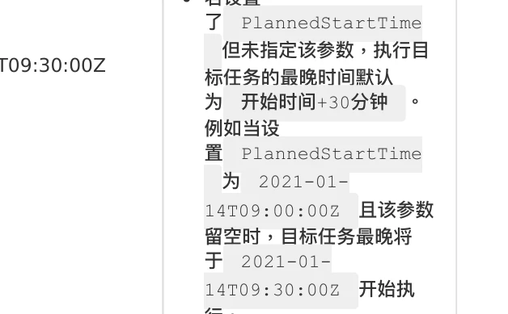

| 参数名称 | 类型 | 位置 | 是否必选 | 示例 | 说明 |
| --- | --- | --- | --- | --- | --- |
| SubCategor y | String | Query | 否 | normal_general | 集群子系列。取值范围如下：<br>• normal_exclusive：独享规格。：通<br>• normal_general用规格。 |
| DBNode | Repea tList | Query | 是 | pi-\*\*\*\*\*\*\*\*\*\*\*\*\* | 集群节点列表。 |
| -DBNodeId | String |  | 否 | pi-\*\*\*\*\*\*\*\*\*\*\*\*\* | 集群节点ID。<em>如果该参数传入</em><em>后，DBNode.N.Target</em> <em>Class必填。N为从1开始</em><em>的整数，最大值=16-当</em><em>前节点数。</em> |
| -TargetClas s | String |  | 否 | polar.mysql.x4.medium | 变配节点的规格。<em>如果该参数传入</em><em>后，DBNode.N.DBNod</em> <em>eId必填。N为从1开始的</em><em>整数，最大值=16-当前</em><em>节点数。</em> |

**返回数据**

| 参数名称 | 类型 | 示例 | 说明 |
| --- | --- | --- | --- |
| RequestId | String | 685F028C-4FCD-407D-A559-072D63\*\*\*\*\*\* | 请求ID。 |
| DBClusterId | String | pc-\*\*\*\*\*\*\*\*\*\*\*\*\* | 数据库集群ID。 |
| OrderId | String | 2035629\*\*\*\*\*\* | 订单ID。 |

**示例**

请求示例

```text
  HTTP/1.1
{
"DBClusterId":"null",
"ModifyType":"null",
"DBNode":"null"
}
```

正常返回示例

`JSON`  格式

```json
{
 "RequestId":"",
 "DBClusterId":"",
 "OrderId":""
}
```

<a id="section-6-84"></a>

## 6.84. ModifyDBDescription

调用ModifyDBDescription接口修改PolarDB MySQL版数据库的备注说明。

**请求头**

该接口使用公共请求头，无特殊请求头。请参见公共请求参数文档。

**请求语法**

```text
  HTTP/1.1
```

**请求参数**

| 参数名称 | 类型 | 位置 | 是否必选 | 示例 | 说明 |
| --- | --- | --- | --- | --- | --- |
| DBClusterI d | String | Query | 是 | pc-\*\*\*\*\*\*\*\*\*\*\*\*\*\*\* | 集群ID。 |
| DBName | String | Query | 是 | testDB | 数据库名称。 |
| DBDescript ion | String | Query | 是 | DBDesc | 数据库备注说明，备注说明需满足如下要求：<br>• 不能以<code> http:// </code>或<code> https</code><code>:// </code>开头。<br>• 长度为2~256个字符。 |
| AccessKeyI d | String | Query | 否 |  |  |
| AccessKeyI d | String | Query | 否 |  |  |
| Action | String | Query | 否 |  |  |
| OwnerId | Long | Query | 否 |  |  |
| ResourceO wnerAccou nt | String | Query | 否 |  |  |
| ResourceO wnerId | Long | Query | 否 |  |  |
| OwnerAcco unt | String | Query | 否 |  |  |

**返回数据**

| 参数名称 | 类型 | 示例 | 说明 |
| --- | --- | --- | --- |
| RequestId | String | 5F295AAB-B599-4F0E-96D0-DBFAB3\*\*\*\*\*\* | 请求ID。 |

**示例**

请求示例

```text
  HTTP/1.1
{
"DBClusterId":"null",
"DBName":"null",
"DBDescription":"null"
}
```

正常返回示例

`JSON`  格式

```json
{
 "RequestId":""
}
```

**错误码**

| HttpCod e | 错误码 | 错误信息 | 描述 |
| --- | --- | --- | --- |
| 404 | InvalidDBInstance.No tFound | InvalidDBCluster.NotFound | The DBClusterId provided does not exist in our records. |

<a id="section-6-85"></a>

## 6.85. ModifyDBClusterStorageSpace

调用ModifyDBClusterStorageSpace接口变更企业版按空间计费集群和标准版集群的存储空间。

**请求头**

该接口使用公共请求头，无特殊请求头。请参见公共请求参数文档。

**请求语法**

```text
  HTTP/1.1
```

**请求参数**

| 参数名称 | 类型 | 位置 | 是否必选 | 示例 | 说明 |
| --- | --- | --- | --- | --- | --- |
| DBClusterI d | String | Query | 是 | pc-\*\*\*\*\*\*\*\*\*\*\*\*\* | 集群ID。 |
| StorageSpa ce | Long | Query | 是 | 50 | 变更后的存储空间。单位：GB。<em>PolarDB MySQL标准版</em><em>的存储空间取值范围：</em><em>20~32000。</em> |
|  |  |  |  |  |  |
| 参数名称 | 类型 | 位置 | 是否必选 | 示例 | 说明 |

<table>
  <tr>
    <td>ClientToke n</td>
    <td>String</td>
    <td>Query</td>
    <td>否</td>
    <td>6000170000591aed949d0f 54a343f1a4233c1e7d1c5c ******</td>
    <td>用于保证请求的幂等性，防止重复提交请求。由客户端生成该参数值，保证在不同请求间唯一，大小写敏感、长度不超过64个ASCII字符。</td>
  </tr>
  <tr>
    <td>PlannedSta rtTime</td>
    <td>String</td>
    <td>Query</td>
    <td>否</td>
    <td>2021-01-14T09:00:00Z</td>
    <td>开始执行定时（即在目标时间段内执行）升级配置任务的最早时间。格式为<code> YYYY-MM-</code><code>DDThh:mm:ssZ</code>（<code>UTC</code>）<code> </code>。<br>• 仅当<code> ModifyType </code>取值为<code> Upgrade </code>时，该参数生效。<br>• 开始时间的取值范围为未来24小时内的任意时间点。例如当前时间为<code> 2021-01-</code><code>14T09:00:00Z </code>，此处允许填入的开始时间范围为<code> 2021-01-</code><code>14T09:00:00Z </code>~<code> 2021</code> <code>-01-15T09:00:00Z </code>。<br>• 若该参数留空，默认立即执行升级配置任务。</td>
  </tr>
  <tr>
    <td>PlannedEn dTime</td>
    <td>String</td>
    <td>Query</td>
    <td>否</td>
    <td>2021-01-14T09:30:00Z</td>
    <td>开始执行目标定时任务的最晚时间。格式为<code> YYYY-MM-</code><code>DDThh:mm:ssZ</code>（<code>UTC</code>）<code> </code>。<br>• <em>最晚时间需晚于开始</em><em>时间的30分钟或以</em><em>上。</em><br>• 若设置了<code> PlannedStartTime</code><code> </code>但未指定该参数，执行目标任务的最晚时间默认为<code> </code>开始时间<code>+30</code>分钟<code> </code>。例如当设置<code> PlannedStartTime</code><code> </code>为<code> 2021-01-</code><code>14T09:00:00Z </code>且该参数留空时，目标任务最晚将于<code> 2021-01-</code><code>14T09:30:00Z </code>开始执行。</td>
  </tr>
</table>


| 参数名称 | 类型 | 位置 | 是否必选 | 示例 | 说明 |
| --- | --- | --- | --- | --- | --- |
| SubCategor y | String | Query | 否 | normal_general | 集群子系列。取值范围如下：<br>• normal_exclusive：独享规格<br>• normal_general：通用规格 |
| ResourceO wnerAccou nt | String | Query | 否 |  |  |
| OwnerAcco unt | String | Query | 否 |  |  |

**返回数据**

| 参数名称 | 类型 | 示例 | 说明 |
| --- | --- | --- | --- |
| RequestId | String | 685F028C-4FCD-407D-A559-072D63\*\*\*\*\*\* | 请求ID。 |
| DBClusterId | String | pc-\*\*\*\*\*\*\*\*\*\*\*\*\* | 数据库集群ID。 |
| OrderId | String | 2035629\*\*\*\*\*\* | 订单ID。 |

**示例**

请求示例

```text
  HTTP/1.1
{
"DBClusterId":"null",
"StorageSpace":"null"
}
```

正常返回示例

`JSON`  格式

```json
{
 "RequestId":"",
 "DBClusterId":"",
 "OrderId":""
}
```

**错误码**

| HttpCod e | 错误码 | 错误信息 | 描述 |
| --- | --- | --- | --- |
| 403 | OperationDenied.Ro EqualSpec | OperationDenied.RoEqualSpec | must exist at least ro class equal with rw |

<a id="section-6-86"></a>

## 6.86. ModifyAccountPassword

调用ModifyAccountPassword接口修改PolarDB数据库的账号密码。

**请求头**

该接口使用公共请求头，无特殊请求头。请参见公共请求参数文档。

**请求语法**

```text
  HTTP/1.1
```

**请求参数**

| 参数名称 | 类型 | 位置 | 是否必选 | 示例 | 说明 |
| --- | --- | --- | --- | --- | --- |
| DBClusterI d | String | Query | 是 | pc-\*\*\*\*\*\*\*\*\*\*\*\* | 集群ID。 |
| AccountNa me | String | Query | 是 | testacc | 账号名称。 |
| NewAccoun tPassword | String | Query | 是 | Pw123456 | 账号的新密码，需符合如下要求：<br>• 至少包含大写字母、小写字母、数字或特殊字符中的任意三种。<br>• 长度为8~32个字符。<br>• 特殊字符为<code> !@#$%^&amp;*</code> <code>()_+-= </code>。 |
| AccessKeyI d | String | Query | 否 |  |  |
| AccessKeyI d | String | Query | 否 |  |  |
| Action | String | Query | 否 |  |  |
| OwnerId | Long | Query | 否 |  |  |
| ResourceO wnerAccou nt | String | Query | 否 |  |  |
| ResourceO wnerId | Long | Query | 否 |  |  |
| OwnerAcco unt | String | Query | 否 |  |  |

**返回数据**

| 参数名称 | 类型 | 示例 | 说明 |
| --- | --- | --- | --- |
| RequestId | String | 2FED790E-FB61-4721-8C1C-07C627\*\*\*\*\*\* | 请求ID。 |

**示例**

请求示例

```text
  HTTP/1.1
{
"DBClusterId":"null",
"AccountName":"null",
"NewAccountPassword":"null"
}
```

正常返回示例

`JSON`  格式

```json
{
 "RequestId":""
}
```

**错误码**

| HttpCod e | 错误码 | 错误信息 | 描述 |
| --- | --- | --- | --- |
| 400 | EngineMigration.Acti onDisabled | EngineMigration.ActionDisabled | Specified action is disabled while custins is in engine migration. |
| 400 | LockTimeout | LockTimeout | The request processing has failed due to lock timeout. |
| 404 | InvalidDBInstance.No tFound | InvalidDBCluster.NotFound | The DBClusterId provided does not exist in our records. |

<a id="section-6-87"></a>

## 6.87. ModifyDBClusterAccessWhitelist

调用ModifyDBClusterAccessWhitelist接口创建或修改PolarDB集群的白名单（包括IP白名单和安全组）。

**请求头**

该接口使用公共请求头，无特殊请求头。请参见公共请求参数文档。

**请求语法**

```text
  HTTP/1.1
```

**请求参数**

| 参数名称 | 类型 | 位置 | 是否必选 | 示例 | 说明 |
| --- | --- | --- | --- | --- | --- |
| DBClusterI d | String | Query | 是 | pc-\*\*\*\*\*\*\*\*\*\*\*\*\* | 集群ID。 |
| SecurityIps | String | Query | 否 | 10.23.12.24 | IP白名单分组中的IP地址或地址段。所有IP白名单分组累积支持1000个IP地址或地址段，多个IP间用英文逗号（,）隔开，支持如下两种格式：<br>• IP地址形式，例如：10.23.12.24。<br>• CIDR形式，例如：10.23.12.24/24（无类域间路由，24表示地址中前缀的长度，长度范围为1~32）。<em>当</em><strong><em>WhiteListType</em></strong><em>取</em><em>值为</em><strong><em>IP</em></strong><em>时该参数才支持</em><em>配置。</em> |
| DBClusterI PArrayNam e | String | Query | 否 | default | IP白名单分组的名称。分组名称长度需为2~120个字符；由小写字母和数字组成；以字母开头，以字母或数字结尾。<br>• 如果传入的白名单分组名称不存在，则会创建该白名单分组。<br>• 如果传入的白名单分组名称已存在，则会修改该白名单分组。<br>• 不传入则修改default分组。<br>• <em>1个集群最多支持50个</em><em>IP白名单分组。</em><br>• 当<strong>WhiteListType</strong>取值为<strong>IP</strong>时该参数才支持配置。 |
| DBClusterI PArrayAttri bute | String | Query | 否 | hidden | IP白名单分组属性。设置为<strong>hidden</strong>后控制台不可见。<br>• <em>已在控制台显示的IP白</em><em>名单分组不支持隐</em><em>藏。</em><br>• 当<strong>WhiteListType</strong>取值为<strong>IP</strong>时该参数才支持配置。 |
| WhiteListTy pe | String | Query | 否 | IP | 白名单类型。取值范围如下：<br>• IP：IP白名单分组。：安全<br>• SecurityGroup组。默认值为<strong>IP</strong>。 |
| SecurityGr oupIds | String | Query | 否 | sg-\*\*\*\*\*\*\*\*\* | 安全组ID，多个安全组间用英文逗号（,）隔开。<br>• <em>1个集群最多支持3个</em><em>安全组。</em><br>• 当<strong>WhiteListType</strong>取值为<strong>SecurityGroup</strong>时该参数才支持配置。 |
| ModifyMod e | String | Query | 否 | Cover | IP白名单的修改方式，取值范围如下：：覆盖原IP白名单<br>• Cover（默认值）。<br>• Append：追加IP。<br>• Delete：删除IP。<em>当</em><strong><em>WhiteListType</em></strong><em>取</em><em>值为</em><strong><em>IP</em></strong><em>时该参数才支持</em><em>配置。</em> |
| ResourceO wnerAccou nt | String | Query | 否 |  |  |
| OwnerAcco unt | String | Query | 否 |  |  |

**返回数据**

| 参数名称 | 类型 | 示例 | 说明 |
| --- | --- | --- | --- |
| RequestId | String | D0CEC6AC-7760-409A-A0D5-E6CD86\*\*\*\*\*\* | 请求ID。 |

**示例**

请求示例

```text
  HTTP/1.1
{
"DBClusterId":"null"
}
```

正常返回示例

`JSON`  格式

```json
{
 "RequestId":""
}
```

**错误码**

| HttpCod e | 错误码 | 错误信息 | 描述 |
| --- | --- | --- | --- |
| 400 | NumberExceed.secur ityGroupIds | NumberExceed.securityGroupIds | The number of SecurityGroupIds exceeds 10. |
| 403 | SecurityIPList.Duplic ate | SecurityIPList.Duplicate | Specified same security IP already exists. |
| 404 | InvalidDBInstance.No tFound | InvalidDBCluster.NotFound | The DBClusterId provided does not exist in our records. |

<a id="section-6-88"></a>

## 6.88. ModifyDBClusterAndNodesParameters

调用ModifyDBClusterAndNodesParameters接口修改集群参数并应用到指定节点。

**请求头**

该接口使用公共请求头，无特殊请求头。请参见公共请求参数文档。

**请求语法**

```text
  HTTP/1.1
```

**请求参数**

| 参数名称 | 类型 | 位置 | 是否必选 | 示例 | 说明 |
| --- | --- | --- | --- | --- | --- |
| DBClusterI d | String | Query | 是 | pc-\*\*\*\*\*\*\*\*\*\*\*\*\*\*\*\* | 集群ID。 |
| DBNodeIds | String | Query | 否 | pi-\*\*\*\*\*\*\*\*\*\*\*\*\*\*\*\*,pi-\*\*\*\*\*\*\*\*\*\*, | 节点ID。通过设置该参数可以修改集群参数和指定节点的参数。多个节点ID间用英文逗号（,）分隔。<em>当该参数为空时，则表示</em><em>只修改集群参数。</em> |
| Parameters | String | Query | 否 | {"wait_timeout":"86","inno db_old_blocks_time":"10"} | 参数及参数值的JSON串。 |
| Parameter GroupId | String | Query | 否 | pcpg-\*\*\*\*\*\*\*\*\*\*\*\*\*\* | 参数模板ID。 |
| PlannedSta rtTime | String | Query | 否 | 2021-01-14T09:00:00Z | 开始执行定时（即在目标时间段内执行）任务的最早时间。格式为<code> YYYY-MM-</code><code>DDThh:mm:ssZ </code>（UTC）。<br>• <em>开始时间的取值范围</em><em>为未来24小时内的任</em><em>意时间点。例如当前</em><em>时间为</em><em><code> 2021-01-</code></em><em><code>14T09:00:00Z </code></em><em>，</em><em>此处允许填入的开始</em><em>时间范围为</em><em><code> 2021-</code></em><em><code>01-</code></em><em><code>14T09:00:00Z </code></em><em>~</em><em><code> </code></em> <em><code>2021-01-</code></em><em><code>15T09:00:00Z </code></em><em>。</em><br>• 若该参数留空，默认立即执行任务。 |
| PlannedEn dTime | String | Query | 否 | 2021-01-14T09:30:00Z | 开始执行目标定时任务的最晚时间。格式为<code> YYYY-MM-</code><code>DDThh:mm:ssZ </code>（UTC）。<br>• <em>最晚时间需晚于开始</em><em>时间的30分钟或以</em><em>上。</em><br>• 若设置了<code> PlannedStartTime</code><code> </code>但未指定该参数，执行目标任务的最晚时间默认为<code> </code>开始时间<code>+30</code>分钟<code> </code>。例如当设置<code> PlannedStartTime</code><code> </code>为<code> 2021-01-</code><code>14T09:00:00Z </code>且该参数留空时，目标任务最晚将于<code> 2021-01-</code><code>14T09:30:00Z </code>开始执行。 |
| FromTimeS ervice | Boole an | Query | 否 | false | 立即执行或定时执行修改参数并重启集群。取值：<br>• false（默认值）：定时执行<br>• true：立即执行 |
| AccessKeyI d | String | Query | 否 |  |  |
| AccessKeyI d | String | Query | 否 |  |  |
| Action | String | Query | 否 |  |  |

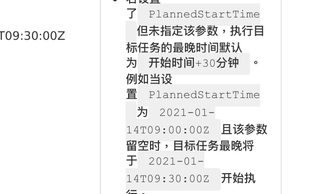

| 参数名称 | 类型 | 位置 | 是否必选 | 示例 | 说明 |
| --- | --- | --- | --- | --- | --- |
| OwnerId | Long | Query | 否 |  |  |
| ResourceO wnerAccou nt | String | Query | 否 |  |  |
| ResourceO wnerId | Long | Query | 否 |  |  |
| OwnerAcco unt | String | Query | 否 |  |  |

**返回数据**

| 参数名称 | 类型 | 示例 | 说明 |
| --- | --- | --- | --- |
| RequestId | String | 9B7BFB11-C077-4FE3-B051-F69CEB\*\*\*\*\*\* | 请求ID。 |

**示例**

请求示例

```text
  HTTP/1.1
{
"DBClusterId":"null"
}
```

正常返回示例

`JSON`  格式

```json
{
 "RequestId":""
}
```

**错误码**

| HttpCod e | 错误码 | 错误信息 | 描述 |
| --- | --- | --- | --- |
| 400 | InvalidParameters.Fo rmat | InvalidParameters.Format | Specified parameters is not valid. |
| 400 | InvalidDBType.Malfor med | InvalidDBType.Malformed | The Specified DBType is not valid. |
| 400 | ParamCollationServe rNotValid | ParamCollationServerNotValid | This param collation_server is not valid. |
| 400 | MinorVersionNotSup port | MinorVersionNotSupport | Custins minor version does not support current action. |
| 400 | ScheduleTaskExist | ScheduleTaskExist | The specified dbCluster already has a scheduled task. |
| 400 | ParamTypeException | ParamTypeException | Param is isClusterAvailable, not allow to change alone |
| 404 | InvalidDBCluster.Not Found | InvalidDBCluster.NotFound | The specified DBClusterId is not found. |
| 404 | InvalidDBClusterId.N otFound | InvalidDBClusterId.NotFound | The DBClusterId provided does not exist in our records. |
| 404 | InvalidDBNodeId.Not Found | InvalidDBNodeId.NotFound | The DBNodeId provided does not exist in our records. |

<a id="section-6-89"></a>

## 6.89. ModifyDBClusterAuditLogCollector

调用DescribeDBClusterAuditLogCollector接口开启或关闭PolarDB集群的SQL采集功能（例如审计日志、SQL洞察等）。

**请求头**

该接口使用公共请求头，无特殊请求头。请参见公共请求参数文档。

**请求语法**

```text
  HTTP/1.1
```

**请求参数**

| 参数名称 | 类型 | 位置 | 是否必选 | 示例 | 说明 |
| --- | --- | --- | --- | --- | --- |
| DBClusterI d | String | Query | 是 | pc-\*\*\*\*\*\*\*\*\*\*\*\*\*\*\* | 集群ID。 |
| CollectorSt atus | String | Query | 是 | Enable | 开启或关闭SQL采集功能，取值范围如下：<br>• Enable ：开启。<br>• Disabled ：关闭。 |
| ResourceO wnerAccou nt | String | Query | 否 |  |  |
| OwnerAcco unt | String | Query | 否 |  |  |

**返回数据**

| 参数名称 | 类型 | 示例 | 说明 |
| --- | --- | --- | --- |
| RequestId | String | 22C0ACF0-DD29-4B67-9190-B7A48C\*\*\*\*\*\* | 请求ID。 |

**示例**

请求示例

```text
  HTTP/1.1
{
"DBClusterId":"null",
"CollectorStatus":"null"
}
```

正常返回示例

`JSON`  格式

```json
{
 "RequestId":""
}
```

<a id="section-6-90"></a>

## 6.90. ModifyDBClusterDescription

调用ModifyDBClusterDescription接口修改PolarDB集群名称。

**请求头**

该接口使用公共请求头，无特殊请求头。请参见公共请求参数文档。

**请求语法**

```text
  HTTP/1.1
```

**请求参数**

| 参数名称 | 类型 | 位置 | 是否必选 | 示例 | 说明 |
| --- | --- | --- | --- | --- | --- |
| DBClusterI d | String | Query | 是 | pc-\*\*\*\*\*\*\*\*\*\*\*\*\*\* | 集群ID。 |
| DBClusterD escription | String | Query | 是 | ClusterDescriptionTest | 集群名称，集群名称需满足如下要求：<br>• 不能以<code> http:// </code>或<code> https</code><code>:// </code>开头。<br>• 长度为2~256个字符。 |
| AccessKeyI d | String | Query | 否 |  |  |
| AccessKeyI d | String | Query | 否 |  |  |
| Action | String | Query | 否 |  |  |
| OwnerId | Long | Query | 否 |  |  |
| ResourceO wnerAccou nt | String | Query | 否 |  |  |
| ResourceO wnerId | Long | Query | 否 |  |  |
| OwnerAcco unt | String | Query | 否 |  |  |

**返回数据**

| 参数名称 | 类型 | 示例 | 说明 |
| --- | --- | --- | --- |
| RequestId | String | D0CEC6AC-7760-409A-A0D5-E6CD86\*\*\*\*\*\* | 请求ID。 |

**示例**

请求示例

```text
  HTTP/1.1
{
"DBClusterId":"null",
"DBClusterDescription":"null"
}
```

正常返回示例

`JSON`  格式

```json
{
 "RequestId":""
}
```

**错误码**

| HttpCod e | 错误码 | 错误信息 | 描述 |
| --- | --- | --- | --- |
| 404 | InvalidDBInstance.No tFound | InvalidDBCluster.NotFound | The DBClusterId provided does not exist in our records. |

<a id="section-6-91"></a>

## 6.91. ModifyDBClusterEndpoint

调用ModifyDBClusterEndpoint接口修改PolarDB的集群地址属性，包括读写模式、新节点是否自动加入本地址、一致性级别、事务拆分、主库是否接受读、连接池等。

**请求头**

该接口使用公共请求头，无特殊请求头。请参见公共请求参数文档。

**请求语法**

```text
  HTTP/1.1
```

**请求参数**

| 参数名称 | 类型 | 位置 | 是否必选 | 示例 | 说明 |
| --- | --- | --- | --- | --- | --- |
| DBClusterI d | String | Query | 是 | pc-\*\*\*\*\*\*\*\*\*\*\*\*\* | 集群ID。 |
| DBEndpoin tId | String | Query | 是 | pe-\*\*\*\*\*\*\*\*\*\*\*\*\*\* | 集群地址ID。 |
| Nodes | String | Query | 否 | pi-\*\*\*\*\*\*\*\*\*\*\*\*\*\*,pi-\*\*\*\*\*\*\*\*\*\*\*\*\* | 加入目标地址的读负载节点，多个节点间用英文逗号（,）分隔。 默认为原有节点。<br>• <em>PolarDB MySQL版需</em><em>要传入节点ID。</em><br>• PolarDB PostgreSQL版和PolarDB PostgreSQL版（兼容Oracle）需要传入节点角色名称，例如<code> Writer,Reader1,Rea</code> <code>der2 </code>。取值<br>• ReadWriteMode为<strong>ReadOnly</strong>时，支持只挂载一个节点。但当此节点故障时，该地址可能会有最多1小时的不可用，请勿用于生产环境。因此，推荐至少选择2个节点，以提升可用性。<br>• ReadWriteMode取值为<strong>ReadWrite</strong>时，至少要选择2个节点。<br>• PolarDB MySQL版支持选择任意两个节点。当两个节点都是只读节点时，写请求都会发往主节点。<br>• PolarDB PostgreSQL版和PolarDB PostgreSQL版（兼容Oracle）必须包含主节点。 |
| ReadWrite Mode | String | Query | 否 | ReadWrite | 读写模式，取值范围如下：<br>• ReadWrite：可读可写（自动读写分离）<br>• ReadOnly：只读 |
| AutoAddNe wNodes | String | Query | 否 | Enable | 新节点是否自动加入本地址，取值范围如下：：是<br>• Enable：否（默认值）<br>• Disable |
|  |  |  |  |  | 集群地址的高级配置，格式为JSON，目前支持设置一致性级别、事务拆分、主库是否接受读和连接池等。<br>• 设置负载均衡策略，格式为<code> {\"LoadBalancePoli</code> <code>cy\":\"</code>负载均衡策略<code>\"} </code>。取值范围如下：<br>：基于连接数负载均<br>• 0衡（默认） |
|  |  |  |  |  |  |
| 参数名称 | 类型 | 位置 | 是否必选 | 示例 | ：基于活跃请求数负<br>• 1说明载均衡 |
| EndpointCo nfig | String | Query | 否 | {"ConsistLevel":"1","Distri butedTransaction":"on","M asterAcceptReads":"off","C onnectionPersist": "on"} | • 设置主库是否接受读，格式为<code> {\"MasterAcceptRea</code> <code>ds\":\"</code>主库是否接受读<code>\"} </code>。取值范围如下：<br>• on：表示主库接受读（默认）：表示主库不接受<br>• off读<br>• 设置事务拆分，格式为<code> {\"DistributedTran</code> <code>saction\":\"</code>事务拆分<code>\"} </code>。取值范围如下：<br>• on：开启事务拆分（默认）：关闭事务拆分<br>• off<br>• 设置一致性级别，格式为<code> {\"ConsistLevel\":</code> <code>\"</code>一致性级别<code>\"} </code>。取值范围如下：<br>• 0：最终一致性（弱）：会话一致性（中）<br>• 1（默认）：全局一致性（强）<br>• 2<br>• 设置连接池，格式为<code> {\"ConnectionPersi</code> <code>st\":\"</code>连接池<code>\"} </code>。取值范围如下：：关闭连接池（默<br>• off认）：开启会话<br>• Session级连接池<br>• Transaction：开启事务级连接池<br>• 设置并行查询，格式为<code> {\"MaxParallelDegr</code> <code>ee\":\"</code>并行查询<code>\"} </code>。取值范围如下：：开启并行查询<br>• on<br>• off：关闭并行查询（默认）<br>• 设置行存/列存自动引流，格式为<code> {\"EnableHtapImci\</code> <code>":\"</code>行存<code>/</code>列存自动引流<code>\"} </code>。取值范围如下：<br>：开启行存/列存自<br>• on动引流功能：关闭行存/列存自<br>• off动引流功能（默认） |
|  |  |  |  |  |  |
| 参数名称 | 类型 | 位置 | 是否必选 | 示例 | • 设置是否开启过载保护，格说明式 |
|  |  |  |  |  | 为<code> {\"EnableOverloadT</code> <code>hrottle\":\"</code>是否开启过载保护<code>\"} </code>。取值范围如下：<br>• on：开启过载保护：关闭过载保护<br>• off（默认）<br>• <em>仅当PolarDB MySQL</em><em>版集群地址的读写模</em><em>式为\*\*可读可写（自</em><em>动读写分离）\*\*时，</em><em>支持设置事务拆分、</em><em>主库是否接受读、连</em><em>接池和是否开启过载</em><em>保护。</em><br>• 当PolarDB MySQL版集群地址的读写模式为<strong>只</strong>读时，支持<strong>基于连接数负</strong>载均衡和<strong>基于活跃请求数</strong>负载均衡两种负载均衡策略； <strong>可读可写（自动读写分</strong>离）模式的集群地址仅支持基于活跃请求数负载均衡策略。<br>• 当PolarDB MySQL版集群地址的读写模式为<strong>可读可写</strong>（自动读写分离），或集群地址的读写模式为<strong>只</strong>读且负载均衡策略为<strong>基于</strong>活跃请求数负载均衡时，支持设置行存/列存自动引流。<br>• 仅PolarDB MySQL版支持一致性级别设置为全局一致性。<br>• 如果参数<strong>ReadWriteMode</strong>取值为<strong>ReadOnly</strong>，一致性级别取值只能为<strong>0</strong>。<br>• 您可以同时设置一致性级别、事务拆分、主库是否接受读和连接池，例如<code> {\"ConsistLevel\":</code> <code>\"1\",\"DistributedTr</code><br><code>ansaction\":\"on\",\"</code><br><code>ConnectionPersist\":\</code><br><code>"Session\",\"MasterAc</code><br><code>ceptReads\":\"on\"}</code>。<br>• 事务拆分的设置受一致性级别设置的约束。例如一致性级别取值为<strong>0</strong>时，不支持 |
| DBEndpoin tDescriptio n | String | Query | 否 | test | 开启事务拆分；一致性级别取值为<strong>1</strong>或<strong>2</strong>时，支持地址名称。开启事务拆分。 |
| ResourceO wnerAccou nt | String | Query | 否 |  |  |
| OwnerAcco unt | String | Query | 否 |  |  |
| EndpointTy pe | String | Query | 否 |  |  |

**返回数据**

| 参数名称 | 类型 | 示例 | 说明 |
| --- | --- | --- | --- |
| RequestId | String | CD3FA5F3-FAF3-44CA-AFFF-BAF869\*\*\*\*\*\* | 请求ID。 |

**示例**

请求示例

```text
  HTTP/1.1
{
"DBClusterId":"null",
"DBEndpointId":"null"
}
```

正常返回示例

`JSON`  格式

```json
{
 "RequestId":""
}
```

**错误码**

| HttpCod e | 错误码 | 错误信息 | 描述 |
| --- | --- | --- | --- |
| 400 | InvalidEndpointConfi g.Malformed | InvalidEndpointConfig.Malformed | The specified parameter EndpointConfig is not valid. |
| 400 | InvalidDBEndpointId.Malformed | InvalidDBEndpointId.Malformed | The specified parameter DBEndpointId is not valid. |
| 404 | InvalidDBInstance.No tFound | InvalidDBCluster.NotFound | The DBClusterId provided does not exist in our records. |
| 404 | EndpointStatus.NotS upport | EndpointStatus.NotSupport | Current endpoint status does not support this operation. |

<a id="section-6-92"></a>

## 6.92. ModifyDBClusterMigration

调用ModifyDBClusterMigration接口切换或回滚RDS一键升级到PolarDB的迁移任务。

**请求头**

该接口使用公共请求头，无特殊请求头。请参见公共请求参数文档。

**请求语法**

```text
  HTTP/1.1
```

**请求参数**

| 参数名称 | 类型 | 位置 | 是否必选 | 示例 | 说明 |
| --- | --- | --- | --- | --- | --- |
| SecurityTo ken | String | Query | 否 |  |  |
| DBClusterI d | String | Query | 是 | pc-\*\*\*\*\*\*\*\*\*\*\*\*\*\* | PolarDB集群ID。 |
| SourceRDS DBInstance Id | String | Query | 是 | rm-\*\*\*\*\*\*\*\*\*\*\*\* | 源RDS实例ID。 |
| NewMasterI nstanceId | String | Query | 是 | pc-\*\*\*\*\*\*\*\*\*\*\*\*\*\* | 新的实例ID或集群ID，取值范围如下：<br>• 切换前，填写PolarDB集群ID进行切换。<br>• 切换后，填写RDS实例ID进行回滚。 |
| SwapConne ctionString | String | Query | 否 | false | 是否需要切换连接地址，取值：：带地址切换（应<br>• true用程序不用改连接配置）。<br>• false：不带地址切换（应用程序需要改为新的PolarDB连接配置）。默认为<strong>false</strong>。 |
| Connection Strings | String | Query | 否 | {"rm-2ze73el581cs\*\*\*\*\*.mysql.pre.rds.aliyuncs.com":"pc-2ze8200s298e\*\*\*\*\*.mysql.polardb.pre.rds.aliyuncs.co m","rm-2ze73el581cs86\*\*\*\*\*.mys ql.pre.rds.aliyuncs.com":"t est-p\*\*\*\*\*.mysql.polardb.pre.r ds.aliyuncs.com"} | 需要切换的具体连接地址。取值为需要两两交换的地址对应的JSON串。<em>当</em><em>SwapConnectionStrin</em> <em>g取值为true时生效。</em> |
| ResourceO wnerAccou nt | String | Query | 否 |  |  |
| OwnerAcco unt | String | Query | 否 |  |  |
| RegionId | String | Host | 否 |  |  |

**返回数据**

| 参数名称 | 类型 | 示例 | 说明 |
| --- | --- | --- | --- |
| RequestId | String | A1B303A5-653F-4AEE-A598-023FF9\*\*\*\*\*\* | 请求ID。 |

**示例**

请求示例

```text
  HTTP/1.1
{
"DBClusterId":"null",
"SourceRDSDBInstanceId":"null",
"NewMasterInstanceId":"null"
}
```

正常返回示例

`JSON`  格式

```json
{
 "RequestId":""
}
```

**错误码**

| HttpCod e | 错误码 | 错误信息 | 描述 |
| --- | --- | --- | --- |
| 404 | InvalidDBInstance.No tFound | InvalidDBCluster.NotFound | The DBClusterId provided does not exist in our records. |

<a id="section-6-93"></a>

## 6.93. ModifyDBClusterMonitor

调用ModifyDBClusterMonitor接口修改PolarDB集群的监控数据采集频率。

**请求头**

该接口使用公共请求头，无特殊请求头。请参见公共请求参数文档。

**请求语法**

```text
  HTTP/1.1
```

**请求参数**

| 参数名称 | 类型 | 位置 | 是否必选 | 示例 | 说明 |
| --- | --- | --- | --- | --- | --- |
| DBClusterI d | String | Query | 是 | pc-\*\*\*\*\*\*\*\*\*\*\*\*\*\*\*\* | 集群ID。 |
| Period | String | Query | 是 | 5 | 监控的采集间隔，取值为<strong>5</strong>或<strong>60</strong>，单位为秒。 |

**返回数据**

| 参数名称 | 类型 | 示例 | 说明 |
| --- | --- | --- | --- |
| RequestId | String | 75B92353-73B4-447B-8477-C85F3C\*\*\*\*\*\* | 请求ID。 |

**示例**

请求示例

```text
  HTTP/1.1
{
"DBClusterId":"null",
"Period":"null"
}
```

正常返回示例

`JSON`  格式

```json
{
 "RequestId":""
}
```

**错误码**

| HttpCod e | 错误码 | 错误信息 | 描述 |
| --- | --- | --- | --- |
| 403 | IncorrectPerfFrequen cyType | OperationDenied.DBInstanceMoni torPeriod | Current DB instance does not support this monitor period. |
| 404 | InvalidDBInstanceNa me.NotFound | InvalidDBInstanceId.NotFound | The DBInstanceId provided does not exist in our records. |

<a id="section-6-94"></a>

## 6.94. GrantAccountPrivilege

调用GrantAccountPrivilege接口授权普通账号访问PolarDB集群的某个数据库。

**请求头**

该接口使用公共请求头，无特殊请求头。请参见公共请求参数文档。

**请求语法**

```text
  HTTP/1.1
```

**请求参数**

| 参数名称 | 类型 | 位置 | 是否必选 | 示例 | 说明 |
| --- | --- | --- | --- | --- | --- |
| DBClusterI d | String | Query | 是 | pc-\*\*\*\*\*\*\*\*\*\*\*\*\*\*\*\* | 集群ID。 |
| AccountNa me | String | Query | 是 | testacc | 账号名。 |
| DBName | String | Query | 是 | testdb_1,testdb_2 | 需要授权的数据库名称。支持同时对一个或多个数据库授权，多个数据库名称之间用英文逗号（,）隔开。 |
| AccountPri vilege | String | Query | 是 | ReadWrite,ReadOnly | 账号权限，取值范围如下：<br>• ReadWrite：读写。：只读。<br>• ReadOnly<br>• DMLOnly：只允许DML。<br>• DDLOnly：只允许DDL。<br>• ReadIndex：只读+索引。<strong><em>AccountPrivilege</em></strong><em>需与</em><strong><em>DBName</em></strong><em>输入的</em><em>参数数量保持一致，且顺</em><em>序对应。例如，输</em><em>入</em><strong><em>DBName</em></strong><em>为</em><em><code> test</code></em> <em><code>db_1,testdb_2 </code></em><em>，</em><strong><em>Ac</em></strong> <strong><em>countPrivilege</em></strong><em>为</em><em><code> </code></em><em><code>ReadWrite,ReadOnly</code></em><em><code> </code></em><em>，则表示授予目标账号</em><em>对数据</em><em>库</em><strong><em>testdb_1</em></strong><em>的</em><strong><em>读</em></strong><strong><em>写</em></strong><em>权限，对数据</em><em>库</em><strong><em>testdb_2</em></strong><em>的</em><strong><em>只</em></strong><strong><em>读</em></strong><em>权限。</em> |


**返回数据**

| 参数名称 | 类型 | 示例 | 说明 |
| --- | --- | --- | --- |
| RequestId | String | 2FED790E-FB61-4721-8C1C-07C627\*\*\*\*\* | 请求ID。 |

**示例**

请求示例

```text
  HTTP/1.1
{
"DBClusterId":"null",
"AccountName":"null",
"DBName":"null",
"AccountPrivilege":"null"
}
```

正常返回示例

`JSON`  格式

```json
{
 "RequestId":""
}
```

**错误码**

| HttpCod e | 错误码 | 错误信息 | 描述 |
| --- | --- | --- | --- |
| 400 | EngineMigration.Acti onDisabled | EngineMigration.ActionDisabled | Specified action is disabled while custins is in engine migration. |
| 400 | LockTimeout | LockTimeout | The request processing has failed due to lock timeout. |
| 400 | Account.UpdateError | Account.UpdateError | Instance %s update Account %s error |
| 403 | IncorrectAccountPrivi legeType | IncorrectAccountPrivilegeType | Current account privilege type does not support this operation. |
| 404 | InvalidDBInstance.No tFound | InvalidDBCluster.NotFound | The DBClusterId provided does not exist in our records. |

<a id="section-6-95"></a>

## 6.95. ModifyAccountDescription

调用ModifyAccountDescription接口修改PolarDB数据库账号的备注信息。

**请求头**

该接口使用公共请求头，无特殊请求头。请参见公共请求参数文档。

**请求语法**

```text
  HTTP/1.1
```

**请求参数**

| 参数名称 | 类型 | 位置 | 是否必选 | 示例 | 说明 |
| --- | --- | --- | --- | --- | --- |
| DBClusterI d | String | Query | 是 | pc-\*\*\*\*\*\*\*\*\*\*\*\*\* | 集群ID。 |
| AccountNa me | String | Query | 是 | testacc | 账号名。 |
| AccountDe scription | String | Query | 是 | AccDesc | 账号备注信息，备注信息如满足如下要求：<br>• 不能以<code> http:// </code>或<code> https</code><code>:// </code>开头。<br>• 长度为2-256个字符。 |
| AccessKeyI d | String | Query | 否 |  |  |
| AccessKeyI d | String | Query | 否 |  |  |
| Action | String | Query | 否 |  |  |
| OwnerId | Long | Query | 否 |  |  |
| ResourceO wnerAccou nt | String | Query | 否 |  |  |
| ResourceO wnerId | Long | Query | 否 |  |  |
| OwnerAcco unt | String | Query | 否 |  |  |

**返回数据**

| 参数名称 | 类型 | 示例 | 说明 |
| --- | --- | --- | --- |
| RequestId | String | 2FED790E-FB61-4721-8C1C-07C627\*\*\*\*\*\* | 请求ID。 |

**示例**

请求示例

```text
  HTTP/1.1
{
"DBClusterId":"null",
"AccountName":"null",
"AccountDescription":"null"
}
```

正常返回示例

`JSON`  格式

```json
{
 "RequestId":""
}
```

**错误码**

| HttpCod e | 错误码 | 错误信息 | 描述 |
| --- | --- | --- | --- |
| 404 | InvalidDBInstance.No tFound | InvalidDBCluster.NotFound | The DBClusterId provided does not exist in our records. |

<a id="section-6-96"></a>

## 6.96. DescribeAccounts

调用DescribeAccounts接口查询PolarDB集群的数据库账号信息。

**请求头**

该接口使用公共请求头，无特殊请求头。请参见公共请求参数文档。

**请求参数**

| 参数名称 | 类型 | 位置 | 是否必选 | 示例 | 说明 |
| --- | --- | --- | --- | --- | --- |
| DBClusterI d | String | Query | 是 | pc-\*\*\*\*\*\*\*\*\*\*\*\*\*\*\* | 集群ID。 |
| AccountNa me | String | Query | 否 | test_acc | 账号名称。 |
| PageNumb er | Intege r | Query | 否 | 1 | 页码，取值范围为大于0但不超过Integer最大值的整数。默认值为<strong>1</strong>。 |
| PageSize | Intege r | Query | 否 | 30 | 每页记录数，取值范围：<br>• 30<br>• 50<br>• 100默认值为<strong>30</strong>。 |
| ResourceO wnerAccou nt | String | Query | 否 |  |  |
| OwnerAcco unt | String | Query | 否 |  |  |

**返回数据**

| 参数名称 | 类型 | 示例 | 说明 |
| --- | --- | --- | --- |
| PageRecordCou nt | Integer | 1 | 本页记录数。 |
| RequestId | String | 155462B9-205F-4FFC-BB43-4855FE\*\*\*\*\*\* | 请求ID。 |
| PageNumber | Integer | 1 | 页码。 |
| Accounts | Array |  | 账号信息详情。 |
| -DatabasePrivile ges | Array |  | 目标账号拥有的数据库权限详情。 |
| --DBName | String |  |  |
| --AccountPrivileg e | String |  |  |
| -AccountStatus | String | Available | 账号状态。取值范围：：创建中。<br>• Creating：可用。<br>• Available<br>• Deleting：删除中。 |
| -AccountDescript ion | String | test | 账号备注。 |
| -PrivilegeExceed ed | String |  |  |
| -AccountPasswor dValidTime | String | undefined | 密码过期时间。 |
| -AccountType | String | Normal | 账户类型。取值范围：<br>• Normal：普通账号。：高权限账号。<br>• Super |
| -AccountLockSta te | String | UnLock | 账号锁定状态。取值范围：<br>• UnLock：未锁定。：锁定。<br>• Lock |
| -AccountName | String | test_acc | 账号名。 |
| -AccountPasswor d | String | Test1111 | 账号密码。 |

**示例**

请求示例

```text
http(s)://[Endpoint]/?Action=DescribeAccounts
&DBClusterId=pc-***************
&公共请求参数
```

正常返回示例

`JSON`  格式

```text
HTTP/1.1 200 OK
Content-Type:application/json
{
 "PageRecordCount":1,
 "RequestId":"155462B9-205F-4FFC-BB43-4855FE******",
 "PageNumber":1,
 "Accounts":{
  "AccountDescription":"test",
  "AccountStatus":"Available",
  "PrivilegeExceeded":"",
  "AccountLockState":"UnLock",
  "-DatabasePrivileges":{
   "AccountPrivilege":"",
   "DBName":""
  },
  "AccountPasswordValidTime":"undefined",
  "AccountType":"Normal",
  "AccountName":"test_acc",
  "AccountPassword":"Test1111"
 }
}
```

**错误码**

| HttpCod e | 错误码 | 错误信息 | 描述 |
| --- | --- | --- | --- |
| 400 | InvalidPageSize.Malf ormed | InvalidPageSize.Malformed | The specified parameter PageSize is not valid. |
| 400 | InvalidPageNumber.Malformed | InvalidPageNumber.Malformed | The specified parameter PageNumber is not valid. |
| 400 | Database.ConnectErr or | Database.ConnectError | db instance %s connect failed, please check instance status and database processlist |
| 400 | Account.QueryError | Account.QueryError | Instance %s query account error |
| 404 | InvalidDBInstance.No tFound | InvalidDBCluster.NotFound | The DBClusterId provided does not exist in our records. |
| 404 | InvalidDBClusterId.M alformed | InvalidDBClusterId.Malformed | The specified parameter DBClusterId is not valid. |

<a id="section-6-97"></a>

## 6.97. DescribeBackupTasks

调用DescribeBackupTasks接口查询集群的备份任务详情。

**请求头**

该接口使用公共请求头，无特殊请求头。请参见公共请求参数文档。

**请求参数**

| 参数名称 | 类型 | 位置 | 是否必选 | 示例 | 说明 |
| --- | --- | --- | --- | --- | --- |
| DBClusterI d | String | Query | 是 | pc-\*\*\*\*\*\*\*\*\*\*\*\*\*\*\* | 集群ID。 |
| BackupJobI d | String | Query | 否 | 11111111 | 备份任务ID。 |
| BackupMod e | String | Query | 否 | Manual | 备份模式，取值范围如下：<br>• Automated：系统自动备份<br>• Manual：手动备份 |
| ResourceO wnerAccou nt | String | Query | 否 |  |  |
| OwnerAcco unt | String | Query | 否 |  |  |

**返回数据**

| 参数名称 | 类型 | 示例 | 说明 |
| --- | --- | --- | --- |
| RequestId | String | FA8C1EF1-E3D4-44D7-B809-823187\*\*\*\*\*\* | 请求ID。 |
| Items | Array |  | 备份任务详情。 |
| -StartTime | String | 2020-08-08T07:24:01Z | 备份任务开始时间（UTC），格式为<code> YYYY-MM-</code><code>DDThh:mm:ssZ </code>。 |
| -Process | String | 0 | 备份任务进度百分比。 |
| -BackupJobId | String | 11111111 | 备份任务ID。 |
| -JobMode | String | Automated | 备份模式，取值范围如下：<br>• Automated：系统自动备份：手动备份<br>• Manual |
| -BackupProgress Status | String | NoStart | 备份任务状态，取值范围如下：<br>• NoStart：未开始：准备中<br>• Preparing<br>• Waiting：等待中：上传中<br>• Uploading：检查中<br>• Checking<br>• Finished：已完成 |
| -TaskAction | String | NormalBackupTask | 备份任务类型，取值范围如下：：临时备份任务<br>• TempBackupTask<br>• NormalBackupTask：普通备份任务 |

**示例**

请求示例

```text
http(s)://[Endpoint]/?Action=DescribeBackupTasks
&DBClusterId=pc-***************
&公共请求参数
```

正常返回示例

`JSON`  格式

```text
HTTP/1.1 200 OK
Content-Type:application/json
{
 "RequestId":"FA8C1EF1-E3D4-44D7-B809-823187******",
 "Items":{
  "JobMode":"Automated",
  "TaskAction":"NormalBackupTask",
  "StartTime":"2020-08-08T07:24:01Z",
  "BackupProgressStatus":"NoStart",
  "Process":"0",
  "BackupJobId":"11111111"
 }
}
```

**错误码**

| HttpCod e | 错误码 | 错误信息 | 描述 |
| --- | --- | --- | --- |
| 400 | InvalidDBClusterId.N otFound | InvalidDBClusterId.NotFound | The DBClusterId provided does not exist in our records. |
| 400 | InvalidBackupMode.Malformed | InvalidBackupMode.Malformed | The specified parameter BackupMode is not valid. |

<a id="section-6-98"></a>

## 6.98. DescribeDatabases

调用DescribeDatabases接口查询PolarDB指定集群的数据库详情。

**请求头**

该接口使用公共请求头，无特殊请求头。请参见公共请求参数文档。

**请求参数**

| 参数名称 | 类型 | 位置 | 是否必选 | 示例 | 说明 |
| --- | --- | --- | --- | --- | --- |
| DBClusterI d | String | Query | 是 | pc-\*\*\*\*\*\*\*\*\*\*\*\*\*\* | 集群ID。 |
| DBName | String | Query | 否 | test_db | 数据库名。<em>不支持填入多个数据库名</em><em>称。</em> |
| PageNumb er | Intege r | Query | 否 | 1 | 页码，取值范围为大于0但不超过Integer最大值的整数，默认值为<strong>1</strong>。 |
| PageSize | Intege r | Query | 否 | 30 | 每页记录数，取值范围如下：<br>• 30<br>• 50<br>• 100默认值为<strong>30</strong>。 |
| ResourceO wnerAccou nt | String | Query | 否 |  |  |
| OwnerAcco unt | String | Query | 否 |  |  |

**返回数据**

| 参数名称 | 类型 | 示例 | 说明 |
| --- | --- | --- | --- |
| PageRecordCou nt | Integer | 1 | 本页记录数。 |
| Databases | Array |  | 数据库信息详情。 |
| -Accounts | Array |  | 数据库账号信息详情。<em>当集群为PolarDB MySQL版时，不含高权限账</em><em>号。</em> |
| --PrivilegeStatus | String |  |  |
| --AccountStatus | String |  |  |
| --AccountPrivileg e | String |  |  |
| --AccountName | String |  |  |
| -DBDescription | String | test_des | 数据库备注。 |
| -DBStatus | String | Running | 数据库状态，取值范围如下：<br>• Creating：创建中：使用中<br>• Running<br>• Deleting：删除中 |
| -DBName | String | test_db | 数据库名称。 |
| -Engine | String | MySQL | 数据库引擎类型，取值范围如下：<br>• MySQL<br>• Oracle<br>• PostgreSQL |
| -MasterID | String | 2 | 多主集群（库表）版的数据库所对应的主节点ID。 |
| -CharacterSetNa me | String | utf8mb4 | 字符集，详情请参见字符集表。 |
| RequestId | String | E1DF8CA6-2300-448B-9ABF-760C4B\*\*\*\*\*\* | 请求ID。 |
| PageNumber | Integer | 1 | 页码。 |

**示例**

请求示例

```text
http(s)://[Endpoint]/?Action=DescribeDatabases
&DBClusterId=pc-**************
&公共请求参数
```

正常返回示例

`JSON`  格式

```text
HTTP/1.1 200 OK
Content-Type:application/json
{
 "PageRecordCount":1,
 "Databases":{
  "CharacterSetName":"utf8mb4",
  "DBDescription":"test_des",
  "DBName":"test_db",
  "MasterID":"2",
  "-Accounts":{
   "AccountStatus":"",
   "AccountPrivilege":"",
   "PrivilegeStatus":"",
   "AccountName":""
  },
  "DBStatus":"Running",
  "Engine":"MySQL"
 },
 "RequestId":"E1DF8CA6-2300-448B-9ABF-760C4B******",
 "PageNumber":1
}
```

**错误码**

| HttpCod e | 错误码 | 错误信息 | 描述 |
| --- | --- | --- | --- |
| 400 | InvalidDBClusterId.M alformed | InvalidDBClusterId.Malformed | The specified parameter DBClusterId is not valid. |
| 400 | InvalidPageSize.Malf ormed | InvalidPageSize.Malformed | The specified parameter PageSize is not valid. |
| 400 | InvalidPageNumber.Malformed | InvalidPageNumber.Malformed | The specified parameter PageNumber is not valid. |
| 400 | Database.ConnectErr or | Database.ConnectError | db instance %s connect failed, please check instance status and database processlist |
| 404 | InvalidDBInstance.No tFound | InvalidDBCluster.NotFound | The DBClusterId provided does not exist in our records. |

<a id="section-6-99"></a>

## 6.99. DescribeDBClusterAvailableResources

调用DescribeDBClusterAvailableResources接口查询PolarDB集群可售卖资源。

**请求头**

该接口使用公共请求头，无特殊请求头。请参见公共请求参数文档。

**请求参数**

| 参数名称 | 类型 | 位置 | 是否必选 | 示例 | 说明 |
| --- | --- | --- | --- | --- | --- |
| PayType | String | Query | 是 | Postpaid | 付费类型，取值范围如下：：按量付费<br>• Postpaid（也称后付费或按小时付费）。<br>• Prepaid：包年包月（也称预付费）。 |
| DBType | String | Query | 否 | MySQL | 数据库引擎类型，取值范围如下：。<br>• MySQL。<br>• PostgreSQL<br>• Oracle。 |
| DBVersion | String | Query | 否 | 5.6 | 数据库引擎版本号。 MySQL版本号取值范围如下：。<br>• 5.6<br>• 5.7。。<br>• 8.0 PostgreSQL版本号取值范围如下：<br>• 11。。<br>• 14 Oracle版本号取值为<strong>11</strong>。<em>当传入</em><strong><em>DBType</em></strong><em>参数</em><em>时，该参数必填。</em> |
| DBNodeCla ss | String | Query | 否 | polar.mysql.x4.large | 节点规格，详情请参见计算节点规格。 |
| RegionId | String | Query | 否 | cn-hangzhou | 地域ID。默认为<strong>cn-</strong>hangzhou。<em>可通过接口</em><em>DescribeRegions查看</em><em>可用的地域。</em> |
| ZoneId | String | Query | 否 | cn-hangzhou-i | 可用区ID。<em>可通过</em><em>DescribeRegions查看</em><em>可用区。</em> |

**返回数据**

| 参数名称 | 类型 | 示例 | 说明 |
| --- | --- | --- | --- |
| AvailableZones | Array |  | 可售卖的资源信息列表。 |
| -SupportedEngin es | Array |  | 可售卖引擎列表。 |
| --AvailableResour ces | Array |  | 可售卖的资源列表。 |
| ---DBNodeClass | String | polar.mysql.x4.large | 节点规格。 |
| ---Category | String | Normal | 集群系列，取值范围如下：：集群版。<br>• Normal<br>• Basic：单节点。：高压缩引擎（X-<br>• ArchiveNormal Engine）。：多主集群（库表）。<br>• NormalMultimaster<br>• SENormal：标准版。<br>• <em>仅 PolarDB MySQL 版支持单节点产品系</em><em>列。</em><br>• <em>仅 PolarDB MySQL 版 8.0 版本的集群，支</em><em>持高压缩引擎（X-Engine）和多主集群（库</em><em>表）系列。</em> |
| --Engine | String | mysql57 | 数据库引擎版本。 |
| -ZoneId | String | cn-hangzhou-i | 可用区ID。 |
| -RegionId | String | cn-hangzhou | 地域ID。 |
| RequestId | String | 2B19F698-8FFC-4918-B9E2-58D878\*\*\*\*\*\* | 请求ID。 |

**示例**

请求示例

```text
http(s)://[Endpoint]/?Action=DescribeDBClusterAvailableResources
&PayType=Postpaid
&公共请求参数
```

正常返回示例

`JSON`  格式

```text
HTTP/1.1 200 OK
Content-Type:application/json
{
 "RequestId":"2B19F698-8FFC-4918-B9E2-58D878******",
 "AvailableZones":{
  "-SupportedEngines":{
   "--AvailableResources":{
    "Category":"",
    "DBNodeClass":""
   },
   "Engine":""
  },
  "ZoneId":"cn-hangzhou-i",
  "RegionId":"cn-hangzhou"
 }
}
```

**错误码**

| HttpCod e | 错误码 | 错误信息 | 描述 |
| --- | --- | --- | --- |
| 400 | InvalidDBVersion.Mal formed | InvalidDBVersion.Malformed | The Specified DBVersion is not valid. |

<a id="section-6-100"></a>

## 6.100. DescribeDBClustersWithBackups

调用DescribeDBClustersWithBackups查询某地域下包含备份集的PolarDB集群详情。

**请求头**

该接口使用公共请求头，无特殊请求头。请参见公共请求参数文档。

**请求参数**

| 参数名称 | 类型 | 位置 | 是否必选 | 示例 | 说明 |
| --- | --- | --- | --- | --- | --- |
| ResourceGr oupId | String | Query | 否 | rg-\*\*\*\*\*\*\*\*\*\*\*\* | 资源组ID。 |
| RegionId | String | Query | 是 | cn-hangzhou | 地域ID。<em>可通过接口</em><em>DescribeRegions查看</em><em>地域信息详情。</em> |
| DBClusterI ds | String | Query | 否 | pc-\*\*\*\*\*\*\*\*\*\*\*\*\*\* | 集群ID，支持传入多个集群ID，集群ID之间用英文逗号（,）分隔。 |
| DBClusterD escription | String | Query | 否 | test | 集群名称，集群名称需满足如下要求：<br>• 不能以<code> http:// </code>或<code> https</code><code>:// </code>开头。<br>• 长度为2~256个字符。 |
| DBType | String | Query | 否 | MySQL | 数据库引擎类型，取值范围如下：。<br>• MySQL<br>• PostgreSQL。。<br>• Oracle |
| IsDeleted | Intege r | Query | 否 | 0 | 集群是否已删除，取值范围如下：<br>• 0：未删除。<br>• 1：已删除。 |
| PageSize | Intege r | Query | 否 | 30 | 每页记录数，取值范围如下：<br>• 30。。<br>• 50。<br>• 100默认值为30。 |
| PageNumb er | Intege r | Query | 否 | 1 | 页码，取值范围为大于0但不超过Integer最大值的整数，默认值为<strong>1</strong>。 |
| DBVersion | String | Query | 否 | 8.0 | 数据库引擎版本号。<br>• MySQL版本号取值范围如下：<br>• 5.6。。<br>• 5.7<br>• 8.0。<br>• PostgreSQL版本号取值范围如下：<br>• 11。。<br>• 14<br>• Oracle版本号取值为<strong>11</strong>。 |

**返回数据**

| 参数名称 | 类型 | 示例 | 说明 |
| --- | --- | --- | --- |
| Items | Array |  |  |
| -DeletedTime | String | 2022-05-12T03:25:37Z | 集群删除时间。 |
| -VpcId | String | vpc-\*\*\*\*\*\*\*\*\*\*\*\*\*\*\*\*\*\* | 专有网络ID。 |
| -ExpireTime | String | 2022-09-14T16:00:00Z | 到期时间。<em>仅付费方式为Prepaid（包年包月）的集群会返</em><em>回具体参数值，Postpaid（按量付费）集群则</em><em>返回空值。</em> |
| -Expired | String | false | 集群是否过期。<em>仅付费方式为Prepaid（包年包月）的集群支持</em><em>返该参数。</em> |
| -CreateTime | String | 2022-05-09T09:33:51Z | 集群创建时间。 |
| -DBNodeClass | String | polar.mysql.x4.medi um | 节点规格。 |
| -PayType | String | Postpaid | 付费类型，取值范围如下：：按量付费。<br>• Postpaid<br>• Prepaid：预付费（包年包月）。 |
| -DBType | String | MySQL | 数据库引擎类型。 |
| -LockMode | String | Unlock | 集群的锁定状态，取值范围如下：<br>• Unlock：正常。：手动触发锁定。<br>• ManualLock<br>• LockByExpiration：集群过期自动锁定。 |
| -RegionId | String | cn-hangzhou | 地域ID。 |
| -DeletionLock | Integer | 0 | 集群删除的锁定状态，取值范围如下：：未锁定，可删除集群。<br>• 0：锁定，不可删除集群。<br>• 1 |
| -DBVersion | String | 8.0 | 数据库引擎版本。 |
| -DBClusterId | String | pc-\*\*\*\*\*\*\*\*\*\*\*\*\*\*\*\* | 集群ID。 |
| -DBClusterStatus | String | Running | 集群状态，取值范围如下：<br>• Creating：创建中。<br>• Running：运行中。<br>• Deleting：释放中。<br>• Rebooting：重启中。<br>• DBNodeCreating：正在增加节点。<br>• DBNodeDeleting：正在删除节点。<br>• ClassChanging：正在变更节点规格。<br>• NetAddressCreating：正在创建网络连接。<br>• NetAddressDeleting：正在删除网络连接。<br>• NetAddressModifying：正在修改网络连接 。<br>• Deleted：已释放。 |
| -IsDeleted | Integer | 1 | 集群是否已释放，取值范围如下：<br>• 1：已释放。<br>• 0：未释放。 |
| -DBClusterNetwo rkType | String | VPC | 集群的网络类型。 |
| -DBClusterDescri ption | String | test | 集群名称。 |
| -ZoneId | String | cn-hangzhou-h | 可用区ID。 |
| -Engine | String | POLARDB | 集群引擎。 |
| RequestId | String | F8529AA2-522F-4B30-B80B-8F7D39\*\*\*\*\*\* | 请求ID。 |
| PageNumber | Integer | 1 | 页数。 |
| PageRecordCou nt | Integer | 1 | 本页集群数量。 |
| TotalRecordCou nt | Integer | 1 | 总记录数。 |

**示例**

请求示例

```text
http(s)://[Endpoint]/?Action=DescribeDBClustersWithBackups
&RegionId=cn-hangzhou
&公共请求参数
```

正常返回示例

`JSON`  格式

```text
HTTP/1.1 200 OK
Content-Type:application/json
{
 "TotalRecordCount":1,
 "PageRecordCount":1,
 "RequestId":"F8529AA2-522F-4B30-B80B-8F7D39******",
 "PageNumber":1,
 "Items":{
  "DeletionLock":0,
  "IsDeleted":1,
  "ZoneId":"cn-hangzhou-h",
  "DeletedTime":"2022-05-12T03:25:37Z",
  "DBClusterStatus":"Running",
  "CreateTime":"2022-05-09T09:33:51Z",
  "DBClusterId":"pc-****************",
  "DBClusterDescription":"test",
  "Expired":"false",
  "PayType":"Postpaid",
  "DBType":"MySQL",
  "LockMode":"Unlock",
  "DBClusterNetworkType":"VPC",
  "DBNodeClass":"polar.mysql.x4.medium",
  "DBVersion":"8.0",
  "VpcId":"vpc-******************",
  "RegionId":"cn-hangzhou",
  "ExpireTime":"2022-09-14T16:00:00Z",
  "Engine":"POLARDB"
 }
}
```

**错误码**

| HttpCod e | 错误码 | 错误信息 | 描述 |
| --- | --- | --- | --- |
| 400 | InvalidRegionId.Malfo rmed | InvalidRegionId.Malformed | The specified parameter RegionId is not valid. |
| 400 | InvalidPageSize.Malf ormed | InvalidPageSize.Malformed | The specified parameter PageSize is not valid. |
| 400 | InvalidPageNumber.Malformed | InvalidPageNumber.Malformed | The specified parameter PageNumber is not valid. |
| 500 | InternalError | InternalError | The request processing has failed due to some unknown error, exception or failure. |
| 503 | ServiceUnavailable | ServiceUnavailable | The request has failed due to a temporary failure of the server. |

<a id="section-6-101"></a>

## 6.101. DescribeDetachedBackups

查询已被释放的PolarDB集群中备份集详情。

**请求头**

该接口使用公共请求头，无特殊请求头。请参见公共请求参数文档。

**请求参数**

| 参数名称 | 类型 | 位置 | 是否必选 | 示例 | 说明 |
| --- | --- | --- | --- | --- | --- |
| DBClusterI d | String | Query | 是 | pc-\*\*\*\*\*\*\*\*\*\*\*\*\*\*\*\* | 集群ID。 |
| BackupId | String | Query | 否 | 111111111 | 备份ID。 |
| BackupStat us | String | Query | 否 | Success | 备份状态，取值范围如下：：备份完成<br>• Success<br>• Failed：备份失败 |
| BackupMod e | String | Query | 否 | Manual | 备份模式，取值范围如下：<br>• Automated：系统自动备份<br>• Manual：手动备份 |
| BackupReg ion | String | Query | 否 | cn-hangzhou | 跨地域备份的目的地域。<em>当前仅PolarDB MySQL</em><em>版支持该参数。</em> |
| StartTime | String | Query | 是 | 2020-05-01T00:00Z | 查询开始时间，格式为<code> YYYY-MM-</code><code>DDThh:mmZ </code>（UTC时间）。 |
| EndTime | String | Query | 是 | 2020-05-14T00:00Z | 查询结束时间，查询结束时间需晚于开始时间，格式为<code> YYYY-MM-</code><code>DDThh:mmZ </code>（UTC时间）。 |
| PageSize | Intege r | Query | 否 | 30 | 每页记录数，取值范围如下：<br>• 30<br>• 50<br>• 100默认值为<strong>30</strong>。 |
| PageNumb er | Intege r | Query | 否 | 1 | 页码，取值范围为大于0但不超过Integer最大值的整数，默认值为<strong>1</strong>。 |
| ResourceO wnerAccou nt | String | Query | 否 |  |  |
| OwnerAcco unt | String | Query | 否 |  |  |

**返回数据**

| 参数名称 | 类型 | 示例 | 说明 |
| --- | --- | --- | --- |
| TotalRecordCou nt | String | 50 | 总记录数。 |
| PageRecordCou nt | String | 15 | 本页记录数。 |
| RequestId | String | 717B2382-BB14-4DCB-BBC2-32DBE0\*\*\*\*\*\* | 请求ID。 |
| PageNumber | String | 1 | 页码。 |
| Items | Array |  | 备份集详情。 |
| -BackupSetSize | String | 7251056 | 备份文件大小，单位为Byte。<em>因为快照之间存在共享数据块，因此删除目标</em><em>快照备份后释放的空间会远小于该备份文件的</em><em>大小。</em> |
| -ConsistentTime | String | 1589253947 | 一致性快照的时间点，格式为Unix时间戳，单位为秒。 |
| -StoreStatus | String | Disabled | 是否允许删除备份集，取值范围如下：<br>• Enabled：允许删除：不允许删除<br>• Disabled |
| -BackupStatus | String | Success | 备份状态，取值范围如下：<br>• Success：备份完成：备份失败<br>• Failed |
| -BackupType | String | FullBackup | 备份类型，仅支持全量备份，取值固定为<strong>FullBackup</strong>。 |
| -BackupStartTim e | String | 2020-05-12T03:25:44Z | 本次备份开始时间（UTC时间）。 |
| -IsAvail | String | 1 | 备份集是否可用，取值范围如下：<br>• 0：不可用：可用<br>• 1 |
| -BackupEndTime | String | 2020-05-12T03:25:55Z | 本次备份结束时间（UTC时间）。 |
| -BackupId | String | 111111111 | 备份ID。 |
| -DBClusterId | String | pc-\*\*\*\*\*\*\*\*\*\*\*\*\*\* | 集群ID。 |
| -BackupsLevel | String | Level-2 | 备份集级别，取值范围如下：：一级备份<br>• Level-1<br>• Level-2：二级备份 |
| -BackupMode | String | Manual | 备份模式，取值范围如下：：系统自动备份<br>• Automated<br>• Manual：手动备份 |
| -BackupMethod | String | Snapshot | 数据备份方法，仅支持快照备份，取值固定为<strong>Snapshot</strong>。 |

**示例**

请求示例

```text
http(s)://[Endpoint]/?Action=DescribeDetachedBackups
&DBClusterId=pc-****************
&StartTime=2020-05-01T00:00Z
&EndTime=2020-05-14T00:00Z
&公共请求参数
```

正常返回示例 `JSON`  格式

```text
HTTP/1.1 200 OK
Content-Type:application/json
{
 "TotalRecordCount":"50",
 "PageRecordCount":"15",
 "RequestId":"717B2382-BB14-4DCB-BBC2-32DBE0******",
 "PageNumber":"1",
 "Items":{
  "BackupMethod":"Snapshot",
  "BackupsLevel":"Level-2",
  "BackupMode":"Manual",
  "DBClusterId":"pc-**************",
  "BackupId":"111111111",
  "IsAvail":"1",
  "BackupSetSize":"7251056",
  "StoreStatus":"Disabled",
  "BackupEndTime":"2020-05-12T03:25:55Z",
  "ConsistentTime":"1589253947",
  "BackupStartTime":"2020-05-12T03:25:44Z",
  "BackupType":"FullBackup",
  "BackupStatus":"Success"
 }
}
```

**错误码**

| HttpCod e | 错误码 | 错误信息 | 描述 |
| --- | --- | --- | --- |
| 400 | InvalidDBClusterId.M alformed | InvalidDBClusterId.Malformed | The specified parameter DBClusterId is not valid. |
| 404 | InvalidDBClusterId.M alformed | InvalidDBClusterId.Malformed | The specified parameter DBClusterId is not valid. |
| 400 | InvalidBackupStatus.Malformed | InvalidBackupStatus.Malformed | The specified parameter BackupStatus is not valid. |
| 400 | InvalidBackupMode.Malformed | InvalidBackupMode.Malformed | The specified parameter BackupMode is not valid. |
| 400 | InvalidStartTime.Malf ormed | InvalidStartTime.Malformed | The specified parameter StartTime is not valid. |
| 400 | InvalidEndTime.Malfo rmed | InvalidEndTime.Malformed | The specified parameter EndTime is not valid. |
| 404 | InvalidDBInstance.No tFound | InvalidDBCluster.NotFound | The DBClusterId provided does not exist in our records. |

<a id="section-6-102"></a>

## 6.102. DescribeRegions

调用DescribeRegions接口查询PolarDB支持的地域和可用区。

**请求头**

该接口使用公共请求头，无特殊请求头。请参见公共请求参数文档。

**请求参数**

| 参数名称 | 类型 | 位置 | 是否必选 | 示例 | 说明 |
| --- | --- | --- | --- | --- | --- |
| AccessKeyI d | String | Query | 否 |  |  |
| AccessKeyI d | String | Query | 否 |  |  |
| Action | String | Query | 否 |  |  |
| OwnerId | Long | Query | 否 |  |  |
| ResourceO wnerAccou nt | String | Query | 否 |  |  |
| ResourceO wnerId | Long | Query | 否 |  |  |
| OwnerAcco unt | String | Query | 否 |  |  |

**返回数据**

| 参数名称 | 类型 | 示例 | 说明 |
| --- | --- | --- | --- |
| RequestId | String | 3F9E6A3B-C13E-4064-A010-18582A\*\*\*\*\*\* | 请求ID。 |
| Regions | Array |  | 地域信息列表。 |
| -Zones | Array |  | 可用区列表。 |
| --ZoneId | String |  |  |
| --VpcEnabled | Boolean |  |  |
| -RegionId | String | cn-hangzhou | 地域ID。 |

**示例**

请求示例

```text
http(s)://[Endpoint]/?Action=DescribeRegions
&公共请求参数
```

正常返回示例

`JSON`  格式

```text
HTTP/1.1 200 OK
Content-Type:application/json
{
 "RequestId":"3F9E6A3B-C13E-4064-A010-18582A******",
 "Regions":{
  "-Zones":{
   "VpcEnabled":"",
   "ZoneId":""
  },
  "RegionId":"cn-hangzhou"
 }
}
```

<a id="section-6-103"></a>

## 6.103. ModifyDBNodesParameters

调用ModifyDBNodesParameters接口修改单个节点的参数并应用到指定节点。

**请求头**

该接口使用公共请求头，无特殊请求头。请参见公共请求参数文档。

**请求参数**

| 参数名称 | 类型 | 位置 | 是否必选 | 示例 | 说明 |
| --- | --- | --- | --- | --- | --- |
| DBClusterI d | String | Query | 是 | pc-\*\*\*\*\*\*\*\*\*\*\*\*\*\* | 集群ID。 |
| DBNodeIds | String | Query | 是 | pi-\*\*\*\*\*\*\*\*\*\*\*\*\*\*\*\*， pi-\*\*\*\*\*\*\*\*\*\*\*\*\*\*\*\* | 节点ID。支持传入多个节点ID，多个节点ID间用英文逗号（,）分隔。 |
| Parameters | String | Query | 否 | {"wait_timeout":"86","inno db_old_blocks_time":"10"} | 参数及参数值的JSON串。 |
| Parameter GroupId | String | Query | 否 | pcpg-\*\*\*\*\*\*\*\*\*\*\*\*\*\* | 参数模板ID。 |
| PlannedSta rtTime | String | Query | 否 | 2022-04-28T14:00:00Z | 开始执行定时（即在目标时间段内执行）内核版本升级任务的最早时间。格式为YYYY-MM-DDThh:mm:ssZ（UTC）。 |
| PlannedEn dTime | String | Query | 否 | 2022-04-28T14:30:00Z | 开始执行目标定时任务的最晚时间。格式为YYYY-MM-DDThh:mm:ssZ（UTC）。 |
| FromTimeS ervice | Boole an | Query | 否 | false | 立即执行或定时执行修改参数并重启取值： false（默认值）：定时执行 true：立即执行 |
| AccessKeyI d | String | Query | 否 |  |  |
| AccessKeyI d | String | Query | 否 |  |  |
| Action | String | Query | 否 |  |  |
| OwnerId | Long | Query | 否 |  |  |
| ResourceO wnerAccou nt | String | Query | 否 |  |  |
| ResourceO wnerId | Long | Query | 否 |  |  |
| OwnerAcco unt | String | Query | 否 |  |  |

**返回数据**

| 参数名称 | 类型 | 示例 | 说明 |
| --- | --- | --- | --- |
| RequestId | String | EBEAA83D-1734-42E3-85E3-E25F6E\*\*\*\*\*\* | 请求ID。 |

**示例**

请求示例

```text
http(s)://[Endpoint]/?Action=ModifyDBNodesParameters
&DBClusterId=pc-**************
&DBNodeIds=pi-****************， pi-****************
&公共请求参数
```

正常返回示例

`JSON`  格式

```text
HTTP/1.1 200 OK
Content-Type:application/json
{
 "RequestId":"EBEAA83D-1734-42E3-85E3-E25F6E******"
}
```

**错误码**

| HttpCod e | 错误码 | 错误信息 | 描述 |
| --- | --- | --- | --- |
| 400 | InvalidParameters.Fo rmat | InvalidParameters.Format | Specified parameters is not valid. |
| 400 | InvalidDBType.Malfor med | InvalidDBType.Malformed | The Specified DBType is not valid. |
| 404 | InvalidDBCluster.Not Found | InvalidDBCluster.NotFound | The specified DBClusterId is not found. |

<a id="section-6-104"></a>

## 6.104. CheckServiceLinkedRole

调用CheckServiceLinkedRole接口查看是否已创建服务关联角色。

**请求头**

该接口使用公共请求头，无特殊请求头。请参见公共请求参数文档。

**返回数据**

| 参数名称 | 类型 | 示例 | 说明 |
| --- | --- | --- | --- |
| RequestId | String | 3F9E6A3B-C13E-4064-A010-18582A\*\*\*\*\*\* | 请求 ID。 |
| HasServiceLinke dRole | Boolean | true | 是否已创建服务关联角色。 |

**示例**

请求示例

```text
http(s)://[Endpoint]/?Action=CheckServiceLinkedRole
&公共请求参数
```

正常返回示例

`JSON`  格式

```text
HTTP/1.1 200 OK
Content-Type:application/json
{
 "RequestId":"3F9E6A3B-C13E-4064-A010-18582A******",
 "HasServiceLinkedRole":true
}
```

<a id="section-6-105"></a>

## 6.105. CreateServiceLinkedRole

调用CreateServiceLinkedRole接口创建服务关联角色。

**请求头**

该接口使用公共请求头，无特殊请求头。请参见公共请求参数文档。

**返回数据**

| 参数名称 | 类型 | 示例 | 说明 |
| --- | --- | --- | --- |
| RequestId | String | 3F9E6A3B-C13E-4064-A010-18582A\*\*\*\*\*\* | 请求 ID。 |

**示例**

请求示例

```text
http(s)://[Endpoint]/?Action=CreateServiceLinkedRole
&公共请求参数
```

正常返回示例

`JSON`  格式

```text
HTTP/1.1 200 OK
Content-Type:application/json
{
 "RequestId":"3F9E6A3B-C13E-4064-A010-18582A******"
}
```

**错误码**

| HttpCod e | 错误码 | 错误信息 | 描述 |
| --- | --- | --- | --- |
| 500 | Unknown.Exception | Unknown.Exception | The Request Server Is Error Or The Response Can Not Be Null. |

<a id="section-6-106"></a>

## 6.106. DescribeBackups

调用DescribeBackups接口查询PolarDB集群的备份信息。

**请求头**

该接口使用公共请求头，无特殊请求头。请参见公共请求参数文档。

**请求参数**

| 参数名称 | 类型 | 位置 | 是否必选 | 示例 | 说明 |
| --- | --- | --- | --- | --- | --- |
| DBClusterI d | String | Query | 是 | pc-\*\*\*\*\*\*\*\*\*\*\*\*\*\*\*\* | 集群ID。 |
| BackupId | String | Query | 否 | 11111111 | 备份ID。 |
| BackupStat us | String | Query | 否 | Success | 备份状态，取值范围如下：<br>• Success：备份完成。：备份失败。<br>• Failed |
| BackupMod e | String | Query | 否 | Automated | 备份模式，取值范围如下：<br>• Automated：系统自动备份。：手动备份。<br>• Manual |
| StartTime | String | Query | 是 | 2020-11-14T00:00Z | 查询开始时间，格式为<code> YYYY-MM-</code><code>DDThh:mmZ </code>（UTC时间）。 |
| EndTime | String | Query | 是 | 2020-11-16T00:00Z | 查询结束时间，查询结束时间需晚于开始时间，格式为<code> YYYY-MM-</code><code>DDThh:mmZ </code>（UTC时间）。 |
| BackupReg ion | String | Query | 否 | cn-hangzhou | 跨地域备份的目的地域。<em>当前仅PolarDB MySQL</em><em>版支持该参数。</em> |
| PageSize | Intege r | Query | 否 | 30 | 每页记录数，取值范围如下：。<br>• 30<br>• 50。。<br>• 100默认值为<strong>30</strong>。 |
| PageNumb er | Intege r | Query | 否 | 1 | 页码，取值范围为大于0但不超过Integer最大值的整数，默认值为<strong>1</strong>。 |

**返回数据**

| 参数名称 | 类型 | 示例 | 说明 |
| --- | --- | --- | --- |
| Items | Array |  |  |
| -BackupSetSize | String | 4639948800 | 备份文件大小，单位为Byte。<em>因为快照之间存在共享数据块，因此删除目标</em><em>快照备份后释放的空间会远小于该备份文件的</em><em>大小。更多详情，请参见备份功能FAQ。</em> |
| -ConsistentTime | String | 1605425407 | 一致性快照的时间点，格式为Unix时间戳，单位为秒。 |
| -BackupStatus | String | Success | 备份状态，取值范围如下：：备份完成。<br>• Success<br>• Failed：备份失败。 |
| -BackupType | String | FullBackup | 备份类型，仅支持全量备份，取值固定为<strong>FullBackup</strong>。 |
| -BackupStartTim e | String | 2020-11-15T07:30:05Z | 本次备份开始时间（UTC时间）。 |
| -IsAvail | String | 0 | 备份集是否可用，取值范围如下：：不可用。<br>• 0<br>• 1：可用。 |
| -BackupEndTime | String | 2020-11-15T07:30:20Z | 本次备份结束时间（UTC时间）。 |
| -BackupId | String | 61\*\*\*\*\*\*\* | 备份ID。 |
| -DBClusterId | String | pc-\*\*\*\*\*\*\*\*\*\*\*\*\*\*\*\* | 集群ID。 |
| -BackupsLevel | String | Level-1 | 备份集级别，取值范围如下：<br>• Level-1：一级备份。：二级备份。<br>• Level-2 |
| -BackupMode | String | Automated | 备份模式，取值范围如下：<br>• Automated：系统自动备份。：手动备份。<br>• Manual |
| -BackupMethod | String | Snapshot | 数据备份方法，仅支持快照备份，取值固定为<strong>Snapshot</strong>。 |
| TotalRecordCou nt | String | 1 | 总记录数。 |
| PageRecordCou nt | String | 1 | 本页记录数。 |
| RequestId | String | 24A1990B-4F6E-482B-B8CB-75C612\*\*\*\*\*\* | 请求ID。 |
| PageNumber | String | 1 | 页码。 |

**示例**

请求示例

```text
http(s)://[Endpoint]/?Action=DescribeBackups
&DBClusterId=pc-****************
&StartTime=2020-11-14T00:00Z
&EndTime=2020-11-16T00:00Z
&公共请求参数
```

正常返回示例

`JSON`  格式

```text
HTTP/1.1 200 OK
Content-Type:application/json
{
 "TotalRecordCount":"1",
 "PageRecordCount":"1",
 "RequestId":"24A1990B-4F6E-482B-B8CB-75C612******",
 "PageNumber":"1",
 "Items":{
  "BackupMethod":"Snapshot",
  "BackupsLevel":"Level-1",
  "BackupMode":"Automated",
  "DBClusterId":"pc-****************",
  "BackupId":"61*******",
  "IsAvail":"0",
  "BackupSetSize":"4639948800",
  "StoreStatus":"",
  "BackupEndTime":"2020-11-15T07:30:20Z",
  "ConsistentTime":"1605425407",
  "BackupStartTime":"2020-11-15T07:30:05Z",
  "BackupType":"FullBackup",
  "BackupStatus":"Success"
 }
}
```

**错误码**

| HttpCod e | 错误码 | 错误信息 | 描述 |
| --- | --- | --- | --- |
| 400 | InvalidDBClusterId.M alformed | InvalidDBClusterId.Malformed | The specified parameter DBClusterId is not valid. |
| 400 | InvalidBackupStatus.Malformed | InvalidBackupStatus.Malformed | The specified parameter BackupStatus is not valid. |
| 400 | InvalidBackupMode.Malformed | InvalidBackupMode.Malformed | The specified parameter BackupMode is not valid. |
| 400 | InvalidStartTime.Malf ormed | InvalidStartTime.Malformed | The specified parameter StartTime is not valid. |
| 400 | InvalidEndTime.Malfo rmed | InvalidEndTime.Malformed | The specified parameter EndTime is not valid. |
| 404 | InvalidDBInstance.No tFound | InvalidDBCluster.NotFound | The DBClusterId provided does not exist in our records. |

<a id="section-6-107"></a>

## 6.107. UpgradeDBClusterMinorVersion

调用UpgradeDBClusterMinorVersion接口更新PolarDB MySQL集群的内核小版本。

**请求头**

该接口使用公共请求头，无特殊请求头。请参见公共请求参数文档。

**请求参数**

| 参数名称 | 类型 | 位置 | 是否必选 | 示例 | 说明 |
| --- | --- | --- | --- | --- | --- |
| DBClusterI d | String | Query | 是 | pc-\*\*\*\*\*\*\*\*\*\*\*\*\*\*\*\* | 集群ID。<em>您可以通过</em><em>DescribeDBClusters接</em><em>口查看账号下所有集群的</em><em>详细信息（如集群ID）。</em> |
| PlannedSta rtTime | String | Query | 否 | 2021-01-14T09:00:00Z | 开始执行定时（即在目标时间段内执行）内核版本升级任务的最早时间。格式为<code> YYYY-</code><code>MM-</code><code>DDThh:mm:ssZ </code>（UTC）。<br>• <em>开始时间的取值范围</em><em>为未来24小时内的任</em><em>意时间点。例如当前</em><em>时间为</em><em><code> 2021-01-</code></em><em><code>14T09:00:00Z </code></em><em>，</em><em>此处允许填入的开始</em><em>时间范围为</em><em><code> 2021-</code></em><em><code>01-</code></em><em><code>14T09:00:00Z </code></em><em>~</em><em><code> </code></em> <em><code>2021-01-</code></em><em><code>15T09:00:00Z </code></em><em>。</em><br>• <em>若该参数留空，默认</em><em>立即执行内核版本升</em><em>级任务。</em> |
| PlannedEn dTime | String | Query | 否 | 2021-01-14T09:30:00Z | 开始执行目标定时任务的最晚时间。格式为<code> YYYY-MM-</code><code>DDThh:mm:ssZ </code>（UTC）。<br>• <em>最晚时间需晚于开始</em><em>时间的30分钟或以</em><em>上。</em><br>• <em>若设置</em><em>了</em><em><code> PlannedStartTi</code></em> <em><code>me </code></em><em>但未指定该参</em><em>数，执行目标任务的</em><em>最晚时间默认为</em><em><code> </code></em><em>开始</em><em>时间</em><em><code>+30</code></em><em>分钟</em><em><code> </code></em><em>。例如</em><em>当设</em><em>置</em><em><code> PlannedStartTi</code></em> <em><code>me </code></em><em>为</em><em><code> 2021-01-</code></em><em><code>14T09:00:00Z </code></em><em>且</em><em>该参数留空时，目标</em><em>任务最晚将于</em><em><code> 2021-</code></em><em><code>01-</code></em><em><code>14T09:30:00Z </code></em><em>开</em><em>始执行。</em> |
| FromTimeS ervice | Boole an | Query | 否 | false | 调用该接口时无需使用该参数。 |

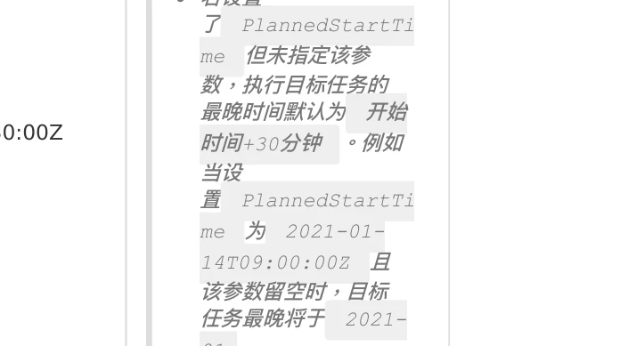

**返回数据**

| 参数名称 | 类型 | 示例 | 说明 |
| --- | --- | --- | --- |
| RequestId | String | 69FFDDF1-44C3-4ECA-A99E-445B493\*\*\*\*\*\* | 请求ID。 |

**示例**

请求示例

```text
http(s)://[Endpoint]/?Action=UpgradeDBClusterMinorVersion
&DBClusterId=pc-****************
&公共请求参数
```

正常返回示例

`JSON`  格式

```text
HTTP/1.1 200 OK
Content-Type:application/json
{
 "RequestId":"69FFDDF1-44C3-4ECA-A99E-445B493******"
}
```

**错误码**

| HttpCod e | 错误码 | 错误信息 | 描述 |
| --- | --- | --- | --- |
| 400 | TaskExists | TaskExists | Specified task have existed. |
| 404 | InvalidDBInstance.No tFound | InvalidDBCluster.NotFound | The DBClusterId provided does not exist in our records. |

<a id="section-6-108"></a>

## 6.108. ModifyDBClusterResourceGroup

调用ModifyDBClusterResourceGroup接口修改数据库群集资源组。

**请求头**

该接口使用公共请求头，无特殊请求头。请参见公共请求参数文档。

**请求参数**

| 参数名称 | 类型 | 位置 | 是否必选 | 示例 | 说明 |
| --- | --- | --- | --- | --- | --- |
| ResourceGr oupId | String | Query | 否 | rg-\*\*\*\*\*\*\*\*\*\* | 原资源组ID。 |
| DBClusterI d | String | Query | 是 | pc-\*\*\*\*\*\*\*\*\*\*\*\*\* | 集群ID。 |
| NewResour ceGroupId | String | Query | 是 | rg-\*\*\*\*\*\*\*\*\*\* | 变更后的资源组ID。 |

**返回数据**

| 参数名称 | 类型 | 示例 | 说明 |
| --- | --- | --- | --- |
| RequestId | String | 70656639-1416-479F-AF13-D08197\*\*\*\*\*\* | 请求ID。 |

**示例**

请求示例

```text
http(s)://[Endpoint]/?Action=ModifyDBClusterResourceGroup
&DBClusterId=pc-*************
&NewResourceGroupId=rg-**********
&公共请求参数
```

正常返回示例

`JSON`  格式

```text
HTTP/1.1 200 OK
Content-Type:application/json
{
 "RequestId":"70656639-1416-479F-AF13-D08197******"
}
```

**错误码**

| HttpCod e | 错误码 | 错误信息 | 描述 |
| --- | --- | --- | --- |
| 404 | InvalidDBInstance.No tFound | InvalidDBCluster.NotFound | The DBClusterId provided does not exist in our records. |

<a id="section-6-109"></a>

## 6.109. DescribeUserEncryptionKeyList

调用DescribeUserEncryptionKeyList接口查看KMS密钥列表。

**请求头**

该接口使用公共请求头，无特殊请求头。请参见公共请求参数文档。

**请求参数**

| 参数名称 | 类型 | 位置 | 是否必选 | 示例 | 说明 |
| --- | --- | --- | --- | --- | --- |
| DBClusterI d | String | Query | 是 | pc-\*\*\*\*\*\*\*\*\*\*\*\* | 集群ID。<em>您可以调用</em><em>DescribeDBClusters接</em><em>口查看目标地域下所有的</em><em>集群信息，包括集群ID。</em> |
| RegionId | String | Query | 否 | cn-hangzhou | 地域ID。<em>您可以调用</em><em>DescribeRegions接口</em><em>查看目标账号下的可用地</em><em>域信息，包括地域ID。</em> |
| TDERegion | String | Query | 否 | cn-beijing | TDE密钥所在地域。 |

**返回数据**

| 参数名称 | 类型 | 示例 | 说明 |
| --- | --- | --- | --- |
| KeyList | String | 0275bd3f-fdbb-4d8c-846b-71b211\*\*\*\*\*\* | 密钥列表。 |
| RequestId | String | A7E6A8FD-C50B-46B2-BA85-D8B8D3\*\*\*\*\*\* | 请求ID。 |
| DBClusterId | String | pc-\*\*\*\*\*\*\*\*\*\*\*\* | 集群ID。 |

**示例**

请求示例

```text
http(s)://[Endpoint]/?Action=DescribeUserEncryptionKeyList
&DBClusterId=pc-************
&公共请求参数
```

正常返回示例

`JSON`  格式

```text
HTTP/1.1 200 OK
Content-Type:application/json
{
 "RequestId":"A7E6A8FD-C50B-46B2-BA85-D8B8D3******",
 "KeyList":"",
 "DBClusterId":"pc-************"
}
```

**错误码**

| HttpCod e | 错误码 | 错误信息 | 描述 |
| --- | --- | --- | --- |
| 400 | ByokRoleArnNotFoun d | ByokRoleArnNotFound | The roleArn can't be null. |
| 401 | ByokNotAuthorizedT oRds | ByokNotAuthorizedToRds | This user is not Authorized Rds. |
| 403 | UnsupportedKmsSer vice.NotEnabled | UnsupportedKmsService.NotEnab led | KMS service is not enabled. |
| 404 | InvalidDBInstance.No tFound | InvalidDBCluster.NotFound | The DBClusterId provided does not exist in our records. |
| 404 | InvalidDBClusterId.N otFound | InvalidDBClusterId.NotFound | The DBClusterId provided does not exist in our records. |

<a id="section-6-110"></a>

## 6.110. DescribeDBProxyPerformance

调用DescribeDBProxyPerformance接口查询PolarDB代理层（PolarProxy）的性能数据。

**请求头**

该接口使用公共请求头，无特殊请求头。请参见公共请求参数文档。

**请求参数**

| 参数名称 | 类型 | 位置 | 是否必选 | 示例 | 说明 |
| --- | --- | --- | --- | --- | --- |
| DBClusterI d | String | Query | 是 | pc-\*\*\*\*\*\*\*\*\*\*\*\*\*\*\*\* | 集群ID。 |
| Key | String | Query | 是 | PolarProxy_CpuUsage | 查询的性能指标，多个值间用英文逗号（,）分隔，详细参数请参见性能参数表。 |
| StartTime | String | Query | 是 | 2020-09-23T01:01Z | 查询开始时间。格式为<code> yyyy-MM-</code><code>ddTHH:mmZ </code>（UTC时间）。 |
| EndTime | String | Query | 是 | 2020-09-24T02:08Z | 查询结束时间。格式为<code> yyyy-MM-</code><code>ddTHH:mmZ </code>（UTC时间）。 |

**返回数据**

| 参数名称 | 类型 | 示例 | 说明 |
| --- | --- | --- | --- |
| PerformanceKey s | Array |  | 集群性能数据列表。 |
| -Points | Array |  | 性能数据数组。 |
| --Value | String | 10 | 监控指标数据值。 |
| --Timestamp | Long | 1600822800000 | 监控指标的具体时间点，格式为时间戳，单位为毫秒。 |
| -MetricName | String | service_connections_ps | 具体的性能指标度量名称。 |
| -Measurement | String | PolarProxy_CpuUsag e | 性能指标。 |
| -DBNodeId | String | pi-\*\*\*\*\*\*\*\*\*\*\*\*\* | 数据库集群节点ID。 |
| DBVersion | String | 8.0 | 兼容数据库版本。 |
| EndTime | String | 2020-09-23T01:01:00Z | 查询结束时间。格式：<code> yyyy-MM-</code><code>ddTHH:mm:ssZ </code>（UTC时间）。 |
| RequestId | String | 35D3E3DA-4650-407A-BFF5-59BFF1\*\*\*\*\*\* | 请求ID。 |
| StartTime | String | 2020-09-23T01:00:00Z | 查询开始时间。格式：<code> yyyy-MM-</code><code>ddTHH:mm:ssZ </code>（UTC时间）。 |
| DBClusterId | String | pc-\*\*\*\*\*\*\*\*\*\*\*\*\*\*\*\*\* | 数据库集群ID。 |
| DBType | String | MySQL | 兼容数据库类型。 |
| Engine | String | POLARDB | 数据库引擎。 |

**示例**

请求示例

```text
http(s)://[Endpoint]/?Action=DescribeDBProxyPerformance
&DBClusterId=pc-****************
&Key=PolarProxy_CpuUsage
&StartTime=2020-09-23T01:01Z
&EndTime=2020-09-24T02:08Z
&公共请求参数
```

正常返回示例

`JSON`  格式

```text
HTTP/1.1 200 OK
Content-Type:application/json
{
 "PerformanceKeys":{
  "Measurement":"PolarProxy_CpuUsage",
  "MetricName":"service_connections_ps",
  "-Points":{
   "Value":"10",
   "Timestamp":1600822800000
  },
  "DBNodeId":"pi-*************"
 },
 "DBVersion":"8.0",
 "EndTime":"2020-09-23T01:01:00Z",
 "RequestId":"35D3E3DA-4650-407A-BFF5-59BFF1******",
 "StartTime":"2020-09-23T01:00:00Z",
 "DBClusterId":"pc-*****************",
 "DBType":"MySQL",
 "Engine":"POLARDB"
}
```

**错误码**

| HttpCod e | 错误码 | 错误信息 | 描述 |
| --- | --- | --- | --- |
| 400 | InvalidParameterCo mbination | InvalidParameterCombination | The end time must be greater than the start time. |
| 400 | InvalidStartTime.Malf ormed | InvalidStartTime.Malformed | The specified parameter StartTime is not valid. |
| 400 | InvalidEndTime.Malfo rmed | InvalidEndTime.Malformed | The specified parameter EndTime is not valid. |
| 400 | InvalidKey.Malforme d | InvalidKey.Malformed | The specified parameter Key is not valid. |
| 404 | InvalidDBClusterId.N otFound | InvalidDBClusterId.NotFound | The DBClusterId provided does not exist in our records. |

<a id="section-7"></a>

# 7.附录

<a id="section-7-1"></a>

## 7.1. STS概要

<a id="section-7-1-1"></a>

### 7.1.1. 什么是STS

阿里云STS（Security Token Service）是阿里云提供的一种临时访问权限管理服务。RAM提供RAM用户和RAM角色两种身份。其中，RAM角色不具备永久身份凭证，而只能通过STS获取可以自定义时效和访问权限的临时身份凭证，即安全令牌（STS Token）。

**使用RAM用户扮演角色时获取STS Token**

有权限的RAM用户可以使用其访问密钥调用AssumeRole接口，以获取某个RAM角色的STS Token，从而使用STS Token访问阿里云资源。

**产品优势**

- 使用STS Token，减少长期访问密钥（Accesskey）泄露的风险。

- STS Token具有时效性，可以自定义有效期，到期后将自动失效，无需定期轮换。

- 可以为STS Token绑定自定义权限策略，提供更加灵活和精细的云资源授权。

<a id="section-7-1-2"></a>

### 7.1.2. AssumeRole

RAM用户调用AssumeRole接口获取一个扮演RAM角色的临时身份凭证STS Token。该接口中RAM用户扮演的是可信实体为阿里云账号类型的RAM角色。

**请求参数**

| 名称 | 类型 | 是否必选 | 示例值 | 描述 |
| --- | --- | --- | --- | --- |
| Action | String | 是 | AssumeRole | 要执行的操作。取值：AssumeRole |
| RoleArn | String | 是 | acs:ram::1234567 89012\*\*\*\*:role/ad minrole | 要扮演的RAM角色ARN。该角色是可信实体为阿里云账号类型的RAM角色。 |
| RoleSessionNam e | String | 是 | alice | 角色会话名称。该参数为用户自定义参数。通常设置为调用该API的用户身份，例如：用户名。在操作审计日志中，即使是同一个RAM角色执行的操作，也可以根据不同的<strong>RoleSessionName</strong>来区分实际操作者，以实现用户级别的访问审计。长度为2~64个字符，可包含英文字母、数字、半角句号（.）、at（@）、短划线（-）和下划线（_）。 |
| Policy | String | 否 | {"Statement": \[{"Action": \["\*"\],"Effect": "Allow","Resource": \["\*"\]}\],"Version":"1 "} | 为STS Token额外添加的一个权限策略，进一步限制STS Token的权限。具体如下：<br>• 如果指定该权限策略，则STS Token最终的权限策略取RAM角色权限策略与该权限策略的交集。<br>• 如果不指定该权限策略，则STS Token最终的权限策略取RAM角色的权限策略。长度为1~1024个字符。 |

**返回结果**

| 名称 | 类型 | 示例值 | 描述 |
| --- | --- | --- | --- |
| RequestId | String | 6894B13B-6D71-4EF5-88FA-F32781734A7F | 请求ID。 |
| Credentials | 无 | 无 | 访问凭证。 |
| AccessKeyId | String | STS.L4aBSCSJVMuKg 5U1\*\*\*\* | 访问密钥ID。 |
| AccessKeySecret | String | wyLTSmsyPGP1ohvv w8xYgB29dlGI8KMiH 2pK\*\*\*\* | 访问密钥。 |
| SecurityToken | String | \*\*\*\*\*\*\*\* | 安全令牌。 |
| Expiration | String | 2015-04-09T11:52:19Z | 失效时间。 |
| AssumedRoleUser | 无 | 无 | 角色扮演时的临时身份。 |
| Arn | String | acs:ram::123456789 012\*\*\*\*:role/adminrol e/alice | 临时身份的ARN。 |
| AssumedRoleId | String | 34458433936495\*\*\*\*:alice | 临时身份的ID。 |

**示例**

**引入Pom依赖**

操作需要依赖阿里云核心库来实现，在Pom中引入阿里云核心库包的操作如下：

```xml
    <dependency>
      <groupId>com.aliyun</groupId>
      <artifactId>aliyun-java-sdk-core</artifactId>
      <version>[4.4.9,5.0.0)</version>
    </dependency>
```

**调用API获取STS AccessKey三元组**

以下代码示例为通过调用 `Sts::AssumeRole::2015-04-01` 获取STS AccessKey三元组信息。

```xml
package com.aliyuns.test;

import com.alibaba.fastjson.JSONObject;
import com.aliyuncs.CommonRequest;
import com.aliyuncs.CommonResponse;
import com.aliyuncs.DefaultAcsClient;
import com.aliyuncs.IAcsClient;
import com.aliyuncs.exceptions.ClientException;
import com.aliyuncs.exceptions.ServerException;
import com.aliyuncs.http.FormatType;
import com.aliyuncs.http.HttpClientConfig;
import com.aliyuncs.http.MethodType;
import com.aliyuncs.http.ProtocolType;
import com.aliyuncs.profile.DefaultProfile;
import org.apache.commons.lang3.StringUtils;

public class STSAccessKeyDemo {
    public static void main(String[] args) {
        // 创建DefaultAcsClient实例并初始化。
        DefaultProfile profile = DefaultProfile.getProfile("<yourRegionID>", "
<yourAccessKeyID>", "<yourAccessKeySecret>");
        HttpClientConfig clientConfig = HttpClientConfig.getDefault();
        clientConfig.setIgnoreSSLCerts(true);
        clientConfig.setProtocolType(ProtocolType.HTTPS);
        profile.setHttpClientConfig(clientConfig);
        IAcsClient client = new DefaultAcsClient(profile);
        CommonRequest request = new CommonRequest();
        // "sts.aliyuns.com"要替换为实际的STS Endpoint，⼀般格式为sts-
vpc.${global:region}.${global:internet-domain}
        request.setSysDomain("sts.aliyuns.com");
        request.setSysProduct("Sts");
        request.setSysAction("AssumeRole");
        request.setSysVersion("2015-04-01");
        request.setSysMethod(MethodType.POST);
        request.setHttpContentType(FormatType.FORM);
        // 业务参数，设置本次调⽤Session的别名，"<yourRoleSessionName>"请替换为实际值
        request.putQueryParameter("RoleSessionName", "<yourRoleSessionName>");
        // 扮演的Role⾓⾊ARN，"<yourRoleArn>"请替换为上⼀步获取到的实际Ram Role ARN
        request.putQueryParameter("RoleArn", "<yourRoleArn>");
        try {
            CommonResponse response = client.getCommonResponse(request);
            String assumeRole = response.getData();
            if (StringUtils.isEmpty(assumeRole)) return;
            JSONObject assumeRoleJson = JSONObject.parseObject(assumeRole);
            JSONObject credentials = assumeRoleJson.getJSONObject("Credentials");
            // 获取到STS三元组
            String stsAK = credentials.getString("AccessKeyId");
            String stsSK = credentials.getString("AccessKeySecret");
            String stsToken = credentials.getString("SecurityToken");
            System.out.println("stsAk: " + stsAK +"\nstsSk: " + stsSK + "\nstsToken: " + 
stsToken);
        } catch (ServerException e) {
            System.out.println(e.getErrCode());
            System.out.println(e.getErrMsg());
        } catch (ClientException e) {
            System.out.println(e.getErrCode());
            System.out.println(e.getErrMsg());
        }
    }
}
```

**调用示例**

下列代码以调用ECS的 `DescribeZones` 接口为示例。

```xml
package com.aliyuns.test;

import com.aliyuncs.CommonRequest;
import com.aliyuncs.CommonResponse;
import com.aliyuncs.DefaultAcsClient;
import com.aliyuncs.IAcsClient;
import com.aliyuncs.exceptions.ClientException;
import com.aliyuncs.exceptions.ServerException;
import com.aliyuncs.http.FormatType;
import com.aliyuncs.http.HttpClientConfig;
import com.aliyuncs.http.MethodType;
import com.aliyuncs.http.ProtocolType;
import com.aliyuncs.profile.DefaultProfile;

public class DescribeZonesDemo {
    public static void main(String[] args) {
        // "<yourRegionID>"替换为真实的RegionID
        // "<yourStsAccesskey>", "<yourStsAccessKeySecret>"替换为上⾯获取到的STS三元组中stsAk、stsSk
        DefaultProfile profile = DefaultProfile.getProfile("<yourRegionID>", "
<yourStsAccessKey>", "<yourStsAccessKeySecret>");
        HttpClientConfig clientConfig = HttpClientConfig.getDefault();
        clientConfig.setIgnoreSSLCerts(true);
        clientConfig.setProtocolType(ProtocolType.HTTPS);
        profile.setHttpClientConfig(clientConfig);
        IAcsClient client = new DefaultAcsClient(profile);
        CommonRequest request = new CommonRequest();
        request.setSysDomain("ecs.aliyuns.com");
        request.setSysProduct("Ecs");
        request.setSysAction("DescribeZones");
        request.setSysVersion("2014-05-26");
        request.setSysMethod(MethodType.POST);
        request.setHttpContentType(FormatType.FORM);
        //"<yourRegionID>"替换为真实的RegionId
        request.putHeadParameter("x-acs-regionid", "<yourRegionID>");
        // "<yourStsToken>"替换为上⾯获取到的STS三元组中stsToken
        request.putQueryParameter("SecurityToken", "<yourStsToken>");
        // 非必填,资源集id
        // request.putHeadParameter("x-acs-resourcegroupid", "<yourResourceGroupID>");
        // 必填,组织id
        request.putHeadParameter("x-acs-organizationid", "<yourOrganizationID>");
        try {
            CommonResponse response = client.getCommonResponse(request);
            System.out.println(response.getData());
        } catch (ServerException e) {
            System.out.println(e.getErrCode());
            System.out.println(e.getErrMsg());
        } catch (ClientException e) {
            System.out.println(e.getErrCode());
            System.out.println(e.getErrMsg());
        }
    }
}
```

**错误码**

| HttpCode | 错误码 | 错误信息 | 描述 |
| --- | --- | --- | --- |
| 400 | InvalidParameter | The parameter RoleArn is wrongly formed. | 角色ARN格式错误。 |
| 400 | InvalidParameter.RoleAr n | The parameter RoleArn is wrongly formed. | 角色ARN格式错误。 |
| 400 | InvalidParameter.RoleSe ssionName | The parameter RoleSessionName is wrongly formed. | <strong>RoleSessionName</strong>格式错误，支持输入2~64个字符，请输入至少2个字符，允许输入英文字母、数字、半角句号（.）、at（@）、短划线（-）和下划线（_）。 |
| 400 | InvalidParameter.Duratio nSeconds | The Min/Max value of DurationSeconds is 15min/1hr. | <strong>DurationSeconds</strong>参数设置错误，过期时间最小值为900秒，最大值为<strong>MaxSessionDuration</strong>设置的时间。 |
| 400 | InvalidParameter.PolicyG rammar | The parameter Policy has not passed grammar check. | 权限策略语法错误。 |
| 400 | InvalidParameter.PolicyS ize | The size of Policy must be smaller than 1024 bytes. | 权限策略长度超限，最大不超过1024字符。 |
| 403 | NoPermission | You are not authorized to do this action. You should be authorized by RAM. | STS Token没有权限。 |
| 404 | EntityNotExist.Role | The specified Role not exists. | 指定的RAM角色不存在。 |
| 500 | InternalError | STS Server Internal Error happened. | 服务器内部错误。 |
