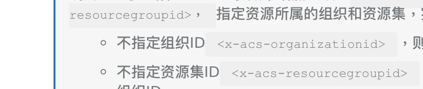
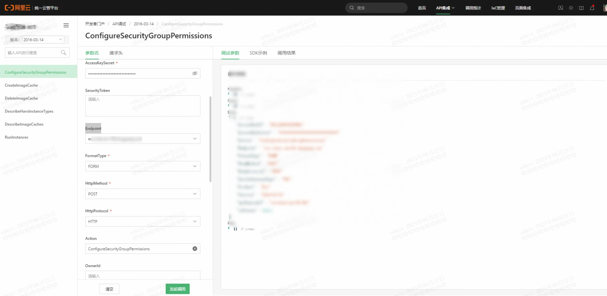

阿里云  
专有云  
云原生数据库  
PolarDB-X 1.0 开发指南  
产品版本：V3.18.6  
文档版本：20260330

**目录**

- [1.快速入门](#section-1)
    - [1.1. 开发文档使用说明](#section-1-1)
    - [1.2. API调用流程说明](#section-1-2)
- [2.准备工作](#section-2)
    - [2.1. 登录API与工具控制台](#section-2-1)
    - [2.2. 获取API信息及其EndPoint](#section-2-2)
    - [2.3. 获取AccessKey](#section-2-3)
    - [2.4. 获取STS AccessKey](#section-2-4)
    - [2.5. 获取公共Header参数](#section-2-5)
- [3.Java SDK调用示例](#section-3)
    - [3.1. 快速开始](#section-3-1)
    - [3.2. 使用手册](#section-3-2)
        - [3.2.1. 安装Java SDK](#section-3-2-1)
        - [3.2.2. 设置身份验证凭证](#section-3-2-2)
        - [3.2.3. 请求连接配置](#section-3-2-3)
        - [3.2.4. 发起调用](#section-3-2-4)
        - [3.2.5. 错误处理](#section-3-2-5)
        - [3.2.6. 使用CommonRequest进行调用](#section-3-2-6)
- [4.Python SDK调用示例](#section-4)
    - [4.1. 快速开始](#section-4-1)
    - [4.2. 使用手册](#section-4-2)
        - [4.2.1. 安装Python SDK](#section-4-2-1)
        - [4.2.2. 设置身份验证凭证](#section-4-2-2)
        - [4.2.3. 设置HTTPS请求](#section-4-2-3)
        - [4.2.4. 发起调用](#section-4-2-4)
        - [4.2.5. 错误处理](#section-4-2-5)
        - [4.2.6. 使用CommonRequest进行调用](#section-4-2-6)
- [5.Go SDK调用示例](#section-5)
    - [5.1. 快速开始](#section-5-1)
    - [5.2. 使用手册](#section-5-2)
        - [5.2.1. 安装Go SDK核心包](#section-5-2-1)
        - [5.2.2. 设置身份验证凭证](#section-5-2-2)
        - [5.2.3. 发起调用](#section-5-2-3)
        - [5.2.4. 错误处理](#section-5-2-4)
        - [5.2.5. 使用CommonRequest进行调用](#section-5-2-5)
- [6.API参考](#section-6)
    - [6.1. 2019版本](#section-6-1)
        - [6.1.1. 实例管理](#section-6-1-1)
            - [6.1.1.1. CreateDrdsInstance](#section-6-1-1-1)
            - [6.1.1.2. DescribeDrdsInstance](#section-6-1-1-2)
            - [6.1.1.3. DescribeDrdsInstances](#section-6-1-1-3)
            - [6.1.1.4. RestartDrdsInstance](#section-6-1-1-4)
            - [6.1.1.5. ModifyDrdsInstanceDescription](#section-6-1-1-5)
            - [6.1.1.6. RemoveDrdsInstance](#section-6-1-1-6)
            - [6.1.1.7. DescribeDrdsInstanceVersion](#section-6-1-1-7)
            - [6.1.1.8. RollbackInstanceVersion](#section-6-1-1-8)
            - [6.1.1.9. UpgradeInstanceVersion](#section-6-1-1-9)
            - [6.1.1.10. DescribeDrdsInstanceMonitor](#section-6-1-1-10)
            - [6.1.1.11. ModifyPolarDbReadWeight](#section-6-1-1-11)
            - [6.1.1.12. DescribeDrdsDBCluster](#section-6-1-1-12)
            - [6.1.1.13. ChangeInstanceAzone](#section-6-1-1-13)
            - [6.1.1.14. DescribeDrdsInstanceDbMonitor](#section-6-1-1-14)
            - [6.1.1.15. DescribeInstanceSwitchAzone](#section-6-1-1-15)
            - [6.1.1.16. UpgradeDrdsInstance](#section-6-1-1-16)
        - [6.1.2. 数据库管理](#section-6-1-2)
            - [6.1.2.1. CreateDrdsDB](#section-6-1-2-1)
            - [6.1.2.2. CheckDrdsDbName](#section-6-1-2-2)
            - [6.1.2.3. RemoveDrdsDbFailedRecord](#section-6-1-2-3)
            - [6.1.2.4. RemoveDrdsDb](#section-6-1-2-4)
            - [6.1.2.5. DescribeDrdsShardingDbs](#section-6-1-2-5)
            - [6.1.2.6. DescribeDrdsDB](#section-6-1-2-6)
            - [6.1.2.7. DescribeDrdsDBs](#section-6-1-2-7)
            - [6.1.2.8. ChangeAccountPassword](#section-6-1-2-8)
            - [6.1.2.9. ModifyDrdsIpWhiteList](#section-6-1-2-9)
            - [6.1.2.10. DescribeDrdsDBIpWhiteList](#section-6-1-2-10)
        - [6.1.3. 数据表管理](#section-6-1-3)
            - [6.1.3.1. DescribeTable](#section-6-1-3-1)
            - [6.1.3.2. DescribeTables](#section-6-1-3-2)
            - [6.1.3.3. DescribeTableListByType](#section-6-1-3-3)
            - [6.1.3.4. SetupTable](#section-6-1-3-4)
            - [6.1.3.5. DescribeRecycleBinTables](#section-6-1-3-5)
            - [6.1.3.6. RemoveRecycleBinTable](#section-6-1-3-6)
            - [6.1.3.7. FlashbackRecycleBinTable](#section-6-1-3-7)
            - [6.1.3.8. DescribeRecycleBinStatus](#section-6-1-3-8)
            - [6.1.3.9. SetupRecycleBinStatus](#section-6-1-3-9)
        - [6.1.4. 存储管理](#section-6-1-4)
            - [6.1.4.1. DescribeRdsSuperAccountInstances](#section-6-1-4-1)
            - [6.1.4.2. DescribeDrdsDbInstance](#section-6-1-4-2)
            - [6.1.4.3. DescribeDrdsDbInstances](#section-6-1-4-3)
            - [6.1.4.4. DescribeDrdsDbRdsNameList](#section-6-1-4-4)
            - [6.1.4.5. ModifyRdsReadWeight](#section-6-1-4-5)
            - [6.1.4.6. ResetDrdsToRdsConnections](#section-6-1-4-6)
            - [6.1.4.7. DescribeRDSPerformance](#section-6-1-4-7)
            - [6.1.4.8. DescribeDbInstances](#section-6-1-4-8)
            - [6.1.4.9. DescribeDbInstanceDbs](#section-6-1-4-9)
            - [6.1.4.10. DescribeRdsCommodity](#section-6-1-4-10)
            - [6.1.4.11. ManagePrivateRds](#section-6-1-4-11)
            - [6.1.4.12. DescribeDrdsRdsInstances](#section-6-1-4-12)
            - [6.1.4.13. DescribeStorageInstanceSubDbInfo](#section-6-1-4-13)
            - [6.1.4.14. DescribeRdsPerformanceSummary](#section-6-1-4-14)
            - [6.1.4.15. CreateOrderForRds](#section-6-1-4-15)
        - [6.1.5. 网络和连接](#section-6-1-5)
            - [6.1.5.1. UpdateInstanceNetwork](#section-6-1-5-1)
            - [6.1.5.2. ReleaseInstanceInternetAddress](#section-6-1-5-2)
            - [6.1.5.3. DescribeInstanceSwitchNetwork](#section-6-1-5-3)
            - [6.1.5.4. RefreshDrdsAtomUrl](#section-6-1-5-4)
            - [6.1.5.5. CreateInstanceInternetAddress](#section-6-1-5-5)
            - [6.1.5.6. EnableInstanceIpv6Address](#section-6-1-5-6)
        - [6.1.6. 拆分管理](#section-6-1-6)
            - [6.1.6.1. ValidateShardTask](#section-6-1-6-1)
            - [6.1.6.2. DescribeExpandLogicTableInfoList](#section-6-1-6-2)
            - [6.1.6.3. DescribeShardTaskList](#section-6-1-6-3)
            - [6.1.6.4. DatalinkReplicationPrecheck](#section-6-1-6-4)
            - [6.1.6.5. DescribeShardTaskInfo](#section-6-1-6-5)
            - [6.1.6.6. CreateShardTask](#section-6-1-6-6)
            - [6.1.6.7. DeleteShardTasks](#section-6-1-6-7)
        - [6.1.7. 备份和恢复](#section-6-1-7)
            - [6.1.7.1. StartRestore](#section-6-1-7-1)
            - [6.1.7.2. RemoveBackupsSet](#section-6-1-7-2)
            - [6.1.7.3. DescribeBackMenu](#section-6-1-7-3)
            - [6.1.7.4. DescribeBackupTimes](#section-6-1-7-4)
            - [6.1.7.5. DescribeRestoreOrder](#section-6-1-7-5)
            - [6.1.7.6. DescribeBackupDbs](#section-6-1-7-6)
            - [6.1.7.7. PutStartBackup](#section-6-1-7-7)
            - [6.1.7.8. SetBackupPolicy](#section-6-1-7-8)
            - [6.1.7.9. DescribeBackupSets](#section-6-1-7-9)
            - [6.1.7.10. EnableSqlFlashbackMatchSwitch](#section-6-1-7-10)
            - [6.1.7.11. DescribeBackupLocal](#section-6-1-7-11)
            - [6.1.7.12. SetBackupLocal](#section-6-1-7-12)
        - [6.1.8. 扩容管理](#section-6-1-8)
            - [6.1.8.1. SubmitCleanTask](#section-6-1-8-1)
            - [6.1.8.2. SubmitSmoothExpandPreCheck](#section-6-1-8-2)
            - [6.1.8.3. CheckExpandStatus](#section-6-1-8-3)
            - [6.1.8.4. SubmitSwitchTask](#section-6-1-8-4)
            - [6.1.8.5. SubmitRollbackTask](#section-6-1-8-5)
            - [6.1.8.6. SubmitSmoothExpandPreCheckTask](#section-6-1-8-6)
            - [6.1.8.7. SubmitSmoothExpandTask](#section-6-1-8-7)
            - [6.1.8.8. DescribeHotDbList](#section-6-1-8-8)
        - [6.1.9. 账号管理](#section-6-1-9)
            - [6.1.9.1. CreateInstanceAccount](#section-6-1-9-1)
            - [6.1.9.2. DescribeInstanceAccounts](#section-6-1-9-2)
            - [6.1.9.3. RemoveInstanceAccount](#section-6-1-9-3)
            - [6.1.9.4. ModifyAccountPrivilege](#section-6-1-9-4)
        - [6.1.10. 任务管理](#section-6-1-10)
            - [6.1.10.1. DescribeDrdsDbTasks](#section-6-1-10-1)
            - [6.1.10.2. DescribeSqlFlashbakTask](#section-6-1-10-2)
            - [6.1.10.3. DescribeDrdsInstanceLevelTasks](#section-6-1-10-3)
            - [6.1.10.4. SubmitSqlFlashbackTask](#section-6-1-10-4)
            - [6.1.10.5. DescribeDrdsTasks](#section-6-1-10-5)
            - [6.1.10.6. SubmitHotExpandPreCheckTask](#section-6-1-10-6)
            - [6.1.10.7. DescribePreCheckResult](#section-6-1-10-7)
        - [6.1.11. 广播表](#section-6-1-11)
            - [6.1.11.1. DescribeBroadcastTables](#section-6-1-11-1)
            - [6.1.11.2. DescribeGlobalBroadcastType](#section-6-1-11-2)
            - [6.1.11.3. SetupBroadcastTables](#section-6-1-11-3)
            - [6.1.11.4. SwitchGlobalBroadcastType](#section-6-1-11-4)
        - [6.1.12. 标签和参数](#section-6-1-12)
            - [6.1.12.1. TagResources](#section-6-1-12-1)
            - [6.1.12.2. UntagResources](#section-6-1-12-2)
            - [6.1.12.3. ListTagResources](#section-6-1-12-3)
            - [6.1.12.4. DescribeDrdsParams](#section-6-1-12-4)
            - [6.1.12.5. SetupDrdsParams](#section-6-1-12-5)
        - [6.1.13. SQL管理](#section-6-1-13)
            - [6.1.13.1. DescribeDrdsSqlAuditStatus](#section-6-1-13-1)
            - [6.1.13.2. EnableSqlAudit](#section-6-1-13-2)
            - [6.1.13.3. DescribeInstDbLogInfo](#section-6-1-13-3)
            - [6.1.13.4. CheckSqlAuditEnableStatus](#section-6-1-13-4)
            - [6.1.13.5. DescribeInstDbSlsInfo](#section-6-1-13-5)
            - [6.1.13.6. DisableSqlAudit](#section-6-1-13-6)
            - [6.1.13.7. DescribeDrdsSlowSqls](#section-6-1-13-7)
    - [6.2. 2017版本](#section-6-2)
        - [6.2.1. DescribeReadOnlyAccount](#section-6-2-1)
        - [6.2.2. DeleteDrdsDB](#section-6-2-2)
        - [6.2.3. ModifyReadOnlyAccountPassword](#section-6-2-3)
        - [6.2.4. RemoveReadOnlyAccount](#section-6-2-4)
        - [6.2.5. ModifyFullTableScan](#section-6-2-5)
        - [6.2.6. DescribeShardDBs](#section-6-2-6)
        - [6.2.7. ModifyDrdsDBPasswd](#section-6-2-7)
        - [6.2.8. CreateDrdsAccount](#section-6-2-8)
        - [6.2.9. DeleteFailedDrdsDB](#section-6-2-9)
        - [6.2.10. CreateReadOnlyAccount](#section-6-2-10)
        - [6.2.11. DescribeDrdsInstanceDbMonitor](#section-6-2-11)
        - [6.2.12. DescribeDrdsDbTablesTopology](#section-6-2-12)
        - [6.2.13. DescribeShardDbConnectionInfo](#section-6-2-13)
- [7.附录](#section-7)
    - [7.1. STS概要](#section-7-1)
        - [7.1.1. 什么是STS](#section-7-1-1)
        - [7.1.2. AssumeRole](#section-7-1-2)

<a id="section-1"></a>

# 1.快速入门

<a id="section-1-1"></a>

## 1.1. 开发文档使用说明

本文为您介绍在使用专有云API进行开发工作时，如何查看所需要的产品文档。

**使用流程**

您可以按照以下流程图中步骤，判断自己所需要使用的开发文档。


**前提条件**

通过运维人员或运营管理员获取专有云的版本。

**操作步骤**

您可以通过阿里云专有云文档中心，获取需要的产品文档。

1. 通过浏览器打开专有云文档中心。

2. 根据专有云的版本单击**企业版**、**敏捷版**或**一体机**标签。

3. 在下拉列表中，选择对应的专有云版本。

   

4. 在左侧导航栏中，选择目标产品名称。

5. 单击目标文档区域的**查看详情**或**下载PDF**。

<a id="section-1-2"></a>

## 1.2. API调用流程说明

阿里云专有云支持通过POP网关调用专有云API，为了使您拥有与公有云一致的体验，自企业版V3.16.0开始，专有云API默认使用POP网关方式调用。本文介绍通过POP网关调用专有云API的流程。

**流程图**


**调用步骤**

1. 获取AccessKey。

   获取调用时所需要的AccessKey参数，请参见获取AccessKey或获取STS AccessKey。

   > **说明**
   >
   > 推荐使用个人AccessKey或STS AccessKey调用Apsara Uni-manager运营控制台及云产品接口。

2. 获取RegionID。

   获取调用时所需要的RegionID参数，请参见获取公共Header参数。

3. 获取组织ID与资源集ID。

   组织ID需要通过API进行获取，获取方式请参见*Apsara Uni-manager运营控制台开发指南*中的*GetOrga nizationList章节*。

   资源集ID需要通过API进行获取，获取方式请参见*Apsara Uni-manager运营控制台开发指南*中的*ListRe sourceGroup章节*。

   > **说明**
   >
   > 调用API时，请在Header参数中增加组织ID `<x-acs-organizationid>` 和资源集ID `<x-acs-`



> `resourcegroupid>`， 指定资源所属的组织和资源集，实现实例资源的隔离查询。
>
> - 不指定组织ID `<x-acs-organizationid>` ，则默认获取当前用户所属的组织。
>
> - 不指定资源集ID `<x-acs-resourcegroupid>` ，则默认为空，如果指定资源集需要同时指定组织ID。

4. 获取对应的API参考文档。

   您需要查看目标云产品的开发指南，了解API的功能与使用方式，开发指南的使用流程及获取方法请参见开发文档使用说明。

5. 获取云产品Endpoint。

6. 获取云产品SDK并调用云产品API。

<a id="section-2"></a>

# 2.准备工作

<a id="section-2-1"></a>

## 2.1. 登录API与工具控制台

首先，您需要了解产品开放API接口的相关信息，包括产品名称（code）、开放API接口名称、API版本。

**背景信息**

Apsara Uni-manager运营控制台API目录中的API信息仅供调用参考，具体API的使用方式需要参见云产品的开发指南。如果发生不一致情况，以开发指南支持情况为准。

**操作步骤**

1. 在浏览器地址栏中，输入Apsara Uni-manager运营控制台的服务域名地址，按回车键。

2. 输入正确的用户名及密码。

   请向运营管理员获取登录控制台的用户名和密码。

   > **说明**
   >
   > 首次登录Apsara Uni-manager运营控制台时，需要修改登录用户名的密码，请按照提示完成密码修改。为提高安全性，密码长度必须为10~32位，且至少包含以下两种类型：
   >
   > - 英文大写或小写字母（A~Z、a~z）
   >
   > - 阿拉伯数字（0~9）
   >
   > - 特殊符号（感叹号（!）、at（@）、井号（#）、美元符号（$）、百分号（%）等）

3. 单击**账号登录**。

4. 如果账号已激活MFA多因素认证，请根据以下两种情况进行操作：

   - 管理员强制开启MFA后的首次登录：

     <ol type="a">

     <li>

     在绑定虚拟MFA设备页面中，按页面提示步骤绑定MFA设备。

     </li>

     <li>

     按照步骤2重新输入账号和密码，单击**账号登录**。

     </li>

     </ol>

     <ol type="i" start="100">

     <li>

     输入6位MFA码后单击**认证**。

     </li>

     </ol>

   - 您已开启并绑定MFA：

     输入6位MFA码后单击**认证**。

5. 在页面顶部的菜单栏中，选择**产品 > 应用服务 > 开发者门户**。

<a id="section-2-2"></a>

## 2.2. 获取API信息及其EndPoint

您在使用SDK时，需要获取产品名称、API名称和API版本。本文介绍如何查看API信息。

**背景信息**

Apsara Uni-manager运营控制台API目录中的API仅供调用参考，具体API的使用方式需要参见各云产品的API文档。如果发生不一致情况，以API支持情况为准。

**操作步骤**

1. 登录Apsara Uni-manager运营控制台。

2. 在顶部菜单栏选择**产品** > **应用服务** > **开发者门户**。

3. 在**开发者门户**页面，选择**API集成** > **API调试**。

   

4. 在左侧导航栏中选择目标云产品。

5. 在**版本**下拉列表中，选择目标API版本。

6. 在下方API列表中可浏览当前版本的所有API接口。

7. 选中对应的接口，在**参数名**页签可以获取**Endpoint**信息。

   

<a id="section-2-3"></a>

## 2.3. 获取AccessKey

AccessKey支持RAM和STS两种授权模式，在发起调用时选择使用其中一种AccessKey即可。本文将为您介绍如何获取通过RAM授权的AccessKey。

**背景信息**

AccessKey通过使用AccessKey ID和AccessKey Secret对称加密，实现验证某个请求发送者的身份的功能。其中AccessKey ID用于标示用户，AccessKey Secret是用户用于加密签名的字符串。

AccessKey的两种授权模式如下：

- 通过RAM授权给第三方请求者的AccessKey ID和AccessKey Secret。

- 通过STS授权给第三方请求者的AccessKey ID、AccessKey Secret和Security Token。获取方式请参见获取STS AccessKey。

Apsara Uni-manager运营控制台提供了个人AccessKey和组织AccessKey（只有运营管理员和一级组织管理员可以获取组织AccessKey），推荐使用个人账号AccessKey调用Apsara Uni-manager运营控制台及云产品相关接口。如果使用个人账号AccessKey，需要在Header中添加以下限制性参数，否则可能提示权限不足：

> 个人账号AccessKey是由Apsara Uni-manager运营控制台权限体系管控的受限
>
> **警告**
>
> AccessKey，组织AccessKey相对权限较大，需要管理员确认操作的安全性。

<table>
  <tr>
    <th width="206">参数名称</th>
    <th>描述</th>
  </tr>
  <tr>
    <td>x-acs-regionid</td>
    <td>地域，如：cn-hangzhou-*。</td>
  </tr>
  <tr>
    <td>x-acs-organizationid</td>
    <td>Apsara Uni-manager运营控制台中对应的组织ID。获取方法可参见<strong>《Apsara Uni-manager运营控制台开</strong><strong>发指南》</strong>中的<strong>《GetOrganizationList》</strong>文档。</td>
  </tr>
  <tr>
    <td>x-acs-resourcegroupid</td>
    <td>Apsara Uni-manager运营控制台中对应的资源集ID。获取方法可参见<strong>《Apsara Uni-manager运营控制台</strong><strong>开发指南》</strong>中的<strong>《ListResourceGroup》</strong>文档。</td>
  </tr>
  <tr>
    <td>x-acs-instanceid</td>
    <td>进行操作的实例ID，例如，ECS的实例ID可以从ECS列表中查询到。</td>
  </tr>
</table>

**获取个人账号AccessKey**

获取个人账号AccessKey的方法如下：

1. 登录Apsara Uni-manager运营控制台。

2. 在系统界面右上角，单击当前登录用户头像，单击**个人信息**。

3. 在**阿里云AccessKey**区域，您可以查看个人账户的AccessKey信息。

   

   > Accesskey ID和AccessKey Secret是您访问云资源时的密钥，具有该账号完整的权
   >
   > **说明**
   >
   > 限，请您妥善保管。

**获取组织AccessKey**

获取组织AccessKey的方法如下：

1. 管理员登录Apsara Uni-manager运营控制台。

2. 在顶部菜单栏，单击**企业**。

3. 在左侧导航栏中，选择**资源管理 > 组织管理**。

4. 在组织结构中，单击目标一级组织名称。

5. 单击**管理Accesskey**。

6. 在弹出的对话框中，查看组织AccessKey信息。

<a id="section-2-4"></a>

## 2.4. 获取STS AccessKey

本文为您介绍如何利用STS方式，调用专有云的产品API。

**背景信息**

阿里云临时安全令牌STS（Security Token Service）是阿里云提供的一种临时访问权限管理服务。您可以选择使用STS方式，调用专有云的产品API。

STS AccessKey由AccessKey ID、AccessKey Secret及SecurityToken三元组组成，使用STS方式调用云产品API时，三元组缺一不可。更多STS内容请参见什么是STS。

**操作步骤**

1. 获取用户角色的 `RAM Role` 。

   <ol type="i">

   <li>

   登录Apsara Uni-manager运营控制台。

   </li>

   <li>

   单击页面右上角的用户头像，单击**个人信息**。

   </li>

   <li>

   单击**查看当前角色策略**。

   在**当前选择角色策略**对话框中查看 `RAM Role` 。

   </li>

   </ol>

2. 获取STS Accesskey三元组。

   > **说明**
   >
   > 以下代码示例中可变参数均需替换为您实际的相关信息，尖括号（<>）在最终代码中不保留。
   >
   > 涉及替换的可变参数如下：
   >
   > - &lt;yourRegionID>，请替换为您实际的地域ID。
   >
   > - &lt;yourAccessKeyID>，请替换为您实际的AccessKey ID。
   >
   > - &lt;yourAccessKeySecret>，请替换为您实际的AccessKey Secret。
   >
   > - &lt;yourRoleSessionName>，请替换为您当前实际的会话名称。
   >
   > - &lt;yourRoleArn>，请替换为您实际的RAM Role。
   >
   > - &lt;sts.aliyuns.com>，请替换为实际的STS Endpoint。

   ```xml
   public static void main(String[] args) {
       // 创建DefaultAcsClient实例并初始化。
       // 请替换为您实际的地域ID、AccessKey ID、AccessKey Secret
       DefaultProfile profile = DefaultProfile.getProfile("<yourRegionID>", "
   <yourAccessKeyID>", "<yourAccessKeySecret>");
       HttpClientConfig clientConfig = HttpClientConfig.getDefault();
       clientConfig.setIgnoreSSLCerts(true);
       clientConfig.setProtocolType(ProtocolType.HTTPS);
       profile.setHttpClientConfig(clientConfig);
       IAcsClient client = new DefaultAcsClient(profile);
       String assumeRole = callAssumeRole(client);
       if (StringUtils.isEmpty(assumeRole)) return;
       JSONObject assumeRoleJson = JSONObject.parseObject(assumeRole);
       JSONObject credentials = assumeRoleJson.getJSONObject("Credentials");
       // 获取到STS三元组
       String stsAK = credentials.getString("AccessKeyId");
       String stsSK = credentials.getString("AccessKeySecret");
       String stsToken = credentials.getString("SecurityToken");
   }

   private static String callAssumeRole(IAcsClient client) {
       CommonRequest request = new CommonRequest();
       // <sts.aliyuns.com> 请替换为实际的STS Endpoint，⼀般格式为sts-
   vpc.${global:region}.${global:internet-domain}
       request.setSysDomain("<sts.aliyuns.com>");
       request.setSysProduct("Sts");
       request.setSysAction("AssumeRole");
       request.setSysVersion("2015-04-01");
       request.setSysMethod(MethodType.POST);
       request.setHttpContentType(FormatType.FORM);
       // 业务参数，设置本次调⽤Session的别名，<yourRoleSessionName>请您替换为实际值
       request.putQueryParameter("RoleSessionName", "<yourRoleSessionName>");
       // 扮演的Role⾓⾊ARN，<yourRoleArn>请替换为上⼀步获取到的实际Ram Role ARN
       request.putQueryParameter("RoleArn", "<yourRoleArn>");
       try {
           CommonResponse response = client.getCommonResponse(request);
           return response.getData();
       } catch (ServerException e) {
           System.out.println(e.getErrCode());
           System.out.println(e.getErrMsg());
       } catch (ClientException e) {
           System.out.println(e.getErrCode());
           System.out.println(e.getErrMsg());
       }
       return null;
   }
   ```

3. 通过STS AccessKey三元组调用云产品的接口，下列代码以ECS的 `DescribeZones` 接口为示例。

   > **说明**
   >
   > 以下代码示例中可变参数均需替换为您实际的相关信息，尖括号（<>）在最终代码中不保留。
   >
   > 涉及替换的可变参数如下：
   >
   > - &lt;yourRegionID>，请替换为您实际的地域ID。
   >
   > - &lt;yourStsAccesskeyID>，请替换为您实际的STS Accesskey ID。
   >
   > - &lt;yourStsAccessKeySecret>，请替换为您实际的STS Accesskey Secret。
   >
   > - &lt;yourStsToken>，请替换为实际STS三元组中的SecurityToken。
   >
   > - &lt;yourResourceGroupID>，请替换为您实际的资源集ID。
   >
   > - &lt;yourOrganizationID>，请替换为您实际的组织ID。

   ```xml
   public static void main(String[] args) {
       // <yourRegionID>请替换为您实际的地域ID
       // <yourStsAccessKeyID>, <yourStsAccessKeySecret>请替换为前⼀步获取到的STS三元组中AccessKeyID、AccessKeySecret
       DefaultProfile profile = DefaultProfile.getProfile("<yourRegionID>", "
   <yourStsAccesskey>", "<yourStsAccessSecret>");
       HttpClientConfig clientConfig = HttpClientConfig.getDefault();
       clientConfig.setIgnoreSSLCerts(true);
       clientConfig.setProtocolType(ProtocolType.HTTPS);
       profile.setHttpClientConfig(clientConfig);
       IAcsClient client = new DefaultAcsClient(profile);
       CommonRequest request = new CommonRequest();
       request.setSysDomain("ecs.aliyuns.com");
       request.setSysProduct("Ecs");
       request.setSysAction("DescribeZones");
       request.setSysVersion("2014-05-26");
       request.setSysMethod(MethodType.POST);
       request.setHttpContentType(FormatType.FORM);
       //<yourRegionID>请替换为您实际的地域ID
       request.putHeadParameter("x-acs-regionid", "<yourRegionID>");
       // <yourStsToken>请替换为您前⼀步获取到的STS三元组中SecurityToken
       request.putQueryParameter("SecurityToken", "<yourStsToken>");
       // 非必填,请替换为您实际的资源集ID
       // request.putHeadParameter("x-acs-resourcegroupid", "<yourResourceGroupID>");
       // 必填,请替换为您实际的组织ID
       request.putHeadParameter("x-acs-organizationid", "<yourOrganizationID>");
       try {
           CommonResponse response = client.getCommonResponse(request);
           System.out.println(response.getData());
       } catch (ServerException e) {
           System.out.println(e.getErrCode());
           System.out.println(e.getErrMsg());
       } catch (ClientException e) {
           System.out.println(e.getErrCode());
           System.out.println(e.getErrMsg());
       }
   }
   ```

<a id="section-2-5"></a>

## 2.5. 获取公共Header参数

调用专有云API时需要提供多个Header参数。本文为您介绍这些参数的含义及其获取方式，并对调用后的一些返回值做出解释。

**Header参数描述**

| 名称 | 描述 |
| --- | --- |
| x-acs-regionid | 环境Region，获取方式请参见获取Region ID。 |
| x-acs-organizationid | Apsara Uni-manager运营控制台上的组织ID，获取方式请参见获取组织ID。 |
| x-acs-resourcegroupid | Apsara Uni-manager运营控制台上的资源集ID，获取方式请参见获取资源集ID。 |
| x-acs-instanceid | 进行操作的实例ID，获取方式请参见获取实例ID。 |

**获取Region ID**

1. 管理员登录Apsara Uni-manager运营控制台。

2. 在顶部菜单栏中，单击**企业**。

3. 在左侧导航栏中，选择**资源管理**>**地域管理**。

4. 单击目标组织名称。

5. 在右侧**Region列表**中查看Region ID。

**获取组织ID**

组织ID需要通过API进行获取，获取方式请参见*Apsara Uni-manager运营控制台开发指南*中的*GetOrganizationList章节*。

**获取资源集ID**

资源集ID需要通过API进行获取，获取方式请参见*Apsara Uni-manager运营控制台开发指南*中的*ListResourceGroup章节*。

**获取实例ID**

*请各云产品自行修改替换产品名及获取实例ID流程*

实例ID可以通过Apsara Uni-manager运营控制台中的云产品实例列表进行获取，本文中以ECS为例，获取步骤如下：

1. 登录Apsara Uni-manager运营控制台。

2. 在顶部的菜单栏中，选择**产品**>**弹性计算**>**云服务器ECS**。

3. 在左侧导航栏中，单击**实例**。

4. 在实例列表中查看**实例ID**。

**返回参数**

对于列表类的云产品资源实例接口，调用后会默认增加如下返回值。

| 名称 | 描述 |
| --- | --- |
| ResourceGroupName | 资源集名称。 |
| ResourceGroup | 资源集ID。 |
| DepartmentName | 组织名称。 |
| Department | 组织ID。 |

<a id="section-3"></a>

# 3.Java SDK调用示例

<a id="section-3-1"></a>

## 3.1. 快速开始

本节介绍如何获取*产品名*Java SDK并开始调用。 *产品名需要替换为您自己的产品名。*

**环境准备**

- 使用阿里云专有云Java SDK，您需要一个授权账号以及一对AccessKey ID和AccessKey Secret。参见获取AccessKey在Apsara Uni-manager运营控制台上获取和查看您的AccessKey。

- 获取*产品名*的Endpoint，具体操作参见获取产品名的Endpoint。*产品名及链接请各云产品自行替换。*

- 阿里云专有云Java SDK需要1.8及以上的JDK。

**安装阿里云专有云 Java SDK**

如果您使用Apache Maven来管理Java项目，只需在项目的pom.xml中导入JAR文件。

要使用*产品名*的开发工具包，必须安装SDK核心库以及产品的SDK。其中，SDK核心库推荐使用4.5.17及以上版本，SDK的版本为X.X.X。 *产品名需要替换为您自己的产品名；X.X.X需要替换为您自己产品的SDK版本。*

**使用Java SDK**

调用阿里云专有云Java SDK的主要操作步骤如下：

1. 创建并初始化DefaultAcsClient实例。

2. 创建API请求并设置参数。

3. 发起请求并处理应答或异常。

   *替换为自己产品的示例*

   > **说明**
   >
   > 以下代码示例中可变参数均需替换为您实际的相关信息，尖括号（<>）在最终代码中不保留。
   >
   > 涉及替换的可变参数如下：
   >
   > - &lt;yourRegionID>，请替换为您实际的地域ID。
   >
   > - &lt;yourAccessKeyID>，请替换为您实际的AccessKey ID。
   >
   > - &lt;yourAccessKeySecret>，请替换为您实际的AccessKey Secret。
   >
   > - &lt;Product>，请替换为您实际的产品名称。
   >
   > - &lt;Endpoint>，请替换为您当前产品实际的Endpoint。
   >
   > - &lt;readTimeout>，请您根据实际情况设置读取超时时间，单位为毫秒。
   >
   > - &lt;connectionTimeout>，请您根据实际情况设置连接超时时间，单位为毫秒。
   >
   > - &lt;maxRequestsPerHost>，请您根据实际情况设置每个主机的最大请求数。
   >
   > - &lt;maxRequests>，请您根据实际情况设置最大请求数。
   >
   > - &lt;http://192.168.XX:33XX>，请替换为您实际的代理IP+端口。

   ```java
    import com.aliyuncs.profile.DefaultProfile;
    import com.aliyuncs.DefaultAcsClient;
    import com.aliyuncs.IAcsClient;
    import com.aliyuncs.exceptions.ClientException;
    import com.aliyuncs.exceptions.ServerException;
    import com.aliyuncs.ecs.model.v20140526.*;
    public class Main {
        public static void main(String[] args) {
           // 创建DefaultAcsClient实例并初始化
           DefaultProfile profile = DefaultProfile.getProfile(
               "<yourRegionID>",          // 请替换为您实际的地域ID
               "<yourAccessKeyID>",      // 请替换为您实际的AccessKey ID
               "<yourAccessKeySecret>"); // 请替换为您实际的AccessKey Secret
           // 设置当前产品的Endpoint，可变参数请替换为您的实际值 
           profile.addEndpoint("<yourRegionID>", "<Product>", "<Endpoint>");
           // 设置请求配置
           HttpClientConfig clientConfig = HttpClientConfig.getDefault();
           clientConfig.setIgnoreSSLCerts(true);// 忽略证书
           clientConfig.setReadTimeoutMillis(<readTimeout>);// 读取超时时间（可选）,单位为毫
   秒（ms）
           clientConfig.setConnectionTimeoutMillis(<connectionTimeout>);// 连接超时时间（可
   选）,单位为毫秒（ms）
           clientConfig.setMaxRequestsPerHost(<maxRequestsPerHost>);// 设置每个主机的最⼤请
   求数（可选）
           clientConfig.setMaxRequests(<maxRequests>);// 设置最⼤请求数（可选）
           clientConfig.setProtocolType(ProtocolType.HTTP); // 设置请求协议,默认HTTP（可选）
           /* 设置代理(可选),替换为代理IP+Port
           clientConfig.setHttpProxy("<http://192.168.XX:33XX>");
           或
           clientConfig.setHttpsProxy("<https://192.168.XX:33XX>");
           */
           profile.setHttpClientConfig(clientConfig);
           IAcsClient client = new DefaultAcsClient(profile);
           // 创建API请求并设置参数
           DescribeInstancesRequest request = new DescribeInstancesRequest();
           // 业务参数
           request.setPageSize(10);
           request.setPageNumber(1);
           // 特殊Header参数,设置组织ID和资源集ID,资源隔离使⽤
           request.putHeadParameter("x-acs-organizationid", "1");
           request.putHeadParameter("x-acs-resourcegroupid", "11");
           // 发起请求并处理应答或异常
           DescribeInstancesResponse response;
           try {
               response = client.getAcsResponse(request);
               for (DescribeInstancesResponse.Instance instance:response.getInstances()) 
   {
                   System.out.println(instance.getPublicIpAddress());
               }
           } catch (ServerException e) {
               e.printStackTrace();
           } catch (ClientException e) {
               e.printStackTrace();
           }
        }
    }
   ```

<a id="section-3-2"></a>

## 3.2. 使用手册

<a id="section-3-2-1"></a>

### 3.2.1. 安装Java SDK

本文介绍如何安装及调用PolarDB-X Java SDK。

阿里云专有云Java SDK支持1.6及以上版本的JDK，可以通过添加Maven依赖或下载阿里云开发工具包（SDK）的方式安装专有云Java SDK。

要使用PolarDB-X的开发工具包，必须安装阿里云Java SDK核心库以及PolarDB-X的Java SDK。SDK核心库推荐使用4.6.1及以上版本，Java SDK的版本为1.0.21。

以使用PolarDB-X的Java SDK为例，您需要安装阿里云Java SDK核心库和PolarDB-X Java SDK，并在pom.xml文件中添加以下依赖即可。准确的SDK版本号，请参见阿里云开发工具包（SDK）。

```xml
<!-- Alibaba Cloud SDK for Java -->
<dependency>
    <groupId>com.aliyun</groupId>
    <artifactId>aliyun-java-sdk-core</artifactId>
    <version>4.6.1</version>
</dependency>
<!-- polardb java sdk -->
<dependency>
  <groupId>com.aliyun</groupId>
  <artifactId>aliyun-java-sdk-drds</artifactId>
  <version>1.0.21</version>
</dependency>
```

<a id="section-3-2-2"></a>

### 3.2.2. 设置身份验证凭证

当使用阿里云专有云SDK访问阿里云专有云服务时，您需要提供授权的账号进行身份验证。本文介绍了如何设置身份验证凭证。

目前，Java SDK支持通过AccessKey进行身份验证，获取AccessKey的方法请参见获取Accesskey。

使用AccessKey作为访问凭据时，需要在初始化Client时设置凭证。

> **说明**
>
> 确保包含AccessKey的代码不会泄漏（例如提交到外部公开的GitHub项目），否则将会危害您的信息安全。

```text
DefaultProfile profile = DefaultProfile.getProfile(
    "<yourRegionID>",          // 请替换为您实际的地域ID
    "<yourAccessKeyID>",      // 请替换为您实际的AccessKey ID
    "<yourAccessKeySecret>"); // 请替换为您实际的AccessKey Secret
```

> **说明**
>
> 以上代码示例中可变参数均需替换为您实际的相关信息，尖括号（<>）在最终代码中不保留。

<a id="section-3-2-3"></a>

### 3.2.3. 请求连接配置

本文介绍了如何配置请求连接（HttpClientConfig）。

您可通过以下代码配置HttpClientConfig，具体请根据自身服务能力自行选择配置项并做相应配置。

> **说明**
>
> 以下代码示例中可变参数均需替换为您实际的相关信息，尖括号（<>）在最终代码中不保留。
>
> 涉及替换的可变参数如下：
>
> - &lt;readTimeout>，请您根据自身服务的能力，配置读取超时时间，单位为毫秒（ms）。
>
> - &lt;connectionTimeout>，请您根据自身服务的能力，配置连接超时时间，单位为毫秒（ms）。
>
> - &lt;maxRequestsPerHost>，请您根据自身服务的能力，配置每台服务器的最大请求数，数据类型为INT。
>
> - &lt;maxRequests>，请您根据自身服务的能力，配置最大请求数，数据类型为INT。
>
> - &lt;http://192.168.XX.XX:33XX>，请替换为您实际的代理IP+端口。

```text
// 获取HttpClientConfig对象
HttpClientConfig clientConfig = HttpClientConfig.getDefault();
// 设置是否忽略证书
clientConfig.setIgnoreSSLCerts(true);
// (可选)设置读取超时时间，单位毫秒（ms）
clientConfig.setReadTimeoutMillis(<readTimeout>);
// (可选)设置创建连接超时时间，单位毫秒（ms）
clientConfig.setConnectionTimeoutMillis(<connectionTimeout>);
// (可选)设置每个主机的最⼤请求数，数据类型为INT
clientConfig.setMaxRequestsPerHost(<maxRequestsPerHost>);
// (可选)设置最⼤请求数，数据类型为INT
clientConfig.setMaxRequests(<maxRequests>);
// (可选)设置协议类型
clientConfig.setProtocolType(ProtocolType.HTTP);
/** （可选）请根据实际情况判断是否设置代理，设置⽅法如下：
clientConfig.setHttpProxy("<http://192.168.XX.XX:33XX>");
或
clientConfig.setHttpsProxy("<https://192.168.XX.XX:33XX>");
请替换为您实际的代理IP+端⼝
*/
profile.setHttpClientConfig(clientConfig);
```

<a id="section-3-2-4"></a>

### 3.2.4. 发起调用

本文介绍如何使用产品名Java SDK发起请求。

**操作步骤**

1. 新建一个AcsClient。

   ```text
   IAcsClient client = new DefaultAcsClient(profile);
   ```

2. 创建请求。

   请求类的命名规范为 `${apiName}Request` ，其中<strong>${apiName}</strong>为API名称，例如DescribeInstances。

   在引入多个产品SDK时，有可能存在Request类同名的情况，请注意按照package区分。

   ```text
   DescribeInstancesRequest request = new DescribeInstancesRequest();
   // 业务参数
   request.setPageSize(10);
   request.setPageNumber(1);
   // 特殊Header参数,设置组织ID和资源集ID,资源隔离使⽤
   request.putHeadParameter("x-acs-organizationid", "1");
   request.putHeadParameter("x-acs-resourcegroupid", "");
   ```

3. 发起调用并处理应答。

   ```java
   DescribeInstancesResponse response;
   try {
       response = client.getAcsResponse(request);
       for (DescribeInstancesResponse.Instance instance:response.getInstances()) {
           System.out.println(instance.getPublicIpAddress());
       }
   } catch (ServerException e) {
       e.printStackTrace();
   } catch (ClientException e) {
       e.printStackTrace();
   }
   ```

   正常情况下，应答中的所有字段，都会被反序列化到response中，您可以直接调用 `response.getXXX()` 来获得应答中的字段。

   ```text
   instanceStatus := response.getStatus()
   ```

   如果出现了异常，或您需要原始HTTP应答的情况下，您可以通过以使用 `doAction()` 来获取原始应答。

   ```text
   HttpResponse response = client.doAction(request);
   ```

<a id="section-3-2-5"></a>

### 3.2.5. 错误处理

在使用Java SDK时，当服务端或者SDK端出错时，SDK会返回相应的异常信息。这些异常信息中会包含具体的错误信息包括错误码（Error Code）和错误消息（Error Message）。

一般情况下，您不需要Java SDK对返回的错误进行处理。您只需要根据服务端的错误提示处理服务端错误即可。

- `ServerException` 是服务端错误信息。

- `ClientException` 是SDK端错误信息。

例如，当出现如下错误时，您可以根据具体的错误信息，修改AccessKey的ID即可。

```text
com.aliyuncs.exceptions.ClientException: InvalidAccessKeyId.NotFound : Specified accesskey is not found.
```

如果您需要对SDK的错误进行处理，可以参考如下示例编写代码：

```java
try {
    FooResponse response = client.getAcsResponse(request);
    // 处理Response
}catch (ServerException e){
    // 这⾥可以添加您⾃⼰的错误处理逻辑
    // 例如，打印具体的错误信息
    System.out.println("ErrorCode=" + e.getErrCode());
    System.out.println("ErrorMessage=" + e.getErrMsg());
    // 如果遇上棘⼿问题，可以提交⼯单，并将RequestId提供给我们
    System.out.println("ResponseId=" + e.getRequestId());
}catch (ClientException e){
    // 这⾥可以添加您⾃⼰的错误处理逻辑
    // 例如，打印具体的错误信息
    System.out.println("ErrorCode=" + e.getErrCode());
    System.out.println("ErrorMessage=" + e.getErrMsg());
}
```

<a id="section-3-2-6"></a>

### 3.2.6. 使用CommonRequest进行调用

当您要调用的某个产品的API没有提供SDK时，或者提供的SDK中的请求Request参数和返回Response值不符合需求时，可以采用泛用型的API调用方式（CommonRequest）。使用CommonRequest调用方式可实现任意Open API接口的调用。

**CommonRequest调用特点**

CommonRequest的特点如下：

1. 轻量：只需Core包即可发起调用，无需下载安装各产品的SDK。

2. 简便：无需更新SDK即可调用最新发布的API。

3. 快速迭代。

**使用CommonRequest**

发起一次CommonRequest请求，您需要获取以下几个参数的值。您可以在各产品的API文档中获取以下参数的值。

- 域名(domain)：该产品的服务地址。

- API版本(version)：该API的版本号，格式为YYYY-MM-DD。

  您可以在各产品的API文档的公共参数部分获取API版本。

- 接口信息：要调用的接口名称。

  您需要获取**Action**参数，使用 `request.setSysAction("<Action>")` 的方式来指定API名称。

  例如RunInstances接口，在发起CommonRequest请求时，需要使用 `request.setSysAction("RunInstances")` 来指定API名称。

  您需要获取**PathPattern**参数，使用 `request.setSysUriPattern("<PathPattern>")` 的方式来指定RESTful路径。

  例如查看所有集群实例的API的**PathPattern**为 `/api/v1/clusters` ，在发起CommonRequest请求时，要使用 `request.setSysUriPattern("/api/v1/clusters")` 指定RESTful路径。

**示例：调用RPC风格的API**

以下代码为获取实例状态列表的调用示例（ECS产品属于RPC的调用风格)。

> 以下代码示例中可变参数均需替换为您实际的相关信息，尖括号（<>）在最终代码中不保
>
> **说明**
>
> 留。
>
> 涉及替换的可变参数如下：
>
> - &lt;yourRegionID>，请替换为您实际的地域ID。
>
> - &lt;yourAccessKeyID>，请替换为您实际的AccessKey ID。
>
> - &lt;yourAccessKeySecret>，请替换为您实际的AccessKey Secret。
>
> - &lt;yourSecurityToken>，请替换为您实际的SecurityToken。
>
> - &lt;yourResourceGroupID>，请替换为您实际的资源集ID。
>
> - &lt;yourOrganizationID>，请替换为您实际的组织ID。
>
> - &lt;yourInstanceID>，请替换为您实际的实例ID。
>
> - &lt;http://192.168.XX.XX:33XX>，请替换为您实际的代理IP+端口。

```java
import com.aliyuncs.CommonRequest;
import com.aliyuncs.CommonResponse;
import com.aliyuncs.DefaultAcsClient;
import com.aliyuncs.IAcsClient;
import com.aliyuncs.exceptions.ClientException;
import com.aliyuncs.exceptions.ServerException;
import com.aliyuncs.profile.DefaultProfile;
public class Sample {
    public static void main(String[] args) {
        // 创建DefaultAcsClient实例并初始化
        DefaultProfile profile = DefaultProfile.getProfile(
            "<yourRegionUD>",          // 请替换为您实际的地域ID
            "<yourAccessKeyID>",      // 请替换为您实际的AccessKey ID
            "<yourAccessKeySecret>"); // 请替换为您实际的AccessKey Secret
        clientConfig.setProtocolType(ProtocolType.HTTP);
        /**
        请根据实际情况判断是否需要设置HTTP代理
        设置⽅法如下：
        clientConfig.setHttpProxy("<http://192.168.XX.XX:33XX>");
        请替换为实际代理IP+端⼝
        */
        profile.setHttpClientConfig(clientConfig);
        IAcsClient client = new DefaultAcsClient(profile);
        // 创建API请求并设置参数
        CommonRequest request = new CommonRequest();
        // 替换为真实的产品域名
        request.setDomain("ecs.aliyuncs.com");
        request.setSysProduct("Ecs");
        request.setVersion("2014-05-26");
        request.setAction("DescribeInstanceStatus");
        request.putQueryParameter("PageNumber", "1");
        request.putQueryParameter("PageSize", "30");
        request.putHeadParameter("x-acs-resourcegroupid", "<yourResourceGroupID>");// 非
必填，请替换为您实际的资源集ID
        request.putHeadParameter("x-acs-organizationid", "<yourOrganizationID>");// 必填
，请替换为您实际的组织ID
        request.putHeadParameter("x-acs-caller-sdk-source","ApiTestDemo");// 必填，调⽤来
源说明
        request.putHeadParameter(xacsregionid, <yourRegionID>);// 非必填(企业版
V3.15.0及之前历史版本需要),请替换为您实际的地域ID
        // request.putHeadParameter("x-acs-instanceid", "<yourInstanceID>");// 非必填（修
改、删除、查询单实例详情时需要）,请替换为您实际的实例ID
        /** 
        当使⽤STS AccessKey调⽤接⼝时 需要在参数中加上SecurityToken字段
        调⽤⽅法如下：
        request.putQueryParameter("SecurityToken", "<yourSecurityToken>");
        请替换为实际的Token
        */
        try {
            CommonResponse response = client.getCommonResponse(request);
            System.out.println(response.getData());
        } catch (ServerException e) {
            // TODO Auto-generated catch block
            e.printStackTrace();
        } catch (ClientException e) {
            // TODO Auto-generated catch block
            e.printStackTrace();
        }
    }
}
```

**示例：调用RESTful风格的API**

当调用RESTful风格的API时，业务参数传参方式根据接口请求方式和ContentType分为两种：

- 接口请求方式为 `GET` 或 `DELETE` ，或ContentType为 `application/x-www-form-urlencoded` ，使用以下方式传参：

  将请求参数放在Query中，例如 `request.putQueryParameter("page_number", "1");` 。

- 接口请求方式为 `POST` 或 `PUT` ，且ContentType为 `application/json` ，使用以下方式传参：将请求参数放在Body中，例如：

  ```text
  String requestBody = "{\"page_number\":\"1\",\"page_size\":\"5\",\"SecurityToken\", \
  "<yourSecurityToken>\"}";
  request.setHttpContent(requestBody.getBytes(), "utf-8", FormatType.JSON);
  ```

以下代码为，获取集群列表的调用示例（CS产品属于RESTful的调用风格）。

> 以下代码示例中可变参数均需替换为您实际的相关信息，尖括号（<>）在最终代码中不保
>
> **说明**
>
> 留。
>
> 涉及替换的可变参数如下：
>
> - &lt;yourRegionID>，请替换为您实际的地域ID。
>
> - &lt;yourAccessKeyID>，请替换为您实际的AccessKey ID。
>
> - &lt;yourAccessKeySecret>，请替换为您实际的AccessKey Secret。
>
> - &lt;yourResourceGroupID>，请替换为您实际的资源集ID。
>
> - &lt;yourOrganizationID>，请替换为您实际的组织ID。
>
> - &lt;yourInstanceID>，请替换为您实际的实例ID。
>
> - &lt;http://192.168.XX.XX:33XX>，请替换为您实际的代理IP+端口。
>
> - &lt;yourSecurityToken>，请替换为您实际的SecurityToken。

```java
import com.aliyuncs.CommonRequest;
import com.aliyuncs.CommonResponse;
import com.aliyuncs.DefaultAcsClient;
import com.aliyuncs.IAcsClient;
import com.aliyuncs.exceptions.ClientException;
import com.aliyuncs.exceptions.ServerException;
import com.aliyuncs.profile.DefaultProfile;
public class Sample {
    /**
     * DemoAPI: DescribeClusterV1
     */
    public static void main(String[] args) {
        // 创建DefaultAcsClient实例并初始化
        DefaultProfile profile = DefaultProfile.getProfile(
            "<yourRegionID>",          // 请替换为您实际的地域ID
            "<yourAccessKeyID>",      // 请替换为您实际的AccessKey ID
            "<yourAccessKeySecret>"); // 请替换为您实际的AccessKey Secret
        HttpClientConfig clientConfig = HttpClientConfig.getDefault();
        clientConfig.setIgnoreSSLCerts(true);
        clientConfig.setProtocolType(ProtocolType.HTTP);
        /**
        请根据实际情况判断是否需要设置HTTP代理
        设置⽅法如下：
        clientConfig.setHttpProxy("<http://192.168.XX.XX:33XX>");
        请替换为实际代理IP+端⼝
        */
        profile.setHttpClientConfig(clientConfig);
        IAcsClient client = new DefaultAcsClient(profile);
        // 创建API请求并设置参数
        CommonRequest request = new CommonRequest();
        // 接⼝实际请求⽅式,详细请参考接⼝开发⽂档
        request.setMethod(MethodType.GET);
        request.setDomain("cs.aliyuncs.com");
        request.setSysProduct("CS");
        request.setSysVersion("2015-12-15");
        request.setSysUriPattern("/api/v1/clusters");
        request.putHeadParameter("Content-Type", "application/json");
        request.putHeadParameter("x-acs-resourcegroupid", "<yourResourceGroupID>");// 非
必填，请替换为您实际的资源集ID
        request.putHeadParameter("x-acs-organizationid", "<yourOrganizationID>");// 必填
，请替换为您实际的组织ID
        request.putHeadParameter("x-acs-caller-sdk-source","ApiTestDemo");// 必填，调⽤来
源说明
        request.putHeadParameter("x-acs-regionid", "<yourRegionID>");// 非必填（企业版V3.1
5.0及之前历史版本需要）,请替换为您实际的地域ID
        // request.putHeadParameter("x-acs-instanceid", "<yourInstanceID>");// 非必填（修
改、删除、查询单实例详情时需要），请替换为您实际的实例ID
        // 业务参数,请求⽅式是GET、DELETE 或 ContentType为application/x-www-form-
urlencoded,则使⽤以下⽅式传参
        request.putQueryParameter("page_number", "1");
        request.putQueryParameter("page_size", "5");
        String requestBody = "{}";
        /**
        当使⽤STS AccessKey调⽤接⼝时,需要在参数中加上SecurityToken字段
        调⽤⽅法如下：
        String requestBody = "{\"SecurityToken\": \"<yourSecurityToken>\"}";
        请替换为实际Token
        */
        /** 
        若接⼝请求⽅式是POST、PUT且ContentType为application/json,则以下⽅式传数据
        String requestBody = "
{\"page_number\":\"1\",\"page_size\":\"5\",\"SecurityToken\", \"<your-
SecurityToken>\"}";
        request.setHttpContent(requestBody.getBytes(), "utf-8", FormatType.JSON);
        */
        try {
            CommonResponse response = client.getCommonResponse(request);
            System.out.println(response.getData());
        } catch (ServerException e) {
            // TODO Auto-generated catch block
            e.printStackTrace();
        } catch (ClientException e) {
            // TODO Auto-generated catch block
            e.printStackTrace();
        }
    }
}
```

<a id="section-4"></a>

# 4.Python SDK调用示例

<a id="section-4-1"></a>

## 4.1. 快速开始

本节介绍如何获取Python SDK并开始调用。

**环境准备**

- 使用Python SDK前，您需要一个授权账号以及一对AccessKey ID和AccessKey Secret。具体请参见获取AccessKey。

- 获取的Endpoint，具体操作参见获取ECS的Endpoint。

**安装Python SDK**

1. 安装SDK核心库。

   - 如果您使用的是Python 2.x，执行以下命令，安装阿里云SDK核心库：

     ```bash
     pip install aliyun-python-sdk-core
     ```

   - 如果您使用的是Python 3.x，执行以下命令，安装阿里云SDK核心库：

     ```bash
     pip3 install aliyun-python-sdk-core-v3
     ```

2. 安装SDK。以下以安装云服务器ECS的SDK为例：

   - 如果您使用的是Python 2.x，执行以下命令，安装云服务器ECS的SDK：

     ```bash
     pip install aliyun-python-sdk-ecs
     ```

   - 如果您使用的是Python 3.x，执行以下命令，安装云服务器ECS的SDK：

     ```bash
     pip3 install aliyun-python-sdk-ecs
     ```

**使用Python SDK**

以下示例以ECS为例展示调用Python SDK的3个主要步骤：

1. 创建Client实例。在创建Client实例时，您需要获取Region ID、AccessKey ID和AccessKey Secret。

2. 创建API请求并设置参数。

3. 发起请求并处理应答或异常。

   > 以下代码示例中可变参数均需替换为您实际的相关信息，尖括号（<>）在最终代码中不
   >
   > **说明**
   >
   > 保留。
   >
   > 涉及替换的可变参数如下：
   >
   > - &lt;yourRegionID>，请替换为您实际的地域ID。
   >
   > - &lt;yourAccessKeyID>，请替换为您实际的AccessKey ID。
   >
   > - &lt;yourAccessKeySecret>，请替换为您实际的AccessKey Secret。
   >
   > - &lt;ecs.aliyuns.com>，请替换为您实际的产品访问地址。

   ```python
   #!/usr/bin/env python
   #coding=utf-8
   from aliyunsdkcore import client
   from aliyunsdkcore.profile import region_provider
   from aliyunsdkecs.request.v20140526 import DescribeInstancesRequest
   # global config
   region_id = '<yourRegionID>' # 请替换为您实际的地域ID
   access_key = '<yourAccessKeyID>' # 请替换为您实际的的AccessKey ID
   acces_secret = '<yourAccessKeySecret>' # 请替换为您实际的AccessKey Secret
   # product config
   product_name = 'ECS' # 填写产品名称
   endpoint = '<ecs.aliyuns.com>' # 产品访问域名,当前为示例值,请替换为您实际的产品访问地址
   # create client
   region_provider.modify_point(product_name, region_id, endpoint)
   clt = client.AcsClient(access_key, acces_secret, region_id)
   # setup request
   request = DescribeInstancesRequest.DescribeInstancesRequest()
   request.set_accept_format('json') # 设置返回数据格式
   # get response
   response = clt.do_action_with_exception(request)
   print response
   ```

<a id="section-4-2"></a>

## 4.2. 使用手册

<a id="section-4-2-1"></a>

### 4.2.1. 安装Python SDK

本文档介绍如何安装及调用Python SDK。

阿里云专有云Python SDK支持Python 2.6.x、2.7.x和3.x及以上环境，您可以通过pip安装专有云Python SDK。

> 使用产品的开发工具包，都必须安装阿里云Python SDK核心库。例如，如果要使用ECS的
>
> **说明**
>
> Python SDK，您需要安装阿里云Python SDK核心库和ECS的Python SDK。

- 如果您使用的是Python 2.x，执行以下命令，安装阿里云SDK核心库：

  ```bash
  pip install aliyun-python-sdk-core
  ```

- 如果您使用的是Python 3.x，执行以下命令，安装阿里云SDK核心库：

  ```bash
  pip3 install aliyun-python-sdk-core-v3
  ```

安装云产品的SDK，以下以安装ECS的SDK为例。

- 如果您使用的是Python 2.x，执行以下命令，安装ECS的SDK：

  ```bash
  pip install aliyun-python-sdk-ecs
  ```

- 如果您使用的是Python 3.x，执行以下命令，安装ECS的SDK：

  ```bash
  pip3 install aliyun-python-sdk-ecs
  ```

<a id="section-4-2-2"></a>

### 4.2.2. 设置身份验证凭证

当使用阿里云SDK访问阿里云专有云服务时，您需要提供授权的账号进行身份验证。

目前Python SDK支持通过AccessKey进行身份验证，获取AccessKey的方法请参见获取AccessKey。

使用AccessKey作为访问凭据时，需要在初始化Client时设置凭证。

> 确保包含AccessKey的代码不会泄漏（例如提交到外部公开的GitHub项目），否则将会危
>
> **重要**
>
> 害您的信息安全。

```text
clt = client.AcsClient(secret_id, secret_key, region_id)
```

<a id="section-4-2-3"></a>

### 4.2.3. 设置HTTPS请求

Python SDK支持使用HTTP和HTTPS协议发起 API 请求。

使用Python SDK时，您可以为某个请求指定使用HTTP或HTTPS协议，您也可以设置全局默认协议。

> **说明**
>
> 产品的默认协议（HTTP/HTTPS）优先于设置的全局默认协议。

**添加OpenSSL依赖**

Python SDK的HTTPS协议依赖Python的OpenSSL支持。要使用阿里云SDK通过HTTPS协议发送请求，您需要在Python中添加OpenSSL 支持。OpenSSL支持TLS1.2及以上版本。

运行 `python -c "import ssl"` 检查Python环境是否支持OpenSSL。运行后，如果没有出现 `ImportError: No module named ssl` 的错误信息，说明已经支持OpenSSL。

若没有OpenSSL，运行以下命令安装：

```bash
pip install pyopenssl  #Python2使⽤此命令。
```

> **说明**
>
> 若本地环境为Python3，则运行 `pip3 install pyopenssl` 命令。

**设置单个请求的HTTP/HTTPS协议**

参考以下代码示例为一个接口设置HTTPS调用：

```text
request = DescribeInstancesRequest()
request.set_protocol_type("https")
# 取值："https" 或 "http"
```

**设置全局默认协议**

参考以下代码示例设置全局默认协议：

```python
import aliyunsdkcore.request
aliyunsdkcore.request.set_default_protocol_type("https")
# 创建请求并调⽤ client.do_action_with_exception() 来发送请求
```

<a id="section-4-2-4"></a>

### 4.2.4. 发起调用

本节介绍如何使用Python SDK发起请求。

**操作步骤**

1. 导入相关产品的SDK。

   ```python
   from aliyunsdkcore import client
   from aliyunsdkcore.profile import region_provider
   from aliyunsdkecs.request.v20140526 import DescribeInstancesRequest
   ```

2. 新建一个AcsClient。

   ```text
   client.region_provider.modify_point(product_name, region_id, endpoint)
   clt = client.AcsClient(access_key, access_secret, region_id)
   ```

3. 创建Request对象。

   ```text
   request = DescribeInstancesRequest.DescribeInstancesRequest()
   request.set_accept_format('json')
   ```

4. 发起调用并处理返回。

   ```text
   response = clt.do_action_with_exception(request)

   print response
   ```

<a id="section-4-2-5"></a>

### 4.2.5. 错误处理

在使用Python SDK时，当服务端或者SDK端出错时，SDK会返回相应的异常信息。这些异常信息中会包含具体的错误信息包括错误码（Error Code）和错误消息（Error Message）。

一般情况下，您不需要对Python SDK返回的错误进行处理。您只需要根据服务端的错误提示处理服务端错误即可。

- `ServerException` 是服务端错误信息。

- `ClientException` 是SDK端错误信息。

例如，当出现如下错误时，您可以根据具体的错误信息，修改AccessKey的ID即可。

```text
aliyunsdkcore.acs\_exception.exceptions.ServerException: HTTP Status: 404 
Error:InvalidAccessKeyId.NotFound Specified access key is not found.
```

如果您需要对SDK的错误进行处理，可以参考如下示例编写代码：

```text
try:
    response = client.do_action_with_exception(request)
except ServerException as e:
    # 这⾥可以添加您⾃⼰的错误处理逻辑
    # 例如，打印具体的错误信息
    print e.get_http_status()
    print e.get_error_code()
    print e.get_error_msg()
```

<a id="section-4-2-6"></a>

### 4.2.6. 使用CommonRequest进行调用

当您要调用的某个产品的API没有提供SDK时，或者提供的SDK中的请求Request参数和返回Response值不符合需求时，可以采用泛用型的API调用方式（CommonRequest）。使用CommonRequest调用方式可实现任意Open API接口的调用。

**CommonRequest调用特点**

CommonRequest的特点如下：

1. 轻量：只需Core包即可发起调用，无需下载安装各产品的SDK。

2. 简便：无需更新SDK即可调用最新发布的API。

3. 快速迭代。

**使用CommonRequest**

发起一次CommonRequest请求，您需要获取以下几个参数的值。您可以在各产品的API文档中获取以下参数的值。

- 域名(domain)：该产品的服务地址。

- API版本(version)：该API的版本号，格式为YYYY-MM-DD。

  您可以在各产品的API文档的公共参数部分获取API版本。

- 接口信息：要调用的接口名称。

  - RPC风格的API：

    您需要获取**Action**参数，使用 `request.set_action_name('Action')` 的方式来指定API名称。

    例如RunInstances接口，在发起CommonRequest请求时，需要使用 `request.set_action_name('RunInstances')` 来指定API名称。

  - RESTful风格的API：

    您需要获取**PathPattern**参数，使用 `request.set_uri_pattern('Pattern')` 的方式来指定RESTful。

    例如查看所有集群实例的API的**PathPattern**为 `/api/v1/clusters` ，在发起CommonRequest请求时，要使用 `request.set_uri_pattern ('/api/v1/clusters')` 指定RESTful路径。

**示例：调用RPC风格的API**

以下代码为云服务器（ECS）的DescribeInstanceStatus接口，获取实例状态列表的调用示例：

> **说明**
>
> 以下代码示例中可变参数均需替换为您实际的相关信息，尖括号（<>）在最终代码中不保留。
>
> 涉及替换的可变参数如下：
>
> - &lt;yourRegionID>，请替换为您实际的地域ID。
>
> - &lt;yourAccessKeyID>，请替换为您实际的AccessKey ID。
>
> - &lt;yourAccessKeySecret>，请替换为您实际的AccessKey Secret。
>
> - &lt;yourSecurityToken>，请替换为您实际的SecurityToken。
>
> - &lt;yourResourceGroupID>，请替换为您实际的资源集ID。
>
> - &lt;yourOrganizationID>，请替换为您实际的组织ID。
>
> - &lt;yourInstanceID>，请替换为您实际的实例ID。
>
> - &lt;ecs.aliyuncs.com>，请替换为您实际的产品访问地址。

```python
from aliyunsdkcore.client import AcsClient
from aliyunsdkcore.request import CommonRequest
# 请替换为您实际的AccessKey ID、AccessKey Secret、地域ID
client = AcsClient('{<yourAccessKeyID>}', '{<yourAccessKeySecret>}', 
'{<yourRegionID>}')
request = CommonRequest()
request.set_product('Ecs')
request.set_action_name('DescribeInstanceStatus')
request.set_version('2014-05-26')
request.set_domain('<ecs.aliyuncs.com>') #产品访问域名,当前为示例值,请替换为您实际的产品访问地址
# or:
# request = = CommonRequest(product='Ecs', 
action_name='DescribeInstanceStatus',version='2014-05-26',domain='ecs.aliyuncs.com')
######
# 设置请求协议类型,⽀持https或http,默认为http
# 设置https⽅法如下：
# request.set_protocol_type('https') 
######
request.set_accept_format('json')
request.set_method('POST')
request.add_query_param('PageNumber', '1')
request.add_query_param('PageSize', '30')
######
# 当使⽤STS AccessKey调⽤接⼝时，需要在参数中加上SecurityToken字段
# 调⽤⽅法如下：
# request.add_query_param("SecurityToken", "<yourSecurityToken>");
# 请替换为您实际的SecurityToken
######
# 非必填，请替换为您实际的资源集ID
request.add_header("x-acs-resourcegroupid", "<yourResourceGroupID>")
# 必填，请替换为您实际的组织ID
request.add_header("x-acs-organizationid", "<yourOrganizationID>")
# 必填，调⽤来源说明
request.add_header("x-acs-caller-sdk-source","ApiTestDemo")
# 非必填（企业版V3.15.0及之前历史版本需要），请替换为您实际的地域ID
request.add_header("x-acs-regionid", "<yourRegionID>")
# 非必填（修改、删除、查询单实例详情时需要），请替换为您实际的实例ID
# request.add_header("x-acs-instanceid", "<yourInstanceID>")

response = client.do_action_with_exception(request)
print(str(response, encoding = 'utf-8'))
```

**示例：调用RESTful风格的API**

当调用RESTful风格的API时，业务参数传参方式根据接口请求方式和ContentType分为两种：

- 接口请求方式为 `GET` 或 `DELETE` ，或ContentType为 `application/x-www-form-urlencoded` ，使用以下方式传参：

  将请求参数放在Query中，例如 `request.add_query_param("page_number", "1")` 。

- 接口请求方式为 `POST` 或 `PUT` ，且ContentType为 `application/json` ，使用以下方式传参：

  将请求参数放在Body中，例如：

  ```text
  body = '{"page_number":"1",page_size"5":"SecurityToken","":"<yourSecurityToken>"}'
  request.set_content(body.encode('utf-8'))
  ```

以下代码为容器服务（CS）的DescribeClusterV1接口，获取集群列表的调用示例：

> **说明**
>
> 以下代码示例中可变参数均需替换为您实际的相关信息，尖括号（<>）在最终代码中不保留。
>
> 涉及替换的可变参数如下：
>
> - &lt;yourRegionID>，请替换为您实际的地域ID。
>
> - &lt;yourAccessKeyID>，请替换为您实际的AccessKey ID。
>
> - &lt;yourAccessKeySecret>，请替换为您实际的AccessKey Secret。
>
> - &lt;yourSecurityToken>，请替换为您实际的SecurityToken。
>
> - &lt;yourResourceGroupID>，请替换为您实际的资源集ID。
>
> - &lt;yourOrganizationID>，请替换为您实际的组织ID。
>
> - &lt;yourInstanceID>，请替换为您实际的实例ID。
>
> - &lt;cs.aliyuncs.com>，请替换为您实际的产品访问地址。

```python
from aliyunsdkcore.client import AcsClient
from aliyunsdkcore.request import CommonRequest
######
# API:CS-DescribeClusterV1
######
# 请替换为您实际的AccessKey ID、AccessKey Secret、地域ID
client = AcsClient('{<yourAccessKeyID>}', '{<yourAccessKeySecret>}', 
'{<yourRegionID>}')
request = CommonRequest()
request.set_product('CS')
request.set_version('2015-12-15')
request.set_uri_pattern('/api/v1/clusters') # Pattern 
request.set_domain('<cs.aliyuncs.com>') # 产品访问域名,当前为示例值,请替换为您实际的产品访问地址
# or:
# request = CommonRequest(product='CS', version='2015-12-15', 
uri_pattern='/api/v1/clusters', domain='cs.aliyuns.com')
######
# 设置请求协议类型,⽀持 HTTP 或 HTTPS,默认为HTTP
# 设置https⽅法如下：
# request.set_protocol_type('https') 
######
request.set_accept_format('json')
request.set_method('GET')
request.add_header('Content-Type', 'application/json')
# 非必填，请替换为您实际的资源集ID
request.add_header("x-acs-resourcegroupid", "<yourResourceGroupID")
# 必填，请替换为您实际的组织ID
request.add_header("x-acs-organizationid", "<yourOrganizationID>")
# 必填，调⽤来源说明
request.add_header("x-acs-caller-sdk-source","ApiTestDemo")
# 非必填（企业版V3.15.0及之前历史版本需要）,请替换为您实际的地域ID
request.add_header("x-acs-regionid", "<yourRegionID>")
# 非必填（修改、删除、查询单实例详情时需要）,请替换为您实际的实例ID
# request.add_header("x-acs-instanceid", "<yourInstanceID>")
# 业务参数,请求⽅式为GET、DELETE 或ContentType为application/x-www-form-urlencoded,则使⽤以下
⽅式传数据
request.add_query_param("page_number", "1")
request.add_query_param("page_size", "5")
######
# 当使⽤STS AccessKey调⽤接⼝时，需要在参数中加上SecurityToken字段
# 调⽤⽅法如下：
# body = '''{\"SecurityToken\", \"<yourSecurityToken>\"}'''
# 请替换为您实际的SecurityToken
######
######
# 若接⼝请求⽅式是POST、PUT 且ContentType为application/json,则以下⽅式传数据
# body = '{"page_number":"1",page_size"5":"SecurityToken","":"<your-SecurityToken>"}'
# request.set_content(body.encode('utf-8'))
######
response = client.do_action_with_exception(request)
print(str(response, encoding = 'utf-8'))
```

<a id="section-5"></a>

# 5.Go SDK调用示例

<a id="section-5-1"></a>

## 5.1. 快速开始

阿里云Go SDK让您不用复杂编程即可访问。本操作介绍如何获取阿里云Go SDK并开始调用。

**环境准备**

- 使用Python SDK前，您需要一个授权账号以及一对AccessKey ID和AccessKey Secret。 参见获取AccessKey在Apsara Uni-manager运营控制台上获取和查看您的AccessKey。

- 获取的Endpoint，具体操作参见获取产品名的Endpoint。

**安装阿里云Go SDK核心包**

阿里云Go SDK支持Go 1.10.x及更高版本，您可以通过执行以下命令安装Go SDK核心包。

```text
go get -u github.com/aliyun/alibaba-cloud-sdk-go/sdk
```

**使用Go SDK**

以下这个代码示例展示了调用阿里云Go SDK的3个主要步骤：

1. 初始化Client实例。

2. 创建API请求并设置参数。

3. 发起请求并处理应答或异常。

   > 以下代码示例中可变参数均需替换为您实际的相关信息，尖括号（<>）在最终代码中不
   >
   > **说明**
   >
   > 保留。
   >
   > 涉及替换的可变参数如下：
   >
   > - &lt;yourRegionID>，请替换为您实际的地域ID。
   >
   > - &lt;yourAccessKeyID>，请替换为您实际的AccessKey ID。
   >
   > - &lt;yourAccessKeySecret>，请替换为您实际的AccessKey Secret。
   >
   > - &lt;Endpoint>，请替换为您实际的Endpoint。

   ```go
   package main
   import (
       "github.com/aliyun/alibaba-cloud-sdk-go/services/ecs"
       "github.com/aliyun/alibaba-cloud-sdk-go/sdk/requests"
       "fmt"
   )
   func main() { 
       // 创建ecsClient实例
       ecsClient, err := ecs.NewClientWithAccessKey(
           "<yourRegionID>",             // 请替换为您实际的地域ID
           "<yourAccessKeyID>",         // 请替换为您实际的的AccessKey ID
           "<yourAccessKeySecret>")        // 请替换为您实际的AccessKey Secret
       if err != nil {
           // 异常处理
           panic(err)
       }
       // 创建API请求并设置参数
       request := ecs.CreateDescribeInstancesRequest()
       // 设置当前产品的Endpoint 
       request.Domain = "<Endpoint>"
       // 等价于 request.PageSize = "10"
       request.PageSize = requests.NewInteger(10)
       // 发起请求并处理异常
       response, err := ecsClient.DescribeInstances(request)
       if err != nil {
           // 异常处理
           panic(err)
       }
       fmt.Println(response)
   }
   ```

4. （可选）切换HTTP/HTTPS协议。

   ```text
   request.Scheme = "HTTPS"
   ```

<a id="section-5-2"></a>

## 5.2. 使用手册

<a id="section-5-2-1"></a>

### 5.2.1. 安装Go SDK核心包

本文档介绍如何安装 Go SDK核心包。

阿里云Go SDK支持Go 1.10.x及以上版本，您可以通过执行以下命令安装Go SDK核心包。

```text
go get -u github.com/aliyun/alibaba-cloud-sdk-go/sdk
```

<a id="section-5-2-2"></a>

### 5.2.2. 设置身份验证凭证

当使用阿里云专有云SDK访问阿里云专有云服务时，您需要提供授权的账号进行身份验证。

目前Go SDK支持通过AccessKey进行身份验证，获取AccessKey的方法请参见获取AccessKey。

使用AccessKey作为访问凭据，需要在初始化Client时设置凭证。

> 确保包含AccessKey的代码不会泄漏（例如提交到外部公开的GitHub项目），否则将会危
>
> **重要**
>
> 害您的阿里云账号的信息安全。

以下代码以ECS为例，展示初始化ecsClient实例。

```text
// 初始化ecsClient实例
ecsClient, err := ecs.NewClientWithAccessKey(
        "<yourRegionID>",                 // 请替换为您实际的地域ID
        "<yourAccessKeyID>",             // 请替换为您实际的的AccessKey ID
        "<yourAccessKeySecret>")        // 请替换为您实际的AccessKey Secret
```

> 以上代码示例中可变参数均需替换为您实际的相关信息，尖括号（<>）在最终代码中不保
>
> **说明**
>
> 留。

<a id="section-5-2-3"></a>

### 5.2.3. 发起调用

本文介绍如何使用阿里云产品名Go SDK发起调用。

以下步骤以ECS为例，展示使用ECS Go SDK发起调用。

1. 导入云产品SDK。

   ```text
   import github.com/aliyun/alibaba-cloud-sdk-go/services/ecs
   ```

2. 新建一个产品名Client，该client中包含产品名的所有API。

   > 以下代码示例中可变参数均需替换为您实际的相关信息，尖括号（<>）在最终代码中不
   >
   > **说明**
   >
   > 保留。

   ```text
   ecsClient,err := <ecs>.NewClientWithAccessKey(  //请替换为您实际的产品名称
       "<yourRegionID>",  // 请替换为您实际的RegionID         
       "<yourAccessKeyID>",  // 请替换为您实际的AccessKeyID                
       "<yourAccessKeySecret>")  // 请替换为您实际的AccessKeySecret
   ecsClient.Domain = "ecs.aliyuns.com" //设置请求域名地址，当前为示例值，请求根据实际请求地址替
   换。
   ```

3. 使用 `xxx.CreateXXXRequest` 方法创建一个请求。该方法的命名规范为 `${service}.Create${apiName}Request` ，其中：

   - <strong>${service}</strong>为产品名称(小写)。例如ecs。

   - <strong>${apiName}</strong>为API名称，例如DescribeInstances。

   ```text
   request := ecs.CreateDescribeInstanceAttributeRequest()
   request.InstanceId = ""
   ```

4. 发起调用。

   ```text
   response, err := ecsClient.DescribeInstanceAttribute(request)
   ```

<a id="section-5-2-4"></a>

### 5.2.4. 错误处理

阿里云Go SDK在服务端或者SDK端出错时，会返回相应的错误信息，即 `sdk.errors` 包下的 `ClientError` 和 `ServerError` 。这些错误是基于Go的标准Error接口实现的，您可以像处理Go标准错误一样来处理阿里云Go SDK返回的错误。

**简单处理异常**

您可以通过以下代码来简单处理错误。

```text
response,err  := ecsClient.DescribeInstances(request)
if err != nil {
    //获取异常信息
   err.Error()
}
```

**ClientError**

当SDK内部的任意调用出现error，并无法自动化处理时，SDK会返回一个 `ClientError` 。

以下以ECS为例，您可以通过以下代码来判断并获取 `ClientError` 中的错误信息：

> 使用具体异常结构时需要引入异常结构包 `github.com/aliyun/alibaba-cloud-sdk-`
>
> **重要**
>
> `go/sdk/errors` ，引入方法请参考：
>
> ```go
> package main
> import (
>     "github.com/aliyun/alibaba-cloud-sdk-go/services/ecs" //ecs请替换为您实际的产品名称
>     "github.com/aliyun/alibaba-cloud-sdk-go/sdk/requests"
>     // 新增的错误包
>     "github.com/aliyun/alibaba-cloud-sdk-go/sdk/errors"
>     "fmt"
> )
> ```

```text
response, err := ecsClient.DescribeInstances(request)
if clientError, ok := err.(*errors.ClientError); ok{
    // 获取错误码
    clientError.ErrorCode()
    // 获取错误描述
    clientError.Message()
    // 获取原始错误(可能为nil)
    clientError.OriginError()
}
```

**ServerError**

当服务端返回错误的应答时，SDK会将该应答封装成 `ServerError` 返回。在这种情况下，您依然可以从Response中获得原始的HTTP应答。

以下以ECS为例，您可以通过以下代码来判断并获取ServerError以及Response中的错误信息：

> 使用具体异常结构时需要引入异常结构包 `github.com/aliyun/alibaba-cloud-sdk-`
>
> **重要**
>
> `go/sdk/errors` ，引入方法请参考：
>
> ```go
> package main
> import (
>     "github.com/aliyun/alibaba-cloud-sdk-go/services/ecs" //ecs请替换为您实际的产品名称
>     "github.com/aliyun/alibaba-cloud-sdk-go/sdk/requests"
>     // 新增的错误包
>     "github.com/aliyun/alibaba-cloud-sdk-go/sdk/errors"
>     "fmt"
> )
> ```

```text
response, err := ecsClient.DescribeInstances(request)    
if serverError, ok := err.(*errors.ServerError); ok{
    // 获取错误码
    serverError.ErrorCode()
    // 获取错误描述
    serverError.Message()
    // 获取原始http应答
    response.GetOriginHttpResponse()
}
```

<a id="section-5-2-5"></a>

### 5.2.5. 使用CommonRequest进行调用

当您要调用的某个产品的API没有提供SDK时，或者提供的SDK中的请求Request参数和返回Response值不符合需求时，可以采用泛用型的API调用方式（CommonRequest）。使用CommonRequest调用方式可实现任意Open API接口的调用。

**示例：调用RPC风格的API**

以下代码为云产品 ECS（云服务器）的DescribeInstanceStatus接口，获取实例状态列表的调用示例（ECS产品属于RPC的调用风格）：

> 以下代码示例中可变参数均需替换为您实际的相关信息，尖括号（<>）在最终代码中不保
>
> **说明**
>
> 留。
>
> 涉及替换的可变参数如下：
>
> - &lt;yourRegionID>，请替换为您实际的地域ID。
>
> - &lt;yourAccessKeyID>，请替换为您实际的AccessKey ID。
>
> - &lt;yourAccessKeySecret>，请替换为您实际的AccessKey Secret。
>
> - &lt;ecs.aliyuncs.com>，请替换为您实际的产品访问请求地址。
>
> - &lt;yourSecurityToken>，请替换为您实际的SecurityToken。
>
> - &lt;yourResourceGroupID>，请替换为您实际的资源集ID。
>
> - &lt;yourOrganizationID>，请替换为您实际的组织ID。
>
> - &lt;yourInstanceID>，请替换为您实际的实例ID。

```go
package main
import (
    "github.com/aliyun/alibaba-cloud-sdk-go/sdk/requests"
    "github.com/aliyun/alibaba-cloud-sdk-go/sdk"
    "fmt"
)
func main() {
    client, err := sdk.NewClientWithAccessKey(
        "<yourRegionID>",        //请替换为您实际的地域ID
        "<yourAccessKeyID>",     //请替换为您实际的AccessKey ID
        "<yourAccessKeySecret>") //请替换为您实际的AccessKey Secret
    if err != nil {
        panic(err)
    }
    request := requests.NewCommonRequest()
    request.Method = "POST"
    request.Domain = "<ecs.aliyuncs.com>" // 请求访问地址,当前为示例值,请根据实际请求地址替换
    request.Product = "Ecs"
    request.Version = "2014-05-26"
    // 因为是RPC接⼝，因此需指定APIName(Action)
    request.ApiName = "DescribeInstanceStatus"
    // 业务参数
    request.QueryParams["PageNumber"] = "1"
    request.QueryParams["PageSize"] = "30"
    /* 
     当使⽤STS AccessKey调⽤RPC接⼝时，需要在参数中加上SecurityToken字段
     调⽤⽅式如下：
     request.QueryParams["SecurityToken"]="<yourSecurityToken>"
     请替换为您实际的SecurityToken
     */
    request.Headers["x-acs-caller-sdk-source"] = "ApiTestDemo" // 必填，调⽤来源说明
    request.Headers["x-acs-regionid"] = "<yourRegionID>" // 非必填（企业版V3.15.0及之前历史
版本需要），请替换为您实际的地域ID
    request.Headers["x-acs-resourcegroupid"] = "<yourResourceGroupID>" // 非必填，请替换为
您实际的资源集ID
    request.Headers["x-acs-organizationid"] = "<yourOrganizationID>" // 必填，请替换为您实
际的组织ID
    // request.Headers["x-acs-instanceid"] = "<yourInstanceID>" // 非必填（修改、删除、查看
单实例详情时需要），请替换为您实际的实例ID
    response, err := client.ProcessCommonRequest(request)
    if err != nil {
        panic(err)
    }
    fmt.Print(response.GetHttpContentString())
}
```

**示例：调用RESTful风格的API**

当调用RESTful风格的API时，业务参数传参方式根据接口请求方式和ContentType分为两种：

- 接口请求方式为 `GET` 或 `DELETE` ，或ContentType为 `application/x-www-form-urlencoded` ，使用以下方式传参：

  将请求参数放在Query中，例如 `request.QueryParams["page_number"] = "1"` 。

- 接口请求方式为 `POST` 或 `PUT` ，且ContentType为 `application/json` ，使用以下方式传参：将请求参数放在Body中，例如：

  ```text
  body := "{\"page_number\":\"1\",page_size:\"5\"}"
  request.SetContent([]byte(body))
  request.SetContentType("application/json")
  ```

以下代码为云产品 CS(容器服务) 的DescribeClusterV1接口，获取集群列表的调用示例（CS产品属于RESTful的调用风格）：

> 以下代码示例中可变参数均需替换为您实际的相关信息，尖括号（<>）在最终代码中不保
>
> **说明**
>
> 留。
>
> 涉及替换的可变参数如下：
>
> - &lt;yourRegionID>，请替换为您实际的地域ID。
>
> - &lt;yourAccessKeyID>，请替换为您实际的AccessKey ID。
>
> - &lt;yourAccessKeySecret>，请替换为您实际的AccessKey Secret。
>
> - &lt;cs.aliyuncs.com>，请替换为您实际的产品访问请求地址。
>
> - &lt;yourSecurityToken>，请替换为您实际的SecurityToken。
>
> - &lt;yourResourceGroupID>，请替换为您实际的资源集ID。
>
> - &lt;yourOrganizationID>，请替换为您实际的组织ID。
>
> - &lt;yourInstanceID>，请替换为您实际的实例ID。

```go
package main
import (
    "github.com/aliyun/alibaba-cloud-sdk-go/sdk/requests"
    "github.com/aliyun/alibaba-cloud-sdk-go/sdk"
    "fmt"
)
func main() {
    client, err := sdk.NewClientWithAccessKey(
        "<yourRegionID>",         //请替换为您实际的地域ID
        "<yourAccessKeyID>",      //请替换为您实际的AccessKey ID
        "<yourAccessKeySecret>")  //请替换为您实际的AccessKey Secret
    if err != nil {
        panic(err)
    }
    request := requests.NewCommonRequest()
    request.Method = "GET"
    request.Domain = "cs.aliyuncs.com" // 请求访问地址,当前为示例值,请根据实际请求地址替换
    request.Product = "CS"
    request.Version = "2015-12-15"
    // 因为是Restful接⼝，因此需指定PathPattern
    request.PathPattern = "/api/v1/clusters"
    // 当使⽤STS AccesssKey调⽤ROA接⼝时 需要在header中加上x-acs-security-token字段
    // request.Headers["x-acs-security-token"] = "<yourSecurityToken>"
    // 必填值，调⽤来源说明
    request.Headers["x-acs-caller-sdk-source"] = "ApiTestDemo"
    // 非必填，企业版V3.15.0及之前历史版本需要
    request.Headers["x-acs-regionid"] = "<yourRegionID>"
    // 非必填，请替换为您实际的资源集ID
    request.Headers["x-acs-resourcegroupid"] = "<yourResourceGroupID>"
    // 必填，请替换为您实际的组织ID
    request.Headers["x-acs-organizationid"] = "<yourOrganizationID>"
    // 非必填，修改、删除、查看单实例详情时需要，请替换为您实际的实例ID
    // request.Headers["x-acs-instanceid"] = "<yourInstanceID>"
    // 业务参数,当请求⽅式为GET、DELETE 或 ContentType为application/x-www-form-urlencoded时
，使⽤以下⽅式传数据
    // request.QueryParams["page_number"] =  "1"
    // request.QueryParams["page_size"] = "5"
    // 当接⼝请求⽅式是POST、PUT 且ContentType为application/json时，则使⽤以下⽅式传数据
    // body := "{\"page_number\":\"1\",page_size:\"5\"}"
    // request.SetContent([]byte(body))
    // request.SetContentType("application/json")
    response, err := client.ProcessCommonRequest(request)
    if err != nil {
        panic(err)
    }
    fmt.Print(response.GetHttpContentString())
}
```

<a id="section-6"></a>

# 6.API参考

<a id="section-6-1"></a>

## 6.1. 2019版本

<a id="section-6-1-1"></a>

### 6.1.1. 实例管理

<a id="section-6-1-1-1"></a>

#### 6.1.1.1. CreateDrdsInstance

调用CreateDrdsInstance接口创建新实例。

**请求参数**

| 名称 | 类型 | 是否必选 | 示例值 | 描述 |
| --- | --- | --- | --- | --- |
| Action | String | 是 | CreateDrdsInsta nce | 系统规定参数，取值为<strong>CreateDrdsInstance</strong>。 |
| ClientToken | String | 是 | c1dd299c-10c6-11ea-bbbb-186590cc\*\*\*\* | 用于保证请求的幂等性，防止重复提交请求。由客户端生成该参数值，要保证在不同请求间唯一，最大值不超过64个ASCII字符，且该参数值中不能包含非ASCII字符。 |
| ZoneId | String | 是 | cn-qingdao-a | 可用区ID。 |
| PayType | String | 是 | drdsPost | 付费类型，取值为drdsPost，实际不产生费用。 |
| Quantity | Integer | 是 | 1 | 创建实例的数量，仅支持传入<strong>1</strong>，即一次只能创建一个实例。 |
| RegionId | String | 是 | cn-qingdao | 地域ID。 |
| Specification | String | 是 | drds.sn1.4c16g.8C32G | 实例规格。取值由实例系列加具体实例规格组成，例如<code> drds.sn1.4c8g.8C16G </code>。 |
| Type | String | 是 | 1 | 实例类型，取值范围如下：<br>• <strong>0</strong>：共享实例<br>• <strong>1</strong>：专享实例<br>您也可以传说明入<strong>PRIVATE</strong>表示专享实例或传入<strong>PUBLIC</strong>表示共享实例。 |
| Description | String | 是 | test | DRDS实例的描述，需满足如下要求：<br>• 不能以<code> http:// </code>或<code> https:// </code>开头。<br>• 必须以字母或中文开头，可包含大小写字母、中文、数字、下划线（_）或短划线（-）。<br>• 长度为2~256个字符。 |
| InstanceSeries | String | 否 | drds.sn1.4c16g | 实例系列参数，取值范围如下：<br>• <strong>drds.sn2.4c16g</strong>：入门版<br>• <strong>drds.sn2.8c32g</strong>：标准版<br>• <strong>drds.sn2.16c64g</strong>：企业版 |
| VpcId | String | 否 | vpcId | 专有网络ID。 |
| VswitchId | String | 否 | vswitchId | 虚拟交换机ID。 |
| isHa | Boolean | 否 | true | 是否为高可用实例，取值范围如下：<br>• <strong>true</strong>：是<br>• <strong>false</strong>：否 |
| PricingCycle | String | 否 | month | 指定预付费集群为包年或包月类型，该参数不生效。 |
| Duration | Integer | 否 | 1 | 包年或包月实例的购买时长，该参数不生效。 |
| IsAutoRenew | Boolean | 否 | true | 是否自动续费，该参数不生效。 |
| MasterInstId | String | 否 | drdshbgaf7pp\*\* \*\* | 主实例ID，仅在创建只读实例时填写。 |

**返回数据**

| 名称 | 类型 | 示例值 | 描述 |
| --- | --- | --- | --- |
| Data | Struct |  | 结果详情。 |
| DrdsInstanceId List | List | drdsusrzimk2\*\*\*\* | 实例ID。 |
| OrderId | Long | 111111111111111 | 订单ID。 |
| RequestId | String | D99D4644-A70D-49A3-B8B4-767ACC50YE45 | 请求ID。 |
| Success | Boolean | true | 请求结果。 |

**示例**

请求示例

```text
http(s)://[Endpoint]/?Action=CreateDrdsInstance
&ClientToken=c1dd299c-10c6-11ea-bbbb-186590cc****
&ZoneId=cn-qingdao-a
&PayType=drdsPost
&Quantity=1
&RegionId=cn-qingdao
&Specification=drds.sn1.4c16g.8C32G
&Type=1
&Description=test
&<公共请求参数>
```

正常返回示例

`XML` 格式

```xml
<RequestId>D99D4644-A70D-49A3-B8B4-767ACC50YE45</RequestId>
<Data>
    <OrderId>111111111111111</OrderId>
    <DrdsInstanceIdList>drdsusrzimk2****</DrdsInstanceIdList>
</Data>
<Success>true</Success>
```

`JSON` 格式

```json
{"RequestId":"D99D4644-A70D-49A3-B8B4-767ACC50YE45","Data":
{"OrderId":"111111111111111","DrdsInstanceIdList":"drdsusrzimk2****"},"Success":"true"}
```

**错误码**

| HttpCod e | 错误码 | 错误信息 | 描述 |
| --- | --- | --- | --- |
| 400 | ActionUnauthorized | The specified action is not available for you | 指定的action未授权，请您先做RAM授权再进行操作。 |
| 500 | InternalError | The request processing has failed due to some unknown error. | 请求失败，内部错误 |

<a id="section-6-1-1-2"></a>

#### 6.1.1.2. DescribeDrdsInstance

调用DescribeDrdsInstance接口查询实例详情。

**请求参数**

| 名称 | 类型 | 是否必选 | 示例值 | 描述 |
| --- | --- | --- | --- | --- |
| Action | String | 是 | DescribeDrdsIns tance | 系统规定参数，取值：DescribeDrdsInstance |
| DrdsInstanceId | String | 是 | drdsusrzujd5\*\*\* \* | 实例ID。 |

**返回数据**

| 名称 | 类型 | 示例值 | 描述 |
| --- | --- | --- | --- |
| Data | Struct |  | 返回实例详情。 |
| CommodityCo de | String | drdsPost | 商品代码。 |
| CreateTime | Long | 1568620311000 | 创建时间戳，单位：ms。 |
| Description | String | drds_test | 实例描述。 |
| DrdsInstanceId | String | drdsusrzujd5\*\*\*\* | 实例ID。 |
| ExpireDate | Long | 4724323200000 | 过期时间戳，单位：ms。 |
| InstRole | String | MASTER | 实例角色，<br>• <strong>MASTER</strong>：主实例；<br>• <strong>SLAVE</strong>：分析型只读实例；<br>• <strong>SLAVE_FLOW</strong>：并发型只读实例。 |
| InstanceSeries | String | drds.sn2.4c16g | 实例规格系列。 |
| InstanceSpec | String | drds.sn2.4c16g.8C 32G | 实例规格。 |
| Label | String | NORMAL | 实例标签：<br>• <strong>NORMAL</strong>：普通实例<br>• <strong>HA</strong>：高可用实例<br>• <strong>VPC</strong>：VPC实例 |
| MachineType | String | ecs | 实例机器类型，固定取值ecs。 |
| MasterInstanc eId | String | drdssen12\*\*\*\* | 主实例ID，只有只读实例有。 |
| MysqlVersion | Integer | 5 | MySQL版本。 |
| NetworkType | String | CLASSIC | 网络类型：<br>• <strong>CLASSIC</strong>：经典网络<br>• <strong>VPC</strong>：VPC网络 |
| OrderInstanceI d | String | drdssen12\*\*\*\* | 购买的实例ID。 |
| ReadOnlyDBIn stanceIds | List | drdssen12\*\*\*\* | 只读实例ID列表。 |
| RegionId | String | cn-hangzhou | 地域ID。 |
| Status | String | RUN | 实例状态。 |
| StorageType | String | RDS | 存储类型。 |
| Type | String | PRIVATE | 实例类型，独享实例为PRIVATE，共享实例为PUBLIC。 |
| Version | Long | 0 | 实例版本。 |
| VersionAction | String | Upgradeable | 实例版本可用操作。 |
| Vips | Array of Vip |  | VIP列表。 |
| Vip |  |  |  |
| Dns | String | drdssen12\*\*\*\*.drds.aliyuncs.com | VIP绑定的域名。 |
| ExpireDays | Long | 0 | VIP过期剩余天数。 |
| Port | String | 3306 | VIP开放端口。 |
| Type | String | intranet | VIP类型，内网intranet，外网internet。 |
| VpcId | String | vpc-bpxxxxxxxxxxxy | VPC的ID。 |
| VswitchId | String | vsw-bpxxxxxxxxxxxxx9 6 | 交换机ID。 |
| VpcCloudInsta nceId | String | drdssen12\*\*\*\* | VPC集群中的实例ID。 |
| ZoneId | String | cn-hangzhou-e | 地域ID。 |
| RequestId | String | B4F76641-BA45-4320-BE7C-9C62CFDAC9B2 | 请求ID。 |
| Success | Boolean | true | 请求是否成功。 |

**示例**

请求示例

```text
http(s)://[Endpoint]/?Action=DescribeDrdsInstance
&DrdsInstanceId= drdsusrzujd5****
&<公共请求参数>
```

正常返回示例

`XML` 格式

```xml
<RequestId>B4F76641-BA45-4320-BE7C-9C62CFDAC9B2</RequestId>
<Data>
    <Status>RUN</Status>
    <StorageType>RDS</StorageType>
    <InstanceSpec>drds.sn2.4c16g.8C32G</InstanceSpec>
    <Description>drds_test</Description>
    <ExpireDate>4724323200000</ExpireDate>
    <ZoneId>cn-hangzhou-e</ZoneId>
    <CreateTime>1568620311000</CreateTime>
    <MachineType>ecs</MachineType>
    <Label>NORMAL</Label>
    <InstanceSeries>drds.sn2.4c16g</InstanceSeries>
    <VersionAction>Upgradeable</VersionAction>
    <MysqlVersion>5</MysqlVersion>
    <Type>PRIVATE</Type>
    <DrdsInstanceId> drdsusrzujd5****</DrdsInstanceId>
    <OrderInstanceId>drdssen12****</OrderInstanceId>
    <MasterInstanceId>drdssen12****</MasterInstanceId>
    <Version>0</Version>
    <InstRole>MASTER</InstRole>
    <NetworkType>CLASSIC</NetworkType>
    <CommodityCode>drdsPost</CommodityCode>
    <VpcCloudInstanceId>drdssen12****</VpcCloudInstanceId>
    <RegionId>cn-hangzhou</RegionId>
    <Vips>
        <Type>intranet</Type>
        <VpcId>vpc-bpxxxxxxxxxxxy</VpcId>
        <Port>3306</Port>
        <Dns>drdssen1243as.drds.aliyuncs.com</Dns>
        <VswitchId>vsw-bpxxxxxxxxxxxxx96</VswitchId>
        <ExpireDays>0</ExpireDays>
    </Vips>
    <ReadOnlyDBInstanceIds>drdssen12****</ReadOnlyDBInstanceIds>
</Data>
<Success>true</Success>
```

`JSON` 格式

```json
{"RequestId":"B4F76641-BA45-4320-BE7C-9C62CFDAC9B2","Data":
{"Status":"RUN","StorageType":"RDS","InstanceSpec":"drds.sn2.4c16g.8C32G","Description":"
ds_test","ExpireDate":"4724323200000","ZoneId":"cn-hangzhou-
e","CreateTime":"1568620311000","MachineType":"ecs","Label":"NORMAL","InstanceSeries":"dr
.sn2.4c16g","VersionAction":"Upgradeable","MysqlVersion":"5","Type":"PRIVATE","DrdsInstan
Id":" 
drdsusrzujd5****","OrderInstanceId":"drdssen12****","MasterInstanceId":"drdssen12****","V
sion":"0","InstRole":"MASTER","NetworkType":"CLASSIC","CommodityCode":"drdsPost","VpcClou
nstanceId":"drdssen12****","RegionId":"cn-hangzhou","Vips":
[{"Type":"intranet","VpcId":"vpc-
bpxxxxxxxxxxxy","Port":"3306","Dns":"drdssen1243as.drds.aliyuncs.com","VswitchId":"vsw-bpxxxxxxxxxxxxx96","ExpireDays":"0"}],"ReadOnlyDBInstanceIds":"drdssen12****"},"Success":
rue"}
```

**错误码**

| HttpCod e | 错误码 | 错误信息 | 描述 |
| --- | --- | --- | --- |
| 400 | ActionUnauthorized | The specified action is not available for you | 指定的action未授权，请您先做RAM授权再进行操作。 |
| 500 | InternalError | The request processing has failed due to some unknown error. | 请求失败，内部错误 |

<a id="section-6-1-1-3"></a>

#### 6.1.1.3. DescribeDrdsInstances

调用DescribeDrdsInstances接口查询实例列表。

**请求参数**

| 名称 | 类型 | 是否必选 | 示例值 | 描述 |
| --- | --- | --- | --- | --- |
| Action | String | 是 | DescribeDrdsIns tances | 系统规定参数，取值为<strong>DescribeDrdsInstances</strong>。 |
| RegionId | String | 是 | cn-hangzhou | 地域ID。 |
| Type | String | 否 | 1 | 实例类型：<br>• <strong>共享实例</strong>：0；<br>• <strong>专享实例</strong>：1。 |
| Tag.N.Key | String | 否 | acs:newretail:do main | 第N个tag的键。 |
| Tag.N.Value | String | 否 | NEW_RETAIL | 第N个tag的值。 |
| Description | String | 否 | drds_test | 实例描述。 |
| Expired | Boolean | 否 | false | 是否过期。 |
| PageNumber | Integer | 否 | 1 | 页码。 |
| PageSize | Integer | 否 | 20 | 每页大小。 |

**返回数据**

| 名称 | 类型 | 示例值 | 描述 |
| --- | --- | --- | --- |
| Instances | Array of Instance |  | 实例列表。 |
| Instance |  |  |  |
| CommodityCo de | String | drdsPost | 商品代码。 |
| CreateTime | Long | 1568620311000 | 创建时间戳。 |
| Description | String | drds_test | 实例描述。 |
| DrdsInstanceId | String | drdssen12\*\*\*\* | 实例ID。 |
| ExpireDate | Long | 4724323200000 | 过期时间戳。 |
| InstRole | String | MASTER | 实例角色：<br>• <strong>主实例</strong>：MASTER；<br>• <strong>分析型只读实例</strong>：SLAVE；<br>• <strong>并发型只读实例</strong>：SLAVE_FLOW。 |
| InstanceSeries | String | drds.sn2.4c16g | 实例规格系列。 |
| InstanceSpec | String | drds.sn2.4c16g.8C 32G | 实例规格。 |
| Label | String | NORMAL | 实例标签：<br>• <strong>普通实例</strong>：NORMAL；<br>• <strong>高可用实例</strong>：HA；<br>• <strong>VPC实例</strong>：VPC。 |
| MachineType | String | ecs | 实例机器类型，取值固定为ecs。 |
| MasterInstanc eId | String | drdssen12\*\*\*\* | 主实例ID。 |
| NetworkType | String | CLASSIC | 网络类型：<br>• <strong>经典网络</strong>：CLASSIC；<br>• <strong>专有网络</strong>：VPC。 |
| OrderInstanceI d | String | drdssen12\*\*\*\* | 购买的实例ID。 |
| ReadOnlyDBIn stanceIds | List | drdssen12\*\*\*\* | 只读实例ID列表。 |
| RegionId | String | cn-hangzhou-e | 地区ID。 |
| Status | String | RUN | 实例状态。 |
| Type | String | PRIVATE | 实例类型：<br>• <strong>共享实例</strong>：PUBLIC；<br>• <strong>独享实例</strong>：PRIVATE。 |
| Version | Long | 0 | 实例版本。 |
| VersionAction | String | Upgradable | 实例版本可用操作。 |
| Vips | Array of Vip |  | VIP列表。 |
| Vip |  |  |  |
| IP | String | 10.23.\*\*\*.\*\*\* | IP地址。 |
| Port | String | 3306 | VIP开放端口。 |
| Type | String | intranet | VIP类型：<br>• <strong>内网</strong>：intranet；<br>• <strong>外网</strong>：internet。 |
| VpcId | String | vpc-bpxxxxxxxxxxxy | 虚拟专用网络ID。 |
| VswitchId | String | vsw-bpxxxxxxxxxxxxx9 6 | 虚拟交换机ID。 |
| VpcCloudInsta nceId | String | drdssen12\*\*\*\* | VPC集群中的实例ID。 |
| VpcId | String | vpc-bpxxxxxxxxxxxy | 虚拟专用网络ID。 |
| ZoneId | String | cn-hangzhou-a | 可用区ID。 |
| PageNumber | Integer | 1 | 该页页码。 |
| PageSize | Integer | 20 | 该页大小。 |
| RequestId | String | 8734773E-7B21-4A22-9106-CBD245F8UY7D | 请求ID。 |
| Total | Integer | 1 | 实例总数。 |

**示例**

请求示例

```text
http(s)://[Endpoint]/?Action=DescribeDrdsInstances
&RegionId=cn-hangzhou
&<公共请求参数>
```

正常返回示例

`XML` 格式

```xml
<Instances>
    <Status>RUN</Status>
    <InstanceSpec>drds.sn2.4c16g.8C32G</InstanceSpec>
    <Description>drds_test</Description>
    <ExpireDate>4724323200000</ExpireDate>
    <ZoneId>cn-hangzhou-a</ZoneId>
    <CreateTime>1568620311000</CreateTime>
    <MachineType>ecs</MachineType>
    <Label>NORMAL</Label>
    <InstanceSeries>drds.sn2.4c16g</InstanceSeries>
    <VersionAction>Upgradable</VersionAction>
    <Type>PRIVATE</Type>
    <VpcId>vpc-bpxxxxxxxxxxxy</VpcId>
    <DrdsInstanceId>drdssen12****</DrdsInstanceId>
    <OrderInstanceId>drdssen12****</OrderInstanceId>
    <MasterInstanceId>drdssen12****</MasterInstanceId>
    <Version>0</Version>
    <InstRole>MASTER</InstRole>
    <NetworkType>CLASSIC</NetworkType>
    <CommodityCode>drdsPost</CommodityCode>
    <VpcCloudInstanceId>drdssen12****</VpcCloudInstanceId>
    <RegionId>cn-hangzhou-e</RegionId>
    <Vips>
        <Type>intranet</Type>
        <VpcId>vpc-bpxxxxxxxxxxxy</VpcId>
        <Port>3306</Port>
        <IP>10.23.***.***</IP>
        <VswitchId>vsw-bpxxxxxxxxxxxxx96</VswitchId>
    </Vips>
    <ReadOnlyDBInstanceIds>drdssen12****</ReadOnlyDBInstanceIds>
</Instances>
<PageSize>20</PageSize>
<RequestId>8734773E-7B21-4A22-9106-CBD245F8UY7D</RequestId>
<PageNumber>1</PageNumber>
<Total>1</Total>
```

`JSON` 格式

```json
{"Instances":
[{"Status":"RUN","InstanceSpec":"drds.sn2.4c16g.8C32G","Description":"drds_test","ExpireD
e":"4724323200000","ZoneId":"cn-hangzhou-
a","CreateTime":"1568620311000","MachineType":"ecs","Label":"NORMAL","InstanceSeries":"dr
.sn2.4c16g","VersionAction":"Upgradable","Type":"PRIVATE","VpcId":"vpc-
bpxxxxxxxxxxxy","DrdsInstanceId":"drdssen12****","OrderInstanceId":"drdssen12****","Maste
nstanceId":"drdssen12****","Version":"0","InstRole":"MASTER","NetworkType":"CLASSIC","Com
dityCode":"drdsPost","VpcCloudInstanceId":"drdssen12****","RegionId":"cn-hangzhou-e","Vips":[{"Type":"intranet","VpcId":"vpc-
bpxxxxxxxxxxxy","Port":"3306","IP":"10.23.***.***","VswitchId":"vsw-
bpxxxxxxxxxxxxx96"}],"ReadOnlyDBInstanceIds":"drdssen12****"}],"PageSize":"20","RequestId
"8734773E-7B21-4A22-9106-CBD245F8UY7D","PageNumber":"1","Total":"1"}
```

**错误码**

| HttpCod e | 错误码 | 错误信息 | 描述 |
| --- | --- | --- | --- |
| 400 | ActionUnauthorized | The specified action is not available for you | 指定的action未授权，请您先做RAM授权再进行操作。 |
| 500 | InternalError | The request processing has failed due to some unknown error. | 请求失败，内部错误 |

<a id="section-6-1-1-4"></a>

#### 6.1.1.4. RestartDrdsInstance

调用RestartDrdsInstance接口重启实例。

**请求参数**

| 名称 | 类型 | 是否必选 | 示例值 | 描述 |
| --- | --- | --- | --- | --- |
| Action | String | 是 | RestartDrdsInsta nce | 系统规定参数。取值：RestartDrdsInstance。 |
| DrdsInstanceId | String | 是 | drdshbga233x\*\* \*\* | 实例ID。 |

**返回数据**

| 名称 | 类型 | 示例值 | 描述 |
| --- | --- | --- | --- |
| RequestId | String | 6F70CE62-5077-4B7B-95BC-4DAC45614DBE | 请求ID。 |
| Success | Boolean | true | 请求是否成功。 |
| TaskId | Long | 1 | 异步任务ID。 |

**示例**

请求示例

```text
http(s)://[Endpoint]/?Action=RestartDrdsInstance
&DrdsInstanceId=drdshbga233x****
&<公共请求参数>
```

正常返回示例

`XML` 格式

```xml
<TaskId>1</TaskId>
<RequestId>6F70CE62-5077-4B7B-95BC-4DAC45614DBE</RequestId>
<Success>true</Success>
```

`JSON` 格式

```json
{"TaskId":"1","RequestId":"6F70CE62-5077-4B7B-95BC-4DAC45614DBE","Success":"true"}
```

**错误码**

| HttpCod e | 错误码 | 错误信息 | 描述 |
| --- | --- | --- | --- |
| 500 | InternalError | The request processing has failed due to some unknown error. | 请求失败，内部错误 |

<a id="section-6-1-1-5"></a>

#### 6.1.1.5. ModifyDrdsInstanceDescription

调用ModifyDrdsInstanceDescription接口修改实例描述。

**请求参数**

| 名称 | 类型 | 是否必选 | 示例值 | 描述 |
| --- | --- | --- | --- | --- |
| Action | String | 是 | ModifyDrdsInsta nceDescription | 系统规定参数，取值：ModifyDrdsInstanceDescription |
| Description | String | 是 | 长期占用 | 实例描述信息。 |
| DrdsInstanceId | String | 是 | drdshbga233x\*\* \*\* | 实例ID。 |

**返回数据**

| 名称 | 类型 | 示例值 | 描述 |
| --- | --- | --- | --- |
| RequestId | String | C44CA24C-C7C4-4C0F-8AC9-1343F279B09C | 请求ID。 |
| Success | Boolean | true | 请求是否成功。 |

**示例**

请求示例

```text
http(s)://[Endpoint]/?Action=ModifyDrdsInstanceDescription
&Description=⻓期占⽤
&DrdsInstanceId=drdshbga233x****
&<公共请求参数>
```

正常返回示例

`XML` 格式

```xml
<RequestId>C44CA24C-C7C4-4C0F-8AC9-1343F279B09C</RequestId>
<Success>true</Success>
```

`JSON` 格式

```json
{"RequestId":"C44CA24C-C7C4-4C0F-8AC9-1343F279B09C","Success":"true"}
```

<a id="section-6-1-1-6"></a>

#### 6.1.1.6. RemoveDrdsInstance

调用RemoveDrdsInstance接口释放实例，只能释放后付费实例。

RemoveDrdsInstance接口调用时，您需要在调用代码的Header中设置 `x-acs-organizationid` 、 `x-acs-resourcegroupid` 、 `x-acs-instanceid` 等参数，用于指定资源所属的组织、资源所属的资源集以及资源实例ID（如果存在的话），否则调用会指向根组织和根资源集。

> 您无法释放变配中的实例或者关联数据库未被删除的实例。
>
> **说明**

**请求参数**

| 名称 | 类型 | 是否必选 | 示例值 | 描述 |
| --- | --- | --- | --- | --- |
| Action | String | 是 | RemoveDrdsInst ance | 系统规定参数，取值<strong>RemoveDrdsInstance</strong>。 |
| DrdsInstanceId | String | 是 | drdshbga233x\*\* \*\* | 实例ID。 |

**返回数据**

| 名称 | 类型 | 示例值 | 描述 |
| --- | --- | --- | --- |
| RequestId | String | 6F70CE62-5077-4B7B-95BC-4DAC45614DBE | 请求ID。 |
| Success | Boolean | true | 请求是否成功。 |

**示例**

请求示例

```text
http(s)://[Endpoint]/?Action=RemoveDrdsInstance
&DrdsInstanceId=drdshbga233x****
&<公共请求参数>
```

正常返回示例

`XML` 格式

```xml
<RequestId>6F70CE62-5077-4B7B-95BC-4DAC45614DBE</RequestId>
<Success>true</Success>
```

`JSON` 格式

```json
{"RequestId":"6F70CE62-5077-4B7B-95BC-4DAC45614DBE","Success":"true"}
```

**错误码**

| HttpCod e | 错误码 | 错误信息 | 描述 |
| --- | --- | --- | --- |
| 500 | InternalError | The request processing has failed due to some unknown error. | 请求失败，内部错误 |

<a id="section-6-1-1-7"></a>

#### 6.1.1.7. DescribeDrdsInstanceVersion

调用DescribeDrdsInstanceVersion接口查询实例版本。

**请求参数**

| 名称 | 类型 | 是否必选 | 示例值 | 描述 |
| --- | --- | --- | --- | --- |
| Action | String | 是 | DescribeDrdsIns tanceVersion | 系统规定参数，取值：DescribeDrdsInstanceVersion。 |
| DrdsInstanceId | String | 是 | drdssen1243a\*\* \*\* | 实例ID。 |

**返回数据**

| 名称 | 类型 | 示例值 | 描述 |
| --- | --- | --- | --- |
| Data | Struct |  | 返回实例版本数据。 |
| InstanceVersio n | String | 5.3.12-15682777 | 当前实例版本。 |
| NewestVersion | String | 5.3.12-15682777 | 最新实例版本。 |
| RequestId | String | 2F7F8080-9132-4279-85D0-B7E5C4305162 | 请求ID。 |
| Success | Boolean | true | 请求是否成功。 |

**示例**

请求示例

```text
http(s)://[Endpoint]/?Action=DescribeDrdsInstanceVersion
&DrdsInstanceId=drdssen1243a****
&<公共请求参数>
```

正常返回示例

`XML` 格式

```xml
<RequestId>2F7F8080-9132-4279-85D0-B7E5C4305162</RequestId>
<Data>
    <InstanceVersion>5.3.12-15682777</InstanceVersion>
    <NewestVersion>5.3.12-15682777</NewestVersion>
</Data>
<Success>true</Success>
```

`JSON` 格式

```json
{"RequestId":"2F7F8080-9132-4279-85D0-B7E5C4305162","Data":{"InstanceVersion":"5.3.12-15682777","NewestVersion":"5.3.12-15682777"},"Success":"true"}
```

**错误码**

| HttpCod e | 错误码 | 错误信息 | 描述 |
| --- | --- | --- | --- |
| 400 | ActionUnauthorized | The specified action is not available for you | 指定的action未授权，请您先做RAM授权再进行操作。 |
| 500 | InternalError | The request processing has failed due to some unknown error. | 请求失败，内部错误 |

<a id="section-6-1-1-8"></a>

#### 6.1.1.8. RollbackInstanceVersion

调用RollbackInstanceVersion接口回滚实例的版本。

**请求参数**

| 名称 | 类型 | 是否必选 | 示例值 | 描述 |
| --- | --- | --- | --- | --- |
| Action | String | 是 | RollbackInstanc eVersion | 系统规定参数。取值：RollbackInstanceVersion。 |
| DrdsInstanceId | String | 是 | drdswe322d\*\*\*\* | 实例ID。 |
| RegionId | String | 是 | cn-hangzhou | 地域ID。 |

**返回数据**

| 名称 | 类型 | 示例值 | 描述 |
| --- | --- | --- | --- |
| Data | String | true | 返回结果集。 |
| RequestId | String | D2B0CBDF-5061-47AB-B440-966D25D1961B | 请求ID。 |

**示例**

请求示例

```text
http(s)://[Endpoint]/?Action=RollbackInstanceVersion
&DrdsInstanceId=drdswe322d****
&RegionId=cn-hangzhou
&<公共请求参数>
```

正常返回示例

`XML` 格式

```xml
<RequestId>D2B0CBDF-5061-47AB-B440-966D25D1961B</RequestId>
<Data>true</Data>
```

`JSON` 格式

```json
{"RequestId":"D2B0CBDF-5061-47AB-B440-966D25D1961B","Data":"true"}
```

<a id="section-6-1-1-9"></a>

#### 6.1.1.9. UpgradeInstanceVersion

调用UpgradeInstanceVersion接口升级实例的版本。

**请求参数**

| 名称 | 类型 | 是否必选 | 示例值 | 描述 |
| --- | --- | --- | --- | --- |
| Action | String | 是 | UpgradeInstanc eVersion | 系统规定参数。取值：UpgradeInstanceVersion。 |
| DrdsInstanceId | String | 是 | drdswe322dsq\*\* \*\* | 实例ID。 |
| RegionId | String | 是 | cn-hangzhou | 地域ID。 |

**返回数据**

| 名称 | 类型 | 示例值 | 描述 |
| --- | --- | --- | --- |
| Data | String | true | 请求是否成功。 |
| RequestId | String | DCFE399C-6927-421A-A30A-41C67A87339B | 请求ID。 |

**示例**

请求示例

```text
http(s)://[Endpoint]/?Action=UpgradeInstanceVersion
&DrdsInstanceId=drdswe322dsq****
&RegionId=cn-hangzhou
&<公共请求参数>
```

正常返回示例

`XML` 格式

```xml
<RequestId>DCFE399C-6927-421A-A30A-41C67A87339B</RequestId>
<Data>true</Data>
```

`JSON` 格式

```json
{"RequestId":"DCFE399C-6927-421A-A30A-41C67A87339B","Data":"true"}
```

<a id="section-6-1-1-10"></a>

#### 6.1.1.10. DescribeDrdsInstanceMonitor

调用DescribeDrdsInstanceMonitor接口查询实例监控数据。

**请求参数**

| 名称 | 类型 | 是否必选 | 示例值 | 描述 |
| --- | --- | --- | --- | --- |
| Action | String | 是 | DescribeDrdsIns tanceMonitor | 系统规定参数，取值：DescribeDrdsInstanceMonitor。 |
| DrdsInstanceId | String | 是 | drdssen1243as | 实例ID。 |
| EndTime | Long | 是 | 1568705520000 | 结束时间戳。 |
| Key | String | 是 | cpu | 监控指标。 |
| RegionId | String | 是 | cn-hangzhou | 地域ID。 |
| StartTime | Long | 是 | 1568701920000 | 开始时间戳。 |
| PeriodMultiple | Integer | 否 | 1 | 监控数据周期倍数，默认监控数据周期为5分钟。 |

**返回数据**

| 名称 | 类型 | 示例值 | 描述 |
| --- | --- | --- | --- |
| Data | Array of PartialPerform anceData |  | 监控数据。 |
| Key | String | cpu | 监控指标。 |
| NodeNum | Integer | 1 | 节点数量。 |
| Unit | String | % | 监控数据单位。 |
| Values | Array of PerformanceV alue |  | 监控数据列表。 |
| Date | Long | 1568703720000 | 时间戳。 |
| Value | String | 1.00 | 数据值。 |
| RequestId | String | 2F7F8080-9132-4279-85D0-B7E5C4305162 | 请求ID。 |

**示例**

请求示例

```text
http(s)://[Endpoint]/?Action=DescribeDrdsInstanceMonitor
&DrdsInstanceId=drdssen1243as
&EndTime=1568705520000
&Key=cpu
&RegionId=cn-hangzhou
&StartTime=1568701920000
&<公共请求参数>
```

正常返回示例

`XML` 格式

```xml
<RequestId>2F7F8080-9132-4279-85D0-B7E5C4305162</RequestId>
<Data>
    <NodeNum>1</NodeNum>
    <Unit>%</Unit>
    <Key>cpu</Key>
    <Values>
        <Value>1.00</Value>
        <Date>1568703720000</Date>
    </Values>
</Data>
```

`JSON` 格式

```json
{"RequestId":"2F7F8080-9132-4279-85D0-B7E5C4305162","Data":
[{"NodeNum":"1","Unit":"%","Key":"cpu","Values":
[{"Value":"1.00","Date":"1568703720000"}]}]}
```

**错误码**

| HttpCod e | 错误码 | 错误信息 | 描述 |
| --- | --- | --- | --- |
| 400 | ActionUnauthorized | The specified action is not available for you | 指定的action未授权，请您先做RAM授权再进行操作。 |
| 500 | InternalError | The request processing has failed due to some unknown error. | 请求失败，内部错误 |

<a id="section-6-1-1-11"></a>

#### 6.1.1.11. ModifyPolarDbReadWeight

调用ModifyPolarDbReadWeight接口修改实例的读写权重。

**请求参数**

| 名称 | 类型 | 是否必选 | 示例值 | 描述 |
| --- | --- | --- | --- | --- |
| Action | String | 是 | ModifyPolarDbR eadWeight | 系统规定参数，取值为<strong>ModifyPolarDbReadWeight</strong>。 |
| DbInstanceId | String | 是 | pc-bp1qi24qs6jb5\*\* \* | 集群ID。 |
| DbName | String | 是 | db_test | 数据库名称。 |
| DbNodeIds | String | 是 | pi-bp1346l7u2735\* \*\*\*,pi-bp1zcdcsrzwo5\* \*\*\*:pi-bp1hlua0p66jn\* \*\*\* | 节点列表，以半角逗号（,）分组，组内节点以冒号（:）分割。 |
| DrdsInstanceId | String | 是 | drds\*\*\*\*c6vxxyz d | 实例ID。 |
| Weights | String | 是 | 14,86 | 分组权重，以半角逗号（,）分割。 |

**返回数据**

| 名称 | 类型 | 示例值 | 描述 |
| --- | --- | --- | --- |
| RequestId | String | B12FC174-D5CE-4A6E-83C1-0F8F86BN543R | 请求唯一ID。 |
| Success | Boolean | true | 请求是否成功。 |

**示例**

请求示例

```text
http(s)://[Endpoint]/?Action=ModifyPolarDbReadWeight
&DbInstanceId=pc-bp1qi24qs6jb5***
&DbName=db_test
&DbNodeIds=pi-bp1346l7u2735****,pi-bp1zcdcsrzwo5****:pi-bp1hlua0p66jn****
&DrdsInstanceId=drds****c6vxxyzd
&Weights=14,86
&<公共请求参数>
```

正常返回示例

`XML` 格式

```xml
<RequestId>B12FC174-D5CE-4A6E-83C1-0F8F86BN543R</RequestId>
<Success>true</Success>
```

`JSON` 格式

```json
{"RequestId":"B12FC174-D5CE-4A6E-83C1-0F8F86BN543R","Success":"true"}
```

**错误码**

| HttpCod e | 错误码 | 错误信息 | 描述 |
| --- | --- | --- | --- |
| 500 | InternalError | The request processing has failed due to some unknown error. | 请求失败，内部错误 |

<a id="section-6-1-1-12"></a>

#### 6.1.1.12. DescribeDrdsDBCluster

调用DescribeDrdsDBCluster接口查询逻辑库下集群的具体信息。

**请求参数**

| 名称 | 类型 | 是否必选 | 示例值 | 描述 |
| --- | --- | --- | --- | --- |
| Action | String | 是 | DescribeDrdsDB Cluster | 系统规定参数，取值<strong>DescribeDrdsDBCluster</strong>。 |
| DbInstanceId | String | 是 | pc-bp1qi24qs6j\*\*\*\* \*\* | 集群ID。 |
| DbName | String | 是 | drds_test | 数据库名称。 |
| DrdsInstanceId | String | 是 | drdssen1243\*\*\* \* | 实例ID。 |

**返回数据**

| 名称 | 类型 | 示例值 | 描述 |
| --- | --- | --- | --- |
| DbInstance | Struct |  | 实例信息列表。 |
| DBInstanceId | String | pc-bp1qi24qs6jb5\*\*\*\* | 集群ID。 |
| DBInstanceSta tus | String | 1 | 实例状态。 |
| DBNodes | Array of DBNode |  | 集群中的节点信息。 |
| DBNode |  |  |  |
| DBNodeId | String | pi-bp1346l7u27\*\*\*\*\*\* | 集群中节点ID。 |
| DBNodeRole | String | Writer | 集群节点角色。 |
| DBNodeStatus | String | Running | 集群节点状态。 |
| ZoneId | String | cn-hangzhou | 集群节点地区。 |
| DbInstType | String | POLARDB | 数据库类型。 |
| Endpoints | Array of Endpoint |  | 读写分离endpoints。 |
| Endpoint |  |  |  |
| EndpointId | String | pe-bp1rlxn22qg\*\*\*\*\*\* | endpoint的ID。 |
| NodeIds | String | pi-bp1hlua0p66\*\*\*\*\*\*,pi-bp1zcdcsrz\*\*\*\*\*\* | endpoint下的节点ID列表。 |
| ReadWeight | Integer | 100 | 数据库管理的该endpoint的读比例。 |
| Engine | String | RDS | 数据库存储实例类型。 |
| EngineVersion | String | 5.6 | 数据库存储实例版本。 |
| ExpireTime | String | 2019-09-27 11:22:33 | 实例过期时间。 |
| NetworkType | String | VPC | 实例网络类型。 |
| PayType | String | Postpaid | 实例购买类型。 |
| Port | Integer | 3306 | 访问端口。 |
| RdsInstType | String | ignore | RDS实例类型。 |
| RemainDays | String | 0 | 实例剩余天数。 |
| RequestId | String | 4B20DB3B-9414-4425-A335-F47C708DA3AC | 请求ID。 |
| Success | Boolean | true | 请求是否成功。 |

**示例**

请求示例

```text
http(s)://[Endpoint]/?Action=DescribeDrdsDBCluster
&DbInstanceId=pc-bp1qi24qs6j******
&DbName=drds_test
&DrdsInstanceId=drdssen1243****
&<公共请求参数>
```

正常返回示例

`XML` 格式

```xml
<RequestId>4B20DB3B-9414-4425-A335-F47C708DA3AC</RequestId>
<DbInstance>
    <DbInstType>POLARDB</DbInstType>
    <EngineVersion>5.6</EngineVersion>
    <DBInstanceStatus>1</DBInstanceStatus>
    <DBInstanceId>pc-bp1qi24qs6jb5****</DBInstanceId>
    <NetworkType>VPC</NetworkType>
    <Port>3306</Port>
    <PayType>Postpaid</PayType>
    <RdsInstType>ignore</RdsInstType>
    <ExpireTime>2019-09-27 11:22:33</ExpireTime>
    <RemainDays>0</RemainDays>
    <Engine>RDS</Engine>
    <Endpoints>
        <ReadWeight>100</ReadWeight>
        <NodeIds>pi-bp1hlua0p66******,pi-bp1zcdcsrzw******</NodeIds>
        <EndpointId>pe-bp1rlxn22qg******</EndpointId>
    </Endpoints>
    <DBNodes>
        <DBNodeStatus>Running</DBNodeStatus>
        <ZoneId>cn-hangzhou</ZoneId>
        <DBNodeRole>Writer</DBNodeRole>
        <DBNodeId>pi-bp1346l7u27******</DBNodeId>
    </DBNodes>
</DbInstance>
<Success>true</Success>
```

`JSON` 格式

```json
{"RequestId":"4B20DB3B-9414-4425-A335-F47C708DA3AC","DbInstance":
{"DbInstType":"POLARDB","EngineVersion":"5.6","DBInstanceStatus":"1","DBInstanceId":"pc-
bp1qi24qs6jb5****","NetworkType":"VPC","Port":"3306","PayType":"Postpaid","RdsInstType":"
nore","ExpireTime":"2019-09-27 11:22:33","RemainDays":"0","Engine":"RDS","Endpoints":[{
"ReadWeight":"100","NodeIds":"pi-bp1hlua0p66******,pi-
bp1zcdcsrzw******","EndpointId":"pe-bp1rlxn22q******"}],"DBNodes":
[{"DBNodeStatus":"Running","ZoneId":"cn-hangzhou","DBNodeRole":"Writer","DBNodeId":"pi-bp1346l7u27******"}]},"Success":"true"}
```

**错误码**

| HttpCod e | 错误码 | 错误信息 | 描述 |
| --- | --- | --- | --- |
| 500 | InternalError | The request processing has failed due to some unknown error. | 请求失败，内部错误 |

<a id="section-6-1-1-13"></a>

#### 6.1.1.13. ChangeInstanceAzone

调用ChangeInstanceAzone接口切换实例可用区。

**请求参数**

| 名称 | 类型 | 是否必选 | 示例值 | 描述 |
| --- | --- | --- | --- | --- |
| Action | String | 是 | ChangeInstance Azone | 系统规定参数。取值：ChangeInstanceAzone。 |
| DrdsInstanceId | String | 是 | drdshhidhv8w\*\* \*\* | 实例ID。 |
| DrdsRegionId | String | 是 | cn-hangzhou | 实例所在地域。 |
| OriginAzoneId | String | 是 | cn-hangzhou-a | 当前可用区ID。 |
| TargetAzoneId | String | 是 | cn-hangzhou-b | 目标可用区ID。 |

**返回数据**

| 名称 | 类型 | 示例值 | 描述 |
| --- | --- | --- | --- |
| RequestId | String | 7CBD055E-43FD-4D07-97D8-9767C07864ED | 请求ID。 |
| Success | Boolean | true | 请求是否成功。 |

**示例**

请求示例

```text
http(s)://[Endpoint]/?Action=ChangeInstanceAzone
&DrdsInstanceId=drdshhidhv8w****
&DrdsRegionId=cn-hangzhou
&OriginAzoneId=cn-hangzhou-a
&TargetAzoneId=cn-hangzhou-b
&<公共请求参数>
```

正常返回示例

`XML` 格式

```xml
<RequestId>7CBD055E-43FD-4D07-97D8-9767C07864ED</RequestId>
<Success>true</Success>
```

`JSON` 格式

```json
{"RequestId":"7CBD055E-43FD-4D07-97D8-9767C07864ED","Success":"true"}
```

**错误码**

| HttpCod e | 错误码 | 错误信息 | 描述 |
| --- | --- | --- | --- |
| 500 | InternalError | The request processing has failed due to some unknown error. | 请求失败，内部错误 |

<a id="section-6-1-1-14"></a>

#### 6.1.1.14. DescribeDrdsInstanceDbMonitor

调用DescribeDrdsInstanceDbMonitor接口查询数据库的性能监控数据。

**请求参数**

| 名称 | 类型 | 是否必选 | 示例值 | 描述 |
| --- | --- | --- | --- | --- |
| Action | String | 是 | DescribeDrdsIns tanceDbMonitor | 系统规定参数，取值：DescribeDrdsInstanceDbMonitor |
| DbName | String | 是 | drds_test | 数据库名。 |
| DrdsInstanceId | String | 是 | drdssen1243a\*\* \*\* | 实例ID。 |
| EndTime | Long | 是 | 1568705520000 | 结束时间，格式为Unix时间戳（UTC时间），单位为毫秒。 |
| Key | String | 是 | qps | 性能监控指标，允许一次传入多个指标进行查询，多个指标参数间用英文逗号（,）隔开。 |
| StartTime | Long | 是 | 1568701920000 | 开始时间，格式为Unix时间戳（UTC时间），单位为毫秒。 |
| RegionId | String | 否 | cn-hangzhou | 地域ID。 |

**返回数据**

| 名称 | 类型 | 示例值 | 描述 |
| --- | --- | --- | --- |
| Data | Array of PartialPerform anceData |  | 监控数据列表。 |
| Key | String | qps | 监控指标的名称。 |
| Unit | String | % | 监控指标的单位。 |
| Values | Array of PerformanceV alue |  | 监控数据值详情。 |
| Date | Long | 1568705520000 | 获取该监控数据值的时间点，格式为Unix时间戳，单位为毫秒。 |
| Value | String | 10000 | 数据值。 |
| RequestId | String | 2F7F8080-9132-4279-85D0-B7E5C4305162 | 请求ID。 |
| Success | Boolean | true | 请求是否成功。 |

**示例**

请求示例

```text
http(s)://[Endpoint]/?Action=DescribeDrdsInstanceDbMonitor
&DbName=drds_test
&DrdsInstanceId=drdssen1243a****
&EndTime=1568705520000
&Key=qps
&StartTime=1568701920000
&<公共请求参数>
```

正常返回示例

`XML` 格式

```xml
<RequestId>2F7F8080-9132-4279-85D0-B7E5C4305162</RequestId>
<Data>
    <Unit>%</Unit>
    <Key>qps</Key>
    <Values>
        <Value>10000</Value>
        <Date>1568705520000</Date>
    </Values>
</Data>
<Success>true</Success>
```

`JSON` 格式

```json
{"RequestId":"2F7F8080-9132-4279-85D0-B7E5C4305162","Data":
[{"Unit":"%","Key":"qps","Values":
[{"Value":"10000","Date":"1568705520000"}]}],"Success":"true"}
```

**错误码**

| HttpCod e | 错误码 | 错误信息 | 描述 |
| --- | --- | --- | --- |
| 400 | ActionUnauthorized | The specified action is not available for you | 指定的action未授权，请您先做RAM授权再进行操作。 |
| 500 | InternalError | The request processing has failed due to some unknown error. | 请求失败，内部错误 |

<a id="section-6-1-1-15"></a>

#### 6.1.1.15. DescribeInstanceSwitchAzone

调用DescribeInstanceSwitchAzone接口查看是否可以切换可用区。

**请求参数**

| 名称 | 类型 | 是否必选 | 示例值 | 描述 |
| --- | --- | --- | --- | --- |
| Action | String | 是 | DescribeInstanc eSwitchAzone | 系统规定参数。取值：DescribeInstanceSwitchAzone。 |
| DrdsInstanceId | String | 是 | drdshbga76p\*\*\* \* | 实例ID。 |

**返回数据**

| 名称 | 类型 | 示例值 | 描述 |
| --- | --- | --- | --- |
| RequestId | String | 933A1EC2-8260-4D4F-A56A-73BA27YU45D3 | 请求ID。 |
| Result | Struct |  | 返回结果集。 |
| OriginAzoneId | String | cn-hangzhou-a | 原可用区ID。 |
| RegionId | String | cn-hangzhou | 地域ID。 |
| SwitchAble | Boolean | true | 是否可以切换。 |
| TargetAzones | List | cn-hangzhou-a,cn-hangzhou-b | 目标可用区。 |
| Success | Boolean | true | 请求是否成功。 |

**示例**

请求示例

```text
http(s)://[Endpoint]/?Action=DescribeInstanceSwitchAzone
&DrdsInstanceId=drdshbga76p****
&<公共请求参数>
```

正常返回示例

`XML` 格式

```xml
<RequestId>933A1EC2-8260-4D4F-A56A-73BA27YU45D3</RequestId>
<Success>true</Success>
<Result>
    <OriginAzoneId>cn-hangzhou-a</OriginAzoneId>
    <SwitchAble>true</SwitchAble>
    <RegionId>cn-hangzhou</RegionId>
    <TargetAzones>cn-hangzhou-a,cn-hangzhou-b</TargetAzones>
</Result>
```

`JSON` 格式

```json
{"RequestId":"933A1EC2-8260-4D4F-A56A-73BA27YU45D3","Success":"true","Result":{"OriginAzoneId":"cn-hangzhou-a","SwitchAble":"true","RegionId":"cn-
hangzhou","TargetAzones":"cn-hangzhou-a,cn-hangzhou-b"}}
```

**错误码**

| HttpCod e | 错误码 | 错误信息 | 描述 |
| --- | --- | --- | --- |
| 500 | InternalError | The request processing has failed due to some unknown error. | 请求失败，内部错误 |

<a id="section-6-1-1-16"></a>

#### 6.1.1.16. UpgradeDrdsInstance

调用UpgradeDrdsInstance对实例进行变配。

**请求参数**

| 名称 | 类型 | 是否必选 | 示例值 | 描述 |
| --- | --- | --- | --- | --- |
| Action | String | 是 | UpgradeDrdsInst ance | 系统规定参数。取值：UpgradeDrdsInstance |
| DrdsInstanceId | String | 是 | drdsusrz2h02\*\*\* \* | 实例ID。 |
| Orders | String | 是 | "data": {"drds_instance _series":"drds.sn 2.4c16g","drds_i nstance_spec":" drds.sn2.4c16g.8C32G","drds_in stance_type":"pr ivate","orderTyp e":"UPGRADE","i nstId":"drdsusrz 2h02\*\*\*\*","drds_region":"cn-wulan-env205-d01","chargeTyp e":"POSTPAY","d rds_zone":"cn-wulan-env205-amtest205001-a"},"commodity Code":"drdsPost "}" | 订单信息。 |
| RegionId | String | 是 | cn-wulan-env205-d01 | 地域ID。 |
| ClientToken | String | 否 | c1dd299c-10c6-11ea-bbbb-\*\*\*\*\*\*\*\*\*\*\*\* | 用于保证请求的幂等性，防止重复提交请求。由客户端生成该参数值，要保证在不同请求间唯一，最大值不超过64个ASCII字符，且该参数值中不能包含非ASCII字符。 |

**返回数据**

| 名称 | 类型 | 示例值 | 描述 |
| --- | --- | --- | --- |
| Data | Struct |  | 返回信息。 |
| DrdsInstanceId | String | drdsusrz2h02\*\*\*\* | 实例ID。 |
| OrderId | Long | 1234 | 订单ID。 |
| RequestId | String | 59BE8562-BF79-42E1-89B0-97FEE8AFCECF | 请求ID。 |
| Success | Boolean | true | 请求是否成功。 |

**示例**

请求示例

```text
http(s)://[Endpoint]/?Action=UpgradeDrdsInstance
&DrdsInstanceId=drdsusrz2h02****
&Orders="data":
{"drds_instance_series":"drds.sn2.4c16g","drds_instance_spec":"drds.sn2.4c16g.8C32G","drd
instance_type":"private","orderType":"UPGRADE","instId":"drdsusrz2h02****","drds_region":
n-wulan-env205-d01","chargeType":"POSTPAY","drds_zone":"cn-wulan-env205-amtest205001-a"
},"commodityCode":"drdsPost"}"
&RegionId=cn-wulan-env205-d01
&<公共请求参数>
```

正常返回示例

`XML` 格式

```xml
<RequestId>59BE8562-BF79-42E1-89B0-97FEE8AFCECF</RequestId>
<Data>
    <DrdsInstanceId>drdsusrz2h02****</DrdsInstanceId>
    <OrderId>1234</OrderId>
</Data>
<Success>true</Success>
```

`JSON` 格式

```json
{"RequestId":"59BE8562-BF79-42E1-89B0-97FEE8AFCECF","Data":
{"DrdsInstanceId":"drdsusrz2h02****","OrderId":"1234"},"Success":"true"}
```

**错误码**

| HttpCod e | 错误码 | 错误信息 | 描述 |
| --- | --- | --- | --- |
| 400 | ActionUnauthorized | The specified action is not available for you | 指定的action未授权，请您先做RAM授权再进行操作。 |
| 500 | InternalError | The request processing has failed due to some unknown error. | 请求失败，内部错误 |

<a id="section-6-1-2"></a>

### 6.1.2. 数据库管理

<a id="section-6-1-2-1"></a>

#### 6.1.2.1. CreateDrdsDB

调用CreateDrdsDB接口创建数据库。

**请求参数**

| 名称 | 类型 | 是否必选 | 示例值 | 描述 |
| --- | --- | --- | --- | --- |
| Action | String | 是 | CreateDrdsDB | 系统规定参数。取值：CreateDrdsDB。 |
| DrdsInstanceId | String | 是 | drdshhidhv8w\*\* \*\* | 实例ID。 |
| DbName | String | 否 | testdb | 数据库名称。 |
| Encode | String | 否 | drds_sample_en code | 数据库所用编码。 |
| Password | String | 否 | drds_sample_pa ssword | 数据库访问密码。 |
| RdsInstance.N | RepeatL ist | 否 | \["drds_sample_r ds_id1", "drds_sample_rd s_id2"\] | RDS实例ID列表，该参数仅在水平拆分时必填。参数是一个符合JSON数组格式的字符串。 |
| Type | String | 否 | HORIZONTAL | 库的拆分方式，HORIZONTAL表示水平拆分。 |
| DbInstanceIsCre ating | Boolean | 否 | false | 建库所涉及的RDS是否正在创建中。 |
| RdsSuperAccoun t.N.DbInstanceId | String | 否 | rm-wz9dvj4e1p7x7\* \*\*\* | RDS实例ID。 |
| RdsSuperAccoun t.N.AccountNam e | String | 否 | drds_sample_rds _super_account | RDS超级账号名称。 |
| RdsSuperAccoun t.N.Password | String | 否 | drds_sample_rds _super_passwor d | RDS超级账号密码。 |
| InstDbName.N.D bInstanceId | String | 否 | drds_sample_rds _id | 该参数仅在垂直拆分时使用。需要垂直拆分的RDS的ID。 |
| InstDbName.N.S hardDbName.N | RepeatL ist | 否 | \["drds_sample_d b1", "drds_sample_d b2"\] | 该参数仅在垂直拆分时使用。参数表示对应RDS实例中需要垂直拆分的数据库列表，参数是一个符合JSON数组格式的字符串。 |
| DbInstType | String | 否 | RDS | 挂载的存储类型，目前仅支持RDS。 |
| AccountName | String | 否 | drds_sample_ac count | 该参数仅在垂直拆分时使用。参数表示垂直拆分场景下，拥有所有RDS上相应数据库访问权限的一个账号名称。 |

**返回数据**

| 名称 | 类型 | 示例值 | 描述 |
| --- | --- | --- | --- |
| RequestId | String | B39115F5-B8F9-43FA-9603-90C7B0F5BD4B | 请求ID。 |
| Success | Boolean | true | 请求是否成功。 |

**示例**

请求示例

```text
http(s)://[Endpoint]/?Action=CreateDrdsDB
&DrdsInstanceId=drdshhidhv8w****
&<公共请求参数>
```

正常返回示例

`XML` 格式

```xml
<RequestId>B39115F5-B8F9-43FA-9603-90C7B0F5BD4B</RequestId>
<Success>true</Success>
```

`JSON` 格式

```json
{"RequestId":"B39115F5-B8F9-43FA-9603-90C7B0F5BD4B","Success":"true"}
```

**错误码**

| HttpCod e | 错误码 | 错误信息 | 描述 |
| --- | --- | --- | --- |
| 500 | InternalError | The request processing has failed due to some unknown error. | 请求失败，内部错误 |

<a id="section-6-1-2-2"></a>

#### 6.1.2.2. CheckDrdsDbName

调用CheckDrdsDbName接口检查数据库名是否合法。

**请求参数**

| 名称 | 类型 | 是否必选 | 示例值 | 描述 |
| --- | --- | --- | --- | --- |
| Action | String | 是 | CheckDrdsDbNa me | 系统规定参数。取值：CheckDrdsDbName。 |
| DbName | String | 是 | drds_test | 数据库名。 |
| DrdsInstanceId | String | 是 | drdshhid4b9w\*\* \*\* | 实例ID。 |

**返回数据**

| 名称 | 类型 | 示例值 | 描述 |
| --- | --- | --- | --- |
| RequestId | String | F7C70FB4-D46B-45B4-B747-B8BC9D76758F | 请求ID。 |
| Result | Boolean | true | 检查结果。<br>• true：数据库名合法。<br>• false：数据库名不合法。 |
| Success | Boolean | true | 请求是否成功。 |

**示例**

请求示例

```text
http(s)://[Endpoint]/?Action=CheckDrdsDbName
&DbName=drds_test
&DrdsInstanceId=drdshhid4b9w****
&<公共请求参数>
```

正常返回示例

`XML` 格式

```xml
<RequestId>F7C70FB4-D46B-45B4-B747-B8BC9D76758F</RequestId>
<Success>true</Success>
<Result>true</Result>
```

`JSON` 格式

```json
{"RequestId":"F7C70FB4-D46B-45B4-B747-B8BC9D76758F","Success":"true","Result":"true"}
```

**错误码**

| HttpCod e | 错误码 | 错误信息 | 描述 |
| --- | --- | --- | --- |
| 500 | InternalError | The request processing has failed due to some unknown error. | 请求失败，内部错误 |

<a id="section-6-1-2-3"></a>

#### 6.1.2.3. RemoveDrdsDbFailedRecord

调用RemoveDrdsDbFailedRecord接口删除建库失败记录。

**请求参数**

| 名称 | 类型 | 是否必选 | 示例值 | 描述 |
| --- | --- | --- | --- | --- |
| Action | String | 是 | RemoveDrdsDbF ailedRecord | 系统规定参数。取值：RemoveDrdsDbFailedRecord。 |
| DbName | String | 是 | db_test | 数据库名称。 |
| DrdsInstanceId | String | 是 | drds\*\*\*\*c6vxxyz d | 实例ID。 |

**返回数据**

| 名称 | 类型 | 示例值 | 描述 |
| --- | --- | --- | --- |
| RequestId | String | 37537B38-A663-45CB-A81F-E3B202BB2415 | 请求ID。 |
| Result | Boolean | true | 请求结果。 |
| Success | Boolean | true | 请求是否成功。 |

**示例**

请求示例

```text
http(s)://[Endpoint]/?Action=RemoveDrdsDbFailedRecord
&DbName=db_test
&DrdsInstanceId=drds****c6vxxyzd
&<公共请求参数>
```

正常返回示例

`XML` 格式

```xml
<RequestId>37537B38-A663-45CB-A81F-E3B202BB2415</RequestId>
<Success>true</Success>
<Result>true</Result>
```

`JSON` 格式

```json
{"RequestId":"37537B38-A663-45CB-A81F-E3B202BB2415","Success":"true","Result":"true"}
```

**错误码**

| HttpCod e | 错误码 | 错误信息 | 描述 |
| --- | --- | --- | --- |
| 500 | InternalError | The request processing has failed due to some unknown error. | 请求失败，内部错误 |

<a id="section-6-1-2-4"></a>

#### 6.1.2.4. RemoveDrdsDb

调用RemoveDrdsDb接口删除实例下面的数据库。

**请求参数**

| 名称 | 类型 | 是否必选 | 示例值 | 描述 |
| --- | --- | --- | --- | --- |
| Action | String | 是 | RemoveDrdsDb | 系统规定参数。取值：RemoveDrdsDb。 |
| DbName | String | 是 | db_test | 待删除的数据库名称。 |
| DrdsInstanceId | String | 是 | drds\*\*\*\*c6vxxyz d | 待删除的数据库所属实例ID。 |

**返回数据**

| 名称 | 类型 | 示例值 | 描述 |
| --- | --- | --- | --- |
| RequestId | String | B12FC174-D5CE-4A6E-83C1-0F8F8631797C | 请求ID。 |
| Success | Boolean | true | 调用结果。 |

**示例**

请求示例

```text
http(s)://[Endpoint]/?Action=RemoveDrdsDb
&DbName=db_test
&DrdsInstanceId=drds****c6vxxyzd
&<公共请求参数>
```

正常返回示例

`XML` 格式

```xml
<RequestId>B12FC174-D5CE-4A6E-83C1-0F8F8631797C</RequestId>
<Success>true</Success>
```

`JSON` 格式

```json
{"RequestId":"B12FC174-D5CE-4A6E-83C1-0F8F8631797C","Success":"true"}
```

**错误码**

| HttpCod e | 错误码 | 错误信息 | 描述 |
| --- | --- | --- | --- |
| 500 | InternalError | The request processing has failed due to some unknown error. | 请求失败，内部错误 |

<a id="section-6-1-2-5"></a>

#### 6.1.2.5. DescribeDrdsShardingDbs

调用DescribeDrdsShardingDbs接口查询实例下的水平拆分数据库。

**请求参数**

| 名称 | 类型 | 是否必选 | 示例值 | 描述 |
| --- | --- | --- | --- | --- |
| Action | String | 是 | DescribeDrdsSh ardingDbs | 系统规定参数。取值：DescribeDrdsShardingDbs。 |
| DbName | String | 是 | drds_test | 数据库名称。 |
| DrdsInstanceId | String | 是 | drdshbgaf3c6\*\*\* \* | 实例ID。 |
| DbNamePattern | String | 否 | test | 数据库名称匹配格式。 |

**返回数据**

| 名称 | 类型 | 示例值 | 描述 |
| --- | --- | --- | --- |
| RequestId | String | 509BDE17-505A-4B3B-854D-30D3F092502F | 请求ID。 |
| ShardingDbs | Array of ShardingDb |  | 返回结果。 |
| ShardingDb |  |  |  |
| BlockingTimeo ut | Integer | 5000 | 事务为获取锁而需要等待的时长。 |
| ConnectUrl | String | 100.100.XX.XX:115 69 | 连接url。 |
| ConnectionPro perties | String | connectTimeout=3 000;autoReconnect =true;failOverRead Only=false;socketT imeout=900000;re writeBatchedState ments=true;charac terEncoding=utf8 | 连接串属性。 |
| DbInstanceId | String | rm-bp1hjzn0yv5j2\*\*\*\* | RDS实例ID。 |
| DbStatus | String | running | 数据库状态。 |
| DbType | String | mysql | 数据库类型。 |
| GroupName | String | TEMP1_156817149 5522SABE_KUP4_0 000 | 物理分片名称。 |
| IdleTimeOut | Integer | 30 | 空闲超时时间。 |
| MaxPoolSize | Integer | 60 | 连接池最大个数。 |
| MinPoolSize | Integer | 5 | 连接池最小个数。 |
| PreparedState mentCacheSiz e | Integer | 0 | 结果缓存大小。 |
| ShardingDbNa me | String | temp1_zhk1_0000 | 物理分库名。 |
| UserName | String | pg284\*\*\*\* | 连接RDS用户名。 |
| Success | Boolean | true | 请求是否成功。 |

**示例**

请求示例

```text
http(s)://[Endpoint]/?Action=DescribeDrdsShardingDbs
&DbName=drds_test
&DrdsInstanceId=drdshbgaf3c6****
&<公共请求参数>
```

正常返回示例

`XML` 格式

```xml
<RequestId>509BDE17-505A-4B3B-854D-30D3F092502F</RequestId>
<ShardingDbs>
    <GroupName>TEMP1_1568171495522SABE_KUP4_0000</GroupName>
    <ConnectUrl>100.100.XX.XX:11569</ConnectUrl>
    <UserName>pg284****</UserName>
    <PreparedStatementCacheSize>0</PreparedStatementCacheSize>
    <DbStatus>running</DbStatus>
    
<ConnectionProperties>connectTimeout=3000;autoReconnect=true;failOverReadOnly=false;socke
imeout=900000;rewriteBatchedStatements=true;characterEncoding=utf8</ConnectionProperties>

    <MaxPoolSize>60</MaxPoolSize>
    <IdleTimeOut>30</IdleTimeOut>
    <MinPoolSize>5</MinPoolSize>
    <DbInstanceId>rm-bp1hjzn0yv5j2****</DbInstanceId>
    <DbType>mysql</DbType>
    <BlockingTimeout>5000</BlockingTimeout>
    <ShardingDbName>temp1_zhk1_0000</ShardingDbName>
</ShardingDbs>
<Success>true</Success>
```

`JSON` 格式

```json
{"RequestId":"509BDE17-505A-4B3B-854D-30D3F092502F","ShardingDbs":
[{"GroupName":"TEMP1_1568171495522SABE_KUP4_0000","ConnectUrl":"100.100.XX.XX:11569","Use
ame":"pg284****","PreparedStatementCacheSize":"0","DbStatus":"running","ConnectionPropert
s":"connectTimeout=3000;autoReconnect=true;failOverReadOnly=false;socketTimeout=900000;re
iteBatchedStatements=true;characterEncoding=utf8","MaxPoolSize":"60","IdleTimeOut":"30","
nPoolSize":"5","DbInstanceId":"rm-
bp1hjzn0yv5j2****","DbType":"mysql","BlockingTimeout":"5000","ShardingDbName":"temp1_zhk1
000"}],"Success":"true"}
```

**错误码**

| HttpCod e | 错误码 | 错误信息 | 描述 |
| --- | --- | --- | --- |
| 400 | ActionUnauthorized | The specified action is not available for you | 指定的action未授权，请您先做RAM授权再进行操作。 |
| 500 | InternalError | The request processing has failed due to some unknown error. | 请求失败，内部错误 |

<a id="section-6-1-2-6"></a>

#### 6.1.2.6. DescribeDrdsDB

调用DescribeDrdsDB接口查询实例下的数据库详情。

**请求参数**

| 名称 | 类型 | 是否必选 | 示例值 | 描述 |
| --- | --- | --- | --- | --- |
| Action | String | 是 | DescribeDrdsDB | 系统规定参数。取值：DescribeDrdsDB。 |
| DbName | String | 是 | db_test | 数据库名称。 |
| DrdsInstanceId | String | 是 | drdshbgadmco\* \*\*\* | 所属实例ID。 |

**返回数据**

| 名称 | 类型 | 示例值 | 描述 |
| --- | --- | --- | --- |
| Data | Struct |  | 数据库详情。 |
| CreateTime | String | 1568949855000 | 数据库创建时间戳。 |
| DbInstType | String | RDS | 数据库的存储类型，RDS或者POLARDB。 |
| DbName | String | db_0 | 数据库名称。 |
| InstRole | String | MASTER | 数据库类型，MASTER代表主实例， SLAVE代表只读实例。 |
| Mode | String | HORIZONTAL | 数据库拆分方式。HORIZONTAL表示水平拆分。 |
| Schema | String | db_0_1568949906 587wpyh | 数据库物理名。 |
| Status | String | NORMAL | 数据库状态，<br>• TO_BE_INIT：创建中；<br>• NORMAL：运行中。 |
| RequestId | String | 05203D07-8447-48D0-BED5-2F00BFD40630 | 请求ID。 |
| Success | Boolean | true | 请求是否成功。 |

**示例**

请求示例

```text
http(s)://[Endpoint]/?Action=DescribeDrdsDB
&DbName=db_test
&DrdsInstanceId=drdshbgadmco****
&<公共请求参数>
```

正常返回示例

`XML` 格式

```xml
<RequestId>05203D07-8447-48D0-BED5-2F00BFD40630</RequestId>
<Data>
    <Status>NORMAL</Status>
    <DbInstType>RDS</DbInstType>
    <InstRole>MASTER</InstRole>
    <Schema>db_0_1568949906587wpyh</Schema>
    <Mode>HORIZONTAL</Mode>
    <CreateTime>1568949855000</CreateTime>
    <DbName>db_0</DbName>
</Data>
<Success>true</Success>
```

`JSON` 格式

```json
{"RequestId":"05203D07-8447-48D0-BED5-2F00BFD40630","Data":
{"Status":"NORMAL","DbInstType":"RDS","InstRole":"MASTER","Schema":"db_0_1568949906587wpy
,"Mode":"HORIZONTAL","CreateTime":"1568949855000","DbName":"db_0"},"Success":"true"}
```

<a id="section-6-1-2-7"></a>

#### 6.1.2.7. DescribeDrdsDBs

调用DescribeDrdsDBs接口查询实例下的数据库。

**请求参数**

| 名称 | 类型 | 是否必选 | 示例值 | 描述 |
| --- | --- | --- | --- | --- |
| Action | String | 是 | DescribeDrdsDB s | 系统规定参数。取值：DescribeDrdsDBs。 |
| DrdsInstanceId | String | 是 | drdsusrzujd5\*\*\* \* | 实例ID。 |
| PageNumber | Integer | 否 | 1 | 页码，从1开始。 |
| PageSize | Integer | 否 | 20 | 每页数量。 |

**返回数据**

| 名称 | 类型 | 示例值 | 描述 |
| --- | --- | --- | --- |
| Data | Array of Db |  | 返回结果集。 |
| Db |  |  |  |
| CreateTime | String | 1563773824000 | 数据库创建时间戳。 |
| DbInstType | String | RDS | 数据库类型。 |
| DbName | String | drds_test | 数据库名。 |
| Mode | String | HORIZONTAL | 拆分模式。 |
| Schema | String | drds_test_1563773 871118kxqd | 数据库拆分配置ID。 |
| Status | String | NORMAL | 数据库状态。 |
| PageNumber | String | 1 | 页码。 |
| PageSize | String | 10 | 该页数量。 |
| RequestId | String | 006B7D19-8CDB-4AA6-AAE7-23C1075276E1 | 请求ID。 |
| Success | Boolean | true | 请求是否成功。 |
| Total | String | 1 | 数据库列表的总数量。 |

**示例**

请求示例

```text
http(s)://[Endpoint]/?Action=DescribeDrdsDBs
&DrdsInstanceId=drdsusrzujd5****
&<公共请求参数>
```

正常返回示例

`XML` 格式

```xml
<PageSize>10</PageSize>
<RequestId>006B7D19-8CDB-4AA6-AAE7-23C1075276E1</RequestId>
<PageNumber>1</PageNumber>
<Total>1</Total>
<Data>
    <Status>NORMAL</Status>
    <DbInstType>RDS</DbInstType>
    <Schema>drds_test_1563773871118kxqd</Schema>
    <Mode>HORIZONTAL</Mode>
    <CreateTime>1563773824000</CreateTime>
    <DbName>drds_test</DbName>
</Data>
<Success>true</Success>
```

`JSON` 格式

```json
{"PageSize":"10","RequestId":"006B7D19-8CDB-4AA6-AAE7-
23C1075276E1","PageNumber":"1","Total":"1","Data":
[{"Status":"NORMAL","DbInstType":"RDS","Schema":"drds_test_1563773871118kxqd","Mode":"HOR
ONTAL","CreateTime":"1563773824000","DbName":"drds_test"}],"Success":"true"}
```

**错误码**

| HttpCod e | 错误码 | 错误信息 | 描述 |
| --- | --- | --- | --- |
| 400 | ActionUnauthorized | The specified action is not available for you | 指定的action未授权，请您先做RAM授权再进行操作。 |
| 500 | InternalError | The request processing has failed due to some unknown error. | 请求失败，内部错误 |

<a id="section-6-1-2-8"></a>

#### 6.1.2.8. ChangeAccountPassword

调用ChangeAccountPassword重置数据库密码。

**请求参数**

| 名称 | 类型 | 是否必选 | 示例值 | 描述 |
| --- | --- | --- | --- | --- |
| Action | String | 是 | ChangeAccount Password | 系统规定参数。取值：ChangeAccountPassword。 |
| AccountName | String | 是 | test | 数据库所属账号名。 |
| DrdsInstanceId | String | 是 | drdshhidhv8w\*\* \*\* | 实例ID。 |
| Password | String | 是 | Test123 | 更新后的密码。 |

**返回数据**

| 名称 | 类型 | 示例值 | 描述 |
| --- | --- | --- | --- |
| RequestId | String | 8DBC075F-29EG-7C07-97D8-9767C078FGY7 | 请求ID。 |
| Success | Boolean | true | 是否成功。 |

**示例**

请求示例

```text
http(s)://[Endpoint]/?Action=ChangeAccountPassword
&AccountName=test
&DrdsInstanceId=drdshhidhv8w****
&Password=Test123
&<公共请求参数>
```

正常返回示例

`XML` 格式

```xml
<RequestId>8DBC075F-29EG-7C07-97D8-9767C078FGY7</RequestId>
<Success>true</Success>
```

`JSON` 格式

```json
{"RequestId":"8DBC075F-29EG-7C07-97D8-9767C078FGY7","Success":"true"}
```

**错误码**

| HttpCod e | 错误码 | 错误信息 | 描述 |
| --- | --- | --- | --- |
| 400 | ActionUnauthorized | The specified action is not available for you | 指定的action未授权，请您先做RAM授权再进行操作。 |
| 500 | InternalError | The request processing has failed due to some unknown error. | 请求失败，内部错误 |

<a id="section-6-1-2-9"></a>

#### 6.1.2.9. ModifyDrdsIpWhiteList

调用ModifyDrdsIpWhiteList接口修改数据库白名单。

**请求参数**

| 名称 | 类型 | 是否必选 | 示例值 | 描述 |
| --- | --- | --- | --- | --- |
| Action | String | 是 | ModifyDrdsIpWh iteList | 系统规定参数。取值：ModifyDrdsIpWhiteList。 |
| DbName | String | 是 | test | 数据库名称。 |
| DrdsInstanceId | String | 是 | drds\*\*\*\*c6vxxyz d | 实例ID。 |
| IpWhiteList | String | 是 | 127.0.0.1,10.0.0.1 | 修改后的白名单列表，多个白名单IP间以半角逗号（,）分隔。 |
| Mode | Boolean | 否 | false | 修改模式，取值范围如下：<br>• <strong>true</strong>：追加修改；<br>• <strong>false</strong>：覆盖修改。 |

**返回数据**

| 名称 | 类型 | 示例值 | 描述 |
| --- | --- | --- | --- |
| RequestId | String | 933A1EC2-8260-4D4F-A56A-73BA27RT64H5 | 请求唯一ID。 |
| Success | Boolean | true | 请求是否成功。 |

**示例**

请求示例

```text
http(s)://[Endpoint]/?Action=ModifyDrdsIpWhiteList
&DbName=test
&DrdsInstanceId=drds****c6vxxyzd
&IpWhiteList=127.0.0.1,10.0.0.1
&<公共请求参数>
```

正常返回示例

`XML` 格式

```xml
<RequestId>933A1EC2-8260-4D4F-A56A-73BA27RT64H5</RequestId>
<Success>true</Success>
```

`JSON` 格式

```json
{"RequestId":"933A1EC2-8260-4D4F-A56A-73BA27RT64H5","Success":"true"}
```

**错误码**

| HttpCod e | 错误码 | 错误信息 | 描述 |
| --- | --- | --- | --- |
| 500 | InternalError | The request processing has failed due to some unknown error. | 请求失败，内部错误 |

<a id="section-6-1-2-10"></a>

#### 6.1.2.10. DescribeDrdsDBIpWhiteList

调用DescribeDrdsDBIpWhiteList接口查询数据库的IP白名单列表。

**请求参数**

| 名称 | 类型 | 是否必选 | 示例值 | 描述 |
| --- | --- | --- | --- | --- |
| Action | String | 是 | DescribeDrdsDB IpWhiteList | 系统规定参数。取值：DescribeDrdsDBIpWhiteList。 |
| DbName | String | 是 | drds_test | 数据库名称。 |
| DrdsInstanceId | String | 是 | drdssen1243a\*\* \*\* | 实例ID。 |
| GroupName | String | 否 | group1 | 白名单组名。 |

**返回数据**

| 名称 | 类型 | 示例值 | 描述 |
| --- | --- | --- | --- |
| IpWhiteList | List | 10.23.12.24,10.23.12.24/24 | IP白名单列表。 |
| RequestId | String | 017453B9-0001-4745-87BF-DD612D850ED0 | 请求ID。 |
| Success | Boolean | true | 请求是否成功。 |

**示例**

请求示例

```text
http(s)://[Endpoint]/?Action=DescribeDrdsDBIpWhiteList
&DbName=drds_test
&DrdsInstanceId=drdssen1243a****
&<公共请求参数>
```

正常返回示例

`XML` 格式

```xml
<RequestId>017453B9-0001-4745-87BF-DD612D850ED0</RequestId>
<IpWhiteList>
    <Ip>10.23.12.24,10.23.12.24/24</Ip>
</IpWhiteList>
<Success>true</Success>
```

`JSON` 格式

```json
{"RequestId":"017453B9-0001-4745-87BF-DD612D850ED0","IpWhiteList":
{"Ip":"10.23.12.24,10.23.12.24/24"},"Success":"true"}
```

**错误码**

| HttpCod e | 错误码 | 错误信息 | 描述 |
| --- | --- | --- | --- |
| 400 | ActionUnauthorized | The specified action is not available for you | 指定的action未授权，请您先做RAM授权再进行操作。 |
| 500 | InternalError | The request processing has failed due to some unknown error. | 请求失败，内部错误 |

<a id="section-6-1-3"></a>

### 6.1.3. 数据表管理

<a id="section-6-1-3-1"></a>

#### 6.1.3.1. DescribeTable

调用DescribeTable接口获取表结构信息。

**请求参数**

| 名称 | 类型 | 是否必选 | 示例值 | 描述 |
| --- | --- | --- | --- | --- |
| Action | String | 是 | DescribeTable | 系统规定参数。取值：DescribeTable。 |
| DbName | String | 是 | drds_flashback | 数据库名。 |
| DrdsInstanceId | String | 是 | drdshbga76p6\*\* \*\* | 实例ID。 |
| RegionId | String | 是 | cn-qingdao-env17-d01 | 地域ID。 |
| TableName | String | 是 | employee_split | 表名。 |

**返回数据**

| 名称 | 类型 | 示例值 | 描述 |
| --- | --- | --- | --- |
| Data | Struct |  | 返回数据集。 |
| List | Array of ColumnInfo |  | 返回数据列表。 |
| ColumnName | String | Id | 列名。 |
| ColumnType | String | bigint(20) | 列类型。 |
| Extra | String | auto_increment | 额外信息字段。 |
| Index | String | PRI | 主键。 |
| IsAllowNull | String | NO | 是否允许为空。 |
| IsPk | String | YES | 是否为主键。 |
| RequestId | String | 5DC75BC2-3F3F-4FE5-8DC9-2A808B9AA401 | 请求唯一ID。 |
| Success | Boolean | true | 请求是否成功。 |

**示例**

请求示例

```text
http(s)://[Endpoint]/?Action=DescribeTable
&DbName=drds_flashback
&DrdsInstanceId=drdshbga76p6****
&RegionId=cn-qingdao-env17-d01
&TableName=employee_split
&<公共请求参数>
```

正常返回示例

`XML` 格式

```xml
<RequestId>5DC75BC2-3F3F-4FE5-8DC9-2A808B9AA401</RequestId>
<Data>
    <List>
        <ColumnName>Id</ColumnName>
        <ColumnType>bigint(20)</ColumnType>
        <Extra>auto_increment</Extra>
        <IsAllowNull>NO</IsAllowNull>
        <IsPk>YES</IsPk>
        <Index>PRI</Index>
    </List>
</Data>
<Success>true</Success>
```

`JSON` 格式

```json
{"RequestId":"5DC75BC2-3F3F-4FE5-8DC9-2A808B9AA401","Data":{"List":
[{"ColumnName":"Id","ColumnType":"bigint(20)","Extra":"auto_increment","IsAllowNull":"NO"
IsPk":"YES","Index":"PRI"}]},"Success":"true"}
```

**错误码**

| HttpCod e | 错误码 | 错误信息 | 描述 |
| --- | --- | --- | --- |
| 500 | InternalError | The request processing has failed due to some unknown error. | 请求失败，内部错误 |

<a id="section-6-1-3-2"></a>

#### 6.1.3.2. DescribeTables

调用DescribeTables接口获取表信息列表。

**请求参数**

| 名称 | 类型 | 是否必选 | 示例值 | 描述 |
| --- | --- | --- | --- | --- |
| Action | String | 是 | DescribeTables | 系统规定参数。取值：<strong>DescribeTables</strong>。 |
| DbName | String | 是 | drds_flashback | 数据库名。 |
| DrdsInstanceId | String | 是 | drdshbga76p6\*\* \*\* | 实例ID。 |
| Query | String | 是 | drdshbga76p61 861 | 查询条件。 |
| RegionId | String | 否 | cn-qingdao-\*\* | 地域ID。 |
| PageSize | Integer | 否 | 10 | 每页大小。 |
| CurrentPage | Integer | 否 | 1 | 当前页。 |

**返回数据**

| 名称 | 类型 | 示例值 | 描述 |
| --- | --- | --- | --- |
| List | Array of List |  | 返回集合对象 。 |
| AllowFullTable Scan | Boolean | false | 是否允许全表扫描。 |
| Broadcast | Boolean | false | 是否为广播表。 |
| DbInstType | Integer | 0 | 实例类型，取值如下：<br>• <strong>0</strong>：独享型；<br>• <strong>1</strong>：共享型。 |
| IsLocked | Boolean | false | 是否锁定。 |
| IsShard | Boolean | false | 是否拆分。 |
| ShardKey | String | null | 拆分键。 |
| Table | String | employee_split | 表名。 |
| PageNumber | Integer | 1 | 页数。 |
| PageSize | Integer | 10 | 每页大小。 |
| RequestId | String | 83AC3D7E-461C-4D87-8ACD-6CC295178C6F | 请求唯一ID。 |
| Success | Boolean | true | 请求是否成功。 |
| Total | Integer | 1 | 总数量。 |

**示例**

请求示例

```text
http(s)://[Endpoint]/?Action=DescribeTables
&DbName=drds_flashback
&DrdsInstanceId=drdshbga76p6****
&RegionId=cn-qingdao-**
&<公共请求参数>
```

正常返回示例

`XML` 格式

```xml
<PageSize>10</PageSize>
<RequestId>83AC3D7E-461C-4D87-8ACD-6CC295178C6F</RequestId>
<PageNumber>1</PageNumber>
<Total>1</Total>
<List>
    <DbInstType>0</DbInstType>
    <IsShard>false</IsShard>
    <Table>employee_split</Table>
    <Broadcast>false</Broadcast>
    <ShardKey>null</ShardKey>
    <IsLocked>false</IsLocked>
    <AllowFullTableScan>false</AllowFullTableScan>
</List>
<Success>true</Success>
```

`JSON` 格式

```json
{"PageSize":"10","RequestId":"83AC3D7E-461C-4D87-8ACD-
6CC295178C6F","PageNumber":"1","Total":"1","List":
[{"DbInstType":"0","IsShard":"false","Table":"employee_split","Broadcast":"false","ShardK
":"null","IsLocked":"false","AllowFullTableScan":"false"}],"Success":"true"}
```

**错误码**

| HttpCod e | 错误码 | 错误信息 | 描述 |
| --- | --- | --- | --- |
| 500 | InternalError | The request processing has failed due to some unknown error. | 请求失败，内部错误 |

<a id="section-6-1-3-3"></a>

#### 6.1.3.3. DescribeTableListByType

调用DescribeTableListByType接口根据类型获取表集合。

**请求参数**

| 名称 | 类型 | 是否必选 | 示例值 | 描述 |
| --- | --- | --- | --- | --- |
| Action | String | 是 | DescribeTableLi stByType | 系统规定参数。取值：DescribeTableListByType。 |
| DbName | String | 是 | drds_flashback | 数据库名。 |
| DrdsInstanceId | String | 是 | drdshbga76p6\*\* \*\* | 实例ID。 |
| RegionId | String | 是 | cn-qingdao-env17-d01 | 地域ID。 |
| TableType | String | 是 | SINGLE | 表类型。 |
| Query | String | 否 | drdshbga76p61 861 | 搜索字段。 |
| PageSize | Integer | 否 | 10 | 每页大小。 |
| CurrentPage | Integer | 否 | 1 | 当前页。 |

**返回数据**

| 名称 | 类型 | 示例值 | 描述 |
| --- | --- | --- | --- |
| List | Array of List |  | 返回集合。 |
| Property | String | single | 属性。 |
| TableName | String | employee_split | 表名。 |
| PageNumber | Integer | 1 | 第几页。 |
| PageSize | Integer | 10 | 每页大小。 |
| RequestId | String | B360F47B-59E3-4D1C-BA03-6BFB1C993F88 | 请求唯一ID。 |
| Success | Boolean | true | 请求是否成功。 |
| Total | Integer | 1 | 总数量。 |

**示例**

请求示例

```text
http(s)://[Endpoint]/?Action=DescribeTableListByType
&DbName=drds_flashback
&DrdsInstanceId=drdshbga76p6****
&RegionId=cn-qingdao-env17-d01
&TableType=SINGLE
&<公共请求参数>
```

正常返回示例

`XML` 格式

```xml
<PageSize>10</PageSize>
<RequestId>B360F47B-59E3-4D1C-BA03-6BFB1C993F88</RequestId>
<PageNumber>1</PageNumber>
<Total>1</Total>
<List>
    <TableName>employee_split</TableName>
    <Property>single</Property>
</List>
<Success>true</Success>
```

`JSON` 格式

```json
{"PageSize":"10","RequestId":"B360F47B-59E3-4D1C-BA03-
6BFB1C993F88","PageNumber":"1","Total":"1","List":
[{"TableName":"employee_split","Property":"single"}],"Success":"true"}
```

**错误码**

| HttpCod e | 错误码 | 错误信息 | 描述 |
| --- | --- | --- | --- |
| 500 | InternalError | The request processing has failed due to some unknown error. | 请求失败，内部错误 |

<a id="section-6-1-3-4"></a>

#### 6.1.3.4. SetupTable

调用SetupTable接口设置表全表扫描。

**请求参数**

| 名称 | 类型 | 是否必选 | 示例值 | 描述 |
| --- | --- | --- | --- | --- |
| Action | String | 是 | SetupTable | 系统规定参数。取值：SetupTable。 |
| AllowFullTableSc an | Boolean | 是 | true | 是否允许全表扫描。 |
| DbName | String | 是 | dbtest | 数据库名称。 |
| DrdsInstanceId | String | 是 | drdshbgag21t\*\* \*\* | 实例ID。 |
| RegionId | String | 是 | cn-qingdao-env17-d01 | 地域ID。 |
| TableName.N | RepeatL ist | 是 | tbtest | 关联表名。 |

**返回数据**

| 名称 | 类型 | 示例值 | 描述 |
| --- | --- | --- | --- |
| Data | Boolean | true | 设置全表扫描是否成功。 |
| RequestId | String | 6F70CE62-5077-4B7B-95BC-4DAC45614DBE | 请求ID。 |
| Success | Boolean | true | 请求是否成功。 |

**示例**

请求示例

```text
http(s)://[Endpoint]/?Action=SetupTable
&AllowFullTableScan=true
&DbName=dbtest
&DrdsInstanceId=drdshbgag21t****
&RegionId=cn-qingdao-env17-d01
&TableName.1=tbtest
&<公共请求参数>
```

正常返回示例

`XML` 格式

```xml
<RequestId>6F70CE62-5077-4B7B-95BC-4DAC45614DBE</RequestId>
<Data>true</Data>
<Success>true</Success>
```

`JSON` 格式

```json
{"RequestId":"6F70CE62-5077-4B7B-95BC-4DAC45614DBE","Data":"true","Success":"true"}
```

**错误码**

| HttpCod e | 错误码 | 错误信息 | 描述 |
| --- | --- | --- | --- |
| 500 | InternalError | The request processing has failed due to some unknown error. | 请求失败，内部错误 |

<a id="section-6-1-3-5"></a>

#### 6.1.3.5. DescribeRecycleBinTables

调用DescribeRecycleBinTables接口获取可回收的表。

**请求参数**

| 名称 | 类型 | 是否必选 | 示例值 | 描述 |
| --- | --- | --- | --- | --- |
| Action | String | 是 | DescribeRecycle BinTables | 系统规定参数。取值：DescribeRecycleBinTables。 |
| DbName | String | 是 | drds_flashback | 数据库名。 |
| DrdsInstanceId | String | 是 | drdshbga76p6\*\* \*\* | 实例ID。 |
| RegionId | String | 否 | cn-hangzhou | 地域ID。 |

**返回数据**

| 名称 | 类型 | 示例值 | 描述 |
| --- | --- | --- | --- |
| Data | Array of Data |  | 返回结果集。 |
| CreateTime | String | 2019-09-16 14:42:06 | 创建时间。 |
| OriginalTableN ame | String | BIN_T4AG3CY5WW XPKHITCHJY | 原始表名。 |
| TableName | String | drds_params | 表名。 |
| RequestId | String | 5D64DE59-44A1-E541-E0CB-4DAC4561908A | 请求唯一ID。 |
| Success | Boolean | true | 请求是否成功。 |

**示例**

请求示例

```text
http(s)://[Endpoint]/?Action=DescribeRecycleBinTables
&DbName=drds_flashback
&DrdsInstanceId=drdshbga76p6****
&<公共请求参数>
```

正常返回示例

`XML` 格式

```xml
<RequestId>5D64DE59-44A1-E541-E0CB-4DAC4561908A</RequestId>
<Data>
    <OriginalTableName>BIN_T4AG3CY5WWXPKHITCHJY</OriginalTableName>
    <TableName>drds_params</TableName>
    <CreateTime>2019-09-16 14:42:06</CreateTime>
</Data>
<Success>true</Success>
```

`JSON` 格式

```json
{"RequestId":"5D64DE59-44A1-E541-E0CB-4DAC4561908A","Data":
[{"OriginalTableName":"BIN_T4AG3CY5WWXPKHITCHJY","TableName":"drds_params","CreateTime":"
19-09-16 14:42:06"}],"Success":"true"}
```

**错误码**

| HttpCod e | 错误码 | 错误信息 | 描述 |
| --- | --- | --- | --- |
| 500 | InternalError | The request processing has failed due to some unknown error. | 请求失败，内部错误 |

<a id="section-6-1-3-6"></a>

#### 6.1.3.6. RemoveRecycleBinTable

调用RemoveRecycleBinTable接口清除回收站中的表。

**请求参数**

| 名称 | 类型 | 是否必选 | 示例值 | 描述 |
| --- | --- | --- | --- | --- |
| Action | String | 是 | RemoveRecycle BinTable | 系统规定参数。取值：RemoveRecycleBinTable。 |
| DbName | String | 是 | my_drds_db | 数据库名。 |
| DrdsInstanceId | String | 是 | drdshbga233x\*\* \*\* | 实例ID。 |
| TableName | String | 是 | buy_order | 逻辑表名。 |
| RegionId | String | 否 | cn-hangzhou | 地域ID。 |

**返回数据**

| 名称 | 类型 | 示例值 | 描述 |
| --- | --- | --- | --- |
| Data | Boolean | true | 操作结果。 |
| RequestId | String | 6F70CE62-5077-4B7B-95BC-4DAC45614DBE | 请求ID。 |
| Success | Boolean | true | 请求结果。 |

**示例**

请求示例

```text
http(s)://[Endpoint]/?Action=RemoveRecycleBinTable
&DbName=my_drds_db
&DrdsInstanceId=drdshbga233x****
&TableName=buy_order
&<公共请求参数>
```

正常返回示例

`XML` 格式

```xml
<RequestId>6F70CE62-5077-4B7B-95BC-4DAC45614DBE</RequestId>
<Data>true</Data>
<Success>true</Success>
```

`JSON` 格式

```json
{"RequestId":"6F70CE62-5077-4B7B-95BC-4DAC45614DBE","Data":"true","Success":"true"}
```

**错误码**

| HttpCod e | 错误码 | 错误信息 | 描述 |
| --- | --- | --- | --- |
| 500 | InternalError | The request processing has failed due to some unknown error. | 请求失败，内部错误 |

<a id="section-6-1-3-7"></a>

#### 6.1.3.7. FlashbackRecycleBinTable

调用FlashbackRecycleBinTable接口恢复删除的逻辑表。

**请求参数**

| 名称 | 类型 | 是否必选 | 示例值 | 描述 |
| --- | --- | --- | --- | --- |
| Action | String | 是 | FlashbackRecycl eBinTable | 系统规定参数。取值：FlashbackRecycleBinTable。 |
| DbName | String | 是 | tpch_50g_4c32g x4 | 表所在的数据库名。 |
| DrdsInstanceId | String | 是 | drdshbga233x\*\* \*\* | 表所在的实例ID。 |
| TableName | String | 是 | test | 恢复的逻辑表。 |
| RegionId | String | 否 | cn-hangzhou | 地域ID。 |

**返回数据**

| 名称 | 类型 | 示例值 | 描述 |
| --- | --- | --- | --- |
| Data | Boolean | true | 开启结果：<br>• true：已开启<br>• false：开启失败 |
| RequestId | String | 463A5F0F-12AD-4544-A902-B2B983CD2C11 | 请求ID。 |
| Success | Boolean | true | 请求是否成功。 |

**示例**

请求示例

```text
http(s)://[Endpoint]/?Action=FlashbackRecycleBinTable
&DbName=tpch_50g_4c32gx4
&DrdsInstanceId=drdshbga233x****
&TableName=test
&<公共请求参数>
```

正常返回示例

`XML` 格式

```xml
<RequestId>463A5F0F-12AD-4544-A902-B2B983CD2C11</RequestId>
<Data>true</Data>
<Success>true</Success>
```

`JSON` 格式

```json
{"RequestId":"463A5F0F-12AD-4544-A902-B2B983CD2C11","Data":"true","Success":"true"}
```

**错误码**

| HttpCod e | 错误码 | 错误信息 | 描述 |
| --- | --- | --- | --- |
| 500 | InternalError | The request processing has failed due to some unknown error. | 请求失败，内部错误 |

<a id="section-6-1-3-8"></a>

#### 6.1.3.8. DescribeRecycleBinStatus

调用DescribeRecycleBinStatus接口查看表回收站状态。

**请求参数**

| 名称 | 类型 | 是否必选 | 示例值 | 描述 |
| --- | --- | --- | --- | --- |
| Action | String | 是 | DescribeRecycle BinStatus | 系统规定参数。取值：DescribeRecycleBinStatus。 |
| DbName | String | 是 | tpch_db | 数据库名称。 |
| DrdsInstanceId | String | 是 | drds\*\*\*\*c6vxxyz d | 实例ID。 |
| RegionId | String | 否 | cn-hangzhou | 地域ID。 |

**返回数据**

| 名称 | 类型 | 示例值 | 描述 |
| --- | --- | --- | --- |
| RequestId | String | 2F7F8080-9132-4279-85D0-B7E5C4WE45RT | 请求唯一ID。 |
| Status | String | disable | 表回收站状态，取值如下：<br>• <strong>disable</strong>：未开启<br>• <strong>enable</strong>：开启 |
| Success | Boolean | true | 请求是否成功。 |

**示例**

请求示例

```text
http(s)://[Endpoint]/?Action=DescribeRecycleBinStatus
&DbName=tpch_db
&DrdsInstanceId=drds****c6vxxyzd
&<公共请求参数>
```

正常返回示例

`XML` 格式

```xml
<Status>disable</Status>
<RequestId>2F7F8080-9132-4279-85D0-B7E5C4WE45RT</RequestId>
<Success>true</Success>
```

`JSON` 格式

```json
{"Status":"disable","RequestId":"2F7F8080-9132-4279-85D0-
B7E5C4WE45RT","Success":"true"}
```

**错误码**

| HttpCod e | 错误码 | 错误信息 | 描述 |
| --- | --- | --- | --- |
| 500 | InternalError | The request processing has failed due to some unknown error. | 请求失败，内部错误 |

<a id="section-6-1-3-9"></a>

#### 6.1.3.9. SetupRecycleBinStatus

调用SetupRecycleBinStatus接口开启表回收站。

**请求参数**

| 名称 | 类型 | 是否必选 | 示例值 | 描述 |
| --- | --- | --- | --- | --- |
| Action | String | 是 | SetupRecycleBin Status | 系统规定参数。取值：SetupRecycleBinStatus。 |
| DbName | String | 是 | db1 | 数据库名称。 |
| DrdsInstanceId | String | 是 | drdshbgag220y\* \*\*\* | 实例ID。 |
| StatusAction | String | 是 | enable | 回收站开关状态：<br>• <strong>enable</strong>：激活；<br>• <strong>disable</strong>：关闭。 |
| RegionId | String | 否 | cn-hangzhou | 地域ID。 |

**返回数据**

| 名称 | 类型 | 示例值 | 描述 |
| --- | --- | --- | --- |
| Data | Boolean | true | 开关设置是否成功。 |
| RequestId | String | 6F70CE62-5077-4B7B-95BC-4DAC45614DBE | 请求ID。 |
| Success | Boolean | true | 请求是否成功。 |

**示例**

请求示例

```text
http(s)://[Endpoint]/?Action=SetupRecycleBinStatus
&DbName=db1
&DrdsInstanceId=drdshbgag220y****
&StatusAction=enable
&<公共请求参数>
```

正常返回示例

`XML` 格式

```xml
<RequestId>6F70CE62-5077-4B7B-95BC-4DAC45614DBE</RequestId>
<Data>true</Data>
<Success>true</Success>
```

`JSON` 格式

```json
{"RequestId":"6F70CE62-5077-4B7B-95BC-4DAC45614DBE","Data":"true","Success":"true"}
```

**错误码**

| HttpCod e | 错误码 | 错误信息 | 描述 |
| --- | --- | --- | --- |
| 500 | InternalError | The request processing has failed due to some unknown error. | 请求失败，内部错误 |

<a id="section-6-1-4"></a>

### 6.1.4. 存储管理

<a id="section-6-1-4-1"></a>

#### 6.1.4.1. DescribeRdsSuperAccountInstances

调用DescribeRdsSuperAccountInstances接口获取RDS高权限账号。

**请求参数**

| 名称 | 类型 | 是否必选 | 示例值 | 描述 |
| --- | --- | --- | --- | --- |
| Action | String | 是 | DescribeRdsSup erAccountInstan ces | 系统规定参数。取值：DescribeRdsSuperAccountInstances。 |
| DrdsInstanceId | String | 是 | drdshhidhv8w\*\* \*\* | 实例ID。 |
| RdsInstance.N | RepeatL ist | 是 | \['rm-bp11xs\*\*\*\*\*\*rmi 8t','rm-bp11xs0oa97\*\*\* \*\*\*'\] | RDS实例列表。 |
| DbInstType | String | 否 | RDS | 数据库实例类型：RDS、POLARDB。默认值为RDS。 |

**返回数据**

| 名称 | 类型 | 示例值 | 描述 |
| --- | --- | --- | --- |
| DbInstances | List | rm-bp11xs\*\*\*\*\*\*rmi8t | 高权限账号集合对象。 |
| RequestId | String | 5D64DE5944A1E5 41E0CB908A | 请求ID。 |

**示例**

请求示例

```text
http(s)://[Endpoint]/?Action=DescribeRdsSuperAccountInstances
&DrdsInstanceId=drdshhidhv8w****
&RdsInstance.1=['rm-bp11xs******rmi8t','rm-bp11xs0oa97******']
&<公共请求参数>
```

正常返回示例

`XML` 格式

```xml
<RequestId>5D64DE5944A1E541E0CB908A</RequestId>
<DbInstances>
    <DbInstance>rm-bp11xs******rmi8t</DbInstance>
</DbInstances>
```

`JSON` 格式

```json
{"RequestId":"5D64DE5944A1E541E0CB908A","DbInstances":{"DbInstance":"rm-
bp11xs******rmi8t"}}
```

**错误码**

| HttpCod e | 错误码 | 错误信息 | 描述 |
| --- | --- | --- | --- |
| 400 | ActionUnauthorized | The specified action is not available for you | 指定的action未授权，请您先做RAM授权再进行操作。 |
| 500 | InternalError | The request processing has failed due to some unknown error. | 请求失败，内部错误 |

<a id="section-6-1-4-2"></a>

#### 6.1.4.2. DescribeDrdsDbInstance

调用DescribeDrdsDbInstance接口查询实例的RDS存储详情。

**请求参数**

| 名称 | 类型 | 是否必选 | 示例值 | 描述 |
| --- | --- | --- | --- | --- |
| Action | String | 是 | DescribeDrdsDbI nstance | 系统规定参数，取值：<strong>DescribeDrdsDbInstance</strong>。 |
| DbInstanceId | String | 是 | rm-bp13z14u0iyk9t rrw | 存储实例ID。 |
| DbName | String | 是 | drds_test | 数据库名。 |
| DrdsInstanceId | String | 是 | drdssen1243as | 实例ID。 |

**返回数据**

| 名称 | 类型 | 示例值 | 描述 |
| --- | --- | --- | --- |
| DbInstance | Struct |  | 存储实例详情。 |
| ConnectUrl | String | rm-bp1ub71ct9skc3y.mysql.rds.aliyuncs.com | 连接URL。 |
| DBInstanceId | String | rm-bp1ub71ct9skc3y | 实例ID。 |
| DBInstanceSta tus | String | 1 | 实例状态。 |
| DbInstType | String | Primary | 实例类型。 |
| Engine | String | MySQL | 实例引擎。 |
| EngineVersion | String | 5.7 | 实例引擎版本。 |
| ExpireTime | String | 12341434315 | 实例过期时间戳。 |
| NetworkType | String | VPC | 实例网络类型。 |
| PayType | String | Postpaid | 实例购买类型。 |
| Port | Integer | 3306 | 实例访问端口。 |
| RdsInstType | String | RDS | 实例类型。 |
| ReadOnlyInsta nces | Array of ReadOnlyInsta nce |  | 只读实例列表。 |
| ReadOnlyInsta nce |  |  |  |
| ConnectUrl | String | rm-bp1ub71ct9skc3yx x.mysql.rds.aliyunc s.com | 连接URL。 |
| DBInstanceId | String | rm-bp1ub71ct9skc3yx x | 实例ID。 |
| DBInstanceSta tus | String | 1 | 实例状态。 |
| DbInstType | String | RDS | 实例类型。 |
| Engine | String | MySQL | 实例引擎。 |
| EngineVersion | String | 5.7 | 实例引擎版本。 |
| ExpireTime | String | 1823487328173 | 实例过期时间戳。 |
| NetworkType | String | VPC | 实例网络类型。 |
| PayType | String | Postpaid | 实例购买类型。 |
| Port | Integer | 3306 | 实例访问端口。 |
| RdsInstType | String | RDS | 实例类型。 |
| ReadWeight | Integer | 30 | 实例读比例。 |
| RemainDays | String | 0 | 实例过期剩余天数。 |
| VersionAction | Integer | 0 | 无效字段。 |
| ReadWeight | Integer | 70 | 实例读比例。 |
| RemainDays | String | 0 | 实例过期剩余天数。 |
| RequestId | String | 2F7F8080-9132-4279-85D0-B7E5C4305162 | 请求ID。 |
| Success | Boolean | true | 请求是否成功。 |

**示例**

请求示例

```text
http(s)://[Endpoint]/?Action=DescribeDrdsDbInstance
&DbInstanceId=rm-bp13z14u0iyk9trrw
&DbName=drds_test
&DrdsInstanceId=drdssen1243as
&<公共请求参数>
```

正常返回示例

`XML` 格式

```xml
<RequestId>2F7F8080-9132-4279-85D0-B7E5C4305162</RequestId>
<DbInstance>
    <DbInstType>Primary</DbInstType>
    <EngineVersion>5.7</EngineVersion>
    <ReadWeight>70</ReadWeight>
    <ConnectUrl>rm-bp1ub71ct9skc3y.mysql.rds.aliyuncs.com</ConnectUrl>
    <DBInstanceStatus>1</DBInstanceStatus>
    <DBInstanceId>rm-bp1ub71ct9skc3y</DBInstanceId>
    <NetworkType>VPC</NetworkType>
    <Port>3306</Port>
    <PayType>Postpaid</PayType>
    <RdsInstType>RDS</RdsInstType>
    <ExpireTime>12341434315</ExpireTime>
    <RemainDays>0</RemainDays>
    <Engine>MySQL</Engine>
    <ReadOnlyInstances>
        <DbInstType>RDS</DbInstType>
        <EngineVersion>5.7</EngineVersion>
        <DBInstanceStatus>1</DBInstanceStatus>
        <Port>3306</Port>
        <VersionAction>0</VersionAction>
        <PayType>Postpaid</PayType>
        <ReadWeight>30</ReadWeight>
        <ConnectUrl>rm-bp1ub71ct9skc3yxx.mysql.rds.aliyuncs.com</ConnectUrl>
        <DBInstanceId>rm-bp1ub71ct9skc3yxx</DBInstanceId>
        <NetworkType>VPC</NetworkType>
        <RdsInstType>RDS</RdsInstType>
        <ExpireTime>1823487328173</ExpireTime>
        <RemainDays>0</RemainDays>
        <Engine>MySQL</Engine>
    </ReadOnlyInstances>
</DbInstance>
<Success>true</Success>
```

`JSON` 格式

```json
{"RequestId":"2F7F8080-9132-4279-85D0-B7E5C4305162","DbInstance":
{"DbInstType":"Primary","EngineVersion":"5.7","ReadWeight":"70","ConnectUrl":"rm-bp1ub71ct9skc3y.mysql.rds.aliyuncs.com","DBInstanceStatus":"1","DBInstanceId":"rm-bp1ub71ct9skc3y","NetworkType":"VPC","Port":"3306","PayType":"Postpaid","RdsInstType":"RDS","ExpireT
e":"12341434315","RemainDays":"0","Engine":"MySQL","ReadOnlyInstances":
[{"DbInstType":"RDS","EngineVersion":"5.7","DBInstanceStatus":"1","Port":"3306","VersionA
ion":"0","PayType":"Postpaid","ReadWeight":"30","ConnectUrl":"rm-
bp1ub71ct9skc3yxx.mysql.rds.aliyuncs.com","DBInstanceId":"rm-
bp1ub71ct9skc3yxx","NetworkType":"VPC","RdsInstType":"RDS","ExpireTime":"1823487328173","
mainDays":"0","Engine":"MySQL"}]},"Success":"true"}
```

**错误码**

| HttpCod e | 错误码 | 错误信息 | 描述 |
| --- | --- | --- | --- |
| 500 | InternalError | The request processing has failed due to some unknown error. | 请求失败，内部错误 |

<a id="section-6-1-4-3"></a>

#### 6.1.4.3. DescribeDrdsDbInstances

调用DescribeDrdsDbInstances接口查询实例数据库下的RDS列表。

> 查询数据库下的RDS主实例列表，每个RDS主实例的ReadOnlyInstances属性是该RDS
>
> **说明**
>
> 在当前数据库中使用的RDS只读实例列表。

**请求参数**

| 名称 | 类型 | 是否必选 | 示例值 | 描述 |
| --- | --- | --- | --- | --- |
| Action | String | 是 | DescribeDrdsDbI nstances | 系统规定参数。取值：DescribeDrdsDbInstances。 |
| DbName | String | 是 | dbname | 数据库名称。 |
| DrdsInstanceId | String | 是 | drdsInstanceId | 实例ID。 |
| PageNumber | Integer | 否 | 1 | 页码。 |
| PageSize | Integer | 否 | 30 | 每页数量。 |

**返回数据**

| 名称 | 类型 | 示例值 | 描述 |
| --- | --- | --- | --- |
| DbInstances | Array of DbInstance |  | 实例数据库下的存储实例列表。 |
| DbInstance |  |  |  |
| ConnectUrl | String | rm-m5xxxxxxxxx82.m ysql.rds.aliyuncs.co m | 存储实例的链接地址，调用对应存储（比如RDS）接口返回的链接地址。 |
| DBInstanceId | String | rm-m5xxxxxxxxx82 | 存储实例ID。 |
| DBInstanceSta tus | String | 1 | 实例状态，取值：<br>• 0：创建中<br>• 1：运行中<br>• 3：删除中<br>• 5：重启中<br>• 6：升降级中<br>• 7：备份中<br>• 8：内外网切换中<br>• 9：迁移中<br>• 11：迁移数据中<br>• 12：生成灾备实例中<br>• 13：数据导入中<br>• 14：从其他 RDS 实例导入数据中<br>• 15：容灾切换中<br>• 16：创建临时实例中<br>• 17：网络创建中<br>• 18：实例克隆中<br>• 19：链路切换中<br>• 20：只读实例迁移中 |
| DbInstType | String | RDS | 存储实例类型，暂时只支持RDS。 |
| Engine | String | MySQL | 存储引擎，例如RDS的MySQL。 |
| EngineVersion | String | 5.7 | 存储引擎版本，例如RDS for MySQL的5.7、5.6、5.5。 |
| ExpireTime | String | 1237486127634 | 存储实例过期时间。 |
| NetworkType | String | VPC | 网络类型。 |
| PayType | String | PostPaid | 付费类型。 |
| Port | Integer | 3306 | 端口。 |
| RdsInstType | String | Primary | 标识是RDS主实例还是只读实例。 |
| ReadOnlyInsta nces | Array of ReadOnlyInsta nce |  | 存储实例的只读实例列表。 |
| ReadOnlyInsta nce |  |  |  |
| ConnectUrl | String | rm-m5xxxxxxxxx82.m ysql.rds.aliyuncs.co m | 存储实例的链接地址，调用对应存储（例如RDS）接口返回的链接地址。 |
| DBInstanceSta tus | String | 1 | 存储实例状态。 |
| DbInstType | String | RDS | 存储实例类型。 |
| Engine | String | MySQL | 存储实例引擎。 |
| EngineVersion | String | 5.7 | 存储实例引擎版本。 |
| ExpireTime | String | 123421352351234 | 存储实例过期时间戳。 |
| InstanceName | String | rm-m5xxxxxxxxx82 | RDS实例ID。 |
| NetworkType | String | VPC | 实例网络类型。 |
| PayType | String | Postpaid | 付费类型。 |
| Port | Integer | 3306 | 实例访问端口。 |
| RdsInstType | String | RDS | 实例类型。 |
| ReadWeight | Integer | 70 | 实例读比例。 |
| RemainDays | Integer | 0 | 实例过期剩余天数。 |
| ReadWeight | Integer | 30 | 在该数据库中的权重。 |
| RemainDays | Integer | 0 | 预付费实例剩余过期天数。 |
| PageNumber | String | 1 | 页码。 |
| PageSize | String | 10 | 该页大小。 |
| RequestId | String | 2F7F8080-9132-4279-85D0-B7E5C4305162 | 请求ID。 |
| Success | Boolean | true | 请求是否成功。 |
| Total | String | 1 | RDS主实例总数。 |

**示例**

请求示例

```text
http(s)://[Endpoint]/?Action=DescribeDrdsDbInstances
&DbName=dbname
&DrdsInstanceId=drdsInstanceId
&<公共请求参数>
```

正常返回示例

`XML` 格式

```xml
<PageSize>10</PageSize>
<RequestId>2F7F8080-9132-4279-85D0-B7E5C4305162</RequestId>
<PageNumber>1</PageNumber>
<Total>1</Total>
<DbInstances>
    <DbInstType>RDS</DbInstType>
    <EngineVersion>5.7</EngineVersion>
    <ReadWeight>30</ReadWeight>
    <ConnectUrl>rm-m5xxxxxxxxx82.mysql.rds.aliyuncs.com</ConnectUrl>
    <DBInstanceStatus>1</DBInstanceStatus>
    <DBInstanceId>rm-m5xxxxxxxxx82</DBInstanceId>
    <NetworkType>VPC</NetworkType>
    <Port>3306</Port>
    <PayType>PostPaid</PayType>
    <RdsInstType>Primary</RdsInstType>
    <ExpireTime>1237486127634</ExpireTime>
    <RemainDays>0</RemainDays>
    <Engine>MySQL</Engine>
    <ReadOnlyInstances>
        <InstanceName>rm-m5xxxxxxxxx82</InstanceName>
        <DbInstType>RDS</DbInstType>
        <EngineVersion>5.7</EngineVersion>
        <ReadWeight>70</ReadWeight>
        <ConnectUrl>rm-m5xxxxxxxxx82.mysql.rds.aliyuncs.com</ConnectUrl>
        <DBInstanceStatus>1</DBInstanceStatus>
        <NetworkType>VPC</NetworkType>
        <Port>3306</Port>
        <PayType>Postpaid</PayType>
        <RdsInstType>RDS</RdsInstType>
        <ExpireTime>123421352351234</ExpireTime>
        <RemainDays>0</RemainDays>
        <Engine>MySQL</Engine>
    </ReadOnlyInstances>
</DbInstances>
<Success>true</Success>
```

`JSON` 格式

```json
{"PageSize":"10","RequestId":"2F7F8080-9132-4279-85D0-
B7E5C4305162","PageNumber":"1","Total":"1","DbInstances":
[{"DbInstType":"RDS","EngineVersion":"5.7","ReadWeight":"30","ConnectUrl":"rm-m5xxxxxxxxx82.mysql.rds.aliyuncs.com","DBInstanceStatus":"1","DBInstanceId":"rm-
m5xxxxxxxxx82","NetworkType":"VPC","Port":"3306","PayType":"PostPaid","RdsInstType":"Prim
y","ExpireTime":"1237486127634","RemainDays":"0","Engine":"MySQL","ReadOnlyInstances":[
{"InstanceName":"rm-
m5xxxxxxxxx82","DbInstType":"RDS","EngineVersion":"5.7","ReadWeight":"70","ConnectUrl":"r
m5xxxxxxxxx82.mysql.rds.aliyuncs.com","DBInstanceStatus":"1","NetworkType":"VPC","Port":"
06","PayType":"Postpaid","RdsInstType":"RDS","ExpireTime":"123421352351234","RemainDays":
","Engine":"MySQL"}]}],"Success":"true"}
```

**错误码**

| HttpCod e | 错误码 | 错误信息 | 描述 |
| --- | --- | --- | --- |
| 500 | InternalError | The request processing has failed due to some unknown error. | 请求失败，内部错误 |

<a id="section-6-1-4-4"></a>

#### 6.1.4.4. DescribeDrdsDbRdsNameList

调用DescribeDrdsDbRdsNameList接口查询数据库的存储实例列表。

**请求参数**

| 名称 | 类型 | 是否必选 | 示例值 | 描述 |
| --- | --- | --- | --- | --- |
| Action | String | 是 | DescribeDrdsDb RdsNameList | 系统规定参数。取值：DescribeDrdsDbRdsNameList。 |
| DbName | String | 是 | drds_test | 数据库名。 |
| DrdsInstanceId | String | 是 | drdssen12\*\*\*\* | 实例ID。 |

**返回数据**

| 名称 | 类型 | 示例值 | 描述 |
| --- | --- | --- | --- |
| InstanceName List | List | rm-wz9ve54n2p44c\*\*\* \* | 存储实例ID列表。 |
| RequestId | String | 37537B38-A663-45CB-A81F-E3B202BB2415 | 请求ID。 |
| Success | Boolean | true | 请求是否成功。 |

**示例**

请求示例

```text
http(s)://[Endpoint]/?Action=DescribeDrdsDbRdsNameList
&DbName=drds_test
&DrdsInstanceId=drdssen12****
&<公共请求参数>
```

正常返回示例

`XML` 格式

```xml
<RequestId>37537B38-A663-45CB-A81F-E3B202BB2415</RequestId>
<InstanceNameList>rm-wz9ve54n2p44c****</InstanceNameList>
<Success>true</Success>
```

`JSON` 格式

```json
{"RequestId":"37537B38-A663-45CB-A81F-E3B202BB2415","InstanceNameList":"rm-
wz9ve54n2p44c****","Success":"true"}
```

**错误码**

| HttpCod e | 错误码 | 错误信息 | 描述 |
| --- | --- | --- | --- |
| 500 | InternalError | The request processing has failed due to some unknown error. | 请求失败，内部错误 |

<a id="section-6-1-4-5"></a>

#### 6.1.4.5. ModifyRdsReadWeight

调用ModifyRdsReadWeight接口修改RDS的读写权重。

**请求参数**

| 名称 | 类型 | 是否必选 | 示例值 | 描述 |
| --- | --- | --- | --- | --- |
| Action | String | 是 | ModifyRdsRead Weight | 系统规定参数。取值：ModifyRdsReadWeight。 |
| DbName | String | 是 | db_test | 数据库名称。 |
| DrdsInstanceId | String | 是 | drds\*\*\*\*c6vxxyz d | 实例ID。 |
| InstanceNames | String | 是 | rm-bp1qi24qs6jb5\*\* \*,rm-bp1qi24qs6jb5\*\* \* | RDS列表，以半角逗号（,）分割。 |
| Weights | String | 是 | 14,86 | RDS列表对应的权重，以半角逗号（,）分割。 |

**返回数据**

| 名称 | 类型 | 示例值 | 描述 |
| --- | --- | --- | --- |
| RequestId | String | B12FC174-D5CE-4A6E-83C1-0F8F86\*\*\*\*\*\* | 请求唯一ID。 |
| Success | Boolean | true | 请求是否成功。 |

**示例**

请求示例

```text
http(s)://[Endpoint]/?Action=ModifyRdsReadWeight
&DbName=db_test
&DrdsInstanceId=drds****c6vxxyzd
&InstanceNames=rm-bp1qi24qs6jb5***,rm-bp1qi24qs6jb5***
&Weights=14,86
&<公共请求参数>
```

正常返回示例

`XML` 格式

```xml
<RequestId>B12FC174-D5CE-4A6E-83C1-0F8F86******</RequestId>
<Success>true</Success>
```

`JSON` 格式

```json
{"RequestId":"B12FC174-D5CE-4A6E-83C1-0F8F86******","Success":"true"}
```

**错误码**

| HttpCod e | 错误码 | 错误信息 | 描述 |
| --- | --- | --- | --- |
| 500 | InternalError | The request processing has failed due to some unknown error. | 请求失败，内部错误 |

<a id="section-6-1-4-6"></a>

#### 6.1.4.6. ResetDrdsToRdsConnections

调用ResetDrdsToRdsConnections接口重置后端PolarDB-X到RDS的连接数。

**请求参数**

| 名称 | 类型 | 是否必选 | 示例值 | 描述 |
| --- | --- | --- | --- | --- |
| Action | String | 是 | ResetDrdsToRds Connections | 系统规定参数。取值：ResetDrdsToRdsConnections。 |
| DbName | String | 是 | test_my_db | 数据库名。 |
| DrdsInstanceId | String | 是 | drdshbga233x\*\* \*\* | 实例ID。 |

**返回数据**

| 名称 | 类型 | 示例值 | 描述 |
| --- | --- | --- | --- |
| RequestId | String | 6F70CE62-5077-4B7B-95BC-4DAC45614DBE | 请求ID。 |
| Result | String | true | 操作结果。 |
| Success | Boolean | true | 请求是否成功。 |

**示例**

请求示例

```text
http(s)://[Endpoint]/?Action=ResetDrdsToRdsConnections
&DbName=test_my_db
&DrdsInstanceId=drdshbga233x****
&<公共请求参数>
```

正常返回示例

`XML` 格式

```xml
<RequestId>6F70CE62-5077-4B7B-95BC-4DAC45614DBE</RequestId>
<Success>true</Success>
<Result>true</Result>
```

`JSON` 格式

```json
{"RequestId":"6F70CE62-5077-4B7B-95BC-4DAC45614DBE","Success":"true","Result":"true"}
```

**错误码**

| HttpCod e | 错误码 | 错误信息 | 描述 |
| --- | --- | --- | --- |
| 500 | InternalError | The request processing has failed due to some unknown error. | 请求失败，内部错误 |

<a id="section-6-1-4-7"></a>

#### 6.1.4.7. DescribeRDSPerformance

调用DescribeRDSPerformance接口查看RDS性能数据。

**请求参数**

| 名称 | 类型 | 是否必选 | 示例值 | 描述 |
| --- | --- | --- | --- | --- |
| Action | String | 是 | DescribeRDSPer formance | 系统规定参数。取值：<strong>DescribeRDSPerformance</strong>。 |
| DrdsInstanceId | String | 是 | drdshhidhv8w\*\* \*\* | 实例ID。 |
| Keys | String | 是 | cpu | 指标数据。 |
| RdsInstanceId | String | 是 | rm-hbga76p6 | RDS实例ID。 |
| StartTime | Long | 否 | 1591327754 | 开始时间戳。 |
| EndTime | Long | 否 | 1591327899 | 结束时间戳。 |
| DbInstType | String | 否 | mysql | 数据库类型。 |

**返回数据**

| 名称 | 类型 | 示例值 | 描述 |
| --- | --- | --- | --- |
| Data | Array of PartialPerform anceData |  | 返回结果集。 |
| Key | String | cpuusage | 性能数据指标。 |
| NodeName | String | cpu | 性能数据指标名称。 |
| NodeNum | Integer | 1 | 节点数量。 |
| Unit | String | % | 单元。 |
| Values | Array of PerformanceV alue |  | 值集。 |
| Date | Long | 1568625038000 | 日期。 |
| Value | String | 0.65 | 数据。 |
| RequestId | String | F06B92ED-EF1B-4F8E-8ACA-ECEFD5E4271C | 请求ID。 |
| Success | Boolean | true | 是否成功。 |

**示例**

请求示例

```text
http(s)://[Endpoint]/?Action=DescribeRDSPerformance
&DrdsInstanceId=drdshhidhv8w****
&Keys=cpu
&RdsInstanceId=rm-hbga76p6
&<公共请求参数>
```

正常返回示例

`XML` 格式

```xml
<RequestId>F06B92ED-EF1B-4F8E-8ACA-ECEFD5E4271C</RequestId>
<Data>
    <NodeNum>1</NodeNum>
    <NodeName>cpu</NodeName>
    <Unit>%</Unit>
    <Key>cpuusage</Key>
    <Values>
        <Value>0.65</Value>
        <Date>1568625038000</Date>
    </Values>
</Data>
<Success>true</Success>
```

`JSON` 格式

```json
{"RequestId":"F06B92ED-EF1B-4F8E-8ACA-ECEFD5E4271C","Data":
[{"NodeNum":"1","NodeName":"cpu","Unit":"%","Key":"cpuusage","Values":
[{"Value":"0.65","Date":"1568625038000"}]}],"Success":"true"}
```

**错误码**

| HttpCod e | 错误码 | 错误信息 | 描述 |
| --- | --- | --- | --- |
| 500 | InternalError | The request processing has failed due to some unknown error. | 请求失败，内部错误 |

<a id="section-6-1-4-8"></a>

#### 6.1.4.8. DescribeDbInstances

调用DescribeDbInstances接口查看存储层实例列表。

**请求参数**

| 名称 | 类型 | 是否必选 | 示例值 | 描述 |
| --- | --- | --- | --- | --- |
| Action | String | 是 | DescribeDbInsta nces | 系统规定参数。取值：DescribeDbInstances。 |
| DrdsInstanceId | String | 是 | drdshbgadmco\* \*\*\* | 实例ID。 |
| Search | String | 否 | pc-bp1m3wl4zr003 \*\*\*\* | 按照存储层实例ID查询。 |
| DbInstType | String | 否 | POLARDB | 存储层数据库类型，取值如下：<br>• RDS<br>• POLARDB |
| PageNumber | Integer | 否 | 1 | 分页页码。 |
| PageSize | Integer | 否 | 10 | 分页每页大小。 |

**返回数据**

| 名称 | 类型 | 示例值 | 描述 |
| --- | --- | --- | --- |
| Items | Array of DBInstance |  | 实例详情列表。 |
| DBInstance |  |  |  |
| DBInstanceDe scription | String | pc-bp1q20h2ml1s407 ki | 存储层实例描述。 |
| DBInstanceId | String | pc-bp1q20h2ml1s407 ki | 存储层实例ID。 |
| DBInstanceSta tus | Integer | 1 | 存储层实例状态。<br>• 0：创建中<br>• 1：使用中<br>• 3：删除中<br>• 5：重启中<br>• 6：升降级中<br>• 7：恢复中<br>• 8：内外网切换中 |
| DBInstanceTy pe | String | RDS | 存储层实例类型，例如RDS。 |
| Engine | String | mysql | 存储层实例内核。 |
| EngineVersion | String | 8.0 | 存储层实例内核版本。 |
| InstanceNetwo rkType | String | VPC | 存储层实例网络类型，取值VPC或者CLASSIC。 |
| ReadOnlyDBIn stanceId | List | \[\] | 存储层实例下的只读实例。 |
| RegionId | String | cn-hangzhou | 存储层实例所属地域ID。 |
| ZoneId | String | cn-hangzhou-a | 存储层实例所属可用区ID。 |
| RequestId | String | 05670C01-093E-4DF4-99FA-0C63FF60250D | 请求ID。 |

**示例**

请求示例

```text
http(s)://[Endpoint]/?Action=DescribeDbInstances
&DrdsInstanceId=drdshbgadmco****
&<公共请求参数>
```

正常返回示例

`XML` 格式

```xml
<RequestId>05670C01-093E-4DF4-99FA-0C63FF60250D</RequestId>
<Items>
    <EngineVersion>8.0</EngineVersion>
    <ZoneId>cn-hangzhou-a</ZoneId>
    <DBInstanceStatus>1</DBInstanceStatus>
    <DBInstanceId>pc-bp1q20h2ml1s407ki</DBInstanceId>
    <DBInstanceType>RDS</DBInstanceType>
    <RegionId>cn-hangzhou</RegionId>
    <DBInstanceDescription>pc-bp1q20h2ml1s407ki</DBInstanceDescription>
    <Engine>mysql</Engine>
    <InstanceNetworkType>VPC</InstanceNetworkType>
    <ReadOnlyDBInstanceId>[]</ReadOnlyDBInstanceId>
</Items>
```

`JSON` 格式

```json
{"RequestId":"05670C01-093E-4DF4-99FA-0C63FF60250D","Items":
[{"EngineVersion":"8.0","ZoneId":"cn-hangzhou-
a","DBInstanceStatus":"1","DBInstanceId":"pc-
bp1q20h2ml1s407ki","DBInstanceType":"RDS","RegionId":"cn-
hangzhou","DBInstanceDescription":"pc-
bp1q20h2ml1s407ki","Engine":"mysql","InstanceNetworkType":"VPC","ReadOnlyDBInstanceId":"
[]"}]}
```

**错误码**

| HttpCod e | 错误码 | 错误信息 | 描述 |
| --- | --- | --- | --- |
| 400 | ActionUnauthorized | The specified action is not available for you | 指定的action未授权，请您先做RAM授权再进行操作。 |
| 500 | InternalError | The request processing has failed due to some unknown error. | 请求失败，内部错误 |

<a id="section-6-1-4-9"></a>

#### 6.1.4.9. DescribeDbInstanceDbs

调用DescribeDbInstanceDbs接口查看某个存储实例下的数据库列表。

**请求参数**

| 名称 | 类型 | 是否必选 | 示例值 | 描述 |
| --- | --- | --- | --- | --- |
| Action | String | 是 | DescribeDbInsta nceDbs | 系统规定参数。取值：DescribeDbInstanceDbs。 |
| DbInstanceId | String | 是 | pc-bp1m3wl4zr003 2lq9 | 存储层数据库实例ID。 |
| DrdsInstanceId | String | 是 | drdshbga233x\*\* \*\* | 实例ID。 |
| AccountName | String | 否 | supper_account | 超级账号用户名，如果没有超级账号不需要填写。 |
| Password | String | 否 | Pass_123456 | 超级账号密码，如果没有则不需要填写。 |
| DbInstType | String | 否 | POLARDB | 存储数据库类型：POLARDB，RDS。 |

**返回数据**

| 名称 | 类型 | 示例值 | 描述 |
| --- | --- | --- | --- |
| Databases | Array of Database |  | 数据库详情列表。 |
| Database |  |  |  |
| DbName | String | db_newsudbv | 数据库名称。 |
| Description | String | example1 | 描述。 |
| Status | Integer | 1 | 状态：<br>• 0：创建中；<br>• 1：可用；<br>• 3：正在删除。 |
| RequestId | String | E9F3D991-08DE-4B74-BE0E-06B80958F5DC | 请求ID。 |
| Success | Boolean | true | 请求结果。 |
| Total | String | 1 | 数据库总数。 |

**示例**

请求示例

```text
http(s)://[Endpoint]/?Action=DescribeDbInstanceDbs
&DbInstanceId=pc-bp1m3wl4zr0032lq9
&DrdsInstanceId=drdshbga233x****
&<公共请求参数>
```

正常返回示例

`XML` 格式

```xml
<Databases>
    <Status>1</Status>
    <Description>example1</Description>
    <DbName>db_newsudbv</DbName>
</Databases>
<RequestId>E9F3D991-08DE-4B74-BE0E-06B80958F5DC</RequestId>
<Total>1</Total>
<Success>true</Success>
```

`JSON` 格式

```json
{"Databases":
[{"Status":"1","Description":"example1","DbName":"db_newsudbv"}],"RequestId":"E9F3D991-08DE-4B74-BE0E-06B80958F5DC","Total":"1","Success":"true"}
```

**错误码**

| HttpCod e | 错误码 | 错误信息 | 描述 |
| --- | --- | --- | --- |
| 400 | ActionUnauthorized | The specified action is not available for you | 指定的action未授权，请您先做RAM授权再进行操作。 |
| 500 | InternalError | The request processing has failed due to some unknown error. | 请求失败，内部错误 |

<a id="section-6-1-4-10"></a>

#### 6.1.4.10. DescribeRdsCommodity

调用DescribeRdsCommodity接口查看RDS售卖数据。

**请求参数**

| 名称 | 类型 | 是否必选 | 示例值 | 描述 |
| --- | --- | --- | --- | --- |
| Action | String | 是 | DescribeRdsCo mmodity | 系统规定参数。取值：DescribeRdsCommodity。 |
| CommodityCode | String | 是 | test | 规格参数。 |
| DrdsInstanceId | String | 是 | drdshbga76p\*\*\* \* | 实例ID。 |
| RegionId | String | 是 | cn-hangzhou | 地域ID。 |
| OrderType | String | 否 | 1 | 订单类型。 |

**返回数据**

| 名称 | 类型 | 示例值 | 描述 |
| --- | --- | --- | --- |
| Data | String | test | 结果。 |
| RequestId | String | DC3ABA3E-0F8A-4596-9104-F5155C34315B | 请求ID。 |
| Success | Boolean | true | 请求是否成功。 |

**示例**

请求示例

```text
http(s)://[Endpoint]/?Action=DescribeRdsCommodity
&CommodityCode=test
&DrdsInstanceId=drdshbga76p****
&RegionId=cn-hangzhou
&<公共请求参数>
```

正常返回示例

`XML` 格式

```xml
<RequestId>DC3ABA3E-0F8A-4596-9104-F5155C34315B</RequestId>
<Data>test</Data>
<Success>true</Success>
```

`JSON` 格式

```json
{"RequestId":"DC3ABA3E-0F8A-4596-9104-F5155C34315B","Data":"test","Success":"true"}
```

**错误码**

| HttpCod e | 错误码 | 错误信息 | 描述 |
| --- | --- | --- | --- |
| 500 | InternalError | The request processing has failed due to some unknown error. | 请求失败，内部错误 |

<a id="section-6-1-4-11"></a>

#### 6.1.4.11. ManagePrivateRds

调用ManagePrivateRds接口管理存储层私有定制RDS实例。

**请求参数**

| 名称 | 类型 | 是否必选 | 示例值 | 描述 |
| --- | --- | --- | --- | --- |
| Action | String | 是 | ManagePrivateR ds | 系统规定参数，取值为ManagePrivateRds。 |
| DBInstanceId | String | 是 | rm-bp13z14u0iyk9\* \*\*\* | 存储实例ID。 |
| DrdsInstanceId | String | 是 | drdsusrzimk2\*\*\* \* | 实例ID。 |
| RdsAction | String | 是 | SwitchDBInstanc eHA | 当前支持对私有定制RDS实例执行如下管理操作：<br>• <strong>DescribeDBInstanceAttribute</strong>：查询私有定制RDS实例的详细信息。<br>• <strong>DescribeAvailableClasses</strong>：查询私有定制RDS实例可购买规格，包括规格代码和存储空间。<br>• <strong>DescribeSQLCollectorPolicy</strong>：查询私有定制RDS实例的SQL洞察（SQL审计）状态。<br>• <strong>ModifySQLCollectorPolicy</strong>：开启或关闭私有定制RDS实例的SQL洞察（SQL审计）功能。<br>• <strong>DescribeParameters</strong>：查询私有定制RDS实例当前的参数配置。<br>• <strong>ModifyParameter</strong>：修改私有定制RDS实例参数。<br>• <strong>DescribeDBInstanceHAConfig</strong>：查询私有定制RDS实例的高可用模式和数据复制方式。<br>• <strong>SwitchDBInstanceHA</strong>：切换私有定制RDS实例的主备实例。 |
| RegionId | String | 是 | cn-hangzhou | 地域ID。 |
| Params | String | 否 | {NodeId:"1797\* \*\*\*"} | 需要转发的私有定制RDS接口的请求参数及其值的JOSN串，参数的值都是字符串类型，例如{NodeId:"1797"}。 |

**返回数据**

| 名称 | 类型 | 示例值 | 描述 |
| --- | --- | --- | --- |
| Data | String | {"requestId":"E63C 810A-4A13-47B6-BA67-C0E23A\*\*\*\*\*\*"} | 转发私有定制RDS接口返回的参数结果集。 |
| RequestId | String | 0237BCD2-2C7A-4F86-A766-657AF6SD4R5T | 请求ID。 |
| Success | Boolean | true | 请求是否成功。 |

**示例**

请求示例

```text
http(s)://[Endpoint]/?Action=ManagePrivateRds
&DBInstanceId=rm-bp13z14u0iyk9****
&DrdsInstanceId=drdsusrzimk2****
&RdsAction=SwitchDBInstanceHA
&RegionId=cn-hangzhou
&<公共请求参数>
```

正常返回示例

`XML` 格式

```xml
<RequestId>0237BCD2-2C7A-4F86-A766-657AF6SD4R5T</RequestId>
<Data>{"requestId":"E63C810A-4A13-47B6-BA67-C0E23A******"}</Data>
<Success>true</Success>
```

`JSON` 格式

```json
{"RequestId":"0237BCD2-2C7A-4F86-A766-657AF6SD4R5T","Data":"{\"requestId\":\"E63C810A-4
A13-47B6-BA67-C0E23A******\"}","Success":"true"}
```

**错误码**

| HttpCod e | 错误码 | 错误信息 | 描述 |
| --- | --- | --- | --- |
| 500 | RDSAPI.ERROR | Failed to call the RDS API operation. | 调用RDS接口失败 |

<a id="section-6-1-4-12"></a>

#### 6.1.4.12. DescribeDrdsRdsInstances

调用DescribeDrdsRdsInstances接口查看目标实例下所有的私有定制RDS实例详情。

**请求参数**

| 名称 | 类型 | 是否必选 | 示例值 | 描述 |
| --- | --- | --- | --- | --- |
| Action | String | 是 | DescribeDrdsRd sInstances | 系统规定参数，取值为DescribeDrdsRdsInstances。 |
| DrdsInstanceId | String | 是 | drdshbga76p6\*\* \*\* | 实例ID。 |
| DbInstType | String | 否 | RDS | 存储层实例类型。 |
| PageNumber | Integer | 否 | 1 | 页码。 |
| PageSize | Integer | 否 | 30 | 每页大小。 |

**返回数据**

| 名称 | 类型 | 示例值 | 描述 |
| --- | --- | --- | --- |
| DbInstances | Array of DbInstance |  | 存储层私有定制RDS实例信息详情。 |
| DbInstance |  |  |  |
| ConnectUrl | String | rm-\*\*\*\*\*\*\*\*\*\*\*\*\*\*\*.my sql.rds.aliyuncs.co m | 存储层私有定制RDS实例的内网连接地址。 |
| DBInstanceCP U | String | 8 | 存储层私有定制RDS实例的CPU核数。 |
| DBInstanceCla ssType | String | x | 实例规格族，取值范围如下：<br>• <strong>x</strong>：通用型<br>• <strong>d</strong>：独享套餐<br>• <strong>h</strong>：独占物理机 |
| DBInstanceId | String | rm-\*\*\*\*\*\*\*\*\*\*\*\*\*\*\*\*\* | 存储层私有定制RDS实例ID。 |
| DBInstanceMe mory | Long | 8192 | 存储层私有定制RDS实例的内存，单位：M。 |
| DBInstanceSta tus | String | 1 | 存储层私有定制RDS实例的状态，取值范围如下：<br>• 0：创建中<br>• 1：运行中<br>• 3：删除中<br>• 5：重启中<br>• 6：升降级中<br>• 7：备份中<br>• 8：内外网切换中<br>• 9：迁移中<br>• 11：迁移数据中<br>• 12：生成灾备实例中<br>• 13：数据导入中<br>• 14：从其他RDS实例导入数据中<br>• 15：容灾切换中<br>• 16：创建临时实例中<br>• 17：网络创建中<br>• 18：实例克隆中<br>• 19：链路切换中<br>• 20：只读实例迁移中 |
| DBInstanceSto rage | Long | 20 | 存储层私有定制RDS实例的存储空间，单位：GB。 |
| DbInstType | String | RDS | 存储层实例类型。 |
| DmInstanceId | String | dm-\*\*\*\*\*\*\*\*\*\*\*\*\* | 资源ID。 |
| Engine | String | MySQL | 存储层私有定制RDS实例的引擎类型，固定为MySQL。 |
| EngineVersion | String | 5.7 | 存储层私有定制RDS实例的引擎版本号。 |
| ExpireTime | String | 12341434315 | 实例过期时间戳。 |
| NetworkType | String | VPC | 存储层私有定制RDS实例的网络类型，固定为VPC（专有网络）。 |
| PayType | String | PostPaid | 存储层私有定制RDS实例的付费方式，取值范围如下：<br>• <strong>Postpaid</strong>：按量付费（即后付费）<br>• <strong>Prepaid</strong>：包年包月（即预付费） |
| Port | Integer | 3306 | 内网连接端口。 |
| RdsInstType | String | Primary | 存储层私有定制RDS实例的类型，取值范围如下：<br>• <strong>Primary</strong>：主实例<br>• <strong>Readonly</strong>：只读实例 |
| ReadWeight | Integer | 0 | 目标存储层私有定制RDS实例的读写权重。 |
| RemainDays | Integer | 0 | 实例过期剩余天数。 |
| PageNumber | String | 1 | 页码。 |
| PageSize | String | 30 | 每页大小。 |
| RequestId | String | 123DB16B-02F2-45F7-A571-843991YF76T | 请求ID。 |
| Success | Boolean | true | 请求是否成功。 |
| Total | String | 1 | 总数量。 |

**示例**

请求示例

```text
http(s)://[Endpoint]/?Action=DescribeDrdsRdsInstances
&DrdsInstanceId=drdshbga76p6****
&<公共请求参数>
```

正常返回示例

`XML` 格式

```xml
<PageSize>30</PageSize>
<RequestId>123DB16B-02F2-45F7-A571-843991YF76T</RequestId>
<PageNumber>1</PageNumber>
<Total>1</Total>
<DbInstances>
    <DbInstType>RDS</DbInstType>
    <DBInstanceMemory>8192</DBInstanceMemory>
    <EngineVersion>5.7</EngineVersion>
    <DBInstanceStatus>1</DBInstanceStatus>
    <Port>3306</Port>
    <PayType>PostPaid</PayType>
    <DBInstanceCPU>8</DBInstanceCPU>
    <DBInstanceClassType>x</DBInstanceClassType>
    <ReadWeight>0</ReadWeight>
    <ConnectUrl>rm-***************.mysql.rds.aliyuncs.com</ConnectUrl>
    <DBInstanceId>rm-*****************</DBInstanceId>
    <NetworkType>VPC</NetworkType>
    <DBInstanceStorage>20</DBInstanceStorage>
    <RdsInstType>Primary</RdsInstType>
    <ExpireTime>12341434315</ExpireTime>
    <DmInstanceId>dm-*************</DmInstanceId>
    <RemainDays>0</RemainDays>
    <Engine>MySQL</Engine>
</DbInstances>
<Success>true</Success>
```

`JSON` 格式

```json
{"PageSize":"30","RequestId":"123DB16B-02F2-45F7-A571-
843991YF76T","PageNumber":"1","Total":"1","DbInstances":
[{"DbInstType":"RDS","DBInstanceMemory":"8192","EngineVersion":"5.7","DBInstanceStatus":"
,"Port":"3306","PayType":"PostPaid","DBInstanceCPU":"8","DBInstanceClassType":"x","ReadWe
ht":"0","ConnectUrl":"rm-***************.mysql.rds.aliyuncs.com","DBInstanceId":"rm-***
**************","NetworkType":"VPC","DBInstanceStorage":"20","RdsInstType":"Primary","Exp
eTime":"12341434315","DmInstanceId":"dm-
*************","RemainDays":"0","Engine":"MySQL"}],"Success":"true"}
```

**错误码**

| HttpCod e | 错误码 | 错误信息 | 描述 |
| --- | --- | --- | --- |
| 500 | InternalError | The request processing has failed due to some unknown error. | 请求失败，内部错误 |

<a id="section-6-1-4-13"></a>

#### 6.1.4.13. DescribeStorageInstanceSubDbInfo

调用DescribeStorageInstanceSubDbInfo接口获取存储实例。

**请求参数**

| 名称 | 类型 | 是否必选 | 示例值 | 描述 |
| --- | --- | --- | --- | --- |
| Action | String | 是 | DescribeStorage InstanceSubDbI nfo | 系统规定参数。取值：DescribeStorageInstanceSubDbInfo。 |
| DbName | String | 是 | drds_flashback | 数据库名称。 |
| DrdsInstanceId | String | 是 | drdshbga76p6\*\* \*\* | 实例ID。 |
| InstanceId | String | 是 | rm-bp1x62vwa3wfl\* \*\*\* | RDS实例ID。 |
| InstType | String | 否 | null | 实例类型，暂未启用。 |

**返回数据**

| 名称 | 类型 | 示例值 | 描述 |
| --- | --- | --- | --- |
| Data | Struct |  | 返回数据列表。 |
| Capacity | Long | 194560 | 存储实例容量。 |
| RdsInstanceId | String | rm-bp1x62vwa3wflh81 m | RDS实例ID。 |
| SubDbList | Array of SubDb |  | 数据库列表。 |
| SubDb |  |  |  |
| SubDbName | String | drds_flashback_b8c d_0005 | 分库名称。 |
| Use | Long | 0 | 是否使用。 |
| WarningLevel | Integer | 0 | 告警等级。 |
| TipsType | Integer | 0 | 提示类型。 |
| Use | Long | 2293 | 使用情况。 |
| WarningLevel | Integer | 0 | 告警等级。 |
| RequestId | String | 78BA6289-5E03-4A31-8CB8-FC298DB63184 | 请求唯一ID。 |
| Success | Boolean | true | 请求是否成功。 |

**示例**

请求示例

```text
http(s)://[Endpoint]/?Action=DescribeStorageInstanceSubDbInfo
&DbName=drds_flashback
&DrdsInstanceId=drdshbga76p6****
&InstanceId=rm-bp1x62vwa3wfl****
&<公共请求参数>
```

正常返回示例

`XML` 格式

```xml
<RequestId>78BA6289-5E03-4A31-8CB8-FC298DB63184</RequestId>
<Data>
    <WarningLevel>0</WarningLevel>
    <Capacity>194560</Capacity>
    <Use>2293</Use>
    <TipsType>0</TipsType>
    <RdsInstanceId>rm-bp1x62vwa3wflh81m</RdsInstanceId>
    <SubDbList>
        <WarningLevel>0</WarningLevel>
        <Use>0</Use>
        <SubDbName>drds_flashback_b8cd_0005</SubDbName>
    </SubDbList>
</Data>
<Success>true</Success>
```

`JSON` 格式

```json
{"RequestId":"78BA6289-5E03-4A31-8CB8-FC298DB63184","Data":
{"WarningLevel":"0","Capacity":"194560","Use":"2293","TipsType":"0","RdsInstanceId":"rm-
bp1x62vwa3wflh81m","SubDbList":
[{"WarningLevel":"0","Use":"0","SubDbName":"drds_flashback_b8cd_0005"}]},"Success":"true"
```

**错误码**

| HttpCod e | 错误码 | 错误信息 | 描述 |
| --- | --- | --- | --- |
| 500 | InternalError | The request processing has failed due to some unknown error. | 请求失败，内部错误 |

<a id="section-6-1-4-14"></a>

#### 6.1.4.14. DescribeRdsPerformanceSummary

调用DescribeRdsPerformanceSummary接口查询RDS性能汇总，包括cpu、ops、activeSessions等性能指标。

**请求参数**

| 名称 | 类型 | 是否必选 | 示例值 | 描述 |
| --- | --- | --- | --- | --- |
| Action | String | 是 | DescribeRdsPerf ormanceSumma ry | 系统规定参数。取值：DescribeRdsPerformanceSummary。 |
| DrdsInstanceId | String | 是 | drdsc6vxxyzd\*\*\* \* | 实例ID。 |
| RdsInstanceId.N | RepeatL ist | 是 | \['rm-bp11xs\*\*\*\*\*\*rmi 8t','rm-bp11xs0oa97\*\*\* \*\*\*'\] | RDS实例列表。 |
| RegionId | String | 是 | cn-hangzhou | 地域ID。 |

**返回数据**

| 名称 | 类型 | 示例值 | 描述 |
| --- | --- | --- | --- |
| RdsPerforman ceInfos | Array of RdsPerforman ceInfo |  | RDS性能对象集合。 |
| ActiveSessions | Integer | 0 | 当前RDS实例活跃session数量。 |
| Cpu | Float | 0.65 | RDS的cpu使用情况。 |
| Iops | Float | 10.56 | RDS的iops数据 |
| RdsId | String | rm-bp1hjzn0yv5j2\*\*\*\* | RDS实例ID。 |
| SpaceUsage | Long | 4145144777 | RDS的磁盘使用量，单位为MB。 |
| TotalSessions | Integer | 241 | 当前RDS总session数量。 |
| RequestId | String | B6876277-ECFD-4658-AC1E-A7FAD8DRT67F | 请求ID。 |
| Success | Boolean | true | 请求是否成功。 |

**示例**

请求示例

```text
http(s)://[Endpoint]/?Action=DescribeRdsPerformanceSummary
&DrdsInstanceId=drdsc6vxxyzd****
&RdsInstanceId.1=['rm-bp11xs******rmi8t','rm-bp11xs0oa97******']
&RegionId=cn-hangzhou
&<公共请求参数>
```

正常返回示例

`XML` 格式

```xml
<RequestId>B6876277-ECFD-4658-AC1E-A7FAD8DRT67F</RequestId>
<RdsPerformanceInfos>
    <SpaceUsage>4145144777</SpaceUsage>
    <TotalSessions>241</TotalSessions>
    <Cpu>0.65</Cpu>
    <Iops>10.56</Iops>
    <RdsId>rm-bp1hjzn0yv5j2****</RdsId>
    <ActiveSessions>0</ActiveSessions>
</RdsPerformanceInfos>
<Success>true</Success>
```

`JSON` 格式

```json
{"RequestId":"B6876277-ECFD-4658-AC1E-A7FAD8DRT67F","RdsPerformanceInfos":
[{"SpaceUsage":"4145144777","TotalSessions":"241","Cpu":"0.65","Iops":"10.56","RdsId":"rm
bp1hjzn0yv5j2****","ActiveSessions":"0"}],"Success":"true"}
```

**错误码**

| HttpCod e | 错误码 | 错误信息 | 描述 |
| --- | --- | --- | --- |
| 500 | InternalError | The request processing has failed due to some unknown error. | 请求失败，内部错误 |

<a id="section-6-1-4-15"></a>

#### 6.1.4.15. CreateOrderForRds

调用CreateOrderForRds接口创建购买RDS的订单。

请确保在使用该接口前，已充分了解本产品的收费方式和价格。

**请求参数**

| 名称 | 类型 | 是否必选 | 示例值 | 描述 |
| --- | --- | --- | --- | --- |
| Action | String | 是 | CreateOrderFor Rds | 系统规定参数。取值为<strong>CreateOrderForRds</strong>。 |
| Params | String | 是 | {"key":"value"} | RDS下单参数。 |
| RegionId | String | 是 | cn-qingdao-env8e-d01 | 地域ID。 |

**返回数据**

| 名称 | 类型 | 示例值 | 描述 |
| --- | --- | --- | --- |
| Data | String | \[rm-dss2sd3\*\*\*\*\] | 购买成功的RDS实例ID。 |
| RequestId | String | 9819BC51-D33D-4EB1-B80F-A89A204E24F4 | 请求ID。 |
| Success | Boolean | true | 请求结果。 |

**示例**

请求示例

```text
http(s)://[Endpoint]/?Action=CreateOrderForRds
&Params={"key":"value"}
&RegionId=cn-qingdao-env8e-d01
&<公共请求参数>
```

正常返回示例

`XML` 格式

```xml
<RequestId>9819BC51-D33D-4EB1-B80F-A89A204E24F4</RequestId>
<Data>[rm-dss2sd3****]</Data>
<Success>true</Success>
```

`JSON` 格式

```json
{"RequestId":"9819BC51-D33D-4EB1-B80F-A89A204E24F4","Data":"[rm-
dss2sd3****]","Success":"true"}
```

**错误码**

| HttpCod e | 错误码 | 错误信息 | 描述 |
| --- | --- | --- | --- |
| 500 | InternalError | The request processing has failed due to some unknown error. | 请求失败，内部错误 |

<a id="section-6-1-5"></a>

### 6.1.5. 网络和连接

<a id="section-6-1-5-1"></a>

#### 6.1.5.1. UpdateInstanceNetwork

调用UpdateInstanceNetwork接口切换实例的网络类型。

**请求参数**

| 名称 | 类型 | 是否必选 | 示例值 | 描述 |
| --- | --- | --- | --- | --- |
| Action | String | 是 | UpdateInstance Network | 系统规定参数。取值：UpdateInstanceNetwork。 |
| DrdsInstanceId | String | 是 | drdsw32dwe\*\*\*\* | 实例ID。 |
| SrcInstanceNetw orkType | String | 是 | classic | 实例当前的网络类型。<br>• vpc：专有网络；<br>• classic：经典网络。 |
| RetainClassic | Boolean | 否 | true | 是否保留经典网络地址。 |
| ClassicExpiredD ays | Integer | 否 | 30 | 经典网络地址保留天数。 |

**返回数据**

| 名称 | 类型 | 示例值 | 描述 |
| --- | --- | --- | --- |
| RequestId | String | 0AD2DE5D-B86B-40B5-9678-487D37VB93D5 | 请求ID。 |
| Success | Boolean | true | 请求是否成功。 |

**示例**

请求示例

```text
http(s)://[Endpoint]/?Action=UpdateInstanceNetwork
&DrdsInstanceId=drdsw32dwe****
&SrcInstanceNetworkType=classic
&<公共请求参数>
```

正常返回示例

`XML` 格式

```xml
<RequestId>0AD2DE5D-B86B-40B5-9678-487D37VB93D5</RequestId>
<Success>true</Success>
```

`JSON` 格式

```json
{"RequestId":"0AD2DE5D-B86B-40B5-9678-487D37VB93D5","Success":"true"}
```

**错误码**

| HttpCod e | 错误码 | 错误信息 | 描述 |
| --- | --- | --- | --- |
| 500 | InternalError | The request processing has failed due to some unknown error. | 请求失败，内部错误 |

<a id="section-6-1-5-2"></a>

#### 6.1.5.2. ReleaseInstanceInternetAddress

调用ReleaseInstanceInternetAddress接口释放实例外网地址，保证实例安全性。

**请求参数**

| 名称 | 类型 | 是否必选 | 示例值 | 描述 |
| --- | --- | --- | --- | --- |
| Action | String | 是 | ReleaseInstance InternetAddress | 系统规定参数。取值：ReleaseInstanceInternetAddress。 |
| DrdsInstanceId | String | 是 | drdsc6vxxyzd\*\*\* \* | 实例ID。 |
| RegionId | String | 是 | cn-beijing | 地域ID。 |

**返回数据**

| 名称 | 类型 | 示例值 | 描述 |
| --- | --- | --- | --- |
| Data | Boolean | true | 请求是否成功。 |
| RequestId | String | E8D06FBA-4A9D-429A-AA99-12AE9BD43CA2 | 请求ID。 |

**示例**

请求示例

```text
http(s)://[Endpoint]/?Action=ReleaseInstanceInternetAddress
&DrdsInstanceId=drdsc6vxxyzd****
&RegionId=cn-beijing
&<公共请求参数>
```

正常返回示例

`XML` 格式

```xml
<RequestId>E8D06FBA-4A9D-429A-AA99-12AE9BD43CA2</RequestId>
<Data>true</Data>
```

`JSON` 格式

```json
{"RequestId":"E8D06FBA-4A9D-429A-AA99-12AE9BD43CA2","Data":"true"}
```

<a id="section-6-1-5-3"></a>

#### 6.1.5.3. DescribeInstanceSwitchNetwork

调用DescribeInstanceSwitchNetwork接口查询实例是否可以切换网络。

**请求参数**

| 名称 | 类型 | 是否必选 | 示例值 | 描述 |
| --- | --- | --- | --- | --- |
| Action | String | 是 | DescribeInstanc eSwitchNetwork | 系统规定参数。取值：DescribeInstanceSwitchNetwork。 |
| DrdsInstanceId | String | 是 | drdshbga76p6\*\* \*\* | 实例ID。 |
| RegionId | String | 是 | cn-hangzhou | 地域ID。 |

**返回数据**

| 名称 | 类型 | 示例值 | 描述 |
| --- | --- | --- | --- |
| RequestId | String | 5740AA48-9A5A-404D-800F-D88264799B99 | 请求ID。 |
| Success | Boolean | true | 请求是否成功。 |
| VpcInfos | Array of VpcInfo |  | 返回VPC详情。 |
| VpcInfo |  |  |  |
| RegionId | String | cn-hangzhou | 地域ID。 |
| VpcId | String | vpc_id | VPC ID。 |
| VpcName | String | vpc_name | VPC名称。 |
| VswitchInfos | Array of VswitchInfo |  | 交换机列表。 |
| VswitchInfo |  |  |  |
| AzoneId | String | cn-hangzhou-a | 可用区ID。 |
| DrdsSupported | Boolean | true | 是否支持DRDS。 |
| VpcId | String | vpc_id | VPC ID。 |
| VswitchId | String | vswitch_id | 交换机ID.。 |
| VswitchName | String | vswitch_name | VPC名称。 |

**示例**

请求示例

```text
http(s)://[Endpoint]/?Action=DescribeInstanceSwitchNetwork
&DrdsInstanceId=drdshbga76p6****
&RegionId=cn-hangzhou
&<公共请求参数>
```

正常返回示例

`XML` 格式

```xml
<RequestId>5740AA48-9A5A-404D-800F-D88264799B99</RequestId>
<VpcInfos>
    <VpcId>vpc_id</VpcId>
    <VpcName>vpc_name</VpcName>
    <RegionId>cn-hangzhou</RegionId>
    <VswitchInfos>
        <DrdsSupported>true</DrdsSupported>
        <VpcId>vpc_id</VpcId>
        <VswitchName>vswitch_name</VswitchName>
        <AzoneId>cn-hangzhou-a</AzoneId>
        <VswitchId>vswitch_id</VswitchId>
    </VswitchInfos>
</VpcInfos>
<Success>true</Success>
```

`JSON` 格式

```json
{"RequestId":"5740AA48-9A5A-404D-800F-D88264799B99","VpcInfos":
[{"VpcId":"vpc_id","VpcName":"vpc_name","RegionId":"cn-hangzhou","VswitchInfos":[{"Drds
Supported":"true","VpcId":"vpc_id","VswitchName":"vswitch_name","AzoneId":"cn-hangzhou-a","VswitchId":"vswitch_id"}]}],"Success":"true"}
```

**错误码**

| HttpCod e | 错误码 | 错误信息 | 描述 |
| --- | --- | --- | --- |
| 500 | InternalError | The request processing has failed due to some unknown error. | 请求失败，内部错误 |

<a id="section-6-1-5-4"></a>

#### 6.1.5.4. RefreshDrdsAtomUrl

调用RefreshDrdsAtomUrl接口，在用户RDS发生变更后刷新连接，保证实例到变更后的RDS链路通畅。

**请求参数**

| 名称 | 类型 | 是否必选 | 示例值 | 描述 |
| --- | --- | --- | --- | --- |
| Action | String | 是 | RefreshDrdsAto mUrl | 系统规定参数。取值：RefreshDrdsAtomUrl。 |
| DbName | String | 是 | db_test | 数据库名称。 |
| DrdsInstanceId | String | 是 | drds\*\*\*\*c6vxxyz d | 实例ID。 |

**返回数据**

| 名称 | 类型 | 示例值 | 描述 |
| --- | --- | --- | --- |
| RequestId | String | 7C394EC5-EABD-4816-B59D-E593C9CB1477 | 请求唯一ID。 |
| Result | Boolean | true | 刷新分库连接结果。 |
| Success | Boolean | true | 请求是否成功。 |

**示例**

请求示例

```text
http(s)://[Endpoint]/?Action=RefreshDrdsAtomUrl
&DbName=db_test
&DrdsInstanceId=drds****c6vxxyzd
&<公共请求参数>
```

正常返回示例

`XML` 格式

```xml
<RequestId>7C394EC5-EABD-4816-B59D-E593C9CB1477</RequestId>
<Success>true</Success>
<Result>true</Result>
```

`JSON` 格式

```json
{"RequestId":"7C394EC5-EABD-4816-B59D-E593C9CB1477","Success":"true","Result":"true"}
```

**错误码**

| HttpCod e | 错误码 | 错误信息 | 描述 |
| --- | --- | --- | --- |
| 500 | InternalError | The request processing has failed due to some unknown error. | 请求失败，内部错误 |

<a id="section-6-1-5-5"></a>

#### 6.1.5.5. CreateInstanceInternetAddress

调用CreateInstanceInternetAddress接口为实例创建公网IP。

**请求参数**

| 名称 | 类型 | 是否必选 | 示例值 | 描述 |
| --- | --- | --- | --- | --- |
| Action | String | 是 | CreateInstanceI nternetAddress | 系统规定参数。取值为<strong>CreateInstanceInternetAddress</strong>。 |
| DrdsInstanceId | String | 是 | drdsusrzimk2\*\*\* \* | 实例ID。 |
| RegionId | String | 是 | cn-qingdao-env8e-d01 | 地域ID。 |

**返回数据**

| 名称 | 类型 | 示例值 | 描述 |
| --- | --- | --- | --- |
| Code | Integer | 404 | 错误码。<br>说明仅当接口调用出错时会出现该参数。 |
| Data | Boolean | true | 是否成功创建公网IP。 |
| RequestId | String | 1DF6052F-15E2-4E69-9628-D6BCC31AFTR6 | 请求ID。 |
| Success | Boolean | true | 请求结果。 |

**示例**

请求示例

```text
http(s)://[Endpoint]/?Action=CreateInstanceInternetAddress
&DrdsInstanceId=drdsusrzimk2****
&RegionId=cn-qingdao-env8e-d01
&<公共请求参数>
```

正常返回示例

`XML` 格式

```xml
<RequestId>1DF6052F-15E2-4E69-9628-D6BCC31AFTR6</RequestId>
<Data>true</Data>
<Code>404</Code>
<Success>true</Success>
```

`JSON` 格式

```json
{"RequestId":"1DF6052F-15E2-4E69-9628-
D6BCC31AFTR6","Data":"true","Code":"404","Success":"true"}
```

<a id="section-6-1-5-6"></a>

#### 6.1.5.6. EnableInstanceIpv6Address

调用EnableInstanceIpv6Address接口创建IPv6地址。

**请求参数**

| 名称 | 类型 | 是否必选 | 示例值 | 描述 |
| --- | --- | --- | --- | --- |
| Action | String | 是 | EnableInstanceI pv6Address | 系统规定参数。取值：EnableInstanceIpv6Address。 |
| DrdsInstanceId | String | 是 | drdshbga76p6\*\* \*\* | 实例ID。 |
| RegionId | String | 是 | cn-hangzhou | 地域ID。 |

**返回数据**

| 名称 | 类型 | 示例值 | 描述 |
| --- | --- | --- | --- |
| Data | Boolean | true | 请求结果。 |
| RequestId | String | CD10B993-57B5-49F7-B48B-DA57B49CBB2A | 请求ID。 |

**示例**

请求示例

```text
http(s)://[Endpoint]/?Action=EnableInstanceIpv6Address
&DrdsInstanceId= drdshbga76p6****
&RegionId=cn-hangzhou
&<公共请求参数>
```

正常返回示例

`XML` 格式

```xml
<RequestId>CD10B993-57B5-49F7-B48B-DA57B49CBB2A</RequestId>
<Data>true</Data>
```

`JSON` 格式

```json
{"RequestId":"CD10B993-57B5-49F7-B48B-DA57B49CBB2A","Data":"true"}
```

<a id="section-6-1-6"></a>

### 6.1.6. 拆分管理

<a id="section-6-1-6-1"></a>

#### 6.1.6.1. ValidateShardTask

调用ValidateShardTask接口校验拆分变更任务是否合法。

**请求参数**

| 名称 | 类型 | 是否必选 | 示例值 | 描述 |
| --- | --- | --- | --- | --- |
| Action | String | 是 | ValidateShardTa sk | 系统规定参数。取值：ValidateShardTask。 |
| DbName | String | 是 | test | 数据库名称。 |
| DrdsInstanceId | String | 是 | drds23dser21\*\*\* \* | 实例ID。 |
| RegionId | String | 是 | cn-hangzhou | 地域ID。 |
| SourceTableNa me | String | 是 | buyer | 源表名。 |
| TargetTableNam e | String | 是 | buyer_new | 目标表名。 |
| TaskType | String | 是 | SINGLE_TO_SHA RD | 任务类型。取值：<br>• SINGLE_TO_SHARD：单表转分表；<br>• SHARD_TO_SINGLE: 分表转单表；<br>• SHARD_TO_SHARD：分表转分表。 |

**返回数据**

| 名称 | 类型 | 示例值 | 描述 |
| --- | --- | --- | --- |
| List | Array of List |  | 返回结果集。 |
| Item | String | same_schema | 检查项。 |
| Result | Integer | 0 | 检查结果：<br>• 0：检查通过；<br>• 1：检查不通过。 |
| RequestId | String | 2F7F8080-9132-4279-85D0-B7E5C4\*\*\*\*\*\* | 请求ID。 |
| Success | Boolean | true | 请求是否成功。 |

**示例**

请求示例

```text
http(s)://[Endpoint]/?Action=ValidateShardTask
&DbName=test
&DrdsInstanceId=drds23dser21****
&RegionId=cn-hangzhou
&SourceTableName=buyer
&TargetTableName=buyer_new
&TaskType=SINGLE_TO_SHARD
&<公共请求参数>
```

正常返回示例

`XML` 格式

```xml
<RequestId>2F7F8080-9132-4279-85D0-B7E5C4******</RequestId>
<List>
    <Item>same_schema</Item>
    <Result>0</Result>
</List>
<Success>true</Success>
```

`JSON` 格式

```json
{"RequestId":"2F7F8080-9132-4279-85D0-B7E5C4******","List":
[{"Item":"same_schema","Result":"0"}],"Success":"true"}
```

**错误码**

| HttpCod e | 错误码 | 错误信息 | 描述 |
| --- | --- | --- | --- |
| 500 | InternalError | The request processing has failed due to some unknown error. | 请求失败，内部错误 |

<a id="section-6-1-6-2"></a>

#### 6.1.6.2. DescribeExpandLogicTableInfoList

调用DescribeExpandLogicTableInfoList接口查看拆分键。

**请求参数**

| 名称 | 类型 | 是否必选 | 示例值 | 描述 |
| --- | --- | --- | --- | --- |
| Action | String | 是 | DescribeExpand LogicTableInfoLi st | 系统规定参数。取值：DescribeExpandLogicTableInfoList。 |
| DbName | String | 是 | drds_flashback | 数据库名称。 |
| DrdsInstanceId | String | 是 | drdshbga76p6\*\* \*\* | 实例ID。 |

**返回数据**

| 名称 | 类型 | 示例值 | 描述 |
| --- | --- | --- | --- |
| Data | Array of data |  | 返回结果集。 |
| data |  |  |  |
| ShardDbKey | String | id | 库拆分键。 |
| ShardTbKey | String | address | 表拆分键。 |
| TableName | String | employee_split2 | 数据表名。 |
| RequestId | String | 0B6B7BDC-575D-4A77-A4F8-24B7EF027B75 | 请求ID。 |
| Success | Boolean | true | 请求是否成功。 |

**示例**

请求示例

```text
http(s)://[Endpoint]/?Action=DescribeExpandLogicTableInfoList
&DbName=drds_flashback
&DrdsInstanceId=drdshbga76p6****
&<公共请求参数>
```

正常返回示例

`XML` 格式

```xml
<RequestId>0B6B7BDC-575D-4A77-A4F8-24B7EF027B75</RequestId>
<Data>
    <TableName>employee_split2</TableName>
    <ShardTbKey>address</ShardTbKey>
    <ShardDbKey>id</ShardDbKey>
</Data>
<Success>true</Success>
```

`JSON` 格式

```json
{"RequestId":"0B6B7BDC-575D-4A77-A4F8-24B7EF027B75","Data":
[{"TableName":"employee_split2","ShardTbKey":"address","ShardDbKey":"id"}],"Success":"tru
}
```

**错误码**

| HttpCod e | 错误码 | 错误信息 | 描述 |
| --- | --- | --- | --- |
| 500 | InternalError | The request processing has failed due to some unknown error. | 请求失败，内部错误 |

<a id="section-6-1-6-3"></a>

#### 6.1.6.3. DescribeShardTaskList

调用DescribeShardTaskList接口获取拆分变更任务列表。

**请求参数**

| 名称 | 类型 | 是否必选 | 示例值 | 描述 |
| --- | --- | --- | --- | --- |
| Action | String | 是 | DescribeShardT askList | 系统规定参数。取值：DescribeShardTaskList。 |
| DbName | String | 是 | jjjjjj_ppppp | 数据库名。 |
| DrdsInstanceId | String | 是 | drdsusrzmd10\*\* \*\* | 实例ID。 |
| Query | String | 是 | a1 | 查询条件。 |
| RegionId | String | 是 | cn-qingdao-env17-d01 | 地域ID。 |
| TaskType | String | 是 | SINGLE_TO_SHA RD | 任务类型。 |
| PageSize | Integer | 否 | 10 | 分页大小。 |
| CurrentPage | Integer | 否 | 1 | 当前页。 |

**返回数据**

| 名称 | 类型 | 示例值 | 描述 |
| --- | --- | --- | --- |
| List | Array of List |  | 返回结果集。 |
| Delay | Integer | 0 | 延迟。 |
| Expired | String | 0 | 任务过期时间。 |
| Expired | Long | 0 | 任务过期时间。 |
| Progress | Integer | 0 | 任务进度。 |
| SourceTableN ame | String | a1 | 源表名。 |
| Stage | Integer | 1 | 任务阶段。 |
| TargetTableNa me | String | a2 | 目标表名。 |
| PageNumber | Integer | 1 | 页数。 |
| PageSize | Integer | 10 | 每页大小。 |
| RequestId | String | 890BB376-5746-4145-A088-A455F8D359D0 | 请求唯一ID。 |
| Success | Boolean | true | 请求是否成功。 |
| Total | Integer | 1 | 总数量。 |

**示例**

请求示例

```text
http(s)://[Endpoint]/?Action=DescribeShardTaskList
&DbName=jjjjjj_ppppp
&DrdsInstanceId=drdsusrzmd10****
&Query=a1
&RegionId=cn-qingdao-env17-d01
&TaskType=SINGLE_TO_SHARD
&<公共请求参数>
```

正常返回示例

`XML` 格式

```xml
<DescribeShardTaskListResponse>
   <code>200</code>
   <data>
      <PageSize>10</PageSize>
      <RequestId>890BB376-5746-4145-A088-A455F8D359D0</RequestId>
      <PageNumber>1</PageNumber>
      <Total>1</Total>
      <List>
         <SourceTableName>a1</SourceTableName>
         <Progress>0</Progress>
         <Stage>1</Stage>
         <Expired>0</Expired>
         <TargetTableName>a2</TargetTableName>
         <Delay>0</Delay>
      </List>
      <Success>true</Success>
   </data>
   <requestId>890BB376-5746-4145-A088-A455F8D359D0</requestId>
   <successResponse>true</successResponse>
</DescribeShardTaskListResponse>
```

`JSON` 格式

```json
{
  "code": "200",
  "data": {
    "PageSize": 10,
    "RequestId": "890BB376-5746-4145-A088-A455F8D359D0",
    "PageNumber": 1,
    "Total": 1,
    "List": [
      {
        "SourceTableName": "a1",
        "Progress": 0,
        "Stage": 1,
        "Expired": 0,
        "TargetTableName": "a2",
        "Delay": 0
      }
    ],
    "Success": true
  },
  "requestId": "890BB376-5746-4145-A088-A455F8D359D0",
  "successResponse": true
}
```

**错误码**

| HttpCod e | 错误码 | 错误信息 | 描述 |
| --- | --- | --- | --- |
| 500 | InternalError | The request processing has failed due to some unknown error. | 请求失败，内部错误 |

<a id="section-6-1-6-4"></a>

#### 6.1.6.4. DatalinkReplicationPrecheck

调用DatalinkReplicationPrecheck接口对拆分任务进行预检。

**请求参数**

| 名称 | 类型 | 是否必选 | 示例值 | 描述 |
| --- | --- | --- | --- | --- |
| Action | String | 是 | DatalinkReplicat ionPrecheck | 系统规定参数，取值为<strong>DatalinkReplicationPrecheck</strong>。 |
| DbName | String | 是 | testdb | 数据库名称。 |
| DrdsInstanceId | String | 是 | drdsusrzimk2\*\*\* \* | 实例ID。 |
| DstTableName | String | 是 | test_tb1 | 目标表表名。 |
| SrcTableName | String | 是 | test_tb2 | 源表表名。 |

**返回数据**

| 名称 | 类型 | 示例值 | 描述 |
| --- | --- | --- | --- |
| Data | Long | 20190886 | 预检任务ID。 |
| RequestId | String | F8997D95-94AD-416A-AE70-E24D087045ED | 请求ID。 |
| Success | Boolean | true | 请求结果。 |

**示例**

请求示例

```text
http(s)://[Endpoint]/?Action=DatalinkReplicationPrecheck
&DbName=testdb
&DrdsInstanceId=drdsusrzimk2****
&DstTableName=test_tb1
&SrcTableName=test_tb2
&<公共请求参数>
```

正常返回示例

`XML` 格式

```xml
<RequestId>F8997D95-94AD-416A-AE70-E24D087045ED</RequestId>
<Data>20190886</Data>
<Success>true</Success>
```

`JSON` 格式

```json
{"RequestId":"F8997D95-94AD-416A-AE70-E24D087045ED","Data":"20190886","Success":"true"}
```

**错误码**

| HttpCod e | 错误码 | 错误信息 | 描述 |
| --- | --- | --- | --- |
| 500 | InternalError | The request processing has failed due to some unknown error. | 请求失败，内部错误 |

<a id="section-6-1-6-5"></a>

#### 6.1.6.5. DescribeShardTaskInfo

调用DescribeShardTaskInfo接口查询拆分变更任务详情。

**请求参数请求参数**

| 名称 | 类型 | 是否必选 | 示例值 | 描述 |
| --- | --- | --- | --- | --- |
| Action | String | 是 | DescribeShardT askInfo | 系统规定参数。取值：DescribeShardTaskInfo。 |
| DbName | String | 是 | jjjjjj_ppppp | 数据库名称。 |
| DrdsInstanceId | String | 是 | drdsusrzmd10\*\* \*\* | 实例ID。 |
| RegionId | String | 是 | cn-hangzhou | 地域ID。 |
| SourceTableNa me | String | 是 | a1 | 源表名。 |
| TargetTableNam e | String | 是 | a2 | 目标表名。 |

**返回数据**

| 名称 | 类型 | 示例值 | 描述 |
| --- | --- | --- | --- |
| Data | Struct |  | 返回数据。 |
| Expired | String | 0 | 过期时间。 |
| Full | Struct |  | 全量迁移。 |
| Expired | Integer | 0 | 任务过期时间。 |
| Progress | Integer | 100 | 当前进度。 |
| StartTime | String | 2019-09-16 15:11:53 | 开始时间。 |
| Total | Integer | 2 | 任务数量。 |
| Tps | Integer | 0 | 当前tps。 |
| FullCheck | Struct |  | 全量检查。 |
| Expired | Integer | 0 | 过期时间。 |
| Progress | Integer | 0 | 当前进度。 |
| StartTime | String | 2019-09-16 15:12:53 | 开始时间。 |
| Total | Integer | 0 | 任务总数量。 |
| Tps | Integer | 0 | 当前tps。 |
| FullRevise | Struct |  | 全量订正。 |
| Expired | Integer | 0 | 过期时间。 |
| Progress | Integer | 0 | 当前进度。 |
| StartTime | String | 2019-09-16 15:12:53 | 开始时间。 |
| Total | Integer | 0 | 任务数量。 |
| Tps | Integer | 0 | 当前tps。 |
| Increment | Struct |  | 增量。 |
| Delay | Integer | 1568617906 | 延迟。 |
| StartTime | String | 2019-09-16 15:12:53 | 开始时间。 |
| Tps | Integer | 0 | 当前tps。 |
| Progress | String | 0 | 进度。 |
| Review | Struct |  | 检查。 |
| Expired | Integer | 0 | 任务过期时间。 |
| Progress | Integer | 0 | 进度。 |
| StartTime | String | 2019-09-16 15:12:53 | 开始时间。 |
| Total | Integer | 0 | 任务数。 |
| Tps | Integer | 0 | 当前tps。 |
| SourceTableN ame | String | a1 | 源表名。 |
| Stage | String | 2 | 当前阶段。 |
| Status | String | 增量追平 | 状态。 |
| TargetTableNa me | String | a2 | 目标表名。 |
| RequestId | String | 5D64DE5944A1E5 41E0CB908A | 请求唯一ID。 |
| Success | Boolean | true | 请求是否成功。 |

**示例**

请求示例

```text
http(s)://[Endpoint]/?Action=DescribeShardTaskInfo
&DbName=jjjjjj_ppppp
&DrdsInstanceId=drdsusrzmd10****
&RegionId=cn-hangzhou
&SourceTableName=a1
&TargetTableName=a2
&<公共请求参数>
```

正常返回示例

`XML` 格式

```xml
<RequestId>5D64DE5944A1E541E0CB908A</RequestId>
<Data>
    <Status>增量追平</Status>
    <SourceTableName>a1</SourceTableName>
    <Progress>0</Progress>
    <Stage>2</Stage>
    <Expired>0</Expired>
    <TargetTableName>a2</TargetTableName>
    <Full>
        <Progress>100</Progress>
        <Tps>0</Tps>
        <Total>2</Total>
        <StartTime>2019-09-16 15:11:53</StartTime>
        <Expired>0</Expired>
    </Full>
    <FullCheck>
        <Progress>0</Progress>
        <Tps>0</Tps>
        <Total>0</Total>
        <StartTime>2019-09-16 15:12:53</StartTime>
        <Expired>0</Expired>
    </FullCheck>
    <FullRevise>
        <Progress>0</Progress>
        <Tps>0</Tps>
        <Total>0</Total>
        <StartTime>2019-09-16 15:12:53</StartTime>
        <Expired>0</Expired>
    </FullRevise>
    <Review>
        <Progress>0</Progress>
        <Tps>0</Tps>
        <Total>0</Total>
        <StartTime>2019-09-16 15:12:53</StartTime>
        <Expired>0</Expired>
    </Review>
    <Increment>
        <Tps>0</Tps>
        <StartTime>2019-09-16 15:12:53</StartTime>
        <Delay>1568617906</Delay>
    </Increment>
</Data>
<Success>true</Success>
```

`JSON` 格式

```json
{"RequestId":"5D64DE5944A1E541E0CB908A","Data":{"Status":"增量追
平","SourceTableName":"a1","Progress":"0","Stage":"2","Expired":"0","TargetTableName":"a2
"Full":{"Progress":"100","Tps":"0","Total":"2","StartTime":"2019-09-16 
15:11:53","Expired":"0"},"FullCheck":
{"Progress":"0","Tps":"0","Total":"0","StartTime":"2019-09-16 
15:12:53","Expired":"0"},"FullRevise":
{"Progress":"0","Tps":"0","Total":"0","StartTime":"2019-09-16 
15:12:53","Expired":"0"},"Review":
{"Progress":"0","Tps":"0","Total":"0","StartTime":"2019-09-16 
15:12:53","Expired":"0"},"Increment":{"Tps":"0","StartTime":"2019-09-16 
15:12:53","Delay":"1568617906"}},"Success":"true"}
```

**错误码**

| HttpCod e | 错误码 | 错误信息 | 描述 |
| --- | --- | --- | --- |
| 500 | InternalError | The request processing has failed due to some unknown error. | 请求失败，内部错误 |

<a id="section-6-1-6-6"></a>

#### 6.1.6.6. CreateShardTask

调用CreateShardTask接口创建拆分任务。

**请求参数**

| 名称 | 类型 | 是否必选 | 示例值 | 描述 |
| --- | --- | --- | --- | --- |
| Action | String | 是 | CreateShardTas k | 系统规定参数。取值为<strong>CreateShardTask</strong>。 |
| DbName | String | 是 | testdb | 数据库名称。 |
| DrdsInstanceId | String | 是 | drdsusrzimk2\*\*\* \* | 实例ID。 |
| RegionId | String | 是 | cn-qingdao-env8e-d01 | 地域ID。 |
| SourceTableNa me | String | 是 | test_tb1 | 源表表名。 |
| TargetTableNam e | String | 是 | test_tb2 | 目标表表名。 |
| TaskType | String | 是 | SINGLE_TO_SHA RD | 任务类型，取值范围如下：<br>• SHARD_TO_SINGLE<br>• SINGLE_TO_SHARD<br>• SHARD_TO_SHARD |

**返回数据**

| 名称 | 类型 | 示例值 | 描述 |
| --- | --- | --- | --- |
| Data | Boolean | true | 任务创建结果。 |
| RequestId | String | F8997D95-94AD-416A-AE70-E24D0870TA4E | 请求ID。 |
| Success | Boolean | true | 请求结果。 |

**示例**

请求示例

```text
http(s)://[Endpoint]/?Action=CreateShardTask
&DbName=testdb
&DrdsInstanceId=drdsusrzimk2****
&RegionId=cn-qingdao-env8e-d01
&SourceTableName=test_tb1
&TargetTableName=test_tb2
&TaskType=SINGLE_TO_SHARD
&<公共请求参数>
```

正常返回示例

`XML` 格式

```xml
<RequestId>F8997D95-94AD-416A-AE70-E24D0870TA4E</RequestId>
<Data>true</Data>
<Success>true</Success>
```

`JSON` 格式

```json
{"RequestId":"F8997D95-94AD-416A-AE70-E24D0870TA4E","Data":"true","Success":"true"}
```

**错误码**

| HttpCod e | 错误码 | 错误信息 | 描述 |
| --- | --- | --- | --- |
| 500 | InternalError | The request processing has failed due to some unknown error. | 请求失败，内部错误 |

<a id="section-6-1-6-7"></a>

#### 6.1.6.7. DeleteShardTasks

调用DeleteShardTasks接口删除拆分任务。

**请求参数**

| 名称 | 类型 | 是否必选 | 示例值 | 描述 |
| --- | --- | --- | --- | --- |
| Action | String | 是 | DeleteShardTas ks | 系统规定参数。取值<strong>DeleteShardTasks</strong>。 |
| DbName | String | 是 | testdb | 数据库名称。 |
| DrdsInstanceId | String | 是 | drdsusrzimk2\*\*\* \* | 实例ID。 |
| RegionId | String | 是 | cn-qingdao-env8e-d01 | 地域ID。 |
| TableName.N.So urceTableName | String | 否 | test_tb1 | 源表表名。 |
| TableName.N.Ta rgetTableName | String | 否 | test_tb2 | 目标表表名。 |

**返回数据**

| 名称 | 类型 | 示例值 | 描述 |
| --- | --- | --- | --- |
| Data | Boolean | true | 是否成功删除拆分任务。 |
| RequestId | String | F8997D95-94AD-416A-AE70-E24D087045ED | 请求ID。 |
| Success | Boolean | true | 请求结果。 |

**示例**

请求示例

```text
http(s)://[Endpoint]/?Action=DeleteShardTasks
&DbName=testdb
&DrdsInstanceId=drdsusrzimk2****
&RegionId=cn-qingdao-env8e-d01
&<公共请求参数>
```

正常返回示例

`XML` 格式

```xml
<RequestId>F8997D95-94AD-416A-AE70-E24D087045ED</RequestId>
<Data>true</Data>
<Success>true</Success>
```

`JSON` 格式

```json
{"RequestId":"F8997D95-94AD-416A-AE70-E24D087045ED","Data":"true","Success":"true"}
```

**错误码**

| HttpCod e | 错误码 | 错误信息 | 描述 |
| --- | --- | --- | --- |
| 500 | InternalError | The request processing has failed due to some unknown error. | 请求失败，内部错误 |

<a id="section-6-1-7"></a>

### 6.1.7. 备份和恢复

<a id="section-6-1-7-1"></a>

#### 6.1.7.1. StartRestore

调用StartRestore接口启动基于备份的恢复任务。

**请求参数**

| 名称 | 类型 | 是否必选 | 示例值 | 描述 |
| --- | --- | --- | --- | --- |
| Action | String | 是 | StartRestore | 系统规定参数。取值：StartRestore。 |
| DrdsInstanceId | String | 是 | drds43dsaew1\*\* \*\* | 实例ID。 |
| PreferredBackup Time | String | 否 | 2019-09-10 20:18:!8 | 实例的恢复时间，格式 yyyy-MM-dd HH:mm:ss。 |
| BackupLevel | String | 否 | db | 备份级别，非必填，取值如下：<br>• <strong>db</strong>：数据库级别<br>• <strong>instance</strong>：实例级别 |
| BackupMode | String | 否 | phy | 备份模式，非必填，取值如下：<br>• <strong>phy</strong>：快速备份<br>• <strong>logic</strong>：一致性备份 |
| BackupDbName s | String | 否 | test1,test2 | 需要恢复的数据库名列表，多个数据库之间以逗号分隔。如不填则默认恢复实例下所有数据库。 |
| BackupId | String | 否 | 23443 | 备份集ID，非必填。如果不填，则默认按时间点（PreferredBackupTime）恢复。 |

**返回数据**

| 名称 | 类型 | 示例值 | 描述 |
| --- | --- | --- | --- |
| RequestId | String | 721C71DD-D3D0-4327-BFDD-67832698F55B | 请求ID。 |
| Result | String | success | 是否成功，成功返回success，否则给出异常信息。 |
| Success | Boolean | true | 请求是否成功。 |

**示例**

请求示例

```text
http(s)://[Endpoint]/?Action=StartRestore
&DrdsInstanceId=drds43dsaew1****
&<公共请求参数>
```

正常返回示例

`XML` 格式

```xml
<RequestId>721C71DD-D3D0-4327-BFDD-67832698F55B</RequestId>
<Success>true</Success>
<Result>success</Result>
```

`JSON` 格式

```json
{"RequestId":"721C71DD-D3D0-4327-BFDD-
67832698F55B","Success":"true","Result":"success"}
```

**错误码**

| HttpCod e | 错误码 | 错误信息 | 描述 |
| --- | --- | --- | --- |
| 500 | InternalError | The request processing has failed due to some unknown error. | 请求失败，内部错误 |

<a id="section-6-1-7-2"></a>

#### 6.1.7.2. RemoveBackupsSet

调用RemoveBackupsSet接口删除备份集。

**请求参数**

| 名称 | 类型 | 是否必选 | 示例值 | 描述 |
| --- | --- | --- | --- | --- |
| Action | String | 是 | RemoveBackups Set | 系统规定参数。取值：RemoveBackupsSet。 |
| BackupId | String | 是 | c778036f-d464-11e9-8d45-7370dca6206b | 备份集ID。 |
| DrdsInstanceId | String | 是 | drds\*\*\*\*c6vxxyz d | 实例ID。 |

**返回数据**

| 名称 | 类型 | 示例值 | 描述 |
| --- | --- | --- | --- |
| RequestId | String | 70FED5BE-4DDC-4556-AD35-5A6D27DF78T6 | 请求唯一ID。 |
| Result | String | success | 返回结果。 |
| Success | Boolean | true | 请求是否成功。 |

**示例**

请求示例

```text
http(s)://[Endpoint]/?Action=RemoveBackupsSet
&BackupId=c778036f-d464-11e9-8d45-7370dca6206b
&DrdsInstanceId=drds****c6vxxyzd
&<公共请求参数>
```

正常返回示例

`XML` 格式

```xml
<RequestId>70FED5BE-4DDC-4556-AD35-5A6D27DF78T6</RequestId>
<Success>true</Success>
<Result>success</Result>
```

`JSON` 格式

```json
{"RequestId":"70FED5BE-4DDC-4556-AD35-
5A6D27DF78T6","Success":"true","Result":"success"}
```

**错误码**

| HttpCod e | 错误码 | 错误信息 | 描述 |
| --- | --- | --- | --- |
| 500 | InternalError | The request processing has failed due to some unknown error. | 请求失败，内部错误 |

<a id="section-6-1-7-3"></a>

#### 6.1.7.3. DescribeBackMenu

调用DescribeBackMenu接口查询实例是否支持备份恢复。

**请求参数**

| 名称 | 类型 | 是否必选 | 示例值 | 描述 |
| --- | --- | --- | --- | --- |
| Action | String | 是 | DescribeBackMe nu | 系统规定参数。取值为<strong>DescribeBackMenu</strong>。 |
| DrdsInstanceId | String | 是 | drdsusrzimk2\*\*\* \* | 实例ID。 |

**返回数据**

| 名称 | 类型 | 示例值 | 描述 |
| --- | --- | --- | --- |
| List | Array of list |  | 备份信息列表。 |
| list |  |  |  |
| MenuName | String | phy | 备份方式，取值范围如下：<br>• <strong>logic</strong>：逻辑备份<br>• <strong>phy</strong>：物理备份 |
| Support | Boolean | true | 是否支持备份恢复。 |
| RequestId | String | 60C21BE4-EDFE-454C-95ED-3A5C7493GHF7 | 请求ID。 |
| Success | Boolean | true | 请求是否成功。 |

**示例**

请求示例

```text
http(s)://[Endpoint]/?Action=DescribeBackMenu
&DrdsInstanceId=drdsusrzimk2****
&<公共请求参数>
```

正常返回示例

`XML` 格式

```xml
<RequestId>60C21BE4-EDFE-454C-95ED-3A5C7493GHF7</RequestId>
<List>
    <MenuName>phy</MenuName>
    <Support>true</Support>
</List>
<Success>true</Success>
```

`JSON` 格式

```json
{"RequestId":"60C21BE4-EDFE-454C-95ED-3A5C7493GHF7","List":
[{"MenuName":"phy","Support":"true"}],"Success":"true"}
```

**错误码**

| HttpCod e | 错误码 | 错误信息 | 描述 |
| --- | --- | --- | --- |
| 500 | InternalError | The request processing has failed due to some unknown error. | 请求失败，内部错误 |

<a id="section-6-1-7-4"></a>

#### 6.1.7.4. DescribeBackupTimes

调用DescribeBackupTimes接口查看实例可恢复到的目标时间。

**请求参数**

| 名称 | 类型 | 是否必选 | 示例值 | 描述 |
| --- | --- | --- | --- | --- |
| Action | String | 是 | DescribeBackup Times | 系统规定参数。取值为<strong>DescribeBackupTimes</strong>。 |
| DrdsInstanceId | String | 是 | drdsusrzimk2\*\*\* \* | 实例ID。 |

**返回数据**

| 名称 | 类型 | 示例值 | 描述 |
| --- | --- | --- | --- |
| RequestId | String | 4780A19F-5ECB-4C56-AD20-966A3FF99772 | 请求ID。 |
| RestoreTime | Struct |  | 可恢复时间详情。 |
| EndTime | String | 1568636922671 | 结束时间，格式为Unix时间戳（UTC时间），单位为毫秒。 |
| StartTime | String | 1568632853000 | 开始时间，格式为Unix时间戳（UTC时间），单位为毫秒。 |
| Success | Boolean | true | 请求结果。 |

**示例**

请求示例

```text
http(s)://[Endpoint]/?Action=DescribeBackupTimes
&DrdsInstanceId=drdsusrzimk2****
&<公共请求参数>
```

正常返回示例

`XML` 格式

```xml
<RequestId>4780A19F-5ECB-4C56-AD20-966A3FF99772</RequestId>
<Success>true</Success>
<RestoreTime>
    <EndTime>1568636922671</EndTime>
    <StartTime>1568632853000</StartTime>
</RestoreTime>
```

`JSON` 格式

```json
{"RequestId":"4780A19F-5ECB-4C56-AD20-966A3FF99772","Success":"true","RestoreTime":{"EndTime":"1568636922671","StartTime":"1568632853000"}}
```

**错误码**

| HttpCod e | 错误码 | 错误信息 | 描述 |
| --- | --- | --- | --- |
| 500 | InternalError | The request processing has failed due to some unknown error. | 请求失败，内部错误 |

<a id="section-6-1-7-5"></a>

#### 6.1.7.5. DescribeRestoreOrder

调用DescribeRestoreOrder接口查看本次恢复购买的订单详情。

**请求参数**

| 名称 | 类型 | 是否必选 | 示例值 | 描述 |
| --- | --- | --- | --- | --- |
| Action | String | 是 | DescribeRestore Order | 系统规定参数。取值：DescribeRestoreOrder。 |
| DrdsInstanceId | String | 是 | drdshbga4wsu\*\* \*\* | 实例ID。 |
| PreferredBackup Time | String | 否 | 2019-09-16 15:12:53 | 备份时间。 |
| BackupMode | String | 否 | phy | 备份模式，取值为logic或phy。 |
| BackupLevel | String | 否 | db | 备份级别，取值为：<br>• <strong>db</strong>：数据库级别<br>• <strong>instance</strong>：实例级别 |
| BackupDbName s | String | 否 | drds_flashback | 备份涉及的数据库名称。 |
| BackupId | String | 否 | 1918df27-4563-11e9-8403-af4fbefb05d0 | 备份ID。 |

**返回数据**

| 名称 | 类型 | 示例值 | 描述 |
| --- | --- | --- | --- |
| RequestId | String | 0AD2DE5D-B86B-40B5-9678-487D37DFG56H | 请求唯一ID。 |
| RestoreOrderD O | Struct |  | 返回数据对象。 |
| DrdsOrderDOL ist | Array of DrdsOrderDOL ist |  | 恢复的订单信息。 |
| DrdsOrderDOL ist |  |  |  |
| AzoneId | String | cn-hangzhou-e | 可用区ID。 |
| InstSpec | String | 4C8G \* 2 | 实例规格。 |
| Network | String | vpc | 网络类型，取值范围如下：<br>• <strong>classic</strong>：经典网络<br>• <strong>vpc</strong>：专有网络 |
| RegionId | String | cn-hangzhou | 地域ID。 |
| VSwtichId | String | vpc-bp1l0f39ltnbtieqrg uar | vswitch信息。 |
| VpcId | String | vpc-bp1l0f39ltnbtieqrg uar | vpc信息。 |
| PolarOrderDOL ist | Array of PolarOrderDOL ist |  | 恢复的订单信息。 |
| PolarOrderDOL ist |  |  |  |
| AzoneId | String | cn-hangzhou-g | 可用区ID。 |
| DbInstanceSto rage | String | 10240 | 磁盘容量，单位：MB。 |
| Engine | String | POLARDB | 存储引擎。 |
| InstanceClass | String | polar.mysql.x4.larg e | 实例规格。 |
| Network | String | VPC | 网络类型，取值范围如下：<br>• <strong>classic</strong>：经典网络<br>• <strong>vpc</strong>：专有网络 |
| Num | Long | 1 | 数量。 |
| RegionId | String | cn-hangzhou | 地域ID。 |
| Version | String | 5.6 | 版本号。 |
| RdsOrderDOLi st | Array of RdsOrderDOLi st |  | 恢复的RDS订单信息。 |
| RdsOrderDOLi st |  |  |  |
| AzoneId | String | cn-hangzhou-g | 可用区ID。 |
| DbInstanceSto rage | String | 10240 | 磁盘容量，单位：MB。 |
| Engine | String | MYSQL | 存储引擎。 |
| InstanceClass | String | rds.mysql.s2.large | 实例规格。 |
| Network | String | VPC | 网络类型，取值范围如下：<br>• <strong>classic</strong>：经典网络<br>• <strong>vpc</strong>：专有网络 |
| Num | Long | 1 | 数量。 |
| RegionId | String | cn-hangzhou | 地域ID。 |
| Version | String | 5.6 | 版本号。 |
| Success | Boolean | true | 请求是否成功。 |

**示例**

请求示例

```text
http(s)://[Endpoint]/?Action=DescribeRestoreOrder
&DrdsInstanceId=drdshbga4wsu****
&<公共请求参数>
```

正常返回示例

`XML` 格式

```xml
<RestoreOrderDO>
    <DrdsOrderDOList>
        <VSwtichId>vpc-bp1l0f39ltnbtieqrguar</VSwtichId>
        <VpcId>vpc-bp1l0f39ltnbtieqrguar</VpcId>
        <Network>vpc</Network>
        <InstSpec>4C8G * 2</InstSpec>
        <AzoneId>cn-hangzhou-e</AzoneId>
        <RegionId>cn-hangzhou</RegionId>
    </DrdsOrderDOList>
    <PolarOrderDOList>
        <DbInstanceStorage>10240</DbInstanceStorage>
        <Version>5.6</Version>
        <Num>1</Num>
        <Network>VPC</Network>
        <InstanceClass>polar.mysql.x4.large</InstanceClass>
        <AzoneId>cn-hangzhou-g</AzoneId>
        <RegionId>cn-hangzhou</RegionId>
        <Engine>POLARDB</Engine>
    </PolarOrderDOList>
    <RdsOrderDOList>
        <DbInstanceStorage>10240</DbInstanceStorage>
        <Version>5.6</Version>
        <Num>1</Num>
        <Network>VPC</Network>
        <InstanceClass>rds.mysql.s2.large</InstanceClass>
        <AzoneId>cn-hangzhou-g</AzoneId>
        <RegionId>cn-hangzhou</RegionId>
        <Engine>MYSQL</Engine>
    </RdsOrderDOList>
</RestoreOrderDO>
<RequestId>0AD2DE5D-B86B-40B5-9678-487D37DFG56H</RequestId>
<Success>true</Success>
```

`JSON` 格式

```json
{"RestoreOrderDO":{"DrdsOrderDOList":[{"VSwtichId":"vpc-
bp1l0f39ltnbtieqrguar","VpcId":"vpc-
bp1l0f39ltnbtieqrguar","Network":"vpc","InstSpec":"4C8G * 2","AzoneId":"cn-hangzhou-e",
"RegionId":"cn-hangzhou"}],"PolarOrderDOList":
[{"DbInstanceStorage":"10240","Version":"5.6","Num":"1","Network":"VPC","InstanceClass":"
lar.mysql.x4.large","AzoneId":"cn-hangzhou-g","RegionId":"cn-
hangzhou","Engine":"POLARDB"}],"RdsOrderDOList":
[{"DbInstanceStorage":"10240","Version":"5.6","Num":"1","Network":"VPC","InstanceClass":"
s.mysql.s2.large","AzoneId":"cn-hangzhou-g","RegionId":"cn-
hangzhou","Engine":"MYSQL"}]},"RequestId":"0AD2DE5D-B86B-40B5-9678-
487D37DFG56H","Success":"true"}
```

**错误码**

| HttpCod e | 错误码 | 错误信息 | 描述 |
| --- | --- | --- | --- |
| 500 | InternalError | The request processing has failed due to some unknown error. | 请求失败，内部错误 |

<a id="section-6-1-7-6"></a>

#### 6.1.7.6. DescribeBackupDbs

调用DescribeBackupDbs接口查询可以恢复的数据库列表。

**请求参数**

| 名称 | 类型 | 是否必选 | 示例值 | 描述 |
| --- | --- | --- | --- | --- |
| Action | String | 是 | DescribeBackup Dbs | 系统规定参数。取值为<strong>DescribeBackupDbs</strong>。 |
| DrdsInstanceId | String | 是 | drdsusrzimk2\*\*\* \* | 实例ID。 |
| PreferredRestore Time | String | 否 | 1568632541236 | 恢复时间，表示按恢复时间查询，格式为Unix时间戳（UTC时间），单位为秒。 |
| BackupId | String | 否 | 201908367 | 备份集ID，表示按备份集ID查询。 |

**返回数据**

| 名称 | 类型 | 示例值 | 描述 |
| --- | --- | --- | --- |
| DbNames | List | \["db1","db2"\] | 数据库列表。 |
| RequestId | String | 9EF10719-C34F-4E64-8260-D29C1A78B5DD | 请求ID。 |
| Success | Boolean | true | 请求结果。 |

**示例**

请求示例

```text
http(s)://[Endpoint]/?Action=DescribeBackupDbs
&DrdsInstanceId=drdsusrzimk2****
&<公共请求参数>
```

正常返回示例

`XML` 格式

```xml
<DbNames>["db1","db2"]</DbNames>
<RequestId>9EF10719-C34F-4E64-8260-D29C1A78B5DD</RequestId>
<Success>true</Success>
```

`JSON` 格式

```json
{"DbNames":"[\"db1\",\"db2\"]","RequestId":"9EF10719-C34F-4E64-8260-
D29C1A78B5DD","Success":"true"}
```

**错误码**

| HttpCod e | 错误码 | 错误信息 | 描述 |
| --- | --- | --- | --- |
| 500 | InternalError | The request processing has failed due to some unknown error. | 请求失败，内部错误 |

<a id="section-6-1-7-7"></a>

#### 6.1.7.7. PutStartBackup

调用PutStartBackup接口提交数据备份任务。

**请求参数**

| 名称 | 类型 | 是否必选 | 示例值 | 描述 |
| --- | --- | --- | --- | --- |
| Action | String | 是 | PutStartBackup | 系统规定参数。取值：PutStartBackup。 |
| DrdsInstanceId | String | 是 | drds\*\*\*\*c6vxxyz d | 实例ID。 |
| BackupMode | String | 否 | phy | 备份模式：<br>• <strong>phy</strong>：快速备份<br>• <strong>logic</strong>：一致性备份 |
| BackupLevel | String | 否 | db | 备份等级：<br>• <strong>instance</strong>：实例级<br>• <strong>db</strong>：数据库级 |
| BackupDbName s | String | 否 | db_1, db_2 | 如果是数据库级备份，需要指定需要备份的数据库列表，以半角逗号（,）分隔。 |

**返回数据**

| 名称 | 类型 | 示例值 | 描述 |
| --- | --- | --- | --- |
| RequestId | String | A3140FC7-B78B-4D8E-B0C8-926D28UI87GY | 请求唯一ID。 |
| Result | String | success | 返回结果。 |
| Success | Boolean | true | 请求是否成功。 |

**示例**

请求示例

```text
http(s)://[Endpoint]/?Action=PutStartBackup
&DrdsInstanceId=drds****c6vxxyzd
&<公共请求参数>
```

正常返回示例

`XML` 格式

```xml
<RequestId>A3140FC7-B78B-4D8E-B0C8-926D28UI87GY</RequestId>
<Success>true</Success>
<Result>success</Result>
```

`JSON` 格式

```json
{"RequestId":"A3140FC7-B78B-4D8E-B0C8-
926D28UI87GY","Success":"true","Result":"success"}
```

**错误码**

| HttpCod e | 错误码 | 错误信息 | 描述 |
| --- | --- | --- | --- |
| 500 | InternalError | The request processing has failed due to some unknown error. | 请求失败，内部错误 |

<a id="section-6-1-7-8"></a>

#### 6.1.7.8. SetBackupPolicy

调用SetBackupPolicy接口设置备份策略。

**请求参数**

| 名称 | 类型 | 是否必选 | 示例值 | 描述 |
| --- | --- | --- | --- | --- |
| Action | String | 是 | SetBackupPolicy | 系统规定参数。取值：SetBackupPolicy。 |
| DrdsInstanceId | String | 是 | drdshbgag2421\* \*\*\* | 实例ID。 |
| PreferredBackup Period | String | 否 | 0 | 备份周期，0：星期一，1：星期二，依次类推。 |
| PreferredBackup StartTime | String | 否 | 11:30:30 | 开始备份时间。 |
| PreferredBackup EndTime | String | 否 | 12:30:30 | 结束备份时间。 |
| BackupMode | String | 否 | phy | 备份模式：<br>• logic：逻辑备份<br>• phy：物理备份 |
| BackupLevel | String | 否 | db | 备份级别：<br>• db：库级别；<br>• instance：实例级别。 |
| BackupDbName s | String | 否 | db_test1,db_test 2 | 备份涉及到的数据库名称。 |
| BackupLog | String | 否 | 1 | 备份日志：<br>• 1：开启；<br>• 0：关闭。 |
| DataBackupRete ntionPeriod | String | 否 | 1 | 数据备份保留时间，单位天。 |
| LogBackupReten tionPeriod | String | 否 | 1 | 日志备份保留时间，单位天。 |

**返回数据**

| 名称 | 类型 | 示例值 | 描述 |
| --- | --- | --- | --- |
| RequestId | String | 6F70CE62-5077-4B7B-95BC-4DAC45614DBE | 请求ID。 |
| Result | String | success | 备份策略是否设置成功。 |
| Success | Boolean | true | 请求是否成功。 |

**示例**

请求示例

```text
http(s)://[Endpoint]/?Action=SetBackupPolicy
&DrdsInstanceId=drdshbgag2421****
&<公共请求参数>
```

正常返回示例

`XML` 格式

```xml
<RequestId>6F70CE62-5077-4B7B-95BC-4DAC45614DBE</RequestId>
<Success>true</Success>
<Result>success</Result>
```

`JSON` 格式

```json
{"RequestId":"6F70CE62-5077-4B7B-95BC-
4DAC45614DBE","Success":"true","Result":"success"}
```

**错误码**

| HttpCod e | 错误码 | 错误信息 | 描述 |
| --- | --- | --- | --- |
| 500 | InternalError | The request processing has failed due to some unknown error. | 请求失败，内部错误 |

<a id="section-6-1-7-9"></a>

#### 6.1.7.9. DescribeBackupSets

调用DescribeBackupSets接口查询备份集信息。

**请求参数**

| 名称 | 类型 | 是否必选 | 示例值 | 描述 |
| --- | --- | --- | --- | --- |
| Action | String | 是 | DescribeBackup Sets | 系统规定参数，取值为<strong>DescribeBackupSets</strong>。 |
| DrdsInstanceId | String | 是 | drdsusrzimk2\*\*\* \* | 实例ID。 |
| EndTime | String | 是 | 1591326000000 | 查询结束时间，格式为Unix时间戳（UTC时间），单位为毫秒。<br>说明查询结束时间需晚于查询开始时间。 |
| StartTime | String | 是 | 1591327800000 | 查询开始时间，格式为Unix时间戳（UTC时间），单位为毫秒。 |

**返回数据**

| 名称 | 类型 | 示例值 | 描述 |
| --- | --- | --- | --- |
| BackupSets | Array of backupSet |  | 备份集详情。 |
| backupSet |  |  |  |
| BackupConsite ntTime | String | 1568632854000 | 备份恢复持续时间。 |
| BackupDbs | List | \["dts\*\*\*\*\*\*\*\*"\] | 备份的数据库列表。 |
| BackupEndTim e | Long | 0 | 备份结束时间，格式为时间戳（UTC时间），单位为毫秒。<br>说明0表示未结束。 |
| BackupLevel | String | db | 备份级别，取值范围如下：<br>• <strong>db</strong>：数据库级别<br>• <strong>instance</strong>：实例级别 |
| BackupMode | String | phy | 备份方式，取值范围如下：<br>• <strong>logic</strong>：逻辑备份<br>• <strong>phy</strong>：快速备份 |
| BackupStartTi me | Long | 1568632854000 | 备份开始时间，格式为时间戳（UTC时间），单位为毫秒。 |
| BackupTotalSi ze | String | 94.23 | 备份集大小，单位为M。 |
| BackupType | String | manual | 备份类型，取值范围如下：<br>• <strong>manual</strong>：手动备份<br>• <strong>auto</strong>：自动备份 |
| EnableRecover y | Boolean | false | 目标备份集是否可恢复，取值范围如下：<br>• <strong>true</strong>：可恢复<br>• <strong>false</strong>：不可恢复 |
| Id | String | 0bbef286-d874-11e9-a58e-555dcb90\*\*\*\* | 备份集ID。 |
| Status | Long | 1 | 备份状态，取值范围如下：<br>• <strong>-1</strong>：失败<br>• <strong>0</strong>：未开始<br>• <strong>1</strong>：运行中<br>• <strong>2</strong>：成功 |
| RequestId | String | 973F6EAB-7EDC-4B76-9D34-79853727TYU7 | 请求ID。 |
| Success | Boolean | true | 请求结果。 |

**示例**

请求示例

```text
http(s)://[Endpoint]/?Action=DescribeBackupSets
&DrdsInstanceId=drdsusrzimk2****
&EndTime=1591326000000
&StartTime=1591327800000
&<公共请求参数>
```

正常返回示例

`XML` 格式

```xml
<RequestId>973F6EAB-7EDC-4B76-9D34-79853727TYU7</RequestId>
<BackupSets>
    <Status>1</Status>
    <BackupConsitentTime>1568632854000</BackupConsitentTime>
    <BackupTotalSize>94.23</BackupTotalSize>
    <BackupLevel>db</BackupLevel>
    <BackupMode>phy</BackupMode>
    <BackupEndTime>0</BackupEndTime>
    <BackupStartTime>1568632854000</BackupStartTime>
    <BackupType>manual</BackupType>
    <Id>0bbef286-d874-11e9-a58e-555dcb90****</Id>
    <EnableRecovery>false</EnableRecovery>
    <BackupDbs>["dts********"]</BackupDbs>
</BackupSets>
<Success>true</Success>
```

`JSON` 格式

```json
{"RequestId":"973F6EAB-7EDC-4B76-9D34-79853727TYU7","BackupSets":
[{"Status":"1","BackupConsitentTime":"1568632854000","BackupTotalSize":"94.23","BackupLev
":"db","BackupMode":"phy","BackupEndTime":"0","BackupStartTime":"1568632854000","BackupTy
":"manual","Id":"0bbef286-d874-11e9-a58e-
555dcb90****","EnableRecovery":"false","BackupDbs":"
[\"dts********\"]"}],"Success":"true"}
```

**错误码**

| HttpCod e | 错误码 | 错误信息 | 描述 |
| --- | --- | --- | --- |
| 500 | InternalError | The request processing has failed due to some unknown error. | 请求失败，内部错误 |

<a id="section-6-1-7-10"></a>

#### 6.1.7.10. EnableSqlFlashbackMatchSwitch

调用EnableSqlFlashbackMatchSwitch接口开启数据库使用的RDS的BINLOG中会增加执行QUERY的信息，能够精确恢复数据。

**请求参数**

| 名称 | 类型 | 是否必选 | 示例值 | 描述 |
| --- | --- | --- | --- | --- |
| Action | String | 是 | EnableSqlFlashb ackMatchSwitch | 系统规定参数。取值：EnableSqlFlashbackMatchSwitch。 |
| DbName | String | 是 | tpch_50g_4c32g x4 | 待开启的数据库名。 |
| DrdsInstanceId | String | 是 | drdshbga233x\*\* \*\* | 实例ID。 |

**返回数据**

| 名称 | 类型 | 示例值 | 描述 |
| --- | --- | --- | --- |
| RequestId | String | 463A5F0F-12AD-4544-A902-B2B983CD2C11 | 请求ID。 |
| Result | Boolean | true | 开启结果：<br>• true：已开启；<br>• false：开启失败。 |
| Success | Boolean | true | 请求是否成功。 |

**示例**

请求示例

```text
http(s)://[Endpoint]/?Action=EnableSqlFlashbackMatchSwitch
&DbName=tpch_50g_4c32gx4
&DrdsInstanceId=drdshbga233x****
&<公共请求参数>
```

正常返回示例

`XML` 格式

```xml
<RequestId>463A5F0F-12AD-4544-A902-B2B983CD2C11</RequestId>
<Success>true</Success>
<Result>true</Result>
```

`JSON` 格式

```json
{"RequestId":"463A5F0F-12AD-4544-A902-B2B983CD2C11","Success":"true","Result":"true"}
```

**错误码**

| HttpCod e | 错误码 | 错误信息 | 描述 |
| --- | --- | --- | --- |
| 500 | InternalError | The request processing has failed due to some unknown error. | 请求失败，内部错误 |

<a id="section-6-1-7-11"></a>

#### 6.1.7.11. DescribeBackupLocal

调用DescribeBackupLocal接口查看本地日志设置。

**请求参数**

| 名称 | 类型 | 是否必选 | 示例值 | 描述 |
| --- | --- | --- | --- | --- |
| Action | String | 是 | DescribeBackup Local | 系统规定参数。取值：<strong>DescribeBackupLocal</strong>。 |
| DrdsInstanceId | String | 是 | drdsusrzimk2\*\*\* \* | 实例ID。 |

**返回数据**

| 名称 | 类型 | 示例值 | 描述 |
| --- | --- | --- | --- |
| BackupPolicyD O | Struct |  | 备份策略设置详情。 |
| BackupAppNa me | String | test3 | 备份的APP名称。 |
| BackupDbNam e | String | test1,test2 | 备份涉及到的数据库，多个数据库间以半角逗号（,）隔开。<br>说明仅当备份级别为数据库级时该参数才生效。 |
| BackupLevel | String | instance | 备份级别，取值范围如下：<br>• <strong>db</strong>：数据库级别<br>• <strong>instance</strong>：实例级别 |
| BackupLog | String | 1 | 备份日志是否开启，取值范围如下：<br>• <strong>1</strong>：开启<br>• <strong>0</strong>：关闭 |
| BackupMode | String | logic | 备份方式，取值范围如下：<br>• <strong>logic</strong>：逻辑备份<br>• <strong>phy</strong>：快速备份 |
| BackupPolicyM ode | String | DataBackupPolicy | 备份类型，取值：<br>• <strong>DataBackupPolicy</strong>：数据备份<br>• <strong>LogBackupPolicy</strong>：日志备份 |
| BackupRetenti onPeriod | Long | 7 | 备份保留周期。 |
| BackupType | String | manual | 备份类型，取值范围如下：<br>• <strong>manual</strong>：手动备份<br>• <strong>auto</strong>：自动备份 |
| DataBackupRe tentionPeriod | Long | 7 | 数据备份保留天数，取值范围为7~730天。 |
| GmtCreate | Long | 1587624497000 | 创建时间戳。 |
| GmtModified | Long | 1544112000000 | 最后修改的时间戳。 |
| HighSpaceUsa geProtection | Long | 1 | 当实例使用空间超过90%或剩余空间小于5 GB时，是否开启无条件清理Binlog，取值范围如下：<br>• <strong>1</strong>：开启<br>• <strong>0</strong>：不开启 |
| LocalLogReten tionHours | Long | 18 | 日志备份本地保留小时数，取值范围为0~168，<strong>0</strong>表示不保留，默认值为<strong>18</strong>。 |
| LocalLogReten tionSpace | Long | 30 | 本地日志最大空间使用率。 取值范围为0~50，此为循环空间，默认为<strong>30</strong>。 |
| LogBackupRet entionPeriod | Long | 7 | 日志备份保留天数，取值范围为7~730天，且必须小于或等于数据备份天数。 |
| NextBackupAc tuallyTime | String | 2020-11-16T07:30Z | 下次备份时间。 |
| PreferredBack upPeriod | String | 0 | 备份周期，取值范围如下：<br>• <strong>0</strong>：周一<br>• <strong>1</strong>：周二<br>• <strong>2</strong>：周三<br>• <strong>3</strong>：周四<br>• <strong>4</strong>：周五<br>• <strong>5</strong>：周六<br>• <strong>6</strong>：周日 |
| PreferredBack upTime | String | 15:00Z-16:00Z | 数据备份时间。 |
| RequestId | String | FDC9CFD5-306D-4A23-9D8C-057274C6YE5T | 请求ID。 |
| Success | Boolean | true | 请求结果。 |

**示例**

请求示例

```text
http(s)://[Endpoint]/?Action=DescribeBackupLocal
&DrdsInstanceId=drdsusrzimk2****
&<公共请求参数>
```

正常返回示例

`XML` 格式

```xml
<RequestId>FDC9CFD5-306D-4A23-9D8C-057274C6YE5T</RequestId>
<Success>true</Success>
<BackupPolicyDO>
    <BackupAppName>test3</BackupAppName>
    <NextBackupActuallyTime>2020-11-16T07:30Z</NextBackupActuallyTime>
    <DataBackupRetentionPeriod>7</DataBackupRetentionPeriod>
    <BackupMode>logic</BackupMode>
    <PreferredBackupTime>15:00Z-16:00Z</PreferredBackupTime>
    <BackupDbName>test1,test2</BackupDbName>
    <BackupPolicyMode>DataBackupPolicy</BackupPolicyMode>
    <GmtModified>1544112000000</GmtModified>
    <LocalLogRetentionHours>18</LocalLogRetentionHours>
    <HighSpaceUsageProtection>1</HighSpaceUsageProtection>
    <PreferredBackupPeriod>0</PreferredBackupPeriod>
    <LogBackupRetentionPeriod>7</LogBackupRetentionPeriod>
    <GmtCreate>1587624497000</GmtCreate>
    <BackupLevel>instance</BackupLevel>
    <BackupLog>1</BackupLog>
    <BackupType>manual</BackupType>
    <LocalLogRetentionSpace>30</LocalLogRetentionSpace>
    <BackupRetentionPeriod>7</BackupRetentionPeriod>
</BackupPolicyDO>
```

`JSON` 格式

```json
{"RequestId":"FDC9CFD5-306D-4A23-9D8C-057274C6YE5T","Success":"true","BackupPolicyDO":{
"BackupAppName":"test3","NextBackupActuallyTime":"2020-11-
16T07:30Z","DataBackupRetentionPeriod":"7","BackupMode":"logic","PreferredBackupTime":"15
0Z-
16:00Z","BackupDbName":"test1,test2","BackupPolicyMode":"DataBackupPolicy","GmtModified":
544112000000","LocalLogRetentionHours":"18","HighSpaceUsageProtection":"1","PreferredBack
Period":"0","LogBackupRetentionPeriod":"7","GmtCreate":"1587624497000","BackupLevel":"ins
nce","BackupLog":"1","BackupType":"manual","LocalLogRetentionSpace":"30","BackupRetention
riod":"7"}}
```

**错误码**

| HttpCod e | 错误码 | 错误信息 | 描述 |
| --- | --- | --- | --- |
| 500 | InternalError | The request processing has failed due to some unknown error. | 请求失败，内部错误 |

<a id="section-6-1-7-12"></a>

#### 6.1.7.12. SetBackupLocal

调用SetBackupLocal接口修改备份策略。

**请求参数**

| 名称 | 类型 | 是否必选 | 示例值 | 描述 |
| --- | --- | --- | --- | --- |
| Action | String | 是 | SetBackupLocal | 系统规定参数。取值：SetBackupLocal。 |
| DrdsInstanceId | String | 是 | drdshbgag23d1\* \*\*\* | 实例ID。 |
| LocalLogRetenti onHours | String | 否 | 12 | 日志备份本地保留小时数。取值为0~7×24，0表示不保留，默认为18。 |
| LocalLogRetenti onSpace | String | 否 | 30 | 本地日志最大空间使用率。 取值为0~50，此为循环空间，默认为30。 |
| HighSpaceUsage Protection | String | 否 | 1 | 实例使用空间≥90%，或者剩余空间小于5 GB时，是否无条件清理Binlog：<br>• <strong>1</strong>：开启<br>• <strong>0</strong>：不开启 |

**返回数据**

| 名称 | 类型 | 示例值 | 描述 |
| --- | --- | --- | --- |
| RequestId | String | 6F70CE62-5077-4B7B-95BC-4DAC45614DBE | 请求ID。 |
| Result | String | success | 操作返回结果。 |
| Success | Boolean | true | 请求是否成功。 |

**示例**

请求示例

```text
http(s)://[Endpoint]/?Action=SetBackupLocal
&DrdsInstanceId=drdshbgag23d1****
&<公共请求参数>
```

正常返回示例

`XML` 格式

```xml
<RequestId>6F70CE62-5077-4B7B-95BC-4DAC45614DBE</RequestId>
<Success>true</Success>
<Result>success</Result>
```

`JSON` 格式

```json
{"RequestId":"6F70CE62-5077-4B7B-95BC-
4DAC45614DBE","Success":"true","Result":"success"}
```

**错误码**

| HttpCod e | 错误码 | 错误信息 | 描述 |
| --- | --- | --- | --- |
| 500 | InternalError | The request processing has failed due to some unknown error. | 请求失败，内部错误 |

<a id="section-6-1-8"></a>

### 6.1.8. 扩容管理

<a id="section-6-1-8-1"></a>

#### 6.1.8.1. SubmitCleanTask

调用SubmitCleanTask接口提交清理扩容任务。

**请求参数**

| 名称 | 类型 | 是否必选 | 示例值 | 描述 |
| --- | --- | --- | --- | --- |
| Action | String | 是 | SubmitCleanTas k | 系统规定参数。取值：SubmitCleanTask。 |
| DbName | String | 是 | test1 | 扩容数据库的名称。 |
| DrdsInstanceId | String | 是 | drds238wn\*\*\*\* | 实例ID。 |
| ExpandType | String | 是 | smooth_expand | 扩容类型。取值：<br>• smooth_expand：平滑扩容；<br>• hot_expand：热点扩容。 |
| JobId | String | 是 | 123 | 该扩容任务的JobId，与ParentJobId取值相同。 |
| ParentJobId | String | 是 | 123 | 该扩容任务的ParentJobId , 与Job ID取值相同。 |

**返回数据**

| 名称 | 类型 | 示例值 | 描述 |
| --- | --- | --- | --- |
| RequestId | String | 2F7F8080-9132-4279-85D0-B7E5C4 | 请求ID。 |
| Success | Boolean | true | 请求是否成功。 |

**示例**

请求示例

```text
http(s)://[Endpoint]/?Action=SubmitCleanTask
&DbName=test1
&DrdsInstanceId=drds238wn****
&ExpandType=smooth_expand
&JobId=123
&ParentJobId=123
&<公共请求参数>
```

正常返回示例

`XML` 格式

```xml
<RequestId>2F7F8080-9132-4279-85D0-B7E5C4</RequestId>
<Success>true</Success>
```

`JSON` 格式

```json
{"RequestId":"2F7F8080-9132-4279-85D0-B7E5C4","Success":"true"}
```

**错误码**

| HttpCod e | 错误码 | 错误信息 | 描述 |
| --- | --- | --- | --- |
| 500 | InternalError | The request processing has failed due to some unknown error. | 请求失败，内部错误 |

<a id="section-6-1-8-2"></a>

#### 6.1.8.2. SubmitSmoothExpandPreCheck

调用SubmitSmoothExpandPreCheck接口提交平滑扩容预检任务。

**请求参数**

| 名称 | 类型 | 是否必选 | 示例值 | 描述 |
| --- | --- | --- | --- | --- |
| Action | String | 是 | SubmitSmoothE xpandPreCheck | 系统规定参数。取值：SubmitSmoothExpandPreCheck。 |
| DbInstType | String | 是 | RDS | 数据库的类型。取值：RDS，POLARDB。 |
| DbName | String | 是 | test | 数据库名。 |
| DrdsInstanceId | String | 是 | drdsisdewe12\*\*\* \* | 实例ID。 |

**返回数据**

| 名称 | 类型 | 示例值 | 描述 |
| --- | --- | --- | --- |
| Msg | String | success | 提交任务的结果信息。 |
| RequestId | String | 2F7F8080-9132-4279-85D0-B7E5C4 | 请求ID。 |
| Success | Boolean | true | 请求是否成功。 |
| TaskId | Long | 2321 | 任务ID。 |

**示例**

请求示例

```text
http(s)://[Endpoint]/?Action=SubmitSmoothExpandPreCheck
&DbInstType=RDS
&DbName=test
&DrdsInstanceId=drdsisdewe12****
&<公共请求参数>
```

正常返回示例

`XML` 格式

```xml
<Msg>success</Msg>
<TaskId>2321</TaskId>
<RequestId>2F7F8080-9132-4279-85D0-B7E5C4</RequestId>
<Success>true</Success>
```

`JSON` 格式

```json
{"Msg":"success","TaskId":"2321","RequestId":"2F7F8080-9132-4279-85D0-
B7E5C4","Success":"true"}
```

**错误码**

| HttpCod e | 错误码 | 错误信息 | 描述 |
| --- | --- | --- | --- |
| 500 | InternalError | The request processing has failed due to some unknown error. | 请求失败，内部错误 |

<a id="section-6-1-8-3"></a>

#### 6.1.8.3. CheckExpandStatus

调用CheckExpandStatus接口校验数据库是否可进行平滑扩容等扩容操作。

**请求参数**

| 名称 | 类型 | 是否必选 | 示例值 | 描述 |
| --- | --- | --- | --- | --- |
| Action | String | 是 | CheckExpandSta tus | 系统规定参数。取值：CheckExpandStatus。 |
| DbName | String | 是 | drds_sample_db | 数据库名称。 |
| DrdsInstanceId | String | 是 | drds_sample_ins tance_id | 实例ID。 |

**返回数据**

| 名称 | 类型 | 示例值 | 描述 |
| --- | --- | --- | --- |
| Data | Struct |  | 校验结果。 |
| IsActive | Boolean | true | 是否可进行扩容操作：<br>• true：表示可以；<br>• false：表示不可以。 |
| Msg | String | success | 附加说明信息。 |
| RequestId | String | drds_sample_reque st_id | 请求ID。 |
| Success | Boolean | true | 请求是否成功。 |

**示例**

请求示例

```text
http(s)://[Endpoint]/?Action=CheckExpandStatus
&DbName=drds_sample_db
&DrdsInstanceId=drds_sample_instance_id
&<公共请求参数>
```

正常返回示例

`XML` 格式

```xml
<RequestId>drds_sample_request_id</RequestId>
<Data>
    <Msg>success</Msg>
    <IsActive>true</IsActive>
</Data>
<Success>true</Success>
```

`JSON` 格式

```json
{"RequestId":"drds_sample_request_id","Data":
{"Msg":"success","IsActive":"true"},"Success":"true"}
```

**错误码**

| HttpCod e | 错误码 | 错误信息 | 描述 |
| --- | --- | --- | --- |
| 500 | InternalError | The request processing has failed due to some unknown error. | 请求失败，内部错误 |

<a id="section-6-1-8-4"></a>

#### 6.1.8.4. SubmitSwitchTask

调用SubmitSwitchTask接口提交平滑扩容切换任务。

**请求参数**

| 名称 | 类型 | 是否必选 | 示例值 | 描述 |
| --- | --- | --- | --- | --- |
| Action | String | 是 | SubmitSwitchTa sk | 系统规定参数。取值：SubmitSwitchTask。 |
| DbName | String | 是 | test | 数据库名。 |
| DrdsInstanceId | String | 是 | drdsj\*\*\*\*\*\* | 实例ID。 |
| ExpandType | String | 是 | smooth_expand | 扩容类型。取值：<br>• smooth_expand：平滑扩容；<br>• hot_expand：热点扩容。 |
| JobId | String | 是 | 123 | 该扩容任务的JobId，与ParentJobId取值相同。 |
| ParentJobId | String | 是 | 123 | 该扩容任务的任务ID，提交扩容任务的请求会返回。 |

**返回数据**

| 名称 | 类型 | 示例值 | 描述 |
| --- | --- | --- | --- |
| RequestId | String | 3VAF8080-9132-4279-85D0-B7E5C4 | 请求ID。 |
| Success | Boolean | true | 请求是否成功。 |

**示例**

请求示例

```text
http(s)://[Endpoint]/?Action=SubmitSwitchTask
&DbName=test
&DrdsInstanceId=drdsj******
&ExpandType=smooth_expand
&JobId=123
&ParentJobId=123
&<公共请求参数>
```

正常返回示例

`XML` 格式

```xml
<RequestId>3VAF8080-9132-4279-85D0-B7E5C4</RequestId>
<Success>true</Success>
```

`JSON` 格式

```json
{"RequestId":"3VAF8080-9132-4279-85D0-B7E5C4","Success":"true"}
```

**错误码**

| HttpCod e | 错误码 | 错误信息 | 描述 |
| --- | --- | --- | --- |
| 500 | InternalError | The request processing has failed due to some unknown error. | 请求失败，内部错误 |

<a id="section-6-1-8-5"></a>

#### 6.1.8.5. SubmitRollbackTask

调用SubmitRollbackTask接口提交平滑扩容回滚任务。

**请求参数**

| 名称 | 类型 | 是否必选 | 示例值 | 描述 |
| --- | --- | --- | --- | --- |
| Action | String | 是 | SubmitRollbackT ask | 系统规定参数。取值：SubmitRollbackTask。 |
| DbName | String | 是 | test | 数据库名。 |
| DrdsInstanceId | String | 是 | drdsjwe12ds\*\*\*\* | 实例ID。 |
| ExpandType | String | 是 | smooth_expand | 扩容类型。取值：<br>• smooth_expand: 平滑扩容<br>• hot_expand：热点扩容 |
| JobId | String | 是 | 123 | 该平滑扩容任务的Job ID，与ParentJobId取值相同。 |
| ParentJobId | String | 是 | 123 | 该平滑扩容任务的ParentJobId , 与Job ID取值相同。 |

**返回数据**

| 名称 | 类型 | 示例值 | 描述 |
| --- | --- | --- | --- |
| RequestId | String | 9B2F3840-5C98-475C-B269-2D5C3A31797C | 请求ID。 |
| Success | Boolean | true | 请求是否成功。 |

**示例**

请求示例

```text
http(s)://[Endpoint]/?Action=SubmitRollbackTask
&DbName=test
&DrdsInstanceId=drdsjwe12ds****
&ExpandType=smooth_expand
&JobId=123
&ParentJobId=123
&<公共请求参数>
```

正常返回示例

`XML` 格式

```xml
<RequestId>9B2F3840-5C98-475C-B269-2D5C3A31797C</RequestId>
<Success>true</Success>
```

`JSON` 格式

```json
{"RequestId":"9B2F3840-5C98-475C-B269-2D5C3A31797C","Success":"true"}
```

**错误码**

| HttpCod e | 错误码 | 错误信息 | 描述 |
| --- | --- | --- | --- |
| 500 | InternalError | The request processing has failed due to some unknown error. | 请求失败，内部错误 |

<a id="section-6-1-8-6"></a>

#### 6.1.8.6. SubmitSmoothExpandPreCheckTask

调用SubmitSmoothExpandPreCheckTask接口提交平滑扩容预检任务。

**请求参数**

| 名称 | 类型 | 是否必选 | 示例值 | 描述 |
| --- | --- | --- | --- | --- |
| Action | String | 是 | SubmitSmoothE xpandPreCheckT ask | 系统规定参数。取值：SubmitSmoothExpandPreCheckTask。 |
| DbName | String | 是 | test | 数据库名称。 |
| DrdsInstanceId | String | 是 | drds823s4esd\*\* \*\* | 实例ID。 |

**返回数据**

| 名称 | 类型 | 示例值 | 描述 |
| --- | --- | --- | --- |
| Msg | String | scucess | 提交任务的结果信息。 |
| RequestId | String | EFB5E10B-5268-170F-A378-9AF86CCEACC8 | 请求ID。 |
| Success | Boolean | true | 请求是否成功。 |
| TaskId | Long | 2321 | 任务ID。 |

**示例**

请求示例

```text
http(s)://[Endpoint]/?Action=SubmitSmoothExpandPreCheckTask
&DbName=test
&DrdsInstanceId=drds823s4esd****
&<公共请求参数>
```

正常返回示例

`XML` 格式

```xml
<Msg>scucess</Msg>
<TaskId>2321</TaskId>
<RequestId>EFB5E10B-5268-170F-A378-9AF86CCEACC8</RequestId>
<Success>true</Success>
```

`JSON` 格式

```json
{"Msg":"scucess","TaskId":"2321","RequestId":"EFB5E10B-5268-170F-A378-
9AF86CCEACC8","Success":"true"}
```

**错误码**

| HttpCod e | 错误码 | 错误信息 | 描述 |
| --- | --- | --- | --- |
| 500 | InternalError | The request processing has failed due to some unknown error. | 请求失败，内部错误 |

<a id="section-6-1-8-7"></a>

#### 6.1.8.7. SubmitSmoothExpandTask

调用SubmitSmoothExpandTask接口提交平滑扩容任务。

**请求参数**

| 名称 | 类型 | 是否必选 | 示例值 | 描述 |
| --- | --- | --- | --- | --- |
| Action | String | 是 | SubmitSmoothE xpandTask | 系统规定参数。取值：SubmitSmoothExpandTask。 |
| DbName | String | 是 | test | 数据库名称。 |
| DrdsInstanceId | String | 是 | drds82\*\*\*\*\*\*\* | 实例ID。 |
| TransferTaskInfo s.N.SrcInstanceN ame | String | 否 | rm-m23as\*\*\*\*\*\*\* | 待迁移的实例ID。 |
| TransferTaskInfo s.N.DstInstanceN ame | String | 否 | rm-s343jds\*\*\*\*\*\*\* | 迁移的目标实例ID。 |
| TransferTaskInfo s.N.DbName | String | 否 | test_abds_0001 | 待迁移的物理分库名。 |
| TransferTaskInfo s.N.InstanceTyp e | String | 否 | RDS | 待迁移的实例类型。 |
| RdsSuperInstanc es.N.RdsName | String | 否 | rm-s343jds\*\*\*\*\*\*\* | 高权权限模式的RDS实例ID。 |
| RdsSuperInstanc es.N.AccountNa me | String | 否 | test_drds | RDS的高权限账号。 |
| RdsSuperInstanc es.N.Password | String | 否 | Test1234 | RDS高权限账号的密码。 |
| DbInstanceIsCre ating | Boolean | 否 | true | 目标RDS实例是否是通过控制台创建。 |

**返回数据**

| 名称 | 类型 | 示例值 | 描述 |
| --- | --- | --- | --- |
| RequestId | String | 9B2F3840-5C98-475C-B269-2D5C3A31797C | 请求ID。 |
| Success | Boolean | true | 请求是否成功。 |

**示例**

请求示例

```text
http(s)://[Endpoint]/?Action=SubmitSmoothExpandTask
&DbName=test
&DrdsInstanceId=drds823sdsnw
&<公共请求参数>
```

正常返回示例

`XML` 格式

```xml
<RequestId>9B2F3840-5C98-475C-B269-2D5C3A31797C</RequestId>
<Success>true</Success>
```

`JSON` 格式

```json
{"RequestId":"9B2F3840-5C98-475C-B269-2D5C3A31797C","Success":"true"}
```

**错误码**

| HttpCod e | 错误码 | 错误信息 | 描述 |
| --- | --- | --- | --- |
| 500 | InternalError | The request processing has failed due to some unknown error. | 请求失败，内部错误 |

<a id="section-6-1-8-8"></a>

#### 6.1.8.8. DescribeHotDbList

调用DescribeHotDbList接口查看热点扩容数据库列表。

**请求参数**

| 名称 | 类型 | 是否必选 | 示例值 | 描述 |
| --- | --- | --- | --- | --- |
| Action | String | 是 | DescribeHotDbLi st | 系统规定参数。取值：DescribeHotDbList。 |
| DbName | String | 是 | test | 数据库名称。 |
| DrdsInstanceId | String | 是 | drdshbga3n7\*\*\* \* | 实例ID。 |

**返回数据**

| 名称 | 类型 | 示例值 | 描述 |
| --- | --- | --- | --- |
| Data | Struct |  | 数据。 |
| List | Array of InstanceDb |  | 返回数据列表。 |
| InstanceDb |  |  |  |
| HotDbList | List | test,test | 热点库列表。 |
| InstanceName | String | instanceName | 存储实例ID。 |
| RandomCode | String | 989fdsf | 随机数。 |
| Msg | String | msg | 返回信息。 |
| RequestId | String | 2F7F8080-9132-4279-85D0-B7E5C4305162 | 请求ID。 |
| Success | Boolean | true | 是否成功。 |

**示例**

请求示例

```text
http(s)://[Endpoint]/?Action=DescribeHotDbList
&DbName=test
&DrdsInstanceId=drdshbga3n7****
&<公共请求参数>
```

正常返回示例

`XML` 格式

```xml
<Msg>msg</Msg>
<RequestId>2F7F8080-9132-4279-85D0-B7E5C4305162</RequestId>
<Data>
    <RandomCode>989fdsf</RandomCode>
    <List>
        <InstanceName>instanceName</InstanceName>
        <HotDbList>test,test</HotDbList>
    </List>
</Data>
<Success>true</Success>
```

`JSON` 格式

```json
{"Msg":"msg","RequestId":"2F7F8080-9132-4279-85D0-B7E5C4305162","Data":
{"RandomCode":"989fdsf","List":
[{"InstanceName":"instanceName","HotDbList":"test,test"}]},"Success":"true"}
```

**错误码**

| HttpCod e | 错误码 | 错误信息 | 描述 |
| --- | --- | --- | --- |
| 500 | InternalError | The request processing has failed due to some unknown error. | 请求失败，内部错误 |

<a id="section-6-1-9"></a>

### 6.1.9. 账号管理

<a id="section-6-1-9-1"></a>

#### 6.1.9.1. CreateInstanceAccount

调用CreateInstanceAccount接口创建实例级账号。

**请求参数**

| 名称 | 类型 | 是否必选 | 示例值 | 描述 |
| --- | --- | --- | --- | --- |
| Action | String | 是 | CreateInstanceA ccount | 系统规定参数。取值<strong>CreateInstanceAccount</strong>。 |
| AccountName | String | 是 | testaccount | 账号名称。 |
| DrdsInstanceId | String | 是 | drdsusrzimk2\*\*\* \* | 实例ID。 |
| Password | String | 是 | Test!123 | 账号密码。 |
| DbPrivilege.N.Db Name | String | 否 | testdb | 数据库名称。 |
| DbPrivilege.N.Pri vilege | String | 否 | R | 该请求中需要创建的账号对数据库的访问权限，取值范围如下：<br>• <strong>R</strong>：可读权限<br>• <strong>W</strong>：可写权限<br>• <strong>DDL</strong>：执行DDL操作的权限<br>• <strong>DML</strong>： 执行DML操作的权限 |

**返回数据**

| 名称 | 类型 | 示例值 | 描述 |
| --- | --- | --- | --- |
| RequestId | String | FF13E47D-4E38-4A5A-BA68-4E610EF3QS3E | 请求ID。 |
| Success | Boolean | true | 请求是否成功。 |

**示例**

请求示例

```text
http(s)://[Endpoint]/?Action=CreateInstanceAccount
&AccountName=testaccount
&DrdsInstanceId=drdsusrzimk2****
&Password=Test!123
&<公共请求参数>
```

正常返回示例

`XML` 格式

```xml
<RequestId>FF13E47D-4E38-4A5A-BA68-4E610EF3QS3E</RequestId>
<Success>true</Success>
```

`JSON` 格式

```json
{"RequestId":"FF13E47D-4E38-4A5A-BA68-4E610EF3QS3E","Success":"true"}
```

**错误码**

| HttpCod e | 错误码 | 错误信息 | 描述 |
| --- | --- | --- | --- |
| 500 | InternalError | The request processing has failed due to some unknown error. | 请求失败，内部错误 |

<a id="section-6-1-9-2"></a>

#### 6.1.9.2. DescribeInstanceAccounts

调用DescribeInstanceAccounts接口查看实例账号信息。

**请求参数**

| 名称 | 类型 | 是否必选 | 示例值 | 描述 |
| --- | --- | --- | --- | --- |
| Action | String | 是 | DescribeInstanc eAccounts | 系统规定参数。取值：DescribeInstanceAccounts。 |
| DrdsInstanceId | String | 是 | drdshbga76p\*\*\* \* | 实例ID。 |

**返回数据**

| 名称 | 类型 | 示例值 | 描述 |
| --- | --- | --- | --- |
| InstanceAccou nts | Array of InstanceAccou nt |  | 实例账号列表。 |
| InstanceAccou nt |  |  |  |
| AccountName | String | drds_flashback | 账号名称。 |
| AccountType | Integer | 1 | 账号类型。 |
| DbPrivileges | Array of DbPrivilege |  | 数据库权限。 |
| DbPrivilege |  |  |  |
| DbName | String | drds_flashback | 数据库名称。 |
| Privilege | String | root | 权限。 |
| Description | String | 权限 | 权限描述。 |
| Host | String | 10.121.3.8 | 机器IP。 |
| RequestId | String | 2D77B55F-50C4-4FC5-A89A-7746B7D5781D | 请求ID。 |
| Success | Boolean | true | 请求是否成功。 |

**示例**

请求示例

```text
http(s)://[Endpoint]/?Action=DescribeInstanceAccounts
&DrdsInstanceId=drdshbga76p****
&<公共请求参数>
```

正常返回示例

`XML` 格式

```xml
<RequestId>2D77B55F-50C4-4FC5-A89A-7746B7D5781D</RequestId>
<InstanceAccounts>
    <InstanceAccount>
        <Description>权限</Description>
        <Host>10.121.3.8</Host>
        <AccountType>1</AccountType>
        <AccountName>drds_flashback</AccountName>
        <DbPrivileges>
            <DbPrivilege>
                <DbName>drds_flashback</DbName>
                <Privilege>root</Privilege>
            </DbPrivilege>
        </DbPrivileges>
    </InstanceAccount>
</InstanceAccounts>
<Success>true</Success>
```

`JSON` 格式

```json
{"RequestId":"2D77B55F-50C4-4FC5-A89A-7746B7D5781D","InstanceAccounts":
{"InstanceAccount":[{"Description":"权
限","Host":"10.121.3.8","AccountType":"1","AccountName":"drds_flashback","DbPrivileges":
{"DbPrivilege":[{"DbName":"drds_flashback","Privilege":"root"}]}}]},"Success":"true"}
```

**错误码**

| HttpCod e | 错误码 | 错误信息 | 描述 |
| --- | --- | --- | --- |
| 400 | ActionUnauthorized | The specified action is not available for you | 指定的action未授权，请您先做RAM授权再进行操作。 |
| 500 | InternalError | The request processing has failed due to some unknown error. | 请求失败，内部错误 |

<a id="section-6-1-9-3"></a>

#### 6.1.9.3. RemoveInstanceAccount

调用RemoveInstanceAccount接口删除实例管理账号。

**请求参数**

| 名称 | 类型 | 是否必选 | 示例值 | 描述 |
| --- | --- | --- | --- | --- |
| Action | String | 是 | RemoveInstance Account | 系统规定参数。取值：RemoveInstanceAccount。 |
| AccountName | String | 是 | my_test_account | 账号名称。 |
| DrdsInstanceId | String | 是 | drdshbga233x\*\* \*\* | 实例ID。 |

**返回数据**

| 名称 | 类型 | 示例值 | 描述 |
| --- | --- | --- | --- |
| RequestId | String | 6F70CE62-5077-4B7B-95BC-4DAC45614DBE | 请求ID。 |
| Success | Boolean | true | 请求是否成功。 |

**示例**

请求示例

```text
http(s)://[Endpoint]/?Action=RemoveInstanceAccount
&AccountName=my_test_account
&DrdsInstanceId=drdshbga233x****
&<公共请求参数>
```

正常返回示例

`XML` 格式

```xml
<RequestId>6F70CE62-5077-4B7B-95BC-4DAC45614DBE</RequestId>
<Success>true</Success>
```

`JSON` 格式

```json
{"RequestId":"6F70CE62-5077-4B7B-95BC-4DAC45614DBE","Success":"true"}
```

**错误码**

| HttpCod e | 错误码 | 错误信息 | 描述 |
| --- | --- | --- | --- |
| 500 | InternalError | The request processing has failed due to some unknown error. | 请求失败，内部错误 |

<a id="section-6-1-9-4"></a>

#### 6.1.9.4. ModifyAccountPrivilege

调用ModifyAccountPrivilege接口修改账号权限。

**请求参数**

| 名称 | 类型 | 是否必选 | 示例值 | 描述 |
| --- | --- | --- | --- | --- |
| Action | String | 是 | ModifyAccountPr ivilege | 系统规定参数。取值：ModifyAccountPrivilege。 |
| AccountName | String | 是 | mytest@% | 账号名。 |
| DrdsInstanceId | String | 是 | drdshbga76p6\*\* \*\* | 实例ID。 |
| DbPrivilege.N.Db Name | String | 否 | ddltest | 待修改权限的数据库名。 |
| DbPrivilege.N.Pri vilege | String | 否 | ReadWrite | 数据库权限：<br>• ReadWrite<br>• ReadOnly<br>• DMLOnly<br>• DDLOnly |

**返回数据**

| 名称 | 类型 | 示例值 | 描述 |
| --- | --- | --- | --- |
| RequestId | String | 40E313AD-3B7C-4E34-B3BF-58AD0174D638 | 请求ID。 |
| Success | Boolean | true | 请求是否成功。 |

**示例**

请求示例

```text
http(s)://[Endpoint]/?Action=ModifyAccountPrivilege
&AccountName=mytest@%
&DrdsInstanceId=drdshbga76p6****
&<公共请求参数>
```

正常返回示例

`XML` 格式

```xml
<RequestId>40E313AD-3B7C-4E34-B3BF-58AD0174D638</RequestId>
<Success>true</Success>
```

`JSON` 格式

```json
{"RequestId":"40E313AD-3B7C-4E34-B3BF-58AD0174D638","Success":"true"}
```

**错误码**

| HttpCod e | 错误码 | 错误信息 | 描述 |
| --- | --- | --- | --- |
| 500 | InternalError | The request processing has failed due to some unknown error. | 请求失败，内部错误 |

<a id="section-6-1-10"></a>

### 6.1.10. 任务管理

<a id="section-6-1-10-1"></a>

#### 6.1.10.1. DescribeDrdsDbTasks

调用DescribeDrdsDbTasks接口查询数据库下未完成的任务。

**请求参数**

| 名称 | 类型 | 是否必选 | 示例值 | 描述 |
| --- | --- | --- | --- | --- |
| Action | String | 是 | DescribeDrdsDb Tasks | 系统规定参数，取值：DescribeDrdsDbTasks。 |
| DbName | String | 是 | drds_test | 数据库名。 |
| DrdsInstanceId | String | 是 | drdssen12\*\*\*\* | 实例ID。 |
| TaskType | String | 否 | create_db | 任务类型，如果为空则查询所有类型。 |

**返回数据**

| 名称 | 类型 | 示例值 | 描述 |
| --- | --- | --- | --- |
| RequestId | String | 2F7F8080-9132-4279-85D0-B7E5C4305162 | 请求ID。 |
| Success | Boolean | true | 请求是否成功。 |
| Tasks | Array of Task |  | 任务列表。 |
| Task |  |  |  |
| AllowCancel | Boolean | false | 是否允许任务取消。 |
| ExpandType | String | hot_expand | 扩容任务类型，取值smooth_expand和hot_expand。 |
| GmtCreate | Long | 123978138412341 | 任务创建时间戳，单位：ms。 |
| Label | String | create_db | 任务类型。 |
| ParentJobId | String | 123214 | 父任务ID。 |
| Progress | Integer | 99 | 任务进度，取值(0-100)。 |
| ShowProgress | Boolean | true | 是否显示进度。 |
| TargetId | Long | 12312 | 任务ID。 |
| TaskDetail | String | {} | 任务详情，例如平滑扩容任务详情。 |
| TaskName | String | 建库任务 | 任务名称。 |
| TaskPhase | String | 1 | 任务目前阶段。 |
| TaskStatus | Integer | 1 | 任务状态：<br>• <strong>0</strong>：正在执行；<br>• <strong>1</strong>：成功；<br>• <strong>2</strong>：失败；<br>• <strong>3</strong>：取消。 |
| TaskType | Integer | 8 | 任务类型。 |

**示例**

请求示例

```text
http(s)://[Endpoint]/?Action=DescribeDrdsDbTasks
&DbName=drds_test
&DrdsInstanceId=drdssen12****
&<公共请求参数>
```

正常返回示例

`XML` 格式

```xml
<Tasks>
    <AllowCancel>false</AllowCancel>
    <ShowProgress>true</ShowProgress>
    <Progress>99</Progress>
    <GmtCreate>123978138412341</GmtCreate>
    <TaskName>建库任务</TaskName>
    <TaskPhase>1</TaskPhase>
    <TaskType>8</TaskType>
    <Label>create_db</Label>
    <ExpandType>hot_expand</ExpandType>
    <ParentJobId>123214</ParentJobId>
    <TaskStatus>1</TaskStatus>
    <TargetId>12312</TargetId>
    <TaskDetail>{}</TaskDetail>
</Tasks>
<RequestId>2F7F8080-9132-4279-85D0-B7E5C4305162</RequestId>
<Success>true</Success>
```

`JSON` 格式

```json
{"Tasks":
[{"AllowCancel":"false","ShowProgress":"true","Progress":"99","GmtCreate":"12397813841234
,"TaskName":"建库任
```

务`","TaskPhase":"1","TaskType":"8","Label":"create_db","ExpandType":"hot_expand","ParentJo`

```text
Id":"123214","TaskStatus":"1","TargetId":"12312","TaskDetail":"
{}"}],"RequestId":"2F7F8080-9132-4279-85D0-B7E5C4305162","Success":"true"}
```

**错误码**

| HttpCod e | 错误码 | 错误信息 | 描述 |
| --- | --- | --- | --- |
| 500 | InternalError | The request processing has failed due to some unknown error. | 请求失败，内部错误 |

<a id="section-6-1-10-2"></a>

#### 6.1.10.2. DescribeSqlFlashbakTask

调用DescribeSqlFlashbakTask接口查看闪回任务的列表。

**请求参数**

| 名称 | 类型 | 是否必选 | 示例值 | 描述 |
| --- | --- | --- | --- | --- |
| Action | String | 是 | DescribeSqlFlas hbakTask | 系统规定参数。取值：DescribeSqlFlashbakTask。 |
| DrdsInstanceId | String | 是 | drds\*\*\*\*c6vxxyz d | 实例ID。 |

**返回数据**

| 名称 | 类型 | 示例值 | 描述 |
| --- | --- | --- | --- |
| RequestId | String | 5D64DE5944A1E5 41E0CB908A | 请求唯一ID，如果遇到问题请提供这个请求ID，由工作人员为您排查。 |
| SqlFlashbackT asks | Array of SqlFlashbackT ask |  | 闪回任务返回对象。 |
| SqlFlashbackT ask |  |  |  |
| DbName | String | drds_flashback | 闪回任务的数据库名称。 |
| DownloadUrl | String | http://... | 下载地址。 |
| ExpireTime | Long | 1569216270000 | 下载地址过期时间，单位：ms。 |
| GmtCreate | Long | 1568611408000 | 创建时间，单位：ms。 |
| GmtModified | Long | 1568611469000 | 修改时间，单位：ms。 |
| Id | Long | 238 | 主键ID。 |
| InstId | String | drdshbga76p6\*\*\*\* | 实例ID。 |
| RecallProgress | Integer | 10 | 逆向召回进度。 |
| RecallRestoreT ype | Integer | 0 | 恢复类型，取值镜像恢复和逆向恢复，0表示镜像恢复或逆向恢复，1表示镜像恢复或逆向恢复。 |
| RecallStatus | Integer | 1 | 数据召回任务状态。 |
| RecallType | Integer | 1 | 回溯类型，精确查找或模糊查找。0表示精确查找或模糊查找，1表示模糊查找或精确查找。 |
| SearchEndTim e | Long | 1568609597000 | 搜索的结束时间，单位：ms。 |
| SearchStartTi me | Long | 1568609597000 | 搜索的开始时间，单位：ms。 |
| SqlCounter | Long | 0 | 恢复的数据行数。 |
| SqlPk | String | id | SQL设计的主键值。 |
| SqlType | String | Insert,Update,Delet e | SQL的类型。 |
| TableName | String | drds_params | 数据所属的表。 |
| TraceId | String | trace | SQL的trace_id。 |
| Success | Boolean | true | 请求是否成功。 |

**示例**

请求示例

```text
http(s)://[Endpoint]/?Action=DescribeSqlFlashbakTask
&DrdsInstanceId=drds****c6vxxyzd
&<公共请求参数>
```

正常返回示例

`XML` 格式

```xml
<SqlFlashbackTasks>
    <SqlFlashbackTask>
        <GmtModified>1568611469000</GmtModified>
        <SearchEndTime>1568609597000</SearchEndTime>
        <RecallStatus>1</RecallStatus>
        <SqlPk>id</SqlPk>
        <RecallRestoreType>0</RecallRestoreType>
        <TableName>drds_params</TableName>
        <GmtCreate>1568611408000</GmtCreate>
        <SearchStartTime>1568609597000</SearchStartTime>
        <InstId>drdshbga76p6****</InstId>
        <RecallType>1</RecallType>
        <TraceId>trace</TraceId>
        <SqlType>Insert,Update,Delete</SqlType>
        <DbName>drds_flashback</DbName>
        <Id>238</Id>
        <ExpireTime>1569216270000</ExpireTime>
        <SqlCounter>0</SqlCounter>
        <RecallProgress>10</RecallProgress>
        <DownloadUrl>http://...</DownloadUrl>
    </SqlFlashbackTask>
</SqlFlashbackTasks>
<RequestId>5D64DE5944A1E541E0CB908A</RequestId>
<Success>true</Success>
```

`JSON` 格式

```json
{"SqlFlashbackTasks":
[{"GmtModified":"1568611469000","SearchEndTime":"1568609597000","RecallStatus":"1","SqlPk
"id","RecallRestoreType":"0","TableName":"drds_params","GmtCreate":"1568611408000","Searc
tartTime":"1568609597000","InstId":"drdshbga76p6****","RecallType":"1","TraceId":"trace",
qlType":"Insert,Update,Delete","DbName":"drds_flashback","Id":"238","ExpireTime":"1569216
0000","SqlCounter":"0","RecallProgress":"10","DownloadUrl":"http://..."}],"RequestId":"5D
DE5944A1E541E0CB908A","Success":"true"}
```

**错误码**

| HttpCod e | 错误码 | 错误信息 | 描述 |
| --- | --- | --- | --- |
| 500 | InternalError | The request processing has failed due to some unknown error. | 请求失败，内部错误 |

<a id="section-6-1-10-3"></a>

#### 6.1.10.3. DescribeDrdsInstanceLevelTasks

调用DescribeDrdsInstanceLevelTasks接口查询实例级未完成任务。

**请求参数**

| 名称 | 类型 | 是否必选 | 示例值 | 描述 |
| --- | --- | --- | --- | --- |
| Action | String | 是 | DescribeDrdsIns tanceLevelTasks | 系统规定参数。取值：<strong>DescribeDrdsInstanceLevelTa</strong> <strong>sks</strong>。 |
| DrdsInstanceId | String | 是 | drdsusrzujd5\*\*\* \* | 实例ID。 |

**返回数据**

| 名称 | 类型 | 示例值 | 描述 |
| --- | --- | --- | --- |
| RequestId | String | 2F7F8080-9132-4279-85D0-B7E5C4305162 | 请求ID。 |
| Success | Boolean | true | 请求是否成功。 |
| Tasks | Array of Task |  | 未完成任务列表。 |
| Task |  |  |  |
| AllowCancel | Boolean | false | 是否允许取消。 |
| ErrMsg | String | 实例状态异常 | 任务错误信息。 |
| GmtCreate | Long | 1568705520000 | 任务创建时间戳。 |
| Progress | Integer | 99 | 任务进度，取值 \[0,100\]。 |
| ProgressDescri ption | String | 正在执行 | 进度描述。 |
| ShowProgress | Boolean | true | 是否显示进度。 |
| TaskName | String | upgrade_instance | 任务名称。 |
| TaskPhase | String | 1 | 任务阶段。 |
| TaskStatus | Integer | 0 | 任务状态，<br>• <strong>0</strong>：正在执行；<br>• <strong>1</strong>：成功；<br>• <strong>2</strong>：失败；<br>• <strong>3</strong>：取消。 |
| TaskType | Integer | 11 | 任务类型。 |

**示例**

请求示例

```text
http(s)://[Endpoint]/?Action=DescribeDrdsInstanceLevelTasks
&DrdsInstanceId=drdsusrzujd5****
&<公共请求参数>
```

正常返回示例

`XML` 格式

```xml
<Tasks>
    <Task>
        <AllowCancel>false</AllowCancel>
        <ShowProgress>true</ShowProgress>
        <Progress>99</Progress>
        <GmtCreate>1568705520000</GmtCreate>
        <ProgressDescription>正在执⾏</ProgressDescription>
        <ErrMsg>实例状态异常</ErrMsg>
        <TaskName>upgrade_instance</TaskName>
        <TaskPhase>1</TaskPhase>
        <TaskType>11</TaskType>
        <TaskStatus>0</TaskStatus>
    </Task>
</Tasks>
<RequestId>2F7F8080-9132-4279-85D0-B7E5C4305162</RequestId>
<Success>true</Success>
```

`JSON` 格式

```json
{"Tasks":{"Task":
[{"AllowCancel":"false","ShowProgress":"true","Progress":"99","GmtCreate":"1568705520000"
ProgressDescription":"正在执⾏","ErrMsg":"实例状态异
```

常`","TaskName":"upgrade_instance","TaskPhase":"1","TaskType":"11","TaskStatus":"0"}]},"Req`

```text
estId":"2F7F8080-9132-4279-85D0-B7E5C4305162","Success":"true"}
```

**错误码**

| HttpCod e | 错误码 | 错误信息 | 描述 |
| --- | --- | --- | --- |
| 500 | InternalError | The request processing has failed due to some unknown error. | 请求失败，内部错误 |

<a id="section-6-1-10-4"></a>

#### 6.1.10.4. SubmitSqlFlashbackTask

调用SubmitSqlFlashbackTask接口提交SQL闪回任务。

**请求参数**

| 名称 | 类型 | 是否必选 | 示例值 | 描述 |
| --- | --- | --- | --- | --- |
| Action | String | 是 | SubmitSqlFlashb ackTask | 系统规定参数。取值：<strong>SubmitSqlFlashbackTask</strong>。 |
| DbName | String | 是 | test | 数据库名。 |
| DrdsInstanceId | String | 是 | drds231\*\*\*\*\*\* | 实例ID。 |
| EndTime | String | 是 | 2019-09-10 23:23:23 | 闪回SQL执行的结束时间。 |
| RecallRestoreTy pe | Integer | 是 | 0 | 精确匹配或者模糊匹配。取值：<br>• <strong>0</strong>：精确匹配<br>• <strong>1</strong>：模糊匹配 |
| StartTime | String | 是 | 2019-09-10 20:23:23 | 闪回SQL执行的开始时间。 |
| TraceId | String | 否 | asenw3sa | 闪回SQL的trace_id。 |
| TableName | String | 否 | tb1 | 闪回SQL操作的表名，可不填。 |
| SqlType | String | 否 | INSERT,UPDATE | SQL的类型，包括以下取值，多种类型间以半角逗号（,）分隔，可不填。<br>• INSERT<br>• UPDATE<br>• DELETE |
| SqlPk | String | 否 | 23423 | 闪回SQL的主键，可不填。 |
| RecallType | Integer | 否 | 0 | 精确匹配或者模糊匹配。取值：<br>• <strong>0</strong>：精确匹配<br>• <strong>1</strong>：模糊匹配 |

**返回数据**

| 名称 | 类型 | 示例值 | 描述 |
| --- | --- | --- | --- |
| RequestId | String | B360F47B-59E3-4D1C-BA03-6BFB1C993F88 | 请求ID。 |
| Success | Boolean | true | 请求是否成功。 |
| TaskId | Long | 2323 | 任务ID。 |

**示例**

请求示例

```text
http(s)://[Endpoint]/?Action=SubmitSqlFlashbackTask
&DbName=test
&DrdsInstanceId=drds2312hsdwe
&EndTime=2019-09-10 23:23:23
&RecallRestoreType=0
&StartTime=2019-09-10 20:23:23
&<公共请求参数>
```

正常返回示例

`XML` 格式

```xml
<TaskId>2323</TaskId>
<RequestId>B360F47B-59E3-4D1C-BA03-6BFB1C993F88</RequestId>
<Success>true</Success>
```

`JSON` 格式

```json
{"TaskId":"2323","RequestId":"B360F47B-59E3-4D1C-BA03-6BFB1C993F88","Success":"true"}
```

**错误码**

| HttpCod e | 错误码 | 错误信息 | 描述 |
| --- | --- | --- | --- |
| 500 | InternalError | The request processing has failed due to some unknown error. | 请求失败，内部错误 |

<a id="section-6-1-10-5"></a>

#### 6.1.10.5. DescribeDrdsTasks

调用DescribeDrdsTasks接口查询实例变更任务。

**请求参数**

| 名称 | 类型 | 是否必选 | 示例值 | 描述 |
| --- | --- | --- | --- | --- |
| Action | String | 是 | DescribeDrdsTa sks | 系统规定参数。取值：DescribeDrdsTasks。 |
| DrdsInstanceId | String | 是 | drdshbga76p6\*\* \*\* | 实例ID。 |
| DbName | String | 否 | test | 数据库名称。 |
| TaskType | String | 否 | test | 任务类型。 |

**返回数据**

| 名称 | 类型 | 示例值 | 描述 |
| --- | --- | --- | --- |
| RequestId | String | CD412DF7-F21D-44CE-88FF-ED24917174A8 | 请求ID。 |
| Success | Boolean | true | 请求是否成功。 |
| Tasks | Array of Task |  | 任务列表。 |
| Task |  |  |  |
| Content | String | upgrade_instance | 任务内容。 |
| Id | Long | 64148 | 任务ID。 |
| State | String | FAILED | 任务状态。 |

**示例**

请求示例

```text
http(s)://[Endpoint]/?Action=DescribeDrdsTasks
&DrdsInstanceId=drdshbga76p6****
&<公共请求参数>
```

正常返回示例

`XML` 格式

```xml
<Tasks>
    <Task>
        <Content>upgrade_instance</Content>
        <State>FAILED</State>
        <Id>64148</Id>
    </Task>
</Tasks>
<RequestId>CD412DF7-F21D-44CE-88FF-ED24917174A8</RequestId>
<Success>true</Success>
```

`JSON` 格式

```json
{"Tasks":{"Task":
[{"Content":"upgrade_instance","State":"FAILED","Id":"64148"}]},"RequestId":"CD412DF7-F21D-44CE-88FF-ED24917174A8","Success":"true"}
```

**错误码**

| HttpCod e | 错误码 | 错误信息 | 描述 |
| --- | --- | --- | --- |
| 400 | ActionUnauthorized | The specified action is not available for you | 指定的action未授权，请您先做RAM授权再进行操作。 |
| 500 | InternalError | The request processing has failed due to some unknown error. | 请求失败，内部错误 |

<a id="section-6-1-10-6"></a>

#### 6.1.10.6. SubmitHotExpandPreCheckTask

调用SubmitHotExpandPreCheckTask接口提交热点扩容预检任务，主要包括无主键表的检查。

**请求参数**

| 名称 | 类型 | 是否必选 | 示例值 | 描述 |
| --- | --- | --- | --- | --- |
| Action | String | 是 | SubmitHotExpan dPreCheckTask | 系统规定参数。取值：SubmitHotExpandPreCheckTask。 |
| DbInstType | String | 是 | RDS | 数据库的类型。 |
| DbName | String | 是 | test | 数据库名称。 |
| DrdsInstanceId | String | 是 | drdsisdewe\*\*\*\* | 实例ID。 |
| TableList.N | RepeatL ist | 否 | table1 | 表名称。 |

**返回数据**

| 名称 | 类型 | 示例值 | 描述 |
| --- | --- | --- | --- |
| Msg | String | scucess | 提交任务的结果信息。 |
| RequestId | String | FE104D26-AC19-49B5-AC67-947F69TG32D7 | 请求ID。 |
| Success | Boolean | true | 请求是否成功。 |
| TaskId | Long | 2321 | 任务ID。 |

**示例**

请求示例

```text
http(s)://[Endpoint]/?Action=SubmitHotExpandPreCheckTask
&DbInstType=RDS
&DbName=test
&DrdsInstanceId=drdsisdewe****
&<公共请求参数>
```

正常返回示例

`XML` 格式

```xml
<Msg>scucess</Msg>
<TaskId>2321</TaskId>
<RequestId>FE104D26-AC19-49B5-AC67-947F69TG32D7</RequestId>
<Success>true</Success>
```

`JSON` 格式

```json
{"Msg":"scucess","TaskId":"2321","RequestId":"FE104D26-AC19-49B5-AC67-
947F69TG32D7","Success":"true"}
```

**错误码**

| HttpCod e | 错误码 | 错误信息 | 描述 |
| --- | --- | --- | --- |
| 500 | InternalError | The request processing has failed due to some unknown error. | 请求失败，内部错误 |

<a id="section-6-1-10-7"></a>

#### 6.1.10.7. DescribePreCheckResult

调用DescribePreCheckResult接口查看预检结果。

**请求参数**

| 名称 | 类型 | 是否必选 | 示例值 | 描述 |
| --- | --- | --- | --- | --- |
| Action | String | 是 | DescribePreChe ckResult | 系统规定参数。取值：DescribePreCheckResult。 |
| DrdsInstanceId | String | 是 | drdshbga76p6\*\* \*\* | 实例ID。 |
| RegionId | String | 是 | cn-qingdao-env17-d01 | 地域ID。 |
| TaskId | String | 是 | 4561 | 任务ID。 |

**返回数据**

| 名称 | 类型 | 示例值 | 描述 |
| --- | --- | --- | --- |
| PreCheckResul t | Struct |  | 预检结果。 |
| PreCheckNam e | String | 是否有唯一键 | 预检名称。 |
| State | String | FAIL | 状态。 |
| SubCheckItem s | Array of SubCheckItem s |  | 子预检任务详情。 |
| ErrorMsgCode | String | 1004 | 报错code。 |
| ErrorMsgPara ms | List | table1 | 报错参数。 |
| PreCheckItem Name | String | 唯一键 | 预检名称。 |
| State | String | 成功 | 状态。 |
| RequestId | String | 82FD0D9B-9A65-40D3-B1D9-8851B1D4AF75 | 请求ID。 |
| Success | Boolean | true | 是否成功。 |

**示例**

请求示例

```text
http(s)://[Endpoint]/?Action=DescribePreCheckResult
&DrdsInstanceId=drdshbga76p6****
&RegionId=cn-qingdao-env17-d01
&TaskId=4561
&<公共请求参数>
```

正常返回示例

`XML` 格式

```xml
<PreCheckResult>
    <State>FAIL</State>
    <PreCheckName>是否有唯⼀键</PreCheckName>
    <SubCheckItems>
        <PreCheckItemName>唯⼀键</PreCheckItemName>
        <State>成功</State>
        <ErrorMsgCode>1004</ErrorMsgCode>
        <ErrorMsgParams>table1</ErrorMsgParams>
    </SubCheckItems>
</PreCheckResult>
<RequestId>82FD0D9B-9A65-40D3-B1D9-8851B1D4AF75</RequestId>
<Success>true</Success>
```

`JSON` 格式

```json
{"PreCheckResult":{"State":"FAIL","PreCheckName":"是否有唯⼀键","SubCheckItems":[{"PreCheckItemName":"唯⼀键","State":"成
功","ErrorMsgCode":"1004","ErrorMsgParams":"table1"}]},"RequestId":"82FD0D9B-9A65-40D3-
B1D9-8851B1D4AF75","Success":"true"}
```

**错误码**

| HttpCod e | 错误码 | 错误信息 | 描述 |
| --- | --- | --- | --- |
| 500 | InternalError | The request processing has failed due to some unknown error. | 请求失败，内部错误 |

<a id="section-6-1-11"></a>

### 6.1.11. 广播表

<a id="section-6-1-11-1"></a>

#### 6.1.11.1. DescribeBroadcastTables

调用DescribeBroadcastTables接口查询广播表。

**请求参数**

| 名称 | 类型 | 是否必选 | 示例值 | 描述 |
| --- | --- | --- | --- | --- |
| Action | String | 是 | DescribeBroadc astTables | 系统规定参数。取值：DescribeBroadcastTables。 |
| DbName | String | 是 | test_db | 数据库名称。 |
| DrdsInstanceId | String | 是 | drdshbgangf0\*\* \*\* | 实例ID。 |
| RegionId | String | 否 | cn-hangzhou | 地域ID。 |
| Query | String | 否 | tb1 | 查询内容。 |
| PageSize | Integer | 否 | 10 | 每页大小。 |
| CurrentPage | Integer | 否 | 1 | 当前页数。 |

**返回数据**

| 名称 | 类型 | 示例值 | 描述 |
| --- | --- | --- | --- |
| IsShard | Boolean | true | 是否拆分。 |
| List | Array of List |  | 广播表列表。 |
| Broadcast | Boolean | true | 是否是广播表。 |
| BroadcastType | String | 1 | 广播表类型：<br>• 1：多写模式；<br>• 2：同步模式。 |
| DbInstType | Integer | 0 | 存储类型：<br>• 0：RDS<br>• 4：POLARDB |
| IsShard | Boolean | false | 是否拆分表。 |
| Status | Integer | 1 | 广播表激活状态：<br>• 1：激活；<br>• 2：激活中；<br>• 3：激活异常。 |
| Table | String | nation | 表名。 |
| PageNumber | Integer | 1 | 分页当前页数。 |
| PageSize | Integer | 40 | 每页大小。 |
| RequestId | String | 86E420ED-43F2-4788-A58C-9218491FFB09 | 请求ID。 |
| Success | Boolean | true | 请求结果。 |
| Total | Integer | 2 | 总数。 |

**示例**

请求示例

```text
http(s)://[Endpoint]/?Action=DescribeBroadcastTables
&DbName=test_db
&DrdsInstanceId=drdshbgangf0****
&<公共请求参数>
```

正常返回示例

`XML` 格式

```xml
<IsShard>true</IsShard>
<PageSize>40</PageSize>
<RequestId>86E420ED-43F2-4788-A58C-9218491FFB09</RequestId>
<PageNumber>1</PageNumber>
<Total>2</Total>
<List>
    <Status>1</Status>
    <DbInstType>0</DbInstType>
    <IsShard>false</IsShard>
    <Table>nation</Table>
    <Broadcast>true</Broadcast>
    <BroadcastType>1</BroadcastType>
</List>
<Success>true</Success>
```

`JSON` 格式

```json
{"IsShard":"true","PageSize":"40","RequestId":"86E420ED-43F2-4788-A58C-
9218491FFB09","PageNumber":"1","Total":"2","List":
[{"Status":"1","DbInstType":"0","IsShard":"false","Table":"nation","Broadcast":"true","Br
dcastType":"1"}],"Success":"true"}
```

**错误码**

| HttpCod e | 错误码 | 错误信息 | 描述 |
| --- | --- | --- | --- |
| 500 | InternalError | The request processing has failed due to some unknown error. | 请求失败，内部错误 |

<a id="section-6-1-11-2"></a>

#### 6.1.11.2. DescribeGlobalBroadcastType

调用DescribeGlobalBroadcastType接口查询是否为广播表。

**请求参数**

| 名称 | 类型 | 是否必选 | 示例值 | 描述 |
| --- | --- | --- | --- | --- |
| Action | String | 是 | DescribeGlobalB roadcastType | 系统规定参数。取值：DescribeGlobalBroadcastType。 |
| DbName | String | 是 | drds_flashback | 数据库名称。 |
| DrdsInstanceId | String | 是 | drdshbga76p61 861 | 实例ID。 |
| RegionId | String | 是 | cn-hangzhou | 地域ID。 |

**返回数据**

| 名称 | 类型 | 示例值 | 描述 |
| --- | --- | --- | --- |
| Data | Struct |  | 返回结果集。 |
| IsSyncType | Boolean | false | 是否为广播表。 |
| RequestId | String | DC3ABA3E-0F8A-4596-9104-F5155C34315B | 请求ID。 |
| Success | Boolean | true | 请求是否成功。 |

**示例**

请求示例

```text
http(s)://[Endpoint]/?Action=DescribeGlobalBroadcastType
&DbName=drds_flashback
&DrdsInstanceId=drdshbga76p61861
&RegionId=cn-hangzhou
&<公共请求参数>
```

正常返回示例

`XML` 格式

```xml
<RequestId>DC3ABA3E-0F8A-4596-9104-F5155C34315B</RequestId>
<Data>
    <IsSyncType>false</IsSyncType>
</Data>
<Success>true</Success>
```

`JSON` 格式

```json
{"RequestId":"DC3ABA3E-0F8A-4596-9104-F5155C34315B","Data":
{"IsSyncType":"false"},"Success":"true"}
```

**错误码**

| HttpCod e | 错误码 | 错误信息 | 描述 |
| --- | --- | --- | --- |
| 500 | InternalError | The request processing has failed due to some unknown error. | 请求失败，内部错误 |

<a id="section-6-1-11-3"></a>

#### 6.1.11.3. SetupBroadcastTables

调用SetupBroadcastTables接口设置广播表。

**请求参数**

| 名称 | 类型 | 是否必选 | 示例值 | 描述 |
| --- | --- | --- | --- | --- |
| Action | String | 是 | SetupBroadcast Tables | 系统规定参数。取值：SetupBroadcastTables。 |
| Active | Boolean | 是 | true | 激活广播表开关。 |
| DbName | String | 是 | test_db | 数据库名称。 |
| DrdsInstanceId | String | 是 | drdshbgag2225\* \*\*\* | 实例ID。 |
| RegionId | String | 是 | cn-hangzhou | 地域ID。 |
| TableName.N | RepeatL ist | 是 | tb1 | 表名的列表。 |

**返回数据**

| 名称 | 类型 | 示例值 | 描述 |
| --- | --- | --- | --- |
| Data | Boolean | true | 广播表设置是否成功。 |
| RequestId | String | 6F70CE62-5077-4B7B-95BC-4DAC45614DBE | 请求ID。 |
| Success | Boolean | true | 请求是否成功。 |

**示例**

请求示例

```text
http(s)://[Endpoint]/?Action=SetupBroadcastTables
&Active=true
&DbName=test_db
&DrdsInstanceId=drdshbgag2225****
&RegionId=cn-hangzhou
&TableName.1=tb1
&<公共请求参数>
```

正常返回示例

`XML` 格式

```xml
<RequestId>6F70CE62-5077-4B7B-95BC-4DAC45614DBE</RequestId>
<Data>true</Data>
<Success>true</Success>
```

`JSON` 格式

```json
{"RequestId":"6F70CE62-5077-4B7B-95BC-4DAC45614DBE","Data":"true","Success":"true"}
```

**错误码**

| HttpCod e | 错误码 | 错误信息 | 描述 |
| --- | --- | --- | --- |
| 500 | InternalError | The request processing has failed due to some unknown error. | 请求失败，内部错误 |

<a id="section-6-1-11-4"></a>

#### 6.1.11.4. SwitchGlobalBroadcastType

调用SwitchGlobalBroadcastType接口将广播表从多写切换成异步链路模式。

**请求参数**

| 名称 | 类型 | 是否必选 | 示例值 | 描述 |
| --- | --- | --- | --- | --- |
| Action | String | 是 | SwitchGlobalBro adcastType | 系统规定参数。取值：SwitchGlobalBroadcastType。 |
| DbName | String | 是 | test | 数据库名。 |
| DrdsInstanceId | String | 是 | drds32dsq3d | 实例ID。 |
| RegionId | String | 是 | cn-hangzhou | 地域ID。 |

**返回数据**

| 名称 | 类型 | 示例值 | 描述 |
| --- | --- | --- | --- |
| Data | Boolean | true | 切换是否成功。 |
| RequestId | String | 5DC75BC2-3F3F-4FE5-8DC9-2A808B9AA401 | 请求ID。 |
| Success | Boolean | true | 请求是否成功。 |

**示例**

请求示例

```text
http(s)://[Endpoint]/?Action=SwitchGlobalBroadcastType
&DbName=test
&DrdsInstanceId=drds32dsq3d
&RegionId=cn-hangzhou
&<公共请求参数>
```

正常返回示例

`XML` 格式

```xml
<RequestId>5DC75BC2-3F3F-4FE5-8DC9-2A808B9AA401</RequestId>
<Data>true</Data>
<Success>true</Success>
```

`JSON` 格式

```json
{"RequestId":"5DC75BC2-3F3F-4FE5-8DC9-2A808B9AA401","Data":"true","Success":"true"}
```

**错误码**

| HttpCod e | 错误码 | 错误信息 | 描述 |
| --- | --- | --- | --- |
| 500 | InternalError | The request processing has failed due to some unknown error. | 请求失败，内部错误 |

<a id="section-6-1-12"></a>

### 6.1.12. 标签和参数

<a id="section-6-1-12-1"></a>

#### 6.1.12.1. TagResources

调用TagResources接口为资源打标签。

**请求参数**

| 名称 | 类型 | 是否必选 | 示例值 | 描述 |
| --- | --- | --- | --- | --- |
| Action | String | 否 | TagResources | 系统规定参数，取值为：<strong>TagResources</strong>。 |
| RegionId | String | 是 | cn-hangzhou | 地域ID。 |
| ResourceId.N | RepeatL ist | 是 | drdssdw323cf | 资源ID。 |
| ResourceType | String | 是 | INSTANCE | 资源类型，取值固定为INSTANCE。 |
| Tag.N.Key | String | 否 | color | 标签的键。<br>说明N表示传入第几个标签的键，例如：Tag.1.Key表示传入第一个标签的键，Tag.2.Key表示传入第二个标签的键。 |
| Tag.N.Value | String | 否 | red | 标签的值。 |

**返回数据**

| 名称 | 类型 | 示例值 | 描述 |
| --- | --- | --- | --- |
| RequestId | String | EFCE479C-42BC-431A-AEC5-D3174AA83654 | 请求ID。 |
| Success | Boolean | true | 请求是否成功。 |

**示例**

请求示例

```text
http(s)://[Endpoint]/?Action=TagResources
&RegionId=cn-hangzhou
&ResourceId.1=drdssdw323cf
&ResourceType=INSTANCE
&<公共请求参数>
```

正常返回示例

`XML` 格式

```xml
<RequestId>EFCE479C-42BC-431A-AEC5-D3174AA83654</RequestId>
<Success>true</Success>
```

`JSON` 格式

```json
{"RequestId":"EFCE479C-42BC-431A-AEC5-D3174AA83654","Success":"true"}
```

**错误码**

| HttpCod e | 错误码 | 错误信息 | 描述 |
| --- | --- | --- | --- |
| 500 | InternalError | The request processing has failed due to some unknown error. | 请求失败，内部错误 |

<a id="section-6-1-12-2"></a>

#### 6.1.12.2. UntagResources

调用UntagResources接口取消资源的标签。

**请求参数**

| 名称 | 类型 | 是否必选 | 示例值 | 描述 |
| --- | --- | --- | --- | --- |
| RegionId | String | 是 | cn-hangzhou | 地域ID。 |
| ResourceId.N | RepeatL ist | 是 | drdsisnwe2fd | 资源ID。 |
| ResourceType | String | 是 | INSTANCE | 资源类型，默认值：INSTANCE。 |
| All | Boolean | 否 | false | 是否删除资源的所有标签。 |
| TagKey.N | RepeatL ist | 否 | color | 标签的值。 |

**返回数据**

| 名称 | 类型 | 示例值 | 描述 |
| --- | --- | --- | --- |
| RequestId | String | CCC09E11-10B1-494D-8028-9F9380D87782 | 请求ID。 |
| Success | Boolean | true | 请求是否成功。 |

**示例**

请求示例

```text
http(s)://[Endpoint]/?Action=UntagResources
&RegionId=cn-hangzhou
&ResourceId.1=drdsisnwe2fd
&ResourceType=INSTANCE
&<公共请求参数>
```

正常返回示例

`XML` 格式

```xml
<RequestId>CCC09E11-10B1-494D-8028-9F9380D87782</RequestId>
<Success>true</Success>
```

`JSON` 格式

```json
{"RequestId":"CCC09E11-10B1-494D-8028-9F9380D87782","Success":"true"}
```

**错误码**

| HttpCod e | 错误码 | 错误信息 | 描述 |
| --- | --- | --- | --- |
| 500 | InternalError | The request processing has failed due to some unknown error. | 请求失败，内部错误 |

<a id="section-6-1-12-3"></a>

#### 6.1.12.3. ListTagResources

调用ListTagResources接口查看资源标签。

**请求参数**

| 名称 | 类型 | 是否必选 | 示例值 | 描述 |
| --- | --- | --- | --- | --- |
| Action | String | 否 | ListTagResource s | 系统参数，取值：<strong>ListTagResources</strong>。 |
| RegionId | String | 是 | cn-hangzhou | 地域ID。 |
| ResourceType | String | 是 | ALIYUN::DRDS::I NSTANCE | 实例资源类型，取值：ALIYUN::DRDS::INSTANCE。 |
| Tag.N.Key | String | 否 | test | 标签键。 |
| Tag.N.Value | String | 否 | 1 | 标签值。 |
| ResourceId.N | RepeatL ist | 否 | drdshzsd113a | 实例ID。 |
| NextToken | String | 否 | 6ab4640a-479b-41d0-ad3c-c6e888bc3d8f | 分页token。 |

**返回数据**

| 名称 | 类型 | 示例值 | 描述 |
| --- | --- | --- | --- |
| NextToken | String | 6ab4640a-479b-41d0-ad3c-c6e888bc3d8f | 分页token。 |
| RequestId | String | 58CE1CB0-F0F4-4BA3-B876-135DC47DF52F | 请求ID。 |
| Success | Boolean | true | 请求是否成功。 |
| TagResources | Array of TagResource |  | 资源标签结果列表。 |
| TagResource |  |  |  |
| ResourceId | String | drdshzsd\*\*\*\* | 实例ID。 |
| ResourceType | String | ALIYUN::DRDS::INS TANCE | 资源类型。 |
| TagKey | String | test | 标签键。 |
| TagValue | String | 1 | 标签值。 |

**示例**

请求示例

```text
http(s)://[Endpoint]/?Action=ListTagResources
&RegionId=cn-hangzhou
&ResourceType=ALIYUN::DRDS::INSTANCE
&<公共请求参数>
```

正常返回示例

`XML` 格式

```xml
<NextTokencode>6ab4640a-479b-41d0-ad3c-c6e888bc3d8f</NextTokencode>
<RequestId>58CE1CB0-F0F4-4BA3-B876-135DC47DF52F</RequestId>
<Success>true</Success>
<TagResources>
    <ResourceId>drdshzsd113a</ResourceId>
    <ResourceType>ALIYUN::DRDS::INSTANCE</ResourceType>
    <TagKey>test</TagKey>
    <TagValue>1</TagValue>
</TagResources>
```

`JSON` 格式

```json
{"NextToken":"6ab4640a-479b-41d0-ad3c-c6e888bc3d8f","RequestId":"58CE1CB0-F0F4-4BA3-B876-135DC47DF52F","TagResources":{"TagResource":
[{"ResourceId":"drdshzsd****","TagKey":"test","ResourceType":"ALIYUN::DRDS::INSTANCE","Ta
alue":"1"}]},"Success":"true"}
```

**错误码**

| HttpCod e | 错误码 | 错误信息 | 描述 |
| --- | --- | --- | --- |
| 500 | InternalError | The request processing has failed due to some unknown error. | 请求失败，内部错误 |

<a id="section-6-1-12-4"></a>

#### 6.1.12.4. DescribeDrdsParams

调用DescribeDrdsParams接口查询实例的参数列表。

**请求参数**

| 名称 | 类型 | 是否必选 | 示例值 | 描述 |
| --- | --- | --- | --- | --- |
| Action | String | 是 | DescribeDrdsPar ams | 系统规定参数，取值：DescribeDrdsParams。 |
| DrdsInstanceId | String | 是 | drdsusrzujd5\*\*\* \* | 实例ID。 |
| ParamLevel | String | 是 | INSTANCE | 参数级别，取值INSTANCE或DB。 |
| RegionId | String | 是 | cn-qingdao-env17-d01 | 地域ID。 |
| DbName | String | 否 | drds_test | 数据库名称。 |

**返回数据**

| 名称 | 类型 | 示例值 | 描述 |
| --- | --- | --- | --- |
| List | Array of List |  | 返回参数列表。 |
| DbName | String | drds_test | 数据库名称。 |
| NeedRestart | Boolean | true | 是否需要重启。 |
| ParamDefault Value | String | 1000 | 参数默认值。 |
| ParamDesc | String | 慢SQL阈值（单位：ms） | 参数描述。 |
| ParamEnglish Name | String | SLOW_SQL_TIME | 参数英文名。 |
| ParamLevel | String | INSTANCE | 参数级别。 |
| ParamName | String | 慢SQL阈值 | 参数名。 |
| ParamRanges | String | \[1000-900000\] | 参数值区间。 |
| ParamType | String | CONFIG | 参数类型。 |
| ParamValue | String | 1000 | 参数值。 |
| ParamVariable Name | String | slowSqlTime | 参数变量名。 |
| RequestId | String | 2F7F8080-9132-4279-85D0-B7E5C4305162 | 请求ID。 |
| Success | Boolean | true | 请求是否成功。 |

**示例**

请求示例

```text
http(s)://[Endpoint]/?Action=DescribeDrdsParams
&DrdsInstanceId=drdsusrzujd5****
&ParamLevel=INSTANCE
&RegionId=cn-qingdao-env17-d01
&<公共请求参数>
```

正常返回示例

`XML` 格式

```xml
<RequestId>2F7F8080-9132-4279-85D0-B7E5C4305162</RequestId>
<List>
    <ParamLevel>INSTANCE</ParamLevel>
    <ParamRanges>[1000-900000]</ParamRanges>
    <ParamVariableName>slowSqlTime</ParamVariableName>
    <ParamEnglishName>SLOW_SQL_TIME</ParamEnglishName>
    <NeedRestart>true</NeedRestart>
    <ParamDefaultValue>1000</ParamDefaultValue>
    <ParamValue>1000</ParamValue>
    <DbName>drds_test</DbName>
    <ParamType>CONFIG</ParamType>
    <ParamName>慢SQL阈值</ParamName>
    <ParamDesc>慢SQL阈值（单位：ms）</ParamDesc>
</List>
<Success>true</Success>
```

`JSON` 格式

```json
{"RequestId":"2F7F8080-9132-4279-85D0-B7E5C4305162","List":
[{"ParamLevel":"INSTANCE","ParamRanges":"[1000-
900000]","ParamVariableName":"slowSqlTime","ParamEnglishName":"SLOW_SQL_TIME","NeedRestar
:"true","ParamDefaultValue":"1000","ParamValue":"1000","DbName":"drds_test","ParamType":"
NFIG","ParamName":"慢SQL阈值","ParamDesc":"慢SQL阈值（单位：ms）"}],"Success":"true"}
```

**错误码**

| HttpCod e | 错误码 | 错误信息 | 描述 |
| --- | --- | --- | --- |
| 500 | InternalError | The request processing has failed due to some unknown error. | 请求失败，内部错误 |

<a id="section-6-1-12-5"></a>

#### 6.1.12.5. SetupDrdsParams

调用SetupDrdsParams接口进行参数设置。

**请求参数**

| 名称 | 类型 | 是否必选 | 示例值 | 描述 |
| --- | --- | --- | --- | --- |
| Action | String | 是 | SetupDrdsParam s | 系统规定参数。取值：SetupDrdsParams。 |
| DrdsInstanceId | String | 是 | drdshg23421s\*\* \*\* | 实例ID。 |
| ParamLevel | String | 是 | DB | 设置级别：<br>• <strong>INSTANCE</strong>：实例级；<br>• <strong>DB</strong>：数据库级。 |
| RegionId | String | 是 | cn-qingdao-env17-d01 | 地域ID。 |
| Data.N.ParamVa riableName | String | 否 | FORBID_EXECUT E_DML_ALL | 参数变量名。 |
| Data.N.ParamVa lue | String | 否 | true | 参数值。 |
| Data.N.DbName | String | 否 | test_db | 参数对应的数据库，仅对数据库级参数有效。 |
| Data.N.ParamTy pe | String | 否 | ATOM | 参数类型, 取值范围包括：<br>• <strong>ATOM</strong>：三层数据源中的配置项<br>• <strong>CONFIG</strong>：Server Config中的配置项<br>• <strong>DIAMOND</strong>：Diamond中的配置项 |
| Data.N.ParamRa nges | String | 否 | \[true\|false\] | 参数取值范围。 |

**返回数据**

| 名称 | 类型 | 示例值 | 描述 |
| --- | --- | --- | --- |
| Data | Boolean | true | 参数设置是否成功。 |
| RequestId | String | 6F70CE62-5077-4B7B-95BC-4DAC45614DBE | 请求ID。 |
| Success | Boolean | true | 请求是否成功。 |

**示例**

请求示例

```text
http(s)://[Endpoint]/?Action=SetupDrdsParams
&DrdsInstanceId=drdshg23421s****
&ParamLevel=DB
&RegionId=cn-qingdao-env17-d01
&<公共请求参数>
```

正常返回示例

`XML` 格式

```xml
<RequestId>6F70CE62-5077-4B7B-95BC-4DAC45614DBE</RequestId>
<Data>true</Data>
<Success>true</Success>
```

`JSON` 格式

```json
{"RequestId":"6F70CE62-5077-4B7B-95BC-4DAC45614DBE","Data":"true","Success":"true"}
```

**错误码**

| HttpCod e | 错误码 | 错误信息 | 描述 |
| --- | --- | --- | --- |
| 500 | InternalError | The request processing has failed due to some unknown error. | 请求失败，内部错误 |

<a id="section-6-1-13"></a>

### 6.1.13. SQL管理

<a id="section-6-1-13-1"></a>

#### 6.1.13.1. DescribeDrdsSqlAuditStatus

调用DescribeDrdsSqlAuditStatus接口查询SQL审计信息。

**请求参数**

| 名称 | 类型 | 是否必选 | 示例值 | 描述 |
| --- | --- | --- | --- | --- |
| Action | String | 是 | DescribeDrdsSql AuditStatus | 系统规定参数。取值：DescribeDrdsSqlAuditStatus。 |
| DrdsInstanceId | String | 是 | drdshbga76\*\*\*\* | 实例ID。 |

**返回数据**

| 名称 | 类型 | 示例值 | 描述 |
| --- | --- | --- | --- |
| Data | Array of Data |  | 结果集。 |
| Data |  |  |  |
| DbName | String | table1 | 数据库名称。 |
| Detailed | String | test | 审计信息详情。 |
| Enabled | String | true | 是否可用。 |
| RequestId | String | DC3ABA3E-0F8A-4596-9104-F5155C34315B | 请求ID。 |
| Success | Boolean | true | 请求是否成功。 |

**示例**

请求示例

```text
http(s)://[Endpoint]/?Action=DescribeDrdsSqlAuditStatus
&DrdsInstanceId=drdshbga76****
&<公共请求参数>
```

正常返回示例

`XML` 格式

```xml
<RequestId>DC3ABA3E-0F8A-4596-9104-F5155C34315B</RequestId>
<Data>
    <Data>
        <Enabled>true</Enabled>
        <DbName>table1</DbName>
        <Detailed>test</Detailed>
    </Data>
</Data>
<Success>true</Success>
```

`JSON` 格式

```json
{"RequestId":"DC3ABA3E-0F8A-4596-9104-F5155C34315B","Data":{"Data":
[{"Enabled":"true","DbName":"table1","Detailed":"test"}]},"Success":"true"}
```

**错误码**

| HttpCod e | 错误码 | 错误信息 | 描述 |
| --- | --- | --- | --- |
| 500 | InternalError | The request processing has failed due to some unknown error. | 请求失败，内部错误 |

<a id="section-6-1-13-2"></a>

#### 6.1.13.2. EnableSqlAudit

调用EnableSqlAudit接口开启SQL审计功能。

**请求参数**

| 名称 | 类型 | 是否必选 | 示例值 | 描述 |
| --- | --- | --- | --- | --- |
| Action | String | 是 | EnableSqlAudit | 系统规定参数。取值：EnableSqlAudit。 |
| DbName | String | 是 | tpch_50g_4c32g x4 | 待开启SQL审计的数据库名。 |
| DrdsInstanceId | String | 是 | drdshbga233x\*\* \*\* | 实例ID。 |
| IsRecall | Boolean | 否 | true | 是否回溯历史SQL进行审计。 |
| RecallStartTimes tamp | String | 否 | 1568875132000 | 回溯开始时间戳，单位：毫秒。 |
| RecallEndTimest amp | String | 否 | 1568875132000 | 回溯结束时间戳，单位：毫秒。 |

**返回数据**

| 名称 | 类型 | 示例值 | 描述 |
| --- | --- | --- | --- |
| RequestId | String | 463A5F0F-12AD-4544-A902-B2B983CD2C11 | 请求ID。 |
| Result | Boolean | true | 开启结果：<br>• true：开启中；<br>• false：开启失败。 |
| Success | Boolean | true | 请求是否成功。 |

**示例**

请求示例

```text
http(s)://[Endpoint]/?Action=EnableSqlAudit
&DbName=tpch_50g_4c32gx4
&DrdsInstanceId=drdshbga233x****
&<公共请求参数>
```

正常返回示例

`XML` 格式

```xml
<RequestId>463A5F0F-12AD-4544-A902-B2B983CD2C11</RequestId>
<Success>true</Success>
<Result>true</Result>
```

`JSON` 格式

```json
{"RequestId":"463A5F0F-12AD-4544-A902-B2B983CD2C11","Success":"true","Result":"true"}
```

**错误码**

| HttpCod e | 错误码 | 错误信息 | 描述 |
| --- | --- | --- | --- |
| 500 | InternalError | The request processing has failed due to some unknown error. | 请求失败，内部错误 |

<a id="section-6-1-13-3"></a>

#### 6.1.13.3. DescribeInstDbLogInfo

调用DescribeInstDbLogInfo接口查询数据库支持导入历史SQL数据的时间范围。

**请求参数**

| 名称 | 类型 | 是否必选 | 示例值 | 描述 |
| --- | --- | --- | --- | --- |
| Action | String | 是 | DescribeInstDbL ogInfo | 系统规定参数。取值：<strong>DescribeInstDbLogInfo</strong>。 |
| DbName | String | 是 | drds_test | 数据库名称。 |
| DrdsInstanceId | String | 是 | drdshbga7\*\*\*\* | 实例ID。 |

**返回数据**

| 名称 | 类型 | 示例值 | 描述 |
| --- | --- | --- | --- |
| LogTimeRange | Struct |  | 可查询时间。 |
| SupportLatest Time | String | 1591327754 | 开始时间，单位：ms。 |
| SupportOldest Time | String | 1591327899 | 结束时间，单位：ms。 |
| RequestId | String | DC3ABA3E-0F8A-4596-9104-F5155C34315B | 请求ID。 |
| Success | Boolean | true | 请求是否成功。 |

**示例**

请求示例

```text
http(s)://[Endpoint]/?Action=DescribeInstDbLogInfo
&DbName=drds_test
&DrdsInstanceId=drdshbga7****
&<公共请求参数>
```

正常返回示例

`XML` 格式

```xml
<RequestId>DC3ABA3E-0F8A-4596-9104-F5155C34315B</RequestId>
<LogTimeRange>
    <SupportOldestTime>1591327899</SupportOldestTime>
    <SupportLatestTime>1591327754</SupportLatestTime>
</LogTimeRange>
<Success>true</Success>
```

`JSON` 格式

```json
{"RequestId":"DC3ABA3E-0F8A-4596-9104-F5155C34315B","LogTimeRange":
{"SupportOldestTime":"1591327899","SupportLatestTime":"1591327754"},"Success":"true"}
```

**错误码**

| HttpCod e | 错误码 | 错误信息 | 描述 |
| --- | --- | --- | --- |
| 500 | InternalError | The request processing has failed due to some unknown error. | 请求失败，内部错误 |

<a id="section-6-1-13-4"></a>

#### 6.1.13.4. CheckSqlAuditEnableStatus

调用CheckSqlAuditEnableStatus接口查询SQL审计功能是否已开启。

**请求参数**

| 名称 | 类型 | 是否必选 | 示例值 | 描述 |
| --- | --- | --- | --- | --- |
| Action | String | 是 | CheckSqlAuditE nableStatus | 系统规定参数。取值：CheckSqlAuditEnableStatus。 |
| DbName | String | 是 | testdb | 数据库名称。 |
| DrdsInstanceId | String | 是 | drdshhidhv8w\*\* \*\* | 实例ID。 |

**返回数据**

| 名称 | 类型 | 示例值 | 描述 |
| --- | --- | --- | --- |
| Status | String | enabled | SQL审计功能是否开启：<br>• enabled表示已开启；<br>• disabled表示未开启。 |
| RequestId | String | 7DEF9BAD-668B-4989-95E6-E353676AD434 | 请求ID。 |
| Success | Boolean | true | 请求是否成功。 |

**示例**

请求示例

```text
http(s)://[Endpoint]/?Action=CheckSqlAuditEnableStatus
&DbName=testdb
&DrdsInstanceId=drdshhidhv8w****
&<公共请求参数>
```

正常返回示例

`XML` 格式

```xml
<Status>enabled</Status>
<RequestId>7DEF9BAD-668B-4989-95E6-E353676AD434</RequestId>
<Success>true</Success>
```

`JSON` 格式

```json
{"Status":"enabled","RequestId":"7DEF9BAD-668B-4989-95E6-
E353676AD434","Success":"true"}
```

**错误码**

| HttpCod e | 错误码 | 错误信息 | 描述 |
| --- | --- | --- | --- |
| 500 | InternalError | The request processing has failed due to some unknown error. | 请求失败，内部错误 |

<a id="section-6-1-13-5"></a>

#### 6.1.13.5. DescribeInstDbSlsInfo

调用DescribeInstDbSlsInfo接口查询SQL审计使用的SLS Project和LogStore名称。

**请求参数**

| 名称 | 类型 | 是否必选 | 示例值 | 描述 |
| --- | --- | --- | --- | --- |
| Action | String | 是 | DescribeInstDbS lsInfo | 系统规定参数。取值：DescribeInstDbSlsInfo。 |
| DbName | String | 是 | drds_test | 数据库名称。 |
| DrdsInstanceId | String | 是 | drdshbga76\*\*\*\* | 实例ID。 |

**返回数据**

| 名称 | 类型 | 示例值 | 描述 |
| --- | --- | --- | --- |
| AuditInfo | Struct |  | 审计详情。 |
| LogStore | String | test1 | LogStore的名称。 |
| Project | String | test2 | SLS Project的名称。 |
| SlsDomain | String | test | SLS的域名称。 |
| RequestId | String | DC3ABA3E-0F8A-4596-9104-F5155C34315B | 请求ID。 |
| Success | Boolean | true | 是否成功。 |

**示例**

请求示例

```text
http(s)://[Endpoint]/?Action=DescribeInstDbSlsInfo
&DbName=drds_test
&DrdsInstanceId=drdshbga76****
&<公共请求参数>
```

正常返回示例

`XML` 格式

```xml
<AuditInfo>
    <Project>test2</Project>
    <LogStore>test1</LogStore>
    <SlsDomain>test</SlsDomain>
</AuditInfo>
<RequestId>DC3ABA3E-0F8A-4596-9104-F5155C34315B</RequestId>
<Success>true</Success>
```

`JSON` 格式

```json
{"AuditInfo":
{"Project":"test2","LogStore":"test1","SlsDomain":"test"},"RequestId":"DC3ABA3E-0F8A-4596-9104-F5155C34315B","Success":"true"}
```

**错误码**

| HttpCod e | 错误码 | 错误信息 | 描述 |
| --- | --- | --- | --- |
| 500 | InternalError | The request processing has failed due to some unknown error. | 请求失败，内部错误 |

<a id="section-6-1-13-6"></a>

#### 6.1.13.6. DisableSqlAudit

调用DisableSqlAudit接口关闭SQL审计。

**请求参数**

| 名称 | 类型 | 是否必选 | 示例值 | 描述 |
| --- | --- | --- | --- | --- |
| Action | String | 是 | DisableSqlAudit | 系统规定参数。取值：DisableSqlAudit。 |
| DbName | String | 是 | drds_flashback | 数据库名称。 |
| DrdsInstanceId | String | 是 | drdshbga76p6\*\* \*\* | 实例ID。 |

**返回数据**

| 名称 | 类型 | 示例值 | 描述 |
| --- | --- | --- | --- |
| RequestId | String | 05203D07-8447-48D0-BED5-2F00BFD40630 | 请求唯一ID。 |
| Result | Boolean | true | 返回结果。 |
| Success | Boolean | true | 请求是否成功。 |

**示例**

请求示例

```text
http(s)://[Endpoint]/?Action=DisableSqlAudit
&DbName=drds_flashback
&DrdsInstanceId=drdshbga76p6****
&<公共请求参数>
```

正常返回示例

`XML` 格式

```xml
<RequestId>05203D07-8447-48D0-BED5-2F00BFD40630</RequestId>
<Success>true</Success>
<Result>true</Result>
```

`JSON` 格式

```json
{"RequestId":"05203D07-8447-48D0-BED5-2F00BFD40630","Success":"true","Result":"true"}
```

**错误码**

| HttpCod e | 错误码 | 错误信息 | 描述 |
| --- | --- | --- | --- |
| 500 | InternalError | The request processing has failed due to some unknown error. | 请求失败，内部错误 |

<a id="section-6-1-13-7"></a>

#### 6.1.13.7. DescribeDrdsSlowSqls

调用DescribeDrdsSlowSqls接口查询慢SQL。

**请求参数**

| 名称 | 类型 | 是否必选 | 示例值 | 描述 |
| --- | --- | --- | --- | --- |
| Action | String | 是 | DescribeDrdsSlo wSqls | 系统规定参数。取值：DescribeDrdsSlowSqls。 |
| DbName | String | 是 | tempdb | 数据库名称。 |
| DrdsInstanceId | String | 是 | drdshbga233x\*\* \*\* | 实例ID。 |
| EndTime | Long | 是 | 1568289311 | 查询SQL结束时间戳，单位：ms。 |
| ExeTime | Long | 是 | 1568289311 | SQL执行时间，单位：ms。 |
| StartTime | Long | 是 | 1568267711 | 查询SQL开始时间戳，单位：ms。 |
| PageNumber | Integer | 否 | 1 | 页码。 |
| PageSize | Integer | 否 | 20 | 每页大小。 |

**返回数据**

| 名称 | 类型 | 示例值 | 描述 |
| --- | --- | --- | --- |
| Items | Array of Item |  | 返回结果列表。 |
| Item |  |  |  |
| Host | String | 10.0.73.26 | 执行机器ip。 |
| ResponseTime | Long | 1568267711 | 响应时间，单位：ms。 |
| Schema | String | user | 库名。 |
| SendTime | Long | 1568267711 | 慢SQL发送时间，单位：ms。 |
| Sql | String | SELECT count(1) from payment_order where order_status = '08'; | 慢SQL内容。 |
| PageNumber | Integer | 1 | 页数。 |
| PageSize | Integer | 20 | 每页大小。 |
| RequestId | String | 509BDE17-505A-4B3B-854D-30D3F092502F | 请求ID。 |
| Success | Boolean | true | 请求是否成功。 |
| Total | Integer | 1 | 总共个数。 |

**示例**

请求示例

```text
http(s)://[Endpoint]/?Action=DescribeDrdsSlowSqls
&DbName=tempdb
&DrdsInstanceId=drdshbga233x****
&EndTime=1568289311
&ExeTime=1568289311
&StartTime=1568267711
&<公共请求参数>
```

正常返回示例

`XML` 格式

```xml
<PageSize>20</PageSize>
<RequestId>509BDE17-505A-4B3B-854D-30D3F092502F</RequestId>
<PageNumber>1</PageNumber>
<Total>1</Total>
<Items>
    <SendTime>1568267711</SendTime>
    <Schema>user</Schema>
    <Host>10.0.73.26</Host>
    <ResponseTime>1568267711</ResponseTime>
    <Sql>SELECT   count(1) from   payment_order where   order_status = '08';</Sql>
</Items>
<Success>true</Success>
```

`JSON` 格式

```json
{"PageSize":"20","RequestId":"509BDE17-505A-4B3B-854D-
30D3F092502F","PageNumber":"1","Total":"1","Items":
[{"SendTime":"1568267711","Schema":"user","Host":"10.0.73.26","ResponseTime":"1568267711"
Sql":"SELECT   count(1) from   payment_order where   order_status = 
'08';"}],"Success":"true"}
```

**错误码**

| HttpCod e | 错误码 | 错误信息 | 描述 |
| --- | --- | --- | --- |
| 400 | ActionUnauthorized | The specified action is not available for you | 指定的action未授权，请您先做RAM授权再进行操作。 |
| 500 | InternalError | The request processing has failed due to some unknown error. | 请求失败，内部错误 |

<a id="section-6-2"></a>

## 6.2. 2017版本

<a id="section-6-2-1"></a>

### 6.2.1. DescribeReadOnlyAccount

调用DescribeReadOnlyAccount接口查询数据库中的只读账号。

**请求参数**

| 名称 | 类型 | 是否必选 | 示例值 | 描述 |
| --- | --- | --- | --- | --- |
| Action | String | 是 | DescribeReadOn lyAccount | 系统规定参数，取值为<strong>DescribeReadOnlyAccount</strong>。 |
| DbName | String | 是 | testdb | 数据库名称。 |
| DrdsInstanceId | String | 是 | drdsusrzimk2\*\*\* \* | 实例ID。 |

**返回数据**

| 名称 | 类型 | 示例值 | 描述 |
| --- | --- | --- | --- |
| Data | Struct |  | 结果集。 |
| AccountName | String | testaccount | 只读帐户名，如果不存在只读账户则为空。 |
| DbName | String | testdb | 数据库名称。 |
| DrdsInstanceId | String | drdsusrzimk2\*\*\*\* | 实例ID。 |
| RequestId | String | 890BB376-5746-4145-A088-4E610EF312QA | 请求ID。 |
| Success | Boolean | true | 请求结果。取值如下：<br>• <strong>true</strong>：创建成功。<br>• <strong>false</strong>：创建失败。 |

**示例**

请求示例

```text
http(s)://[Endpoint]/?Action=DescribeReadOnlyAccount
&DbName=testdb
&DrdsInstanceId=drdsusrzimk2****
&<公共请求参数>
```

正常返回示例

`XML` 格式

```xml
<RequestId>890BB376-5746-4145-A088-4E610EF312QA</RequestId>
<Data>
    <DrdsInstanceId>drdsusrzimk2****</DrdsInstanceId>
    <DbName>testdb</DbName>
    <AccountName>testaccount</AccountName>
</Data>
<Success>true</Success>
```

`JSON` 格式

```json
{"RequestId":"890BB376-5746-4145-A088-4E610EF312QA","Data":
{"DrdsInstanceId":"drdsusrzimk2****","DbName":"testdb","AccountName":"testaccount"},"Succ
s":"true"}
```

**错误码**

| HttpCod e | 错误码 | 错误信息 | 描述 |
| --- | --- | --- | --- |
| 400 | ActionUnauthorized | The specified action is not available for you | 指定的action未授权，请您先做RAM授权再进行操作。 |
| 500 | InternalError | The request processing has failed due to some unknown error. | 请求失败，内部错误 |

<a id="section-6-2-2"></a>

### 6.2.2. DeleteDrdsDB

调用DeleteDrdsDB接口删除数据库。

该接口只是提交了删除数据库的任务，您需要通过DescribeDrds接口的返回结果来判断数据库是否删除成功。

**请求参数**

| 名称 | 类型 | 是否必选 | 示例值 | 描述 |
| --- | --- | --- | --- | --- |
| Action | String | 是 | DeleteDrdsDB | 系统规定参数，取值为<strong>DeleteDrdsDB</strong>。 |
| DbName | String | 是 | testdb | 数据库名称。 |
| DrdsInstanceId | String | 是 | drdsusrzimk2\*\*\* \* | 实例ID。 |

**返回数据**

| 名称 | 类型 | 示例值 | 描述 |
| --- | --- | --- | --- |
| RequestId | String | 890BB376-5746-4145-A088-4E610EF3DF45 | 请求ID。 |
| Success | Boolean | true | 请求结果。取值如下：<br>• <strong>true</strong>：创建成功。<br>• <strong>false</strong>：创建失败。 |

**示例**

请求示例

```text
http(s)://[Endpoint]/?Action=DeleteDrdsDB
&DbName=testdb
&DrdsInstanceId=drdsusrzimk2****
&<公共请求参数>
```

正常返回示例

`XML` 格式

```xml
<RequestId>890BB376-5746-4145-A088-4E610EF3DF45</RequestId>
<Success>true</Success>
```

`JSON` 格式

```json
{"RequestId":"890BB376-5746-4145-A088-4E610EF3DF45","Success":"true"}
```

**错误码**

| HttpCod e | 错误码 | 错误信息 | 描述 |
| --- | --- | --- | --- |
| 400 | ActionUnauthorized | The specified action is not available for you | 指定的action未授权，请您先做RAM授权再进行操作。 |
| 500 | InternalError | The request processing has failed due to some unknown error. | 请求失败，内部错误 |

<a id="section-6-2-3"></a>

### 6.2.3. ModifyReadOnlyAccountPassword

调用ModifyReadOnlyAccountPassword接口修改只读账户密码。

**请求参数**

| 名称 | 类型 | 是否必选 | 示例值 | 描述 |
| --- | --- | --- | --- | --- |
| Action | String | 是 | ModifyReadOnly AccountPasswor d | 系统规定参数，取值ModifyReadOnlyAccountPassword。 |
| AccountName | String | 是 | drds_sample_ac count | 账户名称。 |
| DbName | String | 是 | drds_test | 数据库名称。 |
| DrdsInstanceId | String | 是 | drdsusrzujd5\*\*\* \* | 实例ID。 |
| NewPasswd | String | 是 | newpassword | 只读账户新密码。 |
| OriginPassword | String | 是 | oldpassword | 只读账户旧密码。 |

**返回数据**

| 名称 | 类型 | 示例值 | 描述 |
| --- | --- | --- | --- |
| RequestId | String | D99D4644-A70D-49A3-B8B4-767ACC50WERT | 请求ID。 |
| Success | Boolean | true | 请求是否成功。 |

**示例**

请求示例

```text
http(s)://[Endpoint]/?Action=ModifyReadOnlyAccountPassword
&AccountName=drds_sample_account
&DbName=drds_test
&DrdsInstanceId=drdsusrzujd5****
&NewPasswd=newpassword
&OriginPassword=oldpassword
&<公共请求参数>
```

正常返回示例 `XML` 格式

```xml
<RequestId>D99D4644-A70D-49A3-B8B4-767ACC50WERT</RequestId>
<Success>true</Success>
```

`JSON` 格式

```json
{"RequestId":"D99D4644-A70D-49A3-B8B4-767ACC50WERT","Success":"true"}
```

**错误码**

| HttpCod e | 错误码 | 错误信息 | 描述 |
| --- | --- | --- | --- |
| 400 | ActionUnauthorized | The specified action is not available for you | 指定的action未授权，请您先做RAM授权再进行操作。 |
| 500 | InternalError | The request processing has failed due to some unknown error. | 请求失败，内部错误 |

<a id="section-6-2-4"></a>

### 6.2.4. RemoveReadOnlyAccount

调用RemoveReadOnlyAccount接口删除数据库的只读账户。

**请求参数**

| 名称 | 类型 | 是否必选 | 示例值 | 描述 |
| --- | --- | --- | --- | --- |
| Action | String | 是 | RemoveReadOnl yAccount | 系统规定参数，取值：RemoveReadOnlyAccount。 |
| AccountName | String | 是 | testname | 只读账户名称。 |
| DbName | String | 是 | dbfortest | 数据库名称。 |
| DrdsInstanceId | String | 是 | drdsusrzujd5\*\*\* \* | 实例ID。 |

**返回数据**

| 名称 | 类型 | 示例值 | 描述 |
| --- | --- | --- | --- |
| RequestId | String | 932172F3-4E23-425B-8827-75BE46F8D4A4 | 请求ID。 |
| Success | Boolean | true | 请求是否成功。 |

**示例**

请求示例

```text
http(s)://[Endpoint]/?Action=RemoveReadOnlyAccount
&AccountName=testname
&DbName=dbfortest
&DrdsInstanceId=drdsusrzujd5****
&<公共请求参数>
```

正常返回示例

`XML` 格式

```xml
<RequestId>932172F3-4E23-425B-8827-75BE46F8D4A4</RequestId>
<Success>true</Success>
```

`JSON` 格式

```json
{"RequestId":"932172F3-4E23-425B-8827-75BE46F8D4A4","Success":"true"}
```

**错误码**

| HttpCod e | 错误码 | 错误信息 | 描述 |
| --- | --- | --- | --- |
| 400 | ActionUnauthorized | The specified action is not available for you | 指定的action未授权，请您先做RAM授权再进行操作。 |
| 500 | InternalError | The request processing has failed due to some unknown error. | 请求失败，内部错误 |

<a id="section-6-2-5"></a>

### 6.2.5. ModifyFullTableScan

调用ModifyFullTableScan接口设置或取消全表扫描。

**请求参数**

| 名称 | 类型 | 是否必选 | 示例值 | 描述 |
| --- | --- | --- | --- | --- |
| Action | String | 是 | ModifyFullTable Scan | 系统规定参数。取值为：ModifyFullTableScan。 |
| DbName | String | 是 | testdb | 数据库名称。 |
| DrdsInstanceId | String | 是 | drdsusrzujd5\*\*\* \* | 实例名称。 |
| FullTableScan | Boolean | 是 | true | true为全表扫描，false为取消全表扫描。 |
| TableNames | String | 是 | tb1,tb2 | 待设置全表扫描的表名，如果有多个则用英文逗号（,）分隔。 |

**返回数据**

| 名称 | 类型 | 示例值 | 描述 |
| --- | --- | --- | --- |
| RequestId | String | 890BB376-5746-4145-A088-4E610EF3GH4R | 请求ID。 |
| Success | Boolean | true | 请求是否成功。 |

**示例**

请求示例

```text
http(s)://[Endpoint]/?Action=ModifyFullTableScan
&DbName=testdb
&DrdsInstanceId=drdsusrzujd5****
&FullTableScan=true
&TableNames=tb1,tb2
&<公共请求参数>
```

正常返回示例

`XML` 格式

```xml
<RequestId>890BB376-5746-4145-A088-4E610EF3GH4R</RequestId>
<Success>true</Success>
```

`JSON` 格式

```json
{"RequestId":"890BB376-5746-4145-A088-4E610EF3GH4R","Success":"true"}
```

**错误码**

| HttpCod e | 错误码 | 错误信息 | 描述 |
| --- | --- | --- | --- |
| 400 | ActionUnauthorized | The specified action is not available for you | 指定的action未授权，请您先做RAM授权再进行操作。 |
| 500 | InternalError | The request processing has failed due to some unknown error. | 请求失败，内部错误 |

<a id="section-6-2-6"></a>

### 6.2.6. DescribeShardDBs

调用DescribeShardDBs接口查询数据库中的所有分库。

**请求参数**

| 名称 | 类型 | 是否必选 | 示例值 | 描述 |
| --- | --- | --- | --- | --- |
| Action | String | 是 | DescribeShardD Bs | 系统规定参数，取值为<strong>DescribeShardDBs</strong>。 |
| DbName | String | 是 | testdb | 数据库名称。 |
| DrdsInstanceId | String | 是 | drdsusrzimk2\*\*\* \* | 实例ID。 |

**返回数据**

| 名称 | 类型 | 示例值 | 描述 |
| --- | --- | --- | --- |
| Data | Array of DbIntancePair |  | 结果集。 |
| DbIntancePair |  |  |  |
| GroupName | String | xxxxxx | 组名。 |
| InstanceName | String | rm-ws1c68t79syeg\*\*\*\* | RDS实例名。 |
| SubDbName | String | drds_test_vtla_000 3 | 分库名。 |
| RequestId | String | 890BB376-5746-4145-A088-4E610EF3YVF5 | 请求ID。 |
| Success | Boolean | true | 请求结果。取值如下：<br>• <strong>true</strong>：创建成功。<br>• <strong>false</strong>：创建失败。 |

**示例**

请求示例

```text
http(s)://[Endpoint]/?Action=DescribeShardDBs
&DbName=testdb
&DrdsInstanceId=drdsusrzimk2****
&<公共请求参数>
```

正常返回示例

`XML` 格式

```xml
<RequestId>890BB376-5746-4145-A088-4E610EF3YVF5</RequestId>
<Data>
    <GroupName>xxxxxx</GroupName>
    <InstanceName>rm-ws1c68t79syeg****</InstanceName>
    <SubDbName>drds_test_vtla_0003</SubDbName>
</Data>
<Success>true</Success>
```

`JSON` 格式

```json
{"RequestId":"890BB376-5746-4145-A088-4E610EF3YVF5","Data":
[{"GroupName":"xxxxxx","InstanceName":"rm-
ws1c68t79syeg****","SubDbName":"drds_test_vtla_0003"}],"Success":"true"}
```

**错误码**

| HttpCod e | 错误码 | 错误信息 | 描述 |
| --- | --- | --- | --- |
| 400 | ActionUnauthorized | The specified action is not available for you | 指定的action未授权，请您先做RAM授权再进行操作。 |
| 500 | InternalError | The request processing has failed due to some unknown error. | 请求失败，内部错误 |

<a id="section-6-2-7"></a>

### 6.2.7. ModifyDrdsDBPasswd

调用ModifyDrdsDBPasswd接口重置数据库密码。

**请求参数**

| 名称 | 类型 | 是否必选 | 示例值 | 描述 |
| --- | --- | --- | --- | --- |
| Action | String | 是 | ModifyDrdsDBPa sswd | 系统规定参数，取值为<strong>ModifyDrdsDBPasswd</strong>。 |
| DbName | String | 是 | testdb | 数据库名称。 |
| DrdsInstanceId | String | 是 | drdsusrzimk2\*\*\* \* | 实例ID。 |
| NewPasswd | String | 是 | Test!123 | 数据库新密码。 |

**返回数据**

| 名称 | 类型 | 示例值 | 描述 |
| --- | --- | --- | --- |
| RequestId | String | 890BB376-5746-4145-A088-4E610EF3NV4B | 请求ID。 |
| Success | Boolean | true | 请求结果。取值如下：<br>• <strong>true</strong>：创建成功。<br>• <strong>false</strong>：创建失败。 |

**示例**

请求示例

```text
http(s)://[Endpoint]/?Action=ModifyDrdsDBPasswd
&DbName=testdb
&DrdsInstanceId=drdsusrzimk2****
&NewPasswd=Test!123
&<公共请求参数>
```

正常返回示例

`XML` 格式

```xml
<RequestId>890BB376-5746-4145-A088-4E610EF3NV4B</RequestId>
<Success>true</Success>
```

`JSON` 格式

```json
{"RequestId":"890BB376-5746-4145-A088-4E610EF3NV4B","Success":"true"}
```

**错误码**

| HttpCod e | 错误码 | 错误信息 | 描述 |
| --- | --- | --- | --- |
| 400 | ActionUnauthorized | The specified action is not available for you | 指定的action未授权，请您先做RAM授权再进行操作。 |
| 500 | InternalError | The request processing has failed due to some unknown error. | 请求失败，内部错误 |

<a id="section-6-2-8"></a>

### 6.2.8. CreateDrdsAccount

调用CreateDrdsAccount接口创建数据库的读写权限账号。

**请求参数**

| 名称 | 类型 | 是否必选 | 示例值 | 描述 |
| --- | --- | --- | --- | --- |
| Action | String | 是 | CreateDrdsAcco unt | 系统规定参数，取值为<strong>CreateDrdsAccount</strong>。 |
| DrdsInstanceId | String | 是 | drdsusrzimk2\*\*\* \* | 实例ID。 |
| UserName | String | 是 | testaccount | 数据库拥有读写权限账号的名称。 |
| DbName | String | 否 | testdb | 数据库名称。 |
| Password | String | 否 | Test!123 | 读写权限账号的密码。 |

**返回数据**

| 名称 | 类型 | 示例值 | 描述 |
| --- | --- | --- | --- |
| RequestId | String | 890BB376-5746-4145-A088-4E610EF3WERT | 请求ID。 |
| Success | Boolean | true | 请求结果。取值如下：<br>• <strong>true</strong>：创建成功。<br>• <strong>false</strong>：创建失败。 |

**示例**

请求示例

```text
http(s)://[Endpoint]/?Action=CreateDrdsAccount
&DrdsInstanceId=drdsusrzimk2****
&UserName=testaccount
&<公共请求参数>
```

正常返回示例

`XML` 格式

```xml
<RequestId>890BB376-5746-4145-A088-4E610EF3WERT</RequestId>
<Success>true</Success>
```

`JSON` 格式

```json
{"RequestId":"890BB376-5746-4145-A088-4E610EF3WERT","Success":"true"}
```

**错误码**

| HttpCod e | 错误码 | 错误信息 | 描述 |
| --- | --- | --- | --- |
| 400 | ActionUnauthorized | The specified action is not available for you | 指定的action未授权，请您先做RAM授权再进行操作。 |
| 500 | InternalError | The request processing has failed due to some unknown error. | 请求失败，内部错误 |

<a id="section-6-2-9"></a>

### 6.2.9. DeleteFailedDrdsDB

调用DeleteFailedDrdsDB接口删除失败的数据库。

不同于**DeleteDrdsDB**接口，该接口只针对创建或删除数据库的过程中出现失败的数据库。

**请求参数**

| 名称 | 类型 | 是否必选 | 示例值 | 描述 |
| --- | --- | --- | --- | --- |
| Action | String | 是 | DeleteFailedDrd sDB | 系统规定参数，取值为<strong>DeleteFailedDrdsDB</strong>。 |
| DbName | String | 是 | testdb | 数据库名称。 |
| DrdsInstanceId | String | 是 | drdsusrzimk2\*\*\* \* | 实例ID。 |

**返回数据**

| 名称 | 类型 | 示例值 | 描述 |
| --- | --- | --- | --- |
| RequestId | String | 890BB376-5746-4145-A088-4E610EF3TY67 | 请求ID。 |
| Success | Boolean | true | 请求结果。取值如下：<br>• <strong>true</strong>：创建成功。<br>• <strong>false</strong>：创建失败。 |

**示例**

请求示例

```text
http(s)://[Endpoint]/?Action=DeleteFailedDrdsDB
&DbName=testdb
&DrdsInstanceId=drdsusrzimk2****
&<公共请求参数>
```

正常返回示例

`XML` 格式

```xml
<RequestId>890BB376-5746-4145-A088-4E610EF3TY67</RequestId>
<Success>true</Success>
```

`JSON` 格式

```json
{"RequestId":"890BB376-5746-4145-A088-4E610EF3TY67","Success":"true"}
```

**错误码**

| HttpCod e | 错误码 | 错误信息 | 描述 |
| --- | --- | --- | --- |
| 400 | ActionUnauthorized | The specified action is not available for you | 指定的action未授权，请您先做RAM授权再进行操作。 |
| 500 | InternalError | The request processing has failed due to some unknown error. | 请求失败，内部错误 |

<a id="section-6-2-10"></a>

### 6.2.10. CreateReadOnlyAccount

调用CreateReadOnlyAccount接口创建数据库的只读账号。

**请求参数**

| 名称 | 类型 | 是否必选 | 示例值 | 描述 |
| --- | --- | --- | --- | --- |
| Action | String | 是 | CreateReadOnly Account | 系统规定参数，取值为<strong>CreateReadOnlyAccount</strong>。 |
| DbName | String | 是 | testdb | 数据库名称。 |
| DrdsInstanceId | String | 是 | drdsusrzimk2\*\*\* \* | 实例ID。 |
| password | String | 是 | Test!123 | 数据库只读账号的密码。 |

**返回数据**

| 名称 | 类型 | 示例值 | 描述 |
| --- | --- | --- | --- |
| Data | Struct |  | 结果集。 |
| AccountName | String | testaccount | 只读账号名称。 |
| DbName | String | testdb | 数据库名称。 |
| DrdsInstanceId | String | drdsusrzimk2\*\*\*\* | 实例ID。 |
| RequestId | String | 890BB376-5746-4145-A088-4E610EF3GH4R | 请求ID。 |
| Success | Boolean | true | 请求结果。取值如下：<br>• <strong>true</strong>：创建成功。<br>• <strong>false</strong>：创建失败。 |

**示例**

请求示例

```text
http(s)://[Endpoint]/?Action=CreateReadOnlyAccount
&DbName=testdb
&DrdsInstanceId=drdsusrzimk2****
&password=Test!123
&<公共请求参数>
```

正常返回示例

`XML` 格式

```xml
<RequestId>890BB376-5746-4145-A088-4E610EF3GH4R</RequestId>
<Data>
    <DrdsInstanceId>drdsusrzimk2****</DrdsInstanceId>
    <DbName>testdb</DbName>
    <AccountName>testaccount</AccountName>
</Data>
<Success>true</Success>
```

`JSON` 格式

```json
{"RequestId":"890BB376-5746-4145-A088-4E610EF3GH4R","Data":
{"DrdsInstanceId":"drdsusrzimk2****","DbName":"testdb","AccountName":"testaccount"},"Succ
s":"true"}
```

**错误码**

| HttpCod e | 错误码 | 错误信息 | 描述 |
| --- | --- | --- | --- |
| 400 | ActionUnauthorized | The specified action is not available for you | 指定的action未授权，请您先做RAM授权再进行操作。 |
| 500 | InternalError | The request processing has failed due to some unknown error. | 请求失败，内部错误 |

<a id="section-6-2-11"></a>

### 6.2.11. DescribeDrdsInstanceDbMonitor

调用DescribeDrdsInstanceDbMonitor接口查看实例中数据库的性能监控数据。

**请求参数**

| 名称 | 类型 | 是否必选 | 示例值 | 描述 |
| --- | --- | --- | --- | --- |
| Action | String | 是 | DescribeDrdsIns tanceDbMonitor | 系统规定参数，取值为<strong>DescribeDrdsInstanceDbMonito</strong> <strong>r</strong>。 |
| DbName | String | 是 | testdb | 数据库名称。 |
| DrdsInstanceId | String | 是 | drdsusrzimk2\*\*\* \* | 实例ID。 |
| EndTime | Long | 是 | 1542944401930 | 查询结束时间的毫秒级时间戳。 |
| Key | String | 是 | qps,con,thread | 性能指标，多个指标用英文半角（,）分隔。 |
| StartTime | Long | 是 | 1542814801930 | 查询开始时间的毫秒级时间戳。 |

**返回数据**

| 名称 | 类型 | 示例值 | 描述 |
| --- | --- | --- | --- |
| Data | Array of PartialPerform anceData |  | 结果集。 |
| PartialPerform anceData |  |  |  |
| Key | String | qps | 性能指标。 |
| Unit | String | Kbps | 性能数值单位。 |
| Values | Array of PerformanceV alue |  | 由PerformanceValue组成的数组。包含着指定性能指标在对应时间时的数值。 |
| PerformanceV alue |  |  |  |
| Date | Long | 1562944401930 | 毫秒级的时间戳。 |
| Value | String | 5.75 | 时间对应的各项性能数值。 |
| RequestId | String | 890BB376-5746-4145-A088-4E610EF3AD67 | 请求ID。 |
| Success | Boolean | true | 请求结果。取值如下：<br>• <strong>true</strong>：创建成功。<br>• <strong>false</strong>：创建失败。 |

**示例**

请求示例

```text
http(s)://[Endpoint]/?Action=DescribeDrdsInstanceDbMonitor
&DbName=testdb
&DrdsInstanceId=drdsusrzimk2****
&EndTime=1542944401930
&Key=qps,con,thread
&StartTime=1542814801930
&<公共请求参数>
```

正常返回示例

`XML` 格式

```xml
<RequestId>890BB376-5746-4145-A088-4E610EF3AD67</RequestId>
<Data>
    <Unit>Kbps</Unit>
    <Key>qps</Key>
    <Values>
        <Value>5.75</Value>
        <Date>1562944401930</Date>
    </Values>
</Data>
<Success>true</Success>
```

`JSON` 格式

```json
{"RequestId":"890BB376-5746-4145-A088-4E610EF3AD67","Data":
[{"Unit":"Kbps","Key":"qps","Values":
[{"Value":"5.75","Date":"1562944401930"}]}],"Success":"true"}
```

**错误码**

| HttpCod e | 错误码 | 错误信息 | 描述 |
| --- | --- | --- | --- |
| 400 | ActionUnauthorized | The specified action is not available for you | 指定的action未授权，请您先做RAM授权再进行操作。 |
| 500 | InternalError | The request processing has failed due to some unknown error. | 请求失败，内部错误 |

<a id="section-6-2-12"></a>

### 6.2.12. DescribeDrdsDbTablesTopology

调用DescribeDrdsDbTablesTopology接口查看表拓扑图。

**请求参数**

| 名称 | 类型 | 是否必选 | 示例值 | 描述 |
| --- | --- | --- | --- | --- |
| Action | String | 是 | DescribeDrdsDb TablesTopology | 系统规定参数，取值为<strong>DescribeDrdsDbTablesTopolog</strong> <strong>y</strong>。 |
| DbName | String | 是 | testdb | 数据库名称。 |
| DrdsInstanceId | String | 是 | drdsusrzimk2\*\*\* \* | 实例ID。 |

**返回数据**

| 名称 | 类型 | 示例值 | 描述 |
| --- | --- | --- | --- |
| Data | Struct |  | 结果集。 |
| DrdsInstId | String | drdsusrzimk2\*\*\*\* | 实例ID。 |
| LogicDbName | String | testdb | 逻辑库名。 |
| RdsDbInfos | Array of RdsDbInfo |  | RDS数据库信息。 |
| RdsDbInfo |  |  |  |
| PhyDbTablesIn fos | Array of PhyDbTablesIn fo |  | 物理库表信息。 |
| PhyDbTablesIn fo |  |  |  |
| PhyDbName | String | testdb_ovsl_0000 | 物理分库名。 |
| TableTopology Infos | Array of TableTopology Info |  | 表拓扑信息。 |
| TableTopology Info |  |  |  |
| LogicTableNa me | String | testtable | 逻辑表名。 |
| PhyTableName s | List | test_db | 物理表名。 |
| RdsInst | String | rm-6keoci8g206cj\*\*\*\* | RDS实例名。 |
| RequestId | String | 890BB376-5746-4145-A088-4E610EF3TF5R | 请求ID。 |
| Success | Boolean | true | 请求结果。取值如下：<br>• <strong>true</strong>：创建成功；<br>• <strong>false</strong>：创建失败。 |

**示例**

请求示例

```text
http(s)://[Endpoint]/?Action=DescribeDrdsDbTablesTopology
&DbName=testdb
&DrdsInstanceId=drdsusrzimk2****
&<公共请求参数>
```

正常返回示例

`XML` 格式

```xml
<RequestId>890BB376-5746-4145-A088-4E610EF3TF5R</RequestId>
<Data>
    <LogicDbName>testdb</LogicDbName>
    <DrdsInstId>drdsusrzimk2****</DrdsInstId>
    <RdsDbInfos>
        <RdsInst>rm-6keoci8g206cj****</RdsInst>
        <PhyDbTablesInfos>
            <PhyDbName>testdb_ovsl_0000</PhyDbName>
            <TableTopologyInfos>
                <LogicTableName>testtable</LogicTableName>
                <PhyTableNames>test_db</PhyTableNames>
            </TableTopologyInfos>
        </PhyDbTablesInfos>
    </RdsDbInfos>
</Data>
<Success>true</Success>
```

`JSON` 格式

```json
{"RequestId":"890BB376-5746-4145-A088-4E610EF3TF5R","Data":
{"LogicDbName":"testdb","DrdsInstId":"drdsusrzimk2****","RdsDbInfos":[{"RdsInst":"rm-6keoci8g206cj****","PhyDbTablesInfos":
[{"PhyDbName":"testdb_ovsl_0000","TableTopologyInfos":
[{"LogicTableName":"testtable","PhyTableNames":"test_db"}]}]}]},"Success":"true"}
```

**错误码**

| HttpCod e | 错误码 | 错误信息 | 描述 |
| --- | --- | --- | --- |
| 400 | ActionUnauthorized | The specified action is not available for you | 指定的action未授权，请您先做RAM授权再进行操作。 |
| 500 | InternalError | The request processing has failed due to some unknown error. | 请求失败，内部错误 |

<a id="section-6-2-13"></a>

### 6.2.13. DescribeShardDbConnectionInfo

调用DescribeShardDbConnectionInfo接口获取数据库连接。

**请求参数**

| 名称 | 类型 | 是否必选 | 示例值 | 描述 |
| --- | --- | --- | --- | --- |
| Action | String | 是 | DescribeShardD bConnectionInfo | 系统规定参数，取值为<strong>DescribeShardDbConnectionInf</strong> <strong>o</strong>。 |
| DbName | String | 是 | testdb | 数据库名称。 |
| DrdsInstanceId | String | 是 | drdsusrzimk2\*\*\* \* | 实例ID。 |
| SubDbName | String | 是 | testdb_9xvs_000 0 | 物理分库名。 |

**返回数据**

| 名称 | 类型 | 示例值 | 描述 |
| --- | --- | --- | --- |
| RequestId | String | 9ACBB376-5746-4145-A088-4E610EF3GH4R | 请求ID。 |
| ConnectionInf o | Struct |  | 连接信息。 |
| InstanceName | String | rm-0nmgwc122amr4\*\* \*\* | RDS实例名。 |
| InstanceUrl | String | rm-0nmgwc122amr4\*\* \*\*.mysql.rds.intra.e nv205.shuguang.c om:3306 | RDS连接地址。 |
| blockingTimeo ut | Integer | 5000 | 阻塞超时时间。 |
| connectionPro perties | String | connectTimeout=3 000;autoReconnect =true;failOverRead Only=false;socketT imeout=900000;re writeBatchedState ments=true;charac terEncoding=utf8 | 连接配置。 |
| dbStatus | String | RW | 数据库状态。 |
| dbType | String | mysql | 数据库类型。 |
| idleTimeOut | Integer | 30 | 空闲超时时间。 |
| maxPoolSize | Integer | 60 | 最大连接数。 |
| minPoolSize | Integer | 5 | 最小连接数。 |
| preparedState mentCacheSiz e | Integer | 0 | 缓存大小。 |
| subDbName | String | testdb_9xvs_0000 | 物理分库名。 |
| userName | String | iyh1\*\*\*\* | 用户名。 |
| Success | Boolean | true | 请求是否成功。 |

**示例**

请求示例

```text
http(s)://[Endpoint]/?Action=DescribeShardDbConnectionInfo
&DbName=testdb
&DrdsInstanceId=drdsusrzimk2****
&SubDbName=testdb_9xvs_0000
&<公共请求参数>
```

正常返回示例

`XML` 格式

```xml
<RequestId>9ACBB376-5746-4145-A088-4E610EF3GH4R</RequestId>
<ConnectionInfo>
    
<connectionProperties>connectTimeout=3000;autoReconnect=true;failOverReadOnly=false;socke
imeout=900000;rewriteBatchedStatements=true;characterEncoding=utf8</connectionProperties>

    <InstanceName>rm-0nmgwc122amr4****</InstanceName>
    <minPoolSize>5</minPoolSize>
    <subDbName>testdb_9xvs_0000</subDbName>
    <InstanceUrl>rm-
0nmgwc122amr4****.mysql.rds.intra.env205.shuguang.com:3306</InstanceUrl>
    <idleTimeOut>30</idleTimeOut>
    <dbType>mysql</dbType>
    <dbStatus>RW</dbStatus>
    <userName>iyh1****</userName>
    <preparedStatementCacheSize>0</preparedStatementCacheSize>
    <blockingTimeout>5000</blockingTimeout>
    <maxPoolSize>60</maxPoolSize>
</ConnectionInfo>
<Success>true</Success>
```

`JSON` 格式

```json
{"RequestId":"9ACBB376-5746-4145-A088-4E610EF3GH4R","ConnectionInfo":
{"connectionProperties":"connectTimeout=3000;autoReconnect=true;failOverReadOnly=false;so
etTimeout=900000;rewriteBatchedStatements=true;characterEncoding=utf8","InstanceName":"rm
0nmgwc122amr4****","minPoolSize":"5","subDbName":"testdb_9xvs_0000","InstanceUrl":"rm-0nmgwc122amr4****.mysql.rds.intra.env205.shuguang.com:3306","idleTimeOut":"30","dbType":"m
ql","dbStatus":"RW","userName":"iyh1****","preparedStatementCacheSize":"0","blockingTimeo
":"5000","maxPoolSize":"60"},"Success":"true"}
```

**错误码**

| HttpCod e | 错误码 | 错误信息 | 描述 |
| --- | --- | --- | --- |
| 400 | ActionUnauthorized | The specified action is not available for you | 指定的action未授权，请您先做RAM授权再进行操作。 |
| 500 | InternalError | The request processing has failed due to some unknown error. | 请求失败，内部错误 |

<a id="section-7"></a>

# 7.附录

<a id="section-7-1"></a>

## 7.1. STS概要

<a id="section-7-1-1"></a>

### 7.1.1. 什么是STS

阿里云STS（Security Token Service）是阿里云提供的一种临时访问权限管理服务。RAM提供RAM用户和RAM角色两种身份。其中，RAM角色不具备永久身份凭证，而只能通过STS获取可以自定义时效和访问权限的临时身份凭证，即安全令牌（STS Token）。

**使用RAM用户扮演角色时获取STS Token**

有权限的RAM用户可以使用其访问密钥调用AssumeRole接口，以获取某个RAM角色的STS Token，从而使用STS Token访问阿里云资源。

**产品优势**

- 使用STS Token，减少长期访问密钥（Accesskey）泄露的风险。

- STS Token具有时效性，可以自定义有效期，到期后将自动失效，无需定期轮换。

- 可以为STS Token绑定自定义权限策略，提供更加灵活和精细的云资源授权。

<a id="section-7-1-2"></a>

### 7.1.2. AssumeRole

RAM用户调用AssumeRole接口获取一个扮演RAM角色的临时身份凭证STS Token。该接口中RAM用户扮演的是可信实体为阿里云账号类型的RAM角色。

**请求参数**

| 名称 | 类型 | 是否必选 | 示例值 | 描述 |
| --- | --- | --- | --- | --- |
| Action | String | 是 | AssumeRole | 要执行的操作。取值：AssumeRole |
| RoleArn | String | 是 | acs:ram::123456 789012\*\*\*\*:role/adminrole | 要扮演的RAM角色ARN。该角色是可信实体为阿里云账号类型的RAM角色。 |
| RoleSessionNa me | String | 是 | alice | 角色会话名称。该参数为用户自定义参数。通常设置为调用该API的用户身份，例如：用户名。在操作审计日志中，即使是同一个RAM角色执行的操作，也可以根据不同的<strong>RoleSessionName</strong>来区分实际操作者，以实现用户级别的访问审计。长度为2~64个字符，可包含英文字母、数字、半角句号（.）、at（@）、短划线（-）和下划线（_）。 |
| Policy | String | 否 | {"Statement": \[{"Action": \["\*"\],"Effect": "Allow","Resourc e": \["\*"\]}\],"Version":" 1"} | 为STS Token额外添加的一个权限策略，进一步限制STS Token的权限。具体如下：<br>• 如果指定该权限策略，则STS Token最终的权限策略取RAM角色权限策略与该权限策略的交集。<br>• 如果不指定该权限策略，则STS Token最终的权限策略取RAM角色的权限策略。长度为1~1024个字符。 |

**返回结果**

| 名称 | 类型 | 示例值 | 描述 |
| --- | --- | --- | --- |
| RequestId | String | 6894B13B-6D71-4EF5-88FA-F32781734A7F | 请求ID。 |
| Credentials | 无 | 无 | 访问凭证。 |
| AccessKeyId | String | STS.L4aBSCSJVMuK g5U1\*\*\*\* | 访问密钥ID。 |
| AccessKeySecret | String | wyLTSmsyPGP1ohv vw8xYgB29dlGI8KM iH2pK\*\*\*\* | 访问密钥。 |
| SecurityToken | String | \*\*\*\*\*\*\*\* | 安全令牌。 |
| Expiration | String | 2015-04-09T11:52:19Z | 失效时间。 |
| AssumedRoleUser | 无 | 无 | 角色扮演时的临时身份。 |
| Arn | String | acs:ram::12345678 9012\*\*\*\*:role/admi nrole/alice | 临时身份的ARN。 |
| AssumedRoleId | String | 34458433936495\*\* \*\*:alice | 临时身份的ID。 |

**示例**

**引入Pom依赖**

操作需要依赖阿里云核心库来实现，在Pom中引入阿里云核心库包的操作如下：

```xml
    <dependency>
      <groupId>com.aliyun</groupId>
      <artifactId>aliyun-java-sdk-core</artifactId>
      <version>[4.4.9,5.0.0)</version>
    </dependency>
```

**调用API获取STS AccessKey三元组**

以下代码示例为通过调用 `Sts::AssumeRole::2015-04-01` 获取STS AccessKey三元组信息。

```xml
package com.aliyuns.test;

import com.alibaba.fastjson.JSONObject;
import com.aliyuncs.CommonRequest;
import com.aliyuncs.CommonResponse;
import com.aliyuncs.DefaultAcsClient;
import com.aliyuncs.IAcsClient;
import com.aliyuncs.exceptions.ClientException;
import com.aliyuncs.exceptions.ServerException;
import com.aliyuncs.http.FormatType;
import com.aliyuncs.http.HttpClientConfig;
import com.aliyuncs.http.MethodType;
import com.aliyuncs.http.ProtocolType;
import com.aliyuncs.profile.DefaultProfile;
import org.apache.commons.lang3.StringUtils;

public class STSAccessKeyDemo {
    public static void main(String[] args) {
        // 创建DefaultAcsClient实例并初始化。
        DefaultProfile profile = DefaultProfile.getProfile("<yourRegionID>", "
<yourAccessKeyID>", "<yourAccessKeySecret>");
        HttpClientConfig clientConfig = HttpClientConfig.getDefault();
        clientConfig.setIgnoreSSLCerts(true);
        clientConfig.setProtocolType(ProtocolType.HTTPS);
        profile.setHttpClientConfig(clientConfig);
        IAcsClient client = new DefaultAcsClient(profile);
        CommonRequest request = new CommonRequest();
        // "sts.aliyuns.com"要替换为实际的STS Endpoint，⼀般格式为sts-
vpc.${global:region}.${global:internet-domain}
        request.setSysDomain("sts.aliyuns.com");
        request.setSysProduct("Sts");
        request.setSysAction("AssumeRole");
        request.setSysVersion("2015-04-01");
        request.setSysMethod(MethodType.POST);
        request.setHttpContentType(FormatType.FORM);
        // 业务参数，设置本次调⽤Session的别名，"<yourRoleSessionName>"请替换为实际值
        request.putQueryParameter("RoleSessionName", "<yourRoleSessionName>");
        // 扮演的Role⾓⾊ARN，"<yourRoleArn>"请替换为上⼀步获取到的实际Ram Role ARN
        request.putQueryParameter("RoleArn", "<yourRoleArn>");
        try {
            CommonResponse response = client.getCommonResponse(request);
            String assumeRole = response.getData();
            if (StringUtils.isEmpty(assumeRole)) return;
            JSONObject assumeRoleJson = JSONObject.parseObject(assumeRole);
            JSONObject credentials = assumeRoleJson.getJSONObject("Credentials");
            // 获取到STS三元组
            String stsAK = credentials.getString("AccessKeyId");
            String stsSK = credentials.getString("AccessKeySecret");
            String stsToken = credentials.getString("SecurityToken");
            System.out.println("stsAk: " + stsAK +"\nstsSk: " + stsSK + "\nstsToken: " 
+ stsToken);
        } catch (ServerException e) {
            System.out.println(e.getErrCode());
            System.out.println(e.getErrMsg());
        } catch (ClientException e) {
            System.out.println(e.getErrCode());
            System.out.println(e.getErrMsg());
        }
    }
}
```

**调用示例**

下列代码以调用ECS的 `DescribeZones` 接口为示例。

```xml
package com.aliyuns.test;

import com.aliyuncs.CommonRequest;
import com.aliyuncs.CommonResponse;
import com.aliyuncs.DefaultAcsClient;
import com.aliyuncs.IAcsClient;
import com.aliyuncs.exceptions.ClientException;
import com.aliyuncs.exceptions.ServerException;
import com.aliyuncs.http.FormatType;
import com.aliyuncs.http.HttpClientConfig;
import com.aliyuncs.http.MethodType;
import com.aliyuncs.http.ProtocolType;
import com.aliyuncs.profile.DefaultProfile;

public class DescribeZonesDemo {
    public static void main(String[] args) {
        // "<yourRegionID>"替换为真实的RegionID
        // "<yourStsAccesskey>", "<yourStsAccessKeySecret>"替换为上⾯获取到的STS三元组中
stsAk、stsSk
        DefaultProfile profile = DefaultProfile.getProfile("<yourRegionID>", "
<yourStsAccessKey>", "<yourStsAccessKeySecret>");
        HttpClientConfig clientConfig = HttpClientConfig.getDefault();
        clientConfig.setIgnoreSSLCerts(true);
        clientConfig.setProtocolType(ProtocolType.HTTPS);
        profile.setHttpClientConfig(clientConfig);
        IAcsClient client = new DefaultAcsClient(profile);
        CommonRequest request = new CommonRequest();
        request.setSysDomain("ecs.aliyuns.com");
        request.setSysProduct("Ecs");
        request.setSysAction("DescribeZones");
        request.setSysVersion("2014-05-26");
        request.setSysMethod(MethodType.POST);
        request.setHttpContentType(FormatType.FORM);
        //"<yourRegionID>"替换为真实的RegionId
        request.putHeadParameter("x-acs-regionid", "<yourRegionID>");
        // "<yourStsToken>"替换为上⾯获取到的STS三元组中stsToken
        request.putQueryParameter("SecurityToken", "<yourStsToken>");
        // 非必填,资源集id
        // request.putHeadParameter("x-acs-resourcegroupid", "<yourResourceGroupID>");
        // 必填,组织id
        request.putHeadParameter("x-acs-organizationid", "<yourOrganizationID>");
        try {
            CommonResponse response = client.getCommonResponse(request);
            System.out.println(response.getData());
        } catch (ServerException e) {
            System.out.println(e.getErrCode());
            System.out.println(e.getErrMsg());
        } catch (ClientException e) {
            System.out.println(e.getErrCode());
            System.out.println(e.getErrMsg());
        }
    }
}
```

**错误码**

| HttpCode | 错误码 | 错误信息 | 描述 |
| --- | --- | --- | --- |
| 400 | InvalidParameter | The parameter RoleArn is wrongly formed. | 角色ARN格式错误。 |
| 400 | InvalidParameter.Role Arn | The parameter RoleArn is wrongly formed. | 角色ARN格式错误。 |
| 400 | InvalidParameter.Role SessionName | The parameter RoleSessionName is wrongly formed. | <strong>RoleSessionName</strong>格式错误，支持输入2~64个字符，请输入至少2个字符，允许输入英文字母、数字、半角句号（.）、at（@）、短划线（-）和下划线（_）。 |
| 400 | InvalidParameter.Dura tionSeconds | The Min/Max value of DurationSeconds is 15min/1hr. | <strong>DurationSeconds</strong>参数设置错误，过期时间最小值为900秒，最大值为<strong>MaxSessionDurati</strong> <strong>on</strong>设置的时间。 |
| 400 | InvalidParameter.Polic yGrammar | The parameter Policy has not passed grammar check. | 权限策略语法错误。 |
| 400 | InvalidParameter.Polic ySize | The size of Policy must be smaller than 1024 bytes. | 权限策略长度超限，最大不超过1024字符。 |
| 403 | NoPermission | You are not authorized to do this action. You should be authorized by RAM. | STS Token没有权限。 |
| 404 | EntityNotExist.Role | The specified Role not exists. | 指定的RAM角色不存在。 |
| 500 | InternalError | STS Server Internal Error happened. | 服务器内部错误。 |
