阿里云  
专有云  
云原生数据库  
PolarDB-X 1.0 用户指南  
产品版本：V3.18.6  
文档版本：20260330

**目录**

- [1.什么是云原生分布式数据库PolarDB-X](#section-1)
- [2.快速入门](#section-2)
- [3.登录云原生分布式数据库控制台](#section-3)
- [4.实例管理](#section-4)
    - [4.1. PolarDB-X 1.0迁移至PolarDB-X 2.0](#section-4-1)
        - [4.1.1. 迁移方案](#section-4-1-1)
        - [4.1.2. 业务切换和回滚方案](#section-4-1-2)
    - [4.2. 创建实例](#section-4-2)
    - [4.3. 变更配置](#section-4-3)
    - [4.4. 创建非一体化PolarDB-X实例](#section-4-4)
    - [4.5. 只读实例](#section-4-5)
        - [4.5.1. 只读实例简介](#section-4-5-1)
        - [4.5.2. 创建只读实例](#section-4-5-2)
        - [4.5.3. 管理只读实例](#section-4-5-3)
        - [4.5.4. 释放只读实例](#section-4-5-4)
    - [4.6. 重启实例](#section-4-6)
    - [4.7. 释放实例](#section-4-7)
    - [4.8. 数据恢复](#section-4-8)
        - [4.8.1. 备份恢复](#section-4-8-1)
        - [4.8.2. 设置自动备份策略](#section-4-8-2)
        - [4.8.3. 本地日志设置](#section-4-8-3)
        - [4.8.4. 手动备份](#section-4-8-4)
        - [4.8.5. 恢复数据](#section-4-8-5)
        - [4.8.6. SQL闪回](#section-4-8-6)
            - [4.8.6.1. SQL闪回简介](#section-4-8-6-1)
            - [4.8.6.2. 生成恢复文件](#section-4-8-6-2)
            - [4.8.6.3. 回滚SQL和原始SQL](#section-4-8-6-3)
            - [4.8.6.4. 精确匹配和模糊匹配](#section-4-8-6-4)
        - [4.8.7. 表回收站](#section-4-8-7)
            - [4.8.7.1. 简介](#section-4-8-7-1)
            - [4.8.7.2. 开启表回收站](#section-4-8-7-2)
            - [4.8.7.3. 恢复数据表](#section-4-8-7-3)
            - [4.8.7.4. 删除数据表](#section-4-8-7-4)
            - [4.8.7.5. 关闭表回收站](#section-4-8-7-5)
    - [4.9. 诊断与优化](#section-4-9)
        - [4.9.1. 查询慢SQL明细](#section-4-9-1)
        - [4.9.2. 参数设置](#section-4-9-2)
    - [4.10. SQL审计与分析](#section-4-10)
        - [4.10.1. SQL审计与分析简介](#section-4-10-1)
        - [4.10.2. 开启SQL审计与分析](#section-4-10-2)
        - [4.10.3. 日志字段](#section-4-10-3)
        - [4.10.4. 日志分析](#section-4-10-4)
        - [4.10.5. 日志报表](#section-4-10-5)
    - [4.11. 监控与报警](#section-4-11)
        - [4.11.1. 实例监控](#section-4-11-1)
        - [4.11.2. 数据库监控](#section-4-11-2)
        - [4.11.3. 存储监控](#section-4-11-3)
        - [4.11.4. 预防性能问题](#section-4-11-4)
            - [4.11.4.1. PolarDB-X CPU利用率](#section-4-11-4-1)
            - [4.11.4.2. 逻辑RT与物理RT](#section-4-11-4-2)
            - [4.11.4.3. 逻辑QPS与物理QPS](#section-4-11-4-3)
            - [4.11.4.4. 内存使用率过高](#section-4-11-4-4)
    - [4.12. 查看实例版本](#section-4-12)
- [5.私有RDS管理](#section-5)
    - [5.1. 概述](#section-5-1)
    - [5.2. 变更配置](#section-5-2)
    - [5.3. 添加只读实例](#section-5-3)
    - [5.4. 查看私有RDS实例监控信息](#section-5-4)
- [6.账号管理](#section-6)
    - [6.1. 基本概念](#section-6-1)
    - [6.2. 创建账号](#section-6-2)
    - [6.3. 重置密码](#section-6-3)
    - [6.4. 修改账号权限](#section-6-4)
    - [6.5. 删除账号](#section-6-5)
- [7.数据库管理](#section-7)
    - [7.1. 创建数据库](#section-7-1)
    - [7.2. 查看并连接数据库](#section-7-2)
    - [7.3. 存储管理](#section-7-3)
    - [7.4. 平滑扩容](#section-7-4)
    - [7.5. 设置白名单](#section-7-5)
    - [7.6. 删除数据库](#section-7-6)
    - [7.7. 修复分库链接](#section-7-7)
- [8.数据表管理](#section-8)
    - [8.1. 数据表配置](#section-8-1)
    - [8.2. 广播表设置](#section-8-2)
    - [8.3. 拆分变更工具](#section-8-3)
- [9.自定义控制命令](#section-9)
    - [9.1. 概述](#section-9-1)
    - [9.2. 帮助语句](#section-9-2)
    - [9.3. 查看规则和节点拓扑类语句](#section-9-3)
    - [9.4. SQL调优类语句](#section-9-4)
    - [9.5. 统计信息查询类语句](#section-9-5)
    - [9.6. SHOW PROCESSLIST指令与KILL指令](#section-9-6)
    - [9.7. 老版本SHOW PROCESSLIST指令与KILL指令](#section-9-7)
- [10.自定义HINT](#section-10)
    - [10.1. HINT简介](#section-10-1)
    - [10.2. 读写分离](#section-10-2)
    - [10.3. 自定义SQL超时时间](#section-10-3)
    - [10.4. 指定分库执行SQL](#section-10-4)
    - [10.5. 扫描部分或全部分库分表](#section-10-5)
    - [10.6. INDEX HINT](#section-10-6)
- [11.PolarDB-X 5.2自定义HINT](#section-11)
    - [11.1. HINT简介](#section-11-1)
    - [11.2. 读写分离](#section-11-2)
    - [11.3. 只读实例延迟切断](#section-11-3)
    - [11.4. 自定义SQL超时时间](#section-11-4)
    - [11.5. 指定分库执行SQL](#section-11-5)
    - [11.6. 扫描全部分库分表](#section-11-6)
- [12.分布式事务](#section-12)
    - [12.1. 基于MySQL 5.7的分布式事务](#section-12-1)
    - [12.2. 基于MySQL 5.6的分布式事务](#section-12-2)
- [13.DDL操作](#section-13)
    - [13.1. DDL语句](#section-13-1)
    - [13.2. 建表语法](#section-13-2)
        - [13.2.1. 概述](#section-13-2-1)
        - [13.2.2. 单库单表](#section-13-2-2)
        - [13.2.3. 分库不分表](#section-13-2-3)
        - [13.2.4. 分库分表](#section-13-2-4)
        - [13.2.5. 使用主键作为拆分字段](#section-13-2-5)
        - [13.2.6. 广播表](#section-13-2-6)
        - [13.2.7. 其他MySQL建表属性](#section-13-2-7)
    - [13.3. 修改表](#section-13-3)
    - [13.4. 删除表](#section-13-4)
    - [13.5. DDL常见问题处理](#section-13-5)
    - [13.6. DDL拆分函数](#section-13-6)
        - [13.6.1. 概述](#section-13-6-1)
        - [13.6.2. HASH](#section-13-6-2)
        - [13.6.3. UNI_HASH](#section-13-6-3)
        - [13.6.4. RIGHT_SHIFT](#section-13-6-4)
        - [13.6.5. RANGE_HASH](#section-13-6-5)
        - [13.6.6. MM](#section-13-6-6)
        - [13.6.7. DD](#section-13-6-7)
        - [13.6.8. WEEK](#section-13-6-8)
        - [13.6.9. MMDD](#section-13-6-9)
        - [13.6.10. YYYYMM](#section-13-6-10)
        - [13.6.11. YYYYWEEK](#section-13-6-11)
        - [13.6.12. YYYYDD](#section-13-6-12)
- [14.高危类SQL自动保护](#section-14)
- [15.使用全局唯一数字序列](#section-15)
    - [15.1. 概述](#section-15-1)
    - [15.2. Sequence显式用法](#section-15-2)
    - [15.3. Sequence隐式用法](#section-15-3)
    - [15.4. Sequence限制及注意事项](#section-15-4)
- [16.最佳实践](#section-16)
    - [16.1. 如何选择拆分键](#section-16-1)
    - [16.2. 如何选择分片数](#section-16-2)
    - [16.3. SQL优化基本概念](#section-16-3)
    - [16.4. SQL优化方法](#section-16-4)
        - [16.4.1. SQL优化方法概述](#section-16-4-1)
        - [16.4.2. 单表SQL优化](#section-16-4-2)
        - [16.4.3. JOIN优化](#section-16-4-3)
        - [16.4.4. 子查询优化](#section-16-4-4)
    - [16.5. 如何选择应用连接池](#section-16-5)
    - [16.6. PolarDB-X 实例中的连接](#section-16-6)
    - [16.7. 何时选择升配](#section-16-7)
    - [16.8. 何时选择扩容](#section-16-8)
    - [16.9. 如何排查PolarDB-X慢SQL](#section-16-9)
        - [16.9.1. 慢SQL明细](#section-16-9-1)
        - [16.9.2. 定位慢SQL](#section-16-9-2)
        - [16.9.3. 定位性能损耗节点](#section-16-9-3)
        - [16.9.4. 定位性能损耗原因并处理](#section-16-9-4)
    - [16.10. 如何处理DDL异常](#section-16-10)
    - [16.11. 如何高效扫描PolarDB-X数据](#section-16-11)
- [17.附录：PolarDB-X术语表](#section-17)

<a id="section-1"></a>

# 1.什么是云原生分布式数据库PolarDB-X

云原生分布式数据库PolarDB-X（兼容原DRDS）是阿里巴巴集团自主研发的数据库产品，专注于解决单机关系型数据库的扩展问题。

PolarDB-X兼容MySQL交互协议，支持大部分MySQL的DML和DDL语法，具备分库分表、平滑扩容、服务升降配、透明读写分离等分布式数据库核心能力和特性。产品具备轻量（无状态）、灵活、稳定和高效等特点，并且为您提供分布式数据库全生命周期的运维管控能力。

PolarDB-X主要应用在大规模在线数据操作上。通过贴合业务的拆分方式，将操作效率提升到极致，有效满足在线业务对关系型数据库的要求。

图 1. PolarDB-X产品结构示意图

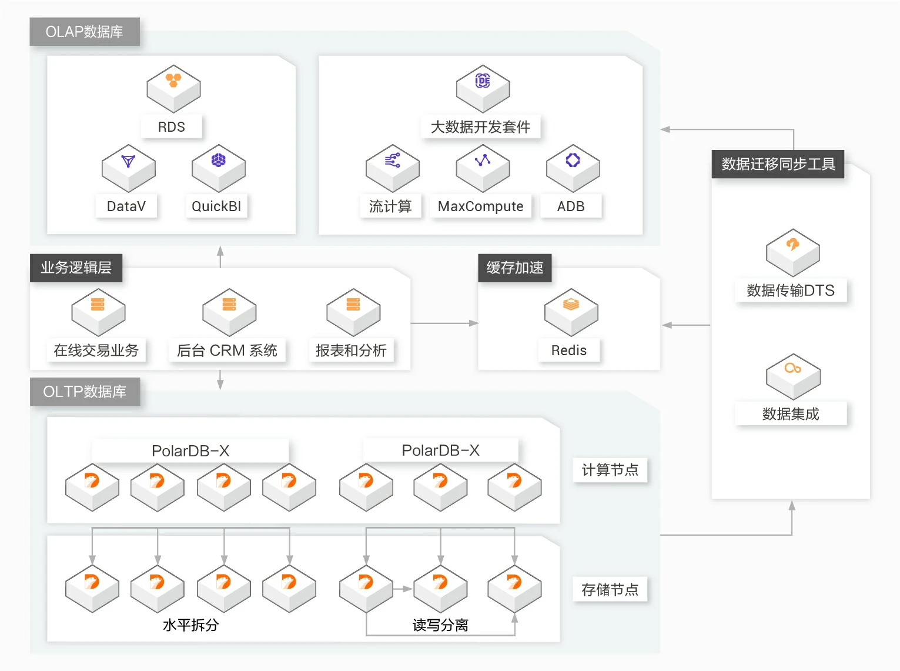

**解决的问题**

- 单机数据库容量瓶颈： 随着数据量和访问量的增长，传统单机数据库会遇到很大的挑战，依赖硬件升级并不能完全解决问题。分布式方案利用多个机器共同服务，可以有效解决数据存储容量和访问量的瓶颈问题。

- 关系型数据库扩展困难：因为分布式数据库天然的属性，可以通过数据平滑迁移改变数据分片存放节点，从而实现关系型数据库动态扩展。

<a id="section-2"></a>

# 2.快速入门

本节简单介绍云原生分布式数据库PolarDB-X的快速入门方法。

PolarDB-X实例在物理上是由多个PolarDB-X Server和底层存储组成的分布式集群。 PolarDB-X的库是逻辑概念，只包含元信息，由底层存储的物理库存储具体数据。快速入门PolarDB-X可以按照以下步骤：

1. 创建实例。

2. 创建数据库。

   PolarDB-X创建数据库需要选择若干（包含一个）RDS作为数据存储节点，如果没有RDS实例，请先去创建。RDS示例的创建方法请参见 **《云数据库RDS》** 的**用户指南 > 实例管理 > 创建实例**。

3. 创建完PolarDB-X数据库后，如同普通单机数据库，PolarDB-X也需要创建表。但是语法有所差异，主要表现在PolarDB-X建表语句对数据拆分信息的表达上。表的创建方法请参见建表语法。

<a id="section-3"></a>

# 3.登录云原生分布式数据库控制台

本节以Chrome浏览器为例，介绍云产品用户如何登录到云原生分布式数据库PolarDB-X控制台。

**前提条件**

- 登录Apsara Uni-manager运营控制台前，确认您已从部署人员处获取Apsara Uni-manager运营控制台的服务域名地址。

- 推荐使用Chrome浏览器。

**操作步骤**

1. 在浏览器地址栏中，输入Apsara Uni-manager运营控制台的服务域名地址，按回车键。

   

   > **说明**
   >
   > - 单击页面右上角的当前语言可以切换其它语言。
   >
   > - 授权登录是第三方认证中配置了全局IdP设置才会显示，且“授权登录”名称用户可按需自定义。
   >
   > - 由于浏览器证书过期或环境开启HTTPS认证等出现多次单击继续访问或无Apsara Uni-manager运营控制台地址入口等现象，此时需要安装证书才能正常访问。单击页面右上角的**浏览器证书安装**，可打开浏览器证书安装指南。

2. 输入正确的用户名及密码。

   > **说明**
   >
   > - 请向运营管理员获取登录控制台的用户名和密码。
   >
   > - 首次登录Apsara Uni-manager运营控制台时，需要修改登录用户名的密码，请按照提示完成密码修改。为提高安全性，密码长度必须为10~32位，且包含英文字母大小写、阿拉伯数字和特殊符号（感叹号（!）、at（@）、井号（#）、美元符号（$）、百分号（%）等）。

3. 单击**账号登录**。

4. 在页面顶部的菜单栏中，单击**产品 > 数据库 > 云原生分布式数据库PolarDB-X 1.0**。

<a id="section-4"></a>

# 4.实例管理

<a id="section-4-1"></a>

## 4.1. PolarDB-X 1.0迁移至PolarDB-X 2.0

<a id="section-4-1-1"></a>

### 4.1.1. 迁移方案

本文介绍如何使用PolarDB-X提供的评估迁移工具，将数据库从PolarDB-X 1.0迁移至PolarDB-X 2.0。

**名词解释**

- 源实例：待迁移的PolarDB-X 1.0实例。

- 源数据库：源实例中待迁移的数据库，简称源库。

- 目标实例：接收源实例的PolarDB-X 2.0实例。

- 目标数据库：目标实例中接收源库的数据库，简称目标库。

**注意事项**

- 评估迁移工具目前只支持的是库级别的数据迁移功能，可选择多个库同时迁移。

- 评估迁移工具目前只支持结构迁移和表数据迁移，其中结构迁移仅支持表和视图。

- 数据库账号、白名单、备份策略以及实例参数不支持迁移，需在目标端手动配置。

- 在迁移期间，请勿对源实例和目标实例执行扩容、缩容、迁移热点表、变更拆分键和变更DDL等操作，否则会导致数据迁移任务失败、数据不一致或扩缩容失败等问题。

- 如源实例存储类型为PolarDB for MySQL，需开启下挂PolarDB for MySQL实例的Binlog功能。

  > **说明**
  >
  > 开启Binlog的详细步骤请参见<strong>《用户指南（PolarDB MySQL共享存储版》</strong>中的章节<strong>《开启Binlog》。</strong>

- 因为迁移过程会增大目标实例的性能压力，所以不建议向正在提供线上服务的PolarDB-X 2.0实例迁移。

- 支持将PolarDB-X 1.0迁移至PolarDB-X 2.0的DRDS模式数据库或AUTO模式数据库。

  - 迁移至AUTO模式数据库时，目标实例版本需在5.4.16-16717637及以上，并且需要创建中继DRDS模式数据库并赋予读写权限（中继DRDS模式的数据库名称，必须以_drdstoauto结尾）。

  - AUTO模式数据库与DRDS模式数据库存在一定架构差异，若迁移时选择变更数据库模式，建议对变更的数据库模式进行业务评估。

**费用说明**

评估迁移工具目前可以免费使用。

**迁移前准备**

**源实例配置**

- 将源实例底层RDS的参数**binlog_row_image**设置为FULL，binlog_rows_query_log_events设置为ON。否则预检查阶段会提示报错，且无法成功启动数据迁移任务。您可以通过以下步骤查看并修改上述参数：

  <ol type="i">

  <li>

  登录杜康-数据库管理平台。

  > **说明**
  >
  > 登录杜康-数据库管理平台的详细步骤请参见<strong>《运维指南（PolarDB分布式版2.0）》</strong>中的章节<strong>《登录杜康-数据库管理平台》。</strong>

  </li>

  <li>

  单击左侧导航栏**实例管理 > 实例列表**。

  </li>

  <li>

  在实例列表页面，搜索源实例，单击实例ID进入**实例详情**页面。

  </li>

  <li>

  单击左侧导航栏**内核-实例参数**，再单击**读写参数（不会重启数据库）**。

  </li>

  <li>

  对binlog_row_image和binlog_rows_query_log_events进行修改。

  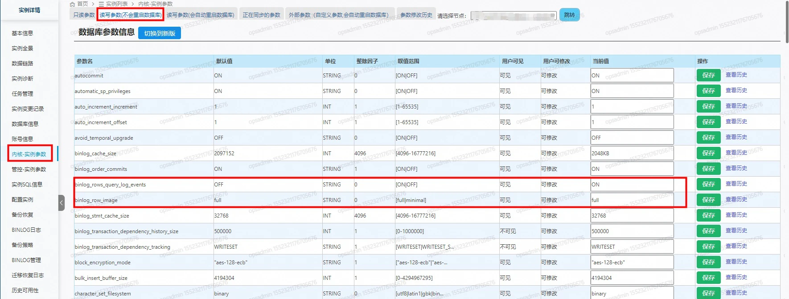

  </li>

  </ol>

- 建议将源实例本地Binlog日志保存时间设置为至少保留7天，否则可能因无法获取Binlog而导致增量任务失败。支持在控制台的**备份恢复**界面修改日志保存时间：

  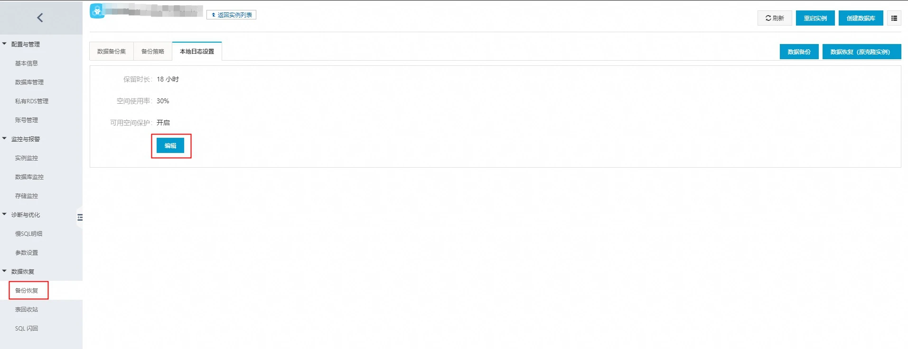

- 待迁移的表必须具有**主键约束**或**非空唯一键约束**，否则预检查阶段会提示报错，且无法成功启动数据迁移任务。

- 建议创建和使用迁移专用账号，并赋予其读写权限，减少正常业务和迁移之间的互相影响。

**目标实例配置**

- 目标实例需要和源实例在相同阿里云账号和相同地域下。

- 建议创建和使用迁移专用账号，减少正常业务和迁移之间的互相影响。

- 在目标实例创建与源库**字符集一致**的目标库。

  > **说明**
  >
  > 您可以执行如下命令，查看PolarDB-X 1.0实例中源库的字符集。
  >
  > ```sql
  > SELECT default_character_set_name FROM information_schema.SCHEMATA WHERE schema_name = '...'
  > ```

- 创建账号，并赋予目标库的读写权限。

- 检查并清理目标库和源库同名的表。目标库独有的表，在迁移过程中不会受到影响。

**迁移步骤**

1. **创建迁移任务**

1. 登录云原生分布式数据库控制台。

   > **说明**
   >
   > 登录云原生分布式数据库控制台的详细步骤请参见<strong>《用户指南（PolarDB分布式版2.0）》</strong>中的章节<strong>《登录云原生分布式数据库控制台》。</strong>

2. 在左侧导航栏单击**评估迁移**。

3. 单击**创建迁移任务**。

   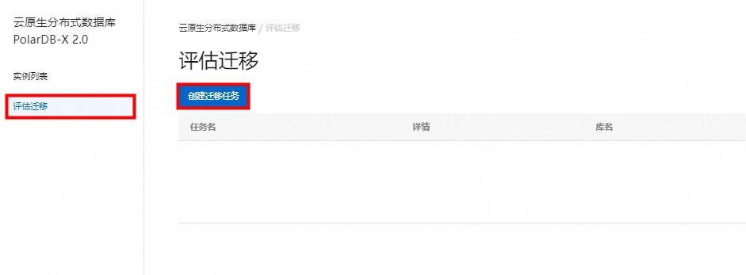

4. 在打开的页面中，配置如下内容。

   <table>
     <tr>
       <th colspan="2">配置项</th>
       <th>说明</th>
     </tr>
     <tr>
       <td colspan="2">任务名称</td>
       <td>为本次评估与迁移任务自定义一个名称。</td>
     </tr>
     <tr>
       <td rowspan="5">PolarDB-X 1.0实例</td>
       <td>实例地域</td>
       <td>选择源PolarDB-X 1.0实例所在的地域。<br>说明源PolarDB-X 1.0实例与目标PolarDB-X 2.0实例需要位于同一地域下。</td>
     </tr>
     <tr>
       <td>实例</td>
       <td>选择源PolarDB-X 1.0实例。<br>说明当选定实例地域后，该地域下的所有PolarDB-X 1.0的实例将展示在<strong>实例</strong>下拉列表中。</td>
     </tr>
     <tr>
       <td>数据库</td>
       <td>选择PolarDB-X 1.0实例下要迁移的源数据库。</td>
     </tr>
     <tr>
       <td>数据库账号</td>
       <td rowspan="2">对已选定的数据库拥有读写权限的账号及对应的密码。</td>
     </tr>
     <tr>
       <td>数据库密码</td>
     </tr>
     <tr>
       <td rowspan="4">PolarDB-X 2.0实例</td>
       <td>实例</td>
       <td>选择与PolarDB-X 1.0实例处于同一地域下的PolarDB-X 2.0实例。当选定源实例地域后，该地域下所有PolarDB-X 2.0实例将展示在<strong>实例</strong>下拉列表中。</td>
     </tr>
     <tr>
       <td>数据库</td>
       <td>选择PolarDB-X 2.0实例下要迁移至的目标数据库。</td>
     </tr>
     <tr>
       <td>数据库账号</td>
       <td rowspan="2">对已选定的数据库有读写权限的账号及对应的密码。</td>
     </tr>
     <tr>
       <td>数据库密码</td>
     </tr>
   </table>

   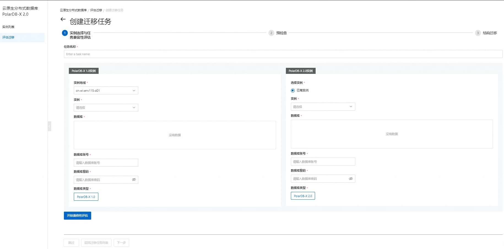

5. 专有云目前不支持兼容性评估，单击**跳过**，单击**下一步**，可以跳过兼容性评估步骤。

   2. **预检查**

跳过兼容性评估后，进入**预检查**阶段：

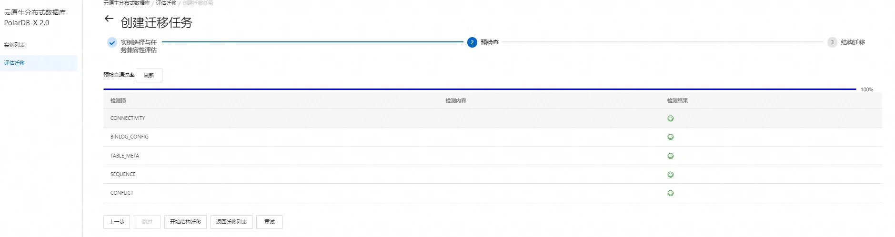

预检查项有：

- **CONNECTIVITY**：检查源实例对应库和目标实例对应库的用户名、密码、权限是否正确，以及两者的网络连通性。若失败，请检查实例的用户名、密码以及相关权限是否正确。

- **BINLOG_CONFIG**：检查源实例底层RDS的Binlog参数设置是否正确。请确保已将源实例底层RDS的**binlog_row_image**设置为FULL，binlog_rows_query_log_events设置为ON。

- **TABLE_META**：检查源实例库表的主键情况。若失败，请检查源实例待迁移的表，确保其需具有主键约束或非空唯一键约束。

- **CONFLICT**：检查目标库中是否存在与源库中同名的表。若失败，请修改目标库中对应同名表的名称。

- **SEQUENCE**：检查源库中的SEQUENCE类型，若失败，请在目标库手动从 `SIMPLE SEQUENCE` 转为 `NEW SEQUENCE` 。

> **说明**
>
> - 如存在不通过项或报错，您可以修复后，再单击**重试**按钮，重新进行预检查。
>
> - 请确保全部检查项均为通过，否则无法进行下一步。

3. **结构迁移**

预检查的所有结果均通过后，单击**开始结构迁移**。

> **重要**
>
> 如果您需要定制表结构并且能保证所有表结构已迁移至目标库，可单击**跳过**，跳过结构迁移步骤。

4. **数据迁移**

1. 当结构迁移通过后，单击**开始数据迁移**。

   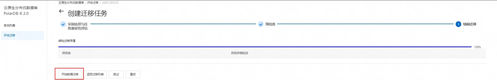

2. 开始迁移后，任务状态变为**迁移准备中**，系统正在调度资源为迁移做准备。

   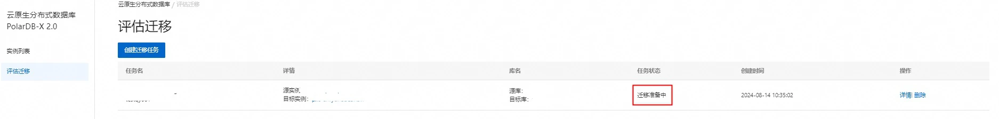

3. 迁移准备完成后，任务状态变为**数据迁移中**，该阶段将对全量数据和增量数据进行迁移。

   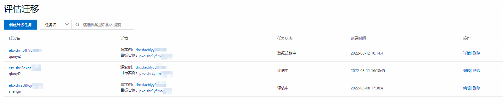

4. 单击任务名称进入**任务详情**页面，然后单击左侧导航栏**迁移 > 数据迁移详情**，可以查看迁移任务的详细进度。

   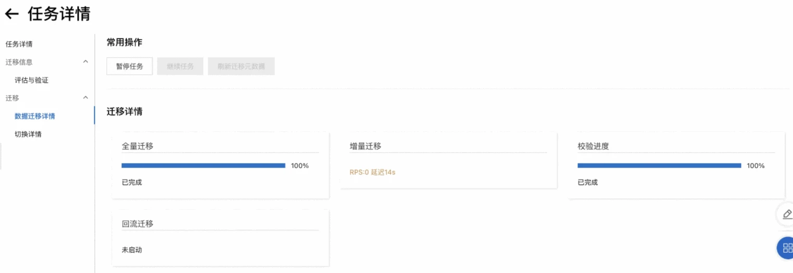

> **说明**
>
> - 首先开始**全量迁移**。开始迁移后，源库中待迁移对象的存量数据，将全部迁移到目标库中。
>
> - 全量迁移的进度达到100%后，将立即自动开始**增量迁移**，将全量迁移开始后源库中更新的数据持续同步至目标库。
>
> - 增量迁移是一个动态持续进行的过程，在业务正式切换到目标库以前不会停止。
>
> - 增量迁移开始后，当源库和目标库中的数据大致追平后（表现为增量迁移的延迟在30秒以内），将自动开始**数据校验**，校验源库和目标库中的数据一致性，确保两端数据是动态一致的。

<a id="section-4-1-2"></a>

### 4.1.2. 业务切换和回滚方案

本文介绍PolarDB-X 1.0升级至PolarDB-X 2.0后的业务切换和回滚方案。

**前提条件**

- **校验进度**显示为**已完成**。

- 当**增量迁移**的延迟小于20秒。


**切换方案概述**

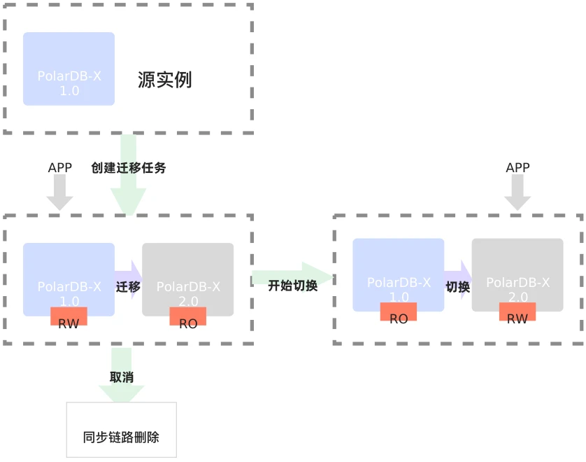

APP

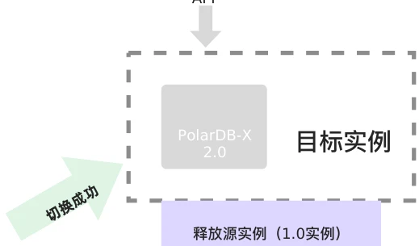


APP

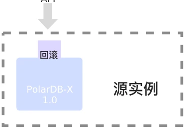

> **说明**
>
> 带地址切换：
>
> - PolarDB-X 1.0实例版本需为5.3.8-15489913及以上。
>
> - PolarDB-X 1.0所有数据库的迁移必须在同一个迁移任务中。
>
> - 带地址切换只会修改连接地址，不会修改实例名，根据实例名配置的业务仍需手动进行调整（例如DMS、DTS、DataWorks等）。
>
> - 带地址切换要求源和目标端端口一致。
>
> - 带地址切换默认会修改两侧的私网主地址和公网主地址，并不会修改只读地址，如有需要请手动修改。
>
> - 切换域名后需等待业务侧DNS缓存失效才可连接至新数据库，一般需30秒至5分钟。您也可选择手动刷新业务服务器的DNS缓存。
>
> - 整个业务切换过程中请务必**暂停业务**，直到DNS更新为新域名，业务可以连接到新数据库为止。
>
> 普通切换（不带地址切换）：
>
> - PolarDB-X 1.0实例版本需为5.3.8-15489913及以上。
>
> - 单击开始正向切换后源库会被设置为只读状态60分钟，请在60分钟内完成地址修改。
>
> - 为确保业务侧修改连接地址的完备性，建议您在修改地址前将对应写权限回收。防止漏改情况下，迁移两侧实例双写，导致数据不一致。

**切换操作步骤**

1. 在迁移任务详情页，单击左侧导航栏中的**切换详情**。

2. 当**增量迁移**的延迟小于20秒，单击**开始正向切换**，将业务由PolarDB-X 1.0切换至PolarDB-X 2.0。

3. 在**切换迁移**对话框中，选择<strong>带地址切换（应用程序不用改连接配置）</strong>或**不带地址切换（应用程序需要改为新的PolarDB 2.0连接配置）**。

   - 若您选择**带地址切换**，后续操作步骤如下：

     <ol type="a">

     <li>

     选中**带地址切换**并单击**确定**。系统会将源库设置为只读状态60分钟并等待正向同步完成，即目标库与源库数据一致。数据一致后，系统会自动将PolarDB-X 2.0的连接地址修改为PolarDB-X 1.0的连接地址。

     </li>

     <li>

     连接地址修改完成后，待应用侧DNS缓存失效，您无需在应用程序端修改任何配置即可自动连接到PolarDB-X 2.0。

     > **说明**
     >
     > 此步骤耗时取决于业务侧DNS缓存失效时间，通常需30秒至5分钟。您也可以在应用侧手动刷新DNS缓存，加速地址修改生效。

     </li>

     </ol>

     <ol type="i" start="100">

     <li>

     持续观察源库，确认所有应用已自动连接至PolarDB-X 2.0后， 单击**确定源库无业务连接**，解除源库的只读状态，启动用于回滚的反向同步链路。

     > **说明**
     >
     > 您可以使用 `show processlist` 命令查看IP，确定是否有来自业务侧的连接。

     </li>

     </ol>

   - 若您选择**不带地址切换**，后续操作步骤如下：

     <ol type="a">

     <li>

     选中**不带地址切换**并单击**确定**。系统会将源库设置为只读状态60分钟并等待正向同步完成，即目标库与源库数据一致。

     </li>

     <li>

     数据一致后，前端会提示“可以开启手动切换业务侧连接串”。此时修改业务侧连接串，将应用连接至PolarDB-X 2.0。

     > **说明**
     >
     > 如您在60分钟内无法完成修改业务连接串操作，可以自行用修改权限等方式确保源库在切换过程中保持只读状态。

     </li>

     </ol>

     <ol type="i" start="100">

     <li>

     持续观察源库，确认所有应用已连接至目标PolarDB-X 2.0后， 单击**确定源库无业务连接**，解除源库的只读状态，启动用于回滚的反向同步链路。

     > **说明**
     >
     > 您可以使用 `show processlist` 命令查看IP，确定是否有来自业务侧的连接。

     </li>

     </ol>

**回滚操作步骤**

1. 在迁移任务详情页面，单击左侧导航栏中的**切换详情**。

2. 等待反向同步延迟小于20秒时，单击**开始反向回滚并确定**，系统将设置目标库为只读状态保持60分钟并等待反向同步完成，即源库与目标库数据完全一致。

   - 若您正向切换时选择的是**带地址切换**，后续操作步骤如下：

     <ol type="a">

     <li>

     数据一致后，系统会自动将PolarDB-X 2.0的连接地址修改为PolarDB-X 1.0的连接地址。

     </li>

     <li>

     连接地址修改完成后，待应用侧DNS缓存失效，您无需在应用程序端修改任何配置即可自动连接到PolarDB-X 1.0。

     > **说明**
     >
     > 此步骤耗时取决于业务侧DNS缓存失效时间，通常需30秒至5分钟。您可以在应用侧手动刷新DNS缓存，加速地址修改生效。

     </li>

     </ol>

     <ol type="i" start="100">

     <li>

     持续观察目标库，确认所有应用已自动连接至源PolarDB-X 1.0后，单击**确定目标库无业务连接**，解除目标库的只读状态。

     > **说明**
     >
     > 您可以使用 `show processlist` 命令查看连接的客户端IP，确定是否有来自业务侧的连接。

     </li>

     </ol>

   - 若您正向切换时选择的是**不带地址切换**，后续操作步骤如下：

     <ol type="a">

     <li>

     数据一致后，前端会提示“可以开始手动切换业务侧连接串”。此时修改业务侧连接串，将应用连接至PolarDB-X 1.0。

     > **说明**
     >
     > 如您在60分钟内无法完成修改业务连接串操作，可以自行用修改权限等方式确保目标库在切换过程中保持只读状态。

     </li>

     <li>

     持续观察目标库，确认所有应用已连接至源PolarDB-X 1.0后，单击**确定目标库无业务连接**，解除目标库的只读状态。

     > **说明**
     >
     > 您可以使用show processlist命令查看连接的客户端IP，确定是否有来自业务侧的连接。

     </li>

     </ol>

<a id="section-4-2"></a>

## 4.2. 创建实例

使用PolarDB-X的第一步是创建实例，本节介绍了如何创建一个PolarDB-X实例。

1. 登录云原生分布式数据库控制台。

2. 单击页面右上角的**创建实例**。

3. 在**分布式关系型数据库DRDS**页面，选择需要的各项参数。

   各项参数配置说明如创建实例配置说明所示。

   表 1. 创建实例配置说明

   **类别**

   **配置**

   **说明**

   实例所属组织。

   **组织**

   **基本配置**

   实例所属资源集。

   **资源集**

   实例所属地域。不同地域之间的产品内网不互通，创建实例后不支持更换区域。

   **地域**

   **区域**

   实例的可用区。

   **可用区**

   实例的类型：具体可选实例类型请以实际页面为准。

   **实例类型**

   实例的系列：

   - 入门版

   **实例系列**

   - 基础版

   - 企业版

   **基本配置**

   实例的规格，不同实例系列的规则不同，具体可选实例规格请以实际页面为准。

   **实例规格**

   数据库兼容性，可选项：

   **兼容性**

   - MySQL 5.7

   - MySQL 8.0

   PolarDB-X实例支持的网络类型：

   - **经典网络**：经典网络中的云服务在网络上不进行隔离，只能依靠云服务自身的安全组或白名单策略来阻挡非法访问。

   - **专有网络**：（Virtual Private Cloud，简称VPC）专有网络帮助用户在阿里云上构建出一个隔离的网络环境。用户可以自定义专有网络里面的路由表、IP地址范围和网关。建议您选择专有网络，更加安

   **网络类型**

   全。 选择专有网络需要在下方选择**专有网络vpc**和**交换机vswitch**。

   > **说明**
   >
   > 请确保PolarDB-X实例与需要连接的ECS实例网络类型一致，否则它们无法通过内网互通。

   **网络**

   选择您的VPC。

   **专有网络vpc**

   > **说明**
   >
   > 当**网络类型**为**专有网络**时，需要填写该参数。

   选择VPC下的交换机。

   **交换机vswitch**

   > **说明**
   >
   > 当**网络类型**为**专有网络**时，需要填写该参数。

   输入实例端口，取值范围为：3000-65535<strong>。</strong>

   **端口**

4. 单击**提交**。

   实例创建成功后，在控制台的实例列表页即能看见所创建的实例，并且实例状态变更为**运行中**。实例名称是实例的唯一标识，可以通过该标识唯一确定一个PolarDB-X实例。

<a id="section-4-3"></a>

## 4.3. 变更配置

在使用PolarDB-X的过程中，如有需要可以对PolarDB-X实例规格进行变更。

**操作步骤**

1. 登录云原生分布式数据库控制台。

2. 在实例列表中定位到目标实例。

3. 单击目标实例ID或者单击实例右侧的**更多 > 管理**，打开**基本信息**页面。

4. 在页面的**常用操作**区域中单击**升配**或**降配**打开变配页面。

   > 您也可以在**云原生分布式数据库实例列表**页面，单击目标实例右侧**操作**列中的**升配**或**降配**打开变配页面。
   >
   > **说明**

5. 在变配页面中，选择**实例系列**和**实例规格**，单击**提交**。耐心等待几分钟，之后可以在实例列表中查看变更后的实例配置。

   > 降配会导致应用与PolarDB-X连接在短时间内发生闪断。请保证应用具备自动重连能力。
   >
   > **说明**

<a id="section-4-4"></a>

## 4.4. 创建非一体化PolarDB-X实例

本文介绍如何创建非一体化PolarDB-X实例。

**背景信息**

PolarDB-X实例分为一体化实例和非一体化实例，区别如下：

- 一体化实例：整合了专属RDS资源池的PolarDB-X实例，可以在PolarDB-X控制台中管理专属的RDS实例。

- 非一体化实例：需要另行购买常规RDS实例，并需要在PolarDB-X控制台中添加该常规RDS实例。对于RDS实例的管理操作需要在RDS控制台中进行。

从 企业版3.11 hotfeature版本开始，PolarDB-X整合RDS完成一体化升级。在默认情况下，所有控制台中创建的PolarDB-X实例均为一体化实例。同时，阿里云还保留了创建非一体化PolarDB-X实例的入口。

**操作须知**

如果您在操作过程中需要执行拉取镜像操作，例如出现拉取镜像超时的异常，请联系阿里云技术支持处理。

**操作步骤**

1. 登录云原生分布式数据库控制台。

2. 获取所属组织对应的UID。

   <ol type="i">

   <li>

   在页面上方菜单栏中，单击**企业**，进入**组织管理**页面。

   </li>

   <li>

   在页面左侧的组织列表中，单击目标一级组织名称，并单击页面右侧的**管理accesskey**。

   </li>

   <li>

   在弹出的**AccessKey**窗口中，记录该组织的**UID**。

   </li>

   </ol>

3. 在DRDS管家中通过获取到的组织UID对该组织进行配置以允许创建非一体化PolarDB-X实例。

   <ol type="i">

   <li>

   登录PolarDB-X运维管理系统。更多信息，请参见<strong>《云原生分布式数据库PolarBD-X》</strong>中的**运维指南 > 登录PolarDB-X运维管理系统**章节。

   </li>

   <li>

   在DRDS Manager页面的左侧导航栏中，选择**系统管理 > 参数配置**，并在右侧页面中单击**Console**页签下的**创建**。

   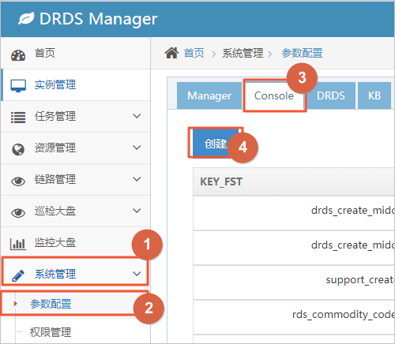

   </li>

   <li>

   在弹出的对话框中，按照下表配置各参数：

   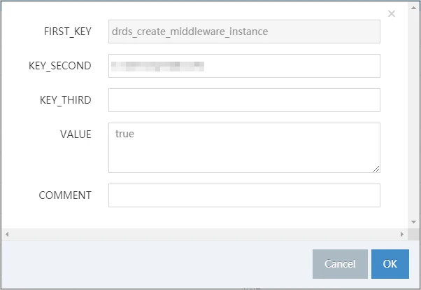

   <table>
     <tr>
       <th width="144">参数</th>
       <th>需输入的值</th>
     </tr>
     <tr>
       <td>FIRST_KEY</td>
       <td><code>drds_create_middleware_instance</code></td>
     </tr>
     <tr>
       <td>KEY_SECOND</td>
       <td>• 如需在某一组织中创建非一体化实例，此处输入步骤2中获取的该组织UID。<br>• 如需在全局创建非一体化实例，此处无需填写。</td>
     </tr>
     <tr>
       <td>KEY_THIRD</td>
       <td>无需填写。</td>
     </tr>
     <tr>
       <td>VALUE</td>
       <td><code>true</code></td>
     </tr>
     <tr>
       <td>COMMENT</td>
       <td>无需填写。</td>
     </tr>
   </table>

   > 更改组织参数之后，您只能在该组织中创建非一体化实例，若后期希望创建一体化实例，可以将上述**VALUE**参
   >
   > **说明**
   >
   > 数的值更改为 `false` 。

   </li>

   <li>

   单击**OK**。

   </li>

   </ol>

4. 登录云原生分布式数据库控制台。

5. 单击页面右上角的**创建实例**。

6. 在**分布式关系型数据库DRDS**页面，根据下表配置各项参数。

   <table>
     <tr>
       <th width="142">配置</th>
       <th>说明</th>
     </tr>
     <tr>
       <td>组织</td>
       <td>实例所属组织。此处选择步骤3中进行过参数配置的组织。</td>
     </tr>
     <tr>
       <td>资源集</td>
       <td>实例所属资源集。</td>
     </tr>
     <tr>
       <td>地域</td>
       <td>实例所属地域。不同地域之间的产品内网不互通，创建实例后不支持更换区域。</td>
     </tr>
     <tr>
       <td>可用区</td>
       <td>实例的可用区。</td>
     </tr>
     <tr>
       <td>实例类型</td>
       <td>实例的类型。具体可选实例类型请以实际页面为准。</td>
     </tr>
     <tr>
       <td>实例系列</td>
       <td>实例系列：<br>• 标准版<br>• 企业版<br>• 入门版</td>
     </tr>
     <tr>
       <td>实例规格</td>
       <td>实例的规格，不同实例系列的规则不同，具体可选实例规格请以实际页面为准。</td>
     </tr>
     <tr>
       <td>网络类型</td>
       <td>PolarDB-X实例支持的网络类型：<br>• <strong>经典网络</strong>：经典网络中的云服务在网络上不进行隔离，只能依靠云服务自身的安全组或白名单策略来阻挡非法访问。<br>• <strong>专有网络</strong>：（Virtual Private Cloud，简称VPC）专有网络帮助用户在阿里云上构建出一个隔离的网络环境。用户可以自定义专有网络里面的路由表、IP地址范围和网关。建议您选择专有网络，更加安全。 选择专有网络需要在下方选择<strong>专</strong><strong>有网络vpc</strong>和<strong>交换机vswitch</strong>。<br>说明请确保PolarDB-X实例与需要连接的ECS实例网络类型一致，否则它们无法通过内网互通。</td>
     </tr>
     <tr>
       <td>专有网络vpc</td>
       <td>选择您的VPC。<br>说明当<strong>网络类型</strong>为<strong>专有网络</strong>时，需要填写该参数。</td>
     </tr>
     <tr>
       <td>交换机vswitch</td>
       <td>选择VPC下的交换机。<br>说明当<strong>网络类型</strong>为<strong>专有网络</strong>时，需要填写该参数。</td>
     </tr>
   </table>

7. 单击**提交**。等待实例状态变更为**运行中**。至此您已成功创建非一体化PolarDB-X实例。

<a id="section-4-5"></a>

## 4.5. 只读实例

<a id="section-4-5-1"></a>

### 4.5.1. 只读实例简介

PolarDB-X只读实例是对PolarDB-X主实例的一种扩展补充，兼容PolarDB-X主实例的SQL查询语法。

**特性**

PolarDB-X只读实例与主实例可共享同一份数据，可直接在RDS只读实例或RDS主实例上进行复杂数据查询分析。提供多种实例类型，可抵御超高并发的访问压力、加速复杂查询的响应时间。通过物理资源隔离的方式，缓解主实例的负载压力，降低业务架构的链路复杂度，无需进行额外的数据同步操作，节省运维及预算成本。

**实例类型**

**并发型只读实例**：针对高并发、大流量的简单查询或离线抽取数据等业务场景，通过物理资源隔离的方式，可抵御超高流量的并发查询，以确保在线业务链路的稳定性。

> 对于已使用PolarDB-X主实例的业务来说，并发型只读实例可以用于如下几种业务场景：
>
> **说明**
>
> - 存在高并发、大流量简单查询的业务场景。
>
> - 离线抽取数据的业务场景。

**功能限制**

- PolarDB-X只读实例与主实例必须属于同一个地域，但是可以在不同的可用区。

- PolarDB-X只读实例无法单独存在，必须隶属于某个PolarDB-X主实例。创建只读实例前须先创建好主实例，在主实例上创建了数据库，该数据库会被复制到只读实例上，同理，主实例删除数据库时，其只读实例对应的数据库也会被删除。

- PolarDB-X不支持将数据迁移至只读实例。

- PolarDB-X只读实例不支持创建和删除数据库。

- PolarDB-X只读实例不支持克隆实例。

- PolarDB-X只读实例支持DLL语句，不支持数据变更DML语句。

<a id="section-4-5-2"></a>

### 4.5.2. 创建只读实例

本文介绍如何创建只读实例。

**操作步骤**

1. 登录云原生分布式数据库控制台。

2. 在实例列表中定位到目标主实例。

3. 单击目标实例ID或者单击实例右侧的**更多 > 管理**，打开**基本信息**页面。

4. 单击页面右侧的**创建DRDS只读实例**。

5. 根据需求配置实例的区域、基本配置、网络类型，单击**提交**。表 1. 创建只读实例配置说明

   <table>
     <tr>
       <th>类别</th>
       <th>配置</th>
       <th>说明</th>
     </tr>
     <tr>
       <td rowspan="2">区域</td>
       <td>地域</td>
       <td>实例所属地域。不同地域之间的产品内网不互通，创建实例后不支持更换区域。</td>
     </tr>
     <tr>
       <td>可用区</td>
       <td>实例的可用区。</td>
     </tr>
     <tr>
       <td rowspan="4">基本配置</td>
       <td>实例类型</td>
       <td>实例的类型：具体可选实例类型请以实际页面为准。</td>
     </tr>
     <tr>
       <td>实例系列</td>
       <td>实例的系列：<br>• 基础版<br>• 标准版<br>• 企业版</td>
     </tr>
     <tr>
       <td>实例规格</td>
       <td>实例的规格，不同实例系列的规则不同，具体可选实例规格请以实际页面为准。</td>
     </tr>
     <tr>
       <td>描述</td>
       <td>输入只读实例的描述，便于后期管理。</td>
     </tr>
     <tr>
       <td rowspan="3">网络类型</td>
       <td>网络类型</td>
       <td>PolarDB-X实例支持的网络类型：<br>• <strong>经典网络</strong>：经典网络中的云服务在网络上不进行隔离，只能依靠云服务自身的安全组或白名单策略来阻挡非法访问。<br>• <strong>专有网络</strong>：（Virtual Private Cloud，简称VPC）专有网络帮助用户在阿里云上构建出一个隔离的网络环境。用户可以自定义专有网络里面的路由表、IP地址范围和网关。建议您选择专有网络，更加安全。 选择专有网络需要在下方选择<strong>专有网络vpc</strong>和<strong>交换机vswitch</strong>。<br>请确保PolarDB-X实例与需要连接的ECS实例网络类型一致，否则它们无法通过说明内网互通。</td>
     </tr>
     <tr>
       <td>专有网络vpc</td>
       <td>选择您的VPC。<br>说明当<strong>网络类型</strong>为<strong>专有网络</strong>时，需要填写该参数。</td>
     </tr>
     <tr>
       <td>交换机vswitch</td>
       <td>选择VPC下的交换机。<br>说明当<strong>网络类型</strong>为<strong>专有网络</strong>时，需要填写该参数。</td>
     </tr>
   </table>

6. 实例创建需要几分钟的时间，请耐心等待。实例创建完成后，您可以在PolarDB-X控制台的实例列表中查看到该实例。

<a id="section-4-5-3"></a>

### 4.5.3. 管理只读实例

PolarDB-X只读实例的管理方式与主实例类似，但是无法在只读实例的管理界面创建和删除数据库，只读实例的数据库随着主实例的数据库创建而创建，随着主实例的数据库删除而删除。在PolarDB-X管理控制台，有两种方式进入到只读实例管理界面。

**通过只读实例ID管理只读实例**

1. 登录云原生分布式数据库控制台。

2. 在**云原生分布式数据库实例列表**页面，定位到目标只读实例。

3. 单击目标只读实例ID或者单击实例右侧的**更多 > 管理**，打开只读实例的**基本信息**页面。

**通过只读实例所属主实例ID管理只读实例**

1. 登录云原生分布式数据库控制台。

2. 在**云原生分布式数据库实例列表**页面，定位到目标主实例。

3. 单击目标主实例ID或者单击实例右侧的**更多 > 管理**，打开主实例的**基本信息**页面。

4. 在**基本信息**页面右侧的**相关实例**区域，移动鼠标到只读实例的数字上面，会出现只读实例的ID。

   

5. 单击目标只读实例ID，打开只读实例的**基本信息**页面。

<a id="section-4-5-4"></a>

### 4.5.4. 释放只读实例

如果您不再需要PolarDB-X只读实例，您可以选择释放它。

**前提条件**

只读实例处于**运行中**状态。

**操作步骤**

1. 登录云原生分布式数据库控制台。

2. 在实例列表中定位到目标实例。

3. 单击目标实例右侧的**更多 > 释放**。

   > 释放后实例不可恢复，请谨慎操作。
   >
   > **重要**

4. 在弹出的**释放DRDS实例**对话框中，单击**确定**。

<a id="section-4-6"></a>

## 4.6. 重启实例

本文介绍如何重启PolarDB-X实例。

**前提条件**

实例状态必须为**运行中**。

**操作步骤**

1. 登录云原生分布式数据库控制台。

2. 在实例列表中定位到目标实例。

3. 单击目标实例ID或者单击实例右侧的**更多 > 管理**，打开**基本信息**页面。

4. 单击页面右上角的**重启实例**。

5. 在**重启实例**对话框中单击**确定**。

   > 重启实例会造成连接中断，重启前请做好业务安排，谨慎操作。
   >
   > **重要**

<a id="section-4-7"></a>

## 4.7. 释放实例

如果需要释放某个运行中的实例，请在PolarDB-X控制台进行操作。

**前提条件**

- 已经删除了该实例下的所有数据库。

- 实例状态必须为运行中。

**操作步骤**

1. 登录云原生分布式数据库控制台。

2. 在实例列表中定位到目标实例。

3. 单击目标实例右侧的**更多 > 释放**。

4. 在**释放DRDS实例**对话框中单击**确定**。

   > 虽然实例释放操作本身不会主动删除RDS上的数据，但是实例释放后不可恢复，请谨慎操作。
   >
   > **警告**

<a id="section-4-8"></a>

## 4.8. 数据恢复

<a id="section-4-8-1"></a>

### 4.8.1. 备份恢复

PolarDB-X备份恢复提供实例级、数据库级的备份恢复能力。实例备份支持自动备份与手动备份，备份方式包括快速备份与一致性备份。实例恢复基于已有备份集，将数据恢复至新的PolarDB-X与RDS实例。

**注意事项**

- PolarDB-X自动备份策略默认关闭，需要您手动开启。

- PolarDB-X日志备份能力依赖下层RDS，PolarDB-X控制台设置的日志备份策略会自动同步至下层所有RDS，设置完成后，请勿在RDS控制台修改，避免备份集失效。

- PolarDB-X备份恢复依赖日志备份，建议您默认开启日志备份策略，避免备份集失效。

- 备份过程中不要执行DDL操作，避免实例备份与恢复失败。

- 备份过程中，请确保PolarDB-X实例下层RDS的状态正常，避免备份失败。

- 一致性备份与恢复功能仅支持PolarDB-X 5.3.8及以上版本。

- 请确认所有的数据表都存在主键，避免影响一致性备份恢复的数据准确性。

- 一致性备份过程中，对PolarDB-X实例会进行秒级的锁定分布事务操作，锁定过程中，非事务SQL以及单机事务执行不受影响，分布式事务提交会被阻塞，SQL执行RT存在毫秒级抖动，建议在业务低峰期进行一致性备份操作。

- 受PolarDB-X与RDS库存的影响，PolarDB-X在实例恢复过程中，会为您自动调整实例的规格与可用区，请在实例恢复完成后确认并调整，避免影响业务。

**备份方式**

PolarDB-X备份恢复针对不同的业务场景，提供快速备份与一致性备份两种备份方式以及相应的数据恢复能力。两种备份方式的对比如下表：

| 备份方式 | 适用场景 | 优点 | 缺点 |
| --- | --- | --- | --- |
| 快速备份 | 适用于日常业务常规备份恢复场景。 | • 备份恢复速度快。<br>• 支持备份集和任意时间点的恢复。<br>• 支持所有PolarDB-X实例版本。 | 面向分库分表场景，保证单个RDS层面的数据一致性，但不保证数据的全局一致性。 |
| 一致性备份 | 适用于对数据一致性有严格要求的金融行业以及在线核心交易类业务备份恢复场景。 | 面向分库分表场景，提供全局数据一致保证。 | • 备份恢复速度相对较慢。<br>• 仅支持备份集恢复，不支持任意时间点恢复。<br>• 仅在PolarDB-X 5.3.8及以上版本支持。<br>• 备份过程中，对PolarDB-X实例会进行秒级的锁定分布事务操作，锁定过程中，SQL执行RT存在毫秒级抖动，建议在业务低峰期进行一致性备份。 |

<a id="section-4-8-2"></a>

### 4.8.2. 设置自动备份策略

PolarDB-X提供自动备份功能，本文介绍如何设置自动备份策略。

**操作步骤**

1. 登录云原生分布式数据库控制台。

2. 在实例列表中定位到目标实例。

3. 单击目标实例ID或者单击实例右侧的**更多 > 管理**，打开**基本信息**页面。

4. 在左侧导航栏中单击**数据恢复 > 备份恢复**。

5. 单击页面中的**备份策略**页签，然后单击**编辑**。

6. 在弹出的**备份策略**对话框中，按照实际业务需求进行配置，并单击**确定**。

   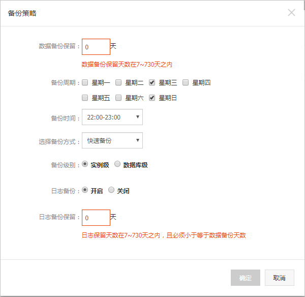

   > PolarDB-X实例本身无日志备份能力，设置的日志备份策略会应用到下层所有RDS上。
   >
   > **重要**

<a id="section-4-8-3"></a>

### 4.8.3. 本地日志设置

本地日志可以结合PolarDB-X的备份恢复功能或SQL闪回功能，精准地将实例或数据库恢复到您希望的时间点。本文介绍如何设置本地日志。

**操作步骤**

1. 登录云原生分布式数据库控制台。

2. 在实例列表中定位到目标实例。

3. 单击目标实例ID或者单击实例右侧的**更多 > 管理**，打开**基本信息**页面。

4. 在左侧导航栏中单击**数据恢复 > 备份恢复**。

5. 在页面中单击**本地日志设置**页签，然后单击**编辑**。

6. 在弹出的**本地Binlog设置**对话框中，按照实际业务需求进行配置，并单击**确定**。

   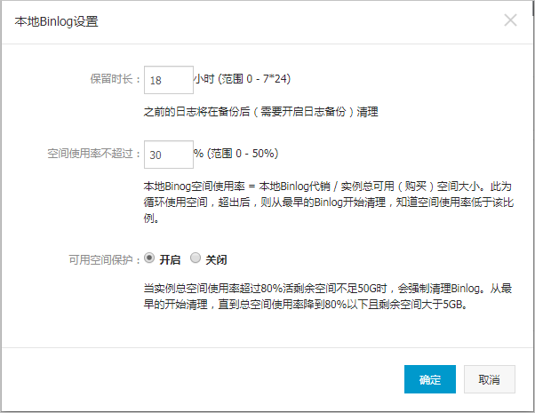

   > 本地日志配置会应用到下层所有RDS。
   >
   > **重要**

<a id="section-4-8-4"></a>

### 4.8.4. 手动备份

PolarDB-X除了自动备份功能以外，还提供了手动备份，方便您随时对数据进行备份。本文介绍如何手动备份实例和数据库。

**操作步骤**

1. 登录云原生分布式数据库控制台。

2. 在实例列表中定位到目标实例。

3. 单击目标实例ID或者单击实例右侧的**更多 > 管理**，打开**基本信息**页面。

4. 在左侧导航栏中单击**数据恢复 > 备份恢复**。

5. 在页面右侧单击**数据备份**。

   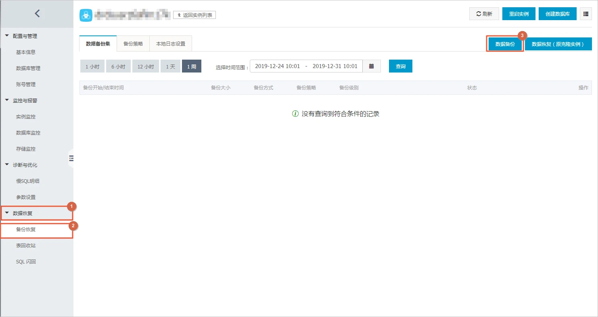

6. 在弹出的对话框中选择备份方式以及备份级别。

   - 备份方式包括**快速备份**与**一致性备份**，两者区别请参见备份方式。

     > 如果您选择一致性备份，该方式会对分布式事务进行秒级的锁定操作，RT存在亚秒级抖动，建议在业务低峰期进
     >
     > **重要**
     >
     > 行。

   - 备份级别包括**实例备份**与**数据库备份**，您可以选择**实例备份**备份整个实例，也可以选择**数据库备份**选择您需要备份的数据库。

7. 单击**确定**。

<a id="section-4-8-5"></a>

### 4.8.5. 恢复数据

您可以在任意时间段通过PolarDB-X数据恢复功能来还原到实例或数据库备份时的状态。本文介绍如何还原实例或数据库。

**操作步骤**

1. 登录云原生分布式数据库控制台。

2. 在实例列表中定位到目标实例。

3. 单击目标实例ID或者单击实例右侧的**更多 > 管理**，打开**基本信息**页面。

4. 在左侧导航栏中单击**数据恢复 > 备份恢复**。

5. 在页面右侧单击**数据恢复（原克隆实例）**。

6. 确认数据恢复方式。

   - **按时间点**：恢复到您选择的时间点的状态。需要选择**还原时间**和**恢复级别**。

     > 仅非一体化PolarDB-X实例支持**按时间点**恢复方式。如需创建非一体化PolarDB-X实例，请参见创建非一体化
     >
     > **说明**
     >
     > PolarDB-X实例。

   - **按备份集**：恢复到您选择的备份文件的状态。

   > 您也可以单击目标备份集后面的**恢复**来达到**按备份级**恢复的效果，如下图所示。
   >
   > **说明**

   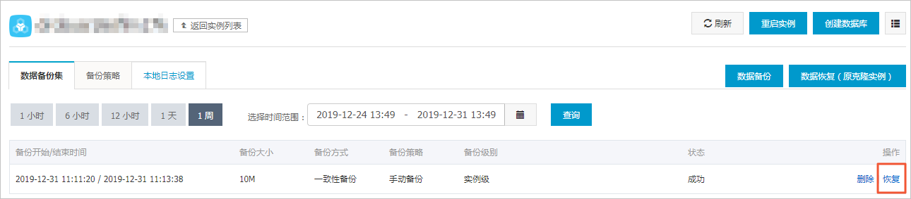

7. 单击**预检测**，检查是否存在有效的备份集可供恢复数据。如果预检测失败，则无法恢复数据。

8. 单击**去开通**，打开**确认订单**页面。

9. 确认页面详情并单击**去开通**，开始恢复数据，单击页面右上角的

   可以查看数据恢复进度。

   

<a id="section-4-8-6"></a>

### 4.8.6. SQL闪回

<a id="section-4-8-6-1"></a>

#### 4.8.6.1. SQL闪回简介

PolarDB-X SQL闪回针对SQL误操作，提供行级数据的恢复能力。

当用户在PolarDB-X上执行误操作SQL（INSERT、UPDATE、DELETE）后，使用SQL闪回，提供相关的误操作SQL信息，即可从Binlog中找到匹配的事件，生成对应的恢复文件，下载后根据需求恢复数据。SQL闪回针对误操作SQL，支持**模糊匹配**与**精确匹配**两种丢失数据的定位策略，以及自动选择匹配策略的能力，详情请参见精确匹配和模糊匹配和回滚SQL和原始SQL。

**功能优势**

- 操作简单：轻松配置，填写少量误操作SQL信息，即可助您找回丢失的数据。

- 快速轻量：不依赖RDS的备份策略，只需在误操作SQL执行前开启RDS日志备份即可快速恢复误操作数据。

- 灵活的恢复方式：针对不同的场景，提供回滚SQL与原始SQL两种能力，恢复方式灵活多样。

- SQL级精确匹配能力：SQL级的误操作数据精确匹配能力，提高数据恢复的精准性。

**限制说明**

- SQL闪回依赖Binlog保存时间，需要开启RDS日志备份。Binlog存在保存时限，误操作数据后需要尽快使用SQL闪回生成恢复文件。

- SQL闪回生成的恢复文件默认保存7天，生成后需要尽快下载。

- SQL闪回精确匹配需要满足如下条件：

  - PolarDB-X实例版本在5.3.4-15378085及以上。

  - PolarDB-X数据库使用的RDS版本在5.6及以上。

  - 执行误操作SQL前，SQL闪回精确匹配开关已开启。

  - 提供误操作SQL的TRACE_ID信息。

- 为保障数据恢复的精准性，在5.3.4-15378085及以上版本的PolarDB-X实例上新建数据库时，该库会默认开启精确匹配。开启后，Binlog中会默认附带执行SQL的信息，增加一定的RDS存储空间。如您需要使用精确匹配的能力，建议升级PolarDB-X后再开启。详细信息请参见开启精确匹配。

<a id="section-4-8-6-2"></a>

#### 4.8.6.2. 生成恢复文件

本文档介绍如何通过控制台生成恢复文件。

**操作步骤**

1. 登录云原生分布式数据库控制台。

2. 在实例列表中定位到目标实例。

3. 单击目标实例ID或者单击实例右侧的**更多 > 管理**，打开**基本信息**页面。

4. 单击**数据恢复 > SQL闪回**，进入**SQL闪回**页面。

5. 在**SQL闪回**页面，填写误操作SQL的基本信息，包括数据库、时间范围、表名、TRACE_ID， SQL类型。各参数的详细说明如下表所示：

   <table>
     <tr>
       <th width="105">参数</th>
       <th>说明</th>
     </tr>
     <tr>
       <td>数据库</td>
       <td>选择执行误操作SQL的数据库。</td>
     </tr>
     <tr>
       <td>时间范围</td>
       <td>误操作SQL执行的大致时间范围，开始时间早于误操作SQL开始执行时间，结束时间晚于误操作SQL执行结束时间。为了保证恢复的效率，建议时间范围尽可能精确，限定在5分钟范围内。</td>
     </tr>
     <tr>
       <td>表名</td>
       <td>执行误操作SQL的表名，可不填。</td>
     </tr>
     <tr>
       <td>TRACE_ID</td>
       <td>PolarDB-X会为每条执行的SQL分配唯一的TRACE_ID，误操作SQL的TRACE_ID值可以通过PolarDB-X SQL审计获取。</td>
     </tr>
     <tr>
       <td>SQL类型</td>
       <td>误操作SQL的类型，包含如下三种<br>• INSERT：增加<br>• UPDATE：修改<br>• DELETE：删除</td>
     </tr>
   </table>

6. 单击**预检**，系统检查在提供的时间范围内是否存在Binlog。有关Binlog的详细信息请参见本地日志设置。

   > **说明**
   >
   > - 如果您提供的时间范围内不存在Binlog，则提示预检失败，系统无法为您恢复数据。
   >
   > - 如果您提供的时间范围内存在Binlog，则预检通过，进入下一步。

7. 选择恢复SQL类型，支持**回滚SQL**和**原始SQL**两种类型。恢复方式的区别请参见回滚SQL和原始SQL。

8. 单击**生成SQL**生成SQL闪回任务。此时页面下方会展示当前实例运行中的SQL闪回任务状态。

   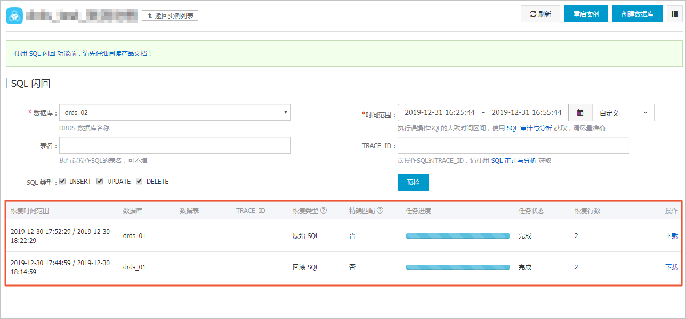

**后续步骤**

SQL闪回任务完成后，会显示该任务是否是精确匹配，实际恢复的数据行数等信息。此时您可以单击目标SQL闪回任务右侧的**下载**来下载对应的恢复文件。

> 恢复文件默认保存7天，请尽快下载。
>
> **重要**

<a id="section-4-8-6-3"></a>

#### 4.8.6.3. 回滚SQL和原始SQL

为了支持不同的业务场景，PolarDB-X SQL闪回提供生成回滚SQL与原始SQL两种恢复方式，用户在生成恢复SQL文件前，需要根据使用场景，选择对应的恢复方式。

**恢复方式介绍**

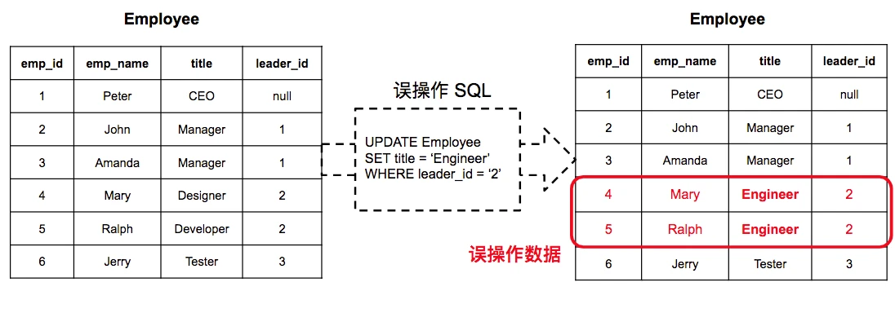

| 恢复方式 | 说明 | 示例 |
| --- | --- | --- |
| 回滚SQL | 逆序遍历Binlog中的事件，对INSERT、UPDATE、DELETE事件进行逆反操作。<br>• INSERT逆反等价于DELETE。<br>• DELETE逆反等价于INSERT。<br>• UPDATE逆反等价于UPDATE变更前的值。 | UPDATE Employee SET title = ‘Developer’ WHERE emp_id = ‘5’<br>UPDATE Employee SET title = ‘Designer’ WHERE emp_id = ‘4’ |
| 原始SQL | 顺序遍历Binlog中的事件，对INSERT、UPDATE、DELETE事件进行全记录的镜像构造处理。<br>• INSERT镜像等价于INSERT。<br>• DELETE镜像等价于INSERT。<br>• UPDATE镜像等价于INSERT变更前的值。 | INSERT INTO Employee(emp_id,emp_name,title,leader _id) values('4','Mary','Designer','2')<br>INSERT INTO Employee(emp_id,emp_name,title,leader _id) values('5','Ralph','Developer','2') |

<a id="section-4-8-6-4"></a>

#### 4.8.6.4. 精确匹配和模糊匹配

SQL闪回支持**精确匹配**和**模糊匹配**两种Binlog事件的匹配策略。具体的匹配策略无需用户选择， SQL闪回会自动检测，选择最优的匹配策略，并在闪回任务结束后通知用户。

| 匹配方式 | 说明 | 优点 | 缺点 |
| --- | --- | --- | --- |
| 精确匹配 | 针对误操作SQL，在Binlog中精确匹配出该SQL误操作的事件，并生成恢复文件。 | 恢复文件中仅包含误操作SQL误删/误改的数据，可直接使用，保证数据恢复的精准性与效率。 | 需要满足以下的条件：<br>• PolarDB-X实例版本在5.3.4-15378085及以上。<br>• PolarDB-X数据库使用的RDS是5.6及以上。<br>• 执行误操作SQL前，SQL闪回精确匹配开关已开启。<br>• 需要提供误操作SQL的TRACE_ID信息。 |
| 模糊匹配 | 针对误操作SQL的相关信息（执行时间范围、操作表名、SQL类型等），在Binlog中匹配满足条件的事件，生成对应的恢复文件。 | 不依赖实例版本、参数设置等，所有实例都支持。 | 无法精准匹配误删/误改的数据，恢复文件中包含其它业务SQL改动的数据，需要用户从中筛选出所需数据。 |

**开启精确匹配**

> 模糊匹配默认处于开启状态。
>
> **说明**

1. 登录PolarDB-X控制台，前往指定实例的参数设置页面，详情请参见参数设置。

2. 修改对应数据库的**SQL精确闪回开关**的参数值为**ON**。

<a id="section-4-8-7"></a>

### 4.8.7. 表回收站

<a id="section-4-8-7-1"></a>

#### 4.8.7.1. 简介

PolarDB-X表回收站提供针对误删表操作的数据恢复能力。

用户开启PolarDB-X表回收站功能后，通过DROP TABLE指令删除的表，将移动至表回收站中，对用户不再可见，数据表移动至回收站2小时后，即被自动清理，无法恢复。 用户可以在表回收站中查看、恢复、清理已删除的表。

**限制与说明**

- PolarDB-X表回收站仅在5.3.3-1670435及以上版本支持，版本信息请参见查看实例版本。

- PolarDB-X表回收站默认关闭，如需开启请参见开启表回收站。

- PolarDB-X表回收站不支持被TRUNCATE TABLE命令删除的表。

- 回收站内的表在自动清理前会继续占用RDS存储空间，如需要快速释放，请前往回收站手动清理。

<a id="section-4-8-7-2"></a>

#### 4.8.7.2. 开启表回收站

本文介绍如何开启表回收站。

**前提条件**

PolarDB-X实例中已创建RDS数据库。详情请参见创建数据库。

**操作步骤**

1. 登录云原生分布式数据库控制台。

2. 在实例列表中定位到目标实例。

3. 单击目标实例ID或者单击实例右侧的**更多 > 管理**，打开**基本信息**页面。

4. 单击左侧导航栏的**数据恢复 > 表回收站**，打开**表回收站**页面。

5. 在**表回收站**页面上方选择需要开启表回收站的数据库名标签页。

6. 单击页面正中间的**开启**。

7. 在弹出的对话框中，单击**确定**。

<a id="section-4-8-7-3"></a>

#### 4.8.7.3. 恢复数据表

您可以从表回收站中恢复您的数据表。

**操作步骤**

1. 登录云原生分布式数据库控制台。

2. 在实例列表中定位到目标实例。

3. 单击目标实例ID或者单击实例右侧的**更多 > 管理**，打开**基本信息**页面。

4. 单击左侧导航栏的**数据恢复 > 表回收站**，打开**表回收站**页面。

5. 在**表回收站**页面上方选择需要恢复数据表的数据库名标签页。

6. 单击目标表名右侧**操作**列的**恢复**，恢复您的数据表。

<a id="section-4-8-7-4"></a>

#### 4.8.7.4. 删除数据表

您可以在表回收站中删除您不需要的数据表。

**操作步骤**

1. 登录云原生分布式数据库控制台。

2. 在实例列表中定位到目标实例。

3. 单击目标实例ID或者单击实例右侧的**更多 > 管理**，打开**基本信息**页面。

4. 单击左侧导航栏的**数据恢复 > 表回收站**，打开**表回收站**页面。

5. 在**表回收站**页面上方选择需要删除数据表的数据库名标签页。

6. 单击目标表名右侧**操作**列的**删除**删除您的数据表。

   > 如果您希望清空表回收站中的数据表，可以单击对应数据库标签页中的**清空回收站**，一键清空表回收站。
   >
   > **说明**

<a id="section-4-8-7-5"></a>

#### 4.8.7.5. 关闭表回收站

如果您无需再使用表回收站，您可以关闭表回收站。

**操作步骤**

1. 登录云原生分布式数据库控制台。

2. 在实例列表中定位到目标实例。

3. 单击目标实例ID或者单击实例右侧的**更多 > 管理**，打开**基本信息**页面。

4. 单击左侧导航栏的**数据恢复 > 表回收站**，打开**表回收站**页面。

5. 在**表回收站**页面上方选择需要关闭表回收站的数据库名标签页。

6. 单击标签页中的**关闭**，关闭表回收站。

<a id="section-4-9"></a>

## 4.9. 诊断与优化

<a id="section-4-9-1"></a>

### 4.9.1. 查询慢SQL明细

PolarDB-X将执行时间超过1秒的SQL定义为慢SQL，本文介绍如何查看慢SQL。

**注意事项**

每个PolarDB-X实例最多保存5000条慢SQL明细，超过限制数量的慢SQL明细会被滚动删除。

**操作步骤**

1. 登录云原生分布式数据库控制台。

2. 在实例列表中定位到目标实例。

3. 单击目标实例ID或者单击实例右侧的**更多 > 管理**，打开**基本信息**页面。

4. 在左侧导航栏中单击**诊断与优化**中的**慢SQL明细**。

5. 选择查询的时间范围、数据库名及执行时间，单击**查询**，可查看慢SQL信息。

   > 您一次最多可以查看7天的慢SQL明细。
   >
   > **说明**

   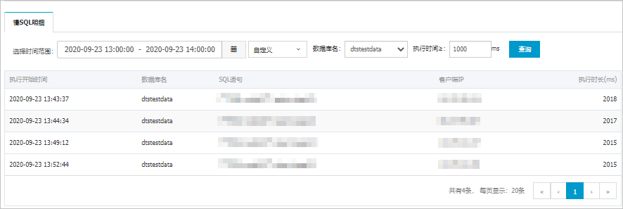

<a id="section-4-9-2"></a>

### 4.9.2. 参数设置

PolarDB-X为用户提供自主可控的实例或数据库级别的参数设置能力。您可在PolarDB-X控制台查看具体可修改的参数，并根据业务需求，调整参数的值。

> 只读实例不支持参数设置功能。
>
> **说明**

**操作步骤**

1. 登录云原生分布式数据库控制台。

2. 在实例列表中定位到目标实例。

3. 单击目标实例ID或者单击实例右侧的**更多 > 管理**，打开**基本信息**页面。

4. 单击页面左侧导航栏的**诊断与优化 > 参数设置**，打开参数设置页面。您可以在此页面查看可修改参数的列表，包括实例级、数据库级。各参数的详细信息，请参见参数说明。

5. 单击需要修改的参数后面的  ，输入目标值并单击**确定**。

   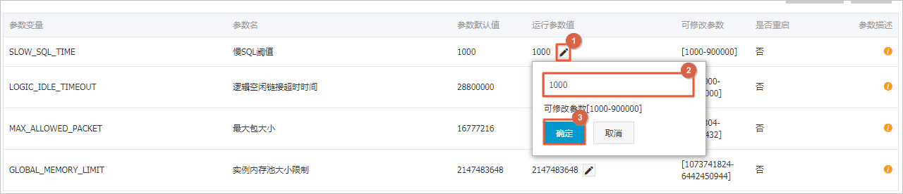

6. 单击右上角的**批量提交**，提交修改的参数值。

   > 如果您需要撤销对参数值的修改，可以在还未提交修改时单击右上角的**撤销**。
   >
   > **说明**

**参数说明**

| 参数名称 | 参数级别 | 参数说明 |
| --- | --- | --- |
| 慢SQL阈值 | 实例级 | 慢SQL阈值，超过该阈值的SQL会记录到逻辑慢SQL日志。 |
| 逻辑空闲链接超时时间 | 实例级 | 用户和PolarDB-X的链接空闲时间。（单位：ms） |
| 最大包大小 | 实例级 | 用户和PolarDB-X交互的最大网络包大小。（单位：字节） |
| 实例内存池大小限制 | 实例级 | 如果单个实例上内存消耗超过该限制，则查询报错中止。 |
| 是否禁止全表删除/更新 | 数据库级 | 是否禁止全表删除或更新。 |
| 是否开启回收站 | 数据库级 | 是否开启PolarDB-X逻辑表删除进入回收站。 |
| 临时表大小 | 数据库级 | PolarDB-X分布式查询中间临时表的大小。（单位：行） |
| 分表union合并数 | 数据库级 | 查询一个库上多个分表时使用union合并最多的分表数量。 |
| 物理SQL超时时间 | 数据库级 | PolarDB-X和RDS交互时的SQL超时时间。（单位：ms）0表示不限制超时时间。 |
| SQL精确闪回开关 | 数据库级 | 是否支持SQL闪回精确匹配的开关，默认关闭。开启后，该PolarDB-X数据库使用的Binlog中会增加执行QUERY的信息。 |
| 是否启用逻辑INFORMATION_SCHEM A查询 | 数据库级 | 控制是否启用逻辑INFORMATION_SCHEMA查询（不依赖影子库，返回逻辑库或表的聚合结果），禁用时恢复到原先的行为。（依赖影子库，可能会返回物理库或表信息） |
| 事务日志清理开始时间段 | 数据库级 | 在这个时间段内的某个随机时刻，进行事务日志清理。 |
| 库级内存池大小限制 | 数据库级 | 如果单个PolarDB-X数据库上内存消耗超过该限制，则查询报错中止。-1 表示不限制。 |
| 查询级内存池大小限制 | 数据库级 | 如果单个查询的内存消耗超过限制，则查询报错中止。-1 表示不限制。 |
| 是否启用CBO | 数据库级 | 是否启用CBO，包括Join Reorder、Hash Join 等特性。 |
| 默认并行度 | 数据库级 | 控制Parallel Query是否启动以及启动后的并行度。仅当 CBO启用时才会生效, -1 表示自动选择，0表示禁止。 |
| 是否启用异步DDL引擎 | 数据库级 | 是否启用异步DDL引擎，禁用时仍为原DDL引擎执行逻辑。 |
| 是否启用异步DDL引擎下的纯异步模式 | 数据库级 | 在异步DDL引擎启用的前提下，是否启用纯异步模式。<br>• 启用：客户端连接PolarDB-X执行DDL后立即返回，只能通过异步DDL管理语句查看执行状态。<br>• 禁用：仍为同步模式，即客户端执行DDL阻塞直到DDL执行完毕才返回。 |
| 允许单个物理库中创建的最大物理表数 | 数据库级 | 创建拆分表时，若既分库又分表，则分表数不能超过该参数的限制。 |
| INFORMATION_SCHEM A.TABLES查询是否聚合统计信息 | 数据库级 | 出于性能考虑，默认对INFORMATION_SCHEMA.TABLES的查询不做统计信息的聚合。 |
| 物理分库链接数最大值 | 数据库级 | PolarDB-X和单个RDS分片的最大链接数。 |
| 物理分库链接数最小值 | 数据库级 | PolarDB-X和单个RDS分片的最小链接数。 |
| 物理空闲链接超时时间 | 数据库级 | PolarDB-X和RDS的链接空闲时间。（单位：分钟） |

<a id="section-4-10"></a>

## 4.10. SQL审计与分析

<a id="section-4-10-1"></a>

### 4.10.1. SQL审计与分析简介

云原生分布式数据库PolarDB-X与日志服务联合推出SQL审计与分析功能，不仅支持历史SQL记录的审计，还提供对SQL执行状况、性能指标、安全问题的实时诊断分析能力。您可以在PolarDB-X控制台开通SQL审计与分析功能。

**功能优势**

- 操作简单：轻松配置即可开启，实时进行SQL日志的审计与分析。

- 性能无损：实时拉取PolarDB-X节点SQL日志文件并上传至日志服务，对实例本身性能无影响。

- 历史问题追溯：支持导入历史SQL日志，追溯问题。

- 实时分析：依托日志服务，提供SQL实时分析、开箱即用的报表中心并支持自定义报表和下钻分析，对数据库执行状况、性能、安全问题了如指掌。

- 实时告警：支持基于特定指标，定制准实时的告警，确保关键业务异常时可及时响应。

**限制与说明**

- 使用SQL审计与分析功能，需要开通阿里云日志服务。

- SQL审计日志默认保存30天，您也可以根据需要修改日志保存时间。

- 请勿随意删除或修改日志服务为您默认创建的Project、Logstore、索引和仪表盘设置，日志服务会不定期更新与升级SQL日志审计功能，专属日志库的索引与默认报表也会自动更新。

- 单条SQL最大支持长度为5MB。

**应用场景**

- 问题SQL排查开启SQL审计与分析功能后，您可以对SQL日志进行快速检索，排查定位问题。例如，需要查询是否有人执行Drop操作，可以执行如下查询：

  ```text
  sql_type: Drop
  ```

  如下图所示，查询结果中包括SQL的执行时间、用户、执行该SQL的客户端IP地址等信息。

  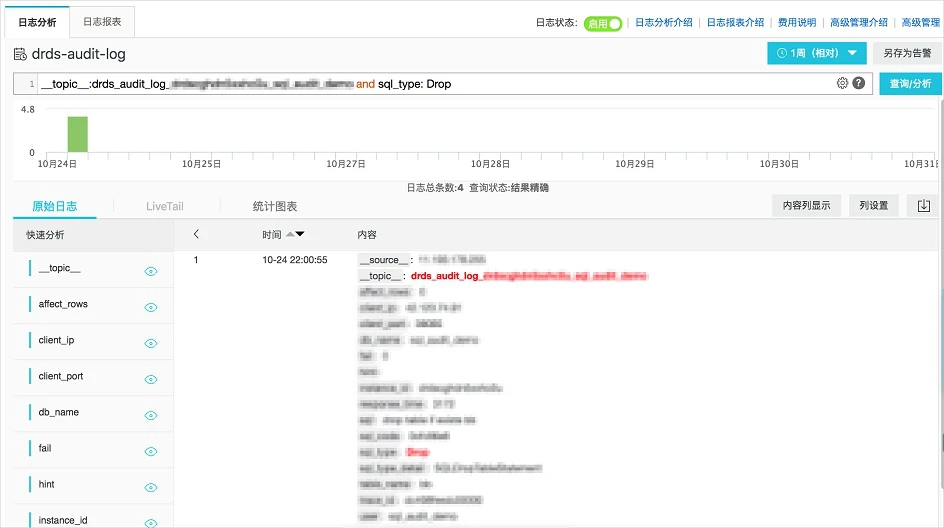

- 高代价SQL模板分析

  大多数应用中SQL通常是基于若干模板动态生成的，只是参数不同。通过日志服务的实时分析能力，您可以获取当前数据库中的高代价SQL列表。

  例如执行以下查询：

  ```text
  SELECT sql_code as "SQL模板ID", 
  round(total_time * 1.0 /sum(total_time) over() * 100, 2) as "总体耗时比例(%)" ,
  execute_times as "执⾏次数", 
  round(avg_time) as "平均执⾏时间",
  round(avg_rows) as "平均影响⾏数", 
  CASE WHEN length(sql) > 200 THEN  concat(substr(sql, 1, 200), '......') ELSE trim(lpad(sql, 200, ' ')) end as "样例SQL" FROM  (SELECT sql_code, count(1) as execute_times, 
  sum(response_time) as total_time, 
  avg(response_time) as avg_time, 
  avg(affect_rows) as avg_rows, 
  arbitrary(sql) as sql FROM log GROUP BY sql_code) ORDER BY "总体耗时比例(%)" desc limit 10
  ```

  查询结果如下图所示。包括SQL模板的ID、该模板SQL占SQL的耗时比例、执行次数、平均执行时间、平均影响行数以及样例SQL。您可以基于该分析结果，找到应用中代价最高的SQL模板，对其进行优化。

  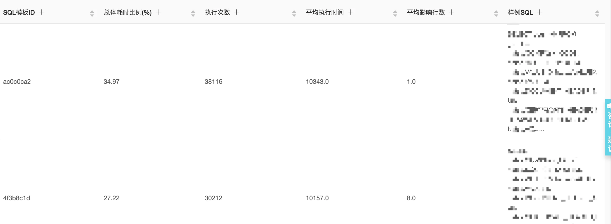

- 日至报表统计

  为了便于分析问题，PolarDB-X SQL审计分析结合日志服务，为您提供了开箱即用的报表，让您对数据库的执行状况、性能和潜在安全问题进行实时诊断分析，报表页面如下图所示。

  - 运营中心

    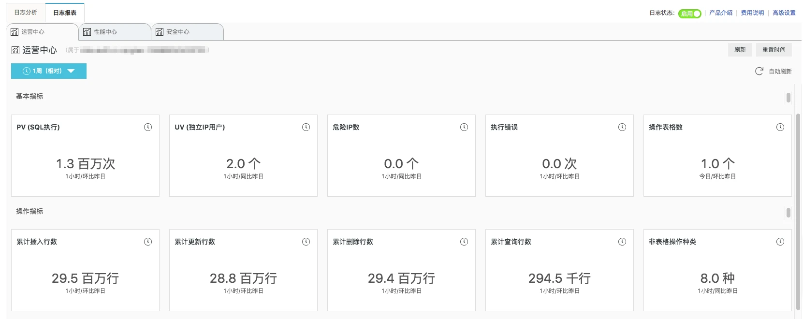

  - 性能中心

    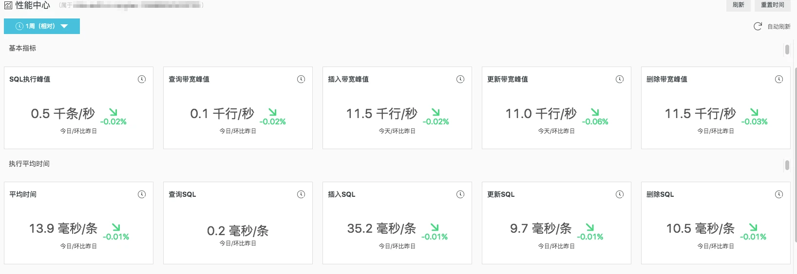

    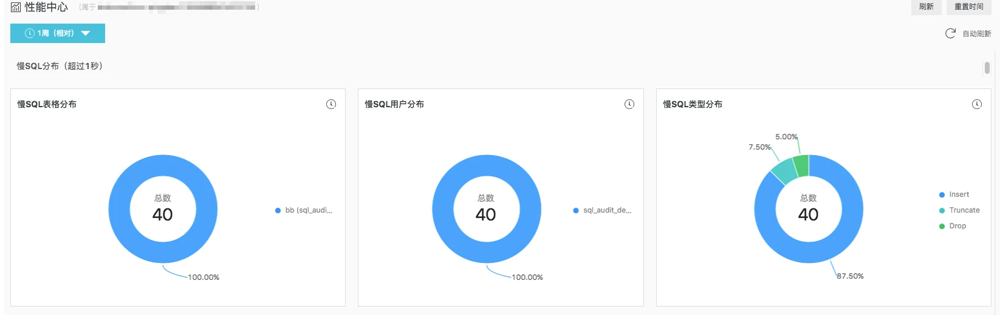

  - 安全中心

    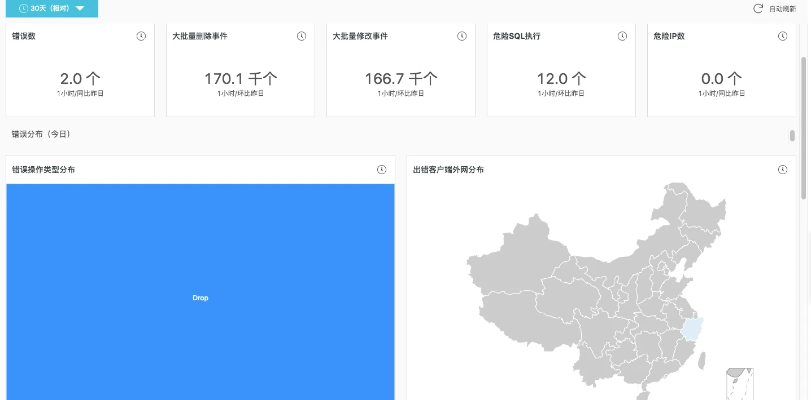

<a id="section-4-10-2"></a>

### 4.10.2. 开启SQL审计与分析

SQL日志审计功能默认关闭，您可以在PolarDB-X控制台上手动开启。默认情况下，只对开启SQL日志审计功能之后产生的日志数据进行审计分析，您也可以导入部分历史数据。

**操作步骤**

1. 登录日志服务控制台。详情请参见 <strong>《日志服务》</strong>的**用户指南 > 快速入门 > 登录日志服务控制台**章节。

2. 选择PolarDB-X实例所在的组织。

   > 使用的登录账号必须和PolarDB-X的登录账号保持一致。
   >
   > **说明**

3. 单击**角色授权访问**或**管理员权限访问**，跳转到日志服务页面。

   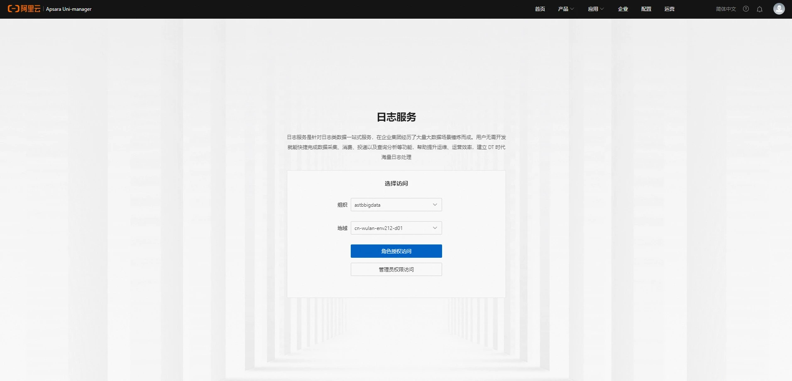

4. 登录云原生分布式数据库控制台。

5. 在实例列表中定位到目标实例。

6. 单击目标实例ID或者单击实例右侧的**更多 > 管理**，打开**基本信息**页面。

7. 单击页面左侧导航栏的**诊断与优化 > SQL审计与分析**。

8. 单击页面左侧数据库选框选择需要开启SQL审计与分析功能的数据库名。

9. 单击页面右侧**当前数据库SQL审计日志状态**后面的开关。

   > 您也可以直接在页面左侧数据库选框中打开目标数据库的**SQL审计与分析**的开关。
   >
   > **说明**
   >
   > 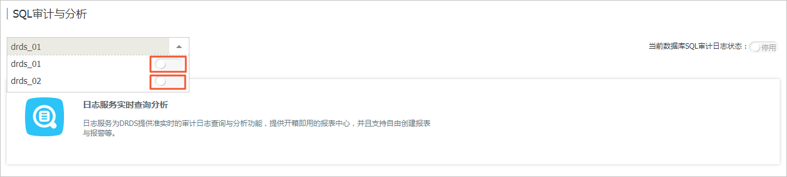

0. 确认是否导入历史数据。

   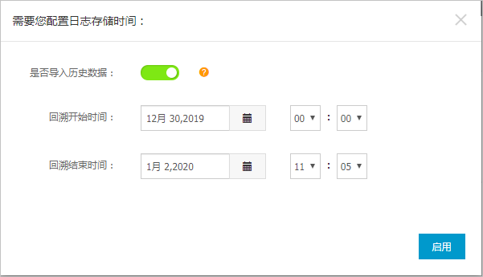

   > 默认情况下，只对开启SQL日志审计功能之后产生的日志数据进行审计分析。如果您发现PolarDB-X数据库的数据
   >
   > **说明**
   >
   > 被修改，但是并未开启SQL审计功能，可以在开启功能时导入历史数据，将过去发生的日志加入审计分析范围，追溯数据篡改者。 PolarDB-X会根据您PolarDB-X实例节点上的日志存储情况，动态检测支持导入的历史数据范围，目前最多支持导入七天内的数据。
   >
   > - 如果需要导入历史数据，请打开**是否导入历史数据**功能开关，并指定回溯开始时间和回溯结束时间，单击**启用**。
   >
   > - 如果不需要导入历史数据，请直接单击**启用**。

**后续步骤**

每次使用SQL审计与分析功能请务必重新执行如上步骤。

<a id="section-4-10-3"></a>

### 4.10.3. 日志字段

本文详细介绍SQL审计与分析中包含的日志字段。

| 字段名称 | 字段说明 | 支持版本 |
| --- | --- | --- |
| __topic__ | 日志主题，格式为：<code> drds_audit_log_{instance_id}_{d</code> <code>b_name} </code>，例如<code> drds_audit_log_drdsxyzabcd_demo_</code><code>drds_db </code>。 | 所有版本。 |
| instance_id | PolarDB-X实例ID。 | 所有版本。 |
| db_name | PolarDB-X数据库名。 | 所有版本。 |
| user | 执行SQL的用户名。 | 所有版本。 |
| client_ip | 访问PolarDB-X实例的客户端IP。 | 所有版本。 |
| client_port | 访问PolarDB-X实例的客户端端口。 | 所有版本。 |
| sql | 执行的SQL语句。 | 所有版本。 |
| trace_id | SQL执行的TRACE ID。如果是事务的话， 会以跟踪ID加-作为前缀+数字表示，例如<code> drdsabcdxyz-1 </code>，<code> drdsabcdxyz-</code><code>2 </code>等。 | 所有版本。 |
| sql_code | 模板SQL的HASH值。 | 所有版本。 |
| hint | SQL执行的HINT。 | 所有版本。 |
| table_name | 查询涉及的表名，多表之间以逗号分隔。 | 所有版本。 |
| sql_type | SQL类型。包括：Select、Insert、Update、Delete、Set、Alter、Create、Drop、Truncate、Replace 和 Other。 | 所有版本。 |
| sql_type_detail | SQL解析器的名称。 | 所有版本。 |
| sql_time | SQL开始执行的时间，格式：<code> yyyy-MM-dd </code> <code>HH:mm:ss.SSS</code> | 所有版本。 |
| response_time | 响应时间，单位为ms。 | 5.3.4-15378085及之后版本支持。 |
| affect_rows | SQL执行返回行数，增删改时表示影响的行数，查询语句表示返回的行数。 | 5.3.4-15378085及之后版本支持。 |
| fail | SQL执行是否出错。<br>• 0：成功<br>• 1：失败 | 5.3.4-15378085及之后版本支持。 |

<a id="section-4-10-4"></a>

### 4.10.4. 日志分析

SQL审计与分析，依托日志服务产品，提供强大的日志分析能力。本文提供常见场景的SQL日志分析语句及示例。

开启SQL审计与分析功能之后，您可以在当前页面通过日志服务的查询分析语法进行SQL审计与分析。结合日志服务的查询分析语法，在日志分析页面，您可以快速定位问题 SQL，并针对PolarDB-X数据库的 SQL 执行状况、性能指标，安全问题进行分析。日志服务的查询分析语法请参见： **《日志服务用户指南 > 查询与分析 > 查询语法与功能 > 查询语法。》**

**注意事项**

相同区域下，PolarDB-X数据库的审计日志都是写入同一个日志服务的Logstore里的，所以SQL审计与分析的搜索页面会默认为您带上按照__topic__的过滤条件，保证您搜索到的SQL日志是PolarDB-X数据库的。因此本文提供的所有的查询语句，都需要在已有的过滤条件后追加使用。

例如下图中：

- ①部分的语句为默认过滤条件。

- ②部分的语句为追加的过滤条件。

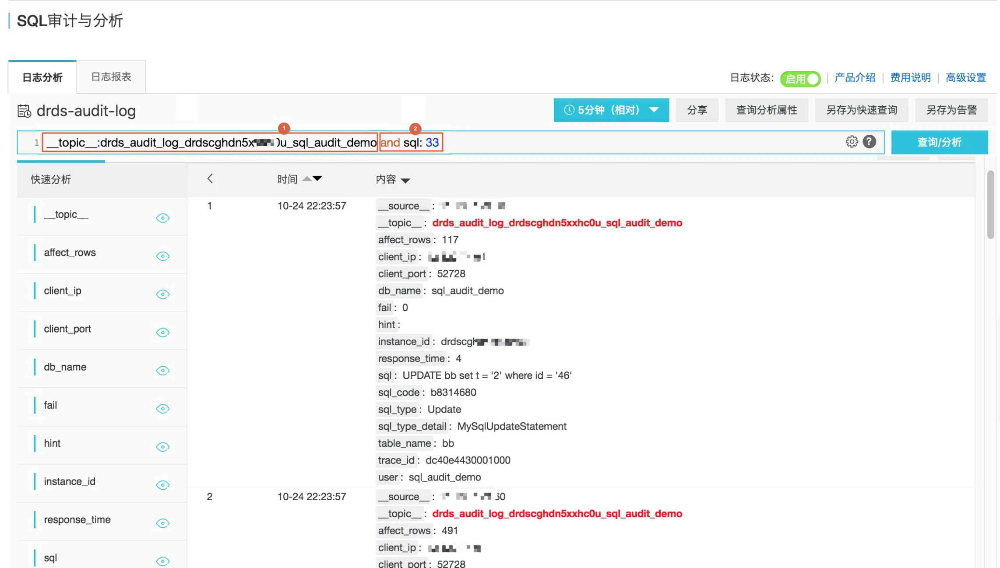

**快速定位问题 SQL**

- 模糊搜索

  例如，查询包含“34”关键字的SQL语句，请在查询框中输入：

  ```text
   and sql: 34
  ```

  查询结果如下图所示：

  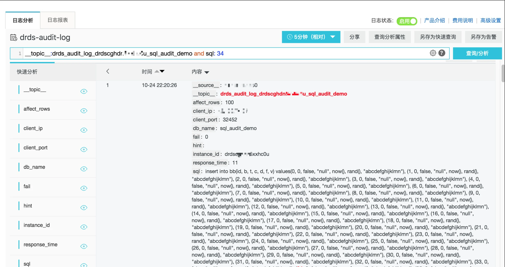

- 字段搜索

  依赖预置的索引字段，SQL审计还支持根据字段搜索。

  例如，查询 Drop 类型的 SQL：

  ```text
  and sql_type:Drop
  ```

  查询结果如下图所示：

  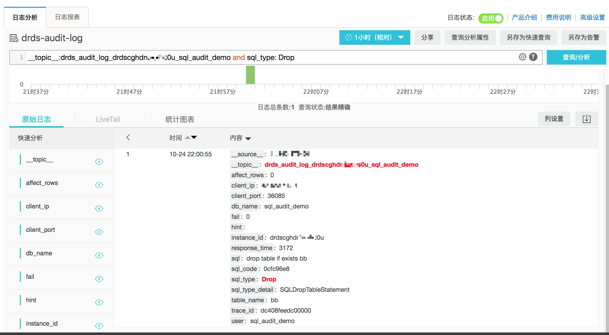

- 多条件查询

  通过”and”， “or”这类关键字，可以实现多条件的搜索。

  例如，查询对id=34行的删除操作：

  ```text
  and sql:34 and sql_type: Delete
  ```

- 数值比较搜索

  索引字段中的 “affect_rows”, “response_time” 是数值类型，支持比较操作符。

  例如，查询 response_time 大于1s 的 Insert SQL：

  ```text
   and response_time  > 1507 and sql_type: Insert
  ```

  例如，查询删除100行以上数据的 SQL：

  ```text
   and affect_rows  > 100 and sql_type: Delete
  ```

**SQL执行状况分析**

本节主要介绍PolarDB-X数据执行状况相关的查询语句。

- SQL执行失败率

  通过以下语句查询 SQL 执行的失败率：

  ```text
  | SELECT sum(case when fail = 1 then 1 else 0 end) * 1.0 / count(1) as fail_ratio
  ```

  查询结果如下图所示。

  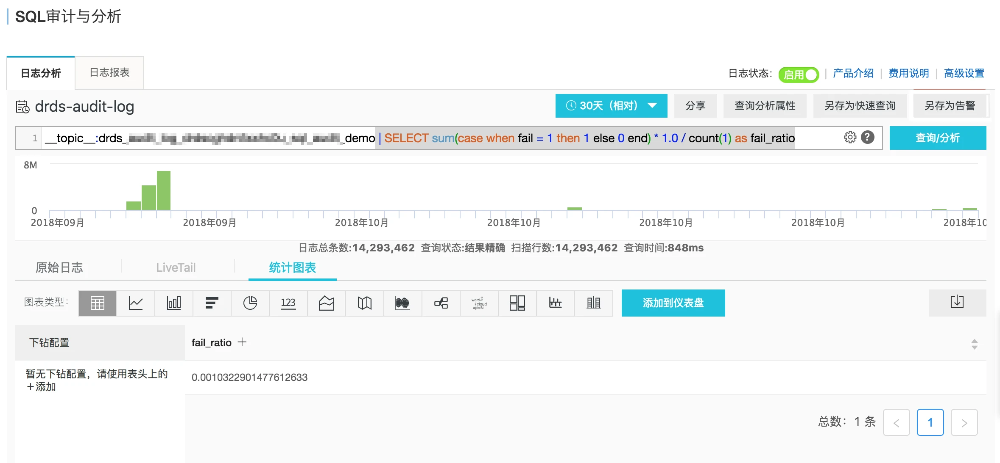

  如果您的业务对SQL错误率敏感，可以在此查询结果的基础上，定制报警信息，单击上图右上角的**另存为告警**。

  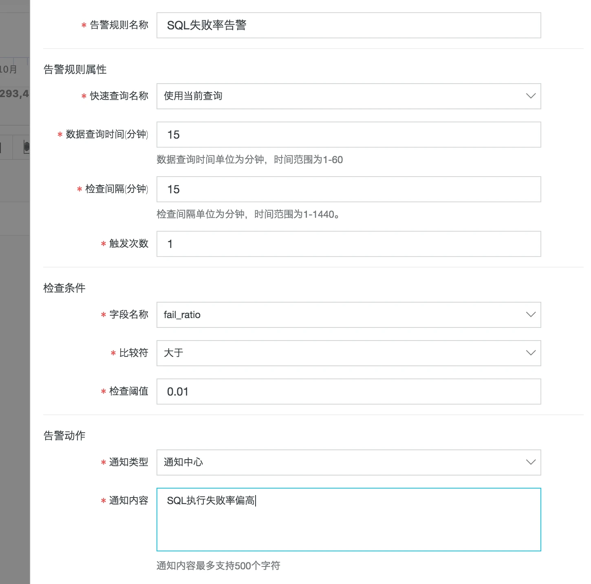

  上图报警设置表示每隔15分钟，检查15分钟内 SQL 执行的错误率大于0.01的日志数量。您也可以根据业务需要定制告警。

- SQL累计查询行数

  通过以下语句查询Select语句累计查询的行数：

  ```text
    and sql_type: Select | SELECT sum(affect_rows)
  ```

- SQL类型分布

  通过以下语句查询SQL类型分布：

  ```text
    | SELECT  sql_type, count(sql) as times GROUP BY sql_type
  ```

- SQL独立用户IP分布

  通过以下语句查询SQL独立用户的IP地址分布：

  ```text
   | SELECT  user, client_ip, count(sql) as times GROUP BY user, client_ip
  ```

**SQL性能分析**

本节将给出典型的SQL性能分析的查询语句。

- SELECT平均耗时

  通过以下语句查询SELECT语句的平均耗时：

  ```text
   and sql_type: Select | SELECT avg(response_time)
  ```

- SQL执行耗时分布

  通过以下语句查询SQL执行耗时分布情况：

  ```text
   and response_time > 0 | select   case  when response_time <= 10 then '<=10毫秒'  when response_time > 10 and
  response_time <= 100 then '10~100毫秒'  when response_time > 100 and response_time <= 1000 then '100毫秒~1秒' 
  when response_time > 1000 and response_time <= 10000  then '1秒~10秒'  when response_time > 10000 and respons
  e_time <= 60000  then '10秒~1分钟'  else '>1分钟' end as latency_type,  count(1) as cnt group by latency_type 
  order by latency_type DESC
  ```

  上述查询给出了按照给定时间段的SQL执行时间分布，您也可以调整时间段的范围，获取更加精细的结果。

- 慢SQL Top 50

  通过以下语句查询系统慢SQL的列表：

  ```text
   | SELECT date_format(from_unixtime(__time__), '%m/%d %H:%i:%s') as time, user, client_ip, client_port, sql_type, affect_rows, response_time, sql ORDER BY  response_time desc LIMIT 50
  ```

  查询结果如下图所示，结果中包含SQL执行时间、执行的用户名、IP地址、端口号、SQL类型、影响行数、执行时间以及SQL的文本。

  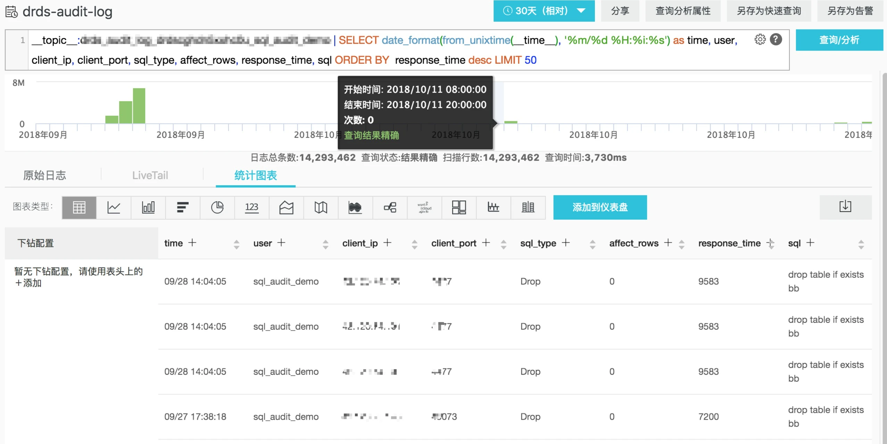

- 高代价SQL模板Top 10

  大多数应用中，SQL通常基于若干模板动态生成的，只是参数不同。可以根据模板ID，找到应用中高代价的SQL模板，进行分析优化。输入如下的查询语句：

  ```text
  | SELECT sql_code as "SQL模板ID", round(total_time * 1.0 /sum(total_time) over() * 100, 2) as "总体耗时比例(%)
  " ,execute_times as "执⾏次数", round(avg_time) as "平均执⾏时间",round(avg_rows) as "平均影响⾏数", CASE WHEN length(sql) > 200 THEN  concat(substr(sql, 1, 200), '......') ELSE trim(lpad(sql, 200, ' ')) end as "样例SQL" 
  FROM  (SELECT sql_code, count(1) as execute_times, sum(response_time) as total_time, avg(response_time) as avg_time, avg(affect_rows) as avg_rows, arbitrary(sql) as sql FROM log GROUP BY sql_code) ORDER BY "总体耗时比
  例(%)" desc limit 10
  ```

  

  统计结果包括SQL模板ID，该模板SQL占总体SQL的耗时比例、执行次数、平均执行时间、平均影响行数以及样例SQL。为了显示效果，该列按照200的长度截断。上述查询是按照总体耗时比例排序，当然您也可以根据平均执行时间，执行次数进行排序，排查问题。

- 事务平均执行时长

  对于相同事务内的SQL，预置的trace_id字段前缀相同，后缀为'-' + 序号。非事务的SQL的trace_id中则不包含'-'。基于此，我们可以对事务的性能进行相关分析。

  > 事务分析由于涉及前缀匹配操作，查询效率会低于其它类型的查询操作。
  >
  > **说明**

  例如，通过以下语句查询事务的平均执行耗时：

  ```text
   | SELECT  sum(response_time) / COUNT(DISTINCT substr(trace_id, 1, strpos(trace_id, '-') - 1)) where strpos(trace_id, '-') > 0
  ```

- 慢事务Top 10

  按照事务的执行时间排序，可以查询慢事务的列表，查询语句如下：

  ```text
  | SELECT substr(trace_id, 1, strpos(trace_id, '-') - 1) as "事务ID" , sum(response_time) as "事务耗时" where strpos(trace_id, '-') > 0 GROUP BY substr(trace_id, 1, strpos(trace_id, '-') - 1) ORDER BY "事务耗时" DESC LIM
  IT 10
  ```

  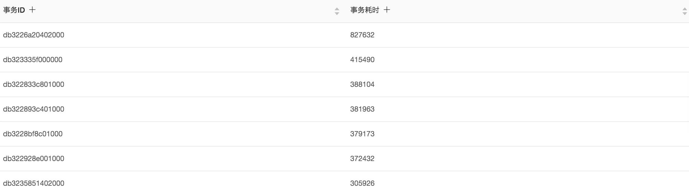

  在此基础上，可以根据查到的慢事务ID，搜索该事务下的所有SQL，分析执行慢的具体原因，查询语句如下：

  ```text
   and trace_id: db3226a20402000*
  ```

- 大批量操作事务Top 10

  按照事务内SQL影响的行数，可以获取大批量操作的事务列表，查询语句如下：

  ```text
  | SELECT substr(trace_id, 1, strpos(trace_id, '-') - 1) as  "事务ID" , sum(affect_rows) as "影响⾏数" where strpos(trace_id, '-') > 0 GROUP BY substr(trace_id, 1, strpos(trace_id, '-') - 1) ORDER BY "影响⾏数" DESC LIMI
  T 10
  ```

**SQL安全性分析**

本节将给出典型的SQL安全性分析的查询语句。

- 错误SQL类型分布

  ```text
   and fail > 0 | select sql_type, count(1) as "错误次数" group by sql_type
  ```

- 高危SQL列表

  高危SQL是Drop或者Truncate类型的SQL，您也可以根据需求增加更多条件。

  ```text
   and sql_type: Drop OR  sql_type: Truncate
  ```

- 大批量删除SQL列表

  ```text
   and affect_rows > 100 and sql_type: Delete | SELECT date_format(from_unixtime(__time__), '%m/%d %H:%i:%s') as time, user, client_ip, client_port, affect_rows, sql ORDER BY  affect_rows desc LIMIT 50
  ```

<a id="section-4-10-5"></a>

### 4.10.5. 日志报表

PolarDB-X SQL审计与分析，依托日志服务，为您提供开箱即用的报表，包括运营中心、性能中心、安全中心，让您对PolarDB-X数据库的执行状况、性能指标、潜在安全问题了如指掌。

**查看报表**

开启SQL审计与分析之后，在当前页面单击进入**日志报表**页签，即可查看日志服务提供的报表页面，包括**运营中心**、**性能中心**和**安全中心**。

> **说明**
>
> - 由于相同地区的PolarDB-X数据库的审计日志均写入日志服务同一个Logstore中，查看当前PolarDB-X数据库的报表数据时，默认为您添加基于__topic__:drds_audit_log_实例ID_数据库名的过滤条件，表示查看当前数据库的数据。例如， `drds_audit_log_drdsxyzabcd_demo_drds_db` 。
>
> - PolarDB-X实例版本如果早于版本5.3.4-15378085，SQL日志中会缺少相关字段（日志字段说明请参见日志字段）日志报表页面只提供简化版的运营中心。如需使用完整版的报表，请升级到最新版本。

日志报表页面的所有图表都是基于不同时间段的数据统计结果，您可以根据需求修改时间范围页。时间范围的修改既可面向所有图表，也可以针对单一图表。

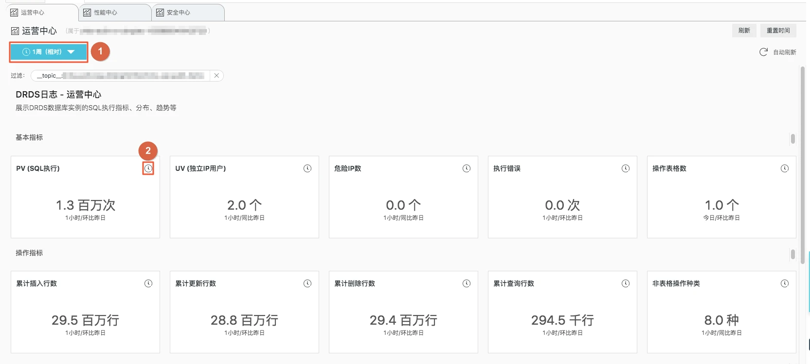

- 单击时间选择器（图中①位置），可以在弹出的时间选择控件中修改当前页面所有图表的时间范围。

- 单击图表的时间选择器（图中②位置），可以修改特定图表的时间范围。

**运营中心**

运营中心展示PolarDB-X数据库的SQL执行指标、分布、趋势等。

| 图表 | 类型 | 默认时间范围 | 描述 |
| --- | --- | --- | --- |
| PV（SQL 执行） | 单值 | 1小时（相对） | SQL执行的次数。 |
| UV（独立IP用户） | 单值 | 1小时（相对） | 独立的用户及IP数目。 |
| 危险 IP 数 | 单值 | 1小时（相对） | 危险IP的数目，危险IP的定义详见：安全检测函数。 |
| 执行错误 | 单值 | 1小时（相对） | 执行错误的SQL数目。 |
| 操作表格数 | 单值 | 1小时（相对） | SQL操作的表格总数。 |
| 累计插入行数 | 单值 | 1小时（相对） | 插入操作累计插入的数据行数。 |
| 累计更新行数 | 单值 | 1小时（相对） | 更新操作累计更新的数据行数。 |
| 累计删除行数 | 单值 | 1小时（相对） | 删除操作累计删除的数据行数。 |
| 累计查询行数 | 单值 | 1小时（相对） | 查询操作累计返回的数据行数。 |
| 非表格操作种类 | 单值 | 1小时（相对） | 非表格操作的SQL种类，例如show variables like。 |
| SQL执行趋势 | 柱状图 | 1小时（相对） | SQL执行的趋势分布以及对应的错误SQL的分布趋势。 |
| 操作表格 | 流图 | 1小时（相对） | SQL操作表格的分布情况。 |
| SQL类型 | 流图 | 1小时（相对） | SQL类型的按照时间的分布情况。 |
| 操作用户分布 | 饼图 | 1小时（相对） | 执行SQL用户的分布情况。 |
| SQL执行类型分布 | 面积图 | 1小时（相对） | 当前时间范围内SQL类型的比例。 |
| 操作最多的表格Top 50 | 表格 | 1小时（相对） | 操作最多的表格列表，包括表格的名称以及对应的读、删、改、插的次数。 |
| 执行分布（世界） | 地图 | 1小时（相对） | 执行SQL的client ip在世界地图上的分布情况。 |
| 执行分布（中国） | 地图 | 1小时（相对） | 执行SQL的client ip在中国地图上的分布情况。 |

**性能中心**

性能中心展示PolarDB-X数据库的性能指标、快慢分布、慢SQL、高代价SQL的具体分布与来源等。

| 图表 | 类型 | 默认时间范围 | 描述 |
| --- | --- | --- | --- |
| SQL执行峰值 | 单值 | 1小时（相对） | 每秒SQL执行条数的峰值。 |
| 查询带宽峰值 | 单值 | 1小时（相对） | 每秒查询SQL返回行数的峰值。 |
| 插入带宽峰值 | 单值 | 1小时（相对） | 每秒插入SQL插入的行数峰值。 |
| 更新带宽峰值 | 单值 | 1小时（相对） | 每秒更新SQL更新的行数峰值。 |
| 删除带宽峰值 | 单值 | 1小时（相对） | 每秒删除SQL删除的行数峰值。 |
| 平均执行时间 | 单值 | 1小时（相对） | SQL平均的执行时间。 |
| 查询SQL | 单值 | 1小时（相对） | 平均每秒查询SQL执行的条数。 |
| 插入SQL | 单值 | 1小时（相对） | 平均每秒插入SQL执行的条数。 |
| 更新SQL | 单值 | 1小时（相对） | 平均每秒更新SQL执行的条数。 |
| 删除SQL | 单值 | 1小时（相对） | 平均每秒删除SQL执行的条数。 |
| 查询更新带宽趋势 | 折线图 | 1小时（相对） | 查询SQL、更新SQL操作行数随时间的分布情况。 |
| SQL执行时间分布 | 饼图 | 1小时（相对） | SQL执行时间的分布情况。 |
| 慢SQL表格分布 | 饼图 | 1小时（相对） | 慢SQL（执行时间超过1秒）的表格分布情况。 |
| 慢SQL用户分布 | 饼图 | 1小时（相对） | 慢SQL（执行时间超过1秒）的用户分布情况。 |
| 慢SQL类型分布 | 饼图 | 1小时（相对） | 慢SQL（执行时间超过1秒）的类型分布情况。 |
| 慢SQL列表Top 50 | 表格 | 1小时（相对） | 慢SQL（执行时间超过1秒）的列表，包括：时间、客户端、时间、PolarDB-X实例、数据库、表格、用户、影响行数、SQL类型、SQL文本。 |
| SQL 模板执行时间 Top20 | 表格 | 1小时（相对） | 按照SQL模板统计该模板SQL的执行情况，包括：SQL模板ID、总体耗时比例、执行次数、平均执行时间、平均影响行数、样例SQL。 |
| 事务执行影响行数 Top20 | 表格 | 1小时（相对） | 事务影响行数的Top20列表，包括：事务ID、影响行数。 |
| 事务执行时间 Top20 | 表格 | 1小时（相对） | 事务执行时间的Top20列表，包括：事务ID、影响行数。 |

**安全中心**

安全中心展示PolarDB-X数据库的失败SQL、危险SQL和大批量删除、修改事件的详情、分布和趋势等。

| 图表 | 类型 | 默认时间范围 | 描述 |
| --- | --- | --- | --- |
| 错误数 | 单值 | 1小时（相对） | 失败SQL的执行次数。 |
| 大批量删除事件 | 单值 | 1小时（相对） | 大批量删除事件（超过100行）的SQL数目。 |
| 大批量修改事件 | 单值 | 1小时（相对） | 大批量修改事件（超过100行）的SQL数。 |
| 危险SQL执行 | 单值 | 1小时（相对） | 危险SQL（Drop、Truncate 操作）的数目。 |
| 危险IP数 | 单值 | 1小时（相对） | 危险IP的数目，危险IP的定义详见：安全检测函数。 |
| 错误操作类型分布 | 面积图 | 1小时（相对） | 失败SQL的类型分布。 |
| 出错客户端外网分布 | 地图 | 1小时（相对） | 失败SQL的客户端在中国地图的分布。 |
| 错误最多的客户端 | 表格 | 1小时（相对） | 失败SQL的客户端列表，包括IP，错误数目、错误SQL类型、出错SQL样例。 |
| 危险SQL执行列表 | 表格 | 1小时（相对） | 危险SQL的列表，包括时间、IP、SQL、PolarDB-X实例ID，数据库、表格、用户。 |
| 大批量删除事件Top 50 | 表格 | 1小时（相对） | 大批量删除SQL的列表，包括最早执行时间、最近执行时间、PolarDB-X实例ID、数据库、表格、执行次数、平均删除行数、平均时长、样例SQL。 |
| 大批量修改事件Top 50 | 表格 | 1小时（相对） | 大批量修改SQL的列表，包括最早执行时间、最近执行时间、PolarDB-X实例ID、数据库、表格、执行次数、平均修改行数、平均时长、样例SQL。 |

<a id="section-4-11"></a>

## 4.11. 监控与报警

<a id="section-4-11-1"></a>

### 4.11.1. 实例监控

为方便您掌握实例的运行状态，PolarDB-X提供了监控查询功能。您可以在控制台上查看目标实例、数据库、或存储节点的各项监控数据详情。本文将介绍如何在**实例监控**页查看PolarDB-X实例的各项性能监控数据。

**实例监控指标表**

<table>
  <tr>
    <th>监控类别</th>
    <th>监控指标</th>
    <th>参数</th>
    <th>说明</th>
  </tr>
  <tr>
    <td rowspan="4">资源监控</td>
    <td>CPU</td>
    <td><code> CPU</code>利用率（<code>%</code>）<code> </code></td>
    <td>PolarDB-X实例计算节点CPU使用率的平均值。</td>
  </tr>
  <tr>
    <td>内存</td>
    <td><code> DRDS</code>内存利用率（<code>%</code>）<code> </code></td>
    <td>PolarDB-X实例计算节点的内存使用率。内存使用率波动属于正常现象。</td>
  </tr>
  <tr>
    <td rowspan="2">网络</td>
    <td><code> </code>输入流量（<code>Kbps</code>）<code> </code></td>
    <td>PolarDB-X实例计算节点的网络输入流量的总和，单位为Kbps。存储节点返回数据到计算节点，会产生网络输入流量。</td>
  </tr>
  <tr>
    <td><code> </code>输出流量（<code>Kbps</code>）<code> </code></td>
    <td>PolarDB-X实例计算节点的网络输出流量的总和，单位为Kbps。计算节点发送物理SQL到存储节点，计算节点返回数据到应用，均会产生网络输出流量。</td>
  </tr>
  <tr>
    <td rowspan="6">引擎监控</td>
    <td>逻辑QPS</td>
    <td><code> </code>逻辑<code>QPS </code></td>
    <td>PolarDB-X实例每秒处理的SQL语句数目的总和。</td>
  </tr>
  <tr>
    <td>物理QPS</td>
    <td><code> </code>物理<code>QPS </code></td>
    <td>PolarDB-X计算节点每秒发送到存储节点的SQL操作数总和。</td>
  </tr>
  <tr>
    <td>逻辑RT</td>
    <td><code> </code>逻辑<code>RT</code>（<code>ms</code>）<code> </code></td>
    <td>PolarDB-X实例对于每条SQL的平均响应时间。</td>
  </tr>
  <tr>
    <td>物理RT</td>
    <td><code> </code>物理<code>RT</code>（<code>ms</code>）<code> </code></td>
    <td>PolarDB-X计算节点发送到存储节点的SQL的平均响应时间。</td>
  </tr>
  <tr>
    <td>活跃连接数</td>
    <td><code> </code>活跃连接数<code> </code></td>
    <td>应用到PolarDB-X实例的活跃连接总数。</td>
  </tr>
  <tr>
    <td>活跃线程数</td>
    <td><code> </code>活跃线程数<code> </code></td>
    <td>PolarDB-X实例中用来执行SQL的线程数。</td>
  </tr>
</table>

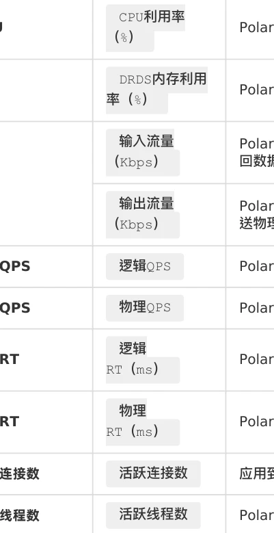

> **说明**
>
> - 上述各**资源监控**项的数据采集周期均为1分钟，各**引擎监控**项的数据采集周期均为5秒钟。
>
> - 最多支持查看7天内的监控数据。

**操作步骤**

1. 登录云原生分布式数据库控制台。

2. 在实例列表中定位到目标实例。

3. 单击目标实例ID或者单击实例右侧的**更多 > 管理**，打开**基本信息**页面。

4. 在**基本信息**页面左侧导航栏，单击**监控与报警 > 实例监控**。

5. 在**实例监控**页，设置如下参数：

   <table>
     <tr>
       <th width="89">参数</th>
       <th>说明</th>
     </tr>
     <tr>
       <td>监控指标</td>
       <td>您可以选择<strong>资源监控</strong>或<strong>引擎监控</strong>。</td>
     </tr>
     <tr>
       <td>监控指标</td>
       <td>选择需要查看的实例监控指标，关于各监控指标详情，请参见实例监控指标表。</td>
     </tr>
     <tr>
       <td>查询时间</td>
       <td>您可以指定查询时间为1小时、6小时、12小时、1天、1周。您也可以自定义查询时间范围，自定义查询时间范围为1分钟~1周。</td>
     </tr>
   </table>

<a id="section-4-11-2"></a>

### 4.11.2. 数据库监控

为方便您掌握实例的运行状态，PolarDB-X提供了监控查询功能。您可以在控制台上查看目标实例、数据库、或存储节点的各项监控数据详情。本文将介绍如何在**数据库监控**页查看PolarDB-X实例中单个数据库的各项性能监控数据。

**数据库监控指标表**

| 监控指标 | 参数 | 说明 |
| --- | --- | --- |
| QPS | <code>QPS</code> | PolarDB-X实例所选数据库每秒处理的SQL语句数目的总和。 |
| 活跃连接数 | <code> </code>活跃连接数<code> </code> | 应用到PolarDB-X实例所选数据库的活跃连接数。 |
| 活跃线程 | <code> </code>活跃线程<code> </code> | PolarDB-X实例中目标数据库用来执行SQL的线程数。 |

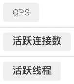

> **说明**
>
> - 上述各监控项的数据采集周期均为1分钟。
>
> - 最多支持查看7天内的监控数据。

**操作步骤**

1. 登录云原生分布式数据库控制台。

2. 在实例列表中定位到目标实例。

3. 单击目标实例ID或者单击实例右侧的**更多 > 管理**，打开**基本信息**页面。

4. 在**基本信息**页面左侧导航栏，单击**监控与报警 > 数据库监控**。

5. 在**数据库监控**页，设置如下参数：

   <table>
     <tr>
       <th width="89">参数</th>
       <th>说明</th>
     </tr>
     <tr>
       <td>数据库</td>
       <td>从<strong>数据库</strong>列表中选中目标数据库。</td>
     </tr>
     <tr>
       <td>数据指标</td>
       <td>选择需要查看的数据库监控指标，关于各监控指标详情，请参见数据库监控指标表。</td>
     </tr>
     <tr>
       <td>查询时间</td>
       <td>您可以指定查询时间为1小时、6小时、12小时、1天、1周。您也可以自定义查询时间范围，自定义查询时间范围为1分钟~1周。</td>
     </tr>
   </table>

<a id="section-4-11-3"></a>

### 4.11.3. 存储监控

为方便您掌握实例的运行状态，PolarDB-X提供了监控查询功能。您可以在控制台上查看目标实例、数据库、或存储节点的各项监控数据详情。本文将介绍如何在**存储监控**页查看PolarDB-X实例中存储节点的各项性能监控数据。

**存储监控指标表**

**监控项**

**监控指标**

**参数**

**说明**

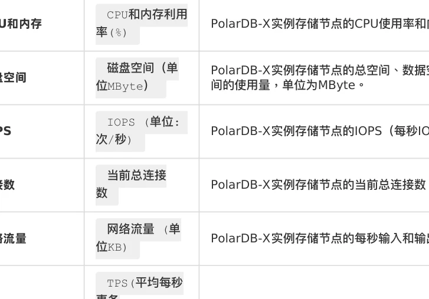

PolarDB-X实例存储节点的CPU使用率和内存使用率。

**CPU和内存**

PolarDB-X实例存储节点的总空间、数据空间、日志空间、临时空间和系统空

**磁盘空间**

PolarDB-X实例存储节点的IOPS（每秒IO请求次数）。

**资源监控**

**IOPS**

PolarDB-X实例存储节点的当前总连接数。

**连接数**

PolarDB-X实例存储节点的每秒输入和输出流量，单位为KB。

**网络流量**

```text
事务
```

```text
数）/QPS(平均
```

PolarDB-X实例存储节点的平均每秒SQL语句执行次数和平均每秒事务数。

**TPS/QPS**

```text
每秒SQL语句执
```

行次数`)`

`nnoDB`缓存读

```text
命中率、使⽤
```

PolarDB-X实例存储节点中InnoDB缓冲池的读命中率、InnoDB缓冲池的使

```text
InnoDB缓存
```

用率和InnoDB缓冲池脏块的百分率。

```text
率、脏块率 
```

```text
(%) 
```

`InnoDB`读写量

PolarDB-X实例存储节点中InnoDB平均每秒钟读取的数据量和InnoDB平均

**InnoDB读写**

每秒钟写入的数据量，单位为KB。

`(`单位为`KB)`

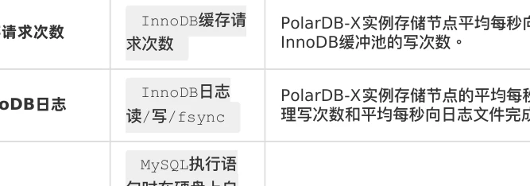

PolarDB-X实例存储节点平均每秒向InnoDB缓冲池的读次数和平均每秒向

**缓存请求次数**

PolarDB-X实例存储节点的平均每秒日志写请求数、平均每秒向日志文件的物

**InnoDB日志**

**引擎监控**

理写次数和平均每秒向日志文件完成的fsync()写数量。

```text
句时在硬盘上⾃
```

PolarDB-X实例存储节点执行语句时在硬盘上自动创建的临时表的数量。

```text
临时表
                动创建的临时表
```

的数量

PolarDB-X实例存储节点的平均每秒Delete语句执行次数、平均每秒Insert语句执行次数、 平均每秒Insert_Select语句执行次数、平均每秒Replace语句

```text
 MySQL_COMDM
```

**COMDML**

执行次数、平均每秒Replace_Select语句执行次数、平均每秒Select语句执

```text
L 
```

行次数和平均每秒Update语句执行次数。

PolarDB-X实例存储节点的平均每秒从InnoDB表读取的行数、平均每秒从

```text
 MySQL_RowDM
```

InnoDB表更新的行数、平均每秒从InnoDB表删除的行数、平均每秒从

**RowDML**

```text
L 
```

InnoDB表插入的行数和平均每秒向日志文件的物理写次数。


PolarDB-X实例存储节点中MyISAM平均每秒钟从缓冲池中的读取次数、MyISAM平均每秒钟从缓冲池中的写入次数、MyISAM平均每秒钟从硬盘上读

**MyISAM读写**

取的次数和MyISAM平均每秒钟从硬盘上写入的次数。

```text
 MyISAM Key 
```

PolarDB-X实例存储节点中MyISAM平均每秒Key Buffer使用率、MyISAM平

```text
Buffer 读/写/
```

**MyISAM索引**

均每秒Key Buffer读命中率和MyISAM平均每秒Key Buffer写命中率。

利用率`(%)`

> **说明**
>
> - 上述各**资源监控**、**引擎监控**项的数据采集周期均为1分钟。
>
> - 最多支持查看7天内的监控数据。

**操作步骤**

1. 登录云原生分布式数据库控制台。

2. 在实例列表中定位到目标实例。

3. 单击目标实例ID或者单击实例右侧的**更多 > 管理**，打开**基本信息**页面。

4. 在**基本信息**页面左侧导航栏，单击**监控与报警 > 存储监控**。

5. 在**存储监控**页面，设置如下参数：

   <table>
     <tr>
       <th width="89">参数</th>
       <th>说明</th>
     </tr>
     <tr>
       <td>数据库</td>
       <td>从<strong>数据库</strong>列表中选中目标数据库。</td>
     </tr>
     <tr>
       <td>监控指标</td>
       <td>您可以选择<strong>资源监控</strong>或<strong>引擎监控</strong>。</td>
     </tr>
     <tr>
       <td>监控指标</td>
       <td>选择需要查看的存储层资源监控指标，关于各监控指标详情，请参见存储监控指标表。</td>
     </tr>
     <tr>
       <td>查询时间</td>
       <td>您可以指定查询时间为1小时、6小时、12小时、1天、1周。您也可以自定义查询时间范围，自定义查询时间范围为1分钟~1周。</td>
     </tr>
   </table>

<a id="section-4-11-4"></a>

### 4.11.4. 预防性能问题

<a id="section-4-11-4-1"></a>

#### 4.11.4.1. PolarDB-X CPU利用率

文本档介绍CPU使用率监控项。

性能指标往往会随着当前系统业务量的波动而波动，以下是常见的两种情况：

- 某应用在每天早上9点会有抢购活动，所以这个时间点整个系统的业务流量会有一个明显的增长。从监控数据上来看，PolarDB-X的CPU利用率从9点开始从20%增长到80%左右，整个高峰持续10分钟左右。

  图 1. CPU利用率-1

  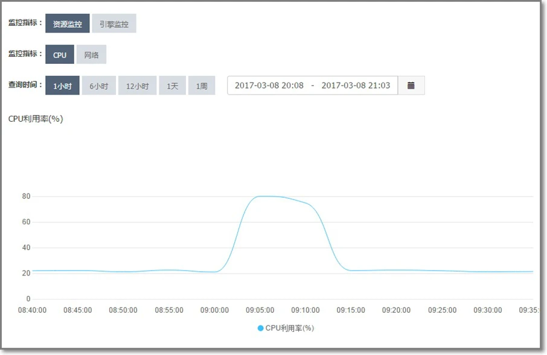

- 某应用业务一直在增长，系统的业务流量也随着一直增长，直到稳定到一个水平线。PolarDB-X的CPU监控数据也基本上反应了这一变化。

  图 2. CPU利用率-2

  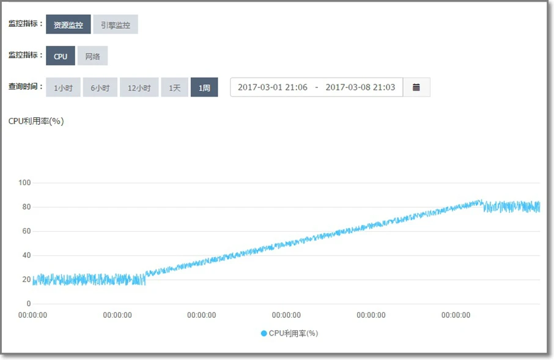

在PolarDB-X的压力随着业务变化而变化的时候，应该密切关注监控指标的变化。如果超过预设的阈值，则应该通过进行PolarDB-X升配缓解性能压力。

在PolarDB-X控制台可以针对实例设置报警规则，当CPU的平均值超过预设的阈值的时候，系统会发送短信到对应的联系人。CPU的阈值可以根据实际情况设定，推荐设置成80%。

<a id="section-4-11-4-2"></a>

#### 4.11.4.2. 逻辑RT与物理RT

本文档介绍逻辑RT和物理RT两个监控项。

逻辑RT指的是PolarDB-X从收到逻辑SQL到返回数据给应用的响应时间，物理RT指的是PolarDB-X从发出物理SQL到RDS至收到RDS返回数据的时间。

如果一条逻辑SQL被拆分成了一条或者多条物理SQL，那么逻辑RT会大于等于物理RT。理想情况下PolarDB-X只会对于RDS返回过来的数据进行少量的操作，所以一般情况下逻辑RT只会略高于物理RT一点。但是某些情况下，物理的SQL执行很快，而逻辑SQL处理时间很久，则逻辑RT和物理RT会分别出现如下的走向：

图 1. 逻辑RT

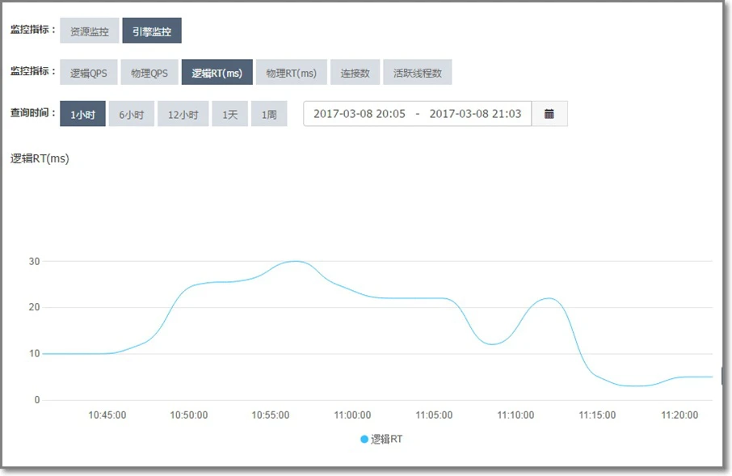

图 2. 物理RT

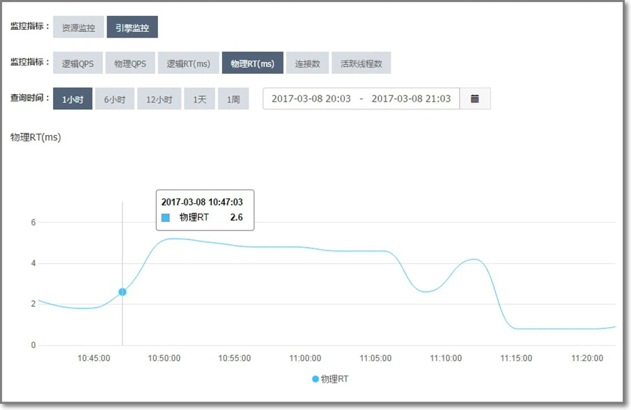

从上面两个监控图可以看到，逻辑RT和物理RT的变化趋势大致一样，逻辑RT在10毫秒到20毫秒范围内波动，物理RT在2毫秒到5毫秒范围内波动。这说明PolarDB-X层面已经有较大的压力。这种情况可以通过升级PolarDB-X配置来解决性能问题。相反，如果逻辑RT和物理RT都很高，那么可以通过升级RDS的配置或者在RDS层面优化SQL来解决性能问题。

<a id="section-4-11-4-3"></a>

#### 4.11.4.3. 逻辑QPS与物理QPS

本文档介绍逻辑QPS和物理QPS两个监控项。

从监控数据上来看，逻辑QPS和物理QPS的趋势相同，但是两者有差值比较大，且成一定的比例。

图 1. 逻辑QPS

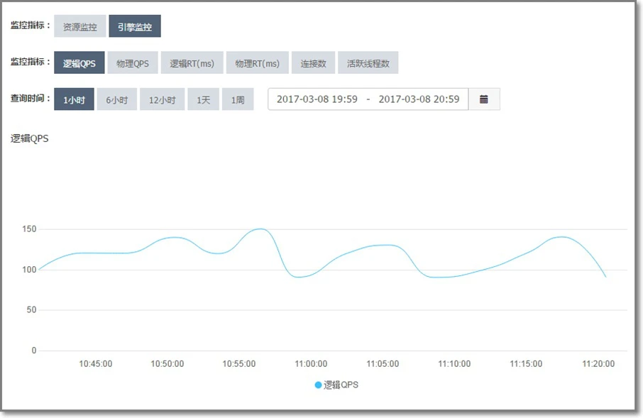

图 2. 物理QPS

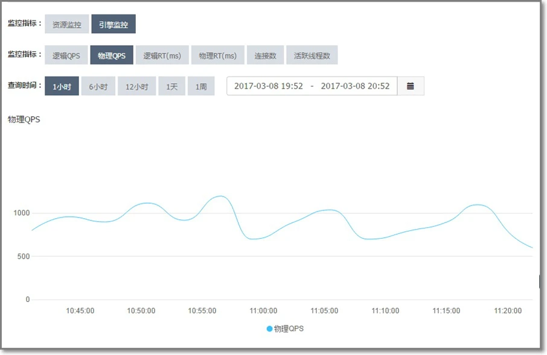

根据监控指标显示，逻辑QPS在80至150这个范围内波动，物理QPS在700至1200这个范围内波动。

造成这种现象的原因是PolarDB-X会根据逻辑SQL生成物理SQL，逻辑SQL和物理SQL的数量比例并不是1：1的关系。例如有一个PolarDB-X逻辑表，建表语句如下：

```sql
CREATE TABLE drds_user
(id int,
name varchar(30))
dbpartition by hash(id);
```

当查询条件带上分库键id，PolarDB-X会将这条逻辑SQL直接下推到RDS去执行，从执行计划上可知，物理SQL的数目是1条：

```text
explain select name from drds_user where id = 1;
```

返回信息如下：

```text
+---------------------------+-------------------------------------------------------------------------+--------+
| GROUP_NAME                | SQL                                                                     | PARAMS |
+---------------------------+-------------------------------------------------------------------------+--------+
|     SANGUAN_BSQT_0001_RDS | select `drds_user`.`name` from `drds_user` where (`drds_user`.`id` = 1) | {}    
|
+---------------------------+-------------------------------------------------------------------------+--------+
```

当查询没有带上分库键，PolarDB-X会将逻辑SQL拆分成多条物理SQL。从下面的执行计划可知，物理SQL的数目是8条。

```text
explain select name from drds_user where name = 'LiLei';
```

返回信息如下：

```text
+----------- ---------------+---------------------------------------------------------------------------------+-
----+
| GROUP_NAME                | SQL                                                                             | 
RAMS |
+---------------------------+---------------------------------------------------------------------------------+-
----+
| SANGUAN_BSQT_0001_RDS     | select `drds_user`.`name` from `drds_user` where (`drds_user`.`name` = 'LiLei') 
| {}     |
| SANGUAN_BSQT_0001_RDS     | select `drds_user`.`name` from `drds_user` where (`drds_user`.`name` = 'LiLei') 
| {}     |
| SANGUAN_BSQT_0001_RDS     | select `drds_user`.`name` from `drds_user` where (`drds_user`.`name` = 'LiLei') 
| {}     |
| SANGUAN_BSQT_0001_RDS     | select `drds_user`.`name` from `drds_user` where (`drds_user`.`name` = 'LiLei') 
| {}     |
| SANGUAN_BSQT_0001_RDS     | select `drds_user`.`name` from `drds_user` where (`drds_user`.`name` = 'LiLei') 
| {}     |
| SANGUAN_BSQT_0001_RDS     | select `drds_user`.`name` from `drds_user` where (`drds_user`.`name` = 'LiLei') 
| {}     |
| SANGUAN_BSQT_0001_RDS     | select `drds_user`.`name` from `drds_user` where (`drds_user`.`name` = 'LiLei') 
| {}     |
| SANGUAN_BSQT_0001_RDS     | select `drds_user`.`name` from `drds_user` where (`drds_user`.`name` = 'LiLei') 
| {}     |
+---------------------------+---------------------------------------------------------------------------------+-
----+
8 rows in set (0.06 sec)
```

逻辑/物理QPS指的是在单位时间内处理的逻辑/物理SQL语句的总数。当整个系统的多数SQL都带上了拆分条件，逻辑QPS和物理QPS的比值应该是接近于 1：1。逻辑QPS和物理QPS的差值过于大则意味着当前应用有很多SQL语句没有带拆分条件，应该排查应用的SQL语句，提高性能。

<a id="section-4-11-4-4"></a>

#### 4.11.4.4. 内存使用率过高

本文档介绍内存使用率监控项。

PolarDB-X内存使用率过高，大部分情况下是由于用户应用的SQL有大批量查询，返回结果集过大导致。如果您的PolarDB-X实例内存使用率持续接近100%，此时您需要执行重启实例操作，定位并优化应用的低效SQL。

<a id="section-4-12"></a>

## 4.12. 查看实例版本

查看PolarDB-X实例版本有两种方式。

**通过控制台查看**

1. 登录云原生分布式数据库控制台。

2. 在实例列表中定位到目标实例。

3. 单击目标实例ID或者单击实例右侧的**更多 > 管理**，打开**基本信息**页面。

4. 在**配置信息**栏查看**当前版本**。

**通过version()函数查看**

通过MySQL命令行连接PolarDB-X，执行 `SELECT version()` 语句可以查看PolarDB-X版本，例如执行 `select version();` 的返回结果如下：

```text
+-----------------------------+
| VERSION()                   |
+-----------------------------+
| 5.6.29-TDDL-5.1.28-1320920  |
+-----------------------------+
1 row in set (0.00 sec)
```

其中5.1.28-1320920为PolarDB-X的版本号。

<a id="section-5"></a>

# 5.私有RDS管理

<a id="section-5-1"></a>

## 5.1. 概述

PolarDB-X中间件形态由计算层PolarDB-X实例与存储层私有RDS实例组成，通过挂载多个MySQL进行分库分表水平拆分。PolarDB-X存储层私有RDS实例与计算层PolarDB-X实例配合更加深度紧密，性能表现更优秀，服务链路更稳定。

**运维管理**

您可以登录云原生分布式数据库控制台对私有RDS实例进行如下操作：

- 变更配置

- 添加只读实例

- 查看私有RDS实例监控信息

<a id="section-5-2"></a>

## 5.2. 变更配置

本文介绍如何变更私有RDS实例的配置。

**前提条件**

您已创建私有RDS实例，详情请参见创建数据库。

**操作步骤**

1. 登录云原生分布式数据库控制台。

2. 在实例列表中定位到目标实例。

3. 单击目标实例ID或者单击实例右侧的**更多 > 管理**，打开**基本信息**页面。

4. 在左侧导航栏中单击**配置与管理 > 私有RDS管理**。

5. 找到目标实例，单击其右侧**操作**列下的**变更配置**。

6. 在弹出的**变更配置**窗口中，根据业务需求分别对**规格**和**存储空间**进行调整。

7. 单击**确定**。

<a id="section-5-3"></a>

## 5.3. 添加只读实例

本文介绍如何在私有RDS管理中添加只读实例。

**前提条件**

您已创建私有RDS实例，详情请参见创建数据库。

**操作步骤**

1. 登录云原生分布式数据库控制台。

2. 在实例列表中定位到目标实例。

3. 单击目标实例ID或者单击实例右侧的**更多 > 管理**，打开**基本信息**页面。

4. 在左侧导航栏中单击**配置与管理 > 私有RDS管理**。

5. 找到目标主实例，单击其右侧**操作**列下的**添加只读实例**。

6. 在弹出的**添加只读实例**窗口中，根据业务需求选择**规格**和**存储空间**。

7. 单击**确定**。

<a id="section-5-4"></a>

## 5.4. 查看私有RDS实例监控信息

本文介绍如何查看私有RDS实例的各项监控指标。

**背景信息**

为方便您掌握实例的运行状态，PolarDB-X提供了针对私有RDS实例的监控查询功能。您可以在控制台上查看目标实例的各项监控数据详情。

**操作步骤**

1. 登录云原生分布式数据库控制台。

2. 在实例列表中定位到目标实例。

3. 单击目标实例ID或者单击实例右侧的**更多 > 管理**，打开**基本信息**页面。

4. 在左侧导航栏中单击**配置与管理 > 私有RDS管理**。

5. 找到目标私有RDS实例，单击其右侧**操作**列下的**监控**。

6. 页面自动跳转至**监控与报警**目录下的**存储监控**页面，您可以在这里查看各项监控指标的详情。更多信息，请参见存储监控。

<a id="section-6"></a>

# 6.账号管理

<a id="section-6-1"></a>

## 6.1. 基本概念

PolarDB-X账号和权限系统的概念介绍如下。

PolarDB-X账号和权限系统的用法跟MySQL一致，支持 `GRANT`  、 `REVOKE` 、 `SHOW GRANTS` 、 `CREATE USER` 、 `DROP USER` 、 `SET PASSWORD` 等语句，目前支持库级和表级权限的授予，全局级别和列级别权限暂时不支持。

MySQL账号和权限系统的详细信息请参考MySQL 官方文档。

> PolarDB-X里通过 `CREATE USER` 创建出来的账号只存在于PolarDB-X，跟RDS没有任何关系，也不会同步到后端的
>
> **重要**
>
> RDS中去。

**账号**

用户名和主机名的组合username@'host' 确定一个账号。用户名一样但是主机名不一样则代表不同的账号。例如 lily@30.9.73.96和lily@30.9.73.100是两个完全不同的账号，这两个账号的密码和权限都可能不一样。

在PolarDB-X控制台创建完数据库之后，系统会自动在该数据库下创建两个系统账号：管理员账号和只读账号。这两个账号是系统内置的，不能删除，不能修改其权限。

- 管理员账号的名字跟数据库名一致，例如数据库名是easydb，管理员账号的名字就叫easydb。

- 只读账号的名字是数据库名加上_RO后缀，例如数据库名是easydb，只读账号的名字就叫easydb_RO。

假设有两个数据库dreamdb、andordb，根据上面的规则可知，库dreamdb下面包含管理员账号dreamdb，只读账号dreamdb_RO；库andordb下面包含管理员账号andordb，只读账号andordb_RO。

**账号规则**

- 管理员账号具有所有权限；

- 只有管理员账号具有创建账号和授权功能；其它账号只能由管理员账号创建，其权限只能由管理员账号授予；

- 管理员账号是跟数据库绑定的，没有其它数据库的权限，连接的时候只能连接自己对应的那个数据库，不能授予其它数据库的权限给某个账号。例如easydb这个管理员账号只能连接easydb数据库，只能授予easydb数据库权限或者easydb数据库中表的权限给某个账号；

- 只读账号只具有SELECT权限。

**用户名规则**

- 大小写不敏感；

- 长度必须大于等于4个字符，小于等于20个字符；

- 必须以字母开头；

- 字符可以包括大写字母、小写字母、数字。

**密码规则**

- 长度必须大于等于6个字符，小于等于20个字符；

- 字符可以包括大写字母、小写字母、数字以及如下特殊字符：

  @#$%^&+=

**HOST匹配规则**

- HOST必须是纯IP地址，可以包含下划线（_）和百分号（%）通配符（下划线（_）代表一个字符，百分号（%）代表0个或多个字符）。含有通配符的HOST需要加上单引号，例如  `lily@'30.9.%.%'` ， `david@’%’` ；

- 假设系统中有两个用户都符合当前欲登录的用户，则以最长前缀匹配（不包含通配符的最长IP段）的那个用户为准。例如系统有两个用户  `david@'30.9.12_.234'` 和 `david@'30.9.1%.234'` ，在主机30.9.XX.XX上面登录david，则使用的是  `david@'30.9.12_.234'` 这个用户。

- 开启VPC时，主机的IP地址会发生变化。为避免账号和权限系统中的配置无效，请将HOST配置为 `'%'` 来匹配任意IP。

**权限**

权限级别支持情况

- 全局层级（暂不支持）

- 数据库层级（支持）

- 表层级（支持）

- 列层级（暂不支持）

- 子程序层级（暂不支持）

**权限项**

目前支持和表相关联的8个基本权限项： `CREATE` 、 `DROP` 、 `ALTER` 、 `INDEX` 、 `INSERT` 、 `DELETE` 、 `UPDATE` 、 `SELECT` 。

- `TRUNCATE` 语句需要有表上的DROP权限。

- `REPLACE` 语句需要有表上的INSERT和DELETE权限。

- `CREATE INDEX` 和 `DROP INDEX` 语句需要有表上的INDEX权限。

- `CREATE SEQUENCE` 语句需要有数据库级的创建表（CREATE）权限。

- `DROP SEQUENCE` 语句需要有数据库级的删除表（DROP）权限。

- `ALTER SEQUENCE` 语句需要有数据库级的更改表（ALTER）权限。

- `INSERT ON DUPLICATE UPDATE` 语句需要有表上的INSERT和UPDATE权限。

**权限规则**

- 权限是绑定到账号（ `username@'host'` ），不是绑定到用户名（ `username` ）。

- 授权的时候会判断表是否存在，不存在则报错。

- 数据库权限级别从高到低依次是：全局级别权限（暂不支持）、数据库级别权限、表级别权限、列级别权限（暂不支持）。高级别权限的授予会覆盖低级别权限，移除高级别权限的同时也会移除低级别权限。

- 不支持USAGE授权。

<a id="section-6-2"></a>

## 6.2. 创建账号

本文将分别为您介绍如何使用控制台创建PolarDB-X账号和使用SQL语句创建PolarDB-X账号。

**前提条件**

已创建或添加数据库，详情请参见创建数据库。

**使用控制台创建账号**

1. 登录云原生分布式数据库控制台。

2. 在实例列表中定位到目标实例。

3. 单击目标实例ID或者单击实例右侧的**更多 > 管理**，打开**基本信息**页面。

4. 单击左侧导航栏中的**配置与管理 > 账号管理**。

5. 在**账号管理**页面，单击右上角**创建账号**。

6. 配置以下信息。

   <table>
     <tr>
       <th width="106">配置</th>
       <th>描述</th>
     </tr>
     <tr>
       <td>数据库账号</td>
       <td>填写账号名称。要求如下：<br>• 长度为4~20个字符。<br>• 以字母开头，以字母或数字结尾。<br>• 由大写字母、小写字母、数字或下划线组成。</td>
     </tr>
     <tr>
       <td>新密码</td>
       <td>设置账号密码。要求如下：<br>• 长度为8~32个字符。<br>• 由大写字母、小写字母、数字、特殊字符中的任意三种组成。<br>• 特殊字符如下：!@#$%^&amp;*()_+-=</td>
     </tr>
     <tr>
       <td>确认新密码</td>
       <td>再次输入密码。</td>
     </tr>
     <tr>
       <td>授权数据库</td>
       <td>为该账号授予一个或多个数据库的权限。<br>i. 从左侧选中一个或多个数据库，单击<strong>授权</strong>添加到右侧。ii. 在右侧框中，为指定数据库选择<strong>读写</strong>、<strong>只读</strong>、<strong>仅DDL</strong>或<strong>仅DML</strong>权限。<br>说明您也可以为已授权数据库批量设置权限，单击右侧框右上角的<strong>全部设为只读</strong>、<strong>全部设为</strong><strong>仅DDL</strong>、<strong>全部设为DML</strong>或<strong>全部设为读写</strong>。右上角的按钮会随着点击而变化。例如，单击<strong>全部设为只读</strong>后，该按钮会变为<strong>全部设为仅DDL</strong>，以此类推。</td>
     </tr>
   </table>

7. 单击**确定**。

**使用命令行创建账号**

语法规则：

```text
CREATE USER user_specification [, user_specification] ...
  user_specification: user [ auth_option ]
  auth_option: IDENTIFIED BY 'auth_string' 
```

例如：

创建一个名为lily，只能从30.xx.xx.96登录的账号，密码为123456。

```text
CREATE USER lily@30.xx.xx.96 IDENTIFIED BY '123456';
```

创建一个名为david，可以从任意主机登录的账号，密码为空。

```text
CREATE USER david@'%';
```

<a id="section-6-3"></a>

## 6.3. 重置密码

在使用PolarDB-X过程中，如果您忘记数据库账号对应的密码，可以通过PolarDB-X控制台或者命令行重新设置密码。

> **说明**
>
> - 拥有ROOT权限的账号无法删除和修改。
>
> - 为了数据安全，建议您定期更换密码。

**使用控制台重置密码**

1. 登录云原生分布式数据库控制台。

2. 在实例列表中定位到目标实例。

3. 单击目标实例ID或者单击实例右侧的**更多 > 管理**，打开**基本信息**页面。

4. 单击左侧导航栏中的**配置与管理 > 账号管理**。

5. 定位到目标账号，单击右侧**重置密码**。

6. 在**重置账户密码**对话框中，输入**新密码**并**确认新密码**。

   > 密码要求如下：
   >
   > **说明**
   >
   > - 长度为8~32个字符。
   >
   > - 由大写字母、小写字母、数字、特殊字符中的任意三种组成。
   >
   > - 特殊字符为：
   >
   >   !@#$%^&\*()_+-

7. 确认无误后，单击**确定**。

**使用命令行重置密码**

语法规则：

```text
    SET PASSWORD FOR user = password_option
    password_option: {
        PASSWORD('auth_string')
    }
```

例如：

修改账号lily@30.xx.xx.96的密码为123456。

```text
SET PASSWORD FOR lily@30.xx.xx.96 = PASSWORD('123456')
```

<a id="section-6-4"></a>

## 6.4. 修改账号权限

在使用PolarDB-X过程中，您可以根据需要随时调整实例中账号的权限。

**注意事项**

- 高级账号无法修改。

- 控制台只能对普通账号授予DML、DDL、只读、读写四种权限，如需更精细化的权限分配，请使用命令行操作。

**使用控制台修改账号权限**

1. 登录云原生分布式数据库控制台。

2. 在实例列表中定位到目标实例。

3. 单击目标实例ID或者单击实例右侧的**更多 > 管理**，打开**基本信息**页面。

4. 单击左侧导航栏中的**配置与管理 > 账号管理**。

5. 定位到目标账号，单击右侧**修改权限**。

6. 在**修改权限**对话框中，为该账号**授权**/**移除**一个或多个数据库的权限。

   - 添加授权数据库：

     从左侧选中一个或多个数据库，单击**授权**添加到右侧。

   - 移除已授权数据库：

     从右侧选中一个或多个数据库，单击**移除**移动到左侧。

   - 修改已授权数据库权限：在右侧框中，为指定数据库选择**读写**、**只读**、**仅DDL**或**仅DML**权限。

     > 您也可以为已授权数据库批量设置权限，单击右侧框右上角的**全部设为只读**、**全部设为仅DDL**、**全部设为**
     >
     > **说明**
     >
     > **DML**或**全部设为读写**。
     >
     > 右上角的按钮会随着点击而变化。例如，单击**全部设为只读**后，该按钮会变为**全部设为仅DDL**，以此类推。

7. 配置完成后，单击**确定**。

**授权权限语句（GRANT）**

语法规则：

```text
GRANT
    priv_type[, priv_type] ...
    ON priv_level
    TO user_specification [, user_specification] ...
    [WITH GRANT OPTION]
priv_level: {
  | db_name.*
  | db_name.tbl_name
  | tbl_name
}
user_specification:
    user [ auth_option ]
auth_option: {
    IDENTIFIED BY 'auth_string'
}
```

> **重要**
>
> - 如果GRANT语句里面的账号不存在，同时又没有提供IDENTIFIED BY信息，则报账号不存在异常。
>
> - 如果GRANT语句里面的账号不存在，但是提供了IDENTIFIED BY信息，则会创建该账号同时授权。

例如：在数据库easydb下面，创建一个用户名为david，可以在任意主机登录，具有easydb数据库所有权限的账号。

方法1：先创建账号，再授权。

```sql
CREATE USER david@'%' IDENTIFIED BY 'your#password';
GRANT ALL PRIVILEGES ON easydb.* to david@'%';
```

方法2：一条语句完成创建账号和授权两个操作。

```sql
GRANT ALL PRIVILEGES ON easydb.* to david@'%' IDENTIFIED BY 'your#password';
```

在数据库easydb下面，创建一个用户名为hanson，可以在任意主机登录，具有easydb.employees表所有权限的账号。

```sql
GRANT ALL PRIVILEGES ON easydb.employees to hanson@'%' IDENTIFIED BY 'your#password';
```

在数据库easydb下面，创建一个用户名为hanson，只能在192.xx.xx.10登录，具有easydb.emp表的INSERT和SELECT权限的账号。

```sql
GRANT INSERT,SELECT ON easydb.emp to hanson@'192.xx.xx.10' IDENTIFIED BY 'your#password';
```

在数据库easydb下面创建一个只读账号actro，可以在任意主机登录。

```sql
GRANT SELECT ON easydb.* to actro@'%' IDENTIFIED BY 'your#password';
```

**回收权限语句（REVOKE）**

语法规则：

- 删除账号的权限：删除账号在某个权限级别下的权限项，具体权限级别由priv_level指定。

  ```text
  REVOKE
      priv_type
        [, priv_type] ...
      ON priv_level
      FROM user [, user] ...
  ```

- 删除账号的所有权限：删除账号在系统内（数据库级别和表级别的）的所有权限项。

  ```text
  REVOKE ALL PRIVILEGES, GRANT OPTION
      FROM user [, user] ...
  ```

例如：

删除hanson@’%’在easydb.emp表的CREATE、DROP、INDEX权限。

```text
REVOKE CREATE,DROP,INDEX ON easydb.emp FROM hanson@'%';
```

删除账号lily@30.xx.xx.96的所有权限。

```text
REVOKE ALL PRIVILEGES,GRANT OPTION FROM lily@30.xx.xx.96;
```

> 为了兼容MySQL，需同时写上GRANT OPTION。
>
> **重要**

**查看授权语句（SHOW GRANTS）**

语法规则：

```text
SHOW GRANTS FOR user@host [, user@host];
```

user@host表示数据库账号名。

查询所有的授权：

```text
SHOW GRANTS;
```

查询针对某个账号的授权情况：

```text
SHOW GRANTS FOR user@host;
```

<a id="section-6-5"></a>

## 6.5. 删除账号

您可以通过控制台或者命令行删除账号。

**使用控制台删除账号**

> 在控制台您只能删除在控制台上创建的普通账号。
>
> **说明**

1. 登录云原生分布式数据库控制台。

2. 在实例列表中定位到目标实例。

3. 单击目标实例ID或者单击实例右侧的**更多 > 管理**，打开**基本信息**页面。

4. 单击左侧导航栏中的**配置与管理 > 账号管理**。

5. 定位到目标账号，单击右侧**删除**。

6. 在**删除账号**对话框中，单击**确定**。

**使用命令行删除账号**

语法规则：

```text
DROP USER user@host [, user@host] ...
```

user@host表示数据库账号名。

示例

移除账号lily@30.xx.xx.96。

```text
DROP USER lily@30.xx.xx.96;
```

<a id="section-7"></a>

# 7.数据库管理

<a id="section-7-1"></a>

## 7.1. 创建数据库

创建完PolarDB-X实例后，需要创建包含一个或多个RDS实例的数据库。

**前提条件**

- 请确保在PolarDB-X同部门中已经创建了RDS数据库实例。

- 请确保已经授予了RAM权限。具体操作请参见 <strong>《Apsara Uni-manager用户指南》</strong>中的 <strong>《RAM管理》</strong>章节。

**背景信息**

PolarDB-X在创建数据库中提供了两种拆分模式，分别为**水平拆分**和**垂直拆分**，特点如下：

- 水平拆分可以使数据库达到横向扩展效果，可以线性提升数据库整体的存储容量以及并发吞吐。

- 垂直拆分支持批量导入不同RDS实例上已有的多个数据库，提供横跨多个RDS实例数据库间的联合查询及事务写入操作能力。

> PolarDB-X实例对拆分模式的支持情况如下：
>
> **说明**
>
> - PolarDB-X一体化实例：仅支持水平拆分。
>
> - PolarDB-X非一体化实例：同时支持水平拆分和垂直拆分。

**水平拆分**

1. 登录云原生分布式数据库控制台。

2. 在实例列表中定位到目标实例。

3. 单击目标实例ID或者单击实例右侧的**更多 > 管理**，打开**基本信息**页面。

4. 单击**基本信息**页面右上角的**创建数据库**。

5. 在**填写基本信息**页面，填写如下信息。

   <table>
     <tr>
       <th width="136">配置</th>
       <th>说明</th>
     </tr>
     <tr>
       <td>拆分模式</td>
       <td>选择<strong>水平拆分</strong>。</td>
     </tr>
     <tr>
       <td>数据库名</td>
       <td>自定义一个PolarDB-X数据库名称。名称要求如下：<br>• 长度为2~24个字符。<br>• 以字母开头，以字母或数字结尾。<br>• 由小写字母、数字或下划线组成。<br>• 数据库名称在实例内必须是唯一的。</td>
     </tr>
     <tr>
       <td>字符集</td>
       <td>选择utf8、gbk、latin1或utf8mb4。</td>
     </tr>
     <tr>
       <td>DRDS链接密码</td>
       <td>设置PolarDB-X链接密码，要求如下：<br>• 长度为8-30个字符。<br>• 由大写字母、小写字母、数字、下划线中的任意三种组成。</td>
     </tr>
     <tr>
       <td>确认密码</td>
       <td>再次输入密码。</td>
     </tr>
   </table>

6. 单击**下一步**。

7. 在**选择RDS**页面，您可以选择**购买新RDS**，或者**使用已有RDS**。**购买新RDS**

   <ol type="i">

   <li>

   单击**购买新RDS**页签。

   </li>

   <li>

   选择**存储类型**、**系列**、**规格**、**存储空间**、**可用区**以及**数量**。

   </li>

   <li>

   单击**下一步**。

   </li>

   </ol>

   **使用已有RDS**

   <ol type="i">

   <li>

   单击**使用已有RDS**页签。

   </li>

   <li>

   在左侧框中单击想要添加的RDS实例。

   </li>

   <li>

   单击  将选中的实例移动到右侧**已选择RDS**中。

   </li>

   <li>

   单击**下一步**。

   </li>

   </ol>

8. 等待**预检**通过后，单击**下一步**。

   > 如果预检失败，请根据页面提示进行修复。
   >
   > **说明**

9. 在**建库预览**页面，单击**下一步**，等待数据库创建完成。

**垂直拆分**

1. 登录云原生分布式数据库控制台。

2. 在实例列表中定位到目标实例。

3. 单击目标实例ID或者单击实例右侧的**更多 > 管理**，打开**基本信息**页面。

4. 单击**基本信息**页面右上角的**创建数据库**。

5. 在**填写基本信息**页面，填写如下信息。

   <table>
     <tr>
       <th width="136">配置</th>
       <th>说明</th>
     </tr>
     <tr>
       <td>拆分模式</td>
       <td>选择<strong>垂直拆分</strong>。</td>
     </tr>
     <tr>
       <td>添加数据库</td>
       <td>选择需要添加的数据库。操作步骤如下：<br>i. 在页面上方选中目标RDS实例。ii. 在<strong>RDS数据库</strong>窗口中，选中需要添加的一个或多个数据库，将其移动到右侧<strong>已添加的数据</strong><strong>库</strong>窗口中。<br>说明如果需要添加其他RDS实例中的数据库，可重复上述步骤进行添加。</td>
     </tr>
     <tr>
       <td>字符集</td>
       <td>选择utf8、gbk、latin1或utf8mb4。</td>
     </tr>
     <tr>
       <td>账号类型</td>
       <td>您可以选择<strong>创建新账号</strong>或<strong>选择已有账号</strong>。</td>
     </tr>
     <tr>
       <td>数据库账号</td>
       <td>自定义一个PolarDB-X数据库名称。名称要求如下：<br>• 长度为2~20个字符。<br>• 以字母开头，以字母或数字结尾。<br>• 由大写字母、小写字母、数字或下划线组成。<br>• 数据库名称在实例内必须是唯一的。</td>
     </tr>
     <tr>
       <td>DRDS链接密码</td>
       <td>设置PolarDB-X密码，要求如下：<br>• 长度为8-30个字符。<br>• 由大写字母、小写字母、数字、下划线中的任意三种组成。</td>
     </tr>
     <tr>
       <td>确认密码</td>
       <td>再次输入密码。</td>
     </tr>
   </table>

6. 单击**下一步**。

7. 等待**预检**通过后，单击**下一步**。

   > 如果预检失败，请根据页面提示进行修复。
   >
   > **说明**

8. 在**建库预览**页面，单击**下一步**。

9. 等待数据库创建完成。

<a id="section-7-2"></a>

## 7.2. 查看并连接数据库

数据库创建成功后，可以在控制台的数据库管理中查看数据库的基本信息。

**操作步骤**

1. 登录云原生分布式数据库控制台。

2. 在实例列表中定位到目标实例。

3. 单击目标实例ID或者单击实例右侧的**更多 > 管理**，打开**基本信息**页面。

4. 在左侧导航栏中单击**配置与管理 > 数据库管理**。

5. 单击目标数据库右侧的**管理**，打开数据库**基本信息**页面。

   - 在此页面可以查看数据库名称、状态、工作模式等信息。

   - 命令行链接地址是指登录到数据库的链接地址。由于PolarDB-X 1.0完全兼容MySQL协议，通过MySQL客户端可以操作PolarDB-X 1.0数据库。将**命令行链接地址**复制粘贴到操作系统终端中，输入密码即可登录使用PolarDB-X 1.0数据库。

     > **说明**
     >
     > - 一些旧版MySQL客户端对用户名长度有限制，不能大于16个字符。PolarDB-X使用的库名和用户名相同，如果建库时库名超过16个字符，则会报错。
     >
     > - 在使用MySQL客户端时，需要在HINT命令行上添加 `-c` 参数。PolarDB-X的HINT是通过注释实现的，如果没有添加 `-c` 参数，会导致注释丢失从而使PolarDB-X的HINT丢失。

     如果您的服务器安装了MySQL，您也可以通过如下MySQL命令行连接到PolarDB-X数据库。

     ```text
     mysql -h<连接地址> -P<端⼝> -u<⽤户名> -p -D<数据库名称>
     ```

     | 选项 | 说明 | 示例 |
     | --- | --- | --- |
     | <code>-h</code> | 实例的内网连接地址或外网连接地址。 | <code>pxc-</code><br><code>******************.public.polarx.rds.aliyuncs</code><br><code>.com</code> |
     | <code>-P</code> | 实例的端口号。<br>• 若使用内网连接，需输入实例的内网端口。<br>• 若使用外网连接，需输入实例的外网端口。<br>说明<br>• 此处<code> -P </code>为大写字母。<br>• 默认端口为3306。 | <code>3306</code> |
     | <code>-u</code> | 实例中的账号名称。关于如何创建账号，请参见创建账号。 | <code>testuser</code> |
     | <code>-p</code> | 以上账号的密码。<br>说明<br>• 为保障密码安全，<code> -p </code>后请不要填写密码，会在执行整行命令后提示您输入密码，输入后按回车即可登录。<br>• 如果填写该参数，<code> -p </code>与密码之间不能有空格。 | <code>passWord123</code> |
     | <code>-D</code> | 需要登录的数据库名称。<br>说明<br>• 该参数非必填参数。<br>• 可以不输入<code> -D </code>仅输入数据库名称。 | <code>mysql</code> |

<a id="section-7-3"></a>

## 7.3. 存储管理

本文介绍如何通过数据库管理中的存储管理，配置PolarDB-X实例的读写分离功能。您可以在这里对RDS实例进行升降配、添加只读实例、设置读策略等运维操作

**前提条件**

您已为您的RDS实例添加了只读实例。更多信息，请参见存储管理。

> PolarDB-X非一体化实例如需创建RDS只读实例，请前往RDS控制台创建。更多信息，请参见<strong>《云数据库RDS》</strong>中
>
> **说明**
>
> 的**用户指南（RDS MySQL） > 实例管理 > 只读实例**章节。

**添加只读实例**

1. 登录云原生分布式数据库控制台。

2. 在实例列表中定位到目标主实例。

3. 单击目标实例ID或者单击实例右侧的**更多 > 管理**，打开**基本信息**页面。

4. 在左侧导航栏中单击**配置与管理 > 数据库管理**。

5. 单击左侧菜单栏的**存储管理**。

6. 定位到目标RDS主实例，单击右侧操作列下的**添加只读实例**。

7. 在弹出的**添加只读实例**窗口中，配置RDS只读实例的**规格**和**存储空间**，单击**确定**。

**设置读策略**

1. 登录云原生分布式数据库控制台。

2. 在实例列表中定位到目标主实例。

3. 单击目标实例ID或者单击实例右侧的**更多 > 管理**，打开**基本信息**页面。

4. 在左侧导航栏中单击**配置与管理 > 数据库管理**。

5. 单击数据库名称。

6. 单击左侧菜单栏的**存储管理**。

7. 定位到目标RDS主实例，单击右侧操作列下的**设置读策略**。

   

   PolarDB-X提供了如下3个读策略：

   - **主库读**：所有读流量都发送给RDS主实例。

   - **均衡**：RDS主实例和RDS只读实例各承担50%的读流量。

   - **只读均衡**：所有读流量都发送给RDS只读实例。

   您也可以拖动只读实例上的滑块自定义配置读写比例。

   > **说明**
   >
   > - 读写比例在容量管理页面是以RDS实例为单位设置的。如果一个PolarDB-X实例中含有多个RDS实例，则需要针对每个RDS实例单独设置读写比例。
   >
   > - 需要释放RDS只读实例时，需要在**设置读策略**中将目标只读实例的**读流量份额**置为0，否则流量会继续发送给该只读实例，导致释放失败。

**变更配置**

1. 登录云原生分布式数据库控制台。

2. 在实例列表中定位到目标主实例。

3. 单击目标实例ID或者单击实例右侧的**更多 > 管理**，打开**基本信息**页面。

4. 在左侧导航栏中单击**配置与管理 > 数据库管理**。

5. 单击左侧菜单栏的**存储管理**。

6. 选择需要更改的RDS实例。

   - RDS主实例：定位到目标RDS主实例，选择右侧操作列下的**更多 > 变更配置**。

   - RDS只读实例：定位到目标RDS只读实例，单击右侧操作列下的**变更配置**。

7. 在弹出的**变更配置**窗口中，配置目标RDS实例的**规格**和**存储空间**，单击**确定**。

<a id="section-7-4"></a>

## 7.4. 平滑扩容

当逻辑库对应的底层存储已经达到物理瓶颈，需要进行水平扩展，例如磁盘余量接近30%，那么可以通过平滑扩容来改善。平滑扩容流程分为配置>迁移>切换>清理四个步骤。

**配置扩容任务**

> 平滑扩容将原有部分分库迁移至新RDS实例上，通过增加RDS实例提升总体数据存储容量、降低单个RDS实例的处理
>
> **说明**
>
> 压力。

1. 登录云原生分布式数据库控制台。

2. 在实例列表中定位到目标实例。

3. 单击目标实例ID或者单击实例右侧的**更多 > 管理**，打开**基本信息**页面。

4. 在左侧导航栏中单击**配置与管理 > 数据库管理**。

5. 单击目标数据库右侧**管理**，打开数据库**基本信息**页面。

6. 在左侧导航栏中单击**配置与管理 > 扩容管理**。

7. 在**扩容管理**页面右上角，单击**扩容**。

8. 选择**平滑扩容**，单击**下一步**。

9. 等待**预检**通过后，单击**下一步**。

   > 如果预检失败，请根据页面提示进行修复。
   >
   > **说明**

0. 在**选择RDS**页面，您可以选择**购买新RDS**，或者**使用已有RDS**。

   > PolarDB-X非一体化实例仅可以使用已有RDS。
   >
   > **说明**

   **购买新RDS**：

   <ol type="i">

   <li>

   单击**购买新RDS**标签页。

   </li>

   <li>

   选择**存储类型**、**系列**、**规格**、**存储空间**、**可用区**以及**数量**。

   </li>

   <li>

   单击**下一步**。

   </li>

   </ol>

   **使用已有RDS**：

   <ol type="i">

   <li>

   单击**使用已有RDS**标签页。

   </li>

   <li>

   在左侧框中单击想要添加的RDS实例。

   </li>

   <li>

   单击  将选中的实例移动到右侧**已选择RDS**中。

   </li>

   <li>

   单击**下一步**。

   </li>

   </ol>

1. 在**结果预览**页面，单击**开始扩容**。

   > 控制台默认会平均分配相应的物理分库至新添加的RDS实例上。您也可以手动在新增的RDS实例上添加或删除物理
   >
   > **说明**
   >
   > 分库。

2. 单击页面右上角

   图标，查看扩容任务进度。

   

**迁移**

平滑扩容会对部分物理分库进行迁移。

迁移任务不会变更原有数据库中数据，不影响在线业务。在切换前，可以通过回滚，放弃本次平滑扩容操作。

> **说明**
>
> - 在执行切换前，本次扩容还没有对原数据库中数据产生实质影响，因此在切换前都可以通过回滚来放弃本次扩容。
>
> - 扩容期间会停止清理源RDS的Binlog文件，可能会导致磁盘空间不足，请务必在源RDS实例上预留充足的磁盘空间。一般百分之三十以上为宜。如空间实在无法保证，可以提交工单来扩容RDS存储空间。
>
> - 原RDS实例扩容过程中会有读压力，请尽量在原RDS低负载时操作。
>
> - 扩容期间请勿在控制台提交DDL任务或通过直接连接PolarDB-X执行DDL语句，否则会导致扩容任务失败。
>
> - 扩容需要保证源库中所有表具有主键，如果没有需要事先添加好。

历史数据和增量数据迁移完成后，迁移任务进度会达到100%，此时可以进行**切换**将读写流量切换到新增的 RDS 实例上或者**回滚**放弃本次扩容。

**切换**

切换任务会将读写流量切换到新增的RDS实例上，整个过程会在3~5分钟内完成。在切换过程中，除了会有一到两次闪断，服务不受影响。请在业务低谷期执行切换。

1. 单击右上角

   图标，打开**任务进度**窗口。

   

2. 在**任务进度**窗口中，单击**切换**按钮并**确认**。

   切换过程会生成一个切换任务，并在任务进度中显示。

3. 切换完成后，在**任务进度**窗口中会显示**清理**按钮，表示切换任务已经完成。

**清理**

此步骤将删除原RDS实例上被迁移的分库。

1. 切换完成后，单击目标任务右侧**清理**。

2. 单击**确定**，任务进度中会生成清理任务。

   > **说明**
   >
   > - 清理任务是一个异步任务，可以在任务进度中查看执行状态。
   >
   > - 清理任务完成后，整个平滑扩容过程结束。新增RDS实例会成为PolarDB-X对应逻辑库新的存储节点。
   >
   > - 目前平滑扩容是通过迁移物理分库的方式来实现扩容。如果扩容到一定程度，出现一个分库超出了单个RDS实例容量，无法进一步平滑扩容时，可以提交工单，申请增加分库数目并扩容。这时会对数据重新进行HASH计算，重新分配。
   >
   > - 清理任务会删除本次扩容后不再使用的数据库，可以考虑备份后再执行此操作。
   >
   > - 清理操作对数据库有一定压力，请在业务低谷期执行。

<a id="section-7-5"></a>

## 7.5. 设置白名单

PolarDB-X提供了白名单功能拦截不被允许的访问，本文档介绍如何设置白名单。

**操作步骤**

1. 登录云原生分布式数据库控制台。

2. 在实例列表中定位到目标实例。

3. 单击目标实例ID或者单击实例右侧的**更多 > 管理**，打开**基本信息**页面。

4. 在左侧导航栏中单击**配置与管理 > 数据库管理**。

5. 单击目标数据库右侧的**管理**，打开数据库**基本信息**页面。

6. 在数据库**基本信息**页面，单击左侧导航栏的**数据安全性 > 白名单设置**。

7. 在白名单设置页面，单击**增加白名单分组**。

8. 输入白名单分组名称和允许访问该数据库的IP并单击**确定**。

   > **说明**
   >
   > - 白名单支持格式如下：
   >
   >   - IP地址，例如：192.168.1.1
   >
   >   - CIDR模式，例如：192.168.1.1/24。
   >
   >   - \*号通配符匹配模式，例如192.168.1.\*。表示允许192.168.1.1-192.168.1.254的任意主机访问。
   >
   >   - 地址段，例如192.168.1.1-192.168.1.254。
   >
   > - 若您需要添加多个IP地址或IP段，请用英文逗号隔开（逗号前后都不能有空格），例如192.168.0.1,172.16.213.9。
   >
   > - 对已经创建完成的白名单分组，单击**手动修改**可修改允许访问的IP。

<a id="section-7-6"></a>

## 7.6. 删除数据库

本章节介绍如何删除数据库。

**操作步骤**

1. 登录云原生分布式数据库控制台。

2. 在实例列表中定位到目标实例。

3. 单击目标实例ID或者单击实例右侧的**更多 > 管理**，打开**基本信息**页面。

4. 在左侧导航栏中单击**配置与管理 > 数据库管理**。

5. 定位到目标数据库，单击右侧的**删除**。

   > 数据库删除后不可恢复，请谨慎操作。
   >
   > **警告**

6. 在**删除数据库**窗口，单击**确定**。

<a id="section-7-7"></a>

## 7.7. 修复分库链接

本文档介绍如何在PolarDB-X实例无法访问时手动修复分库链接。

**背景信息**

PolarDB-X实例使用过程中需要访问RDS，如果下层RDS的网络配置发生变更（如切换可用区、经典网络切换至专有网络等），PolarDB-X与RDS的网络连通性会被破坏，导致PolarDB-X实例无法访问。此时需要在PolarDB-X控制台上手动修复分库链接，恢复PolarDB-X到RDS的网络链路。

**操作步骤**

1. 登录云原生分布式数据库控制台。

2. 在实例列表中定位到目标实例。

3. 单击目标实例ID或者单击实例右侧的**更多 > 管理**，打开**基本信息**页面。

4. 在左侧导航栏中单击**配置与管理 > 数据库管理**。

5. 单击目标数据库右侧的**管理**，打开数据库**基本信息**页面。

6. 在**快捷操作**区域，单击**修复分库连接**。

7. 在弹出窗口中单击**确定**。

<a id="section-8"></a>

# 8.数据表管理

<a id="section-8-1"></a>

## 8.1. 数据表配置

您可以在PolarDB-X控制台上管理数据表，查看数据表的表结构详情和关闭全表扫描。

**前提条件**

创建实例成功后，您需要先创建数据库并创建数据表，才能在控制台上管理数据表。详细步骤请参见快速入门。

**操作步骤**

1. 登录云原生分布式数据库控制台。

2. 在实例列表中定位到目标实例。

3. 单击目标实例ID或者单击实例右侧的**更多 > 管理**，打开**基本信息**页面。

4. 在左侧导航栏中单击**配置与管理 > 数据库管理**。

5. 单击目标数据库右侧的**管理**，打开数据库**基本信息**页面。

6. 在左侧导航栏中，选择**数据表管理 > 数据表配置**。

7. 在本界面，支持对数据表进行如下操作：

   - 查看表结构。

     找到目标数据表，单击右侧**操作**栏中的**查看表结构**，在弹出的窗口中可查看该表的结构详情。

   - 关闭全表扫描。

     找到目标数据表，单击右侧**操作**栏中的**高级设置**，在弹出的窗口中单击**否**，可选择关闭全表扫描。

     > 此功能仅对拆分表生效。
     >
     > **说明**

<a id="section-8-2"></a>

## 8.2. 广播表设置

本文介绍了广播表相关的操作。

**前提条件**

创建实例成功后，您需要先创建数据库并创建数据表，才能在控制台上管理数据表。详细步骤请参见快速入门。

**操作步骤**

1. 登录云原生分布式数据库控制台。

2. 在实例列表中定位到目标实例。

3. 单击目标实例ID或者单击实例右侧的**更多 > 管理**，打开**基本信息**页面。

4. 在左侧导航栏中单击**配置与管理 > 数据库管理**。

5. 单击目标数据库右侧的**管理**，打开数据库**基本信息**页面。

6. 在左侧导航栏中，选择**数据表管理 > 广播表设置**。

7. 在本界面，支持对广播表进行如下操作：

   - 切换为同步方式

     广播表出现数据不一致情况时，切换到同步方式后会自动进行数据订正，并能够防止数据不一致的情况再次发生。

     单击右上角**切换为同步方式**，在弹出的窗口中单击**确定**，可将已经创建的广播表自动转换为同步方式。

     > 切换后不能再切回原有模式。
     >
     > **说明**

   - 查看表结构

     找到目标数据表，单击右侧**操作**栏中的**查看表结构**，在弹出的窗口中可查看该表的结构详情。

   - 激活小表广播

     找到目标数据表，单击右侧**操作**栏中的**激活广播**，在弹出的窗口中单击**确定**，可激活小表广播。

<a id="section-8-3"></a>

## 8.3. 拆分变更工具

本文主要介绍了如何使用拆分变更工具在PolarDB-X控制台上进行单表和分表、分表和分表之间的转换。

**前提条件**

创建实例成功后，您需要先创建数据库并创建数据表，才能在控制台上管理数据表。详细步骤请参见快速入门。

**背景信息**

在PolarDB-X中，一张数据表的拆分方式由拆分函数（包括分片数目与路由算法）与拆分键（包括拆分键的MySQL数据类型）共同定义。只有当PolarDB-X使用了相同的拆分函数和拆分键时，才会被认为分库与分表使用了相同的拆分方式。相同的拆分方式让PolarDB-X可以根据拆分键的值定位到唯一的物理分库和物理分表。当一张数据表的分库拆分方式与分表拆分方式不一致时，若SQL查询没有同时带上分库条件与分表条件，则PolarDB-X在查询过程会进行全分库扫描或全分表扫描操作，如需关闭请参见数据表配置。

**操作步骤**

1. 登录云原生分布式数据库控制台。

2. 在实例列表中定位到目标实例。

3. 单击目标实例ID或者单击实例右侧的**更多 > 管理**，打开**基本信息**页面。

4. 在左侧导航栏中单击**配置与管理 > 数据库管理**。

5. 单击目标数据库右侧的**管理**，打开数据库**基本信息**页面。

6. 在左侧导航栏中，选择**数据表管理 > 拆分变更工具**。

7. 弹出的界面可进行单表转分表、分表转单表、分表转分表的操作，本文以单表转分表为例进行说明。

   <ol type="i">

   <li>

   单击**单表转分表**。

   </li>

   <li>

   在右上角单击**新建转换任务**。

   </li>

   <li>

   选择源表，单击**下一步**。

   </li>

   <li>

   选择目标表，单击**下一步**。

   </li>

   <li>

   待预检任务成功后，单击**下一步**。

   > 源表与目标表的表字段必须一致，并且都指定了相同的主键，否则会预检失败。
   >
   > **说明**

   </li>

   <li>

   在任务预览页面，单击**提交**。

   </li>

   </ol>

<a id="section-9"></a>

# 9.自定义控制命令

PolarDB-X提供了一系列辅助SQL指令帮助用户方便使用PolarDB-X。

<a id="section-9-1"></a>

## 9.1. 概述

为方便您使用和维护PolarDB-X，PolarDB-X提供特有的辅助语句。

语法说明： `[]` 中为用户提供的标识符， `( )` 中为可选内容。此外，此文档适用于当前版本，如一些语句不可用，说明使用的版本过低。

<a id="section-9-2"></a>

## 9.2. 帮助语句

本文档展示PolarDB-X所有辅助SQL指令及其说明。

执行 `show help`； 语句，结果如下：

```sql
+-----------------------------------------+---------------------------------------------------------+-----------
-------------------------------+
| STATEMENT                               | DESCRIPTION                                             | EXAMPLE   
|
+-----------------------------------------+---------------------------------------------------------+-----------
-------------------------------+
| show rule                               | Report all table rule                                   |           
|
| show rule from TABLE                    | Report table rule                                       | show rule 
from user                         |
| show full rule from TABLE               | Report table full rule                                  | show full 
rule from user                    |
| show topology from TABLE                | Report table physical topology                          | show topol
ogy from user                     |
| show partitions from TABLE              | Report table dbPartition or tbPartition columns         | show part
itions from user                   |
| show broadcasts                         | Report all broadcast tables                             |           
|
| show datasources                        | Report all partition db threadPool info                 |           
|
| show node                               | Report master/slave read status                         |           
|
| show slow                               | Report top 100 slow sql                                 |           
|
| show physical_slow                      | Report top 100 physical slow sql                        |           
|
| clear slow                              | Clear slow data                                         |           
|
| trace SQL                               | Start trace sql, use show trace to print profiling data | trace 
select count(*) from user; show trace |
| show trace                              | Report sql execute profiling info                       |           
|
| explain SQL                             | Report sql plan info                                    | explain se
ect count(*) from user           |
| explain detail SQL                      | Report sql detail plan info                             | explain de
tail select count(*) from user    |
| explain execute SQL                     | Report sql on physical db plan info                     | explain ex
ecute select count(*) from user   |
| show sequences                          | Report all sequences status                             |           
|
| create sequence NAME [start with COUNT] | Create sequence                                         | create 
sequence test start with 0           |
| alter sequence NAME [start with COUNT]  | Alter sequence                                          | alter sequ
ence test start with 100000       |
| drop sequence NAME                      | Drop sequence                                           | drop seque
ce test                          |
+-----------------------------------------+---------------------------------------------------------+-----------
-------------------------------+
20 rows in set (0.00 sec)
```

<a id="section-9-3"></a>

## 9.3. 查看规则和节点拓扑类语句

本文档列举查看规格和节点拓扑类的语句并逐一举例介绍。

**SHOW RULE [FROM tablename]**

使用说明：

- `show rule` ：查看数据库下每一个逻辑表的拆分情况。

- `show rule from tablename` ：查看数据库下指定逻辑表的拆分情况。

重要列详解：

- BROADCAST：是否为广播表（0：否，1：是）。

- DB_PARTITION_KEY：分库的拆分键，如果没有分库，则为空值。

- DB_PARTITION_POLICY：分库的拆分策略，取值包括哈希或 YYYYMM、YYYYDD、YYYYWEEK等日期策略。

- DB_PARTITION_COUNT：分库数。

- TB_PARTITION_KEY：分表的拆分键，没有分表的话，值为空。

- TB_PARTITION_POLICY：分表的拆分策略，取值包括哈希或MM、DD、MMDD、WEEK等日期策略。

- TB_PARTITION_COUNT：分表数。

执行 `show rule;` 的返回结果如下：

```text
+------+--------------+-----------+------------------+---------------------+--------------------+---------------
-+---------------------+--------------------+
| ID   | TABLE_NAME   | BROADCAST | DB_PARTITION_KEY | DB_PARTITION_POLICY | DB_PARTITION_COUNT | 
TB_PARTITION_KEY | TB_PARTITION_POLICY | TB_PARTITION_COUNT |
+------+--------------+-----------+------------------+---------------------+--------------------+---------------
-+---------------------+--------------------+
|    0 | dept_manager |         0 |                  | NULL                | 1                  |               
| NULL                | 1                  |
|    1 | emp          |         0 | emp_no           | hash                | 8                  | id            
| hash                | 2                  |
|    2 | example      |         0 | shard_key        | hash                | 8                  |               
| NULL                | 1                  |
+------+--------------+-----------+------------------+---------------------+--------------------+---------------
-+---------------------+--------------------+
3 rows in set (0.01 sec)
```

**SHOW FULL RULE [FROM tablename]**

查看数据库下逻辑表的拆分规则，比SHOW RULE指令展示的信息更加详细。

重要列详解：

- BROADCAST：是否为广播表（0：否，1：是）。

- JOIN_GROUP：保留字段，暂时无意义。

- ALLOW_FULL_TABLE_SCAN：分库分表在没有指定分表键值的情况下是否允许查询数据，如果配置为true，此时需要扫描每一个物理表来查找出符合条件的数据，简称为全表扫描。

- DB_NAME_PATTERN：DB_NAME_PATTERN中{}之间的0为占位符，执行SQL时会被DB_RULES_STR计算出的值替代，并保持位数。例如，DB_NAME_PATTERN的值为SEQ_{0000}_RDS，DB_RULES_STR的值为[1,2,3,4]，则会产生4个DB_NAME，分别为SEQ_0001_RDS、SEQ_0002_RDS、SEQ_0003_RDS、SEQ_0004_RDS。

- DB_RULES_STR：具体的分库规则。

- TB_NAME_PATTERN：TB_NAME_PATTERN中{}之间的0为占位符，执行SQL时会被TB_RULES_STR计算出的值替代，并保持位数。例如，TB_NAME_PATTERN的值为table_{00}，TB_RULES_STR的值为[1,2,3,4,5,6,7,8]，则会产生8张表，分别为table_01、table_02、table_03、table_04、table_05、table_06、table_07、table_08。

- TB_RULES_STR：分表规则。

- PARTITION_KEYS：分库和分表键集合，对于既分库又分表的情形，分库键在前，分表键在后。

- DEFAULT_DB_INDEX：单库单表存放的分库。

执行 `show full rule;` 的返回结果如下：

```text
+------+--------------+-----------+------------+-----------------------+----------------------------------------
----------+-----------------------------------------------------+-----------------+-----------------------------
----+----------------+--------------------------------------------------+
| ID   | TABLE_NAME   | BROADCAST | JOIN_GROUP | ALLOW_FULL_TABLE_SCAN | DB_NAME_PATTERN                       
| DB_RULES_STR                                        | TB_NAME_PATTERN | TB_RULES_STR                       | P
RTITION_KEYS | DEFAULT_DB_INDEX                                 |
+------+--------------+-----------+------------+-----------------------+----------------------------------------
----------+-----------------------------------------------------+-----------------+-----------------------------
----+----------------+--------------------------------------------------+
|    0 | dept_manager |         0 | NULL       |                     0 | 
SEQ_TEST_1487767780814RGKKSEQ_TEST_WNJG_0000_RDS   | NULL                                                | dept_
manager    | NULL                               | NULL           | 
SEQ_TEST_1487767780814RGKKSEQ_TEST_WNJG_0000_RDS |
|    1 | emp          |         0 | NULL       |                     1 | 
SEQ_TEST_1487767780814RGKKSEQ_TEST_WNJG_{0000}_RDS | ((#emp_no,1,8#).longValue().abs() % 8)              | 
emp_{0}         | ((#id,1,2#).longValue().abs() % 2) | emp_no      id | 
SEQ_TEST_1487767780814RGKKSEQ_TEST_WNJG_0000_RDS |
|    2 | example      |         0 | NULL       |                     1 | 
SEQ_TEST_1487767780814RGKKSEQ_TEST_WNJG_{0000}_RDS | ((#shard_key,1,8#).longValue().abs() % 8).intdiv(1) | example         | NULL                               | shard_key      | 
SEQ_TEST_1487767780814RGKKSEQ_TEST_WNJG_0000_RDS |
+------+--------------+-----------+------------+-----------------------+----------------------------------------
----------+-----------------------------------------------------+-----------------+-----------------------------
----+----------------+--------------------------------------------------+
3 rows in set (0.01 sec)
```

**SHOW TOPOLOGY FROM tablename**

查看指定逻辑表的拓扑分布，展示该逻辑表保存在哪些分库中，每个分库下包含哪些分表。

执行 `show topology from emp;` 的返回结果如下：

```text
+------+--------------------------------------------------+------------+
| ID   | GROUP_NAME                                       | TABLE_NAME |
+------+--------------------------------------------------+------------+
|    0 | SEQ_TEST_1487767780814RGKKSEQ_TEST_WNJG_0000_RDS | emp_0      |
|    1 | SEQ_TEST_1487767780814RGKKSEQ_TEST_WNJG_0000_RDS | emp_1      |
|    2 | SEQ_TEST_1487767780814RGKKSEQ_TEST_WNJG_0001_RDS | emp_0      |
|    3 | SEQ_TEST_1487767780814RGKKSEQ_TEST_WNJG_0001_RDS | emp_1      |
|    4 | SEQ_TEST_1487767780814RGKKSEQ_TEST_WNJG_0002_RDS | emp_0      |
|    5 | SEQ_TEST_1487767780814RGKKSEQ_TEST_WNJG_0002_RDS | emp_1      |
|    6 | SEQ_TEST_1487767780814RGKKSEQ_TEST_WNJG_0003_RDS | emp_0      |
|    7 | SEQ_TEST_1487767780814RGKKSEQ_TEST_WNJG_0003_RDS | emp_1      |
|    8 | SEQ_TEST_1487767780814RGKKSEQ_TEST_WNJG_0004_RDS | emp_0      |
|    9 | SEQ_TEST_1487767780814RGKKSEQ_TEST_WNJG_0004_RDS | emp_1      |
|   10 | SEQ_TEST_1487767780814RGKKSEQ_TEST_WNJG_0005_RDS | emp_0      |
|   11 | SEQ_TEST_1487767780814RGKKSEQ_TEST_WNJG_0005_RDS | emp_1      |
|   12 | SEQ_TEST_1487767780814RGKKSEQ_TEST_WNJG_0006_RDS | emp_0      |
|   13 | SEQ_TEST_1487767780814RGKKSEQ_TEST_WNJG_0006_RDS | emp_1      |
|   14 | SEQ_TEST_1487767780814RGKKSEQ_TEST_WNJG_0007_RDS | emp_0      |
|   15 | SEQ_TEST_1487767780814RGKKSEQ_TEST_WNJG_0007_RDS | emp_1      |
+------+--------------------------------------------------+------------+
16 rows in set (0.01 sec)
```

**SHOW PARTITIONS FROM tablename**

查看分库分表键集合，分库键和分表键之间用英文逗号分割。如果最终结果有两个值，说明是既分库又分表的情形，第一个是分库键，第二个是分表键。如果结果只有一个值，说明是分库不分表的情形，该值是分库键。

执行 `show partitions from emp;` 的返回结果如下：

```text
+-----------+
| KEYS      |
+-----------+
| emp_no,id |
+-----------+
1 row in set (0.00 sec)
```

**SHOW BROADCASTS**

查看广播表列表。

执行 `show broadcasts;` 的返回结果如下：

```text
+------+------------+
| ID   | TABLE_NAME |
+------+------------+
|    0 | brd2       |
|    1 | brd_tbl    |
+------+------------+
2 rows in set (0.01 sec)
```

**SHOW DATASOURCES**

查看底层存储信息，包含数据库名、数据库分组名、连接信息、用户名、底层存储类型、读写权重、连接池信息等。

重要列详解：

- SCHEMA：数据库名。

- GROUP：数据库分组名。分组的目标是管理多组数据完全相同的数据库，例如通过RDS for MySQL进行数据复制后的主备数据库。主要用来解决读写分离、主备切换的问题。

- URL：底层RDS for MySQL的连接信息。

- TYPE：底层存储类型，目前只支持RDS for MySQL。

- READ_WEIGHT：读权重。在主实例的读压力比较大的时候，可以通过PolarDB-X读写分离功能将读流量进行分流，减轻RDS主实例的压力。PolarDB-X会自动识别读写流量，引导写流量进入RDS主实例，读流量则按配置的权重流向所有RDS实例。

- WRITE_WEIGHT：写权重。详情请参见READ_WEIGHT。

执行 `show datasources;` 的返回结果如下：

```text
+------+----------------------------+------------------------------------------------+--------------------------
---------------------+----------------------------------------------------------------------------------+-------
-+-------+------+------+------+--------------+----------+--------------+---------------+------------------------
--------------------+-------------+--------------+
| ID   | SCHEMA                     | NAME                                           | GROUP                    
| URL                                                                              | USER      | TYPE  | INIT | 
N  | MAX  | IDLE_TIMEOUT | MAX_WAIT | ACTIVE_COUNT | POOLING_COUNT | ATOM                                       
| READ_WEIGHT | WRITE_WEIGHT |
+------+----------------------------+------------------------------------------------+--------------------------
---------------------+----------------------------------------------------------------------------------+-------
-+-------+------+------+------+--------------+----------+--------------+---------------+------------------------
--------------------+-------------+--------------+
|    0 | seq_test_1487767780814rgkk | rds1ur80kcv8g3t6p3ol_seq_test_wnjg_0000_iiab_1 | 
SEQ_TEST_1487767780814RGKKSEQ_TEST_WNJG_0000_RDS | 
jdbc:mysql://rds1ur80kcv8g3t6p3ol.mysql.rds.aliyuncs.com:3306/seq_test_wnjg_0000 | jnkinsea0 | mysql | 0    | 
24   | 72   | 15           | 5000     | 0            | 1             | 
rds1ur80kcv8g3t6p3ol_seq_test_wnjg_0000_iiab | 10          | 10           |
|    1 | seq_test_1487767780814rgkk | rds1ur80kcv8g3t6p3ol_seq_test_wnjg_0001_iiab_2 | 
SEQ_TEST_1487767780814RGKKSEQ_TEST_WNJG_0001_RDS | 
jdbc:mysql://rds1ur80kcv8g3t6p3ol.mysql.rds.aliyuncs.com:3306/seq_test_wnjg_0001 | jnkinsea0 | mysql | 0    | 
24   | 72   | 15           | 5000     | 0            | 1             | 
rds1ur80kcv8g3t6p3ol_seq_test_wnjg_0001_iiab | 10          | 10           |
|    2 | seq_test_1487767780814rgkk | rds1ur80kcv8g3t6p3ol_seq_test_wnjg_0002_iiab_3 | 
SEQ_TEST_1487767780814RGKKSEQ_TEST_WNJG_0002_RDS | 
jdbc:mysql://rds1ur80kcv8g3t6p3ol.mysql.rds.aliyuncs.com:3306/seq_test_wnjg_0002 | jnkinsea0 | mysql | 0    | 
24   | 72   | 15           | 5000     | 0            | 1             | 
rds1ur80kcv8g3t6p3ol_seq_test_wnjg_0002_iiab | 10          | 10           |
|    3 | seq_test_1487767780814rgkk | rds1ur80kcv8g3t6p3ol_seq_test_wnjg_0003_iiab_4 | 
SEQ_TEST_1487767780814RGKKSEQ_TEST_WNJG_0003_RDS | 
jdbc:mysql://rds1ur80kcv8g3t6p3ol.mysql.rds.aliyuncs.com:3306/seq_test_wnjg_0003 | jnkinsea0 | mysql | 0    | 
24   | 72   | 15           | 5000     | 0            | 1             | 
rds1ur80kcv8g3t6p3ol_seq_test_wnjg_0003_iiab | 10          | 10           |
|    4 | seq_test_1487767780814rgkk | rds1ur80kcv8g3t6p3ol_seq_test_wnjg_0004_iiab_5 | 
SEQ_TEST_1487767780814RGKKSEQ_TEST_WNJG_0004_RDS | 
jdbc:mysql://rds1ur80kcv8g3t6p3ol.mysql.rds.aliyuncs.com:3306/seq_test_wnjg_0004 | jnkinsea0 | mysql | 0    | 
24   | 72   | 15           | 5000     | 0            | 1             | 
rds1ur80kcv8g3t6p3ol_seq_test_wnjg_0004_iiab | 10          | 10           |
|    5 | seq_test_1487767780814rgkk | rds1ur80kcv8g3t6p3ol_seq_test_wnjg_0005_iiab_6 | 
SEQ_TEST_1487767780814RGKKSEQ_TEST_WNJG_0005_RDS | 
jdbc:mysql://rds1ur80kcv8g3t6p3ol.mysql.rds.aliyuncs.com:3306/seq_test_wnjg_0005 | jnkinsea0 | mysql | 0    | 
24   | 72   | 15           | 5000     | 0            | 1             | 
rds1ur80kcv8g3t6p3ol_seq_test_wnjg_0005_iiab | 10          | 10           |
|    6 | seq_test_1487767780814rgkk | rds1ur80kcv8g3t6p3ol_seq_test_wnjg_0006_iiab_7 | 
SEQ_TEST_1487767780814RGKKSEQ_TEST_WNJG_0006_RDS | 
jdbc:mysql://rds1ur80kcv8g3t6p3ol.mysql.rds.aliyuncs.com:3306/seq_test_wnjg_0006 | jnkinsea0 | mysql | 0    | 
24   | 72   | 15           | 5000     | 0            | 1             | 
rds1ur80kcv8g3t6p3ol_seq_test_wnjg_0006_iiab | 10          | 10           |
|    7 | seq_test_1487767780814rgkk | rds1ur80kcv8g3t6p3ol_seq_test_wnjg_0007_iiab_8 | 
SEQ_TEST_1487767780814RGKKSEQ_TEST_WNJG_0007_RDS | 
jdbc:mysql://rds1ur80kcv8g3t6p3ol.mysql.rds.aliyuncs.com:3306/seq_test_wnjg_0007 | jnkinsea0 | mysql | 0    | 
24   | 72   | 15           | 5000     | 0            | 1             | 
rds1ur80kcv8g3t6p3ol_seq_test_wnjg_0007_iiab | 10          | 10           |
+------+----------------------------+------------------------------------------------+--------------------------
---------------------+----------------------------------------------------------------------------------+-------
-+-------+------+------+------+--------------+----------+--------------+---------------+------------------------
--------------------+-------------+--------------+
8 rows in set (0.01 sec)
```

**SHOW NODE**

查看物理库的读写次数（历史累计数据）、读写权重（历史累计数据）。

重要列详解：

- MASTER_READ_COUNT：RDS主实例处理的只读查询次数（历史累计数据）。

- SLAVE_READ_COUNT：RDS备实例处理的只读查询次数（历史累计数据）。

- MASTER_READ_PERCENT：RDS主实例处理的只读查询占比（注意该列显示的是累计的实际数据占比，并不是用户配置的百分比）。

- SLAVE_READ_PERCENT：RDS备实例处理的只读查询占比（注意该列显示的是累计的实际数据占比，并不是用户配置的百分比）。

> **说明**
>
> - 事务中的只读查询会被发送到RDS主实例。
>
> - 由于 `MASTER_READ_PERCENT` ， `SLAVE_READ_PERCENT` 这两列代表的是历史累计数据，更改读写权重的配比后，这几个数值并不能立即反应最新的读写权重配比，需累计一段比较长的时间才行。

执行 `show node;` 的返回结果如下：

```text
+------+--------------------------------------------------+-------------------+------------------+--------------
----+--------------------+
| ID   | NAME                                             | MASTER_READ_COUNT | SLAVE_READ_COUNT | 
MASTER_READ_PERCENT | SLAVE_READ_PERCENT |
+------+--------------------------------------------------+-------------------+------------------+--------------
----+--------------------+
| 0    | SEQ_TEST_1487767780814RGKKSEQ_TEST_WNJG_0000_RDS |                12 |                0 | 100%         
| 0%                 |
| 1    | SEQ_TEST_1487767780814RGKKSEQ_TEST_WNJG_0001_RDS |                 0 |                0 | 0%           
| 0%                 |
| 2    | SEQ_TEST_1487767780814RGKKSEQ_TEST_WNJG_0002_RDS |                 0 |                0 | 0%           
| 0%                 |
| 3    | SEQ_TEST_1487767780814RGKKSEQ_TEST_WNJG_0003_RDS |                 0 |                0 | 0%           
| 0%                 |
| 4    | SEQ_TEST_1487767780814RGKKSEQ_TEST_WNJG_0004_RDS |                 0 |                0 | 0%           
| 0%                 |
| 5    | SEQ_TEST_1487767780814RGKKSEQ_TEST_WNJG_0005_RDS |                 0 |                0 | 0%           
| 0%                 |
| 6    | SEQ_TEST_1487767780814RGKKSEQ_TEST_WNJG_0006_RDS |                 0 |                0 | 0%           
| 0%                 |
| 7    | SEQ_TEST_1487767780814RGKKSEQ_TEST_WNJG_0007_RDS |                 0 |                0 | 0%           
| 0%                 |
+------+--------------------------------------------------+-------------------+------------------+--------------
----+--------------------+
8 rows in set (0.01 sec)
```

<a id="section-9-4"></a>

## 9.4. SQL调优类语句

本文档列举了SQL调优类的语句并逐一举例说明。

**SHOW [FULL] SLOW [WHERE expr] [limit expr]**

执行时间超过1秒的SQL语句是慢SQL，逻辑慢SQL是指应用发送到PolarDB-X的慢SQL。

- `SHOW SLOW` ：查看自PolarDB-X启动或者上次执行 `CLEAR SLOW` 以来最慢的100条逻辑慢SQL。

  > 这里记录的是最慢的100个，缓存在PolarDB-X系统中，当实例重启或者执行 `CLEAR SLOW` 时会丢失。
  >
  > **说明**

- `SHOW FULL SLOW` ：查看实例启动以来记录的所有逻辑慢SQL（持久化到PolarDB-X的内置数据库中）。该记录数有一个上限（具体数值跟购买的实例规格相关），PolarDB-X会滚动删除比较老的慢SQL语句。实例的规格如果4C4G的话，最多记录10000条慢SQL语句（包括逻辑慢SQL和物理慢SQL）；实例的规格如果是8C8G的话，最多记录20000条慢SQL语句（包括逻辑慢SQL和物理慢SQL），其它规格依此类推。

重要列详解：

- HOST：来源IP。

- START_TIME：执行开始时间。

- EXECUTE_TIME：目前为止的执行时间。

- AFFECT_ROW：对于DML语句是影响行数；对于查询语句是返回的记录数。

执行 `show slow where execute_time > 1000 limit 1;` 的返回结果如下：

```text
+-----------+---------------------+--------------+------------+-----------+
| HOST      | START_TIME          | EXECUTE_TIME | AFFECT_ROW | SQL       |
+-----------+---------------------+--------------+------------+-----------+
| 127.0.0.1 | 2016-03-16 13:02:57 |         2785 |          7 | show rule |
+-----------+---------------------+--------------+------------+-----------+
1 row in set (0.02 sec)
```

**SHOW [FULL] PHYSICAL_SLOW [WHERE expr] [limit expr]**

执行时间超过1秒的SQL语句是慢SQL，逻辑慢SQL是指应用发送到PolarDB-X的慢SQL。

- `SHOW SLOW` ：查看自PolarDB-X启动或者上次执行 `CLEAR SLOW` 以来最慢的100条逻辑慢SQL。

  > 这里记录的是最慢的100个，缓存在PolarDB-X系统中，当实例重启或者执行 `CLEAR SLOW` 时会丢失。
  >
  > **说明**

- `SHOW FULL SLOW` ：查看实例启动以来记录的所有逻辑慢SQL（持久化到PolarDB-X的内置数据库中）。该记录数有一个上限（具体数值跟购买的实例规格相关），PolarDB-X会滚动删除比较老的慢SQL语句。实例的规格如果4C4G的话，最多记录10000条慢SQL语句（包括逻辑慢SQL和物理慢SQL）；实例的规格如果是8C8G的话，最多记录20000条慢SQL语句（包括逻辑慢SQL和物理慢SQL），其它规格依此类推。

重要列详解：

- GROUP_NAME：数据库分组。

- START_TIME：执行开始时间。

- EXECUTE_TIME：目前为止的执行时间。

- AFFECT_ROW：对于DML语句是影响行数；对于查询语句是返回的记录数。

执行 `show physical_slow;` 的返回结果如下：

```text
+----------------+-----------------------------------+---------------------+--------------+------------------+--
---------------------+------------------------+------------+-----------------+
| GROUP_NAME     | DBKEY_NAME                        | START_TIME          | EXECUTE_TIME | SQL_EXECUTE_TIME | 
GETLOCK_CONNECTION_TIME | CREATE_CONNECTION_TIME | AFFECT_ROW | SQL             |
+----------------+-----------------------------------+---------------------+--------------+------------------+--
---------------------+------------------------+------------+-----------------+
| TDDL5_00_GROUP | db218249098_sqa_zmf_tddl5_00_3309 | 2016-03-16 13:05:38 |         1057 |             1011 | 
0 |                      0 |          1 | select sleep(1) |
+----------------+-----------------------------------+---------------------+--------------+------------------+--
---------------------+------------------------+------------+-----------------+
1 row in set (0.01 sec)
```

**CLEAR SLOW**

清空自PolarDB-X启动或者上次执行 `CLEAR SLOW` 以来最慢的100条逻辑慢SQL和最慢的100条物理慢SQL。

> `SHOW SLOW` 和 `SHOW PHYSICAL_SLOW` 展示的是最慢的100个SQL，如果长时间未执行 `CLEAR SLOW` ，可能都是
>
> **说明**
>
> 非常老的SQL了，一般执行过SQL优化之后，建议都执行下 `CLEAR SLOW` ，等待系统运行一段时间，再查看下慢SQL的优化效果。

执行 `clear slow;` 的返回结果如下

```text
Query OK, 0 rows affected (0.00 sec)
```

**EXPLAIN SQL**

查看指定SQL在PolarDB-X层面的执行计划，注意这条SQL不会实际执行。

示例：

查看 `select * from doctest` 这条SQL的执行计划（doctest这张表是按照id列进行分库的）。从执行计划可以看出该SQL会下推到每个分库，然后将执行结果聚合。

执行 `explain select * from doctest;` 的返回结果如下：

```text
+------------------------------------------------+--------------------------------------+--------+
| GROUP_NAME                                     | SQL                                  | PARAMS |
+------------------------------------------------+--------------------------------------+--------+
| DOCTEST_1488704345426RCUPDOCTEST_CAET_0000_RDS | select `doctest`.`id` from `doctest` | {}     |
| DOCTEST_1488704345426RCUPDOCTEST_CAET_0001_RDS | select `doctest`.`id` from `doctest` | {}     |
| DOCTEST_1488704345426RCUPDOCTEST_CAET_0002_RDS | select `doctest`.`id` from `doctest` | {}     |
| DOCTEST_1488704345426RCUPDOCTEST_CAET_0003_RDS | select `doctest`.`id` from `doctest` | {}     |
| DOCTEST_1488704345426RCUPDOCTEST_CAET_0004_RDS | select `doctest`.`id` from `doctest` | {}     |
| DOCTEST_1488704345426RCUPDOCTEST_CAET_0005_RDS | select `doctest`.`id` from `doctest` | {}     |
| DOCTEST_1488704345426RCUPDOCTEST_CAET_0006_RDS | select `doctest`.`id` from `doctest` | {}     |
| DOCTEST_1488704345426RCUPDOCTEST_CAET_0007_RDS | select `doctest`.`id` from `doctest` | {}     |
+------------------------------------------------+--------------------------------------+--------+
8 rows in set (0.00 sec)
```

查看 `select * from doctest where id = 1` 这条SQL的执行计划（doctest这张表是按照id列进行分库的）。从执行计划可以看出该SQL会根据拆分键（id）计算出具体的分库，将SQL直接下推到该分库，然后执行结果聚合。

执行 `explain select * from doctest where id = 1;` 的返回结果如下：

```text
+------------------------------------------------+--------------------------------------------------------------
+--------+
| GROUP_NAME                                     | SQL                                                          
| PARAMS |
+------------------------------------------------+--------------------------------------------------------------
+--------+
| DOCTEST_1488704345426RCUPDOCTEST_CAET_0001_RDS | select `doctest`.`id` from `doctest` where (`doctest`.`id` 
= 1) | {}     |
+------------------------------------------------+--------------------------------------------------------------
+--------+
1 row in set (0.01 sec)
```

**EXPLAIN DETAIL SQL**

查看指定SQL在PolarDB-X层面的执行计划，注意这条SQL不会实际执行。

执行 `explain detail select * from doctest where id = 1;` 的返回结果如下：

```text
+------------------------------------------------+--------------------------------------------------------------
----------------------------------------------------------------------------------------------------------------
---------------------+--------+
| GROUP_NAME                                     | SQL                                                          
| PARAMS |
+------------------------------------------------+--------------------------------------------------------------
----------------------------------------------------------------------------------------------------------------
---------------------+--------+
| DOCTEST_1488704345426RCUPDOCTEST_CAET_0001_RDS | Query from doctest as doctest
    keyFilter:doctest.id = 1
    queryConcurrency:SEQUENTIAL
    columns:[doctest.id]
    tableName:doctest
    executeOn:DOCTEST_1488704345426RCUPDOCTEST_CAET_0001_RDS
 | NULL   |
+------------------------------------------------+--------------------------------------------------------------
----------------------------------------------------------------------------------------------------------------
---------------------+--------+
1 row in set (0.02 sec)
```

**EXPLAIN EXECUTE SQL**

查看底层存储的执行计划，等同于MYSQL的EXPLAIN语句。

执行 `explain execute select * from tddl_mgr_log limit 1;` 的返回结果如下：

```text
+----+-------------+--------------+------+---------------+------+---------+------+------+-------+
| id | select_type | table        | type | possible_keys | key  | key_len | ref  | rows | Extra |
+----+-------------+--------------+------+---------------+------+---------+------+------+-------+
|  1 | SIMPLE      | tddl_mgr_log | ALL  | NULL          | NULL | NULL    | NULL |    1 | NULL  |
+----+-------------+--------------+------+---------------+------+---------+------+------+-------+
1 row in set (0.07 sec)
```

**TRACE SQL和SHOW TRACE**

查看具体SQL的执行情况。TRACE [SQL]和SHOW TRACE要结合使用。注意TRACE SQL和EXPLAIN SQL的区别在于TRACE SQL会实际执行该语句。

例如查看select 1这条语句的执行情况。

执行 `trace select 1;` 的返回结果如下：

```text
+---+
| 1 |
+---+
| 1 |
+---+
1 row in set (0.03 sec)
```

执行 `show trace;` 的返回结果如下：

```text
+------+----------+----------------+-----------------------------------+---------------+------------------------
+------+-----------+--------+
| ID   | TYPE     | GROUP_NAME     | DBKEY_NAME                        | TIME_COST(MS) | 
CONNECTION_TIME_COST(MS) | ROWS | STATEMENT | PARAMS |
+------+----------+----------------+-----------------------------------+---------------+------------------------
+------+-----------+--------+
|    0 | Optimize | DRDS           | DRDS                              | 3             | 0.00                   
|    0 | select 1  | NULL   |
|    1 | Query    | TDDL5_00_GROUP | db218249098_sqa_zmf_tddl5_00_3309 | 7             | 0.15                  
|    1 | select 1  | NULL   |
+------+----------+----------------+-----------------------------------+---------------+------------------------
+------+-----------+--------+
2 rows in set (0.01 sec)
```

**CHECK TABLE tablename**

对数据表进行检查。主要用于DDL建表失败的情形。

- 对于拆分表，检查底层物理分表是否有缺失的情况，底层的物理分表的列和索引是否是一致。

- 对于单库单表，检查表是否存在。

执行 `check table tddl_mgr_log;` 的返回结果如下：

```text
+------------------------+-------+----------+----------+
| TABLE                  | OP    | MSG_TYPE | MSG_TEXT |
+------------------------+-------+----------+----------+
| TDDL5_APP.tddl_mgr_log | check | status   | OK       |
+------------------------+-------+----------+----------+
1 row in set (0.56 sec)
   
```

执行 `check table tddl_mg;` 的返回结果如下：

```text
+-------------------+-------+----------+----------------------------------------+
| TABLE             | OP    | MSG_TYPE | MSG_TEXT                               |
+-------------------+-------+----------+----------------------------------------+
| TDDL5_APP.tddl_mg | check | Error    | Table 'tddl5_00.tddl_mg' doesn't exist |
+-------------------+-------+----------+----------------------------------------+
1 row in set (0.02 sec)
```

**SHOW TABLE STATUS [LIKE ‘pattern’ | WHERE expr]**

获取表的信息，该指令聚合了底层各个物理分表的数据。

重要列详解：

- NAME：表名称。

- ENGINE：表的存储引擎。

- VERSION：表的存储引擎的版本。

- ROW_FORMAT：行格式，主要是Dynamic、Fixed、Compressed这三种格式。动态（Dynamic）行的行长度可变，例如VARCHAR或BLOB类型字段；固定（Fixed）行是指行长度不变，例如CHAR和INTEGER类型字段。

- ROWS：表中的行数。

- AVG_ROW_LENGTH：平均每行包括的字节数。

- DATA_LENGTH：整个表的数据量（单位：字节）。

- MAX_DATA_LENGTH：表可以容纳的最大数据量。

- INDEX_LENGTH：索引占用磁盘的空间大小。

- CREATE_TIME：表的创建时间。

- UPDATE_TIME：表的最近更新时间。

- COLLATION：表的默认字符集和字符排序规则。

- CREATE_OPTIONS：指表创建时的其他所有选项。

执行 `show table status like 'multi_db_multi_tbl';` 的返回结果如下：

```text
+--------------------+--------+---------+------------+------+----------------+-------------+-----------------+--
----------+-----------+----------------+-----------------------+-------------+------------+-----------------+---
-----+----------------+---------+
| NAME               | ENGINE | VERSION | ROW_FORMAT | ROWS | AVG_ROW_LENGTH | DATA_LENGTH | MAX_DATA_LENGTH |
INDEX_LENGTH | DATA_FREE | AUTO_INCREMENT | CREATE_TIME           | UPDATE_TIME | CHECK_TIME | COLLATION      
| CHECKSUM | CREATE_OPTIONS | COMMENT |
+--------------------+--------+---------+------------+------+----------------+-------------+-----------------+--
----------+-----------+----------------+-----------------------+-------------+------------+-----------------+---
-----+----------------+---------+
| multi_db_multi_tbl | InnoDB |      10 | Compact    |    2 |          16384 |       16384 |               0 |  
16384 |         0 |         100000 | 2017-03-27 17:43:57.0 | NULL        | NULL       | utf8_general_ci | NULL 
|                |         |
+--------------------+--------+---------+------------+------+----------------+-------------+-----------------+--
----------+-----------+----------------+-----------------------+-------------+------------+-----------------+---
-----+----------------+---------+
1 row in set (0.03 sec)
```

和PolarDB-X的SCAN HINT结合，还可以查看每个物理分表的数据量。

执行 `/!TDDL:SCAN='multi_db_multi_tbl'*/show table status like 'multi_db_multi_tbl';` 的返回结果如下：

```text
+----------------------+--------+---------+------------+------+----------------+-------------+-----------------+
------------+-----------+----------------+---------------------+-------------+------------+-----------------+---
-----+----------------+---------+--------------+
| Name                 | Engine | Version | Row_format | Rows | Avg_row_length | Data_length | Max_data_length 
| Index_length | Data_free | Auto_increment | Create_time         | Update_time | Check_time | Collation      
| Checksum | Create_options | Comment | Block_format |
+----------------------+--------+---------+------------+------+----------------+-------------+-----------------+
------------+-----------+----------------+---------------------+-------------+------------+-----------------+---
-----+----------------+---------+--------------+
| multi_db_multi_tbl_1 | InnoDB |      10 | Compact    |    0 |              0 |       16384 |               0 |
16384 |         0 |              1 | 2017-03-27 17:43:57 | NULL        | NULL       | utf8_general_ci |     
NULL |                |         | Original     |
| multi_db_multi_tbl_0 | InnoDB |      10 | Compact    |    0 |              0 |       16384 |               0 |
16384 |         0 |              1 | 2017-03-27 17:43:57 | NULL        | NULL       | utf8_general_ci |     
NULL |                |         | Original     |
| multi_db_multi_tbl_1 | InnoDB |      10 | Compact    |    0 |              0 |       16384 |               0 |
16384 |         0 |              1 | 2017-03-27 17:43:57 | NULL        | NULL       | utf8_general_ci |     
NULL |                |         | Original     |
| multi_db_multi_tbl_0 | InnoDB |      10 | Compact    |    1 |          16384 |       16384 |               0 |
16384 |         0 |              2 | 2017-03-27 17:43:57 | NULL        | NULL       | utf8_general_ci |     
NULL |                |         | Original     |
| multi_db_multi_tbl_1 | InnoDB |      10 | Compact    |    0 |              0 |       16384 |               0 |
16384 |         0 |              1 | 2017-03-27 17:43:57 | NULL        | NULL       | utf8_general_ci |     
NULL |                |         | Original     |
| multi_db_multi_tbl_0 | InnoDB |      10 | Compact    |    0 |              0 |       16384 |               0 |
16384 |         0 |              1 | 2017-03-27 17:43:57 | NULL        | NULL       | utf8_general_ci |     
NULL |                |         | Original     |
| multi_db_multi_tbl_1 | InnoDB |      10 | Compact    |    0 |              0 |       16384 |               0 |
16384 |         0 |              1 | 2017-03-27 17:43:57 | NULL        | NULL       | utf8_general_ci |     
NULL |                |         | Original     |
| multi_db_multi_tbl_0 | InnoDB |      10 | Compact    |    0 |              0 |       16384 |               0 |
16384 |         0 |              1 | 2017-03-27 17:43:57 | NULL        | NULL       | utf8_general_ci |     
NULL |                |         | Original     |
| multi_db_multi_tbl_1 | InnoDB |      10 | Compact    |    0 |              0 |       16384 |               0 |
16384 |         0 |              1 | 2017-03-27 17:43:57 | NULL        | NULL       | utf8_general_ci |     
NULL |                |         | Original     |
| multi_db_multi_tbl_0 | InnoDB |      10 | Compact    |    0 |              0 |       16384 |               0 |
16384 |         0 |              1 | 2017-03-27 17:43:57 | NULL        | NULL       | utf8_general_ci |     
NULL |                |         | Original     |
| multi_db_multi_tbl_1 | InnoDB |      10 | Compact    |    0 |              0 |       16384 |               0 |
16384 |         0 |              1 | 2017-03-27 17:43:57 | NULL        | NULL       | utf8_general_ci |     
NULL |                |         | Original     |
| multi_db_multi_tbl_0 | InnoDB |      10 | Compact    |    0 |              0 |       16384 |               0 |
16384 |         0 |              1 | 2017-03-27 17:43:57 | NULL        | NULL       | utf8_general_ci |     
NULL |                |         | Original     |
| multi_db_multi_tbl_1 | InnoDB |      10 | Compact    |    0 |              0 |       16384 |               0 |
16384 |         0 |              1 | 2017-03-27 17:43:57 | NULL        | NULL       | utf8_general_ci |     
NULL |                |         | Original     |
| multi_db_multi_tbl_0 | InnoDB |      10 | Compact    |    0 |              0 |       16384 |               0 |
16384 |         0 |              1 | 2017-03-27 17:43:57 | NULL        | NULL       | utf8_general_ci |     
NULL |                |         | Original     |
| multi_db_multi_tbl_1 | InnoDB |      10 | Compact    |    0 |              0 |       16384 |               0 |
16384 |         0 |              1 | 2017-03-27 17:43:57 | NULL        | NULL       | utf8_general_ci |     
NULL |                |         | Original     |
| multi_db_multi_tbl_0 | InnoDB |      10 | Compact    |    1 |          16384 |       16384 |               0 |
16384 |         0 |              3 | 2017-03-27 17:43:57 | NULL        | NULL       | utf8_general_ci |     
NULL |                |         | Original     |
+----------------------+--------+---------+------------+------+----------------+-------------+-----------------+
------------+-----------+----------------+---------------------+-------------+------------+-----------------+---
-----+----------------+---------+--------------+
16 rows in set (0.04 sec)
```

<a id="section-9-5"></a>

## 9.5. 统计信息查询类语句

本文档针对统计信息查询类的语句进行说明。

**SHOW [FULL] STATS**

查看整体的统计信息，这些信息都是瞬时值。注意不同版本的 `DRDS SHOW FULL STATS` 的结果是有区别的。

重要列说明：

- QPS：应用到PolarDB-X的QPS，通常称为逻辑QPS。

- RDS_QPS：PolarDB-X到RDS的QPS，通常称为物理QPS。

- ERROR_PER_SECOND：每秒的错误数，包含SQL语法错误，主键冲突，系统错误，连通性错误等各类错误总和。

- VIOLATION_PER_SECOND：每秒的主键或者唯一键冲突。

- MERGE_QUERY_PER_SECCOND：通过分库分表，从多表中进行的查询。

- ACTIVE_CONNECTIONS：正在使用的连接。

- CONNECTION_CREATE_PER_SECCOND：每秒创建的连接数。

- RT(MS)：应用到PolarDB-X的响应时间，通常称为逻辑RT（响应时间）。

- RDS_RT(MS)：PolarDB-X到RDS for MySQL的响应时间，通常称为物理 RT。

- NET_IN(KB/S)：PolarDB-X收到的网络流量。

- NET_OUT(KB/S)：PolarDB-X输出的网络流量。

- THREAD_RUNNING：正在运行的线程数。

- HINT_USED_PER_SECOND：每秒带HINT的查询的数量。

- HINT_USED_COUNT：启动到现在带HINT的查询总量。

- AGGREGATE_QUERY_PER_SECCOND：每秒聚合查询的频次。

- AGGREGATE_QUERY_COUNT：聚合查询总数（历史累计数据）。

- TEMP_TABLE_CREATE_PER_SECCOND：每秒创建的临时表的数量。

- TEMP_TABLE_CREATE_COUNT：启动到现在创建的临时表总数量。

- MULTI_DB_JOIN_PER_SECCOND：每秒跨库JOIN的数量。

- MULTI_DB_JOIN_COUNT：启动到现在跨库JOIN的总量。

执行 `show stats;` 的返回结果如下：

```text
+------+---------+----------+-------------------+------------------+------------------------+-------------------
--------+------------+--------------+---------------+----------------+
| QPS  | RDS_QPS | SLOW_QPS | PHYSICAL_SLOW_QPS | ERROR_PER_SECOND | MERGE_QUERY_PER_SECOND | ACTIVE_CONNECTIO
NS | RT(MS) | RDS_RT(MS) | NET_IN(KB/S) | NET_OUT(KB/S) | THREAD_RUNNING |
+------+---------+----------+-------------------+------------------+------------------------+-------------------
--------+------------+--------------+---------------+----------------+
| 1.77 |    1.68 |     0.03 |              0.03 |             0.02 |                   0.00 |                  7
| 157.13 |      51.14 |       134.49 |          1.48 |              1 |
+------+---------+----------+-------------------+------------------+------------------------+-------------------
--------+------------+--------------+---------------+----------------+
1 row in set (0.01 sec)
```

执行 `show full stats;` 的返回结果如下：

```text
+------+---------+----------+-------------------+------------------+----------------------+---------------------
-+--------------------+------------------------------+--------+------------+--------------+---------------+-----
---------+----------------------+-----------------+----------------------------+-----------------------+--------
-------------------+-------------------------+--------------------------+---------------------+-------+---------
------------+------------+
| QPS  | RDS_QPS | SLOW_QPS | PHYSICAL_SLOW_QPS | ERROR_PER_SECOND | VIOLATION_PER_SECOND | 
MERGE_QUERY_PER_SECOND | ACTIVE_CONNECTIONS | CONNECTION_CREATE_PER_SECOND | RT(MS) | RDS_RT(MS) | NET_IN(KB/S
) | NET_OUT(KB/S) | THREAD_RUNNING | HINT_USED_PER_SECOND | HINT_USED_COUNT | AGGREGATE_QUERY_PER_SECOND | AGG
REGATE_QUERY_COUNT | TEMP_TABLE_CREATE_PER_SECOND | TEMP_TABLE_CREATE_COUNT | MULTI_DB_JOIN_PER_SECOND | MULTI_DB_JOIN_COUNT | CPU   | FREEMEM | FULLGCCOUNT | FULLGCTIME |
+------+---------+----------+-------------------+------------------+----------------------+---------------------
-+--------------------+------------------------------+--------+------------+--------------+---------------+-----
---------+----------------------+-----------------+----------------------------+-----------------------+--------
-------------------+-------------------------+--------------------------+---------------------+-------+---------
------------+------------+
| 1.63 |    1.68 |     0.03 |              0.03 |             0.02 |                 0.00 |                   0.
0 |                  6 |                         0.01 | 157.13 |      51.14 |       134.33 |          1.21 |    
1 |                 0.00 |              54 |                       0.00 |                   663 |               
0.00 |                     512 |                     0.00 |                 516 | 0.09% |   6.96% |       76446 
21326906 |
+------+---------+----------+-------------------+------------------+----------------------+---------------------
-+--------------------+------------------------------+--------+------------+--------------+---------------+-----
---------+----------------------+-----------------+----------------------------+-----------------------+--------
-------------------+-------------------------+--------------------------+---------------------+-------+---------
------------+------------+
1 row in set (0.01 sec)
```

**SHOW DB STATUS**

用于查看物理库容量/性能信息，所有返回值为实时信息。 容量信息通过 MySQL 系统表获得，与真实容量情况可能有差异。

重要列说明：

- NAME： 代表一个 PolarDB-X DB，此处显示的是PolarDB-X内部标记，与PolarDB-X DB名称不同。

- CONNECTION_STRING： 分库的连接信息。

- PHYSICAL_DB：分库名称， `TOTAL` 行代表一个PolarDB-X DB中所有分库容量的总和。

- SIZE_IN_MB： 分库中数据占用的空间，单位为MB。

- RATIO： 单个分库数据量在当前PolarDB-X DB总数据量中的占比。

- THREAD_RUNNING： 物理数据库实例当前正在执行的线程情况，含义与MySQL  `SHOW GLOBAL STATUS` 指令返回值的含义相同，详情请参见MySQL 文档。

执行 `show db status;` 的返回结果如下：

```text
+------+---------------------------+--------------------+-------------------+------------+--------+-------------
-+
| ID   | NAME                      | CONNECTION_STRING  | PHYSICAL_DB       | SIZE_IN_MB | RATIO  | 
THREAD_RUNNING |
+------+---------------------------+--------------------+-------------------+------------+--------+-------------
-+
|    1 | drds_db_1516187088365daui | 100.100.64.1:59077 | TOTAL             |  13.109375 | 100%   | 3          
|
|    2 | drds_db_1516187088365daui | 100.100.64.1:59077 | drds_db_xzip_0000 |   1.578125 | 12.04% |           
|
|    3 | drds_db_1516187088365daui | 100.100.64.1:59077 | drds_db_xzip_0001 |     1.4375 | 10.97% |            
|
|    4 | drds_db_1516187088365daui | 100.100.64.1:59077 | drds_db_xzip_0002 |     1.4375 | 10.97% |            
|
|    5 | drds_db_1516187088365daui | 100.100.64.1:59077 | drds_db_xzip_0003 |     1.4375 | 10.97% |            
|
|    6 | drds_db_1516187088365daui | 100.100.64.1:59077 | drds_db_xzip_0004 |   1.734375 | 13.23% |           
|
|    7 | drds_db_1516187088365daui | 100.100.64.1:59077 | drds_db_xzip_0005 |   1.734375 | 13.23% |           
|
|    8 | drds_db_1516187088365daui | 100.100.64.1:59077 | drds_db_xzip_0006 |   2.015625 | 15.38% |           
|
|    9 | drds_db_1516187088365daui | 100.100.64.1:59077 | drds_db_xzip_0007 |   1.734375 | 13.23% |           
|
+------+---------------------------+--------------------+-------------------+------------+--------+-------------
-+
```

**SHOW FULL DB STATUS [LIKE {tablename}]**

用于查看物理库表容量和性能信息，所有返回值为实时信息。 容量信息通过MySQL系统表获得，与真实容量情况可能有差异。

重要列说明：

- NAME： 代表一个 PolarDB-X DB，此处显示的是PolarDB-X内部标记，与PolarDB-X DB名称不同。

- CONNECTION_STRING： 分库的连接信息。

- PHYSICAL_DB：分库名称，TOTAL 行代表经过 LIKE 关键字筛选后得到的分库容量的总和。如果没有 LIKE，则为全部分库容量的总和。

- PHYSICAL_TABLE：分表名称，TOTAL 行代表经过 LIKE 关键字筛选后得到的分表容量的总和。如果没有LIKE，则为全部分表容量的总和。

- SIZE_IN_MB： 分库中数据占用的空间，单位为MB。

- RATIO：单个分表数据量在当前筛选出的分表总数据量中的占比。

- THREAD_RUNNING： 物理数据库实例当前正在执行的线程情况，含义与MySQL  `SHOW GLOBAL STATUS` 指令返回值的含义相同，详情请参见MySQL 文档。

执行 `show full db status like hash_tb;` 的返回结果如下：

```text
+------+---------------------------+--------------------+-------------------+----------------+------------+-----
-+----------------+
| ID   | NAME                      | CONNECTION_STRING  | PHYSICAL_DB       | PHYSICAL_TABLE | SIZE_IN_MB | RAT
IO  | THREAD_RUNNING |
+------+---------------------------+--------------------+-------------------+----------------+------------+-----
-+----------------+
|    1 | drds_db_1516187088365daui | 100.100.64.1:59077 | TOTAL             |                |     19.875 | 
100%   | 3              |
|    2 | drds_db_1516187088365daui | 100.100.64.1:59077 | drds_db_xzip_0000 | TOTAL          |    3.03125 | 
15.25% |                |
|    3 | drds_db_1516187088365daui | 100.100.64.1:59077 | drds_db_xzip_0000 | hash_tb_00     |   1.515625 | 7.63%  |                |
|    4 | drds_db_1516187088365daui | 100.100.64.1:59077 | drds_db_xzip_0000 | hash_tb_01     |   1.515625 | 7.63%  |                |
|    5 | drds_db_1516187088365daui | 100.100.64.1:59077 | drds_db_xzip_0001 | TOTAL          |        2.0 | 10.
06% |                |
|    6 | drds_db_1516187088365daui | 100.100.64.1:59077 | drds_db_xzip_0001 | hash_tb_02     |   1.515625 | 7.63%  |                |
|    7 | drds_db_1516187088365daui | 100.100.64.1:59077 | drds_db_xzip_0001 | hash_tb_03     |   0.484375 | 2.44%  |                |
|    8 | drds_db_1516187088365daui | 100.100.64.1:59077 | drds_db_xzip_0002 | TOTAL          |    3.03125 | 
15.25% |                |
|    9 | drds_db_1516187088365daui | 100.100.64.1:59077 | drds_db_xzip_0002 | hash_tb_04     |   1.515625 | 7.63%  |                |
|   10 | drds_db_1516187088365daui | 100.100.64.1:59077 | drds_db_xzip_0002 | hash_tb_05     |   1.515625 | 7.63%  |                |
|   11 | drds_db_1516187088365daui | 100.100.64.1:59077 | drds_db_xzip_0003 | TOTAL          |   1.953125 | 
9.83%  |                |
|   12 | drds_db_1516187088365daui | 100.100.64.1:59077 | drds_db_xzip_0003 | hash_tb_06     |   1.515625 | 7.63%  |                |
|   13 | drds_db_1516187088365daui | 100.100.64.1:59077 | drds_db_xzip_0003 | hash_tb_07     |     0.4375 | 2.2%   |                |
|   14 | drds_db_1516187088365daui | 100.100.64.1:59077 | drds_db_xzip_0004 | TOTAL          |    3.03125 | 
15.25% |                |
|   15 | drds_db_1516187088365daui | 100.100.64.1:59077 | drds_db_xzip_0004 | hash_tb_08     |   1.515625 | 7.63%  |                |
|   16 | drds_db_1516187088365daui | 100.100.64.1:59077 | drds_db_xzip_0004 | hash_tb_09     |   1.515625 | 7.63%  |                |
|   17 | drds_db_1516187088365daui | 100.100.64.1:59077 | drds_db_xzip_0005 | TOTAL          |   1.921875 | 
9.67%  |                |
|   18 | drds_db_1516187088365daui | 100.100.64.1:59077 | drds_db_xzip_0005 | hash_tb_11     |   1.515625 | 7.63%  |                |
|   19 | drds_db_1516187088365daui | 100.100.64.1:59077 | drds_db_xzip_0005 | hash_tb_10     |    0.40625 | 2.04%  |                |
|   20 | drds_db_1516187088365daui | 100.100.64.1:59077 | drds_db_xzip_0006 | TOTAL          |    3.03125 | 
15.25% |                |
|   21 | drds_db_1516187088365daui | 100.100.64.1:59077 | drds_db_xzip_0006 | hash_tb_12     |   1.515625 | 7.63%  |                |
|   22 | drds_db_1516187088365daui | 100.100.64.1:59077 | drds_db_xzip_0006 | hash_tb_13     |   1.515625 | 7.63%  |                |
|   23 | drds_db_1516187088365daui | 100.100.64.1:59077 | drds_db_xzip_0007 | TOTAL          |      1.875 | 9.4
3%  |                |
|   24 | drds_db_1516187088365daui | 100.100.64.1:59077 | drds_db_xzip_0007 | hash_tb_14     |   1.515625 | 7.63%  |                |
|   25 | drds_db_1516187088365daui | 100.100.64.1:59077 | drds_db_xzip_0007 | hash_tb_15     |   0.359375 | 1.81%  |                |
+------+---------------------------+--------------------+-------------------+----------------+------------+-----
-+----------------+
```

<a id="section-9-6"></a>

## 9.6. SHOW PROCESSLIST指令与KILL指令

本文档介绍SHOW PROCESSLIST指令与KILL指令。

> **说明**
>
> - 当PolarDB-X版本号大于等于5.1.28-1408022时，PolarDB-X支持逻辑连接与物理连接的SHOW PROCESSLIST指令与KILL功能。使用方式请参见本章节。
>
> - 当PolarDB-X版本号小于5.1.28-1408022时，PolarDB-X仅支持物理连接的SHOW PROCESSLIST与KILL功能，使用方式请参见老版本SHOW PROCESSLIST指令与KILL指令。

**SHOW PROCESSLIST指令**

在PolarDB-X中，您可以使用 `SHOW PROCESSLIST` 指令查看PolarDB-X中的连接与正在执行的SQL等信息。

语法

```text
SHOW [FULL] PROCESSLIST
```

示例

执行 `SHOW PROCESSLIST;` 的返回结果如下：

```text
     ID: 1971050
   USER: admin
   HOST: 111.111.111.111:4303
     DB: drds_test
COMMAND: Query
   TIME: 0
  STATE: 
   INFO: show processlist
1 row in set (0.01 sec)
```

结果集各字段含义：

- ID：连接的ID，为一个Long类型的数字。

- USER：建立此连接所使用的用户名。

- HOST：建立此连接的机器的IP与端口。

- DB：此连接所访问的库名。

- COMMAND，目前有两种取值：

  - Query，代表当前连接正在执行SQL语句。

  - Sleep，代表当前连接正处于空闲状态。

- TIME， 连接处于当前状态持续的时间：

  - 当COMMAND为Query时，代表当此连接上正在执行的SQL已经执行的时间。

  - 当COMMAND为Sleep时，代表当此连接空闲的时间。

- STATE：目前无意义，恒为空值。

- INFO：

  - 当COMMAND为Query时，为此连接上正在执行的SQL的内容。当不带FULL参数时，最多返回正在执行的SQL的前30个字符。当带FULL参数时，最多返回正在执行的SQL的前1000个字符。

  - 当COMMAND为其他值时，无意义，为空值。

**SHOW PHYSICAL_PROCESSLIST指令**

在PolarDB-X中，您可以使用SHOW PHYSICAL_PROCESSLIST指令查看底层所有RDS for MySQL上正在执行的SQL信息。

语法

```text
SHOW [FULL] PHYSICAL_PROCESSLIST
```

当SQL比较长的时候， `SHOW PHYSICAL_PROCESSLIST` 会被截断，这时可以使用 `SHOW FULL PHYSICAL_PROCESSLIST` 获取完整SQL。

返回结果中每一列的含义与MySQL的 `SHOW PROCESSLIST` 指令等价，请参见SHOW PROCESSLIST Syntax。

> 与MySQL不同，PolarDB-X返回的物理连接的ID列为一个字符串，并非一个数字。
>
> **说明**

执行 `SHOW PHYSICAL_PROCESSLIST;` 的返回结果如下：

```text
*************************** 1. row ***************************
           ID: 0-0-521414
         USER: tddl5
           DB: tddl5_00
      COMMAND: Query
         TIME: 0
        STATE: init
         INFO: show processlist
*************************** 2. row ***************************
           ID: 0-0-521570
         USER: tddl5
           DB: tddl5_00
      COMMAND: Query
         TIME: 0
        STATE: User sleep
         INFO: /*DRDS /88.88.88.88/b67a0e4d8800000/ */ select sleep(1000)
2 rows in set (0.01 sec)
```

**KILL指令**

KILL指令用于终止一个正在执行的SQL。

PolarDB-X使用PolarDB-X在RDS for MySQL上创建的用户名连接RDS for MySQL，所以一般直接连接RDS for MySQL是没有权限对PolarDB-X发起的请求进行KILL操作的。

如果需要终止一个PolarDB-X上正在执行的SQL，需要使用MySQL命令行等工具连接PolarDB-X，在PolarDB-X上执行KILL指令。

语法

```text
KILL PROCESS_ID | 'PHYSICAL_PROCESS_ID' | 'ALL'
```

KILL指令有如下三种用法：

- 终止一个特定的逻辑 SQL： `KILL PROCESS_ID` 。

  PROCESS_ID为 `SHOW [FULL] PROCESSLIST` 指令返回的ID列。

  PolarDB-X中， `KILL PROCESS_ID` 指令会将此连接正在执行的逻辑SQL与物理SQL均终止掉，并断开此连接。

  PolarDB-X不支持 `KILL QUERY` 指令。

- 终止一个特定的物理SQL： `KILL 'PHYSICAL_PROCESS_ID'` 。

  其中的PHYSICAL_PROCESS_ID来自 `SHOW PHYSICAL_PROCESS_ID` 指令返回的ID列。

  > 由于PHYSICAL_PROCESS_ID列为一个字符串，并非一个数字，因此KILL指令中，PHYSICAL_PROCESS_ID需要
  >
  > **说明**
  >
  > 使用单引号括起来。

  示例

  执行 `KILL '0-0-521570';` 的返回结果如下：

  ```text
   Query OK, 0 rows affected (0.01 sec)
  ```

- 终止当前库上所有通过PolarDB-X执行的物理SQL：  `KILL 'ALL'` 。

  当底层RDS for MySQL因为一些SQL导致压力非常大的时候，可以使用 `KILL 'ALL'` 指令终止当前PolarDB-X库上所有正在执行的物理SQL。

  符合以下条件的物理PROCESS会被 `KILL 'ALL'` 指令终止：

  - 该PROCESS的User是PolarDB-X在RDS for MySQL上所创建的用户名。

  - 该PROCESS正在执行查询，也即COMMAND为Query。

<a id="section-9-7"></a>

## 9.7. 老版本SHOW PROCESSLIST指令与KILL指令

本文档介绍老版本SHOW PROCESSLIST指令与KILL指令。

> **说明**
>
> - 当PolarDB-X版本号大于等于5.1.28-1408022时，PolarDB-X支持逻辑连接与物理连接的SHOW PROCESSLIST指令与KILL功能。使用方式请参见SHOW PROCESSLIST指令与KILL指令。
>
> - 当PolarDB-X版本号小于5.1.28-1408022时，PolarDB-X仅支持物理连接的SHOW PROCESSLIST与KILL功能。使用方式请参见本章节。

**SHOW PROCESSLIST指令**

PolarDB-X中，可以使用 `SHOW PROCESSLIST` 指令查看底层所有MySQL/RDS上正在执行的SQL信息。

语法

```text
SHOW [FULL] PROCESSLIST
```

当SQL比较长的时候， `SHOW PROCESSLIST` 会被截断，这时可以使用 `SHOW FULL PROCESSLIST` 获取完整SQL。

返回结果中每一列的含义与MySQL的 `SHOW PROCESSLIST` 指令等价，请参见SHOW PROCESSLIST Syntax。

```text
*************************** 1. row ***************************
           ID: 0-0-521414
         USER: tddl5
           DB: tddl5_00
      COMMAND: Query
         TIME: 0
        STATE: init
         INFO: show processlist
    ROWS_SENT: NULL
ROWS_EXAMINED: NULL
    ROWS_READ: NULL
*************************** 2. row ***************************
           ID: 0-0-521570
         USER: tddl5
           DB: tddl5_00
      COMMAND: Query
         TIME: 0
        STATE: User sleep
         INFO: /*DRDS /88.88.88.88/b67a0e4d8800000/ */ select sleep(1000)
    ROWS_SENT: NULL
ROWS_EXAMINED: NULL
    ROWS_READ: NULL
2 rows in set (0.01 sec)
```

**KILL指令**

KILL指令用于终止一个正在执行的SQL。

PolarDB-X使用PolarDB-X在RDS for MySQL上创建的用户名连接RDS for MySQL，所以一般直接连接RDS for MySQL是没有权限对PolarDB-X发起的请求进行KILL操作的。

如果需要终止一个PolarDB-X上正在执行的SQL，需要使用MySQL命令行等工具连接PolarDB-X，在PolarDB-X上执行KILL指令。

语法

```text
KILL 'PROCESS_ID' | 'ALL'
```

KILL指令有如下两种用法：

- 终止一个特定的SQL： `KILL 'PROCESS_ID'`

  其中的PROCESS_ID来自 `SHOW PROCESSLIST` 指令返回的ID列。

  > 与MySQL不同，PolarDB-X返回的ID列为一个字符串，并非一个数字，因此KILL指令中，PROCESS_ID需要使用
  >
  > **说明**
  >
  > 单引号括起来。

  示例

  执行 `KILL '0-0-521570';` 的结果如下：

  ```text
    Query OK, 0 rows affected (0.01 sec)
  ```

- 终止当前库上所有通过PolarDB-X执行的SQL：  `KILL 'ALL'`

  当底层MySQL/RDS因为一些SQL导致压力非常大的时候，可以使用 `KILL 'ALL'` 指令终止当前PolarDB-X库上所有正在执行的SQL。

  符合以下条件的PROCESS会被 `KILL 'ALL'` 指令终止：

  - 该PROCESS的User是PolarDB-X在RDS for MySQL上所创建的用户名。

  - 该PROCESS正在执行查询，也即COMMAND为Query。

  较低版本的PolarDB-X实例不支持 `KILL 'ALL'` 功能，执行的时候会出现报错。可以通过升级PolarDB-X实例版本的方式解决。

<a id="section-10"></a>

# 10.自定义HINT

> 本章节适用于 PolarDB-X 5.3 及以上版本，其他版本请参见PolarDB-X 5.2自定义HINT。
>
> **说明**

<a id="section-10-1"></a>

## 10.1. HINT简介

HINT作为一种SQL补充语法，在关系型数据库中扮演着非常重要的角色。它允许用户通过相关的语法影响SQL的执行方式，对SQL进行特殊的优化。同样，PolarDB-X也提供了特殊的HINT语法。

例如，假设已知目标数据在某些分库的分表中，需要直接将SQL下发到该分库执行，就可以使用PolarDB-X自定义HINT来完成。

```sql
SELECT /*+TDDL:node('node_name')*/ * FROM table_name;
```

这个SQL语句中 `/*` 和 `*/` 之间的语句就是PolarDB-X的自定义HINT，即 `+TDDL:node('node_name')` ，它指定了 SQL 语句在特定的 RDS 分库上执行。

> **说明**
>
> - PolarDB-X自定义HINT支持 `/*+TDDL:hint_command*/` 和 `/!+TDDL:hint_command*/` 两种格式。
>
> - 如果使用 `/*+TDDL:hint_command*/` 格式，在使用MySQL官方命令行客户端执行带有PolarDB-X自定义HINT的SQL时，请在登录命令中加上 `-c` 参数。否则，由于PolarDB-X自定义HINT是以MySQL 注释形式使用的，该客户端会将注释语句删除后再发送到服务端执行，导致PolarDB-X自定义HINT失效。具体请查看 MySQL 官方客户端命令。

**PolarDB-X自定义HINT语法**

基本语法

```text
 /*+TDDL: hint_command [hint_command ...]*/
 /!+TDDL: hint_command [hint_command ...]*/
```

PolarDB-X自定义HINT基于MySQL 注释，HINT语句位于 `/*` 与 `*/` 或  `/!` 与 `*/` 之间，并且必须以 `+TDDL:` 开头。其中 `hint_command` 是PolarDB-X自定义HINT命令，与具体的操作相关，多个 `hint_command` 之间使用空格分割。

示例

```text
# 查询每个分库中的物理表名。
/*+TDDL:scan()*/SHOW TABLES;
# 将查询下发到RDS只读实例的0000分库上。
/*+TDDL:node(0) slave()*/SELECT * FROM t1;
```

例子中 `/*+TDDL:scan()*/` 和 `/*+TDDL:node(0) slave()*/` 为PolarDB-X自定义HINT部分，以 `+TDDL:` 开头。 `scan()` 、 `node(0)` 、 `slave()` 为PolarDB-X自定义HINT命令，多个HINT命令之间使用空格分割。

- 在SQL语句中使用HINT：

  PolarDB-X支持在DML、DDL、DAL语句中使用HINT，具体语法如下：

  - 对于所有支持HINT的语句，允许在语句前指定HINT，如：

    ```text
    /*+TDDL: ... */ SELECT ...
    /*+TDDL: ... */ INSERT ...
    /*+TDDL: ... */ REPLACE ...
    /*+TDDL: ... */ UPDATE ...
    /*+TDDL: ... */ DELETE ...
    /*+TDDL: ... */ CREATE TABLE ...
    /*+TDDL: ... */ ALTER TABLE ...
    /*+TDDL: ... */ DROP TABLE ...
    /*+TDDL: ... */ SHOW ...
    ...
    ```

  - 对于DML语句，允许在首个关键字之后指定HINT，如：

    ```text
    SELECT /*+TDDL: ... */  ...
    INSERT /*+TDDL: ... */  ...
    REPLACE /*+TDDL: ... */  ...
    UPDATE /*+TDDL: ... */  ...
    DELETE /*+TDDL: ... */  ...
    ...
    ```

    > 不同HINT支持的语句范围可能不同，实际支持情况请参见本目录下的各HINT相关文档。
    >
    > **说明**

- 使用多个 HINT：

  PolarDB-X支持在HINT语句中使用多个HINT命令。

  ```text
  SELECT /*+TDDL:node(0) slave()*/ ...;
  ```

  PolarDB-X不支持通过以下方式使用多个HINT命令。

  ```text
  # 不⽀持 单条 SQL 语句中包含多个 HINT 语句
  SELECT /*+TDDL:node(0)*/ /*+TDDL:slave()*/ ...;
  # 不⽀持 HINT 语句中 包含重复的 HINT 命令
  SELECT /*+TDDL:node(0) node(1)*/ ...;
  ```

**PolarDB-X自定义HINT分类**

根据操作类型的不同，PolarDB-X的自定义HINT主要可以分为以下几类：

- 读写分离

- 自定义SQL超时时间

- 指定分库执行SQL

- 扫描部分或全部分库分表

<a id="section-10-2"></a>

## 10.2. 读写分离

本文档介绍PolarDB-X提供的读写分离功能。

PolarDB-X提供了一种针对应用层透明的读写分离实现。但是由于 RDS 主实例与只读实例之间数据的同步存在着毫秒级别的延迟，如果在主库中变更以后需要马上读取变更的数据，则需要保证将读取数据的 SQL 下发到主实例中。针对这种需求，PolarDB-X提供了读写分离自定义 HINT，指定将 SQL 下发到主实例或者只读实例。

> 本文适用于PolarDB-X5.3 及以上版本，早期版本请参见读写分离。
>
> **说明**

**语法**

```text
/*+TDDL:
    master()
    | slave()
*/
```

在该自定义HINT中可以指定SQL是在主实例上执行还是在只读实例上执行。对于 `/*+TDDL:slave()*/` ，如果一个主RDS实例存在多个只读实例，那么PolarDB-X会根据所分配的权重随机选择一个只读实例执行SQL语句。

> **说明**
>
> - PolarDB-X自定义HINT支持 `/*+TDDL:hint_command*/` 和 `/!+TDDL:hint_command*/` 两种格式。
>
> - 如果使用 `/*+TDDL:hint_command*/` 格式，在使用MySQL官方命令行客户端执行带有PolarDB-X自定义HINT的SQL时，请在登录命令中加上 `-c` 参数。否则，由于PolarDB-X自定义HINT是以MySQL 注释形式使用的，该客户端会将注释语句删除后再发送到服务端执行，导致PolarDB-X自定义HINT失效。具体请查看 MySQL 官方客户端命令。

**示例**

- 指定SQL在主实例上执行：

  ```sql
  SELECT /*+TDDL:master()*/ * FROM table_name;
  ```

  在SQL第一个关键字之后添加 `/*+TDDL:master()*/` 这个自定义HINT后，这条SQL将被下发到主实例上执行。

- 指定SQL在只读实例上执行：

  ```sql
  SELECT /*+TDDL:slave()*/ * FROM table_name;
  ```

  在SQL第一个关键字之后添加 `/*+TDDL:slave()*/` 这个自定义HINT后，这条SQL将会根据所分配的权重被随机下发到某个只读实例上执行。

**注意**

- 此读写分离自定义HINT仅仅针对非事务中的读SQL语句生效，如果SQL语句是写SQL或者SQL语句在事务中，那么还是会下发到RDS的主实例执行。

- PolarDB-X针对 `/*+TDDL:slave()*/` 自定义HINT，会从只读实例中按照权重随机选取一个下发SQL语句执行。若只读实例不存在时，不会报错，而是选取主实例执行。

<a id="section-10-3"></a>

## 10.3. 自定义SQL超时时间

在PolarDB-X中，PolarDB-X节点与RDS的默认的SQL执行超时时间是900秒（可以调整），但是对于某些特定的慢SQL，其执行时间可能超过了900秒 。针对这种慢SQL，PolarDB-X提供了调整超时时间的自定义HINT。通过这个自定义HINT可以任意调整SQL执行时长。

> 本文适用于PolarDB-X5.3 及以上版本，其他版本请参见自定义SQL超时时间。
>
> **说明**

**语法**

PolarDB-X自定义 SQL 超时时间 HINT 的语法如下：

```text
/*+TDDL:SOCKET_TIMEOUT(time)*/
```

其中， `SOCKET_TIMEOUT` 的单位是毫秒。通过该HINT用户可以根据业务需要，自由调整SQL语句的超时时间。

> **说明**
>
> - PolarDB-X自定义HINT支持 `/*+TDDL:hint_command*/` 和 `/!+TDDL:hint_command*/` 两种格式。
>
> - 如果使用 `/*+TDDL:hint_command*/` 格式，在使用MySQL官方命令行客户端执行带有PolarDB-X自定义HINT的SQL时，请在登录命令 `mysql -u*** -p*** -h***`  中加上 `-c` 参数。否则，由于PolarDB-X自定义HINT是以MySQL 注释形式使用的，该客户端会将注释语句删除后再发送到服务端执行，导致PolarDB-X自定义HINT失效。具体请查看 MySQL 官方客户端命令。

**示例**

设置SQL超时时间为40秒：

```text
/*+TDDL:SOCKET_TIMEOUT(40000)*/SELECT * FROM t_item;
```

> 超时时间设置得越长，占用数据库资源的时间就会越长。如果同一时间长时间执行的SQL过多，可能消耗大量的数据
>
> **说明**
>
> 库资源，从而导致无法正常使用数据库服务。所以，对于长时间执行的SQL语句，尽量对SQL语句进行优化。

<a id="section-10-4"></a>

## 10.4. 指定分库执行SQL

在使用PolarDB-X的过程中，如果遇到某个PolarDB-X不支持的SQL语句，可以通过PolarDB-X提供的 `NODE HINT` ，直接将SQL下发到一个或多个分库上去执行。此外如果需要单独查询某个分库或者已知分库的某个分表中的数据，也可以使用 `NODE HINT` ，直接将SQL语句下发到分库中执行。

> 本文适用于PolarDB-X 5.3及以上版本，其他版本请参见指定分库执行SQL。
>
> **说明**

**语法**

`NODE HINT` 支持通过分片名指定SQL在分库上执行。其中分片名是PolarDB-X中分库的唯一标识，可以通过SHOW NODE语句得到。

**通过分库名指定SQL在分库上执行**

通过分库名指定SQL在分库上执行分两种使用方式，分别是指定SQL在某个分库上执行和指定SQL在多个分库上执行。

> 如果在目标表包含Sequence的INSERT语句上使用了指定分库的HINT，那么Sequence将不生效。更多相关信息，
>
> **说明**
>
> 请参见Sequence限制及注意事项。

- 指定 SQL 在某个分库上执行：

  ```text
  /*+TDDL:node('node_name')*/
  ```

  `node_name` 为分片名，通过这个PolarDB-X自定义HINT，就可以将SQL下发到 `node_name` 对应的分库中执行。

- 指定SQL在多个分库上执行：

  ```text
  /*+TDDL:node('node_name'[,'node_name1','node_name2'])*/
  ```

  在参数中指定多个分片名，将 SQL 下发到多个分库上执行，分片名之间使用逗号分隔。

> **说明**
>
> - 使用该自定义HINT时，PolarDB-X会将SQL直接下发到分库上执行，所以在SQL语句中，表名必须是该分库中已经存在的表名。
>
> - `NODE HINT` 支持 DML、DDL、DAL 语句。
>
> - PolarDB-X自定义HINT支持 `/*+TDDL:hint_command*/` 和 `/!+TDDL:hint_command*/` 两种格式。
>
> - 如果使用 `/*+TDDL:hint_command*/` 格式，在使用MySQL官方命令行客户端执行带有PolarDB-X自定义HINT的SQL时，请在登录命令中加上 `-c` 参数。否则，由于PolarDB-X自定义HINT是以MySQL 注释形式使用的，该客户端会将注释语句删除后再发送到服务端执行，导致PolarDB-X自定义HINT失效。具体请查看 MySQL 官方客户端命令。

**示例**

对于名为 `drds_test` 的PolarDB-X数据库，执行 `SHOW NODE` 的结果如下：

```text
*************************** 1. row ******************
                 ID: 0
               NAME: DRDS_TEST_1473471355140LRPRDRDS_TEST_VTLA_0000_RDS
  MASTER_READ_COUNT: 212
   SLAVE_READ_COUNT: 0
MASTER_READ_PERCENT: 100%
 SLAVE_READ_PERCENT: 0%
*************************** 2. row ******************
                 ID: 1
               NAME: DRDS_TEST_1473471355140LRPRDRDS_TEST_VTLA_0001_RDS
  MASTER_READ_COUNT: 29
   SLAVE_READ_COUNT: 0
MASTER_READ_PERCENT: 100%
 SLAVE_READ_PERCENT: 0%
*************************** 3. row ******************
                 ID: 2
               NAME: DRDS_TEST_1473471355140LRPRDRDS_TEST_VTLA_0002_RDS
  MASTER_READ_COUNT: 29
   SLAVE_READ_COUNT: 0
MASTER_READ_PERCENT: 100%
 SLAVE_READ_PERCENT: 0%
*************************** 4. row ******************
                 ID: 3
               NAME: DRDS_TEST_1473471355140LRPRDRDS_TEST_VTLA_0003_RDS
  MASTER_READ_COUNT: 29
   SLAVE_READ_COUNT: 0
MASTER_READ_PERCENT: 100%
 SLAVE_READ_PERCENT: 0%
*************************** 5. row ******************
                 ID: 4
               NAME: DRDS_TEST_1473471355140LRPRDRDS_TEST_VTLA_0004_RDS
  MASTER_READ_COUNT: 29
   SLAVE_READ_COUNT: 0
MASTER_READ_PERCENT: 100%
 SLAVE_READ_PERCENT: 0%
*************************** 6. row ******************
                 ID: 5
               NAME: DRDS_TEST_1473471355140LRPRDRDS_TEST_VTLA_0005_RDS
  MASTER_READ_COUNT: 29
   SLAVE_READ_COUNT: 0
MASTER_READ_PERCENT: 100%
 SLAVE_READ_PERCENT: 0%
*************************** 7. row ******************
                 ID: 6
               NAME: DRDS_TEST_1473471355140LRPRDRDS_TEST_VTLA_0006_RDS
  MASTER_READ_COUNT: 29
   SLAVE_READ_COUNT: 0
MASTER_READ_PERCENT: 100%
 SLAVE_READ_PERCENT: 0%
*************************** 8. row ******************
                 ID: 7
               NAME: DRDS_TEST_1473471355140LRPRDRDS_TEST_VTLA_0007_RDS
  MASTER_READ_COUNT: 29
   SLAVE_READ_COUNT: 0
MASTER_READ_PERCENT: 100%
 SLAVE_READ_PERCENT: 0%
8 rows in set (0.02 sec)
```

可以看到每个分库都有 `NAME` 这个属性，这就是分库的分片名。每个分片名都唯一对应一个分库名，例如 `DRDS_TEST_1473471355140LRPRDRDS_TEST_VTLA_0003_RDS` 这个分片名对应的分库名是 `drds_test_vtla_0003` 。得到了分片名，就可以使用PolarDB-X的自定义HINT指定分库执行SQL语句了。

- 指定SQL在第0个分库上执行：

  ```sql
  SELECT /*TDDL:node('DRDS_TEST_1473471355140LRPRDRDS_TEST_VTLA_0000_RDS')*/ * FROM table_name;
  ```

- 指定SQL在多个分库上执行：

  ```text
  SELECT 
  /*TDDL:node('DRDS_TEST_1473471355140LRPRDRDS_TEST_VTLA_0000_RDS','DRDS_TEST_1473471355140LRPRDRDS_TEST_VTLA_00
  RDS')*/ * FROM table_name;
  ```

  这条SQL语句将在 `DRDS_TEST_1473471355140LRPRDRDS_TEST_VTLA_0000_RDS` ， `DRDS_TEST_1473471355140LRPRDRDS_TEST_VTLA_0006_RDS` 这两个分片上执行。

- 查看SQL在第0个分库上物理执行计划：

  ```text
  /*TDDL:node('DRDS_TEST_1473471355140LRPRDRDS_TEST_VTLA_0000_RDS')*/ EXPLAIN SELECT * FROM table_name;
  ```

<a id="section-10-5"></a>

## 10.5. 扫描部分或全部分库分表

除了可以将SQL单独下发到一个或多个分库执行，PolarDB-X还提供了扫描部分或全部分库与分表的 `SCAN HINT` 。使用 `SCAN HINT` ，您可以一次将SQL下发到每一个分库执行，例如查看某个分库上的所有分表，或者查看某个逻辑表的每张物理表中的数据量等。

> 本文适用于PolarDB-X 5.3及以上版本，其他版本请参见扫描全部分库分表。
>
> **说明**

通过SCAN HINT，可以指定四种执行SQL的方式：

- 在所有分库的所有分表上执行。

- 在指定分库的所有分表上执行。

- 在指定分库分表上执行，根据条件计算物理表名称。

- 在指定分库分表上执行，显式指定物理表名。

`SCAN HINT` 支持DML、DDL和部分DAL语句。

> **说明**
>
> - PolarDB-X自定义HINT支持 `/*+TDDL:hint_command*/` 和 `/!+TDDL:hint_command*/` 两种格式。
>
> - 如果使用 `/*+TDDL:hint_command*/` 格式，在使用MySQL官方命令行客户端执行带有PolarDB-X自定义HINT的SQL时，请在登录命令中加上 `-c` 参数。否则，由于PolarDB-X自定义HINT是以MySQL 注释形式使用的，该客户端会将注释语句删除后再发送到服务端执行，导致PolarDB-X自定义HINT失效。具体请查看 MySQL 官方客户端命令。

**语法**

```text
SCAN HINT
# 将 SQL 语句下发到所有分库的所有分表上执⾏
SCAN()
# 将 SQL 语句下发到指定分库的所有分表上执⾏
SCAN(NODE="node_list")               # 指定分库
# 将 SQL 语句下发到指定分库分表上执⾏，根据条件计算物理表名称
SCAN(
  [TABLE=]"table_name_list"          # 逻辑表名
  , CONDITION="condition_string"     # 使⽤ TABLE 和 CONDITION 中的内容计算物理库表名称
  [, NODE="node_list"] )             # 过滤通过 CONDITION 计算出的结果，仅保留指定物理库
# 将 SQL 语句下发到指定分库分表上执⾏，显式指定物理表名
SCAN(
  [TABLE=]"table_name_list"          # 逻辑表名
  , REAL_TABLE=("table_name_list")   # 物理表名，对所有物理库使⽤相同的物理表名
  [, NODE="node_list"] )             # 过滤通过 CONDITION 计算出的结果，仅保留指定物理库
# 物理/逻辑表名列表
table_name_list:
    table_name [, table_name]...
# 物理库列表，⽀持 GROUP_KEY 和 GROUP 的序号, 可以通过 `SHOW NODE` 语句获得
node_list:
    {group_key | group_index} [, {group_key | group_index}]...
# ⽀持 SQL WHERE 的语法，需要为每⼀张表设置条件，如：t1.id = 2 and t2.id = 2
condition_string:
    where_condition
```

**示例**

- 在所有分库的所有分表上执行：

  ```sql
  SELECT /*+TDDL:scan()*/ COUNT(1) FROM t1
  ```

  执行后会下发SQL语句到 `t1` 的所有物理表上执行，并将结果集合并后返回。

- 在指定分库的所有分表上执行：

  ```sql
  SELECT /*+TDDL:scan(node='0,1,2')*/ COUNT(1) FROM t1
  ```

  执行后会首先计算出 `t1` 在0000, 0001, 0002分库上的所有物理表，然后下发SQL语句并将结果集合并后返回。

- 按条件在指定分表上执行：

  ```sql
  SELECT /*+TDDL:scan('t1', condition='t1.id = 2')*/ COUNT(1) FROM t1
  ```

  执行后会首先计算出逻辑表 `t1` 满足condition条件的所有物理表，然后下发SQL语句并将结果集合并后返回。

- 按条件在指定分表上执行，有JOIN的情况：

  ```sql
  SELECT /*+TDDL:scan('t1, t2', condition='t1.id = 2 and t2.id = 2')*/ * FROM t1 a JOIN t2 b ON a.id = b.id WH
  ERE b.name = "test"
  ```

  执行后会首先计算出逻辑表 `t1  t2` 满足condition条件的所有物理表，然后下发SQL语句并将结果集合并后返回。

  > 使用该自定义注释需要保证两张表的分库和分表数量一致，否则PolarDB-X计算出的两个键值对应的分库不一致，
  >
  > **重要**
  >
  > 就会报错。

- 在指定分库分表上执行，显式指定物理表名：

  ```sql
  SELECT /*+TDDL:scan('t1', real_table=("t1_00", "t1_01"))*/ COUNT(1) FROM t1
  ```

  执行后会下发SQL语句到所有分库的 ```t1_00``t1_01``` 分表上，合并结果集后返回。

- 在指定分库分表上执行，显式指定物理表名，有JOIN的情况：

  ```sql
  SELECT /*+TDDL:scan('t1, t2', real_table=("t1_00,t2_00", "t1_01,t2_01"))*/ * FROM t1 a JOIN t2 b ON a.id = b.id WHERE b.name = "test";
  ```

  执行后会下发SQL语句到所有分库的 `t1_00  t2_00  t1_01  t2_01` 分表上，合并结果集后返回。

<a id="section-10-6"></a>

## 10.6. INDEX HINT

本文档介绍INDEX HINT的语法及示例。

- PolarDB-X支持全局二级索引（Global Secondary Index, GSI），通过INDEX HINT可以指定从GSI中取得查询结果。

- INDEX HINT仅对SELECT语句生效。

> 版本限制：MySQL版本号为5.7及以上版本，并且PolarDB-X实例版本号为5.4.1及以上版本。
>
> **说明**

**语法**

```text
FORCE INDEX
tbl_name [[AS] alias] [index_hint]
index_hint:
    FORCE INDEX({index_name})INDEX()
/*+TDDL:
    INDEX({table_name | table_alias}, {index_name})
*/
```

PolarDB-X INDEX HINT支持两种语法：

- `FORCE INDEX()` ：语法与MySQL FORCE INDEX相同。

- `INDEX()` ： 通过表名/别名和索引名称来使用指定的GSI，以下情况HINT不生效：

  - 查询中不存在指定的表名/别名。

  - 指定的索引不是指定表上的GSI。

> **说明**
>
> - PolarDB-X自定义HINT支持 `/*+TDDL:hint_command*/` 和 `/!+TDDL:hint_command*/` 两种格式。
>
> - 如果使用 `/*+TDDL:hint_command*/` 格式，在使用MySQL官方命令行客户端执行带有PolarDB-X自定义HINT的SQL时，请在登录命令中加上 `-c` 参数。否则，由于PolarDB-X自定义HINT是以MySQL 注释形式使用的，该客户端会将注释语句删除后再发送到服务端执行，导致PolarDB-X自定义HINT失效。具体请查看 MySQL 官方客户端命令。

**示例**

```sql
CREATE TABLE t_order (
 `id` bigint(11) NOT NULL AUTO_INCREMENT,
 `order_id` varchar(20) DEFAULT NULL,
 `buyer_id` varchar(20) DEFAULT NULL,
 `seller_id` varchar(20) DEFAULT NULL,
 `order_snapshot` longtext DEFAULT NULL,
 `order_detail` longtext DEFAULT NULL,
 PRIMARY KEY (`id`),
 GLOBAL INDEX `g_i_seller`(`seller_id`) dbpartition by hash(`seller_id`),
 UNIQUE GLOBAL INDEX `g_i_buyer` (`buyer_id`) COVERING(`seller_id`, `order_snapshot`)
  dbpartition by hash(`buyer_id`) tbpartition by hash(`buyer_id`) tbpartitions 3
) ENGINE=InnoDB DEFAULT CHARSET=utf8 dbpartition by hash(`order_id`);
```

FROM子句中通过FORCE INDEX指定使用 `g_i_seller` ：

```text
 SELECT a.*, b.order_id
   FROM t_seller a
     JOIN t_order b FORCE INDEX(g_i_seller) ON a.seller_id = b.seller_id
   WHERE a.seller_nick="abc";
```

通过INDEX+表别名指定使用 `g_i_buyer` ：

```text
/*+TDDL:index(a, g_i_buyer)*/ SELECT * FROM t_order a WHERE a.buyer_id = 123
```

<a id="section-11"></a>

# 11.PolarDB-X 5.2自定义HINT

<a id="section-11-1"></a>

## 11.1. HINT简介

HINT作为一种SQL补充语法，在关系型数据库中扮演着非常重要的角色。它允许用户通过相关的语法影响SQL的执行方式，从而对SQL进行特殊的优化。

**PolarDB-X自定义HINT概要**

PolarDB-X 提供了特殊的HINT语法。

例如，假设已知目标数据在某些分库的分表中，需要直接将SQL下发到该分库执行，就可以使用PolarDB-X自定义HINT来完成。

```text
/!TDDL:NODE IN('node_name', ...)*/SELECT * FROM table_name;
```

这个SQL语句中 `/!` 和 `*/` 之间的语句就是PolarDB-X的自定义HINT，即 `TDDL:node in('node_name', ...)` ，它指定了SQL语句在特定的RDS分库上执行。

> **说明**
>
> - PolarDB-X自定义HINT支持 `/*+TDDL:hint_command*/` 和 `/!+TDDL:hint_command*/` 两种格式。
>
> - 如果使用 `/*+TDDL:hint_command*/` 格式，在使用MySQL官方命令行客户端执行带有PolarDB-X自定义HINT的SQL时，请在登录命令中加上 `-c` 参数。否则，由于PolarDB-X自定义HINT是以MySQL 注释形式使用的，该客户端会将注释语句删除后再发送到服务端执行，导致PolarDB-X自定义HINT失效。具体请查看 MySQL 官方客户端命令。

**PolarDB自定义HINT语法**

基本语法：

```text
/!TDDL:hint command*/
```

PolarDB-X自定义HINT是借助于 MySQL 注释实现的，也就是PolarDB-X的自定义HINT语句位于 `/!` 与 `*/` 之间，并且必须以 `TDDL:` 开头。其中  `hint command`  是PolarDB-X自定义HINT命令，与具体的操作相关。例如下面的SQL语句通过PolarDB-X的自定义HINT展示每个分库的表名。

```text
/!TDDL:SCAN*/SHOW TABLES;
```

该SQL语句中  `/!TDDL:SCAN*/`  为PolarDB-X自定义HINT部分，以 `TDDL:` 开头， `SCAN`  为PolarDB-X自定义HINT命令。

<a id="section-11-2"></a>

## 11.2. 读写分离

本文档介绍PolarDB-X提供的读写分离功能。

PolarDB-X提供了一种针对应用层透明的读写分离实现。但是由于RDS主实例与只读实例之间数据的同步存在着毫秒级别的延迟，如果在主库中变更以后需要马上读取变更的数据，则需要保证将读取数据的SQL下发到主实例中。针对这种需求，PolarDB-X提供了读写分离自定义HINT，指定将SQL下发到主实例或者只读实例。

**语法**

```text
/!TDDL:MASTER|SLAVE*/
```

在该自定义HINT中可以指定SQL是在主实例上执行还是在只读实例上执行。对于 `/!TDDL:SLAVE*/` 这个自定义HINT，如果一个主RDS实例存在多个只读实例，那么PolarDB-X会根据所分配的权重随机选择一个只读实例执行SQL语句。

> **说明**
>
> - PolarDB-X自定义HINT支持 `/*+TDDL:hint_command*/` 和 `/!+TDDL:hint_command*/` 两种格式。
>
> - 如果使用 `/*+TDDL:hint_command*/` 格式，在使用MySQL官方命令行客户端执行带有PolarDB-X自定义HINT的SQL时，请在登录命令中加上 `-c` 参数。否则，由于PolarDB-X自定义HINT是以MySQL 注释形式使用的，该客户端会将注释语句删除后再发送到服务端执行，导致PolarDB-X自定义HINT失效。具体请查看 MySQL 官方客户端命令。

**示例**

- 指定SQL在主实例上执行：

  ```text
  /!TDDL:MASTER*/SELECT * FROM table_name;
  ```

  在SQL语句前添加  `/!TDDL:MASTER*/`  这个自定义HINT后，这条SQL将被下发到主实例上执行。

- 指定SQL在只读实例上执行：

  ```text
  /!TDDL:SLAVE*/SELECT * FROM table_name;
  ```

  在SQL语句前添加  `/!TDDL:SLAVE*/`  这个自定义HINT后，这条SQL将会根据所分配的权重被随机下发到某个只读实例上执行。

**注意**

- 此读写分离自定义HINT仅仅针对非事务中的读SQL语句生效，如果SQL语句是写SQL或者SQL语句在事务中，那么还是会下发到RDS的主实例执行。

- PolarDB-X针对 `/*+TDDL:slave()*/` 自定义HINT，会从只读实例中按照权重随机选取一个下发SQL语句执行。若只读实例不存在时，不会报错，而是选取主实例执行。

<a id="section-11-3"></a>

## 11.3. 只读实例延迟切断

正常情况下，如果给PolarDB-X数据库的RDS主实例配置了只读实例，并且给RDS主实例和RDS只读实例都设置了读流量，那么PolarDB-X会根据读写比例将SQL下发到RDS主实例或者是RDS只读实例执行。但是如果RDS主实例与RDS只读实例的异步数据复制存在较大的延迟，将SQL下发到RDS只读实例执行就会导致出错或者返回错误结果。

RDS只读实例延时切断会根据主备复制最大延时时间判断将所执行的SQL下发到RDS主实例还是RDS只读实例。

**语法**

```text
/!TDDL:SQL_DELAY_CUTOFF=time*/
```

在自定义HINT中指定 `SQL_DELAY_CUTOFF` 的值，当备库的SQL_DELAY值（MySQL主备复制延迟）达到或超过 `time` 的值（单位秒）时，查询语句会被下发到主实例。

> **说明**
>
> - PolarDB-X自定义HINT支持 `/*+TDDL:hint_command*/` 和 `/!+TDDL:hint_command*/` 两种格式。
>
> - 如果使用 `/*+TDDL:hint_command*/` 格式，在使用MySQL官方命令行客户端执行带有PolarDB-X自定义HINT的SQL时，请在登录命令中加上 `-c` 参数。否则，由于PolarDB-X自定义HINT是以MySQL 注释形式使用的，该客户端会将注释语句删除后再发送到服务端执行，导致PolarDB-X自定义HINT失效。具体请查看 MySQL 官方客户端命令。

**示例**

- 指定主备复制延迟时间为5秒：

  ```text
  /!TDDL:SQL_DELAY_CUTOFF=5*/SELECT * FROM table_name;
  ```

  在SQL语句指定了 `SQL_DELAY_CUTOFF` 的值为5，当备库的 `SQL_DELAY` 值达到或超过5秒时，查询语句会下发到主实例执行。

- 配合其他自定义HINT使用：

  ```text
  /!TDDL:SLAVE AND SQL_DELAY_CUTOFF=5*/SELECT * FROM table_name;
  ```

  备库延迟切断注释也可以配合其他注释使用，该SQL查询请求默认会被下发到RDS只读实例，但是当出现主备复制延时达到或超过5秒时，会下发到RDS主实例。

<a id="section-11-4"></a>

## 11.4. 自定义SQL超时时间

在PolarDB-X中，PolarDB-X节点与RDS的默认的SQL执行超时时间是900秒（可以调整），但是对于某些特定的慢SQL，其执行时间可能超过了900秒 。针对这种慢SQL，PolarDB-X提供了调整超时时间的自定义HINT。通过这个自定义HINT可以任意调整SQL执行时长。

**语法**

PolarDB-X自定义SQL超时时间HINT的语法如下：

```text
/!TDDL:SOCKET_TIMEOUT=time*/
```

其中， `SOCKET_TIMEOUT` 的单位是毫秒。通过该HINT用户可以根据业务需要，自由调整SQL语句的超时时间。

> **说明**
>
> - PolarDB-X自定义HINT支持 `/*+TDDL:hint_command*/` 和 `/!+TDDL:hint_command*/` 两种格式。
>
> - 如果使用 `/*+TDDL:hint_command*/` 格式，在使用MySQL官方命令行客户端执行带有PolarDB-X自定义HINT的SQL时，请在登录命令 `mysql -u*** -p*** -h***`  中加上 `-c` 参数。否则，由于PolarDB-X自定义HINT是以MySQL 注释形式使用的，该客户端会将注释语句删除后再发送到服务端执行，导致PolarDB-X自定义HINT失效。具体请查看 MySQL 官方客户端命令。

**示例**

设置SQL超时时间为40秒：

```text
/!TDDL:SOCKET_TIMEOUT=40000*/SELECT * FROM t_item;
```

> 超时时间设置得越长，占用数据库资源的时间就会越长。如果同一时间长时间执行的SQL过多，可能消耗大量的数据
>
> **说明**
>
> 库资源，从而导致无法正常使用数据库服务。所以，对于长时间执行的SQL语句，尽量对SQL语句进行优化。

<a id="section-11-5"></a>

## 11.5. 指定分库执行SQL

在使用PolarDB-X的过程中，如果遇到某个PolarDB-X不支持的SQL语句，可以通过PolarDB-X提供的自定义HINT，直接将SQL下发到一个或多个分库上去执行。此外如果需要单独查询某个分库或某个分表中的数据，也可以使用该自定义HINT，直接将SQL语句下发到分库中执行。

**语法**

指定分库执行SQL自定义HINT有两种使用方式，即通过分片名指定SQL在分库上执行或者通过分库键值指定SQL在分库上执行。其中分片名是PolarDB-X中分库的唯一标识，可以通过 `SHOW NODE` 控制指令得到。

> 如果在目标表包含Sequence的INSERT语句上使用了指定分库的HINT，那么Sequence将不生效。更多相关信息，
>
> **说明**
>
> 请参见Sequence限制及注意事项。

- 通过分库名指定SQL在分库上执行

  通过分库名指定SQL在分库上执行又分两种使用方式，分别是指定SQL在某个分库上执行和指定SQL在多个分库上执行。

  - 指定SQL在某个分库上执行：

    ```text
    /!TDDL:NODE='node_name'*/
    ```

    `node_name` 为分片名，通过这个PolarDB-X自定义HINT，就可以将SQL下发到 `node_name` 对应的分库中执行。

  - 指定SQL在多个分库上执行：

    ```text
    /!TDDL:NODE IN ('node_name'[,'node_name1','node_name2'])*/
    ```

    使用 `in` 关键字指定多个分片名，将SQL下发到多个分库上执行，括号内分片名之间使用逗号分隔。

    > 使用该自定义HINT时，PolarDB-X会将SQL直接下发到分库上执行，所以在SQL语句中，表名必须是该分库中已
    >
    > **说明**
    >
    > 经存在的表名。

- 通过分库键值指定SQL在分库上执行：

  ```text
  /!TDDL:table_name.partition_key=value [and table_name1.partition_key=value1]*/
  ```

  在这个PolarDB-X自定义HINT中 `table_name` 为逻辑表名，该表是一张拆分表， `partition_key` 是拆分键， `value` 为指定的拆分键的值。在该自定义注释中，可以使用 `and` 关键字指定多个拆分表的拆分键。通过这个PolarDB-X自定义HINT，PolarDB-X会计算出SQL语句应该在哪些分库和分表上执行，进而将SQL语句下发到相应的分库。

> **说明**
>
> - PolarDB-X自定义HINT支持 `/*+TDDL:hint_command*/` 和 `/!+TDDL:hint_command*/` 两种格式。
>
> - 如果使用 `/*+TDDL:hint_command*/` 格式，在使用MySQL官方命令行客户端执行带有PolarDB-X自定义HINT的SQL时，请在登录命令中加上 `-c` 参数。否则，由于PolarDB-X自定义HINT是以MySQL 注释形式使用的，该客户端会将注释语句删除后再发送到服务端执行，导致PolarDB-X自定义HINT失效。具体请查看 MySQL 官方客户端命令。

**示例**

对于名为 `drds_test` 的PolarDB-X数据库，执行 `SHOW NODE;` 的结果如下：

```text
*************************** 1. row ******************
                 ID: 0
               NAME: DRDS_TEST_1473471355140LRPRDRDS_TEST_VTLA_0000_RDS
  MASTER_READ_COUNT: 212
   SLAVE_READ_COUNT: 0
MASTER_READ_PERCENT: 100%
 SLAVE_READ_PERCENT: 0%
*************************** 2. row ******************
                 ID: 1
               NAME: DRDS_TEST_1473471355140LRPRDRDS_TEST_VTLA_0001_RDS
  MASTER_READ_COUNT: 29
   SLAVE_READ_COUNT: 0
MASTER_READ_PERCENT: 100%
 SLAVE_READ_PERCENT: 0%
*************************** 3. row ******************
                 ID: 2
               NAME: DRDS_TEST_1473471355140LRPRDRDS_TEST_VTLA_0002_RDS
  MASTER_READ_COUNT: 29
   SLAVE_READ_COUNT: 0
MASTER_READ_PERCENT: 100%
 SLAVE_READ_PERCENT: 0%
*************************** 4. row ******************
                 ID: 3
               NAME: DRDS_TEST_1473471355140LRPRDRDS_TEST_VTLA_0003_RDS
  MASTER_READ_COUNT: 29
   SLAVE_READ_COUNT: 0
MASTER_READ_PERCENT: 100%
 SLAVE_READ_PERCENT: 0%
*************************** 5. row ******************
                 ID: 4
               NAME: DRDS_TEST_1473471355140LRPRDRDS_TEST_VTLA_0004_RDS
  MASTER_READ_COUNT: 29
   SLAVE_READ_COUNT: 0
MASTER_READ_PERCENT: 100%
 SLAVE_READ_PERCENT: 0%
*************************** 6. row ******************
                 ID: 5
               NAME: DRDS_TEST_1473471355140LRPRDRDS_TEST_VTLA_0005_RDS
  MASTER_READ_COUNT: 29
   SLAVE_READ_COUNT: 0
MASTER_READ_PERCENT: 100%
 SLAVE_READ_PERCENT: 0%
*************************** 7. row ******************
                 ID: 6
               NAME: DRDS_TEST_1473471355140LRPRDRDS_TEST_VTLA_0006_RDS
  MASTER_READ_COUNT: 29
   SLAVE_READ_COUNT: 0
MASTER_READ_PERCENT: 100%
 SLAVE_READ_PERCENT: 0%
*************************** 8. row ******************
                 ID: 7
               NAME: DRDS_TEST_1473471355140LRPRDRDS_TEST_VTLA_0007_RDS
  MASTER_READ_COUNT: 29
   SLAVE_READ_COUNT: 0
MASTER_READ_PERCENT: 100%
 SLAVE_READ_PERCENT: 0%
8 rows in set (0.02 sec)
```

可以看到每个分库都有 `NAME` 这个属性，这就是分库的分片名。每个分片名都唯一对应一个分库名，例如 `DRDS_TEST_1473471355140LRPRDRDS_TEST_VTLA_0003_RDS` 这个分片名对应的分库名是 `drds_test_vtla_0003` 。得到了分片名，就可以使用PolarDB-X的自定义HINT指定分库执行SQL语句了。

- 指定SQL在第0个分库上执行：

  ```text
  /!TDDL:NODE='DRDS_TEST_1473471355140LRPRDRDS_TEST_VTLA_0000_RDS'*/SELECT * FROM table_name;
  ```

- 指定SQL在多个分库上执行：

  ```text
  /!TDDL:NODE  
  IN('DRDS_TEST_1473471355140LRPRDRDS_TEST_VTLA_0000_RDS','DRDS_TEST_1473471355140LRPRDRDS_TEST_VTLA_0006_RDS')*
  LECT * FROM table_name;
  ```

  这条SQL语句将在 `DRDS_TEST_1473471355140LRPRDRDS_TEST_VTLA_0000_RDS` ， `DRDS_TEST_1473471355140LRPRDRDS_TEST_VTLA_0006_RDS` 这两个分片上执行。

- 查看某个分库的执行计划：

  ```text
  /!TDDL:NODE='DRDS_TEST_1473471355140LRPRDRDS_TEST_VTLA_0000_RDS'*/EXPLAIN SELECT * FROM table_name;
  ```

  这条SQL语句将会展示 `SELECT` 语句在分片 `DRDS_TEST_1473471355140LRPRDRDS_TEST_VTLA_0000_RDS` 中的执行计划。

- 通过键值指定SQL在分库上执行：

  对于 `UPDATE` 语句，PolarDB-X不支持 `SET` 子句中的子查询，由于 `UPDATE` 语句在PolarDB-X中必须指定拆分键，所以可以使用PolarDB-X的自定义HINT将该语句直接下发到分库上执行。

  例如有两张逻辑表，分别是t1和t2，它们都是分库分表，建表语句如下：

  ```sql
  CREATE TABLE `t1` (
      `id` bigint(20) NOT NULL,
      `name` varchar(20) NOT NULL,
      `val` varchar(20) DEFAULT NULL,
      PRIMARY KEY (`id`)
    ) ENGINE=InnoDB DEFAULT CHARSET=utf8 dbpartition by hash(`id`) tbpartition by hash(`name`) tbpartitions 3;
    CREATE TABLE `t2` (
      `id` bigint(20) NOT NULL,
      `name` varchar(20) NOT NULL,
      `val` varchar(20) DEFAULT NULL,
      PRIMARY KEY (`id`)
    ) ENGINE=InnoDB DEFAULT CHARSET=utf8 dbpartition by hash(`id`) tbpartition by hash(`name`) tbpartitions 3;
  ```

  需要执行的语句是：

  ```sql
  UPDATE t1 SET val=(SELECT val FROM t2 WHERE id=1) WHERE id=1;
  ```

  这条语句直接在PolarDB-X上执行会报不被支持的错误，但是可以给这条语句加上PolarDB-X的自定义HINT，再提交到PolarDB-X执行。具体SQL语句如下：

  ```text
  /!TDDL:t1.id=1 and t2.id=1*/UPDATE t1 SET val=(SELECT val FROM t2 WHERE id=1) WHERE id=1;
  ```

  这条语句会被下发到 `t1` 的 `id` 为1的分库上执行。通过 `explain /!TDDL:t1.id=1 and t2.id=1*/UPDATE t1 SET val= (SELECT val FROM t2 WHERE id=1) WHERE id=1;` 命令可以看到执行这条SQL语句的执行计划：

  ```text
    *************************** 1. row ***************************
    GROUP_NAME: TEST_DRDS_1485327111630IXLWTEST_DRDS_IGHF_0001_RDS
           SQL: UPDATE `t1_2` AS `t1` SET `val` = (SELECT val FROM `t2_2` AS `t2` WHERE `id` = 1) WHERE `id` =1
        PARAMS: {}
    *************************** 2. row ***************************
    GROUP_NAME: TEST_DRDS_1485327111630IXLWTEST_DRDS_IGHF_0001_RDS
           SQL: UPDATE `t1_1` AS `t1` SET `val` = (SELECT val FROM `t2_1` AS `t2` WHERE `id` = 1) WHERE `id` =1
        PARAMS: {}
    *************************** 3. row ***************************
    GROUP_NAME: TEST_DRDS_1485327111630IXLWTEST_DRDS_IGHF_0001_RDS
           SQL: UPDATE `t1_0` AS `t1` SET `val` = (SELECT val FROM `t2_0` AS `t2` WHERE `id` = 1) WHERE `id` =1
        PARAMS: {}
    3 rows in set (0.00 sec)
  ```

  从 `explain` 命令的结果集可以看到，SQL语句被改写成3条语句下发到分库上执行。还可以继续指定分表键值，将SQL执行范围缩小到一张分表。如执行 `explain /!TDDL:t1.id=1 and t2.id=1 and t1.name='1'*/UPDATE t1 SET val=(SELECT val FROM t2 WHERE id=1) WHERE id=1;` 的结果如下：

  ```text
    *************************** 1. row ***************************
    GROUP_NAME: TEST_DRDS_1485327111630IXLWTEST_DRDS_IGHF_0001_RDS
           SQL: UPDATE `t1_1` AS `t1` SET `val` = (SELECT val FROM `t2_1` AS `t2` WHERE `id` = 1) WHERE `id` =1
        PARAMS: {}
    1 row in set (0.00 sec)
  ```

> 使用该自定义注释需要保证两张表的分库和分表数量一致，否则PolarDB-X计算出的两个键值对应的分库不一致，就
>
> **说明**
>
> 会报错。

<a id="section-11-6"></a>

## 11.6. 扫描全部分库分表

除了可以将 SQL 单独下发到一个或多个分库执行，PolarDB-X还提供了扫描全部分库与分表的自定义 HINT。通过这个自定义 HINT，您可以一次将 SQL 下发到每一个分库执行。例如通过这个自定义 HINT，可以查看某个分库上的所有分表。还可以通过这个自定义HINT，查看某个逻辑表的每个分库的分表数据量。

**语法**

扫描全部分片的PolarDB-X自定义 HINT 有两种使用方式，第一种方式是将 SQL 语句下发到每个分库执行，第二种方式是将 SQL 语句下发到每个分库上对某个逻辑表进行操作。

- 将 SQL 下发到全部分库上执行：

  ```text
  /!TDDL:SCAN*/
  ```

- 对某个逻辑表进行操作：

  ```text
  /!TDDL:SCAN='table_name'*/
  ```

  其中 `table_name` 是PolarDB-X数据库的某个逻辑表名。该自定义 HINT 是为分库分表提供的，请尽量确保 `table_name` 为分库分表。

> **说明**
>
> - PolarDB-X自定义HINT支持 `/*+TDDL:hint_command*/` 和 `/!+TDDL:hint_command*/` 两种格式。
>
> - 如果使用 `/*+TDDL:hint_command*/` 格式，在使用MySQL官方命令行客户端执行带有PolarDB-X自定义HINT的SQL时，请在登录命令中加上 `-c` 参数。否则，由于PolarDB-X自定义HINT是以MySQL 注释形式使用的，该客户端会将注释语句删除后再发送到服务端执行，导致PolarDB-X自定义HINT失效。具体请查看 MySQL 官方客户端命令。

**示例**

- 查看某个广播表每个分库中的数据量：

  ```text
  /!TDDL:SCAN*/SELECT COUNT(1) FROM table_name;
  ```

  SQL 语句中  `table_name`  是一个广播表，这条语句会将 SQL 语句下发到每个分库上执行，所以结果集会包含每个分库中  `table_name`  表的数据量。这条语句可以很方便地检查广播表数据是否正常。

- 只分库不分表的逻辑表扫描：

  ```text
  /!TDDL:SCAN*/SELECT COUNT(1) FROM table_name;
  ```

  这条语句将在每个分库中执行语句 `select count(1) from table_name` ，其中 `table_name` 为PolarDB-X数据库中的逻辑表，在执行之前请确保每个分库中都有表名为 `table_name` 的分表（也就是 `table_name` 为一张只分库，不分表的逻辑表），否则会报找不到表的错误。

- 分库分表的逻辑表扫描：

  ```text
  /!TDDL:SCAN='table_name'*/SELECT COUNT(1) FROM table_name;
  ```

  PolarDB-X在执行这条语句时，首先会计算出逻辑表  `table_name`  的所有分库和分表，再生成对每个分库中，每个分表的COUNT 语句。

- 查看所有分库的执行计划：

  ```text
  /!TDDL:SCAN='table_name'*/EXPLAIN SELECT * FROM table_name;
  ```

<a id="section-12"></a>

# 12.分布式事务

<a id="section-12-1"></a>

## 12.1. 基于MySQL 5.7的分布式事务

本文档介绍基于MySQL 5.7的分布式事务。

> **说明**
>
> - 如果您的MySQL版本为5.7及更高，并且PolarDB-X版本为5.3.4及更高时，将会自动开启XA分布式事务，使用体验和单机MySQL数据库一致，无需特殊指令开启。
>
> - 如果不满足上述要求，请参见基于MySQL 5.6的分布式事务。

**基本原理**

对于MySQL 5.7及更高版本，PolarDB-X默认基于XA事务协议进行分布式事务。

**使用方法**

PolarDB-X分布式事务使用体验和单机MySQL数据库完全一致，例如：

- `SET AUTOCOMMIT=0` ：开启一个事务。

- `COMMIT` ：提交当前事务。

- `ROLLBACK` ：回滚当前事务。

如果事务中的SQL仅涉及单个分片，PolarDB-X会将其作为单机事务直接下发给MySQL；如果事务中的SQL语句修改了多个分片的数据，PolarDB-X会自动地将当前事务升级为分布式事务。

<a id="section-12-2"></a>

## 12.2. 基于MySQL 5.6的分布式事务

本文档介绍基于MySQL 5.6的分布式事务。

**基本原理**

对于MySQL 5.6版本，由于MySQL XA协议实现尚不成熟，PolarDB-X自主实现了2PC事务策略用于分布式事务。在MySQL 5.7及更高版本中，推荐您使用XA事务策略。

> 本文描述的分布式事务针对MySQL 5.6版本用户，或PolarDB-X版本低于5.3.4的用户。如果您的MySQL版本为5.7
>
> **说明**
>
> 或更高，并且PolarDB-X版本为5.3.4或更高时，请参见基于MySQL 5.7的分布式事务。

**使用方法**

如果某个事务可能涉及多个数据分库，则需要将当前事务声明为分布式事务。如果事务仅涉及单个数据分库，则无需开启分布式事务，直接像MySQL单机事务那样即可，无需额外操作。

分布式事务开启方式如下：

在事务开启后，执行 `SET drds_transaction_policy = '...'` 即可。

MySQL命令行客户端使用示例（以2PC事务为例）：

```text
SET AUTOCOMMIT=0;
SET drds_transaction_policy = '2PC'; -- 建议MySQL 5.6⽤户使⽤
.... --业务SQL
COMMIT; --或ROLLBACK
```

Java JDBC代码示例（以2PC事务为例）：

```text
conn.setAutoCommit(false);
try (Statement stmt = conn.createStatement()) {
    stmt.execute("SET drds_transaction_policy = '2PC'");
}
// ... 运⾏业务SQL ...
conn.commit(); //或rollback()
```

**常见问题**

Q：如何在Spring框架中使用PolarDB-X分布式事务？

A：如果使用Spring的 `@Transactional`  注解开启事务，可以通过扩展事务管理器来开启PolarDB-X分布式事务。

代码示例：

```java
import org.springframework.jdbc.datasource.DataSourceTransactionManager;
import org.springframework.transaction.TransactionDefinition;
import javax.sql.DataSource;
import java.sql.Connection;
import java.sql.SQLException;
import java.sql.Statement;
public class DrdsTransactionManager extends DataSourceTransactionManager {
    public DrdsTransactionManager(DataSource dataSource) {
        super(dataSource);
    }
    @Override
    protected void prepareTransactionalConnection(Connection con, TransactionDefinition definition) throws SQL
Exception {
        try (Statement stmt = con.createStatement()) {
            stmt.executeUpdate("SET drds_transaction_policy = '2PC'"); // 以 2PC 为例
        }
    }
}
```

之后，在Spring配置中将上述类实例化，例如：

```xml
<bean id="drdsTransactionManager" class="my.app.DrdsTransactionManager">
     <property name="dataSource" ref="yourDataSource" />
</bean>
```

对于需要开启PolarDB-X分布式事务的类，加上注解 `@Transactional("drdsTransactionManager")` 即可。

<a id="section-13"></a>

# 13.DDL操作

<a id="section-13-1"></a>

## 13.1. DDL语句

PolarDB-X DDL 的建表语句跟 MySQL DDL 的建表语句类似，并在 MySQL 建表语法的基础上进行了扩充：创建拆分表时，PolarDB-X 需要明确指定分库分表的拆分方式，增加了  `drds_partition_options` 拆分选项，包括  `DBPARTITION BY` 、 `TBPARTITION BY` 、 `TBPARTITIONS` 、 `BROADCAST` 。

目前有两种方式执行 DDL 语句：

- 使用 MySQL 命令行客户端（例如 MySQL 命令行、Navicat、MySQL Workbench）。

- 在程序中连接 PolarDB-X，调用 DDL 语句执行。

MySQL 建表语法请参见MySQL 建表语法。

<a id="section-13-2"></a>

## 13.2. 建表语法

<a id="section-13-2-1"></a>

### 13.2.1. 概述

本节主要介绍使用DDL语句进行建表的语法、子句、参数以及基本方式。

> PolarDB-X目前不支持使用DDL语句直接建库，请登录云原生分布式数据库控制台进行创建。具体操作指南请参见创
>
> **说明**
>
> 建数据库。

**语法**

```text
CREATE [TEMPORARY] TABLE [IF NOT EXISTS] tbl_name
    (create_definition,...)
    [table_options]
    [drds_partition_options]
    [partition_options]
drds_partition_options:
    DBPARTITION BY
        HASH([column])
        [TBPARTITION BY
            { HASH(column)
            | {MM|DD|WEEK|MMDD}(column)}
          [TBPARTITIONS num]
        ]
```

**分库分表的子句和参数**

- `DBPARTITION BY hash(partition_key)` ：指定分库键和分库算法，不支持按照时间分库；

- `TBPARTITION BY { HASH(column) | {MM|DD|WEEK|MMDD}(column)`（可选） ：默认与DBPARTITION BY相同，指定物理表映射数据的方式；

- `TBPARTITIONS num`（可选） ：每个库上的物理表数目（默认为1），如不需要分表，则无需指定该字段。

<a id="section-13-2-2"></a>

### 13.2.2. 单库单表

本节介绍如何创建单库单表，以及如何在建单库单表时进行指定。

**建一张单库单表，不做任何拆分**

```sql
CREATE TABLE single_tbl(
  id int, 
  name varchar(30), 
  primary key(id)
);
```

执行 `show topology from single_tbl;` 查看逻辑表的节点拓扑，可以看出只在0库创建了一张单库单表的逻辑表。

```text
+------+------------------------------------------------------------------+------------+
| ID   | GROUP_NAME                                                       | TABLE_NAME |
+------+------------------------------------------------------------------+------------+
|    0 | SANGUAN_TEST_123_1488766060743ACTJSANGUAN_TEST_123_WVVP_0000_RDS | single_tbl |
+------+------------------------------------------------------------------+------------+
1 row in set (0.01 sec)
```

**指定**

单库单表建表的时候也可以指定（ `select_statement` ），拆分表则不支持指定。

```text
CREATE [TEMPORARY] TABLE [IF NOT EXISTS] tbl_name
    [(create_definition,...)]
    [table_options]
    [partition_options]
    select_statement
```

示例：建一张单库单表 single_tbl2，数据来自表 single_tbl，不做任何拆分。

```sql
CREATE TABLE single_tbl2(
  id int, 
  name varchar(30), 
  primary key(id)
) select * from single_tbl;
```

<a id="section-13-2-3"></a>

### 13.2.3. 分库不分表

本节介绍如何在建表时只分库不分表。

假设已经建好的分库数为8，建一张表，只分库不分表，分库方式为根据id列哈希。

```sql
CREATE TABLE multi_db_single_tbl(
  id int, 
  name varchar(30), 
  primary key(id)
) dbpartition by hash(id);
```

执行 `show topology from multi_db_single_tbl;` 查看该逻辑表的节点拓扑，可以看出在每个分库都创建了1张分表，也就是只做了分库。

```text
+------+------------------------------------------------------------------+---------------------+
| ID   | GROUP_NAME                                                       | TABLE_NAME          |
+------+------------------------------------------------------------------+---------------------+
|    0 | SANGUAN_TEST_123_1488766060743ACTJSANGUAN_TEST_123_WVVP_0000_RDS | multi_db_single_tbl |
|    1 | SANGUAN_TEST_123_1488766060743ACTJSANGUAN_TEST_123_WVVP_0001_RDS | multi_db_single_tbl |
|    2 | SANGUAN_TEST_123_1488766060743ACTJSANGUAN_TEST_123_WVVP_0002_RDS | multi_db_single_tbl |
|    3 | SANGUAN_TEST_123_1488766060743ACTJSANGUAN_TEST_123_WVVP_0003_RDS | multi_db_single_tbl |
|    4 | SANGUAN_TEST_123_1488766060743ACTJSANGUAN_TEST_123_WVVP_0004_RDS | multi_db_single_tbl |
|    5 | SANGUAN_TEST_123_1488766060743ACTJSANGUAN_TEST_123_WVVP_0005_RDS | multi_db_single_tbl |
|    6 | SANGUAN_TEST_123_1488766060743ACTJSANGUAN_TEST_123_WVVP_0006_RDS | multi_db_single_tbl |
|    7 | SANGUAN_TEST_123_1488766060743ACTJSANGUAN_TEST_123_WVVP_0007_RDS | multi_db_single_tbl |
+------+------------------------------------------------------------------+---------------------+
8 rows in set (0.01 sec)
  
```

<a id="section-13-2-4"></a>

### 13.2.4. 分库分表

本节介绍如何使用不同的拆分方式进行分库分表。

拆分方式如下：

- 使用哈希函数做拆分。

- 使用双字段哈希函数做拆分。

- 使用日期做拆分。

以下示例均假设已经建好的分库数为8。

**使用哈希函数做拆分**

建一张表，既分库又分表，每个库含有3张物理表，分库拆分方式为按照id列进行哈希，分表拆分方式为按照bid列进行哈希（先根据id列的值进行哈希运算，将表中数据分布在多个子库中，每个子库中的数据再根据bid列值的哈希运算结果分布在3个物理表中）。

```sql
CREATE TABLE multi_db_multi_tbl(
  id int auto_increment, 
  bid int, 
  name varchar(30), 
  primary key(id)
) dbpartition by hash(id) tbpartition by hash(bid) tbpartitions 3;
```

执行 `show topology from multi_db_multi_tbl;` 查看该逻辑表的节点拓扑，可以看出在每个分库都创建了3张分表。

```text
+------+------------------------------------------------------------------+-----------------------+
| ID   | GROUP_NAME                                                       | TABLE_NAME            |
+------+------------------------------------------------------------------+-----------------------+
|    0 | SANGUAN_TEST_123_1488766060743ACTJSANGUAN_TEST_123_WVVP_0000_RDS | multi_db_multi_tbl_00 |
|    1 | SANGUAN_TEST_123_1488766060743ACTJSANGUAN_TEST_123_WVVP_0000_RDS | multi_db_multi_tbl_01 |
|    2 | SANGUAN_TEST_123_1488766060743ACTJSANGUAN_TEST_123_WVVP_0000_RDS | multi_db_multi_tbl_02 |
|    3 | SANGUAN_TEST_123_1488766060743ACTJSANGUAN_TEST_123_WVVP_0001_RDS | multi_db_multi_tbl_03 |
|    4 | SANGUAN_TEST_123_1488766060743ACTJSANGUAN_TEST_123_WVVP_0001_RDS | multi_db_multi_tbl_04 |
|    5 | SANGUAN_TEST_123_1488766060743ACTJSANGUAN_TEST_123_WVVP_0001_RDS | multi_db_multi_tbl_05 |
|    6 | SANGUAN_TEST_123_1488766060743ACTJSANGUAN_TEST_123_WVVP_0002_RDS | multi_db_multi_tbl_06 |
|    7 | SANGUAN_TEST_123_1488766060743ACTJSANGUAN_TEST_123_WVVP_0002_RDS | multi_db_multi_tbl_07 |
|    8 | SANGUAN_TEST_123_1488766060743ACTJSANGUAN_TEST_123_WVVP_0002_RDS | multi_db_multi_tbl_08 |
|    9 | SANGUAN_TEST_123_1488766060743ACTJSANGUAN_TEST_123_WVVP_0003_RDS | multi_db_multi_tbl_09 |
|   10 | SANGUAN_TEST_123_1488766060743ACTJSANGUAN_TEST_123_WVVP_0003_RDS | multi_db_multi_tbl_10 |
|   11 | SANGUAN_TEST_123_1488766060743ACTJSANGUAN_TEST_123_WVVP_0003_RDS | multi_db_multi_tbl_11 |
|   12 | SANGUAN_TEST_123_1488766060743ACTJSANGUAN_TEST_123_WVVP_0004_RDS | multi_db_multi_tbl_12 |
|   13 | SANGUAN_TEST_123_1488766060743ACTJSANGUAN_TEST_123_WVVP_0004_RDS | multi_db_multi_tbl_13 |
|   14 | SANGUAN_TEST_123_1488766060743ACTJSANGUAN_TEST_123_WVVP_0004_RDS | multi_db_multi_tbl_14 |
|   15 | SANGUAN_TEST_123_1488766060743ACTJSANGUAN_TEST_123_WVVP_0005_RDS | multi_db_multi_tbl_15 |
|   16 | SANGUAN_TEST_123_1488766060743ACTJSANGUAN_TEST_123_WVVP_0005_RDS | multi_db_multi_tbl_16 |
|   17 | SANGUAN_TEST_123_1488766060743ACTJSANGUAN_TEST_123_WVVP_0005_RDS | multi_db_multi_tbl_17 |
|   18 | SANGUAN_TEST_123_1488766060743ACTJSANGUAN_TEST_123_WVVP_0006_RDS | multi_db_multi_tbl_18 |
|   19 | SANGUAN_TEST_123_1488766060743ACTJSANGUAN_TEST_123_WVVP_0006_RDS | multi_db_multi_tbl_19 |
|   20 | SANGUAN_TEST_123_1488766060743ACTJSANGUAN_TEST_123_WVVP_0006_RDS | multi_db_multi_tbl_20 |
|   21 | SANGUAN_TEST_123_1488766060743ACTJSANGUAN_TEST_123_WVVP_0007_RDS | multi_db_multi_tbl_21 |
|   22 | SANGUAN_TEST_123_1488766060743ACTJSANGUAN_TEST_123_WVVP_0007_RDS | multi_db_multi_tbl_22 |
|   23 | SANGUAN_TEST_123_1488766060743ACTJSANGUAN_TEST_123_WVVP_0007_RDS | multi_db_multi_tbl_23 |
+------+------------------------------------------------------------------+-----------------------+
24 rows in set (0.01 sec)
```

执行 `show rule from multi_db_multi_tbl;` 查看该逻辑表的拆分规则，可以看出分库分表的拆分方式均为哈希，分库的拆分键为id，分表的拆分键为bid。

```text
+------+--------------------+-----------+------------------+---------------------+--------------------+---------
-------+---------------------+--------------------+
| ID   | TABLE_NAME         | BROADCAST | DB_PARTITION_KEY | DB_PARTITION_POLICY | DB_PARTITION_COUNT | 
TB_PARTITION_KEY | TB_PARTITION_POLICY | TB_PARTITION_COUNT |
+------+--------------------+-----------+------------------+---------------------+--------------------+---------
-------+---------------------+--------------------+
|    0 | multi_db_multi_tbl |         0 | id               | hash                | 8                  | bid     
| hash                | 3                  |
+------+--------------------+-----------+------------------+---------------------+--------------------+---------
-------+---------------------+--------------------+
1 row in set (0.01 sec)
```

**使用双字段哈希函数做拆分**

- 使用要求

  拆分键的类型必须是字符类型或数字类型。

- 路由方式根据任一拆分键后N位计算哈希值，以哈希方式完成路由计算。N为函数第三个参数。例如：RANGE_HASH(COL1, COL2, N)，计算时会优先选择COL1，截取其后N位进行计算。COL1不存在时按COL2计算。

- 适用场景

  适合于需要有两个拆分键，并且仅使用其中一个拆分键值进行查询时的场景。例如，假设用户的PolarDB-X里已经分了8个物理库，现业务有如下的场景：

  <ol type="i">

  <li>

  一个业务希望按买家ID和订单ID对订单表进行分库。

  </li>

  <li>

  查询时条件仅有买家ID或订单ID。

  </li>

  </ol>

  此时可使用以下DDL对订单表进行构建：

  ```sql
  create table test_order_tb (  
             id int, 
             seller_id varchar(30) DEFAULT NULL,
             order_id varchar(30) DEFAULT NULL,
             buyer_id varchar(30) DEFAULT NULL,
             create_time datetime DEFAULT NULL,
             primary key(id)
     ) ENGINE=InnoDB DEFAULT CHARSET=utf8 dbpartition by RANGE_HASH(buyer_id, order_id, 10) tbpartition by RAN
  GE_HASH(buyer_id, order_id, 10) tbpartitions 3;
  ```

> **说明**
>
> - 两个拆分键皆不能修改。
>
> - 插入数据时如果发现两个拆分键指向不同的分库或分表时，插入会失败。

**使用日期做拆分**

除了可以使用哈希函数做拆分算法，您还可以使用日期函数MM/DD/WEEK/MMDD来作为分表的拆分算法，具体参照以下五个示例：

- 建一张表，既分库又分表，分库方式为根据userId列哈希，分表方式为根据actionDate列，按照一周七天来拆分（WEEK(actionDate)计算的是DAY_OF_WEEK）。

  例如actionDate列的值是2017-02-27，这天是星期一，WEEK(actionDate)算出的值是2，该条记录就会被存储到2（2 % 7 = 2）这张分表（位于某个分库，具体的表名是user_log_2）；例如actionDate列的值是2017-02-26，这天是星期天，WEEK(actionDate)算出的值是1，该条记录就会被存储到1（1 % 7 = 1）这张分表（位于某个分库，具体的表名是user_log_1）。

  ```sql
  CREATE TABLE user_log(
  userId int, 
  name varchar(30), 
  operation varchar(30), 
  actionDate DATE
  ) dbpartition by hash(userId) tbpartition by WEEK(actionDate) tbpartitions 7;
  ```

  执行 `show topology from user_log;` 查看该逻辑表的节点拓扑，可以看出在每个分库都创建了7张分表（一周7天）。以下示例中返回的结果较长，用省略号（…）做了省略处理。

  ```text
  +------+------------------------------------------------------------------+------------+
  | ID   | GROUP_NAME                                                       | TABLE_NAME |
  +------+------------------------------------------------------------------+------------+
  |    0 | SANGUAN_TEST_123_1488766060743ACTJSANGUAN_TEST_123_WVVP_0000_RDS | user_log_0 |
  |    1 | SANGUAN_TEST_123_1488766060743ACTJSANGUAN_TEST_123_WVVP_0000_RDS | user_log_1 |
  |    2 | SANGUAN_TEST_123_1488766060743ACTJSANGUAN_TEST_123_WVVP_0000_RDS | user_log_2 |
  |    3 | SANGUAN_TEST_123_1488766060743ACTJSANGUAN_TEST_123_WVVP_0000_RDS | user_log_3 |
  |    4 | SANGUAN_TEST_123_1488766060743ACTJSANGUAN_TEST_123_WVVP_0000_RDS | user_log_4 |
  |    5 | SANGUAN_TEST_123_1488766060743ACTJSANGUAN_TEST_123_WVVP_0000_RDS | user_log_5 |
  |    6 | SANGUAN_TEST_123_1488766060743ACTJSANGUAN_TEST_123_WVVP_0000_RDS | user_log_6 |
  |    7 | SANGUAN_TEST_123_1488766060743ACTJSANGUAN_TEST_123_WVVP_0001_RDS | user_log_0 |
  |    8 | SANGUAN_TEST_123_1488766060743ACTJSANGUAN_TEST_123_WVVP_0001_RDS | user_log_1 |
  |    9 | SANGUAN_TEST_123_1488766060743ACTJSANGUAN_TEST_123_WVVP_0001_RDS | user_log_2 |
  |   10 | SANGUAN_TEST_123_1488766060743ACTJSANGUAN_TEST_123_WVVP_0001_RDS | user_log_3 |
  |   11 | SANGUAN_TEST_123_1488766060743ACTJSANGUAN_TEST_123_WVVP_0001_RDS | user_log_4 |
  |   12 | SANGUAN_TEST_123_1488766060743ACTJSANGUAN_TEST_123_WVVP_0001_RDS | user_log_5 |
  |   13 | SANGUAN_TEST_123_1488766060743ACTJSANGUAN_TEST_123_WVVP_0001_RDS | user_log_6 |
  ...
  |   49 | SANGUAN_TEST_123_1488766060743ACTJSANGUAN_TEST_123_WVVP_0007_RDS | user_log_0 |
  |   50 | SANGUAN_TEST_123_1488766060743ACTJSANGUAN_TEST_123_WVVP_0007_RDS | user_log_1 |
  |   51 | SANGUAN_TEST_123_1488766060743ACTJSANGUAN_TEST_123_WVVP_0007_RDS | user_log_2 |
  |   52 | SANGUAN_TEST_123_1488766060743ACTJSANGUAN_TEST_123_WVVP_0007_RDS | user_log_3 |
  |   53 | SANGUAN_TEST_123_1488766060743ACTJSANGUAN_TEST_123_WVVP_0007_RDS | user_log_4 |
  |   54 | SANGUAN_TEST_123_1488766060743ACTJSANGUAN_TEST_123_WVVP_0007_RDS | user_log_5 |
  |   55 | SANGUAN_TEST_123_1488766060743ACTJSANGUAN_TEST_123_WVVP_0007_RDS | user_log_6 |
  +------+------------------------------------------------------------------+------------+
  56 rows in set (0.01 sec)
  ```

  执行 `show rule from user_log;` 查看该逻辑表的拆分规则，可以看出分库的拆分方式为哈希，分库的拆分键为userId，分表的拆分方式为按照时间函数WEEK进行拆分，分表的拆分键为actionDate。

  ```text
  +------+------------+-----------+------------------+---------------------+--------------------+---------------
  -+---------------------+--------------------+
  | ID   | TABLE_NAME | BROADCAST | DB_PARTITION_KEY | DB_PARTITION_POLICY | DB_PARTITION_COUNT | TB_PARTITION_KEY | TB_PARTITION_POLICY | TB_PARTITION_COUNT |
  +------+------------+-----------+------------------+---------------------+--------------------+---------------
  -+---------------------+--------------------+
  |    0 | user_log   |         0 | userId           | hash                | 8                  | actionDate    
  | week                | 7                  |
  +------+------------+-----------+------------------+---------------------+--------------------+---------------
  -+---------------------+--------------------+
  1 row in set (0.00 sec)
  ```

  查看给定分库键和分表键参数时，SQL被路由到哪个物理分库和该物理分库下的哪张物理表。

  图 1. 查看SQL路由

  

- 建一张表，既分库又分表，分库方式为根据userId列哈希，分表方式为根据actionDate列，按照一年12个月进行拆分（MM（actionDate）计算的是MONTH_OF_YEAR）。

  例如actionDate列的值是2017-02-27，MM(actionDate)算出的值是02，该条记录就会被存储到02（02 % 12 = 02）这张分表（位于某个分库，具体的表名是user_log_2）；例如actionDate列的值是 2016-12-27，MM（actionDate）算出的值是12，该条记录就会被存储到00（12 % 12 = 00）这张分表（位于某个分库，具体的表名是user_log_0）。

  ```sql
  CREATE TABLE user_log2(
  userId int, 
  name varchar(30), 
  operation varchar(30), 
  actionDate DATE
  ) dbpartition by hash(userId) tbpartition by MM(actionDate) tbpartitions 12;
  ```

  执行 `show topology from user_log2;` 查看该逻辑表的节点拓扑，可以看出在每个分库都创建了12张分表（1 年有12个月）。由于返回结果较长，这里用省略号（…）做了省略处理。

  ```text
  +------+------------------------------------------------------------------+--------------+
  | ID   | GROUP_NAME                                                       | TABLE_NAME   |
  +------+------------------------------------------------------------------+--------------+
  |    0 | SANGUAN_TEST_123_1488766060743ACTJSANGUAN_TEST_123_WVVP_0000_RDS | user_log2_00 |
  |    1 | SANGUAN_TEST_123_1488766060743ACTJSANGUAN_TEST_123_WVVP_0000_RDS | user_log2_01 |
  |    2 | SANGUAN_TEST_123_1488766060743ACTJSANGUAN_TEST_123_WVVP_0000_RDS | user_log2_02 |
  |    3 | SANGUAN_TEST_123_1488766060743ACTJSANGUAN_TEST_123_WVVP_0000_RDS | user_log2_03 |
  |    4 | SANGUAN_TEST_123_1488766060743ACTJSANGUAN_TEST_123_WVVP_0000_RDS | user_log2_04 |
  |    5 | SANGUAN_TEST_123_1488766060743ACTJSANGUAN_TEST_123_WVVP_0000_RDS | user_log2_05 |
  |    6 | SANGUAN_TEST_123_1488766060743ACTJSANGUAN_TEST_123_WVVP_0000_RDS | user_log2_06 |
  |    7 | SANGUAN_TEST_123_1488766060743ACTJSANGUAN_TEST_123_WVVP_0000_RDS | user_log2_07 |
  |    8 | SANGUAN_TEST_123_1488766060743ACTJSANGUAN_TEST_123_WVVP_0000_RDS | user_log2_08 |
  |    9 | SANGUAN_TEST_123_1488766060743ACTJSANGUAN_TEST_123_WVVP_0000_RDS | user_log2_09 |
  |   10 | SANGUAN_TEST_123_1488766060743ACTJSANGUAN_TEST_123_WVVP_0000_RDS | user_log2_10 |
  |   11 | SANGUAN_TEST_123_1488766060743ACTJSANGUAN_TEST_123_WVVP_0000_RDS | user_log2_11 |
  |   12 | SANGUAN_TEST_123_1488766060743ACTJSANGUAN_TEST_123_WVVP_0001_RDS | user_log2_00 |
  |   13 | SANGUAN_TEST_123_1488766060743ACTJSANGUAN_TEST_123_WVVP_0001_RDS | user_log2_01 |
  |   14 | SANGUAN_TEST_123_1488766060743ACTJSANGUAN_TEST_123_WVVP_0001_RDS | user_log2_02 |
  |   15 | SANGUAN_TEST_123_1488766060743ACTJSANGUAN_TEST_123_WVVP_0001_RDS | user_log2_03 |
  |   16 | SANGUAN_TEST_123_1488766060743ACTJSANGUAN_TEST_123_WVVP_0001_RDS | user_log2_04 |
  |   17 | SANGUAN_TEST_123_1488766060743ACTJSANGUAN_TEST_123_WVVP_0001_RDS | user_log2_05 |
  |   18 | SANGUAN_TEST_123_1488766060743ACTJSANGUAN_TEST_123_WVVP_0001_RDS | user_log2_06 |
  |   19 | SANGUAN_TEST_123_1488766060743ACTJSANGUAN_TEST_123_WVVP_0001_RDS | user_log2_07 |
  |   20 | SANGUAN_TEST_123_1488766060743ACTJSANGUAN_TEST_123_WVVP_0001_RDS | user_log2_08 |
  |   21 | SANGUAN_TEST_123_1488766060743ACTJSANGUAN_TEST_123_WVVP_0001_RDS | user_log2_09 |
  |   22 | SANGUAN_TEST_123_1488766060743ACTJSANGUAN_TEST_123_WVVP_0001_RDS | user_log2_10 |
  |   23 | SANGUAN_TEST_123_1488766060743ACTJSANGUAN_TEST_123_WVVP_0001_RDS | user_log2_11 |
  ...
  |   84 | SANGUAN_TEST_123_1488766060743ACTJSANGUAN_TEST_123_WVVP_0007_RDS | user_log2_00 |
  |   85 | SANGUAN_TEST_123_1488766060743ACTJSANGUAN_TEST_123_WVVP_0007_RDS | user_log2_01 |
  |   86 | SANGUAN_TEST_123_1488766060743ACTJSANGUAN_TEST_123_WVVP_0007_RDS | user_log2_02 |
  |   87 | SANGUAN_TEST_123_1488766060743ACTJSANGUAN_TEST_123_WVVP_0007_RDS | user_log2_03 |
  |   88 | SANGUAN_TEST_123_1488766060743ACTJSANGUAN_TEST_123_WVVP_0007_RDS | user_log2_04 |
  |   89 | SANGUAN_TEST_123_1488766060743ACTJSANGUAN_TEST_123_WVVP_0007_RDS | user_log2_05 |
  |   90 | SANGUAN_TEST_123_1488766060743ACTJSANGUAN_TEST_123_WVVP_0007_RDS | user_log2_06 |
  |   91 | SANGUAN_TEST_123_1488766060743ACTJSANGUAN_TEST_123_WVVP_0007_RDS | user_log2_07 |
  |   92 | SANGUAN_TEST_123_1488766060743ACTJSANGUAN_TEST_123_WVVP_0007_RDS | user_log2_08 |
  |   93 | SANGUAN_TEST_123_1488766060743ACTJSANGUAN_TEST_123_WVVP_0007_RDS | user_log2_09 |
  |   94 | SANGUAN_TEST_123_1488766060743ACTJSANGUAN_TEST_123_WVVP_0007_RDS | user_log2_10 |
  |   95 | SANGUAN_TEST_123_1488766060743ACTJSANGUAN_TEST_123_WVVP_0007_RDS | user_log2_11 |
  +------+------------------------------------------------------------------+--------------+
  96 rows in set (0.02 sec)
                      
  ```

  执行 `show rule from user_log2;` 查看该逻辑表的拆分规则，可以看出分库的拆分方式为哈希，分库的拆分键为userId，分表的拆分方式为按照时间函数MM进行拆分，分表的拆分键为actionDate。

  ```text
  +------+------------+-----------+------------------+---------------------+--------------------+---------------
  -+---------------------+--------------------+
  | ID   | TABLE_NAME | BROADCAST | DB_PARTITION_KEY | DB_PARTITION_POLICY | DB_PARTITION_COUNT | TB_PARTITION_KEY | TB_PARTITION_POLICY | TB_PARTITION_COUNT |
  +------+------------+-----------+------------------+---------------------+--------------------+---------------
  -+---------------------+--------------------+
  |    0 | user_log2  |         0 | userId           | hash                | 8                  | actionDate    
  | mm                  | 12                 |
  +------+------------+-----------+------------------+---------------------+--------------------+---------------
  -+---------------------+--------------------+
  1 row in set (0.00 sec)
  ```

- 建一张表，既分库又分表，分库方式为根据userId列哈希，分表方式为按照一个月31天进行拆分（函数DD（actionDate）计算的是DAY_OF_MONTH）。

  例如actionDate列的值是2017-02-27，DD算出的值是 27，该条记录就会被存储到27（27 % 31 = 27）这张分表（位于某个分库，具体的表名是user_log_27）。

  ```sql
  CREATE TABLE user_log3(
  userId int, 
  name varchar(30), 
  operation varchar(30), 
  actionDate DATE
  ) dbpartition by hash(userId) tbpartition by DD(actionDate) tbpartitions 31;
  ```

  执行 `show topology from user_log3;` 查看该逻辑表的节点拓扑，可以看出在每个分库都创建了31张分表（按每个月有31天处理）。由于返回的结果较长，这里用省略号（…）做了省略处理。

  ```text
  +------+------------------------------------------------------------------+--------------+
  | ID   | GROUP_NAME                                                       | TABLE_NAME   |
  +------+------------------------------------------------------------------+--------------+
  |    0 | SANGUAN_TEST_123_1488766060743ACTJSANGUAN_TEST_123_WVVP_0000_RDS | user_log3_00 |
  |    1 | SANGUAN_TEST_123_1488766060743ACTJSANGUAN_TEST_123_WVVP_0000_RDS | user_log3_01 |
  |    2 | SANGUAN_TEST_123_1488766060743ACTJSANGUAN_TEST_123_WVVP_0000_RDS | user_log3_02 |
  |    3 | SANGUAN_TEST_123_1488766060743ACTJSANGUAN_TEST_123_WVVP_0000_RDS | user_log3_03 |
  |    4 | SANGUAN_TEST_123_1488766060743ACTJSANGUAN_TEST_123_WVVP_0000_RDS | user_log3_04 |
  |    5 | SANGUAN_TEST_123_1488766060743ACTJSANGUAN_TEST_123_WVVP_0000_RDS | user_log3_05 |
  |    6 | SANGUAN_TEST_123_1488766060743ACTJSANGUAN_TEST_123_WVVP_0000_RDS | user_log3_06 |
  |    7 | SANGUAN_TEST_123_1488766060743ACTJSANGUAN_TEST_123_WVVP_0000_RDS | user_log3_07 |
  |    8 | SANGUAN_TEST_123_1488766060743ACTJSANGUAN_TEST_123_WVVP_0000_RDS | user_log3_08 |
  |    9 | SANGUAN_TEST_123_1488766060743ACTJSANGUAN_TEST_123_WVVP_0000_RDS | user_log3_09 |
  |   10 | SANGUAN_TEST_123_1488766060743ACTJSANGUAN_TEST_123_WVVP_0000_RDS | user_log3_10 |
  |   11 | SANGUAN_TEST_123_1488766060743ACTJSANGUAN_TEST_123_WVVP_0000_RDS | user_log3_11 |
  |   12 | SANGUAN_TEST_123_1488766060743ACTJSANGUAN_TEST_123_WVVP_0000_RDS | user_log3_12 |
  |   13 | SANGUAN_TEST_123_1488766060743ACTJSANGUAN_TEST_123_WVVP_0000_RDS | user_log3_13 |
  |   14 | SANGUAN_TEST_123_1488766060743ACTJSANGUAN_TEST_123_WVVP_0000_RDS | user_log3_14 |
  |   15 | SANGUAN_TEST_123_1488766060743ACTJSANGUAN_TEST_123_WVVP_0000_RDS | user_log3_15 |
  |   16 | SANGUAN_TEST_123_1488766060743ACTJSANGUAN_TEST_123_WVVP_0000_RDS | user_log3_16 |
  |   17 | SANGUAN_TEST_123_1488766060743ACTJSANGUAN_TEST_123_WVVP_0000_RDS | user_log3_17 |
  |   18 | SANGUAN_TEST_123_1488766060743ACTJSANGUAN_TEST_123_WVVP_0000_RDS | user_log3_18 |
  |   19 | SANGUAN_TEST_123_1488766060743ACTJSANGUAN_TEST_123_WVVP_0000_RDS | user_log3_19 |
  |   20 | SANGUAN_TEST_123_1488766060743ACTJSANGUAN_TEST_123_WVVP_0000_RDS | user_log3_20 |
  |   21 | SANGUAN_TEST_123_1488766060743ACTJSANGUAN_TEST_123_WVVP_0000_RDS | user_log3_21 |
  |   22 | SANGUAN_TEST_123_1488766060743ACTJSANGUAN_TEST_123_WVVP_0000_RDS | user_log3_22 |
  |   23 | SANGUAN_TEST_123_1488766060743ACTJSANGUAN_TEST_123_WVVP_0000_RDS | user_log3_23 |
  |   24 | SANGUAN_TEST_123_1488766060743ACTJSANGUAN_TEST_123_WVVP_0000_RDS | user_log3_24 |
  |   25 | SANGUAN_TEST_123_1488766060743ACTJSANGUAN_TEST_123_WVVP_0000_RDS | user_log3_25 |
  |   26 | SANGUAN_TEST_123_1488766060743ACTJSANGUAN_TEST_123_WVVP_0000_RDS | user_log3_26 |
  |   27 | SANGUAN_TEST_123_1488766060743ACTJSANGUAN_TEST_123_WVVP_0000_RDS | user_log3_27 |
  |   28 | SANGUAN_TEST_123_1488766060743ACTJSANGUAN_TEST_123_WVVP_0000_RDS | user_log3_28 |
  |   29 | SANGUAN_TEST_123_1488766060743ACTJSANGUAN_TEST_123_WVVP_0000_RDS | user_log3_29 |
  |   30 | SANGUAN_TEST_123_1488766060743ACTJSANGUAN_TEST_123_WVVP_0000_RDS | user_log3_30 |
  ...
  |  237 | SANGUAN_TEST_123_1488766060743ACTJSANGUAN_TEST_123_WVVP_0007_RDS | user_log3_20 |
  |  238 | SANGUAN_TEST_123_1488766060743ACTJSANGUAN_TEST_123_WVVP_0007_RDS | user_log3_21 |
  |  239 | SANGUAN_TEST_123_1488766060743ACTJSANGUAN_TEST_123_WVVP_0007_RDS | user_log3_22 |
  |  240 | SANGUAN_TEST_123_1488766060743ACTJSANGUAN_TEST_123_WVVP_0007_RDS | user_log3_23 |
  |  241 | SANGUAN_TEST_123_1488766060743ACTJSANGUAN_TEST_123_WVVP_0007_RDS | user_log3_24 |
  |  242 | SANGUAN_TEST_123_1488766060743ACTJSANGUAN_TEST_123_WVVP_0007_RDS | user_log3_25 |
  |  243 | SANGUAN_TEST_123_1488766060743ACTJSANGUAN_TEST_123_WVVP_0007_RDS | user_log3_26 |
  |  244 | SANGUAN_TEST_123_1488766060743ACTJSANGUAN_TEST_123_WVVP_0007_RDS | user_log3_27 |
  |  245 | SANGUAN_TEST_123_1488766060743ACTJSANGUAN_TEST_123_WVVP_0007_RDS | user_log3_28 |
  |  246 | SANGUAN_TEST_123_1488766060743ACTJSANGUAN_TEST_123_WVVP_0007_RDS | user_log3_29 |
  |  247 | SANGUAN_TEST_123_1488766060743ACTJSANGUAN_TEST_123_WVVP_0007_RDS | user_log3_30 |
  +------+------------------------------------------------------------------+--------------+
  248 rows in set (0.01 sec)
  ```

  执行 `show rule from user_log3;` 查看该逻辑表的拆分规则，可以看出分库的拆分方式为哈希，分库的拆分键为userId，分表的拆分方式为按照时间函数DD进行拆分，分表的拆分键为actionDate。

  ```text
  +------+------------+-----------+------------------+---------------------+--------------------+---------------
  -+---------------------+--------------------+
  | ID   | TABLE_NAME | BROADCAST | DB_PARTITION_KEY | DB_PARTITION_POLICY | DB_PARTITION_COUNT | TB_PARTITION_KEY | TB_PARTITION_POLICY | TB_PARTITION_COUNT |
  +------+------------+-----------+------------------+---------------------+--------------------+---------------
  -+---------------------+--------------------+
  |    0 | user_log3  |         0 | userId           | hash                | 8                  | actionDate    
  | dd                  | 31                 |
  +------+------------+-----------+------------------+---------------------+--------------------+---------------
  -+---------------------+--------------------+
  1 row in set (0.01 sec)
  ```

- 建一张表，既分库又分表，分库方式为根据userId列哈希，分表方式为按照一年365天进行拆分，路由到365张物理表（MMDD tbpartitions 365计算的是DAY_OF_YEAR % 365）。

  例如actionDate列的值是2017-02-27，MMDD算出的值是58，该条记录就会被存储到58这张分表（位于某个分库，具体的表名是user_log_58）。

  ```sql
  CREATE TABLE user_log4(
  userId int, 
  name varchar(30), 
  operation varchar(30), 
  actionDate DATE
  ) dbpartition by hash(userId) tbpartition by MMDD(actionDate) tbpartitions 365;
  ```

  执行 `show topology from user_log4;` 查看该逻辑表的节点拓扑，可以看出在每个分库都创建了365张分表（按每年有365天处理）。由于返回的结果较长，这里用省略号（…）做了省略处理。

  ```text
  +------+------------------------------------------------------------------+---------------+
  | ID   | GROUP_NAME                                                       | TABLE_NAME   |
  +------+------------------------------------------------------------------+---------------+
  ...
  | 2896 | SANGUAN_TEST_123_1488766060743ACTJSANGUAN_TEST_123_WVVP_0007_RDS | user_log4_341 |
  | 2897 | SANGUAN_TEST_123_1488766060743ACTJSANGUAN_TEST_123_WVVP_0007_RDS | user_log4_342 |
  | 2898 | SANGUAN_TEST_123_1488766060743ACTJSANGUAN_TEST_123_WVVP_0007_RDS | user_log4_343 |
  | 2899 | SANGUAN_TEST_123_1488766060743ACTJSANGUAN_TEST_123_WVVP_0007_RDS | user_log4_344 |
  | 2900 | SANGUAN_TEST_123_1488766060743ACTJSANGUAN_TEST_123_WVVP_0007_RDS | user_log4_345 |
  | 2901 | SANGUAN_TEST_123_1488766060743ACTJSANGUAN_TEST_123_WVVP_0007_RDS | user_log4_346 |
  | 2902 | SANGUAN_TEST_123_1488766060743ACTJSANGUAN_TEST_123_WVVP_0007_RDS | user_log4_347 |
  | 2903 | SANGUAN_TEST_123_1488766060743ACTJSANGUAN_TEST_123_WVVP_0007_RDS | user_log4_348 |
  | 2904 | SANGUAN_TEST_123_1488766060743ACTJSANGUAN_TEST_123_WVVP_0007_RDS | user_log4_349 |
  | 2905 | SANGUAN_TEST_123_1488766060743ACTJSANGUAN_TEST_123_WVVP_0007_RDS | user_log4_350 |
  | 2906 | SANGUAN_TEST_123_1488766060743ACTJSANGUAN_TEST_123_WVVP_0007_RDS | user_log4_351 |
  | 2907 | SANGUAN_TEST_123_1488766060743ACTJSANGUAN_TEST_123_WVVP_0007_RDS | user_log4_352 |
  | 2908 | SANGUAN_TEST_123_1488766060743ACTJSANGUAN_TEST_123_WVVP_0007_RDS | user_log4_353 |
  | 2909 | SANGUAN_TEST_123_1488766060743ACTJSANGUAN_TEST_123_WVVP_0007_RDS | user_log4_354 |
  | 2910 | SANGUAN_TEST_123_1488766060743ACTJSANGUAN_TEST_123_WVVP_0007_RDS | user_log4_355 |
  | 2911 | SANGUAN_TEST_123_1488766060743ACTJSANGUAN_TEST_123_WVVP_0007_RDS | user_log4_356 |
  | 2912 | SANGUAN_TEST_123_1488766060743ACTJSANGUAN_TEST_123_WVVP_0007_RDS | user_log4_357 |
  | 2913 | SANGUAN_TEST_123_1488766060743ACTJSANGUAN_TEST_123_WVVP_0007_RDS | user_log4_358 |
  | 2914 | SANGUAN_TEST_123_1488766060743ACTJSANGUAN_TEST_123_WVVP_0007_RDS | user_log4_359 |
  | 2915 | SANGUAN_TEST_123_1488766060743ACTJSANGUAN_TEST_123_WVVP_0007_RDS | user_log4_360 |
  | 2916 | SANGUAN_TEST_123_1488766060743ACTJSANGUAN_TEST_123_WVVP_0007_RDS | user_log4_361 |
  | 2917 | SANGUAN_TEST_123_1488766060743ACTJSANGUAN_TEST_123_WVVP_0007_RDS | user_log4_362 |
  | 2918 | SANGUAN_TEST_123_1488766060743ACTJSANGUAN_TEST_123_WVVP_0007_RDS | user_log4_363 |
  | 2919 | SANGUAN_TEST_123_1488766060743ACTJSANGUAN_TEST_123_WVVP_0007_RDS | user_log4_364 |
  +------+------------------------------------------------------------------+---------------+
  2920 rows in set (0.07 sec)
  ```

  执行 `show rule from user_log4;` 查看该逻辑表的拆分规则，可以看出分库的拆分方式为哈希，分库的拆分键为userId，分表的拆分方式为按照时间函数MMDD进行拆分，分表的拆分键为actionDate。

  ```text
  +------+------------+-----------+------------------+---------------------+--------------------+---------------
  -+---------------------+--------------------+
  | ID   | TABLE_NAME | BROADCAST | DB_PARTITION_KEY | DB_PARTITION_POLICY | DB_PARTITION_COUNT | TB_PARTITION_KEY | TB_PARTITION_POLICY | TB_PARTITION_COUNT |
  +------+------------+-----------+------------------+---------------------+--------------------+---------------
  -+---------------------+--------------------+
  |    0 | user_log4  |         0 | userId           | hash                | 8                  | actionDate    
  | mmdd                | 365                |
  +------+------------+-----------+------------------+---------------------+--------------------+---------------
  -+---------------------+--------------------+
  1 row in set (0.02 sec)
  ```

- 建一张表，既分库又分表，分库方式为根据userId列哈希，分表方式为按照一年365天进行拆分，路由到10张物理表（MMDD tbpartitions 10计算的是DAY_OF_YEAR % 10）。

  ```sql
  CREATE TABLE user_log5(
  userId int, 
  name varchar(30), 
  operation varchar(30), 
  actionDate DATE
  ) dbpartition by hash(userId) tbpartition by MMDD(actionDate) tbpartitions 10;
  ```

  执行 `show topology from user_log5;` 查看该逻辑表的节点拓扑，可以看出在每个分库都创建了10张分表（按照一年365天进行拆分，路由到10张物理表）。由于返回的结果较长，这里用省略号（…）做了省略处理。

  ```text
  +------+------------------------------------------------------------------+--------------+
  | ID   | GROUP_NAME                                                       | TABLE_NAME   |
  +------+------------------------------------------------------------------+--------------+
  |    0 | SANGUAN_TEST_123_1488766060743ACTJSANGUAN_TEST_123_WVVP_0000_RDS | user_log5_00 |
  |    1 | SANGUAN_TEST_123_1488766060743ACTJSANGUAN_TEST_123_WVVP_0000_RDS | user_log5_01 |
  |    2 | SANGUAN_TEST_123_1488766060743ACTJSANGUAN_TEST_123_WVVP_0000_RDS | user_log5_02 |
  |    3 | SANGUAN_TEST_123_1488766060743ACTJSANGUAN_TEST_123_WVVP_0000_RDS | user_log5_03 |
  |    4 | SANGUAN_TEST_123_1488766060743ACTJSANGUAN_TEST_123_WVVP_0000_RDS | user_log5_04 |
  |    5 | SANGUAN_TEST_123_1488766060743ACTJSANGUAN_TEST_123_WVVP_0000_RDS | user_log5_05 |
  |    6 | SANGUAN_TEST_123_1488766060743ACTJSANGUAN_TEST_123_WVVP_0000_RDS | user_log5_06 |
  |    7 | SANGUAN_TEST_123_1488766060743ACTJSANGUAN_TEST_123_WVVP_0000_RDS | user_log5_07 |
  |    8 | SANGUAN_TEST_123_1488766060743ACTJSANGUAN_TEST_123_WVVP_0000_RDS | user_log5_08 |
  |    9 | SANGUAN_TEST_123_1488766060743ACTJSANGUAN_TEST_123_WVVP_0000_RDS | user_log5_09 |
  ...
  |   70 | SANGUAN_TEST_123_1488766060743ACTJSANGUAN_TEST_123_WVVP_0007_RDS | user_log5_00 |
  |   71 | SANGUAN_TEST_123_1488766060743ACTJSANGUAN_TEST_123_WVVP_0007_RDS | user_log5_01 |
  |   72 | SANGUAN_TEST_123_1488766060743ACTJSANGUAN_TEST_123_WVVP_0007_RDS | user_log5_02 |
  |   73 | SANGUAN_TEST_123_1488766060743ACTJSANGUAN_TEST_123_WVVP_0007_RDS | user_log5_03 |
  |   74 | SANGUAN_TEST_123_1488766060743ACTJSANGUAN_TEST_123_WVVP_0007_RDS | user_log5_04 |
  |   75 | SANGUAN_TEST_123_1488766060743ACTJSANGUAN_TEST_123_WVVP_0007_RDS | user_log5_05 |
  |   76 | SANGUAN_TEST_123_1488766060743ACTJSANGUAN_TEST_123_WVVP_0007_RDS | user_log5_06 |
  |   77 | SANGUAN_TEST_123_1488766060743ACTJSANGUAN_TEST_123_WVVP_0007_RDS | user_log5_07 |
  |   78 | SANGUAN_TEST_123_1488766060743ACTJSANGUAN_TEST_123_WVVP_0007_RDS | user_log5_08 |
  |   79 | SANGUAN_TEST_123_1488766060743ACTJSANGUAN_TEST_123_WVVP_0007_RDS | user_log5_09 |
  +------+------------------------------------------------------------------+--------------+
  80 rows in set (0.02 sec)
  ```

  执行 `show rule from user_log5;` 查看该逻辑表的拆分规则，可以看出分库的拆分方式为哈希，分库的拆分键为userId，分表的拆分方式为按照时间函数MMDD进行拆分，路由到10张物理表，分表的拆分键为actionDate。

  ```text
  +------+------------+-----------+------------------+---------------------+--------------------+---------------
  -+---------------------+--------------------+
  | ID   | TABLE_NAME | BROADCAST | DB_PARTITION_KEY | DB_PARTITION_POLICY | DB_PARTITION_COUNT | TB_PARTITION_KEY | TB_PARTITION_POLICY | TB_PARTITION_COUNT |
  +------+------------+-----------+------------------+---------------------+--------------------+---------------
  -+---------------------+--------------------+
  |    0 | user_log5  |         0 | userId           | hash                | 8                  | actionDate    
  | mmdd                | 10                 |
  +------+------------+-----------+------------------+---------------------+--------------------+---------------
  -+---------------------+--------------------+
  1 row in set (0.01 sec)
  ```

<a id="section-13-2-5"></a>

### 13.2.5. 使用主键作为拆分字段

当拆分算法不指定任何拆分字段时，系统默认使用主键作为拆分字段。以下示例将介绍如何使用主键当分库键和分表键。

**使用主键当分库键**

建表语法如下：

```sql
CREATE TABLE prmkey_tbl(
id int, 
name varchar(30), 
primary key(id)
) dbpartition by hash();
```

**使用主键当分库分表键**

建表语法如下：

```sql
CREATE TABLE prmkey_multi_tbl(
id int, 
name varchar(30), 
primary key(id)
) dbpartition by hash() tbpartition by hash() tbpartitions 3;
```

<a id="section-13-2-6"></a>

### 13.2.6. 广播表

本文档介绍了什么是广播表以及创建示例。

创建表时通过BROADCAST子句来指定创建广播表。广播表是指将这个表复制到每个分库上，在分库上通过同步机制实现数据一致，有秒级延迟。这样做的好处是可以将JOIN操作下推到底层的RDS MySQL，来避免跨库JOIN。SQL优化方法概述 详细讲述了如何使用广播表来做SQL优化。

以下为创建广播表的语句示例：

```sql
CREATE TABLE brd_tbl(
  id int, 
  name varchar(30), 
  primary key(id)
) ENGINE=InnoDB DEFAULT CHARSET=utf8 BROADCAST;
        
```

<a id="section-13-2-7"></a>

### 13.2.7. 其他MySQL建表属性

本文档介绍其他MySQL建表属性。

在分库分表的同时还可以指定其他的MySQL建表属性，例如：

```sql
CREATE TABLE multi_db_multi_tbl(
  id int, 
  name varchar(30), 
  primary key(id)
) ENGINE=InnoDB DEFAULT CHARSET=utf8 dbpartition by hash(id) tbpartition by hash(id) tbpartitions 3;
```

<a id="section-13-3"></a>

## 13.3. 修改表

本文档介绍DDL操作中的修改表的语法及示例。

修改表（ALTER TABLE）语法：

```text
ALTER [ONLINE|OFFLINE] [IGNORE] TABLE tbl_name
    [alter_specification [, alter_specification] ...]
    [partition_options]
```

日常 DDL操作，如增加列、增加索引、修改数据定义，可以使用 PolarDB-X DDL 语句方式进行。详细语法请参考 MySQL 修改表语法。

> 如果修改的是拆分表，则不允许修改拆分字段。
>
> **说明**

- 增加列：

  ```sql
  ALTER TABLE user_log
    ADD COLUMN idcard varchar(30);
  ```

- 增加索引：

  ```sql
  ALTER TABLE user_log
    ADD INDEX idcard_idx (idcard);
  ```

- 删除索引：

  ```sql
  ALTER TABLE user_log
    DROP INDEX idcard_idx;
  ```

- 修改字段：

  ```sql
  ALTER TABLE user_log
    MODIFY COLUMN idcard varchar(40);
  ```

<a id="section-13-4"></a>

## 13.4. 删除表

文本档介绍删除表（DROP TABLE）的详细语法及示例。

删除表（DROP TABLE）语法：

```text
DROP [TEMPORARY] TABLE [IF EXISTS]
    tbl_name [, tbl_name] ...
    [RESTRICT | CASCADE]
```

通过PolarDB-X删除表与删除MySQL表没有区别，系统会自动处理相关物理表的删除操作，详细语法请参见 MySQL 删除表语法参考。

删除表user_log：

```text
DROP TABLE user_log;
```

<a id="section-13-5"></a>

## 13.5. DDL常见问题处理

本文档对DDL操作中出现的一些常见问题进行介绍。

**建表的时候执行出错怎么办？**

DDL语句在PolarDB-X中是分布式处理的，如果出错可能导致各个分片表结构不一致，所以需要进行手动清理。

步骤如下：

1. PolarDB-X会提供基本的错误描述信息，比如语法错误等。如果错误信息太长，则会提示用户调用SHOW WARNINGS来查看每个分库执行失败的具体原因。

2. 可以通过SHOW TOPOLOGY命令来查看物理表的拓扑结构。如：执行 `SHOW TOPOLOGY FROM multi_db_multi_tbl;` 的返回结果如下：

   ```text
   +------+-----------------+-----------------------+
   | ID   | GROUP_NAME      | TABLE_NAME            |
   +------+-----------------+-----------------------+
   |    0 | corona_qatest_0 | multi_db_multi_tbl_00 |
   |    1 | corona_qatest_0 | multi_db_multi_tbl_01 |
   |    2 | corona_qatest_0 | multi_db_multi_tbl_02 |
   |    3 | corona_qatest_1 | multi_db_multi_tbl_03 |
   |    4 | corona_qatest_1 | multi_db_multi_tbl_04 |
   |    5 | corona_qatest_1 | multi_db_multi_tbl_05 |
   |    6 | corona_qatest_2 | multi_db_multi_tbl_06 |
   |    7 | corona_qatest_2 | multi_db_multi_tbl_07 |
   |    8 | corona_qatest_2 | multi_db_multi_tbl_08 |
   |    9 | corona_qatest_3 | multi_db_multi_tbl_09 |
   |   10 | corona_qatest_3 | multi_db_multi_tbl_10 |
   |   11 | corona_qatest_3 | multi_db_multi_tbl_11 |
   +------+-----------------+-----------------------+
   12 rows in set (0.21 sec)
   ```

3. 执行 `check table multi_db_multi_tbl;` 命令来查看逻辑表是否创建成功。如下例子展示了multi_db_multi_tbl的某个物理分表没有创建成功。

   ```text
   +-------------------------------------------------+-------+----------+----------------------------------------
   --------------------------------+
   | TABLE                                           | OP    | MSG_TYPE | MSG_TEXT                               
   |
   +-------------------------------------------------+-------+----------+----------------------------------------
   --------------------------------+
   | andor_mysql_qatest. multi_db_multi_tbl | check | Error    | Table 'corona_qatest_0. multi_db_multi_tbl_02' 
   doesn't exist |
   +-------------------------------------------------+-------+----------+----------------------------------------
   --------------------------------+
   1 row in set (0.16 sec)
   ```

4. 使用幂等的方式继续执行建表操作或删表操作，会创建或删除剩余的物理表。

   ```sql
   CREATE TABLE IF NOT EXISTS table1
   (id int, name varchar(30), primary key(id))
   dbpartition by hash(id);  
   DROP TABLE IF EXISTS table1;
   ```

**建索引失败、加列失败怎么办？**

建索引失败、加列失败的处理方法跟上面建表失败的处理类似。具体请参见 如何处理DDL异常。

<a id="section-13-6"></a>

## 13.6. DDL拆分函数

<a id="section-13-6-1"></a>

### 13.6.1. 概述

PolarDB-X是一个支持既分库又分表的数据库服务。

**PolarDB-X DDL拆分函数对分库分表的支持情况**

PolarDB-X DDL拆分函数对分库分表的支持情况如下表所示。

| 拆分函数 | 描述 | 是否支持用于分库 | 是否支持用于分表 |
| --- | --- | --- | --- |
| HASH | 简单取模 | 是 | 是 |
| UNI_HASH | 简单取模 | 是 | 是 |
| RIGHT_SHIFT | 数值向右移 | 是 | 是 |
| RANGE_HASH | 双拆分列哈希 | 是 | 是 |
| MM | 按月份哈希 | 否 | 是 |
| DD | 按日期哈希 | 否 | 是 |
| WEEK | 按周哈希 | 否 | 是 |
| MMDD | 按月日哈希 | 否 | 是 |
| YYYYMM | 按年月哈希 | 是 | 是 |
| YYYYWEEK | 按年周哈希 | 是 | 是 |
| YYYYDD | 按年日哈希 | 是 | 是 |
| YYYYMM_OPT | 按年月哈希，改进型 | 是 | 是 |
| YYYYWEEK_OPT | 按年周哈希，改进型 | 是 | 是 |
| YYYYDD_OPT | 按年日哈希，改进型 | 是 | 是 |

> PolarDB-X分库分表拆分方式请注意如下几点：
>
> **说明**
>
> - 在PolarDB-X中，一张逻辑表的拆分方式是由拆分函数（包括分片数目与路由算法）与拆分键（包括拆分键的MySQL数据类型）共同定义。
>
> - 只有当PolarDB-X的分库函数与分表函数相同并且分库键与分表键也相同时，才会被认为分库与分表都使用了共同的拆分方式。这样的方式可以让PolarDB-X根据拆分键的值唯一定位到一个物理分库与一张物理分表。
>
> - 当一张逻辑表的分库拆分方式与分表拆分方式不一致时，若SQL查询没有同时带上分库条件与分表条件，则PolarDB-X在查询过程会产生全分库扫描或全分表扫描的操作。

**PolarDB-X DDL拆分函数的数据类型支持情况**

PolarDB-X的拆分函数对各数据类型的支持情况有所不同。下表显示了PolarDB-X拆分函数对各种数据类型的支持情况（√表示支持，×表示不支持）：

图 1. PolarDB-X DDL拆分函数的数据类型支持情况


**PolarDB-X的DDL拆分函数的语法说明**

PolarDB-X兼容MySQL的DDL表操作语法，并添加了 `drds_partition_options` 的分库分表关键字如下：

```text
CREATE [TEMPORARY] TABLE [IF NOT EXISTS] tbl_name
    (create_definition,...)
    [table_options]
    [drds_partition_options]
    [partition_options]
CREATE [TEMPORARY] TABLE [IF NOT EXISTS] tbl_name
    [(create_definition,...)]
    [table_options]
    [drds_partition_options]
    [partition_options]
    select_statement
drds_partition_options:
    DBPARTITION BY
        { {HASH|YYYYMM|YYYYWEEK|YYYYDD|YYYYMM_OPT|YYYYWEEK_OPT|YYYYDD_OPT}([column])}
        [TBPARTITION BY
            { {HASH|MM|DD|WEEK|MMDD|YYYYMM|YYYYWEEK|YYYYDD|YYYYMM_OPT|YYYYWEEK_OPT|YYYYDD_OPT}(column)}
          [TBPARTITIONS num]
        ]
```

<a id="section-13-6-2"></a>

### 13.6.2. HASH

本文档介绍HASH拆分函数。

**使用要求**

- 拆分键的数据类型必须是整数类型或字符串类型。

- 该拆分函数对PolarDB-X版本无要求，默认支持。

**路由方式**

使用HASH分库但不使用同一个拆分键进行HASH分表时，根据分库键的键值直接按分库数取余。如果键值是字符串，则字符串会被计算成哈希值再进行计算，完成路由计算，例如：HASH(‘8’) 等价于8%D（D是分库数目）。

分库和分表都使用同一个拆分键进行HASH时，根据拆分键的键值按总的分表数取余。例如，有2个分库，每个分库4张分表，那么0库上保存分表0~3，1库上保存分表4~7。某个键值为15，15 % (2 \* 4) = 7，所以15被分到1库的表7上。

**使用场景**

- 适合于需要按用户ID或订单ID进行分库的场景。

- 适合于拆分键是字符串类型的场景。

**使用示例**

假设用户需要对ID列按HASH函数进行分库不分表，则应该使用如下的建表DDL：

```sql
create table test_hash_tb (
    id int,
    name varchar(30) DEFAULT NULL,  
    create_time datetime DEFAULT NULL,
    primary key(id)
) ENGINE=InnoDB DEFAULT CHARSET=utf8 dbpartition by HASH(ID);
```

**注意事项**

哈希算法是简单取模，要求拆分列的值的自身分布均衡才能保证哈希均衡。

<a id="section-13-6-3"></a>

### 13.6.3. UNI_HASH

本文档介绍UNI_HASH拆分函数。

**使用要求**

- 拆分键的数据类型必须是整数类型或字符串类型。

- PolarDB-X实例的版本必须是5.1.28-1508068及以上版本。PolarDB-X版本说明请参见查看实例版本。

**路由方式**

使用UNI_HASH分库时，根据分库键的键值直接按分库数取余。如果键值是字符串，则字符串会被计算成哈希值再进行计算，完成路由计算，例如： HASH('8') 等价于8 % D（D是分库数目）。

分库和分表都使用同一个拆分键进行UNI_HASH时，仍然保证先根据分库键键值按分库数取余( HASH不是 )，再均匀散布到该分库的各个分表上。

**使用场景**

- 适合于需要按用户ID或订单ID进行分库的场景。

- 适合于拆分键是整数或字符串类型的场景。

- 两张逻辑表需要根据同一个拆分键进行分库，两张表的分表数不同，又经常会按该拆分键进行JOIN的场景。

**与HASH的比较**

- 在使用UNI_HASH分库但不分表时，UNI_HASH和HASH的路由方式一样，都是根据分库键的键值按分库数取余。

- 分库和分表都使用同一个拆分键进行HASH时，随着分表数的变化，同一个键值分到的分库不是固定的。

- 分库和分表都使用同一个拆分键进行UNI_HASH时，无论分表数是多少，同一个键值总是分到相同的分库。

- 如果两张逻辑表需要根据同一个拆分键进行分库分表，但分表数不同，那么当两张表按该拆分键进行JOIN时，如果使用HASH会出现跨库JOIN，而UNI_HASH不会有跨库JOIN。

例如，假设用户有2个分库，有2张逻辑表：a表每库1张分表，b表每库2张分表。下图展示了分别使用HASH和UNI_HASH进行拆分后，a表和b表进行JOIN的情景：

图 1. HASH和UNI_HASH对比


**使用示例**

假设用户需要对ID列按UNI_HASH函数进行分库分表，每库4表，则应该执行以下建表DDL语句：

```sql
create table test_hash_tb (
    id int,
    name varchar(30) DEFAULT NULL,  
    create_time datetime DEFAULT NULL,
    primary key(id)
) ENGINE=InnoDB DEFAULT CHARSET=utf8
dbpartition by UNI_HASH(ID)
tbpartition by UNI_HASH(ID) tbpartitions 4;
```

**注意事项**

UNI_HASH算法是简单取模，要求拆分列的值的自身分布均衡才能保证哈希均衡。

<a id="section-13-6-4"></a>

### 13.6.4. RIGHT_SHIFT

本文档介绍RIGHT_SHIFT拆分函数。

**使用要求**

- 拆分键的类型必须整数类型。

- PolarDB-X实例的版本必须是5.1.28-1320920及以上版本。具体请参见查看实例版本。

**路由方式**

根据分库键的键值（键值必须是整数）有符号右移二进制指定的位数（位数由用户通过DDL指定），然后将得到的整数值按分库（表）数目取余。

**使用场景**

当拆分键的大部分的键值的低位部分区分度比较低而高位部分区分度比较高时，则适用于通过此拆分函数提高散列结果的均匀度。

例如：有4个拆分键的键值，分别为12340000、12350000、12460000与12330000， 这4个值低4位部分都是0000，直接通过取余散列效果比较差，但如是通过RIGHT_SHIFT（shardKey, 4）将拆分键的值进行向右移4位，则变成了1234、1235、1246与1233，这样的散列效果就变得比较好。

**使用示例**

假设想将ID作为拆分键，并且想将ID的值向右移二进制4位的值作为哈希值，则可以如下建表：

```sql
create table test_hash_tb (    
    id int, 
    name varchar(30) DEFAULT NULL,  
    create_time datetime DEFAULT NULL,
    primary key(id)
) ENGINE=InnoDB DEFAULT CHARSET=utf8 
dbpartition by RIGHT_SHIFT(id, 4) 
tbpartition by RIGHT_SHIFT(id, 4) tbpartitions 2;
```

**注意事项**

移位的数目不能超过整数类型所占有的位数目。

<a id="section-13-6-5"></a>

### 13.6.5. RANGE_HASH

本文档介绍RANGE_HASH拆分函数。

**使用要求**

- 拆分键的类型必须是字符类型或数字类型。

- PolarDB-X实例的版本必须是5.1.28-1320920及其以上的版本。具体请参考文档查看实例版本。

**路由方式**

根据任一拆分键后N位计算哈希值，然后再按分库数去取余，完成路由计算。N为函数第三个参数。

例如：RANGE_HASH(COL1, COL2, N) ，计算时会优先选择COL1，截取其后N位进行计算。 COL1不存在时找COL2。

**适用场景**

适合于需要有两个拆分键，并且查询时仅有其中一个拆分键值的场景。

**使用示例**

例如，假设用户的PolarDB-X里已经分了8个物理库，现业务有如下的场景：

一个业务希望按买家ID和订单ID对订单表进行分库；查询时条件仅有买家ID或订单ID。

此时可使用以下DDL对订单表进行构建：

```sql
create table test_order_tb (  
    id int, 
    buyer_id varchar(30) DEFAULT NULL,  
    order_id varchar(30) DEFAULT NULL, 
    create_time datetime DEFAULT NULL,
    primary key(id)
    ) ENGINE=InnoDB DEFAULT CHARSET=utf8 
    dbpartition by RANGE_HASH(buyer_id,order_id, 10) 
    tbpartition by RANGE_HASH (buyer_id,order_id, 10) tbpartitions 3; 
```

**注意事项**

- 两个拆分键皆不能修改。

- 插入数据时如果发现两个拆分键指向不同的分库或分表时，插入会失败。

<a id="section-13-6-6"></a>

### 13.6.6. MM

本文档介绍MM拆分函数。

**使用要求**

- 拆分键的类型必须是DATE、DATETIME、TIMESTAMP其中之一。

- 只能作为分表函数使用，但不能作为分库函数。

- PolarDB-X实例的版本必须是5.1.28-1320920及以上的版本。具体请参见查看实例版本。

**路由方式**

根据分库键的时间值的“月份数”进行取余运算并得到分表下标。

**使用场景**

MM适用于按月份数进行分表，分表的表名就是月份数。

**使用示例**

假设先按id对用户进行分库，再需要对create_time列按月进行分表，并且每个月能够对应一张物理表，则应该使用如下的建表DDL：

```sql
create table test_mm_tb (    
    id int, 
    name varchar(30) DEFAULT NULL,  
    create_time datetime DEFAULT NULL,
    primary key(id)
) ENGINE=InnoDB DEFAULT CHARSET=utf8 
dbpartition by HASH(id) 
tbpartition by MM(create_time) tbpartitions 12; 
```

**注意事项**

按MM进行分表，由于一年的月份只有12个月，所以各分库的分表数不能超过12张分表。

<a id="section-13-6-7"></a>

### 13.6.7. DD

本文档介绍DD拆分函数。

**使用要求**

- 拆分键的类型必须是DATE、DATETIME、TIMESTAMP其中之一。

- 只能作为分表函数使用，但不能作为分库函数。

- PolarDB-X实例的版本必须是5.1.28-1320920及以上的版本。具体请参见查看实例版本。

**路由方式**

根据分库键的时间值所对应的“当月的日期”进行取余运算并得到分表下标。

**使用场景**

DD适用于按1个月的天数（即日期）进行分表，分表的表名的下标就是1个月中的第某天，1个月最多有31天。

**使用示例**

假设先按id对用户进行分库，再需要对create_time列按日进行分表，并要求每天都对应一张物理表，则应该使用如下的建表DDL：

```sql
create table test_dd_tb (    
    id int, 
    name varchar(30) DEFAULT NULL,  
    create_time datetime DEFAULT NULL,
    primary key(id)
) ENGINE=InnoDB DEFAULT CHARSET=utf8 
dbpartition by HASH(id) 
tbpartition by DD(create_time) tbpartitions 31; 
```

**注意事项**

由于1个月最多是31天，当按DD进行分表时，所以各个分库的分表数目不能超过31张。

<a id="section-13-6-8"></a>

### 13.6.8. WEEK

本文档介绍WEEK拆分函数。

**使用要求**

- 拆分键的类型必须是DATE、DATETIME、TIMESTAMP其中之一。

- 只能作为分表函数使用，但不能作为分库函数。

- PolarDB-X实例的版本必须是5.1.28-1320920及以上的版本。具体请参见查看实例版本。

**路由方式**

根据分库键的时间值所对应的的“一周之中的日期”进行取余运算并得到分表下标。

**使用场景**

WEEK适用于按周数的日期进行分表，分表的表名的下标分别对应一周中的各个日期（星期一到星期天）。

**使用示例**

假设先按id对用户进行分库，再需要对create_time列按周进行分表，并且每周7天（星期一到星期天）各对应一张物理表，则应该使用如下的建表DDL：

```sql
create table test_week_tb (    
    id int, 
    name varchar(30) DEFAULT NULL,  
    create_time datetime DEFAULT NULL,
    primary key(id)
) ENGINE=InnoDB DEFAULT CHARSET=utf8 
dbpartition by HASH(name) 
tbpartition by WEEK(create_time) tbpartitions 7; 
```

**注意事项**

由于一周共有7天，当按WEEK进行分表时，所以各分库的分表数不能超过7张。

<a id="section-13-6-9"></a>

### 13.6.9. MMDD

本文档介绍MMDD拆分函数。

**使用要求**

- 拆分键的类型必须是DATE、DATETIME、TIMESTAMP其中之一。

- 只能作为分表函数使用，但不能作为分库函数。

- PolarDB-X实例的版本必须是5.1.28-1320920及以上的版本。具体请参见查看实例版本。

**路由方式**

根据分库键的时间值所对应的“日期在一年中对应的天数”，然后进行取余运算并得到分表下标。

**使用场景**

MMDD适用于按一年的天数（即一年中日期）进行分表，分表的表名的下标就是一年中的第几天，一年最多366天。

**使用示例**

假设先按id对用户进行分库，然后需要对create_time列按日期（时间的月份与日期）进行建表，并且一年中每一天的日期都能对应一张物理表，则应该使用如下的建表DDL：

```sql
create table test_mmdd_tb (    
    id int, 
    name varchar(30) DEFAULT NULL,  
    create_time datetime DEFAULT NULL,
    primary key(id)
) ENGINE=InnoDB DEFAULT CHARSET=utf8 
dbpartition by HASH(name) 
tbpartition by MMDD(create_time) tbpartitions 365; 
```

**注意事项**

由于一年最多只有366天，当按MMDD进行分表时，所以各个分库的分表数目不能超过366张分表。

<a id="section-13-6-10"></a>

### 13.6.10. YYYYMM

本文档介绍YYYYMM拆分函数。

**使用要求**

- 拆分键的类型必须是DATE、DATETIME、TIMESTAMP其中之一。

- PolarDB-X实例的版本必须是5.1.28-1320920及以上的版本。具体请参见查看实例版本。

**路由方式**

根据拆分键的时间值的“年份”与“月份”进行计算哈希值，然后再按分库数去取余，完成路由计算。

例如：YYYYMM('2012-12-31 12:12:12')等价于(2012 \* 12 + 12) % D，D是分库数目。

**使用场景**

适合于需要按“年份”与“月份”进行分库的场景，建议将该函数与tbpartition YYYYMM(ShardKey)联合使用。

例如，假设用户的PolarDB-X里已经分了8个物理库，现业务有如下的场景：

- 一个业务需要按年月进行分库。

- 要求是同一个月的数据能落在同一张分表，并且两年以内的每个月都单独对应一张分表。

- 查询时带上分库分表键后能直接将查询落在某个物理分库的某个物理分表。

那么， 用户这时就可以使用YYYYMM的分库函数进行解决：业务要求两年以内的每个月都对应一张分表（一个月一张表），由于一年有12个月，所以至少需要创建24个物理分表才能满足用户的场景，而用户的PolarDB-X有8个分库，所以每个分库应该建3张物理分表。因此，与用户业务场景对应的DDL应该是：

```sql
create table test_yyyymm_tb (    
        id int, 
        name varchar(30) DEFAULT NULL,  
        create_time datetime DEFAULT NULL,
        primary key(id)
    ) ENGINE=InnoDB DEFAULT CHARSET=utf8 
    dbpartition by YYYYMM(create_time)
    tbpartition by YYYYMM(create_time) tbpartitions 3;          
```

**注意事项**

- YYYYMM不支持对于每一个年月都独立对应一张分表，YYYYMM的分库分表必须固定分表数目。

- 当月份经过一个轮回（如2013-03是2012-03的一个轮回）后，同一个月份就有可能被路由到同一个分库分表，视实际的分表数目而定。

<a id="section-13-6-11"></a>

### 13.6.11. YYYYWEEK

本文档介绍YYYYWEEK拆分函数。

**使用要求**

- 拆分键的类型必须是DATE、DATETIME、TIMESTAMP其中之一。

- PolarDB-X实例的版本必须是5.1.28-1320920及以上的版本。具体请参见查看实例版本。

**路由方式**

根据分库键的时间值的“年份”与“1年的周数”进行计算哈希值，然后再按分库数去取余，完成路由计算。

例如：YYYYWEEK('2012-12-31 12:12:12')等价于（计算出“2012-12-31”是2013年第1周，即2013\*52+1）%D，D是分库数目。

**使用场景**

适合于需要按“年份”与“1年的周数”进行分库的场景，建议将该函数与tbpartition YYYYWEEK(ShardKey)联合使用。

例如，假设用户的PolarDB-X里已经分了8个物理库，现业务有如下的场景：

- 一个业务希望按年和周进行分库。

- 要求是同1周的数据都能落在同1张分表，并且2年以内的每个周都单独对应1张分表。

- 查询时带上分库分表键后能直接将查询落在某个物理分库的某个物理分表。

那么， 用户这时就可以使用YYYYWEEK的分库函数进行解决：业务要求2年以内的每个周都对应1张分表（就是1周1张表），由于1年有近53个周(四舍五入)，所以2年至少需要创建106个物理分表才能满足用户的场景，而用户的PolarDB-X有8个分库，所以每个分库应该建14张物理分表（14 \* 8 = 112 > 106，分表数最好是分库数的整数倍）。因此，与用户业务场景应该对应的DDL应该是：

```sql
create table test_yyyymm_tb (    
        id int, 
        name varchar(30) DEFAULT NULL,  
        create_time datetime DEFAULT NULL,
        primary key(id)
    ) ENGINE=InnoDB DEFAULT CHARSET=utf8 
    dbpartition by YYYYWEEK(create_time) 
    tbpartition by YYYYWEEK(create_time) tbpartitions 14;    
```

**注意事项**

- YYYYWEEK不支持对于每一个年周都独立对应1张分表，YYYYWEEK的分库分表必须固定分表数目。

- 当周数经过1个轮回（如2013第1周是2012第1周的1个轮回）后，相同周数有可能被路由到同一个分库分表，视实际的分表数目而定。

<a id="section-13-6-12"></a>

### 13.6.12. YYYYDD

本文档介绍YYYYDD拆分函数。

**使用要求**

- 拆分键的类型必须是DATE、DATETIME、TIMESTAMP其中之一。

- PolarDB-X实例的版本必须是5.1.28-1320920及以上的版本。具体请参见查看实例版本。

**路由方式**

根据分库键的时间值的“年份”与“一年的天数”进行计算哈希值，然后再按分库数去取余，完成路由计算。

例如：YYYYDD('2012-12-31 12:12:12')等价于（计算出“2012-12-31”是2012年第365天，即2012\*366 + 365）% D，D是分库数目。

**使用场景**

适用于需要按“年份”与“一年的天数”进行分库的场景。建议该函数与tbpartition YYYYDD(ShardKey)联合使用。

例如，假设用户的PolarDB-X里已经分了8个物理库，现业务有如下的场景：

- 一个业务希望按年天进行分库。

- 要求是同一周的数据都能落在同一张分表，并且两年以内的每天都能单独对应一张分表。

- 查询时带上分库分表键后能直接将查询落在某个物理分库的某个物理分表。

这时就可以使用YYYYDD的分库函数进行解决。业务要求两年以内的每天都对应一张分表（就是一天一张表），由于一年有最多366天，所以两年至少需要创建732个物理分表才能满足用户的场景。用户的PolarDB-X有8个分库，所以每个分库应该建92张物理分表（732 / 8 = 91.5，取整为92，分表数最好是分库数的整数倍）。因此，与用户业务场景应该对应的DDL应该是：

```sql
create table test_yyyydd_tb (    
        id int, 
        name varchar(30) DEFAULT NULL,  
        create_time datetime DEFAULT NULL,
        primary key(id)
    ) ENGINE=InnoDB DEFAULT CHARSET=utf8 
    dbpartition by YYYYDD(create_time) 
    tbpartition by YYYYDD(create_time) tbpartitions 92;   
```

**注意事项**

- YYYYDD不支持对于每一个年天都独立对应一张分表，YYYYDD的分库分表必须固定分表数目。

- 当日期经过一个轮回（如2013-03-01是2012-03-01的一个轮回）后，同一个日期有可能被路由到同一个分库分表，视实际的分表数目而定。

<a id="section-14"></a>

# 14.高危类SQL自动保护

PolarDB-X的DML语句与MySQL语句一样。

需要注意的是，在PolarDB-X的**SELECT**、**UPDATE**语句中应尽量带上拆分建；在PolarDB-X的**INSERT**语句必须带上拆分键与键值，且值不能为空。

为了防止误操作，PolarDB-X默认禁止全表删除和全表更新的操作。

下列语句默认会被禁止：

- 不带 WHERE 条件或者 LIMIT 条件的DELETE 语句；

- 不带 WHERE 条件或者 LIMIT 条件的UPDATE 语句。

如果确实需要执行这类操作，可以通过 HINT 来临时跳过这个限制：

```text
HINT：/!TDDL:FORBID_EXECUTE_DML_ALL=false*/
```

**示例**

- 执行全表删除默认会被拦截：

  ```text
  delete from tt;
  ```

  返回信息如下：

  ```text
  ERR-CODE: [TDDL-4620][ERR_FORBID_EXECUTE_DML_ALL] Forbid execute DELETE ALL or UPDATE ALL sql. More: [http://middleware.alibaba-inc.com/faq/faqByFaqCode.html?faqCode=TDDL-4620]
  ```

  加 HINT 则可执行成功：

  ```text
  /!TDDL:FORBID_EXECUTE_DML_ALL=false*/delete from tt;
  ```

  返回信息如下：

  ```text
  Query OK, 10 row affected (0.21 sec)
  ```

- 执行全表更新默认会被拦截：

  ```sql
  update tt set id = 1;
  ```

  返回信息如下：

  ```text
  ERR-CODE: [TDDL-4620][ERR_FORBID_EXECUTE_DML_ALL] Forbid execute DELETE ALL or UPDATE ALL sql. More: [http://middleware.alibaba-inc.com/faq/faqByFaqCode.html?faqCode=TDDL-4620]
  ```

  加 HINT 则可执行成功：

  ```text
  /!TDDL:FORBID_EXECUTE_DML_ALL=false*/update tt set id = 1;
  ```

  返回信息如下：

  ```text
  Query OK, 10 row affected (0.21 sec)
  ```

- DELETE 或者 UPDATE 语句中带有 WHERE 或者 LIMIT 条件，不会出现这个限制。

  ```text
  delete from tt where id = 1;
  ```

  返回信息如下：

  ```text
  Query OK, 1 row affected (0.21 sec)
  ```

<a id="section-15"></a>

# 15.使用全局唯一数字序列

<a id="section-15-1"></a>

## 15.1. 概述

PolarDB-X全局唯一数字序列（64位数字，对应MySQL中Signed BIGINT类型，以下简称为Sequence）的主要目标是为了生成全局唯一和有序递增的数字序列，常用于主键列、唯一索引列等值的生成。

PolarDB-X中的Sequence主要有两类用法：

- 显式Sequence，通过Sequence DDL语法创建和维护，可以独立使用；通过 `select seq.nextval;` 获取序列值， `seq`  是具体Sequence的名字。

- 隐式Sequence，在为主键定义AUTO_INCREMENT后，用于自动填充主键，由PolarDB-X自动维护。

> 仅拆分表和广播表指定了AUTO_INCREMENT后，PolarDB-X才会创建隐式的Sequence。非拆分表并不会，非拆分
>
> **重要**
>
> 表的AUTO_INCREMENT的值由底层MySQL（RDS）自己生成。

**PolarDB-X Sequence类型与特性说明**

目前共支持3种Sequence类型：

| 类型（缩写） | 全局唯一 | 连续 | 单调递增 | 同一连接内单调递增 | 非单点 | 数据类型 | 可读性 |
| --- | --- | --- | --- | --- | --- | --- | --- |
| Group Sequence（GROUP） | 是 | 否 | 否 | 是 | 是 | 所有整型 | 好 |
| Time-based Sequence（TIME） | 是 | 否 | 宏观上单调递增，微观上非单调递增。 | 是 | 是 | 仅支持BIGINT | 差 |
| Simple Sequence（SIMPLE） | 是 | 是 | 是 | 是 | 否 | 所有整型 | 好 |

概念解释：

- 连续：如果本次取值为n，下一次取值一定是n + 1，则是连续的；如果下一次取值不能保证为n + 1，则是非连续的。

- 单调递增：如果本次取值为n，下一次取值一定是一个比n大的数，则是单调递增的。

- 单点：存在单点故障风险。

- 宏观上单调递增，微观上非单调递增：类似于 `1`、`3`、`2`、`4`、`5`、`7`、`6`、`8`、`......` 的序列，这个序列从宏观来看为递增，微观上为非单调递增。

**Group Sequence（GROUP，默认使用）**

特性

全局唯一的Sequence，产生的值是自然数序列，但是不保证连续和单调递增。如果未指定Sequence类型，PolarDB-X默认使用Group Sequence。

- 优点：全局唯一、不会产生单点问题、性能非常好。

- 缺点：产生的序列不连续、可能会有跳跃段；不会严格从起始值开始取值；不能循环。

实现机理

采用多个节点产生值来保证高可用，每次取出一段值，如果该段值没有取完（比如连接断掉等情形），就会产生跳跃段。

**Time-based Sequence（TIME）**

特性

基于时间戳 + 节点编号 + 序列号组合而成的一种Sequence，保证全局唯一和宏观自增；这种Sequence值的更新不依赖于数据库，也不需要持久化到数据库，仅在数据库中保留名称和类型信息，性能很好；产生的是类似于 `776668092129345536`、`776668098018148352`、`776668111578333184`、`776668114812141568` 这样的序列值。

> 用于表中自增列时，必须使用BIGINT类型。
>
> **重要**

- 优点：全局唯一、性能很好。

- 缺点：产生的序列不连续，起始值、步长、最大值、是否循环这些参数对于 Time-based Sequence 无意义。

**Simple Sequence（SIMPLE）**

特性仅Simple Sequence支持自定义步长、最大值和循环/非循环利用。

- 优点：全局唯一、连续、单调递增。

- 缺点：单点，性能较差，存在瓶颈，需要谨慎使用。

实现机理

每产生一个值都要进行一次持久化操作。

**使用场景**

这三种Sequence都保证全局唯一，均可以应用在主键列和唯一索引列。

- 大部分场景下建议选用Group Sequence。

- 如果业务强依赖连续的Sequence值，此时只能使用Simple Sequence（注意Simple Sequence的性能问题）。

- 对于Sequence的性能要求比较高，表的插入量很小，Sequence序列可以接受很大的值，优先考虑使用Time-based Sequence。它是纯CPU计算型的，计算过程中不需要加锁，不依赖于数据库，也不需要进行持久化操作。

以创建一个起始值是100000，步长为1的Sequence为例。

- 如果采用Simple Sequence，则会严格产生 `100000`、`100001`、`100002`、`100003`、`100004`、`.....`、`200000`、`200001`、`200002`、`200003......` 这样的序列（全局唯一、连续、单调递增）。Simple Sequence会保证持久化，即使发生单点问题，服务重启后依然会在断点继续产生Sequence值，中间不会产生跳跃段。Simple Sequence的机理是每产生一个值都要进行一次持久化操作，因此性能并不是很好。

- 如果采用Group Sequence，产生的序列有可能是 `200001`、`200002`、`200003`、`200004`、`100001`、`100002`、`100003......` 这样的序列。

  > **重要**
  >
  > - Group Sequence起始值并不会严格从设定的参数（本例中是100000）开始，但是保证比该参数大。本例中是从200001开始取值的。
  >
  > - Group Sequence保证全局唯一，但是会有跳跃段。比如Group Sequence的某个节点发生故障，或者某个连接只取了一部分值，然后该连接被关闭了，都会产生跳跃段。该例中200004和100001之间的值丢掉了，即产生了跳跃段。

- 如果采用Time-based Sequence，产生的序列有可能是 `776668092129345536`、`776668098018148352`、`776668111578333184`、`776668114812141568......` 这样的序列。

<a id="section-15-2"></a>

## 15.2. Sequence显式用法

本文介绍如何用DDL语句创建、修改、删除、查询Sequence， 以及如何获取显式Sequence的值。

**创建Sequence**

**语法：**

```text
CREATE [ GROUP | SIMPLE | TIME ] SEQUENCE <name>
[ START WITH <numeric value> ] [ INCREMENT BY <numeric value> ]
[ MAXVALUE <numeric value> ] [ CYCLE | NOCYCLE ]
```

**参数说明：**

| 参数 | 说明 | 使用范围 |
| --- | --- | --- |
| START WTIH | Sequence的起始值，若未指定，则默认值为1。 | Simple Sequence、Group Sequence |
| INCREMENT BY | Sequence每次增长时的增量值（或称为间隔值或步长），若未指定，则默认值为1。 | Simple Sequence |
| MAXVALUE | Sequence允许的最大值，若未指定，则默认值为有符号长整型（Signed BIGINT）的最大值。 | Simple Sequence |
| CYCLE或NOCYCLE | 两者只能选择其一，代表当Sequence值增长到最大值后，是否允许继续循环（即仍从START WITH开始）使用Sequence值。若未指定，则默认值为NOCYCLE。 | Simple Sequence |

> **说明**
>
> - 如果未指定类型关键字，则默认类型为Group Sequence；
>
> - **INCREMENT BY**、**MAXVALUE**、**CYCLE**或**NOCYCLE**这四个参数对于Group Sequence是无意义的；
>
> - **START WITH**、**INCREMENT BY**、**MAXVALUE**、**CYCLE**或**NOCYCLE**这四个参数对于Time-based Sequence是无意义的。
>
> - Group Sequence是非连续的。**START WITH**参数对于Group Sequence仅具有指导意义，Group Sequence不会严格按照该参数作为起始值，但是保证起始值比该参数大。

示例一：创建一个Group Sequence有如下两个方法。

- 方法一：执行 `CREATE SEQUENCE seq1;` 的返回结果如下。

  ```text
  Query OK, 1 row affected (0.27 sec)
  ```

- 方法二：执行 `CREATE GROUP SEQUENCE seq1;` 的返回结果如下。

  ```text
  Query OK, 1 row affected (0.27 sec)
  ```

示例二：执行 `CREATE TIME SEQUENCE seq1;` 创建一个Time-based Sequence，返回结果如下。

```text
Query OK, 1 row affected (0.27 sec)
```

示例三：执行 `CREATE SIMPLE SEQUENCE seq2 START WITH 1000 INCREMENT BY 2 MAXVALUE 99999999999 NOCYCLE;` 创建一个Simple Sequence，起始值是1000，步长为2，最大值为99999999999，增长到最大值后不继续循环。 返回结果如下。

```text
Query OK, 1 row affected (0.03 sec)
```

**修改Sequence**

PolarDB-X支持对Sequence的以下几个方面进行修改：

- Simple Sequence的起始值、步长、最大值、循环或非循环。

- Group Sequence的起始值参数。

- 不同类型Sequence间的转换。

语法：

```text
ALTER SEQUENCE <name> [ CHANGE TO GROUP | SIMPLE | TIME ]
START WITH <numeric value> [ INCREMENT BY <numeric value> ]
[ MAXVALUE <numeric value> ] [ CYCLE | NOCYCLE ]
```

参数说明：

| 参数 | 解释说明 | 适用范围 |
| --- | --- | --- |
| START WITH | Sequence的起始值，若未指定，则默认值为1。 | Simple Sequence、Group Sequence |
| INCREMENT BY | Sequence每次增长时的增量值（或称为间隔值或步长），若未指定，则默认值为1。 | Simple Sequence |
| MAXVALUE | Sequence允许的最大值，若未指定，则默认值为有符号长整型（Signed BIGINT）的最大值。 | Simple Sequence |
| CYCLE或NOCYCLE | 两者只能选择其一，代表当Sequence值增长到最大值后，是否允许继续循环（即仍从START WITH开始）使用Sequence值。若未指定，则默认值为NOCYCLE。 | Simple Sequence |

> **说明**
>
> - Group Sequence是非连续的。START WITH参数对于Group Sequence仅具有指导意义，Group Sequence不会严格按照该参数作为起始值，但是保证起始值比该参数大。
>
> - 对于Simple Sequence，如果修改Sequence时指定了START WITH，则会立即生效，下次取Sequence值时会从新的START WITH值开始。比如原先Sequene增长到100了，这时把START WITH值改成了200，那么下一次获取的Sequence值就是从200开始的。
>
> - 修改START WITH的参数值之前，需要仔细评估已经产生的Sequence值，以及生成新Sequence值的速度，防止产生冲突。如非必要，请谨慎修改START WITH参数值。

示例：执行 `ALTER SEQUENCE seq2 START WITH 3000 INCREMENT BY 5 MAXVALUE 1000000 CYCLE;` 将Simple Sequence seq2的起始值改为3000，步长改为5，最大值改为1000000，增长到最大值后改为继续循环。 返回结果如下。

```text
Query OK, 1 row affected (0.01 sec)
```

不同类型Sequence间的转换

- 通过 `ALTER SEQUENCE` 的 `CHANGE TO <sequence_type>` 子句实现；

- `ALTER SEQUENCE` 如果指定了 `CHANGE TO` 子句，则强制必须加上 `START WITH`  参数，避免忘记指定起始值而造成取值时得到重复值；若没有 `CHANGE TO` （可选参数），则不强制。

示例：执行 `ALTER SEQUENCE seq1 CHANGE TO SIMPLE START WITH 1000000;` 将Group Sequence转换为Simple Sequence。返回结果如下。

```text
Query OK, 1 row affected (0.02 sec)
```

**删除Sequence**

语法：

```text
DROP SEQUENCE <name>
```

示例：执行 `DROP SEQUENCE seq3;` 的返回结果如下。

```text
Query OK, 1 row affected (0.02 sec)
```

**查询 Sequence**

语法：

```text
SHOW SEQUENCES
```

示例：执行 `SHOW SEQUENCES;` 的返回结果如下，其中的TYPE列，显示的是Sequence类型的缩写。

```text
mysql> 
+------------+---------------------+--------------+------------+---------------------+-------+--------+
| NAME       | VALUE               | INCREMENT_BY | START_WITH | MAX_VALUE           | CYCLE | TYPE   |
+------------+---------------------+--------------+------------+---------------------+-------+--------+
| AUTO_SEQ_1 | 91820513            | 1            | 91820200   | 9223372036854775807 | N     | SIMPLE |
| AUTO_SEQ_4 | 91820200            | 2            | 1000       | 9223372036854775807 | Y     | SIMPLE |
| seq_test   | N/A                 | N/A          | N/A        | N/A                 | N/A   | TIME   |
| AUTO_SEQ_2 | 100000              | N/A          | N/A        | N/A                 | N/A   | GROUP  |
| AUTO_SEQ_3 | 200000              | N/A          | N/A        | N/A                 | N/A   | GROUP  |
+------------+---------------------+--------------+------------+---------------------+-------+--------+
5 rows in set (0.01 sec)
```

**获取Sequence值**

语法：

```text
< sequence name >.NEXTVAL
```

示例：执行 `SELECT sample_seq.nextVal FROM dual;` 的返回结果如下。

```text
+--------------------+
| SAMPLE_SEQ.NEXTVAL |
+--------------------+
|             101001 |
+--------------------+
1 row in set (0.04 sec)
```

或者可以执行 `INSERT INTO some_users (name,address,gmt_create,gmt_modified,intro) VALUES ('sun',SAMPLE_SEQ.nextVal,now(),now(),'aa');` 把这个SAMPLE_SEQ.nextVal当做一个值写入SQL中。返回结果如下。

```text
Query OK, 1 row affected (0.01 sec)
```

> 如果建表时已经指定了AUTO_INCREMENT参数， `INSERT` 时不需要指定自增列，让PolarDB-X自动维护。
>
> **说明**

**批量获取 Sequence 值**

语法：

```sql
SELECT < sequence name >.NEXTVAL FROM DUAL WHERE COUNT = < numeric value >
```

示例：执行 `SELECT sample_seq.nextVal FROM dual WHERE count = 10;` 的返回结果如下。

```text
+--------------------+
| SAMPLE_SEQ.NEXTVAL |
+--------------------+
|             101002 |
|             101003 |
|             101004 |
|             101005 |
|             101006 |
|             101007 |
|             101008 |
|             101009 |
|             101010 |
|             101011 |
+--------------------+
10 row in set (0.04 sec)
```

<a id="section-15-3"></a>

## 15.3. Sequence隐式用法

在为主键定义**AUTO_INCREMENT**后，Sequence可以用于自动填充主键，由PolarDB-X自动维护。

**CREATE TABLE**

扩展标准建表语法，增加了自增列的Sequence类型，如果未指定类型关键字，则默认类型为GROUP。PolarDB-X自动创建的跟表相关联的Sequence名称，都是以“AUTO_SEQ_”为前缀，后面加上表名。

```sql
CREATE TABLE <name> (
   <column> ... AUTO_INCREMENT [ BY GROUP | SIMPLE | TIME ],
   <column definition>,
   ...
) ... AUTO_INCREMENT=<start value>
```

**SHOW CREATE TABLE**

当表为拆分表或者广播表时，显示自增列Sequence的类型。

```text
SHOW CREATE TABLE <name>
```

**示例**

- 建表时指定**AUTO_INCREMENT**，但是没有指定Sequence类型关键字，则默认使用Group Sequence。

  图 1. 示例一

  

- 建表时指定**AUTO_INCREMENT**，同时指定使用“Time-based Sequence”作为主键值。

  图 2. 示例二

  

**ALTER TABLE**

暂不支持通过**ALTER TABLE**来修改对应Sequence的类型，但可修改起始值。如果想要修改表中所带隐式Sequence的类型，需要通过**SHOW SEQUENCES**指令查找出Sequence的具体名称和类型，然后再用**ALTER SEQUENCE**指令去修改。

查询语法：

```text
SHOW SEQUENCES
```

修改语法：

```text
ALTER SEQUENCE <name> [ CHANGE TO GROUP | SIMPLE | TIME ]
START WITH <numeric value> [ INCREMENT BY <numeric value> ]
[ MAXVALUE <numeric value> ] [ CYCLE | NOCYCLE ]
```

> 使用 PolarDB-X Sequence后，请谨慎修改**AUTO_INCREMENT**的起始值，需要仔细评估已经产生的Sequence
>
> **重要**
>
> 值，以及生成新Sequence值的速度，防止产生冲突。

<a id="section-15-4"></a>

## 15.4. Sequence限制及注意事项

本文介绍Sequence操作的限制及注意事项。

**限制与注意事项**

- Time-based Sequence用于表中自增列时，该列必须使用BIGINT类型。

- 转换Sequence类型时，必须指定 `START WITH` 起始值。

- 在PolarDB-X非拆分模式库（即后端仅关联一个已有的RDS物理库）、或拆分模式库中仅有单表（即所有表都是单库单表，且无广播表）的场景下执行 `INSERT` 时， PolarDB-X会自动优化并直接下推语句，绕过优化器中分配Sequence值的部分。此时  `INSERT INTO ... VALUES` （`seq.nextval, ...)` 这种用法不支持，建议使用后端RDS for MySQL自增列机制代替。

- 如果将指定分库的Hint用在 `INSERT` 语句上，比如 `INSERT INTO … VALUES …` 或 `INSERT INTO … SELECT …` ，且目标表使用了Sequence，则PolarDB-X会绕过优化器直接下推语句，使Sequence不生效。目标表最终会使用后端RDS for MySQL表中的自增机制生成ID。

- 必须对同一个表采用一种统一的方式分配自增ID：或者依赖于PolarDB-X Sequence，或者依赖于后端RDS for MySQL表的自增列。避免两种机制混用，否则可能会造成ID冲突（产生重复ID）的情况，且难于排查。

**如何处理主键冲突**

比如直接在RDS for MySQL中写入了数据，而对应的主键值不是PolarDB-X生成的Sequence值，那么后续让PolarDB-X自动生成主键写入数据库，可能会和这些数据发生主键冲突，可以通过以下步骤解决问题：

1. 通过PolarDB-X指定SQL来查看当前已有Sequence。 `AUTO_SEQ_` 开头的Sequence是隐式Sequence（创建表时加上 `AUTO_INCREMENT` 参数的表产生的Sequence）。执行 `SHOW SEQUENCES;` 的返回结果如下：

   ```text
   +-------------------------+-------+--------------+------------+-----------+-------+-------+
   | NAME                    | VALUE | INCREMENT_BY | START_WITH | MAX_VALUE | CYCLE | TYPE  |
   +-------------------------+-------+--------------+------------+-----------+-------+-------+
   | AUTO_SEQ_timeseq_test   | N/A   | N/A          | N/A        | N/A       | N/A   | TIME  |
   | AUTO_SEQ_xkv_shard_tbl1 | 0     | N/A          | N/A        | N/A       | N/A   | GROUP |
   | AUTO_SEQ_xkv_shard      | 0     | N/A          | N/A        | N/A       | N/A   | GROUP |
   +-------------------------+-------+--------------+------------+-----------+-------+-------+
   3 rows in set (0.04 sec)
   ```

2. 比如t_item表有冲突，并且t_item表主键是ID，那么执行 `SELECT MAX(id) FROM t_item;` 从PolarDB-X获取这个表最大主键值的返回结果如下：

   ```text
   +-----------+
   | max(id)   |
   +-----------+
   | 8231 |
   +-----------+
   1 row in set (0.01 sec)
   ```

3. 更新PolarDB-X Sequence表中对应的值，这里更新成比8231要大的值，比如9000，更新完成后，后续插入语句生成的自增主键将不再报错。

   执行 `ALTER SEQUENCE AUTO_SEQ_USERS START WITH 9000;` 的返回结果如下：

   ```text
   Query OK, 1 row affected (0.01 sec)
   ```

<a id="section-16"></a>

# 16.最佳实践

<a id="section-16-1"></a>

## 16.1. 如何选择拆分键

拆分键即分库或分表字段，是在水平拆分过程中用于生成拆分规则的数据表字段。PolarDB-X根据拆分键的值将数据表水平拆分到每个RDS实例上的物理分库中。

数据表拆分的首要原则，就是要尽可能找到数据表中的数据在业务逻辑上的主体，并确定大部分（或核心的）数据库操作都是围绕这个主体的数据进行，然后可使用该主体对应的字段作为拆分键，进行分库分表。

业务逻辑上的主体，通常与业务的应用场景相关，下面的一些典型应用场景都有明确的业务逻辑主体，可用于拆分键：

- 面向用户的互联网应用，都是围绕用户维度来做各种操作，那么业务逻辑主体就是用户，可使用用户对应的字段作为拆分键；

- 侧重于卖家的电商应用，都是围绕卖家维度来进行各种操作，那么业务逻辑主体就是卖家，可使用卖家对应的字段作为拆分键；

- 游戏类的应用，是围绕玩家维度来做各种操作，那么业务逻辑主体就是玩家，可使用玩家对应的字段作为拆分键；

- 车联网方面的应用，则是基于车辆信息进行操作，那么业务逻辑主体就是车辆，可使用车辆对应的字段作为拆分键；

- 税务类的应用，主要是基于纳税人的信息来开展前台业务，那么业务逻辑主体就是纳税人，可使用纳税人对应的字段作为拆分键。

以此类推，其它类型的应用场景，大多也能找到合适的业务逻辑主体作为拆分键的选择。

例如，某面向卖家的电商应用，需要对下面的一张单表进行水平拆分：

```sql
CREATE TABLE sample_order (
  id INT(11) NOT NULL,
  sellerId INT(11) NOT NULL,
  trade_id INT(11) NOT NULL,
  buyer_id INT(11) NOT NULL,
  buyer_nick VARCHAR(64) DEFAULT NULL,
  PRIMARY KEY (id)
);
```

由于确定了业务逻辑主体为卖家，那么选择对应的字段sellerId作为拆分键，且只分库不分表，则分布式DDL建表语句为：

```sql
CREATE TABLE sample_order (
  id INT(11) NOT NULL,
  sellerId INT(11) NOT NULL,
  trade_id INT(11) NOT NULL,
  buyer_id INT(11) NOT NULL,
  buyer_nick VARCHAR(64) DEFAULT NULL,
  PRIMARY KEY (id)
) DBPARTITION BY HASH(sellerId);
```

如果确实找不到合适的业务逻辑主体作为拆分键，那么可以考虑下面的方法来选择拆分键：

- 根据数据分布和访问的均衡度来考虑拆分键，尽量将数据表中的数据相对均匀地分布在不同的物理分库/分表中，适用于大量分析型查询的应用场景（查询并发度大部分能维持为1）；

- 按照数字（字符串）类型与时间类型字段相结合作为拆分键，进行分库和分表，适用于日志检索类的应用场景。

例如，某日志系统记录用户的所有操作，需要对下面的日志单表进行水平拆分：

```sql
CREATE TABLE user_log (
  userId INT(11) NOT NULL,
  name VARCHAR(64) NOT NULL,
  operation VARCHAR(128) DEFAULT NULL,
  actionDate DATE DEFAULT NULL
);
```

可以选择用户标识与时间字段相结合作为拆分键，并按照一周七天进行分表，则分布式DDL建表语句为：

```sql
CREATE TABLE user_log (
  userId INT(11) NOT NULL,
  name VARCHAR(64) NOT NULL,
  operation VARCHAR(128) DEFAULT NULL,
  actionDate DATE DEFAULT NULL
) DBPARTITION BY HASH(userId) TBPARTITION BY WEEK(actionDate) TBPARTITIONS 7;
```

更多拆分键的选择和分表形式，请参考DDL语句。

> 无论选择什么拆分键，采用何种拆分策略，都要注意拆分值是否存在热点的问题，尽量规避热点数据来选择拆分键。
>
> **重要**

<a id="section-16-2"></a>

## 16.2. 如何选择分片数

本文档介绍如何选择分片数。

分片数即分表数。PolarDB-X中的水平拆分有两个层次：分库和分表。每个 RDS 实例上默认会创建8个物理分库，每个物理分库上可以创建一个或多个物理分表。一般情况下，建议单个物理分表的容量不超过500万行数据。通常可以预估1到2年的数据增长量，用估算出的总数据量除以总的物理分库数，再除以建议的最大数据量500万，即可得出每个物理分库上需要创建的物理分表数：

```text
物理分库上的物理分表数 = 向上取整(估算的总数据量 / (RDS 实例数 * 8) / 5,000,000)
```

因此，当计算出的物理分表数等于1时，分库即可，无需再进一步分表，即每个物理分库上一个物理分表；若计算结果大于1，则建议既分库又分表，即每个物理分库上多个物理分表。

例如，某用户预估一张表在2年后的总数据量大概是1亿行，有4个 RDS 实例，那么按照上述公式计算：

```text
物理分库上的物理分表数 = CEILING(100,000,000 / ( 4 * 8 ) / 5,000,000) = CEILING(0.625) = 1
```

结果为1，那么只分库即可，即每个物理分库上1个物理分表。

若上述例子中仅有1个 RDS 实例，那么按照上述公式计算：

```text
物理分库上的物理分表数 = CEILING(100,000,000 / ( 1 * 8 ) / 5,000,000) = CEILING(2.5) = 3
```

结果为3，那么建议既分库又分表，即每个物理分库上3个物理分表。

<a id="section-16-3"></a>

## 16.3. SQL优化基本概念

PolarDB-X是一个高效、稳定的分布式关系数据库服务，处理的是分布式关系运算。PolarDB-X对SQL的优化方法与单机关系数据库（例如MySQL）有所不同，侧重考虑分布式环境中的网络IO开销，会尽量将SQL中的运算下推到底层各个分库（例如RDS MySQL）执行，从而减少网络IO开销、提升SQL执行效率。

PolarDB-X提供了一些指令来获取SQL的执行信息、辅助SQL的优化，例如获取SQL执行计划的EXPLAIN系列指令、获取SQL执行过程和开销的TRACE指令等。本文档介绍 PolarDB-X 中SQL优化相关的基本概念和常用指令。

**执行计划**

为了访问数据而产生的一组有序的操作步骤集合，被称为SQL执行计划（简称执行计划）。在 PolarDB-X 中，执行计划分为两个层次：PolarDB-X 层的执行计划与RDS MySQL层的执行计划。对执行计划的分析是进行SQL优化的有效方法，可以了解PolarDB-X或RDS MySQL是否对SQL语句生成了最优化的执行计划，是否有优化的空间等，从而为SQL优化提供重要的参考信息。

在SQL语句执行期间，PolarDB-X优化器会根据SQL语句和相关表的基本信息，判断该SQL语句应该在哪些分库上执行，决定在分库上执行的具体SQL语句形式，采用何种执行策略、数据合并与计算策略等。这个过程会尽可能达到优化SQL语句执行的目的，并产生PolarDB-X层的执行计划。而RDS MySQL层的执行计划就是原生的MySQL执行计划。

PolarDB-X提供了一组EXPLAIN指令来查看不同层面或不同详尽程度的执行计划。

下表是PolarDB-X中EXPLAIN指令的简要说明 。 表 1. EXPLAIN指令说明

| 控制指令 | 说明 | 示例 |
| --- | --- | --- |
| EXPLAIN { SQL } | 查看PolarDB-X层 SQL 语句的概要执行计划，包括执行的分库、物理语句和整体参数。 | EXPLAIN SELECT \* FROM test |
| EXPLAIN DETAIL { SQL } | 查看PolarDB-X层SQL语句的详细执行计划，包括执行语句类型、并发度、返回字段信息、物理表和库分组等。 | EXPLAIN DETAIL SELECT \* FROM test |
| EXPLAIN EXECUTE { SQL } | 查看底层RDS MySQL的执行计划，等同于MySQL的EXPLAIN语句。 | EXPLAIN EXECUTE SELECT \* FROM test |

**PolarDB-X层执行计划**

PolarDB-X 层执行计划的返回结果中，字段含义如下表所示： 表 2. PolarDB-X层执行计划字段含义

<table>
  <tr>
    <th width="139">字段</th>
    <th>说明</th>
  </tr>
  <tr>
    <td>GROUP_NAME</td>
    <td>PolarDB-X分库的名字，可以根据后缀识别出是哪个分库，其值与SHOW NODE指令的结果一致。</td>
  </tr>
  <tr>
    <td>SQL</td>
    <td>在该分库上执行的SQL语句。</td>
  </tr>
  <tr>
    <td>PARAMS</td>
    <td>当PolarDB-X使用Prepare协议与MySQL通信时，SQL语句的参数列表。</td>
  </tr>
</table>

其中SQL字段的内容有两种形式：

1. 如果SQL语句不包含以下部分，则以SQL语句的形式显示执行计划：

   - 涉及多个分库的聚合函数；

   - 涉及多个分片的分布式Join；

   - 复杂子查询。

   例如执行 `EXPLAIN SELECT * FROM test;` 的返回结果如下：

   ```text
   +----------------------------------------------+--------------------------------------------+--------+
   | GROUP_NAME                                   | SQL                                        | PARAMS |
   +----------------------------------------------+--------------------------------------------+--------+
   | TESTDB_1478746391548CDTCTESTDB_OXGJ_0000_RDS | select `test`.`c1`,`test`.`c2` from `test` | {}     |
   | TESTDB_1478746391548CDTCTESTDB_OXGJ_0001_RDS | select `test`.`c1`,`test`.`c2` from `test` | {}     |
   | TESTDB_1478746391548CDTCTESTDB_OXGJ_0002_RDS | select `test`.`c1`,`test`.`c2` from `test` | {}     |
   | TESTDB_1478746391548CDTCTESTDB_OXGJ_0003_RDS | select `test`.`c1`,`test`.`c2` from `test` | {}     |
   | TESTDB_1478746391548CDTCTESTDB_OXGJ_0004_RDS | select `test`.`c1`,`test`.`c2` from `test` | {}     |
   | TESTDB_1478746391548CDTCTESTDB_OXGJ_0005_RDS | select `test`.`c1`,`test`.`c2` from `test` | {}     |
   | TESTDB_1478746391548CDTCTESTDB_OXGJ_0006_RDS | select `test`.`c1`,`test`.`c2` from `test` | {}     |
   | TESTDB_1478746391548CDTCTESTDB_OXGJ_0007_RDS | select `test`.`c1`,`test`.`c2` from `test` | {}     |
   +----------------------------------------------+--------------------------------------------+--------+
   8 rows in set (0.04 sec)
   ```

   GROUP_NAME字段中显示的GROUP名称可以通过执行 `SHOW NODE;` 找到：

   ```text
   +----+----------------------------------------------+-------------------+------------------+------------------
   -+--------------------+
   | ID | NAME                                         | MASTER_READ_COUNT | SLAVE_READ_COUNT | MASTER_READ_PERCE
   NT | SLAVE_READ_PERCENT |
   +----+----------------------------------------------+-------------------+------------------+------------------
   -+--------------------+
   | 0  | TESTDB_1478746391548CDTCTESTDB_OXGJ_0000_RDS |                69 |                0 | 100%             
   | 0%                 |
   | 1  | TESTDB_1478746391548CDTCTESTDB_OXGJ_0001_RDS |                45 |                0 | 100%             
   | 0%                 |
   | 2  | TESTDB_1478746391548CDTCTESTDB_OXGJ_0002_RDS |                30 |                0 | 100%             
   | 0%                 |
   | 3  | TESTDB_1478746391548CDTCTESTDB_OXGJ_0003_RDS |                29 |                0 | 100%             
   | 0%                 |
   | 4  | TESTDB_1478746391548CDTCTESTDB_OXGJ_0004_RDS |                11 |                0 | 100%             
   | 0%                 |
   | 5  | TESTDB_1478746391548CDTCTESTDB_OXGJ_0005_RDS |                 1 |                0 | 100%             
   | 0%                 |
   | 6  | TESTDB_1478746391548CDTCTESTDB_OXGJ_0006_RDS |                 8 |                0 | 100%             
   | 0%                 |
   | 7  | TESTDB_1478746391548CDTCTESTDB_OXGJ_0007_RDS |                50 |                0 | 100%             
   | 0%                 |
   +----+----------------------------------------------+-------------------+------------------+------------------
   -+--------------------+
   8 rows in set (0.10 sec)
   ```

2. 无法使用SQL语句表示的执行计划，PolarDB-X使用自定义格式的执行计划来表示。例如执行 `EXPLAIN DETAIL SELECT COUNT(*) FROM test;` 的返回结果如下：

   ```text
   +------------------------------------------------+----------------------------------+--------+
   | GROUP_NAME                                     | SQL                              | PARAMS |
   +------------------------------------------------+----------------------------------+--------+
   | TEST_DB_1478746391548CDTCTEST_DB_OXGJ_0000_RDS | Merge as test
       queryConcurrency:GROUP_CONCURRENT
       columns:[count(*)]
       executeOn: TEST_DB_1478746391548CDTCTEST_DB_OXGJ_0000_RDS
           Query from test as test
               queryConcurrency:SEQUENTIAL
               columns:[count(*)]
               tableName:test
               executeOn: TEST_DB_1478746391548CDTCTEST_DB_OXGJ_0000_RDS
           Query from test as test
               queryConcurrency:SEQUENTIAL
               columns:[count(*)]
               tableName:test
               executeOn: TEST_DB_1478746391548CDTCTEST_DB_OXGJ_0001_RDS
           ... ...
           Query from test as test
               queryConcurrency:SEQUENTIAL
               columns:[count(*)]
               tableName:test
               executeOn: TEST_DB_1478746391548CDTCTEST_DB_OXGJ_0007_RDS
   | NULL   |
   +------------------------------------------------+----------------------------------+--------+
   1 row in set (0.00 sec)
   ```

   其中，SQL字段内容中的executeOn表示下推的SQL语句在哪个分库上执行，分库执行后返回的结果最终由PolarDB-X进行合并。

**RDS MySQL层执行计划**

RDS MySQL层执行计划的结果与原生MySQL执行计划一致，请参见 MySQL 官方文档。

一个PolarDB-X逻辑表可能由多个分布在不同分库上的分片所组成，所以查看RDS MySQL层执行计划也有多种方法。

1. 查看一个RDS MySQL分片的执行计划。如果查询条件中带有拆分键，则直接使用EXPLAIN EXECUTE指令来查看对应分片上的执行计划。例如执行 `EXPLAIN EXECUTE SELECT * FROM test WHERE c1 = 1;` 的返回结果如下：

   ```text
   +----+-------------+-------+-------+---------------+---------+---------+-------+------+-------+
   | id | select_type | table | type  | possible_keys | key     | key_len | ref   | rows | Extra |
   +----+-------------+-------+-------+---------------+---------+---------+-------+------+-------+
   |  1 | SIMPLE      | test  | const | PRIMARY       | PRIMARY | 4       | const |    1 | NULL  |
   +----+-------------+-------+-------+---------------+---------+---------+-------+------+-------+
   1 row in set (0.04 sec)
   ```

   > 如果 SQL语句出现了跨分片的情况（例如SQL语句的条件中没有带拆分键），则EXPLAIN EXECUTE会随机返回一
   >
   > **重要**
   >
   > 个RDS MySQL分片上的执行计划。

   如果要查看一条SQL语句在指定分片上的执行计划，可以使用Hint的方式来实现。例如执行 `/!TDDL:node='TESTDB_1478746391548CDTCTESTDB_OXGJ_0000_RDS'*/EXPLAIN SELECT * FROM test;` 的返回结果如下：

   ```text
   +----+-------------+-------+------+---------------+-------+---------+-------+------+-------+
   | id | select_type | table | type | possible_keys |  key  | key_len |  ref  | rows | Extra |
   +----+-------------+-------+------+---------------+-------+---------+-------+------+-------+
   |  1 | SIMPLE      | test  | ALL  | NULL          | NULL  | NULL    | NULL  |    2 | NULL  |
   +----+-------------+-------+------+---------------+-------+---------+-------+------+-------+
   1 row in set (0.04 sec)
   ```

2. 查看所有RDS MySQL分片的执行计划。如果确实需要查看SQL语句在所有分片上的执行计划，可以利用SCAN Hint来实现。执行 `/!TDDL:scan='test'*/EXPLAIN SELECT * FROM test;` 的返回结果如下：

   ```text
   +----+-------------+-------+------+---------------+-------+---------+-------+------+-------+
   | id | select_type | table | type | possible_keys |  key  | key_len |  ref  | rows | Extra |
   +----+-------------+-------+------+---------------+-------+---------+-------+------+-------+
   |  1 | SIMPLE      | test  | ALL  | NULL          | NULL  | NULL    | NULL  |    2 | NULL  |
   |  1 | SIMPLE      | test  | ALL  | NULL          | NULL  | NULL    | NULL  |    3 | NULL  |
   +----+-------------+-------+------+---------------+-------+---------+-------+------+-------+
   2 rows in set (0.08 sec)
   ```

   > **重要**
   >
   > <ol type="i">
   >
   > <li>
   >
   > 使用Hint方式时，除了分库分表情况下的表名替换，PolarDB-X不会对SQL语句做其它处理，会直接将逻辑SQL语句发送到RDS MySQL上执行，结果也不会做任何处理。
   >
   > </li>
   >
   > <li>
   >
   > 通过EXPLAIN获取的执行计划是静态分析产生的，并没有真正在数据库中执行。
   >
   > </li>
   >
   > </ol>

**TRACE指令**

PolarDB-X中的TRACE指令可以跟踪SQL的执行过程和各个阶段的执行开销，与执行计划相结合，更有助于对SQL进行优化。

TRACE指令包含两条相关的指令：TRACE和SHOW TRACE，需要在一起配合使用。

<a id="section-16-4"></a>

## 16.4. SQL优化方法

<a id="section-16-4-1"></a>

### 16.4.1. SQL优化方法概述

本文介绍PolarDB-X中SQL优化的原则和不同类型SQL的优化方法。

**SQL优化的基本原则**

在PolarDB-X中，可由RDS for MySQL执行的SQL计算称为可下推计算。可下推计算能够减少数据传输，减少网络层和PolarDB-X层的开销，提升SQL语句的执行效率。

因此，PolarDB-X SQL语句优化的基本原则为：尽量让更多的计算可下推到RDS for MySQL上执行。

可下推计算主要包括：

- JOIN连接；

- 过滤条件，如 `WHERE` 或 `HAVING` 中的条件；

- 聚合计算，如 `COUNT` ， `GROUP BY` 等；

- 排序，如 `ORDER BY` ；

- 去重，如 `DISTINCT` ；

- 函数计算，如 `NOW()` 函数等；

- 子查询。

> 上述列表只是列出可下推计算的各种可能形式，并不代表所有的子句、条件或者子句、条件的组合一定是可下推计
>
> **重要**
>
> 算。

不同类型和条件的SQL优化有不同的侧重点和方法，下面将针对以下几种情况介绍SQL优化的具体方法：

- 单表SQL优化

  - 过滤条件优化

  - 查询返回行数优化

  - 分组及排序优化

- JOIN优化

  - 可下推的JOIN优化

  - 分布式JOIN优化

- 子查询优化

<a id="section-16-4-2"></a>

### 16.4.2. 单表SQL优化

本文档介绍如何进行单表SQL优化。

单表SQL优化有以下几个原则：

- SQL语句尽可能带有拆分键；

- 拆分键的条件尽可能是等值条件；

- 如果拆分键的条件是IN条件，则IN后面的值的数目应尽可能少（需要远少于分片数，并且数目不会随业务的增长而增多）；

- 如果SQL语句不带有拆分键，那么DISTINCT、GROUP BY和ORDER BY在同一个SQL语句中尽量只出现一种。

**过滤条件优化**

PolarDB-X的数据是按拆分键水平切分的，过滤条件中应尽量包含带有拆分键的条件，可以让PolarDB-X根据拆分键对应的值将查询直接下推到特定的分库，避免PolarDB-X做全表扫描。

例如，表test的拆分键是c1，过滤条件中若不带有拆分键，则会做全表扫描。

执行 `SELECT * FROM test WHERE c2 = 2;` 的返回结果如下：

```text
+----+----+
| c1 | c2 |
+----+----+
|  2 |  2 |
+----+----+
1 row in set (0.05 sec)
```

对应的执行计划。执行 `EXPLAIN SELECT * FROM test WHERE c2 = 2;` 的返回结果如下：

```text
+------------------------------------------------+--------------------------------------------------------------
---+--------+
| GROUP_NAME                                     | SQL                                                          
| PARAMS |
+------------------------------------------------+--------------------------------------------------------------
---+--------+
| SEQPERF_1478746391548CDTCSEQPERF_OXGJ_0004_RDS | select `test`.`c1`,`test`.`c2` from `test` where (`test`.`c2` = 2) | {}     |
| SEQPERF_1478746391548CDTCSEQPERF_OXGJ_0007_RDS | select `test`.`c1`,`test`.`c2` from `test` where (`test`.`c2` = 2) | {}     |
| SEQPERF_1478746391548CDTCSEQPERF_OXGJ_0005_RDS | select `test`.`c1`,`test`.`c2` from `test` where (`test`.`c2` = 2) | {}     |
| SEQPERF_1478746391548CDTCSEQPERF_OXGJ_0002_RDS | select `test`.`c1`,`test`.`c2` from `test` where (`test`.`c2` = 2) | {}     |
| SEQPERF_1478746391548CDTCSEQPERF_OXGJ_0003_RDS | select `test`.`c1`,`test`.`c2` from `test` where (`test`.`c2` = 2) | {}     |
| SEQPERF_1478746391548CDTCSEQPERF_OXGJ_0006_RDS | select `test`.`c1`,`test`.`c2` from `test` where (`test`.`c2` = 2) | {}     |
| SEQPERF_1478746391548CDTCSEQPERF_OXGJ_0000_RDS | select `test`.`c1`,`test`.`c2` from `test` where (`test`.`c2` = 2) | {}     |
| SEQPERF_1478746391548CDTCSEQPERF_OXGJ_0001_RDS | select `test`.`c1`,`test`.`c2` from `test` where (`test`.`c2` = 2) | {}     |
+------------------------------------------------+--------------------------------------------------------------
---+--------+
8 rows in set (0.00 sec)
```

含拆分键的过滤条件的取值范围越小，越有助于提高PolarDB-X的查询速度。

例如，执行 `SELECT * FROM test WHERE c1 > 1 AND c1 < 4;` 对表test查询包含带有拆分键c1的范围过滤条件，返回结果如下：

```text
+----+----+
| c1 | c2 |
+----+----+
|  2 |  2 |
|  3 |  3 |
+----+----+
2 rows in set (0.04 sec)
```

对应的执行计划。执行 `EXPLAIN SELECT * FROM test WHERE c1 > 1 AND c1 < 4;` 的返回结果如下：

```text
+------------------------------------------------+--------------------------------------------------------------
---------------------------+--------+
| GROUP_NAME                                     | SQL                                                          
| PARAMS |
+------------------------------------------------+--------------------------------------------------------------
---------------------------+--------+
| SEQPERF_1478746391548CDTCSEQPERF_OXGJ_0002_RDS | select `test`.`c1`,`test`.`c2` from `test` where ((`test`.`c1` > 1) AND (`test`.`c1` < 4)) | {}     |
| SEQPERF_1478746391548CDTCSEQPERF_OXGJ_0003_RDS | select `test`.`c1`,`test`.`c2` from `test` where ((`test`.`c1` > 1) AND (`test`.`c1` < 4)) | {}     |
+------------------------------------------------+--------------------------------------------------------------
---------------------------+--------+
2 rows in set (0.00 sec)
```

等值条件会比范围条件执行得更快。例如执行 `SELECT * FROM test WHERE c1 = 2;` 的返回结果如下：

```text
+----+----+
| c1 | c2 |
+----+----+
|  2 |  2 |
+----+----+
1 row in set (0.03 sec)
```

对应的执行计划。执行 `EXPLAIN SELECT * FROM test WHERE c1 = 2;` 的返回结果如下：

```text
+------------------------------------------------+--------------------------------------------------------------
---+--------+
| GROUP_NAME                                     | SQL                                                          
| PARAMS |
+------------------------------------------------+--------------------------------------------------------------
---+--------+
| SEQPERF_1478746391548CDTCSEQPERF_OXGJ_0002_RDS | select `test`.`c1`,`test`.`c2` from `test` where (`test`.`c1` = 2) | {}     |
+------------------------------------------------+--------------------------------------------------------------
---+--------+
1 row in set (0.00 sec)
```

此外，在向拆分表中插入数据时，插入字段中必须带有拆分键。

例如，向表test中插入数据时带有拆分键c1：  `INSERT INTO test(c1,c2) VALUES(8,8);` 。返回结果如下：

```text
Query OK, 1 row affected (0.07 sec)
```

**查询返回行数优化**

PolarDB-X 在执行带有**LIMIT** [ *offset*,] *row_count*的查询时，实际上是依次将*offset*之前的记录读取出来并直接丢弃，这样当*offset*非常大的时候，即使*row_count*很小，也会导致查询非常缓慢。例如以下的SQL：

```text
SELECT *
FROM sample_order
ORDER BY sample_order.id
LIMIT 10000, 2;
```

它虽然只返回第10000与10001两条记录，可它的执行时间为12秒左右，这是因为PolarDB-X实际读取的记录数为10002条。

执行 `SELECT * FROM sample_order ORDER BY sample_order.id LIMIT 10000,2;` 的返回结果如下：

```text
+--------------+------------+--------------+--------------+------------+
| id           | sellerId   | trade_id     | buyer_id     | buyer_nick |
+--------------+------------+--------------+--------------+------------+
| 242012755468 | 1711939506 | 242012755467 | 244148116334 | zhangsan   |
| 242012759093 | 1711939506 | 242012759092 | 244148138304 | wangwu     |
+--------------+------------+--------------+--------------+------------+
2 rows in set (11.93 sec)
```

对应的执行计划。执行 `EXPLAIN SELECT * FROM sample_order ORDER BY sample_order.id LIMIT 10000,2;` 的返回结果如下：

```text
+------------------+-------------+------------+
| GROUP_NAME       | SQL         | PARAMS     |
+------------------+-------------+------------+
| SEQPERF_1478746391548CDTCSEQPERF_OXGJ_0004_RDS | select 
`sample_order`.`id`,`sample_order`.`sellerId`,`sample_order`.`trade_id`,`sample_order`.`buyer_id`,`sample_order`
uyer_nick` from `sample_order` order by `sample_order`.`id` asc  limit 0,10002 | {}     |
| SEQPERF_1478746391548CDTCSEQPERF_OXGJ_0007_RDS | select 
`sample_order`.`id`,`sample_order`.`sellerId`,`sample_order`.`trade_id`,`sample_order`.`buyer_id`,`sample_order`
uyer_nick` from `sample_order` order by `sample_order`.`id` asc  limit 0,10002 | {}     |
| SEQPERF_1478746391548CDTCSEQPERF_OXGJ_0005_RDS | select 
`sample_order`.`id`,`sample_order`.`sellerId`,`sample_order`.`trade_id`,`sample_order`.`buyer_id`,`sample_order`
uyer_nick` from `sample_order` order by `sample_order`.`id` asc  limit 0,10002 | {}     |
| SEQPERF_1478746391548CDTCSEQPERF_OXGJ_0002_RDS | select 
`sample_order`.`id`,`sample_order`.`sellerId`,`sample_order`.`trade_id`,`sample_order`.`buyer_id`,`sample_order`
uyer_nick` from `sample_order` order by `sample_order`.`id` asc  limit 0,10002 | {}     |
| SEQPERF_1478746391548CDTCSEQPERF_OXGJ_0003_RDS | select 
`sample_order`.`id`,`sample_order`.`sellerId`,`sample_order`.`trade_id`,`sample_order`.`buyer_id`,`sample_order`
uyer_nick` from `sample_order` order by `sample_order`.`id` asc  limit 0,10002 | {}     |
| SEQPERF_1478746391548CDTCSEQPERF_OXGJ_0006_RDS | select 
`sample_order`.`id`,`sample_order`.`sellerId`,`sample_order`.`trade_id`,`sample_order`.`buyer_id`,`sample_order`
uyer_nick` from `sample_order` order by `sample_order`.`id` asc  limit 0,10002 | {}     |
| SEQPERF_1478746391548CDTCSEQPERF_OXGJ_0000_RDS | select 
`sample_order`.`id`,`sample_order`.`sellerId`,`sample_order`.`trade_id`,`sample_order`.`buyer_id`,`sample_order`
uyer_nick` from `sample_order` order by `sample_order`.`id` asc  limit 0,10002 | {}     |
| SEQPERF_1478746391548CDTCSEQPERF_OXGJ_0001_RDS | select 
`sample_order`.`id`,`sample_order`.`sellerId`,`sample_order`.`trade_id`,`sample_order`.`buyer_id`,`sample_order`
uyer_nick` from `sample_order` order by `sample_order`.`id` asc  limit 0,10002 | {}     |
+-------------------+---------------------------+--------+
8 rows in set (0.01 sec)
```

针对上述情况，SQL优化方向是先查出id集合，再通过IN匹配真正的记录内容，改写后的SQL查询如下：

```text
SELECT *
FROM sample_order o
WHERE o.id IN (
      SELECT id
      FROM sample_order
      ORDER BY id
      LIMIT 10000, 2 );
```

这样改写的目的是先用内存缓存id（前提是id数目不多），如果sample_order表的拆分键是id，那么PolarDB-X还可以将这样的IN查询通过规则计算下推到不同的分库来查询，避免全表扫描和不必要的网络IO。观察改写后的SQL查询效果。

执行 `SELECT * FROM sample_order o WHERE o.id IN ( SELECT id FROM sample_order ORDER BY id LIMIT 10000,2 );` 的返回结果如下：

```text
+--------------+------------+--------------+--------------+------------+
| id           | sellerId   | trade_id     | buyer_id     | buyer_nick |
+--------------+------------+--------------+--------------+------------+
| 242012755468 | 1711939506 | 242012755467 | 244148116334 | zhangsan   |
| 242012759093 | 1711939506 | 242012759092 | 244148138304 | wangwu     |
+--------------+------------+--------------+--------------+------------+
2 rows in set (1.08 sec)
```

执行时间由原来的12秒减少到1.08秒，缩减了一个数量级。

对应的执行计划。执行 `EXPLAIN SELECT * FROM sample_order o WHERE o.id IN ( SELECT id FROM sample_order ORDER BY id LIMIT 10000,2 );` 的返回结果如下：

```text
+------------------------------------------------+--------------------------------------------------------------
------------------------------------------------------------------+--------+
| GROUP_NAME                                     | SQL                                                          
| PARAMS |
+------------------------------------------------+--------------------------------------------------------------
------------------------------------------------------------------+--------+
| SEQPERF_1478746391548CDTCSEQPERF_OXGJ_0002_RDS | select 
`o`.`id`,`o`.`sellerId`,`o`.`trade_id`,`o`.`buyer_id`,`o`.`buyer_nick` from `sample_order` `o` where (`o`.`id`
IN (10002)) | {}     |
| SEQPERF_1478746391548CDTCSEQPERF_OXGJ_0001_RDS | select 
`o`.`id`,`o`.`sellerId`,`o`.`trade_id`,`o`.`buyer_id`,`o`.`buyer_nick` from `sample_order` `o` where (`o`.`id`
IN (10001)) | {}     |
+------------------------------------------------+--------------------------------------------------------------
------------------------------------------------------------------+--------+
2 rows in set (0.03 sec)
```

**分组及排序优化**

在PolarDB-X中，如果在一条SQL查询中必须同时使用DISTINCT、GROUP BY与ORDER BY，应尽可能保证DISTINCT、GROUP BY与ORDER BY语句后所带的字段相同，且尽量为拆分键，使最终的SQL查询只返回少量数据。这样能够让分布式查询中消耗的网络带宽最小，并且不需要取出大量数据在临时表内进行排序，系统的性能能够达到最优状态。

<a id="section-16-4-3"></a>

### 16.4.3. JOIN优化

PolarDB-X 的JOIN查询分为可下推的JOIN和不可下推的JOIN（即分布式JOIN）两类，其优化策略各不相同。

**可下推的 JOIN 优化**

可下推的JOIN主要分为以下几类：

- 单表（即非拆分表）之间的JOIN。

- 参与JOIN的表在过滤条件中均带有拆分键作为条件，并且拆分算法相同（即通过拆分算法计算的数据分布在相同分片上）。

- 参与JOIN的表均按照拆分键作为JOIN条件，并且拆分算法相同。

- 广播表（也称为小表广播）与拆分表之间的JOIN。

使用PolarDB-X时，应尽可能将JOIN查询优化成能够在分库上执行的可下推的JOIN形式。

以广播表与拆分表之间的JOIN为例，应将广播表作为JOIN驱动表（将JOIN中的左表称为驱动表）。PolarDB-X的广播表在各个分库都会存放一份同样的数据，当作为JOIN驱动表时，该表与分表的JOIN可以转化为单库的JOIN并进行合并计算，提高查询性能。

例如，有以下的三个表做JOIN查询（其中表sample_area是广播表，sample_item和sample_buyer是拆分表），查询执行时间约15秒。

执行 `SELECT sample_area.name FROM sample_item i JOIN sample_buyer b ON i.sellerId = b.sellerId JOIN sample_area a ON b.province = a.id WHERE a.id < 110107 LIMIT 0, 10;` 的返回结果如下：

```text
+------+
| name |
+------+
|  BJ  |
|  BJ  |
|  BJ  |
|  BJ  |
|  BJ  |
|  BJ  |
|  BJ  |
|  BJ  |
|  BJ  |
|  BJ  |
+------+
10 rows in set (14.88 sec)
```

如果调整一下JOIN的顺序，将广播表放在最左边作为 JOIN 驱动表，则整个JOIN查询在 PolarDB-X 中会被下推为单库JOIN查询。

执行 `SELECT sample_area.name FROM sample_area a JOIN sample_buyer b ON b.province = a.id JOIN sample_item i ON i.sellerId = b.sellerId WHERE a.id < 110107 LIMIT 0, 10;` 的返回结果如下：

```text
+------+
| name |
+------+
|  BJ  |
|  BJ  |
|  BJ  |
|  BJ  |
|  BJ  |
|  BJ  |
|  BJ  |
|  BJ  |
|  BJ  |
|  BJ  |
+------+
10 rows in set (0.04 sec)
```

查询执行时间从15秒减少到0.04秒，性能提升非常明显。

> 广播表在分库上通过同步机制实现数据一致，有秒级延迟。
>
> **重要**

**分布式JOIN优化**

如果一个JOIN查询不可下推（即JOIN条件和过滤条件中均不带有拆分键），则需要由PolarDB-X完成查询中的部分计算，即分布式JOIN。

通常将分布式JOIN中的表按照数据量大小分为两类：

- 小表：经过条件过滤后，参与JOIN计算的中间结果的数据量比较少（一般少于100条，或者相较于其它表数据更少）的表；

- 大表：经过条件过滤后，参与JOIN计算的中间结果的数据量比较大（一般多于100条，或者相较于其它表数据更多）的表。

在PolarDB-X层的JOIN计算中，大多数情况下采用的JOIN算法都是Nested Loop及其派生算法（若JOIN有排序要求，则使用Sort Merge算法）。采用Nested Loop算法时，如果JOIN中左表的数据量越少，那么PolarDB-X对右表做查询的次数就越少，如果右表上建有索引或者表中的数据量也很少，则JOIN的速度会更快。因此，在PolarDB-X中，分布式JOIN的左表被称为驱动表，对分布式JOIN的优化应将小表作为驱动表，且让驱动表带有尽可能多的过滤条件。

以下面的分布式JOIN为例，查询约需要24秒。

执行 `SELECT t.title, t.price FROM sample_order o, ( SELECT * FROM sample_item i WHERE i.id = 242002396687 ) t WHERE t.source_id = o.source_item_id AND o.sellerId < 1733635660;` 的返回结果如下：

```text
+----------------------------------+--------+
| title                            | price  |
+----------------------------------|--------+
| Sample Item for Distributed JOIN | 239.00 |
| Sample Item for Distributed JOIN | 239.00 |
| Sample Item for Distributed JOIN | 239.00 |
| Sample Item for Distributed JOIN | 239.00 |
| Sample Item for Distributed JOIN | 239.00 |
| Sample Item for Distributed JOIN | 239.00 |
| Sample Item for Distributed JOIN | 239.00 |
| Sample Item for Distributed JOIN | 239.00 |
| Sample Item for Distributed JOIN | 239.00 |
| Sample Item for Distributed JOIN | 239.00 |
+----------------------------------+--------+
10 rows in set (23.79 sec)
```

通过初步分析，上述JOIN查询是一个INNER JOIN，并不知道参与JOIN计算的中间结果的实际数据量，可以对 o 表与 t 表分别做COUNT()查询得到实际数据。

对于o表，观察到WHERE条件中的o.sellerId < 1733635660只与o表相关，可以将其提取出来，附加到o表的COUNT()查询条件中。执行 `SELECT COUNT(*) FROM sample_order o WHERE o.sellerId < 1733635660;` 得到如下的查询结果：

```text
+----------+
| count(*) |
+----------+
|   504018 |
+----------+
1 row in set (0.10 sec)
```

o表的中间结果约有50万条记录。类似地，t表是一个子查询，直接将其抽取出来进行COUNT()查询。执行 `SELECT COUNT(*) FROM sample_item i WHERE i.id = 242002396687;` 得到如下结果：

```text
+----------+
| count(*) |
+----------+
|        1 |
+----------+
1 row in set (0.01 sec)
```

t表的中间结果只有1条记录，所以可确定o表为大表，t表为小表。根据尽量将小表作为分布式JOIN驱动表的原则，调整将JOIN查询。执行 `SELECT t.title, t.price FROM ( SELECT * FROM sample_item i WHERE i.id = 242002396687 ) t, sample_order o WHERE  t.source_id = o.source_item_id AND o.sellerId < 1733635660;` 的查询结果为：

```text
+----------------------------------+--------+
| title                            | price  |
+----------------------------------|--------+
| Sample Item for Distributed JOIN | 239.00 |
| Sample Item for Distributed JOIN | 239.00 |
| Sample Item for Distributed JOIN | 239.00 |
| Sample Item for Distributed JOIN | 239.00 |
| Sample Item for Distributed JOIN | 239.00 |
| Sample Item for Distributed JOIN | 239.00 |
| Sample Item for Distributed JOIN | 239.00 |
| Sample Item for Distributed JOIN | 239.00 |
| Sample Item for Distributed JOIN | 239.00 |
| Sample Item for Distributed JOIN | 239.00 |
+----------------------------------+--------+
10 rows in set (0.15 sec)
```

查询时间从约24秒减少到0.15秒，性能提升非常明显。

<a id="section-16-4-4"></a>

### 16.4.4. 子查询优化

在包含子查询的SQL优化中，应尽可能将查询下推到具体的分库上执行，并减少PolarDB-X层的计算量。

要达到这一目标，可以尝试两个方面的优化：

- 将子查询的形式改写为多表JOIN形式，并参照JOIN优化方法进一步优化。

- 尽量在JOIN条件或过滤条件中带上拆分键，有利于PolarDB-X将查询下推到特定的分库，避免全表扫描。

以下面的子查询为例：

```text
SELECT o.*
FROM sample_order o
WHERE NOT EXISTS
     (SELECT sellerId FROM sample_seller s WHERE o.sellerId = s.id);
```

可将其改写为JOIN的形式：

```text
SELECT o.*
FROM sample_order o LEFT JOIN sample_seller s ON o.sellerId = s.id
WHERE s.id IS NULL;
```

<a id="section-16-5"></a>

## 16.5. 如何选择应用连接池

数据库连接池是对数据库连接进行统一管理的技术，主要目的是提高应用性能，减轻数据库负载。

使用连接池的优点如下：

- 资源复用：连接可以重复利用，避免了频繁创建、释放连接引起的大量性能开销。在减少系统消耗的基础上，同时增进了系统的平稳性。

- 提高系统响应效率：连接的初始化工作完成后，所有请求可以直接利用现有连接，避免了连接初始化和释放的开销，提高了系统的响应效率。

- 避免连接泄露：连接池可根据预设的回收策略，强制回收连接，从而避免了连接资源泄露。

将应用和数据库连接进行业务操作，建议使用连接池。如果是 Java 程序，推荐使用 Druid 连接池。

Druid 的 Spring 标准配置：

```xml
    <bean id="dataSource" class="com.alibaba.druid.pool.DruidDataSource" init-method="init" destroy-
method="close">
        <property name="driverClassName" value="com.mysql.jdbc.Driver" />
        <!-- 基本属性 URL、user、password -->
        <property name="url" value="jdbc:mysql://ip:port/db?
autoReconnect=true&amp;rewriteBatchedStatements=true&amp;socketTimeout=30000&amp;connectTimeout=3000" />
        <property name="username" value="root" />
        <property name="password" value="123456" />
        <!-- 配置初始化⼤⼩、最⼩、最⼤ -->
        <property name="maxActive" value="20" />
        <property name="initialSize" value="3" />
        <property name="minIdle" value="3" />
        <!-- maxWait 获取连接等待超时的时间 -->
        <property name="maxWait" value="60000" />
        <!-- timeBetweenEvictionRunsMillis 间隔多久才进⾏⼀次检测，检测需要关闭的空闲连接，单位是毫秒 -->
        <property name="timeBetweenEvictionRunsMillis" value="60000" />
        <!-- minEvictableIdleTimeMillis ⼀个连接在池中最⼩空闲的时间，单位是毫秒-->
        <property name="minEvictableIdleTimeMillis" value="300000" />
        <!-- 检测连接是否可⽤的 SQL -->
        <property name="validationQuery" value="SELECT 'z'" />
        <!-- 是否开启空闲连接检查 -->
        <property name="testWhileIdle" value="true" />
        <!-- 是否在获取连接前检查连接状态 -->
        <property name="testOnBorrow" value="false" />
        <!-- 是否在归还连接时检查连接状态 -->
        <property name="testOnReturn" value="false" />
    </bean>
```

<a id="section-16-6"></a>

## 16.6. PolarDB-X 实例中的连接

本文档介绍PolarDB-X实例中的连接。

当应用程序连接PolarDB-X实例执行操作时，从PolarDB-X实例的角度看，会有两种类型的连接：

- 前端连接：由应用程序建立的到PolarDB-X实例中逻辑库的连接；

- 后端连接：由PolarDB-X实例中的节点建立的到后端RDS实例中物理库的连接。

  图 1. PolarDB-X实例连接示意图

  

**前端连接**

前端连接的数量理论上仅受限于PolarDB-X实例节点可用的内存大小和网络连接数。但在实际的应用场景中，应用程序连接到PolarDB-X实例时，通常会管理有限数量的连接来执行请求的操作，并不会维持很高并发量的持久化长连接（例如，数万个并发的长连接），因此可认为PolarDB-X实例能接受的前端连接数量是无限制的。

由于前端连接数量不受限制，可以允许有大量空闲连接存在，因此适用于业务端部署应用程序的服务器数量较多，需要同时保持连接到PolarDB-X实例的场景。

> 虽然前端连接的数量可被认为是无限制的，但从前端连接获取的操作请求是由 PolarDB-X 实例的内部线程通过后端连
>
> **说明**
>
> 接实际执行，而内部线程和后端连接的数量有限，因此 PolarDB-X 实例处理请求的整体并发度是有限的。

**后端连接**

PolarDB-X实例的每个节点内部都会创建后端连接池，自动管理和维护到RDS实例中物理库的后端连接。因此，PolarDB-X实例中后端连接池的最大连接数与RDS实例支持的最大连接数直接相关。可参照以下公式来计算PolarDB-X实例中后端连接池的最大连接数：

```text
PolarDB-X实例后端连接池的最⼤连接数 = 向下取整(RDS实例最⼤连接数/RDS实例物理分库数/PolarDB-X实例节点数)
```

例如，某用户搭配购买了如下规格的RDS实例和PolarDB-X实例：

- 1个RDS实例，包含8个物理分库，规格为4Core16G，最大连接数为4000；

- 1个PolarDB-X专享实例，规格为32Core32G（每2Core2G为1个PolarDB-X节点，即该实例包含16个PolarDB-X节点）。

按照上述公式可计算出 PolarDB-X 实例中后端连接池的最大连接数：

```text
PolarDB-X实例后端连接池的最⼤连接数=FLOOR(4000/8/16)=FLOOR(31.25)=31
```

> **说明**
>
> - 上述公式计算的结果为PolarDB-X实例中后端连接池的最大连接数的上限。实际使用中，为了减轻RDS实例的连接压力，留出一定的缓冲余地，PolarDB-X实例会适当调整后端连接池的最大连接数，使其小于上限值。
>
> - 建议PolarDB-X实例中的数据库创建在专用的RDS实例上，即专用RDS实例上不应创建其它应用或其它PolarDB-X实例的数据库。

**前后端连接的关系**

在应用程序与 PolarDB-X 实例建立了前端连接并发出 SQL 语句的执行请求后，PolarDB-X 实例节点会异步地处理请求，并通过内部后端连接池获取后端连接，在一个或多个物理库上执行经过优化处理的 SQL 语句。

由于 PolarDB-X 实例节点内部为异步的处理流程，前端连接和后端连接并无绑定关系，因此在通常的短事务和简单查询情况下，少量的后端连接有能力处理并发量较高的前端连接所带来的大量请求。这也是在 PolarDB-X 中应关注 QPS 指标，而非并发连接数的原因。

虽然前端连接数量可被认为近乎无限制，但 PolarDB-X 实例节点内部的后端连接池所维护的最大连接数是有限的（详情请参见后端连接中的说明），因此在实际的应用场景中，需要注意以下几点：

- 应用程序中应尽量避免长的（或称为大的）事务，以免其长时间未提交或回滚而占用后端连接，造成后端连接池紧张或达到上限，降低整体的并发处理能力，增加响应时间。

- 应监控并优化或消除在 PolarDB-X 中执行的慢查询，以免其长时间执行而占用后端连接，造成后端连接池紧张或达到上限。这种情况下 PolarDB-X 实例或 RDS 实例会面临更大的处理压力，导致整体的并发处理能力下降，增加响应时间，还可能因为执行超时导致 SQL 执行失败率上升。对于慢查询的排查和优化，请参见f慢SQL明细和SQL优化方法概述。

- 若在正常使用连接和执行查询的情况下，对后端连接的使用仍然达到了 PolarDB-X 实例中后端连接池的最大连接数，请联系客服协助解决。

<a id="section-16-7"></a>

## 16.7. 何时选择升配

数据库性能主要可以从响应时间（RT）和容量（QPS）两个指标进行衡量。RT指标反映的是单个SQL的性能，这类性能问题可以通过SQL优化等方法进行解决。PolarDB-X升配则主要通过扩充容量来提升性能，适用于低延时高QPS类型的数据库访问业务。

PolarDB-X实例性能取决于PolarDB-X本身和RDS的性能表现，任一PolarDB-X或者RDS节点性能不足都会导致整体性能出现瓶颈。本文主要说明如何观察PolarDB-X实例的性能指标，并通过升配来解决性能不足的问题。RDS的性能判断及升配方法请参考RDS文档。

**判断PolarDB-X实例性能瓶颈**

PolarDB-X实例的QPS和CPU性能是正相关的。当PolarDB-X性能出现瓶颈时，主要表现为实例的CPU利用率居高不下。

**观察CPU利用率监控项**

1. 在实例**基本信息**页，单击左侧导航栏的**监控与报警 > 实例监控**。

2. 在监控详情页，选择监控维度及相应的监控指标，查看具体信息。

如果发现CPU利用率<strong>超出90%</strong>或**持续超出80%**，则意味着当前实例性能出现瓶颈。在RDS不存在瓶颈的情况下，可以判断当前的PolarDB-X实例规格无法满足业务的QPS性能需求，需要通过升配解决。

更多性能相关的业务监控场景及配置PolarDB-X CPU利用率报警的方法请参考实例监控。

**PolarDB-X升配**

QPS是衡量PolarDB-X实例规格的重要指标。每种实例规格对应一定的QPS参考值。

有些特殊的SQL语句在PolarDB-X层面需要更多的计算（如临时表排序、聚合计算等），此时每个PolarDB-X实例可以支撑的QPS相比规格中的标准值会有所下降。

PolarDB-X升配以增加处理节点，均摊QPS的方式来提高实例的处理性能。由于PolarDB-X节点本身是无状态的，因此这种升配方式会线性地提升PolarDB-X实例的性能。

例如业务A需要1.5万左右的QPS性能，当前PolarDB-X实例规格为4核vCPU 4GB内存，两个节点， QPS只能达到1万。通过观察发现PolarDB-X的CPU占用一直处于高位后，升配到8核vCPU 8GB内存，升配后实例节点约各承担4000的QPS。此时性能满足了用户的需求，同时CPU利用率也下降到合理位。如下图所示：

图 1. PolarDB-X升配


实例升配的具体操作请参考变更配置。

<a id="section-16-8"></a>

## 16.8. 何时选择扩容

PolarDB-X平滑扩容是指通过增加RDS的数量以提升整体性能。当RDS的IOPS、CPU、磁盘容量等指标到达瓶颈，并且SQL优化、RDS升配已无法解决瓶颈（例如磁盘已升至顶配）时，可通过PolarDB-X水平扩容增加RDS数量，提升PolarDB-X数据库的容量。

PolarDB-X平滑扩容通过迁移分库到新RDS来降低原RDS的压力。例如，扩容前8个库的压力集中在一个RDS实例上，扩容后8个库分别部署在两个RDS实例上，单个RDS实例的压力就明显降低。如下图所示：

图 1. PolarDB-X扩容


扩容多次后，如果出现RDS数量和分库数量相等的情况，需要创建另外一个PolarDB-X和预期容量的RDS数据库，再进行数据迁移以达到更大规模数据容量扩展的目标。此过程较复杂，推荐创建PolarDB-X数据库时要考虑未来2~3年数据的增长预期，做好RDS数量规划。

**判断是否需要扩容**

PolarDB-X是否需要进行平滑扩容，可以通过观察RDS的三个指标进行判断：IOPS、CPU、磁盘空间。在RDS控制台可以查看这些指标，详情请参见<strong>《云数据库RDS》</strong>中的**用户指南 > 监控与报警 > 查看系统资源和引擎监控**章节。

IOPS和CPU

对于IOPS和CPU两个指标，如果发现任何一个指标长期保持在80%以上或频繁收到报警信息，请考虑通过以下步骤来解决：

1. 尝试SQL优化。CPU利用率过高的问题通常都可以通过这一步解决。详情请参见SQL优化方法概述。

2. SQL优化无法解决问题时，可以提升RDS的相关规格。详情请参见<strong>《云数据库RDS》</strong>中的**用户指南 > 实例管理 > 变更配置**章节。

3. 当CPU和IOPS超标时，可以通过设置只读库的方式来分担主库负荷。注意读写分离会影响读一致性。详情请参见读写分离文档。

4. 当以上步骤无法很好地解决问题时，请考虑进行PolarDB-X扩容。

磁盘空间

RDS的磁盘空间有以下几种：

1. 数据空间：数据所占用的空间。随着数据的插入，空间占用量会一直增长。磁盘存储容量的余量建议保持在30%以上。

2. 系统文件空间：包括共享表空间、错误日志文件等。

3. Binlog文件空间：这是数据库运行过程中产生的空间。更新事务越多，空间占用量就越大。

判断是否需要扩容主要关注数据空间即可。当数据空间将要或预期要超出磁盘容量时，可以通过扩容的方式将数据分散到多个RDS。

**扩容风险及注意事项**

PolarDB-X扩容流程分为 **配置 > 迁移 > 切换 > 清理**四个步骤，详情请参见平滑扩容文档。

在扩容前请注意以下事项：

- 源RDS实例扩容过程中会有读压力，请尽量在源RDS低负载时操作。

- 扩容期间请勿在控制台提交DDL任务或连接PolarDB-X直接执行DDL SQL，否则会导致扩容任务失败。

- 扩容需要源库表中有主键，如果没有需要事先添加主键。

- 扩容的切换动作会将读写流量切换到新增的RDS上，切换过程大约持续3~5分钟，建议在业务低谷时进行切换。

- 在执行切换前，扩容动作不会对PolarDB-X产生任何影响。因此在切换前都可以通过回滚来放弃本次扩容。

- 扩容操作对数据库有一定压力，建议在业务低谷期操作。

<a id="section-16-9"></a>

## 16.9. 如何排查PolarDB-X慢SQL

<a id="section-16-9-1"></a>

### 16.9.1. 慢SQL明细

PolarDB-X将执行时间超过1秒的SQL定义为慢SQL。PolarDB-X中的慢SQL分为两种：逻辑慢SQL和物理慢SQL。在PolarDB-X中，一条SQL语句会在PolarDB-X和RDS for MySQL节点上逐步执行。任意节点上的执行损耗过大都会导致慢SQL。

- 逻辑慢SQL：应用发送到PolarDB-X的慢SQL。

- 物理慢SQL：PolarDB-X发送到RDS的慢SQL。

**语法**

```text
SHOW FULL {SLOW | PHYSICAL_SLOW} [WHERE where_condition]
                                 [ORDER BY col_name [ASC | DESC], ...]
                                 [LIMIT {[offset,] row_count | row_count OFFSET offset}]
```

**解释**

`SHOW FULL SLOW` 显示的是逻辑慢SQL，即应用发送到PolarDB-X的SQL。

其中 `SHOW FULL SLOW` 的结果集会包含以下列，其含义如下：

- TRACE_ID：该SQL的唯一标记，同一个逻辑SQL以及该逻辑SQL产生的物理SQL的TRACE_ID相同，同时TRACE_ID也会以注释的形式发送到RDS，在RDS的SQL明细中可以根据TRACE_ID找到该SQL；

- HOST：发送该SQL的客户端的IP。

  > 在VPC模式下可能无法获取客户端IP。
  >
  > **重要**

- START_TIME：PolarDB-X开始执行这个SQL的时间；

- EXECUTE_TIME：PolarDB-X执行该SQL消耗的时间；

- AFFECT_ROW：该SQL返回的记录数或者影响的行数；

- SQL：执行的语句。

`SHOW FULL PHYSICAL_SLOW` 指的是物理慢SQL，即PolarDB-X发送到RDS的SQL。

`SHOW FULL PHYSICAL_SLOW` 的结果集会包含以下列，其含义如下：

- TRACE_ID：该SQL的唯一标记，同一个逻辑SQL以及该逻辑SQL产生的物理SQL的TRACE_ID相同，同时TRACE_ID也会以注释的形式发送到RDS，在RDS的SQL明细中可以根据TRACE_ID找到该SQL；

- GROUP_NAME：数据库分组名，分组的目标是管理多组数据完全相同的数据库，例如通过RDS进行数据复制后的主备数据库，主要用来解决读写分离，主备切换的问题；

- DBKEY_NAME：执行的分库信息；

- START_TIME：PolarDB-X开始执行这个SQL的时间；

- EXECUTE_TIME：PolarDB-X执行该SQL消耗的时间；

- SQL_EXECUTE_TIME：PolarDB-X调用RDS执行该SQL消耗的时间；

- GETLOCK_CONNECTION_TIME：PolarDB-X从连接池获取连接消耗的时间，该值如果很大，说明RDS的连接已被耗尽，一般是慢SQL比较多引起，登录到相应的RDS，结合SHOW PROCESSLIST指令来排查。

- CREATE_CONNECTION_TIME：PolarDB-X建立RDS连接消耗的时间，该值如果很大，很大原因是底层的RDS压力比较大或者发生故障；

- AFFECT_ROW：该SQL返回的记录数或者影响的行数；

- SQL：执行的语句。

**示例一**

下面的例子展示了如何一步步定位慢SQL在PolarDB-X上、PolarDB-X跟RDS之间的执行情况 。

1. 通过一些条件，例如执行时间，SQL字符串匹配等方式来获取指定的慢SQL。如执行 ``show full slow where `SQL` like '%select sleep(50)%';`` 的返回结果如下：

   ```text
   +-----------------+-----------+-------------------------+--------------+------------+------------------+
   | TRACE_ID        | HOST      | START_TIME              | EXECUTE_TIME | AFFECT_ROW | SQL              |
   +-----------------+-----------+-------------------------+--------------+------------+------------------+
   | ae0e565b8c00000 | 127.0.0.1 | 2017-03-29 19:28:43.028 |        50009 |          1 | select sleep(50) |
   +-----------------+-----------+-------------------------+--------------+------------+------------------+
   1 row in set (0.02 sec)
   ```

2. 根据逻辑慢SQL中获取到的**TRACE_ID**，执行 `show full physical_slow where trace_id = 'ae0e565b8c00000';` 获取这个SQL的物理执行情况：

   ```text
   +-----------------+----------------------------------------------------+--------------------------------------
   ------+------------------------+--------------+------------------+-------------------------+------------------
   ----+------------+------------------+
   | TRACE_ID        | GROUP_NAME                                         | DBKEY_NAME                           
   | START_TIME             | EXECUTE_TIME | SQL_EXECUTE_TIME | GETLOCK_CONNECTION_TIME | 
   CREATE_CONNECTION_TIME | AFFECT_ROW | SQL              |
   +-----------------+----------------------------------------------------+--------------------------------------
   ------+------------------------+--------------+------------------+-------------------------+------------------
   ----+------------+------------------+
   | ae0e565b8c00000 | PRIV_TEST_1489167306631PJAFPRIV_TEST_APKK_0000_RDS | 
   rdso6g5b6206sdq832ow_priv_test_apkk_0000_nfup | 2017-03-29 19:27:53.02 |        50001 |            50001 |   
   0 |                      0 |          1 | select sleep(50) |
   +-----------------+----------------------------------------------------+--------------------------------------
   ------+------------------------+--------------+------------------+-------------------------+------------------
   ----+------------+------------------+
   1 row in set (0.01 sec)
   ```

3. 可以在RDS的SQL明细与慢SQL中，根据**TRACE_ID**查看SQL在RDS上的执行情况。

   图 1. 慢日志明细

   

**示例二**

在RDS中找到一个慢SQL，如何找到PolarDB-X中的原始SQL。

1. 通过RDS慢查询日志，观察到慢SQL的**TRACE_ID**。假设为ae0e55660c00000。

2. 根据第一步获取到的**TRACE_ID**，执行 `SHOW FULL PHYSICAL_SLOW` 指令获取这个SQL的物理执行情况。如 `show full physical_slow where trace_id = 'ae0e55660c00000';` 的返回结果如下所示：

   ```text
   +-----------------+----------------------------------------------------+--------------------------------------
   ------+-------------------------+--------------+------------------+-------------------------+-----------------
   -----+------------+------------------+
   | TRACE_ID        | GROUP_NAME                                         | DBKEY_NAME                           
   | START_TIME              | EXECUTE_TIME | SQL_EXECUTE_TIME | GETLOCK_CONNECTION_TIME | 
   CREATE_CONNECTION_TIME | AFFECT_ROW | SQL              |
   +-----------------+----------------------------------------------------+--------------------------------------
   ------+-------------------------+--------------+------------------+-------------------------+-----------------
   -----+------------+------------------+
   | ae0e55660c00000 | PRIV_TEST_1489167306631PJAFPRIV_TEST_APKK_0000_RDS | 
   rdso6g5b6206sdq832ow_priv_test_apkk_0000_nfup | 2017-03-29 19:27:37.308 |        10003 |            10001 |  
   0 |                      0 |          1 | select sleep(10) |
   +-----------------+----------------------------------------------------+--------------------------------------
   ------+-------------------------+--------------+------------------+-------------------------+-----------------
   -----+------------+------------------+
   1 row in set (0.02 sec)
   ```

<a id="section-16-9-2"></a>

### 16.9.2. 定位慢SQL

定位慢SQL一般有两种场景：历史信息可从慢SQL记录中查询；实时慢SQL执行信息可使用 `SHOW PROCESSLIST` 指令展示。

慢SQL的一般排查步骤为：

1. 定位慢SQL。

2. 定位性能损耗节点。

3. 定位性能损耗原因并处理。

> 排查过程中，建议通过MySQL命令行进行连接： `mysql -hIP -PPORT -uUSER -pPASSWORD -c`  。请务必加上 `-`
>
> **说明**
>
> `c` ，防止MySQL客户端过滤掉注释（默认）从而影响HINT的执行。

- 查看慢SQL记录

  执行以下指令查询慢SQL Top 10。此查询针对PolarDB-X层面的逻辑SQL 。一个逻辑SQL对应一个或者多个RDS for MySQL库表的SQL执行。详情请参见慢SQL明细。

  执行 `SHOW SLOW limit 10;` 的返回结果如下：

  ```text
  +-----------------+--------------+-------------------------+--------------+------------+----------------------
  -----------------------------------------+
  | TRACE_ID        | HOST         | START_TIME              | EXECUTE_TIME | AFFECT_ROW | SQL                  
  |
  +-----------------+--------------+-------------------------+--------------+------------+----------------------
  -----------------------------------------+
  | ac3133132801001 | xx.xxx.xx.97 | 2017-03-06 15:48:32.330 |       900392 |         -1 | select detail_url, sum(price) from t_item group by detail_url;  |
  ......
  +-----------------+--------------+-------------------------+--------------+------------+----------------------
  -----------------------------------------+
  10 rows in set (0.01 sec)
  ```

- 查看当前实时SQL执行信息

  如果当前服务器中正在执行的SQL比较慢，可以使用 **SHOW PROCESSLIST** 指令来查看当前PolarDB-X数据库中实时的执行信息。其中TIME列代表的是该SQL已经执行的时间。

  执行 `SHOW PROCESSLIST WHERE COMMAND != 'Sleep';` 的返回结果如下：

  ```text
  +---------------+-----------+--------------------+-------------+---------+------------------------------------
  ---------------------------------+----------------------------------------------------------------------------
  -----------------------+-----------+---------------+-----------+
  | ID            | USER      | DB                 | COMMAND     | TIME    | STATE                              
  | INFO                                                                                                 | 
  ROWS_SENT | ROWS_EXAMINED | ROWS_READ |
  +---------------+-----------+--------------------+-------------+---------+------------------------------------
  ---------------------------------+----------------------------------------------------------------------------
  -----------------------+-----------+---------------+-----------+
  | 0-0-352724126 | ifisibhk0 | test_123_wvvp_0000 | Query       |     13  | Sending data                      
  | /*DRDS /42.120.74.88/ac47e5a72801000/ */select `t_item`.`detail_url`,SUM(`t_item`.`price`) from `t_i |    
  NULL |          NULL |      NULL |
  | 0-0-352864311 | cowxhthg0 | NULL               | Binlog Dump |     17  | Master has sent all binlog to 
  slave; waiting for binlog to be updated | NULL                                                                
  |      NULL |          NULL |      NULL |
  | 0-0-402714795 | ifisibhk0 | test_123_wvvp_0005 | Alter       |     114 | Sending data                      
  | /*DRDS /42.120.74.88/ac47e5a72801000/ */ALTER TABLE `Persons` ADD `Birthday` date                    |     
  NULL |          NULL |      NULL |
  ......
  +---------------+-----------+--------------------+-------------+---------+------------------------------------
  ---------------------------------+----------------------------------------------------------------------------
  -----------------------+-----------+---------------+-----------+
  12 rows in set (0.03 sec)
  ```

  各列的信息如下：

  - ID：连接标识。

  - USER：执行该SQL的分库用户名。

  - DB：指定的数据库，如果没有指定则为NULL。

  - COMMAND：正在执行的命令类型。SLEEP代表空闲连接。其它命令详情请参见 MySQL 线程信息文档。

  - TIME：SQL已执行的时间，单位是秒。

  - STATE：当前的执行状态请参见 MySQL 线程状态文档。

  - INFO：正在执行的SQL语句，有可能因为过长而无法完全显示，此时可以结合业务参数等信息把完整SQL推导出来。

  在当前的示例中定位到以下的慢SQL：

  ```sql
  ALTER TABLE `Persons` ADD `Birthday` date
  ```

<a id="section-16-9-3"></a>

### 16.9.3. 定位性能损耗节点

从慢SQL记录或者实时SQL执行信息中定位到慢SQL后，可以执行TRACE指令跟踪该SQL在PolarDB-X和MySQL/RDS上的运行时间，以便定位瓶颈。

TRACE命令会实际执行SQL，在执行过程中记录所有节点消耗的时间，并返回执行结果。TRACE及其他控制指令详情见帮助语句。

> PolarDB-X TRACE命令需要保持连接的上下文信息，某些GUI客户端可能会使用连接池，导致命令不正常。因此建议
>
> **说明**
>
> 使用MySQL命令行执行。

针对上文定位的慢SQL，可以执行以下指令：

```text
trace select detail_url, sum(distinct price) from t_item group by detail_url;
```

返回信息如下：

```text
    +---------------+---------------+
    | detail_url    | sum(price)    |
    +---------------+---------------+
    | www.xxx.com   | 1084326800.00 |
    | www.xx1.com   | 1084326800.00 |
    | www.xx2.com   | 1084326800.00 |
    | www.xx3.com   | 1084326800.00 |
    | www.xx4.com   | 1084326800.00 |
    | www.xx5.com   | 1084326800.00 |
    ......
    +---------------+---------------+
    1 row in set (7 min 2.72 sec)
```

TRACE指令执行完毕后，可以执行SHOW TRACE命令查看结果，根据每个组件的时间消耗来判断慢SQL的瓶颈。

```text
 SHOW TRACE;
```

返回信息如下：

```text
    +------+------------+--------------+----------------------------------------------------------+-------------
------------------------------+---------------+--------------------------+------+-------------------------------
------------------------------------------------------------------------------------------------------------+---
--+
    | ID   | TIMESTAMP  | TYPE         | GROUP_NAME                                               | DBKEY_NAME  
| TIME_COST(MS) | CONNECTION_TIME_COST(MS) | ROWS | STATEMENT                                                   
| PARAMS |
    +------+------------+--------------+----------------------------------------------------------+-------------
------------------------------+---------------+--------------------------+------+-------------------------------
------------------------------------------------------------------------------------------------------------+---
--+
    |    0 |      0.000 | Optimize     | DRDS                                                     | DRDS        
| 2             | 0.00                     |    0 | select detail_url, sum(price) from t_item group by 
detail_url                                                                                | NULL   |
    |    1 | 423507.342 | Merge Sorted | DRDS                                                     | DRDS        
| 411307        | 0.00                     |    8 | Using Merge Sorted, Order By (`t_item`.`detail_url` asc )  
| NULL   |
    |    2 |      2.378 | Query        | TEST_123_1488766060743ACTJSANGUAN_TEST_123_WVVP_0003_RDS | rdso6g5b620
6sdq832ow_test_123_wvvp_0003_hbpz | 15            | 1.59                     |    1 | select 
`t_item`.`detail_url`,SUM(distinct `t_item`.`price`) from `t_item` group by `t_item`.`detail_url` order by `t_item`.`detail_url` asc  | NULL   |
    |    3 |      2.731 | Query        | TEST_123_1488766060743ACTJSANGUAN_TEST_123_WVVP_0000_RDS | rdso6g5b620
6sdq832ow_test_123_wvvp_0000_hbpz | 11            | 1.78                     |    1 | select 
`t_item`.`detail_url`,SUM(distinct `t_item`.`price`) from `t_item` group by `t_item`.`detail_url` order by `t_item`.`detail_url` asc  | NULL   |
    |    4 |      2.933 | Query        | TEST_123_1488766060743ACTJSANGUAN_TEST_123_WVVP_0004_RDS | rdso6g5b620
6sdq832ow_test_123_wvvp_0004_hbpz | 15            | 1.48                     |    1 | select 
`t_item`.`detail_url`,SUM(distinct `t_item`.`price`) from `t_item` group by `t_item`.`detail_url` order by `t_item`.`detail_url` asc  | NULL   |
    |    5 |      3.111 | Query        | TEST_123_1488766060743ACTJSANGUAN_TEST_123_WVVP_0001_RDS | rdso6g5b620
6sdq832ow_test_123_wvvp_0001_hbpz | 15            | 1.56                     |    1 | select 
`t_item`.`detail_url`,SUM(distinct `t_item`.`price`) from `t_item` group by `t_item`.`detail_url` order by `t_item`.`detail_url` asc  | NULL   |
    |    6 |      3.323 | Query        | TEST_123_1488766060743ACTJSANGUAN_TEST_123_WVVP_0007_RDS | rdso6g5b620
6sdq832ow_test_123_wvvp_0007_hbpz | 15            | 1.54                     |    1 | select 
`t_item`.`detail_url`,SUM(distinct `t_item`.`price`) from `t_item` group by `t_item`.`detail_url` order by `t_item`.`detail_url` asc  | NULL   |
    |    7 |      3.496 | Query        | TEST_123_1488766060743ACTJSANGUAN_TEST_123_WVVP_0006_RDS | rdso6g5b620
6sdq832ow_test_123_wvvp_0006_hbpz | 18            | 1.30                     |    1 | select 
`t_item`.`detail_url`,SUM(distinct `t_item`.`price`) from `t_item` group by `t_item`.`detail_url` order by `t_item`.`detail_url` asc  | NULL   |
    |    8 |      3.505 | Query        | TEST_123_1488766060743ACTJSANGUAN_TEST_123_WVVP_0005_RDS | rdso6g5b620
6sdq832ow_test_123_wvvp_0005_hbpz | 423507        | 1.97                     |    1 | select 
`t_item`.`detail_url`,SUM(distinct `t_item`.`price`) from `t_item` group by `t_item`.`detail_url` order by `t_item`.`detail_url` asc  | NULL   |
    |    9 |      3.686 | Query        | TEST_123_1488766060743ACTJSANGUAN_TEST_123_WVVP_0002_RDS | rdso6g5b620
6sdq832ow_test_123_wvvp_0002_hbpz | 14            | 1.47                     |    1 | select 
`t_item`.`detail_url`,SUM(distinct `t_item`.`price`) from `t_item` group by `t_item`.`detail_url` order by `t_item`.`detail_url` asc  | NULL   |
    |   10 | 423807.906 | Aggregate    | DRDS                                                     | DRDS        
| 1413          | 0.00                     |    1 | Aggregate Function (SUM(`t_item`.`price`)), Group By 
(`t_item`.`detail_url` asc )                                                            | NULL   |
    +------+------------+--------------+----------------------------------------------------------+-------------
------------------------------+---------------+--------------------------+------+-------------------------------
------------------------------------------------------------------------------------------------------------+---
--+
    11 rows in set (0.01 sec)
```

SHOW TRACE返回的结果中，根据TIME_COST（单位毫秒）列可以判断哪个节点上的执行时间消耗大。同时可以看到对应的GROUP_NAME（即PolarDB-X/RDS节点），以及STATEMENT列信息（即正在执行的SQL）。通过GROUP_NAME是否等于PolarDB-X可以判断该慢节点存在于PolarDB-X还是RDS。

在以上结果中，分析可知是PolarDB-X节点的Merge Sorted动作和RDS的TEST_123_1488766060743ACTJSANGUAN_TEST_123_WVVP_0005_RDS节点上消耗了大量时间。

<a id="section-16-9-4"></a>

### 16.9.4. 定位性能损耗原因并处理

慢节点可能存在于PolarDB-X或者底层的RDS for MySQL中，判断明确后需要分别进行处理。

**PolarDB-X慢节点处理**

当慢 `GROUP_NAME` 是PolarDB-X时，请检查执行过程中是否存在Merge Sorted、Temp Table Merge、Aggregate等计算耗时操作。如果存在的话请参见SQL优化方法概述进行优化。

**RDS for MySQL慢节点处理**

当慢节点在RDS for MySQL时，请检查该SQL语句在RDS for MySQL上的执行计划。

在PolarDB-X中，可以使用 `/!TDDL:node={GROUP_NAME}*/ EXPLAIN` 来查看某个RDS for MySQL的执行计划。执行计划展示了执行该SQL的过程信息，包括表间关联及索引信息等。

详细过程如下：

1. 依据 `GROUP_NAME` 组装HINT： `/!TDDL:node=’TEST_123_1488766060743ACTJSANGUAN_TEST_123_WVVP_0005_RDS’*/` 。

2. 将组装好的HINT及带EXPLAIN前缀的STATEMENT拼装成新的SQL并执行。EXPLAIN指令不会真正执行，而只是显示该SQL的执行计划信息。

以上文定位的慢节点为例查询执行计划：

```text
/!TDDL:node='TEST_123_1488766060743ACTJSANGUAN_TEST_123_WVVP_0005_RDS'*/ EXPLAIN  select 
`t_item`.`detail_url`,SUM(distinct `t_item`.`price`) from `t_item` group by `t_item`.`detail_url` order by `t_item`.`detail_url` asc;
```

返回信息如下：

```text
    +----+-------------+--------+------+---------------+-----+---------+-----+---------+------------------------
-------+
    | id | select_type | table  | type | possible_keys | key | key_len | ref | rows    | Extra                 
|
    +----+-------------+--------+------+---------------+-----+---------+-----+---------+------------------------
-------+
    |  1 | SIMPLE      | t_item | ALL  | NULL          |NULL | NULL    | NULL| 1322263 | Using temporary; Using
filesort |
    +----+-------------+--------+------+---------------+-----+---------+-----+---------+------------------------
-------+
    1 row in set (0.01 sec)
```

根据观察发现以上SQL在RDS中执行时，Extra列显示 `Using temporary; Using filesort` ，其中Using temporary表示使用了临时表，Using filesort表示在索引之外，需要额外进行外部的排序动作。此信息说明SQL中没有正确地使用索引从而导致执行缓慢。此时可以修正索引问题后重新执行。

<a id="section-16-10"></a>

## 16.10. 如何处理DDL异常

PolarDB-X的DDL指令会在所有分表上执行对应的DDL操作。

失败的情况可以分为两类：

1. DDL在分库执行失败，DDL在任意分库执行出错都可能导致各分表结构不一致。

2. 执行长时间无响应。在对大表执行DDL操作时，有可能由于分库的执行时间过长导致DDL长时间无响应。

分库执行报错的原因多种多样，如建表时表已存在、加列时列已存在等各类冲突、磁盘空间不足等。

长时间无响应一般是由分库的执行时间过长导致的。以MySQL（RDS原理与之类似） 为例，DDL的耗时大部分取决于该操作是In-Place（直接在源表修改）还是Copy Table（拷贝表数据）。In-Place只需要修改元数据就可以了，而Copy Table需要重建整张表数据，此外还涉及日志和buffer操作。

判断DDL操作是In-place还是Copy Table操作，可以查看操作结束后“rows affected”这一项的返回值。

示例：

- 改变某列的默认值（非常快，完全不会影响表数据）：

  ```text
  Query OK, 0 rows affected (0.07 sec)
  ```

- 增加一个索引（需要花些时间 ，但是0 rows affected说明表数据没有被复制）：

  ```text
  Query OK, 0 rows affected (21.42 sec)
  ```

- 改变某列的数据类型（耗费大量时间并且需要重建表中的所有数据行）：

  ```text
  Query OK, 1671168 rows affected (1 min 35.54 sec)
  ```

因此，执行一个大表DDL操作前，可以先通过以下步骤判定这是一个快速或慢速操作：

1. 复制表结构生成一张克隆表。

2. 插入一些数据。

3. 在克隆表上执行这个DDL操作。

4. 检查操作完成后 “rows affected” 值是否是0。一个非0的值意味着该操作需要重建整张表，这时可能需要考虑在流量低谷去执行该操作。

**失败的处理**

PolarDB-X DDL操作会将所有SQL分发到所有分库上并行执行。任一分库上执行失败不会影响其他分库。另外，PolarDB-X还提供了CHECK TABLE指令来检测分表结构的一致性。因此，失败的DDL操作可以重新执行，已经执行成功的分库上失败报错并不会影响其他分库。只要保证最终所有分表结构一致即可。

**DDL失败处理的一般步骤**

1. 使用**CHECK TABLE**指令检查表结构。如果返回结果只有一行且为状态正常则可认为**表状态一致**。此时进行步骤2，否则进行步骤3。

2. 使用**SHOW CREATE TABLE**指令检查表结构。如果显示的表结构符合DDL执行后的预期则可认为DDL执行成功，否则继续进行步骤3。

3. 使用**SHOW PROCESSLIST**指令观察所有当前执行的SQL状态。如有仍在执行的DDL操作，请等候其执行完成后再进行步骤1、2，检查表结构是否符合预期，否则进行步骤4。

4. 在PolarDB-X上重新执行DDL操作。如果出现**Lock conflict**的报错请进行步骤5，否则进行步骤3。

5. 使用**RELEASE DBLOCK** 指令释放DDL操作锁，然后进行步骤4。

详细操作如下：

1. 检查表结构一致性

   使用CHECK TABLE指令检查表结构，当返回结果只有一行且显示状态OK时，表明**表结构一致**。

   > 如果执行CHECK TABLE没有返回结果，请在命令行下重试。
   >
   > **重要**

   ```text
   check table `xxxx`;
   +----------------------------+-------+----------+----------+
   | TABLE                      | OP    | MSG_TYPE | MSG_TEXT |
   +----------------------------+-------+----------+----------+
   | TDDL5_APP.xxxx             | check | status   | OK       |
   +----------------------------+-------+----------+----------+
   1 row in set (0.05 sec)
   ```

2. 检查表结构使用SHOW CREATE TABLE指令检查表结构，如果**表结构一致**且**表结构无误**时，可认为DDL已执行成功。

   ```text
   show create table `xxxx`;
   +---------+---------------------------------------------------------------------------------------------------
   ------------+
   | Table   | Create Table                                                                                      
   |
   +---------+---------------------------------------------------------------------------------------------------
   ------------+
   |  xxxx   | CREATE TABLE `xxxx` (
   `id` int(11) NOT NULL DEFAULT '0',
   `NAME` varchar(1024) NOT NULL DEFAULT '',
   PRIMARY KEY (`id`)
   ) ENGINE=InnoDB DEFAULT CHARSET=utf8 dbpartition by hash(`id`) tbpartition by hash(`id`) tbpartitions 3     
   |
   +---------+---------------------------------------------------------------------------------------------------
   ------------+
   1 row in set (0.05 sec)
   ```

3. 观察当前正在执行的SQL语句有些DDL执行速度过慢，发现DDL长时间无响应后，可执行SHOW PROCESSLIST指令观察所有当前执行的SQL状态。

   ```text
   SHOW PROCESSLIST WHERE COMMAND != 'Sleep';
   +---------------+-----------+--------------------+-------------+---------+------------------------------------
   ---------------------------------+----------------------------------------------------------------------------
   -----------------------+-----------+---------------+-----------+
   | ID            | USER      | DB                 | COMMAND     | TIME    | STATE                              
   | INFO                                                                                                 | 
   ROWS_SENT | ROWS_EXAMINED | ROWS_READ |
   +---------------+-----------+--------------------+-------------+---------+------------------------------------
   ---------------------------------+----------------------------------------------------------------------------
   -----------------------+-----------+---------------+-----------+
   | 0-0-352724126 | ifisibhk0 | test_123_wvvp_0000 | Query       |      15 | Sending data                      
   | /*DRDS /xx.xxx.xx.88/ac47e5a72801000/ */select `t_item`.`detail_url`,SUM(`t_item`.`price`) from `t_i |    
   NULL |          NULL |      NULL |
   | 0-0-352864311 | cowxhthg0 | NULL               | Binlog Dump |      13 | Master has sent all binlog to 
   slave; waiting for binlog to be updated | NULL                                                                
   |      NULL |          NULL |      NULL |
   | 0-0-402714566 | ifisibhk0 | test_123_wvvp_0005 | Query       |      14 | Sending data                      
   | /*DRDS /xx.xxx.xx.88/ac47e5a72801000/ */select `t_item`.`detail_url`,`t_item`.`price` from `t_i      |    
   NULL |          NULL |      NULL |
   | 0-0-402714795 | ifisibhk0 | test_123_wvvp_0005 | Alter       |     114 | Sending data                      
   | /*DRDS /xx.xxx.xx.88/ac47e5a72801000/ */ALTER TABLE `Persons` ADD `Birthday` date                    |     
   NULL |          NULL |      NULL |
   ......
   +---------------+-----------+--------------------+-------------+---------+------------------------------------
   ---------------------------------+----------------------------------------------------------------------------
   -----------------------+-----------+---------------+-----------+
   12 rows in set (0.03 sec)
   ```

   TIME列代表该指令已经执行的秒数。发现过慢指令后，例如图中，可使用<strong>KILL '0-0-402714795'</strong>指令来取消慢指令。

   > PolarDB-X中一个逻辑SQL对应多条分库指令，因此为了停止一个逻辑DDL可能需要终止多条指令。从SHOW
   >
   > **重要**
   >
   > PROCESSLIST结果集的INFO列判断该指令归属的逻辑SQL。

4. Lock conflict报错处理

   PolarDB-X执行DDL操作先会加库级锁，操作完后再释放掉。终止DDL操作很可能会导致该锁没有释放，此时再执行DDL会有以下报错：

   ```text
   Lock conflict , maybe last DDL is still running
   ```

   此时执行 **RELEASE DBLOCK**释放该锁即可。指令取消及锁释放后，选择业务低谷甚至停止期间，重新执行该DDL。

**其他问题**

客户端无法显示修改后的表结构

为了兼容某些客户端从系统表（如COLUMNS或TABLES）中获取表结构的功能，PolarDB-X在用户的第0个分库RDS里建立了一个影子库，影子库名与用户的PolarDB-X逻辑库名一致。存储了所有用户库里的表结构等信息。

客户端获取PolarDB-X表结构是从影子库系统表中获取的。在处理异常DDL过程中，由于种种原因可能会出现用户库表结构正常修改，但是影子库中的表结构却未修改的现象。此时需要用户连接到影子库，在该库中重新对表进行一次DDL操作即可。

> CHECK TABLE不会检测影子库表结构与用户库是否一致。
>
> **重要**

<a id="section-16-11"></a>

## 16.11. 如何高效扫描PolarDB-X数据

PolarDB-X支持高效的数据扫描方式，并支持在全表扫描时使用聚合函数进行统计汇总。

常见的扫描场景如下：

- **没有分库分表**：PolarDB-X会把原SQL传递到后端MySQL执行。这种情况下PolarDB-X支持任何聚合函数。

- **非全表扫描**：SQL经过PolarDB-X路由后，发送到单个MySQL库上执行。比如说拆分键在WHERE中是等于关系时，就会出现非全表扫描。此时同样可以支持任何聚合函数。

- **全表扫描**：目前支持的聚合函数有COUNT、MAX、MIN、SUM。另外在全表扫描时同样支持LIKE、ORDER BY 、LIMIT以及GROUP BY语法。

- **并行的全表扫描**：如果需要从所有库导出数据，可以通过SHOW指令查看表拓扑结构，针对分表并行处理。请参见下文。

**通过HINT来进行表遍历**

1. 执行SHOW TOPOLOGY FROM TABLE_NAME指令获取表拓扑结构。

   ```text
   SHOW TOPOLOGY FROM DRDS_USERS;
   ```

   返回值如下：

   ```text
   +------+-------------------+--------------+
   | ID   | GROUP_NAME        | TABLE_NAME   |
   +------+-------------------+--------------+
   |    0 | DRDS_00_RDS       | drds_users   |
   |    1 | DRDS_01_RDS       | drds_users   |
   +------+-------------------+--------------+
   2 rows in set (0.06 sec)
   ```

   非分库分表的表默认存储在第0个分库。

2. 针对TOPOLOGY进行单表遍历。

   <ol type="i">

   <li>

   第0个分库运行当前SQL

   ```text
   /!TDDL:node='DRDS_00_RDS'*/ SELECT * FROM DRDS_USERS;
   ```

   </li>

   <li>

   第1个分库运行当前SQL

   ```text
   /!TDDL:node='DRDS_01_RDS'*/ SELECT * FROM DRDS_USERS;
   ```

   </li>

   </ol>

   > 推荐每次扫描前执行 `SHOW TOPOLOGY FROM TABLE_NAME` 获取最新的表拓扑结构。
   >
   > **重要**

**并行扫描**

PolarDB-X支持mysqldump指令导出数据。但如果想要更快地扫描数据，可以针对每个分表开启多个会话的方式并行加速扫描。

```text
SHOW TOPOLOGY FROM LJLTEST;
```

返回值如下：

```text
+------+----------------+------------+
| ID   | GROUP_NAME     | TABLE_NAME |
+------+----------------+------------+
|    0 | TDDL5_00_GROUP | ljltest_00 |
|    1 | TDDL5_00_GROUP | ljltest_01 |
|    2 | TDDL5_00_GROUP | ljltest_02 |
|    3 | TDDL5_01_GROUP | ljltest_03 |
|    4 | TDDL5_01_GROUP | ljltest_04 |
|    5 | TDDL5_01_GROUP | ljltest_05 |
|    6 | TDDL5_02_GROUP | ljltest_06 |
|    7 | TDDL5_02_GROUP | ljltest_07 |
|    8 | TDDL5_02_GROUP | ljltest_08 |
|    9 | TDDL5_03_GROUP | ljltest_09 |
|   10 | TDDL5_03_GROUP | ljltest_10 |
|   11 | TDDL5_03_GROUP | ljltest_11 |
+------+----------------+------------+
12 rows in set (0.06 sec)
```

如上所示该表有四个分库，每个分库有三个分表。使用以下的SQL对TDDL5_00_GROUP库上的分表进行操作：

```text
/!TDDL:node='TDDL5_00_GROUP'*/ select * from ljltest_00;
```

> HINT中的TDDL5_00_GROUP与SHOW TOPOLOGY指令结果中的GROUP_NAME列相对应。另外SQL中的表名为分
>
> **说明**
>
> 表名。

此时可开启最多12个会话（分别对应12张分表）并行处理数据。

<a id="section-17"></a>

# 17.附录：PolarDB-X术语表

本文列出PolarDB-X常见术语作为参考。

| 术语 | 含义 | 备注 |
| --- | --- | --- |
| 云原生分布式数据库PolarDB-X | PolarDB-X是阿里巴巴自主研发的致力于解决单机数据库服务瓶颈问题而推出的分布式数据库产品。PolarDB-X高度兼容MySQL协议和语法、支持自动化水平拆分、在线平滑扩容、弹性扩展、透明读写分离、具备数据库全生命周期运维管控能力。 | 无 |
| TDDL | 淘宝分布式数据层（Taobao Distributed Data Layer），诞生于阿里巴巴，已成为内部近千核心应用首选组件。 | 无 |
| PolarDB-X Console | PolarDB-X 控制台主要面向业务DBA，按照用户隔离资源和操作，提供实例管理、库表管理、读写分离配置、平滑扩容、监控展现、IP白名单等功能。 | 无 |
| DRDS Manager | DRDS Manager主要面向全局运维和DBA人员，提供所有PolarDB-X资源管理和系统监控。 | 无 |
| PolarDB-X Server | PolarDB-X Server是PolarDB-X的服务层，由多个服务节点组成服务集群，提供分布式数据库服务，包括读写分离、SQL路由执行、结果合并、动态数据库配置、全局唯一ID服务等功能。 | 无 |
| 负载均衡器 | 由于PolarDB-X Server节点无状态，请求可以随机路由到任意一台PolarDB-X Server节点。负载均衡器用于完成此任务。阿里云整体输出时，负载均衡器为SLB。如果是Aliware输出，负载均衡器一般为VIPServer。 | 无 |
| Diamond | Diamond（配置中心）是负责PolarDB-X配置存储和管理的系统，提供配置存储、查询、通知功能。在PolarDB-X中主要存储数据库源数据、拆分规则、PolarDB-X开关等配置。 | 无 |
| 精卫（Jing Wei） | PolarDB-X数据迁移同步主要由精卫系统负责，核心能力包含全量数据迁移和增量数据同步，衍生出来的功能包括数据平滑导入、平滑扩容、全局二级索引能力。精卫数据迁移同步系统需要ZooKeeper和PolarDB-X Rtools提供支撑。 | 无 |
| PolarDB-X实例（PolarDB-X Instance） | 若干个PolarDB-X Server节点构成一个PolarDB-X实例，一个PolarDB-X实例中可以存在多个PolarDB-X数据库。 | 无 |
| PolarDB-X实例ID（PolarDB-X Instance ID） | 一个唯一ID来标明一个PolarDB-X实例。 | 无 |
| PolarDB-X 实例节点数 | PolarDB-X实例中PolarDB-X Server的节点数。 | 无 |
| VIP | 负载均衡器的虚拟IP（Virtual Internet Protocol），分为：<br>• 公网VIP，可公网访问，一般用于测试；<br>• 私网VIP，仅限于阿里云内网访问。 | 无 |
| VPC | 专有网络（Virtual Private Cloud），一般见于公共云。 | 无 |
| Region | 地域信息，一般见于公共云，如华东1。 | 无 |
| Azone | 可用区信息，一般见于公共云，如华东1可用区。 | 无 |
| 逻辑SQL | 由应用端发送到PolarDB-X的SQL称为逻辑SQL。 | 无 |
| 物理SQL | 由PolarDB-X对逻辑SQL进行解析之后发送到RDS上执行的SQL称为物理SQL。 | 逻辑SQL和物理SQL可能一样，也可能不一样。逻辑SQL和物理SQL可能是一对一的关系，也可能是一对多的关系。 |
| 每秒查询数（QPS） | 一个统计周期内，平均每秒钟PolarDB-X执行的逻辑SQL数。 | 并非事务数。大多数控制语句如COMMIT操作，SET语句等，不计入其中。 |
| 平均响应时间（RT） | 一个统计周期内，PolarDB-X执行逻辑SQL的平均响应时间，单位毫秒。 一个SQL的响应时间计算方式为：（PolarDB-X写出结果集的最后一个包的时间点）-（PolarDB-X接收到SQL的时间点） | 无 |
| 物理每秒查询数（物理QPS） | 一个统计周期内，平均每秒钟PolarDB-X在RDS上执行的物理SQL数。 | 无 |
| 物理平均响应时间（物理RT） | 一个统计周期内，PolarDB-X在RDS上执行逻辑物理SQL的平均响应时间，单位毫秒。一个物理SQL的响应时间计算方式为：（PolarDB-X收到RDS返回结果集的时间点）-（PolarDB-X开始获取RDS连接的时间点） | 这中间包含了与RDS建立连接或者从连接池获取连接的时间、网络传输的时间、RDS执行SQL的时间。 |
| 连接数 | 应用与PolarDB-X所建立的连接数。 | 并非PolarDB-X与RDS建立的连接数。 |
| 接收流量 | 应用发往PolarDB-X的SQL的网络流量。 | 此数据与PolarDB-X同RDS的交互无关。 |
| 发送流量 | PolarDB-X发往应用的结果集的网络流量。 | 此数据与PolarDB-X同RDS的交互无关。 |
| 活跃线程数（ThreadRunning） | PolarDB-X正在运行的线程数，一般可以用于表示PolarDB-X的负载情况。 | 无 |
| Global | 一个PolarDB-X实例中所有库的监控数据的累加。 | 无 |
| 内存利用率 | PolarDB-X Server进程的JVM内存利用率。 | 无 |
| 总内存利用率 | PolarDB-X Server所在机器的内存利用率。 | 目前仅当PolarDB-X Server部署在ECS中才有此指标，一般为公共云。 |
| CPU利用率 | PolarDB-X Server所在机器的CPU利用率。 | 目前仅当PolarDB-X Server部署在ECS中才有此指标，一般为公共云。 |
| 系统负载（Load） | PolarDB-X Server所在机器的负载情况。 | 目前仅当PolarDB-X Server部署在ECS中才有此指标，一般为公共云。 |
| 服务端口 | PolarDB-X Server对外提供MySQL协议的端口。 | 一般情况为3306，但是当一台机器部署多个PolarDB-X节点时（多为物理机），端口会有所变化。 |
| 管理端口 | PolarDB-X Server提供管理接口的端口。 | 一般情况为服务端口+100。 |
| 启动时间 | PolarDB-X Server节点启动的时间。 | 无 |
| 运行时间 | PolarDB-X Server节点从上次启动的持续运行时间。 | 无 |
| 总内存 | PolarDB-X Server节点JVM内存的最大值。 | 无 |
| 使用内存 | PolarDB-X Server节点已使用的JVM内存。 | 无 |
| 节点数目 | 实例的机器数目。一个PolarDB-X实例本质就是一个PolarDB-X集群，节点数目是指集群中的机器数。 | 无 |
| 实例类型 | 实例的服务类型，分为专享与共享。专享实例是用户独占的工作模式；共享实例是使用多租户的工作模式，一般用于公共云。 | 无 |
| 机器类型 | 实例的机器类型，分为自动选择、物理机（PHY）与虚拟机（ECS）。PolarDB-X的库存按部署的机器类型分为物理机库存与虚拟机库存，两个类型一般不可以混用（因为部署和运维方式不一样）。 | 无 |
| AliUid | 实例的所属UID。在专有云环境下，UID由部署环境的账号系统提供。 | 无 |
| 后端端口 | VIP的后端端口，对于PolarDB-X Server来说，这个端口就是Server机器的服务端口。 | 无 |
| 前端端口 | VIP的前端端口，供用户访问的端口。每个VIP都有一组前端端口与后端端口，VIP会将前端端口的数据转发到后端端口。 | 无 |
| 私网/公网 | VIP的网络类型。分为：<br>• 公网：公网的VIP，支持公网访问。<br>• 私网：私网的VIP（包括VPC VIP），支持私网的访问。 | 无 |
| lbId | 负载均衡实例ID，是VIP的唯一标识，VIP的管理都基于这个标识。 | 无 |
| 转发模式 | VIP的转发模式。有以下几种：<br>• Fnat：当后端机器是虚拟机或需要支持VPC，需选此模式，建议使用模式；<br>• Nat：当后端机器是物理机，可选此模式，目前仅用于公共云；<br>• OpenFnat：仅用于公共云，专有云请忽略。 | 无 |
| 专有网络ID（VpcID） | 目标VPC，即需要进入的VPC。 | 无 |
| 虚拟交换机ID（VSwitchID） | 目标虚拟交换机ID，它决定实例的VPC VIP所处网段。 | 无 |
| APPName | 目标PolarDB-X DB的APP NAME。每一个PolarDB-X DB 都有一个与这相对应的APP NAME，用于加载配置。 | 无 |
| UserName | 目标PolarDB-X DB的登录数据库的用户名。 | 无 |
| DBName | 目标PolarDB-X DB的登录数据库的名字。 | 无 |
| IP白名单 | 只允许IP白名单中指定的IP地址访问PolarDB-X实例。 | 无 |
| 只读实例 | 物理数据库实例按照是否允许写入分为两种：<br>• 主实例：允许读写，专有云环境中为MySQL主备中的主实例，公共云环境中为RDS主实例；<br>• 只读实例：只允许读取，专有云环境中为MySQL主备中的备实例，公共云环境中为RDS只读实例。 | 无 |
| 读SQL | 读取数据的SQL分类，如SELECT语句。只有当SQL语句不在事务中时，PolarDB-X才会判断是否为读SQL，否则在读写分离时按照写SQL处理。 | 无 |
| 读写分离 | 如果物理数据库实例带有只读实例，可以在PolarDB-X Console上配置，将读SQL按比例分配到主实例和只读实例上。PolarDB-X将自动识别SQL类型，按比例分配执行。 | 无 |
| 平滑扩容 | 在水平拆分的基础上，通过动态调整数据在物理数据库实例上的分布，达到扩容的目的。通常扩容过程异步完成，并且不需要业务代码做任何修改。 | 无 |
| 小表广播 | 通过预先将一些单库单表的数据同步到所有分库上，达到将跨库联合查询转化为分别在物理数据库上完成的可下推的联合查询。 | 无 |
| 水平拆分 | 按照指定规则，将原本保存在一张表中的数据行，分散到多张表中，实现水平线性扩展。 | 无 |
| 拆分 | 指在一个MySQL实例上创建多个分库，多个分库共同组成一个PolarDB-X数据库，该模式下可以完整地使用PolarDB-X的所有功能。 | 无 |
| 非拆分 | 指使用一个已经在MySQL（RDS）上建好的数据库作为一个PolarDB-X数据库，该模式下不能使用PolarDB-X的分库分表等功能，仅仅能使用PolarDB-X的读写分离的功能。 | 无 |
| 导入库 | 创建PolarDB-X DB过程中特有的概念，指MySQL（RDS）实例中的一个已经建好的数据库。 | 无 |
| 读策略 | PolarDB-X分配读SQL到主实例和只读实例的比例。 | 无 |
| 全表扫描 | 如果SQL语句中没有指定拆分字段，PolarDB-X将在所有分表上执行SQL并汇总结果，性能开销较大，可以选择关闭这一功能。 | 无 |
| 拆分键 | 逻辑表中的一列，PolarDB-X按照这一列将数据和SQL语句路由到物理表上。 | 无 |
| 数据导入 | 从现有的MySQL（RDS）实例上的数据导入到PolarDB-X数据库中。 | 无 |
| 全量迁移 | 迁移数据库中已有的所有记录到PolarDB-X中。全量迁移开始前会记录一个位点。 | 无 |
| 位点 | MySQL Binlog文件中，每一行代表一个数据变更操作，Binlog文件中一行的位置称为位点。 | 无 |
| 增量迁移 | 从记录的位点开始读取MySQL Binlog的所有记录，转换成SQL后在PolarDB-X中执行。执行切换操作前，增量迁移将持续运行。 | 无 |
| 切换 | 数据导入和平滑扩容的一个步骤，将MySQL Binlog中剩余的所有增量记录写入PolarDB-X。 | 无 |
| 清理 | 平滑扩容的最后一个步骤，清理平滑扩容过程中产生的冗余数据和配置。 | 无 |
| 异构索引 | 对于PolarDB-X的数据库的分表，查询时SQL中的WHERE条件尽量会带上分库分表键，这样PolarDB-X会将这个查询路由到具体的分库中，以提高查询效率。如果SQL的WHERE条件中没有分库分表键，PolarDB-X会进行一次全表扫描。针对这种场景，PolarDB-X提供了异构索引来解决这个问题。将PolarDB-X某分库分表中的数据以不同的分库分表键同步或部分同步到另一张表，同步到的目标表叫做异构索引表。 | 无 |
| 全局唯一数字序列（Sequence） | PolarDB-X全局唯一数字序列（64位数字，对应MySQL中BIGINT类型）的主要目标是为了保证所定义唯一字段中的数据的全局唯一（比如PRIMARY KEY，UNIQUE KEY等）和有序递增。 | 无 |
| PolarDB-X自定义注释（Hint） | 为了方便使用PolarDB-X，PolarDB-X定义了一些注释，用于指定一些特殊行为。 | 无 |
