阿里云  
专有云  
云原生数据库  
PolarDB-X 1.0 运维指南  
产品版本：V3.18.6  
文档版本：20260330

**目录**

- [1.PolarDB-X运维管理简介](#section-1)
- [2.登录PolarDB-X运维管理系统](#section-2)
- [3.产品架构](#section-3)
    - [3.1. 系统架构](#section-3-1)
    - [3.2. 部署架构](#section-3-2)
    - [3.3. 组件架构](#section-3-3)
    - [3.4. 服务角色列表](#section-3-4)
- [4.创建只读用户](#section-4)
- [5.实例管理](#section-5)
    - [5.1. 实例查询](#section-5-1)
    - [5.2. 实例操作](#section-5-2)
    - [5.3. 创建实例](#section-5-3)
    - [5.4. 释放实例](#section-5-4)
    - [5.5. 实例变配](#section-5-5)
    - [5.6. 实例详情](#section-5-6)
    - [5.7. 节点管理](#section-5-7)
    - [5.8. DB管理](#section-5-8)
    - [5.9. VIP管理](#section-5-9)
    - [5.10. DNS管理](#section-5-10)
    - [5.11. 实例监控](#section-5-11)
        - [5.11.1. 概述](#section-5-11-1)
        - [5.11.2. 引擎监控](#section-5-11-2)
        - [5.11.3. DB监控](#section-5-11-3)
        - [5.11.4. 资源监控](#section-5-11-4)
        - [5.11.5. 实时监控](#section-5-11-5)
- [6.任务管理](#section-6)
- [7.资源管理](#section-7)
    - [7.1. 库存管理](#section-7-1)
        - [7.1.1. 概述](#section-7-1-1)
        - [7.1.2. 库存大盘](#section-7-1-2)
        - [7.1.3. 库存列表](#section-7-1-3)
        - [7.1.4. 库存配置](#section-7-1-4)
    - [7.2. VIP管理](#section-7-2)
    - [7.3. DNS管理](#section-7-3)
        - [7.3.1. 创建域名](#section-7-3-1)
        - [7.3.2. 查询域名](#section-7-3-2)
        - [7.3.3. 删除域名](#section-7-3-3)
        - [7.3.4. 变更域名的目标IP](#section-7-3-4)
    - [7.4. VPC管理](#section-7-4)
    - [7.5. Worker管理](#section-7-5)
- [8.系统管理](#section-8)
    - [8.1. 参数配置](#section-8-1)
    - [8.2. 权限管理](#section-8-2)
    - [8.3. 操作审计管理](#section-8-3)
    - [8.4. 人员管理](#section-8-4)
    - [8.5. regionInfo管理](#section-8-5)
    - [8.6. bidRegion管理](#section-8-6)
    - [8.7. aliaccount管理](#section-8-7)
    - [8.8. slbinfo管理](#section-8-8)
- [9.升级方案（升级至5.3及以上版本）](#section-9)
    - [9.1. 预拉取升级镜像](#section-9-1)
    - [9.2. 升级5.2.6版本](#section-9-2)
    - [9.3. 升级5.3.x版本](#section-9-3)
    - [9.4. 更新jingwei-worker节点](#section-9-4)
- [10.故障处理](#section-10)
    - [10.1. 创建数据库时创建RDS失败](#section-10-1)
    - [10.2. 创建数据库任务失败](#section-10-2)
    - [10.3. SQL闪回任务状态一直显示运行中](#section-10-3)
    - [10.4. 备份失败](#section-10-4)

<a id="section-1"></a>

# 1.PolarDB-X运维管理简介

PolarDB-X运维管理是云原生分布式数据库PolarDB-X的后台运维系统，本节简单介绍了该系统的功能及基本概念。

**主要功能**

PolarDB-X运维管理主要包含了以下功能：

- 后台实例的监控，包括实例信息的查询，QPS、RT和活跃线程等信息。

- 后台实例的管理，包括对实例的创建、释放、升降配等操作。

- 后台数据库的管理，包括库的挂载、密码的修改等操作。

- 后台库存的管理，包括库存的创建、释放、回收等操作。

- 后台域名、VIP的管理，包括域名、VIP的创建、删除，VIP的权重调整等操作。

**基本概念**

PolarDB-X运维管理中的一些基本概念请参见下表。 表 1. 基本概念表

<table>
  <tr>
    <th width="157">名词</th>
    <th>说明</th>
  </tr>
  <tr>
    <td>PolarDB-X实例</td>
    <td>若干个PolarDB-X Server节点构成一个PolarDB-X实例，一个PolarDB-X实例中可以存在多个PolarDB-X数据库。</td>
  </tr>
  <tr>
    <td>PolarDB-X实例ID</td>
    <td>一个唯一ID来标明一个PolarDB-X实例。</td>
  </tr>
  <tr>
    <td>实例状态</td>
    <td>PolarDB-X实例有以下几个状态：<br>• 运行中<br>• 升配中<br>• 降配中<br>• 锁定中<br>• 已释放<br>• 升级中</td>
  </tr>
  <tr>
    <td>实例类型</td>
    <td>在专有云环境下均为专享实例。</td>
  </tr>
  <tr>
    <td>实例节点数</td>
    <td>PolarDB-X实例中PolarDB-X Server的节点数。</td>
  </tr>
  <tr>
    <td>VIP</td>
    <td>负载均衡器，分为两类：<br>• 公网VIP，可公网访问，一般用于测试。<br>• 私网VIP，仅限于阿里云内网访问。</td>
  </tr>
  <tr>
    <td>网络类型</td>
    <td>分为：<br>• VPC<br>• 经典网络</td>
  </tr>
  <tr>
    <td>VPC</td>
    <td>专有网络，一般见于公共云。</td>
  </tr>
  <tr>
    <td>Region</td>
    <td>地域信息，一般见于公共云，如华东1。</td>
  </tr>
  <tr>
    <td>Azone</td>
    <td>可用区信息，一般见于公共云，如华东1可用区。</td>
  </tr>
</table>

<a id="section-2"></a>

# 2.登录PolarDB-X运维管理系统

本节介绍运维工程师等相关用户如何登录到Apsara Uni-manager运维控制台。

**前提条件**

- 已从部署人员或管理员处获取Apsara Uni-manager运维控制台的访问地址、用户名和密码。

  Apsara Uni-manager运维控制台访问地址格式为*ops*.asconsole.*intranet-domain-id*.com。

- 推荐使用Chrome浏览器。

**操作步骤**

1. 打开浏览器。

2. 在地址栏中，输入Apsara Uni-manager运维控制台的访问地址*ops*.asconsole.*intranet-domain-id*.com，按回车键。

   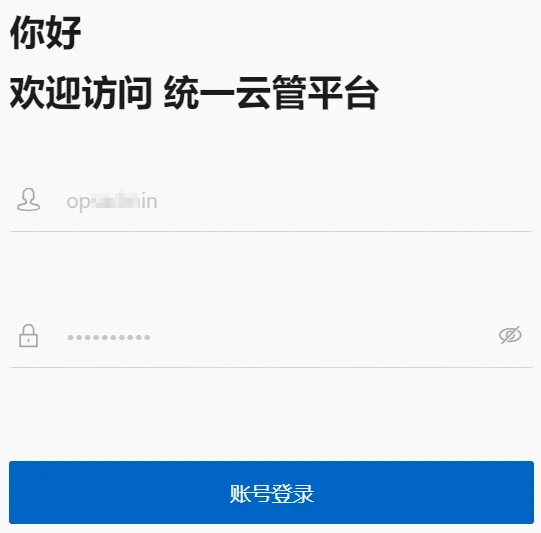

   > 您可以单击页面右上角的下拉按钮来进行语言切换。
   >
   > **说明**

3. 输入正确的用户名及密码。

   > 登录Apsara Uni-manager运维控制台的用户名和密码请从部署人员或管理员处获取。
   >
   > **说明**

   首次登录Apsara Uni-manager运维控制台时，需要修改登录用户名的密码，请按照提示完成密码修改。

   为提高安全性，密码必须满足以下要求：

   - 英文大小写字母

   - 阿拉伯数字（0~9）

   - 特殊符号，包括感叹号（！）、at（@）、井号（#）、美元符号（$）、百分号（%）等

   - 密码长度10~20个字符

4. 单击**登录**。

5. 在Apsara Uni-manager运维控制台的顶部菜单栏单击**运维**。在左侧导航栏单击**产品运维管理 > 产品列表**，单击**数据库服务**区域中的**DRDS管家**。

<a id="section-3"></a>

# 3.产品架构

<a id="section-3-1"></a>

## 3.1. 系统架构

本文介绍PolarDB-X的系统组成及PolarDB-X运维管理系统支持的主要功能，帮助您快速了解PolarDB-X的系统模块之间的协作关系。

**系统架构图**

PolarDB-X的系统架构如下图所示：

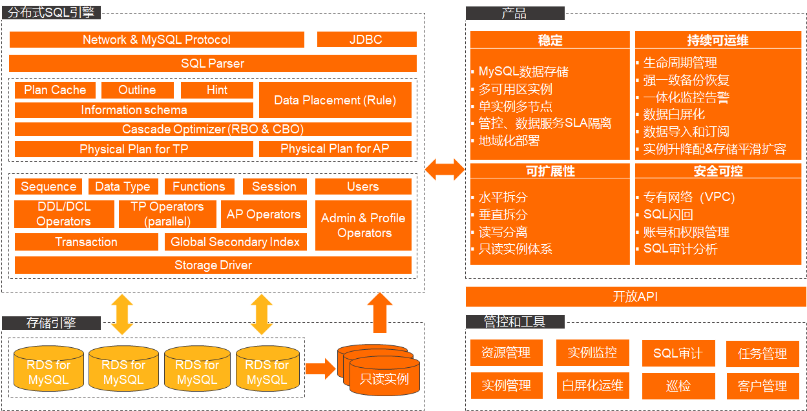

**功能**

PolarDB-X运维管理系统支持的主要功能如下表所示：

**功能名称**

**具体功能**

**说明**

创建PolarDB-X实例。

> 由于使用PolarDB-X运维管理系统创建实例
>
> **说明**

创建实例

> 时需要指定多项参数，容易出错，建议您在云原生分布式数据库控制台创建实例，详细信息，请参见创建实例。

在PolarDB-X实例的使用过程中，您可以根据需求动态地升级或降级实例的配置规格。

> 由于使用PolarDB-X运维管理系统对实例进
>
> **说明**

实例变配

> 行变配操作时需要指定多项参数，容易出错，建议您在云原生分布式数据库控制台创建实例，详细信息，请参见<strong>《云原生分布式数据库PolarDB-X》</strong>《用户指南》中变更配置章节。

释放实例

释放PolarDB-X实例。

对PolarDB-X实例进行**切换可用区**、**切换网络**、**锁定**、**解锁**、**重**

实例操作

**启**、**释放**、**diff**、**升级**、**原位升级**、**回滚**操作。

实例管理

实例信息查询，包含如下几个方面：

- 实例查询

- 实例详情

  查询PolarDB-X实例的详细信息，例如实例的网络类型、节点规

- 节点管理

  格和域名资源等。

- DB管理

- VIP管理

- DNS管理

实例监控，包含如下几个方面：

- 引擎监控

  在PolarDB-X实例的运行过程中，您可以对实例的引擎、数据库

- DB监控

  的运行情况、实例资源的使用情况等进行监控。

- 资源监控

- 实时监控

  查看PolarDB-X中任务运行的详细信息，例如任务状态、子任务

任务管理

任务管理

数量等。

库存管理，包含如下几个方面：

查看库存相关信息，例如库存使用情况、版本分布情况、规格、

- 库存大盘

  PolarDB-X实例使用的库存版本信息等。

- 库存列表

  查看PolarDB-X负载均衡实例的详细信息，您还可以为

VIP管理

PolarDB-X实例创建和删除负载均衡实例。

资源管理

域名管理，包含如下几

为PolarDB-X实例创建域名信息，删除PolarDB-X实例的域名

个方面：

信息和查看PolarDB-X实例的域名信息。

- 创建域名

  > 由于在创建和释放PolarDB-X实例的过程
  >
  > **说明**

- 删除域名

  > 中，DRDS Manager会自动管理PolarDB-X实例的域名信

- 变更域名的目标IP

  > 息，所以不推荐您手动变更PolarDB-X实例的域名信息。

- 查询域名

Worker管理

查看PolarDB-X Server的状态。

操作审计管理

查看指定用户在DRDS Manager上的操作记录。

数据系统元数据管理，包含如下几个方面：

管理数据系统的元数据信息。

系统管理

- regionInfo管理

  > 建议您不要修改数据系统的云数据信息，如
  >
  > **说明**

- bidRegion管理

  > 果需要修改，请联系阿里云技术支持。

- aliaccount管理

- slbinfo管理

<a id="section-3-2"></a>

## 3.2. 部署架构

本文介绍PolarDB-X的部署方式、典型应用场景、功能特性和优势，帮助您快速了解PolarDB-X。

**部署架构图**

PolarDB-X的部署架构如下图所示：

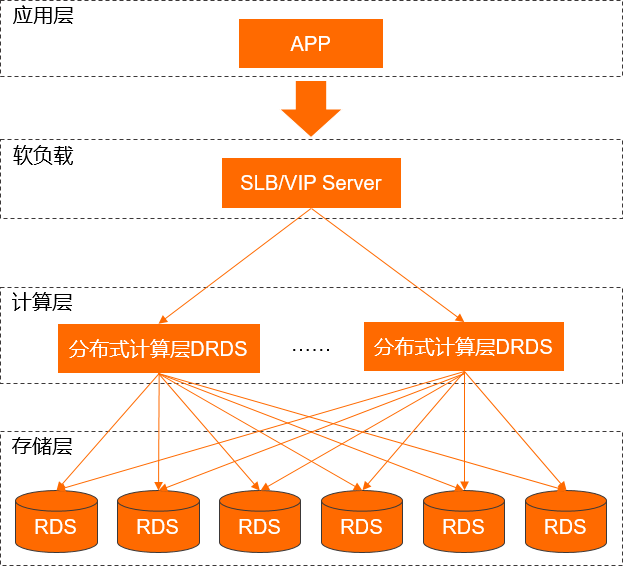

**应用场景**

PolarDB-X典型的应用场景有如下几个方面：

- 高并发在线业务，例如电商、金融、O2O、零售等。

- 海量数据存储和实时写入业务，例如日志、操作行为、交易记录等类型数据。

- 单表数据量过大，查询效率差，吞吐能力下降的业务场景。

**功能特性**

PolarDB-X的功能如下：

- 水平横向扩展

- 分布式事务支持

- 全剧唯一数字序列

- 全局二级索引

- 金融级三副本的可靠存储

- MySQL协议兼容

**产品优势**

相对于其他分布式关系型数据库，PolarDB-X具有如下优势：

- 热点扩容、分区键范围查询，毫秒级响应。

- 中等复杂度查询，带分区键的关联、聚合等。

- 数据比较均匀，无明显热点。

<a id="section-3-3"></a>

## 3.3. 组件架构

本文介绍PolarDB-X的组件组成，帮助您了解PolarDB-X组件之间的关系。

**组件架构图**

PolarDB-X的组件架构如下图所示：

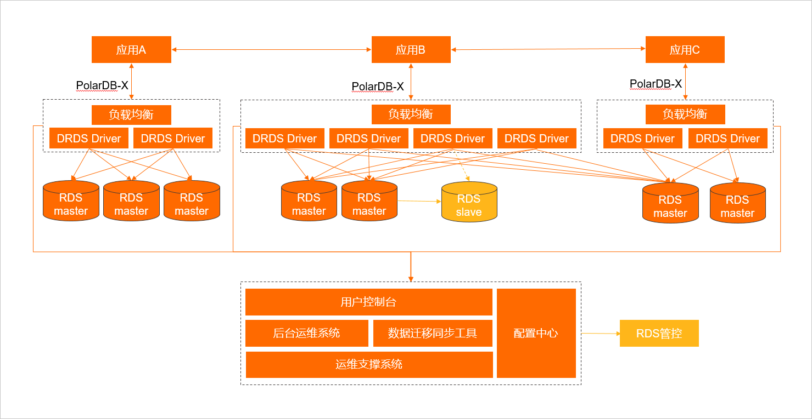

**组件说明**

PolarDB-X的组件及组件功能如下：

| 组件名称 | 说明 |
| --- | --- |
| 用户控制台（PolarDB-X Console） | PolarDB-X的用户控制台。主要面向业务DBA，按照用户个人资源和操作，提供实例管理、库表管理、读写分离配置、平滑扩容、监控展现和IP白名单等功能。 |
| 后台运维系统（DRDS Manager） | PolarDB-X的后台运维系统。主要面向全局运维和业务DBA，提供所有PolarDB-X的资源管理和系统监控，主要功能包含如下两个方面：<br>• RDS实例依赖的所有资源管理，包含虚拟机、负载均衡和域名等资源。<br>• PolarDB-X实例状态监控，包含QPS、活跃线程、连接数、各节点网络IO、各节点CPU占用等指标。 |
| DRDS Server | PolarDB-X的服务层，由多个服务节点组成服务集群。提供分布式数据库服务，包含读写分离、SQL路由执行、结果合并、动态数据库配置和全局唯一ID服务等功能。 |
| 负载均衡 | PolarDB-X的负载均衡器，一般为VIPServer。由于PolarDB-X计算节点无状态，负载均衡器用于分配请求至PolarDB-X节点。 |
| 运维支撑系统（Rtools） | PolarDB-X的运维支撑系统。支持进行数据库配置、读写权重、连接参数、库表拓扑和拆分规则等管理。 |
| 配置中心（Diamond） | PolarDB-X的配置中心。是负责PolarDB-X配置存储和管理的系统，提供配置存储、查询和通知功能，例如存储数据源数据、拆分规则、PolarDB-X开关等配置。 |
| 数据迁移同步系统 | PolarDB-X的数据迁移同步工具，为精卫数据同步服务。核心能力包含全量数据迁移和增量数据同步，扩展功能包含数据平滑导入、平滑扩容和全局二级索引能力。<br>说明精卫数据同步服务需要ZooKeeper和DRDS tools提供支撑。 |

<a id="section-3-4"></a>

## 3.4. 服务角色列表

本文介绍PolarDB-X的Project、集群、服务和服务角色，方便运维人员了解PolarDB-X的服务角色及其提供的功能。

PolarDB-X的服务角色如下：

<table>
  <tr>
    <th>Project</th>
    <th>集群</th>
    <th>服务</th>
    <th>服务角色</th>
    <th>说明</th>
  </tr>
  <tr>
    <td rowspan="6">drds</td>
    <td rowspan="6">BasicClus ter</td>
    <td rowspan="6">drds-console</td>
    <td>DrdsConsole#</td>
    <td>PolarDB-X用户控制台，面向用户。提供实例管理、实例变配、实例释放、DB管理、表管理、拆分工具、备份恢复、小表广播、SQL闪回、表回收站、读写分离配置、平滑扩容和IP白名单等功能。</td>
  </tr>
  <tr>
    <td>DrdsManager#</td>
    <td>PolarDB-X的后台运维系统，面向运维人员。提供实例管理、任务管理、资源管理和系统管理功能。运维系统包含以下三种基础角色：<br>• DrdsManager系统管理员：赋予此角色的用户可以正常使用DRDS管家的所有功能；<br>• DrdsManager集群管理员：赋予此角色的用户拥有DRDS管家中实例管理、资源管理、系统管理中部分菜单的读写权限；<br>• DrdsManager普通用户：赋予此角色的用户仅拥有DRDS管家中实例管理和资源管理中部分菜单的只读权限。</td>
  </tr>
  <tr>
    <td>DrdsJingweiConsole#</td>
    <td>精卫，数据迁移服务。PolarDB-X的如下功能依赖于精卫。<br>• 平滑扩容<br>• 拆分工具<br>• 备份恢复<br>• 小表广播<br>• SQL闪回精卫系统包含以下两种基础角色：<br>• jingwei-admin：赋予此角色的用户可以正常使用精卫系统的所有功能；<br>• jingwei-develop：赋予此角色的用户拥有精卫系统的只读权限。</td>
  </tr>
  <tr>
    <td>Rtools#</td>
    <td>PolarDB-X的运维支撑系统。用于查询配置中心（Diamond）上的数据。</td>
  </tr>
  <tr>
    <td>ServiceTest#</td>
    <td>检查服务。用于检查PolarDB-X依赖的服务的健康情况。</td>
  </tr>
  <tr>
    <td>DrdsLogger#</td>
    <td>日志采集的组件。用于采集SQL审计、慢SQL等信息。</td>
  </tr>
</table>

<a id="section-4"></a>

# 4.创建只读用户

本文介绍了创建DRDS管家和精卫系统只读用户的方法。

1. 登录Apsara Uni-manager运维控制台。

2. 右上方菜单单击**配置**。

3. 左侧菜单选择**系统配置 > 角色管理**。

4. 单击**增加**。

5. 输入以下参数，创建新角色，赋予角色精卫和DRDS管家的只读权限。

   <table>
     <tr>
       <th width="90">参数名</th>
       <th>参数说明</th>
     </tr>
     <tr>
       <td>角色名</td>
       <td>待创建的角色名。示例：drdstest。</td>
     </tr>
     <tr>
       <td>角色描述</td>
       <td>待创建角色的描述。示例：精卫和DRDS管家只读账号。</td>
     </tr>
     <tr>
       <td>基础角色</td>
       <td>同时勾选以下两种基础角色：<br>• DRDS-Manage普通用户：获取DRDS管家的只读权限。<br>• jingwei-develop：获取精卫系统的只读权限。</td>
     </tr>
     <tr>
       <td>菜单</td>
       <td>添加以上两个角色时，会自动勾选菜单，此处仅需勾选首页菜单。</td>
     </tr>
   </table>

6. 输入完成后，单击**确定**，完成角色创建。

7. 左侧菜单中选择**系统配置 > 用户管理**。

8. 单击**增加**。

9. 输入以下参数，创建用户。

   | 参数名 | 参数说明 |
   | --- | --- |
   | 用户名 | 待创建的用户名，示例：drdstest。 |
   | 密码/再次确认密码 | 输入用户名对应的密码。 |
   | 登录策略 | 使用默认登录策略default_rule。 |
   | 角色 | 选择之前创建的角色drdstest。 |
   | 部门 | 输入所属部门信息。 |

0. 单击下方**确定**。

1. 退出当前账号，使用新创建的drdstest用户名登录Apsara Uni-manager运维控制台。

2. 分别登录DRDS管家和精卫系统，发现当前用户仅拥有只读权限。

<a id="section-5"></a>

# 5.实例管理

<a id="section-5-1"></a>

## 5.1. 实例查询

在**实例管理**页面可以根据实例的实例ID、aliUid、Bid以及实例状态对实例进行查询。

**操作步骤**

1. 登录PolarDB-X运维管理系统。

2. 单击左侧导航栏的**实例管理**。

3. 在**实例管理**页面的搜索栏输入查询参数。

4. 点击搜索栏右侧的**查询**。

   图 1. 查询实例

   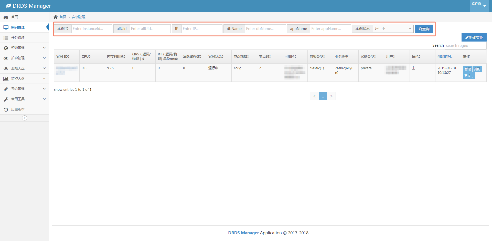

<a id="section-5-2"></a>

## 5.2. 实例操作

在**实例管理**页面可以对实例进行管理、变配、切换可用区等更多操作。

**操作步骤**

1. 登录PolarDB-X运维管理系统。

2. 单击左侧导航栏的**实例管理**。

3. 在实例列表右侧的**操作**栏可进行如下操作。

   <ol type="i">

   <li>

   单击**管理**，可打开该实例的管理页面。

   </li>

   <li>

   单击**变配**，可打开实例变配页面。

   </li>

   <li>

   单击**更多**，可以多实例进行**切换可用区**、**切换网络**、**锁定**、**解锁**、**重启**、**释放**、**对比**、**升级**、**原位升级**、**回滚**操作。

   图 1. 操作实例

   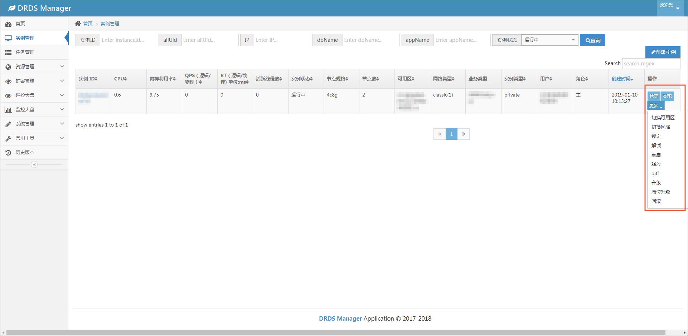

   </li>

   </ol>

<a id="section-5-3"></a>

## 5.3. 创建实例

通过PolarDB-X运维管理也可以创建实例，此处仅做介绍，不建议用户直接使用。

**背景信息**

当执行实例创建时，DRDS Manager将会根据所选的节点数、业务类型、Region、可用区和机器类型这几个属性，去库存中选取满足条件的库存节点来组建实例。

> 通过DRDS Manager创建实例时需要指定多项参数，较容易出错。非特殊情况下，不建议
>
> **重要**
>
> 使用运维系统进行创建实例。

**操作步骤**

1. 登录PolarDB-X运维管理系统。

2. 单击左侧导航栏的**实例管理**。

3. 在**实例管理**页面单击右上的**创建实例**。

4. 将**实例管理**页面拉到最底部，可看见创建实例对话框，如下图所示。

   图 1. 创建实例

   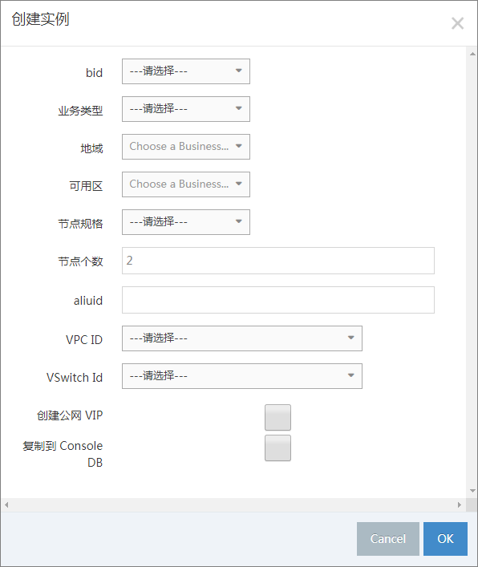

   各个选项及含义如下所示。

   表 1. 创建实例配置说明

   <table>
     <tr>
       <th width="110">配置</th>
       <th>说明</th>
     </tr>
     <tr>
       <td>bid</td>
       <td>实例的业务ID。</td>
     </tr>
     <tr>
       <td>业务类型</td>
       <td>实例业务类型。</td>
     </tr>
     <tr>
       <td>地域</td>
       <td>实例所属的地域。</td>
     </tr>
     <tr>
       <td>可用区</td>
       <td>实例所属的可用区。</td>
     </tr>
     <tr>
       <td>节点规格</td>
       <td>实例节点的硬件规格。</td>
     </tr>
     <tr>
       <td>节点个数</td>
       <td>实例的机器数目，必填。一个PolarDB-X实例本质就是一个PolarDB-X集群，节点数目是指集群中的机器数。</td>
     </tr>
     <tr>
       <td>aliuid</td>
       <td>实例的所属UID，必填。在专有云下，UID可能是自定义的ID。</td>
     </tr>
     <tr>
       <td>VPC ID</td>
       <td>如果是vpc环境，需要有VPC ID。</td>
     </tr>
     <tr>
       <td>VSwitch id</td>
       <td>如果是VPC环境，需要添加VSwitch ID。</td>
     </tr>
   </table>

   以创建一个4C4G规格的专享实例为例。

   - 输入节点数：2

   - 勾选选项：创建公网VIP、立即初始化

   - 地域：cn-nm-zero-d01

   - 选择可用区：cn-nm-zero-amtest35001-a

   - 业务类型：aliyun

   - bid：26842

5. 单击**OK**。

<a id="section-5-4"></a>

## 5.4. 释放实例

当实例不再需要时，可以将实例释放掉以优化资源配置。本节介绍了通过PolarDB-X运维管理释放实例的方法。

**背景信息**

在**实例管理**页面，可以对PolarDB-X实例进行释放。当实例被释放后，实例原本所占用的所有资源（包括库存资源、VIP资源与域名资源），都将被释放。

> 若释放已完成初始化的实例，将同时释放实例使用的各项资源，并且不可恢复，请谨慎操
>
> **重要**
>
> 作。

**操作步骤**

1. 登录PolarDB-X运维管理系统。

2. 单击左侧导航栏的**实例管理**。

3. 在实例列表中，找到待释放的实例，单击操作列中的**更多 > 释放**。

   图 1. 释放实例

   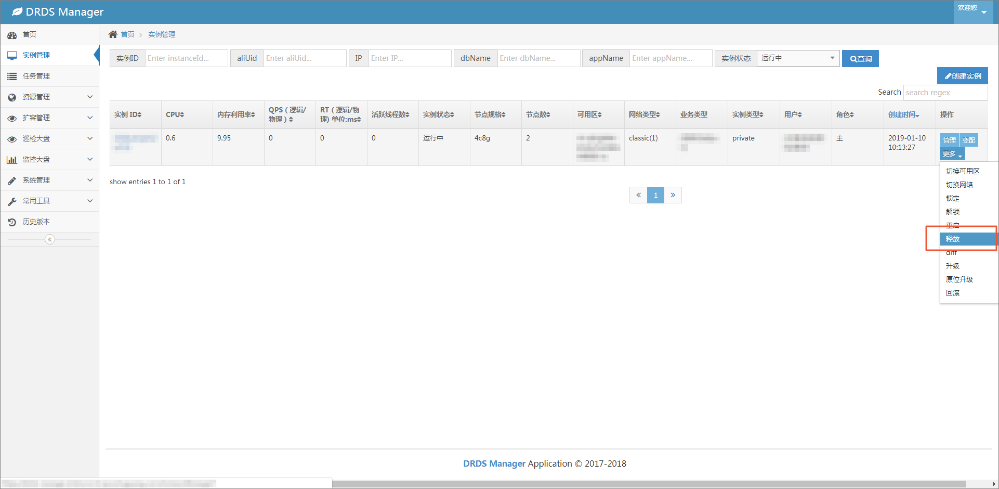

4. 在弹出的提示框中单击**OK**。

<a id="section-5-5"></a>

## 5.5. 实例变配

实例变配功能可以动态地按需升级（或降级）一个PolarDB-X实例的配置规格，而整个变更过程实例不需要重启。

> 非特殊情况下，强烈推荐通过PolarDB-X控制台进行PolarDB-X实例的变配操
>
> **重要**
>
> 作；PolarDB-X运维管理系统的变配操作为了方便运维与增加灵活性，操作时需要输入多项参数，较容易出错，不建议使用。

1. 登录PolarDB-X运维管理系统。

2. 单击左侧导航栏的**实例管理**。

3. 在实例列表中，找到待变更的实例，单击操作列中的**变配**。

4. 在**变配**对话框选择**指定节点数量**或**指定节点ID**进行变配操作。变配参数如下所示。

   图 1. 变配

   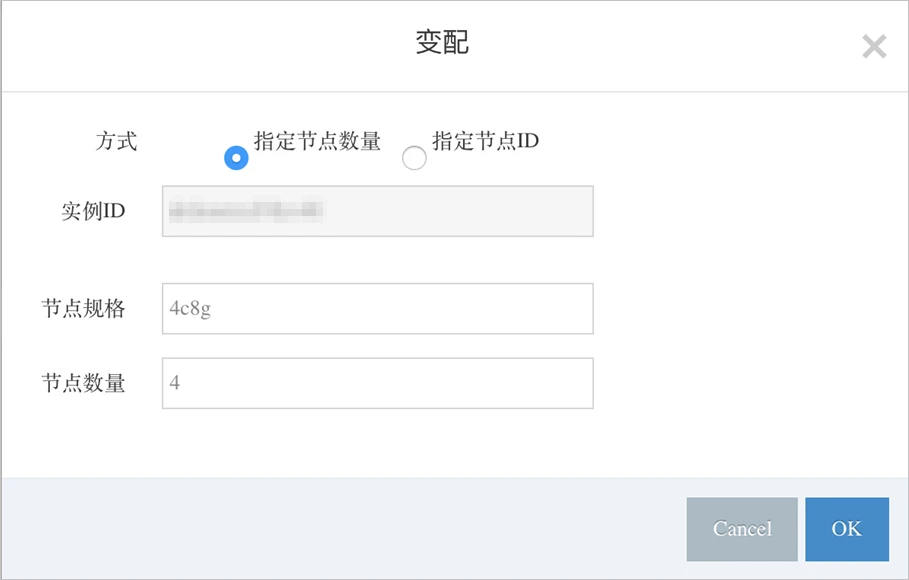

   表 1. 变配配置说明

   <table>
     <tr>
       <th width="89">配置</th>
       <th>说明</th>
     </tr>
     <tr>
       <td>方式</td>
       <td>可以在指定节点数量和指定节点ID两种方式中选择一项进行变配。<br>• 指定节点数量：可指定需要修改的节点数量，从而改变实例配置。<br>• 指定节点ID：可以根据节点ID减少节点，或新增ID为指定值的节点。</td>
     </tr>
     <tr>
       <td>实例ID</td>
       <td>当前实例的ID，无法修改。</td>
     </tr>
     <tr>
       <td>节点规格</td>
       <td>输入节点的硬件规格。</td>
     </tr>
     <tr>
       <td>节点数量</td>
       <td>可修改当前的节点数量。</td>
     </tr>
     <tr>
       <td>操作</td>
       <td>可选择增加还是减少节点。</td>
     </tr>
     <tr>
       <td>节点ID</td>
       <td>指定减少的节点ID或新增的节点ID。</td>
     </tr>
   </table>

<a id="section-5-6"></a>

## 5.6. 实例详情

通过**实例详情**，可以查看实例的**实例信息**和**网络信息**。

**查看实例详情**

1. 登录PolarDB-X运维管理系统。

2. 单击左侧导航栏的**实例管理**。

3. 在**实例管理**页面，定位到目标实例，单击目标**实例ID**。

4. 在**实例详情**页面查看实例信息。

   图 1. 实例详情

   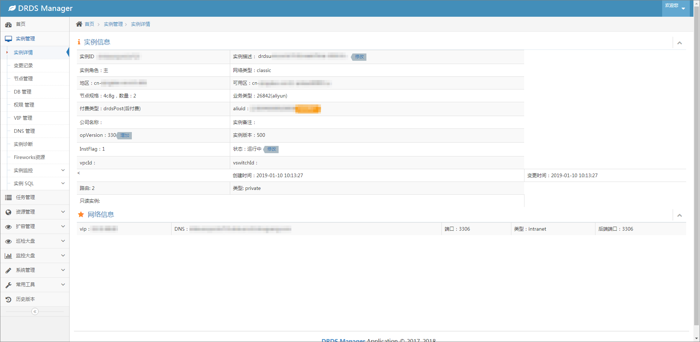

**修改实例状态**

1. 登录PolarDB-X运维管理系统。

2. 单击左侧导航栏的**实例管理**。

3. 在**实例管理**页面，定位到目标实例，单击目标**实例ID**。

4. 在**实例详情**页面，单击**实例信息 > 状态 > 修改**。

5. 单击**实例目标状态**右侧的下拉菜单，选择目标状态。

6. 单击**OK**完成修改。

<a id="section-5-7"></a>

## 5.7. 节点管理

通过节点管理，可以查看并管理当前实例下的节点主机。

**操作步骤**

1. 登录PolarDB-X运维管理系统。

2. 单击左侧导航栏的**实例管理**。

3. 在**实例管理**页面，定位到目标实例，单击目标**实例ID**。

4. 单击左侧导航栏中的**节点管理**

   图 1. 节点管理

   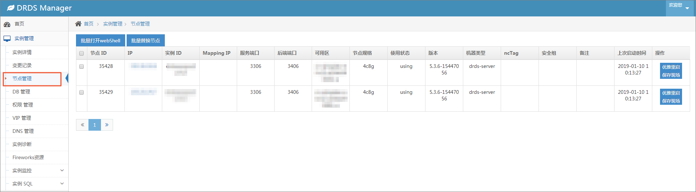

**执行结果**

在**节点管理**页面可查看当前实例下各节点的详细信息，如**节点ID**、**IP**、**服务端口**、**节点规格**等。

如果需要打开节点的webShell，可以选中目标节点，单击节点列表左上的**批量打开webShell**。

<a id="section-5-8"></a>

## 5.8. DB管理

通过实例管理中的DB管理，可以查看并管理当前实例中的数据库。

**进入DB管理**

1. 登录PolarDB-X运维管理系统。

2. 单击左侧导航栏的**实例管理**。

3. 在**实例管理**页面，定位到目标实例，单击目标**实例ID**。

4. 在**实例详情**页面，单击左侧导航菜单的**DB管理**。

<a id="section-5-9"></a>

## 5.9. VIP管理

PolarDB-X实例除了要占用库存资源，还需要占用至少一个负载均衡器资源（VIP资源）。创建PolarDB-X实例时，它所需要的VIP资源也会一同被创建。在实例管理中可以查看并管理当前实例中的VIP资源。

**进入VIP管理**

1. 登录PolarDB-X运维管理系统。

2. 单击左侧导航栏的**实例管理**。

3. 在**实例管理**页面，定位到目标实例，单击目标**实例ID**。

4. 在**实例详情**页面，单击左侧导航菜单的**VIP管理**。

   图 1. VIP管理

   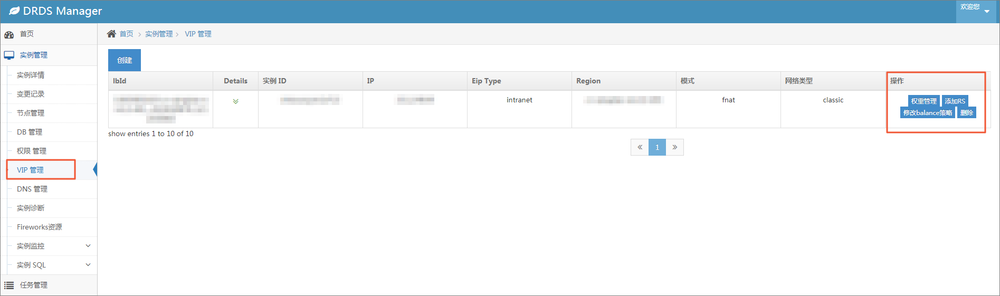

**权重管理**

单击目标VIP右侧操作栏的**权重管理**，可调整每个节点（RS）在负载均衡中的权重，也可以摘除节点。

图 2. 权重管理

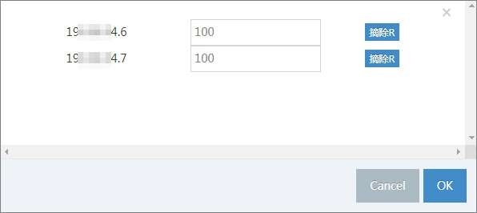

**添加RS**

单击目标VIP右侧操作栏的**添加RS**可以输入IP和权重添加一个节点。

**删除VIP**

单击目标VIP右侧操作栏的**删除**可以删除当前VIP。

**查看VIP详情**

单击VIP列表中Details栏的  图标，可以查看VIP的详细信息。

图 3. VIP详情

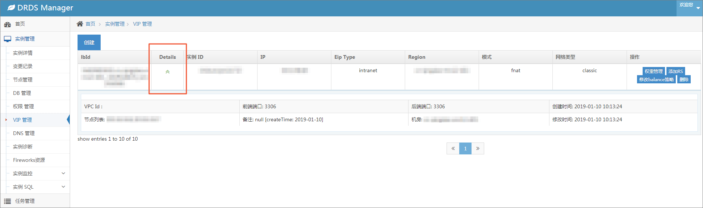

**创建VIP**

选择**资源管理 > VIP管理**，单击VIP管理列表左上角的**创建**，手动创建VIP。

<a id="section-5-10"></a>

## 5.10. DNS管理

PolarDB-X实例所使用的域名资源由PolarDB-X运维管理进行统一管理。在实例管理中可以查看并管理当前实例中的DNS资源。

**进入DNS管理**

1. 登录PolarDB-X运维管理系统。

2. 单击左侧导航栏的**实例管理**。

3. 在**实例管理**页面，定位到目标实例，单击目标**实例ID**。

4. 在**实例详情**页面，单击左侧导航菜单的**DNS管理**。

   图 1. DNS管理

   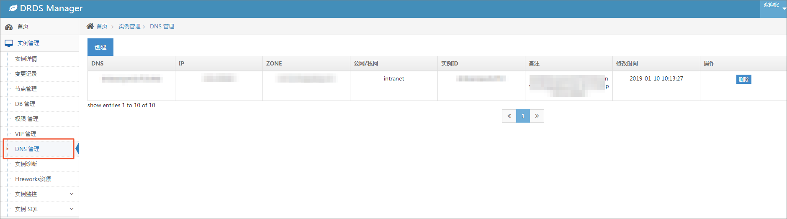

**创建DNS**

1. 打开DNS管理页面。

2. 在**DNS管理**页面，单击DNS列表左上的**创建**，即可创建新的DNS。

   图 2. 创建DNS

   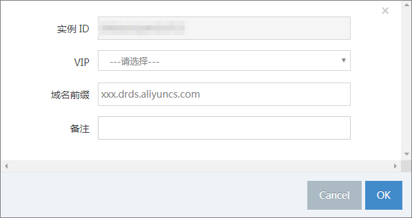

更多DNS相关操作请参见DNS管理。

<a id="section-5-11"></a>

## 5.11. 实例监控

<a id="section-5-11-1"></a>

### 5.11.1. 概述

PolarDB-X运维管理系统对实例提供对角度监控，本文介绍监控的四种分类和一些基本概念。

**监控类型**

- 引擎监控：PolarDB-X整体监控（可监控节点级别的数据）。

- DB监控：PolarDB-X数据库相关监控（可监控数据库关联的RDS）。

- 资源监控：PolarDB-X节点主机监控数据（可监控节点级别数据）。

- 实时监控：实时监控PolarDB-X节点当前数据。

**基本概念**

表 1. 实例监控基本概念

| 名词 | 说明 | 注意 |
| --- | --- | --- |
| 逻辑SQL | 由应用端发送到PolarDB-X的SQL称为逻辑SQL。 | - |
| 物理SQL | 由PolarDB-X对逻辑SQL进行解析之后发送到MySQL/RDS上执行的SQL称为物理SQL。 | 逻辑SQL和物理SQL有可能不同。逻辑SQL和物理SQL可能是一对一关系或者一对多关系。 |
| 每秒查询数（QPS） | 一个统计周期内，平均每秒钟PolarDB-X执行的逻辑SQL数。 | 注意，并非事务数。大多数控制语句如COMMIT操作，SET语句等，不计入其中。 |
| 平均响应时间（RT） | 一个统计周期内，PolarDB-X执行逻辑SQL 的平均响应时间，单位为毫秒。一个SQL的响应时间计算方式为：（PolarDB-X写出结果集的最后一个包的时间点）-（PolarDB-X接收到SQL的时间点） | - |
| 物理每秒查询数（物理QPS） | 一个统计周期内，平均每秒钟PolarDB-X在MySQL/RDS上执行的物理SQL数。 | - |
| 物理平均响应时间（物理RT） | 一个统计周期内，PolarDB-X在MySQL/RDS上执行物理SQL的平均响应时间， 单位为毫秒。一个物理SQL的响应时间计算方式为：（PolarDB-X收到MySQL/RDS返回结果集的时间点）-（PolarDB-X开始获取MySQL/ RDS连接的时间点）。 | 这中间包含了与MySQL/RDS建立连接或者从连接池获取连接的时间、网络传输的时间、MySQL/RDS执行SQL的时间。 |
| 连接数 | 应用与PolarDB-X所建立的连接数。 | 注意，并非PolarDB-X与MySQL/RDS建立的连接数。 |
| 接收流量 | 应用发往PolarDB-X的SQL的网络流量。 | 注意，此数据与PolarDB-X同MySQL/RDS 的交互无关。 |
| 发送流量 | PolarDB-X发往应用的结果集的网络流量。 | 注意，此数据与PolarDB-X同MySQL/RDS 的交互无关。 |
| ThreadRu nning（活跃线程 数） | PolarDB-X正在运行的线程数，一般用于表示PolarDB-X的负载情况。 | - |
| Global | 一个PolarDB-X实例中所有库的监控数据的累加。 | - |
| 内存利用率 | PolarDB-X Server进程的JVM内存利用率。 | - |
| 总内存利用率 | PolarDB-X Server所在机器的内存利用率。 | 目前仅当PolarDB-X Server部署在ECS中才有此指标，一般公共云才这样部署。 |
| CPU利用率 | PolarDB-X Server所在机器的CPU利用率。 | 目前仅当PolarDB-X Server部署在ECS中才有此指标，一般公共云才这样部署。 |
| 系统Load | PolarDB-X Server所在机器的Load情况。 | 目前仅当PolarDB-X Server部署在ECS中才有此指标，一般公共云才这样部署。 |
| 服务端口 | PolarDB-X Server对外提供MySQL协议的端口。 | 一般情况为3306，但是当一台机器部署多个PolarDB-X节点时（多为物理机），端口会有所变化。 |
| 管理端口 | PolarDB-X Server提供管理接口的端口。 | 一般情况为服务端口+100。 |
| 节点状态 | PolarDB-X Server节点的运行状态，分为两种：<br>• 连接正常<br>• 连接异常 | 一般用于判断节点是否发生故障。 |
| 版本号 | PolarDB-X Server节点的版本号，与<code> version () </code>函数返回的结果一致。 | - |
| 启动时间 | PolarDB-X Server节点启动的时间。 | - |
| 运行时间 | PolarDB-X Server节点从上次启动的持续运行时间。 | - |
| 总内存 | PolarDB-X Server节点JVM内存的最大值。 | - |
| 使用内存 | PolarDB-X Server节点已使用的JVM内存。 | - |

<a id="section-5-11-2"></a>

### 5.11.2. 引擎监控

引擎监控展示实例引擎的运行情况。

**背景信息**

引擎监控的对象包括引擎流量、耗时、实时连接、网络状况、慢SQL、线程、Error。

**操作步骤**

1. 登录PolarDB-X运维管理系统。

2. 单击左侧导航栏的**实例管理**。

3. 在**实例管理**页面，定位到目标实例，单击目标**实例ID**。

4. 在**实例详情**页面，单击左侧导航栏的**实例监控**，在下拉菜单中选择**引擎监控**。

<a id="section-5-11-3"></a>

### 5.11.3. DB监控

DB监控展示实例中数据库的运行情况。

引擎监控的对象包括读写QPS、读写RT等。监控项的说明请参见下表。

表 1. DB监控参数

| 参数 | 说明 |
| --- | --- |
| 读QPS | DB每秒读的次数 |
| 写QPS | DB每秒写的次数 |
| 读RT | DB平均每次读耗时 |
| 写RT | DB平均每次写耗时 |
| SQL-ROWS | 每秒影响行数 |
| SQL-SQLLENGTH | 每秒SQL长度 |
| SQL-SQLERRORCOUNT | 每秒SQL错误数 |
| SQL-CONNERRORCOUNT | 每秒SQL连接错误数 |

**进入DB监控**

1. 登录PolarDB-X运维管理系统。

2. 单击左侧导航栏的**实例管理**。

3. 在**实例管理**页面，定位到目标实例，单击目标**实例ID**。

4. 在**实例详情**页面，单击左侧导航栏的**实例监控**，在下拉菜单中选择**DB监控**。

<a id="section-5-11-4"></a>

### 5.11.4. 资源监控

资源监控展示实例中的资源使用情况。

引擎监控的对象包括读写QPS、读写RT等。监控项的说明请参见下表。

表 1. 资源监控参数

| 参数 | 说明 |
| --- | --- |
| CPU | PolarDB-X集群节点平均CPU |
| OLD区监控 | PolarDB-X集群OLD区监控信息 |
| LOAD | PolarDB-X集群节点平均LOAD |
| 磁盘监控 | PolarDB-X集群磁盘信息 |
| 内存监控 | PolarDB-X集群内存平均值 |
| FGC监控 | PolarDB-X集群FullGC信息 |
| 网络监控 | 集群NET_IN和NET_OUT监控 |
| 重传监控 | 集群网络重传监控信息 |

1. 登录PolarDB-X运维管理系统。

2. 单击左侧导航栏的**实例管理**。

3. 在**实例管理**页面，定位到目标实例，单击目标**实例ID**。

4. 在**实例详情**页面，单击左侧导航菜单的**实例监控**，在下拉菜单中选择**资源监控**。

   图 1. 资源监控

   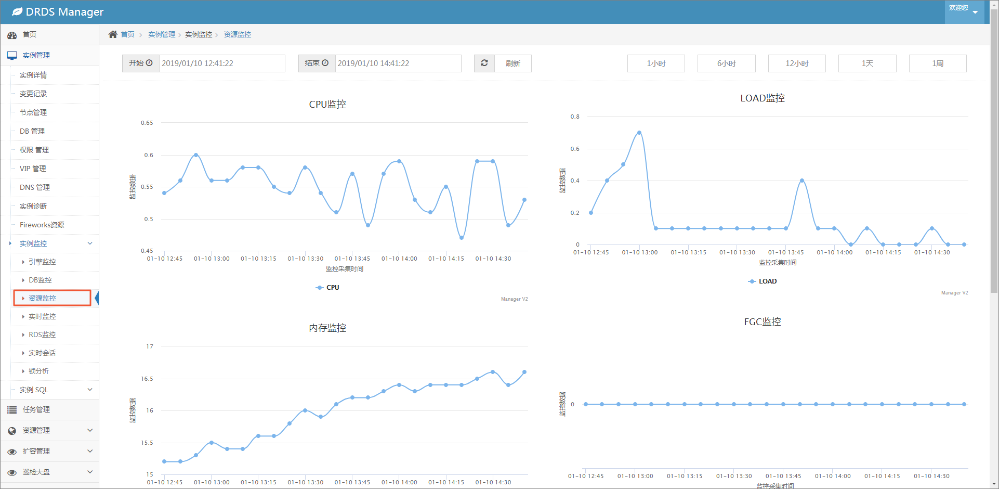

<a id="section-5-11-5"></a>

### 5.11.5. 实时监控

实时监控展示实例中的节点服务器运行状况。

**背景信息**

实时监控的对象包括节点的逻辑QPS、物理QPS、逻辑RT、物理RT等。监控信息每5秒刷新一次。若刷新停止，手动刷新浏览器页面即可恢复。

**操作步骤**

1. 登录PolarDB-X运维管理系统。

2. 单击左侧导航栏的**实例管理**。

3. 在**实例管理**页面，定位到目标实例，单击目标**实例ID**。

4. 在**实例详情**页面，单击左侧导航菜单的**实例监控**，在下拉菜单中选择**实时监控**。

   图 1. 实时监控

   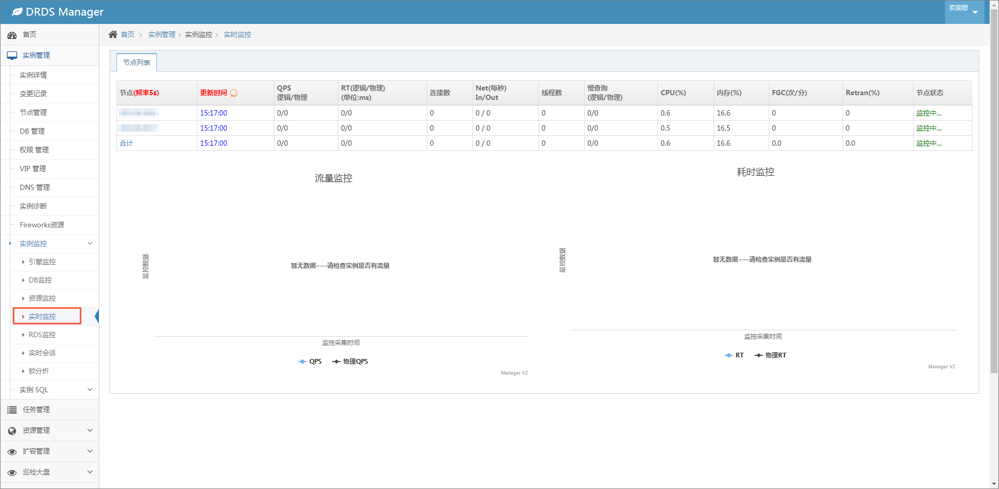

<a id="section-6"></a>

# 6.任务管理

在任务管理页面可以查看和管理当前存在的任务。

**背景信息**

PolarDB-X的部分任务执行流程较长，比如创建实例、创建数据库等操作，任务耗时较多，为了方便用户查看任务状态，PolarDB-X运维管理提供了任务管理模块，来方便查询比较耗时的任务流程状态。

**查看任务详情**

您可以查看到任务运行的详细信息，帮助运维管理人员掌握任务运行状况、排查任务问题。详情页面的最下方可查看每个子任务的运行状况。

1. 登录PolarDB-X运维管理系统。

2. 单击左侧导航栏的**任务管理 > 全部的任务**。

3. 在**全部的任务**页面，定位到目标任务，单击目标任务右侧的**详情**。

   图 1. 子任务详情

   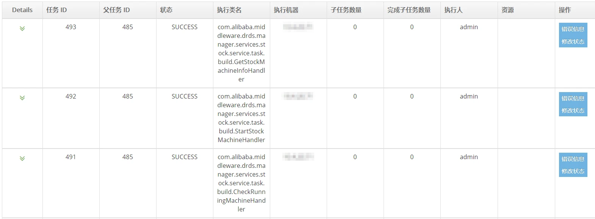

**取消任务**

1. 登录PolarDB-X运维管理系统。

2. 单击左侧导航栏的**任务管理 > 运行中的任务**。

3. 在**运行中的任务**页面，定位到目标任务，单击目标任务右侧的**取消**。

4. 在弹出的提示框单击**确认**，可以停止当前任务。

**继续任务**

当某项任务因超时等原因执行失败时，你可以参考如下操作继续任务。

1. 登录PolarDB-X运维管理系统。

2. 单击左侧导航栏的**任务管理 > 全部的任务**。

3. 在**全部的任务**页面，定位到目标任务，单击目标任务右侧的**更多 > 继续执行**。

**修改任务状态**

> 该操作请在阿里云工程师指导下进行。
>
> **重要**

1. 登录PolarDB-X运维管理系统。

2. 单击左侧导航栏的**任务管理 > 全部的任务**。

3. 在**全部的任务**页面，定位到目标任务，单击目标任务右侧的**更多 > 修改状态**，则可改变当前任务的显示状态。。

<a id="section-7"></a>

# 7.资源管理

<a id="section-7-1"></a>

## 7.1. 库存管理

<a id="section-7-1-1"></a>

### 7.1.1. 概述

本节简单介绍了PolarDB-X运维管理中的库存管理功能。

库存是PolarDB-X的核心资源，是PolarDB-X最小的服务单元，它本质是部署在机器（可能是虚拟机，也可能是物理机）上的PolarDB-X Server进程。一个实例至少使用一个库存节点来组建PolarDB-X集群；每个节点对应一个容器。

库存管理包括以下功能：

- 库存大盘

- 库存列表

- 库存配置

- 库存发布

- 库存检测

其中库存发布与库存检测需在阿里云工程师协助下进行，此处不做介绍。

<a id="section-7-1-2"></a>

### 7.1.2. 库存大盘

库存大盘使用表格方式展示当前环境库存版本相关信息。

**操作步骤**

1. 登录PolarDB-X运维管理系统。

2. 单击左侧导航栏中**资源管理 > 库存管理 > 库存大盘**。在**库存大盘**页面可以查看库存使用情况、版本分布情况、规格、库存水位等信息。

<a id="section-7-1-3"></a>

### 7.1.3. 库存列表

库存列表主要列出了当前PolarDB-X实例使用的库存版本信息。

**背景信息**

库存管理页面使用表格方式展示实例的相关信息，表格中每一条记录表示一个库存。表格中，每个库存都有多个属性，它们对应的含义如下所示。

表 1. 库存列表参数

| 选项名称 | 说明 |
| --- | --- |
| 节点ID | 库存节点的唯一标识。 |
| 实例ID | 库存节点所属PolarDB-X实例 ID，如果不属于某个实例该字段为空。 |
| Host | 库存节点的 IP。 |
| 可用区(azoneId) | 库存节点所属可用区。 |
| 节点规格 | 库存节点规格 |
| 使用状态 | 当前状态，using 标识使用中，也就是属于某个PolarDB-X实例。 |
| 版本 | 库存节点的版本信息。 |
| 机器类型 | 库存节点的机器类型，专有云一般为 DOCKER。 |
| 机器ID | 库存节点所属的机器 ID。 |
| 操作 | 可以对库存节点做的操作，这些操作请在阿里云工程师指导下进行。 |

**打开库存列表页面**

1. 登录PolarDB-X运维管理系统。

2. 单击左侧导航栏中**资源管理 > 库存管理 > 库存列表**。

**其它功能**

- 节点查询：

  在库存列表中的搜索栏可以根据特定条件查询相应的节点。

- 批量打开 shell：

  选中目标节点，点击列表右上的**批量打开 shell**即可通过webshell登录节点主机。

- 创建机器：

  专有云下不可用。

- 库存回收：

  由DRDS Manager完成，无需运维工程师关注。

- 库存创建：

  后台创建库存节点，一般情况下不需要使用。在专有云中创建库存节点，根据实际环境的网络类型选择**是**VPC或者**否**。如果选择创建 VPC 库存节点，那么还需要选择 VPC 和 VSwitch 等信息。

<a id="section-7-1-4"></a>

### 7.1.4. 库存配置

库存配置主要展示当前环境支持的库存规格等信息，一般情况下无需要管理和运维操作，由DRDS Manager自动维护。

<a id="section-7-2"></a>

## 7.2. VIP管理

PolarDB-X实例除了要占用库存资源，还需要占用至少一个负载均衡器资源（VIP资源）。创建PolarDB-X实例时，它所需要的VIP资源也会一同被创建。在**资源管理 > VIP管理**中可以查看并管理所有实例的VIP资源。

**背景信息**

**进入VIP管理**

1. 登录PolarDB-X运维管理系统。

2. 在左侧导航栏中单击**资源管理 > VIP管理**。

   图 1. VIP管理

   

**VIP属性说明**

VIP有多个属性，其各个属性的含义如下表所示。

> 该表格仅提供了VIP列表和创建VIP对话框的主要参数说明。创建VIP的操作一般不需要用户
>
> **说明**
>
> 的运维人员手动进行，因此对创建VIP过程中的配置属性不进行详细介绍。

表 1. VIP属性表

<table>
  <tr>
    <th width="109">属性</th>
    <th>说明</th>
  </tr>
  <tr>
    <td>lbId</td>
    <td>负载均衡实例ID，是VIP的唯一标识，VIP的管理都基于这个标识。</td>
  </tr>
  <tr>
    <td>Details</td>
    <td>单击即可查看详细信息。</td>
  </tr>
  <tr>
    <td>实例ID</td>
    <td>VIP所对应的PolarDB-X实例ID。</td>
  </tr>
  <tr>
    <td>IP</td>
    <td>VIP的IP，可供用户直接访问的IP。</td>
  </tr>
  <tr>
    <td>Eip Type</td>
    <td>VIP所对应的PolarDB-X实例的EIP类型。</td>
  </tr>
  <tr>
    <td>模式</td>
    <td>负载均衡实例的数据转发模式，包含以下选项：<br>• Nat：仅支持后端机器是物理机，不支持VPC。<br>• Fnat：全转发模式，目前默认使用转发模式，支持VPC。</td>
  </tr>
  <tr>
    <td>网络类型</td>
    <td>VIP的网络类型，包含以下选项：<br>• Classic：即经典网络下的VIP。<br>• VPC：即VPC网络下的VIP。</td>
  </tr>
  <tr>
    <td>后端端口</td>
    <td>VIP的后端端口，对于PolarDB-X Server来说，这个端口就是Server机器的服务端口。</td>
  </tr>
  <tr>
    <td>前端端口</td>
    <td>VIP的前端端口，供用户访问的端口。每个VIP都有一组前端端口与后端端口，VIP会将前端端口的数据转发到后端端口。</td>
  </tr>
  <tr>
    <td>Region</td>
    <td>负载均衡服务集群所属的Region，意义与实例的Region相同。</td>
  </tr>
  <tr>
    <td>专有网络ID</td>
    <td>VIP所在的VPC实例的ID，该字段只支持VPC 网络类型。</td>
  </tr>
  <tr>
    <td>备注</td>
    <td>VIP的备注信息。</td>
  </tr>
</table>

**查询VIP**

VIP管理列表每一行表示一个正在被实例使用的VIP，通过列表上方的搜索栏可以查询满足相应条件的VIP。

**权重管理**

VIP下面通常会挂载至少2台PolarDB-X Server节点，以做负载均衡。当个别PolarDB-X Server节点出现负载不均衡的时候，VIP管理可以针对单个VIP，手动设置VIP PolarDB-X Server节点的流量权重，改变各PolarDB-X Server节点的负载情况。

单击目标VIP右侧操作栏的**权重管理**，可调整每个节点（RS）在负载均衡中的权重，也可以摘除节点。

图 2. 权重管理


**添加RS**

单击目标VIP右侧**操作**栏的**添加RS**可以输入IP和权重添加一个节点。

**删除VIP**

当PolarDB-X实例被释放时，它所使用的所有VIP资源也会被一同释放。非特殊情况，不需要手动释放VIP，但VIP管理支持手动释放VIP资源。

单击目标VIP右侧**操作**栏的**删除**可以删除当前VIP。

**查看VIP详情**

单击VIP列表中**Details**栏的  可以查看VIP的详细信息。

图 3. VIP详情


**创建VIP**

创建PolarDB-X实例时，DRDS Manager会自动为实例创建VIP，一般不需要运维人员手动创建VIP。

单击VIP管理列表左上的**创建**，即可创建VIP。相关属性请参见VIP属性表。

<a id="section-7-3"></a>

## 7.3. DNS管理

<a id="section-7-3-1"></a>

### 7.3.1. 创建域名

通常情况下，域名资源会在实例的创建与释放过程中，自动地被DRDS Manager进行管理，而无须手动进行域名创建。非特殊情况，不推荐手动变更PolarDB-X的域名信息。

**背景信息**

**操作步骤**

1. 登录PolarDB-X运维管理系统。

2. 在左侧导航栏中单击**资源管理 > DNS管理**。

3. 在DNS管理页面，单击DNS列表左上的**创建**，即可新增域名。相关参数请参见下表。表 1. 创建DNS设置说明

   <table>
     <tr>
       <th width="89">设置</th>
       <th>说明</th>
     </tr>
     <tr>
       <td>实例ID</td>
       <td>使用该域名的PolarDB-X实例ID。</td>
     </tr>
     <tr>
       <td>VIP</td>
       <td>填入实例ID后该处可以选择实例使用的VIP。</td>
     </tr>
     <tr>
       <td>VIP类型</td>
       <td>VIP的网络类型，该属性也会影响下面自动生成的域名。</td>
     </tr>
     <tr>
       <td>域名前缀</td>
       <td>输入不含空格和只含数字字母的字符串，通常是输如实例ID（这样可以通 过域名就可以区分实例）。域名的最终取值是采用前缀+统一后缀方式生成。DRDS Manager域名默认统一后缀是drds.aliyuncs.com，例如，假如输入的前缀是drds01233456789ab，那么实例drds01233456789ab的域名将是drds01233456789ab.drds.aliyuncs.com。</td>
     </tr>
     <tr>
       <td>备注</td>
       <td>域名的备注信息。</td>
     </tr>
   </table>

<a id="section-7-3-2"></a>

### 7.3.2. 查询域名

PolarDB-X实例所使用的域名资源由DRDS Manager进行统一管理。在DNS管理页面中，实例的DNS信息以表格形式展示，表格中每一条记录都表示一个正在被使用的域名。您可以在表格中查找符合要求的域名。

**操作步骤**

1. 登录PolarDB-X运维管理系统。

2. 在左侧导航栏中单击**资源管理 > DNS管理**。

3. 在**DNS管理**页面右上方的搜索栏中，输入相应的属性，并按下回车键进行域名查询。

   每个域名的各个属性含义如下表所示。

   表 1. DNS属性表

   <table>
     <tr>
       <th width="95">属性</th>
       <th>说明</th>
     </tr>
     <tr>
       <td>DNS</td>
       <td>完整的可供访问的域名。</td>
     </tr>
     <tr>
       <td>IP</td>
       <td>所绑定的IP。通常为PolarDB-X实例的VIP。</td>
     </tr>
     <tr>
       <td>公网/私网</td>
       <td>标识IP的网络类型，分为公网与私网。VPC类型的VIP在这里也归为私网。</td>
     </tr>
     <tr>
       <td>实例ID</td>
       <td>使用该域名的PolarDB-X实例ID。</td>
     </tr>
     <tr>
       <td>修改时间</td>
       <td>修改该域名的时间。</td>
     </tr>
   </table>

   > DRDS Manager目前只在公共云和专有云的输出方式支持域名管理。
   >
   > **说明**

<a id="section-7-3-3"></a>

### 7.3.3. 删除域名

在**DNS管理**页面可以删除域名。当域名被删除后，域名的解析将会失效。

**操作步骤**

1. 登录PolarDB-X运维管理系统。

2. 在左侧导航栏中单击**资源管理 > DNS管理**。

3. 在**DNS管理**页面，单击目标域名右侧**操作**列中的**删除**。

4. 在弹出窗口中，单击**OK**。

<a id="section-7-3-4"></a>

### 7.3.4. 变更域名的目标IP

目前域名管理没有自动更换域名所绑定的目标IP的功能。若要实现这个功能，需要手动操作完成， 通过先删除域名后新建域名的方式进行。

**操作步骤**

1. 登录PolarDB-X运维管理系统。

2. 在左侧导航栏中单击**资源管理 > DNS管理**。

3. 删除目标域名。删除域名请参考删除域名。

4. 手动添加新地域名，域名前缀需要和以前的完全相同（这样保证新生成的域名和原来完全相同），但是目标IP需要改为新的IP，这样同样的域名就会被解释为新IP。创建域名请参考创建域名。

<a id="section-7-4"></a>

## 7.4. VPC管理

**添加IP映射**

如果发现某个服务（例如PolarDB-X控制台、PolarDB-X Server或者精卫）无法访问VPC内的资源，可以手工把此服务的IP地址添加到VPC的地址池里，以便此服务IP能访问VPC的Mapping IP 。

1. 登录PolarDB-X运维管理系统。

2. 

3. 在**VPC管理**目录下，单击**建立映射IP**。

4. 在弹出的对话框中设置映射规则的属性，详情请参见下表。表 1. IP映射设置说明

   | 设置 | 说明 |
   | --- | --- |
   | 地域 | 下拉选择地域。 |
   | VPC ID | 默认选择【空】。 |
   | 实例类型 | 默认选择【anode】。 |
   | 实例IP | 节点IP。 |

5. 单击**OK**完成操作。

   > VPC是公有云功能，专有云目前不支持。本指南只介绍如何如何添加IP映射。
   >
   > **说明**

<a id="section-7-5"></a>

## 7.5. Worker管理

PolarDB-X Worker在专有云中的主要作用是监控Server状态。

PolarDB-X Worker 是 DRDS Manager 对 PolarDB-X Server 进行管理的组件，在专有云中无需对PolarDB-X Worker 进行特殊的管理，一般情况下只需要在 PolarDB-X Worker 页面查看 PolarDB-X Worker 是否正常。

图 1. Worker管理

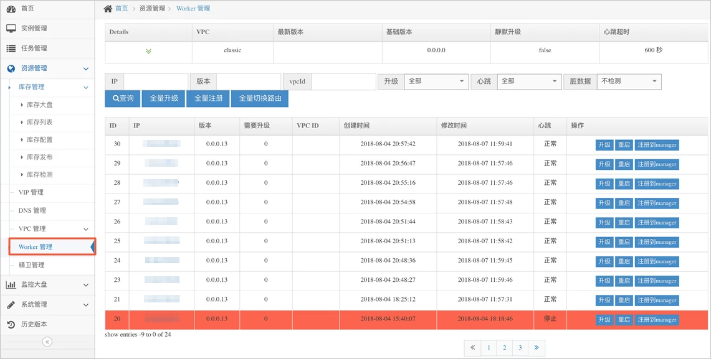

在PolarDB-X Worker管理中如果发现异常状态（比如停止状态），请在PolarDB-X研发人员的指导下登录到PolarDB-X Worker的机器进行问题排查。

<a id="section-8"></a>

# 8.系统管理

<a id="section-8-1"></a>

## 8.1. 参数配置

参数管理用于查看系统参数和修改参数，专有云中的参数在环境初始化时已经进行了相应的配置，一般无需修改。

如需确认需要修改参数，请向阿里云提交工单，由阿里云工程师协助进行。

如果使用5.3 的PolarDB-X Server 则需要配置newest.rpm.use.corona , 将first和second配置为true。环境信息设置为对应环境，详情请咨询阿里云工程师。

图 1. 参数配置

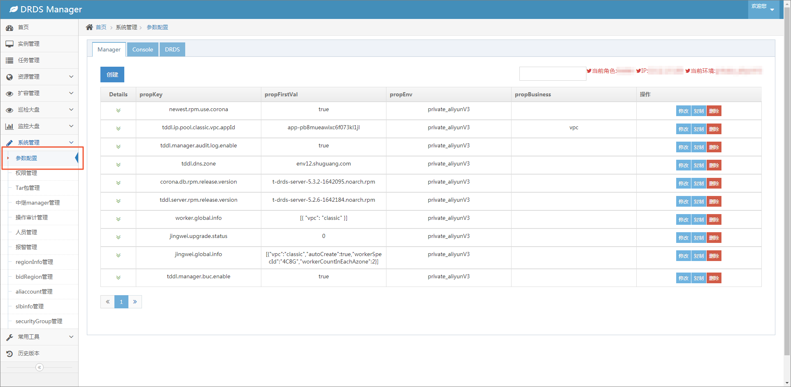

<a id="section-8-2"></a>

## 8.2. 权限管理

权限管理用于编辑、查看用户角色权限，专有云中的参数在环境初始化时已经进行了相应的配置，不需要也不建议进行手动修改。

图 1. 权限管理

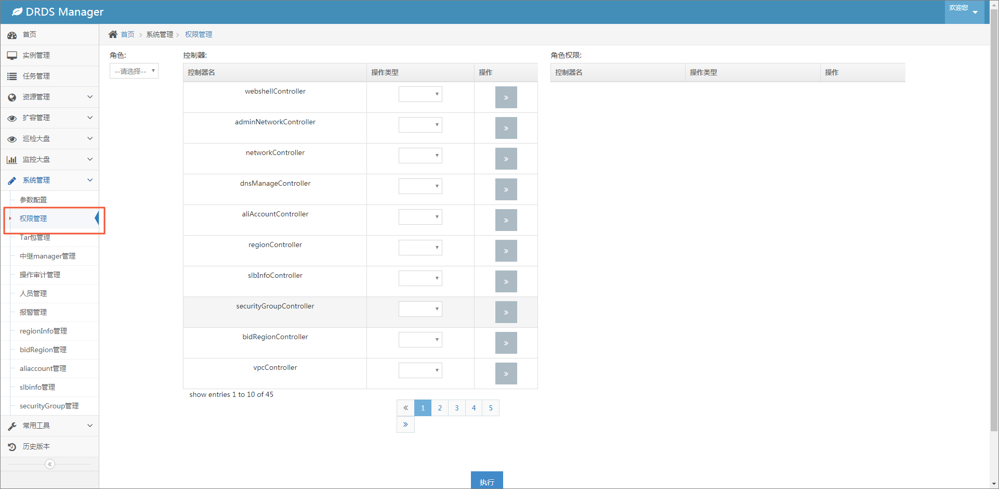

<a id="section-8-3"></a>

## 8.3. 操作审计管理

操作审计管理会记录每个用户在DRDS Manager上的所有操作记录，包括操作所在主机IP、请求参数、返回结果内容、返回结果等。

图 1. 操作审计管理

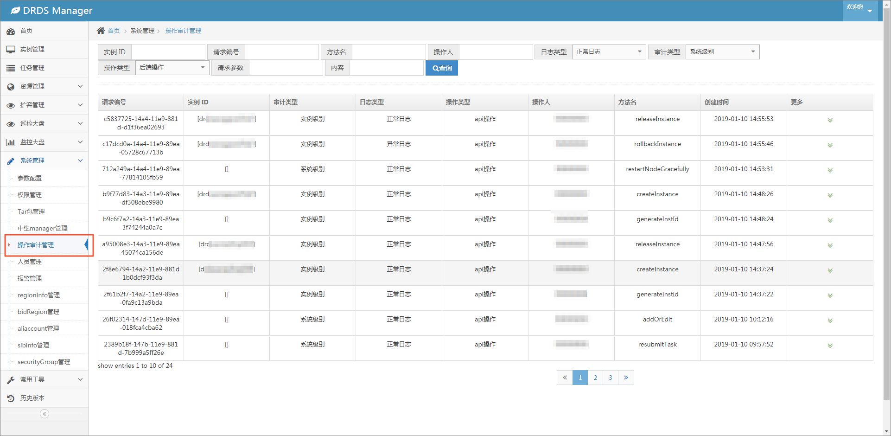

1. 登录PolarDB-X运维管理系统。

2. 在左侧导航栏中单击**系统管理 > 操作审计管理**。

3. 在**操作审计管理**页面的搜索栏，输入**请求编号**、**方法名**、**操作人**、**日志类型**或请求**内容**。

4. 单击右侧的**查询**即可对操作记录进行查询。

<a id="section-8-4"></a>

## 8.4. 人员管理

人员管理用于配置运维人员，进行运维人员排班。专有云环境不需要进行配置。

<a id="section-8-5"></a>

## 8.5. regionInfo管理

regionInfo管理模块属于数据系统元数据的管理，不建议用户手动修改。如需修改，请在阿里云工程师的指导下进行。

图 1. regionInfo管理

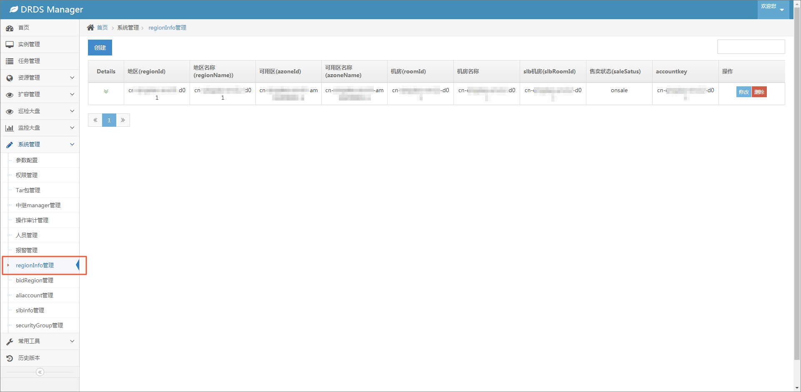

<a id="section-8-6"></a>

## 8.6. bidRegion管理

bidRegion管理模块属于数据系统元数据的管理，不建议用户手动修改。如需修改，请在阿里云工程师的指导下进行。

图 1. bidRegion管理

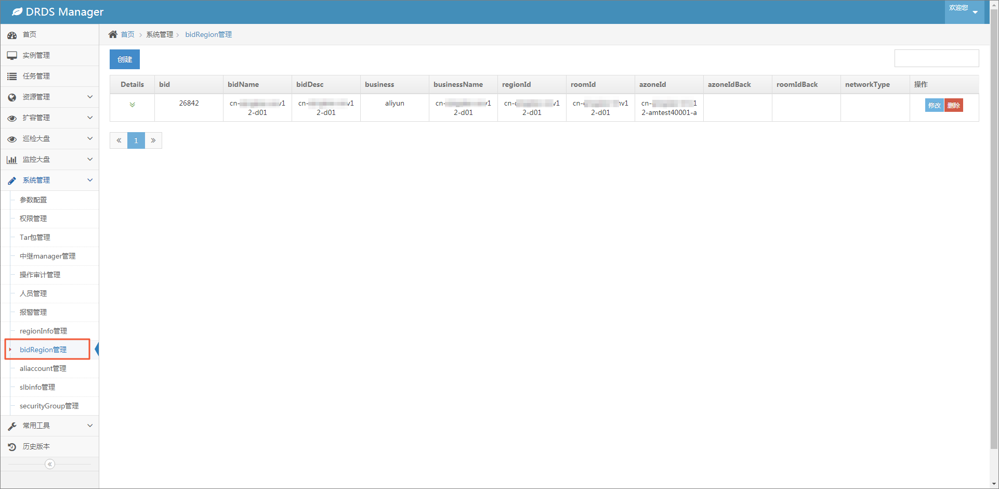

<a id="section-8-7"></a>

## 8.7. aliaccount管理

aliaccount管理模块属于数据系统元数据的管理，不建议用户手动修改。如需修改，请在阿里云工程师的指导下进行。

图 1. aliaccount管理

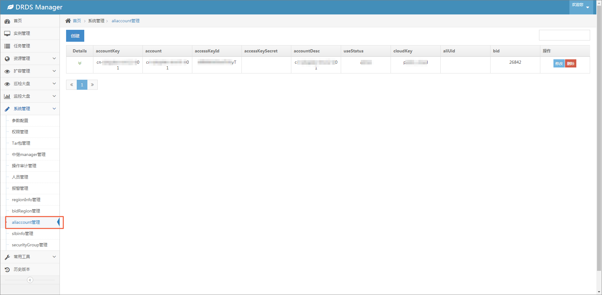

<a id="section-8-8"></a>

## 8.8. slbinfo管理

slbinfo管理模块属于数据系统元数据的管理，不建议用户手动修改。如需修改，请在阿里云工程师的指导下进行。

图 1. slbinfo管理

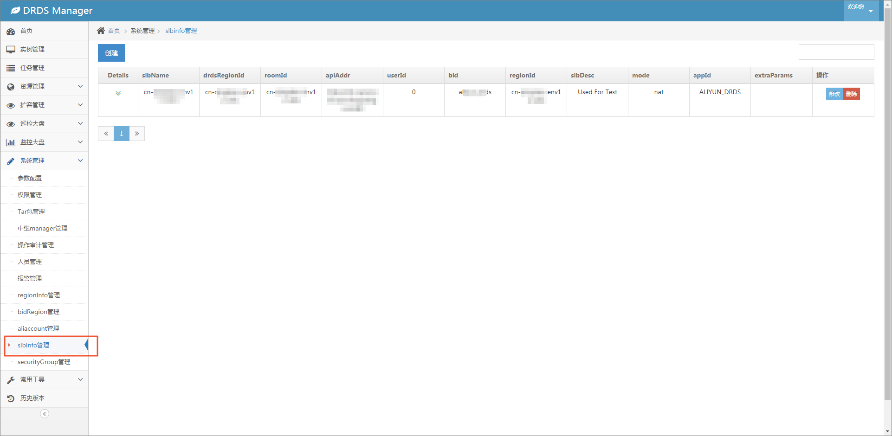

<a id="section-9"></a>

# 9.升级方案（升级至5.3及以上版本）

<a id="section-9-1"></a>

## 9.1. 预拉取升级镜像

**背景信息**

由于各个node上没有server的镜像，当创建实例、变配或者恢复实例时，需要新拉取镜像，镜像包很大导致拉取时间较长，因此PolarDB-X提供了预拉取镜像的方案。

5.4.9版本的镜像对应的commit如下所示：

corona-server的待升级镜像commit：

```text
"9489f80ce04b86a7f03751f7c1cbc7b9b69d77ce9c997267747f84b0c8260c1d"
```

jingwei-worker待升级镜像commit：

```text
"ec8c7d4baa9ca23f9fbc8bcc86225553afeb7ce29d00d6c148233dc4c817420f"
```

**操作步骤**

1. 登录天基平台。

   <ol type="i">

   <li>

   登录Apsara Uni-manager运维控制台，请参见登录PolarDB-X运维管理系统。

   </li>

   <li>

   在Apsara Uni-manager运维控制台的顶部菜单栏单击**运维**。在左侧导航栏单击**产品运维管理 > 产品列表**，在**云平台运维**区域单击**天基**。

   </li>

   </ol>

2. 在顶部菜单栏选择**运维 > 集群运维**，搜索集群名称。

3. 单击集群名称，在**服务管理**页签中找到**kube-base**。

4. 在操作列单击**详情**，单击**kube-base.ControlPlane#**。

5. 找到对应的机器名称，在操作列单击**终端**，进入终端。

6. 记录镜像仓库地址和宿主机列表。

   <ol type="i">

   <li>

   执行以下命令，查看并记录所有的corona-server节点和他们所在的node信息。

   ```bash
   kubectl get pods -ndrds -o wide |grep drds-server
   ```

   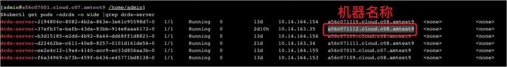

   </li>

   <li>

   使用SSH命令进入机器，登录密码请联系阿里云技术支持获取。

   </li>

   <li>

   执行以下命令，获取拉取镜像需要的仓库信息。

   ```bash
   docker images|grep corona-server
   ```

   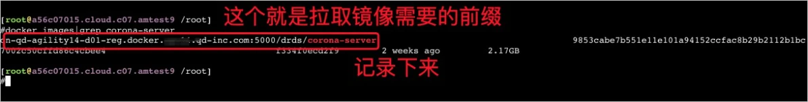

   </li>

   <li>

   执行以下命令，查看并记录带worker标签的机器，即jingwei-worker的信息。

   ```bash
   kubectl get nodes |grep worker
   ```

   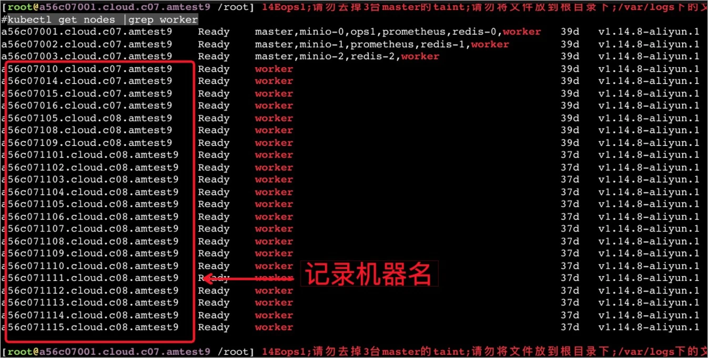

   </li>

   </ol>

7. 拉取镜像。

   <ol type="i">

   <li>

   执行以下命令，进行仓库认证，用户名：ALIYUN，密码：PASSWORD，如果用户名和密码已修改，请联系阿里云技术支持。

   ```bash
   docker login 仓库地址
   ```

   示例如下，实际应用时请注意替换仓库地址和端口号，端口号需要和环境保持一致。

   ```bash
   docker login -u ALIYUN -p PASSWORD cn-neimeng-arm-d01-
   reg.docker.env154.ops.arm.com:80
   ```

   如果登录不成功，请尝试如下命令：

   ```bash
   docker login cn-hangzhou-arm-d01-reg.docker.env51.ops.arm.com
   ```

   </li>

   <li>

   拼接镜像地址。示例：如果corona-server的docker image Id为“9489f80ce04b86a7f03751f7c1cbc7b9b69d77ce9c997267747f84b0c8260c1d”，根据步骤6记录的镜像域名，拼接出的完整镜像地址如下：cn-neimeng-arm-d01-reg.docker.env154.ops.arm.com:80/drds/corona-server:9489f80ce04b86a7f03751f7c1cbc7b9b69d77ce9c997267747f84b0c8260c1d。

   </li>

   <li>

   执行 `docker pull {`镜像地址`}` ，拉取镜像。

   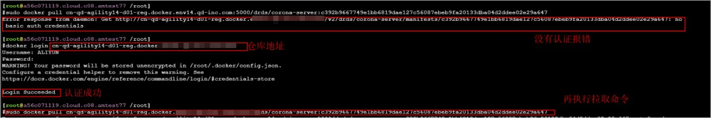

   </li>

   </ol>

   示例如下：

   ```bash
   kubectl get node > machine_name.txt

   pgm -f a.txt "docker login -u ALIYUN -p PASSWORD cn-beijing-gsjpoc-d01-
   reg.docker.ops.js4demo.css.tax:80"

   pgm -f machine_name.txt "docker pull  cn-beijing-gsjpoc-d01-
   reg.docker.ops.js4demo.css.tax:80/drds/corona-
   server:f3d107a9c1d24e673a19a30125c681d6fce60638febdd31e67e4762cc150dc34"
   ```

   等待镜像下载完成即可。

   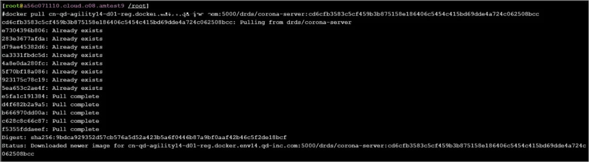

   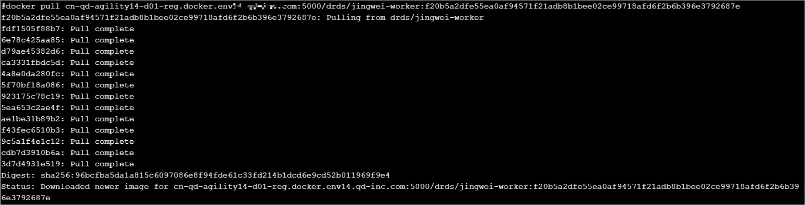

<a id="section-9-2"></a>

## 9.2. 升级5.2.6版本

本文介绍了从5.2.6版本升级至5.3.x版本的方法。

**前提条件**

已拉取需要升级的镜像，详细操作请参见预拉取升级镜像。

**配置参数**

本节介绍了通过配置参数创建5.2.6或5.3.x版本实例的方法。

**操作步骤**

1. 登录DRDS管家。

   <ol type="i">

   <li>

   登录Apsara Uni-manager运维控制台，请参见登录PolarDB-X运维管理系统。

   </li>

   <li>

   在Apsara Uni-manager运维控制台的顶部菜单栏单击**运维**，在左侧导航栏单击**产品运维管理 > 产品列表**。

   </li>

   <li>

   单击**数据库服务**区域中的**DRDS管家**。

   </li>

   </ol>

2. 左侧菜单栏选择**系统管理 > 参数配置**。

   - 配置参数，创建5.2.6版本的实例。

     搜索“tddl.server.rpm.release.version”关键字，单击**修改**，将值改为"t-drds-server-5.2.6-1642184.noarch.rpm"；搜索“newest.rpm.use.corona”关键字，单击**修改**，将值改为"false"，等待3分钟，新建的实例即为5.2.6版本。

   - 配置参数，创建5.3.x版本的实例。

     搜索“newest.rpm.use.corona”关键字，单击**修改**，将值改为true，等待3分钟，新建的实例即为5.3.x版本。

**5.2.6版本升级至5.3.x**

**操作步骤**

1. 在DRDS管家左侧菜单栏选择**系统管理 > 参数配置**。搜索“newest.rpm.use.corona”关键字，单击**修改**，将值改为true，等待3分钟，新建实例即为5.3.x版本。

2. 单击左侧菜单**实例管理**。

3. 找到待升级的实例ID，在操作列选择**更多 > 升级**。

4. 弹出的升级配置内容不需要填，单击**OK**。

5. 单击左侧菜单**任务管理**，查看升级任务状态。

6. 单击左侧菜单**实例管理**，进入实例详情查看节点版本是否升级成功。

   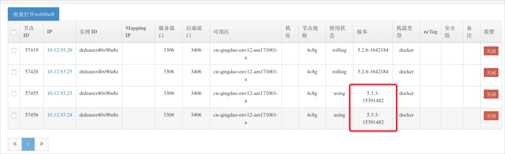

   > 升级完成，原有的5.2.6节点24小时之后会自动回收。
   >
   > **说明**

7. 完成上述操作后，需要修改diamond上的一个配置。在左侧菜单单击**实例管理**，单击升级的实例ID，查看并记录这个实例下所有的数据库对应的app_name，如果有多个，请按照下面的方法将每个app_name设置一遍。

   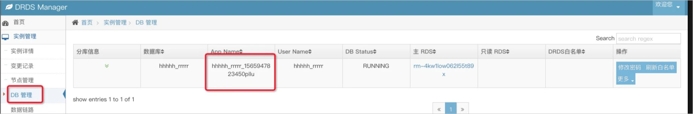

8. 登录diamond，地址为http://xx.xx.xx.xxx/diamond-server，登录名和密码为admin/admin。地址中IP的获取方法如下：

   <ol type="i">

   <li>

   登录Apsara Uni-manager运维控制台，请参见登录PolarDB-X运维管理系统。

   </li>

   <li>

   在Apsara Uni-manager运维控制台的顶部菜单栏单击**运维**。在左侧导航栏单击**产品运维管理 > 产品列表**。

   </li>

   <li>

   在**云平台运维**区域单击**天基**。

   </li>

   <li>

   菜单栏选择**运维 > 集群运维**，project中输入**drds**进行搜索。

   </li>

   <li>

   单击集群名称，在**服务管理**页签中找到**drds-console**。

   </li>

   <li>

   在操作列单击**详情**，单击**DrdsConsole#**。

   </li>

   <li>

   单击**详情**，单击**终端**。

   </li>

   <li>

   执行以下命令。

   ```bash
   docker ps |grep DrdsConsole__.drds-console  #获取容器id
   docker exec -it 容器id bash
   curl http://jmenv.tbsite.net:8080/diamond-server/diamond -s
   ```

   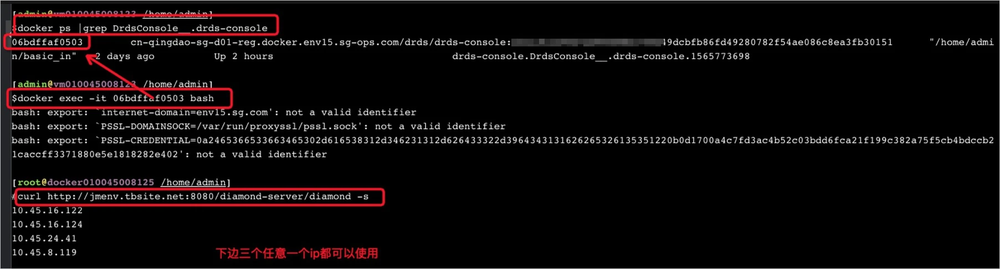

   </li>

   </ol>

9. 在dataId框里输入步骤8记录的App名称，例如“\*hhhhh_rrrrr_1565947823450pllu\*”，单击模糊搜索。

0. 找到.versions后缀的文件，单击**编辑**。

   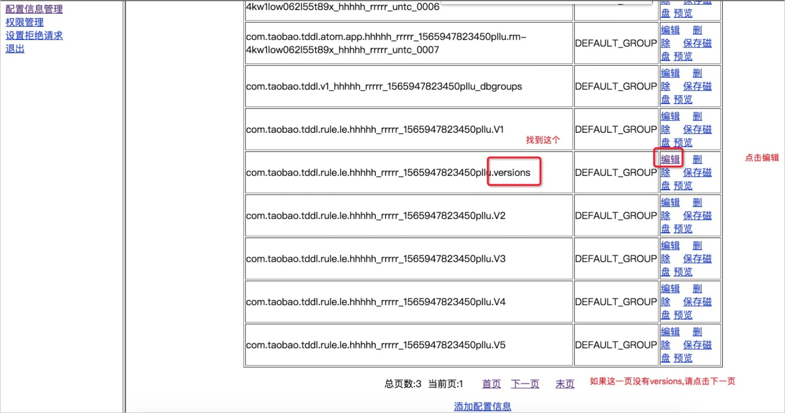

1. 将v25修改为v26，单击**更改**。

   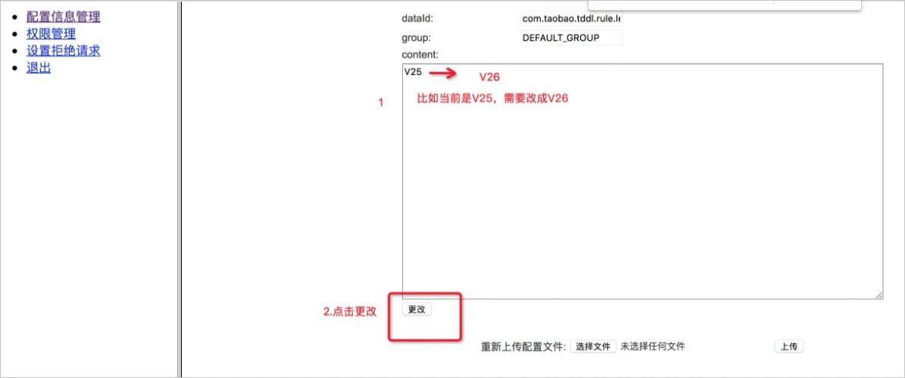

2. 验证小表广播和设置全表扫描是否正常，操作结束。

   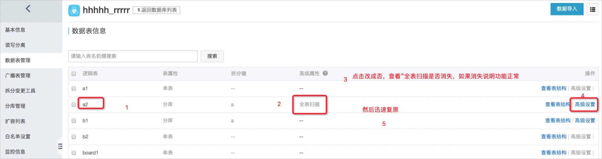

**5.3.x版本降配至5.2.6版本**

> 降配后，所有和精卫相关的功能都不能使用，包括：小表广播，异构索引，平滑扩容，拆
>
> **重要**
>
> 分工具。

**操作步骤**

1. 在DRDS管家左侧菜单栏中选择**系统管理 > 参数配置**。

2. 搜索“tddl.server.rpm.release.version”关键字，单击**修改**，将值改为"t-drds-server-5.2.6-1642184.noarch.rpm"；搜索“newest.rpm.use.corona”关键字，单击**修改**，将值改为"false"，等待3分钟，新建的实例即为5.2.6版本。

3. 左侧菜单栏中单击**实例管理**，输入待升级的实例ID，单击**查询**。

4. 搜索出来待升级的实例ID，选择**更多 > 升级**。

5. 升级配置对话框不用填写，单击**OK**。

6. 左侧菜单栏中单击**任务管理**，查看升级是否完成。

   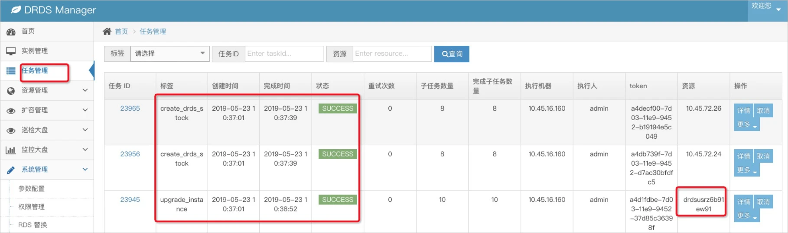

   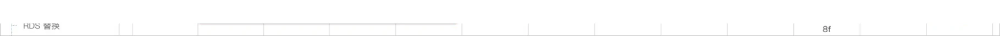

7. 左侧菜单栏中选择**资源管理 > 库存管理 > 库存列表**。

8. 在**实例ID**中输入待升级的实例ID，**节点状态**中输入**rolling**，单击**查询**。

9. 在操作列中单击**修改状态**，将节点状态从“rolling”修改为“toBeRecycle”。

<a id="section-9-3"></a>

## 9.3. 升级5.3.x版本

**前提条件**

已拉取需要升级的镜像，详细操作请参见预拉取升级镜像。

**操作步骤**

1. 在ark机器上确认有最新版本的server镜像。

   > 本文以天基旧版界面为例说明。
   >
   > **说明**

   <ol type="i">

   <li>

   登录Apsara Uni-manager运维控制台，请参见登录PolarDB-X运维管理系统。

   </li>

   <li>

   在Apsara Uni-manager运维控制台的顶部菜单栏单击**运维**。在左侧导航栏单击**产品运维管理 > 产品列表**。

   </li>

   <li>

   在**云平台运维**区域单击**天基**。

   </li>

   <li>

   菜单栏选择**运维 > 集群运维**，Project中输入"drds“进行搜索。

   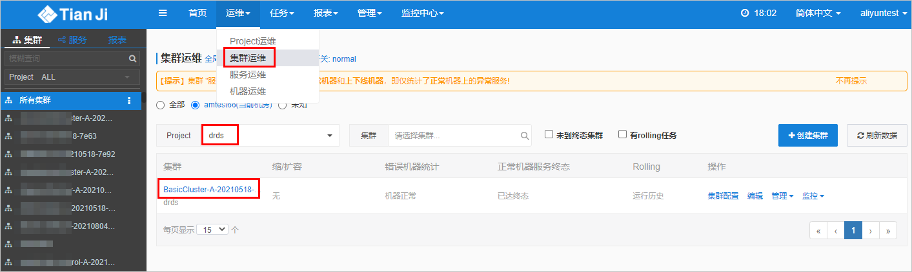

   </li>

   <li>

   单击待升级集群名称，在**服务实例列表**中找到**aliware-ark**并单击**详情**。

   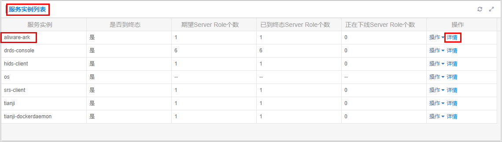

   </li>

   <li>

   在**服务角色列表**ArkAgent#所s对应的**操作**列，单击**详情**。

   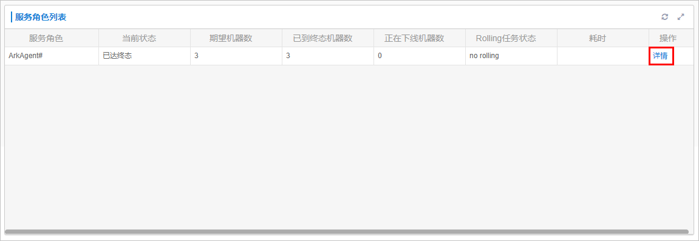

   </li>

   <li>

   在**机器信息**中找到对应机器名，单击**终端**。

   > 实例对应的机器名，可在DRDS管家的**资源管理 > 库存管理 > 库存列表**中通过实例
   >
   > **说明**
   >
   > ID进行搜索获取。

   </li>

   <li>

   输入以下命令，确认最新的server的rpm版本为待升级的版本。

   ```bash
   sudo docker images|grep corona-server
   sudo docker inspect 镜像id|grep RPM #注意将镜像id替换为第⼀条命令查询出来的镜像id
   ```

   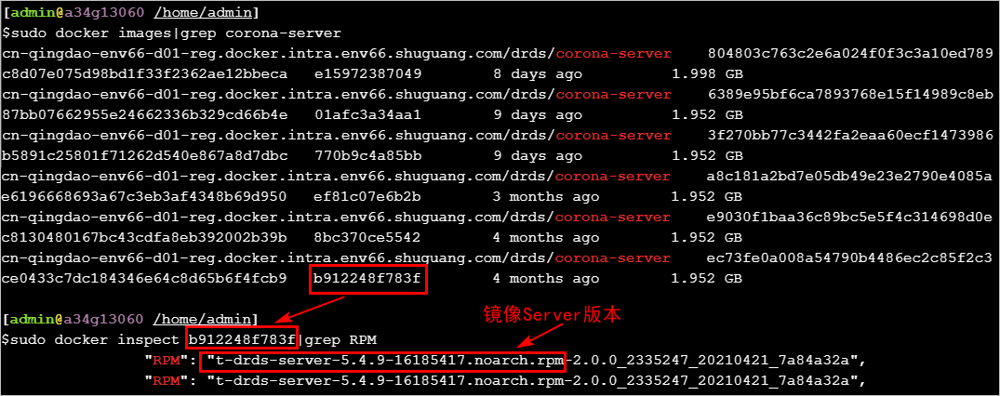

   </li>

   </ol>

2. 登录DRDS管家。

   > 需要有和源实例相同的可用空余资源才能升级。
   >
   > **说明**

   <ol type="i">

   <li>

   登录Apsara Uni-manager运维控制台，请参见登录PolarDB-X运维管理系统。

   </li>

   <li>

   在Apsara Uni-manager运维控制台的顶部菜单栏单击**运维**。在左侧导航栏单击**产品运维管理 > 产品列表**。

   </li>

   <li>

   单击**数据库服务**区域中的**DRDS管家**。

   </li>

   </ol>

3. 左侧菜单栏选择**系统管理 > 参数配置**。

4. 搜索“newest.rpm.use.corona”关键字，单击**修改**，将值改为true。

5. 左侧菜单栏单击**实例管理**，单击待升级的实例ID。

   查看版本，确认版本号是升级前的版本。

6. 左侧菜单栏单击**实例管理**，找到待升级的实例，在操作列选择**更多 > 升级**。

7. 输入步骤1最后查询出的Server版本，单击**OK**。

8. 左侧菜单栏单击**任务管理**，查看任务状态显示为**SUCCESS**，在实例详情中查看版本号已经变更为升级的版本号，表示升级任务成功。

<a id="section-9-4"></a>

## 9.4. 更新jingwei-worker节点

**背景信息**

升级Server节点后，需要更新jingwei-worker节点。

**操作步骤**

1. 登录精卫。

   <ol type="i">

   <li>

   登录Apsara Uni-manager运维控制台，请参见登录PolarDB-X运维管理系统。

   </li>

   <li>

   在Apsara Uni-manager运维控制台的顶部菜单栏单击**运维**。在左侧导航栏单击**产品运维管理 > 产品列表**，单击**数据库服务**区域中的**精卫数据库同步服务**。

   </li>

   </ol>

2. 在左侧菜单中单击**系统管理 > 集群管理**，在弹出的界面中确认当前任务数为0。

   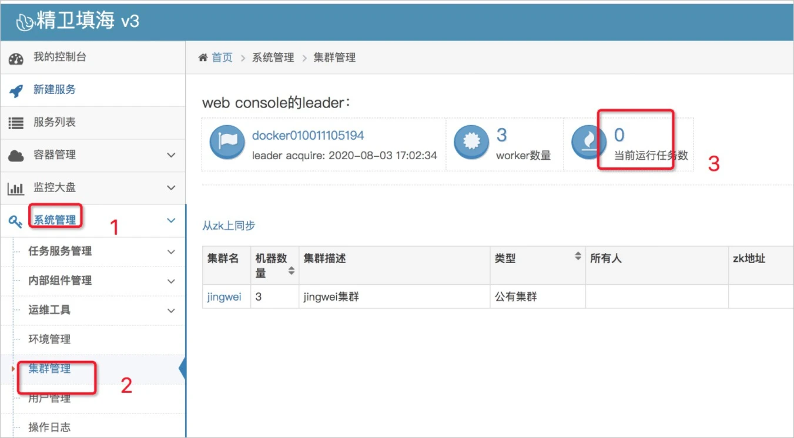

3. 登录DRDS管家。

   <ol type="i">

   <li>

   登录Apsara Uni-manager运维控制台，请参见登录PolarDB-X运维管理系统。

   </li>

   <li>

   在Apsara Uni-manager运维控制台的顶部菜单栏单击**运维**。在左侧导航栏单击**产品运维管理 > 产品列表**，单击**数据库服务**区域中的**DRDS管家**。

   </li>

   </ol>

4. 在左侧菜单中单击**资源管理 > 精卫管理**，在右侧**操作**列中单击**回收**，释放原来的jingwei-worker节点。

   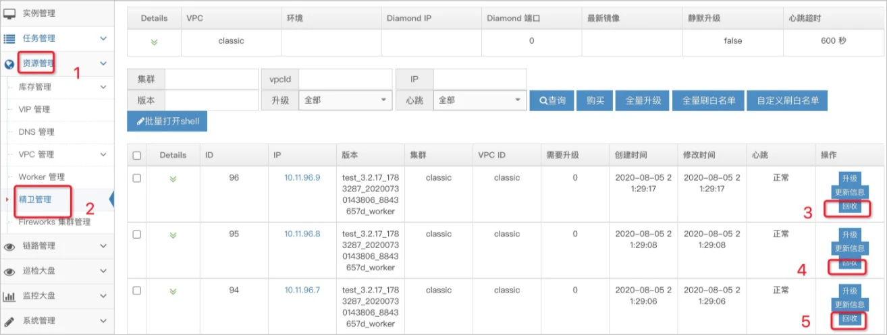

5. 单击**购买**，购买至少两个jingwei-worker。

6. 在精卫系统中，单击左侧菜单**系统管理 > 集群管理**，确认机器数量大于两个。

   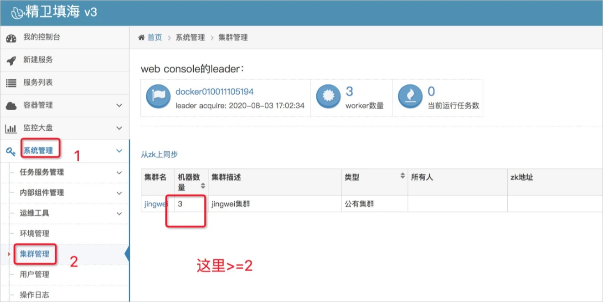

<a id="section-10"></a>

# 10.故障处理

<a id="section-10-1"></a>

## 10.1. 创建数据库时创建RDS失败

**问题现象**

创建数据库时，在创建RDS阶段报错。

**可能原因**

资源不足。

**处理方法**

1. 尝试创建最小规格的RDS，如果创建成功，说明资源不足，需要扩充资源。

   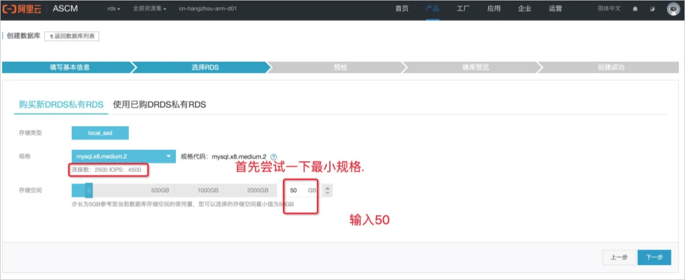

2. 如果仍然报错，尝试更换系列，从高可用版本更换为三节点企业版。

   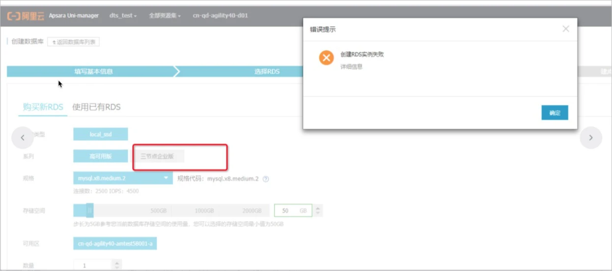

3. 如果仍然报错，单击**详细信息**，复制Requestid，提交工单处理。

   

<a id="section-10-2"></a>

## 10.2. 创建数据库任务失败

**问题现象**

创建数据库时，创建RDS正常，但最终任务失败。

**可能原因**

- RDS被释放；

- 任务被中断；

- 节点故障。

**处理方法**

1. 登录PolarDB-X运维管理系统，请参见登录PolarDB-X运维管理系统。

2. 如果创建数据库任务在子任务1至5失败，单击左侧任务栏**全部任务**，单击失败任务的右侧菜单**详情**，详情页下拉，查看失败的子任务。单击失败子任务对应的**错误信息**，查看详细错误信息。

   - 以下信息表示RDS被释放或者不存在了，此时需要选择一个存在的RDS，重新创建数据库。

     

   - 如果带有“rdsopenapi”字样，可能是调用RDS报错，请复制requestid提交RDS工单处理。

   - 其他错误信息，请提交工单进行处理。

3. 如果创建数据库任务在子任务6或者子任务7失败，单击右侧**更多 > 继续执行**，尝试重新执行任务。

   

4. 如果创建数据库任务在子任务12失败，请保持任务失败状态，不要重试。查看机器ID，分别重启两个节点，2分钟后，重试任务。

   

   

5. 如果如下子任务失败，表示测试DB连接性失败，在**实例管理 > DB管理**菜单，单击**刷新白名单**，然后尝试重新执行任务。

   

   

<a id="section-10-3"></a>

## 10.3. SQL闪回任务状态一直显示运行中

**问题现象**

SQL闪回任务状态一直显示执行中。

**处理方法**

1. 登录PolarDB-X运维管理系统，在**产品列表**页面单击**精卫**。

2. 单击左侧**服务列表**，单击任务名称。

3. 单击选择**精卫任务**。

   

4. 单击**显示任务配置**。

5. 修改如下参数。

   

   

6. 左侧菜单单击**服务列表**，单击服务名称。

7. 操作栏单击**启动**，重启SQL闪回任务。

<a id="section-10-4"></a>

## 10.4. 备份失败

**问题现象**

备份任务显示失败。

**可能原因**

备份数据过大。

**处理方法**

1. 登录PolarDB-X运维管理系统，请参见登录PolarDB-X运维管理系统。

2. 在左侧菜单栏单击**任务管理 > 失败的任务**，找到失败的任务。

   

3. 单击**详情**，查看报错日志。

   显示如下报错信息，表示备份数据过大，超过了“baackup_tddl_rule_json”字段的最大值。

   

4. 登录天基系统，左侧菜单选择**运维 > 集群运维**，Project选择drds，筛选drds集群。筛选drds的源数据库，drds_console服务的drds_manager1源数据库。

5. 单击备份失败的集群名称，选择**集群资源**页签，**服务角色**选择drds-console.DrdsConsole#，在申请参数列，单击**详情**，查看host ID。

6. 登录主机，查看表结构，该字段baackup_tddl_rule_json的类型为“blob类型。”

7. 修改表结构，将“baackup_tddl_rule_json”字段的类型为修改为“mediumblob”。

8. 重试当前任务。
