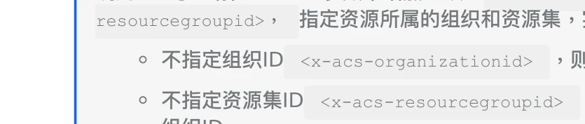
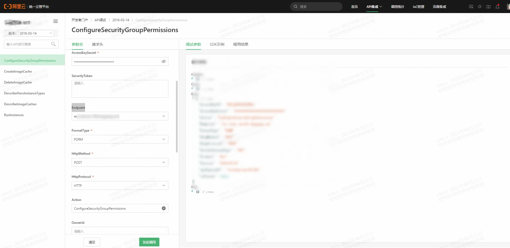

阿里云  
专有云  
云原生数据库  
PolarDB集分一体版 开发指南  
产品版本：V3.18.6  
文档版本：20260528

**目录**

- [1.快速入门](#section-1)
    - [1.1. 开发文档使用说明](#section-1-1)
    - [1.2. API调用流程说明](#section-1-2)
- [2.准备工作](#section-2)
    - [2.1. 登录API与工具控制台](#section-2-1)
    - [2.2. 获取API信息及其EndPoint](#section-2-2)
    - [2.3. 获取AccessKey](#section-2-3)
    - [2.4. 获取STS AccessKey](#section-2-4)
    - [2.5. 获取公共Header参数](#section-2-5)
    - [2.6. 获取产品名的Endpoint](#section-2-6)
- [3.Java SDK调用示例](#section-3)
    - [3.1. 快速开始](#section-3-1)
    - [3.2. 使用手册](#section-3-2)
        - [3.2.1. 安装Java SDK](#section-3-2-1)
        - [3.2.2. 设置身份验证凭证](#section-3-2-2)
        - [3.2.3. 请求连接配置](#section-3-2-3)
        - [3.2.4. 发起调用](#section-3-2-4)
        - [3.2.5. 错误处理](#section-3-2-5)
        - [3.2.6. 使用CommonRequest进行调用](#section-3-2-6)
- [4.Python SDK调用示例](#section-4)
    - [4.1. 快速开始](#section-4-1)
    - [4.2. 使用手册](#section-4-2)
        - [4.2.1. 安装Python SDK](#section-4-2-1)
        - [4.2.2. 设置身份验证凭证](#section-4-2-2)
        - [4.2.3. 设置HTTPS请求](#section-4-2-3)
        - [4.2.4. 发起调用](#section-4-2-4)
        - [4.2.5. 错误处理](#section-4-2-5)
        - [4.2.6. 使用CommonRequest进行调用](#section-4-2-6)
- [5.Go SDK调用示例](#section-5)
    - [5.1. 快速开始](#section-5-1)
    - [5.2. 使用手册](#section-5-2)
        - [5.2.1. 安装Go SDK核心包](#section-5-2-1)
        - [5.2.2. 设置身份验证凭证](#section-5-2-2)
        - [5.2.3. 发起调用](#section-5-2-3)
        - [5.2.4. 错误处理](#section-5-2-4)
        - [5.2.5. 使用CommonRequest进行调用](#section-5-2-5)
- [6.API参考](#section-6)
    - [6.1. 请求结构](#section-6-1)
    - [6.2. 公共参数](#section-6-2)
    - [6.3. 性能参数表](#section-6-3)
    - [6.4. 实例状态表](#section-6-4)
    - [6.5. 实例管理](#section-6-5)
        - [6.5.1. CreateDBInstance](#section-6-5-1)
        - [6.5.2. DeleteDBInstance](#section-6-5-2)
        - [6.5.3. DescribeDBInstanceAttribute](#section-6-5-3)
        - [6.5.4. DescribeDBInstances](#section-6-5-4)
        - [6.5.5. DescribeScaleOutMigrateTaskList](#section-6-5-5)
        - [6.5.6. DescribeTasks](#section-6-5-6)
        - [6.5.7. ModifyDBInstanceClass](#section-6-5-7)
        - [6.5.8. ModifyDBInstanceConfig](#section-6-5-8)
        - [6.5.9. ModifyDBInstanceDescription](#section-6-5-9)
        - [6.5.10. ReleaseInstancePublicConnection](#section-6-5-10)
        - [6.5.11. RestartDBInstance](#section-6-5-11)
        - [6.5.12. UpgradeDBInstanceKernelVersion](#section-6-5-12)
        - [6.5.13. UpdatePolarDBXInstanceNode](#section-6-5-13)
        - [6.5.14. DescribeBinaryLogList](#section-6-5-14)
        - [6.5.15. ModifyDBInstanceVip](#section-6-5-15)
        - [6.5.16. CreateTransformOperation](#section-6-5-16)
        - [6.5.17. DescribeTransformStatus](#section-6-5-17)
        - [6.5.18. ModifyDBInstanceSeries](#section-6-5-18)
        - [6.5.19. DescribeDBInstanceTopology](#section-6-5-19)
        - [6.5.20. RestoreDBInstance](#section-6-5-20)
    - [6.6. 数据库管理](#section-6-6)
        - [6.6.1. CreateDB](#section-6-6-1)
        - [6.6.2. DescribeTableDetail](#section-6-6-2)
        - [6.6.3. DeleteDB](#section-6-6-3)
        - [6.6.4. DescribeCharacterSet](#section-6-6-4)
        - [6.6.5. DescribeDistributeTableList](#section-6-6-5)
        - [6.6.6. ModifyDatabaseDescription](#section-6-6-6)
        - [6.6.7. DescribeDbList](#section-6-6-7)
    - [6.7. 地域](#section-6-7)
        - [6.7.1. DescribeRegions](#section-6-7-1)
    - [6.8. 账号管理](#section-6-8)
        - [6.8.1. CreateAccount](#section-6-8-1)
        - [6.8.2. ModifyAccountPrivilege](#section-6-8-2)
        - [6.8.3. EnableRightsSeparation](#section-6-8-3)
        - [6.8.4. ResetAccountPassword](#section-6-8-4)
        - [6.8.5. CreateSuperAccount](#section-6-8-5)
        - [6.8.6. DeleteAccount](#section-6-8-6)
        - [6.8.7. DescribeAccountList](#section-6-8-7)
        - [6.8.8. ModifyAccountDescription](#section-6-8-8)
    - [6.9. 数据安全](#section-6-9)
        - [6.9.1. AllocateInstancePublicConnection](#section-6-9-1)
        - [6.9.2. CheckCloudResourceAuthorized](#section-6-9-2)
        - [6.9.3. DescribeDBInstanceTDE](#section-6-9-3)
        - [6.9.4. DescribeUserEncryptionKeyList](#section-6-9-4)
        - [6.9.5. DescribeSecurityIps](#section-6-9-5)
        - [6.9.6. ModifySecurityIps](#section-6-9-6)
        - [6.9.7. UpdateDBInstanceTDE](#section-6-9-7)
        - [6.9.8. DescribeSQLLogRecords](#section-6-9-8)
    - [6.10. 备份管理](#section-6-10)
        - [6.10.1. CreateBackup](#section-6-10-1)
        - [6.10.2. DescribeBackupPolicy](#section-6-10-2)
        - [6.10.3. DescribeBackupSetList](#section-6-10-3)
        - [6.10.4. UpdateBackupPolicy](#section-6-10-4)
    - [6.11. 参数管理](#section-6-11)
        - [6.11.1. DescribeParameters](#section-6-11-1)
        - [6.11.2. ModifyParameter](#section-6-11-2)
    - [6.12. SSL加密](#section-6-12)
        - [6.12.1. DescribeDBInstanceSSL](#section-6-12-1)
        - [6.12.2. UpdateDBInstanceSSL](#section-6-12-2)
    - [6.13. 监控](#section-6-13)
        - [6.13.1. DescribeInstanceDbPerformance](#section-6-13-1)
        - [6.13.2. DescribeInstanceStoragePerformance](#section-6-13-2)
        - [6.13.3. DescribeInstancePerformance](#section-6-13-3)
        - [6.13.4. DescribeMetricsPerf](#section-6-13-4)
    - [6.14. DAS](#section-6-14)
        - [6.14.1. GetSlowRequestRecords](#section-6-14-1)
- [7.附录](#section-7)
    - [7.1. STS概要](#section-7-1)
        - [7.1.1. 什么是STS](#section-7-1-1)
        - [7.1.2. AssumeRole](#section-7-1-2)

<a id="section-1"></a>

# 1.快速入门

<a id="section-1-1"></a>

## 1.1. 开发文档使用说明

本文为您介绍在使用专有云API进行开发工作时，如何查看所需要的产品文档。

**使用流程**

您可以按照以下流程图中步骤，判断自己所需要使用的开发文档。


**前提条件**

通过运维人员或运营管理员获取专有云的版本。

**操作步骤**

您可以通过阿里云专有云文档中心，获取需要的产品文档。

1. 通过浏览器打开专有云文档中心。

2. 根据专有云的版本单击**企业版**、**敏捷版**或**一体机**标签。

3. 在下拉列表中，选择对应的专有云版本。

   

4. 在左侧导航栏中，选择目标产品名称。

5. 单击目标文档区域的**查看详情**或**下载PDF**。

<a id="section-1-2"></a>

## 1.2. API调用流程说明

阿里云专有云支持通过POP网关调用专有云API，为了使您拥有与公有云一致的体验，自企业版V3.16.0开始，专有云API默认使用POP网关方式调用。本文介绍通过POP网关调用专有云API的流程。

**流程图**


**调用步骤**

1. 获取AccessKey。

   获取调用时所需要的AccessKey参数，请参见获取AccessKey或获取STS AccessKey。

   > **说明**
   >
   > 推荐使用个人AccessKey或STS AccessKey调用Apsara Uni-manager运营控制台及云产品接口。

2. 获取RegionID。

   获取调用时所需要的RegionID参数，请参见获取公共Header参数。

3. 获取组织ID与资源集ID。

   组织ID需要通过API进行获取，获取方式请参见*Apsara Uni-manager运营控制台开发指南*中的*GetOrga nizationList章节*。

   资源集ID需要通过API进行获取，获取方式请参见*Apsara Uni-manager运营控制台开发指南*中的*ListRe sourceGroup章节*。

   > **说明**
   >
   > 调用API时，请在Header参数中增加组织ID `<x-acs-organizationid>` 和资源集ID `<x-acs-`



> `resourcegroupid>`， 指定资源所属的组织和资源集，实现实例资源的隔离查询。
>
> - 不指定组织ID `<x-acs-organizationid>` ，则默认获取当前用户所属的组织。
>
> - 不指定资源集ID `<x-acs-resourcegroupid>` ，则默认为空，如果指定资源集需要同时指定组织ID。

4. 获取对应的API参考文档。

   您需要查看目标云产品的开发指南，了解API的功能与使用方式，开发指南的使用流程及获取方法请参见开发文档使用说明。

5. 获取云产品Endpoint。

6. 获取云产品SDK并调用云产品API。

<a id="section-2"></a>

# 2.准备工作

<a id="section-2-1"></a>

## 2.1. 登录API与工具控制台

首先，您需要了解产品开放API接口的相关信息，包括产品名称（code）、开放API接口名称、API版本。

**背景信息**

Apsara Uni-manager运营控制台API目录中的API信息仅供调用参考，具体API的使用方式需要参见云产品的开发指南。如果发生不一致情况，以开发指南支持情况为准。

**操作步骤**

1. 在浏览器地址栏中，输入Apsara Uni-manager运营控制台的服务域名地址，按回车键。

2. 输入正确的用户名及密码。

   请向运营管理员获取登录控制台的用户名和密码。

   > **说明**
   >
   > 首次登录Apsara Uni-manager运营控制台时，需要修改登录用户名的密码，请按照提示完成密码修改。为提高安全性，密码长度必须为10~32位，且至少包含以下两种类型：
   >
   > - 英文大写或小写字母（A~Z、a~z）
   >
   > - 阿拉伯数字（0~9）
   >
   > - 特殊符号（感叹号（!）、at（@）、井号（#）、美元符号（$）、百分号（%）等）

3. 单击**账号登录**。

4. 如果账号已激活MFA多因素认证，请根据以下两种情况进行操作：

   - 管理员强制开启MFA后的首次登录：

     <ol type="a">

     <li>

     在绑定虚拟MFA设备页面中，按页面提示步骤绑定MFA设备。

     </li>

     <li>

     按照步骤2重新输入账号和密码，单击**账号登录**。

     </li>

     </ol>

     <ol type="i" start="100">

     <li>

     输入6位MFA码后单击**认证**。

     </li>

     </ol>

   - 您已开启并绑定MFA：

     输入6位MFA码后单击**认证**。

5. 在页面顶部的菜单栏中，选择**产品 > 应用服务 > 开发者门户**。

<a id="section-2-2"></a>

## 2.2. 获取API信息及其EndPoint

您在使用SDK时，需要获取产品名称、API名称和API版本。本文介绍如何查看API信息。

**背景信息**

Apsara Uni-manager运营控制台API目录中的API仅供调用参考，具体API的使用方式需要参见各云产品的API文档。如果发生不一致情况，以API支持情况为准。

**操作步骤**

1. 登录Apsara Uni-manager运营控制台。

2. 在顶部菜单栏选择**产品** > **应用服务** > **开发者门户**。

3. 在**开发者门户**页面，选择**API集成** > **API调试**。

   

4. 在左侧导航栏中选择目标云产品。

5. 在**版本**下拉列表中，选择目标API版本。

6. 在下方API列表中可浏览当前版本的所有API接口。

7. 选中对应的接口，在**参数名**页签可以获取**Endpoint**信息。

   

<a id="section-2-3"></a>

## 2.3. 获取AccessKey

AccessKey支持RAM和STS两种授权模式，在发起调用时选择使用其中一种AccessKey即可。本文将为您介绍如何获取通过RAM授权的AccessKey。

**背景信息**

AccessKey通过使用AccessKey ID和AccessKey Secret对称加密，实现验证某个请求发送者的身份的功能。其中AccessKey ID用于标示用户，AccessKey Secret是用户用于加密签名的字符串。

AccessKey的两种授权模式如下：

- 通过RAM授权给第三方请求者的AccessKey ID和AccessKey Secret。

- 通过STS授权给第三方请求者的AccessKey ID、AccessKey Secret和Security Token。获取方式请参见获取STS AccessKey。

Apsara Uni-manager运营控制台提供了个人AccessKey和组织AccessKey（只有运营管理员和一级组织管理员可以获取组织AccessKey），推荐使用个人账号AccessKey调用Apsara Uni-manager运营控制台及云产品相关接口。如果使用个人账号AccessKey，需要在Header中添加以下限制性参数，否则可能提示权限不足：

> 个人账号AccessKey是由Apsara Uni-manager运营控制台权限体系管控的受限
>
> **警告**
>
> AccessKey，组织AccessKey相对权限较大，需要管理员确认操作的安全性。

<table>
  <tr>
    <th width="206">参数名称</th>
    <th>描述</th>
  </tr>
  <tr>
    <td>x-acs-regionid</td>
    <td>地域，如：cn-hangzhou-*。</td>
  </tr>
  <tr>
    <td>x-acs-organizationid</td>
    <td>Apsara Uni-manager运营控制台中对应的组织ID。获取方法可参见<strong>《Apsara Uni-manager运营控制台开</strong><strong>发指南》</strong>中的<strong>《GetOrganizationList》</strong>文档。</td>
  </tr>
  <tr>
    <td>x-acs-resourcegroupid</td>
    <td>Apsara Uni-manager运营控制台中对应的资源集ID。获取方法可参见<strong>《Apsara Uni-manager运营控制台</strong><strong>开发指南》</strong>中的<strong>《ListResourceGroup》</strong>文档。</td>
  </tr>
  <tr>
    <td>x-acs-instanceid</td>
    <td>进行操作的实例ID，例如，ECS的实例ID可以从ECS列表中查询到。</td>
  </tr>
</table>

**获取个人账号AccessKey**

获取个人账号AccessKey的方法如下：

1. 登录Apsara Uni-manager运营控制台。

2. 在系统界面右上角，单击当前登录用户头像，单击**个人信息**。

3. 在**阿里云AccessKey**区域，您可以查看个人账户的AccessKey信息。

   

   > Accesskey ID和AccessKey Secret是您访问云资源时的密钥，具有该账号完整的权
   >
   > **说明**
   >
   > 限，请您妥善保管。

**获取组织AccessKey**

获取组织AccessKey的方法如下：

1. 管理员登录Apsara Uni-manager运营控制台。

2. 在顶部菜单栏，单击**企业**。

3. 在左侧导航栏中，选择**资源管理 > 组织管理**。

4. 在组织结构中，单击目标一级组织名称。

5. 单击**管理Accesskey**。

6. 在弹出的对话框中，查看组织AccessKey信息。

<a id="section-2-4"></a>

## 2.4. 获取STS AccessKey

本文为您介绍如何利用STS方式，调用专有云的产品API。

**背景信息**

阿里云临时安全令牌STS（Security Token Service）是阿里云提供的一种临时访问权限管理服务。您可以选择使用STS方式，调用专有云的产品API。

STS AccessKey由AccessKey ID、AccessKey Secret及SecurityToken三元组组成，使用STS方式调用云产品API时，三元组缺一不可。更多STS内容请参见什么是STS。

**操作步骤**

1. 获取用户角色的 `RAM Role` 。

   <ol type="i">

   <li>

   登录Apsara Uni-manager运营控制台。

   </li>

   <li>

   单击页面右上角的用户头像，单击**个人信息**。

   </li>

   <li>

   单击**查看当前角色策略**。

   在**当前选择角色策略**对话框中查看 `RAM Role` 。

   </li>

   </ol>

2. 获取STS Accesskey三元组。

   > **说明**
   >
   > 以下代码示例中可变参数均需替换为您实际的相关信息，尖括号（<>）在最终代码中不保留。
   >
   > 涉及替换的可变参数如下：
   >
   > - &lt;yourRegionID>，请替换为您实际的地域ID。
   >
   > - &lt;yourAccessKeyID>，请替换为您实际的AccessKey ID。
   >
   > - &lt;yourAccessKeySecret>，请替换为您实际的AccessKey Secret。
   >
   > - &lt;yourRoleSessionName>，请替换为您当前实际的会话名称。
   >
   > - &lt;yourRoleArn>，请替换为您实际的RAM Role。
   >
   > - &lt;sts.aliyuns.com>，请替换为实际的STS Endpoint。

   ```xml
   public static void main(String[] args) {
       // 创建DefaultAcsClient实例并初始化。
       // 请替换为您实际的地域ID、AccessKey ID、AccessKey Secret
       DefaultProfile profile = DefaultProfile.getProfile("<yourRegionID>", "
   <yourAccessKeyID>", "<yourAccessKeySecret>");
       HttpClientConfig clientConfig = HttpClientConfig.getDefault();
       clientConfig.setIgnoreSSLCerts(true);
       clientConfig.setProtocolType(ProtocolType.HTTPS);
       profile.setHttpClientConfig(clientConfig);
       IAcsClient client = new DefaultAcsClient(profile);
       String assumeRole = callAssumeRole(client);
       if (StringUtils.isEmpty(assumeRole)) return;
       JSONObject assumeRoleJson = JSONObject.parseObject(assumeRole);
       JSONObject credentials = assumeRoleJson.getJSONObject("Credentials");
       // 获取到STS三元组
       String stsAK = credentials.getString("AccessKeyId");
       String stsSK = credentials.getString("AccessKeySecret");
       String stsToken = credentials.getString("SecurityToken");
   }

   private static String callAssumeRole(IAcsClient client) {
       CommonRequest request = new CommonRequest();
       // <sts.aliyuns.com> 请替换为实际的STS Endpoint，⼀般格式为sts-
   vpc.${global:region}.${global:internet-domain}
       request.setSysDomain("<sts.aliyuns.com>");
       request.setSysProduct("Sts");
       request.setSysAction("AssumeRole");
       request.setSysVersion("2015-04-01");
       request.setSysMethod(MethodType.POST);
       request.setHttpContentType(FormatType.FORM);
       // 业务参数，设置本次调⽤Session的别名，<yourRoleSessionName>请您替换为实际值
       request.putQueryParameter("RoleSessionName", "<yourRoleSessionName>");
       // 扮演的Role⾓⾊ARN，<yourRoleArn>请替换为上⼀步获取到的实际Ram Role ARN
       request.putQueryParameter("RoleArn", "<yourRoleArn>");
       try {
           CommonResponse response = client.getCommonResponse(request);
           return response.getData();
       } catch (ServerException e) {
           System.out.println(e.getErrCode());
           System.out.println(e.getErrMsg());
       } catch (ClientException e) {
           System.out.println(e.getErrCode());
           System.out.println(e.getErrMsg());
       }
       return null;
   }
   ```

3. 通过STS AccessKey三元组调用云产品的接口，下列代码以ECS的 `DescribeZones` 接口为示例。

   > **说明**
   >
   > 以下代码示例中可变参数均需替换为您实际的相关信息，尖括号（<>）在最终代码中不保留。
   >
   > 涉及替换的可变参数如下：
   >
   > - &lt;yourRegionID>，请替换为您实际的地域ID。
   >
   > - &lt;yourStsAccesskeyID>，请替换为您实际的STS Accesskey ID。
   >
   > - &lt;yourStsAccessKeySecret>，请替换为您实际的STS Accesskey Secret。
   >
   > - &lt;yourStsToken>，请替换为实际STS三元组中的SecurityToken。
   >
   > - &lt;yourResourceGroupID>，请替换为您实际的资源集ID。
   >
   > - &lt;yourOrganizationID>，请替换为您实际的组织ID。

   ```xml
   public static void main(String[] args) {
       // <yourRegionID>请替换为您实际的地域ID
       // <yourStsAccessKeyID>, <yourStsAccessKeySecret>请替换为前⼀步获取到的STS三元组中AccessKeyID、AccessKeySecret
       DefaultProfile profile = DefaultProfile.getProfile("<yourRegionID>", "
   <yourStsAccesskey>", "<yourStsAccessSecret>");
       HttpClientConfig clientConfig = HttpClientConfig.getDefault();
       clientConfig.setIgnoreSSLCerts(true);
       clientConfig.setProtocolType(ProtocolType.HTTPS);
       profile.setHttpClientConfig(clientConfig);
       IAcsClient client = new DefaultAcsClient(profile);
       CommonRequest request = new CommonRequest();
       request.setSysDomain("ecs.aliyuns.com");
       request.setSysProduct("Ecs");
       request.setSysAction("DescribeZones");
       request.setSysVersion("2014-05-26");
       request.setSysMethod(MethodType.POST);
       request.setHttpContentType(FormatType.FORM);
       //<yourRegionID>请替换为您实际的地域ID
       request.putHeadParameter("x-acs-regionid", "<yourRegionID>");
       // <yourStsToken>请替换为您前⼀步获取到的STS三元组中SecurityToken
       request.putQueryParameter("SecurityToken", "<yourStsToken>");
       // 非必填,请替换为您实际的资源集ID
       // request.putHeadParameter("x-acs-resourcegroupid", "<yourResourceGroupID>");
       // 必填,请替换为您实际的组织ID
       request.putHeadParameter("x-acs-organizationid", "<yourOrganizationID>");
       try {
           CommonResponse response = client.getCommonResponse(request);
           System.out.println(response.getData());
       } catch (ServerException e) {
           System.out.println(e.getErrCode());
           System.out.println(e.getErrMsg());
       } catch (ClientException e) {
           System.out.println(e.getErrCode());
           System.out.println(e.getErrMsg());
       }
   }
   ```

<a id="section-2-5"></a>

## 2.5. 获取公共Header参数

调用专有云API时需要提供多个Header参数。本文为您介绍这些参数的含义及其获取方式，并对调用后的一些返回值做出解释。

**Header参数描述**

| 名称 | 描述 |
| --- | --- |
| x-acs-regionid | 环境Region，获取方式请参见获取Region ID。 |
| x-acs-organizationid | Apsara Uni-manager运营控制台上的组织ID，获取方式请参见获取组织ID。 |
| x-acs-resourcegroupid | Apsara Uni-manager运营控制台上的资源集ID，获取方式请参见获取资源集ID。 |
| x-acs-instanceid | 进行操作的实例ID，获取方式请参见获取实例ID。 |

**获取Region ID**

1. 管理员登录Apsara Uni-manager运营控制台。

2. 在顶部菜单栏中，单击**企业**。

3. 在左侧导航栏中，选择**资源管理**>**地域管理**。

4. 单击目标组织名称。

5. 在右侧**Region列表**中查看Region ID。

**获取组织ID**

组织ID需要通过API进行获取，获取方式请参见*Apsara Uni-manager运营控制台开发指南*中的*GetOrganizationList章节*。

**获取资源集ID**

资源集ID需要通过API进行获取，获取方式请参见*Apsara Uni-manager运营控制台开发指南*中的*ListResourceGroup章节*。

**获取实例ID**

*请各云产品自行修改替换产品名及获取实例ID流程*

实例ID可以通过Apsara Uni-manager运营控制台中的云产品实例列表进行获取，本文中以ECS为例，获取步骤如下：

1. 登录Apsara Uni-manager运营控制台。

2. 在顶部的菜单栏中，选择**产品**>**弹性计算**>**云服务器ECS**。

3. 在左侧导航栏中，单击**实例**。

4. 在实例列表中查看**实例ID**。

**返回参数**

对于列表类的云产品资源实例接口，调用后会默认增加如下返回值。

| 名称 | 描述 |
| --- | --- |
| ResourceGroupName | 资源集名称。 |
| ResourceGroup | 资源集ID。 |
| DepartmentName | 组织名称。 |
| Department | 组织ID。 |

<a id="section-2-6"></a>

## 2.6. 获取产品名的Endpoint

本文介绍了如何获取*产品名*Endpoint。*标题及短描述中产品名，请各云产品自行替换*

**背景信息**

通过POP网关调用专有云API时需要使用云产品业务域的Endpoint。您可以在阿里云驻场运维工程师处获取。您也可以通过如下方法自行获取Endpoint。

**操作步骤**

> **警告**

1. 

2. 

3. 

4.

<a id="section-3"></a>

# 3.Java SDK调用示例

<a id="section-3-1"></a>

## 3.1. 快速开始

本节介绍如何获取*产品名*Java SDK并开始调用。 *产品名需要替换为您自己的产品名。*

**环境准备**

- 使用阿里云专有云Java SDK，您需要一个授权账号以及一对AccessKey ID和AccessKey Secret。参见获取AccessKey在Apsara Uni-manager运营控制台上获取和查看您的AccessKey。

- 获取*产品名*的Endpoint，具体操作参见获取产品名的Endpoint。*产品名及链接请各云产品自行替换。*

- 阿里云专有云Java SDK需要1.8及以上的JDK。

**安装阿里云专有云 Java SDK**

如果您使用Apache Maven来管理Java项目，只需在项目的pom.xml中导入JAR文件。

要使用*产品名*的开发工具包，必须安装SDK核心库以及产品的SDK。其中，SDK核心库推荐使用4.5.17及以上版本，SDK的版本为X.X.X。 *产品名需要替换为您自己的产品名；X.X.X需要替换为您自己产品的SDK版本。*

**使用Java SDK**

调用阿里云专有云Java SDK的主要操作步骤如下：

1. 创建并初始化DefaultAcsClient实例。

2. 创建API请求并设置参数。

3. 发起请求并处理应答或异常。

   *替换为自己产品的示例*

   > **说明**
   >
   > 以下代码示例中可变参数均需替换为您实际的相关信息，尖括号（<>）在最终代码中不保留。
   >
   > 涉及替换的可变参数如下：
   >
   > - &lt;yourRegionID>，请替换为您实际的地域ID。
   >
   > - &lt;yourAccessKeyID>，请替换为您实际的AccessKey ID。
   >
   > - &lt;yourAccessKeySecret>，请替换为您实际的AccessKey Secret。
   >
   > - &lt;Product>，请替换为您实际的产品名称。
   >
   > - &lt;Endpoint>，请替换为您当前产品实际的Endpoint。
   >
   > - &lt;readTimeout>，请您根据实际情况设置读取超时时间，单位为毫秒。
   >
   > - &lt;connectionTimeout>，请您根据实际情况设置连接超时时间，单位为毫秒。
   >
   > - &lt;maxRequestsPerHost>，请您根据实际情况设置每个主机的最大请求数。
   >
   > - &lt;maxRequests>，请您根据实际情况设置最大请求数。
   >
   > - &lt;http://192.168.XX:33XX>，请替换为您实际的代理IP+端口。

   ```java
    import com.aliyuncs.profile.DefaultProfile;
    import com.aliyuncs.DefaultAcsClient;
    import com.aliyuncs.IAcsClient;
    import com.aliyuncs.exceptions.ClientException;
    import com.aliyuncs.exceptions.ServerException;
    import com.aliyuncs.ecs.model.v20140526.*;
    public class Main {
        public static void main(String[] args) {
           // 创建DefaultAcsClient实例并初始化
           DefaultProfile profile = DefaultProfile.getProfile(
               "<yourRegionID>",          // 请替换为您实际的地域ID
               "<yourAccessKeyID>",      // 请替换为您实际的AccessKey ID
               "<yourAccessKeySecret>"); // 请替换为您实际的AccessKey Secret
           // 设置当前产品的Endpoint，可变参数请替换为您的实际值 
           profile.addEndpoint("<yourRegionID>", "<Product>", "<Endpoint>");
           // 设置请求配置
           HttpClientConfig clientConfig = HttpClientConfig.getDefault();
           clientConfig.setIgnoreSSLCerts(true);// 忽略证书
           clientConfig.setReadTimeoutMillis(<readTimeout>);// 读取超时时间（可选）,单位为毫
   秒（ms）
           clientConfig.setConnectionTimeoutMillis(<connectionTimeout>);// 连接超时时间（可
   选）,单位为毫秒（ms）
           clientConfig.setMaxRequestsPerHost(<maxRequestsPerHost>);// 设置每个主机的最⼤请
   求数（可选）
           clientConfig.setMaxRequests(<maxRequests>);// 设置最⼤请求数（可选）
           clientConfig.setProtocolType(ProtocolType.HTTP); // 设置请求协议,默认HTTP（可选）
           /* 设置代理(可选),替换为代理IP+Port
           clientConfig.setHttpProxy("<http://192.168.XX:33XX>");
           或
           clientConfig.setHttpsProxy("<https://192.168.XX:33XX>");
           */
           profile.setHttpClientConfig(clientConfig);
           IAcsClient client = new DefaultAcsClient(profile);
           // 创建API请求并设置参数
           DescribeInstancesRequest request = new DescribeInstancesRequest();
           // 业务参数
           request.setPageSize(10);
           request.setPageNumber(1);
           // 特殊Header参数,设置组织ID和资源集ID,资源隔离使⽤
           request.putHeadParameter("x-acs-organizationid", "1");
           request.putHeadParameter("x-acs-resourcegroupid", "11");
           // 发起请求并处理应答或异常
           DescribeInstancesResponse response;
           try {
               response = client.getAcsResponse(request);
               for (DescribeInstancesResponse.Instance instance:response.getInstances()) 
   {
                   System.out.println(instance.getPublicIpAddress());
               }
           } catch (ServerException e) {
               e.printStackTrace();
           } catch (ClientException e) {
               e.printStackTrace();
           }
        }
    }
   ```

<a id="section-3-2"></a>

## 3.2. 使用手册

<a id="section-3-2-1"></a>

### 3.2.1. 安装Java SDK

本文介绍如何安装及调用PolarDB-X Java SDK。

阿里云专有云Java SDK支持1.6及以上版本的JDK，可以通过添加Maven依赖或下载阿里云开发工具包（SDK）的方式安装专有云Java SDK。

要使用PolarDB-X的开发工具包，必须安装阿里云Java SDK核心库以及PolarDB-X的Java SDK。SDK核心库推荐使用4.6.1及以上版本，Java SDK的版本为1.0.5。

以使用PolarDB-X的Java SDK为例，您需要安装阿里云Java SDK核心库和PolarDB-X Java SDK，并在pom.xml文件中添加以下依赖即可。准确的SDK版本号，请参见阿里云开发工具包（SDK）。

```xml
<!-- Alibaba Cloud SDK for Java -->
<dependency>
    <groupId>com.aliyun</groupId>
    <artifactId>aliyun-java-sdk-core</artifactId>
    <version>4.6.1</version>
</dependency>
<!-- polardb java sdk -->
<dependency>
    <groupId>com.aliyun</groupId>
    <artifactId>aliyun-java-sdk-polardbx</artifactId>
    <version>1.0.5</version>
</dependency>
```

<a id="section-3-2-2"></a>

### 3.2.2. 设置身份验证凭证

当使用阿里云专有云SDK访问阿里云专有云服务时，您需要提供授权的账号进行身份验证。本文介绍了如何设置身份验证凭证。

目前，Java SDK支持通过AccessKey进行身份验证，获取AccessKey的方法请参见获取Accesskey。

使用AccessKey作为访问凭据时，需要在初始化Client时设置凭证。

> **说明**
>
> 确保包含AccessKey的代码不会泄漏（例如提交到外部公开的GitHub项目），否则将会危害您的信息安全。

```text
DefaultProfile profile = DefaultProfile.getProfile(
    "<yourRegionID>",          // 请替换为您实际的地域ID
    "<yourAccessKeyID>",      // 请替换为您实际的AccessKey ID
    "<yourAccessKeySecret>"); // 请替换为您实际的AccessKey Secret
```

> **说明**
>
> 以上代码示例中可变参数均需替换为您实际的相关信息，尖括号（<>）在最终代码中不保留。

<a id="section-3-2-3"></a>

### 3.2.3. 请求连接配置

本文介绍了如何配置请求连接（HttpClientConfig）。

您可通过以下代码配置HttpClientConfig，具体请根据自身服务能力自行选择配置项并做相应配置。

> **说明**
>
> 以下代码示例中可变参数均需替换为您实际的相关信息，尖括号（<>）在最终代码中不保留。
>
> 涉及替换的可变参数如下：
>
> - &lt;readTimeout>，请您根据自身服务的能力，配置读取超时时间，单位为毫秒（ms）。
>
> - &lt;connectionTimeout>，请您根据自身服务的能力，配置连接超时时间，单位为毫秒（ms）。
>
> - &lt;maxRequestsPerHost>，请您根据自身服务的能力，配置每台服务器的最大请求数，数据类型为INT。
>
> - &lt;maxRequests>，请您根据自身服务的能力，配置最大请求数，数据类型为INT。
>
> - &lt;http://192.168.XX.XX:33XX>，请替换为您实际的代理IP+端口。

```text
// 获取HttpClientConfig对象
HttpClientConfig clientConfig = HttpClientConfig.getDefault();
// 设置是否忽略证书
clientConfig.setIgnoreSSLCerts(true);
// (可选)设置读取超时时间，单位毫秒（ms）
clientConfig.setReadTimeoutMillis(<readTimeout>);
// (可选)设置创建连接超时时间，单位毫秒（ms）
clientConfig.setConnectionTimeoutMillis(<connectionTimeout>);
// (可选)设置每个主机的最⼤请求数，数据类型为INT
clientConfig.setMaxRequestsPerHost(<maxRequestsPerHost>);
// (可选)设置最⼤请求数，数据类型为INT
clientConfig.setMaxRequests(<maxRequests>);
// (可选)设置协议类型
clientConfig.setProtocolType(ProtocolType.HTTP);
/** （可选）请根据实际情况判断是否设置代理，设置⽅法如下：
clientConfig.setHttpProxy("<http://192.168.XX.XX:33XX>");
或
clientConfig.setHttpsProxy("<https://192.168.XX.XX:33XX>");
请替换为您实际的代理IP+端⼝
*/
profile.setHttpClientConfig(clientConfig);
```

<a id="section-3-2-4"></a>

### 3.2.4. 发起调用

本文介绍如何使用产品名Java SDK发起请求。

**操作步骤**

1. 新建一个AcsClient。

   ```text
   IAcsClient client = new DefaultAcsClient(profile);
   ```

2. 创建请求。

   请求类的命名规范为 `${apiName}Request` ，其中<strong>${apiName}</strong>为API名称，例如DescribeInstances。

   在引入多个产品SDK时，有可能存在Request类同名的情况，请注意按照package区分。

   ```text
   DescribeInstancesRequest request = new DescribeInstancesRequest();
   // 业务参数
   request.setPageSize(10);
   request.setPageNumber(1);
   // 特殊Header参数,设置组织ID和资源集ID,资源隔离使⽤
   request.putHeadParameter("x-acs-organizationid", "1");
   request.putHeadParameter("x-acs-resourcegroupid", "");
   ```

3. 发起调用并处理应答。

   ```java
   DescribeInstancesResponse response;
   try {
       response = client.getAcsResponse(request);
       for (DescribeInstancesResponse.Instance instance:response.getInstances()) {
           System.out.println(instance.getPublicIpAddress());
       }
   } catch (ServerException e) {
       e.printStackTrace();
   } catch (ClientException e) {
       e.printStackTrace();
   }
   ```

   正常情况下，应答中的所有字段，都会被反序列化到response中，您可以直接调用 `response.getXXX()` 来获得应答中的字段。

   ```text
   instanceStatus := response.getStatus()
   ```

   如果出现了异常，或您需要原始HTTP应答的情况下，您可以通过以使用 `doAction()` 来获取原始应答。

   ```text
   HttpResponse response = client.doAction(request);
   ```

<a id="section-3-2-5"></a>

### 3.2.5. 错误处理

在使用Java SDK时，当服务端或者SDK端出错时，SDK会返回相应的异常信息。这些异常信息中会包含具体的错误信息包括错误码（Error Code）和错误消息（Error Message）。

一般情况下，您不需要Java SDK对返回的错误进行处理。您只需要根据服务端的错误提示处理服务端错误即可。

- `ServerException` 是服务端错误信息。

- `ClientException` 是SDK端错误信息。

例如，当出现如下错误时，您可以根据具体的错误信息，修改AccessKey的ID即可。

```text
com.aliyuncs.exceptions.ClientException: InvalidAccessKeyId.NotFound : Specified accesskey is not found.
```

如果您需要对SDK的错误进行处理，可以参考如下示例编写代码：

```java
try {
    FooResponse response = client.getAcsResponse(request);
    // 处理Response
}catch (ServerException e){
    // 这⾥可以添加您⾃⼰的错误处理逻辑
    // 例如，打印具体的错误信息
    System.out.println("ErrorCode=" + e.getErrCode());
    System.out.println("ErrorMessage=" + e.getErrMsg());
    // 如果遇上棘⼿问题，可以提交⼯单，并将RequestId提供给我们
    System.out.println("ResponseId=" + e.getRequestId());
}catch (ClientException e){
    // 这⾥可以添加您⾃⼰的错误处理逻辑
    // 例如，打印具体的错误信息
    System.out.println("ErrorCode=" + e.getErrCode());
    System.out.println("ErrorMessage=" + e.getErrMsg());
}
```

<a id="section-3-2-6"></a>

### 3.2.6. 使用CommonRequest进行调用

当您要调用的某个产品的API没有提供SDK时，或者提供的SDK中的请求Request参数和返回Response值不符合需求时，可以采用泛用型的API调用方式（CommonRequest）。使用CommonRequest调用方式可实现任意Open API接口的调用。

**CommonRequest调用特点**

CommonRequest的特点如下：

1. 轻量：只需Core包即可发起调用，无需下载安装各产品的SDK。

2. 简便：无需更新SDK即可调用最新发布的API。

3. 快速迭代。

**使用CommonRequest**

发起一次CommonRequest请求，您需要获取以下几个参数的值。您可以在各产品的API文档中获取以下参数的值。

- 域名(domain)：该产品的服务地址。

- API版本(version)：该API的版本号，格式为YYYY-MM-DD。

  您可以在各产品的API文档的公共参数部分获取API版本。

- 接口信息：要调用的接口名称。

  您需要获取**Action**参数，使用 `request.setSysAction("<Action>")` 的方式来指定API名称。

  例如RunInstances接口，在发起CommonRequest请求时，需要使用 `request.setSysAction("RunInstances")` 来指定API名称。

  您需要获取**PathPattern**参数，使用 `request.setSysUriPattern("<PathPattern>")` 的方式来指定RESTful路径。

  例如查看所有集群实例的API的**PathPattern**为 `/api/v1/clusters` ，在发起CommonRequest请求时，要使用 `request.setSysUriPattern("/api/v1/clusters")` 指定RESTful路径。

**示例：调用RPC风格的API**

以下代码为获取实例状态列表的调用示例（ECS产品属于RPC的调用风格)。

> 以下代码示例中可变参数均需替换为您实际的相关信息，尖括号（<>）在最终代码中不保
>
> **说明**
>
> 留。
>
> 涉及替换的可变参数如下：
>
> - &lt;yourRegionID>，请替换为您实际的地域ID。
>
> - &lt;yourAccessKeyID>，请替换为您实际的AccessKey ID。
>
> - &lt;yourAccessKeySecret>，请替换为您实际的AccessKey Secret。
>
> - &lt;yourSecurityToken>，请替换为您实际的SecurityToken。
>
> - &lt;yourResourceGroupID>，请替换为您实际的资源集ID。
>
> - &lt;yourOrganizationID>，请替换为您实际的组织ID。
>
> - &lt;yourInstanceID>，请替换为您实际的实例ID。
>
> - &lt;http://192.168.XX.XX:33XX>，请替换为您实际的代理IP+端口。

```java
import com.aliyuncs.CommonRequest;
import com.aliyuncs.CommonResponse;
import com.aliyuncs.DefaultAcsClient;
import com.aliyuncs.IAcsClient;
import com.aliyuncs.exceptions.ClientException;
import com.aliyuncs.exceptions.ServerException;
import com.aliyuncs.profile.DefaultProfile;
public class Sample {
    public static void main(String[] args) {
        // 创建DefaultAcsClient实例并初始化
        DefaultProfile profile = DefaultProfile.getProfile(
            "<yourRegionUD>",          // 请替换为您实际的地域ID
            "<yourAccessKeyID>",      // 请替换为您实际的AccessKey ID
            "<yourAccessKeySecret>"); // 请替换为您实际的AccessKey Secret
        clientConfig.setProtocolType(ProtocolType.HTTP);
        /**
        请根据实际情况判断是否需要设置HTTP代理
        设置⽅法如下：
        clientConfig.setHttpProxy("<http://192.168.XX.XX:33XX>");
        请替换为实际代理IP+端⼝
        */
        profile.setHttpClientConfig(clientConfig);
        IAcsClient client = new DefaultAcsClient(profile);
        // 创建API请求并设置参数
        CommonRequest request = new CommonRequest();
        // 替换为真实的产品域名
        request.setDomain("ecs.aliyuncs.com");
        request.setSysProduct("Ecs");
        request.setVersion("2014-05-26");
        request.setAction("DescribeInstanceStatus");
        request.putQueryParameter("PageNumber", "1");
        request.putQueryParameter("PageSize", "30");
        request.putHeadParameter("x-acs-resourcegroupid", "<yourResourceGroupID>");// 非
必填，请替换为您实际的资源集ID
        request.putHeadParameter("x-acs-organizationid", "<yourOrganizationID>");// 必填
，请替换为您实际的组织ID
        request.putHeadParameter("x-acs-caller-sdk-source","ApiTestDemo");// 必填，调⽤来
源说明
        request.putHeadParameter(xacsregionid, <yourRegionID>);// 非必填(企业版
V3.15.0及之前历史版本需要),请替换为您实际的地域ID
        // request.putHeadParameter("x-acs-instanceid", "<yourInstanceID>");// 非必填（修
改、删除、查询单实例详情时需要）,请替换为您实际的实例ID
        /** 
        当使⽤STS AccessKey调⽤接⼝时 需要在参数中加上SecurityToken字段
        调⽤⽅法如下：
        request.putQueryParameter("SecurityToken", "<yourSecurityToken>");
        请替换为实际的Token
        */
        try {
            CommonResponse response = client.getCommonResponse(request);
            System.out.println(response.getData());
        } catch (ServerException e) {
            // TODO Auto-generated catch block
            e.printStackTrace();
        } catch (ClientException e) {
            // TODO Auto-generated catch block
            e.printStackTrace();
        }
    }
}
```

**示例：调用RESTful风格的API**

当调用RESTful风格的API时，业务参数传参方式根据接口请求方式和ContentType分为两种：

- 接口请求方式为 `GET` 或 `DELETE` ，或ContentType为 `application/x-www-form-urlencoded` ，使用以下方式传参：

  将请求参数放在Query中，例如 `request.putQueryParameter("page_number", "1");` 。

- 接口请求方式为 `POST` 或 `PUT` ，且ContentType为 `application/json` ，使用以下方式传参：将请求参数放在Body中，例如：

  ```text
  String requestBody = "{\"page_number\":\"1\",\"page_size\":\"5\",\"SecurityToken\", \
  "<yourSecurityToken>\"}";
  request.setHttpContent(requestBody.getBytes(), "utf-8", FormatType.JSON);
  ```

以下代码为，获取集群列表的调用示例（CS产品属于RESTful的调用风格）。

> 以下代码示例中可变参数均需替换为您实际的相关信息，尖括号（<>）在最终代码中不保
>
> **说明**
>
> 留。
>
> 涉及替换的可变参数如下：
>
> - &lt;yourRegionID>，请替换为您实际的地域ID。
>
> - &lt;yourAccessKeyID>，请替换为您实际的AccessKey ID。
>
> - &lt;yourAccessKeySecret>，请替换为您实际的AccessKey Secret。
>
> - &lt;yourResourceGroupID>，请替换为您实际的资源集ID。
>
> - &lt;yourOrganizationID>，请替换为您实际的组织ID。
>
> - &lt;yourInstanceID>，请替换为您实际的实例ID。
>
> - &lt;http://192.168.XX.XX:33XX>，请替换为您实际的代理IP+端口。
>
> - &lt;yourSecurityToken>，请替换为您实际的SecurityToken。

```java
import com.aliyuncs.CommonRequest;
import com.aliyuncs.CommonResponse;
import com.aliyuncs.DefaultAcsClient;
import com.aliyuncs.IAcsClient;
import com.aliyuncs.exceptions.ClientException;
import com.aliyuncs.exceptions.ServerException;
import com.aliyuncs.profile.DefaultProfile;
public class Sample {
    /**
     * DemoAPI: DescribeClusterV1
     */
    public static void main(String[] args) {
        // 创建DefaultAcsClient实例并初始化
        DefaultProfile profile = DefaultProfile.getProfile(
            "<yourRegionID>",          // 请替换为您实际的地域ID
            "<yourAccessKeyID>",      // 请替换为您实际的AccessKey ID
            "<yourAccessKeySecret>"); // 请替换为您实际的AccessKey Secret
        HttpClientConfig clientConfig = HttpClientConfig.getDefault();
        clientConfig.setIgnoreSSLCerts(true);
        clientConfig.setProtocolType(ProtocolType.HTTP);
        /**
        请根据实际情况判断是否需要设置HTTP代理
        设置⽅法如下：
        clientConfig.setHttpProxy("<http://192.168.XX.XX:33XX>");
        请替换为实际代理IP+端⼝
        */
        profile.setHttpClientConfig(clientConfig);
        IAcsClient client = new DefaultAcsClient(profile);
        // 创建API请求并设置参数
        CommonRequest request = new CommonRequest();
        // 接⼝实际请求⽅式,详细请参考接⼝开发⽂档
        request.setMethod(MethodType.GET);
        request.setDomain("cs.aliyuncs.com");
        request.setSysProduct("CS");
        request.setSysVersion("2015-12-15");
        request.setSysUriPattern("/api/v1/clusters");
        request.putHeadParameter("Content-Type", "application/json");
        request.putHeadParameter("x-acs-resourcegroupid", "<yourResourceGroupID>");// 非
必填，请替换为您实际的资源集ID
        request.putHeadParameter("x-acs-organizationid", "<yourOrganizationID>");// 必填
，请替换为您实际的组织ID
        request.putHeadParameter("x-acs-caller-sdk-source","ApiTestDemo");// 必填，调⽤来
源说明
        request.putHeadParameter("x-acs-regionid", "<yourRegionID>");// 非必填（企业版V3.1
5.0及之前历史版本需要）,请替换为您实际的地域ID
        // request.putHeadParameter("x-acs-instanceid", "<yourInstanceID>");// 非必填（修
改、删除、查询单实例详情时需要），请替换为您实际的实例ID
        // 业务参数,请求⽅式是GET、DELETE 或 ContentType为application/x-www-form-
urlencoded,则使⽤以下⽅式传参
        request.putQueryParameter("page_number", "1");
        request.putQueryParameter("page_size", "5");
        String requestBody = "{}";
        /**
        当使⽤STS AccessKey调⽤接⼝时,需要在参数中加上SecurityToken字段
        调⽤⽅法如下：
        String requestBody = "{\"SecurityToken\": \"<yourSecurityToken>\"}";
        请替换为实际Token
        */
        /** 
        若接⼝请求⽅式是POST、PUT且ContentType为application/json,则以下⽅式传数据
        String requestBody = "
{\"page_number\":\"1\",\"page_size\":\"5\",\"SecurityToken\", \"<your-
SecurityToken>\"}";
        request.setHttpContent(requestBody.getBytes(), "utf-8", FormatType.JSON);
        */
        try {
            CommonResponse response = client.getCommonResponse(request);
            System.out.println(response.getData());
        } catch (ServerException e) {
            // TODO Auto-generated catch block
            e.printStackTrace();
        } catch (ClientException e) {
            // TODO Auto-generated catch block
            e.printStackTrace();
        }
    }
}
```

<a id="section-4"></a>

# 4.Python SDK调用示例

<a id="section-4-1"></a>

## 4.1. 快速开始

本节介绍如何获取Python SDK并开始调用。

**环境准备**

- 使用Python SDK前，您需要一个授权账号以及一对AccessKey ID和AccessKey Secret。具体请参见获取AccessKey。

- 获取的Endpoint，具体操作参见获取ECS的Endpoint。

**安装Python SDK**

1. 安装SDK核心库。

   - 如果您使用的是Python 2.x，执行以下命令，安装阿里云SDK核心库：

     ```bash
     pip install aliyun-python-sdk-core
     ```

   - 如果您使用的是Python 3.x，执行以下命令，安装阿里云SDK核心库：

     ```bash
     pip3 install aliyun-python-sdk-core-v3
     ```

2. 安装SDK。以下以安装云服务器ECS的SDK为例：

   - 如果您使用的是Python 2.x，执行以下命令，安装云服务器ECS的SDK：

     ```bash
     pip install aliyun-python-sdk-ecs
     ```

   - 如果您使用的是Python 3.x，执行以下命令，安装云服务器ECS的SDK：

     ```bash
     pip3 install aliyun-python-sdk-ecs
     ```

**使用Python SDK**

以下示例以ECS为例展示调用Python SDK的3个主要步骤：

1. 创建Client实例。在创建Client实例时，您需要获取Region ID、AccessKey ID和AccessKey Secret。

2. 创建API请求并设置参数。

3. 发起请求并处理应答或异常。

   > 以下代码示例中可变参数均需替换为您实际的相关信息，尖括号（<>）在最终代码中不
   >
   > **说明**
   >
   > 保留。
   >
   > 涉及替换的可变参数如下：
   >
   > - &lt;yourRegionID>，请替换为您实际的地域ID。
   >
   > - &lt;yourAccessKeyID>，请替换为您实际的AccessKey ID。
   >
   > - &lt;yourAccessKeySecret>，请替换为您实际的AccessKey Secret。
   >
   > - &lt;ecs.aliyuns.com>，请替换为您实际的产品访问地址。

   ```python
   #!/usr/bin/env python
   #coding=utf-8
   from aliyunsdkcore import client
   from aliyunsdkcore.profile import region_provider
   from aliyunsdkecs.request.v20140526 import DescribeInstancesRequest
   # global config
   region_id = '<yourRegionID>' # 请替换为您实际的地域ID
   access_key = '<yourAccessKeyID>' # 请替换为您实际的的AccessKey ID
   acces_secret = '<yourAccessKeySecret>' # 请替换为您实际的AccessKey Secret
   # product config
   product_name = 'ECS' # 填写产品名称
   endpoint = '<ecs.aliyuns.com>' # 产品访问域名,当前为示例值,请替换为您实际的产品访问地址
   # create client
   region_provider.modify_point(product_name, region_id, endpoint)
   clt = client.AcsClient(access_key, acces_secret, region_id)
   # setup request
   request = DescribeInstancesRequest.DescribeInstancesRequest()
   request.set_accept_format('json') # 设置返回数据格式
   # get response
   response = clt.do_action_with_exception(request)
   print response
   ```

<a id="section-4-2"></a>

## 4.2. 使用手册

<a id="section-4-2-1"></a>

### 4.2.1. 安装Python SDK

本文档介绍如何安装及调用Python SDK。

阿里云专有云Python SDK支持Python 2.6.x、2.7.x和3.x及以上环境，您可以通过pip安装专有云Python SDK。

> 使用产品的开发工具包，都必须安装阿里云Python SDK核心库。例如，如果要使用ECS的
>
> **说明**
>
> Python SDK，您需要安装阿里云Python SDK核心库和ECS的Python SDK。

- 如果您使用的是Python 2.x，执行以下命令，安装阿里云SDK核心库：

  ```bash
  pip install aliyun-python-sdk-core
  ```

- 如果您使用的是Python 3.x，执行以下命令，安装阿里云SDK核心库：

  ```bash
  pip3 install aliyun-python-sdk-core-v3
  ```

安装云产品的SDK，以下以安装ECS的SDK为例。

- 如果您使用的是Python 2.x，执行以下命令，安装ECS的SDK：

  ```bash
  pip install aliyun-python-sdk-ecs
  ```

- 如果您使用的是Python 3.x，执行以下命令，安装ECS的SDK：

  ```bash
  pip3 install aliyun-python-sdk-ecs
  ```

<a id="section-4-2-2"></a>

### 4.2.2. 设置身份验证凭证

当使用阿里云SDK访问阿里云专有云服务时，您需要提供授权的账号进行身份验证。

目前Python SDK支持通过AccessKey进行身份验证，获取AccessKey的方法请参见获取AccessKey。

使用AccessKey作为访问凭据时，需要在初始化Client时设置凭证。

> 确保包含AccessKey的代码不会泄漏（例如提交到外部公开的GitHub项目），否则将会危
>
> **重要**
>
> 害您的信息安全。

```text
clt = client.AcsClient(secret_id, secret_key, region_id)
```

<a id="section-4-2-3"></a>

### 4.2.3. 设置HTTPS请求

Python SDK支持使用HTTP和HTTPS协议发起 API 请求。

使用Python SDK时，您可以为某个请求指定使用HTTP或HTTPS协议，您也可以设置全局默认协议。

> **说明**
>
> 产品的默认协议（HTTP/HTTPS）优先于设置的全局默认协议。

**添加OpenSSL依赖**

Python SDK的HTTPS协议依赖Python的OpenSSL支持。要使用阿里云SDK通过HTTPS协议发送请求，您需要在Python中添加OpenSSL 支持。OpenSSL支持TLS1.2及以上版本。

运行 `python -c "import ssl"` 检查Python环境是否支持OpenSSL。运行后，如果没有出现 `ImportError: No module named ssl` 的错误信息，说明已经支持OpenSSL。

若没有OpenSSL，运行以下命令安装：

```bash
pip install pyopenssl  #Python2使⽤此命令。
```

> **说明**
>
> 若本地环境为Python3，则运行 `pip3 install pyopenssl` 命令。

**设置单个请求的HTTP/HTTPS协议**

参考以下代码示例为一个接口设置HTTPS调用：

```text
request = DescribeInstancesRequest()
request.set_protocol_type("https")
# 取值："https" 或 "http"
```

**设置全局默认协议**

参考以下代码示例设置全局默认协议：

```python
import aliyunsdkcore.request
aliyunsdkcore.request.set_default_protocol_type("https")
# 创建请求并调⽤ client.do_action_with_exception() 来发送请求
```

<a id="section-4-2-4"></a>

### 4.2.4. 发起调用

本节介绍如何使用Python SDK发起请求。

**操作步骤**

1. 导入相关产品的SDK。

   ```python
   from aliyunsdkcore import client
   from aliyunsdkcore.profile import region_provider
   from aliyunsdkecs.request.v20140526 import DescribeInstancesRequest
   ```

2. 新建一个AcsClient。

   ```text
   client.region_provider.modify_point(product_name, region_id, endpoint)
   clt = client.AcsClient(access_key, access_secret, region_id)
   ```

3. 创建Request对象。

   ```text
   request = DescribeInstancesRequest.DescribeInstancesRequest()
   request.set_accept_format('json')
   ```

4. 发起调用并处理返回。

   ```text
   response = clt.do_action_with_exception(request)

   print response
   ```

<a id="section-4-2-5"></a>

### 4.2.5. 错误处理

在使用Python SDK时，当服务端或者SDK端出错时，SDK会返回相应的异常信息。这些异常信息中会包含具体的错误信息包括错误码（Error Code）和错误消息（Error Message）。

一般情况下，您不需要对Python SDK返回的错误进行处理。您只需要根据服务端的错误提示处理服务端错误即可。

- `ServerException` 是服务端错误信息。

- `ClientException` 是SDK端错误信息。

例如，当出现如下错误时，您可以根据具体的错误信息，修改AccessKey的ID即可。

```text
aliyunsdkcore.acs\_exception.exceptions.ServerException: HTTP Status: 404 
Error:InvalidAccessKeyId.NotFound Specified access key is not found.
```

如果您需要对SDK的错误进行处理，可以参考如下示例编写代码：

```text
try:
    response = client.do_action_with_exception(request)
except ServerException as e:
    # 这⾥可以添加您⾃⼰的错误处理逻辑
    # 例如，打印具体的错误信息
    print e.get_http_status()
    print e.get_error_code()
    print e.get_error_msg()
```

<a id="section-4-2-6"></a>

### 4.2.6. 使用CommonRequest进行调用

当您要调用的某个产品的API没有提供SDK时，或者提供的SDK中的请求Request参数和返回Response值不符合需求时，可以采用泛用型的API调用方式（CommonRequest）。使用CommonRequest调用方式可实现任意Open API接口的调用。

**CommonRequest调用特点**

CommonRequest的特点如下：

1. 轻量：只需Core包即可发起调用，无需下载安装各产品的SDK。

2. 简便：无需更新SDK即可调用最新发布的API。

3. 快速迭代。

**使用CommonRequest**

发起一次CommonRequest请求，您需要获取以下几个参数的值。您可以在各产品的API文档中获取以下参数的值。

- 域名(domain)：该产品的服务地址。

- API版本(version)：该API的版本号，格式为YYYY-MM-DD。

  您可以在各产品的API文档的公共参数部分获取API版本。

- 接口信息：要调用的接口名称。

  - RPC风格的API：

    您需要获取**Action**参数，使用 `request.set_action_name('Action')` 的方式来指定API名称。

    例如RunInstances接口，在发起CommonRequest请求时，需要使用 `request.set_action_name('RunInstances')` 来指定API名称。

  - RESTful风格的API：

    您需要获取**PathPattern**参数，使用 `request.set_uri_pattern('Pattern')` 的方式来指定RESTful。

    例如查看所有集群实例的API的**PathPattern**为 `/api/v1/clusters` ，在发起CommonRequest请求时，要使用 `request.set_uri_pattern ('/api/v1/clusters')` 指定RESTful路径。

**示例：调用RPC风格的API**

以下代码为云服务器（ECS）的DescribeInstanceStatus接口，获取实例状态列表的调用示例：

> **说明**
>
> 以下代码示例中可变参数均需替换为您实际的相关信息，尖括号（<>）在最终代码中不保留。
>
> 涉及替换的可变参数如下：
>
> - &lt;yourRegionID>，请替换为您实际的地域ID。
>
> - &lt;yourAccessKeyID>，请替换为您实际的AccessKey ID。
>
> - &lt;yourAccessKeySecret>，请替换为您实际的AccessKey Secret。
>
> - &lt;yourSecurityToken>，请替换为您实际的SecurityToken。
>
> - &lt;yourResourceGroupID>，请替换为您实际的资源集ID。
>
> - &lt;yourOrganizationID>，请替换为您实际的组织ID。
>
> - &lt;yourInstanceID>，请替换为您实际的实例ID。
>
> - &lt;ecs.aliyuncs.com>，请替换为您实际的产品访问地址。

```python
from aliyunsdkcore.client import AcsClient
from aliyunsdkcore.request import CommonRequest
# 请替换为您实际的AccessKey ID、AccessKey Secret、地域ID
client = AcsClient('{<yourAccessKeyID>}', '{<yourAccessKeySecret>}', 
'{<yourRegionID>}')
request = CommonRequest()
request.set_product('Ecs')
request.set_action_name('DescribeInstanceStatus')
request.set_version('2014-05-26')
request.set_domain('<ecs.aliyuncs.com>') #产品访问域名,当前为示例值,请替换为您实际的产品访问地址
# or:
# request = = CommonRequest(product='Ecs', 
action_name='DescribeInstanceStatus',version='2014-05-26',domain='ecs.aliyuncs.com')
######
# 设置请求协议类型,⽀持https或http,默认为http
# 设置https⽅法如下：
# request.set_protocol_type('https') 
######
request.set_accept_format('json')
request.set_method('POST')
request.add_query_param('PageNumber', '1')
request.add_query_param('PageSize', '30')
######
# 当使⽤STS AccessKey调⽤接⼝时，需要在参数中加上SecurityToken字段
# 调⽤⽅法如下：
# request.add_query_param("SecurityToken", "<yourSecurityToken>");
# 请替换为您实际的SecurityToken
######
# 非必填，请替换为您实际的资源集ID
request.add_header("x-acs-resourcegroupid", "<yourResourceGroupID>")
# 必填，请替换为您实际的组织ID
request.add_header("x-acs-organizationid", "<yourOrganizationID>")
# 必填，调⽤来源说明
request.add_header("x-acs-caller-sdk-source","ApiTestDemo")
# 非必填（企业版V3.15.0及之前历史版本需要），请替换为您实际的地域ID
request.add_header("x-acs-regionid", "<yourRegionID>")
# 非必填（修改、删除、查询单实例详情时需要），请替换为您实际的实例ID
# request.add_header("x-acs-instanceid", "<yourInstanceID>")

response = client.do_action_with_exception(request)
print(str(response, encoding = 'utf-8'))
```

**示例：调用RESTful风格的API**

当调用RESTful风格的API时，业务参数传参方式根据接口请求方式和ContentType分为两种：

- 接口请求方式为 `GET` 或 `DELETE` ，或ContentType为 `application/x-www-form-urlencoded` ，使用以下方式传参：

  将请求参数放在Query中，例如 `request.add_query_param("page_number", "1")` 。

- 接口请求方式为 `POST` 或 `PUT` ，且ContentType为 `application/json` ，使用以下方式传参：

  将请求参数放在Body中，例如：

  ```text
  body = '{"page_number":"1",page_size"5":"SecurityToken","":"<yourSecurityToken>"}'
  request.set_content(body.encode('utf-8'))
  ```

以下代码为容器服务（CS）的DescribeClusterV1接口，获取集群列表的调用示例：

> **说明**
>
> 以下代码示例中可变参数均需替换为您实际的相关信息，尖括号（<>）在最终代码中不保留。
>
> 涉及替换的可变参数如下：
>
> - &lt;yourRegionID>，请替换为您实际的地域ID。
>
> - &lt;yourAccessKeyID>，请替换为您实际的AccessKey ID。
>
> - &lt;yourAccessKeySecret>，请替换为您实际的AccessKey Secret。
>
> - &lt;yourSecurityToken>，请替换为您实际的SecurityToken。
>
> - &lt;yourResourceGroupID>，请替换为您实际的资源集ID。
>
> - &lt;yourOrganizationID>，请替换为您实际的组织ID。
>
> - &lt;yourInstanceID>，请替换为您实际的实例ID。
>
> - &lt;cs.aliyuncs.com>，请替换为您实际的产品访问地址。

```python
from aliyunsdkcore.client import AcsClient
from aliyunsdkcore.request import CommonRequest
######
# API:CS-DescribeClusterV1
######
# 请替换为您实际的AccessKey ID、AccessKey Secret、地域ID
client = AcsClient('{<yourAccessKeyID>}', '{<yourAccessKeySecret>}', 
'{<yourRegionID>}')
request = CommonRequest()
request.set_product('CS')
request.set_version('2015-12-15')
request.set_uri_pattern('/api/v1/clusters') # Pattern 
request.set_domain('<cs.aliyuncs.com>') # 产品访问域名,当前为示例值,请替换为您实际的产品访问地址
# or:
# request = CommonRequest(product='CS', version='2015-12-15', 
uri_pattern='/api/v1/clusters', domain='cs.aliyuns.com')
######
# 设置请求协议类型,⽀持 HTTP 或 HTTPS,默认为HTTP
# 设置https⽅法如下：
# request.set_protocol_type('https') 
######
request.set_accept_format('json')
request.set_method('GET')
request.add_header('Content-Type', 'application/json')
# 非必填，请替换为您实际的资源集ID
request.add_header("x-acs-resourcegroupid", "<yourResourceGroupID")
# 必填，请替换为您实际的组织ID
request.add_header("x-acs-organizationid", "<yourOrganizationID>")
# 必填，调⽤来源说明
request.add_header("x-acs-caller-sdk-source","ApiTestDemo")
# 非必填（企业版V3.15.0及之前历史版本需要）,请替换为您实际的地域ID
request.add_header("x-acs-regionid", "<yourRegionID>")
# 非必填（修改、删除、查询单实例详情时需要）,请替换为您实际的实例ID
# request.add_header("x-acs-instanceid", "<yourInstanceID>")
# 业务参数,请求⽅式为GET、DELETE 或ContentType为application/x-www-form-urlencoded,则使⽤以下
⽅式传数据
request.add_query_param("page_number", "1")
request.add_query_param("page_size", "5")
######
# 当使⽤STS AccessKey调⽤接⼝时，需要在参数中加上SecurityToken字段
# 调⽤⽅法如下：
# body = '''{\"SecurityToken\", \"<yourSecurityToken>\"}'''
# 请替换为您实际的SecurityToken
######
######
# 若接⼝请求⽅式是POST、PUT 且ContentType为application/json,则以下⽅式传数据
# body = '{"page_number":"1",page_size"5":"SecurityToken","":"<your-SecurityToken>"}'
# request.set_content(body.encode('utf-8'))
######
response = client.do_action_with_exception(request)
print(str(response, encoding = 'utf-8'))
```

<a id="section-5"></a>

# 5.Go SDK调用示例

<a id="section-5-1"></a>

## 5.1. 快速开始

阿里云Go SDK让您不用复杂编程即可访问。本操作介绍如何获取阿里云Go SDK并开始调用。

**环境准备**

- 使用Python SDK前，您需要一个授权账号以及一对AccessKey ID和AccessKey Secret。 参见获取AccessKey在Apsara Uni-manager运营控制台上获取和查看您的AccessKey。

- 获取的Endpoint，具体操作参见获取产品名的Endpoint。

**安装阿里云Go SDK核心包**

阿里云Go SDK支持Go 1.10.x及更高版本，您可以通过执行以下命令安装Go SDK核心包。

```text
go get -u github.com/aliyun/alibaba-cloud-sdk-go/sdk
```

**使用Go SDK**

以下这个代码示例展示了调用阿里云Go SDK的3个主要步骤：

1. 初始化Client实例。

2. 创建API请求并设置参数。

3. 发起请求并处理应答或异常。

   > 以下代码示例中可变参数均需替换为您实际的相关信息，尖括号（<>）在最终代码中不
   >
   > **说明**
   >
   > 保留。
   >
   > 涉及替换的可变参数如下：
   >
   > - &lt;yourRegionID>，请替换为您实际的地域ID。
   >
   > - &lt;yourAccessKeyID>，请替换为您实际的AccessKey ID。
   >
   > - &lt;yourAccessKeySecret>，请替换为您实际的AccessKey Secret。
   >
   > - &lt;Endpoint>，请替换为您实际的Endpoint。

   ```go
   package main
   import (
       "github.com/aliyun/alibaba-cloud-sdk-go/services/ecs"
       "github.com/aliyun/alibaba-cloud-sdk-go/sdk/requests"
       "fmt"
   )
   func main() { 
       // 创建ecsClient实例
       ecsClient, err := ecs.NewClientWithAccessKey(
           "<yourRegionID>",             // 请替换为您实际的地域ID
           "<yourAccessKeyID>",         // 请替换为您实际的的AccessKey ID
           "<yourAccessKeySecret>")        // 请替换为您实际的AccessKey Secret
       if err != nil {
           // 异常处理
           panic(err)
       }
       // 创建API请求并设置参数
       request := ecs.CreateDescribeInstancesRequest()
       // 设置当前产品的Endpoint 
       request.Domain = "<Endpoint>"
       // 等价于 request.PageSize = "10"
       request.PageSize = requests.NewInteger(10)
       // 发起请求并处理异常
       response, err := ecsClient.DescribeInstances(request)
       if err != nil {
           // 异常处理
           panic(err)
       }
       fmt.Println(response)
   }
   ```

4. （可选）切换HTTP/HTTPS协议。

   ```text
   request.Scheme = "HTTPS"
   ```

<a id="section-5-2"></a>

## 5.2. 使用手册

<a id="section-5-2-1"></a>

### 5.2.1. 安装Go SDK核心包

本文档介绍如何安装 Go SDK核心包。

阿里云Go SDK支持Go 1.10.x及以上版本，您可以通过执行以下命令安装Go SDK核心包。

```text
go get -u github.com/aliyun/alibaba-cloud-sdk-go/sdk
```

<a id="section-5-2-2"></a>

### 5.2.2. 设置身份验证凭证

当使用阿里云专有云SDK访问阿里云专有云服务时，您需要提供授权的账号进行身份验证。

目前Go SDK支持通过AccessKey进行身份验证，获取AccessKey的方法请参见获取AccessKey。

使用AccessKey作为访问凭据，需要在初始化Client时设置凭证。

> 确保包含AccessKey的代码不会泄漏（例如提交到外部公开的GitHub项目），否则将会危
>
> **重要**
>
> 害您的阿里云账号的信息安全。

以下代码以ECS为例，展示初始化ecsClient实例。

```text
// 初始化ecsClient实例
ecsClient, err := ecs.NewClientWithAccessKey(
        "<yourRegionID>",                 // 请替换为您实际的地域ID
        "<yourAccessKeyID>",             // 请替换为您实际的的AccessKey ID
        "<yourAccessKeySecret>")        // 请替换为您实际的AccessKey Secret
```

> 以上代码示例中可变参数均需替换为您实际的相关信息，尖括号（<>）在最终代码中不保
>
> **说明**
>
> 留。

<a id="section-5-2-3"></a>

### 5.2.3. 发起调用

本文介绍如何使用阿里云产品名Go SDK发起调用。

以下步骤以ECS为例，展示使用ECS Go SDK发起调用。

1. 导入云产品SDK。

   ```text
   import github.com/aliyun/alibaba-cloud-sdk-go/services/ecs
   ```

2. 新建一个产品名Client，该client中包含产品名的所有API。

   > 以下代码示例中可变参数均需替换为您实际的相关信息，尖括号（<>）在最终代码中不
   >
   > **说明**
   >
   > 保留。

   ```text
   ecsClient,err := <ecs>.NewClientWithAccessKey(  //请替换为您实际的产品名称
       "<yourRegionID>",  // 请替换为您实际的RegionID         
       "<yourAccessKeyID>",  // 请替换为您实际的AccessKeyID                
       "<yourAccessKeySecret>")  // 请替换为您实际的AccessKeySecret
   ecsClient.Domain = "ecs.aliyuns.com" //设置请求域名地址，当前为示例值，请求根据实际请求地址替
   换。
   ```

3. 使用 `xxx.CreateXXXRequest` 方法创建一个请求。该方法的命名规范为 `${service}.Create${apiName}Request` ，其中：

   - <strong>${service}</strong>为产品名称(小写)。例如ecs。

   - <strong>${apiName}</strong>为API名称，例如DescribeInstances。

   ```text
   request := ecs.CreateDescribeInstanceAttributeRequest()
   request.InstanceId = ""
   ```

4. 发起调用。

   ```text
   response, err := ecsClient.DescribeInstanceAttribute(request)
   ```

<a id="section-5-2-4"></a>

### 5.2.4. 错误处理

阿里云Go SDK在服务端或者SDK端出错时，会返回相应的错误信息，即 `sdk.errors` 包下的 `ClientError` 和 `ServerError` 。这些错误是基于Go的标准Error接口实现的，您可以像处理Go标准错误一样来处理阿里云Go SDK返回的错误。

**简单处理异常**

您可以通过以下代码来简单处理错误。

```text
response,err  := ecsClient.DescribeInstances(request)
if err != nil {
    //获取异常信息
   err.Error()
}
```

**ClientError**

当SDK内部的任意调用出现error，并无法自动化处理时，SDK会返回一个 `ClientError` 。

以下以ECS为例，您可以通过以下代码来判断并获取 `ClientError` 中的错误信息：

> 使用具体异常结构时需要引入异常结构包 `github.com/aliyun/alibaba-cloud-sdk-`
>
> **重要**
>
> `go/sdk/errors` ，引入方法请参考：
>
> ```go
> package main
> import (
>     "github.com/aliyun/alibaba-cloud-sdk-go/services/ecs" //ecs请替换为您实际的产品名称
>     "github.com/aliyun/alibaba-cloud-sdk-go/sdk/requests"
>     // 新增的错误包
>     "github.com/aliyun/alibaba-cloud-sdk-go/sdk/errors"
>     "fmt"
> )
> ```

```text
response, err := ecsClient.DescribeInstances(request)
if clientError, ok := err.(*errors.ClientError); ok{
    // 获取错误码
    clientError.ErrorCode()
    // 获取错误描述
    clientError.Message()
    // 获取原始错误(可能为nil)
    clientError.OriginError()
}
```

**ServerError**

当服务端返回错误的应答时，SDK会将该应答封装成 `ServerError` 返回。在这种情况下，您依然可以从Response中获得原始的HTTP应答。

以下以ECS为例，您可以通过以下代码来判断并获取ServerError以及Response中的错误信息：

> 使用具体异常结构时需要引入异常结构包 `github.com/aliyun/alibaba-cloud-sdk-`
>
> **重要**
>
> `go/sdk/errors` ，引入方法请参考：
>
> ```go
> package main
> import (
>     "github.com/aliyun/alibaba-cloud-sdk-go/services/ecs" //ecs请替换为您实际的产品名称
>     "github.com/aliyun/alibaba-cloud-sdk-go/sdk/requests"
>     // 新增的错误包
>     "github.com/aliyun/alibaba-cloud-sdk-go/sdk/errors"
>     "fmt"
> )
> ```

```text
response, err := ecsClient.DescribeInstances(request)    
if serverError, ok := err.(*errors.ServerError); ok{
    // 获取错误码
    serverError.ErrorCode()
    // 获取错误描述
    serverError.Message()
    // 获取原始http应答
    response.GetOriginHttpResponse()
}
```

<a id="section-5-2-5"></a>

### 5.2.5. 使用CommonRequest进行调用

当您要调用的某个产品的API没有提供SDK时，或者提供的SDK中的请求Request参数和返回Response值不符合需求时，可以采用泛用型的API调用方式（CommonRequest）。使用CommonRequest调用方式可实现任意Open API接口的调用。

**示例：调用RPC风格的API**

以下代码为云产品 ECS（云服务器）的DescribeInstanceStatus接口，获取实例状态列表的调用示例（ECS产品属于RPC的调用风格）：

> 以下代码示例中可变参数均需替换为您实际的相关信息，尖括号（<>）在最终代码中不保
>
> **说明**
>
> 留。
>
> 涉及替换的可变参数如下：
>
> - &lt;yourRegionID>，请替换为您实际的地域ID。
>
> - &lt;yourAccessKeyID>，请替换为您实际的AccessKey ID。
>
> - &lt;yourAccessKeySecret>，请替换为您实际的AccessKey Secret。
>
> - &lt;ecs.aliyuncs.com>，请替换为您实际的产品访问请求地址。
>
> - &lt;yourSecurityToken>，请替换为您实际的SecurityToken。
>
> - &lt;yourResourceGroupID>，请替换为您实际的资源集ID。
>
> - &lt;yourOrganizationID>，请替换为您实际的组织ID。
>
> - &lt;yourInstanceID>，请替换为您实际的实例ID。

```go
package main
import (
    "github.com/aliyun/alibaba-cloud-sdk-go/sdk/requests"
    "github.com/aliyun/alibaba-cloud-sdk-go/sdk"
    "fmt"
)
func main() {
    client, err := sdk.NewClientWithAccessKey(
        "<yourRegionID>",        //请替换为您实际的地域ID
        "<yourAccessKeyID>",     //请替换为您实际的AccessKey ID
        "<yourAccessKeySecret>") //请替换为您实际的AccessKey Secret
    if err != nil {
        panic(err)
    }
    request := requests.NewCommonRequest()
    request.Method = "POST"
    request.Domain = "<ecs.aliyuncs.com>" // 请求访问地址,当前为示例值,请根据实际请求地址替换
    request.Product = "Ecs"
    request.Version = "2014-05-26"
    // 因为是RPC接⼝，因此需指定APIName(Action)
    request.ApiName = "DescribeInstanceStatus"
    // 业务参数
    request.QueryParams["PageNumber"] = "1"
    request.QueryParams["PageSize"] = "30"
    /* 
     当使⽤STS AccessKey调⽤RPC接⼝时，需要在参数中加上SecurityToken字段
     调⽤⽅式如下：
     request.QueryParams["SecurityToken"]="<yourSecurityToken>"
     请替换为您实际的SecurityToken
     */
    request.Headers["x-acs-caller-sdk-source"] = "ApiTestDemo" // 必填，调⽤来源说明
    request.Headers["x-acs-regionid"] = "<yourRegionID>" // 非必填（企业版V3.15.0及之前历史
版本需要），请替换为您实际的地域ID
    request.Headers["x-acs-resourcegroupid"] = "<yourResourceGroupID>" // 非必填，请替换为
您实际的资源集ID
    request.Headers["x-acs-organizationid"] = "<yourOrganizationID>" // 必填，请替换为您实
际的组织ID
    // request.Headers["x-acs-instanceid"] = "<yourInstanceID>" // 非必填（修改、删除、查看
单实例详情时需要），请替换为您实际的实例ID
    response, err := client.ProcessCommonRequest(request)
    if err != nil {
        panic(err)
    }
    fmt.Print(response.GetHttpContentString())
}
```

**示例：调用RESTful风格的API**

当调用RESTful风格的API时，业务参数传参方式根据接口请求方式和ContentType分为两种：

- 接口请求方式为 `GET` 或 `DELETE` ，或ContentType为 `application/x-www-form-urlencoded` ，使用以下方式传参：

  将请求参数放在Query中，例如 `request.QueryParams["page_number"] = "1"` 。

- 接口请求方式为 `POST` 或 `PUT` ，且ContentType为 `application/json` ，使用以下方式传参：将请求参数放在Body中，例如：

  ```text
  body := "{\"page_number\":\"1\",page_size:\"5\"}"
  request.SetContent([]byte(body))
  request.SetContentType("application/json")
  ```

以下代码为云产品 CS(容器服务) 的DescribeClusterV1接口，获取集群列表的调用示例（CS产品属于RESTful的调用风格）：

> 以下代码示例中可变参数均需替换为您实际的相关信息，尖括号（<>）在最终代码中不保
>
> **说明**
>
> 留。
>
> 涉及替换的可变参数如下：
>
> - &lt;yourRegionID>，请替换为您实际的地域ID。
>
> - &lt;yourAccessKeyID>，请替换为您实际的AccessKey ID。
>
> - &lt;yourAccessKeySecret>，请替换为您实际的AccessKey Secret。
>
> - &lt;cs.aliyuncs.com>，请替换为您实际的产品访问请求地址。
>
> - &lt;yourSecurityToken>，请替换为您实际的SecurityToken。
>
> - &lt;yourResourceGroupID>，请替换为您实际的资源集ID。
>
> - &lt;yourOrganizationID>，请替换为您实际的组织ID。
>
> - &lt;yourInstanceID>，请替换为您实际的实例ID。

```go
package main
import (
    "github.com/aliyun/alibaba-cloud-sdk-go/sdk/requests"
    "github.com/aliyun/alibaba-cloud-sdk-go/sdk"
    "fmt"
)
func main() {
    client, err := sdk.NewClientWithAccessKey(
        "<yourRegionID>",         //请替换为您实际的地域ID
        "<yourAccessKeyID>",      //请替换为您实际的AccessKey ID
        "<yourAccessKeySecret>")  //请替换为您实际的AccessKey Secret
    if err != nil {
        panic(err)
    }
    request := requests.NewCommonRequest()
    request.Method = "GET"
    request.Domain = "cs.aliyuncs.com" // 请求访问地址,当前为示例值,请根据实际请求地址替换
    request.Product = "CS"
    request.Version = "2015-12-15"
    // 因为是Restful接⼝，因此需指定PathPattern
    request.PathPattern = "/api/v1/clusters"
    // 当使⽤STS AccesssKey调⽤ROA接⼝时 需要在header中加上x-acs-security-token字段
    // request.Headers["x-acs-security-token"] = "<yourSecurityToken>"
    // 必填值，调⽤来源说明
    request.Headers["x-acs-caller-sdk-source"] = "ApiTestDemo"
    // 非必填，企业版V3.15.0及之前历史版本需要
    request.Headers["x-acs-regionid"] = "<yourRegionID>"
    // 非必填，请替换为您实际的资源集ID
    request.Headers["x-acs-resourcegroupid"] = "<yourResourceGroupID>"
    // 必填，请替换为您实际的组织ID
    request.Headers["x-acs-organizationid"] = "<yourOrganizationID>"
    // 非必填，修改、删除、查看单实例详情时需要，请替换为您实际的实例ID
    // request.Headers["x-acs-instanceid"] = "<yourInstanceID>"
    // 业务参数,当请求⽅式为GET、DELETE 或 ContentType为application/x-www-form-urlencoded时
，使⽤以下⽅式传数据
    // request.QueryParams["page_number"] =  "1"
    // request.QueryParams["page_size"] = "5"
    // 当接⼝请求⽅式是POST、PUT 且ContentType为application/json时，则使⽤以下⽅式传数据
    // body := "{\"page_number\":\"1\",page_size:\"5\"}"
    // request.SetContent([]byte(body))
    // request.SetContentType("application/json")
    response, err := client.ProcessCommonRequest(request)
    if err != nil {
        panic(err)
    }
    fmt.Print(response.GetHttpContentString())
}
```

<a id="section-6"></a>

# 6.API参考

<a id="section-6-1"></a>

## 6.1. 请求结构

本文主要介绍PolarDB-X支持的API请求结构，包括服务地址、请求协议和请求方法等。

**服务地址**

查询方法：

1. 在Apsara Uni-manager运营控制台上，打开**产品 > 其他 > API与工具**。

2. 左侧菜单栏单击**API目录**，在右侧产品名称中搜索polardbx。

3. 在弹出的API列表中，单击任一API操作列中的**在线调试**，在界面展示信息中即可查询到服务地址（Endpoint）。

**通信协议**

支持通过HTTP或HTTPS通道进行请求通信。为了获得更高的安全性，推荐您使用HTTPS通道发送请求。

**请求方法**

支持HTTP GET方法发送请求，这种方式下请求参数需要包含在如下的请求URL中。

```text
http://Endpoint/?Action=xx&Parameters
```

> **说明**
>
> - **Endpoint**：分布式关系型数据库API的服务接入地址，详情情参见服务地址。
>
> - **Action**：要执行的操作，如调用DescribeTables查询已创建的分布式关系型数据库的数据表。
>
> - **Version**：要使用的API版本，当前的API版本是2020-02-02。
>
> - **Parameters**：请求参数，每个参数之间用英文and符号（&）分隔。
>
>   请求参数由公共请求参数和API自定义参数组成。公共参数中包含API版本号、身份验证等信息，详情请参见公共参数。

**请求参数**

每个请求都需要指定要执行的操作，即Action参数（例如CreateDatabase），以及每个操作都需要包含的公共请求参数和指定操作所特有的请求参数。

**字符编码**

请求及返回结果都使用UTF-8字符集进行编码。

<a id="section-6-2"></a>

## 6.2. 公共参数

本文介绍PolarDB-X每个接口都需要使用的请求参数和返回参数详情。

**公共请求参数**

| 名称 | 类型 | 是否必须 | 描述 |
| --- | --- | --- | --- |
| Format | Strin g | 否 | 返回消息的格式。取值为JSON（默认值）或XML。 |
| Version | Strin g | 是 | API版本号，使用YYYY-MM-DD日期格式，取值为2020-02-02。 |
| AccessKeyId | Strin g | 是 | 访问服务使用的密钥ID。 |
| Signature | Strin g | 是 | 签名结果串。 |
| SignatureMe thod | Strin g | 是 | 签名方式，取值为HMAC-SHA1。 |
| Timestamp | Strin g | 是 | 请求的时间戳。使用UTC时间按照ISO8601标准，格式为<code> YYYY-MM-</code><code>DDThh:mm:ssZ </code>。<br>例如，北京时间2013年1月10日20点0分0秒，表示为2013-01-10T12:00:00Z。 |
| SignatureVer sion | Strin g | 是 | 签名算法版本，取值为1.0 |
| SignatureNo nce | Strin g | 是 | 唯一随机数，用于防止网络重放攻击，不同请求间会使用不同的随机数值。 |
| ResourceOw nerAccount | Strin g | 否 | 本次API请求访问到的资源拥有者账户，即登录用户名。 |

**公共返回参数**

API返回结果采用统一格式，调用成功返回的数据格式有XML和JSON两种，可以在发送请求时指定返回的数据格式，默认为XML格式。每次接口调用，无论成功与否，系统都会返回一个唯一识别码**RequestId**。

- 返回 `2xx` HTTP状态码表示调用成功。

- 返回 `4xx` 或 `5xx` HTTP状态码表示调用失败。

公共返回参数示例如下：

- XML格式

  ```xml
  <?xml version="1.0" encoding="utf-8"?> 
      <!—结果的根结点-->
      <接⼝名称+Response>
          <!—返回请求标签-->
          <RequestId>4C467B38-3910-447D-87BC-AC0491******</RequestId>
          <!—返回结果数据-->
      </接⼝名称+Response>           
  ```

- JSON格式

  ```json
  {
      "RequestId":"4C467B38-3910-447D-87BC-AC0491******",
      /*返回结果数据*/
      }
  ```

<a id="section-6-3"></a>

## 6.3. 性能参数表

本文分别介绍了计算节点、数据/GMS节点、CDC节点的监控参数和含义。

**计算节点**

<table>
  <tr>
    <th width="185">API参数名</th>
    <th>含义</th>
  </tr>
  <tr>
    <td>Cpu_Usage</td>
    <td>CPU使用率，单位为%。</td>
  </tr>
  <tr>
    <td>Mem_Usage</td>
    <td>JVM（Java Virtual Machine，Java虚拟机）堆内存使用率。计算方法：堆内存使用总量/堆内存分配的大小*100%，单位为%。</td>
  </tr>
  <tr>
    <td>Logic_RT</td>
    <td>平均逻辑响应时间，一个逻辑请求（用户请求）的响应时间的计算方法：发送完返回结果的时间点-接收完用户请求的时间点，单位为微秒。</td>
  </tr>
  <tr>
    <td>Physical_RT</td>
    <td>平均物理响应时间。一个物理请求（发送给DN的请求）的响应时间的计算方法： CN从DN接受完结果的时间点-CN发送请求给DN的时间点，单位为微秒。</td>
  </tr>
  <tr>
    <td>Logic_QPS</td>
    <td>逻辑QPS，平均每秒处理用户请求的个数。</td>
  </tr>
  <tr>
    <td>Logic_TPS</td>
    <td>逻辑TPS，平均每秒处理的事务数。</td>
  </tr>
  <tr>
    <td>Physical_QPS</td>
    <td>物理QPS，平均每秒发送给DN的请求个数。</td>
  </tr>
  <tr>
    <td>Network_Usage</td>
    <td>网络吞吐量，接收和发出，单位为字节/秒。</td>
  </tr>
  <tr>
    <td>Connections</td>
    <td>连接数，包括以下返回值：<br>• 当前连接数（active_connection），单位为个；<br>• 每秒增加的连接数（connection_count）。</td>
  </tr>
  <tr>
    <td>Thread_Detail</td>
    <td>活跃连接数，单位为个。</td>
  </tr>
  <tr>
    <td>JVM_CollectorTime</td>
    <td>平均每秒花在GC（garbage collection，垃圾回收）上的时间是多少纳秒，包括以下返回值：<br>• Young GC时间，单位为纳秒；<br>• Full GC时间，单位为纳秒。</td>
  </tr>
  <tr>
    <td>Slow_RequestCount</td>
    <td>包括以下返回值：<br>• 每秒逻辑（用户请求）慢SQL数量；<br>• 每秒物理（发送给DN的请求）慢SQL数量。</td>
  </tr>
</table>

**数据/GMS节点**

| API参数名 | 含义 |
| --- | --- |
| MySQL_NetworkTraffic | 包括以下返回值：<br>• 实例平均每秒钟的输入流量，单位为KB；<br>• 实例平均每秒钟的输出流量，单位为KB。 |
| MySQL_QPSTPS | 包括以下返回值：<br>• 平均每秒SQL语句执行次数；<br>• 平均每秒事务数。 |
| MySQL_Sessions | 包括以下返回值：<br>• 当前活跃连接数；<br>• 当前总连接数。 |
| MySQL_InnoDBBufferRatio | 包括以下返回值：<br>• InnoDB缓冲池的读命中率；<br>• InnoDB缓冲池的使用率；<br>• InnoDB缓冲池脏块的百分比。 |
| MySQL_InnoDBDataReadWriten | 包括以下返回值：<br>• InnoDB平均每秒钟读取的数据量，单位为KB；<br>• InnoDB平均每秒钟写入的数据量，单位为KB。 |
| MySQL_InnoDBLogRequests | 包括以下返回值：<br>• 平均每秒向InnoDB缓冲池的读次数；<br>• 平均每秒向InnoDB缓冲池的写次数。 |
| MySQL_InnoDBLogWrites | 包括以下返回值：<br>• 平均每秒日志写请求数；<br>• 平均每秒向日志文件的物理写次数；<br>• 平均每秒向日志文件完成的fsync()写数量。 |
| MySQL_TempDiskTableCreates | 执行语句时在硬盘上自动创建的临时表的数量。 |
| MySQL_COMDML | 包括以下返回值：<br>• 平均每秒Delete语句执行次数；<br>• 平均每秒Insert语句执行次数；<br>• 平均每秒Insert_Select语句执行次数；<br>• 平均每秒Replace语句执行次数；<br>• 平均每秒Replace_Select语句执行次数；<br>• 平均每秒Select语句执行次数；<br>• 平均每秒Update语句执行次数。 |
| MySQL_RowDML | 包括以下返回值：<br>• 平均每秒从InnoDB表读取的行数；<br>• 平均每秒从InnoDB表更新的行数；<br>• 平均每秒从InnoDB表删除的行数；<br>• 平均每秒从InnoDB表插入的行数；<br>• 平均每秒向日志文件的物理写次数。 |
| MySQL_MemCpuUsage | 包括以下返回值：<br>• 实例CPU使用率（占操作系统总数）；<br>• 实例内存使用率（占操作系统总数）。 |
| MySQL_IOPS | 实例的IOPS（每秒IO请求次数）。 |
| MySQL_DetailedSpaceUsage | 包括以下返回值：<br>• 实例总空间使用量；<br>• 数据空间；<br>• 日志空间；<br>• 临时空间；<br>• 系统空间。 |
| slavestat | 只读实例延迟。 |
| MySQL_ThreadStatus | 包括两种值：活跃线程和线程连接数。 |
| MySQL_ReplicationDelay | 备实例的复制延迟，单位：秒。 |
| MySQL_ReplicationThread | 包括IO复制线程状态和SQL复制线程状态，1表示正常，0表示线程丢失。 |
| IOPSUsage | IOPS使用率，单位：%。 |
| MySQL_Slow_Queries | 平均每秒慢SQL的个数。 |

**CDC节点**

| API参数 | 含义 |
| --- | --- |
| Cdc_DumperDelay | 处理binlog事件的延迟，单位为毫秒。 |
| Cdc_DumperThroughput | 处理binlog的数据量，单位为字节/秒。 |
| Cdc_CpuUsage | CPU使用率，单位为%。 |
| Cdc_DumperHeapUsage | JVM堆内存使用率。计算方法：堆内存使用总量/堆内存分配的大小\*100%，单位为%。 |
| Cdc_DumperOps | binlog事件处理情况，包括以下返回值：<br>• 每秒处理binlog事件的个数（dumper_total_eps）；<br>• 每秒处理dml操作的binlog事件的个数（dumper_dml_eps）；<br>• 每秒处理事务的个数（dumper_tps）。 |

<a id="section-6-4"></a>

## 6.4. 实例状态表

| 状态 | 说明 |
| --- | --- |
| Creating | 创建中 |
| Running | 使用中 |
| Deleting | 删除中 |
| Rebooting | 重启中 |
| DBInstanceClassChanging | 升降级中 |
| TRANSING | 迁移中 |
| EngineVersionUpgrading | 迁移版本中 |
| TransingToOthers | 迁移数据到其他RDS MySQL中 |
| GuardDBInstanceCreating | 生产灾备实例中 |
| Restoring | 备份恢复中 |
| Importing | 数据导入中 |
| ImportingFromOthers | 从其他RDS实例导入数据中 |
| DBInstanceNetTypeChanging | 内外网切换中 |
| GuardSwitching | 容灾切换中 |
| INS_CLONING | 实例克隆中 |
| Released | 已释放实例 |

<a id="section-6-5"></a>

## 6.5. 实例管理

<a id="section-6-5-1"></a>

### 6.5.1. CreateDBInstance

调用CreateDBInstance接口创建PolarDB-X实例。

**请求头**

该接口使用公共请求头，无特殊请求头。请参见公共请求参数文档。

**请求参数**

| 参数名称 | 类型 | 位置 | 是否必选 | 示例 | 说明 |
| --- | --- | --- | --- | --- | --- |
| RegionId | Strin g | Query | 是 | cn-hangzhou | 实例所在地域。 |
| Action | Strin g | System | 否 | CreateDBInstance | 系统规定参数。取值：CreateDBInstance。 |
| PayType | Strin g | Query | 否 | PREPAY | 实例付费类型。<br>• PREPAY：包年包月。<br>• POSTPAY：按量付费。 |
| DBNodeC ount | Integ er | Query | 否 | 2 | 实例节点数量，最小为2。 |
| DBNodeCl ass | Strin g | Query | 否 | polarx.x4.2xlarge.2d | 节点规格，例如polarx.x4.2xlarge.2e，表示16核64G。 |
| CNNodeC ount | Integ er | Query | 否 | 2 | 计算节点个数。 |
| CNNodeCl ass | Strin g | Query | 否 | polarx.x4.medium.2e | 计算节点规格。 |
| DNNodeC ount | Integ er | Query | 否 | 2 | 存储节点个数。 |
| DNNodeCl ass | Strin g | Query | 否 | mysql.n4.medium.25 | 存储节点规格。 |
| ZoneId | Strin g | Query | 是 | cn-hangzhou-a | 实例可用区。 |
| ClientToke n | Strin g | Query | 否 | xxxxxx-xxx | 幂等请求串，保持每次创建不同即可。 |
| NetworkT ype | Strin g | Query | 否 | vpc | 网络类型。<br>• vpc：专有网络。<br>• classic：经典网络。 |
| VPCId | Strin g | Query | 否 | vpc-\*\*\*\*\* | VPC ID。 |
| VSwitchId | Strin g | Query | 否 | vsw-\*\*\*\*\*\*\*\*\* | 虚拟交换机ID。 |
| UsedTime | Integ er | Query | 否 | 1 | 预付费时，可以选择买几个月或者几年。 |
| Period | Strin g | Query | 否 | Month | 收费周期，包年包月只能选Year、Month， 按量付费默认选择Hour。 |
| Resource GroupId | Strin g | Query | 否 | null | 可以为空，资源组ID。 |
| AutoRene w | Boole an | Query | 否 | true | 是否自动续费，默认为true。<br>• true：是<br>• false：否 |
| EngineVer sion | Strin g | Query | 否 | 5.7 | MySQL引擎版本，5.7或者8.0。 默认值：5.7 |
| IsReadDBI nstance | Boole an | Query | 否 | false | 是否为只读实例。<br>• true：是<br>• false：否 |
| PrimaryD BInstance Name | Strin g | Query | 否 | pxc-\*\*\*\*\*\*\*\*\* | 如果为只读实例，需要指定主实例。 |
| TopologyT ype | Strin g | Query | 否 | 3azones | 拓扑类型：<br>• 3azones：三可用区。<br>• 1azone：单可用区。 |
| PrimaryZo ne | Strin g | Query | 否 | cn-shenzhen-e | 主可用区。 |
| Secondary Zone | Strin g | Query | 否 | cn-shenzhen-a | 次可用区。 |
| TertiaryZo ne | Strin g | Query | 否 | cn-shenzhen-e | 第三可用区。 |
| Series | Strin g | Query | 否 | enterprise | • 企业版：enterprise。<br>• 标准版：standard。 |
| IsColumna rReadDBI nstance | Boole an | Query | 否 | true | 创建的实例是否为列存只读实例。 |
| IPVersion | Strin g | Query | 否 | IPv4 | IP类型。非必填，默认IPv4。取值范围：<br>• IPv4<br>• IPv4v6 |

**返回数据**

| 参数名称 | 类型 | 示例 | 说明 |
| --- | --- | --- | --- |
| RequestId | String | 9B2F3840-5C98-475C-B269-2D5C3A31797C | 请求ID。 |
| DBInstanceNa me | String | pxc-\*\*\*\*\*\*\*\*\* | 创建的实例名称。 |
| OrderId | String | 12345 | 订单号。 |

**示例**

请求示例

```text
http(s)://[Endpoint]/?Action=CreateDBInstance
&RegionId=cn-hangzhou
&ZoneId=cn-hangzhou-a
&公共请求参数
```

正常返回示例

`JSON`  格式

```json
{
 "RequestId":"9B2F3840-5C98-475C-B269-2D5C3A31797C",
 "OrderId":"12345",
 "DBInstanceName":"pxc-*********"
}
```

`XML`  格式

```xml
<RequestId>9B2F3840-5C98-475C-B269-2D5C3A31797C</RequestId>
<OrderId>12345</OrderId>
<DBInstanceName>pxc-*********</DBInstanceName>
```

<a id="section-6-5-2"></a>

### 6.5.2. DeleteDBInstance

调用DeleteDBInstance接口删除实例。

**调试**

您可以在OpenAPI Explorer中直接运行该接口，免去您计算签名的困扰。运行成功后，OpenAPI Explorer可以自动生成SDK代码示例。

**请求参数**

| 名称 | 类型 | 是否必选 | 示例值 | 描述 |
| --- | --- | --- | --- | --- |
| Action | String | 是 | DeleteDBInstanc e | 系统规定参数。取值：<strong>DeleteDBInstance</strong>。 |
| RegionId | String | 是 | cn-hangzhou | 实例所在地域。 |
| DBInstanceNam e | String | 是 | pxc-\*\*\*\*\*\*\*\* | 实例名。 |

**返回数据**

| 名称 | 类型 | 示例值 | 描述 |
| --- | --- | --- | --- |
| RequestId | String | 9B2F3840-5C98-475C-B269-2D5C3A31797C | 请求ID。 |

**示例**

请求示例

```text
http(s)://[Endpoint]/?Action=DeleteDBInstance
&RegionId=cn-hangzhou
&DBInstanceName=pxc-********
&公共请求参数
```

正常返回示例

`XML` 格式

```xml
HTTP/1.1 200 OK
Content-Type:application/xml

<DeleteDBInstanceResponse>
    <RequestId>9B2F3840-5C98-475C-B269-2D5C3A31797C</RequestId>
</DeleteDBInstanceResponse>
```

`JSON` 格式

```text
HTTP/1.1 200 OK
Content-Type:application/json

{
  "RequestId" : "9B2F3840-5C98-475C-B269-2D5C3A31797C"
}
```

**错误码**

访问错误中心查看更多错误码。

<a id="section-6-5-3"></a>

### 6.5.3. DescribeDBInstanceAttribute

调用DescribeDBInstanceAttribute接口获取实例属性。

**调试**

您可以在OpenAPI Explorer中直接运行该接口，免去您计算签名的困扰。运行成功后，OpenAPI Explorer可以自动生成SDK代码示例。

**请求参数**

| 名称 | 类型 | 是否必选 | 示例值 | 描述 |
| --- | --- | --- | --- | --- |
| Action | String | 是 | DescribeDBInsta nceAttribute | 系统规定参数。取值：<strong>DescribeDBInstanceAttribute</strong>。 |
| RegionId | String | 是 | cn-hangzhou | 实例所在地域。 |
| DBInstanceNam e | String | 是 | pxc-\*\*\*\*\*\*\*\* | 实例名。 |
| ResourceGroupI d | String | 否 | rg-aekzaxhezhs5\*\* \* | 资源组ID。 |

**返回数据**

| 名称 | 类型 | 示例值 | 描述 |
| --- | --- | --- | --- |
| RequestId | String | 9B2F3840-5C98-475C-B269-2D5C3A31797C | 请求ID。 |
| DBInstance | Object |  | 数据库实例信息。 |
| Type | String | ReadWrite | 实例类型：<br>• <strong>ReadWrite</strong>： 主实例；<br>• <strong>ReadOnly</strong>： 只读实例。 |
| Status | String | Running | 实例状态，详情请参见实例状态表。 |
| RightsSeparati onStatus | String | disabled | 三权分立状态：<br>• <strong>disabled</strong>：未开启；<br>• <strong>enabled</strong>：开启；<br>• <strong>processing</strong>： 处理中；<br>• <strong>unknown</strong>：未知，可能是实例无法连接导致。 |
| DBNodeCount | Integer | 2 | 实例节点数量。 |
| Expired | String | false | 是否过期：<br>• <strong>true</strong>：过期；<br>• <strong>false</strong>：正常。 |
| CreateTime | String | 2021-08-31T08:56:25.000+ 0000 | 创建时间。 |
| PayType | String | Postpaid | 实例付费方式，取值：<br>• <strong>Postpaid</strong>：按量付费；<br>• <strong>Prepaid</strong>：包年包月。 |
| Port | String | 3306 | 内网连接端口。 |
| LockMode | String | Unlock | 实例锁定模式：<br>• <strong>Unlock</strong>：正常；<br>• <strong>ManualLock</strong>：手动触发锁定；<br>• <strong>LockByExpiration</strong>：实例过期自动锁定；<br>• <strong>LockByRestoration</strong>：实例回滚前的自动锁定；<br>• <strong>LockByDiskQuota</strong>：实例空间满自动锁定；<br>• <strong>LockReadInstanceByDiskQuota</strong>：只读实例空间满自动锁定。 |
| Description | String | test instance | 实例描述。 |
| ConnectionStri ng | String | pxc-sprpx766\*\*\*\*\*\*.pol arx.singapore.rds.a liyuncs.com | 内网连接信息。 |
| StorageUsed | Long | 1704250\*\*\*\* | 已经使用的存储。 |
| ExpireDate | String | 2022-08-31T16:00:00.000+ 0000 | 到期时间。格式为yyyy-MM-ddTHH:mm:ss.sss+0000（UTC时间）。 |
| CommodityCo de | String | drds_polarxpost_pu blic_cn | 实例商品种类，固定取值为drds_polarxpost_public_cn。 |
| MaintainStartT ime | String | 06:00 | 实例可维护开始时间，此处为UTC时间，加8小时才是控制台上显示的可维护时间段。 |
| DBInstanceTy pe | String | ReadWrite | 实例类型：<br>• <strong>ReadWrite</strong>： 主实例；<br>• <strong>ReadOnly</strong>： 只读实例。 |
| DBNodeClass | String | polarx.x4.large.2e | 实例节点规格。 |
| LatestMinorVe rsion | String | polarx-kernel_5.4.11-16301083_xcluster -20210805 | 当前实例支持的最新内核版本。 |
| MaintainEndTi me | String | 06:00 | 实例可维护结束时间，此处为UTC时间，加8小时为控制台上显示的可维护时间段。 |
| DBType | String | polarx | 数据库类型，固定取值为polarx。 |
| RightsSeparati onEnabled | Boolean | false | 三权分立状态：<br>• <strong>false</strong>：未开启<br>• <strong>true</strong>：开启 |
| VPCId | String | vpc-xxxxx | VPC ID。 |
| MinorVersion | String | polarx-kernel_5.4.11-16301083_xcluster -20210805 | 当前内核版本。 |
| RegionId | String | cn-hangzhou | 实例所在地域。 |
| Network | String | VPC | 实例的网络类型，取值：<br>• <strong>Classic</strong>：经典网络；<br>• <strong>VPC</strong>：专有网络。 |
| DBVersion | String | 5.5 | 数据库版本。 |
| VSwitchId | String | vsw-xxxxxx | 交换机ID。 |
| ZoneId | String | cn-hangzhou-a | 实例所在可用区。 |
| Engine | String | MySQL | 数据库类型，固定取值为MySQL。 |
| KindCode | Integer | 18 | 实例引擎版本，内部参数。 |
| Id | String | rm-uf6wjk5xxxxxxxxxx | 主实例的ID，如果没有返回此参数则表示该实例是主实例。 |
| DBNodes | Array of DBNode |  | 数据库节点信息。 |
| ComputeNodeI d | String | pxc-i-xxxxxx | 计算节点名称。 |
| NodeClass | String | polarx.x4.large.2e | 节点规格。 |
| DataNodeId | String | pxc-xdb-xxxxxx | 存储节点名称。 |
| ZoneId | String | cn-hangzhou-a | 节点所在可用区名称。 |
| Id | String | pxi-xxxxxx | 逻辑节点ID。 |
| RegionId | String | cn-hangzhou | 节点所在地域ID。 |
| ConnAddrs | Array of ConnAddr |  | 连接地址信息。 |
| Type | String | VPC | 连接的种类，<strong>VPC</strong>为内网连接，<strong>PUBLIC</strong>为公网连接。 |
| VSwitchId | String | vsw-xxxxxx | 交换机ID。 |
| Port | Long | 3306 | 连接端口号。 |
| VPCId | String | vpc-xxxxxx | VPC ID。 |
| ConnectionStri ng | String | polardbx-xxx.aliyuncs.com | 连接地址。 |
| ReadDBInstan ces | Array of String | pxr-xxxxxx | 只读实例名称。 |
| ResourceGrou pId | String | rg-xxxx | 资源组ID。 |
| TagSet | Array of TagSet |  | 标签集合。 |
| Key | String | key2 | 标签名称。 |
| Value | String | value2 | 标签值。 |

**示例**

请求示例

```text
http(s)://[Endpoint]/?Action=DescribeDBInstanceAttribute
&RegionId=cn-hangzhou
&DBInstanceName=pxc-********
&公共请求参数
```

正常返回示例

`XML` 格式

```xml
HTTP/1.1 200 OK
Content-Type:application/xml

<DescribeDBInstanceAttributeResponse>
    <RequestId>9B2F3840-5C98-475C-B269-2D5C3A31797C</RequestId>
    <DBInstance>
        <Type>ReadWrite</Type>
        <Status>Running</Status>
        <RightsSeparationStatus>disabled</RightsSeparationStatus>
        <DBNodeCount>2</DBNodeCount>
        <Expired>false</Expired>
        <CreateTime>2021-08-31T08:56:25.000+0000</CreateTime>
        <PayType>Postpaid</PayType>
        <Port>3306</Port>
        <LockMode>Unlock</LockMode>
        <Description>test instance</Description>
        <ConnectionString>pxc-
sprpx766******.polarx.singapore.rds.aliyuncs.com</ConnectionString>
        <StorageUsed>1704250****</StorageUsed>
        <ExpireDate>2022-08-31T16:00:00.000+0000</ExpireDate>
        <CommodityCode>drds_polarxpost_public_cn</CommodityCode>
        <MaintainStartTime>06:00</MaintainStartTime>
        <DBInstanceType>ReadWrite</DBInstanceType>
        <DBNodeClass>polarx.x4.large.2e</DBNodeClass>
        <LatestMinorVersion>polarx-kernel_5.4.11-16301083_xcluster-
20210805</LatestMinorVersion>
        <MaintainEndTime>06:00</MaintainEndTime>
        <DBType>polarx</DBType>
        <RightsSeparationEnabled>false</RightsSeparationEnabled>
        <VPCId>vpc-xxxxx</VPCId>
        <MinorVersion>polarx-kernel_5.4.11-16301083_xcluster-20210805</MinorVersion>
        <RegionId>cn-hangzhou</RegionId>
        <Network>VPC</Network>
        <DBVersion>5.5</DBVersion>
        <VSwitchId>vsw-xxxxxx</VSwitchId>
        <ZoneId>cn-hangzhou-a</ZoneId>
        <Engine>MySQL</Engine>
        <KindCode>18</KindCode>
        <Id>rm-uf6wjk5xxxxxxxxxx</Id>
        <DBNodes>
            <ComputeNodeId>pxc-i-xxxxxx</ComputeNodeId>
            <NodeClass>polarx.x4.large.2e</NodeClass>
            <DataNodeId>pxc-xdb-xxxxxx</DataNodeId>
            <ZoneId>cn-hangzhou-a</ZoneId>
            <Id>pxi-xxxxxx</Id>
            <RegionId>cn-hangzhou</RegionId>
        </DBNodes>
        <ConnAddrs>
            <Type>VPC</Type>
            <VSwitchId>vsw-xxxxxx</VSwitchId>
            <Port>3306</Port>
            <VPCId>vpc-xxxxxx</VPCId>
            <ConnectionString>polardbx-xxx.aliyuncs.com</ConnectionString>
        </ConnAddrs>
        <ReadDBInstances>pxr-xxxxxx</ReadDBInstances>
    </DBInstance>
</DescribeDBInstanceAttributeResponse>
```

`JSON` 格式

```text
HTTP/1.1 200 OK
Content-Type:application/json

{
  "RequestId" : "9B2F3840-5C98-475C-B269-2D5C3A31797C",
  "DBInstance" : {
    "Type" : "ReadWrite",
    "Status" : "Running",
    "RightsSeparationStatus" : "disabled",
    "DBNodeCount" : 2,
    "Expired" : "false",
    "CreateTime" : "2021-08-31T08:56:25.000+0000",
    "PayType" : "Postpaid",
    "Port" : "3306",
    "LockMode" : "Unlock",
    "Description" : "test instance",
    "ConnectionString" : "pxc-sprpx766vo62nh.polarx.singapore.rds.aliyuncs.com",
    "StorageUsed" : 1704250****,
    "ExpireDate" : "2022-08-31T16:00:00.000+0000",
    "CommodityCode" : "drds_polarxpost_public_cn",
    "MaintainStartTime" : "06:00",
    "DBInstanceType" : "ReadWrite",
    "DBNodeClass" : "polarx.x4.large.2e",
    "LatestMinorVersion" : "polarx-kernel_5.4.11-16301083_xcluster-20210805",
    "MaintainEndTime" : "06:00",
    "DBType" : "polarx",
    "RightsSeparationEnabled" : false,
    "VPCId" : "vpc-xxxxx",
    "MinorVersion" : "polarx-kernel_5.4.11-16301083_xcluster-20210805",
    "RegionId" : "cn-hangzhou",
    "Network" : "VPC",
    "DBVersion" : "5.5",
    "VSwitchId" : "vsw-xxxxxx",
    "ZoneId" : "cn-hangzhou-a",
    "Engine" : "MySQL",
    "KindCode" : 18,
    "Id" : "rm-uf6wjk5xxxxxxxxxx",
    "DBNodes" : [ {
      "ComputeNodeId" : "pxc-i-xxxxxx",
      "NodeClass" : "polarx.x4.large.2e",
      "DataNodeId" : "pxc-xdb-xxxxxx",
      "ZoneId" : "cn-hangzhou-a",
      "Id" : "pxi-xxxxxx",
      "RegionId" : "cn-hangzhou"
    } ],
    "ConnAddrs" : [ {
      "Type" : "VPC",
      "VSwitchId" : "vsw-xxxxxx",
      "Port" : 3306,
      "VPCId" : "vpc-xxxxxx",
      "ConnectionString" : "polardbx-xxx.aliyuncs.com"
    } ],
    "ReadDBInstances" : [ "pxr-xxxxxx" ]
  }
}
```

**错误码**

访问错误中心查看更多错误码。

<a id="section-6-5-4"></a>

### 6.5.4. DescribeDBInstances

调用DescribeDBInstances接口查询实例列表。

**调试**

您可以在OpenAPI Explorer中直接运行该接口，免去您计算签名的困扰。运行成功后，OpenAPI Explorer可以自动生成SDK代码示例。

**请求参数**

| 名称 | 类型 | 是否必选 | 示例值 | 描述 |
| --- | --- | --- | --- | --- |
| Action | String | 是 | DescribeDBInsta nces | 系统规定参数。取值：<strong>DescribeDBInstances</strong>。 |
| RegionId | String | 是 | cn-hangzhou | 实例所属地域ID。 |
| PageNumber | Integer | 否 | 1 | 分页下标：从1开始。 |
| PageSize | Integer | 否 | 20 | 页面大小。 |

**返回数据**

| 名称 | 类型 | 示例值 | 描述 |
| --- | --- | --- | --- |
| RequestId | String | C458B1E8-1683-3645-B154-6BA32080EEA | 请求ID。 |
| PageNumber | Integer | 1 | 页面下标。 |
| PageSize | Integer | 30 | 页面大小。 |
| TotalNumber | Integer | 30 | 总数。 |
| DBInstances | Array of DBInstance |  | 实例列表。 |
| Type | String | ReadWrite | 实例类型：<br>• <strong>ReadWrite</strong>： 主实例<br>• <strong>ReadOnly</strong>： 只读实例 |
| Status | String | Running | 实例状态。 |
| CommodityCo de | String | drds_polarxpre_pu blic_cn | 商品类型。 |
| ExpireTime | String | 2021-12-01T16:00:00.000+ 0000 | 过期时间。 |
| Expired | Boolean | false | 是否过期。 |
| CreateTime | String | 2021-11-01T03:49:50.000+ 0000 | 创建时间。 |
| PayType | String | Prepaid | 实例付费方式，取值：<br>• <strong>Postpaid</strong>：按量付费；<br>• <strong>Prepaid</strong>：包年包月。 |
| LockReason | String | 欠费 | 锁定原因。 |
| DBType | String | polarx | 数据库类型。 |
| LockMode | String | Unlock | 是否锁定。 |
| VPCId | String | VPCID | VPC ID。 |
| MinorVersion | String | polarx-kernel_5.4.12-16349923_xcluster -20210926 | 当前内核版本。 |
| RegionId | String | cn-hangzhou | 地域ID。 |
| Network | String | VPC | 网络类型。 |
| DBVersion | String | 5.7 | 数据库版本。 |
| Description | String | 测试 | 数据库描述。 |
| NodeClass | String | polarx.x4.large.2e | 规格。 |
| StorageUsed | Long | 40658534400 | 存储使用。 |
| NodeCount | Integer | 5 | 节点个数。 |
| ZoneId | String | cn-hangzhou-g | 可用区ID。 |
| Engine | String | polarx | 引擎型号。 |
| Id | String | pxc-hzr2yeov\*\*\*\*\*\* | 实例ID。 |
| Nodes | Array of PolarDBXNode |  | 节点列表。 |
| ZoneId | String | cn-hangzhou-g | 可用区ID。 |
| Id | String | pxi-zd89wrzqhbfwyuo | 节点ID。 |
| ClassCode | String | polarx.x4.large.2e | 实例规格。 |
| RegionId | String | cn-hangzhou-g-aliyun | 区域ID。 |
| ReadDBInstan ces | Array of String | pxr-hzr2yeo\*\*\*\*\*\* | 只读实例名称。 |

**示例**

请求示例

```text
http(s)://[Endpoint]/?Action=DescribeDBInstances
&RegionId=cn-hangzhou
&PageNumber=1
&PageSize=20
&公共请求参数
```

正常返回示例

`XML` 格式

```xml
HTTP/1.1 200 OK
Content-Type:application/xml

<DescribeDBInstancesResponse>
    <RequestId>C458B1E8-1683-3645-B154-6BA32080EEA</RequestId>
    <PageNumber>1</PageNumber>
    <PageSize>30</PageSize>
    <TotalNumber>30</TotalNumber>
    <DBInstances>
        <Type>ReadWrite</Type>
        <Status>Running</Status>
        <CommodityCode>drds_polarxpre_public_cn</CommodityCode>
        <ExpireTime>2021-12-01T16:00:00.000+0000</ExpireTime>
        <Expired>false</Expired>
        <CreateTime>2021-11-01T03:49:50.000+0000</CreateTime>
        <PayType>Prepaid</PayType>
        <LockReason>⽋费</LockReason>
        <DBType>polarx</DBType>
        <LockMode>Unlock</LockMode>
        <VPCId>VPCID</VPCId>
        <MinorVersion>polarx-kernel_5.4.12-16349923_xcluster-20210926</MinorVersion>
        <RegionId>cn-hangzhou</RegionId>
        <Network>VPC</Network>
        <DBVersion>5.7</DBVersion>
        <Description>测试</Description>
        <NodeClass>polarx.x4.large.2e</NodeClass>
        <StorageUsed>40658534400</StorageUsed>
        <NodeCount>5</NodeCount>
        <ZoneId>cn-hangzhou-g</ZoneId>
        <Engine>polarx</Engine>
        <Id>pxc-hzr2yeov******</Id>
        <Nodes>
            <ZoneId>cn-hangzhou-g</ZoneId>
            <Id>pxi-zd89wrzqhbfwyuo</Id>
            <ClassCode>polarx.x4.large.2e</ClassCode>
            <RegionId>cn-hangzhou-g-aliyun</RegionId>
        </Nodes>
        <ReadDBInstances>pxr-hzr2yeo******</ReadDBInstances>
    </DBInstances>
</DescribeDBInstancesResponse>
```

`JSON` 格式

```text
HTTP/1.1 200 OK
Content-Type:application/json

{
  "RequestId" : "C458B1E8-1683-3645-B154-6BA32080EEA",
  "PageNumber" : 1,
  "PageSize" : 30,
  "TotalNumber" : 30,
  "DBInstances" : [ {
    "Type" : "ReadWrite",
    "Status" : "Running",
    "CommodityCode" : "drds_polarxpre_public_cn",
    "ExpireTime" : "2021-12-01T16:00:00.000+0000",
    "Expired" : false,
    "CreateTime" : "2021-11-01T03:49:50.000+0000",
    "PayType" : "Prepaid",
    "LockReason" : "⽋费",
    "DBType" : "polarx",
    "LockMode" : "Unlock",
    "VPCId" : "VPCID",
    "MinorVersion" : "polarx-kernel_5.4.12-16349923_xcluster-20210926",
    "RegionId" : "cn-hangzhou",
    "Network" : "VPC",
    "DBVersion" : "5.7",
    "Description" : "测试",
    "NodeClass" : "polarx.x4.large.2e",
    "StorageUsed" : 40658534400,
    "NodeCount" : 5,
    "ZoneId" : "cn-hangzhou-g",
    "Engine" : "polarx",
    "Id" : "pxc-hzr2yeov9jmg3z",
    "Nodes" : [ {
      "ZoneId" : "cn-hangzhou-g",
      "Id" : "pxi-zd89wrzqh******",
      "ClassCode" : "polarx.x4.large.2e",
      "RegionId" : "cn-hangzhou-g-aliyun"
    } ],
    "ReadDBInstances" : [ "pxr-hzr2yeov******" ]
  } ]
}
```

**错误码**

访问错误中心查看更多错误码。

<a id="section-6-5-5"></a>

### 6.5.5. DescribeScaleOutMigrateTaskList

调用DescribeScaleOutMigrateTaskList接口展示ScaleOut迁移任务进度。

**调试**

您可以在OpenAPI Explorer中直接运行该接口，免去您计算签名的困扰。运行成功后，OpenAPI Explorer可以自动生成SDK代码示例。

**请求参数**

| 名称 | 类型 | 是否必选 | 示例值 | 描述 |
| --- | --- | --- | --- | --- |
| Action | String | 否 | DescribeScaleO utMigrateTaskLi st | 系统规定参数。取值：<strong>DescribeScaleOutMigrateTask</strong> <strong>List</strong>。 |
| DBInstanceNam e | String | 是 | pxc-\*\*\*\*\*\*\*\* | 实例ID。 |

**返回数据**

| 名称 | 类型 | 示例值 | 描述 |
| --- | --- | --- | --- |
| Progress | Integer | 32 | 迁移任务进度。 |
| RequestId | String | C458B1E8-1683-3645-B154-6BA32080EEA | 请求ID。 |

**示例**

请求示例

```text
http(s)://[Endpoint]/?Action=DescribeScaleOutMigrateTaskList
&ResourceOwnerId=111
&DBInstanceName=pxc-********
&公共请求参数
```

正常返回示例

`XML` 格式

```xml
HTTP/1.1 200 OK
Content-Type:application/xml

<DescribeScaleOutMigrateTaskListResponse>
    <Progress>32</Progress>
    <RequestId>C458B1E8-1683-3645-B154-6BA32080EEA</RequestId>
</DescribeScaleOutMigrateTaskListResponse>
```

`JSON` 格式

```text
HTTP/1.1 200 OK
Content-Type:application/json

{
  "Progress" : 32,
  "RequestId" : "C458B1E8-1683-3645-B154-6BA32080EEA"
}
```

**错误码**

访问错误中心查看更多错误码。

<a id="section-6-5-6"></a>

### 6.5.6. DescribeTasks

调用DescribeTasks接口获取实例任务列表。

**调试**

您可以在OpenAPI Explorer中直接运行该接口，免去您计算签名的困扰。运行成功后，OpenAPI Explorer可以自动生成SDK代码示例。

**请求参数**

| 名称 | 类型 | 是否必选 | 示例值 | 描述 |
| --- | --- | --- | --- | --- |
| Action | String | 否 | DescribeTasks | 系统规定参数。取值：<strong>DescribeTasks</strong>。 |
| DBInstanceId | String | 是 | pxc-hzjasd\*\*\*\* | 实例名称。 |
| StartTime | String | 否 | 2021-11-01 | 任务开始时间。 |
| EndTime | String | 否 | 2021-11-04 | 任务结束时间。 |
| PageSize | Integer | 否 | 1 | 分页页数。 |
| PageNumber | Integer | 否 | 30 | 分页每页大小。 |
| RegionId | String | 是 | cn-hangzhou | 地域ID。 |

**返回数据**

| 名称 | 类型 | 示例值 | 描述 |
| --- | --- | --- | --- |
| RequestId | String | D6045D78-C119-5A17-9DEA-0F810394E008 | 请求ID。 |
| PageNumber | Integer | 1 | 分页页数。 |
| PageRecordCo unt | Integer | 30 | 分页每页大小。 |
| TotalRecordCo unt | Integer | 2 | 分页总共条数。 |
| Items | Array of TaskProgressI nfo |  |  |
| Status | String | RUNNING | 任务状态：<br>• RUNNING: 任务运行中；<br>• FAILED：任务失败中断。 |
| FinishTime | String | 2021-10-20T20:00:00Z | 任务结束时间，格式为yyyy-MM-dd'T'HH:mm:ss'Z'。 |
| Progress | String | 80 | 任务进度，单位%。 |
| BeginTime | String | 2021-10-20T19:40:00Z | 任务开始时间，格式为yyyy-MM-dd'T'HH:mm:ss'Z'。 |
| TaskErrorCode | String | TaskErrorCode | 任务失败的code。 |
| DBName | String | DBName | 任务相关的数据库名，一般为空。 |
| ProgressInfo | String | ProgressInfo | 任务进度详细情况，一般为空。 |
| ScaleOutToke n | String | FEA5DC20-6D8A-5979-97AA-FC57546ADC20 | 如果是扩容任务，则会有一个扩容ID，后台唯一键。 |
| TaskId | String | 20089398 | 任务ID。 |
| TaskErrorMess age | String | TaskErrorMessage | 任务失败信息。 |
| TaskAction | String | multi_scale_out | 任务Action，后端任务类型唯一键。 |

**示例**

请求示例

```text
http(s)://[Endpoint]/?Action=DescribeTasks
&DBInstanceId=pxc-hzjasd****
&StartTime=2021-11-01
&EndTime=2021-11-04
&PageSize=1
&PageNumber=30
&RegionId=cn-hangzhou
&公共请求参数
```

正常返回示例 `XML` 格式

```xml
HTTP/1.1 200 OK
Content-Type:application/xml

<DescribeTasksResponse>
    <RequestId>D6045D78-C119-5A17-9DEA-0F810394E008</RequestId>
    <PageNumber>1</PageNumber>
    <PageRecordCount>30</PageRecordCount>
    <TotalRecordCount>2</TotalRecordCount>
    <Items>
        <Status>RUNNING</Status>
        <FinishTime>2021-10-20T20:00:00Z</FinishTime>
        <Progress>80</Progress>
        <BeginTime>2021-10-20T19:40:00Z</BeginTime>
        <TaskErrorCode>TaskErrorCode</TaskErrorCode>
        <DBName>DBName</DBName>
        <ProgressInfo>ProgressInfo</ProgressInfo>
        <ScaleOutToken>FEA5DC20-6D8A-5979-97AA-FC57546ADC20</ScaleOutToken>
        <TaskId>20089398</TaskId>
        <TaskErrorMessage>TaskErrorMessage</TaskErrorMessage>
        <TaskAction>multi_scale_out</TaskAction>
    </Items>
</DescribeTasksResponse>
```

`JSON` 格式

```text
HTTP/1.1 200 OK
Content-Type:application/json

{
  "RequestId" : "D6045D78-C119-5A17-9DEA-0F810394E008",
  "PageNumber" : 1,
  "PageRecordCount" : 30,
  "TotalRecordCount" : 2,
  "Items" : [ {
    "Status" : "RUNNING",
    "FinishTime" : "2021-10-20T20:00:00Z",
    "Progress" : "80",
    "BeginTime" : "2021-10-20T19:40:00Z",
    "TaskErrorCode" : "TaskErrorCode",
    "DBName" : "DBName",
    "ProgressInfo" : "ProgressInfo",
    "ScaleOutToken" : "FEA5DC20-6D8A-5979-97AA-FC57546ADC20",
    "TaskId" : "20089398",
    "TaskErrorMessage" : "TaskErrorMessage",
    "TaskAction" : "multi_scale_out"
  } ]
}
```

**错误码**

访问错误中心查看更多错误码。

<a id="section-6-5-7"></a>

### 6.5.7. ModifyDBInstanceClass

调用ModifyDBInstanceClass接口修改实例规格。

**调试**

您可以在OpenAPI Explorer中直接运行该接口，免去您计算签名的困扰。运行成功后，OpenAPI Explorer可以自动生成SDK代码示例。

**请求参数**

| 名称 | 类型 | 是否必选 | 示例值 | 描述 |
| --- | --- | --- | --- | --- |
| Action | String | 是 | ModifyDBInstanc eClass | 系统规定参数。取值：<strong>ModifyDBInstanceClass</strong>。 |
| RegionId | String | 是 | cn-hangzhou | 地域ID。 |
| DBInstanceNam e | String | 是 | pxc-hzjasd\*\*\*\* | 实例ID。 |
| TargetDBInstanc eClass | String | 是 | polarx.x4.xlarge.2e | 变配目标规格：<br>• <strong>polarx.x4.medium.2e</strong>：2核8G<br>• <strong>polarx.x4.large.2e</strong>：4核16G<br>• <strong>polarx.x8.large.2e</strong>：4核32G<br>• <strong>polarx.x4.xlarge.2e</strong>：8核32G<br>• <strong>polarx.x8.xlarge.2e</strong>：8核64G<br>• <strong>polarx.x4.2xlarge.2e</strong>：16核64G<br>• <strong>polarx.x8.2xlarge.2e</strong>：16核128G<br>• <strong>polarx.x4.4xlarge.2e</strong>：32核128G<br>• <strong>polarx.x8.4xlarge.2e</strong>：32核256G<br>• <strong>polarx.st.8xlarge.2e</strong>：60核470G<br>• <strong>polarx.st.12xlarge.2e</strong>：90核720G |
| ClientToken | String | 否 | FEA5DC20-6D8A-5979-97AA-FC57546ADC20 | 客户端token，保证唯一任意字符串。 |

**返回数据**

| 名称 | 类型 | 示例值 | 描述 |
| --- | --- | --- | --- |
| OrderId | String | 20211103105558 | 交易订单ID，实例升配或降配，变更实例规格，会产生交易订单。 |
| RequestId | String | FEA5DC20-6D8A-5979-97AA-FC57546ADC20 | 请求ID。 |

**示例**

请求示例

```text
http(s)://[Endpoint]/?Action=ModifyDBInstanceClass
&RegionId=cn-hangzhou
&DBInstanceName=pxc-hzjasd****
&TargetDBInstanceClass=polarx.x4.xlarge.2e
&ClientToken=FEA5DC20-6D8A-5979-97AA-FC57546ADC20
&公共请求参数
```

正常返回示例

`XML` 格式

```xml
HTTP/1.1 200 OK
Content-Type:application/xml

<ModifyDBInstanceClassResponse>
    <OrderId>20211103105558</OrderId>
    <RequestId>FEA5DC20-6D8A-5979-97AA-FC57546ADC20</RequestId>
</ModifyDBInstanceClassResponse>
```

`JSON` 格式

```text
HTTP/1.1 200 OK
Content-Type:application/json

{
  "OrderId" : "20211103105558",
  "RequestId" : "FEA5DC20-6D8A-5979-97AA-FC57546ADC20"
}
```

**错误码**

访问错误中心查看更多错误码。

<a id="section-6-5-8"></a>

### 6.5.8. ModifyDBInstanceConfig

调用ModifyDBInstanceConfig接口修改实例配置项。

> 仅主实例支持修改实例配置项。
>
> **说明**

**调试**

您可以在OpenAPI Explorer中直接运行该接口，免去您计算签名的困扰。运行成功后，OpenAPI Explorer可以自动生成SDK代码示例。

**请求参数**

| 名称 | 类型 | 是否必选 | 示例值 | 描述 |
| --- | --- | --- | --- | --- |
| Action | String | 是 | ModifyDBInstanc eConfig | 系统规定参数。取值：<strong>ModifyDBInstanceConfig</strong>。 |
| RegionId | String | 是 | cn-hangzhou | 地域ID。 |
| DBInstanceNam e | String | 是 | pxc-hzjasd\*\*\*\* | 实例ID。 |
| ConfigName | String | 是 | ENABLE_CONSIS TENT_REPLICA_R EAD | 配置项，ENABLE_CONSISTENT_REPLICA_R EAD表示HTAP中只读实例查询一致性配置。 |
| ConfigValue | String | 是 | true | 如果configName = ENABLE_CONSISTENT_REPLICA_READ， 取值”true”或“false”。 |

**返回数据**

| 名称 | 类型 | 示例值 | 描述 |
| --- | --- | --- | --- |
| RequestId | String | FEA5DC20-6D8A-5979-97AA-FC57546ADC20 | 请求ID。 |

**示例**

请求示例

```text
http(s)://[Endpoint]/?Action=ModifyDBInstanceConfig
&RegionId=cn-hangzhou
&DBInstanceName=pxc-hzjasd****
&ConfigName=ENABLE_CONSISTENT_REPLICA_READ
&ConfigValue=true
&ResourceGroupId=rg-acfmx2qz2eh2***
&公共请求参数
```

正常返回示例

`XML` 格式

```xml
HTTP/1.1 200 OK
Content-Type:application/xml

<ModifyDBInstanceConfigResponse>
    <RequestId>FEA5DC20-6D8A-5979-97AA-FC57546ADC20</RequestId>
</ModifyDBInstanceConfigResponse>
```

`JSON` 格式

```text
HTTP/1.1 200 OK
Content-Type:application/json

{
  "RequestId" : "FEA5DC20-6D8A-5979-97AA-FC57546ADC20"
}
```

**错误码**

访问错误中心查看更多错误码。

<a id="section-6-5-9"></a>

### 6.5.9. ModifyDBInstanceDescription

调用ModifyDBInstanceDescription接口修改实例备注描述。

**调试**

您可以在OpenAPI Explorer中直接运行该接口，免去您计算签名的困扰。运行成功后，OpenAPI Explorer可以自动生成SDK代码示例。

**请求参数**

| 名称 | 类型 | 是否必选 | 示例值 | 描述 |
| --- | --- | --- | --- | --- |
| Action | String | 是 | ModifyDBInstanc eDescription | 系统规定参数。取值：<strong>ModifyDBInstanceDescription</strong>。 |
| RegionId | String | 是 | cn-hangzhou | 地域ID。 |
| DBInstanceNam e | String | 是 | pxc-hzjasd\*\*\*\* | 实例ID。 |
| DBInstanceDesc ription | String | 是 | 测试实例 | 实例备注描述。 |

**返回数据**

| 名称 | 类型 | 示例值 | 描述 |
| --- | --- | --- | --- |
| RequestId | String | FEA5DC20-6D8A-5979-97AA-FC57546ADC20 | 请求ID。 |

**示例**

请求示例

```text
http(s)://[Endpoint]/?Action=ModifyDBInstanceDescription
&RegionId=cn-hangzhou
&DBInstanceName=pxc-hzjasd****
&DBInstanceDescription=测试实例
&公共请求参数
```

正常返回示例

`XML` 格式

```xml
HTTP/1.1 200 OK
Content-Type:application/xml

<ModifyDBInstanceDescriptionResponse>
    <RequestId>FEA5DC20-6D8A-5979-97AA-FC57546ADC20</RequestId>
</ModifyDBInstanceDescriptionResponse>
```

`JSON` 格式

```text
HTTP/1.1 200 OK
Content-Type:application/json

{
  "RequestId" : "FEA5DC20-6D8A-5979-97AA-FC57546ADC20"
}
```

**错误码**

访问错误中心查看更多错误码。

<a id="section-6-5-10"></a>

### 6.5.10. ReleaseInstancePublicConnection

调用ReleaseInstancePublicConnection接口释放实例公网连接。

**调试**

您可以在OpenAPI Explorer中直接运行该接口，免去您计算签名的困扰。运行成功后，OpenAPI Explorer可以自动生成SDK代码示例。

**请求参数**

| 名称 | 类型 | 是否必选 | 示例值 | 描述 |
| --- | --- | --- | --- | --- |
| Action | String | 是 | ReleaseInstance PublicConnectio n | 系统规定参数。取值：<strong>ReleaseInstancePublicConnec</strong> <strong>tion</strong>。 |
| DBInstanceNam e | String | 是 | pxc-hzjasd\*\*\*\* | 实例名称。 |
| CurrentConnecti onString | String | 是 | pxc-hzja\*\*\*\*\*\*.polar x.rds.aliyuncs.co m | 实例连接串。 |
| RegionId | String | 否 | cn-hangzhou | 地域ID。 |

**返回数据**

| 名称 | 类型 | 示例值 | 描述 |
| --- | --- | --- | --- |
| RequestId | String | FEA5DC20-6D8A-5979-97AA-FC57546ADC20 | 请求ID。 |

**示例**

请求示例

```text
http(s)://[Endpoint]/?Action=ReleaseInstancePublicConnection
&ResourceOwnerId=100899
&DBInstanceName=pxc-hzjasd****
&CurrentConnectionString=pxc-hzja******.polarx.rds.aliyuncs.com
&RegionId=cn-hangzhou
&公共请求参数
```

正常返回示例

`XML` 格式

```xml
HTTP/1.1 200 OK
Content-Type:application/xml

<ReleaseInstancePublicConnectionResponse>
    <RequestId>FEA5DC20-6D8A-5979-97AA-FC57546ADC20</RequestId>
</ReleaseInstancePublicConnectionResponse>
```

`JSON` 格式

```text
HTTP/1.1 200 OK
Content-Type:application/json

{
  "RequestId" : "FEA5DC20-6D8A-5979-97AA-FC57546ADC20"
}
```

**错误码**

访问错误中心查看更多错误码。

<a id="section-6-5-11"></a>

### 6.5.11. RestartDBInstance

调用RestartDBInstance接口重启实例。

**调试**

您可以在OpenAPI Explorer中直接运行该接口，免去您计算签名的困扰。运行成功后，OpenAPI Explorer可以自动生成SDK代码示例。

**请求参数**

| 名称 | 类型 | 是否必选 | 示例值 | 描述 |
| --- | --- | --- | --- | --- |
| Action | String | 是 | RestartDBInstan ce | 系统规定参数。取值：<strong>RestartDBInstance</strong>。 |
| RegionId | String | 是 | cn-hangzhou | 地域ID。 |
| DBInstanceNam e | String | 是 | pxc-hzjasd\*\*\*\* | 实例名称ID。 |

**返回数据**

| 名称 | 类型 | 示例值 | 描述 |
| --- | --- | --- | --- |
| RequestId | String | FEA5DC20-6D8A-5979-97AA-FC57546ADC20 | 请求ID。 |

**示例**

请求示例

```text
http(s)://[Endpoint]/?Action=RestartDBInstance
&RegionId=cn-hangzhou
&DBInstanceName=pxc-hzjasd****
&公共请求参数
```

正常返回示例

`XML` 格式

```xml
HTTP/1.1 200 OK
Content-Type:application/xml

<RestartDBInstanceResponse>
    <RequestId>FEA5DC20-6D8A-5979-97AA-FC57546ADC20</RequestId>
</RestartDBInstanceResponse>
```

`JSON` 格式

```text
HTTP/1.1 200 OK
Content-Type:application/json

{
  "RequestId" : "FEA5DC20-6D8A-5979-97AA-FC57546ADC20"
}
```

**错误码**

访问错误中心查看更多错误码。

<a id="section-6-5-12"></a>

### 6.5.12. UpgradeDBInstanceKernelVersion

调用UpgradeDBInstanceKernelVersion接口更新实例内核版本。

**调试**

您可以在OpenAPI Explorer中直接运行该接口，免去您计算签名的困扰。运行成功后，OpenAPI Explorer可以自动生成SDK代码示例。

**请求参数**

| 名称 | 类型 | 是否必选 | 示例值 | 描述 |
| --- | --- | --- | --- | --- |
| Action | String | 是 | UpgradeDBInsta nceKernelVersio n | 系统规定参数。取值：<strong>UpgradeDBInstanceKernelVer</strong> <strong>sion</strong>。 |
| RegionId | String | 是 | cn-hangzhou | 地域ID。 |
| DBInstanceNam e | String | 是 | pxc-hzjasd\*\*\*\* | 实例名称ID。 |

**返回数据**

| 名称 | 类型 | 示例值 | 描述 |
| --- | --- | --- | --- |
| DBInstanceNa me | String | pxc-hzjasd\*\*\*\* | 实例名称ID。 |
| TargetMinorVe rsion | String | polarx-kernel_5.4.7-16001481_xcluster -20200910 | 目标版本号。 |
| RequestId | String | FEA5DC20-6D8A-5979-97AA-FC57546ADC20 | 请求ID。 |
| TaskId | String | 422922413 | 后端任务ID。 |

**示例**

请求示例

```text
http(s)://[Endpoint]/?Action=UpgradeDBInstanceKernelVersion
&RegionId=cn-hangzhou
&DBInstanceName=pxc-hzjasd****
&公共请求参数
```

正常返回示例

`XML` 格式

```xml
HTTP/1.1 200 OK
Content-Type:application/xml

<UpgradeDBInstanceKernelVersionResponse>
    <DBInstanceName>pxc-hzjasd****</DBInstanceName>
    <TargetMinorVersion>polarx-kernel_5.4.7-16001481_xcluster-
20200910</TargetMinorVersion>
    <RequestId>FEA5DC20-6D8A-5979-97AA-FC57546ADC20</RequestId>
    <TaskId>422922413</TaskId>
</UpgradeDBInstanceKernelVersionResponse>
```

`JSON` 格式

```text
HTTP/1.1 200 OK
Content-Type:application/json

{
  "DBInstanceName" : "pxc-hzjasd****",
  "TargetMinorVersion" : "polarx-kernel_5.4.7-16001481_xcluster-20200910",
  "RequestId" : "FEA5DC20-6D8A-5979-97AA-FC57546ADC20",
  "TaskId" : "422922413"
}
```

**错误码**

访问错误中心查看更多错误码。

<a id="section-6-5-13"></a>

### 6.5.13. UpdatePolarDBXInstanceNode

调用UpdatePolarDBXInstanceNode接口变更实例节点数，包括扩容和缩容。该请求会产生交易订单。

**调试**

您可以在OpenAPI Explorer中直接运行该接口，免去您计算签名的困扰。运行成功后，OpenAPI Explorer可以自动生成SDK代码示例。

**请求参数**

| 名称 | 类型 | 是否必选 | 示例值 | 描述 |
| --- | --- | --- | --- | --- |
| Action | String | 是 | UpdatePolarDBX InstanceNode | 系统规定参数。取值：<strong>UpdatePolarDBXInstanceNod</strong> <strong>e</strong>。 |
| RegionId | String | 是 | cn-hanzhou | 地域ID。 |
| DBInstanceNam e | String | 是 | pxc-hzja\*\*\*\*\*\* | 实例名称ID。 |
| DbInstanceNode Count | String | 是 | 3 | 实例目标节点数，取值范围：0-99。 |
| ClientToken | String | 是 | FEA5DC20-6D8A-5979-97AA-FC57546ADC20 | 客户端token，任意随机字符串。 |

**返回数据**

| 名称 | 类型 | 示例值 | 描述 |
| --- | --- | --- | --- |
| OrderId | String | 20211103105558 | 变更实例节点数时产生的订单ID。 |
| RequestId | String | FEA5DC20-6D8A-5979-97AA-FC57546ADC20 | 请求ID。 |

**示例**

请求示例

```text
http(s)://[Endpoint]/?Action=UpdatePolarDBXInstanceNode
&RegionId=cn-hanzhou
&DBInstanceName=pxc-hzja******
&DbInstanceNodeCount=3
&ClientToken=FEA5DC20-6D8A-5979-97AA-FC57546ADC20
&公共请求参数
```

正常返回示例

`XML` 格式

```xml
HTTP/1.1 200 OK
Content-Type:application/xml

<UpdatePolarDBXInstanceNodeResponse>
    <OrderId>20211103105558</OrderId>
    <RequestId>FEA5DC20-6D8A-5979-97AA-FC57546ADC20</RequestId>
</UpdatePolarDBXInstanceNodeResponse>
```

`JSON` 格式

```text
HTTP/1.1 200 OK
Content-Type:application/json

{
  "OrderId" : "20211103105558",
  "RequestId" : "FEA5DC20-6D8A-5979-97AA-FC57546ADC20"
}
```

**错误码**

访问错误中心查看更多错误码。

<a id="section-6-5-14"></a>

### 6.5.14. DescribeBinaryLogList

调用DescribeBinaryLogList接口查询Binlog日志。

- binlog文件默认保存15天。

- 返回的日志列表中包含日志记录结束时间在查询开始时间之后，并且日志记录开始时间在查询结束时间之前的所有日志。

- 当DownloadLink不为NULL时，用户可以根据此URL下载备份文件，此URL自生成后2天内有效，请在过期时间之前下载。

**调试**

您可以在OpenAPI Explorer中直接运行该接口，免去您计算签名的困扰。运行成功后，OpenAPI Explorer可以自动生成SDK代码示例。

**请求参数**

| 名称 | 类型 | 是否必选 | 示例值 | 描述 |
| --- | --- | --- | --- | --- |
| Action | String | 是 | DescribeBinaryL ogList | 系统规定参数。取值：<strong>DescribeBinaryLogList</strong>。 |
| RegionId | String | 是 | cn-hangzhou | 实例所在地域ID。 |
| PageNumber | Integer | 否 | 1 | 分页获取当前binlog列表时，需填写当前页码，默认从第1页开始。 |
| PageSize | Integer | 否 | 30 | 每页获取binlog数量，默认填写30。 |
| DBInstanceNam e | String | 是 | pxc-hz1fds | 当前实例名称。 |
| StartTime | String | 是 | 2021-09-09 10:27:46 | 查询binlog列表开始时间。 |
| EndTime | String | 是 | 2021-11-09 10:27:46 | 查询binlog列表结束时间。 |

**返回数据**

| 名称 | 类型 | 示例值 | 描述 |
| --- | --- | --- | --- |
| RequestId | String | 2DFF784E-DC31-5BBC-9B25-9261CD9E0AA9 | 请求ID。 |
| PageNumber | Integer | 1 | 当前查询的页码。 |
| PageSize | Integer | 30 | 当前页显示的binlog数量。 |
| TotalNumber | Integer | 100 | 查询到的binlog文件总数。 |
| LogList | Array of LogList |  | binlog文件列表。 |
| EndTime | String | 2021-11-09 10:27:46 | 当前binlog结束时间。 |
| ModifiedTime | String | 2021-11-09 10:27:46 | 最后更新时间。 |
| UploadHost | String | 10.110.88.9 | 备份host。 |
| UploadStatus | Integer | 2 | 备份状态：<br>• 0：未备份；<br>• 1：备份中；<br>• 2：已备份。 |
| DownloadLink | String | http://polarx-cdc-binlog-cn-hangzhou.oss-cn-hangzhou.aliyuncs.com/polardbx_cdc/pxc-hzfd132143sfds1/b inlog.000001? Expires=16364695 02&amp;OSSAccessKeyI d=LT13fds12dsaf\*\* \*\*&amp;Signature=fdp m%bdsfadsa%2F% bdsafdsaf%3D | 文件下载链接，2天内有效。 |
| BeginTime | String | 2021-09-09 10:27:46 | 日志开始时间。 |
| LogSize | Long | 536870912 | 当前日志文件大小。 |
| FileName | String | binlog.000001 | binlog文件名称。 |
| CreatedTime | String | 2021-09-09 10:27:46 | 文件创建时间。 |
| PurgeStatus | Integer | 0 | 清理状态：<br>• 0：未删除；<br>• 1：已删除。 |
| Id | Long | 100 | 当前记录的唯一ID。 |

**示例**

请求示例

```text
http(s)://[Endpoint]/?Action=DescribeBinaryLogList
&RegionId=cn-hangzhou
&PageNumber=1
&PageSize=30
&DBInstanceName=pxc-hz1fds
&StartTime=2021-09-09 10:27:46
&EndTime=2021-11-09 10:27:46
&公共请求参数
```

正常返回示例

`XML` 格式

```xml
HTTP/1.1 200 OK
Content-Type:application/xml

<DescribeBinaryLogListResponse>
    <RequestId>2DFF784E-DC31-5BBC-9B25-9261CD9E0AA9</RequestId>
    <PageNumber>1</PageNumber>
    <PageSize>30</PageSize>
    <TotalNumber>100</TotalNumber>
    <LogList>
        <EndTime>2021-11-09 10:27:46</EndTime>
        <ModifiedTime>2021-11-09 10:27:46</ModifiedTime>
        <UploadHost>10.110.88.9</UploadHost>
        <UploadStatus>2</UploadStatus>
        <DownloadLink>http://polarx-cdc-binlog-cn-hangzhou.oss-cn-
hangzhou.aliyuncs.com/polardbx_cdc/pxc-hzfd132143sfds1/binlog.000001?
Expires=1636469502&amp;OSSAccessKeyId=LT13fds12dsaf****&amp;Signature=fdpm%bdsfadsa%2F%bd
fdsaf%3D</DownloadLink>
        <BeginTime>2021-09-09 10:27:46</BeginTime>
        <LogSize>536870912</LogSize>
        <FileName>binlog.000001</FileName>
        <CreatedTime>2021-09-09 10:27:46</CreatedTime>
        <PurgeStatus>0</PurgeStatus>
        <Id>100</Id>
    </LogList>
</DescribeBinaryLogListResponse>
```

`JSON` 格式

```text
HTTP/1.1 200 OK
Content-Type:application/json

{
  "RequestId" : "2DFF784E-DC31-5BBC-9B25-9261CD9E0AA9",
  "PageNumber" : 1,
  "PageSize" : 30,
  "TotalNumber" : 100,
  "LogList" : [ {
    "EndTime" : "2021-11-09 10:27:46",
    "ModifiedTime" : "2021-11-09 10:27:46",
    "UploadHost" : "10.110.88.9",
    "UploadStatus" : 2,
    "DownloadLink" : "http://polarx-cdc-binlog-cn-hangzhou.oss-cn-
hangzhou.aliyuncs.com/polardbx_cdc/pxc-hzfd132143sfds1/binlog.000001?
Expires=1636469502&OSSAccessKeyId=LT13fds12dsaf****&Signature=fdpm%bdsfadsa%2F%bdsafdsaf%
",
    "BeginTime" : "2021-09-09 10:27:46",
    "LogSize" : 536870912,
    "FileName" : "binlog.000001",
    "CreatedTime" : "2021-09-09 10:27:46",
    "PurgeStatus" : 0,
    "Id" : 100
  } ]
}
```

**错误码**

访问错误中心查看更多错误码。

<a id="section-6-5-15"></a>

### 6.5.15. ModifyDBInstanceVip

修改PolarDB-X实例的VIP信息。

**请求头**

该接口使用公共请求头，无特殊请求头。请参见公共请求参数文档。

**请求参数**

| 参数名称 | 类型 | 位置 | 是否必选 | 示例 | 说明 |
| --- | --- | --- | --- | --- | --- |
| RegionId | Strin g | Query | 是 | cn-hangzhou | 实例所属的地域ID。 |
| DBInstanc eName | Strin g | Query | 是 | pxc-xxxxx | 需要修改VIP的PolarDB-X实例名称。 |
| SwitchTim e | Strin g | Query | 否 | 2026-04-10T00:00:00Z | 切换时间，格式为ISO 8601标准。 |
| SwitchMo de | Strin g | Query | 否 | Immediate | 切换模式，可选值为：<br>• Immediate：立即切换。<br>• MaintainTime：维护时间切换。 |
| VpcId | Strin g | Query | 否 | vpc-xxxxx | 实例所属的VPC ID。 |
| VSwitchId | Strin g | Query | 否 | vsw-xxxxx | 目标的交换机ID。 |

**返回数据**

| 参数名称 | 类型 | 示例 | 说明 |
| --- | --- | --- | --- |
| Message | String | Success | 接口返回的消息内容。 |
| RequestId | String | 0A5C7D6B-XXXX-XXXX-XXXX-XXXXXXXXXXXX | 请求的唯一标识符。 |
| Success | Boolean | true | 接口调用是否成功。 |

**示例**

请求示例

```text
http(s)://[Endpoint]/?Action=ModifyDBInstanceVip
&RegionId=cn-hangzhou
&DBInstanceName=pxc-xxxxx
&公共请求参数
```

正常返回示例

`JSON`  格式

```json
{
 "Message":"Success",
 "RequestId":"0A5C7D6B-XXXX-XXXX-XXXX-XXXXXXXXXXXX",
 "Success":true
}
```

`XML`  格式

```xml
<Message>Success</Message>
<RequestId>0A5C7D6B-XXXX-XXXX-XXXX-XXXXXXXXXXXX</RequestId>
<Success>true</Success>
```

<a id="section-6-5-16"></a>

### 6.5.16. CreateTransformOperation

创建转换操作，用于处理PolarDB-X实例的转换任务。

**请求头**

该接口使用公共请求头，无特殊请求头。请参见公共请求参数文档。

**请求参数**

| 参数名称 | 类型 | 位置 | 是否必选 | 示例 | 说明 |
| --- | --- | --- | --- | --- | --- |
| RegionId | Strin g | Query | 是 | cn-hangzhou | 地域ID，标识资源所在的地理位置。 |
| DBInstanc eName | Strin g | Query | 是 | px-instance-001 | 数据库实例名称。 |
| Operation | Strin g | Query | 是 | precheck | 指定的操作类型，例如启动或停止转换任务。 |

**返回数据**

| 参数名称 | 类型 | 示例 | 说明 |
| --- | --- | --- | --- |
| RequestId | String | ABCDE-12345-FGHIJ | 请求的唯一标识符。 |
| Success | Boolean | true | 操作是否成功。 |
| Message | String | Operation successful. | 返回的消息内容。 |
| Data | Struct | - | 返回的数据对象。 |
| -TaskId | String | task-12345 | 任务的唯一标识符。 |
| -ResultCode | String | 200 | 结果代码，表示操作的状态。 |

**示例**

请求示例

```text
http(s)://[Endpoint]/?Action=CreateTransformOperation
&RegionId=cn-hangzhou
&DBInstanceName=px-instance-001
&Operation=StartTransform
&公共请求参数
```

正常返回示例 `JSON`  格式

```json
{
 "RequestId":"ABCDE-12345-FGHIJ",
 "Message":"Operation successful.",
 "Data":{
  "TaskId":"task-12345",
  "ResultCode":"200"
 },
 "Success":true
}
```

`XML`  格式

```xml
<RequestId>ABCDE-12345-FGHIJ</RequestId>
<Message>Operation successful.</Message>
<Data>
  <TaskId>task-12345</TaskId>
  <ResultCode>200</ResultCode>
</Data>
<Success>true</Success>
```

<a id="section-6-5-17"></a>

### 6.5.17. DescribeTransformStatus

查询转换状态的接口。

该接口用于获取PolarDB-X实例转换的状态信息，调用时需注意确保请求参数的完整性。

**请求头**

该接口使用公共请求头，无特殊请求头。请参见公共请求参数文档。

**请求参数**

| 参数名称 | 类型 | 位置 | 是否必选 | 示例 | 说明 |
| --- | --- | --- | --- | --- | --- |
| RegionId | Strin g | Query | 是 | cn-hangzhou | 地域ID，必填项。 |
| DBInstanc eName | Strin g | Query | 是 | my-db-instance | 数据库实例名称，必填项。 |
| QueryRep ort | Strin g | Query | 否 | true | 是否需要返回报告信息。 |

**返回数据**

| 参数名称 | 类型 | 示例 | 说明 |
| --- | --- | --- | --- |
| RequestId | String | 473469C7-AA6F-4DC5-B3DB-A3DC0DE\*\*\*\* | 请求唯一标识符。 |
| Success | Boolean | true | 操作是否成功。 |
| Message | String | success | 操作结果的消息描述。 |
| Data | Struct | - | 包含详细状态信息的数据对象。 |
| -Operations | List | - | 当前正在进行的操作列表。 |
| -EnterpriseInsN ame | String | ent-ins-xxx | 企业版实例名称。 |
| -StandardInsNa me | String | std-ins-xxx | 标准版实例名称。 |
| -Phase | String | SWITCHING | 当前转换阶段。 |
| -Processing | Boolean | false | 是否正在处理中。 |
| -CanSwitch | Boolean | true | 是否可以切换。若为 true，可执行“切流”操作。 |
| -CanUndoSwitc h | Boolean | false | 是否可以撤销切换。若为 true，可执行“回切”操作。 |
| -CanCancel | Boolean | false | 是否可以取消。 |
| -CanFinish | Boolean | true | 是否可以完成。 |
| -CanUpgrade | Boolean | false | 是否可以升级。 |
| -ReportTime | Long | 1678888888000 | 报告生成时间戳。 |
| -ReportSumma ry | Map | - | 报告摘要信息。Key与检查项的对应关系如下：<br>• 如果value为空数组 \[\]，表示该项检查成功。<br>• 如果value不为空（包含具体错误信息），表示该项检查失败。 |

**示例**

请求示例

```text
http(s)://[Endpoint]/?Action=DescribeTransformStatus
&RegionId=
&DBInstanceName=
&公共请求参数
```

正常返回示例

`JSON`  格式

```json
{
 "RequestId":"473469C7-AA6F-4DC5-B3DB-A3DC0DE****",
 "Message":"success\t",
 "Data":{
  "ReportTime":1678888888000,
  "Phase":"SWITCHING",
  "CanFinish":true,
  "CanUpgrade":false,
  "StandardInsName":"std-ins-xxx",
  "ReportSummary":"",
  "CanUndoSwitch":false,
  "Operations":"",
  "EnterpriseInsName":"ent-ins-xxx",
  "CanSwitch":true,
  "CanCancel":false,
  "Processing":false
 },
 "Success":true
}
```

`XML`  格式

```xml
<RequestId>473469C7-AA6F-4DC5-B3DB-A3DC0DE****</RequestId>
<Message>success </Message>
<Data>
  <ReportTime>1678888888000</ReportTime>
  <Phase>SWITCHING</Phase>
  <CanFinish>true</CanFinish>
  <CanUpgrade>false</CanUpgrade>
  <StandardInsName>std-ins-xxx</StandardInsName>
  <ReportSummary  />
  <CanUndoSwitch>false</CanUndoSwitch>
  <Operations  />
  <EnterpriseInsName>ent-ins-xxx</EnterpriseInsName>
  <CanSwitch>true</CanSwitch>
  <CanCancel>false</CanCancel>
  <Processing>false</Processing>
</Data>
<Success>true</Success>
```

<a id="section-6-5-18"></a>

### 6.5.18. ModifyDBInstanceSeries

调用ModifyDBInstanceSeries将PolarDB-X标准版实例升级为企业版实例。

**请求头**

该接口使用公共请求头，无特殊请求头。请参见公共请求参数文档。

**请求参数**

| 参数名称 | 类型 | 位置 | 是否必选 | 示例 | 说明 |
| --- | --- | --- | --- | --- | --- |
| RegionId | Strin g | Quer y | 是 | cn-hangzhou | 实例所属的地域ID。 |
| DBInstanc eName | Strin g | Quer y | 是 | pxc-xxxxxxxx | 需要修改的PolarDB-X实例名称。 |
| DNNodeCl ass | Strin g | Quer y | 否 | pxc.d2.large | DN节点规格。 |
| Storage | Strin g | Quer y | 否 | 100 | 存储容量，单位为GB。 |
| ClientToke n | Strin g | Quer y | 否 | 123e4567-e89b-12d3-a456-426614174000 | 用于保证请求的幂等性。 |
| CNNodeCo unt | Integ er | Quer y | 否 | 2 | CN节点的数量。 |
| DNNodeCo unt | Integ er | Quer y | 否 | 1 | DN节点的数量，值为1。 |
| Series | Strin g | Quer y | 否 | Enterprise | 实例系列，取值：Enterprise。 |
| CNNodeCl ass | Strin g | Quer y | 否 | pxc.c2.medium | CN节点规格，详情请参考产品文档中的规格说明。 |

所有标记为必填的参数在调用时都必须提供，否则可能导致请求失败。

**返回数据**

| 参数名称 | 类型 | 示例 | 说明 |
| --- | --- | --- | --- |
| RequestId | String | 0000-ABCD-EFGH-IJKL | 请求的唯一标识符，用于排查和定位问题。 |
| OrderId | String | 202002021234567 89 | 订单ID，仅在涉及计费变更时返回，可用于查询相关操作记录。 |

**示例**

请求示例

```text
http(s)://[Endpoint]/?Action=ModifyDBInstanceSeries
&RegionId=cn-hangzhou
&DBInstanceName=pxc-xxxxxxxx
&公共请求参数
```

正常返回示例

`JSON`  格式

```json
{
 "RequestId":"0000-ABCD-EFGH-IJKL",
 "OrderId":"20200202123456789"
}
```

`XML`  格式

```xml
<RequestId>0000-ABCD-1234-EFGH</RequestId>
<OrderId>2020101010101010</OrderId>
```

<a id="section-6-5-19"></a>

### 6.5.19. DescribeDBInstanceTopology

调用DescribeDBInstanceTopology接口获取实例拓扑信息。

**请求头**

该接口使用公共请求头，无特殊请求头。请参见公共请求参数文档。

**请求参数**

| 参数名称 | 类型 | 位置 | 是否必选 | 示例 | 说明 |
| --- | --- | --- | --- | --- | --- |
| RegionId | Strin g | Query | 是 | pxc-unro6hys9vpdtf | 实例所属的地域ID。 |
| DBInstanc eName | Strin g | Query | 是 | cn-wulan-env212-d01 | 实例ID。 |
| StartTime | Strin g | Query | 否 | 2021-10-21T10:30:45Z 04:00:00 | 查询拓扑中历史实例范围开始时间，格式为yyyy-MM-dd HH:mm:ss。 |
| EndTime | Strin g | Query | 否 | 2021-10-22T10:30:45Z 04:00:00 | 查询拓扑中历史实例范围结束时间，格式为yyyy-MM-dd HH:mm:ss。 |
| MinuteSim ple | Boole an | Query | 否 | true | 是否查询历史拓扑。 |

**返回数据**

| 参数名称 | 类型 | 示例 | 说明 |
| --- | --- | --- | --- |
| RequestId | String | A1449163-F718-4EF0-B993-FA447DB18FD0 | 请求ID。 |
| Data | Struct | - | 数据结构体。 |
| -LogicInstanceT opology | Struct | - | 实例拓扑结构。 |
| --Items | Array | - | 结构体。 |
| ---ConnectionIp | Array | - | 连接IP。 |
| ----ConnectionStri ng | String | 10.212.2.49 | 连接地址。 |
| ----Port | String | 3000 | 端口号。 |
| ----DBInstanceNet Type | Integer | 1 | 实例的网络类型。 |
| ---AzoneRoleList | Array | - | 可用区角色列表。 |
| ----Azone | String | cn-wulan-env212-amtest212001-a | 可用区。 |
| ----Role | String | master | 角色。 |
| ---EngineVersion | String | 2.0 | 引擎版本。 |
| ---MaintainEndTi me | String | 06:00:00 | 维持结束时间。 |
| ---LockMode | Integer | 0 | 锁定模式。 |
| ---DBInstanceNa me | String | pxc-i-rx2vwf68cu | 数据库实例名称。 |
| ---PhyInstanceNa me | String | pxc-unro6hys9vpdtfkto p-cn | phy实例名称。 |
| ---DBInstanceSta tusDescription | String | ACTIVATION | 数据库实例状态描述。 |
| ---DBInstanceId | String | 617 | 数据库实例ID。 |
| ---LockReason | String | null | 锁定原因。 |
| ---DBInstanceSta tus | Integer | 1 | 数据库实例状态。 |
| ---DBInstanceCre ateTime | String | 2023-12-06T07:47:10Z | 数据库实例创建时间。 |
| ---MaintainStartT ime | String | 02:00:00 | 维持开始时间。 |
| ---CharacterType | String | polarx_cn | 节点类型。 |
| ---Engine | String | polarx_cn | 引擎。 |
| ---DBInstanceCo nnType | Integer | 1 | 节点网络类型。 |
| ---DBInstanceDe scription | String | pxc-sprcym7g7wj7k | 实例描述。 |
| ---MaxIops | Integer | 4000 | 最大IOPS。 |
| ---DiskSize | Long | 51200 | 磁盘大小。 |
| ---MaxConnectio ns | Integer | 2000 | 最大连接数。 |
| ---Region | String | cn-wulan-env212-d01;cn-wulan-env212-d01;cn-wulan-env212-d01 | 地区。 |
| ---Azone | String | cn-wulan-env212-amtest212001-a | 可用区。 |
| ---Role | String | polarx_storage | 角色。 |
| ---Activated | Boolean | true | 是否激活。 |
| ---Status | String | 使用中 | 状态。 |
| ---NodeClass | String | polarx.n4.medium.2e.cdc | 节点规格。 |
| --HistoryItems | Array | - | 结构体。 |
| ---ConnectionIp | Array | - | 连接IP。 |
| ----ConnectionStri ng | String | 10.212.2.49 | 连接地址 |
| ----Port | String | 3000 | 端口号 |
| ----DBInstanceNet Type | Integer | 1 | 实例的网络类型 |
| ---AzoneRoleList | Array | - | 可用区角色列表 |
| ----Azone | String | cn-wulan-env212-amtest212001-a | 可用区 |
| ----Role | String | master | 角色 |
| ---EngineVersion | String | 2.0 | 引擎版本 |
| ---MaintainEndTi me | String | 06:00:00 | 维持结束时间 |
| ---LockMode | Integer | 0 | 锁定模式 |
| ---DBInstanceNa me | String | pxc-i-rx2vwf68cu | 数据库实例名称 |
| ---PhyInstanceNa me | String | pxc-unro6hys9vpdtfkto p-cn | phy实例名称 |
| ---DBInstanceSta tusDescription | String | ACTIVATION | 数据库实例状态描述 |
| ---DBInstanceId | String | 617 | 数据库实例ID |
| ---LockReason | String | null | 锁定原因 |
| ---DBInstanceSta tus | Integer | 1 | 数据库实例状态 |
| ---DBInstanceCre ateTime | String | 2023-12-06T07:47:10Z | 数据库实例创建时间 |
| ---MaintainStartT ime | String | 02:00:00 | 维持开始时间 |
| ---CharacterType | String | polarx_cn | 节点类型 |
| ---Engine | String | polarx_cn | 引擎 |
| ---DBInstanceCo nnType | Integer | 1 | 节点网络类型 |
| ---DBInstanceDe scription | String | pxc-sprcym7g7wj7k | 实例描述 |
| ---MaxIops | Integer | 4000 | 最大IOPS |
| ---DiskSize | Long | 51200 | 磁盘大小 |
| ---MaxConnectio ns | Integer | 2000 | 最大连接数 |
| ---Region | String | cn-wulan-env212-d01;cn-wulan-env212-d01;cn-wulan-env212-d01 | 地区 |
| ---Azone | String | cn-wulan-env212-amtest212001-a | 可用区 |
| ---Role | String | polarx_storage | 角色 |
| ---Activated | Boolean | true | 是否激活 |
| ---Status | String | 使用中 | 状态 |
| ---NodeClass | String | polarx.n4.medium.2e.cdc | 节点规格 |
| --DBInstanceCo nnType | String | 1 | 节点网络类型 |
| --DBInstanceDe scription | String | pxc-sprcym7g7wj7k | 数据库实例描述。 |
| --DBInstanceSto rage | Integer | 1 | 数据库实例存储 |
| --EngineVersion | String | 5.7 | 引擎版本 |
| --DBInstanceSta tus | Integer | 1 | 数据库实例状态 |
| --LockMode | Integer | 0 | 锁定模式 |
| --DBInstanceCo nnType | String | 1 | 节点网络类型 |
| --MaintainStartT ime | String | 02:00:00 | 维护开始时间 |
| --MaintainEndTi me | String | 06:00:00 | 维护结束时间 |
| --DBInstanceId | String | 624 | 数据库实例ID |
| --DBInstanceCre ateTime | String | 2023-12-06T07:47:10Z | 数据库实例创建时间 |
| --DBInstanceSta tusDescription | String | ACTIVATION | 数据库实例状态描述 |
| --LockReason | String | null | 锁定原因 |
| --Engine | String | mysql | 引擎 |
| --DBInstanceNa me | String | pxc-i-rx2vwf68cu | 实例名字 |

**示例**

请求示例

```text
http(s)://[Endpoint]/?Action=DescribeDBInstanceTopology
&RegionId=pxc-unro6hys9vpdtf
&DBInstanceName=cn-wulan-env212-d01
&公共请求参数
```

正常返回示例

`JSON`  格式

```json
{
 "RequestId":"A1449163-F718-4EF0-B993-FA447DB18FD0",
 "Data":{
  "LogicInstanceTopology":{
   "EngineVersion":"5.7",
   "DBInstanceStatus":1,
   "HistoryItems":[
    {
     "CharacterType":"polarx_cn",
     "DBInstanceConnType":1,
     "MaxIops":4000,
     "Activated":true,
     "NodeClass":"polarx.n4.medium.2e.cdc",
     "ConnectionIp":[
      {
       "DBInstanceNetType":1,
       "Port":"3000",
       "ConnectionString":"10.212.2.49"
      }
     ],
     "MaintainEndTime":"06:00:00",
     "DBInstanceId":"617",
     "DBInstanceStatusDescription":"ACTIVATION",
     "DiskSize":51200,
     "DBInstanceCreateTime":"2023-12-06T07:47:10Z",
     "LockReason":"null",
     "AzoneRoleList":[
      {
       "Azone":"cn-wulan-env212-amtest212001-a",
       "Role":"master"
      }
     ],
     "MaintainStartTime":"02:00:00",
     "Engine":"polarx_cn",
     "DBInstanceDescription":"pxc-sprcym7g7wj7k",
     "DBInstanceName":"pxc-i-rx2vwf68cu",
     "Azone":"cn-wulan-env212-amtest212001-a",
     "Status":"使⽤中",
     "EngineVersion":"2.0",
     "DBInstanceStatus":1,
     "MaxConnections":2000,
     "PhyInstanceName":"pxc-unro6hys9vpdtfktop-cn",
     "LockMode":0,
     "Role":"polarx_storage",
     "Region":"cn-wulan-env212-d01;cn-wulan-env212-d01;cn-wulan-env212-d01"
    }
   ],
   "LockMode":0,
   "DBInstanceConnType":"1",
   "Series":"",
   "MaintainEndTime":"06:00:00",
   "DBInstanceId":"624",
   "DBInstanceStorage":1,
   "DBInstanceStatusDescription":"ACTIVATION",
   "DBInstanceCreateTime":"2023-12-06T07:47:10Z",
   "LockReason":"",
   "Items":[
    {
     "CharacterType":"polarx_cn",
     "DBInstanceConnType":1,
     "MaxIops":4000,
     "Activated":true,
     "NodeClass":"polarx.n4.medium.2e.cdc",
     "ConnectionIp":[
      {
       "DBInstanceNetType":1,
       "Port":"3000",
       "ConnectionString":"10.212.2.49"
      }
     ],
     "MaintainEndTime":"06:00:00",
     "DBInstanceId":"617",
     "Version":"",
     "DBInstanceStatusDescription":"ACTIVATION",
     "DiskSize":51200,
     "DBInstanceCreateTime":"2023-12-06T07:47:10Z",
     "LockReason":"null",
     "AzoneRoleList":[
      {
       "Azone":"cn-wulan-env212-amtest212001-a",
       "Role":"master",
       "ReplicaId":""
      }
     ],
     "MaintainStartTime":"02:00:00",
     "Engine":"polarx_cn",
     "DBInstanceDescription":"pxc-sprcym7g7wj7k",
     "DBInstanceName":"pxc-i-rx2vwf68cu",
     "Azone":"cn-wulan-env212-amtest212001-a",
     "Status":"使⽤中",
     "EngineVersion":"2.0",
     "DBInstanceStatus":1,
     "MaxConnections":2000,
     "PhyInstanceName":"pxc-unro6hys9vpdtfktop-cn",
     "LockMode":0,
     "Role":"polarx_storage",
     "Region":"cn-wulan-env212-d01;cn-wulan-env212-d01;cn-wulan-env212-d01"
    }
   ],
   "DBInstanceDescription":"pxc-sprcym7g7wj7k",
   "MaintainStartTime":"02:00:00",
   "Engine":"mysql",
   "DBInstanceName":"pxc-i-rx2vwf68cu"
  }
 }
}
```

`XML`  格式

```xml
<RequestId>A1449163-F718-4EF0-B993-FA447DB18FD0</RequestId>
<Data>
 <LogicInstanceTopology>
  <EngineVersion>5.7</EngineVersion>
  <DBInstanceStatus>1</DBInstanceStatus>
  <HistoryItems>
   <CharacterType>polarx_cn</CharacterType>
   <DBInstanceConnType>1</DBInstanceConnType>
   <MaxIops>4000</MaxIops>
   <Activated>true</Activated>
   <NodeClass>polarx.n4.medium.2e.cdc</NodeClass>
   <ConnectionIp>
    <DBInstanceNetType>1</DBInstanceNetType>
    <Port>3000</Port>
    <ConnectionString>10.212.2.49</ConnectionString>
   </ConnectionIp>
   <MaintainEndTime>06:00:00</MaintainEndTime>
   <DBInstanceId>617</DBInstanceId>
   <DBInstanceStatusDescription>ACTIVATION</DBInstanceStatusDescription>
   <DiskSize>51200</DiskSize>
   <DBInstanceCreateTime>2023-12-06T07:47:10Z</DBInstanceCreateTime>
   <LockReason>null</LockReason>
   <AzoneRoleList>
    <Azone>cn-wulan-env212-amtest212001-a</Azone>
    <Role>master</Role>
   </AzoneRoleList>
   <MaintainStartTime>02:00:00</MaintainStartTime>
   <Engine>polarx_cn</Engine>
   <DBInstanceDescription>pxc-sprcym7g7wj7k</DBInstanceDescription>
   <DBInstanceName>pxc-i-rx2vwf68cu</DBInstanceName>
   <Azone>cn-wulan-env212-amtest212001-a</Azone>
   <Status>使⽤中</Status>
   <EngineVersion>2.0</EngineVersion>
   <DBInstanceStatus>1</DBInstanceStatus>
   <MaxConnections>2000</MaxConnections>
   <PhyInstanceName>pxc-unro6hys9vpdtfktop-cn</PhyInstanceName>
   <LockMode>0</LockMode>
   <Role>polarx_storage</Role>
   <Region>cn-wulan-env212-d01;cn-wulan-env212-d01;cn-wulan-env212-d01</Region>
  </HistoryItems>
  <LockMode>0</LockMode>
  <DBInstanceConnType>1</DBInstanceConnType>
  <Series  />
  <MaintainEndTime>06:00:00</MaintainEndTime>
  <DBInstanceId>624</DBInstanceId>
  <DBInstanceStorage>1</DBInstanceStorage>
  <DBInstanceStatusDescription>ACTIVATION</DBInstanceStatusDescription>
  <DBInstanceCreateTime>2023-12-06T07:47:10Z</DBInstanceCreateTime>
  <LockReason  />
  <Items>
   <CharacterType>polarx_cn</CharacterType>
   <DBInstanceConnType>1</DBInstanceConnType>
   <MaxIops>4000</MaxIops>
   <Activated>true</Activated>
   <NodeClass>polarx.n4.medium.2e.cdc</NodeClass>
   <ConnectionIp>
    <DBInstanceNetType>1</DBInstanceNetType>
    <Port>3000</Port>
    <ConnectionString>10.212.2.49</ConnectionString>
   </ConnectionIp>
   <MaintainEndTime>06:00:00</MaintainEndTime>
   <DBInstanceId>617</DBInstanceId>
   <Version  />
   <DBInstanceStatusDescription>ACTIVATION</DBInstanceStatusDescription>
   <DiskSize>51200</DiskSize>
   <DBInstanceCreateTime>2023-12-06T07:47:10Z</DBInstanceCreateTime>
   <LockReason>null</LockReason>
   <AzoneRoleList>
    <Azone>cn-wulan-env212-amtest212001-a</Azone>
    <Role>master</Role>
    <ReplicaId  />
   </AzoneRoleList>
   <MaintainStartTime>02:00:00</MaintainStartTime>
   <Engine>polarx_cn</Engine>
   <DBInstanceDescription>pxc-sprcym7g7wj7k</DBInstanceDescription>
   <DBInstanceName>pxc-i-rx2vwf68cu</DBInstanceName>
   <Azone>cn-wulan-env212-amtest212001-a</Azone>
   <Status>使⽤中</Status>
   <EngineVersion>2.0</EngineVersion>
   <DBInstanceStatus>1</DBInstanceStatus>
   <MaxConnections>2000</MaxConnections>
   <PhyInstanceName>pxc-unro6hys9vpdtfktop-cn</PhyInstanceName>
   <LockMode>0</LockMode>
   <Role>polarx_storage</Role>
   <Region>cn-wulan-env212-d01;cn-wulan-env212-d01;cn-wulan-env212-d01</Region>
  </Items>
  <DBInstanceDescription>pxc-sprcym7g7wj7k</DBInstanceDescription>
  <MaintainStartTime>02:00:00</MaintainStartTime>
  <Engine>mysql</Engine>
  <DBInstanceName>pxc-i-rx2vwf68cu</DBInstanceName>
 </LogicInstanceTopology>
</Data>
```

**错误码**

| HttpCo de | 错误码 | 错误信息 | 描述 |
| --- | --- | --- | --- |
| 404 |  | InvalidDBInstance.NotFound | The specified DB instance does not exist. |

<a id="section-6-5-20"></a>

### 6.5.20. RestoreDBInstance

调用RestoreDBInstance接口恢复实例。

**请求头**

该接口使用公共请求头，无特殊请求头。请参见公共请求参数文档。

**请求参数**

| 参数名称 | 类型 | 位置 | 是否必选 | 示例 | 说明 |
| --- | --- | --- | --- | --- | --- |
| RegionId | Strin g | Quer y | 否 | cn-wulan-env213-d01 | 地域。 |
| Action | Strin g | Syst em | 否 | RestoreDBInstance | 系统规定参数。取值：RestoreDBInstance。 |
| PayType | Strin g | Quer y | 否 | POSTPAY | 支付类型。 |
| DBNodeCo unt | Integ er | Quer y | 否 | 2 | 节点数量，需要大于等于2。 |
| DBNodeCl ass | Strin g | Quer y | 否 | polarx.x4.large.2e | 节点规格。 |
| ZoneId | Strin g | Quer y | 否 | cn-wulan-env213-amtest213001-a | 可用区。 |
| ClientToke n | Strin g | Quer y | 否 | c1dd299c-10c6-11ea-bbbb-\*\*\*\*\*\*\*\*\*\*\*\* | 用于保证请求的幂等性，防止重复提交请求。由客户端生成该参数值，要保证在不同请求间唯一，最大值不超过64个ASCII字符，且该参数值中不能包含非ASCII字符。 |
| NetworkTy pe | Strin g | Quer y | 否 | vpc | 网络类型。 |
| VPCId | Strin g | Quer y | 否 | vpc-6ke45qy560ugfrf36\*\*\*\* | VPC的ID。 |
| VSwitchId | Strin g | Quer y | 否 | vsw-6kekhga14ftf3kmq1\*\*\*\* | 交换机ID。 |
| ResourceG roupId | Strin g | Quer y | 否 | aa | 资源组ID。 |
| EngineVer sion | Strin g | Quer y | 否 | 5.7 | 引擎版本。 |
| OriginalDB InstanceN ame | Strin g | Quer y | 是 | pxc-unrwuyttjx\*\*\*\* | 源实例名称。 |
| RecoveryT ypeCode | Strin g | Quer y | 否 | AnyTime | 恢复类型code。 |
| RestoreTi me | Strin g | Quer y | 否 | 2022-08-24T00:53:20Z | 按照时间点恢复时，指定的恢复时间。格式：yyyy-MM-ddTHH:mmZ，UTC时间。 |
| BackupSet Id | Strin g | Quer y | 否 | 11 | 备份集ID。 |
| Storage | Strin g | Quer y | 否 | 5 | 存储容量，单位是GB。 |
| IPVersion | Strin g | Quer y | 否 | IPv4 | IP类型。非必填，默认IPv4，取值范围：<br>• IPv4<br>• IPv4v6 |

**返回数据**

| 参数名称 | 类型 | 示例 | 说明 |
| --- | --- | --- | --- |
| RequestId | String | BFC01449-C5D2-4457-8909-8285B9E1710 | 请求ID。 |
| DBInstanceNa me | String | pxc-unrwuyttjx\*\*\*\* | 实例ID。 |
| OrderId | String | 11 | 订单ID。 |

**示例**

请求示例

```text
http(s)://[Endpoint]/?Action=RestoreDBInstance
&OriginalDBInstanceName=pxc-unrwuyttjx****
&公共请求参数
```

正常返回示例

`JSON`  格式

```json
{
 "RequestId":"BFC01449-C5D2-4457-8909-8285B9E1710",
 "OrderId":"11",
 "DBInstanceName":"pxc-unrwuyttjx****"
}
```

`XML`  格式

```xml
<RequestId>BFC01449-C5D2-4457-8909-8285B9E1710</RequestId>
<OrderId>11</OrderId>
<DBInstanceName>pxc-unrwuyttjx****</DBInstanceName>
```

<a id="section-6-6"></a>

## 6.6. 数据库管理

<a id="section-6-6-1"></a>

### 6.6.1. CreateDB

调用CreateDB接口创建数据库。

**调试**

您可以在OpenAPI Explorer中直接运行该接口，免去您计算签名的困扰。运行成功后，OpenAPI Explorer可以自动生成SDK代码示例。

**请求参数**

| 名称 | 类型 | 是否必选 | 示例值 | 描述 |
| --- | --- | --- | --- | --- |
| Action | String | 是 | CreateDB | 系统规定参数。取值：<strong>CreateDB</strong>。 |
| RegionId | String | 是 | cn-hangzhou | 实例所在地域。 |
| DBInstanceNam e | String | 是 | pxc-\*\*\*\*\*\*\*\*\*\*\*\*\*\* | 实例名称。 |
| AccountName | String | 是 | testaccount | 创建的数据库授权的指定账号名称。 |
| Charset | String | 是 | utf8mb4 | 字符集，如utf8mb4。 |
| DbName | String | 是 | testdb | 创建的数据库名称。 |
| AccountPrivilege | String | 是 | ReadWrite | 给新创建的账号授权某数据库的权限，包括：<br>• ReadWrite<br>• ReadOnly<br>• DMLOnly<br>• DDLOnly |
| DbDescription | String | 否 | db for test | 数据库描述信息。 |
| SecurityAccount Name | String | 否 | securityAccount | 安全管理员账号名称。<br>说明若已开启三权分立模式，该参数必填，未开启三权分立可以不填。 |
| SecurityAccount Password | String | 否 | securityPasswor d | 安全管理员账号密码。<br>说明若已开启三权分立模式，该参数必填，未开启三权分立可以不填。 |
| Mode | String | 否 | auto | 创建数据库时选择的模式，取值如下：<br>• <strong>auto</strong>：该模式的数据库支持自动分区，即创建表时无需指定分区键；<br>• <strong>drds</strong>：该模式的数据库不支持自动分区，创建表时需使用专用的分库分表语法，指定分库分表键。 |

**返回数据**

| 名称 | 类型 | 示例值 | 描述 |
| --- | --- | --- | --- |
| Message | String | \*\*\*\*\* | 成功为空，失败返回错误信息。 |
| RequestId | String | 9B2F3840-5C98-475C-B269-2D5C3A31797C | 请求ID。 |
| Success | Boolean | true | 请求是否成功。 |

**示例**

请求示例

```text
http(s)://[Endpoint]/?Action=CreateDB
&RegionId=cn-hangzhou
&DBInstanceName=pxc-**************
&AccountName=testaccount
&Charset=utf8mb4
&DbName=testdb
&AccountPrivilege=ReadWrite
&DbDescription=db for test
&SecurityAccountName=securityAccount
&SecurityAccountPassword=securityPassword
&Mode=auto
&公共请求参数
```

正常返回示例

`XML` 格式

```xml
HTTP/1.1 200 OK
Content-Type:application/xml

<CreateDBResponse>
    <Message>*****</Message>
    <RequestId>9B2F3840-5C98-475C-B269-2D5C3A31797C</RequestId>
    <Success>true</Success>
</CreateDBResponse>
```

`JSON` 格式

```text
HTTP/1.1 200 OK
Content-Type:application/json

{
  "Message" : "*****",
  "RequestId" : "9B2F3840-5C98-475C-B269-2D5C3A31797C",
  "Success" : true
}
```

**错误码**

访问错误中心查看更多错误码。

<a id="section-6-6-2"></a>

### 6.6.2. DescribeTableDetail

调用DescribeTableDetail接口查看表结构详情。

**调试**

您可以在OpenAPI Explorer中直接运行该接口，免去您计算签名的困扰。运行成功后，OpenAPI Explorer可以自动生成SDK代码示例。

**请求参数**

| 名称 | 类型 | 是否必选 | 示例值 | 描述 |
| --- | --- | --- | --- | --- |
| Action | String | 是 | DescribeTableD etail | 系统规定参数。取值：<strong>DescribeTableDetail</strong>。 |
| RegionId | String | 是 | cn-hangzhou | 实例所属地域ID。 |
| DBInstanceNam e | String | 是 | pxc-sprcym7g7w\*\*\*\* | 实例名称。 |
| DbName | String | 是 | sbtest | 数据库名。 |
| TableName | String | 是 | k_4 | 表名。 |

**返回数据**

| 名称 | 类型 | 示例值 | 描述 |
| --- | --- | --- | --- |
| Message | String | success | 返回信息，成功返回success，错误返回对应错误码。 |
| RequestId | String | FE5D94E3-3C93-3594-95D9-AAED2A980915 | 唯一请求ID。 |
| Success | Boolean | true | 请求是否成功。 |
| Data | Object |  | 数据结构体。 |
| Fields | Array of Field |  | 表字段信息。 |
| Key | String | k_1 | 字段名称。 |
| DataType | String | multi | 列类型。 |
| Column | String | k | 列。 |
| Extra | String | \* | 保留字段。 |

**示例**

请求示例

```text
http(s)://[Endpoint]/?Action=DescribeTableDetail
&RegionId=cn-hangzhou
&DBInstanceName=pxc-sprcym7g7w****
&DbName=sbtest
&TableName=k_4
&公共请求参数
```

正常返回示例

`XML` 格式

```xml
HTTP/1.1 200 OK
Content-Type:application/xml

<DescribeTableDetailResponse>
    <Message>success</Message>
    <RequestId>FE5D94E3-3C93-3594-95D9-AAED2A980915</RequestId>
    <Success>true</Success>
    <Data>
        <Fields>
            <Key>k_1</Key>
            <DataType>multi</DataType>
            <Column>k</Column>
        </Fields>
    </Data>
</DescribeTableDetailResponse>
```

`JSON` 格式

```text
HTTP/1.1 200 OK
Content-Type:application/json

{
  "Message" : "success",
  "RequestId" : "FE5D94E3-3C93-3594-95D9-AAED2A980915",
  "Success" : true,
  "Data" : {
    "Fields" : [ {
      "Key" : "k_1",
      "DataType" : "multi",
      "Column" : "k"
    } ]
  }
}
```

**错误码**

访问错误中心查看更多错误码。

<a id="section-6-6-3"></a>

### 6.6.3. DeleteDB

调用DeleteDB接口删除数据库。

**调试**

您可以在OpenAPI Explorer中直接运行该接口，免去您计算签名的困扰。运行成功后，OpenAPI Explorer可以自动生成SDK代码示例。

**请求参数**

| 名称 | 类型 | 是否必选 | 示例值 | 描述 |
| --- | --- | --- | --- | --- |
| Action | String | 是 | DeleteDB | 系统规定参数。取值：<strong>DeleteDB</strong>。 |
| RegionId | String | 是 | cn-hangzhou | 实例所在地域。 |
| DBInstanceNam e | String | 是 | pxc-\*\*\*\*\*\*\*\* | 实例名称。 |
| DbName | String | 是 | testdb | 待删除的数据库名称。 |

**返回数据**

| 名称 | 类型 | 示例值 | 描述 |
| --- | --- | --- | --- |
| Message | String | \*\*\*\*\* | 成功为空，失败返回错误信息。 |
| RequestId | String | 9B2F3840-5C98-475C-B269-2D5C3A31797C | 请求ID。 |
| Success | Boolean | true | 请求是否成功。 |

**示例**

请求示例

```text
http(s)://[Endpoint]/?Action=DeleteDB
&RegionId=cn-hangzhou
&DBInstanceName=pxc-********
&DbName=testdb
&公共请求参数
```

正常返回示例

`XML` 格式

```xml
HTTP/1.1 200 OK
Content-Type:application/xml

<DeleteDBResponse>
    <Message>*****</Message>
    <RequestId>9B2F3840-5C98-475C-B269-2D5C3A31797C</RequestId>
    <Success>true</Success>
</DeleteDBResponse>
```

`JSON` 格式

```text
HTTP/1.1 200 OK
Content-Type:application/json

{
  "Message" : "*****",
  "RequestId" : "9B2F3840-5C98-475C-B269-2D5C3A31797C",
  "Success" : true
}
```

**错误码**

访问错误中心查看更多错误码。

<a id="section-6-6-4"></a>

### 6.6.4. DescribeCharacterSet

调用DescribeCharacterSet接口查询目标实例下数据库所支持的字符集类型。

**调试**

您可以在OpenAPI Explorer中直接运行该接口，免去您计算签名的困扰。运行成功后，OpenAPI Explorer可以自动生成SDK代码示例。

**请求参数**

| 名称 | 类型 | 是否必选 | 示例值 | 描述 |
| --- | --- | --- | --- | --- |
| Action | String | 是 | DescribeCharact erSet | 系统规定参数。取值：<strong>DescribeCharacterSet</strong>。 |
| DBInstanceNam e | String | 是 | pxc-\*\*\*\*\*\*\*\*\* | 实例ID。 |
| RegionId | String | 是 | cn-hangzhou | 实例所属地域的ID。 |

**返回数据**

| 名称 | 类型 | 示例值 | 描述 |
| --- | --- | --- | --- |
| Message | String | success | 返回信息，正确返回success，错误返回错误码。 |
| RequestId | String | 709C1E40-092D-4A3D-9958-6D7438\*\*\*\*\*\* | 请求ID。 |
| Success | Boolean | true | 请求是否成功。 |
| Data | Object |  | 数据结构体。 |
| Engine | String | polarx | 目标实例下数据库的存储类型，目前仅支持polarx。 |
| CharacterSet | Array of String | utf8 | 字符集。 |

**示例**

请求示例

```text
http(s)://[Endpoint]/?Action=DescribeCharacterSet
&DBInstanceName=pxc-*********
&RegionId=cn-hangzhou
&公共请求参数
```

正常返回示例

`XML` 格式

```xml
HTTP/1.1 200 OK
Content-Type:application/xml

<DescribeCharacterSetResponse>
    <Message>success</Message>
    <RequestId>709C1E40-092D-4A3D-9958-6D7438******</RequestId>
    <Success>true</Success>
    <Data>
        <Engine>polarx</Engine>
        <CharacterSet>utf8</CharacterSet>
    </Data>
</DescribeCharacterSetResponse>
```

`JSON` 格式

```text
HTTP/1.1 200 OK
Content-Type:application/json

{
  "Message" : "success",
  "RequestId" : "709C1E40-092D-4A3D-9958-6D7438******",
  "Success" : true,
  "Data" : {
    "Engine" : "polarx",
    "CharacterSet" : [ "utf8" ]
  }
}
```

**错误码**

访问错误中心查看更多错误码。

<a id="section-6-6-5"></a>

### 6.6.5. DescribeDistributeTableList

调用DescribeDistributeTableList接口获取数据库表列表。

**调试**

您可以在OpenAPI Explorer中直接运行该接口，免去您计算签名的困扰。运行成功后，OpenAPI Explorer可以自动生成SDK代码示例。

**请求参数**

| 名称 | 类型 | 是否必选 | 示例值 | 描述 |
| --- | --- | --- | --- | --- |
| Action | String | 是 | DescribeDistribu teTableList | 系统规定参数。取值：<strong>DescribeDistributeTableList</strong>。 |
| RegionId | String | 是 | cn-hangzhou | 实例所属地域ID。 |
| DBInstanceNam e | String | 是 | pxc-\*\*\*\*\*\*\*\* | 实例名称。 |
| DbName | String | 是 | sbtest1 | 数据库名称。 |

**返回数据**

| 名称 | 类型 | 示例值 | 描述 |
| --- | --- | --- | --- |
| Message | String | Success | 返回信息，成功返回success，错误返回对应错误码。 |
| RequestId | String | C458B1E8-1683-3645-B154-6BA32080EEA | 请求ID。 |
| Success | Boolean | true | 是否请求成功 |
| Data | Object |  | 数据结构体。 |
| Tables | Array of Table |  | 表列表。 |
| TableName | String | sbtest1 | 表名。 |
| TableType | String | multi | 表类型。 |
| TbKey | String | “” | 表key。 |
| DbKey | String | id | 数据key。 |

**示例**

请求示例

```text
http(s)://[Endpoint]/?Action=DescribeDistributeTableList
&RegionId=cn-hangzhou
&DBInstanceName=pxc-********
&DbName=sbtest1
&公共请求参数
```

正常返回示例

`XML` 格式

```xml
HTTP/1.1 200 OK
Content-Type:application/xml

<DescribeDistributeTableListResponse>
    <Message>Success</Message>
    <RequestId>C458B1E8-1683-3645-B154-6BA32080EEA</RequestId>
    <Success>true</Success>
    <Data>
        <Tables>
            <TableName>sbtest1</TableName>
            <TableType>multi</TableType>
            <TbKey>“”</TbKey>
            <DbKey>id</DbKey>
        </Tables>
    </Data>
</DescribeDistributeTableListResponse>
```

`JSON` 格式

```text
HTTP/1.1 200 OK
Content-Type:application/json

{
  "Message" : "Success",
  "RequestId" : "C458B1E8-1683-3645-B154-6BA32080EEA",
  "Success" : true,
  "Data" : {
    "Tables" : [ {
      "TableName" : "sbtest1",
      "TableType" : "multi",
      "TbKey" : "“”",
      "DbKey" : "id"
    } ]
  }
}
```

**错误码**

访问错误中心查看更多错误码。

<a id="section-6-6-6"></a>

### 6.6.6. ModifyDatabaseDescription

调用ModifyDatabaseDescription接口修改数据库备注描述。

**调试**

您可以在OpenAPI Explorer中直接运行该接口，免去您计算签名的困扰。运行成功后，OpenAPI Explorer可以自动生成SDK代码示例。

**请求参数**

| 名称 | 类型 | 是否必选 | 示例值 | 描述 |
| --- | --- | --- | --- | --- |
| Action | String | 是 | ModifyDatabase Description | 系统规定参数。取值：<strong>ModifyDatabaseDescription</strong>。 |
| RegionId | String | 是 | cn-hangzhou | 地域ID。 |
| DBInstanceNam e | String | 是 | pxc-hzjasd\*\*\*\* | 实例名称。 |
| DbName | String | 是 | testDB | 数据库名。 |
| DbDescription | String | 是 | 测试数据库 | 数据库备注描述。 |

**返回数据**

| 名称 | 类型 | 示例值 | 描述 |
| --- | --- | --- | --- |
| Message | String | success | 接口额外返回信息，成功返回success，错误返回对应错误码。 |
| RequestId | String | FEA5DC20-6D8A-5979-97AA-FC57546ADC20 | 请求ID。 |
| Success | Boolean | true | 请求是否成功。 |

**示例**

请求示例

```text
http(s)://[Endpoint]/?Action=ModifyDatabaseDescription
&RegionId=cn-hangzhou
&DBInstanceName=pxc-hzjasd****
&DbName=testDB
&DbDescription=测试数据库
&公共请求参数
```

正常返回示例

`XML` 格式

```xml
HTTP/1.1 200 OK
Content-Type:application/xml

<ModifyDatabaseDescriptionResponse>
    <Message>success</Message>
    <RequestId>FEA5DC20-6D8A-5979-97AA-FC57546ADC20</RequestId>
    <Success>true</Success>
</ModifyDatabaseDescriptionResponse>
```

`JSON` 格式

```text
HTTP/1.1 200 OK
Content-Type:application/json

{
  "Message" : "success",
  "RequestId" : "FEA5DC20-6D8A-5979-97AA-FC57546ADC20",
  "Success" : true
}
```

**错误码**

访问错误中心查看更多错误码。

<a id="section-6-6-7"></a>

### 6.6.7. DescribeDbList

调用DescribeDbList接口获取数据库列表。

**调试**

您可以在OpenAPI Explorer中直接运行该接口，免去您计算签名的困扰。运行成功后，OpenAPI Explorer可以自动生成SDK代码示例。

**请求参数**

| 名称 | 类型 | 是否必选 | 示例值 | 描述 |
| --- | --- | --- | --- | --- |
| Action | String | 是 | DescribeDbList | 系统规定参数。取值：<strong>DescribeDbList</strong>。 |
| RegionId | String | 是 | cn-hangzhou | 实例所属的地域ID。 |
| DBInstanceNam e | String | 是 | pxc-\*\*\*\*\*\*\*\* | 实例名称。 |
| DBName | String | 否 | db_name | 数据库名字。 |

**返回数据**

| 名称 | 类型 | 示例值 | 描述 |
| --- | --- | --- | --- |
| Message | String | Success | 返回信息，成功返回success，错误返回对应错误码。 |
| RequestId | String | C458B1E8-1683-3645-B154-6BA32080EEA | 请求ID。 |
| Success | Boolean | true | 请求是否成功。 |
| Data | Array of DB |  | 数据库列表。 |
| DBName | String | test | 数据库名称。 |
| DBDescription | String | test | 数据库描述。 |
| DBInstanceNa me | String | pxc-\*\*\*\*\*\*\*\* | 实例名称。 |
| CharacterSetN ame | String | utf8mb4 | 字符集。 |
| Accounts | Array of Account |  | 账户列表。 |
| AccountPrivile ge | String | ReadWrite | 权限。 |
| AccountName | String | root4test | 账户名称。 |

**示例**

请求示例

```text
http(s)://[Endpoint]/?Action=DescribeDbList
&RegionId=cn-hangzhou
&DBInstanceName=pxc-********
&DBName=db_name
&公共请求参数
```

正常返回示例

`XML` 格式

```xml
HTTP/1.1 200 OK
Content-Type:application/xml

<DescribeDbListResponse>
    <Message>Success</Message>
    <RequestId>C458B1E8-1683-3645-B154-6BA32080EEA</RequestId>
    <Success>true</Success>
    <Data>
        <DBName>test</DBName>
        <DBDescription>test</DBDescription>
        <DBInstanceName>pxc-********</DBInstanceName>
        <CharacterSetName>utf8mb4</CharacterSetName>
        <Accounts>
            <AccountPrivilege>ReadWrite</AccountPrivilege>
            <AccountName>root4test</AccountName>
        </Accounts>
    </Data>
</DescribeDbListResponse>
```

`JSON` 格式

```text
HTTP/1.1 200 OK
Content-Type:application/json

{
  "Message" : "Success",
  "RequestId" : "C458B1E8-1683-3645-B154-6BA32080EEA",
  "Success" : true,
  "Data" : [ {
    "DBName" : "test",
    "DBDescription" : "test",
    "DBInstanceName" : "pxc-********",
    "CharacterSetName" : "utf8mb4",
    "Accounts" : [ {
      "AccountPrivilege" : "ReadWrite",
      "AccountName" : "root4test"
    } ]
  } ]
}
```

**错误码**

访问错误中心查看更多错误码。

<a id="section-6-7"></a>

## 6.7. 地域

<a id="section-6-7-1"></a>

### 6.7.1. DescribeRegions

调用DescribeRegions接口获取地域列表。

**调试**

您可以在OpenAPI Explorer中直接运行该接口，免去您计算签名的困扰。运行成功后，OpenAPI Explorer可以自动生成SDK代码示例。

**请求参数**

| 名称 | 类型 | 是否必选 | 示例值 | 描述 |
| --- | --- | --- | --- | --- |
| Action | String | 是 | DescribeRegions | 系统规定参数。取值：<strong>DescribeRegions</strong>。 |

**返回数据**

| 名称 | 类型 | 示例值 | 描述 |
| --- | --- | --- | --- |
| Code | Integer | 200 | 错误代码。 |
| Message | String | success | 错误信息。 |
| RequestId | String | C458B1E8-1683-3645-B154-6BA32080EEA | 请求ID。 |
| Success | Boolean | true | 请求是否成功。 |
| ErrorCode | Integer | 200 | 错误代码。 |
| Regions | Array of Region |  | 区域列表。 |
| Region |  |  |  |
| SupportPolarx 10 | Boolean | true | 支持polardb-x 1.0版本。 |
| SupportPolarx 20 | Boolean | true | 支持polardb-x 2.0版本。 |
| RegionId | String | ch-hangzhou | 地域ID。 |
| Zones | Array of Zone |  | 可用区列表。 |
| Zone |  |  |  |
| ZoneId | String | cn-hangzhou-a | 可用区。 |
| VpcEnabled | Boolean | true | 是否支持vpc。 |

**示例**

请求示例

```text
http(s)://[Endpoint]/?Action=DescribeRegions
&公共请求参数
```

正常返回示例

`XML` 格式

```xml
HTTP/1.1 200 OK
Content-Type:application/xml

<DescribeRegionsResponse>
    <Code>200</Code>
    <Message>success</Message>
    <RequestId>C458B1E8-1683-3645-B154-6BA32080EEA</RequestId>
    <Success>true</Success>
    <ErrorCode>200</ErrorCode>
    <Regions>
        <SupportPolarx10>true</SupportPolarx10>
        <SupportPolarx20>true</SupportPolarx20>
        <RegionId>ch-hangzhou</RegionId>
        <Zones>
            <ZoneId>cn-hangzhou-a</ZoneId>
            <VpcEnabled>true</VpcEnabled>
        </Zones>
    </Regions>
</DescribeRegionsResponse>
```

`JSON` 格式

```text
HTTP/1.1 200 OK
Content-Type:application/json

{
  "Code" : 200,
  "Message" : "success",
  "RequestId" : "C458B1E8-1683-3645-B154-6BA32080EEA",
  "Success" : true,
  "ErrorCode" : 200,
  "Regions" : [ {
    "SupportPolarx10" : true,
    "SupportPolarx20" : true,
    "RegionId" : "ch-hangzhou",
    "Zones" : [ {
      "ZoneId" : "cn-hangzhou-a",
      "VpcEnabled" : true
    } ]
  } ]
}
```

**错误码**

访问错误中心查看更多错误码。

<a id="section-6-8"></a>

## 6.8. 账号管理

<a id="section-6-8-1"></a>

### 6.8.1. CreateAccount

调用CreateAccount接口创建账号。

**调试**

您可以在OpenAPI Explorer中直接运行该接口，免去您计算签名的困扰。运行成功后，OpenAPI Explorer可以自动生成SDK代码示例。

**请求参数**

| 名称 | 类型 | 是否必选 | 示例值 | 描述 |
| --- | --- | --- | --- | --- |
| Action | String | 是 | CreateAccount | 系统规定参数。取值：<strong>CreateAccount</strong>。 |
| RegionId | String | 是 | cn-hangzhou | 实例所在地域。 |
| DBInstanceNam e | String | 是 | pxc-\*\*\*\*\*\*\*\*\*\*\*\*\*\* | 实例名称。 |
| AccountName | String | 是 | testAccount | 待创建的账号名。 |
| AccountPasswor d | String | 是 | Test@1111 | 待创建账号的账号密码。 |
| DBName | String | 否 | testdb | 授权数据库名。 |
| AccountPrivilege | String | 否 | ReadWrite | 给新创建的账号授权某数据库的权限，包括：<br>• ReadWrite<br>• ReadOnly<br>• DMLOnly<br>• DDLOnly |
| AccountDescripti on | String | 否 | test | 账号描述信息。 |
| SecurityAccount Name | String | 否 | securityAccount | 安全管理员账号名称。<br>说明若已开启三权分立模式，该参数必填，未开启三权分立可以不填。 |
| SecurityAccount Password | String | 否 | securityPasswor d | 安全管理员账号密码。<br>说明若已开启三权分立模式，该参数必填，未开启三权分立可以不填。 |

**返回数据**

| 名称 | 类型 | 示例值 | 描述 |
| --- | --- | --- | --- |
| Message | String | \*\*\*\* | 成功为空，失败为报错信息。 |
| RequestId | String | 9B2F3840-5C98-475C-B269-2D5C3A31797C | 请求ID。 |
| Success | Boolean | true | 请求是否成功。 |

**示例**

请求示例

```text
http(s)://[Endpoint]/?Action=CreateAccount
&RegionId=cn-hangzhou
&DBInstanceName=pxc-**************
&AccountName=testAccount
&AccountPassword=Test@1111
&DBName=testdb
&AccountPrivilege=ReadWrite
&AccountDescription=test
&SecurityAccountName=securityAccount
&SecurityAccountPassword=securityPassword
&公共请求参数
```

正常返回示例

`XML` 格式

```xml
HTTP/1.1 200 OK
Content-Type:application/xml

<CreateAccountResponse>
    <Message>****</Message>
    <RequestId>9B2F3840-5C98-475C-B269-2D5C3A31797C</RequestId>
    <Success>true</Success>
</CreateAccountResponse>
```

`JSON` 格式

```text
HTTP/1.1 200 OK
Content-Type:application/json

{
  "Message" : "****",
  "RequestId" : "9B2F3840-5C98-475C-B269-2D5C3A31797C",
  "Success" : true
}
```

**错误码**

访问错误中心查看更多错误码。

<a id="section-6-8-2"></a>

### 6.8.2. ModifyAccountPrivilege

调用ModifyAccountPrivilege接口修改账号权限。

**调试**

您可以在OpenAPI Explorer中直接运行该接口，免去您计算签名的困扰。运行成功后，OpenAPI Explorer可以自动生成SDK代码示例。

**请求参数**

| 名称 | 类型 | 是否必选 | 示例值 | 描述 |
| --- | --- | --- | --- | --- |
| Action | String | 是 | ModifyAccountPr ivilege | 系统规定参数。取值：<strong>ModifyAccountPrivilege</strong>。 |
| RegionId | String | 是 | cn-hangzhou | 实例所属地域ID。 |
| DBInstanceNam e | String | 是 | pxc-htri0ori\*\*\*\*\*\* | 实例ID。 |
| AccountName | String | 是 | account_sec | 账号名称。 |
| DbName | String | 是 | sbtest | 数据库名称。 |
| AccountPrivilege | String | 是 | ReadWrite | 账号权限，取值如下：<br>• ReadWrite<br>• ReadOnly<br>• DMLOnly<br>• DDLOnly |
| SecurityAccount Name | String | 否 | account_audit | 安全管理员账号名称。 |
| SecurityAccount Password | String | 否 | \*\*\*\*\* | 安全管理员账号密码。 |

**返回数据**

| 名称 | 类型 | 示例值 | 描述 |
| --- | --- | --- | --- |
| Message | String | success | 成功返回success，错误返回对应错误码。 |
| RequestId | String | 73559800-3c8c-11ec-bd40-99cfcff3fe1e | 唯一请求ID。 |
| Success | Boolean | true | 请求是否成功。 |

**示例**

请求示例

```text
http(s)://[Endpoint]/?Action=ModifyAccountPrivilege
&RegionId=cn-hangzhou
&DBInstanceName=pxc-htri0ori******
&AccountName=account_sec
&DbName=sbtest
&AccountPrivilege=ReadWrite
&SecurityAccountName=account_audit
&SecurityAccountPassword=*****
&公共请求参数
```

正常返回示例

`XML` 格式

```xml
HTTP/1.1 200 OK
Content-Type:application/xml

<ModifyAccountPrivilegeResponse>
    <Message>success</Message>
    <RequestId>73559800-3c8c-11ec-bd40-99cfcff3fe1e</RequestId>
    <Success>true</Success>
</ModifyAccountPrivilegeResponse>
```

`JSON` 格式

```text
HTTP/1.1 200 OK
Content-Type:application/json

{
  "Message" : "success",
  "RequestId" : "73559800-3c8c-11ec-bd40-99cfcff3fe1e",
  "Success" : true
}
```

**错误码**

访问错误中心查看更多错误码。

<a id="section-6-8-3"></a>

### 6.8.3. EnableRightsSeparation

调用EnableRightsSeparation接口打开三权分立。

**调试**

您可以在OpenAPI Explorer中直接运行该接口，免去您计算签名的困扰。运行成功后，OpenAPI Explorer可以自动生成SDK代码示例。

**请求参数**

| 名称 | 类型 | 是否必选 | 示例值 | 描述 |
| --- | --- | --- | --- | --- |
| Action | String | 是 | EnableRightsSep aration | 系统规定参数。取值：<strong>EnableRightsSeparation</strong>。 |
| RegionId | String | 是 | cn-hangzhou | 实例所属地域ID。 |
| DBInstanceNam e | String | 是 | pxc-htri0ori\*\*\*\*\*\* | 实例名称。 |
| SecurityAccount Name | String | 是 | account_sec | 安全管理员账号。 |
| SecurityAccount Password | String | 是 | \*\*\*\*\* | 安全管理员密码。 |
| SecurityAccount Description | String | 否 | test123 | 安全管理员账号描述。 |
| AuditAccountNa me | String | 是 | account_audit | 审计员账号名称。 |
| AuditAccountPas sword | String | 是 | \*\*\*\*\*\* | 审计员账号密码。 |
| AuditAccountDe scription | String | 否 | test123 | 审计员账号描述。 |

**返回数据**

| 名称 | 类型 | 示例值 | 描述 |
| --- | --- | --- | --- |
| Message | String | success | 成功返回success，错误返回对应错误码。 |
| RequestId | String | 73559800-3c8c-11ec-bd40-99cfcff3fe1e | 唯一请求ID。 |
| Success | Boolean | true | 请求是否成功。 |

**示例**

请求示例

```text
http(s)://[Endpoint]/?Action=EnableRightsSeparation
&RegionId=cn-hangzhou
&DBInstanceName=pxc-htri0ori******
&SecurityAccountName=account_sec
&SecurityAccountPassword=*****
&SecurityAccountDescription=test123
&AuditAccountName=account_audit
&AuditAccountPassword=******
&AuditAccountDescription=test123
&公共请求参数
```

正常返回示例

`XML` 格式

```xml
HTTP/1.1 200 OK
Content-Type:application/xml

<EnableRightsSeparationResponse>
    <Message>success</Message>
    <RequestId>73559800-3c8c-11ec-bd40-99cfcff3fe1e</RequestId>
    <Success>true</Success>
</EnableRightsSeparationResponse>
```

`JSON` 格式

```text
HTTP/1.1 200 OK
Content-Type:application/json

{
  "Message" : "success",
  "RequestId" : "73559800-3c8c-11ec-bd40-99cfcff3fe1e",
  "Success" : true
}
```

**错误码**

访问错误中心查看更多错误码。

<a id="section-6-8-4"></a>

### 6.8.4. ResetAccountPassword

调用ResetAccountPassword接口重置账号密码。

**调试**

您可以在OpenAPI Explorer中直接运行该接口，免去您计算签名的困扰。运行成功后，OpenAPI Explorer可以自动生成SDK代码示例。

**请求参数**

| 名称 | 类型 | 是否必选 | 示例值 | 描述 |
| --- | --- | --- | --- | --- |
| Action | String | 是 | ResetAccountPa ssword | 系统规定参数。取值：<strong>ResetAccountPassword</strong>。 |
| RegionId | String | 是 | cn-hangzhou | 实例地域ID。 |
| DBInstanceNam e | String | 是 | pxc-htri0ori\*\*\*\*\*\* | 实例名称。 |
| AccountName | String | 是 | account | 账号名称。 |
| AccountPasswor d | String | 是 | \*\*\*\*\* | 账号密码。 |
| SecurityAccount Name | String | 否 | account_sec | 安全管理员账号。 |
| SecurityAccount Password | String | 否 | \*\*\*\*\* | 安全管理员密码。 |

**返回数据**

| 名称 | 类型 | 示例值 | 描述 |
| --- | --- | --- | --- |
| Message | String | success | 返回信息，成功返回success，错误返回对应错误码。 |
| RequestId | String | 73559800-3c8c-11ec-bd40-99cfcff3fe1e | 唯一请求ID。 |
| Success | Boolean | true | 请求是否成功。 |

**示例**

请求示例

```text
http(s)://[Endpoint]/?Action=ResetAccountPassword
&RegionId=cn-hangzhou
&DBInstanceName=pxc-htri0ori******
&AccountName=account
&AccountPassword=*****
&SecurityAccountName=account_sec
&SecurityAccountPassword=*****
&公共请求参数
```

正常返回示例

`XML` 格式

```xml
HTTP/1.1 200 OK
Content-Type:application/xml

<ResetAccountPasswordResponse>
    <Message>success</Message>
    <RequestId>73559800-3c8c-11ec-bd40-99cfcff3fe1e</RequestId>
    <Success>true</Success>
</ResetAccountPasswordResponse>
```

`JSON` 格式

```text
HTTP/1.1 200 OK
Content-Type:application/json

{
  "Message" : "success",
  "RequestId" : "73559800-3c8c-11ec-bd40-99cfcff3fe1e",
  "Success" : true
}
```

**错误码**

访问错误中心查看更多错误码。

<a id="section-6-8-5"></a>

### 6.8.5. CreateSuperAccount

调用CreateSuperAccount接口创建高权限账号，一个实例只能有一个高权限账号。

**调试**

您可以在OpenAPI Explorer中直接运行该接口，免去您计算签名的困扰。运行成功后，OpenAPI Explorer可以自动生成SDK代码示例。

**请求参数**

| 名称 | 类型 | 是否必选 | 示例值 | 描述 |
| --- | --- | --- | --- | --- |
| Action | String | 是 | CreateSuperAcc ount | 系统规定参数。取值：<strong>CreateSuperAccount</strong>。 |
| RegionId | String | 是 | cn-hangzhou | 实例所在地域ID。 |
| DBInstanceNam e | String | 是 | pxc-\*\*\*\*\*\*\*\*\*\*\*\* | 实例名。 |
| AccountName | String | 是 | dba | 账号名。 |
| AccountPasswor d | String | 是 | testdbapasswor d | 账号密码。 |
| AccountDescripti on | String | 否 | testdbadescripti on | 账号描述。 |

**返回数据**

| 名称 | 类型 | 示例值 | 描述 |
| --- | --- | --- | --- |
| Message | String | \*\*\*\*\* | 成功为空，失败返回错误信息。 |
| RequestId | String | 9B2F3840-5C98-475C-B269-2D5C3A31797C | 请求ID。 |
| Success | Boolean | true | 请求是否成功。 |

**示例**

请求示例

```text
http(s)://[Endpoint]/?Action=CreateSuperAccount
&RegionId=cn-hangzhou
&DBInstanceName=pxc-************
&AccountName=dba
&AccountPassword=testdbapassword
&AccountDescription=testdbadescription
&公共请求参数
```

正常返回示例

`XML` 格式

```xml
HTTP/1.1 200 OK
Content-Type:application/xml

<CreateSuperAccountResponse>
    <Message>*****</Message>
    <RequestId>9B2F3840-5C98-475C-B269-2D5C3A31797C</RequestId>
    <Success>true</Success>
</CreateSuperAccountResponse>
```

`JSON` 格式

```text
HTTP/1.1 200 OK
Content-Type:application/json

{
  "Message" : "*****",
  "RequestId" : "9B2F3840-5C98-475C-B269-2D5C3A31797C",
  "Success" : true
}
```

**错误码**

访问错误中心查看更多错误码。

<a id="section-6-8-6"></a>

### 6.8.6. DeleteAccount

调用DeleteAccount接口删除账号。

**调试**

您可以在OpenAPI Explorer中直接运行该接口，免去您计算签名的困扰。运行成功后，OpenAPI Explorer可以自动生成SDK代码示例。

**请求参数**

| 名称 | 类型 | 是否必选 | 示例值 | 描述 |
| --- | --- | --- | --- | --- |
| Action | String | 是 | DeleteAccount | 系统规定参数。取值：<strong>DeleteAccount</strong>。 |
| DBInstanceNam e | String | 是 | pxc-\*\*\*\*\*\*\*\*\* | 实例名。 |
| AccountName | String | 是 | testaccount | 删除的账号名。 |
| RegionId | String | 是 | cn-hangzhou | 实例所在地域。 |
| SecurityAccount Name | String | 否 | securityAccount | 安全管理员账号名称。<br>若已开启三权分立模说明式，该参数必填，未开启三权分立可以不填。 |
| SecurityAccount Password | String | 否 | securityPasswor d | 安全管理员账号密码。<br>说明若已开启三权分立模式，该参数必填，未开启三权分立可以不填。 |

**返回数据**

| 名称 | 类型 | 示例值 | 描述 |
| --- | --- | --- | --- |
| Message | String | \*\*\*\* | 成功为空，失败返回错误信息。 |
| RequestId | String | 9B2F3840-5C98-475C-B269-2D5C3A31797C | 请求ID。 |
| Success | Boolean | true | 请求是否成功。 |

**示例**

请求示例

```text
http(s)://[Endpoint]/?Action=DeleteAccount
&DBInstanceName=pxc-*********
&AccountName=testaccount
&RegionId=cn-hangzhou
&SecurityAccountName=securityAccount
&SecurityAccountPassword=securityPassword
&公共请求参数
```

正常返回示例

`XML` 格式

```xml
HTTP/1.1 200 OK
Content-Type:application/xml

<DeleteAccountResponse>
    <Message>****</Message>
    <RequestId>9B2F3840-5C98-475C-B269-2D5C3A31797C</RequestId>
    <Success>true</Success>
</DeleteAccountResponse>
```

`JSON` 格式

```text
HTTP/1.1 200 OK
Content-Type:application/json

{
  "Message" : "****",
  "RequestId" : "9B2F3840-5C98-475C-B269-2D5C3A31797C",
  "Success" : true
}
```

**错误码**

访问错误中心查看更多错误码。

<a id="section-6-8-7"></a>

### 6.8.7. DescribeAccountList

调用DescribeAccountList接口获取账号列表。

**调试**

您可以在OpenAPI Explorer中直接运行该接口，免去您计算签名的困扰。运行成功后，OpenAPI Explorer可以自动生成SDK代码示例。

**请求参数**

| 名称 | 类型 | 是否必选 | 示例值 | 描述 |
| --- | --- | --- | --- | --- |
| Action | String | 是 | DescribeAccount List | 系统规定参数。取值：<strong>DescribeAccountList</strong>。 |
| RegionId | String | 是 | cn-hangzhou | 实例所在地域。 |
| DBInstanceNam e | String | 是 | pxc-\*\*\*\*\*\*\*\* | 实例名称。 |
| AccountName | String | 否 | testaccount | 账号名称，需要查询某个账号时输入。 |
| AccountType | String | 否 | 0 | 账号类型，需要查询某类账号时输入，null返回所有账号。<br>• 开启三权分立前：0代表普通账号，1代表高权限账号；<br>• 开启三权分立后，0代表普通账号，2代表系统管理员账号，3代表安全管理员账号，4代表审计管理员账号。 |

**返回数据**

| 名称 | 类型 | 示例值 | 描述 |
| --- | --- | --- | --- |
| Message | String | success | 返回信息，成功返回success，错误返回对应错误码。 |
| RequestId | String | 9B2F3840-5C98-475C-B269-2D5C3A31797C | 请求ID。 |
| Success | Boolean | true | 请求是否成功。 |
| Data | Array of Account |  | 数据结构体。 |
| GmtCreated | String | 2012-06-08T15:00Z | 账号创建时间. |
| DBInstanceNa me | String | pxc-\*\*\*\*\*\*\*\*\* | 实例名称。 |
| AccountDescri ption | String | testaccount desc | 账号描述。 |
| DBName | String | testdb | 账号被授予权限的数据库。 |
| AccountPrivile ge | String | ReadWrite | 账号被授予的权限。 |
| AccountType | String | 0 | 账号类型。<br>• 开启三权分立前：0代表普通账号，1代表高权限账号；<br>• 开启三权分立后，0代表普通账号，2代表系统管理员账号，3代表安全管理员账号，4代表审计管理员账号。 |
| AccountName | String | testAccount | 账号名称。 |

**示例**

请求示例

```text
http(s)://[Endpoint]/?Action=DescribeAccountList
&RegionId=cn-hangzhou
&DBInstanceName=pxc-********
&AccountName=testaccount
&AccountType=0
&公共请求参数
```

正常返回示例

`XML` 格式

```xml
HTTP/1.1 200 OK
Content-Type:application/xml

<DescribeAccountListResponse>
    <Message>success</Message>
    <RequestId>9B2F3840-5C98-475C-B269-2D5C3A31797C</RequestId>
    <Success>true</Success>
    <Data>
        <GmtCreated>2012-06-08T15:00Z</GmtCreated>
        <DBInstanceName>pxc-*********</DBInstanceName>
        <AccountDescription>testaccount desc</AccountDescription>
        <DBName>testdb</DBName>
        <AccountPrivilege>ReadWrite</AccountPrivilege>
        <AccountType>0</AccountType>
        <AccountName>testAccount</AccountName>
    </Data>
</DescribeAccountListResponse>
```

`JSON` 格式

```text
HTTP/1.1 200 OK
Content-Type:application/json

{
  "Message" : "success",
  "RequestId" : "9B2F3840-5C98-475C-B269-2D5C3A31797C",
  "Success" : true,
  "Data" : [ {
    "GmtCreated" : "2012-06-08T15:00Z",
    "DBInstanceName" : "pxc-*********",
    "AccountDescription" : "testaccount desc",
    "DBName" : "testdb",
    "AccountPrivilege" : "ReadWrite",
    "AccountType" : "0",
    "AccountName" : "testAccount"
  } ]
}
```

**错误码**

访问错误中心查看更多错误码。

<a id="section-6-8-8"></a>

### 6.8.8. ModifyAccountDescription

调用ModifyAccountDescription接口修改账号备注描述。

**调试**

您可以在OpenAPI Explorer中直接运行该接口，免去您计算签名的困扰。运行成功后，OpenAPI Explorer可以自动生成SDK代码示例。

**请求参数**

| 名称 | 类型 | 是否必选 | 示例值 | 描述 |
| --- | --- | --- | --- | --- |
| Action | String | 是 | ModifyAccountD escription | 系统规定参数。取值：<strong>ModifyAccountDescription</strong>。 |
| RegionId | String | 是 | cn-hangzhou | 实例所属地域ID。 |
| DBInstanceNam e | String | 是 | pxc-hzjasd\*\*\*\* | 实例名称。 |
| AccountName | String | 是 | account | 实例账号名称。 |
| AccountDescripti on | String | 否 | 测试账号 | 账号描述。 |

**返回数据**

| 名称 | 类型 | 示例值 | 描述 |
| --- | --- | --- | --- |
| Message | String | msg | 接口额外返回信息，成功返回success，错误返回对应错误码。 |
| RequestId | String | FEA5DC20-6D8A-5979-97AA-FC57546ADC20 | 请求ID。 |
| Success | Boolean | true | 请求是否成功。 |

**示例**

请求示例

```text
http(s)://[Endpoint]/?Action=ModifyAccountDescription
&RegionId=cn-hangzhou
&DBInstanceName=pxc-hzjasd****
&AccountName=account
&AccountDescription=测试账号
&公共请求参数
```

正常返回示例

`XML` 格式

```xml
HTTP/1.1 200 OK
Content-Type:application/xml

<ModifyAccountDescriptionResponse>
    <Message>msg</Message>
    <RequestId>FEA5DC20-6D8A-5979-97AA-FC57546ADC20</RequestId>
    <Success>true</Success>
</ModifyAccountDescriptionResponse>
```

`JSON` 格式

```text
HTTP/1.1 200 OK
Content-Type:application/json

{
  "Message" : "msg",
  "RequestId" : "FEA5DC20-6D8A-5979-97AA-FC57546ADC20",
  "Success" : true
}
```

**错误码**

访问错误中心查看更多错误码。

<a id="section-6-9"></a>

## 6.9. 数据安全

<a id="section-6-9-1"></a>

### 6.9.1. AllocateInstancePublicConnection

调用AllocateInstancePublicConnection接口创建公网IP。

**调试**

您可以在OpenAPI Explorer中直接运行该接口，免去您计算签名的困扰。运行成功后，OpenAPI Explorer可以自动生成SDK代码示例。

**请求参数**

| 名称 | 类型 | 是否必选 | 示例值 | 描述 |
| --- | --- | --- | --- | --- |
| Action | String | 否 | AllocateInstance PublicConnectio n | 系统规定参数。取值：<strong>AllocateInstancePublicConnec</strong> <strong>tion</strong>。 |
| DBInstanceNam e | String | 是 | pxc-\*\*\*\*\*\*\*\*\*\*\*\*\*\* | 实例名。 |
| ConnectionStrin gPrefix | String | 是 | pxc-\*\*\*\*\*\*\*\*\*\*\*\*\*\* | 公网地址前缀。 |
| Port | String | 是 | 3306 | 公网地址端口。 |
| RegionId | String | 否 | cn-hangzhou | 实例所在地域。 |

**返回数据**

| 名称 | 类型 | 示例值 | 描述 |
| --- | --- | --- | --- |
| RequestId | String | 9B2F3840-5C98-475C-B269-2D5C3A31797C | 请求ID。 |

**示例**

请求示例

```text
http(s)://[Endpoint]/?Action=AllocateInstancePublicConnection
&DBInstanceName=pxc-**************
&ConnectionStringPrefix=pxc-**************
&Port=3306
&RegionId=cn-hangzhou
&公共请求参数
```

正常返回示例

`XML` 格式

```xml
HTTP/1.1 200 OK
Content-Type:application/xml

<AllocateInstancePublicConnectionResponse>
    <RequestId>9B2F3840-5C98-475C-B269-2D5C3A31797C</RequestId>
</AllocateInstancePublicConnectionResponse>
```

`JSON` 格式

```text
HTTP/1.1 200 OK
Content-Type:application/json

{
  "RequestId" : "9B2F3840-5C98-475C-B269-2D5C3A31797C"
}
```

**错误码**

访问错误中心查看更多错误码。

<a id="section-6-9-2"></a>

### 6.9.2. CheckCloudResourceAuthorized

调用CheckCloudResourceAuthorized接口查询PolarDB-X实例是否已被授权使用KMS密钥服务。

**调试**

您可以在OpenAPI Explorer中直接运行该接口，免去您计算签名的困扰。运行成功后，OpenAPI Explorer可以自动生成SDK代码示例。

**请求参数**

| 名称 | 类型 | 是否必选 | 示例值 | 描述 |
| --- | --- | --- | --- | --- |
| Action | String | 是 | CheckCloudReso urceAuthorized | 系统规定参数。取值：<strong>CheckCloudResourceAuthoriz</strong> <strong>ed</strong>。 |
| RegionId | String | 是 | cn-hangzhou | 实例所属地域的ID。 |
| DBInstanceNam e | String | 是 | pxc-\*\*\*\*\*\*\*\* | 实例ID。 |
| RoleArn | String | 否 | acs:ram::12345 6789012\*\*\*\*:rol e/AliyunRdsInsta nceEncryptionD efaultRole | 指定已授权角色的全局资源描述符ARN（Alibaba Cloud Resource Name）信息，完成该角色的授权后即可使用相关密钥管理服务，格式：acs:ram::$accountID:role/$roleName。<br>• $accountID：云账号ID。您可以登录阿里云控制台，将鼠标悬停在右上角头像的位置，单击安全设置进行查看。<br>• $roleName：RAM角色名称，取值固定为：AliyunRdsInstanceEncryptionDefau ltRole。 |

**返回数据**

| 名称 | 类型 | 示例值 | 描述 |
| --- | --- | --- | --- |
| RequestId | String | A501A191-BD70-5E50-98A9-C2A486A82\*\*\*\* | 请求ID。 |
| Data | Object |  | 返回体。 |
| AuthorizationS tate | String | 0 | 授权状态，包括如下返回值：<br>• <strong>0</strong>：未授权；<br>• <strong>1</strong>：已授权；<br>• <strong>2</strong>：未开通密钥管理服务。 |
| RoleArn | String | acs:ram::12345678 9012\*\*\*\*:role/Aliyu nRdsInstanceEncry ptionDefaultRole | 指定已授权角色的全局资源描述符ARN（Alibaba Cloud Resource Name）信息，完成该角色的授权后即可使用相关密钥管理服务，格式：acs:ram::$accountID:role/$roleName 。 |

**示例**

请求示例

```text
http(s)://[Endpoint]/?Action=CheckCloudResourceAuthorized
&RegionId=cn-hangzhou
&DBInstanceName=pxc-********
&RoleArn=acs:ram::123456789012****:role/AliyunRdsInstanceEncryptionDefaultRole
&公共请求参数
```

正常返回示例

`XML` 格式

```xml
HTTP/1.1 200 OK
Content-Type:application/xml

<CheckCloudResourceAuthorizedResponse>
    <RequestId>A501A191-BD70-5E50-98A9-C2A486A82****</RequestId>
    <Data>
        <AuthorizationState>0</AuthorizationState>
        
<RoleArn>acs:ram::123456789012****:role/AliyunRdsInstanceEncryptionDefaultRole</RoleArn>

    </Data>
</CheckCloudResourceAuthorizedResponse>
```

`JSON` 格式

```text
HTTP/1.1 200 OK
Content-Type:application/json

{
  "RequestId" : "A501A191-BD70-5E50-98A9-C2A486A82****",
  "Data" : {
    "AuthorizationState" : "0",
    "RoleArn" : "acs:ram::123456789012****:role/AliyunRdsInstanceEncryptionDefaultRole"
  }
}
```

**错误码**

| HttpCod e | 错误码 | 错误信息 | 描述 |
| --- | --- | --- | --- |
| 403 | IncorrectEngineVer sion | The current engine version does not support the operation. | 当前引擎版本不支持操作。 |

访问错误中心查看更多错误码。

<a id="section-6-9-3"></a>

### 6.9.3. DescribeDBInstanceTDE

调用DescribeDBInstanceTDE接口获取实例TDE的详细信息。

**调试**

您可以在OpenAPI Explorer中直接运行该接口，免去您计算签名的困扰。运行成功后，OpenAPI Explorer可以自动生成SDK代码示例。

**请求参数**

| 名称 | 类型 | 是否必选 | 示例值 | 描述 |
| --- | --- | --- | --- | --- |
| Action | String | 是 | DescribeDBInsta nceTDE | 系统规定参数。取值：<strong>DescribeDBInstanceTDE</strong>。 |
| DBInstanceNam e | String | 否 | pxc-\*\*\*\*\*\*\*\* | 实例名称。 |
| RegionId | String | 否 | cn-hangzhou | 实例所属的地域ID。 |

**返回数据**

| 名称 | 类型 | 示例值 | 描述 |
| --- | --- | --- | --- |
| RequestId | String | C458B1E8-1683-3645-B154-6BA32080EEA | 请求ID。 |
| Data | Object |  | 数据结构体。 |
| TDEStatus | String | 0 | 是否开启TDE：<br>• 0 = 未开启；<br>• 1 = 已开启。 |

**示例**

请求示例

```text
http(s)://[Endpoint]/?Action=DescribeDBInstanceTDE
&DBInstanceName=pxc-********
&RegionId=cn-hangzhou
&公共请求参数
```

正常返回示例

`XML` 格式

```xml
HTTP/1.1 200 OK
Content-Type:application/xml

<DescribeDBInstanceTDEResponse>
    <RequestId>C458B1E8-1683-3645-B154-6BA32080EEA</RequestId>
    <Data>
        <TDEStatus>0</TDEStatus>
    </Data>
</DescribeDBInstanceTDEResponse>
```

`JSON` 格式

```text
HTTP/1.1 200 OK
Content-Type:application/json

{
  "RequestId" : "C458B1E8-1683-3645-B154-6BA32080EEA",
  "Data" : {
    "TDEStatus" : "0"
  }
}
```

**错误码**

| HttpCod e | 错误码 | 错误信息 | 描述 |
| --- | --- | --- | --- |
| 403 | IncorrectEngineVer sion | The current engine version does not support the operation. | 当前引擎版本不支持操作。 |

访问错误中心查看更多错误码。

<a id="section-6-9-4"></a>

### 6.9.4. DescribeUserEncryptionKeyList

调用DescribeUserEncryptionKeyList接口获取用户TDE密钥列表。

**调试**

您可以在OpenAPI Explorer中直接运行该接口，免去您计算签名的困扰。运行成功后，OpenAPI Explorer可以自动生成SDK代码示例。

**请求参数**

| 名称 | 类型 | 是否必选 | 示例值 | 描述 |
| --- | --- | --- | --- | --- |
| Action | String | 是 | DescribeUserEn cryptionKeyList | 系统规定参数。取值：<strong>DescribeUserEncryptionKeyLi</strong> <strong>st</strong>。 |
| DBInstanceNam e | String | 否 | pxc-hzjasd\*\*\*\* | 实例ID。 |
| RegionId | String | 否 | cn-hangzhou | 地域ID。 |

**返回数据**

| 名称 | 类型 | 示例值 | 描述 |
| --- | --- | --- | --- |
| RequestId | String | FEA5DC20-6D8A-5979-97AA-FC57546ADC20 | 请求ID。 |
| Data | Object |  | 返回数据。 |
| KeyIds | Array of String | RkVBNURDMjAtNk Q4QS01OTc5LTk3 QUEtRkM1NzU0Nk\* \*\*\*\*\* | 用户密钥。 |

**示例**

请求示例

```text
http(s)://[Endpoint]/?Action=DescribeUserEncryptionKeyList
&DBInstanceName=pxc-hzjasd****
&RegionId=cn-hangzhou
&公共请求参数
```

正常返回示例

`XML` 格式

```xml
HTTP/1.1 200 OK
Content-Type:application/xml

<DescribeUserEncryptionKeyListResponse>
    <RequestId>FEA5DC20-6D8A-5979-97AA-FC57546ADC20</RequestId>
    <Data>
        <KeyIds>RkVBNURDMjAtNkQ4QS01OTc5LTk3QUEtRkM1NzU0Nk******</KeyIds>
    </Data>
</DescribeUserEncryptionKeyListResponse>
```

`JSON` 格式

```text
HTTP/1.1 200 OK
Content-Type:application/json

{
  "RequestId" : "FEA5DC20-6D8A-5979-97AA-FC57546ADC20",
  "Data" : {
    "KeyIds" : [ "RkVBNURDMjAtNkQ4QS01OTc5LTk3QUEtRkM1NzU0Nk******" ]
  }
}
```

**错误码**

| HttpCod e | 错误码 | 错误信息 | 描述 |
| --- | --- | --- | --- |
| 403 | IncorrectEngineVer sion | The current engine version does not support the operation. | 当前引擎版本不支持操作。 |

访问错误中心查看更多错误码。

<a id="section-6-9-5"></a>

### 6.9.5. DescribeSecurityIps

调用DescribeSecurityIps接口查看实例白名单。

**请求头**

该接口使用公共请求头，无特殊请求头。请参见公共请求参数文档。

**请求参数**

| 参数名称 | 类型 | 位置 | 是否必选 | 示例 | 说明 |
| --- | --- | --- | --- | --- | --- |
| Action | Strin g | System | 是 | DescribeSecurityIps | 系统规定参数。取值：DescribeSecurityIps。 |
| app_ip | Strin g | System | 是 | 192.168.1.xxx | 发起API请求的客户端应用IP地址，用于安全审计和来源验证。 |
| ak_mfa_pr esent | Strin g | System | 是 | true | 标识当前使用的AccessKey是否已绑定多因素认证（MFA），用于高危操作的安全策略校验。 |
| RegionId | Strin g | Query | 是 | cn-hangzhou | 实例所属地域ID。 |
| DBInstanc eName | Strin g | Query | 是 | pxc-hzjasd\*\*\*\* | 实例名称。 |

**返回数据**

| 参数名称 | 类型 | 示例 | 说明 |
| --- | --- | --- | --- |
| RequestId | String | 14036EBE-CF2E-44DB-ACE9-AC6157D3A6FC | 请求ID。 |
| Success | Boolean | true | 请求是否成功。 |
| Message | String | success | 接口额外返回信息，成功返回success，错误返回对应错误码。 |
| Data | Struct | - | 返回数据。 |
| -GroupItems | Array | - | 白名单分组列表。 |
| --GroupName | String | defaultGroup | 白名单分组名称。 |
| --SecurityIPList | String | 127.0.x.x,172.168.x.x | 分组白名单详情。 |
| --SecurityIPType | String | IPv4 | 安全组类型，取值范围：<br>• IPv4<br>• IPv6 |
| --CreateTime | String | 2021-08-31T08:56:25.000+ 0000 | 创建时间。 |
| -DBInstanceNa me | String | pxc-hzjasd\*\*\*\* | 实例名称。 |

**示例**

请求示例

```text
http(s)://[Endpoint]/?Action=DescribeSecurityIps
&RegionId=cn-hangzhou
&DBInstanceName=pxc-hzjasd****
&公共请求参数
```

正常返回示例

`JSON`  格式

```json
{
 "RequestId":"14036EBE-CF2E-44DB-ACE9-AC6157D3A6FC",
 "Message":"success",
 "Data":{
  "GroupItems":[
   {
    "GroupName":"defaultGroup",
    "SecurityIPType":"IPv4",
    "SecurityIPList":"127.0.0.1,172.168.0.0",
    "CreateTime":"2021-08-31T08:56:25.000+0000"
   }
  ],
  "DBInstanceName":"pxc-hzjasd****"
 },
 "Success":true
}
```

`XML`  格式

```xml
<RequestId>14036EBE-CF2E-44DB-ACE9-AC6157D3A6FC</RequestId>
<Message>success</Message>
<Data>
 <GroupItems>
  <GroupName>defaultGroup</GroupName>
  <SecurityIPType>IPv4</SecurityIPType>
  <SecurityIPList>127.0.0.1,172.168.0.0</SecurityIPList>
  <CreateTime>2021-08-31T08:56:25.000+0000</CreateTime>
 </GroupItems>
 <DBInstanceName>pxc-hzjasd****</DBInstanceName>
</Data>
<Success>true</Success>
```

<a id="section-6-9-6"></a>

### 6.9.6. ModifySecurityIps

调用ModifySecurityIps接口修改实例白名单。

**请求头**

该接口使用公共请求头，无特殊请求头。请参见公共请求参数文档。

**请求参数**

| 参数名称 | 类型 | 位置 | 是否必选 | 示例 | 说明 |
| --- | --- | --- | --- | --- | --- |
| Action | Strin g | System | 是 | ModifySecurityIps | 系统规定参数。取值：ModifySecurityIps |
| app_ip | Strin g | System | 是 | 192.168.1.105 | 发起API请求的客户端应用IP地址，用于安全审计和来源验证。 |
| ak_mfa_pr esent | Strin g | System | 是 | true | 识当前使用的AccessKey是否已绑定多因素认证（MFA），用于高危操作的安全策略校验。 |
| RegionId | Strin g | Query | 是 | cn-hangzhou | 实例所属地域ID。 |
| DBInstanc eName | Strin g | Query | 是 | pxc-hzjasd\*\*\*\* | 实例ID。 |
| GroupNa me | Strin g | Query | 否 | default | 实例的白名单分组名称。 |
| SecurityIP List | Strin g | Query | 是 | 127.0.0.1,192.168.0.0 | 白名单分组里的IP列表，多个IP白名单间用英文逗号（,）分隔。 |
| ModifyMo de | Strin g | Query | 否 | 1 | 白名单修改模式，取值范围如下：<br>• 0：覆盖修改白名单分组。<br>• 1：新增白名单分组。<br>• 2：删除白名单分组。 |
| SecurityIP Type | Strin g | Query | 否 | IPv4 | IP类型。非必填，默认IPv4，取值范围：<br>• IPv4<br>• IPv6 |

**返回数据**

| 参数名称 | 类型 | 示例 | 说明 |
| --- | --- | --- | --- |
| RequestId | String | FEA5DC20-6D8A-5979-97AA-FC57546ADC20 | 请求ID。 |
| Success | Boolean | true | 请求是否成功。 |
| Message | String | success | 请求返回信息，正确显示success，错误显示错误码。 |

**示例**

请求示例

```text
http(s)://[Endpoint]/?Action=ModifySecurityIps
&Action=ModifySecurityIps
&app_ip=
&ak_mfa_present=
&RegionId=cn-hangzhou
&DBInstanceName=pxc-hzjasd****
&SecurityIPList=127.0.0.1,192.168.0.0
&公共请求参数
```

正常返回示例

`JSON`  格式

```json
{
 "RequestId":"FEA5DC20-6D8A-5979-97AA-FC57546ADC20",
 "Message":"success",
 "Success":true
}
```

`XML`  格式

```xml
<RequestId>FEA5DC20-6D8A-5979-97AA-FC57546ADC20</RequestId>
<Message>success</Message>
<Success>true</Success>
```

<a id="section-6-9-7"></a>

### 6.9.7. UpdateDBInstanceTDE

调用UpdateDBInstanceTDE接口开启实例TDE。

**调试**

您可以在OpenAPI Explorer中直接运行该接口，免去您计算签名的困扰。运行成功后，OpenAPI Explorer可以自动生成SDK代码示例。

**请求参数**

| 名称 | 类型 | 是否必选 | 示例值 | 描述 |
| --- | --- | --- | --- | --- |
| Action | String | 是 | UpdateDBInstan ceTDE | 系统规定参数。取值：<strong>UpdateDBInstanceTDE</strong>。 |
| RegionId | String | 是 | cn-hangzhou | 实例所属地域ID。 |
| DBInstanceNam e | String | 是 | pxc-hzjasd\*\*\*\* | 实例ID。 |
| TDEStatus | Integer | 是 | 1 | 开启，固定取值1。 |
| EncryptionKey | String | 否 | RkVBNURDMjAt NkQ4QS01OTc5 LTk3QUEtRkM1N zU0Nk\*\*\*\*\*\* | 自定义密钥ID时传入。也可以不传入使用后端自动生成。 |
| RoleArn | String | 否 | acs:ram::14069 26\*\*\*\*:role/aliyu nrdsinstanceenc ryptiondefaultrol e | 角色的全局资源描述符，用来指定具体角色。详情请参见RAM角色概览。 |

**返回数据**

| 名称 | 类型 | 示例值 | 描述 |
| --- | --- | --- | --- |
| RequestId | String | FEA5DC20-6D8A-5979-97AA-FC57546ADC20 | 请求ID。 |
| Data | Object |  | 返回信息。 |
| TaskId | String | 42292\*\*\*\* | 后端任务ID。 |

**示例**

请求示例

```text
http(s)://[Endpoint]/?Action=UpdateDBInstanceTDE
&RegionId=cn-hangzhou
&DBInstanceName=pxc-hzjasd****
&TDEStatus=1
&EncryptionKey=RkVBNURDMjAtNkQ4QS01OTc5LTk3QUEtRkM1NzU0Nk******
&RoleArn=acs:ram::1406926****:role/aliyunrdsinstanceencryptiondefaultrole
&公共请求参数
```

正常返回示例

`XML` 格式

```xml
HTTP/1.1 200 OK
Content-Type:application/xml

<UpdateDBInstanceTDEResponse>
    <RequestId>FEA5DC20-6D8A-5979-97AA-FC57546ADC20</RequestId>
    <Data>
        <TaskId>42292****</TaskId>
    </Data>
</UpdateDBInstanceTDEResponse>
```

`JSON` 格式

```text
HTTP/1.1 200 OK
Content-Type:application/json

{
  "RequestId" : "FEA5DC20-6D8A-5979-97AA-FC57546ADC20",
  "Data" : {
    "TaskId" : "42292****"
  }
}
```

**错误码**

| HttpCod e | 错误码 | 错误信息 | 描述 |
| --- | --- | --- | --- |
| 403 | IncorrectEngineVer sion | The current engine version does not support the operation. | 当前引擎版本不支持操作。 |

访问错误中心查看更多错误码。

<a id="section-6-9-8"></a>

### 6.9.8. DescribeSQLLogRecords

调用DescribeSQLLogRecords接口获取SQL日志明细。

**请求参数**

| 名称 | 类型 | 是否必选 | 示例值 | 描述 |
| --- | --- | --- | --- | --- |
| Action | String | 是 | DescribeSQLLog Records | 系统规定参数。取值：<strong>DescribeSQLLogRecords</strong>。 |
| DBInstanceNam e | String | 是 | pxc-unrwuyttjx\*\*\*\* | 实例名称。 |
| DBName | String | 是 | aaa | 数据库名称。 |
| DBUser | String | 是 | testuser | 数据库用户名。 |
| EndTime | String | 是 | 2022-08-24T07:09:00Z | 查询结束时间，大于查询开始时间，格式：yyyy-MM-ddTHH:mm:ssZ（UTC时间）。 |
| ExtraField | Boolean | 是 | true | 是否返回各引擎独自定义的更多的值：<br>• <strong>TRUE</strong>：是<br>• <strong>FALSE</strong>：否 |
| ExtraFieldSearch | String | 是 | _execute_target _schema=dbna me,_execute_so urce_user=user name,trace_id=t ransactionId,_ex ecute_logic_id= nodeI | 针对ExtraField的搜索条件，各引擎定义不一样，以kv形式传入搜索条件，支持多个组合，例如“dbname=test,dbuser=testuser”。 |
| InstanceEngine | String | 是 | polarx | 实例引擎类型，取值为polarx。 |
| InstanceName | String | 是 | pxc-unrwuyttjx\*\*\*\* | 实例名称。 |
| KeyWords | String | 是 | aaa | 关键词。 |
| keyWordsAllMat ch | Boolean | 是 | false | 关键字是否完整匹配，取值为true或false。 |
| PageCount | Integer | 是 | 1 | 当前页数。 |
| PageSize | Integer | 是 | 10 | 每页显示条数。 |
| RegionId | String | 是 | cn-wulan-env213-d01 | 地域ID。 |
| ReverseOrderQu ery | String | 是 | false | 排序字段（包括排序方法），目前redline组件只支持：<br>• <strong>true</strong>：倒序排列，默认值<br>• <strong>false</strong>：正序 |
| SQLSourceIP | String | 是 | 192.100.XX.XX | 来源IP。 |
| SQLTemplateID | String | 是 | 11 | SQL模板ID。 |
| SQLType | String | 是 | Insert,Update,D elete | SQL的类型，取值范围为INSERT、UPDATE、DELETE，多种类型间用英文逗号（,）分隔。 |
| StartTime | String | 是 | 2022-08-24T06:59:00Z | 查询开始时间，格式：yyyy-MM-ddTHH:mm:ssZ（UTC时间）。 |

**返回数据**

| 名称 | 类型 | 示例值 | 描述 |
| --- | --- | --- | --- |
| Data | Struct |  | 返回数据集。 |
| PageNumber | Integer | 1 | 页码。 |
| PageRecordCo unt | Integer | 5 | 本页SQL审计日志个数。 |
| RequestId | String | 02895B72-1178-5799-991E-663FB4EEDD84 | 请求ID。 |
| SQLRecordIte ms | Array of SQLRecordIte m |  | 数据集列表。 |
| AccountName | String | huijnb | 账号名。 |
| DBName | String | rtyui | 数据库名称。 |
| DBNodeRole | String | master | 执行操作的目标数据库节点类型，取值：<br>• <strong>master</strong>：主节点<br>• <strong>slave</strong>：备节点 |
| ExecuteProces sID | String | 101 | 执行SQL的进程ID，或者线程ID（保留参数）。 |
| ExecuteTime | String | 2022-08-24T08:21:22.660+ 00:00 | 执行时间，格式：yyyy-MM-ddTHH:mm:ssZ（UTC时间） |
| ExtraFieldItem s | String | {"Tddlversion":"5.4.14-16563827", "Sct":"0", "Smem":"0", "executestarttime":"2022-08-24T08:21:22.660+ 00:00", "Frows":"0", "Scnt":"0", "executesourceuse r":"drds", "tag:packid":"2e0c 13c56e251d03-92482", "Ts":"1661329272 656", 656", "sqlrendered":"sele ct sleep(10)", "Tmem":"0", "sqltotalcosttime":-1, "sqlselectrows":-1, "Lmem":"0", "sqlscanrows":1, "Mem":"0", "executetargetsch ema":"drds", "Ltc":"3983013", "schemaType":"pol arx", "uid":"1012354764 658849", "Ptc":"0", "Txid":"14ce2d05d e409000", "sqltemplateparam s":"", "sqlupdaterows":-1, "Mr":"0", "Mpct":"-1.0", "threadid":-1, "Arows":"0", "Prstc":"0", "Bid":"-1", "executelogicid":"p xc-i-cfwboi1k6o", "Mbt":"0", "":"TDDL", "topic":"pxc-unrwuyttjxwhfk", "Traceid":"14ce2d0 5de409000", "Pctc":"0", "Pid":"-1", "Letc":"922668", "Tid":"36f3bf88", "Type":"000", "executesourcepor t":55738, "Lio":"0", "Pstc":"0", "Lnet":"0.0", "Lotc":"3060345", "sqlcosttime":"100 04070", "Logversion":"V3", "Lcpu":"0", "executesource_ip":"10.213.1.1", "Wt":"TP" } | 其他信息，例子：{<br>"Tddl_version":"5.4.14-16563827",<br>"Sct":"0",<br>"Smem":"0",<br>"_execute_start_time":"2022-08-24T08:21:22.660+00:00",<br>"Frows":"0",<br>"Scnt":"0",<br>"_execute_source_user":"drds",<br>"__tag__:__pack_id__":"2e0c13c56e251d03 -92482",<br>"Ts":"1661329272656",<br>"_sql_rendered":"select sleep(10)",<br>"Tmem":"0",<br>"_sql_total_cost_time":-1,<br>"_sql_select_rows":-1,<br>"Lmem":"0", "_sql_scan_rows":1,<br>"Mem":"0",<br>"_execute_target_schema":"drds",<br>"Ltc":"3983013",<br>"_schemaType":"polarx",<br>"_uid":"1012354764658849",<br>"Ptc":"0",<br>"Tx_id":"14ce2d05de409000",<br>"_sql_template_params":"",<br>"_sql_update_rows":-1,<br>"Mr":"0",<br>"Mpct":"-1.0",<br>"_thread_id":-1,<br>"Arows":"0",<br>"Prstc":"0",<br>"Bid":"-1",<br>"_execute_logic_id":"pxc-i-cfwboi1k6o",<br>"Mbt":"0",<br>"_":"TDDL",<br>"__topic__":"pxc-unrwuyttjxwhfk",<br>"Trace_id":"14ce2d05de409000",<br>"Pctc":"0",<br>"Pid":"-1",<br>"Letc":"922668",<br>"Tid":"36f3bf88",<br>"Type":"000",<br>"_execute_source_port":55738,<br>"Lio":"0",<br>"Pstc":"0",<br>"Lnet":"0.0",<br>"Lotc":"3060345",<br>"_sql_cost_time":"10004070",<br>"Log_version":"V3",<br>"Lcpu":"0",<br>"_execute_source_ip":"10.213.1.1",<br>"Wt":"TP"<br>} |
| ReturnRows | Long | 1 | 返回行数。 |
| SQLTemplateI D | String | 11 | SQL模板ID。 |
| SQLText | String | select \* from a1; | SQL内容。 |
| SQLType | String | select | SQL语句类型。 |
| ScanRows | Long | 1 | 扫描行数。 |
| SourceIP | String | 10.213.1.1 | 执行操作的来源IP。 |
| SourcePort | Integer | 55738 | 执行操作的来源端口。 |
| TotalExecution Times | Long | 1000 | 总的执行耗时，单位：微秒。 |
| UpdateRows | Long | 1 | 更新行数。 |
| TotalRecordCo unt | Integer | 100 | 总记录数。 |
| RequestId | String | 02895B72-1178-5799-991E-663FB4EEDD84 | 请求ID。 |

**示例**

请求示例

```text
http(s)://[Endpoint]/?Action=DescribeSQLLogRecords
&DBInstanceName=pxc-unrwuyttjx****
&DBName=aaa
&DBUser=testuser
&EndTime=2022-08-24T07:09:00Z
&ExtraField=true
&ExtraFieldSearch=_execute_target_schema=dbname,_execute_source_user=username,trace_id=tr
sactionId,_execute_logic_id=nodeI
&InstanceEngine=polarx
&InstanceName=pxc-unrwuyttjx****
&KeyWords=aaa
&keyWordsAllMatch=false
&PageCount=1
&PageSize=10
&RegionId=cn-wulan-env213-d01
&ReverseOrderQuery=false
&SQLSourceIP=192.100.XX.XX
&SQLTemplateID=11
&SQLType=Insert,Update,Delete
&StartTime=2022-08-24T06:59:00Z
&<公共请求参数>
```

正常返回示例

`XML` 格式

```xml
<RequestId>02895B72-1178-5799-991E-663FB4EEDD84</RequestId>
<Data>
    <TotalRecordCount>100</TotalRecordCount>
    <PageRecordCount>5</PageRecordCount>
    <RequestId>02895B72-1178-5799-991E-663FB4EEDD84</RequestId>
    <PageNumber>1</PageNumber>
    <SQLRecordItems>
        <SQLTemplateID>11</SQLTemplateID>
        <ExecuteTime>2022-08-24T08:21:22.660+00:00</ExecuteTime>
        <ExecuteProcessID>101</ExecuteProcessID>
        <DBNodeRole>master</DBNodeRole>
        <TotalExecutionTimes>1000</TotalExecutionTimes>
        <ExtraFieldItems>{ "Tddlversion":"5.4.14-16563827", "Sct":"0", "Smem":"0", 
"executestarttime":"2022-08-24T08:21:22.660+00:00", "Frows":"0", "Scnt":"0", "executesourceuser":"drds", "tag:packid":"2e0c13c56e251d03-92482", "Ts":"1661329272656", "sqlrendered":"select sleep(10)", "Tmem":"0", "sqltotalcosttime":-1, "sqlselectrows":-1, "Lmem":"0", "sqlscanrows":1, "Mem":"0", "executetargetschema":"drds", "Ltc":"3983013", "schemaType":"polarx", "uid":"1012354764658849", "Ptc":"0", "Txid":"14ce2d05de409000", "sqltemplateparams":"", "sqlupdaterows":-1, "Mr":"0", "Mpct":"-1.0", "threadid":-1, "Arows":"0", "Prstc":"0", "Bid":"-1", "executelogicid":"pxc-i-cfwboi1k6o", "Mbt":"0", "":"TDDL",
"topic":"pxc-unrwuyttjxwhfk", "Traceid":"14ce2d05de409000", "Pctc":"0", "Pid":"-1", "Letc":"922668", "Tid":"36f3bf88", "Type":"000", "executesourceport":55738, "Lio":"0", "Pstc":"0", "Lnet":"0.0", "Lotc":"3060345", "sqlcosttime":"10004070", "Logversion":"V3", "
Lcpu":"0", "executesource_ip":"10.213.1.1", "Wt":"TP" }</ExtraFieldItems>
        <SourcePort>55738</SourcePort>
        <ReturnRows>1</ReturnRows>
        <UpdateRows>1</UpdateRows>
        <SQLText>select * from a1;</SQLText>
        <ScanRows>1</ScanRows>
        <SourceIP>10.213.1.1</SourceIP>
        <DBName>rtyui</DBName>
        <SQLType>select</SQLType>
        <AccountName>huijnb</AccountName>
    </SQLRecordItems>
</Data>
```

`JSON` 格式

```json
{"RequestId":"02895B72-1178-5799-991E-663FB4EEDD84","Data":
{"TotalRecordCount":"100","PageRecordCount":"5","RequestId":"02895B72-1178-5799-991E-663FB4EEDD84","PageNumber":"1","SQLRecordItems":
[{"SQLTemplateID":"11","ExecuteTime":"2022-08-
24T08:21:22.660+00:00","ExecuteProcessID":"101","DBNodeRole":"master","TotalExecutionTime
:"1000","ExtraFieldItems":"{ \"Tddlversion\":\"5.4.14-16563827\", \"Sct\":\"0\", \"Smem
\":\"0\", \"executestarttime\":\"2022-08-24T08:21:22.660+00:00\", \"Frows\":\"0\", \"Scnt\":\"0\", \"executesourceuser\":\"drds\", \"tag:packid\":\"2e0c13c56e251d03-92482\", 
\"Ts\":\"1661329272656\", \"sqlrendered\":\"select sleep(10)\", \"Tmem\":\"0\", \"sqltotalcosttime\":-1, \"sqlselectrows\":-1, \"Lmem\":\"0\", \"sqlscanrows\":1, 
\"Mem\":\"0\", \"executetargetschema\":\"drds\", \"Ltc\":\"3983013\", 
\"schemaType\":\"polarx\", \"uid\":\"1012354764658849\", \"Ptc\":\"0\", 
\"Txid\":\"14ce2d05de409000\", \"sqltemplateparams\":\"\", \"sqlupdaterows\":-1, \"Mr\":\"0\", \"Mpct\":\"-1.0\", \"threadid\":-1, \"Arows\":\"0\", \"Prstc\":\"0\", \"Bid\":\
"-1\", \"executelogicid\":\"pxc-i-cfwboi1k6o\", \"Mbt\":\"0\", \"\":\"TDDL\", \"topic\":\"pxc-unrwuyttjxwhfk\", \"Traceid\":\"14ce2d05de409000\", \"Pctc\":\"0\", \"Pid\":\"-1
\", \"Letc\":\"922668\", \"Tid\":\"36f3bf88\", \"Type\":\"000\", 
\"executesourceport\":55738, \"Lio\":\"0\", \"Pstc\":\"0\", \"Lnet\":\"0.0\", \"Lotc\":
\"3060345\", \"sqlcosttime\":\"10004070\", \"Logversion\":\"V3\", \"Lcpu\":\"0\", \"executesource_ip\":\"10.213.1.1\", \"Wt\":\"TP\" 
}","SourcePort":"55738","ReturnRows":"1","UpdateRows":"1","SQLText":"select * from a1;","ScanRows":"1","SourceIP":"10.213.1.1","DBName":"rtyui","SQLType":"select","AccountName"
huijnb"}]}}
```

<a id="section-6-10"></a>

## 6.10. 备份管理

<a id="section-6-10-1"></a>

### 6.10.1. CreateBackup

调用CreateBackup接口创建备份。

**调试**

您可以在OpenAPI Explorer中直接运行该接口，免去您计算签名的困扰。运行成功后，OpenAPI Explorer可以自动生成SDK代码示例。

**请求参数**

| 名称 | 类型 | 是否必选 | 示例值 | 描述 |
| --- | --- | --- | --- | --- |
| Action | String | 是 | CreateBackup | 系统规定参数。取值：<strong>CreateBackup</strong>。 |
| RegionId | String | 是 | cn-hangzhou | 实例所在地域。 |
| DBInstanceNam e | String | 是 | pxc-\*\*\*\*\*\*\*\*\*\*\*\*\*\* | 实例名。 |
| BackupType | String | 否 | 0 | 备份种类，目前只支持“0”，表示快速备份。 |

**返回数据**

| 名称 | 类型 | 示例值 | 描述 |
| --- | --- | --- | --- |
| Message | String | \*\*\*\*\* | 成功为空，失败为报错信息。 |
| RequestId | String | 9B2F3840-5C98-475C-B269-2D5C3A31797C | 请求ID。 |
| Success | Boolean | true | 请求是否成功。 |
| Data | Array of Account |  |  |
| BackupSetId | Long | 627833 | 备份集ID。 |

**示例**

请求示例

```text
http(s)://[Endpoint]/?Action=CreateBackup
&RegionId=cn-hangzhou
&DBInstanceName=pxc-**************
&BackupType=0
&公共请求参数
```

正常返回示例

`XML` 格式

```xml
HTTP/1.1 200 OK
Content-Type:application/xml

<CreateBackupResponse>
    <Message>*****</Message>
    <RequestId>9B2F3840-5C98-475C-B269-2D5C3A31797C</RequestId>
    <Success>true</Success>
    <Data>
        <BackupSetId>627833</BackupSetId>
    </Data>
</CreateBackupResponse>
```

`JSON` 格式

```text
HTTP/1.1 200 OK
Content-Type:application/json

{
  "Message" : "*****",
  "RequestId" : "9B2F3840-5C98-475C-B269-2D5C3A31797C",
  "Success" : true,
  "Data" : [ {
    "BackupSetId" : 627833
  } ]
}
```

**错误码**

访问错误中心查看更多错误码。

<a id="section-6-10-2"></a>

### 6.10.2. DescribeBackupPolicy

调用DescribeBackupPolicy接口查询实例备份设置。

**调试**

您可以在OpenAPI Explorer中直接运行该接口，免去您计算签名的困扰。运行成功后，OpenAPI Explorer可以自动生成SDK代码示例。

**请求参数**

| 名称 | 类型 | 是否必选 | 示例值 | 描述 |
| --- | --- | --- | --- | --- |
| Action | String | 是 | DescribeBackup Policy | 系统规定参数。取值：<strong>DescribeBackupPolicy</strong>。 |
| RegionId | String | 是 | cn-hangzhou | 实例所属地域的ID。 |
| DBInstanceNam e | String | 是 | pxc-\*\*\*\*\*\*\*\* | 实例名称。 |

**返回数据**

| 名称 | 类型 | 示例值 | 描述 |
| --- | --- | --- | --- |
| Message | String | success | 返回信息，成功返回success，错误返回对应错误码。 |
| RequestId | String | B87E2AB3-B7C9-4394-9160-7F639F732031 | 请求ID。 |
| Success | Boolean | true | 请求是否成功。 |
| Data | Array of Account |  | 返回体。 |
| LogLocalReten tionSpace | Integer | 30 | 本地日志最大空间使用率。 |
| DBInstanceNa me | String | pxc-xxxxxx | 实例ID。 |
| BackupWay | String | P | 备份方法：<br>• <strong>L</strong>：逻辑备份<br>• <strong>P</strong>：物理备份 |
| BackupPeriod | String | 1001000 | 备份周期。至少需要指定2天，7位数数值，从左到右每一位数值代表周一到周日是否开启备份。取值0代表不备份，取值1代表备份：<br>• 第一位数值：周一<br>• 第二位数值：周二<br>• 第三位数值：周三<br>• 第四位数值：周四<br>• 第五位数值：周五<br>• 第六位数值：周六<br>• 第七位数值：周日 |
| ForceCleanOn HighSpaceUsa ge | Integer | 1 | 实例使用空间大于80%，或者剩余空间小于50 GB时，是否强制清理Binlog：<br>• <strong>0</strong>：不清理<br>• <strong>1</strong>：清理 |
| BackupType | String | 0 | 备份类型：<br>• <strong>0</strong>：快速备份；<br>• <strong>1</strong>：一致性备份。 |
| LocalLogReten tion | Integer | 30 | 本地日志备份保留小时数。 |
| RemoveLogRe tention | Integer | 7 | 日志备份远程保留天数（ 7~730） 单位：天，默认7天。 |
| BackupPlanBe gin | String | 03:00Z | 用户计划备份开始时间段。 |
| BackupSetRet ention | Integer | 7 | 备份集保留时间。 |
| IsEnabled | Integer | 1 | 是否开启日志备份，取值：<br>• <strong>1</strong>：表示开启<br>• <strong>0</strong>：表示关闭 |
| ColdDataBack upInterval | Integer | 30 | 冷数据备份间隔天数，取值范围为1~59。 |
| ColdDataBack upRetention | Integer | 30 | 冷数据备份保留天数，取值范围为30~730。 |

**示例**

请求示例

```text
http(s)://[Endpoint]/?Action=DescribeBackupPolicy
&RegionId=cn-hangzhou
&DBInstanceName=pxc-********
&公共请求参数
```

正常返回示例

`XML` 格式

```xml
HTTP/1.1 200 OK
Content-Type:application/xml

<DescribeBackupPolicyResponse>
    <Message>success</Message>
    <RequestId>B87E2AB3-B7C9-4394-9160-7F639F732031</RequestId>
    <Success>true</Success>
    <Data>
        <LogLocalRetentionSpace>30</LogLocalRetentionSpace>
        <DBInstanceName>pxc-xxxxxx</DBInstanceName>
        <BackupWay>P</BackupWay>
        <BackupPeriod>1001000</BackupPeriod>
        <ForceCleanOnHighSpaceUsage>1</ForceCleanOnHighSpaceUsage>
        <BackupType>0</BackupType>
        <LocalLogRetention>30</LocalLogRetention>
        <RemoveLogRetention>7</RemoveLogRetention>
        <BackupPlanBegin>03:00Z</BackupPlanBegin>
        <BackupSetRetention>7</BackupSetRetention>
        <IsEnabled>1</IsEnabled>
        <ColdDataBackupInterval>30</ColdDataBackupInterval>
        <ColdDataBackupRetention>30</ColdDataBackupRetention>
    </Data>
</DescribeBackupPolicyResponse>
```

`JSON` 格式

```text
HTTP/1.1 200 OK
Content-Type:application/json

{
  "Message" : "success",
  "RequestId" : "B87E2AB3-B7C9-4394-9160-7F639F732031",
  "Success" : true,
  "Data" : [ {
    "LogLocalRetentionSpace" : 30,
    "DBInstanceName" : "pxc-xxxxxx",
    "BackupWay" : "P",
    "BackupPeriod" : "1001000",
    "ForceCleanOnHighSpaceUsage" : 1,
    "BackupType" : "0",
    "LocalLogRetention" : 30,
    "RemoveLogRetention" : 7,
    "BackupPlanBegin" : "03:00Z",
    "BackupSetRetention" : 7,
    "IsEnabled" : 1,
    "ColdDataBackupInterval" : 30,
    "ColdDataBackupRetention" : 30
  } ]
}
```

**错误码**

访问错误中心查看更多错误码。

<a id="section-6-10-3"></a>

### 6.10.3. DescribeBackupSetList

调用DescribeBackupSetList接口查看备份集列表。

**调试**

您可以在OpenAPI Explorer中直接运行该接口，免去您计算签名的困扰。运行成功后，OpenAPI Explorer可以自动生成SDK代码示例。

**请求参数**

| 名称 | 类型 | 是否必选 | 示例值 | 描述 |
| --- | --- | --- | --- | --- |
| Action | String | 是 | DescribeBackup SetList | 系统规定参数。取值：<strong>DescribeBackupSetList</strong>。 |
| RegionId | String | 是 | cn-hangzhou | 实例所属地域的ID。 |
| DBInstanceNam e | String | 是 | pxc-xxxxxx | 实例名称。 |
| StartTime | Long | 否 | 1635707845000 | 开始时间的时间戳， 单位为毫秒。 |
| EndTime | Long | 否 | 1635707845000 | 结束时间的时间戳， 单位为毫秒。 |
| PageSize | Integer | 否 | 30 | 每页的数据大小。 |
| PageNumber | Integer | 否 | 1 | 分页下标，从1开始。 |

**返回数据**

| 名称 | 类型 | 示例值 | 描述 |
| --- | --- | --- | --- |
| Message | String | success | 返回信息，成功为success，错误返回错误码。 |
| RequestId | String | 1A6D328C-84B8-40DC-BF49-6C73984D7494 | 请求ID。 |
| Success | Boolean | true | 请求是否成功。 |
| Data | Array of BackupSet |  | 数据结构体。 |
| EndTime | Long | 1635706960956 | 备份结束时间。 |
| Status | Integer | 1 | 备份集状态：<br>• <strong>0</strong>： 备份中；<br>• <strong>1</strong>：备份成功；<br>• <strong>2</strong>：备份失败。 |
| BackupSetSize | Long | 88803195 | 备份集大小， 单位为byte。 |
| BackupSetId | Long | 111 | 备份集ID。 |
| BackupType | Integer | 1 | 备份类型：<br>• <strong>0</strong>：快速备份；<br>• <strong>1</strong>：一致性备份。 |
| BeginTime | Long | 1635706960956 | 备份开始时间。 |
| BackupModel | Integer | 0 | 备份模式：<br>• <strong>0</strong>：自动备份；<br>• <strong>1</strong>：手动备份。 |

**示例**

请求示例

```text
http(s)://[Endpoint]/?Action=DescribeBackupSetList
&RegionId=cn-hangzhou
&DBInstanceName=pxc-xxxxxx
&StartTime=1635707845000
&EndTime=1635707845000
&PageSize=30
&PageNumber=1
&公共请求参数
```

正常返回示例

`XML` 格式

```xml
HTTP/1.1 200 OK
Content-Type:application/xml

<DescribeBackupSetListResponse>
    <Message>success</Message>
    <RequestId>1A6D328C-84B8-40DC-BF49-6C73984D7494</RequestId>
    <Success>true</Success>
    <Data>
        <EndTime>1635706960956</EndTime>
        <Status>1</Status>
        <BackupSetSize>88803195</BackupSetSize>
        <BackupSetId>111</BackupSetId>
        <BackupType>1</BackupType>
        <BeginTime>1635706960956</BeginTime>
        <BackupModel>0</BackupModel>
    </Data>
</DescribeBackupSetListResponse>
```

`JSON` 格式

```text
HTTP/1.1 200 OK
Content-Type:application/json

{
  "Message" : "success",
  "RequestId" : "1A6D328C-84B8-40DC-BF49-6C73984D7494",
  "Success" : true,
  "Data" : [ {
    "EndTime" : 1635706960956,
    "Status" : 1,
    "BackupSetSize" : 88803195,
    "BackupSetId" : 111,
    "BackupType" : 1,
    "BeginTime" : 1635706960956,
    "BackupModel" : 0
  } ]
}
```

**错误码**

访问错误中心查看更多错误码。

<a id="section-6-10-4"></a>

### 6.10.4. UpdateBackupPolicy

调用UpdateBackupPolicy接口修改实例备份策略。

**调试**

您可以在OpenAPI Explorer中直接运行该接口，免去您计算签名的困扰。运行成功后，OpenAPI Explorer可以自动生成SDK代码示例。

**请求参数**

| 名称 | 类型 | 是否必选 | 示例值 | 描述 |
| --- | --- | --- | --- | --- |
| Action | String | 是 | UpdateBackupP olicy | 系统规定参数。取值：<strong>UpdateBackupPolicy</strong>。 |
| RegionId | String | 是 | cn-hangzhou | 地域ID。 |
| DBInstanceNam e | String | 是 | pxc-hzja\*\*\*\*\*\* | 实例名称ID。 |
| BackupPeriod | String | 否 | 1001000 | 备份周期。至少需要指定2天，7位数数值，从左到右每一位数值代表周一到周日是否开启备份。取值0代表不备份，取值1代表备份：<br>• 第一位数值：周一<br>• 第二位数值：周二<br>• 第三位数值：周三<br>• 第四位数值：周四<br>• 第五位数值：周五<br>• 第六位数值：周六<br>• 第七位数值：周日 |
| BackupPlanBegi n | String | 否 | 03:00Z | 每天备份开启时间，UTC时间。 |
| BackupSetReten tion | Integer | 否 | 30 | 备份集保留时间，单位天。 |
| BackupType | String | 否 | 0 | 备份种类，目前只支持“0”，表示快速备份。 |
| BackupWay | String | 否 | P | 备份手段，枚举值<br>• <strong>P</strong>：物理备份<br>• <strong>L</strong>：逻辑备份 |
| ForceCleanOnHi ghSpaceUsage | Integer | 否 | 1 | 当实例总空间使用率超过80%或剩余空间不足50 GB时，是否强制清理Binlog。从最早的开始清理，直到总空间使用率降到80%以下且剩余空间大于50 GB。取值如下：<br>• <strong>1</strong>：是<br>• <strong>0</strong>：否 |
| IsEnabled | Integer | 否 | 1 | 是否开启备份，固定值1。 |
| LocalLogRetenti on | Integer | 否 | 7 | 日志备份本地保留小时数， 范围为0到7×24小时， 0表示不保留，默认7小时。 |
| RemoveLogRete ntion | Integer | 否 | 7 | 日志备份远程保留天数（ 7~730） 单位天， 默认7天。 |
| LogLocalRetenti onSpace | Integer | 否 | 30 | 本地日志最大空间使用率，参数大小为0~50，此为循环空间，默认为30。 |

**返回数据**

| 名称 | 类型 | 示例值 | 描述 |
| --- | --- | --- | --- |
| Message | String | success | 返回信息，成功返回success，错误返回对应错误码。 |
| RequestId | String | FEA5DC20-6D8A-5979-97AA-FC57546ADC20 | 请求ID。 |
| Success | Boolean | true | 请求是否成功。 |
| Data | Array of Account |  | 返回的策略详情。 |
| LogLocalReten tionSpace | Integer | 30 | 本地日志最大空间使用率，参数大小为0~50，此为循环空间，默认为30。 |
| DBInstanceNa me | String | pxc-hzja\*\*\*\*\*\* | 实例名称ID。 |
| BackupWay | String | P | 备份手段，枚举值：<br>• <strong>P</strong>：物理备份<br>• <strong>L</strong>：逻辑备份 |
| BackupPeriod | String | 1001000 | 备份周期。 |
| ForceCleanOn HighSpaceUsa ge | Integer | 1 | 是否强制清理Binlog。 |
| BackupType | String | 0 | 备份类型，0表示快速备份。 |
| LocalLogReten tion | Integer | 7 | 日志备份本地保留小时数，取值范围为0到7×24小时，0表示不保留，默认7小时。 |
| RemoveLogRe tention | Integer | 7 | 日志备份远程保留天数（ 7~730） 单位天， 默认7天。 |
| BackupPlanBe gin | String | 03:00Z | 每天备份开启时间，UTC时间。 |
| BackupSetRet ention | Integer | 30 | 备份集保留时间，单位：天。 |
| IsEnabled | Integer | 1 | 是否开启备份，固定值1。 |

**示例**

请求示例

```text
http(s)://[Endpoint]/?Action=UpdateBackupPolicy
&RegionId=cn-hangzhou
&DBInstanceName=pxc-hzja******
&BackupPeriod=1001000
&BackupPlanBegin=03:00Z
&BackupSetRetention=30
&BackupType=0
&BackupWay=P
&ForceCleanOnHighSpaceUsage=1
&IsEnabled=1
&LocalLogRetention=7
&RemoveLogRetention=7
&LogLocalRetentionSpace=30
&公共请求参数
```

正常返回示例

`XML` 格式

```xml
HTTP/1.1 200 OK
Content-Type:application/xml

<UpdateBackupPolicyResponse>
    <Message>success</Message>
    <RequestId>FEA5DC20-6D8A-5979-97AA-FC57546ADC20</RequestId>
    <Success>true</Success>
    <Data>
        <LogLocalRetentionSpace>30</LogLocalRetentionSpace>
        <DBInstanceName>pxc-hzja******</DBInstanceName>
        <BackupWay>P</BackupWay>
        <BackupPeriod>1001000</BackupPeriod>
        <ForceCleanOnHighSpaceUsage>1</ForceCleanOnHighSpaceUsage>
        <BackupType>0</BackupType>
        <LocalLogRetention>7</LocalLogRetention>
        <RemoveLogRetention>7</RemoveLogRetention>
        <BackupPlanBegin>03:00Z</BackupPlanBegin>
        <BackupSetRetention>30</BackupSetRetention>
        <IsEnabled>1</IsEnabled>
    </Data>
</UpdateBackupPolicyResponse>
```

`JSON` 格式

```text
HTTP/1.1 200 OK
Content-Type:application/json

{
  "Message" : "success",
  "RequestId" : "FEA5DC20-6D8A-5979-97AA-FC57546ADC20",
  "Success" : true,
  "Data" : [ {
    "LogLocalRetentionSpace" : 30,
    "DBInstanceName" : "pxc-hzja******",
    "BackupWay" : "P",
    "BackupPeriod" : "1001000",
    "ForceCleanOnHighSpaceUsage" : 1,
    "BackupType" : "0",
    "LocalLogRetention" : 7,
    "RemoveLogRetention" : 7,
    "BackupPlanBegin" : "03:00Z",
    "BackupSetRetention" : 30,
    "IsEnabled" : 1
  } ]
}
```

**错误码**

访问错误中心查看更多错误码。

<a id="section-6-11"></a>

## 6.11. 参数管理

<a id="section-6-11-1"></a>

### 6.11.1. DescribeParameters

调用DescribeParameters接口获取实例参数。

**调试**

您可以在OpenAPI Explorer中直接运行该接口，免去您计算签名的困扰。运行成功后，OpenAPI Explorer可以自动生成SDK代码示例。

**请求参数**

| 名称 | 类型 | 是否必选 | 示例值 | 描述 |
| --- | --- | --- | --- | --- |
| Action | String | 是 | DescribeParame ters | 系统规定参数。取值：<strong>DescribeParameters</strong>。 |
| RegionId | String | 是 | cn-hangzhou | 实例所属地域。 |
| DBInstanceId | String | 是 | pxc-\*\*\*\*\*\*\*\* | 实例ID。 |
| ParamLevel | String | 否 | compute | 参数级别，取值：<br>• compute：计算层 ；<br>• storage：存储层。 |

**返回数据**

| 名称 | 类型 | 示例值 | 描述 |
| --- | --- | --- | --- |
| RequestId | String | 6BA32080EEA | 请求ID。 |
| Data | Object |  | 参数详情。 |
| EngineVersion | String | 2.0 | 引擎版本，默认2.0。 |
| Engine | String | polarx | 引擎，默认polarx。 |
| ConfigParamet ers | Array of DBInstancePar ameter |  | 原始参数列表。 |
| ParameterDes cription | String | 存储节点私有协议开关(-1关闭，0开启) | 参数描述。 |
| ParameterNa me | String | CONN_POOL_XPRO TO_STORAGE_DB_P ORT | 参数名称。 |
| ParameterValu e | String | -1 | 参数值。 |
| RunningParam eters | Array of DBInstancePar ameter |  | 运行中的参数详情列表。 |
| ParameterDes cription | String | 存储节点私有协议开关(-1关闭，0开启) | 参数描述。 |
| ParameterNa me | String | CONN_POOL_XPRO TO_STORAGE_DB_P ORT | 参数名称。 |
| ParameterValu e | String | -1 | 参数取值。 |

**示例**

请求示例

```text
http(s)://[Endpoint]/?Action=DescribeParameters
&RegionId=cn-hangzhou
&DBInstanceId=pxc-********
&ParamLevel=compute
&公共请求参数
```

正常返回示例

`XML` 格式

```xml
HTTP/1.1 200 OK
Content-Type:application/xml

<DescribeParametersResponse>
    <RequestId>6BA32080EEA</RequestId>
    <Data>
        <EngineVersion>2.0</EngineVersion>
        <Engine>polarx</Engine>
        <ConfigParameters>
            <ParameterDescription>存储节点私有协议开关(-1关闭，0开启)</ParameterDescription>
            <ParameterName>CONN_POOL_XPROTO_STORAGE_DB_PORT</ParameterName>
            <ParameterValue>-1</ParameterValue>
        </ConfigParameters>
        <RunningParameters>
            <ParameterDescription>存储节点私有协议开关(-1关闭，0开启)</ParameterDescription>
            <ParameterName>CONN_POOL_XPROTO_STORAGE_DB_PORT</ParameterName>
            <ParameterValue>-1</ParameterValue>
        </RunningParameters>
    </Data>
</DescribeParametersResponse>
```

`JSON` 格式

```text
HTTP/1.1 200 OK
Content-Type:application/json

{
  "RequestId" : "6BA32080EEA",
  "Data" : {
    "EngineVersion" : "2.0",
    "Engine" : "polarx",
    "ConfigParameters" : [ {
      "ParameterDescription" : "存储节点私有协议开关(-1关闭，0开启)",
      "ParameterName" : "CONN_POOL_XPROTO_STORAGE_DB_PORT",
      "ParameterValue" : "-1"
    } ],
    "RunningParameters" : [ {
      "ParameterDescription" : "存储节点私有协议开关(-1关闭，0开启)",
      "ParameterName" : "CONN_POOL_XPROTO_STORAGE_DB_PORT",
      "ParameterValue" : "-1"
    } ]
  }
}
```

**错误码**

| HttpCod e | 错误码 | 错误信息 | 描述 |
| --- | --- | --- | --- |
| 404 | InvalidDBInstance.NotFound | The specified DB instance does not exist. | 数据库实例不存在 |

访问错误中心查看更多错误码。

<a id="section-6-11-2"></a>

### 6.11.2. ModifyParameter

调用ModifyParameter接口修改实例参数，包括计算层和存储层。

**调试**

您可以在OpenAPI Explorer中直接运行该接口，免去您计算签名的困扰。运行成功后，OpenAPI Explorer可以自动生成SDK代码示例。

**请求参数**

| 名称 | 类型 | 是否必选 | 示例值 | 描述 |
| --- | --- | --- | --- | --- |
| Action | String | 是 | ModifyParamete r | 系统规定参数。取值：<strong>ModifyParameter</strong>。 |
| RegionId | String | 是 | cn-hangzhou | 地域ID。 |
| DBInstanceId | String | 是 | pxc-hzjasd\*\*\*\* | 实例ID。 |
| ParamLevel | String | 否 | compute | 参数类型：<br>• <strong>compute</strong>：计算层参数；<br>• <strong>storage</strong>：存储层参数。 |
| Parameters | String | 是 | {"CONN_POOL_B LOCK_TIMEOUT":"6000"} | 参数为符合JSON格式的字符串，MapKey表示参数名称，MapValue表示参数值。 |
| ClientToken | String | 否 | FEA5DC20-6D8A-5979-97AA-FC57546ADC20 | 客户端请求Token，任意唯一字符串。 |

**返回数据**

| 名称 | 类型 | 示例值 | 描述 |
| --- | --- | --- | --- |
| RequestId | String | FEA5DC20-6D8A-5979-97AA-FC57546ADC20 | 请求ID。 |

**示例**

请求示例

```text
http(s)://[Endpoint]/?Action=ModifyParameter
&RegionId=cn-hangzhou
&DBInstanceId=pxc-hzjasd****
&ParamLevel=compute
&Parameters={"CONN_POOL_BLOCK_TIMEOUT":"6000"}
&ClientToken=FEA5DC20-6D8A-5979-97AA-FC57546ADC20
&公共请求参数
```

正常返回示例

`XML` 格式

```xml
HTTP/1.1 200 OK
Content-Type:application/xml

<ModifyParameterResponse>
    <RequestId>FEA5DC20-6D8A-5979-97AA-FC57546ADC20</RequestId>
</ModifyParameterResponse>
```

`JSON` 格式

```text
HTTP/1.1 200 OK
Content-Type:application/json

{
  "RequestId" : "FEA5DC20-6D8A-5979-97AA-FC57546ADC20"
}
```

**错误码**

| HttpCod e | 错误码 | 错误信息 | 描述 |
| --- | --- | --- | --- |
| 404 | InvalidDBInstance.NotFound | The specified DB instance does not exist. | 数据库实例不存在 |

访问错误中心查看更多错误码。

<a id="section-6-12"></a>

## 6.12. SSL加密

<a id="section-6-12-1"></a>

### 6.12.1. DescribeDBInstanceSSL

调用DescribeDBInstanceSSL接口查看SSL信息。

**调试**

您可以在OpenAPI Explorer中直接运行该接口，免去您计算签名的困扰。运行成功后，OpenAPI Explorer可以自动生成SDK代码示例。

**请求参数**

| 名称 | 类型 | 是否必选 | 示例值 | 描述 |
| --- | --- | --- | --- | --- |
| Action | String | 是 | DescribeDBInsta nceSSL | 系统规定参数。取值：<strong>DescribeDBInstanceSSL</strong>。 |
| DBInstanceNam e | String | 否 | pxc-\*\*\*\*\*\*\*\*\* | 实例ID。 |
| RegionId | String | 是 | cn-hangzhou | 实例所属地域的ID。 |

**返回数据**

| 名称 | 类型 | 示例值 | 描述 |
| --- | --- | --- | --- |
| RequestId | String | C458B1E8-1683-3645-B154-6BA32080EEA | 请求ID。 |
| Data | Object |  | 数据结构体。 |
| SSLEnabled | Boolean | false | 实例是否开启SSL：<br>• <strong>true</strong>：开启<br>• <strong>false</strong>： 关闭 |
| SSLExpiredTim e | String | 2022-11-04T09:39:07Z | 证书过期时间。 |
| CertCommonN ame | String | pxc-sddddddcym7g7w\* \*\*\*.polarx.singapor e.rds.aliyuncs.com | 证书绑定域名。 |

**示例**

请求示例

```text
http(s)://[Endpoint]/?Action=DescribeDBInstanceSSL
&DBInstanceName=pxc-*********
&RegionId=cn-hangzhou
&公共请求参数
```

正常返回示例

`XML` 格式

```xml
HTTP/1.1 200 OK
Content-Type:application/xml

<DescribeDBInstanceSSLResponse>
    <RequestId>C458B1E8-1683-3645-B154-6BA32080EEA</RequestId>
    <Data>
        <SSLEnabled>false</SSLEnabled>
        <SSLExpiredTime>2022-11-04T09:39:07Z</SSLExpiredTime>
        <CertCommonName>pxc-
sddddddcym7g7w****.polarx.singapore.rds.aliyuncs.com</CertCommonName>
    </Data>
</DescribeDBInstanceSSLResponse>
```

`JSON` 格式

```text
HTTP/1.1 200 OK
Content-Type:application/json

{
  "RequestId" : "C458B1E8-1683-3645-B154-6BA32080EEA",
  "Data" : {
    "SSLEnabled" : false,
    "SSLExpiredTime" : "2022-11-04T09:39:07Z",
    "CertCommonName" : "pxc-sddddddcym7g7w****.polarx.singapore.rds.aliyuncs.com"
  }
}
```

**错误码**

| HttpCod e | 错误码 | 错误信息 | 描述 |
| --- | --- | --- | --- |
| 400 | IdempotentParame terMismatch | The request uses the same client token as a previous, but non-identical request. Do not reuse a client token with different requests, unless the requests are identical. | 该请求使用与先前相同但不相同的请求相同的客户端令牌。 除非请求相同，否则请勿将客户端令牌与其他请求重用。 |
| 400 | InvalidAction | The specified Action is invalid. | 指定的Action无效。 |
| 404 | InvalidDBInstance.NotFound | The specified DB instance does not exist. | 数据库实例不存在 |
| 500 | InternalError | An error occurred while processing your request. | 接口暂时不可用 |

访问错误中心查看更多错误码。

<a id="section-6-12-2"></a>

### 6.12.2. UpdateDBInstanceSSL

调用UpdateDBInstanceSSL接口更新实例SSL配置。

**调试**

您可以在OpenAPI Explorer中直接运行该接口，免去您计算签名的困扰。运行成功后，OpenAPI Explorer可以自动生成SDK代码示例。

**请求参数**

| 名称 | 类型 | 是否必选 | 示例值 | 描述 |
| --- | --- | --- | --- | --- |
| Action | String | 是 | UpdateDBInstan ceSSL | 系统规定参数。取值：<strong>UpdateDBInstanceSSL</strong>。 |
| EnableSSL | Boolean | 是 | true | 是否开启SSL，true表示开启，false表示关闭。 |
| CertCommonNa me | String | 否 | pxc-hzrqjarxdo\*\*\*\*.p olarx.rds.aliyunc s.com | 证书绑定域名。 |
| DBInstanceNam e | String | 是 | pxc-hzjasd\*\*\*\* | 实例名称。 |
| RegionId | String | 否 | cn-hangzhou | 地域ID。 |

**返回数据**

| 名称 | 类型 | 示例值 | 描述 |
| --- | --- | --- | --- |
| RequestId | String | FEA5DC20-6D8A-5979-97AA-FC57546ADC20 | 请求ID。 |
| Data | Object |  | 请求返回数据。 |
| TaskId | Long | 2209883 | 后端任务ID。 |

**示例**

请求示例

```text
http(s)://[Endpoint]/?Action=UpdateDBInstanceSSL
&EnableSSL=true
&CertCommonName=pxc-hzrqjarxdo****.polarx.rds.aliyuncs.com
&DBInstanceName=pxc-hzjasd****
&RegionId=cn-hangzhou
&公共请求参数
```

正常返回示例

`XML` 格式

```xml
HTTP/1.1 200 OK
Content-Type:application/xml

<UpdateDBInstanceSSLResponse>
    <RequestId>FEA5DC20-6D8A-5979-97AA-FC57546ADC20</RequestId>
    <Data>
        <TaskId>2209883</TaskId>
    </Data>
</UpdateDBInstanceSSLResponse>
```

`JSON` 格式

```text
HTTP/1.1 200 OK
Content-Type:application/json

{
  "RequestId" : "FEA5DC20-6D8A-5979-97AA-FC57546ADC20",
  "Data" : {
    "TaskId" : 2209883
  }
}
```

**错误码**

| HttpCod e | 错误码 | 错误信息 | 描述 |
| --- | --- | --- | --- |
| 404 | InvalidDBInstance.NotFound | The specified DB instance does not exist. | 数据库实例不存在 |

访问错误中心查看更多错误码。

<a id="section-6-13"></a>

## 6.13. 监控

<a id="section-6-13-1"></a>

### 6.13.1. DescribeInstanceDbPerformance

调用DescribeInstanceDbPerformance接口查看数据库监控信息详情。

**请求参数**

| 名称 | 类型 | 是否必选 | 示例值 | 描述 |
| --- | --- | --- | --- | --- |
| Action | String | 是 | DescribeInstanc eDbPerformance | 系统规定参数。取值：DescribeInstanceDbPerformance。 |
| DbInstanceNam e | String | 是 | pxc-\*\*\*\*\*\*\*\*\*\*\*\*\*\*\*\* | 实例ID。 |
| DbName | String | 是 | db2 | 数据库名称。 |
| RegionId | String | 是 | cn-hangzhou | 地域。 |
| Keys | String | 否 | qps,active,runni ng_count | 需要查询的监控项，取值范围如下：<br>• <strong>lqps</strong>：QPS<br>• <strong>active</strong>：连接数<br>• <strong>running_count</strong>：活跃线程数<br>说明允许同时查看多个监控项信息，多个监控项间需用英文逗号（,）分隔。 |
| StartTime | String | 否 | 2020-08-19 11:02:50 | 监控开始时间（目标数据库所在时区的时间），格式为yyyy-mm-dd hh:mm:ss。 |
| EndTime | String | 否 | 2020-08-19 11:03:50 | 监控终止时间（目标数据库所在时区的时间），格式为yyyy-mm-dd hh:mm:ss。<br>说明监控终止时间需晚于监控开始时间。 |

**返回数据**

| 名称 | 类型 | 示例值 | 描述 |
| --- | --- | --- | --- |
| Data | Struct |  | 监控数据。 |
| PerformanceIt ems | Array of PerformanceIt em |  | 监控项列表详情。 |
| Measurement | String | lqps,active,running _count | 监控项，取值范围如下：<br>• <strong>lqps</strong>：QPS<br>• <strong>active</strong>：连接数<br>• <strong>running_count</strong>：活跃线程数 |
| MetricName | String | lqps | 单个监控指标详情（如lqps）。 |
| Points | Array of Point |  | 监控指标数据详情。<br>说明若在查询时间范围内未采集到相关监控数据，则该参数列表为空。 |
| Timestamp | Long | 1597179542 | 在查询时间范围内采集到监控数据的时间点，戳格式为Unix时间戳，单位为秒。 |
| Value | String | 1 | 目标监控项的数值。 |
| Message | String | \*\*\*\* | 请求返回消息。 |
| RequestId | String | 5C07B700-A7CC-4F81-8861-86F840G7YH6U | 请求ID。 |
| Success | Boolean | true | 请求是否成功。 |

**示例**

请求示例

```text
http(s)://[Endpoint]/?Action=DescribeInstanceDbPerformance
&DbInstanceName=pxc-****************
&DbName=db2
&RegionId=cn-hangzhou
&<公共请求参数>
```

正常返回示例

`XML` 格式

```xml
<Message>****</Message>
<RequestId>5C07B700-A7CC-4F81-8861-86F840G7YH6U</RequestId>
<Data>
    <PerformanceItems>
        <Measurement>lqps,active,running_count</Measurement>
        <MetricName>lqps</MetricName>
        <Points>
            <Value>1</Value>
            <Timestamp>1597179542</Timestamp>
        </Points>
    </PerformanceItems>
</Data>
<Success>true</Success>
```

`JSON` 格式

```json
{"Message":"****","RequestId":"5C07B700-A7CC-4F81-8861-86F840G7YH6U","Data":{"PerformanceItems":[{"Measurement":"lqps,active,running_count","MetricName":"lqps","Points":[{"Value":"1","Timestamp":"1597179542"}]}]},"Success":"true"}
```

<a id="section-6-13-2"></a>

### 6.13.2. DescribeInstanceStoragePerformance

调用DescribeInstanceStoragePerformance接口查看存储节点的监控信息。

**请求参数**

| 名称 | 类型 | 是否必选 | 示例值 | 描述 |
| --- | --- | --- | --- | --- |
| Action | String | 是 | DescribeInstanc eStoragePerfor mance | 系统规定参数。取值：DescribeInstanceStoragePerformanc e。 |
| DbInstanceNam e | String | 是 | pxc-hzr2ak5ll5\*\*\*\* | 实例名称。 |
| RegionId | String | 是 | cn-hangzhou | 实例所在地域。 |
| StorageInstanceI d | String | 否 | pxc-xdb-s-pxchzr2ak5ll529 yz\*\*\*\* | 存储节点ID。 |
| Keys | String | 否 | MySQL_MemCpu Usage,MySQL_N etworkTraffic | 需要查看的监控项。 |
| StartTime | String | 否 | 2020-08-12 05:16:35 | 监控开始时间（目标实例所在时区的时间），格式为yyyy-mm-dd hh:mm:ss。 |
| EndTime | String | 否 | 2020-08-12 11:16:35 | 监控终止时间（目标实例所在时区的时间），格式为yyyy-mm-dd hh:mm:ss。 |

**返回数据**

| 名称 | 类型 | 示例值 | 描述 |
| --- | --- | --- | --- |
| Data | Struct |  | 监控数据。 |
| PerformanceIt ems | Array of PerformanceIt em |  | 监控项列表详情。 |
| Measurement | String | com_insert | 监控项。 |
| MetricName | String | com_insert | 单个监控指标详情（如com_insert）。 |
| Points | Array of Point |  | 监控指标数据详情。 |
| Timestamp | Long | 1597180560000 | 在查询时间范围内采集到监控数据的时间点，戳格式为Unix时间戳，单位为秒。 |
| Value | String | 0.1 | 目标监控项的数值。 |
| Message | String | \*\*\*\* | 请求返回消息。 |
| RequestId | String | 39518C53-F3C3-424B-8108-27CCF9DR54TH | 请求ID。 |
| Success | Boolean | true | 请求是否成功。 |

**示例**

请求示例

```text
http(s)://[Endpoint]/?Action=DescribeInstanceStoragePerformance
&DbInstanceName= pxc-hzr2ak5ll5****
&RegionId=cn-hangzhou
&<公共请求参数>
```

正常返回示例

`XML` 格式

```xml
<Message>****</Message>
<RequestId>39518C53-F3C3-424B-8108-27CCF9DR54TH</RequestId>
<Data>
    <PerformanceItems>
        <Measurement>com_insert</Measurement>
        <MetricName>com_insert</MetricName>
        <Points>
            <Value>0.1</Value>
            <Timestamp>1597180560000</Timestamp>
        </Points>
    </PerformanceItems>
</Data>
<Success>true</Success>
```

`JSON` 格式

```json
{"Message":"****","RequestId":"39518C53-F3C3-424B-8108-27CCF9DR54TH","Data":{"PerformanceItems":[{"Measurement":"com_insert","MetricName":"com_insert","Points":
[{"Value":"0.1","Timestamp":"1597180560000"}]}]},"Success":"true"}
```

<a id="section-6-13-3"></a>

### 6.13.3. DescribeInstancePerformance

调用DescribeInstancePerformance接口查看实例监控信息详情。

**请求参数**

| 名称 | 类型 | 是否必选 | 示例值 | 描述 |
| --- | --- | --- | --- | --- |
| Action | String | 是 | DescribeInstanc ePerformance | 系统规定参数。取值：DescribeInstancePerformance。 |
| DbInstanceNam e | String | 是 | pxc-hzr2ak5ll5\*\*\*\* | 实例ID。 |
| RegionId | String | 是 | cn-hangzhou | 实例所在地域。 |
| NodeId | String | 否 | pxc-i-xbmb73\*\*\*\* | 实例的节点ID。 |
| Keys | String | 否 | cpu,old | 需要查询的监控项，取值范围如下：<br>• <strong>lqps</strong>：逻辑QPS<br>• <strong>lrt</strong>：逻辑RT<br>• <strong>con</strong>：前端连接数<br>• <strong>active</strong>：活跃线程数<br>• <strong>netin</strong>：网络流量（输入）<br>• <strong>netout</strong>：网络流量（输出）<br>• <strong>cpu</strong>：CPU使用率<br>• <strong>old</strong>：内存使用率 |
| StartTime | String | 否 | 2020-08-12 04:59:02 | 监控开始时间（目标实例所在时区的时间），格式为yyyy-mm-dd hh:mm:ss。 |
| EndTime | String | 否 | 2020-08-12 10:59:02 | 监控终止时间（目标实例所在时区的时间），格式为yyyy-mm-dd hh:mm:ss。<br>说明监控终止时间需晚于监控开始时间。 |

**返回数据**

| 名称 | 类型 | 示例值 | 描述 |
| --- | --- | --- | --- |
| Data | Struct |  | 监控数据。 |
| PerformanceIt ems | Array of PerformanceIt em |  | 监控项和数据。 |
| Measurement | String | cpu,old | 监控指标列表，取值范围如下：<br>• <strong>lqps</strong>：逻辑QPS<br>• <strong>lrt</strong>：逻辑RT<br>• <strong>con</strong>：前端连接数<br>• <strong>active</strong>：活跃线程数<br>• <strong>netin</strong>：网络流量（输入）<br>• <strong>netout</strong>：网络流量（输出）<br>• <strong>cpu</strong>：CPU使用率<br>• <strong>old</strong>：内存使用率 |
| MetricName | String | cpu | 单个监控指标详情。 |
| Points | Array of Point |  | 监控指标数据详情。 |
| Timestamp | Long | 1597201474 | 在查询时间范围内采集到监控数据的时间点，戳格式为Unix时间戳，单位为秒。 |
| Value | String | 1 | 目标监控项的数值。 |
| Message | String | \*\*\*\* | 请求返回消息。 |
| RequestId | String | 88DC5709-8BEC-4D17-A6D5-4DACA9DF45TP | 请求ID。 |
| Success | Boolean | true | 请求是否成功。 |

**示例**

请求示例

```text
http(s)://[Endpoint]/?Action=DescribeInstancePerformance
&DbInstanceName=pxc-hzr2ak5ll5****
&RegionId=cn-hangzhou
&<公共请求参数>
```

正常返回示例

`XML` 格式

```xml
<Message>****</Message>
<RequestId>88DC5709-8BEC-4D17-A6D5-4DACA9DF45TP</RequestId>
<Data>
    <PerformanceItems>
        <Measurement>cpu,old</Measurement>
        <MetricName>cpu</MetricName>
        <Points>
            <Value>1</Value>
            <Timestamp>1597201474</Timestamp>
        </Points>
    </PerformanceItems>
</Data>
<Success>true</Success>
```

`JSON` 格式

```json
{"Message":"****","RequestId":"88DC5709-8BEC-4D17-A6D5-4DACA9DF45TP","Data":{"PerformanceItems":[{"Measurement":"cpu,old","MetricName":"cpu","Points":
[{"Value":"1","Timestamp":"1597201474"}]}]},"Success":"true"}
```

<a id="section-6-13-4"></a>

### 6.13.4. DescribeMetricsPerf

调用DescribeMetricsPerf接口获取计算资源、存储资源、日志资源的监控信息。

**请求参数**

| 名称 | 类型 | 是否必选 | 示例值 | 描述 |
| --- | --- | --- | --- | --- |
| Action | String | 是 | DescribeMetrics Perf | 系统规定参数。取值：<strong>DescribeMetricsPerf</strong>。 |
| DBInstanceNam e | String | 是 | pxc-unrwuyttjx\*\*\*\* | 实例名称。 |
| EndTime | String | 是 | 2022-08-22T08:00:57Z | 查询结束时间，格式为：yyyy-MM-ddTHH:mmZ（UTC时间）。 |
| InstanceName | String | 是 | pxc-unrwuyttjx\*\*\*\* | 实例名称。 |
| IsMultipleIns | Boolean | 否 | false | 是否为多个实例，取值为true或false。 |
| MetricsGroupKe y | String | 否 | Connections | 想要查询的性能指标分组，仅支持传入一个。 |
| MetricsKeys | String | 否 | avg(node_slow_r equest_count),a vg(node_physica l_slow_request_c ount),avg(node_network_in_byte s),avg(node_net work_out_bytes), avg(jvmstats_yg c_collector_time),avg(jvmstats_f gc_collector_tim e) | 想要查询的性能指标，多个值之间用英文逗号（,）分隔。 |
| MetricsMeasure ment | String | 是 | polarx | 获取监控的产品名称。 |
| RegionId | String | 是 | cn-wulan-env213-d01 | 地域ID。 |
| StartTime | String | 是 | 2022-08-22T02:00:57Z | 查看监控数据开始时间，格式为：yyyy-MM-ddTHH:mmZ（UTC时间）。 |
| HostId | String | 否 | 10000 | 主机ID，与InstanceName两者必须有一个传入。 |
| DbRole | String | 否 | 0 | 节点角色。取值如下：<br>• <strong>0</strong>：master<br>• <strong>1</strong>：slave<br>• <strong>18</strong>: standby |
| InsLogicId | String | 否 | pxc-c-xxxxxxx | 物理节点名称，多个用英文逗号（,）分隔。 |

**返回数据**

| 名称 | 类型 | 示例值 | 描述 |
| --- | --- | --- | --- |
| Data | Struct |  | 返回数据列表。 |
| Code | String | 200 | 返回状态。 |
| EndTime | String | 2022-08-24T06:57:37Z | 监控截止时间。 |
| HostId | String | 1000 | 机器ID。 |
| HostMetricIte ms | Array of HostMetricIte m |  | 性能参数列表。 |
| InsId | String | pxc-hzrqdp9iwn\*\*\*\* | 实例ID。 |
| InsLogicId | String | pxc-c-xxxxxxx | 实例逻辑ID。 |
| InsName | String | pxc-hzr1m03gei\*\*\*\* | 实例名称。 |
| MetricsGroupK ey | String | Connections | 查询的性能指标分组。 |
| MetricsKey | String | avg(node_slow_req uest_count),avg(no de_physical_slow_r equest_count),avg(node_network_in_b ytes),avg(node_net work_out_bytes),av g(jvmstats_ygc_coll ector_time),avg(jv mstats_fgc_collect or_time) | 查询的性能指标，多个值用英文逗号（,）分隔。 |
| MetricsValues | Array of MetricValue |  | 性能指标。 |
| MetricsData | String | 24 | 指标数值。 |
| MetricsTimest amp | String | 1568620311000 | 指标时间戳。 |
| HttpStatusCod e | Integer | 200 | 请求状态，200表示成功。 |
| InstanceEngin e | String | polarx | 实例类型。 |
| InstanceID | String | pxc-unrwuyttjx\*\*\*\* | 实例ID。 |
| InstanceNode Role | String | master | 实例节点角色，取值master或slave。 |
| Message | String | success | 返回信息。 |
| StartTime | String | 2022-08-24T05:57:37Z | 查询开始时间，格式为：yyyy-MM-ddTHH:mmZ（UTC时间）。 |
| Success | Boolean | true | 请求是否成功。 |
| UserID | String | 26842 | 用户ID。 |
| RequestId | String | BFC01449-C5D2-4457-8909-8285B9E1710 | 请求ID。 |

**示例**

请求示例

```text
http(s)://[Endpoint]/?Action=DescribeMetricsPerf
&DBInstanceName=pxc-unrwuyttjx****
&EndTime=2022-08-22T08:00:57Z
&InstanceName=pxc-unrwuyttjx****
&IsMultipleIns=false
&MetricsGroupKey=Connections
&MetricsKeys=avg(node_slow_request_count),avg(node_physical_slow_request_count),avg(node_
twork_in_bytes),avg(node_network_out_bytes),avg(jvmstats_ygc_collector_time),avg(jvmstats
gc_collector_time)
&MetricsMeasurement=polarx
&RegionId=cn-wulan-env213-d01
&StartTime=2022-08-22T02:00:57Z
&<公共请求参数>
```

正常返回示例

`XML` 格式

```xml
<RequestId>BFC01449-C5D2-4457-8909-8285B9E1710</RequestId>
<Data>
    <EndTime>2022-08-24T06:57:37Z</EndTime>
    <Message>success</Message>
    <InstanceID>pxc-unrwuyttjx****</InstanceID>
    <UserID>26842</UserID>
    <InstanceNodeRole>master</InstanceNodeRole>
    <StartTime>2022-08-24T05:57:37Z</StartTime>
    <HttpStatusCode>200</HttpStatusCode>
    <InstanceEngine>polarx</InstanceEngine>
    <HostId>1000</HostId>
    <Code>200</Code>
    <Success>true</Success>
    <HostMetricItems>
        <InsId> pxc-hzrqdp9iwn****</InsId>
        
<MetricsKey>avg(node_slow_request_count),avg(node_physical_slow_request_count),avg(node_n
work_in_bytes),avg(node_network_out_bytes),avg(jvmstats_ygc_collector_time),avg(jvmstats_
c_collector_time)</MetricsKey>
        <MetricsGroupKey>Connections</MetricsGroupKey>
        <InsLogicId>pxc-c-xxxxxxx</InsLogicId>
        <InsName>pxc-hzr1m03gei****</InsName>
        <MetricsValues>
            <MetricsData>24</MetricsData>
            <MetricsTimestamp>1568620311000</MetricsTimestamp>
        </MetricsValues>
    </HostMetricItems>
</Data>
```

`JSON` 格式

```json
{"RequestId":"BFC01449-C5D2-4457-8909-8285B9E1710","Data":{"EndTime":"2022-08-24T06:57:37Z","Message":"success","InstanceID":"pxc-
unrwuyttjx****","UserID":"26842","InstanceNodeRole":"master","StartTime":"2022-08-24T05:57:37Z","HttpStatusCode":"200","InstanceEngine":"polarx","HostId":"1000","Code":"200","S
cess":"true","HostMetricItems":[{"InsId":" pxc-
hzrqdp9iwn****","MetricsKey":"avg(node_slow_request_count),avg(node_physical_slow_request
ount),avg(node_network_in_bytes),avg(node_network_out_bytes),avg(jvmstats_ygc_collector_t
e),avg(jvmstats_fgc_collector_time)","MetricsGroupKey":"Connections","InsLogicId":"pxc-c-xxxxxxx","InsName":"pxc-hzr1m03gei****","MetricsValues":
[{"MetricsData":"24","MetricsTimestamp":"1568620311000"}]}]}}
```

<a id="section-6-14"></a>

## 6.14. DAS

<a id="section-6-14-1"></a>

### 6.14.1. GetSlowRequestRecords

获取慢日志请求记录。

**请求头**

该接口使用公共请求头，无特殊请求头。请参见公共请求参数文档。

**请求参数**

| 参数名称 | 类型 | 位置 | 是否必选 | 示例 | 说明 |
| --- | --- | --- | --- | --- | --- |
| Action | Strin g | System | 是 | GetSlowRequestRecords | 系统规定参数。取值：GetSlowRequestRecords |
| InstanceId | Strin g | Query | 否 | pxc-unrs3lrchgzfid | 实例ID。 |
| NodeId | Strin g | Query | 否 | pxc-unrs3lrchgzfiddawj-cn#pxc-i-qaibfzqlqo | 节点ID。 |
| DbName | Strin g | Query | 否 | testDB | 数据库名。 |
| Start | Strin g | Query | 否 | 1749431640000 | 统计开始时间。 |
| End | Strin g | Query | 否 | 1749435240000 | 统计结束时间。 |
| PageNo | Strin g | Query | 否 | 1 | 页码。 |
| PageSize | Strin g | Query | 否 | 30 | 分页查询，每页大小。 |

**返回数据**

| 参数名称 | 类型 | 示例 | 说明 |
| --- | --- | --- | --- |
| Message | String | Successful | 请求返回消息。<em>请求成功时该参数返回</em><strong><em>Successful</em></strong><em>，请</em><em>求失败时会返回请求异常信息（如错误码</em><em>等）。</em> |
| RequestId | String | B6D17591-B48B-4D31-9CD6-9B9796B2\*\*\*\* | 请求ID。 |
| Synchro | String | true | 备用参数。 |
| Data | String | { "total":1, "pageNo":1, "pageSize":30, "list":\[ {"schema":"\*\*\*", "rows_examined":-1, "sql_id":"_1676873 441%7C46", "max_rows_examin ed":-1, "count":1, "max_query_time": 1.494, "sql":"\*\*\*\*", "lock_time":0.0, "rows_sent":0, "database":"\*\*\*", "host":"10.\*\*\*", "max_lock_time":0.0, "user":"\*\*\*", "max_rows_sent":0, "query_time":1.494, "timestamp":1752 227282000 } \] } | • "schema": 数据库名。<br>• "rows_examined": 总扫描行数。<br>• "sql_id": 实例的SQLId。<br>• "max_rows_examined": 最大扫描行数。<br>• "count":执行总次数。<br>• "max_query_time": 最大SQL时间（秒）。<br>• "sql": SQL语句。<br>• "lock_time": lock等待时间。<br>• "rows_sent": 总返回行数。<br>• "database": 数据库名。<br>• "host": 客户端ip。<br>• "max_lock_time": 最大lock等待时间。<br>• "user": 用户名。<br>• "max_rows_sent":最大返回行数。<br>• "query_time": SQL运行时间（秒）。<br>• "timestamp": 执行时间。 |
| Code | String | 200 | 状态码。 |
| Success | String | true | 请求是否执行成功：：执行成功。<br>• true<br>• false：执行失败。 |

**示例**

请求示例

```text
http(s)://[Endpoint]/?Action=GetSlowRequestRecords
&公共请求参数
```

正常返回示例

`JSON`  格式

```json
{
 "Message":"Successful",
 "RequestId":"B6D17591-B48B-4D31-9CD6-9B9796B2****",
 "Synchro":"true",
 "Data":"{\t\t\"total\":1,\t\t\"pageNo\":1,\t\t\"pageSize\":30,\t\t\"list\":[\t\t\t{\t\
t\t\t\"schema\":\"***\",\t\t\t\t\"rows_examined\":-
1,\t\t\t\t\"sql_id\":\"_1676873441%7C46\",\t\t\t\t\"max_rows_examined\":-
1,\t\t\t\t\"count\":1,\t\t\t\t\"max_query_time\":1.494,\t\t\t\t\"sql\":\"****\",\t\t\t\t\
ock_time\":0.0,\t\t\t\t\"rows_sent\":0,\t\t\t\t\"database\":\"***\",\t\t\t\t\"host\":\"10
**\",\t\t\t\t\"max_lock_time\":0.0,\t\t\t\t\"user\":\"***\",\t\t\t\t\"max_rows_sent\":0,\
t\t\t\"query_time\":1.494,\t\t\t\t\"timestamp\":1752227282000\t\t\t}\t]}",
 "Code":"200",
 "Success":"true"
}
```

`XML`  格式

```xml
<Message>Successful</Message>
<RequestId>B6D17591-B48B-4D31-9CD6-9B9796B2****</RequestId>
<Synchro>true</Synchro>
<Data>{
  &quot;total&quot;:1,
  &quot;pageNo&quot;:1,
  &quot;pageSize&quot;:30,
  &quot;list&quot;:[
   {
    &quot;schema&quot;:&quot;***&quot;,
    &quot;rows_examined&quot;:-1,
    &quot;sql_id&quot;:&quot;_1676873441%7C46&quot;,
    &quot;max_rows_examined&quot;:-1,
    &quot;count&quot;:1,
    &quot;max_query_time&quot;:1.494,
    &quot;sql&quot;:&quot;****&quot;,
    &quot;lock_time&quot;:0.0,
    &quot;rows_sent&quot;:0,
    &quot;database&quot;:&quot;***&quot;,
    &quot;host&quot;:&quot;10.***&quot;,
    &quot;max_lock_time&quot;:0.0,
    &quot;user&quot;:&quot;***&quot;,
    &quot;max_rows_sent&quot;:0,
    &quot;query_time&quot;:1.494,
    &quot;timestamp&quot;:1752227282000
   }
 ]
}</Data>
 <Code>200</Code>
 <Success>true</Success>
```

<a id="section-7"></a>

# 7.附录

<a id="section-7-1"></a>

## 7.1. STS概要

<a id="section-7-1-1"></a>

### 7.1.1. 什么是STS

阿里云STS（Security Token Service）是阿里云提供的一种临时访问权限管理服务。RAM提供RAM用户和RAM角色两种身份。其中，RAM角色不具备永久身份凭证，而只能通过STS获取可以自定义时效和访问权限的临时身份凭证，即安全令牌（STS Token）。

**使用RAM用户扮演角色时获取STS Token**

有权限的RAM用户可以使用其访问密钥调用AssumeRole接口，以获取某个RAM角色的STS Token，从而使用STS Token访问阿里云资源。

**产品优势**

- 使用STS Token，减少长期访问密钥（Accesskey）泄露的风险。

- STS Token具有时效性，可以自定义有效期，到期后将自动失效，无需定期轮换。

- 可以为STS Token绑定自定义权限策略，提供更加灵活和精细的云资源授权。

<a id="section-7-1-2"></a>

### 7.1.2. AssumeRole

RAM用户调用AssumeRole接口获取一个扮演RAM角色的临时身份凭证STS Token。该接口中RAM用户扮演的是可信实体为阿里云账号类型的RAM角色。

**请求参数**

| 名称 | 类型 | 是否必选 | 示例值 | 描述 |
| --- | --- | --- | --- | --- |
| Action | String | 是 | AssumeRole | 要执行的操作。取值：AssumeRole |
| RoleArn | String | 是 | acs:ram::123456 789012\*\*\*\*:role/adminrole | 要扮演的RAM角色ARN。该角色是可信实体为阿里云账号类型的RAM角色。 |
| RoleSessionNa me | String | 是 | alice | 角色会话名称。该参数为用户自定义参数。通常设置为调用该API的用户身份，例如：用户名。在操作审计日志中，即使是同一个RAM角色执行的操作，也可以根据不同的<strong>RoleSessionName</strong>来区分实际操作者，以实现用户级别的访问审计。长度为2~64个字符，可包含英文字母、数字、半角句号（.）、at（@）、短划线（-）和下划线（_）。 |
| Policy | String | 否 | {"Statement": \[{"Action": \["\*"\],"Effect": "Allow","Resourc e": \["\*"\]}\],"Version":" 1"} | 为STS Token额外添加的一个权限策略，进一步限制STS Token的权限。具体如下：长度为1~1024个字符。 |

**返回结果**

| 名称 | 类型 | 示例值 | 描述 |
| --- | --- | --- | --- |
| RequestId | String | 6894B13B-6D71-4EF5-88FA-F32781734A7F | 请求ID。 |
| Credentials | 无 | 无 | 访问凭证。 |
| AccessKeyId | String | STS.L4aBSCSJVMuK g5U1\*\*\*\* | 访问密钥ID。 |
| AccessKeySecret | String | wyLTSmsyPGP1ohv vw8xYgB29dlGI8KM iH2pK\*\*\*\* | 访问密钥。 |
| SecurityToken | String | \*\*\*\*\*\*\*\* | 安全令牌。 |
| Expiration | String | 2015-04-09T11:52:19Z | 失效时间。 |
| AssumedRoleUser | 无 | 无 | 角色扮演时的临时身份。 |
| Arn | String | acs:ram::12345678 9012\*\*\*\*:role/admi nrole/alice | 临时身份的ARN。 |
| AssumedRoleId | String | 34458433936495\*\* \*\*:alice | 临时身份的ID。 |

**示例**

**引入Pom依赖**

操作需要依赖阿里云核心库来实现，在Pom中引入阿里云核心库包的操作如下:

```xml
    <dependency>
      <groupId>com.aliyun</groupId>
      <artifactId>aliyun-java-sdk-core</artifactId>
      <version>[4.4.9,5.0.0)</version>
    </dependency>
```

**调用API获取STS AccessKey三元组**

以下代码示例为通过调用 `Sts::AssumeRole::2015-04-01` 获取STS AccessKey三元组信息。

```xml
package com.aliyuns.test;

import com.alibaba.fastjson.JSONObject;
import com.aliyuncs.CommonRequest;
import com.aliyuncs.CommonResponse;
import com.aliyuncs.DefaultAcsClient;
import com.aliyuncs.IAcsClient;
import com.aliyuncs.exceptions.ClientException;
import com.aliyuncs.exceptions.ServerException;
import com.aliyuncs.http.FormatType;
import com.aliyuncs.http.HttpClientConfig;
import com.aliyuncs.http.MethodType;
import com.aliyuncs.http.ProtocolType;
import com.aliyuncs.profile.DefaultProfile;
import org.apache.commons.lang3.StringUtils;

public class STSAccessKeyDemo {
    public static void main(String[] args) {
        // 创建DefaultAcsClient实例并初始化。
        DefaultProfile profile = DefaultProfile.getProfile("<yourRegionID>", "
<yourAccessKeyID>", "<yourAccessKeySecret>");
        HttpClientConfig clientConfig = HttpClientConfig.getDefault();
        clientConfig.setIgnoreSSLCerts(true);
        clientConfig.setProtocolType(ProtocolType.HTTPS);
        profile.setHttpClientConfig(clientConfig);
        IAcsClient client = new DefaultAcsClient(profile);
        CommonRequest request = new CommonRequest();
        // "sts.aliyuns.com"要替换为实际的STS Endpoint，⼀般格式为sts-
vpc.${global:region}.${global:internet-domain}
        request.setSysDomain("sts.aliyuns.com");
        request.setSysProduct("Sts");
        request.setSysAction("AssumeRole");
        request.setSysVersion("2015-04-01");
        request.setSysMethod(MethodType.POST);
        request.setHttpContentType(FormatType.FORM);
        // 业务参数，设置本次调⽤Session的别名，"<yourRoleSessionName>"请替换为实际值
        request.putQueryParameter("RoleSessionName", "<yourRoleSessionName>");
        // 扮演的Role⾓⾊ARN，"<yourRoleArn>"请替换为上⼀步获取到的实际Ram Role ARN
        request.putQueryParameter("RoleArn", "<yourRoleArn>");
        try {
            CommonResponse response = client.getCommonResponse(request);
            String assumeRole = response.getData();
            if (StringUtils.isEmpty(assumeRole)) return;
            JSONObject assumeRoleJson = JSONObject.parseObject(assumeRole);
            JSONObject credentials = assumeRoleJson.getJSONObject("Credentials");
            // 获取到STS三元组
            String stsAK = credentials.getString("AccessKeyId");
            String stsSK = credentials.getString("AccessKeySecret");
            String stsToken = credentials.getString("SecurityToken");
            System.out.println("stsAk: " + stsAK +"\nstsSk: " + stsSK + "\nstsToken: " 
+ stsToken);
        } catch (ServerException e) {
            System.out.println(e.getErrCode());
            System.out.println(e.getErrMsg());
        } catch (ClientException e) {
            System.out.println(e.getErrCode());
            System.out.println(e.getErrMsg());
        }
    }
}
```

**调用示例**

下列代码以调用ECS的 `DescribeZones` 接口为示例。

```xml
package com.aliyuns.test;

import com.aliyuncs.CommonRequest;
import com.aliyuncs.CommonResponse;
import com.aliyuncs.DefaultAcsClient;
import com.aliyuncs.IAcsClient;
import com.aliyuncs.exceptions.ClientException;
import com.aliyuncs.exceptions.ServerException;
import com.aliyuncs.http.FormatType;
import com.aliyuncs.http.HttpClientConfig;
import com.aliyuncs.http.MethodType;
import com.aliyuncs.http.ProtocolType;
import com.aliyuncs.profile.DefaultProfile;

public class DescribeZonesDemo {
    public static void main(String[] args) {
        // "<yourRegionID>"替换为真实的RegionID
        // "<yourStsAccesskey>", "<yourStsAccessKeySecret>"替换为上⾯获取到的STS三元组中
stsAk、stsSk
        DefaultProfile profile = DefaultProfile.getProfile("<yourRegionID>", "
<yourStsAccessKey>", "<yourStsAccessKeySecret>");
        HttpClientConfig clientConfig = HttpClientConfig.getDefault();
        clientConfig.setIgnoreSSLCerts(true);
        clientConfig.setProtocolType(ProtocolType.HTTPS);
        profile.setHttpClientConfig(clientConfig);
        IAcsClient client = new DefaultAcsClient(profile);
        CommonRequest request = new CommonRequest();
        request.setSysDomain("ecs.aliyuns.com");
        request.setSysProduct("Ecs");
        request.setSysAction("DescribeZones");
        request.setSysVersion("2014-05-26");
        request.setSysMethod(MethodType.POST);
        request.setHttpContentType(FormatType.FORM);
        //"<yourRegionID>"替换为真实的RegionId
        request.putHeadParameter("x-acs-regionid", "<yourRegionID>");
        // "<yourStsToken>"替换为上⾯获取到的STS三元组中stsToken
        request.putQueryParameter("SecurityToken", "<yourStsToken>");
        // 非必填,资源集id
        // request.putHeadParameter("x-acs-resourcegroupid", "<yourResourceGroupID>");
        // 必填,组织id
        request.putHeadParameter("x-acs-organizationid", "<yourOrganizationID>");
        try {
            CommonResponse response = client.getCommonResponse(request);
            System.out.println(response.getData());
        } catch (ServerException e) {
            System.out.println(e.getErrCode());
            System.out.println(e.getErrMsg());
        } catch (ClientException e) {
            System.out.println(e.getErrCode());
            System.out.println(e.getErrMsg());
        }
    }
}
```

**错误码**

| HttpCode | 错误码 | 错误信息 | 描述 |
| --- | --- | --- | --- |
| 400 | InvalidParameter | The parameter RoleArn is wrongly formed. | 角色ARN格式错误。 |
| 400 | InvalidParameter.Role Arn | The parameter RoleArn is wrongly formed. | 角色ARN格式错误。 |
| 400 | InvalidParameter.Role SessionName | The parameter RoleSessionName is wrongly formed. | <strong>RoleSessionName</strong>格式错误，支持输入2~64个字符，请输入至少2个字符，允许输入英文字母、数字、半角句号（.）、at（@）、短划线（-）和下划线（_）。 |
| 400 | InvalidParameter.Dura tionSeconds | The Min/Max value of DurationSeconds is 15min/1hr. | <strong>DurationSeconds</strong>参数设置错误，过期时间最小值为900秒，最大值为<strong>MaxSessionDurati</strong> <strong>on</strong>设置的时间。 |
| 400 | InvalidParameter.Polic yGrammar | The parameter Policy has not passed grammar check. | 权限策略语法错误。 |
| 400 | InvalidParameter.Polic ySize | The size of Policy must be smaller than 1024 bytes. | 权限策略长度超限，最大不超过1024字符。 |
| 403 | NoPermission | You are not authorized to do this action. You should be authorized by RAM. | STS Token没有权限。 |
| 404 | EntityNotExist.Role | The specified Role not exists. | 指定的RAM角色不存在。 |
| 500 | InternalError | STS Server Internal Error happened. | 服务器内部错误。 |
