阿里云  
专有云  
运维编排  
开发指南  
产品版本：V3.18.6  
文档版本：20250423

**目录**

- [1.动作目录](#section-1)
- [2.Action通用属性](#section-2)
- [3.原子动作](#section-3)
    - [3.1. API类动作](#section-3-1)
        - [3.1.1. ACS::ExecuteAPI](#section-3-1-1)
        - [3.1.2. ACS::WaitFor](#section-3-1-2)
        - [3.1.3. ACS::CheckFor](#section-3-1-3)
        - [3.1.4. 支持的云产品列表](#section-3-1-4)
    - [3.2. 触发器类动作](#section-3-2)
        - [3.2.1. 定时触发器ACS::TimerTrigger](#section-3-2-1)
    - [3.3. 控制类动作](#section-3-3)
        - [3.3.1. 审批ACS::Approve](#section-3-3-1)
        - [3.3.2. 选择ACS::Choice](#section-3-3-2)
        - [3.3.3. 通知ACS::Notify](#section-3-3-3)
        - [3.3.4. 睡眠ACS::Sleep](#section-3-3-4)
        - [3.3.5. 选择目标资源ACS::SelectTargets](#section-3-3-5)
    - [3.4. 嵌套类动作](#section-3-4)
        - [3.4.1. 嵌套ACS::Template](#section-3-4-1)
- [4.云产品动作](#section-4)
    - [4.1. 弹性计算（ECS）类](#section-4-1)
    - [4.2. 钉钉（DingTalk）类](#section-4-2)
- [5.执行](#section-5)
    - [5.1. 执行概述](#section-5-1)
    - [5.2. 全自动执行](#section-5-2)
    - [5.3. 单步执行](#section-5-3)
    - [5.4. 查看执行详情](#section-5-4)
    - [5.5. 取消执行](#section-5-5)
    - [5.6. 删除执行](#section-5-6)
    - [5.7. 查看执行日志](#section-5-7)
    - [5.8. 状态转换图](#section-5-8)
- [6.API参考](#section-6)
    - [6.1. ValidateTemplateContent](#section-6-1)
    - [6.2. UpdateTemplate](#section-6-2)
    - [6.3. TriggerExecution](#section-6-3)
    - [6.4. StartExecution](#section-6-4)
    - [6.5. NotifyExecution](#section-6-5)
    - [6.6. ListTemplateVersions](#section-6-6)
    - [6.7. ListTemplates](#section-6-7)
    - [6.8. ListTaskExecutions](#section-6-8)
    - [6.9. ListResourceExecutionStatus](#section-6-9)
    - [6.10. ListExecutions](#section-6-10)
    - [6.11. ListExecutionLogs](#section-6-11)
    - [6.12. ListActions](#section-6-12)
    - [6.13. GetTemplate](#section-6-13)
    - [6.14. GetExecutionTemplate](#section-6-14)
    - [6.15. GenerateExecutionPolicy](#section-6-15)
    - [6.16. DescribeRegions](#section-6-16)
    - [6.17. DeleteTemplates](#section-6-17)
    - [6.18. DeleteTemplate](#section-6-18)
    - [6.19. DeleteExecutions](#section-6-19)
    - [6.20. CreateTemplate](#section-6-20)
    - [6.21. CancelExecution](#section-6-21)

<a id="section-1"></a>

# 1.动作目录

**原子动作**

**API类**

| 动作名称 | 用途 |
| --- | --- |
| ACS::ExecuteAPI | 调用OpenAPI Action |
| ACS::WaitFor | 调用OpenAPI查询某资源到预期的状态 |
| ACS::CheckFor | 调用OpenAPI去确认某资源的状态 |

**嵌套类（模块类）**

| 动作名称 | 用途 |
| --- | --- |
| 嵌套ACS::Template | 可以把其他Template当作一个Action被嵌套 |

**触发器类**

| 动作名称 | 用途 |
| --- | --- |
| 定时触发器ACS::TimerTrigger | 在某个时刻触发 |
| 事件触发器ACS::EventTrigger | 在某个事件发生时触发 |

**控制类**

| 动作名称 | 用途 |
| --- | --- |
| 通知ACS::Notify | 允许客户发送通知 |
| 审批ACS::Approve | 允许客户进行审批 |
| 睡眠ACS::Sleep | 阻塞模板一段时间 |
| 选择ACS::Choice | 根据条件选择待执行的任务 |

**云产品动作**

**弹性计算（ECS）类**

| 动作名称 | 用途 | 链接 |
| --- | --- | --- |
| ACS::ECS::AddEipToCommonBa ndwidthPackage | 添加EIP到共享带宽包 | YAML |
| ACS::ECS::AlarmScalingThresho ld | 监控弹性伸缩组内抢占式实例的实时价格与折扣的阈值 | YAML |
| ACS::ECS::AlarmSpotPriceByDis countThreshold | 监控抢占式实例的实时价格与折扣的阈值 | YAML |
| ACS::ECS::AlarmSpotPriceByDis countThresholdWithMultiTypes | 监控抢占式实例多类型的实时价格与折扣的阈值 | YAML |
| ACS::ECS::AlarmSpotPriceOrDis countByScalingGroupInstance | 监控弹性伸缩组内抢占式实例多类型的实时价格与折扣 | YAML |
| ACS::ECS::AlarmSpotPriceOrDis countBySingleScalingGroup | 监控弹性单个伸缩组内抢占式实例实时价格与折扣 | YAML |
| ACS::ECS::AlarmSpotPriceOrDis countThresholdByScalingGroup | 监控弹性伸缩组内抢占式实例多类型的实时价格与折扣的阈值 | YAML |
| ACS::ECS::AllocateEipAddressA ndAttachToInstance | 创建EIP并将其绑定到实例 | YAML |
| ACS::ECS::AllocatePublicIpAddr ess | 为一台实例分配一个公网IP地址 | YAML |
| ACS::ECS::ApplyAnsiblePlayBoo k | 在实例中运行AnsiblePlayBook | YAML |
| ACS::ECS::ApplyAutoSnapshotP olicy | 应用自动快照策略 | YAML |
| ACS::ECS::AttachDisk | 安装磁盘 | YAML |
| ACS::ECS::CheckAvailableInstan ceTypes | 获取可用实例类型 | YAML |
| ACS::ECS::CloneInstanceAcross AZ | 跨可用区复制实例 | YAML |
| ACS::ECS::ConfigureOOSPackag e | 在实例中安装软件 | YAML |
| ACS::ECS::ConfigureOOSUtil | 配置OOS软件包 | YAML |
| ACS::ECS::ConvertPublicToEIPA ndAddToCommonBandwidthPac kage | 把公网IP转换为EIP并将其加入共享带宽包 | YAML |
| ACS::ECS::CopyImage | 复制镜像 | YAML |
| ACS::ECS::CopyLinuxInstanceFil eFromOSS | 复制OSS的文件到Linux类型实例 | YAML |
| ACS::ECS::CopyLinuxInstanceFil eToOSS | 复制Linux类型实例的文件到OSS | YAML |
| ACS::ECS::CreateAndAttachDisk | 创建并且安装磁盘 | YAML |
| ACS::ECS::CreateAndAttachNet workInterface | 创建并安装网卡 | YAML |
| ACS::ECS::CreateImage | 创建镜像 | YAML |
| ACS::ECS::CreateNetworkInterf aceAndEipAndAttachToInstance | 创建网卡和EIP并挂载到实例 | YAML |
| ACS::ECS::CreateSnapshot | 创建快照 | YAML |
| ACS::ECS::DeleteImage | 删除镜像 | YAML |
| ACS::ECS::DeleteInstance | 删除一个ECS实例 | YAML |
| ACS::ECS::DeletePrepaidInstanc e | 删除预付费实例 | YAML |
| ACS::ECS::DescribeInstancesBy Name | 根据实例名称查询实例 | YAML |
| ACS::ECS::DescribeInstancesBy Status | 根据实例状态查询实例 | YAML |
| ACS::ECS::DescribeInstancesBy Tag | 根据Tag查询实例 | YAML |
| ACS::ECS::DetachDisk | 卸载磁盘 | YAML |
| ACS::ECS::DetachNetworkInterf aceAndDeleteEip | 卸载弹性网卡并删除EIP | YAML |
| ACS::ECS::DownloadFile | 下载文件到实例 | YAML |
| ACS::ECS::ElegantReplaceSyste mDiskInSLBDefaultServerGroup | 优雅的替换SLB默认服务组中实例的系统盘 | YAML |
| ACS::ECS::ElegantReplaceSyste mDiskInSLBVServerGroup | 优雅的替换SLB虚拟服务组中实例的系统盘 | YAML |
| ACS::ECS::ElegantRunComman dInSLBDefaultServerGroup | 优雅的在SLB默认服务组中实例上运行命令 | YAML |
| ACS::ECS::ElegantRunComman dInSLBVServerGroup | 优雅的在SLB虚拟服务组中实例上运行命令 | YAML |
| ACS::ECS::InstallCloudAssistant | 安装云助手 | YAML |
| ACS::ECS::InstallLogtail | 安装日志服务 | YAML |
| ACS::ECS::InvokeCommand | 执行命令 | YAML |
| ACS::ECS::ModifyCreditSpecific ation | 修改实例性能模式 | YAML |
| ACS::ECS::ModifyInstanceAttrib ute | 修改实例部分信息 | YAML |
| ACS::ECS::ModifyInstanceCharg eType | 修改实例的付费方式 | YAML |
| ACS::ECS::ModifyInstanceVpcAt tribute | 修改一台ECS实例的专有网络 VPC属性 | YAML |
| ACS::ECS::ModifyPrepaySpec | 升级或者降低预付费实例规格 | YAML |
| ACS::ECS::ModifyVncPassword | 修改一台 ECS 实例VNC密码 | YAML |
| ACS::ECS::ReInitDisk | 初始化云盘 | YAML |
| ACS::ECS::RebootInstance | 重启一个ECS实例 | YAML |
| ACS::ECS::ReleaseEipAddress | 释放弹性公网IP | YAML |
| ACS::ECS::RemoveEipFromCom monBandwidthPackage | 从共享带宽包中移除EIP | YAML |
| ACS::ECS::ReplaceSystemDisk | 更换系统盘 | YAML |
| ACS::ECS::ResetDisk | 回滚磁盘 | YAML |
| ACS::ECS::ResetPassword | 修改一台 ECS 实例的密码 | YAML |
| ACS::ECS::ResizeDisk | 扩容一块数据盘 | YAML |
| ACS::ECS::RunCommand | 执行远程命令 | YAML |
| ACS::ECS::RunInstances | 启动一个或多个ECS实例 | YAML |
| ACS::ECS::RunInstancesFromTe mplate | 根据启动模板创建ECS实例 | YAML |
| ACS::ECS::SMCConversionConst antByJqScript | smc通过jq脚本转换常量 | YAML |
| ACS::ECS::SMCVerifyInstanceBy RunCommand | smc通过执行命令验证实例 | YAML |
| ACS::ECS::StartInstance | 启动一个ECS实例 | YAML |
| ACS::ECS::StopInstance | 停止一个ECS实例 | YAML |
| ACS::ECS::TagInstanceByLinuxK ernelVersion | 根据Linux内核版本标记实例 | YAML |
| ACS::ECS::TagInstanceByOSTyp e | 根据操作系统类型标记实例 | YAML |
| ACS::ECS::TagInstanceByRunCo mmandResult | 根据执行命令的结果标记实例 | YAML |

**关系型数据库（RDS）类**

| 动作名称 | 用途 | 链接 |
| --- | --- | --- |
| ACS::RDS::CreateAccount | 创建管理数据库的账号 | YAML |
| ACS::RDS::CreateBackup | 为数据库实例创建一个备份集 | YAML |
| ACS::RDS::CreateDatabase | 创建关系型数据库 | YAML |
| ACS::RDS::CreateDbInstance | 创建数据库实例 | YAML |
| ACS::RDS::DeleteDbInstance | 删除数据库实例 | YAML |
| ACS::RDS::GrantAccountPrivileg e | 授权账号访问数据库 | YAML |
| ACS::RDS::RecoveryDbInstance | 将数据库恢复到一个已存在或新的数据库实例上 | YAML |
| ACS::RDS::RestartDbInstance | 重启数据库实例 | YAML |
| ACS::RDS::UpgradeDbInstanceE ngineVersion | 升级数据库版本 | YAML |

**弹性伸缩（ESS）类**

| 动作名称 | 用途 | 链接 |
| --- | --- | --- |
| ACS::ESS::ReplaceSystemDisk | 弹性伸缩中更换系统盘 | YAML |
| ACS::ESS::RunCommand | 弹性伸缩执行命令 | YAML |

**函数计算（FC）类**

| 动作名称 | 用途 | 链接 |
| --- | --- | --- |
| ACS::FC::ExecuteScript | 函数计算执行命令 | YAML |
| ACS::FC::InvokeFunction | 调用函数计算的函数 | YAML |

**混合云备份（HBR）类**

| 动作名称 | 用途 | 链接 |
| --- | --- | --- |
| ACS::HBR::RestoreHanaDataba seBackup | 恢复SAP HANA实例备份 | YAML |

**容器服务（CS）类**

| 动作名称 | 用途 | 链接 |
| --- | --- | --- |
| ACS::CS::FCRunCommand | 容器服务通过函数计算执行命令 | YAML |
| ACS::CS::RunCommand | 容器服务执行命令 | YAML |

**资源编排（ROS）类**

| 动作名称 | 用途 | 链接 |
| --- | --- | --- |
| ACS::ROS::CreateStack | 创建资源栈 | YAML |

**钉钉（DingTalk）类**

| 动作名称 | 用途 | 链接 |
| --- | --- | --- |
| ACS::Approve::DingTalkWebhoo k | 通过 WebHook 发送通知到钉钉，以进行审批。执行会一直处于暂停状态，待同意或拒绝后，执行会继续或终止。 | YAML |
| ACS::Notify::DingTalkWebhook | 通过 WebHook 发送通知到钉钉。 | YAML |

<a id="section-2"></a>

# 2.Action通用属性

动作（Action）定义了一个具体的操作，是操作的最小单位。

**动作类型**

动作分为以下几种类型：

- 原子动作（Atom Action）

- API动作（API Action）

- 触发器动作（Trigger Action）

- 控制类动作（Control Action）

- 嵌套类动作（ACS::Template）

- 云产品动作（Cloud Product Action）

- 弹性计算（ECS）类

- 关系型数据库（RDS）类

- 钉钉（DingTalk）类

**名称格式**

动作（Action）的名称格式为 `ACS::<name>` 。

**通用属性**

除非某个Action有特殊说明，否则每个Action都具有以下通用属性。

```yaml
---
Tasks:
  - Name: task_name_1
    Action: 'Action类型'
    Description: describe the purpose of the task
    OnError: 'ACS::END/<other-task-name>' # 默认ACS::END
    OnSuccess: 'ACS::NEXT/<other-task-name>/ACS::END' # 默认ACS::NEXT 
    Properties:
      Service: ECS/RDS/RAM
      API: DeleteInstance/CreateDBInstance/CreateRamRole
      Parameters:
        InstanceId: "i-XXX"
    Outputs:
      Output_parameter_name_1:
        Type: String/List
        ValueSelector": ".Key1"
```

**Action通用定义**

- Name：合法字符为：[a-zA-Z0-9-_]，长度限制200个内，不允许包含冒号（:）。

- Action：必须为以下类型之一，原子action，云产品动作。以 `ACS::` 开头。

- Description：描述当前task的用途。

- Properties：详细信息，请参见ACS::ExecuteAPI。

**流程控制类**

- `OnError`：`ACS::END` ：默认，此任务出错时，中断执行。

- `OnSuccess`：`ACS::NEXT` ：默认，此任务成功时，后续如有任务，继续向后执行。

- `OnError: <task_name>` ：此任务出错时执行指定的任务。

- `OnSuccess: <task_name>` ：此任务成功时执行指定的任务。

**示例**

如下模板：执行云助手命令。

- YAML格式：

```text
FormatVersion: OOS-2019-06-01
Description: Creates a cloud assistant command and triggers it on one ECS instance.
Parameters:
  regionId:
    Description: The ID of region.
    Type: String
    Default: '{{ ACS::RegionId }}'
  commandContent:
    Description: The content of command.
    Type: String
  instanceId:
    Description: The ID of ECS instance that will invoke command.
    Type: String
    MinLength: 1
    MaxLength: 30
  commandType:
    Description: The type of command.
    Type: String
    AllowedValues:
    - RunBatScript
    - RunPowerShellScript
    - RunShellScript
  workingDir:
    Description: The directory where the created command runs on the ECS instances.
    Type: String
    Default: ""
  timeout:
    Description: The value of the invocation timeout period of a command on ECS instances.
    Type: Number
    Default: 600
Tasks:
- Name: runCommand
  Action: 'ACS::ExecuteAPI'
  Description: Executes a cloud assistant command.
  Properties:
    Service: ECS
    API: RunCommand
    Parameters:
      RegionId: '{{ regionId }}'
      CommandContent: '{{ commandContent }}'
      InstanceIds:
        - '{{instanceId}}'
      Name: '{{ ACS::ExecutionId }}'
      Type: '{{ commandType }}'
      WorkingDir: '{{ workingDir }}'
      Timeout: '{{ timeout }}'
  Outputs:
    invokeId:
      Type: String
      ValueSelector: InvokeId
- Name: untilInvocationReady
  Action: ACS::WaitFor
  Description: Waits for the command to be completed.
  OnError: ACS::END
  Retries: 20
  Properties:
    Service: ECS
    API: DescribeInvocations
    Parameters:
      RegionId: '{{ regionId }}'
      InvokeId: '{{ runCommand.invokeId }}'
    DesiredValues:
    - Finished
    StopRetryValues:
    - Failed
    PropertySelector: Invocations.Invocation[].InvokeStatus
- Name: describeInvocationResults
  Action: ACS::ExecuteAPI
  Description: Views the command output of a cloud assistant command in the specified E
CS
    instance.
  Properties:
    Service: ECS
    API: DescribeInvocationResults
    Parameters:
      RegionId: '{{ regionId }}'
      InvokeId: '{{ runCommand.invokeId }}'
  Outputs:
    invocationResult:
      Type: String
      ValueSelector: 'Invocation.InvocationResults.InvocationResult[].Output'
- Name: checkInvocationResult
  Action: 'ACS::CheckFor'
  Description: Check the command exitcode of a cloud assistant command.
  OnError: 'ACS::END'
  Properties:
    Service: ECS
    API: DescribeInvocationResults
    Parameters:
      RegionId: '{{ regionId }}'
      InvokeId: '{{ runCommand.InvokeId }}'
    PropertySelector: 'Invocation.InvocationResults.InvocationResult[].ExitCode'
    DesiredValues:
      - 0
Outputs:
  invocationOutput:
    Type: String
    Value:
      'Fn::Base64Decode': '{{ describeInvocationResults.invocationResult }}'
```

- JSON格式：

```json
{
  "FormatVersion": "OOS-2019-06-01",
  "Description": "Creates a cloud assistant command and triggers it on one ECS instance.",
  "Parameters": {
    "regionId": {
      "Description": "The ID of region.",
      "Type": "String",
      "Default": "{{ ACS::RegionId }}"
    },
    "commandContent": {
      "Description": "The content of command.",
      "Type": "String"
    },
    "instanceId": {
      "Description": "The ID of ECS instance that will invoke command.",
      "Type": "String",
      "MinLength": 1,
      "MaxLength": 30
    },
    "commandType": {
      "Description": "The type of command.",
      "Type": "String",
      "AllowedValues": [
        "RunBatScript",
        "RunPowerShellScript",
        "RunShellScript"
      ]
    },
    "workingDir": {
      "Description": "The directory where the created command runs on the ECS 
instances.",
      "Type": "String",
      "Default": ""
    },
    "timeout": {
      "Description": "The value of the invocation timeout period of a command on ECS instances.",
      "Type": "Number",
      "Default": 600
    }
  },
  "Tasks": [
    {
      "Name": "runCommand",
      "Action": "ACS::ExecuteAPI",
      "Description": "Executes a cloud assistant command.",
      "Properties": {
        "Service": "ECS",
        "API": "RunCommand",
        "Parameters": {
          "RegionId": "{{ regionId }}",
          "CommandContent": "{{ commandContent }}",
          "InstanceIds": [
            "{{instanceId}}"
          ],
          "Name": "{{ ACS::ExecutionId }}",
          "Type": "{{ commandType }}",
          "WorkingDir": "{{ workingDir }}",
          "Timeout": "{{ timeout }}"
        }
      },
      "Outputs": {
        "invokeId": {
          "Type": "String",
          "ValueSelector": "InvokeId"
        }
      }
    },
    {
      "Name": "untilInvocationReady",
      "Action": "ACS::WaitFor",
      "Description": "Waits for the command to be completed.",
      "OnError": "ACS::END",
      "Retries": 20,
      "Properties": {
        "Service": "ECS",
        "API": "DescribeInvocations",
        "Parameters": {
          "RegionId": "{{ regionId }}",
          "InvokeId": "{{ runCommand.invokeId }}"
        },
        "DesiredValues": [
          "Finished"
        ],
        "StopRetryValues": [
          "Failed"
        ],
        "PropertySelector": "Invocations.Invocation[].InvokeStatus"
      }
    },
    {
      "Name": "describeInvocationResults",
      "Action": "ACS::ExecuteAPI",
      "Description": "Views the command output of a cloud assistant command in the specified ECS instance.",
      "Properties": {
        "Service": "ECS",
        "API": "DescribeInvocationResults",
        "Parameters": {
          "RegionId": "{{ regionId }}",
          "InvokeId": "{{ runCommand.invokeId }}"
        }
      },
      "Outputs": {
        "invocationResult": {
          "Type": "String",
          "ValueSelector": "Invocation.InvocationResults.InvocationResult[].Output"
        }
      }
    },
    {
      "Name": "checkInvocationResult",
      "Action": "ACS::CheckFor",
      "Description": "Check the command exitcode of a cloud assistant command.",
      "OnError": "ACS::END",
      "Properties": {
        "Service": "ECS",
        "API": "DescribeInvocationResults",
        "Parameters": {
          "RegionId": "{{ regionId }}",
          "InvokeId": "{{ runCommand.InvokeId }}"
        },
        "PropertySelector": "Invocation.InvocationResults.InvocationResult[].ExitCode",
        "DesiredValues": [
          0
        ]
      }
    }
  ],
  "Outputs": {
    "invocationOutput": {
      "Type": "String",
      "Value": {
        "Fn::Base64Decode": "{{ describeInvocationResults.invocationResult }}"
      }
    }
  }
}
```

**任务输出**

Task级别的Outputs由输出Type和输出ValueSelector组成。如果声明多个输出项，则用逗号分隔开。请参见下列示例的语法结构。

**示例**

如下模板：获取指定状态的所有ECS实例。

- YAML格式：

```text
FormatVersion: OOS-2019-06-01
Description: Views the ECS instances by specifying instance status.
Parameters:
  regionId:
    Description: The ID of region.
    Type: String
    Default: '{{ ACS::RegionId }}'
  status:
    Description: The ECS instances status for query instances.
    Type: String
Tasks:
- Name: describeInstances
  Action: ACS::ExecuteAPI
  Description: Views the ECS instances by specifying instance status.
  Properties:
    Service: ECS
    API: DescribeInstances
    Parameters:
      RegionId: '{{ regionId }}'
      Status: '{{ status }}'
  Outputs:
    instanceIds:
      Type: List
      ValueSelector: Instances.Instance[].InstanceId
Outputs:
  instanceIds:
    Type: List
    Value: '{{ describeInstances.instanceIds }}'
```

- Json格式：

```json
{  "FormatVersion": "OOS-2019-06-01",  "Description": "Views the ECS instances by specifying instance status.",  "Parameters": {    "regionId": {      "Description": "The ID of region.",      "Type": "String",      "Default": "{{ ACS::RegionId }}"    },    "stat
us": {      "Description": "The ECS instances status for query instances.",      
"Type": "String"    }  },  "Tasks": [    {      "Name": "describeInstances",      "Actio
n": "ACS::ExecuteAPI",      "Description": "Views the ECS instances by specifying instance status.",      "Properties": {        "Service": "ECS",        "API": 
"DescribeInstances",        "Parameters": {          "RegionId": "{{ regionId }}",      
"Status": "{{ status }}"        }      },      "Outputs": {        "instanceIds": {     
"Type": "List",          "ValueSelector": "Instances.Instance[].InstanceId"        }    
}    }  ],  "Outputs": {    "instanceIds": {      "Type": "List",      "Value": "{{ desc
ribeInstances.instanceIds }}"    }  }}
```

**输出名称（必需）**

输出项的标识符，在模板中具有唯一性。如示例中的InstanceIds。

**Type（必需）**

输出项的类型，如 `String` 、 `List` 等。

**ValueSelector（必需）**

在任务调用Api执行完成时，将输出的属性值。支持JQ selector，对于该API返回值，如".Instances",".Instances.Instance[].Status"。

<a id="section-3"></a>

# 3.原子动作

<a id="section-3-1"></a>

## 3.1. API类动作

<a id="section-3-1-1"></a>

### 3.1.1. ACS::ExecuteAPI

**用途**

此Action可以用来调用某个云产品（如ECS）的OpenAPI。如果OpenAPI是一个异步调用，则您可以使用ACS::WaitFor来等待其资源达到预期的状态。请参考ACS::WaitFor动作。

**语法**

**RPC风格API**

> **说明**
>
> Tasks.Properties.API就是云产品API的Action，所以无需在Tasks.Properties.Parameters中填写Action。

- YAML格式

```text
Tasks:
  - Name: executeAPITaskExample
    Action: ACS::ExecuteAPI
    Properties:
      Service: ECS # 必填，云产品code name，即RAM ARN⾥⾯的云产品code name。⼤⼩写不敏感。如ECS, RDS, FC...
      API: DescribeInstances # 必填，云产品的API名称。⼤⼩写不敏感。如ECS API 
"DescribeInstances"
      AutoPaging: false # 可选，对于⽀持分⻚的OpenAPI，是否⾃动翻⻚以获取所有的结果，默认：true
      Parameters:  # 调⽤OpenAPI所需要的参数，具体参考具体的API帮助
        Parameter1: Value1
        Parameter2: Value2
    Outputs: 
      OutputParameter1: 
        ValueSelector: 'jq selector' # jq的选择器语法，以OpenAPI的返回作为JSON输入，jq的语法请
参考 https://stedolan.github.io/jq/
        Type: String/Boolean/List(Array)/Number/Object
```

- JSON格式（请参考YAML注释说明）

```json
{
  "Tasks": [
    {
      "Name": "executeAPITaskExample",
      "Action": "ACS::ExecuteAPI",
      "Properties": {
        "Service": "ECS",
        "API": "DescribeInstances",
        "AutoPaging": false,
        "Parameters": {
          "Parameter1": "Value1",
          "Parameter2": "Value2"
        }
      },
      "Outputs": {
        "OutputParameter1": {
          "ValueSelector": "jq selector",
          "Type": "String/Boolean/List(Array)/Number/Object"
        }
      }
    }
  ]
}
```

**ROA风格API**

- YAML格式

```text
Tasks:
  - Name: executeAPITaskExample2
    Action: ACS::ExecuteAPI
    Properties:
      Service: OOS # 必填，云产品code name，即RAM ARN⾥⾯的云产品code name。⼤⼩写不敏感。如OOS
、ECS, RDS, FC...
      API: PutBucket # 必填，云产品的API名称。⼤⼩写不敏感。如OOS API "PutBucket"。
      Method: PUT  # 必填，该API HTTP请求⽅法。
      URI: ''  # 该AP对应的I统⼀资源标识符。
      Headers: # 选填，源API中请求头，定义在Headers部分，如下形式进⾏传递。
        requestHeader1: 'requestHeader1Value'
      Parameters: # 选填，源API中的公共参数，定义在Parameters部分，
        commonParameter1: 'commonParameter1Value'
        commonParameter2: 'commonParameter2Value'
        # 选填，源API中的请求元素，定义在Body部分，通过xml⽅式进⾏传递。
      Body: |
        <?xml version="1.0" encoding="UTF-8"?> <supKey1> <parameter1> Value1
        </parameter1> <parameter2> Value2 </parameter2> </supKey1>
```

- JSON格式（请参考YAML注释说明）

```json
{
  "Tasks": [
    {
      "Name": "executeAPITaskExample2",
      "Action": "ACS::ExecuteAPI",
      "Properties": {
        "Service": "OOS",
        "API": "PutBucket",
        "Method": "PUT",
        "URI": "",
        "Headers": {
          "requestHeader1": "requestHeader1Value"
        },
        "Parameters": {
          "commonParameter1": "commonParameter1Value",
          "commonParameter2": "commonParameter2Value"
        },
        "Body": "<?xml version=\"1.0\" encoding=\"UTF-8\"?> <supKey1> <parameter1> 
Value1\n</parameter1> <parameter2> Value2 </parameter2> </supKey1>\n"
      }
    }
  ]
}
```

**示例**

**RPC示例模版**

以下为含ECS云产品DescribeInstances API的模版。

- YAML格式

```text
FormatVersion: OOS-2019-06-01
Description: Views the ECS instances by specifying instance status.
Parameters:
  status:
    Description: The ECS instances status for query instances.
    Type: String
Tasks:
- Name: describeInstances
  Action: ACS::ExecuteAPI
  Description: Views the ECS instances by specifying instance status.
  Properties:
    Service: ECS
    API: DescribeInstances
    Parameters:
      Status: '{{ status }}'
  Outputs:
    instanceIds:
      Type: List
      ValueSelector: Instances.Instance[].InstanceId
Outputs:
  instanceIds:
    Type: List
    Value: '{{ describeInstances.instanceIds }}'
```

- JSON格式

```json
{
  "FormatVersion": "OOS-2019-06-01",
  "Description": "Views the ECS instances by specifying instance status.",
  "Parameters": {
    "status": {
      "Description": "The ECS instances status for query instances.",
      "Type": "String"
    }
  },
  "Tasks": [
    {
      "Name": "describeInstances",
      "Action": "ACS::ExecuteAPI",
      "Description": "Views the ECS instances by specifying instance status.",
      "Properties": {
        "Service": "ECS",
        "API": "DescribeInstances",
        "Parameters": {
          "Status": "{{ status }}"
        }
      },
      "Outputs": {
        "instanceIds": {
          "Type": "List",
          "ValueSelector": "Instances.Instance[].InstanceId"
        }
      }
    }
  ],
  "Outputs": {
    "instanceIds": {
      "Type": "List",
      "Value": "{{ describeInstances.instanceIds }}"
    }
  }
}
```

**ROA示例模版**

以下为含OSS云产品PutBucket API的模版。

- YAML格式

```text
FormatVersion: OOS-2019-06-01
Description:
  en: Create multiple buckets in different region at the same time.
  zh-cn: 同时创建多个不同区域的Bucket。
Parameters:
  Regions:
    Description:
      en: The region id..
      zh-cn: 区域Id。
    Type: List
  BucketName:
    Description:
      en: The bucket name.
      zh-cn: Bucket名称。
    Type: String
  DataRedundancyType:
    Description:
      en: Specifies the data disaster tolerance type of the bucket.
      zh-cn: 指定Bucket的数据容灾类型。
    Type: String
    AllowedValues:
      - LRS
      - ZRS
  StorageClass:
    Description:
      en: Specify the bucket storage type.
      zh-cn: 指定Bucket存储类型。
    Type: String
    AllowedValues:
      - Standard
      - IA
      - Archive
  XOssAcl:
    Description:
      en: Specify bucket access rights.
      zh-cn: 指定Bucket访问权限。
    Type: String
    AllowedValues:
      - public-read-write
      - public-read
      - private
  RateControl:
    Description:
      en: Concurrency ratio of task execution.
      zh-cn: 任务执⾏的并发比率。
    Type: Json
    AssociationProperty: RateControl
  OOSAssumeRole:
    Description: The RAM role to be assumed by OOS.
    Type: String
    Default: OOSServiceRole
RamRole: '{{ OOSAssumeRole }}'
Tasks:
  - Name: PutBucket
    Action: 'ACS::ExecuteAPI'
    Description:
      en: Create buckets in different regions.
      zh-cn: 创建不同区域的Bucket。
    Properties:
      Service: OSS
      API: PutBucket
      Method: PUT
      URI: ''
      Headers:
        x-oss-acl: '{{ XOssAcl }}'
      Parameters:
        BucketName: '{{ BucketName }}-{{ACS::TaskLoopItem}}'
        RegionId: '{{ACS::TaskLoopItem}}'
      Body: |
        <?xml version="1.0" encoding="UTF-8"?>
        <CreateBucketConfiguration>
          <StorageClass>{{ StorageClass }}</StorageClass>
          <DataRedundancyType>{{ DataRedundancyType }}</DataRedundancyType>
        </CreateBucketConfiguration>
    Loop:
      Items: '{{ Regions }}'
      RateControl: '{{ RateControl }}'
      Outputs:
        imageIds:
          AggregateType: 'Fn::ListJoin'
          AggregateField: imageIds
    Outputs:
      imageIds:
        Type: String
        ValueSelector: .
```

- JSON格式

```json
{
  "FormatVersion": "OOS-2019-06-01",
  "Description": {
    "en": "Create multiple buckets in different region at the same time.",
    "zh-cn": "同时创建多个不同区域的Bucket。"
  },
  "Parameters": {
    "Regions": {
      "Description": {
        "en": "The region id..",
        "zh-cn": "区域Id。"
      },
      "Type": "List"
    },
    "BucketName": {
      "Description": {
        "en": "The bucket name.",
        "zh-cn": "Bucket名称。"
      },
      "Type": "String"
    },
    "DataRedundancyType": {
      "Description": {
        "en": "Specifies the data disaster tolerance type of the bucket.",
        "zh-cn": "指定Bucket的数据容灾类型。"
      },
      "Type": "String",
      "AllowedValues": [
        "LRS",
        "ZRS"
      ]
    },
    "StorageClass": {
      "Description": {
        "en": "Specify the bucket storage type.",
        "zh-cn": "指定Bucket存储类型。"
      },
      "Type": "String",
      "AllowedValues": [
        "Standard",
        "IA",
        "Archive"
      ]
    },
    "XOssAcl": {
      "Description": {
        "en": "Specify bucket access rights.",
        "zh-cn": "指定Bucket访问权限。"
      },
      "Type": "String",
      "AllowedValues": [
        "public-read-write",
        "public-read",
        "private"
      ]
    },
    "RateControl": {
      "Description": {
        "en": "Concurrency ratio of task execution.",
        "zh-cn": "任务执⾏的并发比率。"
      },
      "Type": "Json",
      "AssociationProperty": "RateControl"
    },
    "OOSAssumeRole": {
      "Description": "The RAM role to be assumed by OOS.",
      "Type": "String",
      "Default": "OOSServiceRole"
    }
  },
  "RamRole": "{{ OOSAssumeRole }}",
  "Tasks": [
    {
      "Name": "PutBucket",
      "Action": "ACS::ExecuteAPI",
      "Description": {
        "en": "Create buckets in different regions.",
        "zh-cn": "创建不同区域的Bucket。"
      },
      "Properties": {
        "Service": "OSS",
        "API": "PutBucket",
        "Method": "PUT",
        "URI": "",
        "Headers": {
          "x-oss-acl": "{{ XOssAcl }}"
        },
        "Parameters": {
          "BucketName": "{{ BucketName }}-{{ACS::TaskLoopItem}}",
          "RegionId": "{{ACS::TaskLoopItem}}"
        },
        "Body": "<?xml version=\"1.0\" encoding=\"UTF-8\"?
>\n<CreateBucketConfiguration>\n  <StorageClass>{{ StorageClass }}</StorageClass>\n  <DataRedundancyType>{{ DataRedundancyType }}
</DataRedundancyType>\n</CreateBucketConfiguration>\n"
      },
      "Loop": {
        "Items": "{{ Regions }}",
        "RateControl": "{{ RateControl }}",
        "Outputs": {
          "imageIds": {
            "AggregateType": "Fn::ListJoin",
            "AggregateField": "imageIds"
          }
        }
      },
      "Outputs": {
        "imageIds": {
          "Type": "String",
          "ValueSelector": "."
        }
      }
    }
  ]
}
```

<a id="section-3-1-2"></a>

### 3.1.2. ACS::WaitFor

**用途**

使用该动作可以等待资源进入预期的状态。通过调用云产品的OpenAPI去查询指定资源的状态，直到资源的状态和预期的一致。如通过调用ECS的OpenAPI `RunInstances` 创建资源后，可以通过调用 `ACS::WaitFor` 等待实例被创建完成，即其状态为运行中（Running）。

**语法**

- YAML格式：

  ```text
  Tasks:
    - Name: waitForTaskExample
      Action: ACS::WaitFor
      Properties: 
        # 以下属性和ACS::ExecuteAPI⼀致，请参考ACS::ExecuteAPI语法说明。
        Service: ECS
        API: DescribeInstances
        Parameters: 
          InstanceId: i-12345678abcedfg
        # 以下属性为ACS::WaitFor的特殊属性
        PropertySelector: "jq selector" # 必填，需要等待的具体的API返回值，参考ACS::ExecuteAP
  I中的ValueSelector说明
        StopRetryValues: # 可选，⼀旦任务PropertySelector结果为status1状态时终⽌任务等待及API
  重试。比如status1为Stopped时，⼀旦API返回结果筛选后为Stopped，则该任务执⾏停⽌。
          - status1
        DesiredValues: # DesiredValue，NotDesiredValues 必填其⼀，指上⾯截取的值要匹配到以下值
  之⼀，匹配则表示成功，否则会超时然后失败。
          - value1
          - value2
        NotDesiredValues: # DesiredValue，NotDesiredValues 必填其⼀，指上⾯截取的值要不匹配到
  以下的所有值，全都不匹配则表示成功，否则会超时然后失败。
          - value3
          - value4
      Retries: #可选，表示最⼤重试次数，填写正整数，如5。
      DelayType: #Exponential(默认)，Constant，Linear。Exponential类型的重试间隔为：2 ^ times(重试次数)；Constant类型的重试间隔固定为Delay；Linear类型的重试间隔为：Delay + BackOff * times(重试次数)。
      Delay: #DelayType为Constant或Linear时需要添加此属性，表示重试间隔时间，填写正整数，如10，表
  示重试间隔为10s，
      Backoff: #DelayType为Linear时需要添加此属性，表示重试间隔补偿时间，填写正整数。
      Outputs:  #WaitFor动作所在的任务⽀持输出，当任务满⾜NotDesiredValues/DesiredValues的条件
  时，任务执⾏成功后会返回输出参数的。
        ValueSelector: # jq的选择器语法，以OpenAPI的返回作为JSON输入，jq的语法请参考 
  https://stedolan.github.io/jq
        Type: String/Boolean/List(Array)/Number/Object
  ```

- J常SON格式（请参考YAML注释说明）：

  ```json
  {
    "Tasks": [
      {
        "Name": "waitForTaskExample",
        "Action": "ACS::WaitFor",
        "Properties": {
          "Service": "ECS",
          "API": "DescribeInstances",
          "Parameters": {
            "InstanceId": "i-12345678abcedfg"
          },
          "PropertySelector": "jq selector",
          "StopRetryValues":["status1"],
          "DesiredValues": [
            "value1",
            "value2"
          ],
          "NotDesiredValues": [
            "value3",
            "value4"
          ]
        },
      "Outputs": {
          "OutputParameter1": {
            "ValueSelector": "jq selector",
            "Type": "String/Boolean/List(Array)/Number/Object"
          }
        }
      }
    ]
  }
  ```

**示例**

如下模板：启动一台指定实例，通过调用WaitFor等待实例的状态变为Running。

- YAML格式：

  ```yaml
  ---
  FormatVersion: OOS-2019-06-01
  Parameters:
    InstanceId:
      Description: the instance id that you will start.
      Type: String
  Tasks:
  - Name: startInstance
    Action: ACS::ExecuteAPI
    Description: start instance with specified parameters
    Properties:
      Service: ECS
      API: StartInstance
      Parameters:
        InstanceId: '{{ InstanceId }}'
  - Name: untilInstanceReady
    Action: ACS::WaitFor
    Description: describe instances with specified parameters
    Properties:
      Service: ECS
      API: DescribeInstances
      Parameters:
        InstanceIds:
        - '{{ InstanceId }}'
      PropertySelector: Instances.Instance[].Status
      DesiredValues:
      - Running
  ```

- JSON格式：

  ```json
  {
      "FormatVersion": "OOS-2019-06-01",
      "Parameters": {
          "InstanceId": {
              "Description": "the instance id that you will start.",
              "Type": "String"
          }
      },
      "Tasks": [
          {
              "Name": "startInstance",
              "Action": "ACS::ExecuteAPI",
              "Description": "start instance with specified parameters",
              "Properties": {
                  "Service": "ECS",
                  "API": "StartInstance",
                  "Parameters": {
                      "InstanceId": "{{ InstanceId }}"
                  }
              }
          },
          {
              "Name": "untilInstanceReady",
              "Action": "ACS::WaitFor",
              "Description": "describe instances with specified parameters",
              "Properties": {
                  "Service": "ECS",
                  "API": "DescribeInstances",
                  "Parameters": {
                      "InstanceIds": [ "{{ InstanceId }}"]
                  },
                  "PropertySelector": "Instances.Instance[].Status",
                  "DesiredValues": [ "Running" ],
              }
          }
      ]
  }
  ```

<a id="section-3-1-3"></a>

### 3.1.3. ACS::CheckFor

**用法**

该动作用来检查云产品资源是否符合预期状态，如是预期状态，则任务执行成功。否则，任务执行失败。通常用来做前置检查。如要停止某ECS实例，则可以先检查该ECS实例的状态是运行中状态（Running），如果不是Running，则不执行停止操作。

**语法**

此语法格式除了 `Type` 为 `ACS::CheckFor` 以外的所有字段和 `ACS::WaitFor` 一致，请参考ACS::WaitFor语法和说明。

- YAML格式

```text
Tasks:
  - Name: checkForTaskExample
    Action: ACS::CheckFor
    Properties: 
      # 以下属性和ACS::ExecuteAPI⼀致，请参考ACS::ExecuteAPI语法说明。
      Service: ECS
      API: DescribeInstances
      Parameters: 
        InstanceId: i-12345678abcedfg
      # 以下属性为ACS::CheckFor的特殊属性
      PropertySelector: "jq selector" # 必填，需要等待的具体的API返回值，参考ACS::ExecuteAPI
中的ValueSelector说明
      DesiredValues: # DesiredValue，NotDesiredValues 必填其⼀，指上⾯截取的值要匹配到以下值之
⼀，匹配则表示成功，否则会超时然后失败。
        - value1
        - value2
      NotDesiredValues: # DesiredValue，NotDesiredValues 必填其⼀，指上⾯截取的值要不匹配到以
下的所有值，全都不匹配则表示成功，否则会超时然后失败。
        - value3
        - value4
    Outputs: # CheckFor动作所在的任务⽀持输出，当任务满⾜NotDesiredValues/DesiredValues的条件
时，任务执⾏成功后会返回输出参数的值。
      OutputParameter1: 
        ValueSelector: 'jq selector' # jq的选择器语法，以OpenAPI的返回作为JSON输入，jq的语法请
参考 https://stedolan.github.io/jq/
        Type: String/Boolean/List(Array)/Number/Object
```

- JSON格式（请参考YAML注释说明）

```json
{
    "Tasks": [
        {
            "Name": "checkForTaskExample",
            "Action": "ACS::CheckFor",
            "Properties": {
                "Service": "ECS",
                "API": "DescribeInstances",
                "Parameters": {
                    "InstanceId": "i-12345678abcedfg"
                },
                "PropertySelector": "jq selector",
                "DesiredValues": [
                    "value1",
                    "value2"
                ],
                "NotDesiredValues": [
                    "value3",
                    "value4"
                                    ]
                          }，
  "Outputs": {
        "OutputParameter1": {
          "ValueSelector": "jq selector",
          "Type": "String/Boolean/List(Array)/Number/Object"
        }
      }
        }
            ]
}
```

**示例**

如下模板：为指定磁盘创建快照。用CheckFor检查特定实例是否处于Running或Stopped状态。

- YAML格式：

```text
FormatVersion: OOS-2019-06-01
Parameters:
  DiskId:
    Description: the disk id of the snap shot to copy 
    Type: String
  InstanceId:
    Description: the instances id  of the snap shot to copy 
    Type: String
  SnapshotName:
    Description: snap shot name of the new snap
    Type: String
Tasks:
- Name: checkInstanceReady
 Action: ACS::CheckFor
  Properties:
   Service: ECS
    API: DescribeInstances
    DesiredValues:
    - Running
    - Stopped
    Parameters:
      InstanceIds:
      - '{{ InstanceId }} '
    PropertySelector: Instances.Instance[].Status
- Name: createSnapshot
 Action: ACS::ExecuteAPI
  Properties:
   Service: ECS
    API: CreateSnapshot
    Parameters:
      DiskId: '{{ DiskId }}'
      SnapshotName: '{{ SnapshotName }}'
  Outputs:
      SnapshotId:
        Type: String
        ValueSelector: SnapshotId
- Name: waitSnapshotsReady
 Action: ACS::WaitFor
  Properties:
   Service: ECS
    API: DescribeSnapshots
    DesiredValues:
    - accomplished
    Parameters:
      SnapshotIds:
      - '{{ createSnapshot.SnapshotId }}'
    PropertySelector: Snapshots.Snapshot[].Status
Outputs:
  SnapshotId:
    Type: String
    Value: '{{ createSnapshot.SnapshotId }}'
```

- JSON格式：

```json
{
    "FormatVersion": "OOS-2019-06-01",
    "Parameters": {
        "DiskId": {
            "Description": "the disk id of the snap shot to copy ",
            "Type": "String"
        },
        "InstanceId": {
            "Description": "the instances id  of the snap shot to copy ",
            "Type": "String"
        },
        "SnapshotName": {
            "Description": "snap shot name of the new snap",
            "Type": "String"
        }
    },
    "Tasks": [
        {   
            "Name": "checkInstanceReady",
            "Action": "ACS::CheckFor",
            "Properties": {
                "Service": "ECS",
                "API": "DescribeInstances",
                "DesiredValues": ["Running", "Stopped"],
                "Parameters": {
                    "InstanceIds": ["{{ InstanceId }} "]
                },
                "PropertySelector": "Instances.Instance[].Status"
            }
        },
        {   
            "Name": "createSnapshot",
            "Action": "ACS::ExecuteAPI",
            "Properties": {
                "Service": "ECS",
                "API": "CreateSnapshot",
                "Parameters": {
                    "DiskId": "{{ DiskId }}",
                    "SnapshotName": "{{ SnapshotName }}"
                }
            },
            "Outputs": {
                "SnapshotId": {
                    "Type": "String",
                    "ValueSelector": "SnapshotId"
                }
            }
        },
        {   
            "Name": "waitSnapshotsReady",
            "Action": "ACS::WaitFor",
            "Properties": {
                "Service": "ECS",
                "API": "DescribeSnapshots",
                "DesiredValues": ["accomplished"],
                "Parameters": {
                    "SnapshotIds": ["{{ createSnapshot.SnapshotId }}"]
                },
                "PropertySelector": "Snapshots.Snapshot[].Status"
            }
        }
    ],
    "Outputs": {
        "SnapshotId": {
            "Type": "String",
            "Value": "{{ createSnapshot.SnapshotId }}"
        }
    }
}
```

<a id="section-3-1-4"></a>

### 3.1.4. 支持的云产品列表

API类动作目前支持以下云产品，表格以产品简称排序。

您如需其他云产品，请加钉钉群（群号：23330931）联系，我们将尽快满足您的需求。

| 产品简称 | 产品中文名 | API版本号 |
| --- | --- | --- |
| ECS | 云服务器 | v20140526 |
| HDR | 混合云容灾 | v20170925 |

<a id="section-3-2"></a>

## 3.2. 触发器类动作

<a id="section-3-2-1"></a>

### 3.2.1. 定时触发器ACS::TimerTrigger

**用途**

用于需要定时的运维场景。启动执行后，OOS即将执行置于等待状态，直到指定的时刻才开始后续的任务。任务完成以后重新进入到等待状态。

**限制**

触发器有如下限制：

- 一个模版只允许有一个触发器动作。

- 触发器动作的任务必须定义在模版Tasks中的第一个任务。

- 被嵌套的模版（子模版）中不允许有触发器动作。

**语法**

- YAML格式

```text
Tasks:
  - Name: timerTask # 任务名称
    Action: ACS::TimerTrigger
    Properties:
      Type: cron # 必填，时间类型，可选cron、at或rate。
      Expression: '0 * * ? * *' # 必填，cron表达式（cron默认是按UTC时间计算）、⽇期时间表达式或rate。
          TimeZone: 'Asia/Shanghai' #  选填，所选时间对应的时区，默认为UTC。
      EndDate: '2020-12-29T09:19:30Z' # 必填，终⽌时间（UTC时间，格式为YYYY-MM-DD或YYYY-MM-D
DThh:mm:ssZ）。
```

- JSON格式（请参考YAML注释说明）

```json
{
  "Tasks": [
    {
      "Name": "timerTask",
      "Action": "ACS::TimerTrigger",
      "Properties": {
        "Type": "cron",
        "Expression": "0 * * ? * *",
        "EndDate": "2020-12-29T09:19:30Z",
        "TimeZone": "Asia/Shanghai"
      }
    }
  ]
}
```

**流程图**

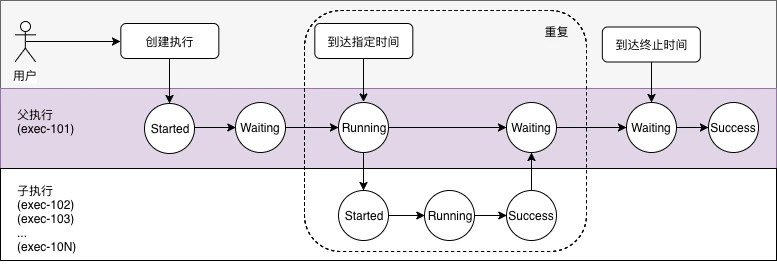

流程图说明如下：

- 用户创建执行后，父执行即进入等待（Waiting）状态。

- 到达指定时间后，父执行即进入执行中（Running）状态。同时，父执行自动创建一个子执行，使用同样的模板，同样的参数，但是跳过触发器任务（Trigger Task）直接执行后续任务。

- 等到子执行完成后，如图中的成功（Success）状态，也可以是失败（Failed）或取消状态（Cancelled），父执行重新进入等待（Waiting）状态，等待到达下次指定时间，然后重复上述步骤。

- 到达指定的终止时间后，父执行停止等待，完成执行并标记为成功（Success）。

- 用户可以像取消普通执行一样取消父执行或子执行，被取消的执行状态为取消（Cancelled）。

**示例**

cron类型

- YAML格式：

```text
FormatVersion: OOS-2019-06-01
Description: Schedule to reboot ECS instances.
Tasks:
  - Name: timer
    Action: ACS::TimerTrigger
    Properties:
      Type: cron
      Expression: 5 minute
      EndDate: 2020-12-20T00:00:00Z
  - Name: rebootInstance
    Action: ACS::ECS::RebootInstance
    Properties:
      InstanceId: "i-xxxxx"
```

- JSON格式：

```json
{
  "FormatVersion": "OOS-2019-06-01",
  "Description": "Schedule to reboot ECS instances.",
  "Tasks": [
    {
      "Name": "timer",
      "Action": "ACS::TimerTrigger",
      "Properties": {
        "Type": "cron",
        "Expression": "5 minute",
        "EndDate": "2020-12-20 00:00:00 UTC"
      }
    },
    {
      "Name": "rebootInstance",
      "Action": "ACS::ECS::RebootInstance",
      "Properties": {
        "InstanceId": "i-xxxxx"
      }
    }
  ]
}
```

at类型

- YAML格式：

```text
FormatVersion: OOS-2019-06-01
Description: Schedule to reboot ECS instances.
Tasks:
  - Name: timer
    Action: ACS::TimerTrigger
    Properties:
      Type: at
      Expression: '2020-02-29T09:17:35Z'
      EndDate: 2020-12-20T00:00:00Z
  - Name: rebootInstance
    Action: ACS::ECS::RebootInstance
    Properties:
      InstanceId: "i-xxxxx"
```

- JSON格式：

```json
{
  "FormatVersion": "OOS-2019-06-01",
  "Description": "Schedule to reboot ECS instances.",
  "Tasks": [
    {
      "Name": "timer",
      "Action": "ACS::TimerTrigger",
      "Properties": {
        "Type": "at",
        "Expression": "2020-02-29T09:17:35Z",
        "EndDate": "2020-12-20T00:00:00.000Z"
      }
    },
    {
      "Name": "rebootInstance",
      "Action": "ACS::ECS::RebootInstance",
      "Properties": {
        "InstanceId": "i-xxxxx"
      }
    }
  ]
}
```

<a id="section-3-3"></a>

## 3.3. 控制类动作

<a id="section-3-3-1"></a>

### 3.3.1. 审批ACS::Approve

用于审批任务的动作。

**用途**

在自动化运维的一些场景中，有些特殊的操作需要被特殊关注，例如删除重要资源，或使用费用较高的实例等。如果把这些操作也纳入自动化的范畴，您可能会担心失去控制，超过预算。若不纳入自动化的范畴，又会导致这些操作退化到手工执行或其他非自动化方式。审批动作能够让您在自动化和特殊关注之间寻找一个平衡。

当执行一个模板中包括审批动作，且执行到审批动作这一步时，OOS执行引擎会暂停执行，执行进入等待中状态，并发送一个包含通知的审批链接到管理员用户。在访问审批链接后，管理员可根据业务需求做出决定，同意或拒绝，同意后则OOS引擎继续执行后续任务，拒绝后引擎停止执行，执行状态为取消（Cancelled）。

**语法**

**Webhook**

对于钉钉，可以通过Webhook的方式支持。

- YAML格式

```text
Tasks:
  - Name: approvalTask
    Action: ACS::Approve
    Properties:
          AppendExecutionLink: 'true' # 是否附加执⾏详情链接，可选项true和false。ACS::Approve
动作默认为true。
          Approvers: ["user1", "user2"， "user3"] # 待审批的RAM⼦账号名字。
      MinRequiredApprovals: 2  # 审批通过时⾄少需要赞同的⼈数。
      NotifyType: WebHook
      WebHook:
        URI: url # 必填，webhook地址，如https://oapi.dingtalk.com/robot/send?access_token=
xxxxxx
        Headers: # 可选，Http请求的Headers，如Content-Type
          Content-Type: 'application/json; charset=utf-8'
        Content: # 必填，根据具体的Webhook要求提供，如钉钉webhook要求如下：https://open-doc.dingtalk.com/docs/doc.htm?treeId=257&articleId=105735&docType=1 
          msgtype: text
          text:
            content: 'the approve notify to user'  # 必填，发送审批通知的内容。
          at:  # 在钉钉群中@的⽤户
            atMobiles: # 可选，@群⾥⾯的指定⽤户，此处的⼿机号为⽤户注册钉钉的⼿机号。
                        - 138albb1234
                        - 130albb1234
            isAtAll: 'false'  # 可选，是否@所有⽤户，可选true 或 false，默认为false。
```

- JSON格式（请参照YAML注释说明）

```json
{
  "Tasks": [
    {
      "Name": "approvalTask",
      "Action": "ACS::Approve",
      "Properties": {
        "AppendExecutionLink": "true",
        "Approvers": [
          "user1",
          "user2",
          "user3"
        ],
        "MinRequiredApprovals": 2,
        "NotifyType": "WebHook",
        "WebHook": {
          "URI": "url",
          "Headers": {
            "Content-Type": "application/json; charset=utf-8"
          },
          "Content": {
            "msgtype": "text",
            "text": {
              "content": "the approve notify to user"
            },
            "at": {
              "atMobiles": [
                "138albb1234",
                "130albb1234"
              ],
              "isAtAll": "false"
            }
          }
        }
      }
    }
  ]
}
```

**示例**

以下模板：在删除实例前需要审批。

- YAML格式

```yaml
---
FormatVersion: OOS-2019-06-01
Description:
  en: Bulky restarts the ECS instances with Approval.
  zh-cn: 批量重启ECS实例带审批。
  name-en: BulkyRebootInstancesWithApproval
  name-zh-cn: 批量重启ECS实例带审批
Parameters:
  targets:
    Type: Json
    AssociationProperty: Targets
    AssociationPropertyMetadata:
      ResourceType: 'ALIYUN::ECS::Instance'
  rateControl:
    Description:
      en: Concurrency ratio of task execution.
      zh-cn: 任务执⾏的并发比率。
    Type: Json
    AssociationProperty: RateControl
    Default:
      Mode: Concurrency
      MaxErrors: 0
      Concurrency: 100%
  webHookUrl:
    Description:
      en: >-
        The webHook url of dingtalk group assistant,
        e.g.https://oapi.dingtalk.com/robot/send?access_token=1234zxcvaksdq31414.
      zh-cn: >-
        钉钉群助⼿的webhook地址，形如https://oapi.dingtalk.com/robot/send?
access_token=1234zxcvaksdq31414。
    Type: String
  atMobiles:
    Description:
      en: >-
        The telephone numbers of member in dingtalk group assistant @, when
        notify comes.
      zh-cn: 当群助⼿向钉钉群中发送审批通知时，要被@的群成员注册钉钉所⽤⼿机号。
    Type: List
    Default:
      - '12345678901'
  atAll:
    Description:
      en: 'assistant @ all members in dingtalk group or not, when notify comes.'
      zh-cn: 当群助⼿向钉钉群中发送审批通知时是否@所有⼈。
    Type: String
    Default: 'false'
  OOSAssumeRole:
    Description:
      en: The RAM role to be assumed by OOS.
      zh-cn: OOS扮演的RAM⾓⾊。
    Type: String
    Default: OOSServiceRole
RamRole: '{{ OOSAssumeRole }}'
Tasks:
  - Name: getInstance
    Description:
      en: Views the ECS instances.
      zh-cn: 获取ECS实例。
    Action: 'ACS::SelectTargets'
    Properties:
      ResourceType: 'ALIYUN::ECS::Instance'
      Filters:
        - '{{ targets }}'
    Outputs:
      instanceIds:
        Type: List
        ValueSelector: 'Instances.Instance[].InstanceId'
      instanceNames:
        Type: List
        ValueSelector: 'Instances.Instance[].InstanceName'
  - Name: approveRestart
    Action: 'ACS::Approve'
    Properties:
      NotifyType: WebHook
      WebHook:
        URI: '{{webhookUrl}}'
        Headers:
          Content-Type: application/json
        Content:
          msgtype: text
          text:
            content: >-
              Notify: please approve instances restart, instance names to
              approve  are {{getInstance.instanceNames}}, sent by
              {{ACS::RegionId}} oos {{ACS::ExecutionId}}.
          at:
            atMobiles: '{{atMobiles}}'
            isAtAll: '{{atAll}}'
  - Name: rebootInstance
    Action: 'ACS::ECS::RebootInstance'
    Description:
      en: Restarts the ECS instances.
      zh-cn: 重启实例。
    Properties:
      instanceId: '{{ ACS::TaskLoopItem }}'
    Loop:
      RateControl: '{{ rateControl }}'
      Items: '{{ getInstance.instanceIds }}'
Outputs:
  instanceIds:
    Type: List
    Value: '{{ getInstance.instanceIds }}'
```

- JSON格式

```json
{
  "FormatVersion": "OOS-2019-06-01",
  "Description": {
    "en": "Bulky restarts the ECS instances with Approval.",
    "zh-cn": "批量重启ECS实例带审批。",
    "name-en": "BulkyRebootInstancesWithApproval",
    "name-zh-cn": "批量重启ECS实例带审批"
  },
  "Parameters": {
    "targets": {
      "Type": "Json",
      "AssociationProperty": "Targets",
      AssociationPropertyMetadata: {
        "ResourceType": "ALIYUN::ECS::Instance"
      }
    },
    "rateControl": {
      "Description": {
        "en": "Concurrency ratio of task execution.",
        "zh-cn": "任务执⾏的并发比率。"
      },
      "Type": "Json",
      "AssociationProperty": "RateControl",
      "Default": {
        "Mode": "Concurrency",
        "MaxErrors": 0,
        "Concurrency": "100%"
      }
    },
    "webHookUrl": {
      "Description": {
        "en": "The webHook url of dingtalk group assistant, 
e.g.https://oapi.dingtalk.com/robot/send?access_token=1234zxcvaksdq31414.",
        "zh-cn": "钉钉群助⼿的webhook地址，形如https://oapi.dingtalk.com/robot/send?access_token=1234zxcvaksdq31414。"
      },
      "Type": "String"
    },
    "atMobiles": {
      "Description": {
        "en": "The telephone numbers of member in dingtalk group assistant @, when 
notify comes.",
        "zh-cn": "当群助⼿向钉钉群中发送审批通知时，要被@的群成员注册钉钉所⽤⼿机号。"
      },
      "Type": "List",
      "Default": [
        "12345678901"
      ]
    },
    "atAll": {
      "Description": {
        "en": "assistant @ all members in dingtalk group or not, when notify comes.",
        "zh-cn": "当群助⼿向钉钉群中发送审批通知时是否@所有⼈。"
      },
      "Type": "String",
      "Default": "false"
    },
    "OOSAssumeRole": {
      "Description": {
        "en": "The RAM role to be assumed by OOS.",
        "zh-cn": "OOS扮演的RAM⾓⾊。"
      },
      "Type": "String",
      "Default": "OOSServiceRole"
    }
  },
  "RamRole": "{{ OOSAssumeRole }}",
  "Tasks": [
    {
      "Name": "getInstance",
      "Description": {
        "en": "Views the ECS instances.",
        "zh-cn": "获取ECS实例。"
      },
      "Action": "ACS::SelectTargets",
      "Properties": {
        "ResourceType": "ALIYUN::ECS::Instance",
        "Filters": [
          "{{ targets }}"
        ]
      },
      "Outputs": {
        "instanceIds": {
          "Type": "List",
          "ValueSelector": "Instances.Instance[].InstanceId"
        },
        "instanceNames": {
          "Type": "List",
          "ValueSelector": "Instances.Instance[].InstanceName"
        }
      }
    },
    {
      "Name": "approveRestart",
      "Action": "ACS::Approve",
      "Properties": {
        "NotifyType": "WebHook",
        "WebHook": {
          "URI": "{{webhookUrl}}",
          "Headers": {
            "Content-Type": "application/json"
          },
          "Content": {
            "msgtype": "text",
            "text": {
              "content": "Notify: please approve instances restart, instance names to 
approve  are {{getInstance.instanceNames}}, sent by {{ACS::RegionId}} oos 
{{ACS::ExecutionId}}."
            },
            "at": {
              "atMobiles": "{{atMobiles}}",
              "isAtAll": "{{atAll}}"
            }
          }
        }
      }
    },
    {
      "Name": "rebootInstance",
      "Action": "ACS::ECS::RebootInstance",
      "Description": {
        "en": "Restarts the ECS instances.",
        "zh-cn": "重启实例。"
      },
      "Properties": {
        "instanceId": "{{ ACS::TaskLoopItem }}"
      },
      "Loop": {
        "RateControl": "{{ rateControl }}",
        "Items": "{{ getInstance.instanceIds }}"
      }
    }
  ],
  "Outputs": {
    "instanceIds": {
      "Type": "List",
      "Value": "{{ getInstance.instanceIds }}"
    }
  }
}
```

<a id="section-3-3-2"></a>

### 3.3.2. 选择ACS::Choice

**用途**

根据条件判断结果来选择接下来将执行的任务。比如对一个实例重启前，要查询该实例的状态，根据状态结果选择将执行的任务，若该实例为运行中，那么执行对实例重启的任务；若该实例为已停止，执行对实例启动的任务，若以上状态均不是，则执行查询实例状态的任务。

**语法**

- YAML格式

```text
Tasks:
- Name: chooseNextTaskToRun # 任务名称
  Action: ACS::Choice
  Properties:
    DefaultTask:  task1  #执⾏完该chooseNextTaskToRun任务，若无Choices中条件满⾜时，默认将执⾏
名称为task1的任务。task1不允许是对参数引⽤获取的任务名，其必须是确定的字符串格式的任务名称。
    Choices:
      - When: condition1  # 待判断的条件1。
        NextTask: task2  # 当condition1为true时，执⾏完该chooseNextTaskToRun任务，将执⾏名称
为task2的任务。task2不允许是对参数引⽤获取的任务名，其必须是确定的字符串格式的任务名称。
      - When: condition2 # 待判断的条件2。
        NextTask: task3 # 当condition2为true时，执⾏完该chooseNextTaskToRun任务，将执⾏名称为task3的任务。task3不允许是对参数引⽤获取的任务名，其必须是确定的字符串格式的任务名称。
                # 如有需要，Choices中还可有多个When判断条件。
                #...
```

- JSON格式（请参照YAML注释说明）

```json
{
  "Tasks": [{
      "Name": "chooseNextTaskToRun",
      "Action": "ACS::Choice",
      "Properties": {
        "DefaultTask": "task1",
        "Choices": [
          {
            "When": "condition1",
            "NextTask": "task2"
          },
          {
            "When": "condition2",
            "NextTask": "task3"
          }]}}]
}
```

**示例**

- YAML格式

```text
FormatVersion: OOS-2019-06-01
Description:
  en: Bulky restarts the ECS instances.
  zh-cn: 批量重启ECS实例。
  name-en: ACS-ECS-BulkyRebootInstances
  name-zh-cn: 批量重启ECS实例
Parameters:
  targets:
    Type: Json
    AssociationProperty: Targets
    AssociationPropertyMetadata:
      ResourceType: 'ALIYUN::ECS::Instance'
  rateControl:
    Description:
      en: Concurrency ratio of task execution.
      zh-cn: 任务执⾏的并发比率。
    Type: Json
    AssociationProperty: RateControl
  OOSAssumeRole:
    Description:
      en: The RAM role to be assumed by OOS.
      zh-cn: OOS扮演的RAM⾓⾊。
    Type: String
    Default: OOSServiceRole
RamRole: '{{ OOSAssumeRole }}'
Tasks:
  - Name: getInstance
    Description:
      en: Views the ECS instances.
      zh-cn: 获取ECS实例。
    Action: 'ACS::SelectTargets'
    Properties:
      ResourceType: 'ALIYUN::ECS::Instance'
      Filters:
        - '{{ targets }}'
    Outputs:
      instanceIds:
        Type: List
        ValueSelector: 'Instances.Instance[].InstanceId'
  - Name: describeInstances
    Action: ACS::ExecuteAPI
    Description: Views A ECS instances Status.
    Properties:
      Service: ECS
      API: DescribeInstances
      Parameters:
        InstanceIds: '{{ getInstance.instanceIds }}'
    Outputs:
      status:
        Type: String
        ValueSelector: Instances.Instance[].Status
  - Name: whetherStatusRunning
    Action: 'ACS::Choice'
    Properties:
      DefaultTask: describeInstancesFinally
      Choices:
        - When:
            'Fn::Equals':
              - Running
              - '{{ describeInstances.status }}'
          NextTask: rebootInstance
        - When:
            'Fn::Equals':
              - Stopped
              - '{{ describeInstances.status }}'
          NextTask: startInstance
  - Name: startInstance
    Action: 'ACS::ECS::StartInstance'
    Description:
      en: Starts the ECS instances.
      zh-cn: 启动实例。
    Properties:
      instanceId: '{{ ACS::TaskLoopItem }}'
    Loop:
      RateControl: '{{ rateControl }}'
      Items: '{{ getInstance.instanceIds }}'
  - Name: rebootInstance
    Action: 'ACS::ECS::RebootInstance'
    Description:
      en: Restarts the ECS instances.
      zh-cn: 重启实例。
    Properties:
      instanceId: '{{ ACS::TaskLoopItem }}'
    Loop:
      RateControl: '{{ rateControl }}'
      Items: '{{ getInstance.instanceIds }}'
  - Name: describeInstancesFinally
    Action: ACS::ExecuteAPI
    Description: Views the ECS instances Status.
    Properties:
      Service: ECS
      API: DescribeInstances
      Parameters:
        InstanceIds: '{{ getInstance.instanceIds }}'
    Outputs:
      status:
        Type: String
        ValueSelector: Instances.Instance[].Status
Outputs:
  instanceIds:
    Type: List
    Value: '{{ getInstance.instanceIds }}'
                        
```

- JSON格式

```json
{
"FormatVersion": "OOS-2019-06-01",
"Description": {
"en": "Bulky restarts the ECS instances.",
"zh-cn": "批量重启ECS实例。",
"name-en": "ACS-ECS-BulkyRebootInstances",
"name-zh-cn": "批量重启ECS实例"
},
"Parameters": {
"targets": {
"Type": "Json",
"AssociationProperty": "Targets",
"AssociationPropertyMetadata": {
    "ResourceType": "ALIYUN::ECS::Instance"
}
},
"rateControl": {
"Description": {
    "en": "Concurrency ratio of task execution.",
    "zh-cn": "任务执⾏的并发比率。"
},
"Type": "Json",
"AssociationProperty": "RateControl"
},
"OOSAssumeRole": {
"Description": {
    "en": "The RAM role to be assumed by OOS.",
    "zh-cn": "OOS扮演的RAM⾓⾊。"
},
"Type": "String",
"Default": "OOSServiceRole"
}
},
"RamRole": "{{ OOSAssumeRole }}",
"Tasks": [
{
"Name": "getInstance",
"Description": {
    "en": "Views the ECS instances.",
    "zh-cn": "获取ECS实例。"
},
"Action": "ACS::SelectTargets",
"Properties": {
    "ResourceType": "ALIYUN::ECS::Instance",
    "Filters": [
      "{{ targets }}"
    ]
},
"Outputs": {
    "instanceIds": {
      "Type": "List",
      "ValueSelector": "Instances.Instance[].InstanceId"
    }
}
},
{
"Name": "describeInstances",
"Action": "ACS::ExecuteAPI",
"Description": "Views A ECS instances Status.",
"Properties": {
    "Service": "ECS",
    "API": "DescribeInstances",
    "Parameters": {
      "InstanceIds": "{{ getInstance.instanceIds }}"
    }
},
"Outputs": {
    "status": {
      "Type": "String",
      "ValueSelector": "Instances.Instance[].Status"
    }
}
},
{
"Name": "whetherStatusRunning",
"Action": "ACS::Choice",
"Properties": {
    "DefaultTask": "describeInstancesFinally",
    "Choices": [
      {
        "When": {
          "Fn::Equals": [
            "Running",
            "{{ describeInstances.status }}"
          ]
        },
        "NextTask": "rebootInstance"
      },
      {
        "When": {
          "Fn::Equals": [
            "Stopped",
            "{{ describeInstances.status }}"
          ]
        },
        "NextTask": "startInstance"
      }
    ]
}
},
{
"Name": "startInstance",
"Action": "ACS::ECS::StartInstance",
"Description": {
    "en": "Starts the ECS instances.",
    "zh-cn": "启动实例。"
},
"Properties": {
    "instanceId": "{{ ACS::TaskLoopItem }}"
},
"Loop": {
    "RateControl": "{{ rateControl }}",
    "Items": "{{ getInstance.instanceIds }}"
}
},
{
"Name": "rebootInstance",
"Action": "ACS::ECS::RebootInstance",
"Description": {
    "en": "Restarts the ECS instances.",
    "zh-cn": "重启实例。"
},
"Properties": {
    "instanceId": "{{ ACS::TaskLoopItem }}"
},
"Loop": {
    "RateControl": "{{ rateControl }}",
    "Items": "{{ getInstance.instanceIds }}"
}
},
{
"Name": "describeInstancesFinally",
"Action": "ACS::ExecuteAPI",
"Description": "Views the ECS instances Status.",
"Properties": {
    "Service": "ECS",
    "API": "DescribeInstances",
    "Parameters": {
      "InstanceIds": "{{ getInstance.instanceIds }}"
    }
},
"Outputs": {
    "status": {
      "Type": "String",
      "ValueSelector": "Instances.Instance[].Status"
    }
}
}
],
"Outputs": {
"instanceIds": {
"Type": "List",
"Value": "{{ getInstance.instanceIds }}"
}}}
```

<a id="section-3-3-3"></a>

### 3.3.3. 通知ACS::Notify

**用途**

该动作可以用在运维任务完成后用户需要被告知的场景。如在购买ECS实例完成以后，发送一个钉钉通知便于您对账单有实时的了解。

**语法**

当前支持Webhook和Mail两种通知类型，定义方式如下。

**Webhook**

- YAML格式

```text
Tasks:
  - Name: notifyTask
    Action: ACS::Notify
    Properties:
      NotifyType: WebHook
          AppendExecutionLink: 'false' # 是否附加执⾏详情链接，可选项true和false。ACS::Notify
动作默认为false。
      WebHook:
        URI: url # 必填，webhook地址，如https://oapi.dingtalk.com/robot/send?access_token=
xxxxxx
        Headers: # 可选，Http请求的Headers，如Content-Type
          Content-Type: 'application/json; charset=utf-8'
        Content: # 必填，根据具体的Webhook要求提供，如钉钉webhook要求如下：https://open-doc.dingtalk.com/docs/doc.htm?treeId=257&articleId=105735&docType=1 
          msgtype: text
          text: 
            content: 'this is a dingtalk message with a parameter {{ p1 }}'
```

- JSON格式（请参照YAML注释说明）

```json
{
  "Tasks": [
    {
      "Name": "notifyTask",
      "Action": "ACS::Notify",
      "Properties": {
        "NotifyType": "WebHook",
        "AppendExecutionLink": "false",
        "WebHook": {
          "URI": "url",
          "Headers": {
            "Content-Type": "application/json; charset=utf-8"
          },
          "Content": {
            "msgtype": "text",
            "text": {
              "content": "this is a dingtalk message with a parameter {{ p1 }}"
            }
          }
        }
      }
    }
  ]
}
```

**Mail**

- YAML格式

```text
Tasks:
  - Action: ACS::Notify
    Name: testNotifyByMail
    Properties:
        NotifyType: Mail
        Mail:
                Host: SMTPHostAddress # SMTP 服务器主机地址如 smtp.example1.com
            Port: SMTPPort # SMTP 服务器端⼝如 465
            Username: sender  # 代发送的邮箱⽤户如 usr001@example1.com
            Password: senderPassword # 代发送的邮箱密码如 123456zxcv
            Subject: mailSubject # 邮件主题如 hello world
            Body: mailBody # 邮件正⽂如 hello world ！！！
            From: senderAddress # 邮件来⾃如 usr001@example1.com
            To:  receiverAddresses        # 收件⼈邮箱地址列表如 
[usr1234@example2.com,usr123@example2.com]
```

- JSON格式（请参照YAML注释说明）

```json
{
  "Tasks": [
    {
      "Action": "ACS::Notify",
      "Name": "testNotifyByMail",
      "Properties": {
        "NotifyType": "Mail",
        "Mail": {
          "Host": "SMTPHostAddress",
          "Port": "SMTPPort",
          "Username": "sender",
          "Password": "senderPassword",
          "Subject": "mailSubject",
          "Body": "mailBody",
          "From": "senderAddress",
          "To": "receiverAddresses"
        }
      }
    }
  ]
}
```

**示例**

- YAML格式

```yaml
---
FormatVersion: OOS-2019-06-01
Outputs:
    InstanceIds:
        Type: List
        Value: ' {{ runInstances.InstanceIds }} '
Parameters:
    ImageId:
        Description: the image id for the new instances.
        Type: String
    InstanceType:
        Description: the Instance Type for the new instances.
        Type: String
    OOSAssumeRole:
        Default: OOSServiceRole
        Description: oos assume this role to execution task
        Type: String
    SecurityGroupId:
        Description: the security group id for the new instances.
        Type: String
    VSwitchId:
        Description: the virtual switch id for the new instances.
        Type: String
RamRole: '{{OOSAssumeRole}}'
Tasks:
-   Action: ACS::ExecuteAPI
    Description: 'run instances with specified parameters'
    Name: runInstances
    Outputs:
        InstanceIds:
            Type: List
            ValueSelector: .InstanceIdSets.InstanceIdSet[]
    Properties:
        API: RunInstances
        Parameters:
            ImageId: '{{ ImageId }}'
            InstanceType: '{{ InstanceType }}'
            SecurityGroupId: '{{ SecurityGroupId }}'
            VSwitchId: '{{ VSwitchId }}'
        Service: ECS
-   Action: ACS::Notify
    Name: test_notify
    Properties:
        NotifyType: WebHook
        WebHook:
            Content:
                msgtype: text
                text: 
                        content: 
            Headers:
                Content-Type: application/json
            URI: https://oapi.dingtalk.com/robot/send?access_token=your_access_token
```

- JSON格式

```json
{
    "FormatVersion": "OOS-2019-06-01",
    "Outputs": {
        "InstanceIds": {
            "Type": "List"
            "Value": " {{ runInstances.InstanceIds }} "
        }
    },
    "Parameters": {
        "ImageId": {
            "Description": "the image id for the new instances.",
            "Type": "String"
        },
        "InstanceType": {
            "Description": "the Instance Type for the new instances.",
            "Type": "String"
        },
        "SecurityGroupId": {
            "Description": "the security group id for the new instances.",
            "Type": "String"
        },
        "VSwitchId": {
            "Description": "the virtual switch id for the new instances.",
            "Type": "String"
        },
          "OOSAssumeRole": {
                      "Type": "String",
                      "Description":  "oos assume this role to execution task",
                      "Default": "OOSServiceRole"
    }
    },
    "RamRole": "{{OOSAssumeRole}}",
    "Tasks": [
        {
            "Action": "ACS::ExecuteAPI",
            "Description": "run instances with specified parametersl",
            "Name": "runInstances",
            "Outputs": {
                "InstanceIds": {
                    "Type": "List",
                    "ValueSelector": ".InstanceIdSets.InstanceIdSet[]"
                }
            },
            "Properties": {
                "API": "RunInstances",
                "Parameters": {
                    "ImageId": "{{ ImageId }}",
                    "InstanceType": "{{ InstanceType }}",
                    "SecurityGroupId": "{{ SecurityGroupId }}",
                    "VSwitchId": "{{ VSwitchId }}"
                },
                "Service": "ECS"
            }
        },
       {
      "Name": "test_notify",
      "Action": "ACS::Notify",
      "Properties": {
        "NotifyType": "WebHook",
        "WebHook": {
          "URI": "https://oapi.dingtalk.com/robot/send?access_token=your_access_token",
          "Headers": {
            "Content-Type": "application/json"
          },
          "Content": {
            "msgtype": "text",
            "text": {
              "content":"test"
            }
          }
        }
      }
    } 
    ]
}
```

<a id="section-3-3-4"></a>

### 3.3.4. 睡眠ACS::Sleep

**用途**

该动作可以适用于运维过程中需要等待的场景。如新创建的带应用的ECS实例需要预热一段时间，然后再进行后续的运维操作。

**语法**

- YAML格式

```text
Tasks:
  - Name: sleepTask # 任务名称
    Action: ACS::Sleep
    Properties:
      Duration: PT15M # 必填，需要睡眠的时间⻓度
```

- JSON格式（请参照YAML注释说明）

```json
{
  "Tasks": [
    {
      "Name": "sleepTask",
      "Action": "ACS::Sleep",
      "Properties": {
        "Duration": "PT15M"
      }
    }
  ]
}
```

**说明**

**Duration**

- 采取ISO8601标准进行时间长度定义。

- 限制：最短1秒钟，最长4小时。

- 不区分大小写。

示例：

- 1S或1s，简略写法，表示1秒钟

- 1M或1m，简略写法，表示1分钟。

- 1H或1h，简略写法，表示1小时。

- 1H2M，简略写法，表示1小时2分钟。

- PT1H2M，标准写法，表示1小时2分钟。

<a id="section-3-3-5"></a>

### 3.3.5. 选择目标资源ACS::SelectTargets

使用该动作，当设置参数时，批量选择资源将会非常方便。

**用途**

如果您在模版中使用了ACS::SelectTargets动作，并定义了包含"AssociationProperty": "Targets"的模版参数，当您创建执行来**设置参数**时，可轻易切换批量选取资源的方式。有手动选择资源、指定资源的标签、选择全部资源、CSV文件（包含资源ID）和指定配置清单条件几种方式，方便您快速完成资源的批量选择。

> **重要**
>
> 当前该动作支持的资源类型仅有ECS实例。

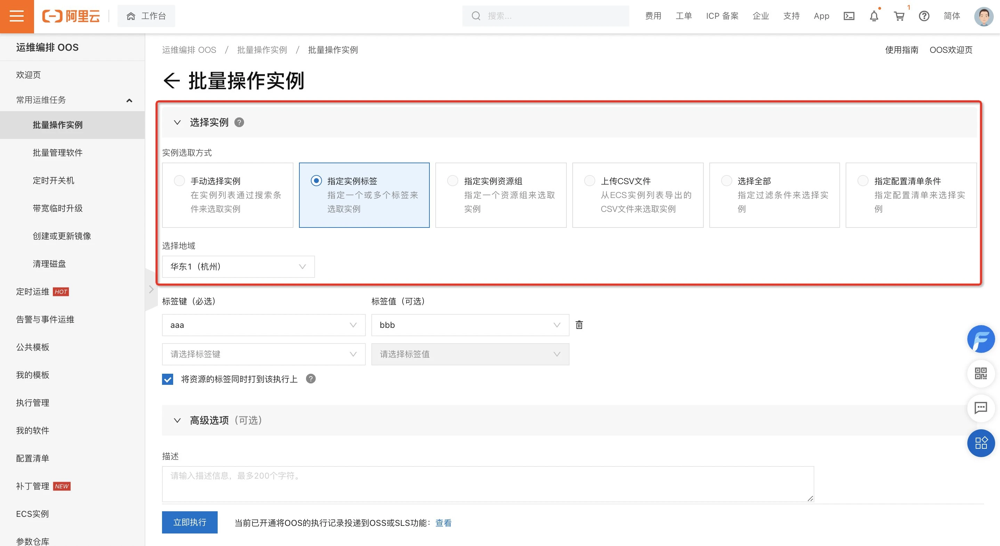

**语法**

- YAML格式

```text
FormatVersion: OOS-2019-06-01
Description: 'ACS::SelectTargets usage'
Parameters:
  targets:  # 参数名，⽤来选择资源范围。
    Type: Json  # 参数类型，固定为Json。
    AssociationProperty: Targets    # 参数关联的动作，对应ACS::SelectTargets时，固定为
Targets 。
    AssociationPropertyMetadata:  # 参数要选择的资源定义。
      ResourceType: 'ALIYUN::ECS::Instance' # 要选择的资源类型，资源为ECS实例时，固定为ALIYUN:
:ECS::Instance。
Tasks:
  - Name: getInstance # 任务名称。
    Action: 'ACS::SelectTargets'  # 确定选择具体资源的动作。
    Properties:
      ResourceType: 'ALIYUN::ECS::Instance'  # 要选择的资源类型。
      Filters: # 要筛选的范围。
        - '{{ targets }}'  # 选择资源范围的参数名。
    Outputs:  # 任务输出。
      instanceIds: # 任务输出参数名。
        Type: List  # 输出参数类型。
        ValueSelector: 'Instances.Instance[].InstanceId'  # jq Selector，其筛选的对象为该资
源类型的Describe OpenAPI返回结果，比如ECS实例的筛选对象则是DescribeInstances OpenAPI的返回结果。
```

- JSON格式（请参照YAML注释说明）

```json
{
  "FormatVersion": "OOS-2019-06-01",
  "Description": "ACS::SelectTargets usage",
  "Parameters": {
    "targets": {
      "Type": "Json",
      "AssociationProperty": "Targets",
      "AssociationPropertyMetadata": {
        "ResourceType": "ALIYUN::ECS::Instance"
      }
    }
  },
  "Tasks": [
    {
      "Name": "getInstance",
      "Action": "ACS::SelectTargets",
      "Properties": {
        "ResourceType": "ALIYUN::ECS::Instance",
        "Filters": [
          "{{ targets }}"
        ]
      },
      "Outputs": {
        "instanceIds": {
          "Type": "List",
          "ValueSelector": "Instances.Instance[].InstanceId"
        }
      }
    }
  ]
}
```

**模板示例**

- 批量启动ECS实例（YAML）

```text
FormatVersion: OOS-2019-06-01
Description:
  en: Bulky starts the ECS instances.
  zh-cn: 批量启动ECS实例。
  name-en: ACS-ECS-BulkyStartInstances
  name-zh-cn: 批量启动ECS实例
  categories:
    - instance_manage
Parameters:
  targets:
    Type: Json
    AssociationProperty: Targets
    AssociationPropertyMetadata:
      ResourceType: 'ALIYUN::ECS::Instance'
  rateControl:
    Description:
      en: Concurrency ratio of task execution.
      zh-cn: 任务执⾏的并发比率。
    Type: Json
    AssociationProperty: RateControl
    Default:
      Mode: Concurrency
      MaxErrors: 0
      Concurrency: 10
  OOSAssumeRole:
    Description:
      en: The RAM role to be assumed by OOS.
      zh-cn: OOS扮演的RAM⾓⾊。
    Type: String
    Default: OOSServiceRole
RamRole: '{{ OOSAssumeRole }}'
Tasks:
  - Name: getInstance
    Description:
      en: Views the ECS instances.
      zh-cn: 获取ECS实例。
    Action: 'ACS::SelectTargets'
    Properties:
      ResourceType: 'ALIYUN::ECS::Instance'
      Filters:
        - '{{ targets }}'
    Outputs:
      instanceIds:
        Type: List
        ValueSelector: 'Instances.Instance[].InstanceId'
  - Name: startInstance
    Action: 'ACS::ECS::StartInstance'
    Description:
      en: Starts the ECS instances.
      zh-cn: 启动实例。
    Properties:
      instanceId: '{{ ACS::TaskLoopItem }}'
    Loop:
      RateControl: '{{ rateControl }}'
      Items: '{{ getInstance.instanceIds }}'
Outputs:
  instanceIds:
    Type: List
    Value: '{{ getInstance.instanceIds }}'
```

- 批量启动ECS实例（JSON）

```json
{
  "FormatVersion": "OOS-2019-06-01",
  "Description": {
    "en": "Bulky starts the ECS instances.",
    "zh-cn": "批量启动ECS实例。",
    "name-en": "ACS-ECS-BulkyStartInstances",
    "name-zh-cn": "批量启动ECS实例",
    "categories": [
      "instance_manage"
    ]
  },
  "Parameters": {
    "targets": {
      "Type": "Json",
      "AssociationProperty": "Targets",
      "AssociationPropertyMetadata": {
        "ResourceType": "ALIYUN::ECS::Instance"
      }
    },
    "rateControl": {
      "Description": {
        "en": "Concurrency ratio of task execution.",
        "zh-cn": "任务执⾏的并发比率。"
      },
      "Type": "Json",
      "AssociationProperty": "RateControl",
      "Default": {
        "Mode": "Concurrency",
        "MaxErrors": 0,
        "Concurrency": 10
      }
    },
    "OOSAssumeRole": {
      "Description": {
        "en": "The RAM role to be assumed by OOS.",
        "zh-cn": "OOS扮演的RAM⾓⾊。"
      },
      "Type": "String",
      "Default": "OOSServiceRole"
    }
  },
  "RamRole": "{{ OOSAssumeRole }}",
  "Tasks": [
    {
      "Name": "getInstance",
      "Description": {
        "en": "Views the ECS instances.",
        "zh-cn": "获取ECS实例。"
      },
      "Action": "ACS::SelectTargets",
      "Properties": {
        "ResourceType": "ALIYUN::ECS::Instance",
        "Filters": [
          "{{ targets }}"
        ]
      },
      "Outputs": {
        "instanceIds": {
          "Type": "List",
          "ValueSelector": "Instances.Instance[].InstanceId"
        }
      }
    },
    {
      "Name": "startInstance",
      "Action": "ACS::ECS::StartInstance",
      "Description": {
        "en": "Starts the ECS instances.",
        "zh-cn": "启动实例。"
      },
      "Properties": {
        "instanceId": "{{ ACS::TaskLoopItem }}"
      },
      "Loop": {
        "RateControl": "{{ rateControl }}",
        "Items": "{{ getInstance.instanceIds }}"
      }
    }
  ],
  "Outputs": {
    "instanceIds": {
      "Type": "List",
      "Value": "{{ getInstance.instanceIds }}"
    }
  }
}
```

**不同实例选择方式targets参数示例**

- 根据实例ID选择（YAML）

```text
targets:
  Type: ResourceIds
  RegionId: cn-hangzhou
  ResourceIds:
    - i-******************1
    - i-******************2
    - i-******************3
```

- 根据实例ID选择（JSON）

```text
"targets": {
  "Type": "ResourceIds",
  "RegionId": "cn-hangzhou",
  "ResourceIds": [
    "i-******************1",
    "i-******************2",
    "i-******************3"
  ]
}
```

- 根据标签选择（YAML）

```text
targets:
  Type: Tags
  RegionId: cn-hangzhou
  Tags:
    - Key: key1
      Value: value1
    - Key: key2
      Value: value2
```

- 根据标签选择（JSON）

```text
"targets": {
  "Type": "Tags",
  "RegionId": "cn-hangzhou",
  "Tags": [
    {
      "Key": "key1",
      "Value": "value1"
    },
    {
      "Key": "key2",
      "Value": "value2"
    }
  ]
}
```

- 根据资源组选择（YAML）

```text
targets:
  Type: ResourceGroup
  RegionId: cn-hangzhou
  ResourceGroupId: rg-acf*********re3y
```

- 根据资源组选择（JSON）

```text
"targets": {
    "Type": "ResourceGroup",
    "RegionId": "cn-hangzhou",
    "ResourceGroupId": "rg-acf********re3y"
}
```

- 选择所有实例（YAML）

```text
targets:
    Type: All
    RegionId: cn-hangzhou
    Parameters:
      RegionId: cn-hangzhou
      Status: Running
      Tags:
        - Key: key1
          Value: value1
```

- 选择所有实例（JSON）

```text
"targets": {
    "Type": "All",
    "RegionId": "cn-hangzhou",
    "Parameters": {
      "RegionId": "cn-hangzhou",
      "Status": "Running",
      "Tags": [
        {
          "Key": "key1",
          "Value": "value1"
        }
      ]
    }
  }
```

- 根据指定配置清单条件选择（YAML）

```text
targets:
    Type: Inventory
    RegionId: cn-hangzhou
    InventoryFilters:
      - Name: TypeName
        Operator: Equal
        Value:
          - ACS:InstanceInformation
      - Name: ACS:InstanceInformation.Status
        Value:
          - Running
        Operator: Equal
```

- 根据指定配置清单条件选择（JSON）

```text
"targets": {
      "Type": "Inventory",
      "RegionId": "cn-hangzhou",
      "InventoryFilters": [
        {
          "Name": "TypeName",
          "Operator": "Equal",
          "Value": [
            "ACS:InstanceInformation"
          ]
        },
        {
          "Name": "ACS:InstanceInformation.Status",
          "Value": [
            "Running"
          ],
          "Operator": "Equal"
        }
      ]
    }
```

<a id="section-3-4"></a>

## 3.4. 嵌套类动作

<a id="section-3-4-1"></a>

### 3.4.1. 嵌套ACS::Template

调用其他的模板作为子模板进行嵌套执行。

**用途**

嵌套动作（ACS::Template）可以调用其他的模板作为子模板进行嵌套执行。利用该动作，您可以将一个复杂的模板进行模块化分解，拆分成多个子模板进行调用，也可以将常见的运维操作定义成一个可复用的子模板。另外云产品动作是OOS提供的常见类型云产品操作模版，您通过嵌套云产品动作可更便捷地进行嵌套调用。

**语法**

- 通用格式（适用于所有可被嵌套模版）

  - YAML

    ```text
    Tasks:
    - Name: callChildTemplate1
      Action: ACS::Template
      Properties:
        TemplateName: child_template_name # 必填，⼦模板名称
        TemplateVersion: v2 # 可选，默认取最新的版本。
        Parameters:  # 可选，⼦模板，根据⼦模板的参数提供参数。
          ParameterName1: value1
    ```

  - JSON（请参考YAML注释说明）

    ```json
    {
    "Tasks": [
      {
        "Name": "callChildTemplate1",
        "Action": "ACS::Template",
        "Properties": {
          "TemplateName": "child_template_name","TemplateVersion": "v2",
          "Parameters": {
            "ParameterName1": "value1"
          }
        }
      }
    ]
    }                                
    ```

- 简化格式（仅适用于嵌套云产品动作）

  - YAML

    ```text
    Tasks:
    - Name: taskName # 必填，任务名称，如runMyInstances
      Action: CloudProductActionName1  # 必填，云产品动作名称，如ACS::ECS::RunInstances
      Properties:
        ParameterName1: value1 # 可选，根据云产品动作需要的参数进⾏提供，如ImageId。
    ```

  - JSON（请参考YAML注释说明）

    ```json
    {
    "Tasks": [
      {
        "Name": "taskName",
        "Action": "CloudProductActionName1",
        "Properties": {
          "ParameterName1": "parameterName1"
        }
      }
    ]
    }
    ```

**限制**

嵌套动作有如下限制：

- 模板不能嵌套自身。

- 不能循环嵌套，即A嵌套B，B嵌套C，然后C嵌套A。

- 总的嵌套层数不能超过3层。

- 云产品动作属于一层嵌套，循环任务不属于嵌套。

**示例**

通过嵌套云产品动作 `ACS::ECS::CreateImage` 为ECS实例创建镜像。

- 通用定义格式（适用于所有可被嵌套模版）

  - YAML

  ```yaml
  ---
  FormatVersion: OOS-2019-06-01
  Description: Creates a custom image.
  Parameters:
    imageName:
      Description: The image name.
      Type: String
    instanceId:
      Description: The ID of the instance.
      Type: String
      AllowedPattern: i-[A-Za-z0-9]*
      MinLength: 1
      MaxLength: 30
    OOSAssumeRole:
      Type: String
      Description: oos assume this role to execution task
      Default: OOSServiceRole
  RamRole: '{{OOSAssumeRole}}'
  Tasks:
  - Name: createImage
    Action: ACS::Template
    Description: Creates a custom image.
    Properties:
      TemplateName: 'ACS::ECS::CreateImage'
      Parameters:
        ImageName: '{{ imageName }}'
        InstanceId: '{{ instanceId }}'
    Outputs:
      imageId:
        Type: String
        ValueSelector: ImageId
  Outputs:
    imageId:
      Type: String
      Value: '{{ createImage.imageId }}'        
  ```

  - JSON

  ```json
  {
      "FormatVersion": "OOS-2019-06-01",
      "Description": "Creates a custom image.",
      "Parameters": {
          "imageName": {
              "Description": "The image name.",
              "Type": "String"
          },
          "instanceId": {
              "Description": "The ID of the instance.",
              "Type": "String",
              "AllowedPattern": "i-[A-Za-z0-9]*",
              "MinLength": 1,
              "MaxLength": 30
          },
          "OOSAssumeRole": {
              "Type": "String",
              "Description": "oos assume this role to execution task",
              "Default": "OOSServiceRole"
          }
      },
      "RamRole": "{{OOSAssumeRole}}",
      "Tasks": [
          {
              "Name": "createImage",
              "Action": "ACS::Template",
              "Description": "Creates a custom image.",
              "Properties": {
                  "TemplateName": "ACS::ECS::CreateImage",
                  "Parameters": {
                      "ImageName": "{{ imageName }}",
                      "InstanceId": "{{ instanceId }}"
                  }
              },
              "Outputs": {
                  "imageId": {
                      "Type": "String",
                      "ValueSelector": "ImageId"
                  }
              }
          }
      ],
      "Outputs": {
          "imageId": {
              "Type": "String",
              "Value": "{{ createImage.imageId }}"
          }
      }
  }        
  ```

- 简化定义格式（仅适用于云产品动作）

  - YAML

  ```yaml
  ---
  FormatVersion: OOS-2019-06-01
  Description: Creates a new Image from existing ECS Instance.
  Parameters:
    InstanceId:
      Description: the Instance Type for the new instances
      Type: String
    ImageName:
      Description:  name of the new image
      Type: String
    OOSAssumeRole:
      Type: String
      Description: oos assume this role to execution task
      Default: OOSServiceRole
  RamRole: "{{OOSAssumeRole}}"
  Tasks:
    - Name: createImage
      Action: ACS::ECS::CreateImage
      Properties:
        ImageName: "{{ ImageName }}"
        InstanceId: "{{ InstanceId }}"
      Outputs:
        ImageId:
          ValueSelector: ImageId
          Type: String
  Outputs:
    ImageId:
      Type: String
      Value: "{{ createImage.ImageId }}"
  ```

  - JSON

  ```json
  {
    "FormatVersion": "OOS-2019-06-01",
    "Description": "Creates a new Image from existing ECS Instance.",
    "Parameters": {
      "InstanceId": {
        "Description": "the Instance Type for the new instances",
        "Type": "String"
      },
      "ImageName": {
        "Description": "name of the new image",
        "Type": "String"
      },
      "OOSAssumeRole": {
        "Type": "String",
        "Description": "oos assume this role to execution task",
        "Default": "OOSServiceRole"
      }
    },
    "RamRole": "{{OOSAssumeRole}}",
    "Tasks": [
      {
        "Name": "createImage",
        "Action": "ACS::ECS::CreateImage",
        "Properties": {
          "ImageName": "{{ ImageName }}",
          "InstanceId": "{{ InstanceId }}"
        },
        "Outputs": {
          "ImageId": {
            "ValueSelector": "ImageId",
            "Type": "String"
          }
        }
      }
    ],
    "Outputs": {
      "ImageId": {
        "Type": "String",
        "Value": "{{ createImage.ImageId }}"
      }
    }
  }
  ```

<a id="section-4"></a>

# 4.云产品动作

<a id="section-4-1"></a>

## 4.1. 弹性计算（ECS）类

本文介绍了各场景下的弹性计算（ECS）类云产品动作（包括其用途、涉及的API以及具体参数和输出、内容链接），您通过嵌套动作即可对云产品动作进行嵌套调用，关于具体如何调用云产品动作请参见嵌套ACS::Template。

**实例操作**

| 云产品动作名称 | 用途 | 相关的OpenAPI | 参数 | 动作输出 |
| --- | --- | --- | --- | --- |
| ACS::ECS::Descri beInstancesByTa g | 根据Tag查询实例ID | DescribeInstance s | • tagKey：String类型<br>• tagValue：String类型 | instanceIds：List类型 |
| ACS::ECS::RunIns tances | 启动一个或多个ECS实例 | • RunInstances<br>• DescribeInstan ces | • imageId：String类型<br>• instanceType：String类型<br>• securityGroupI d：String类型<br>• vSwitchId：String类型<br>• amount：String类型 | instanceIds：List类型 |
| ACS::ECS::RunIns tancesFromTemp late | 根据启动模板创建ECS实例 | • RunInstances<br>• DescribeInstan ces | • launchTemplat eId：String类型<br>• launchTemplat eName：String类型<br>• amount：Number类型 | instanceIds：List类型 |
| ACS::ECS::DeleteI nstance | 删除一个ECS实例 | DeleteInstance | instanceId：String类型 | - |
| ACS::ECS::StartIn stance | 启动一个ECS实例 | • StartInstance<br>• DescribeInstan ces | instanceId：String类型 | - |
| ACS::ECS::StopIn stance | 停止一个ECS实例 | • StopInstance<br>• DescribeInstan ces | instanceId：String类型 | - |
| ACS::ECS::Reboot Instance | 重启一个ECS实例 | • RebootInstanc e<br>• DescribeInstan ces | instanceId：String类型 | - |
| ACS::ECS::Descri beInstancesByNa me | 根据实例名称查询实例 | DescribeInstance s | instanceName：String类型 | instanceIds：List类型 |
| ACS::ECS::Descri beInstancesBySta tus | 根据实例状态查询实例 | DescribeInstance s | status：String类型 | instanceIds：List类型 |

**实例修改**

| 云产品动作名称 | 用途 | 相关的OpenAPI | 参数 | 动作输出 |
| --- | --- | --- | --- | --- |
| ACS::ECS::Resize Disk | 扩容一块数据盘 | • DescribeInstan ces<br>• ResizeDisk<br>• DescribeDisks<br>• RebootInstanc e | • diskId：String类型<br>• instanceId：String类型<br>• newSize：String类型 | - |
| ACS::ECS::ModifyI nstanceVpcAttrib ute | 修改一台ECS实例的专有网络VPC属性 | • StopInstance<br>• DescribeInstan ces<br>• ModifyInstance VpcAttribute | • instanceId：String类型<br>• vSwitchId：String类型 | - |
| ACS::ECS::ResetP assword | 修改一台ECS实例的密码 | • ModifyInstance Attribute<br>• RebootInstanc e<br>• DescribeInstan ces | • instanceId：String类型<br>• password：String类型 | instanceId：String类型 |
| ACS::ECS::Modify VncPassword | 修改一台ECS实例VNC密码 | • ModifyInstance VncPasswd<br>• RebootInstanc e<br>• DescribeInstan ces | • instanceId：String类型<br>• vncPassword：String类型 | - |
| ACS::ECS::Modify PrepaySpec | 升级或者降低预付费实例规格 | • StopInstance<br>• DescribeInstan ces<br>• ModifyPrepayI nstanceSpec<br>• StartInstance | • instanceId：String类型<br>• autoPay：String类型<br>• instanceType：String类型 | orderId：String类型 |
| ACS::ECS::Attach Disk | 安装磁盘 | • AttachDisk<br>• DescribeDisks | • instanceId：String类型<br>• diskId：String类型 | - |
| ACS::ECS::Detach Disk | 卸载磁盘 | • DetachDisk<br>• DescribeDisks | • instanceId：String类型<br>• diskId：String类型 | - |

**云助手**

| 云产品动作名称 | 用途 | 相关的OpenAPI | 参数 | 动作输出 |
| --- | --- | --- | --- | --- |
| ACS::ECS::Install CloudAssistant | 表示安装云助手 | • ModifyInstance Spec<br>• RebootInstanc e<br>• DescribeInstan ces<br>• DescribeCloud AssistantStatus | instanceId：String类型 | - |
| ACS::ECS::RunCo mmand | 表示执行远程命令 | • CreateComma nd<br>• InvokeComma nd<br>• DescribeInvoc ations<br>• DescribeInvoc ationResults<br>• DeleteComma nd | • instanceId：String类型<br>• commandCont ent：String类型<br>• commandType：String类型 | invocationResult：String类型 |

**其他**

| 云产品动作名称 | 用途 | 相关的OpenAPI | 参数 | 动作输出 |
| --- | --- | --- | --- | --- |
| ACS::ECS::CreateI mage | 表示创建镜像 | • DescribeInstan ces<br>• CreateImage<br>• DescribeImage s | • instanceId：String类型<br>• imageName：String类型 | imageId：String类型 |
| ACS::ECS::Create Snapshot | 表示创建快照 | • DescribeInstan ces<br>• CreateSnapsho t | • instanceId：String类型<br>• diskId：String类型<br>• snapshotName：String类型 | snapshotId：String类型 |
| ACS::ECS::ResetD isk | 表示回滚磁盘 | • StopInstance<br>• DescribeInstan ces<br>• ResetDisk | • instanceId：String类型<br>• diskId：String类型<br>• snapshotId：String类型 | - |
| ACS::ECS::Create AndAttachDisk | 表示创建并且安装磁盘 | • DescribeInstan ces<br>• CreateDisk<br>• DescribeDisks<br>• AttachDisk | • instanceId：String类型<br>• diskName：String类型<br>• zoneId：String类型<br>• diskCategory：String类型<br>• size：String类型 | diskId：String类型 |
| ACS::ECS::Replac eSystemDisk | 表示更换系统盘 | • StopInstance<br>• DescribeInstan ces<br>• ReplaceSyste mDisk<br>• StartInstance | • instanceId：String类型<br>• imageId：String类型 | - |
| ACS::ECS::ReInit Disk | 表示初始化云盘 | • DescribeDisks<br>• DescribeInstan ces<br>• ReInitDisk<br>• StartInstance | diskId：String类型 | - |
| ACS::ECS::Allocat ePublicIpAddress | 表示为一台实例分配一个公网IP地址 | • DescribeInstan ces<br>• AllocatePublicI pAddress<br>• RebootInstanc e | instanceId：String类型 | - |
| ACS::ECS::Create AndAttachNetwor kInterface | 创建并安装网卡 | • DescribeInstan ces<br>• CreateNetwork Interface<br>• AttachNetwork Interface | • instanceId：String类型<br>• securityGroupI d：String类型<br>• vSwitchId：String类型 | networkInterfaceI d：String类型 |
| ACS::ECS::DeleteI mage | 删除镜像 | DeleteImage | imageId：String类型 | - |
| ACS::ECS::InstallL ogtail | 安装日志服务 | • DescribeInstan ces<br>• CreateComma nd<br>• InvokeComma nd<br>• DescribeInvoc ations<br>• DescribeInvoc ationResults<br>• DeleteComma nd | • instanceId：String类型<br>• logTailUserDefi nedId：String类型<br>• OOSAssumeRo le：String类型 | • exitCode：String类型<br>• invocationResu lt：String类型 |

<a id="section-4-2"></a>

## 4.2. 钉钉（DingTalk）类

本文介绍了钉钉（DingTalk）类云产品动作（包括其用途、参数和输出、内容链接），您通过嵌套动作即可对云产品动作进行嵌套调用，关于具体如何调用云产品动作请参见嵌套ACS::Template。

| 云产品动作名称 | 用途 | 参数 | 动作输出 |
| --- | --- | --- | --- |
| ACS::Notify::DingTalk Webhook | 通过WebHook发送通知到钉钉 | • webhook：String类型<br>• msgtype：String类型<br>• text：Json类型<br>• link：Json类型<br>• markdown：Json类型<br>• at：Json类型 | - |
| ACS::Approve::DingTal kWebhook | 通过WebHook发送关于待审批事项的钉钉通知。此刻起，执行开始处于等待状态，直到待审批事项被同意或拒绝后，执行会根据审批结果继续或终止 | • webhook：String类型<br>• msgtype：String类型<br>• text：Json类型<br>• link：Json类型<br>• markdown：Json类型<br>• at：Json类型 | - |

<a id="section-5"></a>

# 5.执行

<a id="section-5-1"></a>

## 5.1. 执行概述

您可以对公共模版或自定义模版创建执行，同时OOS支持多种执行方式便于您更好地使用。

**执行方式**

- 自动执行：建议您先在测试环境使用，以便完全了解模板所进行的运维操作，并且结果符合预期，然后才在生产环境进行。

- 全自动执行：模版中定义的所有任务依次自动执行。

- 带风险提醒的执行：当执行到模版中定义的不可恢复性操作任务时（如删除、释放、停止类操作等），执行会切换为 **等待中** 状态，直到您对该任务执行完成了的审批操作其才会进行下一步。

- 单步执行：类似于调试（Debug）功能。当您需要详细地了解每一个任务的执行时，建议使用单步执行模式。

**风险提醒**

- 高风险操作需要二次确认：当一个运维任务的操作是不可撤销类型时，如删除ECS实例，您需要二次确认是否进行操作。建议您在执行新模板时，优先考虑此选择。

- 了解风险，无需确认：当您已经熟悉了模板所编排的所有任务后，您可以选择此模式跳过二次确认。

<a id="section-5-2"></a>

## 5.2. 全自动执行

使用运维编排（OOS）可对平台提供的公共模版或您自定义的模版进行执行创建，如果您对模版中所有任务的风险已充分了解，则可选择 客户了解风险，无需确认 的风险确认模式来启动全自动执行，下面来介绍启动公共模版执行的步骤。

1. 登录**运维编排管理控制台**。

2. 单击 **公共模版** ，选择您要执行的公共模版，单击 **创建执行** 。

   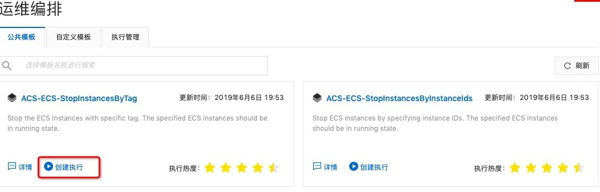

3. 单击 **下一步：设置参数** 。

   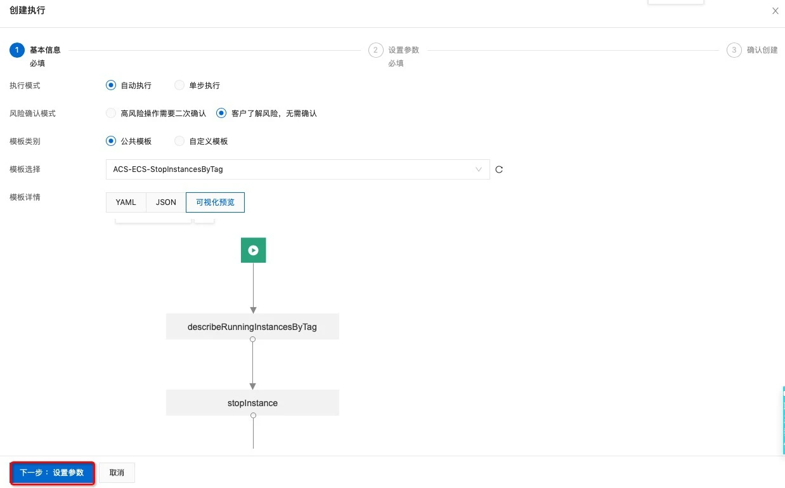

4. 输入该模版所需参数。为确保创建执行成功，请按如下操作确认OOS将使用的RAM角色的授权策略。请单击 **查看授权策略** ，然后登录**RAM控制台**，先确认OOS将使用的RAM角色已存在，再确认此RAM角色已具备模版执行所需的授权策略（即该角色已被授权策略的权限不低于 **查看授权策略** 的结果）。若OOS将使用的RAM角色仍未创建，或者此角色已创建但还没有模版执行所需授权策略。请单击 **自动授权策略**完成策略的授权。您也可单击 **前往RAM手动授权策略** 并参考 **最佳实践 为OOS服务设置RAM权限**章节通过手动设置完成策略授权。

   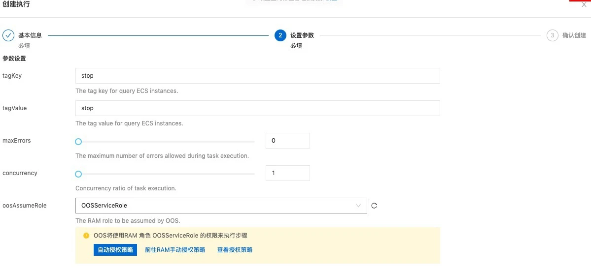

5. 单击 **下一步：确认创建** 。

6. 单击 **创建执行** 。

   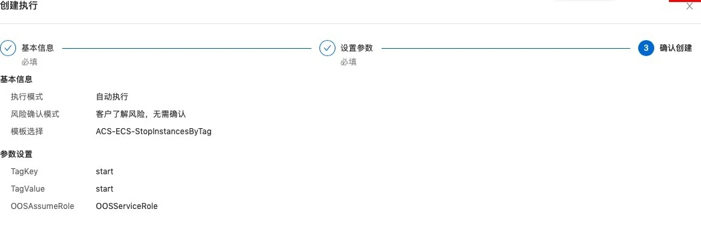

7. 您在执行管理栏中选择刚创建的执行，单击 **详情** ，查看执行状态。

   

<a id="section-5-3"></a>

## 5.3. 单步执行

使用运维编排（OOS）可对平台提供的公共模版或您自定义的模版进行执行创建。如果您想手动执行模版中的单个任务，可以创建执行时选择单步执行模式，下面介绍如何在控制台下进行单步调试。

1. 登录**运维编排管理控制台**。

2. 单击 **公共模版** ，选择您要执行的公共模版，单击 **创建执行** 。

   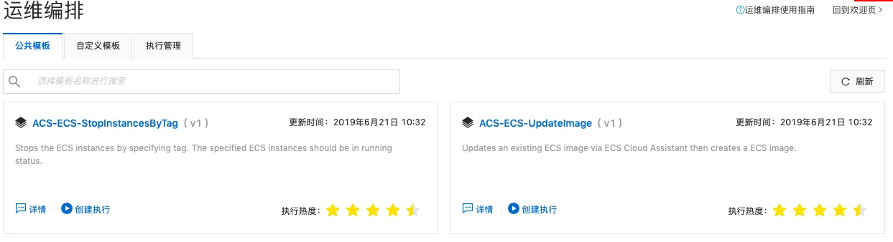

3. 单击 **单步执行。**

   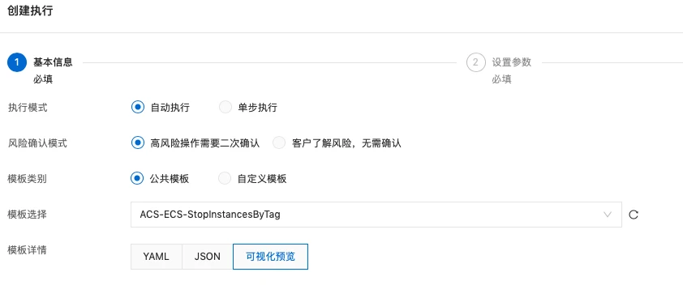

4. 单击 **下一步：设置参数** 。

   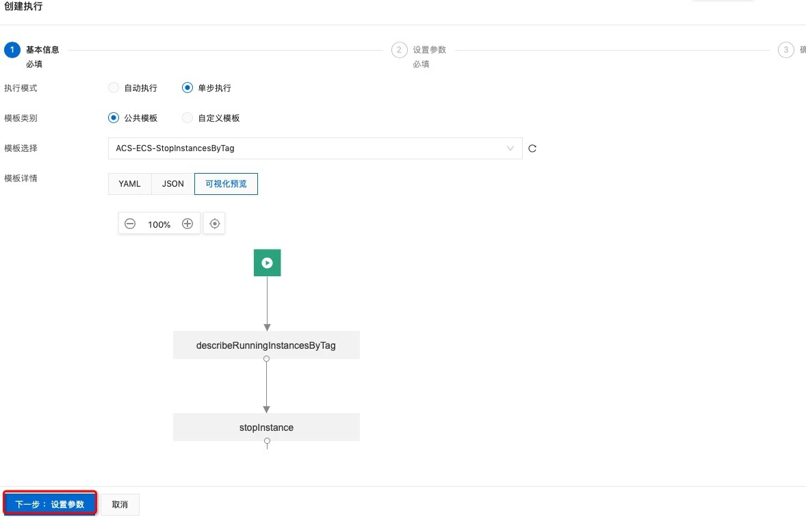

5. 输入该模版所需参数。为确保创建执行成功，请按如下操作确认OOS将使用的RAM角色的授权策略。 请单击 **查看授权策略** ，然后登录**RAM控制台**，先确认OOS将使用的RAM角色已存在，再确认此RAM角色已具备模版执行所需的授权策略（即该角色已被授权策略的权限不低于 **查看授权策略** 的结果）。若OOS将使用的RAM角色仍未创建，或者此角色已创建但还没有模版执行所需授权策略。请单击 **自动授权策略**完成策略的授权。您也可单击 **前往RAM手动授权策略** 并参考 **最佳实践 为OOS服务设置RAM权限**章节通过手动设置完成策略授权。

   

6. 单击 **下一步：确认创建** 。

7. 单击 **创建执行** 。

   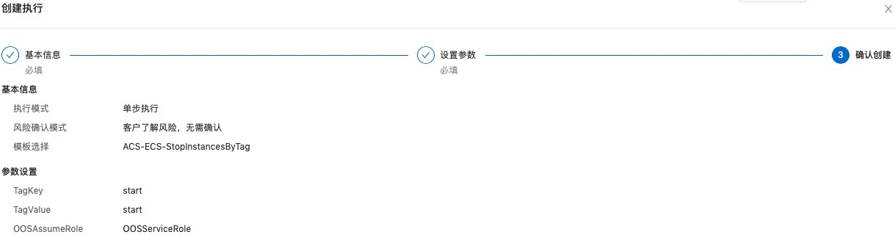

8. 您可在执行管理栏中找到刚创建的执行，单击 **详情** 进行查看。

   

9. 单击 **设置下一步** 。

   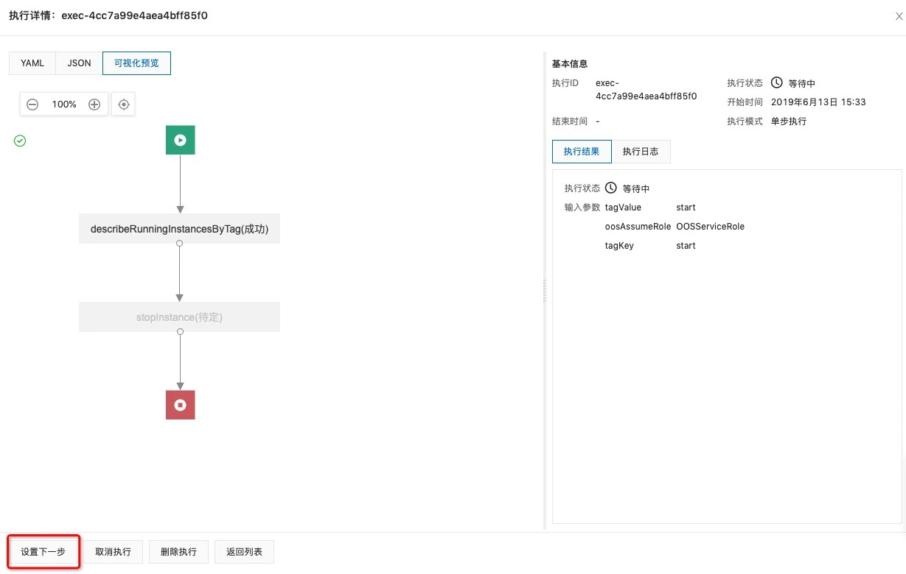

0. 单击 **确认。**

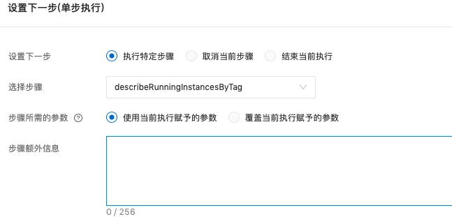

1. 单击 **执行日志** 。查看在调试任务执行情况。

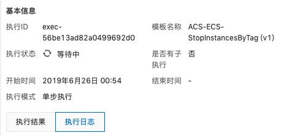

<a id="section-5-4"></a>

## 5.4. 查看执行详情

在使用运维编排（OOS）过程中，您随时可通过查看执行详情了解已存在执行的相关信息。

1. 登录**运维编排管理控制台**。

2. 单击 **执行管理** 。

3. 在执行列表中选择要查看的执行，单击 **详情** 。

   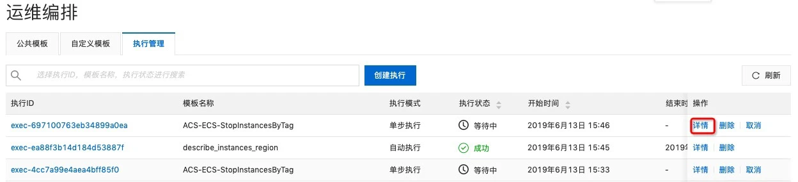

4. 您可在执行详情页面查看到执行如下相关信息。

   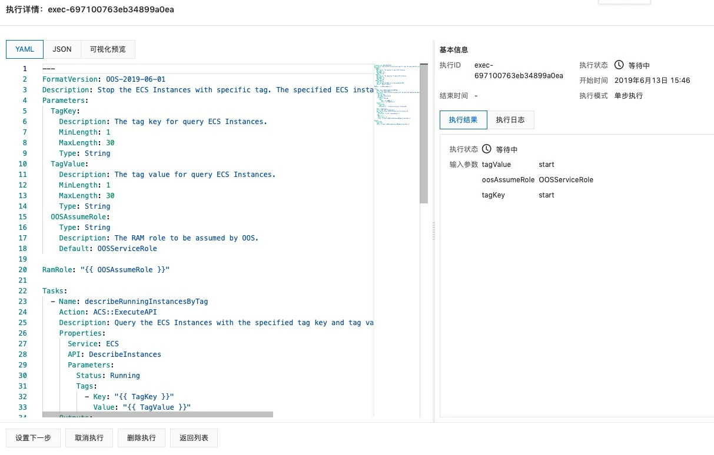

5. 单击 **可视化预览** ，可查看当前各任务执行状态。

   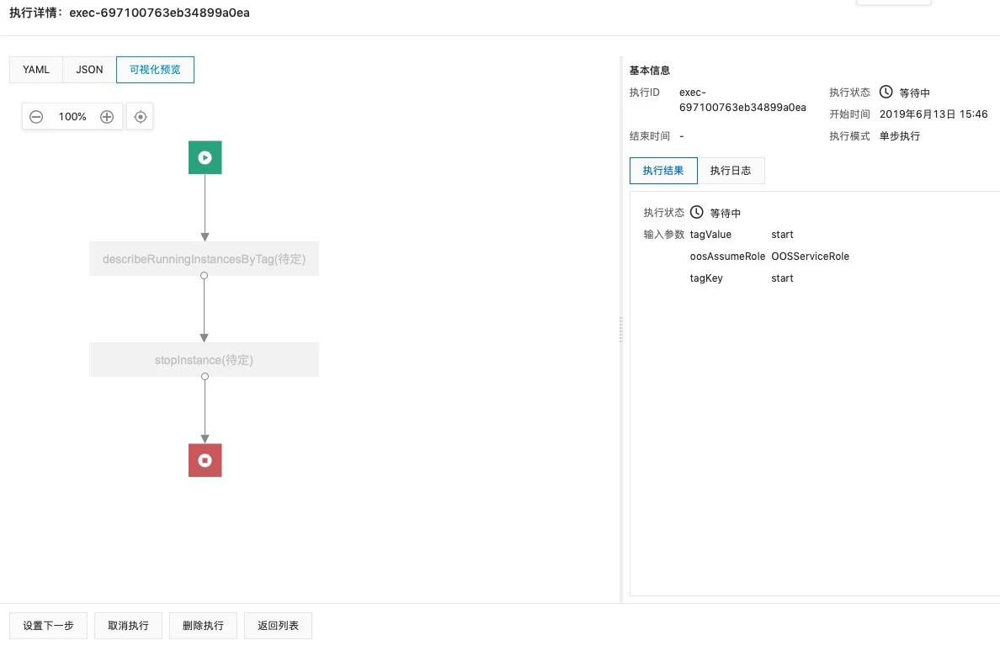

<a id="section-5-5"></a>

## 5.5. 取消执行

在使用运维编排（OOS）过程中，您可对执行进行取消操作。

1. 登录**运维编排管理控制台**。

2. 查看某个执行的详情。

3. 单击 **取消执行** 。

   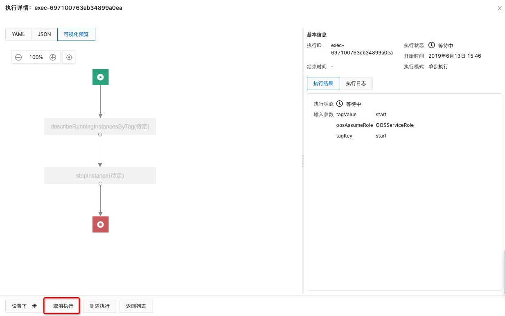

4. 单击 **确定** 取消执行。

   

<a id="section-5-6"></a>

## 5.6. 删除执行

在使用运维编排（OOS）过程中，您可对最终状态的执行进行删除操作；如待删除的执行处于非最终态（如等待中或运行中等），您取消该类执行后则可对其删除。

1. 登录**运维编排管理控制台**。

2. 单击 **执行管理** 。

3. 在执行列表中选择可删除的执行， **单击删除** 。

   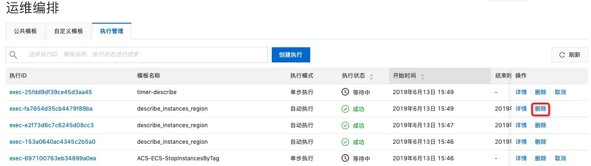

4. 单击 **确定** 删除执行。

   

<a id="section-5-7"></a>

## 5.7. 查看执行日志

您可以通过日志来了解执行的过程，且日志能够很好的帮助您定位和解决问题。

**查询日志方式**

**控制台查询**

1. 登录**运维编排管理控制台**。

2. 在 **执行管理** 页中，找到要查询的执行ID，并单击 **详情** 。

3. 单击 **执行日志** 。

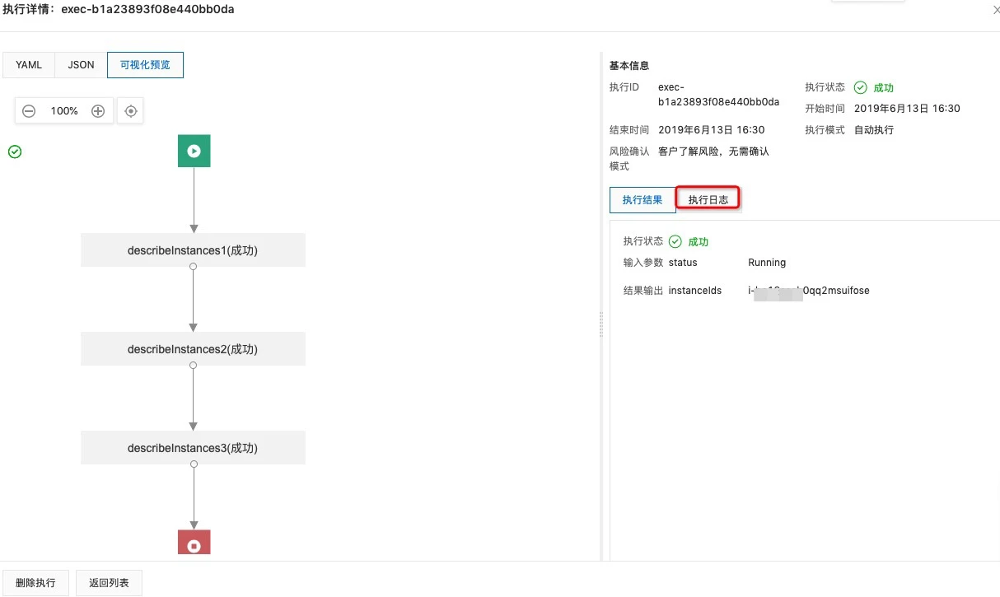

<a id="section-5-8"></a>

## 5.8. 状态转换图

**状态转换图**

一个执行创建的初始状态为Started，直到最终状态可能进行多种状态转换，以下为状态转换图。

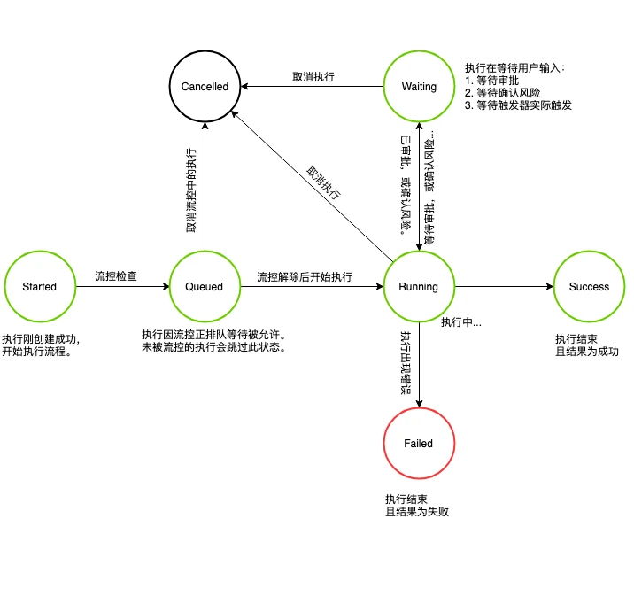

**状态说明**

| Status | 状态 | 说明 |
| --- | --- | --- |
| Started | 已启动 | 表示一个Execution被启动了。当用户创建执行后，Execution立即进入的状态。 |
| Queued | 排队中 | 表示一个Execution因流控正排队等待被允许。大部分情况下，您启动的Execution会跳过此状态直接进入到Running状态。 |
| Running | 执行中 | 表示一个Execution正在执行。 |
| Success | 成功 | 表示一个Execution执行结束且结果为成功。 |
| Failed | 失败 | 表示一个Execution执行结束且结果为失败。 |
| Cancelled | 已取消 | 表示一个Execution由于被取消而结束执行。 |
| Waiting | 等待中 | 表示一个Execution在等待外界的输入。 <strong>有Trigger时：当Execution</strong>有一个Trigger Action时，等待Trigger发生。如时间Trigger，则在目标时刻到来前处于此状态。有Approve时：当Execution有一个Approve&gt;有Approve时：当Execution有一个Approve Action时，等待对该执行有审批权限的用户来批准。 |


**说明** 最终状态 表示Success、Failed、Cancelled这类的状态，此类状态下Execution即已结束，不再进行任何后续执行。

<a id="section-6"></a>

# 6.API参考

这是 API 参考内容

<a id="section-6-1"></a>

## 6.1. ValidateTemplateContent

调用ValidateTemplateContent接口校验一个模版是否合法。

**请求头**

该接口使用公共请求头，无特殊请求头。请参见公共请求参数文档。

**请求参数**

| 参数名称 | 类型 | 位置 | 是否必选 | 示例 | 说明 |
| --- | --- | --- | --- | --- | --- |
| RegionId | Strin g | Query | 否 | cn-hangzhou | 地域ID。 |
| Content | Strin g | Query | 是 | {"FormatVersion": "OOS-2019-06-01", "Description": "Describe instances of given status", "Parameters": {"Status": {"Type": "String", "Description": " (Required) The status of the Ecs instance."}}, "Tasks": \[{"Properties": {"Parameters": {"Status": "{{ Status}}"}, "API": "DescribeInstances", "Service": "Ecs"}, "Name": "foo", "Action": "ACS::ExecuteApi"}\]} | 模板内容 |

**返回数据**

| 参数名称 | 类型 | 示例 | 说明 |
| --- | --- | --- | --- |
| Parameters | String | { "Status": {"Description": " (Required) The status of the Ecs instance.", "Type": "String" } } | 模板参数。 |
| Tasks | Array |  | 模板中定义的任务。 |
| -Name | String | foo | 任务名称。 |
| -Type | String | ACS::ExecuteAPI | 动作类型。 |
| -Description | String | (Required) The status of the Ecs instance. | 任务描述。 |
| -Properties | String | {"API": "DescribeInstances ","Parameters": {"Status": "{{Status}}"},"Service": "Ecs"} | 任务属性。 |
| -Outputs | String | .instanceId | 任务输出。 |
| RequestId | String | D5EE9591-1F2D-573E-8751-7F08BBB388D4 | 请求ID。 |
| Outputs | String | {} | 模板输出。 |
| RamRole | String | OOSServiceRole | RAM角色 |

**示例**

`JSON`  格式

```json
{
 "Parameters":"{ \"Status\": { \"Description\": \"(Required) The status of the Ecs instance.\", \"Type\": \"String\" } }",
 "Tasks":{
  "Type":"ACS::ExecuteAPI",
  "Description":"(Required) The status of the Ecs instance.",
  "Outputs":".instanceId",
  "Properties":"{\"API\": \"DescribeInstances\",\"Parameters\": {\"Status\": \"{{ Status }}\"},\"Service\": \"Ecs\"}",
  "Name":"foo"
 },
 "RequestId":"D5EE9591-1F2D-573E-8751-7F08BBB388D4",
 "Outputs":"{}",
 "RamRole":"OOSServiceRole"
}
```

<a id="section-6-2"></a>

## 6.2. UpdateTemplate

调用UpdateTemplate接口更新一个已经存在的模板。

**请求头**

该接口使用公共请求头，无特殊请求头。请参见公共请求参数文档。

**请求参数**

| 参数名称 | 类型 | 位置 | 是否必选 | 示例 | 说明 |
| --- | --- | --- | --- | --- | --- |
| RegionId | Strin g | Query | 否 | cn-hangzhou | 地域ID |
| Template Name | Strin g | Query | 是 | MyTemplate | 模板名称。内容限制为字母、数字、中划线、下划线，长度200字符，且不能以ALIYUN、ACS、ALIBABA、ALICLOUD开头。 |
| Content | Strin g | Query | 是 | { "FormatVersion": "OOS-2019-06-01", "Description": { "en": "Bulky starts the ECS instances", "zh-cn": "批量启动ECS实例", "name-en": "Bulky Start Instances", "name-zh-cn": "批量启动实例" }, "Parameters": {"regionId": { "Type": "String", "Label": { "en": "RegionId", "zh-cn": "地域ID" }, "AssociationProperty": "RegionId", "Default": " {{ ACS::RegionId }}" }, "targets": { "Type": "Json", "Label": { "en": "TargetInstance", "zh-cn": "目标实例" }, "AssociationProperty": "Targets", "AssociationPropertyMet adata": {"ResourceType": "ALIYUN::ECS::Instance", "RegionId": "regionId" }}, "rateControl": {"Label": { "en": "RateControl", "zh-cn": "任务执行的并发比率" }, "Type": "Json", "AssociationProperty": "RateControl", "Default": { "Mode": "Concurrency", "MaxErrors": 0, "Concurrency": 10 } }, "OOSAssumeRole": {"Label": { "en": "OOSAssumeRole", "zh-cn": "OOS扮演的RAM角色" }, "Type": "String", "Default": "OOSServiceRole" } }, "RamRole": "{{OOSAssumeRole }}", "Tasks": \[ { "Name": "getInstance", "Description": { "en": "Views the ECS | 模板内容。JSON或YAML格式，长度限制为 64 KB。 |
|  |  |  |  |  |  |
| 参数名称 | 类型 | 位置 | 是否必选 | instances", "zh-cn": "获示例取ECS实例" }, "Action": | 说明 |
|  |  |  |  | "ACS::SelectTargets", "Properties": {"ResourceType": "ALIYUN::ECS::Instance", "RegionId": "{{ regionId}}", "Filters": \[ "{{targets }}" \] }, "Outputs": {"instanceIds": { "Type": "List", "ValueSelector": "Instances.Instance\[\].Ins tanceId" } } }, {"Name": "startInstance", "Action": "ACS::ECS::StartInstance ", "Description": { "en": "Starts the ECS instances", "zh-cn": "启动实例" }, "Properties": {"regionId": "{{ regionId}}", "instanceId": "{{ACS::TaskLoopItem }}"}, "Loop": {"RateControl": "{{rateControl }}", "Items": "{{getInstance.instanceIds}}" } } \], "Outputs": {"instanceIds": { "Type": "List", "Value": "{{getInstance.instanceIds}}" } } } |  |
| Tags | Json | Query | 否 | {"k1":"k2","k2":"v2"} | 标签键及值，键值对数量限制为1至20。 |

**返回数据**

| 参数名称 | 类型 | 示例 | 说明 |
| --- | --- | --- | --- |
| RequestId | String | 2075899A-585D-4A41-A9B2-28DF4F534F | 请求ID |
| Template | Struct |  | 模板元信息 |
| -TemplateNam e | String |  |  |
| -TemplateId | String |  |  |
| -CreatedDate | String |  |  |
| -CreatedBy | String |  |  |
| -UpdatedDate | String |  |  |
| -UpdatedBy | String |  |  |
| -Hash | String |  |  |
| -Description | String |  |  |
| -ShareType | String |  |  |
| -TemplateForm at | String |  |  |
| -TemplateVersi on | String |  |  |
| -HasTrigger | Boolean |  |  |
| -Tags | Map |  |  |

**示例**

`JSON`  格式

```json
{
 "RequestId":"2075899A-585D-4A41-A9B2-28DF4F534F",
 "Template":{
  "CreatedBy":"",
  "Description":"",
  "TemplateFormat":"",
  "UpdatedDate":"",
  "TemplateVersion":"",
  "Hash":"",
  "UpdatedBy":"",
  "HasTrigger":"",
  "CreatedDate":"",
  "TemplateName":"",
  "TemplateId":"",
  "Tags":"",
  "ShareType":""
 }
}
```

<a id="section-6-3"></a>

## 6.3. TriggerExecution

调用TriggerExecution接口触发事件触发器或告警触发器任务，可对该类执行发送消息体内容，消息体会使事件或告警任务产生一个新的子执行。

**请求头**

该接口使用公共请求头，无特殊请求头。请参见公共请求参数文档。

**请求参数**

| 参数名称 | 类型 | 位置 | 是否必选 | 示例 | 说明 |
| --- | --- | --- | --- | --- | --- |
| RegionId | Strin g | Query | 否 | cn-hangzhou | 地域ID |
| ExecutionI d | Strin g | Query | 是 | exec-sadw3f23rsad | 目标EventTrigger、AlarmTrigger或TimerTrigger执行ID。 |
| Type | Strin g | Query | 是 | Event | 触发器类型：<br>• Event<br>• Alarm<br>• Timer |
| Content | Strin g | Query | 否 | {"eventTime": "20181226T220114.058 +0800", "id": "9435EAD6-3CF6-4494-8F7A-3A\*\*\*\*\*\*\*\*77","level": "INFO","name": "Instance:StateChange", "product": "ECS","regionId":"cn-hangzhou","resourceId": "acs:ecs:cn-hangzhou:169070\*\*\*\*\*\* \*\*30:instance/i-bp1ecr\*\*\*\*\*\*\*\*5go2go"," userId": "169070\*\*\*\*\*\*\*\*30","ver ": "1.0","content": {"resourceId": "i-bp1ecr\*\*\*\*\*\*\*\*5go2go", "resourceType": "ALIYUN::ECS::Instance", "state": "Stopping"} } | 发送给触发器任务的消息体。 |
| ClientToke n | Strin g | Query | 否 | dswe2-3i0-029 | 保证幂等性的一个Token。 |

**返回数据**

| 参数名称 | 类型 | 示例 | 说明 |
| --- | --- | --- | --- |
| RequestId | String | 14A07460-EBE7-47CA-9757-12CC4761D47A | 请求ID |

**示例**

`JSON`  格式

```json
{
 "RequestId":"14A07460-EBE7-47CA-9757-12CC4761D47A"
}
```

<a id="section-6-4"></a>

## 6.4. StartExecution

调用StartExecution接口启动一个执行。

**请求头**

该接口使用公共请求头，无特殊请求头。请参见公共请求参数文档。

**请求参数**

| 参数名称 | 类型 | 位置 | 是否必选 | 示例 | 说明 |
| --- | --- | --- | --- | --- | --- |
| RegionId | Strin g | Query | 否 | cn-hangzhou | 地域ID |
| Template Name | Strin g | Query | 是 | vmeixme | 模板名称。内容限制为字母、数字、中划线、下划线，长度200字符。 |
| Template Version | Strin g | Query | 否 | v1 | 版本号，如不填默认为最新的版本号。 |
| Mode | Strin g | Query | 否 | Automatic | 执行模式。取值：<br>• Automatic（默认值）：自动执行<br>• FailurePause：失败暂停<br>• Debug：单步执行 |
| LoopMode | Strin g | Query | 否 | Automatic | 循环模式。取值：<br>• Automatic（默认值）：不暂停<br>• FirstBatchPause：第一批暂停<br>• EveryBatchPause：每批暂停 |
| ParentExe cutionId | Strin g | Query | 否 | exec-xxx | 父执行ID |
| SafetyChe ck | Strin g | Query | 否 | Skip | 安全检查模式。取值：<br>• Skip：此选项表示客户了解风险，无需确认即可执行任何Action，无论什么风险等级。<code> Mode=Automatic</code><code> </code>时有效。<br>• ConfirmEveryHighRisk Action（默认值）：此选项会要求客户确认每一个高风险的Action。客户通过调用<strong>NotifyExecution</strong>接口进行确认或取消。 |
| Parameter s | Strin g | Query | 否 | {"Status":"Running"} | 由参数集合组成的Json字符串，默认为{}。 |
| ClientToke n | Strin g | Query | 否 | 123e56767-e89b-12d3-a456-426655440000 | 访问令牌 |
| Descriptio n | Strin g | Query | 否 | test execution. | 要给执行添加的描述信息 |
| ExecuteUs er | Strin g | Query | 否 |  |  |


**返回数据**

| 参数名称 | 类型 | 示例 | 说明 |
| --- | --- | --- | --- |
| Execution | Struct |  | 执行数据 |
| -CurrentTasks | Array |  |  |
| --TaskExecution Id | String |  |  |
| --TaskName | String |  |  |
| --TaskAction | String |  |  |
| -ExecutionId | String |  |  |
| -Description | String |  |  |
| -TemplateNam e | String |  |  |
| -TemplateId | String |  |  |
| -TemplateVersi on | String |  |  |
| -Mode | String |  |  |
| -LoopMode | String |  |  |
| -ExecutedBy | String |  |  |
| -StartDate | String |  |  |
| -EndDate | String |  |  |
| -CreateDate | String |  |  |
| -UpdateDate | String |  |  |
| -Status | String |  |  |
| -StatusMessag e | String |  |  |
| -ParentExecuti onId | String |  |  |
| -Parameters | String |  |  |
| -Outputs | String |  |  |
| -SafetyCheck | String |  |  |
| -IsParent | Boolean |  |  |
| -Counters | String |  |  |
| -RamRole | String |  |  |
| RequestId | String | 14A07460-EBE7-47CA-9757-12CC4761D47A | 请求ID |

**示例**

`JSON`  格式

```json
{
 "Execution":{
  "Status":"",
  "ParentExecutionId":"",
  "LoopMode":"",
  "Description":"",
  "Parameters":"",
  "IsParent":"",
  "Mode":"",
  "TemplateVersion":"",
  "EndDate":"",
  "CreateDate":"",
  "StatusMessage":"",
  "StartDate":"",
  "UpdateDate":"",
  "SafetyCheck":"",
  "Outputs":"",
  "RamRole":"",
  "TemplateName":"",
  "Counters":"",
  "TemplateId":"",
  "ExecutedBy":"",
  "-CurrentTasks":{
   "TaskName":"",
   "TaskAction":"",
   "TaskExecutionId":""
  },
  "ExecutionId":""
 },
 "RequestId":"14A07460-EBE7-47CA-9757-12CC4761D47A"
}
```

<a id="section-6-5"></a>

## 6.5. NotifyExecution

调用NotifyExecution接口通知一个状态为等待中的执行接下来如何运行。

**请求头**

该接口使用公共请求头，无特殊请求头。请参见公共请求参数文档。

**请求参数**

| 参数名称 | 类型 | 位置 | 是否必选 | 示例 | 说明 |
| --- | --- | --- | --- | --- | --- |
| RegionId | Strin g | Query | 否 | cn-hangzhou | 地域ID |
| ExecutionI d | Strin g | Query | 是 | exec-xxx | 执行ID |
| NotifyTyp e | Strin g | Query | 是 | Approve | 通知类型。取值范围：<br>• ExecuteTask<br>- 指定某个任务执行的开始，适用于Debug模式。可能需配合Parameters参数。<br>- 取消<br>• CancelTask当前的任务执行，适用于Debug模式。<br>• CompleteExecutio<br>- 手动终止一个n Debug模式下的执行。可配合<strong>ExecutionStatu</strong> s参数指定被终止执行的状态。<br>• Approve<br>- 同意，适用于批准待审批的执行。如已知晓高危操作的任务执行风险，并准许其执行。<br>• Reject<br>- 拒绝，适用于驳回待审批的执行。如不准许高危操作的任务执行。<br>- 失重试<br>• RetryTask已经执行失败的任务，适用于失败暂停模式。<br>- 跳过已经<br>• SkipTask执行失败的任务，适用于失败暂停模式。 |
| NotifyNote | Strin g | Query | 否 | 说明 | 用于说明的message |
| TaskName | Strin g | Query | 否 | describeInstance | 下一步要执行的Task Name |
| TaskExec utionId | Strin g | Query | 否 | task-exec-xxx | 任务执行ID |
| Execution Status | Strin g | Query | 否 | Success | 适用于CompleteExecution |
| Parameter s | Strin g | Query | 否 | {} | 适用于ExecuteTask |
| LoopItem | Strin g | Query | 否 | i-xxx | Loop子节点对应Item数据 |
| ExecuteUs er | Strin g | Query | 否 |  |  |

**返回数据**

| 参数名称 | 类型 | 示例 | 说明 |
| --- | --- | --- | --- |
| RequestId | String | 491DF8C2-34C9-4679-9DB3-4C0F49B129AC | 请求ID |

**示例**

`JSON`  格式

```json
{
 "RequestId":"491DF8C2-34C9-4679-9DB3-4C0F49B129AC"
}
```

<a id="section-6-6"></a>

## 6.6. ListTemplateVersions

调用ListTemplateVersions接口查询一个模版的多个版本对象。

**请求头**

该接口使用公共请求头，无特殊请求头。请参见公共请求参数文档。

**请求参数**

| 参数名称 | 类型 | 位置 | 是否必选 | 示例 | 说明 |
| --- | --- | --- | --- | --- | --- |
| RegionId | Strin g | Query | 否 | cn-hangzhou | 地域ID。 |
| Template Name | Strin g | Query | 否 | describeinstances | 模版名称。 |
| MaxResult s | Integ er | Query | 否 | 50 | 最大结果数。取值范围10-100。 |
| NextToke n | Strin g | Query | 否 | H8xj9c-398djs9-39ajd9asdjjJ | 用来翻页的Token字符串。 |
| ShareTyp e | Strin g | Query | 否 | Private | 模版类型。取值范围Private或Public。 |

**返回数据**

| 参数名称 | 类型 | 示例 | 说明 |
| --- | --- | --- | --- |
| NextToken | String | NJSNDKLJS-SJKJDO090k30-JSDK232 | 翻向下一页的Token字符串。 |
| RequestId | String | E6CD612B-5889-4F1A-823F-8A4029E46 | 请求ID。 |
| MaxResults | Integer | 50 | 最大结果数。 |
| TemplateVersi ons | Array |  | 模版的多个版本对象。 |
| -Description | String | Detach the eip from the special instance. | 该版本描述。 |
| -TemplateForm at | String | YAML | 模版内容格式。YAML或JSON。 |
| -TemplateVersi on | String | v2 | 该版本号。 |
| -CreatedBy | String |  |  |
| -UpdatedDate | String | 2020-05-19T06:05:41Z | 该版本模版最近更新时间。 |
| -UpdatedBy | String | foo | 该版本模版最近更新人。 |
| -VersionName | String | baz | 版本名称 |

**示例**

`JSON`  格式

```json
{
 "NextToken":"NJSNDKLJS-SJKJDO090k30-JSDK232",
 "RequestId":"E6CD612B-5889-4F1A-823F-8A4029E46",
 "MaxResults":50,
 "TemplateVersions":{
  "UpdatedBy":"foo",
  "Description":"Detach the eip from the special instance.",
  "CreatedBy":"",
  "TemplateFormat":"YAML",
  "UpdatedDate":"2020-05-19T06:05:41Z",
  "TemplateVersion":"v2",
  "VersionName":"baz"
 }
}
```

<a id="section-6-7"></a>

## 6.7. ListTemplates

调用ListTemplates接口支持多种过滤方式。

**请求头**

该接口使用公共请求头，无特殊请求头。请参见公共请求参数文档。

**请求参数**

| 参数名称 | 类型 | 位置 | 是否必选 | 示例 | 说明 |
| --- | --- | --- | --- | --- | --- |
| RegionId | Strin g | Query | 否 | cn-hangzhou | 地域ID |
| Template Name | Strin g | Query | 否 | MyTemplate | 模板名称。列出含所填模板名称的所有模板。 |
| TemplateF ormat | Strin g | Query | 否 | YAML | 模板格式。取值范围：<br>• JSON<br>• YAML |
| ShareTyp e | Strin g | Query | 否 | Private | 分享类型。取值范围：<br>• Public<br>• Private |
| CreatedBy | Strin g | Query | 否 | ACS | 模板创建者。<br>• 对于阿里云官方提供的模板，为<strong>ACS</strong><br>• 对于用户个人创建的模板，可填写 <strong>UID</strong>进行筛选，或填写 <strong>用户名</strong>进行筛选称 |
| CreatedD ateBefore | Strin g | Query | 否 | 2019-05-16T10:26:14Z | 创建时间小于等于指定时间的模板。格式为：YYYY-MM-DDThh:mm::ssZ |
| CreatedD ateAfter | Strin g | Query | 否 | 2019-05-16T10:26:14Z | 创建时间大于等于指定时间的模板。格式为：YYYY-MM-DDThh:mm:ssZ |
| Tags | Json | Query | 否 | {"k1":"k2","k2":"v2"} | 标签键及值，键值对数量限制为1至20。 |
| Category | Strin g | Query | 否 | TimerTrigger | 模版类型如TimerTrigger，EventTrig ger，AlarmTrigger，Oth er。 |
| MaxResult s | Integ er | Query | 否 | 50 | 分页大小。取值范围：20-100。默认为50。 |
| NextToke n | Strin g | Query | 否 | xxx | 对查询结果进行翻页时需要传入的Token值，如有则获取自当前页的返回值。 |
| SortField | Strin g | Query | 否 | Popularity | 排序字段。取值范围：<br>• TotalExecutionCoun（默认值）：总执行t次数：受欢迎<br>• Popularity程度：<br>• TemplateName模板名称：创建<br>• CreatedDate时间 |
| SortOrder | Strin g | Query | 否 | Descending | 排序方向。取值范围：：升序<br>• Ascending<br>• Descending（默认值）：降序 |
| HasTrigge r | Boole an | Query | 否 | true | 是否触发 |

**返回数据**

| 参数名称 | 类型 | 示例 | 说明 |
| --- | --- | --- | --- |
| NextToken | String | xxx | 对查询结果进行翻页时需要传入的Token值，如有则获取自当前页的返回值。 |
| RequestId | String | BEF54BA-17B6-449F-A219-49ACB157E3 | 请求ID |
| MaxResults | Integer | 50 | 分页大小。 |
| Templates | Array |  | 模板元信息 |
| -TemplateNam e | String | MyTemplate | 模板名称 |
| -TemplateId | String | t-94753deed38 | 模板ID |
| -CreatedDate | String | 2019-05-16T10:26:14Z | 模板创建时间 |
| -CreatedBy | String | root(1309200) | 模板创建者 |
| -UpdatedDate | String | 2019-05-16T10:26:14Z | 模板更新时间 |
| -UpdatedBy | String | root(13092000) | 模板更新者 |
| -Hash | String | 4bc7d7a21b3e003 434b9c223f6e6d25 78b5ebfeb5be28c1 fcf8a8a1b11907bb 4 | 模板内容的SHA256 |
| -Description | String | Describe instances of given status | 模板说明 |
| -ShareType | String | Public | 模板共享类型。目前用户创建的模板的共享类型均为 <strong>Private</strong>。取值范围：<br>• Public<br>• Private |
| -TemplateForm at | String | JSON | 模板格式。系统字段判断，为JSON或YAML。 |
| -TemplateVersi on | String | v1 | 模板版本。以“v”+数字的形式，数字从1开始。 |
| -HasTrigger | Boolean | true | 是否成功触发 |
| -TotalExecution Count | Integer | 5 | 私有模板总执行次数。若<strong>ShareType</strong>为<strong>Public</strong>，该字段值为<code> -</code><code>1 </code>。<br><em>该字段在</em><strong><em>ShareType</em></strong><em>为</em><strong><em>Private</em></strong><em>时</em><em>有意义。</em> |
| -Popularity | Integer | 8 | 公共模板受欢迎程度。范围是<strong>1-10</strong>，数字越高表示越受欢迎。若<strong>ShareType</strong>为<strong>Private</strong>，该字段值为<code> -1 </code>。<br><em>该字段在</em><strong><em>ShareType</em></strong><em>为</em><strong><em>Public</em></strong><em>时有</em><em>意义。</em> |
| -Tags | Map | {"k1":"v1","k2":"v2 "} | 标签键及值，键值对数量限制为1至20。 |
| -Category | String | TimerTrigger | 模版类型 |

**示例**

`JSON`  格式

```json
{
 "NextToken":"xxx",
 "RequestId":"BEF54BA-17B6-449F-A219-49ACB157E3",
 "MaxResults":50,
 "Templates":{
  "CreatedBy":"root(1309200)",
  "Description":"Describe instances of given status",
  "Category":"TimerTrigger",
  "TemplateFormat":"JSON",
  "UpdatedDate":"2019-05-16T10:26:14Z",
  "Popularity":8,
  "TemplateVersion":"v1",
  "Hash":"4bc7d7a21b3e003434b9c223f6e6d2578b5ebfeb5be28c1fcf8a8a1b11907bb4",
  "UpdatedBy":"root(13092000)",
  "HasTrigger":true,
  "TotalExecutionCount":5,
  "CreatedDate":"2019-05-16T10:26:14Z",
  "TemplateName":"MyTemplate",
  "TemplateId":"t-94753deed38",
  "Tags":{
   "k1":"v1",
   "k2":"v2"
  },
  "ShareType":"Public"
 }
}
```

<a id="section-6-8"></a>

## 6.8. ListTaskExecutions

调用ListTaskExecutions接口查询任务执行，支持多种过滤方式。

**请求头**

该接口使用公共请求头，无特殊请求头。请参见公共请求参数文档。

**请求参数**

| 参数名称 | 类型 | 位置 | 是否必选 | 示例 | 说明 |
| --- | --- | --- | --- | --- | --- |
| RegionId | Strin g | Query | 否 | cn-hangzhou | 地域ID |
| ExecutionI d | Strin g | Query | 否 | exec-xxx | 执行ID |
| Status | Strin g | Query | 否 | Running | 执行状态，取值范围：Running, Started, Success, Failed, Waiting, Cancelled, Pending, Skipped。 |
| StartDate Before | Strin g | Query | 否 | 2019-05-16T10:26:14Z | 开始时间小于等于指定时间的执行 |
| StartDate After | Strin g | Query | 否 | 2019-05-16T10:26:14Z | 开始时间大于等于指定时间的执行 |
| EndDateB efore | Strin g | Query | 否 | 2019-05-16T10:26:14Z | 结束时间小于等于指定时间的执行 |
| EndDateA fter | Strin g | Query | 否 | 2019-05-16T10:26:14Z | 结束时间大于等于指定时间的执行 |
| TaskExec utionId | Strin g | Query | 否 | task-exec-xxx | 任务执行ID |
| TaskName | Strin g | Query | 否 | describeInstance | 任务名称 |
| TaskActio n | Strin g | Query | 否 | ACS::Sleep | 任务动作 |
| ParentTas kExecutio nId | Strin g | Query | 否 | task-exec-xxx | 父任务执行ID。Loop情况会用到，一般是Loop的Parent的TaskExecutionId。 |
| IncludeChi ldTaskExe cution | Boole an | Query | 否 | false | 标记是否展示Loop产生的子Task。默认为False。 |
| MaxResult s | Integ er | Query | 否 | 50 | 分页大小。取值范围：20-100。默认为50。 |
| NextToke n | Strin g | Query | 否 | MTRBMDc0NjAtRUJFNy0 0N0NBLTk3NTctMTJDQz Q3NjFENDdB | 翻页标记的Token |
| SortField | Strin g | Query | 否 | StartDate | 排序字段。取值范围：（默认<br>• StartDate值）：创建时间：结束时间<br>• EndDate：状态<br>• Status |
| SortOrder | Strin g | Query | 否 | Ascending | 排序方向。取值范围：<br>• Ascending：升序<br>• Descending（默认值）：降序 |

**返回数据**

| 参数名称 | 类型 | 示例 | 说明 |
| --- | --- | --- | --- |
| NextToken | String | MTRBMDc0NjAtRUJ FNy00N0NBLTk3NT ctMTJDQzQ3NjFEN DdB | 翻页标记的Token |
| RequestId | String | CDABABABAB-FC28-4D9C-8FB5-68DC6F0486FC | 请求ID |
| MaxResults | Integer | 50 | 分页大小 |
| TaskExecution s | Array |  | 执行数据 |
| -ExecutionId | String | exec-44d32b45d2a449e 49899 | 执行ID |
| -TaskExecution Id | String | task-exec-xxx | 任务执行ID |
| -TemplateId | String | xxx | 模板ID |
| -StartDate | String | 2019-05-16T10:26:14Z | 开始时间 |
| -EndDate | String | 2019-05-16T10:26:14Z | 结束时间 |
| -CreateDate | String | 2019-05-16T10:26:14Z | 执行创建时间 |
| -UpdateDate | String | 2019-05-16T10:26:14Z | 更新时间 |
| -Status | String | Running | 任务状态 |
| -Properties | String | {"Status":"Running"} | 执行的输入参数 |
| -Outputs | String | { "InstanceId":"i-xxx" } | 执行输出结果 |
| -TaskAction | String | ACS::Sleep | 任务动作 |
| -TaskName | String | describeInstance | 任务名称 |
| -StatusMessag e | String | "" | 状态信息 |
| -ChildExecution Id | String | exec-xxx | 子任务执行ID |
| -ParentTaskExe cutionId | String | task-exec-xxx | 父任务执行ID |
| -LoopItem | String | i-1234566zxcvvb | 循环中的元素 |
| -Loop | String | {} | Loop配置和统计信息，仅Loop父节点有此信息。 |
| -LoopBatchNu mber | Integer | 2 | 循环批次数 |
| -ExtraData | String | { "NotifyNote":"" } | 附加数据 |

**示例**

`JSON`  格式

```json
{
 "NextToken":"MTRBMDc0NjAtRUJFNy00N0NBLTk3NTctMTJDQzQ3NjFENDdB",
 "RequestId":"CDABABABAB-FC28-4D9C-8FB5-68DC6F0486FC",
 "MaxResults":50,
 "TaskExecutions":{
  "Status":"Running",
  "Loop":"{}",
  "LoopBatchNumber":2,
  "TaskAction":"ACS::Sleep",
  "ChildExecutionId":"exec-xxx",
  "ExtraData":"{                     \"NotifyNote\":\"\"                 }",
  "Properties":"{ \"Status\":\"Running\" }",
  "EndDate":"2019-05-16T10:26:14Z",
  "CreateDate":"2019-05-16T10:26:14Z",
  "StatusMessage":"\"\"",
  "StartDate":"2019-05-16T10:26:14Z",
  "UpdateDate":"2019-05-16T10:26:14Z",
  "LoopItem":"i-1234566zxcvvb",
  "TaskName":"describeInstance\t",
  "ParentTaskExecutionId":"task-exec-xxx",
  "Outputs":"{ \"InstanceId\":\"i-xxx\" }",
  "TaskExecutionId":"task-exec-xxx",
  "TemplateId":"xxx",
  "ExecutionId":"exec-44d32b45d2a449e49899"
 }
}
```

<a id="section-6-9"></a>

## 6.9. ListResourceExecutionStatus

调用ListResourceExecutionStatus接口查看包含ECS实例的定时运维执行信息。

**请求头**

该接口使用公共请求头，无特殊请求头。请参见公共请求参数文档。

**请求参数**

| 参数名称 | 类型 | 位置 | 是否必选 | 示例 | 说明 |
| --- | --- | --- | --- | --- | --- |
| RegionId | Strin g | Query | 否 | cn-hangzhou | 地域ID。 |
| ExecutionI d | Strin g | Query | 是 | exec-xxxxxxxxxxxx | 执行ID。 |
| MaxResult s | Integ er | Query | 否 | 50 | 分页大小。取值范围：10-100。默认为50。 |
| NextToke n | Strin g | Query | 否 | MTRBMDc0NjAtRUJFNy0 0N0NBLTk3NTctMTJDQz Q | 翻页标记的Token。 |

**返回数据**

| 参数名称 | 类型 | 示例 | 说明 |
| --- | --- | --- | --- |
| NextToken | String | MTRBMDc0NjAtRUJ FNy00N0NBLTk3NT ctMTJDQzQ | 翻页标记的Token |
| RequestId | String | ED571CBD-9F96-419D-B919-CF340BBCA157 | 请求ID |
| ResourceExec utionStatus | Array |  | 资源执行信息 |
| -ExecutionId | String | exec-6be6d6ff805349d9 ac13 | 执行ID |
| -ResourceId | String | i-bp1e1bxxxxxxxxxx xxxx | 资源ID |
| -RootExecution Id | String |  |  |
| -ExecutionTime | String | 2020-11-13T08:48:34Z | 执行时间 |
| -Status | String | Success | 执行状态 |
| -Outputs | String | {"commandOutput": "hello " } | 模板输出结果 |
| MaxResults | Integer | 50 | 分页大小 |

**示例**

`JSON`  格式

```json
{
 "NextToken":"MTRBMDc0NjAtRUJFNy00N0NBLTk3NTctMTJDQzQ",
 "RequestId":"ED571CBD-9F96-419D-B919-CF340BBCA157",
 "ResourceExecutionStatus":{
  "Status":"Success",
  "ExecutionTime":"2020-11-13T08:48:34Z",
  "ResourceId":"i-bp1e1bxxxxxxxxxxxxxx",
  "Outputs":"{ \t\t\t\t\"commandOutput\": \"hello\\" \t\t\t}",
  "RootExecutionId":"",
  "ExecutionId":"exec-6be6d6ff805349d9ac13"
 },
 "MaxResults":50
}
```

<a id="section-6-10"></a>

## 6.10. ListExecutions

调用ListExecutions接口查询执行，支持多种过滤方式。

**请求头**

该接口使用公共请求头，无特殊请求头。请参见公共请求参数文档。

**请求参数**

| 参数名称 | 类型 | 位置 | 是否必选 | 示例 | 说明 |
| --- | --- | --- | --- | --- | --- |
| RegionId | Strin g | Query | 否 | cn-hangzhou | 地域ID |
| Template Name | Strin g | Query | 否 | MyTemplate | 模板名称。名称未包含关系，最终列出包含所填模板名称的所有模板。 |
| Status | Strin g | Query | 否 | Running | 执行状态，取值范围：Running, Started, Success, Failed, Waiting, Cancelled, Pending, Skipped。 |
| ExecutionI d | Strin g | Query | 否 | exec-xxx | 执行ID |
| StartDate Before | Strin g | Query | 否 | 2019-05-16T10:26:14Z | 开始时间小于等于指定时间的执行 |
| StartDate After | Strin g | Query | 否 | 2019-05-16T10:26:14Z | 开始时间大于等于指定时间的执行 |
| EndDateB efore | Strin g | Query | 否 | 2019-05-16T10:26:14Z | 结束时间小于等于指定时间的执行 |
| EndDateA fter | Strin g | Query | 否 | 2019-05-16T10:26:14Z | 结束时间大于等于指定时间的执行 |
| Mode | Strin g | Query | 否 | Automatic | 执行模式。取值范围：<br>• Automatic<br>• Debug |
| Executed By | Strin g | Query | 否 | vme | 执行者 |
| ParentExe cutionId | Strin g | Query | 否 | exec-xxx | 父执行ID |
| RamRole | Strin g | Query | 否 | OOSServiceRole | RAM角色 |
| IncludeChi ldExecutio n | Boole an | Query | 否 | true | 是否包含子执行。默认为False。 |
| Category | Strin g | Query | 否 | Other | 执行的模版类型。可分为Other、TimerTrigger、EventTrigger、AlarmTrigger。 |
| MaxResult s | Integ er | Query | 否 | 50 | 分页大小。取值范围：10-100。默认为50。 |
| NextToke n | Strin g | Query | 否 | MTRBMDc0NjAtRUJFNy0 0N0NBLTk3NTctMTJDQz Q | 翻页标记的Token |
| SortField | Strin g | Query | 否 | StartDate | 排序字段。取值范围：（默认<br>• StartDate值）：创建时间：结束时间<br>• EndDate：状态<br>• Status |
| SortOrder | Strin g | Query | 否 | Ascending | 排序方向。取值范围：<br>• Ascending：升序<br>• Descending（默认值）：降序 |
| Descriptio n | Strin g | Query | 否 | MyDescription | 执行的描述。 |

**返回数据**

| 参数名称 | 类型 | 示例 | 说明 |
| --- | --- | --- | --- |
| Executions | Array |  | 执行数据 |
| -CurrentTasks | Array |  | 当前正在运行的Tasks |
| --TaskExecution Id | String |  |  |
| --TaskName | String |  |  |
| --TaskAction | String |  |  |
| -ExecutionId | String | exec-44d32b45d2a449e | 执行的唯一标识 |
| -Description | String | MyDescription | 执行描述 |
| -TemplateNam e | String | MyTemplate | 模板名称 |
| -TemplateId | String | 123 | 模板ID |
| -TemplateVersi on | String | v1 | 模板版本号 |
| -Mode | String | Automatic | 执行模式 |
| -ExecutedBy | String | 1309252800 | 执行模板者 |
| -StartDate | String | 2019-05-16T10:26:14Z | 执行开始时间 |
| -EndDate | String | 2019-05-16T10:26:14Z | 执行结束时间 |
| -CreateDate | String | 2019-05-16T10:26:14Z | 执行创建时间 |
| -UpdateDate | String | 2019-05-16T10:26:14Z | 执行更新时间 |
| -Status | String | Success | 执行状态。取值范围为Started, Queued, Running, Waiting, Success, Failed, Cancelled。 |
| -StatusMessag e | String | “” | 任务执行状态 |
| -StatusReason | String | "" | 状态原因 |
| -WaitingStatus | String | "" | 等待状态 |
| -ParentExecuti onId | String | exec-xxx | 父执行ID |
| -Parameters | String | {"Status":"Running"} | 执行的输入参数 |
| -Outputs | String | { "InstanceId":"i-xxx" } | 执行输出结果 |
| -SafetyCheck | String | Skip | 安全检查模式。取值范围为Skip, ConfirmEveryHighRiskAction。 |
| -IsParent | Boolean | false | 标记是否包含子任务 |
| -RamRole | String | OOSServiceRole | 执行当前模板的角色 |
| -Counters | String | {"Failed": 0,"Success": 1,"Total": 2} | 任务按执行状态计数 |
| -Category | String | Other | 执行的模版类型。可分为Other、TimerTrigger、EventTrigger、AlarmTrigger。 |
| NextToken | String | MTRBMDc0NjAtRUJ FNy00N0NBLTk3NT ctMTJDQzQ | 翻页标记的Token |
| RequestId | String | 14A074-47CA-9757-12CC4761D47A | 请求ID |
| MaxResults | Integer | 50 | 分页大小 |

**示例**

`JSON`  格式

```json
{
 "Executions":{
  "Status":"Success",
  "ParentExecutionId":"exec-xxx",
  "Description":"MyDescription",
  "Parameters":"{ \"Status\":\"Running\" }",
  "Category":"Other",
  "StatusReason":"\"\"",
  "IsParent":false,
  "Mode":"Automatic",
  "TemplateVersion":"v1",
  "EndDate":"2019-05-16T10:26:14Z",
  "CreateDate":"2019-05-16T10:26:14Z",
  "WaitingStatus":"\"\"",
  "StatusMessage":"“”",
  "StartDate":"2019-05-16T10:26:14Z",
  "UpdateDate":"2019-05-16T10:26:14Z",
  "SafetyCheck":"Skip",
  "Outputs":"{ \"InstanceId\":\"i-xxx\" }",
  "RamRole":"OOSServiceRole",
  "TemplateName":"MyTemplate",
  "Counters":"{\"Failed\": 0,\"Success\": 1,\"Total\": 2}",
  "TemplateId":"123",
  "ExecutedBy":"1309252800",
  "-CurrentTasks":{
   "TaskName":"",
   "TaskAction":"",
   "TaskExecutionId":""
  },
  "ExecutionId":"exec-44d32b45d2a449e"
 },
 "NextToken":"MTRBMDc0NjAtRUJFNy00N0NBLTk3NTctMTJDQzQ",
 "RequestId":"14A074-47CA-9757-12CC4761D47A",
 "MaxResults":50
}
```

<a id="section-6-11"></a>

## 6.11. ListExecutionLogs

调用ListExecutionLogs接口获取执行的详细日志。

**请求头**

该接口使用公共请求头，无特殊请求头。请参见公共请求参数文档。

**请求参数**

| 参数名称 | 类型 | 位置 | 是否必选 | 示例 | 说明 |
| --- | --- | --- | --- | --- | --- |
| RegionId | Strin g | Query | 否 | cn-hangzhou | 地域ID |
| ExecutionI d | Strin g | Query | 是 | exec-xxx | 执行ID |
| TaskExec utionId | Strin g | Query | 否 | exec-1234567zxcvb.t0010 | 任务执行ID |
| LogType | Strin g | Query | 否 | System | 日志类型 |
| MaxResult s | Integ er | Query | 否 | 50 | 分页大小 |
| NextToke n | Strin g | Query | 否 | MTRBMDc0NjAtRUJFNy0 0N0NBLTk3NTctMTJDQz Q3NjFENDdB | 翻页标记的Token |

**返回数据**

| 参数名称 | 类型 | 示例 | 说明 |
| --- | --- | --- | --- |
| NextToken | String | gAAAAABdpsGWjX 8dJ-a6dl_pvoS7AFxNHS NJKHLCAJ：J0ylgA53nWW5V4H TEZKCYTaEPNOrxFi r4z43UTOjE150cFr 8AGTifA== | 翻页标记的Token |
| RequestId | String | 14A07460-EBE7-47CA-9757-12CC4761D47A | 请求ID |
| ExecutionLogs | Array |  | 执行日志 |
| -TaskExecution Id | String | exec-1234567zxcvb.t00 10 | 任务执行ID |
| -Message | String | The task CheckDiskCategory completed. | 详细信息 |
| -LogType | String | System | 日志类型 |
| -Timestamp | String | 2019-05-24T:02:29:07Z | 时间戳 |
| MaxResults | Integer | 50 | 分页大小 |
| IsTruncated | Boolean | true | 局部展示 |

**示例**

`JSON`  格式

```json
{
 "NextToken":"gAAAAABdpsGWjX8dJ-a6dl_pvoS7AFxNHSNJKHLCAJ：
J0ylgA53nWW5V4HTEZKCYTaEPNOrxFir4z43UTOjE150cFr8AGTifA==",
 "RequestId":"14A07460-EBE7-47CA-9757-12CC4761D47A",
 "ExecutionLogs":{
  "Message":"The task CheckDiskCategory completed.",
  "LogType":" System",
  "Timestamp":"2019-05-24T:02:29:07Z",
  "TaskExecutionId":"exec-1234567zxcvb.t0010"
 },
 "MaxResults":50,
 "IsTruncated":true
}
```

<a id="section-6-12"></a>

## 6.12. ListActions

调用ListActions接口查询可用动作，包括原子动作和云产品动作。

**请求头**

该接口使用公共请求头，无特殊请求头。请参见公共请求参数文档。

**请求参数**

| 参数名称 | 类型 | 位置 | 是否必选 | 示例 | 说明 |
| --- | --- | --- | --- | --- | --- |
| RegionId | Strin g | Query | 否 | cn-hangzhou | 地域ID |
| OOSActio nName | Strin g | Query | 否 | MyTemplate | 动作名称。名称未包含关系，最终列出包含所填动作名称的所有动作。 |
| MaxResult s | Integ er | Query | 否 | 50 | 分页大小。取值范围：20-100。默认为50。 |
| NextToke n | Strin g | Query | 否 | - | 翻页标记的Token。 |

**返回数据**

| 参数名称 | 类型 | 示例 | 说明 |
| --- | --- | --- | --- |
| NextToken | String | xxx | 翻页标记的Token |
| RequestId | String | F9154C02-F847-4563-BB6A-6DD01A4F0 | 请求ID |
| Actions | Array |  | 动作列表 |
| -OOSActionNa me | String | ACS::ECS::Replace SystemDisk | 动作名称 |
| -Description | String | ReplaceSystemDis k | 动作说明 |
| -ActionType | String | ACS::Template | 动作类型。<br>1. 原子动作<br>• Atomic.API<br>• Atomic.Trigger<br>• Atomic.Control<br>• Atomic.Embedded<br>2. 云产品动作<br>• Product.ECS<br>• Product.RDS<br>• Product.VPC<br>• Product.FC<br>• ….. |
| -CreatedDate | String | 2019-05-16T10:26:14Z | 动作创建时间 |
| -Properties | String | { "ImageId": {"Description": "The mirror ID you will use when resetting the system", "Type": "String" }, "InstanceId": {"Description": "the instance id that you will handle .", "Type": "String" } } | 动作参数 |
| -TemplateVersi on | String | v1 | 动作所对应的模板版本。<em>对于原子动作，该字段不返回。</em> |
| MaxResults | Integer | 50 | 分页大小 |

**示例**

`JSON`  格式

```json
{
 "NextToken":"xxx",
 "RequestId":"F9154C02-F847-4563-BB6A-6DD01A4F0",
 "Actions":{
  "OOSActionName":"ACS::ECS::ReplaceSystemDisk",
  "Description":"ReplaceSystemDisk",
  "ActionType":"ACS::Template",
  "CreatedDate":"2019-05-16T10:26:14Z",
  "TemplateVersion":"v1",
  "Properties":"{ \"ImageId\": { \"Description\": \"The mirror ID you will use when resetting the system\", \"Type\": \"String\" }, \"InstanceId\": { \"Description\": \"the instance id that you will handle .\", \"Type\": \"String\" } }"
 },
 "MaxResults":50
}
```

<a id="section-6-13"></a>

## 6.13. GetTemplate

调用GetTemplate接口获取一个模版，包括内容。

**请求头**

该接口使用公共请求头，无特殊请求头。请参见公共请求参数文档。

**请求参数**

| 参数名称 | 类型 | 位置 | 是否必选 | 示例 | 说明 |
| --- | --- | --- | --- | --- | --- |
| RegionId | Strin g | Query | 否 | cn-hangzhou | 地域ID |
| Template Name | Strin g | Query | 是 | MyTemplate | 模板名称。内容限制为字母、数字、中划线、下划线，长度200字符。 |
| Template Version | Strin g | Query | 否 | v1 | 模板版本。格式：<strong>“v”+数</strong>字。取值范围：<strong>v1-</strong>v200。 |

**返回数据**

| 参数名称 | 类型 | 示例 | 说明 |
| --- | --- | --- | --- |
| RequestId | String | 5BBE2663-A18E-5261-9BBB-F4832F5294D9 | 请求ID |
|  |  | "FormatVersion: OOS-2019-06-01 Description: en: Creates an ECS image zh-cn: 创建一个ECS镜像 |  |
|  |  |  |  |
| 参数名称 | 类型 | name-en: Create示例Image | 说明 |
|  |  | name-zh-cn: 创建镜像categories:<br>- image_manage -application_manag e Parameters: regionId: Type: String Label: en: RegionId zh-cn: 地域ID AssociationPropert y: RegionId Default: '{{ACS::RegionId }}' instanceId: Label: en: InstanceId zh-cn: ECS实例ID Type: String AssociationPropert y: ALIYUN::ECS::Insta nce::InstanceId AssociationPropert yMetadata: RegionId: regionId imageName: Label: en: ImageName zh-cn: 新镜像的名称Type: String Description: en:<br>Note:<br>• Length is 2~128 English or Chinese characters<br>• must start with big or small letters or Chinese, not http:// and https://.<br>• Can contain numbers, colons (:), underscores (_), or dashes (-).zh-cn:<br>注意：<br>• 长度为2~128个英文或中文字符<br>• 必须以大小字母或中文开头，不能以http://和https://开头。<br>• 可以包含数字、半 |  |
|  |  |  |  |
| 参数名称 | 类型 | 角冒号（:）、下划示例线（_）或者短划线 | 说明 |
| Content | String | （-）。tags: Label: en: Tags zh-cn: 镜像标签Type: Json AssociationPropert y: Tags AssociationPropert yMetadata: ShowSystem: false Default: \[\] OOSAssumeRole: Label: en: OOSAssumeRole zh-cn: OOS扮演的RAM角色Type: String Default: OOSServiceRole RamRole: '{{OOSAssumeRole}}' Tasks:<br>- Name: createImage Action: ACS::ECS::CreateI mage Description: en: Create new image with the specified image name and instance ID zh-cn: 通过指定实例ID和镜像名称创建新的镜像Properties: regionId: '{{regionId }}' imageName: '{{imageName}}__on_{{ACS::ExecutionId}}_at_{{Acs::CurrentDate}}' instanceId: '{{instanceId }}' tags: '{{tags}}' Outputs: imageId: ValueSelector: imageId Type: String Outputs: imageId: Type: String Value: '{{createImage.image Id }}' Metadata: | 模板内容 |
|  |  |  |  |
| 参数名称 | 类型 | ALIYUN::OOS::Inter示例face: | 说明 |
|  |  | ParameterGroups:<br>- Parameters:<br>- regionId<br>- instanceId Label: default: zh-cn: 选择实例en: Select Ecs Instances<br>- Parameters:<br>- imageName<br>- tags Label: default: zh-cn: 镜像设置en: Image Configure<br>- Parameters:<br>- OOSAssumeRole Label: default: zh-cn: 高级选项en: Control Options" |  |
| Template | Struct |  | 模板元信息 |
| -TemplateNam e | String |  |  |
| -TemplateId | String |  |  |
| -CreatedDate | String |  |  |
| -CreatedBy | String |  |  |
| -UpdatedDate | String |  |  |
| -UpdatedBy | String |  |  |
| -Hash | String |  |  |
| -Description | String |  |  |
| -ShareType | String |  |  |
| -TemplateForm at | String |  |  |
| -TemplateVersi on | String |  |  |
| -HasTrigger | Boolean |  |  |
| -Tags | Map |  |  |

**示例**

`JSON`  格式

```json
{
 "RequestId":"5BBE2663-A18E-5261-9BBB-F4832F5294D9",
 "Content":"\"FormatVersion: OOS-2019-06-01\Description:\  en:  Creates an ECS image\  
zh-cn: 创建⼀个ECS镜像\  name-en: Create Image\  name-zh-cn: 创建镜像\  categories:\    - i
mage_manage\    - application_manage\Parameters:\  regionId:\    Type: String\    
Label:\      en: RegionId\      zh-cn: 地域ID\    AssociationProperty: RegionId\    
Default: '{{ ACS::RegionId }}'\  instanceId:\    Label:\      en: InstanceId\      zh-
cn: ECS实例ID\    Type: String\    AssociationProperty: 
ALIYUN::ECS::Instance::InstanceId\    AssociationPropertyMetadata:\      RegionId: 
regionId\  imageName:\    Label:\      en: ImageName\      zh-cn: 新镜像的名称\    Type: S
tring\    Description:\      en: <p class=\\\"p\\\">Note:</p> <ul class=\\\"ul\\\"> <li
class=\\\"li\\\">Length is 2~128 English or Chinese characters</li> <li 
class=\\\"li\\\"><font color='red'>must start with big or small letters or Chinese, nothttp:// and https://. </font></li> <li class=\\\"li\\\">Can contain numbers, colons (:), underscores (_), or dashes (-). </li> </ul>\      zh-cn: <p class=\\\"p\\\">注意：</p>
<ul class=\\\"ul\\\"> <li class=\\\"li\\\">⻓度为2~128个英⽂或中⽂字符</li> <li 
class=\\\"li\\\"><font color='red'>必须以⼤⼩字⺟或中⽂开头，不能以http://和https://开头。
</font></li> <li class=\\\"li\\\">可以包含数字、半⾓冒号（:）、下划线（_）或者短划线（-）。</li>
</ul>\  tags:\    Label:\      en: Tags\      zh-cn: 镜像标签\    Type: Json\    
AssociationProperty: Tags\    AssociationPropertyMetadata:\      ShowSystem: false\    
Default: []\  OOSAssumeRole:\    Label:\      en: OOSAssumeRole\      zh-cn: OOS扮演的
RAM⾓⾊\    Type: String\    Default: OOSServiceRole\RamRole: '{{ OOSAssumeRole }}'\Tasks:\- Name: createImage\  Action: ACS::ECS::CreateImage\  Description:\    en: Create new image with the specified image name and instance ID\    zh-cn: 通过指定实例ID和镜像名称创
建新的镜像\  Properties:\    regionId: '{{ regionId }}'\    imageName: '{{ imageName }}__on_{{ ACS::ExecutionId }}_at_{{ Acs::CurrentDate }}'\    instanceId: '{{ instanceId }}'
\    tags: '{{tags}}'\  Outputs:\    imageId:\      ValueSelector: imageId\      Type: S
tring\Outputs:\  imageId:\    Type: String\    Value: '{{ createImage.imageId 
}}'\Metadata:\  ALIYUN::OOS::Interface:\    ParameterGroups:\      - Parameters:\       
- regionId\          - instanceId\        Label:\          default:\            zh-cn: 选
择实例\            en: Select Ecs Instances\      - Parameters:\          - imageName\   
- tags\        Label:\          default:\            zh-cn: 镜像设置\            en: Image
Configure\      - Parameters:\          - OOSAssumeRole\        Label:\          
default:\            zh-cn: ⾼级选项\            en: Control Options\"",
 "Template":{
  "CreatedBy":"",
  "Description":"",
  "TemplateFormat":"",
  "UpdatedDate":"",
  "TemplateVersion":"",
  "Hash":"",
  "UpdatedBy":"",
  "HasTrigger":"",
  "CreatedDate":"",
  "TemplateName":"",
  "TemplateId":"",
  "Tags":"",
  "ShareType":""
 }
}
```

<a id="section-6-14"></a>

## 6.14. GetExecutionTemplate

调用GetExecutionTemplate接口获取一个执行所使用的模板，包括内容。

**请求头**

该接口使用公共请求头，无特殊请求头。请参见公共请求参数文档。

**请求参数**

| 参数名称 | 类型 | 位置 | 是否必选 | 示例 | 说明 |
| --- | --- | --- | --- | --- | --- |
| RegionId | Strin g | Query | 否 | cn-hangzhou | 地域ID |
| ExecutionI d | Strin g | Query | 是 | exec-046490ff88f242 | 执行ID |

**返回数据**

| 参数名称 | 类型 | 示例 | 说明 |
| --- | --- | --- | --- |
| RequestId | String | 14A60-EBE7-47CA-9757-12C1D47A | 请求ID |
| Content | String | "{\\"FormatVersion\\": \\"OOS-2019-06-01\\", \\"Parameters\\": {\\"Status\\": {\\"Type\\": \\"String\\", \\"Description\\": \\" (Required) The ID of the ECS instance.\\"}}, \\"Tasks\\": \[{\\"Name\\": \\"bar\\", \\"Properties\\": {\\"Parameters\\": {\\"Status\\": \\"{{Status }}\\"}, \\"API\\": \\"DescribeInstance s\\", \\"Service\\": \\"Ecs\\"}, \\"Action\\": \\"acs::ExecuteAPI\\", \\"Outputs\\": {\\"InstanceIds\\", {\\"ValueSelector\\": \\".Instances.Instanc e\[\].InstanceId\\", \\"Type\\": \\"List\\"}}}\], \\"Outputs\\": {\\"InstanceIds\\": {\\"Value\\": \\" {{bar.InstanceIds }} \\", \\"Type\\": \\"List\\"}}} " | 模板内容 |
| Template | Struct |  | 模板元信息 |
| -TemplateNam e | String |  |  |
| -TemplateId | String |  |  |
| -CreatedDate | String |  |  |
| -CreatedBy | String |  |  |
| -UpdatedDate | String |  |  |
| -UpdatedBy | String |  |  |
| -Hash | String |  |  |
| -Description | String |  |  |
| -ShareType | String |  |  |
| -TemplateForm at | String |  |  |
| -TemplateVersi on | String |  |  |
| -Tags | Map |  |  |

**示例**

`JSON`  格式

```json
{
 "RequestId":"14A60-EBE7-47CA-9757-12C1D47A",
 "Content":"\"{\ \\\"FormatVersion\\\": \\\"OOS-2019-06-01\\\",\ \\\"Parameters\\\": {\
\\\"Status\\\": {\ \\\"Type\\\": \\\"String\\\",\ \\\"Description\\\": \\\"(Required) The ID of the ECS instance.\\\"\ }\ },\ \\\"Tasks\\\": [\ {\ \\\"Name\\\": \\\"bar\\\",\ 
\\\"Properties\\\": {\ \\\"Parameters\\\": {\ \\\"Status\\\": \\\"{{ Status }}\\\"\ },\
\\\"API\\\": \\\"DescribeInstances\\\",\ \\\"Service\\\": \\\"Ecs\\\"\ },\ \\\"Action\\
\": \\\"acs::ExecuteAPI\\\",\ \\\"Outputs\\\": {\ \\\"InstanceIds\\\", {\ 
\\\"ValueSelector\\\": \\\".Instances.Instance[].InstanceId\\\",\ \\\"Type\\\": \\\"List\\\"\ }\ }\ }\ ],\ \\\"Outputs\\\": {\ \\\"InstanceIds\\\": {\ \\\"Value\\\": \\\" {{ 
bar.InstanceIds }} \\\",\ \\\"Type\\\": \\\"List\\\"\ }\ }\}\\"",
 "Template":{
  "UpdatedBy":"",
  "CreatedBy":"",
  "Description":"",
  "TemplateFormat":"",
  "UpdatedDate":"",
  "CreatedDate":"",
  "TemplateName":"",
  "TemplateVersion":"",
  "Hash":"",
  "TemplateId":"",
  "Tags":"",
  "ShareType":""
 }
}
```

<a id="section-6-15"></a>

## 6.15. GenerateExecutionPolicy

调用GenerateExecutionPolicy接口获取模板执行所需要的Ram Policy。

**请求头**

该接口使用公共请求头，无特殊请求头。请参见公共请求参数文档。

**请求参数**

| 参数名称 | 类型 | 位置 | 是否必选 | 示例 | 说明 |
| --- | --- | --- | --- | --- | --- |
| RegionId | Strin g | Query | 否 | cn-hangzhou | 地域ID |
| Template Name | Strin g | Query | 是 | vmeixme | 模板名称 |

**返回数据**

| 参数名称 | 类型 | 示例 | 说明 |
| --- | --- | --- | --- |
| Policy | String | {} | Ram Policy |
| RequestId | String | 14A07460-EBE7-47CA-9757-12CC4761D47A | 请求ID |

**示例**

`JSON`  格式

```json
{
 "Policy":"{}",
 "RequestId":"14A07460-EBE7-47CA-9757-12CC4761D47A"
}
```

<a id="section-6-16"></a>

## 6.16. DescribeRegions

调用DescribeRegions接口查询当前支持的地域情况。

**请求头**

该接口使用公共请求头，无特殊请求头。请参见公共请求参数文档。

**请求参数**

| 参数名称 | 类型 | 位置 | 是否必选 | 示例 | 说明 |
| --- | --- | --- | --- | --- | --- |
| RegionId | Strin g | Query | 否 | cn-hangzhou | 地域ID |
| AcceptLan guage | Strin g | Query | 否 | zh-CN | 返回的语言类型，支持zh-CN或en-US。 |

**返回数据**

| 参数名称 | 类型 | 示例 | 说明 |
| --- | --- | --- | --- |
| RequestId | String | 469E79B1-90A3-4A57-B7C4-2FE0C8B5175E | 请求ID |
| Regions | Array |  | 地域列表 |
| -RegionId | String | cn-shenzhen | 地域ID |
| -RegionEndpoin t | String | oos.cn-shenzhen.aliyuncs.com | 端点信息 |
| -LocalName | String | China (Shenzhen) | 该地域名称 |

**示例**

`JSON`  格式

```json
{
 "RequestId":"469E79B1-90A3-4A57-B7C4-2FE0C8B5175E",
 "Regions":{
  "RegionId":"cn-shenzhen",
  "RegionEndpoint":"oos.cn-shenzhen.aliyuncs.com",
  "LocalName":"China (Shenzhen)"
 }
}
```

<a id="section-6-17"></a>

## 6.17. DeleteTemplates

调用DeleteTemplates接口删除多个模板。

**请求头**

该接口使用公共请求头，无特殊请求头。请参见公共请求参数文档。

**请求参数**

| 参数名称 | 类型 | 位置 | 是否必选 | 示例 | 说明 |
| --- | --- | --- | --- | --- | --- |
| RegionId | Strin g | Query | 否 | cn-hangzhou | 地域ID |
| Template Names | Strin g | Query | 是 | \["t1","t2"\] | 将要删除模版名称列表 |
| AutoDelet eExecutio ns | Boole an | Query | 否 | false | 删除模版时，是否顺带删除其相关的执行。 |

**返回数据**

| 参数名称 | 类型 | 示例 | 说明 |
| --- | --- | --- | --- |
| RequestId | String | 2075899A-585D-4A41-A9B2-28DA8534 | 请求ID |

**示例**

`JSON`  格式

```json
{
 "RequestId":"2075899A-585D-4A41-A9B2-28DA8534"
}
```

<a id="section-6-18"></a>

## 6.18. DeleteTemplate

调用DeleteTemplate接口删除一个模板。

**请求头**

该接口使用公共请求头，无特殊请求头。请参见公共请求参数文档。

**请求参数**

| 参数名称 | 类型 | 位置 | 是否必选 | 示例 | 说明 |
| --- | --- | --- | --- | --- | --- |
| RegionId | Strin g | Query | 否 | cn-hangzhou | 地域ID |
| Template Name | Strin g | Query | 是 | MyTemplate | 模板名称。内容限制为字母、数字、中划线、下划线，长度200字符，且不能以ALIYUN、ACS、ALIBABA、ALICLOUD开头。 |
| AutoDelet eExecutio ns | Boole an | Query | 否 | false | 删除模版时，顺带删除其相关的执行。 |

**返回数据**

| 参数名称 | 类型 | 示例 | 说明 |
| --- | --- | --- | --- |
| RequestId | String | 2075899A-585D-4A41-A9B2-28DA8534F | 请求ID |

**示例**

`JSON`  格式

```json
{
 "RequestId":"2075899A-585D-4A41-A9B2-28DA8534F"
}
```

<a id="section-6-19"></a>

## 6.19. DeleteExecutions

调用DeleteExecutions接口删除执行。

**请求头**

该接口使用公共请求头，无特殊请求头。请参见公共请求参数文档。

**请求参数**

| 参数名称 | 类型 | 位置 | 是否必选 | 示例 | 说明 |
| --- | --- | --- | --- | --- | --- |
| RegionId | Strin g | Query | 否 | cn-hangzhou | 地域ID |
| ExecutionI ds | Strin g | Query | 是 | \["exec-xxx"\] | 执行ID（列表）。可以由多个ID组成一个JSON数组，格式为<code> ["xxxxxxxxx", </code> <code>"yyyyyyyyy", …</code> <code>"zzzzzzzzz"] </code>，最多支持100个ID，ID之间用半角逗号（,）隔开。 |

**返回数据**

| 参数名称 | 类型 | 示例 | 说明 |
| --- | --- | --- | --- |
| RequestId | String | 491DF8C2-34C9-4679-9DB3-4C0F49B129AC | 请求ID |

**示例**

`JSON`  格式

```json
{
 "RequestId":"491DF8C2-34C9-4679-9DB3-4C0F49B129AC"
}
```

<a id="section-6-20"></a>

## 6.20. CreateTemplate

调用CreateTemplate接口创建一个模板。

**请求头**

该接口使用公共请求头，无特殊请求头。请参见公共请求参数文档。

**请求参数**

| 参数名称 | 类型 | 位置 | 是否必选 | 示例 | 说明 |
| --- | --- | --- | --- | --- | --- |
| RegionId | Strin g | Query | 否 | cn-hangzhou | 地域ID |
| Template Name | Strin g | Query | 是 | MyTemplate | 模板名称。内容限制为字母、数字、中划线、下划线，长度200字符，且不能以ALIYUN、ACS、ALIBABA、ALICLOUD开头。 |
| Content | Strin g | Query | 是 | {"FormatVersion": "OOS-2019-06-01", "Description": "Describe instances of given status", "Parameters": {"Status": {"Type": "String", "Description": " (Required) The status of the Ecs instance."}}, "Tasks": \[{"Properties": {"Parameters": {"Status": "{{ Status}}"}, "API": "DescribeInstances", "Service": "Ecs"}, "Name": "foo", "Action": "ACS::ExecuteApi"}\]} | 模板内容。JSON或YAML格式，长度限制为 64 KB。 |
| Tags | Json | Query | 否 | {"k1":"v1","k2":"v2"} | 标签键和值列表， 标签键值对数量范围是1至20。 |

**返回数据**

| 参数名称 | 类型 | 示例 | 说明 |
| --- | --- | --- | --- |
| RequestId | String | 20758A-585D-4A41-A9B2-28DA8F4F534F | 请求ID |
| Template | Struct |  | 模板元信息 |
| -TemplateNam e | String |  |  |
| -TemplateId | String |  |  |
| -CreatedDate | String |  |  |
| -CreatedBy | String |  |  |
| -UpdatedDate | String |  |  |
| -UpdatedBy | String |  |  |
| -Hash | String |  |  |
| -Description | String |  |  |
| -ShareType | String |  |  |
| -TemplateForm at | String |  |  |
| -TemplateVersi on | String |  |  |
| -HasTrigger | Boolean |  |  |
| -Tags | Map |  |  |

**示例**

`JSON`  格式

```json
{
 "RequestId":"20758A-585D-4A41-A9B2-28DA8F4F534F",
 "Template":{
  "CreatedBy":"",
  "Description":"",
  "TemplateFormat":"",
  "UpdatedDate":"",
  "TemplateVersion":"",
  "Hash":"",
  "UpdatedBy":"",
  "HasTrigger":"",
  "CreatedDate":"",
  "TemplateName":"",
  "TemplateId":"",
  "Tags":"",
  "ShareType":""
 }
}
```

<a id="section-6-21"></a>

## 6.21. CancelExecution

调用CancelExecution接口取消执行。

**请求头**

该接口使用公共请求头，无特殊请求头。请参见公共请求参数文档。

**请求参数**

| 参数名称 | 类型 | 位置 | 是否必选 | 示例 | 说明 |
| --- | --- | --- | --- | --- | --- |
| RegionId | Strin g | Query | 否 | cn-hangzhou | 地域ID |
| ExecutionI d | Strin g | Query | 是 | exec-xxx | 执行ID |

**返回数据**

| 参数名称 | 类型 | 示例 | 说明 |
| --- | --- | --- | --- |
| RequestId | String | 14A07460-EBE7-47CA-9757-12CC4761D47A | 请求ID |

**示例**

`JSON`  格式

```json
{
 "RequestId":"14A07460-EBE7-47CA-9757-12CC4761D47A"
}
```

`XML`  格式

```xml
<RequestId>14A07460-EBE7-47CA-9757-12CC4761D47A</RequestId>
```
