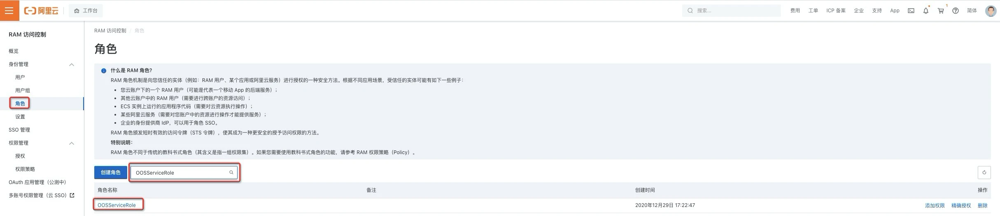
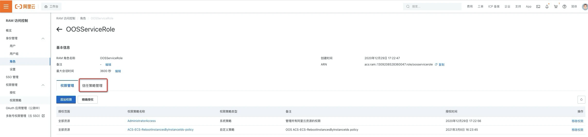
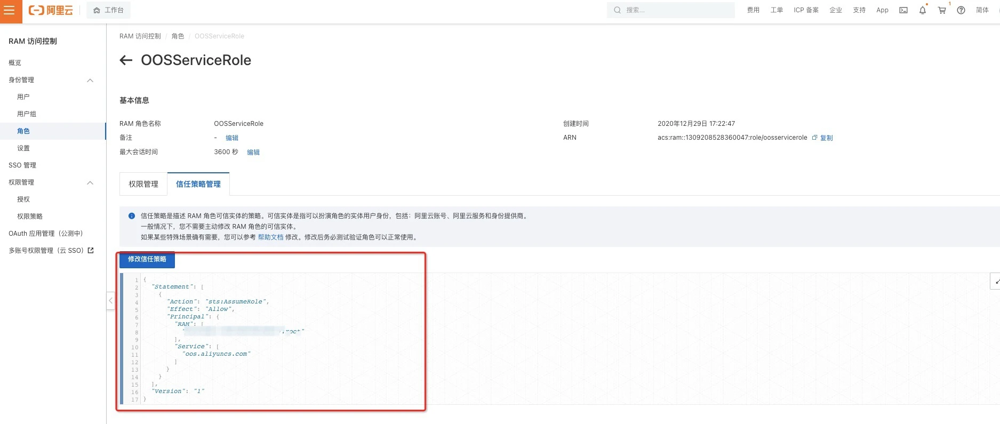

阿里云  
专有云  
运维编排  
运维指南  
产品版本：V3.18.6  
文档版本：20251029

**目录**

- [1.入门概述](#section-1)
- [2.新建模板](#section-2)
- [3.创建执行](#section-3)
- [4.定时运维](#section-4)
- [5.常见问题](#section-5)

<a id="section-1"></a>

# 1.入门概述

本快速入门指引您快速创建一个运维编排模板，并执行模板。

本快速入门包含以下操作：

1. 新建模版

以一个简单的示例模版为例，介绍如何新建模板，详情请参见新建模版。

2. 创建执行

选择新建的模版创建执行任务并启动执行，详情请参见创建执行。

<a id="section-2"></a>

# 2.新建模板

本示例中，创建一个简单的示例模板，输入为ECS实例的某个特定状态（比如Running或者Stopped），输出为此账号下处于该特定状态的ECS实例的ID列表。该模板会执行DescribeInstances的OpenAPI，并自动翻页进行查询。如果此账号下符合该特定状态的ECS实例数量小于1000，则将全部列出，否则，列出前1000个。关于限制的详情，请参见使用限制。

**操作步骤**

1. 登录专有云运维编排管理控制台。

2. 选择自定义任务模板，单击 **创建模板** 。

3. 在基本信息区域，配置模板参数。

4. 输入 **模板名称** ，本示例中为DescribeInstances。

5. 在 **模板详情** 区域，选择 **YAML** 格式，并输入以下示例模板。您可以修改此模板，增加多个Task，调用任意的OpenAPI。

   ```yaml
   ---
    Description: DescribeInstances
    FormatVersion: OOS-2019-06-01
    Parameters:
        Status:
            Description: Running or Stopped
            Type: String
    Tasks:
      - Name: describeInstances
        Action: ACS::ExecuteAPI
        Properties:
            Service: ECS
            API: DescribeInstances
            Parameters:
                Status: "{{ Status }}"
        Outputs:
            InstanceIds:
                Type: List
                ValueSelector: .Instances.Instance[].InstanceId
    Outputs:
        InstanceIds:
            Type: List
            Value: "{{ describeInstances.InstanceIds }}"
   ```

6. 单击**创建模板** 。

<a id="section-3"></a>

# 3.创建执行

创建模板后，您需要为该模板创建执行并启动执行。

**操作步骤**

1. 登录**运维编排管理控制台**。

2. 在**我的模板**页面，选择模板**创建执行** 。

3. 在**创建执行**页面，设置**基本信息** 。本示例中，选择 **执行模式** 为 **自动执行** 。参数解释如下：

<table>
  <tr>
    <th width="90">参数</th>
    <th>描述</th>
  </tr>
  <tr>
    <td>执行模式</td>
    <td>自动执行：确认创建后，将自动执行。单步执行：确认创建后，需要手动开启执行。</td>
  </tr>
  <tr>
    <td>失败暂停</td>
    <td>若为循环任务，当子任务执行有失败时，执行会暂停，等待您调整并决定是否继续执行。</td>
  </tr>
  <tr>
    <td>模板类别</td>
    <td>公共模板：平台提供的常用场景的模板。自定义模板：根据自身需求您创建的模板。</td>
  </tr>
  <tr>
    <td>模板选择</td>
    <td>选择您新建的模板。</td>
  </tr>
</table>

4. 单击**下一步：设置参数**，输入需要设置的参数。本示例的模板中有参数 **Status** ，设置该参数的值为**Stopped** 。

5. 单击**下一步：确认创建** 。

6. 单击**创建执行**。

7. 返回**执行管理** 页面，查看提交的执行。

- 如果选择了**自动执行** ，则自动开始执行。执行完毕后， **执行状态** 显示 **成功** 。

- 如果选择了**单步执行**或**高风险操作需要二次确认**，则需要手动开始执行。

8. 单击**执行ID**或**详情**页面，查看执行状态。

<a id="section-4"></a>

# 4.定时运维

**背景**

当您需在某个时间点做一些运维操作时，通过OOS**定时运维**可轻松搞定，当前支持的定时类型包括仅在指定时间执行一次，以及周期性重复执行。

**操作步骤**

1. 登录运维编排服务OOS管理控制台。

2. 单击**定时运维**。

3. 选择**定时类型**。可选择**仅在指定时间执行一次**或**周期性重复执行**，本示例选择**仅在指定时间执行一次**，然后选择**执行时间**和**时区**。

4. 然后**选择模板**。可**选择模板**有两种类型，分别是**公共模板**和**我的模板**，本示例选择一个**公共模板**。

5. 最后 **设置参数**，设置方法和普通模板参数设置方法一致。

6. 单击**立即执行**。

7. 在**执行管理**中可查看刚刚创建的执行，若创建执行成功，且执行状态处于等待中，则表示定时运维任务已创建成功。

8. 如需要更多了解执行情况，您可单击该执行的**详情**，查看**执行日志**。

<a id="section-5"></a>

# 5.常见问题

本文汇总了使用OOS时的常见问题。

- 子账户进行操作，报错：User has no permission to do the action: (ListTemplates)

- 子账户进行操作，报错：User has no permission to do the action: (PassRole)

- 执行模板时遇到报错：Assumes role failed. Code: EntityNotExist.Role, msg: The role not exists: acs:111111:role/OOSServiceRole.

- 执行模板时报错：Assumes role failed. Code: NoPermission, msg: You are not authorized to do this action. You should be authorized by RAM.

**子账户进行操作，报错：User has no permission to do the action: (ListTemplates)**

原因：子账户权限不够，不能执行OOS的指定API。

解决办法：以管理员或者主账户身份，登录**RAM控制台**，对报错的子账户进行适当授权，授权范围可以是相关API，也可是所有API，下面样例 `"Action": "oos:*"` 则是对所有API授权，详情请参见**账户访问控制**。

```json
{
  "Statement": [
      {
          "Effect": "Allow",
          "Action": "oos:*",
          "Resource": "*"
      }
  ],
  "Version": "1"
}
```

**子账户进行操作，报错：User has no permission to do the action: (PassRole)**

原因：子账户没有PassRole权限，不能以指定的Role执行运维编排。

解决办法：以管理员或者主账户身份，在**RAM控制台**，对子账户做适当的PassRole授权，参见**账户访问控制**。

```json
{
  "Statement": [
      {
          "Effect": "Allow",
          "Action": "oos:*",
          "Resource": "*"
      }
  ],
  "Version": "1"
}
```

**执行模板时遇到报错：Assumes role failed. Code: EntityNotExist.Role, msg: The role not exists: acs:111111:role/OOSServiceRole.**

原因：没有为OOS服务创建默认的RAM角色。

解决办法：主账户或者管理员登录**RAM控制台**>的RAM访问控制，增加对应的RAM角色OOSServiceRole。请参见**为OOS服务设置RAM权限**。

**执行模板时报错：Assumes role failed. Code: NoPermission, msg: You are not authorized to do this action. You should be authorized by RAM.**

原因： 对应的RAM角色没有给OOS服务配置信任策略。

解决办法：主账户或者管理员登录**RAM控制台**的RAM访问控制，增加对应的RAM角色OOSServiceRole。请参见**为OOS服务设置RAM权限**

1. 登录**RAM控制台**，在角色中输入"OOSServiceName"进行搜索：



2. 点击信任策略：



3. 修改信任策略：



将信任策略修改为如下内容：

```json
{
  "Statement": [
      {
          "Action": "sts:AssumeRole",
          "Effect": "Allow",
          "Principal": {
              "Service": [
                  "oos.aliyuncs.com"
              ]
          }
      }
  ],
  "Version": "1"
}
```
