阿里云  
专有云  
SRE技术保障平台  
运维指南  
产品版本：V3.18.6  
文档版本：20260210

**目录**

- [1.运维手册](#section-1)
    - [1.1. SRE 技术保障平台·铜雀 V2.* 升级部署手册](#section-1-1)

<a id="section-1"></a>

# 1.运维手册

详细说明SRE 技术保障平台·铜雀的部署升级操作

<a id="section-1-1"></a>

## 1.1. SRE 技术保障平台·铜雀 V2.* 升级部署手册

本文介绍SRE 技术保障平台·铜雀 V2.\* 升级部署操作。总共涉及5个步骤。

1. **升级流程说明**

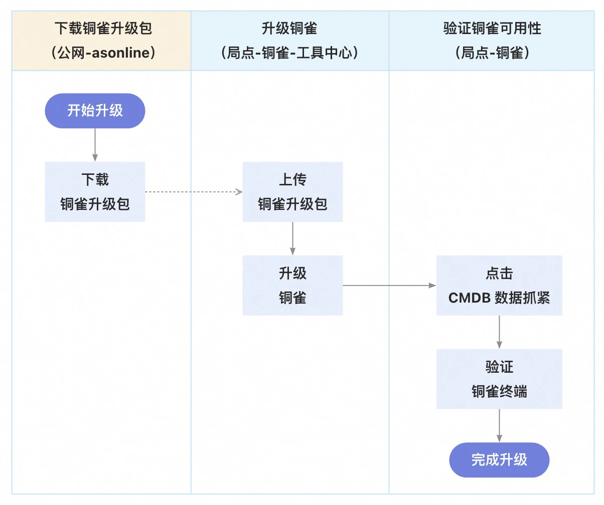

2. **前期准备**

**2.1. 升级包下载**

升级包下载地址：https://asonline.console.aliyun.com/software

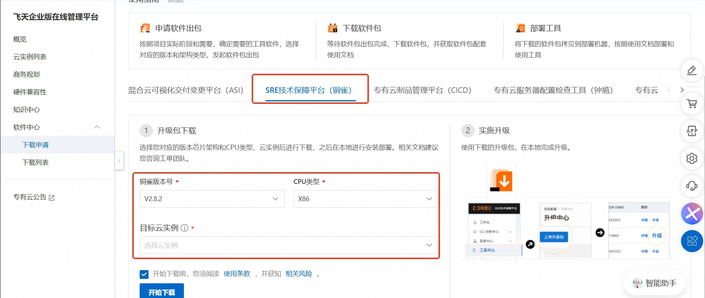

下载操作：

1. 选择要下载的“铜雀版本号”

2. 选择局点“CPU类型”和“云实例ID”

3. 点击“开始下载”

说明：

1. 如果下载地址无访问权限，请按页面引导进行权限申请，或提工单咨询。

2. 当前页面选择的“目标云实例”必须与局点侧实际的“Cloud ID(朱雀云 ID)”一致，下载的铜雀升级包才能在局点侧完成数据验签、解密、升级等，否则无法使用。

3. 与如果“目标云实例”为空，或者下拉列表中的云实例与局点侧的不一致，需要提工单咨询当前账号与局点绑定是否有误。

**2.1.1. 局点侧“Cloud ID(朱雀云 ID)”查看**

打开“铜雀-运维管理-服务配置”查看“Cloud ID(朱雀云 ID)”

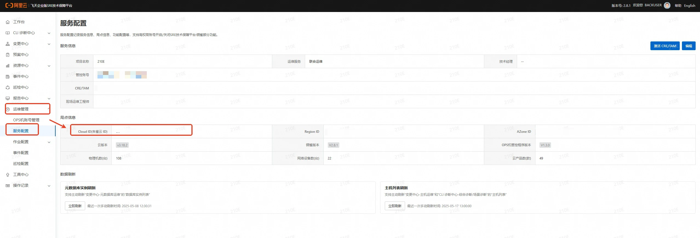

**2.2. 升级资源准备**

升级需要资源说明：

- tongque_updater 容器所在的 VM 需预留大于 4GB 的存储空间。

- 云版本 V318 以下的环境请确保当前环境已经进行了 SSH 免密打通，包括但不限于从tongque_updater 容器到 tongque_updater SR 所在的 VM、OPS1 等机器的 root 身份的免密打通

  - 【注意】部分局点经常出现 tongque_updater 容器 SSH 到盘古 AG 没有免密打通的情况，升级前请手动在 tongque_updater 容器内执行 ssh-copy-id 将公钥拷贝到 tianji 集群的 PanguTools# 所在的 VM。该操作与局点环境相关，铜雀无法自动化解决，如有疑问请通过工单联系阿里云技术支持。

3. **开始升级**

升级支持白屏升级和黑屏升级两种方式，两种方式选择其一即可

- 如果是**首次升级到 V2.0.0 及以上版本，请走黑屏升级流程**。

- 如果升级前版本已经是 V2.0.0 及以上，则黑屏与白屏升级皆可，推荐使用黑屏升级。

**3.1. 黑屏升级**

**双机房、多机房的环境，只需要在中心机房升级，升级程序会先部署B机房，后部署A机房**

将下载好的升级包 tongque.zip 上传至服务角色（SR） tongque_updater# 所在 VM，存储路径可以任意指定，后面触发升级时需要用到。

进入 /tmp/tongque_upload/ 目录，如果 tongque_import_util.pyc 已经存在，可以直接执行以下命令触发升级。其中，ZIP_PATH 是 tongque.zip 文件的绝对路径。

```text
/home/tops/bin/python tongque_import_util.pyc --tongque_zip_path {$ZIP_PATH}
```

注意，命令名 python 一定要写全绝对路径 /home/tops/bin/python，否则可能会出现异常。

一个执行示例如图所示。

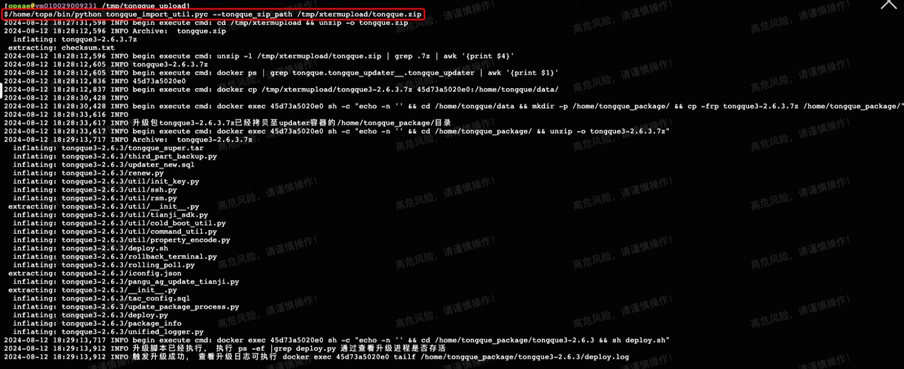

如果需要查看升级日志，可以在VM上执行

```bash
docker exec [$容器id] tailf /home/tongque_package/tongque3-[$⽬标铜雀版本]/deploy.log
```

也可以直接进入容器内，执行

```text
tail -f /home/tongque_package/tongque3-[$⽬标铜雀版本]/deploy.log
```

升级日志中可能包含一些报错/警告信息，但**并不代表升级出错**，真正判断升级异常的方法请参考 **本文章节“4.1. 查看升级进程”**。

如果升级进程意外中断，想要再次触发升级，可以参考 “4.3. 升级失败重试”。

**3.2. 白屏升级**

白屏升级适用于升级前为 V2.0.0 及以上版本的情况。

在白屏升级之前，需要先在本地解压 tongque.zip，其中内容同 3.1. 内容相同，得到 tongque3-2.0.0.7z与 checksum.txt。

点击“铜雀-工具中心”，新开页面展示“工具中心”。

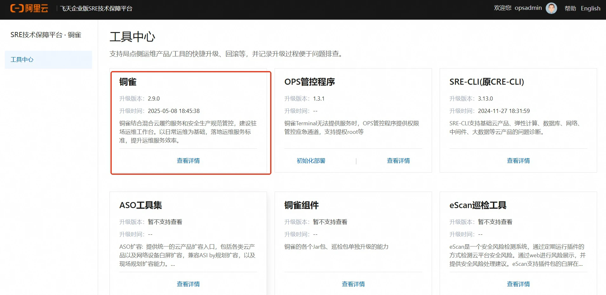

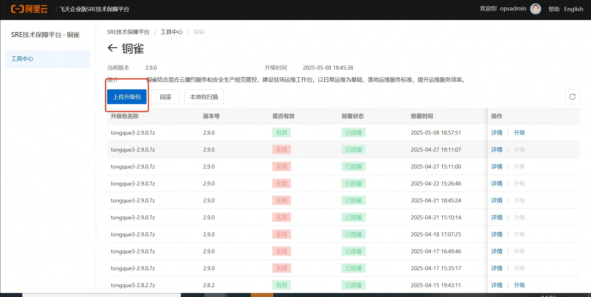

点击“上传升级包”按钮，将 checksum 里面的 MD5 值（不包含文件名）和升级包主体 tongque3-2.0.0.7z 填入，如图所示。

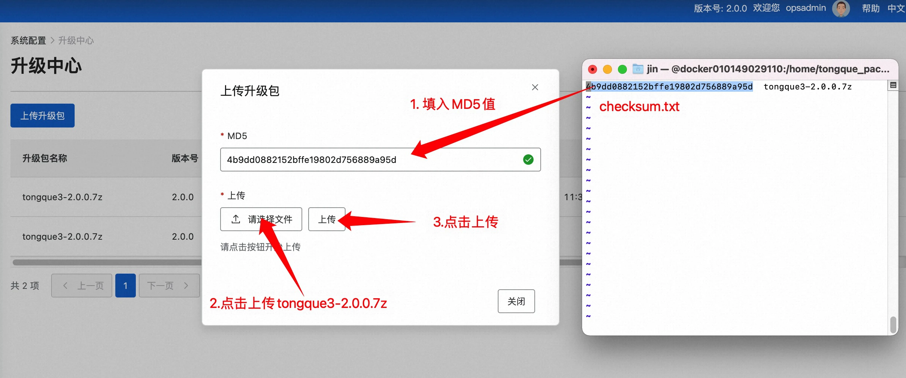

上传过程会有进度条展示上传进度。由于各个局点网络环境不同，上传整体时间在几分钟至几十分钟不等，如果发现上传进度过慢，请走“3.1. 黑屏升级”流程。

上传完成后，点击“升级”开始升级流程。

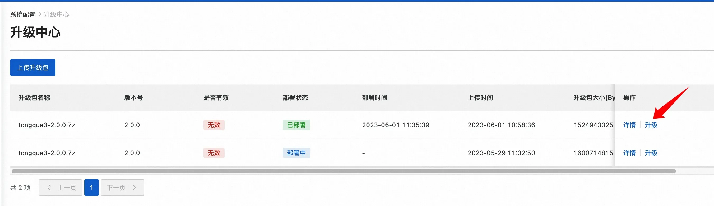

说明：白屏展示中，“是否有效”字段表示的是这个升级包是否被清理，“无效”代表升级包已经被清理，升级完成后显示“无效”是符合预期的，因为容器重拉后升级包会被清理。

4. **升级过程观察**

由于升级时间长、过程繁琐，为保证升级的顺利进行，需要不定期检查升级进度。尽管升级方式包含黑屏与白屏两种形式，但是底层的升级逻辑是一致的，以下观测方法对黑屏与白屏升级均适用。

说明：如果使用铜雀“主机变更”Terminal 进行升级，那么升级到一半时 Terminal 会卡住，因为升级会中断 Terminal 服务，但**这并不影响升级**，只需要换一个黑屏工具（比如xshell）观察升级即可。

**4.1. 查看升级进程**

进入 tongque_updater 容器，执行指令：

```text
ps -ef | grep -v grep | grep deploy.py
```

如果返回结果包含以下形式的内容，则证明升级还在进行中，否则证明升级已经结束。如果升级进程意外中断，需要查看升级日志排查原因。

root 10692 1 96 15:28 pts/1 00:00:04 /home/tops/bin/python /home/tongque_package/tongque3-2.0.0/deploy.py -u=True -f=tongque3-2.0.0.7z

**4.2. 查看升级日志**

升级日志包含两个部分：

- 部署日志：路径 /home/tongque_package/tongque3-${版本号}/deploy.log，主要用于记录部署过程中的执行动作（如，SSH 通信）、代码逻辑层面的异常、重要性较低的业务过程等。部署日志仅仅在文件中存储，实时性较低。

- 业务日志：路径 /home/tongque_package/tongque3-${版本号}/log/script.log，主要用于记录重要的业务过程、业务配置信息、业务层面的异常等。业务日志除文件存储外，还会写入数据库，通过白屏展示，实时性较强。

一般而言，观察升级过程只需查看以上两个日志文件即可，如果日志中出现异常，请尽快查看升级进程是否存活。

如果升级前版本已经是2.0.0及以上，可以直接打开升级中心页面，查看对应升级包的详情。一个常见的升级过程如下图所示。执行一次升级，会生成一条升级记录（如果升级包含对 updater 容器的升级，会额外再生成一条针对 updater 的升级记录），升级记录状态包含成功、失败、升级中。

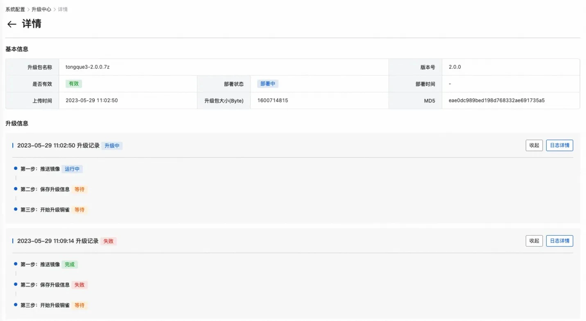

若状态指示为升级中，可以在下方的升级步骤中看到当前升级正处于哪一步，一般来说，第一步推送镜像与第三步开始升级铜雀耗时较久，前者耗时在十分钟左右，取决于机器的读写性能，后者耗时在二十分钟左右。

若状态指示为失败，可以点击右侧“日志详情”查看具体阻塞的步骤，如图所示，可根据失败原因进行自查，更进一步，需要登录 tongque_updater 容器查看两个日志文件的信息。无法解决的问题可提交工单处理。

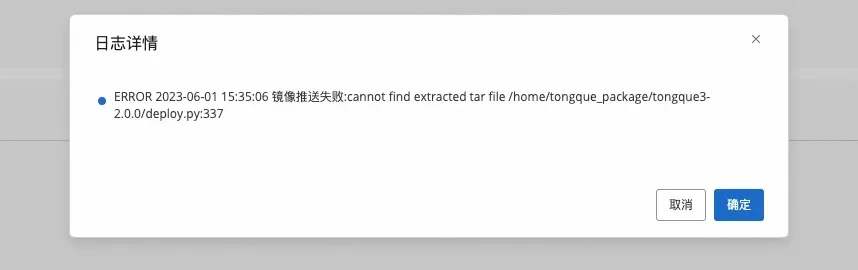

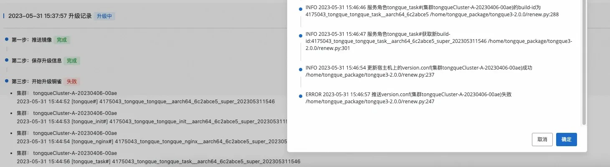

需要特别说明的是，第三步开始升级铜雀触发的是天基的 Rolling 过程，记录的是各个服务角色的升级状态，因此同样可以登录天基白屏界面，查看铜雀各个服务角色的升级状态。在当前详情页中，各个服务角色的状态也会通过动态刷新的方式进行展示。

一次成功执行的升级如下图所示。可以看到 tongque_updater# 的升级与其余四个 SR 是分开的，这是因为升级的流程由 updater 容器调度，当 updater 容器需要升级自己本身时，工作环境会自动转移到 init 容器中，重新生成一条新的升级记录。

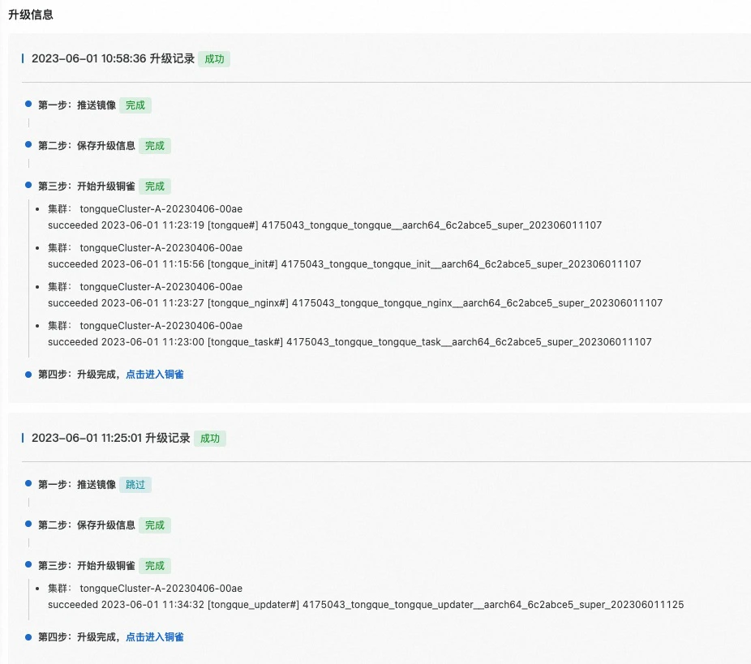

**4.3. 升级失败重试**

首先，需要检查升级进程是否存活，参考 “4.1. 查看升级进程”。确认升级进程已经结束后，可以通过黑屏再次触发升级。

登录 updater 所在的 VM，进入 tongque_import_util.pyc 所在目录，执行以下命令再次触发升级

```text
/home/tops/bin/python tongque_import_util.pyc --break_point [$UPDATE_VERSION]
```

其中，UPDATE_VERSION 表示本次目标升级的版本号，比如2.6.5。

**4.3.1. [404页面] 说明**

升级完成后，打开铜雀页面显示404页面，如下图，为浏览器缓存问题，请清除浏览器缓存

5. **[必看] 升级完成后逐项检查**

检查清单：

1. 【必做】升级版本确认，确认当前版本是否为此次升级版本

2. 【必做】铜雀终端可用性验证，验证前点CMDB抓取

3. 封神使用情况检查，如果局点已部署封神，此步骤必做

**5.1. 【必做】升级版本确认**

在“铜雀-运维管理-服务配置-局点信息”查看铜雀版本

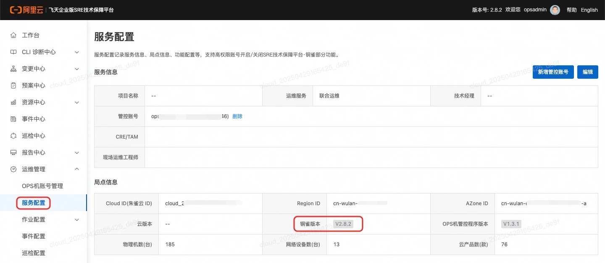

**5.2.【必做】铜雀终端可用性验证**

保障铜雀终端处于可用状态，满足驻场日常执行 SHELL 命令的能力

1，打开“铜雀-诊断中心-问题排查”

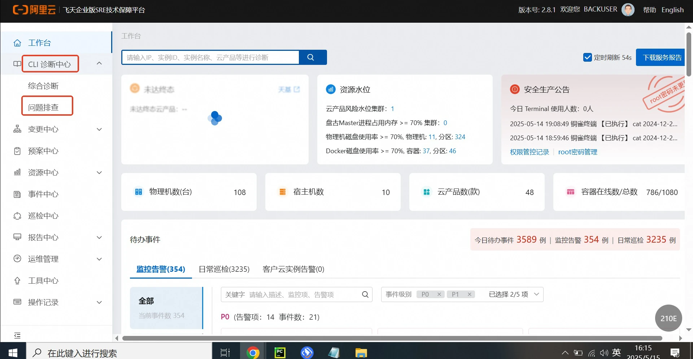

2，确认机器列表非空

如果机器列表为空

- 方案一：在“铜雀-诊断中心-综合诊断” 右上角点击“CMDB 数据抓取”，然后再次刷新该页面。

- 方案二：在“铜雀-运维管理-服务配置-数据刷新-主机列表刷新”点击“立即刷新”，然后再次刷新该页面。

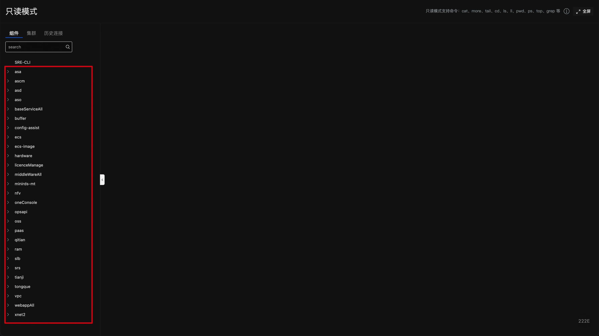

在“铜雀-诊断中心-综合诊断” 右上角点击“CMDB 数据抓取”

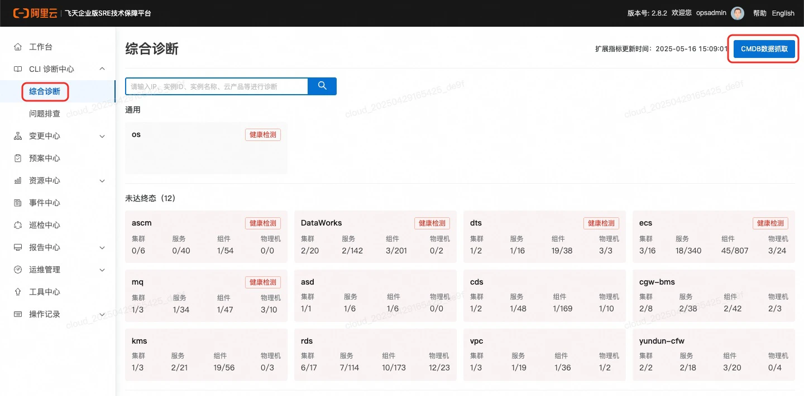

在“铜雀-运维管理-服务配置-数据刷新-主机列表刷新”点击“立即刷新”

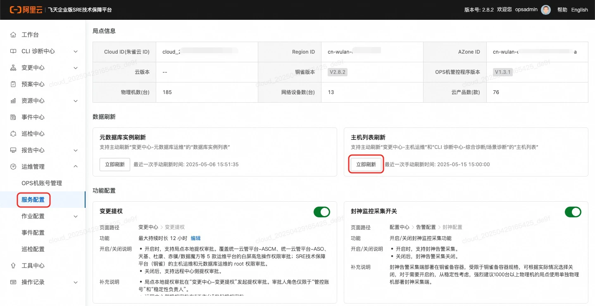

3，点击“SRE-CLI”，看到 SRECLI 的界面为正常。

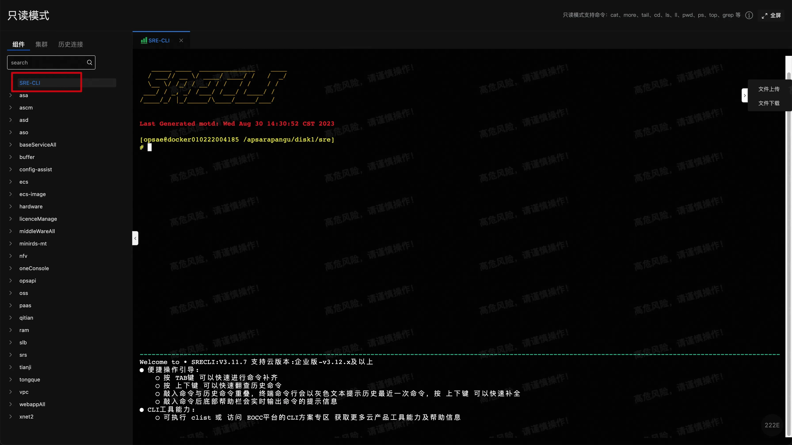

4，打开铜雀“主机变更”

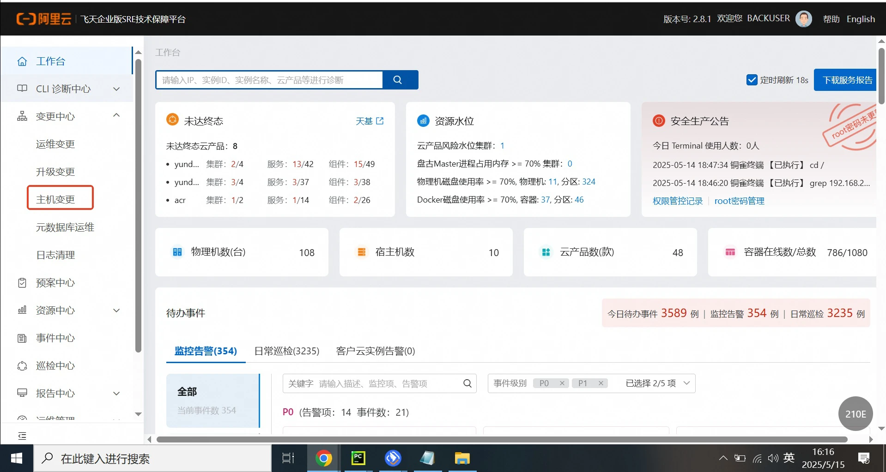

随机选取一个机器进行连接，需要看到如下界面则为正常

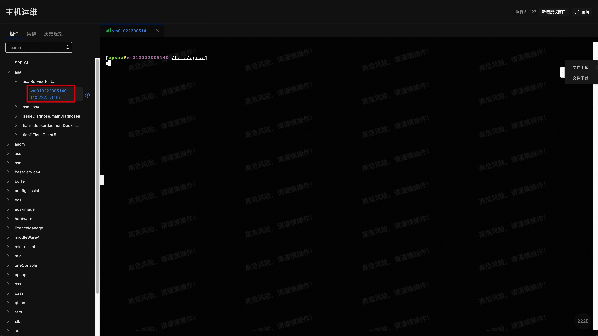

以上 4 步如果有任何异常情况，请提工单咨询。

**5.2. 封神使用情况检查**

如果局点已部署封神，此步骤必做。

1. 如果只使用封神推送钉钉通知的功能，建议切换到铜雀进行钉钉通知推送，可提工单咨询。

2. 由于封神数据采集有一定资源消耗，请确认是否需要继续使用封神。

   <ol type="i">

   <li>

   如无需使用封神，建议主动关闭。由“**管控账号**”在“铜雀-运维管理-服务配置-封神监控采集开关”，点击开关即可关闭

   </li>

   </ol>

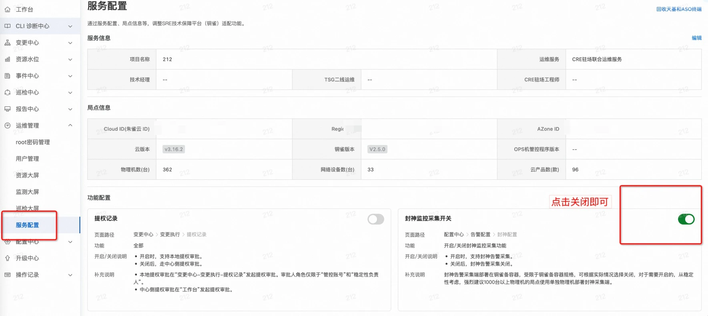

6. **回滚方案**

登录天基白屏界面，进入铜雀集群详情页，如图所示。不同版本的天基白屏界面并不相同，但操作逻辑类似，可以直接借鉴下面的操作。

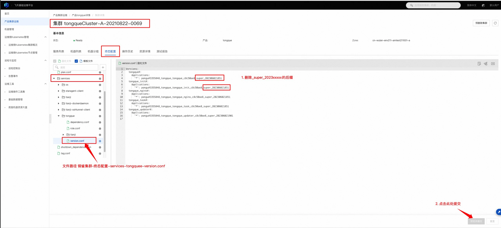

回滚操作：

1. 集群详情中找到**终态配置**，左侧目录选中 services/tongque/version.conf 文件，右侧显示文件内容，可以直接进行编辑。

2. 将文件中每一个服务角色的“_super_时间戳”的后缀删除，如图中红框标注所示，如果某服务角色不存在这样的后缀，可忽略。

3. 修改完所有的服务角色以后，点击右下角“预览并提交”按钮，即可开触发 Rolling 以完成回滚。

注意，回滚以后铜雀会回到一个原始版本，**请谨慎考虑回滚操作**。例如，某云版本所携带的铜雀原始版本为V3986，后该版本铜雀曾升级至 V3990，在 V3990 版本下升级至 V2.0.0版本后，进行了上述回滚操作，则铜雀会回到V3986 版本，中间的 V3990 版本丢失。
