阿里云  
专有云  
云接入网关  
运维指南  
产品版本：V3.18.6  
文档版本：20251230

**目录**

- [1.登录Apsara Uni-manager运维控制台](#section-1)
- [2.基础网络](#section-2)
    - [2.1. HPN管理](#section-2-1)
        - [2.1.1. HPN网元](#section-2-1-1)
        - [2.1.2. RDMA网卡运维](#section-2-1-2)
        - [2.1.3. HPN性能分析](#section-2-1-3)
        - [2.1.4. HPN即时诊断](#section-2-1-4)
    - [2.2. 算力平台网络](#section-2-2)
        - [2.2.1. CPN一键诊断](#section-2-2-1)
        - [2.2.2. CPN性能分析](#section-2-2-2)
        - [2.2.3. CPN告警中心](#section-2-2-3)
        - [2.2.4. CPN接入网关](#section-2-2-4)
            - [2.2.4.1. RDMA设备管理](#section-2-2-4-1)
            - [2.2.4.2. RDMA设备策略管理](#section-2-2-4-2)
            - [2.2.4.3. RDMA设备接口策略管理](#section-2-2-4-3)
        - [2.2.5. RDMA网卡运维](#section-2-2-5)
        - [2.2.6. CPN网络管理](#section-2-2-6)
            - [2.2.6.1. CPN拓扑](#section-2-2-6-1)
            - [2.2.6.2. CPN网元](#section-2-2-6-2)
        - [2.2.7. CPN网络监控](#section-2-2-7)
            - [2.2.7.1. CPN主机监控大盘](#section-2-2-7-1)
            - [2.2.7.2. CPN交换机大盘](#section-2-2-7-2)
            - [2.2.7.3. NAK报文分析工具](#section-2-2-7-3)
            - [2.2.7.4. 高精度监控大盘](#section-2-2-7-4)
            - [2.2.7.5. 交换机高精度大盘](#section-2-2-7-5)
            - [2.2.7.6. job维度监控](#section-2-2-7-6)
            - [2.2.7.7. CPN流监控](#section-2-2-7-7)
    - [2.3. 云接入网关](#section-2-3)
    - [2.4. 算力平台接入网关](#section-2-4)
- [3.网络产品](#section-3)
    - [3.1. CGW运维](#section-3-1)
        - [3.1.1. CGW集群管理](#section-3-1-1)
        - [3.1.2. CGW管理](#section-3-1-2)
- [4.流量可视化](#section-4)
    - [4.1. 可视化设置](#section-4-1)

<a id="section-1"></a>

# 1.登录Apsara Uni-manager运维控制台

本文介绍运维工程师等相关用户如何登录到Apsara Uni-manager运维控制台。

**前提条件**

- 已从部署人员或管理员处获取Apsara Uni-manager运维控制台的访问地址、用户名和密码。

  Apsara Uni-manager运维控制台访问地址格式为*region-id*.ops.console.*intranet-domain-id*。

- 推荐使用Chrome浏览器。

**操作步骤**

1. 打开浏览器。

2. 在地址栏中，输入Apsara Uni-manager运维控制台的访问地址，按回车键。

   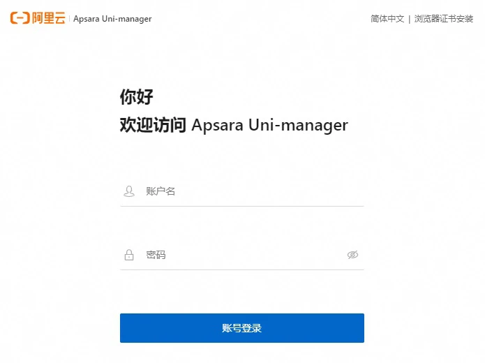

   > **说明**
   >
   > 您可以单击右上角的当前语言切换其它语言。当前支持简体中文、英文、繁体中文三种语言切换。

3. 输入正确的用户名及密码。

   > **说明**
   >
   > - 登录Apsara Uni-manager运维控制台的用户名和密码请从部署人员或管理员处获取。
   >
   > - 若连续输入密码错误三次，系统将启动图片验证码登录功能；若连续输入错误五次，账户将被锁定，请联系管理员进行激活。

   首次登录Apsara Uni-manager运维控制台时，需要修改登录用户名的密码，请按照提示完成密码修改。

   为提高安全性，密码必须满足以下要求：

   - 必须包含英文大小写字母。

   - 必须包含阿拉伯数字（0~9）。

   - 必须包含特殊符号，包括感叹号（!）、at（@）、井号（#）、美元符号（$）、百分号（%）等。

   - 密码长度为10~20个字符。

4. 单击**账号登录**。

<a id="section-2"></a>

# 2.基础网络

<a id="section-2-1"></a>

## 2.1. HPN管理

> **说明**
>
> 此功能默认不展示，如果需要使用本功能，在**用户权限** > **菜单管理**下编辑菜单项，进行**展示**操作。

<a id="section-2-1-1"></a>

### 2.1.1. HPN网元

展示云平台中HPN网络设备资产与监控运维信息。

**操作步骤**

1. 登录Apsara Uni-manager运维控制台。

2. 在顶部菜单栏，选择**产品运维** > **网络运维** > **网络运维控制台**。

3. 在左侧导航栏，选择**基础网络** > **HPN 管理** > **HPN 网元**。

4. 在**HPN 网元**页面，默认展示云平台中全部机房的HPN网络设备资产列表。

   - 设备内容包括**网元名称**、**IP**、**SN**、**厂商**、**角色**、**网络域**、**Ping 连通性**、**SNMP 连通性**、**最后更新时间**、**Grpc 状态**等。

   - 支持通过**选择机房**和**网元名称**组合筛选获取目标网元设备。

   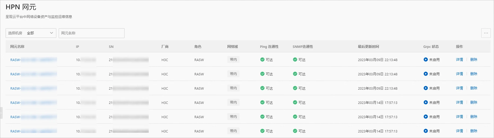

5. 在网络设备资产列表，单击目标设备**网元名称**列的名称，或者单击目标设备**操作**列的**详情**，可以查看对应设备的详细信息。

   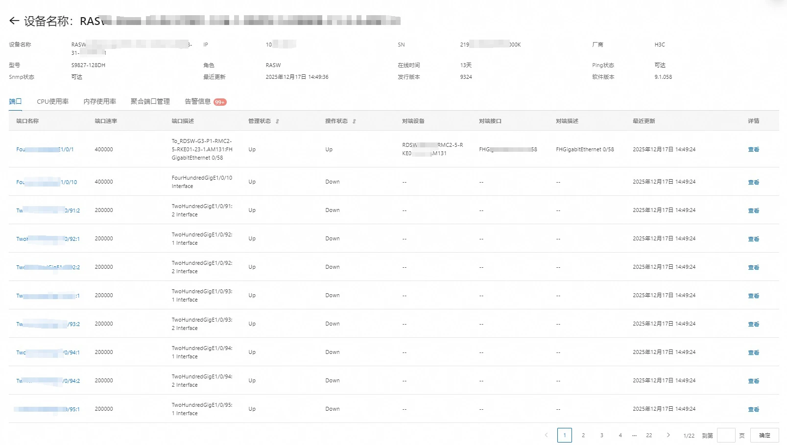

   <table>
     <tr>
       <th width="90">区域</th>
       <th>说明</th>
     </tr>
     <tr>
       <td>基本信息</td>
       <td>包括<strong>设备名称</strong>、<strong>IP</strong>、<strong>SN</strong>、<strong>厂商</strong>、<strong>型号</strong>、<strong>角色</strong>、<strong>在线时间</strong>、<strong>Ping状态</strong>、<strong>Snmp状态</strong>、<strong>最近更</strong><strong>新</strong>、<strong>发行版本</strong>和<strong>软件版本</strong>。</td>
     </tr>
   </table>

   <table>
     <tr>
       <td>端口</td>
       <td>展示该设备的端口列表。端口内容包括<strong>端口名称</strong>、<strong>端口速率</strong>、<strong>端口描述</strong>、<strong>管理状态</strong>、<strong>操作状</strong><strong>态</strong>、<strong>对端设备</strong>、<strong>对端接口</strong>、<strong>对端描述</strong>、<strong>最近更新</strong>等。<br>说明<strong>管理状态</strong>和<strong>操作状态</strong>支持排序。<br>查看端口详情：单击目标端口<strong>端口名称</strong>列的名称，或者单击目标端口<strong>详情</strong>列的<strong>查看</strong>，获取对应端口的基本信息和水位数据。<br>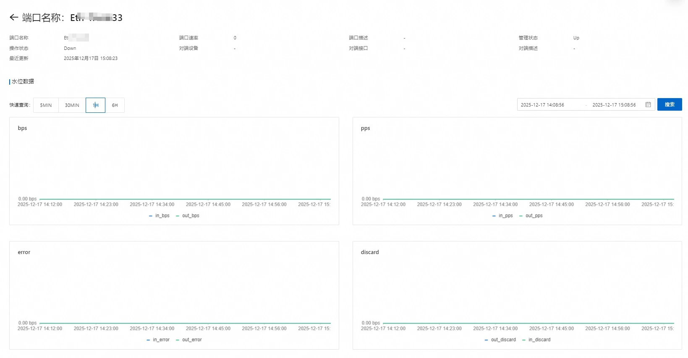<br>• 基本信息：包括<strong>端口名称</strong>、<strong>端口速率</strong>、<strong>端口描述</strong>、<strong>管理状态</strong>、<strong>操作状态</strong>、<strong>对端设备</strong>、<strong>对端接</strong><strong>口</strong>、<strong>对端描述</strong>、<strong>最近更新</strong>。<br>• <strong>水位数据</strong>：默认展示最近1小时的流量数据。相关指标含义，请参考端口指标说明。在右上角选择起止时间，单击<strong>搜索</strong>，支持查看目标时间范围内的运行水位数据信息。<br>说明<br>• 选择时间范围不能超过12小时。<br>• 单击<strong>快速查询</strong>选项的<strong>5MIN</strong>、<strong>30MIN</strong>、<strong>1H</strong>、<strong>6H</strong>可以快速查询对应时间范围内的水位数据信息。<br>• 将鼠标悬停于图中任意一个时间节点，系统会显示该时间节点的所有指标的数值。<br>• 单击任意指标项，将单独展示对应指标的水位趋势图。</td>
     </tr>
     <tr>
       <td>CPU使用率</td>
       <td>展示该设备的CPU使用率信息。<br>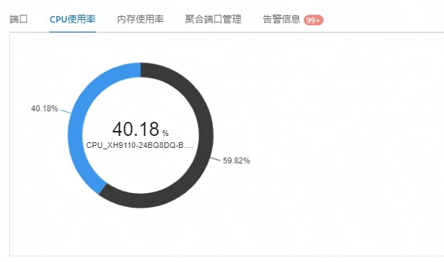</td>
     </tr>
     <tr>
       <td>内存使用率</td>
       <td>展示该设备的内存使用率信息。<br>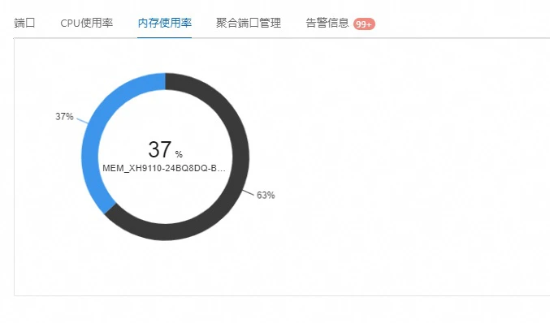</td>
     </tr>
     <tr>
       <td>聚合端口管理</td>
       <td>展示该设备的所有聚合端口信息。<br>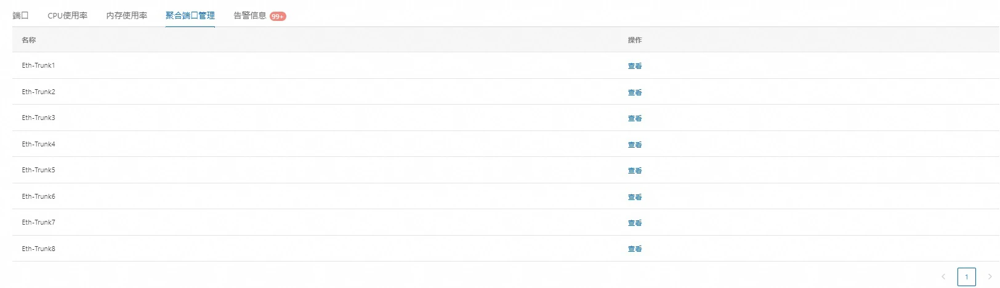<br>单击目标聚合端口<strong>操作</strong>列的<strong>查看</strong>，可以查看对应聚合端口的水位信息。相关指标含义，请参考端口指标说明。<br>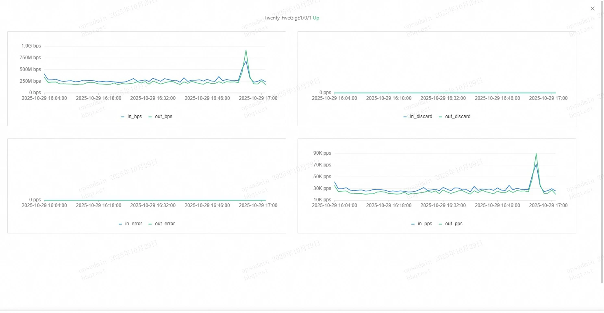<br>说明<br>• 将鼠标悬停于图中任意一个时间节点，系统会显示该时间节点的所有指标的数值。<br>• 单击任意指标项，将单独展示对应指标的水位趋势图。</td>
     </tr>
     <tr>
       <td>告警信息</td>
       <td>展示该设备的告警列表信息，包括<strong>告警时间</strong>、<strong>告警来源</strong>、<strong>告警IP</strong>、<strong>告警设备</strong>、<strong>告警名称</strong>、<strong>告警</strong><strong>项目</strong>等。鼠标悬浮在目标告警<strong>告警详情</strong>列的<strong>查看</strong>按钮上，可以查看对应告警的详情。<br>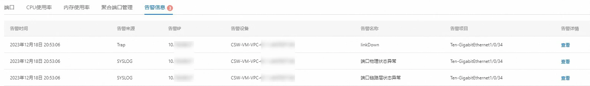<br>说明日常运维过程中，需要及时关注设备的告警信息。<strong>告警信息</strong>页签无数据，表示设备运行正常；若出现告警事件，系统会显示当前未恢复的告警事件，请及时处理。</td>
     </tr>
   </table>

6. 在网络设备资产列表，单击目标设备**操作**列的**删除**，可以删除对应网元设备的监控信息。

   > **说明**
   >
   > 删除操作无法恢复，请谨慎操作。

**端口指标说明**

<table>
  <tr>
    <td></td>
    <td>名称</td>
    <td>描述</td>
  </tr>
  <tr>
    <td rowspan="2">bps</td>
    <td>in_bps</td>
    <td>端口入方向字节速率（比特/秒）</td>
  </tr>
  <tr>
    <td>out_bps</td>
    <td>端口出方向字节速率（比特/秒）</td>
  </tr>
  <tr>
    <td rowspan="2">pps</td>
    <td>in_pps</td>
    <td>端口入方向数据包速率（个/秒）</td>
  </tr>
  <tr>
    <td>out_pps</td>
    <td>端口出方向数据包速率（个/秒）</td>
  </tr>
  <tr>
    <td rowspan="2">error</td>
    <td>in_error</td>
    <td>端口入方向错误包速率（个/秒）</td>
  </tr>
  <tr>
    <td>out_error</td>
    <td>端口出方向错误包速率（个/秒）</td>
  </tr>
  <tr>
    <td rowspan="2">discard</td>
    <td>in_discard</td>
    <td>端口入方向报文丢弃速率（个/秒）</td>
  </tr>
  <tr>
    <td>out_discard</td>
    <td>端口出方向报文丢弃速率（个/秒）</td>
  </tr>
</table>

<a id="section-2-1-2"></a>

### 2.1.2. RDMA网卡运维

RDMA网卡运维是通过性能监控，定期检查RDMA网卡的性能指标，以便及时发现问题，快速排查并解决问题，保证网络稳定性和可靠性。

**相关概念**

<strong>RDMA（</strong>Remote Direct Memory Access<strong>）</strong>：全称远程直接内存访问，是一种高速网络技术，为了解决网络传输中服务器端数据处理的延迟而产生的。RDMA通过网络将数据直接传入计算机的存储区，把数据从一个系统快速移动到远程系统存储器中，实现了主机之间直接访问内存，但不对操作系统造成任何的影响，提高了数据传输速度、降低了CPU负载。

**操作步骤**

1. 登录Apsara Uni-manager运维控制台。

2. 在顶部菜单栏，选择**产品运维** > **网络运维** > **网络运维控制台**。

3. 在左侧导航栏，选择**基础网络** > **HPN 管理** > **RDMA网卡运维**。

4. 在**RDMA网卡运维**页面，右上角根据实际情况选择**数据源**、**集群**和**ViewType**，查看RDMA网卡的性能指标信息。

   数据源支持如下类型：

   - **BMS**（Bare Metal Server）：指数据来源于裸金属服务器。

   - **PAI**（Platform of Artificial Intelligence）：指数据来源于机器学习。

   - **CPFS**（Cloud Paralleled File System）: 指数据来源于文件存储。

   - **SCC**（Super Computing Cluster）: 指数据来源于超级计算集群。

   > **说明**
   >
   > - 当**数据源**选择**PAI**、**CPFS**或**SCC**时，需要继续选择**集群**。
   >
   > - 当**数据源**选择**PAI**时，还需要选择**ViewType**。

   - 单击**集群**页签，查看集群维度的监控信息。

     | 监控指标 | 说明 |
     | --- | --- |
     | 平均QP数 | 在RDMA网络中，平均拥有的QP数量。当<strong>数据源</strong>选择<strong>PAI</strong>时，无此参数项。<br>• 当QP数不足时，会导致通信队列拥塞，影响数据传输效率和稳定性。<br>• 当QP数过多时，会增加系统的开销、复杂性，以及增加系统的故障率。<br>说明QP即Queue Pair，是RDMA网络中的关键概念，用于描述一对端点之间的通信队列。 |
     | 网络状态异常数 | 在RDMA网络中，网络设备或流量出现异常的次数。 |
     | RDMA平均发送吞吐（Mbps） | 在RDMA网络中，单位时间内网络中所有节点的平均发送数据吞吐量。 |
     | RDMA平均接受吞吐（Mbps） | 在RDMA网络中，单位时间内网络中所有节点的平均接收数据吞吐量。 |
     | 监控图表 | 默认展示最近一小时内的吞吐大盘数据和RDMA网络监控基础数据。<br>说明<br>• 在区域右上角，选择起止时间，可以查看目标时间区间内的监控数据。<br>• 将鼠标悬停于图中任意一个时间节点，系统会显示该时间节点的指标的数值。<br>• 单击任意指标项，将单独展示对应指标的监控图表。<br>• 吞吐大盘<br>• <strong>RDMA_RX_BYTES</strong>：RDMA网络中接收数据时所接收的字节数量。<br>• <strong>RDMA_TX_BYTES</strong>：RDMA网络中发送数据时所传输的字节数量。<br>• RDMA 网络基础数据显示<br>• <strong>RDMA_IGNORE_CNP_AVG</strong>：RDMA网络中平均忽略CNP数据包的数量。<br>说明CNP（Congestion Notification Packet）数据包是用于网络拥塞控制的数据包。当网络出现拥塞时会发送CNP数据包通知发送方减少发送速率，避免网络拥塞和数据包丢失。<br>• <strong>RDMA_TX_PFC_PAUSE_AVG</strong>：RDMA网络中发送数据时平均PFC数据包的数量。<br>• <strong>RDMA_RX_PFC_PAUSE_AVG</strong>：RDMA网络中接收数据时平均PFC数据包的数量。<br>• <strong>RDMA_OOB_AVG</strong>：RDMA网络中处理OOB数据的平均个数。<br>说明OOB（Out-of-Band）数据是RDMA网络中传输的一种特殊类型的数据。<br>• <strong>RDMA_OOS_AVG</strong>：RDMA网络中处理OOS数据的平均个数。<br>说明OOS（ Out-of-Order）数据是RDMA网络中传输的一种特殊类型的数据。当数据包在传输时发生丢失、延迟等情况就会出现OOS数据。<br>• <strong>RDMA_SENT_CNP_AVG</strong>：RDMA网络中发送CNP数据包的平均个数。<br>• <strong>RDMA_MARKED_ECN_AVG</strong>：RDMA网络中标记平均ECN数据包的数量。<br>• <strong>RDMA_HANDLE_CNP_AVG</strong>：指RDMA网络中处理CNP数据包的平均个数。<br>• <strong>RDMA_TX_PFC_TRANS_AVG</strong>：指RDMA网络中发送数据时平均切换PFC数据包的数量。<br>• <strong>RDMA_QP_CNT_AVG</strong>：RDMA网络中QP平均个数。<br>• <strong>RDMA_TX_BYTES_AVG</strong>：RDMA网络中发送数据的平均字节数。<br>• <strong>RDMA_RX_BYTES_AVG</strong>：RDMA网络中接收数据的平均字节数。 |
     |  |  |
     | RDMA 网络总览表 | 查看RDMA网络中节点列表，包括<strong>节点</strong>、<strong>发送吞吐</strong>、<strong>接收吞吐</strong>、<strong>网络QP数</strong>、<strong>网络</strong><strong>处理CNP数</strong>、<strong>数据报文乱序</strong>、<strong>网络缓冲区溢出</strong>等数据。支持输入<strong>节点</strong>，根据名称筛选指定节点。 |

   - 单击**节点**页签，输入**节点名称**，查看节点维度的监控信息。

     具体参数说明，请参考集群维度监控指标说明。

<a id="section-2-1-3"></a>

### 2.1.3. HPN性能分析

HPN性能分析，是指对HPN（High Performance Network）网络性能的分析。通过测试机器在压力情况下的性能表现，考察当前软硬件所能承受的最大负荷和抗压能力，帮助用户找出机器的压力极限，为运维提供充分的数据依据，以提高网络的性能。

**操作步骤**

1. 登录Apsara Uni-manager运维控制台。

2. 在顶部菜单栏，选择**产品运维** > **网络运维** > **网络运维控制台**。

3. 在左侧导航栏，选择**基础网络** > **HPN 管理** > **HPN 性能分析**。

4. 在**HPN 性能分析**页面，单击**新建测试**。

5. 在**创建分析任务**页面，根据如下任务动态组合及配置说明完成参数配置。

   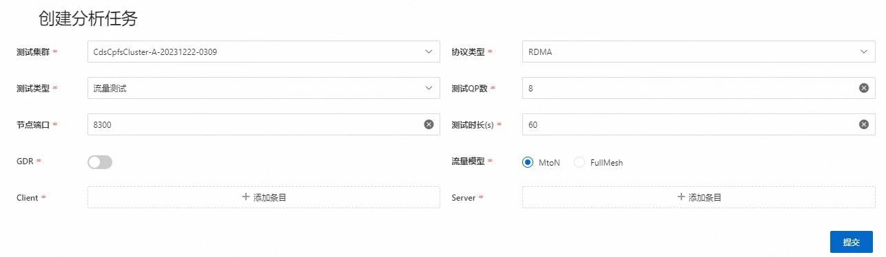

   <table>
     <tr>
       <th>测试集群</th>
       <th>协议类型</th>
       <th>测试类型</th>
       <th>需要输入的参数</th>
       <th>流量模型</th>
       <th>节点列表</th>
     </tr>
     <tr>
       <td rowspan="5"><em>任意</em></td>
       <td rowspan="3">RDMA</td>
       <td rowspan="2">流量测试</td>
       <td rowspan="2">• 测试QP数<br>• 节点端口<br>• 测试时长(s)<br>• GDR</td>
       <td>MtoN</td>
       <td>• Server<br>• Client</td>
     </tr>
     <tr>
       <td>FullMesh</td>
       <td>Server</td>
     </tr>
     <tr>
       <td>时延测试</td>
       <td>• 节点端口</td>
       <td>——</td>
       <td>Server</td>
     </tr>
     <tr>
       <td rowspan="2">TCP</td>
       <td rowspan="2">流量测试</td>
       <td rowspan="2">• 节点端口<br>• 测试时长(s)<br>• 并发连接数</td>
       <td>MtoN</td>
       <td>• Server<br>• Client</td>
     </tr>
     <tr>
       <td>FullMesh</td>
       <td>Server</td>
     </tr>
   </table>

   <table>
     <tr>
       <th width="113">配置参数</th>
       <th>参数说明</th>
     </tr>
     <tr>
       <td>测试QP数</td>
       <td>测试进程流的数量，影响测试带宽的大小。默认值<strong>8</strong>。<br>• 当QP数不足时，会导致通信队列拥塞，影响数据传输效率和稳定性。<br>• 当QP数过多时，会增加系统的开销、复杂性，以及提高系统故障率。<br>说明QP即Queue Pair，是RDMA网络中的关键概念，用于描述一对端点之间的通信队列。</td>
     </tr>
     <tr>
       <td>节点端口</td>
       <td>测试所使用的端口号。默认值<strong>8300</strong>。</td>
     </tr>
     <tr>
       <td>测试时长(s)</td>
       <td>本次测试的时长，单位为秒。默认值<strong>60</strong>。</td>
     </tr>
     <tr>
       <td>GDR</td>
       <td>选择是否开启GDR。如果开启GDR，会绑定RDMA网卡与对应的GPU进行流量测试。开启前请先确认机器是否支持，如果不支持请不要开启该选项。</td>
     </tr>
     <tr>
       <td>并发连接数</td>
       <td>同一时间内，可以同时处理的连接数。默认值<strong>2</strong>。</td>
     </tr>
     <tr>
       <td>流量模型</td>
       <td>• <strong>MtoN</strong>：全称Many to Many，是指多对多的关系模型。即测试<strong>Clients</strong>节点到<strong>Servers</strong>节点的单向连通性，包括单个<strong>Client</strong>节点到单个<strong>Server</strong>节点、多个<strong>Clients</strong>节点到多个<strong>Servers</strong>节点等情况。<br>• <strong>FullMesh</strong>：指网络拓扑结构中所有节点之间互相连接的情况，即测试所有目标节点两两之间的连通性。</td>
     </tr>
     <tr>
       <td>Client</td>
       <td>流量测试的发送方，用户自定义设置条目<strong>节点</strong>及<strong>网卡</strong>。<br>说明<br>• 单击<strong>添加条目</strong>，可以增加条目信息。<br>• 单击目标条目右侧，可以删除<strong>节点</strong>及<strong>网卡</strong>。<br></td>
     </tr>
     <tr>
       <td>Server</td>
       <td>流量测试的接收方，用户自定义设置条目<strong>节点</strong>及<strong>网卡</strong>。<br>说明<br>• 单击<strong>添加条目</strong>，可以增加条目信息。<br>• 单击目标条目右侧，可以删除<strong>节点</strong>及<strong>网卡</strong>。<br></td>
     </tr>
   </table>

6. 单击**提交**，弹出创建成功提示框。

   - 单击**取消**：返回创建分析任务页面，可重新修改参数创建新的分析任务。

   - 单击**查看任务详情**：跳转到**分析任务详情**页面。

**更多操作**

**查看分析任务**

在**HPN性能分析**页面，查看性能分析任务列表。默认展示最近1小时的测试历史任务。

- 任务内容包括**任务名称**、**任务ID**、**测试集群**、**测试类型**、**协议类型**、**任务状态**、**创建时间**、**修改时间**等。

- 单击**高级筛选**，支持通过**起止时间**、**任务ID**、**测试类型**、**协议类型**、**流量模型**和**任务状态**组合筛选获取目标分析任务。

  单击**最近1小时**、**最近3小时**、**最近6小时**、**最近1天**可以快速设置**起止时间**。

**查看任务详情**

1. 在分析任务列表，单击目标任务**操作**列的**详情**。

2. 在**分析任务详情**页面，查看任务的基本信息和分析结果。

   - **基本信息**：包括**任务名称**、**协议类型**、**测试类型**、**测试时长**、**节点端口**、**测试QP数**、**GDR**、**流量模型**等。

   - **分析结果**：展示数据发送和接收的传输速率。

**刷新任务**

在分析任务列表，单击目标任务**操作**列的**刷新**，可以更新任务。

<a id="section-2-1-4"></a>

### 2.1.4. HPN即时诊断

HPN即时诊断，是指对HPN（High Performance Network）网络中节点的诊断，包括系统软件检查、网络检查、GPU检查等，并提供诊断结果和详情，以帮助管理员更好地理解和管理网络性能与故障问题。

**操作步骤**

1. 登录Apsara Uni-manager运维控制台。

2. 在顶部菜单栏，选择**产品运维** > **网络运维** > **网络运维控制台**。

3. 在左侧导航栏，选择**基础网络** > **HPN 管理** > **HPN 即时诊断**。

4. 在 **HPN 即时诊断**页面，选择**测试集群**和**节点**，单击**诊断**，查看诊断结果。

   > **说明**
   >
   > **节点**支持多选。

   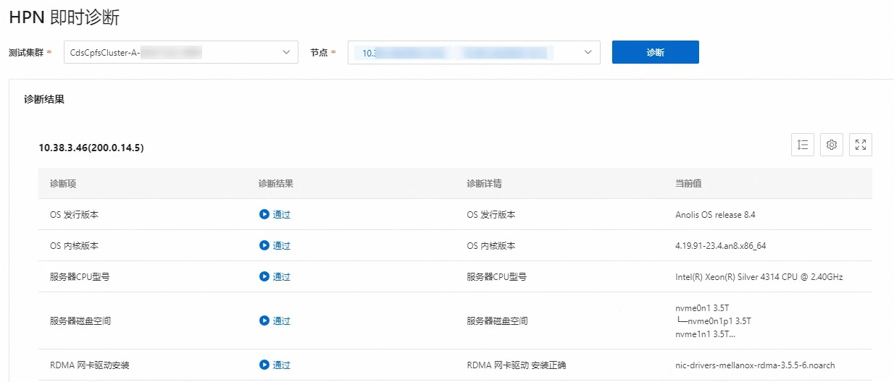

   <table>
     <tr>
       <th width="89">参数</th>
       <th>说明</th>
     </tr>
     <tr>
       <td>诊断项</td>
       <td>展示诊断项目名称。包括<strong>OS 发型版本</strong>、<strong>OS 内核版本</strong>、<strong>服务器CPU型号</strong>、<strong>服务器磁盘空间</strong>、<strong>RDMA 网卡驱动安</strong><strong>装</strong>、<strong>RDMA 网卡驱动加载</strong>、<strong>bonding 模块安装</strong>、<strong>GDR 模块安装</strong>、<strong>GDR 模块加载</strong>、<strong>RDMA 设备</strong><strong>的数量</strong>、<strong>RDMA 设备固件版本</strong>、<strong>RDMA 设备聚合模式</strong>、<strong>RDMA 设备聚合状态</strong>、<strong>RDMA 设备</strong><strong>HASH策略</strong>、<strong>RDMA 设备端口速率</strong>、<strong>RDMA 设备MTU设置</strong>、<strong>PCIe MRR配置</strong>、<strong>PCIe 链路详</strong><strong>情</strong>、<strong>PCIe 链路速率</strong>、<strong>PCIe 链路宽度</strong>、<strong>GPU在线检查</strong>等。</td>
     </tr>
     <tr>
       <td>诊断结果</td>
       <td>展示诊断项对应的诊断结果，包括<strong>通过</strong>和<strong>失败</strong>两种结果。</td>
     </tr>
     <tr>
       <td>诊断详情</td>
       <td>展示诊断项对应的诊断详情。例如：RDMA设备端口速率一致。</td>
     </tr>
     <tr>
       <td>当前值</td>
       <td>展示诊断项对应的诊断值信息。</td>
     </tr>
   </table>

<a id="section-2-2"></a>

## 2.2. 算力平台网络

<a id="section-2-2-1"></a>

### 2.2.1. CPN一键诊断

指对CPN网络中节点的诊断，展示诊断项、诊断详情以及诊断结果等内容，以帮助管理员更好地理解和管理网络性能与故障问题。

**操作步骤**

1. 登录Apsara Uni-manager运维控制台。

2. 在顶部菜单栏，选择**产品运维** > **网络运维** > **网络运维控制台**。

3. 在左侧导航栏，选择**基础网络 > CPN管理 > CPN一键诊断**。

4. 在**CPN 一键诊断**页面，单击**新建诊断**，创建诊断任务。

   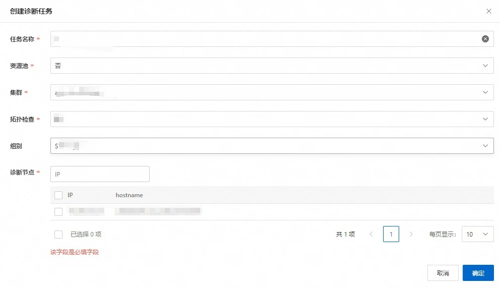

   创建诊断任务的参数说明如下表所示。

   <table>
     <tr>
       <th width="89">参数</th>
       <th>参数说明</th>
     </tr>
     <tr>
       <td>任务名称</td>
       <td>输入诊断任务的任务名称。</td>
     </tr>
     <tr>
       <td>资源池</td>
       <td>未加入计算集群的裸金属服务器的资源集合。选择是否加入资源池，默认值为<strong>否</strong>。</td>
     </tr>
     <tr>
       <td>集群</td>
       <td>选择执行诊断任务的集群。<br>说明仅<strong>资源池</strong>选择<strong>否</strong>时，需要配置此参数。</td>
     </tr>
     <tr>
       <td>拓扑检查</td>
       <td>选择拓扑检查程度：<br>• 强<br>• 弱</td>
     </tr>
     <tr>
       <td>组别</td>
       <td>根据选择的<strong>集群</strong>内容，选择组别。集群内，根据上联的交换机的segment，会对主机进行分组。每个组别上限为100台主机。</td>
     </tr>
   </table>

   | 诊断节点 | 根据选择的<strong>集群</strong>和<strong>组别</strong>内容，在列表中选择执行诊断任务的主机节点。支持通过<strong>IP</strong>或者<strong>ID</strong>筛选目标节点。<br>说明<strong>诊断节点</strong>支持多选。 |
   | --- | --- |

5. 单击**确定**，在弹出的提示框中，确认选择参数无误。

6. 单击**确定**，诊断任务会立即开始运行。

**查看诊断分析结果**

1. 登录Apsara Uni-manager运维控制台。

2. 在顶部菜单栏，选择**产品运维** > **网络运维** > **网络运维控制台**。

3. 在左侧导航栏，选择**基础网络 > CPN管理 > CPN一键诊断**。

4. 在**CPN 一键诊断**页面，单击目标诊断任务**操作**列的**详情**，查看对应任务的**诊断分析结果**。

   <table>
     <tr>
       <th width="121">诊断分析结果</th>
       <th>说明</th>
     </tr>
     <tr>
       <td>诊断结果</td>
       <td>展示目标诊断任务所包含的节点的<strong>诊断结果</strong>、<strong>节点数量</strong>等。</td>
     </tr>
     <tr>
       <td>概览视图</td>
       <td>展示目标诊断任务所包含的<strong>集群</strong>节点信息。</td>
     </tr>
     <tr>
       <td>详情视图</td>
       <td>展示目标诊断任务的<strong>节点</strong>、<strong>主机名称</strong>、<strong>诊断项</strong>、<strong>诊断结果</strong>、<strong>诊断详情</strong>、<strong>当前值</strong>、<strong>期望</strong><strong>值</strong>、<strong>错误信息</strong>等诊断详情内容。</td>
     </tr>
   </table>

   - 选择**诊断结果**页签，可查看诊断结果列表。

     支持通过**诊断项**查询指定诊断结果。诊断项支持多选。

     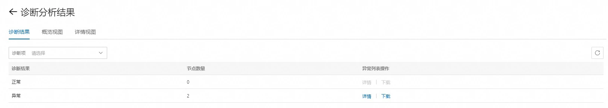

     - 在诊断结果列表，单击目标**异常**诊断结果**异常列表操作**列的**详情**，支持查看**异常诊断详情**。

       支持通过**诊断项**查询指定诊断详情。诊断项支持多选。

       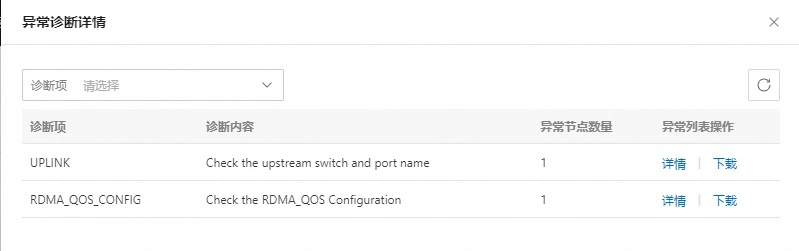

       - 在弹出的**异常诊断详情**面板中，单击目标诊断详情**异常列表操作**列的**详情**，支持查看**异常诊断结果详情**。

         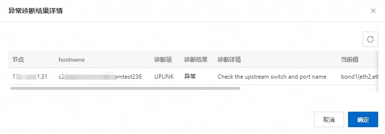

       - 在弹出的**异常诊断详情**面板中，单击目标诊断详情**异常列表操作**列的**下载**，支持下载**异常诊断项详情**到本地查看。

     - 在诊断结果列表，单击目标诊断结果**异常列表操作**列的**下载**，支持下载**诊断结果详情**到本地查看。

   - 选择**概览视图**页签，可以查看诊断任务所包含的集群及其节点面板，包括IP、用例执行总数、正常数和异常数。

     

     - 支持输入关键字通过IP模糊搜索筛选目标集群节点。

     - 单击目标节点面板，在**节点诊断详情**页面，可以查看对应节点的诊断详情列表，包括**诊断项**、**诊断结果**、**诊断详情**、**当前值**、**期望值**、**错误信息**。

       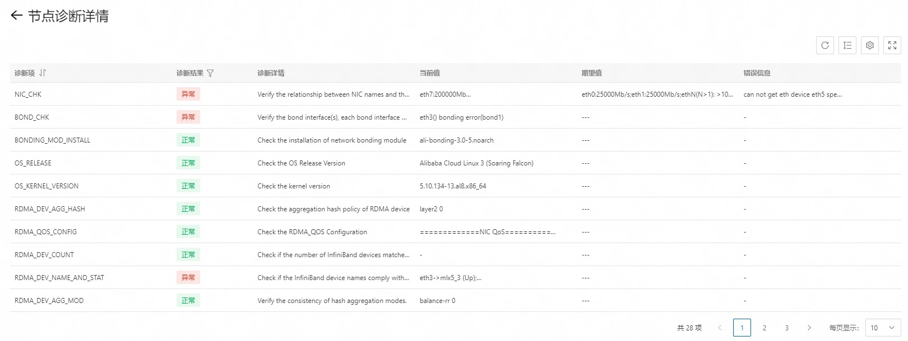

       - 诊断详情列表支持按照**诊断项**排序展示。

       - 诊断详情列表支持按照**诊断结果**（正常、异常）筛选展示。

   - 选择**详情视图**页签，可以查看诊断详情列表。

     - 单击**高级筛选**，支持按**节点**、**诊断项**维度组合查询诊断详情。

     - 诊断详情列表支持按照**诊断项**排序展示。

     - 诊断详情列表支持按照**诊断结果**（正常、异常）筛选展示。

     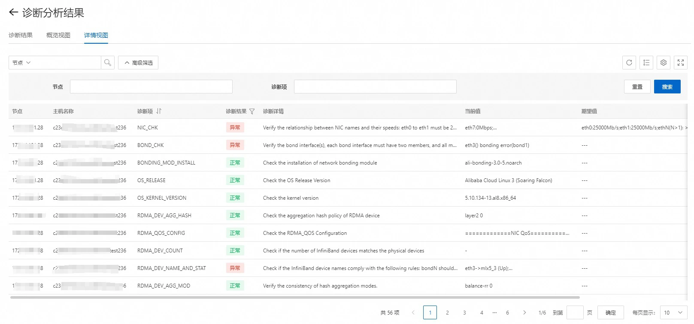

**相关操作**

在**CPN 一键诊断**页面，还支持进行如下操作。

| 任务名称 | 操作步骤 |
| --- | --- |
| 查看诊断任务列表 | 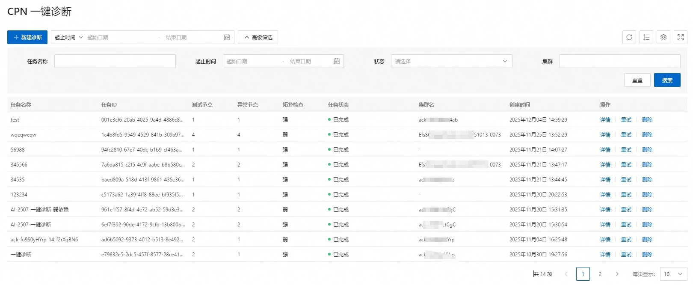<br>诊断任务内容包括<strong>任务名称</strong>、<strong>任务ID</strong>、<strong>测试节点</strong>、<strong>异常节点</strong>、<strong>拓扑检查</strong>、<strong>任务状态</strong>、<strong>集群</strong><strong>名</strong>、<strong>创建时间</strong>等。<br>• 基础筛选<br>i. 单击下拉选择<strong>任务名称</strong>、<strong>起止时间</strong>、<strong>状态</strong>或<strong>集群</strong>。ii. 在搜索框中配置对应的参数内容，将会自动筛选出符合条件的诊断任务。<br>• 高级筛选<br>i. 单击<strong>高级筛选</strong>。ii. 设置<strong>任务名称</strong>、<strong>起止时间</strong>、<strong>状态</strong>和<strong>集群</strong>，单击<strong>搜索</strong>。<br>说明单击<strong>最近1小时</strong>、<strong>最近3小时</strong>、<strong>最近6小时</strong>、<strong>最近1天</strong>可以快速设置<strong>起止时间</strong>。 |
| 重新发起诊断任务测试 | 1. 单击目标诊断任务<strong>操作</strong>列的<strong>重试</strong>。<br>2. 在弹出的提示框中，重新设置<strong>任务名称</strong>、<strong>拓扑检查</strong>、<strong>诊断节点</strong>等参数，单击<strong>确定</strong>。具体参数说明，请参考操作步骤。 |
| 删除诊断任务 | 1. 单击目标诊断任务<strong>操作</strong>列的<strong>删除</strong>。<br>2. 在弹出的提示框中，单击<strong>确定</strong>。 |

<a id="section-2-2-2"></a>

### 2.2.2. CPN性能分析

CPN性能分析是通过测试机器在压力情况下的性能表现，考察当前软硬件所能承受的最大负荷和抗压能力，帮助用户找出机器的压力极限，为运维提供充分的数据依据，以提高网络的性能。

**操作步骤**

1. 登录Apsara Uni-manager运维控制台。

2. 在顶部菜单栏，选择**产品运维** > **网络运维** > **网络运维控制台**。

3. 在左侧导航栏，选择**基础网络 > CPN管理 > CPN性能分析**。

4. 在**CPN 性能分析**页面，单击**新建测试**。

5. 在**创建分析任务**页面，输入**任务名称**，并完成参数配置。

   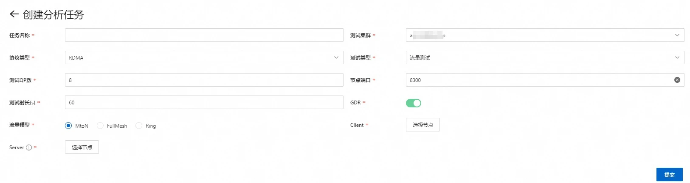

   - **RDMA**创建任务参数的动态组合及配置说明如下所示。

     <table>
       <tr>
         <th>测试集群</th>
         <th>协议类型</th>
         <th>测试类型</th>
         <th>需要输入的参数</th>
         <th>流量模型</th>
         <th>节点列表</th>
       </tr>
       <tr>
         <td rowspan="4"><em>任意</em></td>
         <td rowspan="4">RDMA</td>
         <td rowspan="3">流量测试</td>
         <td rowspan="3">• 测试QP数<br>• 节点端口<br>• 测试时长<br>• GDR</td>
         <td>MtoN</td>
         <td>• Server<br>• Client</td>
       </tr>
       <tr>
         <td>FullMesh</td>
         <td>Server</td>
       </tr>
       <tr>
         <td>Ring</td>
         <td>Server</td>
       </tr>
       <tr>
         <td>时延测试</td>
         <td>• 节点端口<br>• 测试时长</td>
         <td>——</td>
         <td>Server</td>
       </tr>
     </table>

     <table>
       <tr>
         <th width="113">配置参数</th>
         <th>参数说明</th>
       </tr>
       <tr>
         <td>测试QP数</td>
         <td>测试进程流的数量，影响测试带宽的大小。默认值8。<br>• 当QP数不足时，会导致通信队列拥塞，影响数据传输效率和稳定性。<br>• 当QP数过多时，会增加系统的开销、复杂性，以及提高系统故障率。<br>说明QP即Queue Pair，是RDMA网络中的关键概念，用于描述一对端点之间的通信队列。</td>
       </tr>
       <tr>
         <td>节点端口</td>
         <td>测试所使用的端口号。默认值8300。</td>
       </tr>
       <tr>
         <td>测试时长(s)</td>
         <td>本次测试的时长，单位为秒。默认值60。</td>
       </tr>
       <tr>
         <td>GDR</td>
         <td>选择是否开启GDR。如果开启GDR，会绑定RDMA网卡与对应的GPU进行流量测试。开启前请先确认机器是否支持，如果不支持请不要开启该选项。</td>
       </tr>
       <tr>
         <td>流量模型</td>
         <td>• <strong>MtoN</strong>：全称Many to Many，是指多对多的关系模型。即测试<strong>Clients</strong>节点到<strong>Servers</strong>节点的单向连通性，包括单个<strong>Client</strong>节点到单个<strong>Server</strong>节点、多个<strong>Clients</strong>节点到多个<strong>Servers</strong>节点等情况。<br>• <strong>FullMesh</strong>：指网络拓扑结构中所有节点之间互相连接的情况，即测试所有目标节点两两之间的连通性。<br>• <strong>Ring</strong>：指网络中多个节点之间形成一个闭环，数据包从一个节点发送到下一个节点，依次传递，最终回到起始节点，用来检测网络中实际可用带宽。</td>
       </tr>
       <tr>
         <td>Client</td>
         <td>选择流量测试的发送方。支持多选。单击<strong>选择节点</strong>，在<strong>节点列表</strong>弹出框中，选择需要的机器及其网卡。<br>说明<br>• 机器信息包括<strong>节点IP</strong>、<strong>hostname</strong>。<br>• 支持根据<strong>组别</strong>和<strong>IP</strong>筛选目标机器。<br>• 单击<strong>选择节点</strong>可以增加节点信息。<br>• 单击目标节点右侧，可以删除<strong>已选择节点</strong>及<strong>网卡</strong>。<br></td>
       </tr>
       <tr>
         <td>Server</td>
         <td>选择流量测试的接收方。支持多选。单击<strong>选择节点</strong>，在<strong>节点列表</strong>弹出框中，选择需要的机器，并设置网卡。<br>说明<br>• 需确保Server第一张网卡所属的节点与Server以及Client其他网卡所属节点之间的免密隧道已打通。<br>• 机器信息包括<strong>节点IP</strong>、<strong>hostname</strong>。<br>• 支持根据<strong>组别</strong>和<strong>IP</strong>筛选目标机器。<br>• 当<strong>流量模式</strong>选择<strong>Ring</strong>时，若选择多个节点，每个机器网卡数量需要保持一致。<br>• 当<strong>流量模式</strong>选择<strong>MtoN</strong>或<strong>FullMesh</strong>时，单击<strong>选择节点</strong>可以增加节点信息。<br>• 当<strong>流量模式</strong>选择<strong>MtoN</strong>或<strong>FullMesh</strong>时，单击目标节点右侧，可以删除<strong>已</strong><br><br><strong>选择节点</strong>及<strong>网卡</strong>。<br>• 当<strong>流量模式</strong>选择<strong>MtoN</strong>或<strong>FullMesh</strong>时，选择节点后，支持输入节点筛选已选择的节点信息。</td>
       </tr>
     </table>

   - **通讯库**创建任务参数的配置说明如下所示。

     | 测试集群 | 协议类型 | 测试类型 | 通信库 | 需要输入的参数 |
     | --- | --- | --- | --- | --- |
     | <em>任意</em> | 通讯库 | 通讯库测试 | • NCCL<br>• CPN-CCL<br>• RCCL<br>• PCCL<br>• XCCL<br>• MCCL<br>• MOORE-MCCL | • <strong>算法</strong>：通信库任务执行的时候选择的算法，不同的算法执行的时候，其算法带宽、总线带宽和执行时间都会有所不同。<br>• <strong>通信原语</strong>：不同的通信原语数据传输和处理的方式也不同，可直接下拉选择。<br>• <strong>超时时间（s）</strong>：如果性能测试的时间大于设置的超时时间加一分钟，则测试任务失败。<br>• <strong>数据类型</strong>：性能分析测试时的数据类型，直接下拉选择。<br>• <strong>迭代次数</strong>：当前任务执行的次数。<br>• <strong>起始字节数</strong>：设置任务开始最小数据量。<br>• <strong>截止字节数</strong>：任务结束的最大数据量。<br>• <strong>步长因子</strong>：一般是大于1的整数，当指定为2的时候，数据规格会按照两倍的关系递增，依次类推，第一行和最后一行分别对应起始字节数和截止字节数。<br>• <strong>主机列表</strong>：单击<strong>选择节点</strong>，在<strong>节点列表</strong>弹出框中，选择需要的主机。支持多选。<br>说明<br>• 需确保主节点到所有从节点的免密隧道已打通。<br>• 机器信息包括<strong>节点IP</strong>、<strong>hostname</strong>。<br>• 支持根据<strong>组别</strong>和<strong>IP</strong>筛选目标机器。<br>• 选择节点后，支持配置<strong>gpu个数</strong>。<br>• <strong>mpirun自定义参数</strong>：用户自定义参数，格式：<code> --</code><code>mca ... --mca ... </code>，例如：<code> --mca pml ob1 </code> <code>--mca coll ^hcoll --mca btl tcp,self --</code><br><code>mca btl_tcp_if_include bond0 --mca</code><br><code>oob_tcp_if_include bond0 --bind-to</code> <code>none </code>。<br>• <strong>通信库参数</strong>：用户自定义设置条目<strong>属性</strong>和<strong>值</strong>。<br>• 单击<strong>添加条目</strong>可以增加通信库参数。<br>• 单击目标条目右侧，可以删除通信库参数。 |

6. 单击**提交**，创建分析任务完成，弹出创建成功的提框。

**相关操作**

在**CPN 性能分析**页面，还支持进行如下操作。

<table>
  <tr>
    <th width="154">任务名称</th>
    <th>操作步骤</th>
  </tr>
  <tr>
    <td>查看分析任务列表</td>
    <td>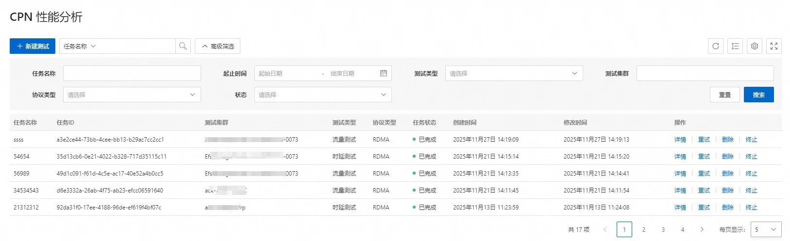<br>获取性能分析任务列表。任务内容包括<strong>任务名称</strong>、<strong>任务ID</strong>、<strong>测试集群</strong>、<strong>测试类</strong><strong>型</strong>、<strong>协议类型</strong>、<strong>任务状态</strong>、<strong>创建时间</strong>、<strong>修改时间</strong>等。<br>• 基础筛选<br>i. 单击下拉选择<strong>任务名称</strong>、<strong>起止时间</strong>、<strong>测试类型</strong>、<strong>测试集群</strong>、<strong>协议类型</strong>和<strong>状</strong><strong>态</strong>。ii. 在搜索框中配置对应的参数内容，将会自动筛选出符合条件的测试任务。<br>• 高级筛选<br>i. 单击<strong>高级筛选</strong>。ii. 设置<strong>起止时间</strong>，选择<strong>任务名称</strong>、<strong>测试类型</strong>、<strong>测试集群</strong>、<strong>协议类型</strong>和<strong>状态</strong>。iii. 单击<strong>搜索</strong>。<br>说明单击<strong>最近1小时</strong>、<strong>最近3小时</strong>、<strong>最近6小时</strong>、<strong>最近1天</strong>可以快速设置<strong>起止时</strong><strong>间</strong>。</td>
  </tr>
  <tr>
    <td>查看分析任务详情</td>
    <td>1. 在分析任务列表，单击目标任务<strong>操作</strong>列的<strong>详情</strong>。<br>2. 在<strong>分析任务详情</strong>页面，查看性能分析任务的详情。<br>说明根据协议类型、测试类型不同，性能分析详情内容也不同，具体以实际界面为准。<br>• <strong>通信库</strong>协议类型<br>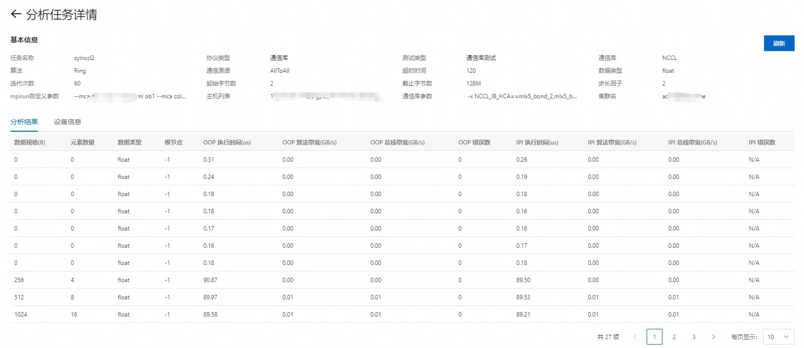<br>• <strong>基本信息</strong>：包括<strong>任务名称</strong>、<strong>协议类型</strong>、<strong>测试类型</strong>、<strong>通信库</strong>、<strong>算法</strong>、<strong>通</strong><strong>信原语</strong>、<strong>超时时间</strong>、<strong>数据类型</strong>、<strong>迭代次数</strong>、<strong>起始字节数</strong>、<strong>截止字节</strong><strong>数</strong>、<strong>步长因子</strong>、<strong>mpirun自定义参数</strong>、<strong>主机列表</strong>、<strong>通信库参数</strong>、<strong>集群</strong><strong>名</strong>等。<br>• <strong>分析结果</strong>：包括<strong>数据规格(B)</strong>、<strong>元素数量</strong>、<strong>数据类型</strong>、<strong>根节点</strong>、<strong>OOP</strong><strong>执行时间(us)</strong>、<strong>OOP 算法带宽(GB/s)</strong>、<strong>OOP 总线带宽</strong><strong>(GB/s)</strong>、<strong>OOP 错误数</strong>、<strong>IPI 执行时间(us)</strong>、<strong>IPI 算法带宽</strong><strong>(GB/s)</strong>、<strong>IPI 总线带宽(GB/s)</strong>、<strong>IPI 错误数</strong>。<br>• <strong>设备信息</strong>：包括<strong>行数</strong>、<strong>组</strong>、<strong>pid</strong>、<strong>主机</strong>、<strong>设备</strong>、<strong>型号</strong>。<br>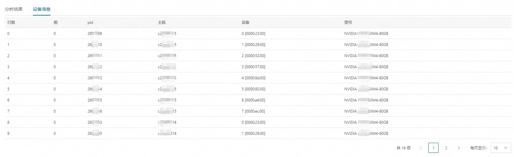<br>说明<strong>测试类型</strong>为<strong>通信库测试</strong>的分析任务，支持查看<strong>设备信息</strong>。<br>• <strong>RDMA</strong>协议类型（<strong>流量测试</strong>）<br>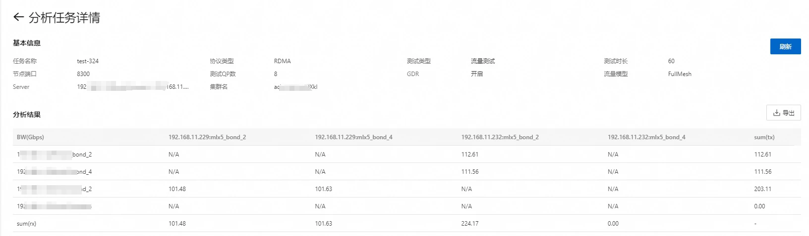<br>• <strong>基本信息</strong>：包括<strong>任务名称</strong>、<strong>协议类型</strong>、<strong>测试类型</strong>、<strong>测试时长</strong>、<strong>节点端</strong><strong>口</strong>、<strong>测试QP数</strong>、<strong>GDR</strong>、<strong>流量模型</strong>等。<br>• <strong>分析结果</strong>：展示数据发送和接收的传输速率。<br>说明<strong>测试类型</strong>为<strong>流量测试</strong>的分析任务，支持<strong>导出</strong>功能：单击<strong>分析结</strong><strong>果</strong>右侧<strong>导出</strong>，在本地查看导出的Excel文件。<br>• <strong>RDMA</strong>协议类型（<strong>时延测试</strong>）<br>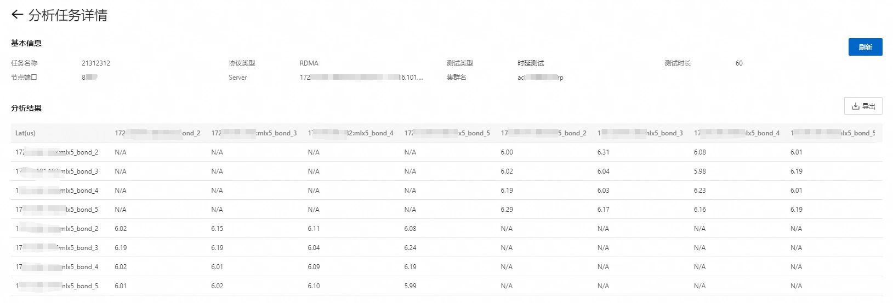<br>• <strong>基本信息</strong>：包括<strong>任务名称</strong>、<strong>协议类型</strong>、<strong>测试类型</strong>、<strong>测试时长</strong>、<strong>节点端</strong><strong>口</strong>、<strong>Server</strong>、<strong>集群名</strong>等。<br>• <strong>分析结果</strong>：展示数据传输的微秒级延迟。<br>说明<strong>测试类型</strong>为<strong>时延测试</strong>的分析任务，支持<strong>导出</strong>功能：单击<strong>分析结</strong><strong>果</strong>右侧<strong>导出</strong>，在本地查看导出的Excel文件。</td>
  </tr>
  <tr>
    <td>重试测试任务</td>
    <td>1. 在分析任务列表，单击目标任务<strong>操作</strong>列的<strong>重试</strong>。<br>2. 在弹出的提示框中，单击<strong>确定</strong>。<strong>任务状态</strong>会变成<strong>进行中</strong>。</td>
  </tr>
  <tr>
    <td>删除测试任务</td>
    <td>1. 在分析任务列表，单击目标任务<strong>操作</strong>列的<strong>删除</strong>。<br>2. 在弹出的提示框中，单击<strong>确定</strong>。</td>
  </tr>
  <tr>
    <td>终止测试任务</td>
    <td>1. 在分析任务列表，单击目标任务<strong>操作</strong>列的<strong>终止</strong>。<br>2. 在弹出的提示框中，单击<strong>确定</strong>。<strong>任务状态</strong>即时变更为<strong>终止中</strong>，最后<strong>任务状态</strong>为<strong>已终止</strong>，表示终止成功。</td>
  </tr>
</table>

<a id="section-2-2-3"></a>

### 2.2.3. CPN告警中心

CPN事件中心，展示告警信息列表，包括未关闭的实时告警和已关闭历史告警。

**告警分布概览**

1. 登录Apsara Uni-manager运维控制台。

2. 在顶部菜单栏，选择**产品运维** > **网络运维** > **网络运维控制台**。

3. 在左侧导航栏，选择**基础网络 > CPN管理 > CPN网络监控 > CPN告警中心**。

4. 在**CPN告警列表**页面，单击**告警分布概览**页签，查看各类型CPN告警的统计列表，系统默认展示**未关闭**告警分布统计，通过切换页签可以查看**已关闭**告警分布统计。

   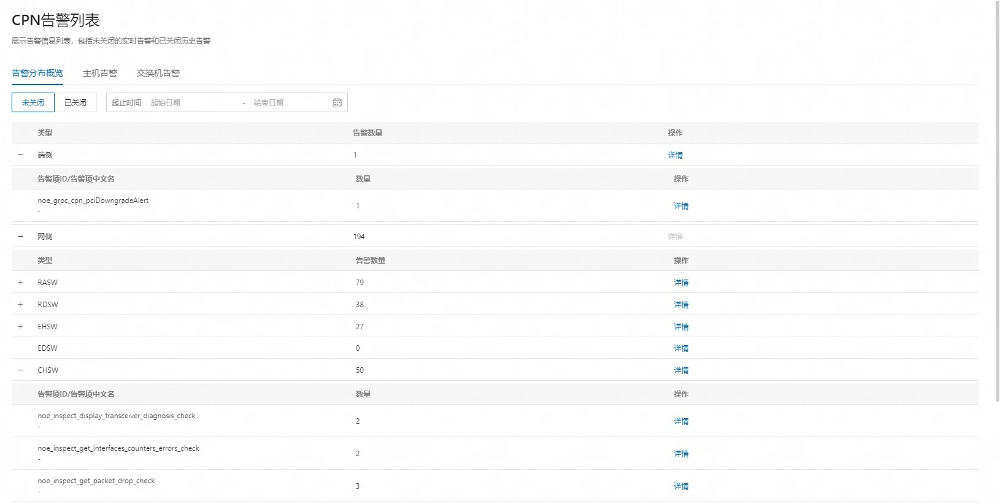

   - 支持通过设置**起止时间**筛选查看目标告警列表。

   - CPN告警类型区分**端侧**和**网侧**，网侧告警类型包括**RASW**、**RDSW**、**EHSW**、**EDSW**、**CHSW**。

   - 单击告警统计列表**操作**列的**详情**，可以快速跳转至指定类型的告警列表或者指定告警项的告警列表。

**主机告警**

1. 登录Apsara Uni-manager运维控制台。

2. 在顶部菜单栏，选择**产品运维** > **网络运维** > **网络运维控制台**。

3. 在左侧导航栏，选择**基础网络 > CPN管理 > CPN网络监控 > CPN告警中心**。

4. 在**CPN告警列表**页面，单击**主机告警**页签，查看**端侧**实时CPN告警列表，系统默认展示**未关闭**的告警列表，通过切换页签可以查看**已关闭**的告警列表。

   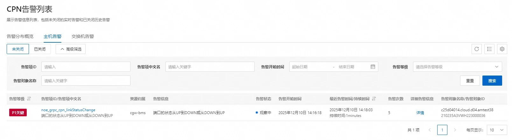

   - 告警列表支持按照**告警等级**或**最近告警时间/持续时间**排序展示。

   - 告警信息包括**告警等级**、**告警项ID/告警项中文名**、**资源归属**、**告警信息**、**告警状态**、**告警开始时间**、**最近告警时间/持续时间**、**告警次数**、**详细告警信息**、**告警对象名称/告警对象ID**。

   - 单击**高级筛选**，支持根据**告警项ID**、**告警项中文名**、**告警开始时间**、**告警等级**、**告警对象名称**组合筛选获取目标告警。

   - 单击目标告警**告警项ID/告警项中文名**列的告警项ID，可以跳转至**告警详情**页面，查看对应告警的详细信息，具体可参考告警详情。

   - 鼠标悬浮至目标告警**详细告警信息**列的**详情**可以查看对应告警详细告警信息。

**交换机告警**

1. 登录Apsara Uni-manager运维控制台。

2. 在顶部菜单栏，选择**产品运维** > **网络运维** > **网络运维控制台**。

3. 在左侧导航栏，选择**基础网络 > CPN管理 > CPN网络监控 > CPN告警中心**。

4. 在**CPN告警列表**页面，单击**交换机告警**页签，查看**网侧**实时CPN告警列表，系统默认展示**RASW**类型**未关闭**的告警列表，通过切换页签可以查看**已关闭**的告警列表。

   同时可以通过切换页签分别查看网侧**RASW**、**RDSW**、**EHSW**、**EDSW**、**CHSW**类型的实时告警列表。

   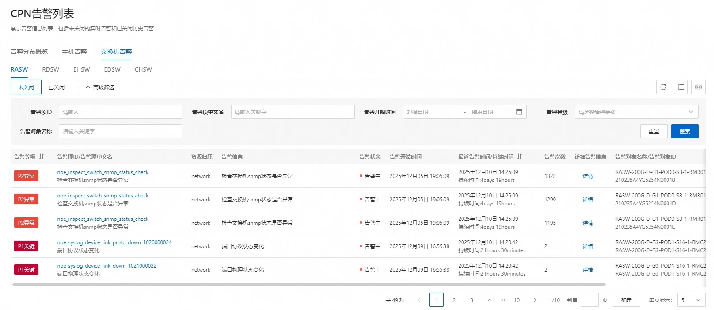

   - 告警列表支持按照**告警等级**或**最近告警时间/持续时间**排序展示。

   - 告警信息包括**告警等级**、**告警项ID/告警项中文名**、**资源归属**、**告警信息**、**告警状态**、**告警开始时间**、**最近告警时间/持续时间**、**告警次数**、**详细告警信息**、**告警对象名称/告警对象ID**。

   - 单击**高级筛选**，支持根据**告警项ID**、**告警项中文名**、**告警开始时间**、**告警等级**、**告警对象名称**组合筛选获取目标告警。

   - 单击目标告警**告警项ID/告警项中文名**列的告警项ID，可以跳转至**告警详情**页面，查看对应告警的详细信息，具体可参考告警详情。

   - 鼠标悬浮至目标告警**详细告警信息**列的**详情**可以查看对应告警详细告警信息。

<a id="section-2-2-4"></a>

### 2.2.4. CPN接入网关

<a id="section-2-2-4-1"></a>

#### 2.2.4.1. RDMA设备管理

本文介绍如何管理RDMA设备，包括扫描、删除等操作。

**操作步骤**

1. 登录Apsara Uni-manager运维控制台。

2. 在顶部菜单栏，选择**产品运维** > **网络运维** > **网络运维控制台**。

3. 在左侧导航栏，选择**基础网络 > CPN管理 > CPN接入网关**。

4. 在**CPN接入网关**页面，单击**RDMA设备管理**页签，管理RDMA设备。

   - 扫描新设备

     单击**扫描新设备**，系统会将新增的RDMA设备录入到系统中。（**默认每小时同步一次**）

   - 查看设备列表

     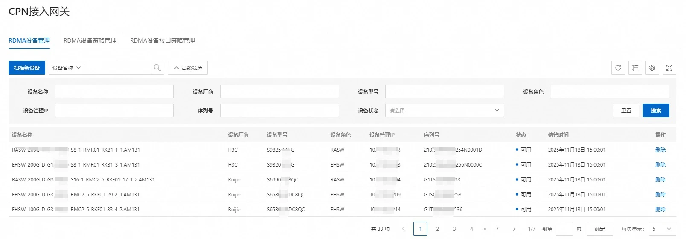

     - 基础筛选

       <ol type="a">

       <li>

       下拉选择**设备名称**、**设备厂商**、**设备型号**、**设备角色**、**设备管理IP**、**序列号**或者**设备状态**。

       </li>

       <li>

       在搜索框中设置对应的选择参数，单击  。

       </li>

       </ol>

     - 高级筛选

       <ol type="a">

       <li>

       单击**高级筛选**。

       </li>

       <li>

       设置**设备名称**、**设备厂商**、**设备型号**、**设备角色**、**设备管理IP**、**序列号**或者**设备状态**。

       </li>

       </ol>

       <ol type="i" start="100">

       <li>

       单击**搜索**进行组合筛选。

       </li>

       </ol>

   - 删除设备

     <ol type="a">

     <li>

     在设备列表，单击目标设备**操作**列**删除**。

     </li>

     <li>

     在弹出的提示框中，单击**确定**。

     </li>

     </ol>

<a id="section-2-2-4-2"></a>

#### 2.2.4.2. RDMA设备策略管理

本文介绍如何设置RDMA设备的策略，用于统一管理RDMA设备。

**操作步骤**

1. 登录Apsara Uni-manager运维控制台。

2. 在顶部菜单栏，选择**产品运维** > **网络运维** > **网络运维控制台**。

3. 在左侧导航栏，选择**基础网络 > CPN管理 > CPN接入网关**。

4. 在**CPN接入网关**页面，单击**RDMA设备策略管理**页签。

5. 单击**创建RDMA设备策略**，根据如下内容完成参数配置，单击**确定**。

   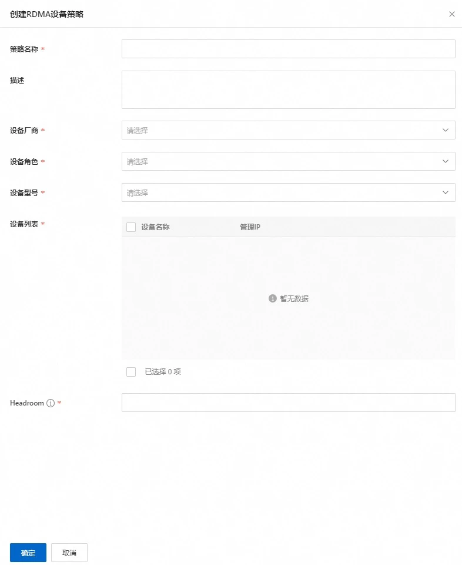

   | 参数名称 | 说明 |
   | --- | --- |
   | 策略名称 | 设置策略的名称，用户自定义。 |
   | 描述 | 非必填，输入策略的描述信息。 |

   <table>
     <tr>
       <th width="119">设备厂商</th>
       <th>系统自动统计<strong>RDMA设备管理</strong>列表的<strong>设备厂商</strong>，供用户选择。</th>
     </tr>
     <tr>
       <td>设备角色</td>
       <td>选择适用策略的设备角色：<br>• <strong>RASW</strong>：RDMA网络场景下数据交换模块的接入交换机。<br>• <strong>RDSW</strong>：RDMA网络场景下数据交换模块的核心交换机，用于连接各个接入交换机。<br>• <strong>EHSW</strong>：RDMA场景下存管网接入交换机。</td>
     </tr>
     <tr>
       <td>设备型号</td>
       <td>根据选择的<strong>设备厂商</strong>和<strong>设备角色</strong>，系统自动统计<strong>RDMA设备管理</strong>列表的<strong>设备型号</strong>，供用户选择。</td>
     </tr>
     <tr>
       <td>设备列表</td>
       <td>根据选择的<strong>设备厂商</strong>、<strong>设备角色</strong>和<strong>设备型号</strong>，系统自动统计<strong>RDMA设备管理</strong>列表的<strong>设备名</strong><strong>称</strong>和<strong>管理IP</strong>，供用户选择。支持多选。</td>
     </tr>
     <tr>
       <td>Headroom</td>
       <td>输入全局数据缓冲区的大小。roce队列数据缓冲区大小，Headroom最大可用的cell资源。</td>
     </tr>
   </table>

6. 创建完成后，通过列表查看RDMA设备策略内容。

   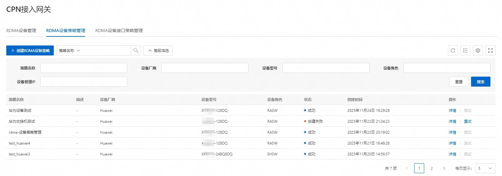

**相关操作**

在RDMA设备策略列表，还支持执行如下操作。

| 任务名称 | 操作步骤 |
| --- | --- |
| 查询RDMA设备策略 | 单击<strong>高级筛选</strong>，支持通过<strong>设备名称</strong>、<strong>设备厂商</strong>、<strong>设备型号</strong>、<strong>设备角色</strong>、<strong>设备管理IP</strong>、<strong>序列</strong><strong>号</strong>或<strong>设备状态</strong>组合筛选获取目标策略。 |
| 查看RDMA设备策略详情 | 单击目标策略<strong>操作</strong>列<strong>详情</strong>，在弹出的面板中，查看设备策略详情。<br>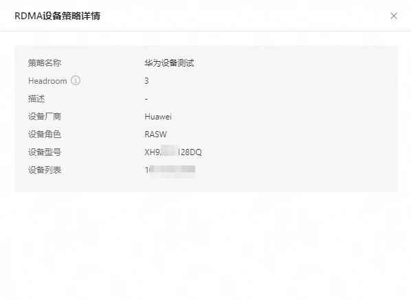 |
| 重试RDMA设备策略 | 说明<strong>状态</strong>为<strong>创建失败</strong>的设备策略，支持重试操作。<br>1. 单击目标策略<strong>操作</strong>列<strong>重试</strong>。<br>2. 在弹出的对话框中，单击<strong>确定</strong>。 |

<a id="section-2-2-4-3"></a>

#### 2.2.4.3. RDMA设备接口策略管理

本文介绍如何配置接口的策略，包括查询、重试等操作。

**操作步骤**

1. 登录Apsara Uni-manager运维控制台。

2. 在顶部菜单栏，选择**产品运维** > **网络运维** > **网络运维控制台**。

3. 在左侧导航栏，选择**基础网络 > CPN管理 > CPN接入网关**。

4. 在**CPN接入网关**页面，单击**RDMA设备接口策略管理**页签。

5. 单击**创建RDMA设备接口策略**，根据如下内容完成参数配置，单击**确定**。

   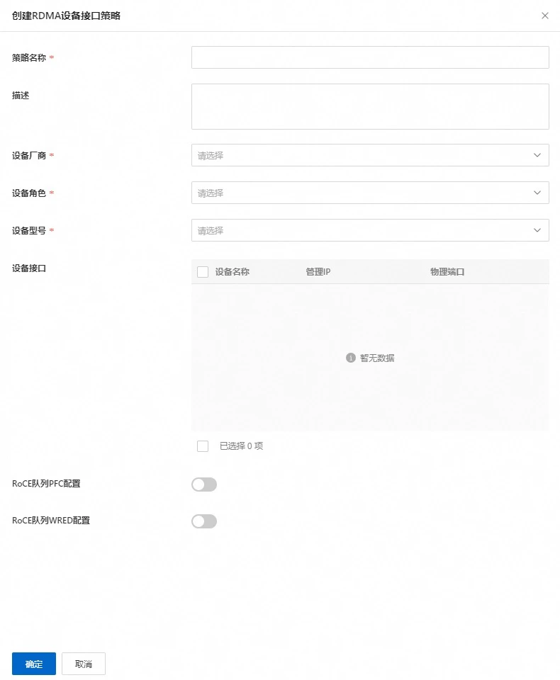

   | 参数名称 | 说明 |
   | --- | --- |
   | 策略名称 | 设置策略名称，用户自定义。 |
   | 描述 | 非必填，输入策略的描述信息。 |
   | 设备厂商 | 系统自动统计<strong>RDMA设备管理</strong>列表的<strong>设备厂商</strong>，供用户选择。 |
   | 设备角色 | 选择适用策略的设备角色：<br>• <strong>RASW</strong>：RDMA网络场景下数据交换模块的接入交换机。<br>• <strong>RDSW</strong>：RDMA网络场景下数据交换模块的核心交换机，用于连接各个接入交换机。<br>• <strong>EHSW</strong>：RDMA场景下存管网接入交换机。 |
   | 设备型号 | 根据选择的<strong>设备厂商</strong>和<strong>设备角色</strong>，系统自动统计<strong>RDMA设备管理</strong>列表的<strong>设备型号</strong>，供用户选择。 |
   | 设备接口 | • 根据选择的<strong>设备厂商</strong>、<strong>设备角色</strong>和<strong>设备型号</strong>，系统自动统计<strong>RDMA设备管理</strong>列表的<strong>设备</strong><strong>名称</strong>和<strong>管理IP</strong>，供用户选择。支持多选。<br>• 勾选目标设备接口后，需要为目标接口设备配置物理端口。<br>a. 单击<strong>物理端口</strong>列的<strong>选择物理端口</strong>，在弹出框中，通过列表选择<strong>端口名称</strong>。支持多选。支持输入<strong>端口名称</strong>筛选目标端口，多个名称可以用“,”相连。<br>b. 单击<strong>确定</strong>。 |
   | RoCE队列PFC配<strong>置</strong>（RDMA over Converged Ethernet） | 选择是否开启RoCE队列PFC配置。开启配置需要设置如下内容：<br>• <strong>Headroom 缓存门限</strong>：输入全局数据缓冲区的大小。roce队列数据缓冲区大小，Headroom最大可用的cell资源。<br>• <strong>反压帧触发门限</strong>：设置某802.1p优先级报文触发PFC PAUSE帧的可用cell资源的百分比。分析网络流量模型，确保所有入接口的反压帧触发门限之和不大于出接口的尾丢弃门限值。<br>• <strong>反压帧停止门限与触发门限间的偏移量</strong>：输入反压帧停止门限与触发门限间的偏移量。当某802.1p优先级报文使用的cell资源减少了一个固定值时，停止发送PFC PAUSE帧，使对端设备恢复流量发送。<br>• <strong>PFC 预留门限</strong>：Guaranteed存储空间中为某802.1p优先级报文预留的cell资源。<br>• <strong>PFC功能</strong>：选择开启或者关闭PFC功能。通过使用PFC功能，使得某种类型的流量拥塞不会影响其他类型流量的正常转发，从而达到同一链路上不同类型的报文互不影响。<br>• <strong>死锁监测功能</strong>：选择开启或者关闭死锁监测功能。当发生链路故障或设备故障时，路由重新收敛期间可能会出现短暂环路。此时，设备间反复发送和接收PFC帧，报文无法转发，接口缓冲区的cell资源一直被占用无法释放，设备进入PFC死锁状态。<br>说明<strong>RoCE队列PFC配置</strong>和<strong>RoCE队列WRED配置</strong>，至少需要配置一个。 |
   | RoCE队列WRED配置 | 选择是否开启RoCE队列WRED配置。开启配置需要设置如下内容：<br>• <strong>ECN功能</strong>：选择开启或者关闭ECN功能。ECN功能利用IP报文头中的DS域来标记报文传输路径上的拥塞状态。支持该功能的终端设备可以通过报文内容判断出传输路径上发生了拥塞，从而调整报文的发送方式，避免拥塞加剧。<br>• <strong>队列平均长度的下限</strong>：当转发设备的报文在出方向进入队列排队，该队列的长度下限（也称为ECN门限）。<br>• <strong>队列平均长度的上限</strong>：当转发设备的报文在出方向进入队列排队，该队列的长度上限（也称为ECN门限）。<br>• <strong>丢弃概率</strong>：在使用了ECN后，代表的是标记概率，该值越大，表示在上下限门限之间被标记的报文数越多。<br>说明<strong>RoCE队列PFC配置</strong>和<strong>RoCE队列WRED配置</strong>，至少需要配置一个。<br>• 当转发设备的报文在出方向进入队列排队，该队列的长度小于下限（也称为ECN门限）时，不对报文进行任何处理，转发设备直接将报文从出接口转发。<br>• 当转发设备的报文在出方向进入队列排队，该队列的长度大于下限但小于上限时：<br>• 如果设备接收到的报文中ECN域取值为00，表示报文发送端不支持ECN功能，转发设备按照丢弃概率计算是否丢弃该接收的报文。<br>• 如果设备接收到的报文中ECN域取值为01或者10，表示报文发送端支持ECN功能， 将按照丢弃概率来修改部分入方向报文的ECN域为11后继续转发该报文，所有入方向接收到的报文均不丢弃。<br>• 如果设备接收到的报文中ECN域取值为11，表示该报文在之前的转发设备上已经出现拥塞，此时转发设备不处理报文，直接将报文从出接口转发。<br>• 当转发设备的报文在出方向进入队列排队，该队列的长度大于上限时：<br>• 如果设备接收到的报文中ECN域取值为00，表示报文发送端不支持ECN功能，转发设备丢弃接收的报文。<br>• 如果设备接收到的报文中ECN域取值为01或者10，表示报文发送端支持ECN功能，将入方向报文的ECN域修改为11后继续转发该报文，所有入方向接收到的报文均不丢弃。<br>• 如果设备接收到的报文中ECN域取值为11，表示该报文在之前的转发设备上已经出现拥塞，此时转发设备不处理报文，直接将报文从出接口转发。 |

6. 创建完成后，通过列表查看RDMA设备接口策略内容。

   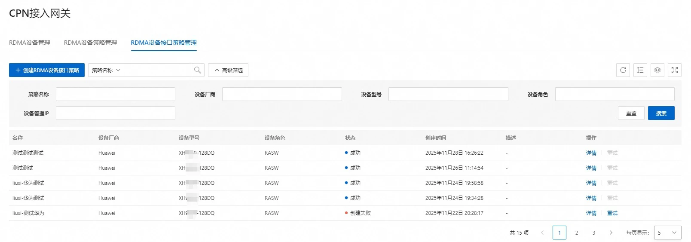

**相关操作**

在RDMA设备接口策略管理列表，还支持执行如下操作。

| 任务名称 | 操作步骤 |
| --- | --- |
| 查询RDMA设备接口策略 | 单击<strong>高级筛选</strong>，支持通过<strong>策略名称</strong>、<strong>设备厂商</strong>、<strong>设备型号</strong>、<strong>设备角色</strong>或<strong>设备管理IP</strong>组合筛选获取目标接口策略。 |
| 查看RDMA设备接口策略详情 | 单击目标接口策略<strong>操作</strong>列<strong>详情</strong>，在弹出的面板中，查看设备接口策略详情。<br>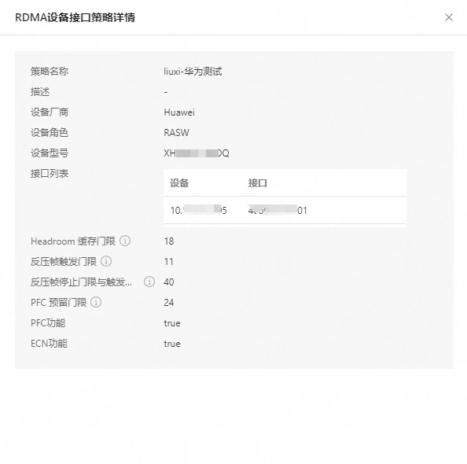 |
| 重试RDMA设备接口策略 | 说明<strong>状态</strong>为<strong>创建失败</strong>的设备接口策略，支持重试操作。<br>1. 单击目标接口策略<strong>操作</strong>列<strong>重试</strong>。<br>2. 在弹出的对话框中，单击<strong>确定</strong>。 |

<a id="section-2-2-5"></a>

### 2.2.5. RDMA网卡运维

RDMA网卡运维是通过性能监控，定期检查RDMA网卡的性能指标，以便及时发现问题，快速排查并解决问题，保证网络稳定性和可靠性。

**相关概念**

<strong>RDMA（</strong>Remote Direct Memory Access<strong>）</strong>：全称远程直接内存访问，是一种高速网络技术，为了解决网络传输中服务器端数据处理的延迟而产生的。RDMA通过网络将数据直接传入计算机的存储区，把数据从一个系统快速移动到远程系统存储器中，实现了主机之间直接访问内存，但不对操作系统造成任何的影响，提高了数据传输速度、降低了CPU负载。

**操作步骤**

1. 登录Apsara Uni-manager运维控制台。

2. 在顶部菜单栏，选择**产品运维** > **网络运维** > **网络运维控制台**。

3. 在左侧导航栏，选择**基础网络 > CPN管理 > RDMA网卡运维**。

4. 在**RDMA网卡运维**页面，右上角选择**数据源**和**集群**，查看RDMA网卡的性能指标信息。

   **数据源**目前仅支持**选择CPN**。

   - 单击**集群**页签，查看集群维度的监控信息。

     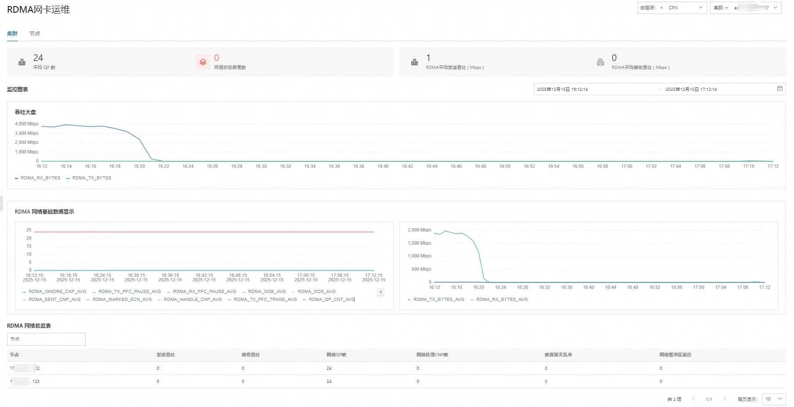

     | 监控指标 | 说明 |
     | --- | --- |
     | 平均QP数 | 在RDMA网络中，平均拥有的QP数量。<br>• 当QP数不足时，会导致通信队列拥塞，影响数据传输效率和稳定性。<br>• 当QP数过多时，会增加系统的开销、复杂性，以及增加系统的故障率。<br>说明QP即Queue Pair，是RDMA网络中的关键概念，用于描述一对端点之间的通信队列。 |
     | 网络状态异常数 | 在RDMA网络中，网络设备或流量出现异常的次数。 |
     | RDMA平均发送吞吐（Mbps） | 在RDMA网络中，单位时间内网络中所有节点的平均发送数据吞吐量。 |
     | RDMA平均接受吞吐（Mbps） | 在RDMA网络中，单位时间内网络中所有节点的平均接收数据吞吐量。 |
     | 监控图表 | 默认展示最近一小时内的吞吐大盘数据和RDMA网络监控基础数据。<br>说明<br>• 在区域右上角，选择起止时间，可以查看目标时间区间内的监控数据。<br>• 将鼠标悬停于图中任意一个时间节点，系统会显示该时间节点的指标的数值。<br>• 单击任意指标项，将单独展示对应指标的监控图表。<br>• 吞吐大盘<br>• <strong>RDMA_RX_BYTES</strong>：RDMA网络中接收数据时所接收的字节数量。<br>• <strong>RDMA_TX_BYTES</strong>：RDMA网络中发送数据时所传输的字节数量。<br>• RDMA 网络基础数据显示<br>• <strong>RDMA_IGNORE_CNP_AVG</strong>：RDMA网络中平均忽略CNP数据包的数量。<br>说明CNP（Congestion Notification Packet）数据包是用于网络拥塞控制的数据包。当网络出现拥塞时会发送CNP数据包通知发送方减少发送速率，避免网络拥塞和数据包丢失。<br>• <strong>RDMA_TX_PFC_PAUSE_AVG</strong>：RDMA网络中发送数据时平均PFC数据包的数量。<br>• <strong>RDMA_RX_PFC_PAUSE_AVG</strong>：RDMA网络中接收数据时平均PFC数据包的数量。<br>• <strong>RDMA_OOB_AVG</strong>：RDMA网络中处理OOB数据的平均个数。<br>说明OOB（Out-of-Band）数据是RDMA网络中传输的一种特殊类型的数据。<br>• <strong>RDMA_OOS_AVG</strong>：RDMA网络中处理OOS数据的平均个数。<br>说明OOS（ Out-of-Order）数据是RDMA网络中传输的一种特殊类型的数据。当数据包在传输时发生丢失、延迟等情况就会出现OOS数据。<br>• <strong>RDMA_SENT_CNP_AVG</strong>：RDMA网络中发送CNP数据包的平均个数。<br>• <strong>RDMA_MARKED_ECN_AVG</strong>：RDMA网络中标记平均ECN数据包的数量。<br>• <strong>RDMA_HANDLE_CNP_AVG</strong>：指RDMA网络中处理CNP数据包的平均个数。<br>• <strong>RDMA_TX_PFC_TRANS_AVG</strong>：指RDMA网络中发送数据时平均切换PFC数据包的数量。<br>• <strong>RDMA_QP_CNT_AVG</strong>：RDMA网络中QP平均个数。 |
     | RDMA 网络总览表 | • <strong>RDMA_TX_BYTES_AVG</strong>：RDMA网络中发送数据的平均字节数。查看RDMA网络中节点列表，包括<strong>节点</strong>、<strong>发送吞吐</strong>、<strong>接收吞吐</strong>、<strong>网络QP数</strong>、<strong>网络</strong><strong>处理CNP数</strong>、<strong>数据报文乱序</strong>、<strong>网络缓冲区溢出</strong>等数据。<br>• <strong>RDMA_RX_BYTES_AVG</strong>：RDMA网络中接收数据的平均字节数。支持输入<strong>节点</strong>，根据名称筛选指定节点。 |

   - 单击**节点**页签，输入**节点名称**，查看节点维度的监控信息。

     具体参数说明，请参考集群维度监控指标说明。

     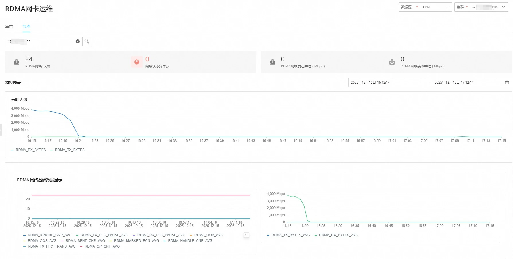

<a id="section-2-2-6"></a>

### 2.2.6. CPN网络管理

<a id="section-2-2-6-1"></a>

#### 2.2.6.1. CPN拓扑

以集群和节点的维度查询并展示拓扑信息。

**操作步骤**

1. 登录Apsara Uni-manager运维控制台。

2. 在顶部菜单栏，选择**产品运维** > **网络运维** > **网络运维控制台**。

3. 在左侧导航栏，选择**基础网络 > CPN管理 > CPN网络管理 > CPN拓扑**。

4. 在页面左上角选择**集群**和**节点**。

5. 单击**查询**，即可查看拓扑信息。

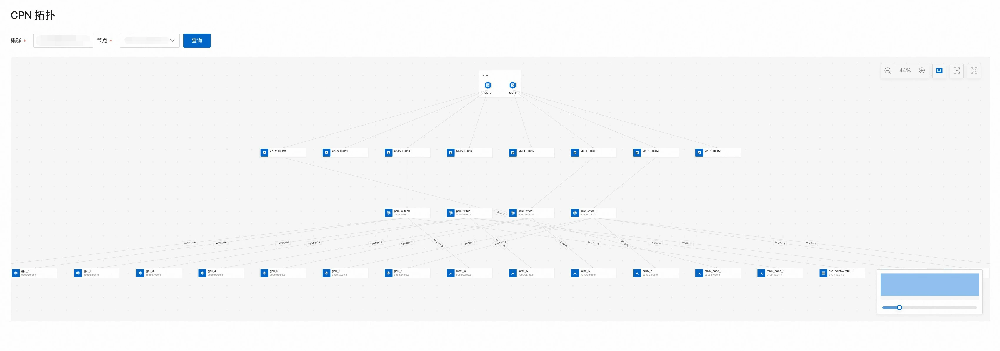

**相关操作**

拓扑图展示成功后，您还可以执行如下操作。

| 任务名称 | 操作步骤 |
| --- | --- |
| 放大/缩小拓扑图 | 单击拓扑图右上角或，可放大或缩小拓扑图。 |
| 重置拓扑图画布 | 单击拓扑图右上角，可重置画布。 |
| 全屏显示拓扑图 | 1. 单击拓扑图右上角，可全屏显示拓扑图。<br>2. 单击右上角，退出全屏显示。 |

<a id="section-2-2-6-2"></a>

#### 2.2.6.2. CPN网元

本文介绍如何查看云平台中网络设备资产与监控运维信息。

**操作步骤**

1. 登录Apsara Uni-manager运维控制台。

2. 在顶部菜单栏，选择**产品运维** > **网络运维** > **网络运维控制台**。

3. 在左侧导航栏，选择**基础网络 > CPN管理 > CPN网络管理 > CPN网元**。

4. 在**CPN 网元**页面，默认展示云平台中全部机房的CPN网络设备资产列表。

   - 设备内容包括**网元名称**、**IP**、**SN**、**厂商**、**角色**、**网络域**、**Ping 连通性**、**SNMP连通性**、**最后更新时间**、**Grpc 状态**等。

   - 支持通过**选择机房**和**网元名称**组合筛选获取目标网元设备。

   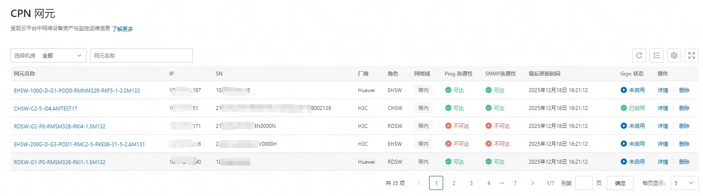

5. 在网络设备资产列表，单击目标设备**网元名称**列的名称，或者单击目标设备**操作**列的**详情**，可以查看对应设备的详细信息。

   

   <table>
     <tr>
       <th width="90">区域</th>
       <th>说明</th>
     </tr>
     <tr>
       <td>基本信息</td>
       <td>包括<strong>设备名称</strong>、<strong>IP</strong>、<strong>SN</strong>、<strong>厂商</strong>、<strong>型号</strong>、<strong>角色</strong>、<strong>在线时间</strong>、<strong>Ping状态</strong>、<strong>Snmp状态</strong>、<strong>最近更</strong><strong>新</strong>、<strong>发行版本</strong>和<strong>软件版本</strong>。</td>
     </tr>
   </table>

   <table>
     <tr>
       <td>端口</td>
       <td>展示该设备的端口列表。端口内容包括<strong>端口名称</strong>、<strong>端口速率</strong>、<strong>端口描述</strong>、<strong>管理状态</strong>、<strong>操作状</strong><strong>态</strong>、<strong>对端设备</strong>、<strong>对端接口</strong>、<strong>对端描述</strong>、<strong>最近更新</strong>等。<br>说明<strong>管理状态</strong>和<strong>操作状态</strong>支持排序。<br>查看端口详情：单击目标端口<strong>端口名称</strong>列的名称，或者单击目标端口<strong>详情</strong>列的<strong>查看</strong>，获取对应端口的基本信息和水位数据。<br><br>• 基本信息：包括<strong>端口名称</strong>、<strong>端口速率</strong>、<strong>端口描述</strong>、<strong>管理状态</strong>、<strong>操作状态</strong>、<strong>对端设备</strong>、<strong>对端接</strong><strong>口</strong>、<strong>对端描述</strong>、<strong>最近更新</strong>。<br>• <strong>水位数据</strong>：默认展示最近1小时的流量数据。相关指标含义，请参考端口指标说明。在右上角选择起止时间，单击<strong>搜索</strong>，支持查看目标时间范围内的运行水位数据信息。<br>说明<br>• 选择时间范围不能超过12小时。<br>• 单击<strong>快速查询</strong>选项的<strong>5MIN</strong>、<strong>30MIN</strong>、<strong>1H</strong>、<strong>6H</strong>可以快速查询对应时间范围内的水位数据信息。<br>• 将鼠标悬停于图中任意一个时间节点，系统会显示该时间节点的所有指标的数值。<br>• 单击任意指标项，将单独展示对应指标的水位趋势图。</td>
     </tr>
     <tr>
       <td>CPU使用率</td>
       <td>展示该设备的CPU使用率信息。<br></td>
     </tr>
     <tr>
       <td>内存使用率</td>
       <td>展示该设备的内存使用率信息。<br></td>
     </tr>
     <tr>
       <td>聚合端口管理</td>
       <td>展示该设备的所有聚合端口信息。<br><br>单击目标聚合端口<strong>操作</strong>列的<strong>查看</strong>，可以查看对应聚合端口的水位信息。相关指标含义，请参考端口指标说明。<br><br>说明<br>• 将鼠标悬停于图中任意一个时间节点，系统会显示该时间节点的所有指标的数值。<br>• 单击任意指标项，将单独展示对应指标的水位趋势图。</td>
     </tr>
     <tr>
       <td>告警信息</td>
       <td>展示该设备的告警列表信息，包括<strong>告警时间</strong>、<strong>告警来源</strong>、<strong>告警IP</strong>、<strong>告警设备</strong>、<strong>告警名称</strong>、<strong>告警</strong><strong>项目</strong>等。鼠标悬浮在目标告警<strong>告警详情</strong>列的<strong>查看</strong>按钮上，可以查看对应告警的详情。<br><br>说明日常运维过程中，需要及时关注设备的告警信息。<strong>告警信息</strong>页签无数据，表示设备运行正常；若出现告警事件，系统会显示当前未恢复的告警事件，请及时处理。</td>
     </tr>
   </table>

**相关操作**

在**CPN 网元**页面，还支持执行如下操作。

<table>
  <tr>
    <th width="123">任务名称</th>
    <th>操作步骤</th>
  </tr>
  <tr>
    <td>删除CPN网元</td>
    <td>1. 在网络设备资产列表，单击目标设备<strong>操作</strong>列的<strong>删除</strong>。<br>2. 在弹出的提示框中，单击<strong>确定</strong>。<br>说明删除操作无法恢复，请谨慎操作。</td>
  </tr>
</table>

**端口指标说明**

<table>
  <tr>
    <td></td>
    <td>名称</td>
    <td>描述</td>
  </tr>
  <tr>
    <td rowspan="2">bps</td>
    <td>in_bps</td>
    <td>端口入方向字节速率（比特/秒）</td>
  </tr>
  <tr>
    <td>out_bps</td>
    <td>端口出方向字节速率（比特/秒）</td>
  </tr>
  <tr>
    <td rowspan="2">pps</td>
    <td>in_pps</td>
    <td>端口入方向数据包速率（个/秒）</td>
  </tr>
  <tr>
    <td>out_pps</td>
    <td>端口出方向数据包速率（个/秒）</td>
  </tr>
  <tr>
    <td rowspan="2">error</td>
    <td>in_error</td>
    <td>端口入方向错误包速率（个/秒）</td>
  </tr>
  <tr>
    <td>out_error</td>
    <td>端口出方向错误包速率（个/秒）</td>
  </tr>
  <tr>
    <td rowspan="2">discard</td>
    <td>in_discard</td>
    <td>端口入方向报文丢弃速率（个/秒）</td>
  </tr>
  <tr>
    <td>out_discard</td>
    <td>端口出方向报文丢弃速率（个/秒）</td>
  </tr>
</table>

<a id="section-2-2-7"></a>

### 2.2.7. CPN网络监控

<a id="section-2-2-7-1"></a>

#### 2.2.7.1. CPN主机监控大盘

主要用于监控智能计算网络服务器端的RDMA网络相关关键指标，包括带宽、丢包率及流量控制等。

**操作步骤**

1. 登录Apsara Uni-manager运维控制台。

2. 在顶部菜单栏，选择**产品运维** > **网络运维** > **网络运维控制台**。

3. 在左侧导航栏，选择**基础网络 > CPN管理 > CPN网络监控 > CPN主机监控大盘**。

4. 在**CPN主机监控大盘**页面，查看主机监控大盘相关指标。

   默认展示全部Cluster、全部Host、首个Group条件下，最近一小时内的监控数据。

   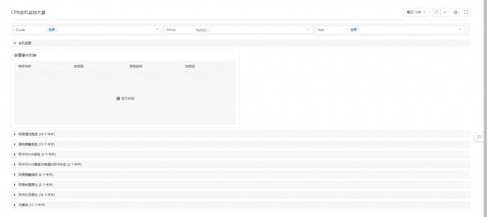

   - 支持通过**Cluster**、**Group**和**Host**变量组合筛选，查看指定条件下的监控大盘数据。

     Cluster和Host变量支持多选。

   - 监控性能指标包括**主机告警**、**网络情况概览**、**端侧拥塞丢包**、**网卡RDMA丢包**、**网卡RDMA通信QP数量&网卡状态**、**网络拥塞指标**、**网络物理吞吐**、**网卡队列吞吐**、**光模块**等。

   - 单击每项指标前的  ，可以展开查看对应指标下的全部卡片及其详细数据。

     鼠标悬浮至任意卡片右上角，单击  > **查看**，可以在弹出的面板中查看对应卡片的JSON模式配置内

     容。

   > **说明**
   >
   > - 单击右上角时间选项下拉框，支持自定义设置开始和结束时间，查看指定时间范围内的监控大盘数据。
   >
   >   单击**最近1分钟**、**最近5分钟**、**最近15分钟**、**最近30分钟**、**最近1小时**、**最近3小时**、**最近6小时**、**最近12小时**、**最近1天**、**最近3天**、**最近7天**、**最近30天**可以快速查询对应时间范围内的监控大盘数据。
   >
   > - 单击右上角
   >
   >   ，可以即时刷新获取最新的监控大盘数据。
   >
   >   
   >
   >   单击右上角
   >
   >   ，支持设置是否开启自动刷新功能以及刷新频率
   >
   >   
   >
   >   （**5s**，**10s**，**30s**，**1m**，**5m**，**10m**，**30m**，**1h**）。

5. 根据业务实际需求设置，可以查看或者管理大盘配置。

   单击页面右上角  ，在弹出的**设置大盘**面板中，通过组件进行大盘监控基础配置，变量管理以及性能指

   标项设置。

   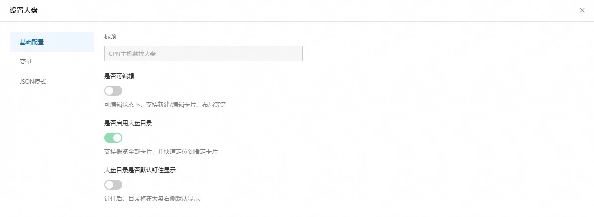

6. （可选）单击页面右侧  ，在弹出的面板中，可以查看**大盘目录**。默认全部展开。

   - 支持输入关键词搜索卡片/卡片组。

   - 单击右上角  ，支持大盘目录钉住显示。

   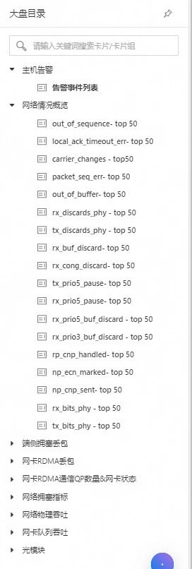

<a id="section-2-2-7-2"></a>

#### 2.2.7.2. CPN交换机大盘

主要用于监控智能计算相关交换机的运行状态，包括带宽、丢包和流量控制等指标。

**操作步骤**

1. 登录Apsara Uni-manager运维控制台。

2. 在顶部菜单栏，选择**产品运维** > **网络运维** > **网络运维控制台**。

3. 在左侧导航栏，选择**基础网络 > CPN管理 > CPN网络监控 > CPN交换机大盘**。

4. 在**CPN交换机大盘**页面，查看CPN交换机大盘数据。

   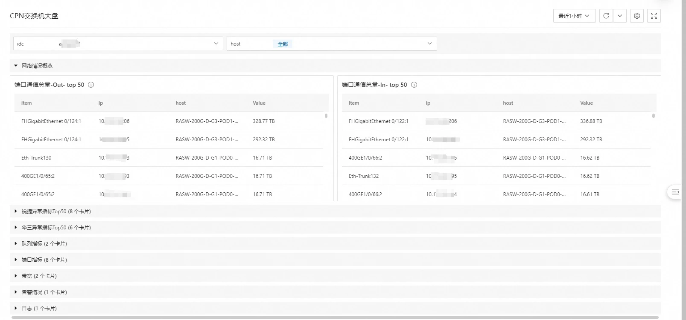

   - 支持通过**idc**和**host**变量组合筛选，查看指定条件下的监控大盘数据。

     host变量支持多选。

   - 监控性能指标包括**网络情况概览**、**锐捷异常指标Top50**、**华三异常指标Top50**、**队列指标**、**端口指标**、**带宽**、**告警情况**、**日志**等。

   - 单击每项指标前的  ，可以展开查看对应指标下的全部卡片及其详细数据。

     鼠标悬浮至任意卡片右上角，单击  > **查看**，可以在弹出的面板中查看对应卡片的JSON模式配置内

     容。

   > **说明**
   >
   > - 单击右上角时间选项下拉框，支持自定义设置开始和结束时间，查看指定时间范围内的监控大盘数据。
   >
   >   单击**最近1分钟**、**最近5分钟**、**最近15分钟**、**最近30分钟**、**最近1小时**、**最近3小时**、**最近6小时**、**最近12小时**、**最近1天**、**最近3天**、**最近7天**、**最近30天**可以快速查询对应时间范围内的监控大盘数据。
   >
   > - 单击右上角
   >
   >   ，可以即时刷新获取最新的监控大盘数据。
   >
   >   
   >
   >   单击右上角
   >
   >   ，支持设置是否开启自动刷新功能以及刷新频率
   >
   >   
   >
   >   （**5s**，**10s**，**30s**，**1m**，**5m**，**10m**，**30m**，**1h**）。

5. 根据业务实际需求设置，可以查看或者管理大盘配置。

   单击页面右上角  ，在弹出的**设置大盘**面板中，通过组件进行大盘监控基础配置，变量管理以及性能指

   标项设置。

   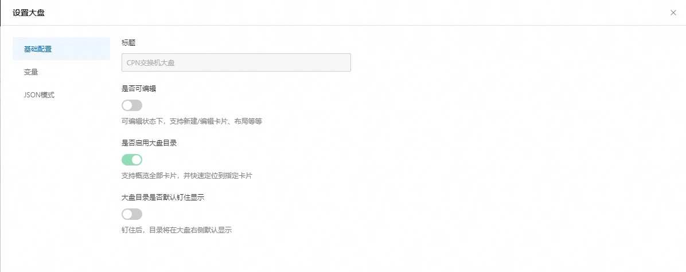

6. （可选）单击页面右侧  ，在弹出的面板中，可以查看**大盘目录**。默认全部展开。

   - 支持输入关键词搜索卡片/卡片组。

   - 单击右上角  ，支持大盘目录钉住显示。

   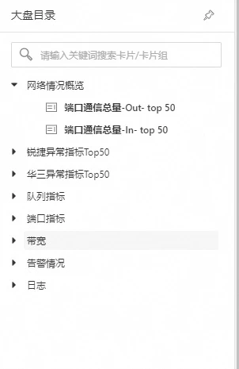

<a id="section-2-2-7-3"></a>

#### 2.2.7.3. NAK报文分析工具

NAK报文分析工具：该工具通过实时采集网络中的NAK报文，经过聚合分析，生成矩阵图，快速识别异常节点。

**操作步骤**

1. 登录Apsara Uni-manager运维控制台。

2. 在顶部菜单栏，选择**产品运维** > **网络运维** > **网络运维控制台**。

3. 在左侧导航栏，选择**基础网络 > CPN管理 > CPN网络监控 > NAK报文分析工具**。

4. 在**NAK报文分析工具**界面，查看NAK报文监控指标数据。

   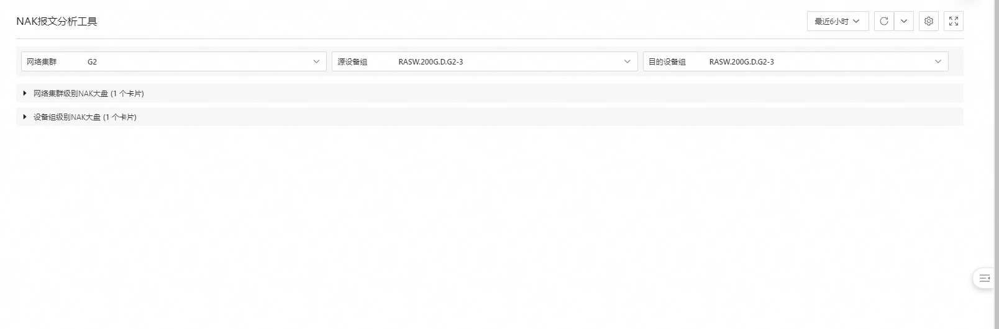

   - 支持通过**网络集群**、**源设备组**和**目的设备组**变量组合筛选，查看指定条件下的监控大盘数据。

   - 监控性能指标包括**网络集群级别NAK大盘**、**设备组级别NAK大盘**等。

   - 单击每项指标前的  ，可以展开查看对应指标下的全部卡片及其详细数据。

     鼠标悬浮至任意卡片右上角，单击  > **查看**，可以在弹出的面板中查看对应卡片的JSON模式配置内

     容。

   > **说明**
   >
   > - 单击右上角时间选项下拉框，支持自定义设置开始和结束时间，查看指定时间范围内的监控大盘数据。
   >
   >   单击**最近1分钟**、**最近5分钟**、**最近15分钟**、**最近30分钟**、**最近1小时**、**最近3小时**、**最近6小时**、**最近12小时**、**最近1天**、**最近3天**、**最近7天**、**最近30天**可以快速查询对应时间范围内的监控大盘数据。
   >
   > - 单击右上角
   >
   >   ，可以即时刷新获取最新的监控大盘数据。
   >
   >   
   >
   >   单击右上角
   >
   >   ，支持设置是否开启自动刷新功能以及刷新频率
   >
   >   
   >
   >   （**5s**，**10s**，**30s**，**1m**，**5m**，**10m**，**30m**，**1h**）。

5. 根据业务实际需求设置，可以查看或者管理大盘配置。

   单击页面右上角  ，在弹出的**设置大盘**面板中，通过组件进行大盘监控基础配置，变量管理以及性能指

   标项设置。

   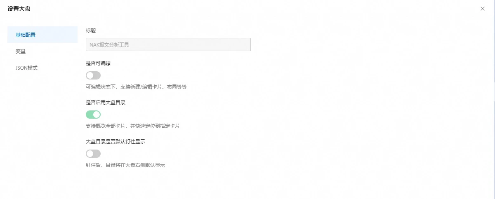

6. （可选）单击页面右侧  ，在弹出的面板中，可以查看**大盘目录**。默认全部展开。

   - 支持输入关键词搜索卡片/卡片组。

   - 单击右上角  ，支持大盘目录钉住显示。

   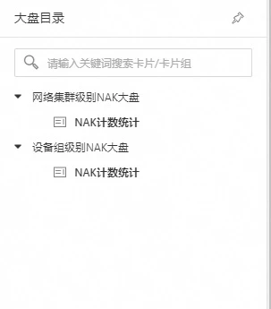

<a id="section-2-2-7-4"></a>

#### 2.2.7.4. 高精度监控大盘

CPN主机侧秒级指标高精度监控大盘，提供网卡设备和bond设备的流量监控。

**操作步骤**

1. 登录Apsara Uni-manager运维控制台。

2. 在顶部菜单栏，选择**产品运维** > **网络运维** > **网络运维控制台**。

3. 在左侧导航栏，选择**基础网络 > CPN管理 > CPN网络监控 > 高精度监控大盘**。

4. 在**高精度监控大盘**页面，查看高精度监控大盘数据。

   默认展示首个集群内首个节点条件下，最近一小时内的高精度监控数据。

   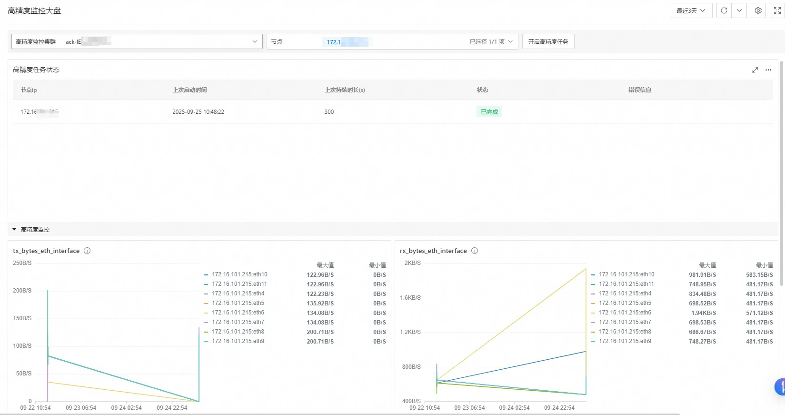

   - 支持选择**高精度监控集群**及对应集群内的**节点**，查看指定高精度任务状态以及监控数据。节点支持多选。

   - 支持开启高精度任务，高精度任务内容包括**节点ip**、**上次启动时间**、**上次持续时长(s)**、**状态**、**错误信息**。

     > **说明**
     >
     > 当节点**状态**处于**运行中**时，禁止再次开启高精度任务，直至任务结束。

     <ol type="a">

     <li>

     完成**高精度监控集群**及其内**节点**配置后，点击**开启高精度任务**。

     </li>

     <li>

     在弹出窗中，设置**持续时长(s)**（范围1-600，默认值为300），单击**确定**。

     

     </li>

     </ol>

     <ol type="i" start="100">

     <li>

     在**高精度任务状态**区域，对应节点**状态**从**待执行**变更为**运行中**，直到任务持续时间结束，**状态**变更为**已完成**。

     </li>

     </ol>

   - 单击**高精度监控**前的  ，可以展开查看指标下的全部卡片及其详细数据。

     鼠标悬浮至任意卡片右上角，单击  > **查看**，可以在弹出的面板中查看对应卡片的JSON模式配置内

     容。

   > **说明**
   >
   > - 单击右上角时间选项下拉框，支持自定义设置开始和结束时间，查看指定时间范围内的高精度监控数据。
   >
   >   单击**最近1分钟**、**最近5分钟**、**最近15分钟**、**最近30分钟**、**最近1小时**、**最近3小时**、**最近6小时**、**最近12小时**、**最近1天**、**最近3天**、**最近7天**、**最近30天**可以快速查询对应时间范围内的高精度监控数据。
   >
   > - 单击右上角
   >
   >   ，可以即时刷新获取最新的高精度监控数据。
   >
   >   
   >
   >   单击右上角
   >
   >   ，支持设置是否开启自动刷新功能以及刷新频率
   >
   >   
   >
   >   （**5s**，**10s**，**30s**，**1m**，**5m**，**10m**，**30m**，**1h**）。

5. 根据业务实际需求设置，可以查看或者管理大盘配置。

   单击页面右上角  ，在弹出的**设置大盘**面板中，通过组件进行大盘监控基础配置，变量管理以及性能指

   标项设置。

   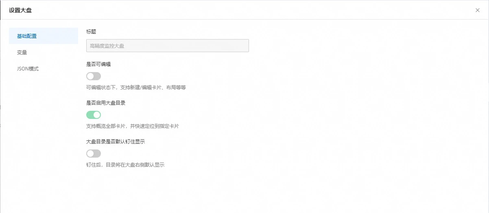

6. （可选）单击页面右侧  ，在弹出的面板中，可以查看**大盘目录**。默认全部展开。

   - 支持输入关键词搜索卡片/卡片组。

   - 单击右上角  ，支持大盘目录钉住显示。

   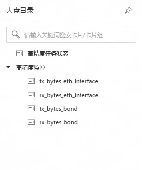

<a id="section-2-2-7-5"></a>

#### 2.2.7.5. 交换机高精度大盘

CPN交换机侧秒级指标高精度监控大盘，提供交换机设备的流量监控。

**操作步骤**

1. 登录Apsara Uni-manager运维控制台。

2. 在顶部菜单栏，选择**产品运维** > **网络运维** > **网络运维控制台**。

3. 在左侧导航栏，选择**基础网络 > CPN管理 > CPN网络监控 > 交换机高精度监控大盘**。

4. 在**交换机高精度监控大盘**页面，查看交换机高精度监控大盘数据。

   

   - 支持通过**idc**、**交换机**、**端口**、**队列**组合筛选，查看指定条件下的交换机高精度任务状态以及监控数据。

     端口支持多选。

     | 参数 | 参数说明 |
     | --- | --- |
     | idc | 进行高精度监控任务的IDC。 |
     | 交换机 | 进行高精度监控任务的交换机。 |
     | 端口 | 指执行诊断任务的端口。 |
     | 队列 | 交换机端口的队列，0~7。 |

   - 支持开启高精度任务，交换机高精度任务内容包括**端口**、**队列**、**任务类型**、**状态**、**上次启动时间**、**持续时长**、**错误信息**。

     > **说明**
     >
     > 当节点**状态**处于**运行中**时，禁止再次开启高精度任务，直至任务结束。

     <ol type="a">

     <li>

     完成**idc**、**交换机**、**端口**、**队列**配置后，点击**开启高精度任务**。

     </li>

     <li>

     在弹出窗中，设置**持续时长(s)**（范围1-600，默认值为300）并选择**任务类型**（**PORT**、**QUEUE**、**PORT_AND_QUEUE**），单击**确定**。

     

     > **说明**
     >
     > **任务类型**为选择监控任务的监控对象。如未选择相应的监控对象，在下方卡片中将不显示相关数据。

     </li>

     </ol>

     <ol type="i" start="100">

     <li>

     在**交换机高精度任务状态**区域，对应端口**状态**从**待执行**变更为**运行中**，直到任务持续时间结束，**状态**变更为**已完成**。

     </li>

     </ol>

   - 单击每项指标前的  ，可以展开查看指标下的全部卡片及其详细数据。

     鼠标悬浮至任意卡片右上角，单击  > **查看**，可以在弹出的面板中查看对应卡片的JSON模式配置内

     容。

   > **说明**
   >
   > - 单击右上角时间选项下拉框，支持自定义设置开始和结束时间，查看指定时间范围内的高精度监控数据。
   >
   >   单击**最近1分钟**、**最近5分钟**、**最近15分钟**、**最近30分钟**、**最近1小时**、**最近3小时**、**最近6小时**、**最近12小时**、**最近1天**、**最近3天**、**最近7天**、**最近30天**可以快速查询对应时间范围内的高精度监控数据。
   >
   > - 单击右上角
   >
   >   ，可以即时刷新获取最新的高精度监控数据。
   >
   >   
   >
   >   单击右上角
   >
   >   ，支持设置是否开启自动刷新功能以及刷新频率
   >
   >   
   >
   >   （**5s**，**10s**，**30s**，**1m**，**5m**，**10m**，**30m**，**1h**）。

5. 根据业务实际需求设置，可以查看或者管理大盘配置。

   单击页面右上角  ，在弹出的**设置大盘**面板中，通过组件进行大盘监控基础配置，变量管理以及性能指

   标项设置。

   

6. （可选）单击页面右侧  ，在弹出的面板中，可以查看**大盘目录**。默认全部展开。

   - 支持输入关键词搜索卡片/卡片组。

   - 单击右上角  ，支持大盘目录钉住显示。

   

<a id="section-2-2-7-6"></a>

#### 2.2.7.6. job维度监控

CPN提供基于job维度的监控功能，包括主机TopN指标、端侧拥塞丢包、网卡RDMA丢包等指标的监控。

**前提条件**

查看job维度监控前，请确认已经在AI Studio的任务建模中创建相关任务。

**操作步骤**

1. 登录Apsara Uni-manager运维控制台。

2. 在顶部菜单栏，选择**产品运维** > **网络运维** > **网络运维控制台**。

3. 在左侧导航栏，选择**基础网络 > CPN管理 > CPN网络监控 > job维度监控**。

4. 在**job维度监控**页面，查看job维度的监控指标。

   

   - 单击**展开更多**，支持通过**idc**、**Cluster**、**JobType**、 **TrainJobId**、**Tips**、 **hostIps**、**swNames**变量组合筛选，查看指定条件下的监控数据。

     hostIps和swNames变量支持多选。

   - 监控性能指标包括**主机TopN指标**、**端侧拥塞丢包**、**网卡RDMA丢包**、**网卡RDMA通信QP数量&网卡状态**、**网络拥塞指标**、**网络物理吞吐**、**网卡队列吞吐**、**交换机TopN指标**、**锐捷异常指标Top50**、**华三异常指标Top50**、**交换机队列指标**、**交换机端口指标**等。

   - 单击每项指标前的  ，可以展开查看对应指标下的全部卡片及其详细数据。

     鼠标悬浮至任意卡片右上角，单击  > **查看**，可以在弹出的面板中查看对应卡片的JSON模式配置内

     容。

   > **说明**
   >
   > - 单击右上角时间选项下拉框，支持自定义设置开始和结束时间，查看指定时间范围内的监控大盘数据。
   >
   >   单击**最近1分钟**、**最近5分钟**、**最近15分钟**、**最近30分钟**、**最近1小时**、**最近3小时**、**最近6小时**、**最近12小时**、**最近1天**、**最近3天**、**最近7天**、**最近30天**可以快速查询对应时间范围内的监控大盘数据。
   >
   > - 单击右上角
   >
   >   ，可以即时刷新获取最新的监控大盘数据。
   >
   >   
   >
   >   单击右上角
   >
   >   ，支持设置是否开启自动刷新功能以及刷新频率
   >
   >   
   >
   >   （**5s**，**10s**，**30s**，**1m**，**5m**，**10m**，**30m**，**1h**）。

5. 根据业务实际需求设置，可以查看或者管理大盘配置。

   单击页面右上角  ，在弹出的**设置大盘**面板中，通过组件进行大盘监控基础配置，变量管理以及性能指

   标项设置。

   

6. （可选）单击页面右侧  ，在弹出的面板中，可以查看**大盘目录**。默认全部展开。

   - 支持输入关键词搜索卡片/卡片组。

   - 单击右上角  ，支持大盘目录钉住显示。

   

<a id="section-2-2-7-7"></a>

#### 2.2.7.7. CPN流监控

CPN支持全局流量可观测功能，包括通信关系可视化、通信路径可视化、通信质量可视化以及拥塞发生时影响的流可视化。

**前提条件**

CPN基于流的可视化功能默认关闭，使用前需确保cpn-lsgo开关已打开。具体操作：

1. 登录数据库，执行如下SQL语句。

   ```sql
   update config_detail_info set config_value='on' where config_key in 
   ('tracing_open','cpn_gtp','cpn_gto','cpn_gts','asnet-cpn-lsgo-agent');
   ```

2. 重启服务。

**操作步骤**

1. 登录Apsara Uni-manager运维控制台。

2. 在顶部菜单栏，选择**产品运维** > **网络运维** > **网络运维控制台**。

3. 在左侧导航栏，选择**基础网络 > CPN管理 > CPN网络监控 > CPN流监控**。

4. 在**CPN流量观测**页面，单击**主机**页签，查看主机维度的流量监控信息。

   默认展示首个集群最近一小时的流量监控列表。

   - 流监控信息包括**流id**、**流信息**、**源NC管理口ip**、**源nic**、**目的NC管理口ip**、**目的nic**、**路径变化**、**创建时间**、**删除时间**等。

   - 单击**高级筛选**，支持根据**集群名**、**源NC管理口ip**、**源nic**、**目的NC管理口ip**、**目的nic**、**时间**组合筛选获取目标流量监控信息。

   

5. 在流监控列表，单击目标流监控**操作**列的**详情**，在**流详情**页面，可以查看基本信息、**流变化事件**、**路径变化事件**、**RTT趋势**等详情信息。

   支持根据**日期区段**搜索查看指定时间范围内的流变化数据。

   

6. 单击**交换机**页签，查看交换机维度的流量监控信息。

   默认展示首个本端设备端口类型最近一小时的端口监控列表。

   - 端口监控信息包括**本端设备**、**本端端口**、**流方向**、**流数量**、**对端设备**、**对端端口**等。

   - 单击**高级筛选**，支持根据**本端设备**、**类型**、**本端设备端口**/**对端设备**、**时间**组合筛选查看端口列表。

     本端设备端口/对端设备支持多选。

   

7. 查看流详情。

   <ol type="i">

   <li>

   在端口监控列表，单击目的端口**操作**列的**详情**，在**流列表**页面，可以查看端口负载的流列表。

   单击**高级筛选**，支持根据**日期区段**筛选获取指定流列表。

   

   </li>

   <li>

   单击目标流**操作**列的**详情**，在**流详情**页面，可以查看指定流的基本信息、**流变化事件**、**路径变化事件**、**RTT趋势**等详情信息。

   支持根据**日期区段**搜索查看指定时间范围内的流变化数据。

   

   </li>

   </ol>

<a id="section-2-3"></a>

## 2.3. 云接入网关

客户裸机是通过云接入网关（专用HSW设备）接入VPC，实现客户裸机资源的统一管理的。系统提供实例管理、操作历史记录、裸机VPC网络管理、裸机专线网络管理、运维配置等操作，以完成云接入网关的日常运维工作。

> **说明**
>
> 此功能默认不展示，如果需要使用本功能，在**用户权限** > **菜单管理**下编辑菜单项，进行**展示**操作。

**实例管理**

在实例管理页面，将新增云接入网关设备纳管到云平台进行统一管理。并查看当前系统中云接入网关实例的汇总信息。

**显示设备列表**

1. 登录Apsara Uni-manager运维控制台。

2. 在顶部菜单栏，选择**产品运维** > **网络运维** > **网络运维控制台**。

3. 在左侧导航栏，选择**基础网络** > **云接入网关**。

4. 单击**实例管理**页签下的**显示设备列表**，查看实例详情。

   <table>
     <tr>
       <th width="137">名称</th>
       <th>说明</th>
     </tr>
     <tr>
       <td>云接入网关名称</td>
       <td>云接入网关的名称。</td>
     </tr>
     <tr>
       <td>IBGP角色</td>
       <td>云接入网关在环境中担任的角色。</td>
     </tr>
     <tr>
       <td>管理IP</td>
       <td>云接入网关的IP地址。</td>
     </tr>
     <tr>
       <td>厂商</td>
       <td>云接入网关设备的厂商。</td>
     </tr>
     <tr>
       <td>型号</td>
       <td>云接入网关设备的型号。</td>
     </tr>
     <tr>
       <td>管理状态</td>
       <td>云接入网关的初始化状态。<br>• 未初始化<br>• 初始化中<br>• 初始化成功</td>
     </tr>
     <tr>
       <td>授权状态</td>
       <td>云接入网关的授权状态。<br>• 未授权<br>• 已授权<br>说明使用云接入网关设备，需要在朱雀规划中规划云接入网关licnese数量。如果朱雀规划云接入网关license数量比实际云接入网关少的时候，缺少license授权，设备状态则为未授权状态，需要扩容云接入网关license数量。</td>
     </tr>
     <tr>
       <td>创建时间</td>
       <td>云接入网关创建的时间。</td>
     </tr>
   </table>

**扫描新设备**

1. 登录Apsara Uni-manager运维控制台。

2. 在顶部菜单栏，选择**产品运维** > **网络运维** > **网络运维控制台**。

3. 在左侧导航栏，选择**基础网络** > **云接入网关**。

4. 单击**实例管理**页签下**扫描新设备**。

   - 选择**扫描堆叠组网设备**页签，列表显示**云接入网关名称**、**管理IP**、**IBGP角色**、**厂商**、**型号**等。执行以下步骤可以通过纳管设置设备对应的IBGP角色。

     <ol type="a">

     <li>

     单击目标设备**操作**列的**纳管**。

     或者勾选多个目标设备，单击列表下方的**批量纳管**。

     </li>

     <li>

     在**IBGP角色**列的下拉列表中选择需要设置的IBGP角色。

     IBGP角色表示云接入网关在环境中担任的角色。支持Client、Client和RR合一、独立RR。

     - **Client**：表示当前云接入网关做为IBGP邻居的客户端角色，只做服务器接入。

     - **Client和RR合一**：表示当前云接入网关既做为IBGP邻居的RR角色反射路由，也做服务器接入。

     - **独立RR**：表示当前云接入网关只做IBGP邻居的RR角色反射路由，不做服务器接入。

     > **重要**
     >
     > IBGP角色组网配置要求如下所示：
     >
     > - 单机房部署：至少部署一组云接入网关IBGP角色为RR角色，其余设备IBGP角色为Client。
     >
     > - 多机房部署：至少有两个机房各部署一组云接入网关角色为RR角色，其余设备IBGP角色为Client。
     >
     > - RR角色推荐如下所示：
     >
     >   - 默认RR角色推荐：Client和RR合一。
     >
     >   - 对于网络稳定性要求特别高的需求推荐RR角色选择独立RR。

     </li>

     </ol>

     <ol type="i" start="100">

     <li>

     单击**确定**。

     </li>

     </ol>

   - 选择**扫描去堆叠组网设备**页签，列表显示**云接入网关名称1**、**管理IP1**、**云接入网关名称2**、**管理IP2**、**IBGP角色**、**厂商**、**型号**等。执行以下步骤可以通过纳管设置设备对应的IBGP角色。

     <ol type="a">

     <li>

     单击目标设备**操作**列的**纳管**。

     或者勾选多个目标设备，单击列表下方的**批量纳管**。

     </li>

     <li>

     在**IBGP角色**列的下拉列表中选择需要设置的IBGP角色。

     IBGP角色表示云接入网关在环境中担任的角色。支持Client、Client和RR合一、独立RR。

     - **Client**：表示当前云接入网关做为IBGP邻居的客户端角色，只做服务器接入。

     - **Client和RR合一**：表示当前云接入网关既做为IBGP邻居的RR角色反射路由，也做服务器接入。

     - **独立RR**：表示当前云接入网关只做IBGP邻居的RR角色反射路由，不做服务器接入。

     > **重要**
     >
     > IBGP角色组网配置要求如下所示：
     >
     > - 单机房部署：至少部署一组云接入网关IBGP角色为RR角色，其余设备IBGP角色为Client。
     >
     > - 多机房部署：至少有两个机房各部署一组云接入网关角色为RR角色，其余设备IBGP角色为Client。
     >
     > - RR角色推荐如下所示：
     >
     >   - 默认RR角色推荐：Client和RR合一。
     >
     >   - 对于网络稳定性要求特别高的需求推荐RR角色选择独立RR。

     </li>

     </ol>

     <ol type="i" start="100">

     <li>

     单击**确定**。

     </li>

     </ol>

**操作历史记录**

根据运维需要，查看云接入网关提供的被裸机管控和运维控制台调用的API记录和结果。

1. 登录Apsara Uni-manager运维控制台。

2. 在顶部菜单栏，选择**产品运维** > **网络运维** > **网络运维控制台**。

3. 在左侧导航栏，选择**基础网络** > **云接入网关**。

4. 单击**操作历史记录**页签，查看操作历史记录。

   单击**高级筛选**，可以根据**起止时间**、**裸机名称**、**VPC ID**、**vSwitch ID**、**VBR ID**、**BD ID**以及**云接入网关名称**组合筛选获取目标操作历史纪律。

   | 字段 | 说明 |
   | --- | --- |
   | ID | 当前API操作的操作记录索引。 |
   | 裸机名称 | VPC内申请或者释放裸机时的裸机名称。 |
   | 创建时间 | 当前API操作发生的时间。 |

   <table>
     <tr>
       <td>API操作</td>
       <td>API操作的类别。例如：VPC内申请裸机、VPC内释放裸机等。<br>• <strong>add</strong>：表示VPC内申请裸机。<br>• <strong>del</strong>：表示VPC内释放裸机。<br>• <strong>del_pc </strong>：表示删除物理专线。<br>• <strong>del_vbr</strong>：表示删除虚拟路由器接口。<br>• <strong>del_router_intf </strong>：表示删除路由器接口。<br>• <strong>del_route_entry </strong>：表示删除路由表项。</td>
     </tr>
     <tr>
       <td>vSwitch ID</td>
       <td>VPC内申请或者释放裸机时专用的Vswitch ID。</td>
     </tr>
     <tr>
       <td>云接入网关名称</td>
       <td>当前API操作涉及的云接入网关的名称。</td>
     </tr>
     <tr>
       <td>端口</td>
       <td>裸机所属的端口信息。</td>
     </tr>
     <tr>
       <td>状态</td>
       <td>API操作的状态。<br>• <strong>success</strong>表示操作成功。<br>• 如果当前API正在执行，则该值表示为当前的API状态实时值。<br>• 如果当前API已完成但不是<strong>success</strong>，则该值表示API失败的信息。如create vpc connection fail。</td>
     </tr>
   </table>

5. 单击目标操作历史记录对应**操作**列的**详情**，查看更多详细信息。如地域ID、发起方、返回码等。

   

**裸机VPC网络管理**

**查看VPC内裸机的网络信息**

1. 在**裸机VPC网络管理**页签下，单击**高级筛选**，可以通过**裸机名称**、**VPC ID**、**vSwitch ID**和**云接入网关名称**组合筛选获取目标裸机信息。

2. 查看符合筛选条件的裸机VPC网络信息。

   <table>
     <tr>
       <th width="137">名称</th>
       <th>描述</th>
     </tr>
     <tr>
       <td>裸机名称</td>
       <td>裸机的名称。</td>
     </tr>
     <tr>
       <td>SN</td>
       <td>裸机的序列号。</td>
     </tr>
     <tr>
       <td>状态</td>
       <td>裸机的状态。</td>
     </tr>
     <tr>
       <td>VPC ID</td>
       <td>裸机所属的VPC ID。</td>
     </tr>
     <tr>
       <td>vSwitch ID</td>
       <td>裸机所属的专用Vswitch ID。</td>
     </tr>
     <tr>
       <td>云接入网关名称</td>
       <td>裸机所属的云接入网关的名称。根据云接入网关名称可以区分堆叠和解堆叠组网设备进行相关操作。</td>
     </tr>
     <tr>
       <td>端口</td>
       <td>裸机所属云接入网关的端口。</td>
     </tr>
     <tr>
       <td>创建时间</td>
       <td>裸机网络的创建时间。</td>
     </tr>
     <tr>
       <td>裸机IP</td>
       <td>单击<strong>管理</strong>为裸机分配IP，帮助用户对裸机进行网络配置。具体可参见裸机IP管理。</td>
     </tr>
   </table>

3. 单击裸机对应**操作**列的**详情**，查看该裸机的其他详细信息（如物理专线ID、VPC路由器接口、VBR路由器接口等）。

   

**创建裸机实例**

根据运维需要，创建裸机实例并接入VPC，裸机接入VPC后即具备VPC内私网访问能力。

**操作步骤**

1. 登录Apsara Uni-manager运维控制台。

2. 在顶部菜单栏，选择**产品运维** > **网络运维** > **网络运维控制台**。

3. 在左侧导航栏，选择**基础网络** > **云接入网关**。

4. 单击**裸机VPC网络管理**页签。

5. 单击**创建裸机实例**，输入**裸机名称**、**SN**和**描述**，然后单击**确定**。

   

**裸机接入VPC操作步骤**

在创建好的裸机实例对应的**操作**列，单击**接入VPC**，配置如下参数，然后单击**确定**。


<table>
  <tr>
    <th>名称</th>
    <th>说明</th>
  </tr>
  <tr>
    <td>裸机名称</td>
    <td>显示裸机的名称，无需设置。</td>
  </tr>
  <tr>
    <td>裸机SN</td>
    <td>显示裸机的序列号，无需设置。</td>
  </tr>
  <tr>
    <td>AccessKey ID</td>
    <td rowspan="2">可在专有云运营控制台上根据VPC所属的组织，在<strong>组织管理</strong>页面中获取。具体可参见《Apsara Uni-manager运营控制台 用户指南》中的<strong>管理组织AccessKey</strong>章节。</td>
  </tr>
  <tr>
    <td>AccessKey Secret</td>
  </tr>
  <tr>
    <td>vSwitch ID</td>
    <td>裸机所属的专用虚拟交换机。</td>
  </tr>
  <tr>
    <td>区域ID</td>
    <td>默认当前环境的地域名称。</td>
  </tr>
  <tr>
    <td>云接入网关名称</td>
    <td>裸机所属的物理机网关。根据云接入网关名称可以区分堆叠和解堆叠组网设备进行相关操作。</td>
  </tr>
  <tr>
    <td>端口</td>
    <td>裸机物理机网关的端口。</td>
  </tr>
  <tr>
    <td>裸机描述</td>
    <td>裸机相关描述信息。</td>
  </tr>
</table>

**裸机离开VPC**

裸机离开VPC后，即断开裸机VPC网络连接，实现了资源的访问隔离。

**操作步骤**

在裸机实例所在行，执行**离开VPC**或**删除实例**操作。

- 单击**操作**列的<strong>离开VPC，</strong>将裸机移除VPC。

  > **说明**
  >
  > 裸机成功接入VPC后才会显示。

- 单击**操作**列的**删除实例**，将裸机移除VPC并删除该裸机实例。

  > **说明**
  >
  > 通过裸机网络管理页面创建的裸机实例才会显示删除实例。

**裸机IP管理**

通过裸机IP管理为裸机分配IP，帮助用户对裸机进行网络配置。

**背景信息**

云接入网关与裸机管理服务配合，由裸机服务完成裸机装机、IP分配和网络配置，云接入网关实现裸机接入专有网络VPC。

但在一些场景下，无法使用裸机服务完成裸机装机和网络配置，可是仍然需要借助云接入网关将裸机接入到专有网络VPC中。在这样的这些场景，缺失裸机IP分配的能力，用户只能手工维护IP分配结果，容易出现IP冲突，易用性差。因此在云接入网关运维页面扩展裸机网络管理，增加裸机IP管理功能。

**前提条件**

裸机已接入VPC。

**操作步骤**

1. 在裸机实例对应的**裸机IP**列，单击**管理**。

2. 在**裸机IP管理**面板，单击**申请裸机IP**。

3. 在**申请裸机IP**面板，填写**裸机网卡**、**IP**和**IP描述**，然后单击**确定。**

   

   > **说明**
   >
   > IP为空则自动生成。

4. 裸机IP申请成功后，可以在**裸机IP管理**面板查看/管理IP信息。

   - 单击裸机IP所在行的**编辑**，可修改IP地址信息。

   - 单击裸机IP所在行的**释放**，可释放该IP地址信息。

**裸机专线网络管理**

在裸机专线网络管理页面，查看绑定专线网关的裸机网络。

**查看裸机专线详情**

1. 在**裸机专线网络管理**页签下，单击**高级筛选**，可以通过**vSwitch ID**、**VPC ID**和**专线网关名称**组合筛选获取目标裸机信息。

2. 查看符合筛选条件的裸机专线网络信息。

   | 名称 | 描述 |
   | --- | --- |
   | VPC ID | 裸机所属的VPC ID。 |
   | vSwitch ID | 裸机所属的专用Vswitch ID。 |
   | 状态 | 裸机的状态。 |
   | 专线网关设备1名称 | 裸机所属的专线网关设备1的名称。 |
   | 云上探测专线网关1的源地址 | 专线网关设备1的源地址。 |
   | 专线网关设备2名称 | 裸机所属的专线网关设备2的名称。 |
   | 云上探测专线网关2的源地址 | 专线网关设备2的源地址。 |
   | 创建时间 | 裸机网络的创建时间。 |

3. 单击裸机对应**操作**列的**详情**，查看该裸机专线网络的详细信息。

   

**删除裸机专线网络**

**操作步骤**

在裸机实例所在行，单击对应**操作**列的**删除**，即可删除该裸机实例。

**运维配置**

**VPC内申请裸机**

在运维应急场景下，可以使用该功能将裸机所属的云接入网关的物理端口加入到VPC网络。

> **警告**
>
> - 该操作必须在研发人员的指导下进行，切勿自行操作，以免影响业务的正常运行。
>
> - 该操作仅会操作裸机连接到云接入网关的端口，不会对裸机进行任何操作，如果需要配置裸机的业务网口IP、路由等信息，请咨询对应的产品团队进行配置指导。
>
> - 一般情况下，不能使用此操作在VPC内申请裸机，而是应当由裸机管控调用API来开通裸机网络。

**操作步骤**

1. 登录Apsara Uni-manager运维控制台。

2. 在顶部菜单栏，选择**产品运维** > **网络运维** > **网络运维控制台**。

3. 在左侧导航栏，选择**基础网络** > **云接入网关**。

4. 单击**运维配置**页签。

5. 在下拉列表中，选择**VPC内申请裸机**。

   

6. 参考下表，填写配置参数，单击**下一步**。

   **名称**

   **描述**

   当前环境的地域名称。

   **地域ID**

   选择裸机连接到的云接入网关的名称。

   **云接入网关名称**

   根据云接入网关名称可以区分堆叠和解堆叠组网设备进行相关操作。

   填写裸机待加入的vSwitch ID值，可从专有云运营控制台中的专有网络VPC上获取。

   **vSwitch ID**

   选择裸机连接到云接入网关的端口。

   **端口**

   **AccessKey ID**

   可在专有云运营控制台上根据VPC所属的组织，在**组织管理**页面中获取。

   具体可参见《Apsara Uni-manager运营控制台 用户指南》中的**管理组织**

   **AccessKey**

   **AccessKey**章节。

   **Secret**

   <table>
     <tr>
       <td>裸机名称</td>
       <td>待申请的裸机名称，不同裸机的裸机名称不能相同。</td>
     </tr>
   </table>

   > **说明**
   >
   > 如果输入错误，可在页面下方单击**重新填写**后，重新输入配置信息。

7. 参数校验，检查参数填写是否正确。

   - 参数正确，单击**确认下发**，系统开始下发配置。

     待配置下发成功后，页面会显示**下发结果：成功**。

   - 参数有误，单击**返回修改**，重新填写参数。

8. （可选）配置下发成功后，可以在**裸机VPC网络管理**页签根据裸机名称查询到该裸机已加入到VPC网络中。

**VPC内释放裸机**

在运维应急场景下，可以使用该功能将裸机所属的云接入网关的物理端口与VPC网络断开。

> **警告**
>
> - 该操作必须在研发人员的指导下进行，切勿自行操作，以免影响业务的正常运行。
>
> - 该操作仅会操作裸机连接到云接入网关的端口，不会对裸机进行任何操作，如果需要配置裸机的业务网口IP、路由等信息，请咨询对应的产品团队进行配置指导。
>
> - 一般情况下，不能使用此操作在VPC内释放裸机，而是应当由裸机管控调用API来删除裸机网络。

**操作步骤**

1. 登录Apsara Uni-manager运维控制台。

2. 在顶部菜单栏，选择**产品运维** > **网络运维** > **网络运维控制台**。

3. 在左侧导航栏，选择**基础网络** > **云接入网关**。

4. 单击**运维配置**页签。

5. 在下拉列表中，选择**VPC内释放裸机**。

   

6. 参考下表，填写配置参数，单击**下一步**。

   <table>
     <tr>
       <th width="137">名称</th>
       <th>描述</th>
     </tr>
     <tr>
       <td>地域ID</td>
       <td>当前环境的地域名称。</td>
     </tr>
     <tr>
       <td>云接入网关名称</td>
       <td>选择裸机连接到的云接入网关的名称。根据云接入网关名称可以区分堆叠和解堆叠组网设备进行相关操作。</td>
     </tr>
     <tr>
       <td>裸机名称</td>
       <td>待释放的裸机名称。可在<strong>裸机VPC网络管理</strong>页签获取裸机名称。</td>
     </tr>
   </table>

   > **说明**
   >
   > 如果输入错误，可在页面下方单击**重新填写**后，重新输入配置信息。

7. 参数校验，检查参数填写是否正确。

   - 参数正确，单击**确认下发**，系统开始下发配置。

     待配置下发成功后，页面会显示**下发结果：成功**。

   - 参数有误，单击**返回修改**，重新填写参数。

8. （可选）配置下发成功后，可以在**裸机VPC网络管理**页签根据裸机名称查询，发现VPC网络中已经没有该裸机。

**删除路由表项**

在运维应急场景下，可以使用此功能删除VPC内指向裸机子网的路由表项和VBR上默认的路由表项。

> **警告**
>
> - 该操作为应急处理操作，非常规操作，且所有操作必须在研发人员的指导下进行，切勿自行操作，以免影响业务的正常运行。
>
> - 一般情况下，不能使用此操作来删除VPC路由表项，本操作仅作为应急处理操作。
>
> - 一次只能删除一条路由表项，如果需要删除多条路由表项，则需要多次执行本操作。

**操作步骤**

1. 登录Apsara Uni-manager运维控制台。

2. 在顶部菜单栏，选择**产品运维** > **网络运维** > **网络运维控制台**。

3. 在左侧导航栏，选择**基础网络** > **云接入网关**。

4. 单击**运维配置**页签。

5. 在下拉列表中，选择**删除路由表项**。

   

6. 参考下表，填写配置信息，单击**下一步**。

   <table>
     <tr>
       <th>参数</th>
       <th>删除VPC路由表项</th>
       <th>删除VBR路由表项</th>
     </tr>
     <tr>
       <td>地域ID</td>
       <td>当前环境的地域名称。</td>
       <td>当前环境的地域名称。</td>
     </tr>
     <tr>
       <td>路由表ID</td>
       <td>VPC路由表ID，可从专有云的VPC控制台上获取，详细获取操作请参考 <strong>《专有网络VPC用</strong><strong>户指南》</strong>文档。</td>
       <td>VBR路由表ID。如果该VBR所涉及的裸机已经成功地加入到VPC网络，可在<strong>裸机VPC网络管理</strong>页签根据裸机名称查询后，在详细信息中获取该值，即VBR路由表ID对应的值。如果该VBR所涉及的裸机未成功加入到VPC网络，可在<strong>操作历史记录</strong>页签，根据裸机名称查询后，再根据<strong>API操作</strong>为<strong>add</strong>以及操作时间，找到对应的操作记录并查看详细信息，详细信息中的<strong>VBR路由表ID</strong>即为该值。</td>
     </tr>
     <tr>
       <td>路由接口ID</td>
       <td>VPC路由接口ID，可从专有云的VPC控制台上获取，详细获取操作请参考 <strong>《专有网络VPC</strong><strong>用户指南》</strong>文档。</td>
       <td>VBR路由接口ID。如果该VBR所涉及的裸机已经成功地加入到VPC网络，可在<strong>裸机VPC网络管理</strong>页签根据裸机名称查询后，在详细信息中获取该值，即VBR RI对应的值。如果该VBR所涉及的裸机未成功加入到VPC网络，可在<strong>操作历史记录</strong>页签，根据裸机名称查询后，再根据<strong>API操作</strong>为<strong>add</strong>以及操作时间，找到对应的操作记录并查看详细信息，详细信息中的VBR RI即为该值。</td>
     </tr>
     <tr>
       <td>路由目的CIDR</td>
       <td>VPC指向的目标网段，可从专有云的VPC控制台上获取，详细获取操作请参考 <strong>《专有网络</strong><strong>VPC用户指南》</strong>文档。</td>
       <td>固定值0.0.0.0/0。</td>
     </tr>
     <tr>
       <td>AccessKey ID</td>
       <td rowspan="2">可在专有云运营控制台上根据VPC所属的组织，在<strong>组织管理</strong>页面中获取。具体可参见《Apsara Uni-manager运营控制台 用户指南》中的<strong>管理组织AccessKey</strong>章节。</td>
       <td rowspan="2">可在专有云运营控制台上根据VBR所属的组织，在<strong>组织管理</strong>页面中获取。具体可参见《Apsara Uni-manager运营控制台 用户指南》中的<strong>管理组织AccessKey</strong>章节。</td>
     </tr>
     <tr>
       <td>AccessKey Secret</td>
     </tr>
   </table>

   > **说明**
   >
   > 如果输入错误，可在页面下方单击**重新填写**后，重新输入配置信息。

7. 参数校验，检查参数填写是否正确。

   - 参数正确，单击**确认下发**，系统开始下发配置。

     待配置下发成功后，页面会显示**下发结果：成功**。

   - 参数有误，单击**返回修改**，重新填写参数。

8. （可选）根据实际故障场景，如果路由表中有多条路由表项，需要重复步骤5~步骤8，删除其他路由表项。

**删除路由器接口**

在运维应急场景下，可以使用此功能删除VPC的路由器接口和VBR路由器接口。

> **警告**
>
> 该操作为应急处理操作，非常规操作，且所有操作必须在研发人员的指导下进行，切勿自行操作，以免影响业务的正常运行。

**操作步骤**

1. 登录Apsara Uni-manager运维控制台。

2. 在顶部菜单栏，选择**产品运维** > **网络运维** > **网络运维控制台**。

3. 在左侧导航栏，选择**基础网络** > **云接入网关**。

4. 单击**运维配置**页签。

5. 在下拉列表中，选择**删除路由器接口**。

   

6. 参考下表，填写配置信息，单击**下一步**。

   <table>
     <tr>
       <th>名称</th>
       <th>删除VPC路由器接口</th>
       <th>删除VBR路由器接口</th>
     </tr>
     <tr>
       <td>地域ID</td>
       <td>当前环境的地域名称。</td>
       <td>当前环境的地域名称。</td>
     </tr>
     <tr>
       <td>路由器接口ID</td>
       <td>VPC路由接口ID，可在<strong>操作历史记录</strong>页签，根据裸机名称查询后，再根据<strong>API操</strong><strong>作</strong>为<strong>add</strong>以及操作时间，找到对应的操作记录并查看详细信息，详细信息中的<strong>VPC</strong> <strong>RI</strong>即为该值。</td>
       <td>VBR路由器接口ID。如果该VBR所涉及的裸机已经成功地加入到VPC网络，可在<strong>裸机VPC网络管理</strong>页签根据裸机名称查询后，在详细信息中获取该值，即VBR RI对应的值。如果该VBR所涉及的裸机未成功加入到VPC网络，可在<strong>操作历史记录</strong>页签，根据裸机名称查询后，再根据<strong>API操作</strong>为<strong>add</strong>以及操作时间，找到对应的操作记录并查看详细信息，详细信息中的VBR RI即为该值。</td>
     </tr>
     <tr>
       <td>AccessKey ID</td>
       <td rowspan="2">可在专有云运营控制台上根据VPC所属的组织，在<strong>组织管理</strong>页面中获取。具体可参见《Apsara Uni-manager运营控制台 用户指南》中的<strong>管理组织AccessKey</strong>章节。</td>
       <td rowspan="2">可在专有云运营控制台上根据VBR所属的组织，在<strong>组织管理</strong>页面中获取。具体可参见《Apsara Uni-manager运营控制台 用户指南》中的<strong>管理组织AccessKey</strong>章节。</td>
     </tr>
     <tr>
       <td>AccessKey Secret</td>
     </tr>
   </table>

   > **说明**
   >
   > 如果输入错误，可在页面下方单击**重新填写**后，重新输入配置信息。

7. 参数校验，检查参数填写是否正确。

   - 参数正确，单击**确认下发**，系统开始下发配置。

     待配置下发成功后，页面会显示**下发结果：成功**。

   - 参数有误，单击**返回修改**，重新填写参数。

8. （可选）配置下发成功后，可以选择**产品运维** > **网络运维** > **虚拟网络管理2.0·齐天**，跳转到齐天首页，输入该路由接口ID信息搜索，若无法找到该路由器接口，说明删除成功。

**删除VBR**

在运维应急场景下，可以使用此功能删除VBR。

> **警告**
>
> 该操作为应急处理操作，非常规操作，且所有操作必须在研发人员的指导下进行，切勿自行操作，以免影响业务的正常运行。

**操作步骤**

1. 登录Apsara Uni-manager运维控制台。

2. 在顶部菜单栏，选择**产品运维** > **网络运维** > **网络运维控制台**。

3. 在左侧导航栏，选择**基础网络** > **云接入网关**。

4. 单击**运维配置**页签。

5. 在下拉列表中，选择**删除VBR**。

   

6. 参考下表，填写配置信息，单击**下一步**。

   <table>
     <tr>
       <th>名称</th>
       <th>描述</th>
     </tr>
     <tr>
       <td>地域ID</td>
       <td>当前环境的地域名称。</td>
     </tr>
     <tr>
       <td>VBR ID</td>
       <td>待删除的VBR ID，可在<strong>操作历史记录</strong>页签，根据裸机名称查询后，再根据<strong>API操</strong><strong>作</strong>为<strong>add</strong>以及操作时间，找到对应的操作记录并查看详细信息，详细信息中的VBR ID即为该值。</td>
     </tr>
     <tr>
       <td>AccessKey ID</td>
       <td rowspan="2">可在专有云运营控制台上根据VBR所属的组织，在<strong>组织管理</strong>页面中获取。具体可参见《Apsara Uni-manager运营控制台 用户指南》中的<strong>管理组织AccessKey</strong>章节。</td>
     </tr>
     <tr>
       <td>AccessKey Secret</td>
     </tr>
   </table>

   > **说明**
   >
   > 如果输入错误，可在页面下方单击**重新填写**后，重新输入配置信息。

7. 参数校验，检查参数填写是否正确。

   - 参数正确，单击**确认下发**，系统开始下发配置。

     待配置下发成功后，页面会显示**下发结果：成功**。

   - 参数有误，单击**返回修改**，重新填写参数。

8. （可选）配置下发成功后，可以选择**产品运维** > **网络运维** > **虚拟网络管理2.0·齐天**，跳转到齐天首页，输入该VBR ID信息搜索，若无法找到该VBR，说明删除成功。

**删除物理专线**

在运维应急场景下，可以使用此功能删除物理专线。

> **警告**
>
> 该操作为应急处理操作，非常规操作，且所有操作必须在研发人员的指导下进行，切勿自行操作，以免影响业务的正常运行。

**操作步骤**

1. 登录Apsara Uni-manager运维控制台。

2. 在顶部菜单栏，选择**产品运维** > **网络运维** > **网络运维控制台**。

3. 在左侧导航栏，选择**基础网络** > **云接入网关**。

4. 单击**运维配置**页签。

5. 在下拉列表中，选择**删除物理专线**。

   

6. 参考下表，填写配置信息，单击**下一步**。

   <table>
     <tr>
       <th>名称</th>
       <th>描述</th>
     </tr>
     <tr>
       <td>地域ID</td>
       <td>当前环境的地域名称。</td>
     </tr>
     <tr>
       <td>物理专线ID</td>
       <td>待删除的物理专线ID，可在<strong>操作历史记录</strong>页签，根据裸机名称查询后，再根据<strong>API操</strong><strong>作</strong>为<strong>add</strong>以及操作时间，找到对应的操作记录并查看详细信息，详细信息中的<strong>物理</strong><strong>专线ID</strong>即为该值。</td>
     </tr>
     <tr>
       <td>AccessKey ID</td>
       <td rowspan="2">可在专有云运营控制台上根据VPC所属的组织，在<strong>组织管理</strong>页面中获取。具体可参见《Apsara Uni-manager运营控制台 用户指南》中的<strong>管理组织AccessKey</strong>章节。</td>
     </tr>
     <tr>
       <td>AccessKey Secret</td>
     </tr>
   </table>

   > **说明**
   >
   > 如果输入错误，可在页面下方单击**重新填写**后，重新输入配置信息。

7. 参数校验，检查参数填写是否正确。

   - 参数正确，单击**确认下发**，系统开始下发配置。

     待配置下发成功后，页面会显示**下发结果：成功**。

   - 参数有误，单击**返回修改**，重新填写参数。

8. （可选）配置下发成功后，可以选择**产品运维** > **网络运维** > **虚拟网络管理2.0·齐天**，跳转到齐天首页，输入该物理专线ID搜索，若无法找到该物理专线，说明删除成功。

**一键清除资源**

在运维应急场景下，可以使用此功能一键清除资源。清除的资源包括VPC路由表项、VBR路由表项、VPC路由器接口、VBR路由器接口、VBR以及物理专线。

> **警告**
>
> 该操作为应急处理操作，非常规操作，且所有操作必须在研发人员的指导下进行，切勿自行操作，以免影响业务的正常运行。

**操作步骤**

1. 登录Apsara Uni-manager运维控制台。

2. 在顶部菜单栏，选择**产品运维** > **网络运维** > **网络运维控制台**。

3. 在左侧导航栏，选择**基础网络** > **云接入网关**。

4. 单击**运维配置**页签。

5. 在下拉列表中，选择**一键清除资源**。

   

6. 参考下表，填写参数信息，单击**下一步**。

   <table>
     <tr>
       <th>名称</th>
       <th>描述</th>
     </tr>
     <tr>
       <td>地域ID</td>
       <td>当前环境的地域ID名称。</td>
     </tr>
     <tr>
       <td>云接入网关名称</td>
       <td>选择裸机连接到的云接入网关的名称。</td>
     </tr>
     <tr>
       <td>AccessKey ID</td>
       <td rowspan="2">可在专有云运营控制台上根据VPC所属的组织，在<strong>组织管理</strong>页面中获取。具体可参见《Apsara Uni-manager运营控制台 用户指南》中的<strong>管理组织</strong><strong>AccessKey</strong>章节。</td>
     </tr>
     <tr>
       <td>AccessKey Secret</td>
     </tr>
     <tr>
       <td>VPC路由接口ID</td>
       <td>VPC路由接口ID，可从专有云的VPC控制台上获取，详细获取操作请参考 <strong>《专有</strong><strong>网络VPC用户指南》</strong>文档。</td>
     </tr>
     <tr>
       <td>VPC路由表ID</td>
       <td>VPC路由表ID，可从专有云的VPC控制台上获取，详细获取操作请参考 <strong>《专有网</strong><strong>络VPC用户指南》</strong>文档。</td>
     </tr>
     <tr>
       <td>VBR路由表ID</td>
       <td>VBR路由表ID。如果该VBR所涉及的裸机已经成功地加入到VPC网络，可在<strong>裸机VPC网络管理</strong>页签根据裸机名称查询后，在详细信息中获取，详细信息中的<strong>VBR路由表ID</strong>即为该值。如果该VBR所涉及的裸机未成功加入到VPC网络，可在<strong>操作历史记录</strong>页签，根据裸机名称查询后，再根据<strong>API操作</strong>为<strong>add</strong>以及操作时间，找到对应的操作记录并查看详细信息，详细信息中的<strong>VBR路由表ID</strong>即为该值。</td>
     </tr>
     <tr>
       <td>VPC CIDR1</td>
       <td>VPC指向的目标网段1，可从专有云的VPC控制台上获取，详细获取操作请参考<strong>《专有网络VPC用户指南》</strong>文档。</td>
     </tr>
     <tr>
       <td>VPC CIDR2</td>
       <td>VPC指向的目标网段2，可从专有云的VPC控制台上获取，详细获取操作请参考<strong>《专有网络VPC用户指南》</strong>文档。</td>
     </tr>
     <tr>
       <td>VBR路由接口ID</td>
       <td>VBR路由接口ID。如果该VBR所涉及的裸机已经成功地加入到VPC网络，可在<strong>裸机VPC网络管理</strong>页签根据裸机名称查询后，在详细信息中获取该值，详细信息中的<strong>VBR RI</strong>即为该值。如果该VBR所涉及的裸机未成功加入到VPC网络，可在<strong>操作历史记录</strong>页签，根据裸机名称查询后，再根据<strong>API操作</strong>为<strong>add</strong>以及操作时间，找到对应的操作记录并查看详细信息，详细信息中的<strong>VBR RI</strong>即为该值。</td>
     </tr>
     <tr>
       <td>VBR ID</td>
       <td>待删除的VBR ID，可在<strong>操作历史记录</strong>页签，根据裸机名称查询后，再根据<strong>API操</strong><strong>作</strong>为<strong>add</strong>以及操作时间，找到对应的操作记录并查看详细信息，详细信息中的<strong>VBR ID</strong>即为该值。</td>
     </tr>
     <tr>
       <td>物理专线ID</td>
       <td>待删除的物理专线 ID，可在<strong>操作历史记录</strong>页签，根据裸机名称查询后，再根据<strong>API操作</strong>为<strong>add</strong>以及操作时间，找到对应的操作记录并查看详细信息，详细信息中的<strong>物理专线ID</strong>即为该值。</td>
     </tr>
     <tr>
       <td>Trunk ID</td>
       <td>无需填写。</td>
     </tr>
   </table>

   > **说明**
   >
   > 如果输入错误，可在页面下方单击**重新填写**后，重新输入配置信息。

7. 参数校验，检查参数填写是否正确。

   - 参数正确，单击**确认下发**，系统开始下发配置。

     待配置下发成功后，页面会显示**下发结果：成功**。

   - 参数有误，单击**返回修改**，重新填写参数。

**查看专线带宽**

根据运维需要，查看系统中云接入网关实例连接VPC时路由接口对应的专线带宽值。

**操作步骤**

1. 登录Apsara Uni-manager运维控制台。

2. 在顶部菜单栏，选择**产品运维** > **网络运维** > **网络运维控制台**。

3. 在左侧导航栏，选择**基础网络** > **云接入网关**。

4. 单击**运维配置**页签。

5. 在下拉列表中，选择**查看专线带宽**。

   

6. 输入如下表的过滤条件，单击**查询**。系统显示符合条件的专线带宽信息。

   <table>
     <tr>
       <th>名称</th>
       <th>描述</th>
     </tr>
     <tr>
       <td>地域ID</td>
       <td>当前环境的地域名称。</td>
     </tr>
     <tr>
       <td>路由器接口ID</td>
       <td>即VBR RI，可在<strong>裸机VPC网络管理</strong>页签中根据指定VPC ID和云接入网关名称查询后，单击操作列<strong>详情</strong>获取。</td>
     </tr>
     <tr>
       <td>AccessKey ID</td>
       <td rowspan="2">可在专有云运营控制台上根据VPC所属的组织，在<strong>组织管理</strong>页面中获取。具体可参见《Apsara Uni-manager运营控制台 用户指南》中的<strong>管理组织AccessKey</strong>章节。</td>
     </tr>
     <tr>
       <td>AccessKey Secret</td>
     </tr>
   </table>

7. 获取的带宽信息即为当前VPC在HSW上的专线带宽的规格字符串，再根据规格字符串和带宽对照表，得到以bit/s为单位的带宽值。

   | 规格字符串 | 带宽（单位bit/s） |
   | --- | --- |
   | Large.1 | 1G |
   | Large.2 | 2G |
   | Large.4 | 4G |
   | Large.5 | 5G |
   | Xlarge.1 | 10G |
   | Xlarge.2 | 20G |
   | Xlarge.4 | 40G |
   | Xlarge.5 | 50G |
   | Xlarge.8 | 80G |
   | Xlarge.10 | 100G |
   | Xlarge.16 | 160G |
   | Xlarge.20 | 200G |
   | Xlarge.50 | 500G |
   | Xlarge.320 | 3200G |

**修改专线带宽**

在运维应急场景下，可使用此功能修改专线带宽。

> **警告**
>
> 该操作可能影响客户业务，未经授权，禁止操作！同时变更操作必须在技术支持指导下执行！

**操作步骤**

1. 登录Apsara Uni-manager运维控制台。

2. 在顶部菜单栏，选择**产品运维** > **网络运维** > **网络运维控制台**。

3. 在左侧导航栏，选择**基础网络** > **云接入网关**。

4. 单击**运维配置**页签。

5. 在下拉列表中，选择**修改专线带宽**。

   

6. 参考下表，填写参数信息，单击**下一步**。

   <table>
     <tr>
       <th width="137">名称</th>
       <th>说明</th>
     </tr>
     <tr>
       <td>地域ID</td>
       <td>当前环境的地域名称。</td>
     </tr>
     <tr>
       <td>路由器接口ID</td>
       <td>即VBR RI，可在<strong>裸机VPC网络管理</strong>页签中根据指定VPC ID和云接入网关名称查询后，单击操作列<strong>详情</strong>获取。</td>
     </tr>
     <tr>
       <td>路由器接口规格</td>
       <td>选择新的专线带宽规格。</td>
     </tr>
   </table>

   <table>
     <tr>
       <th>AccessKey ID</th>
       <th rowspan="2">可在专有云运营控制台上根据VPC所属的组织，在<strong>组织管理</strong>页面中获取。具体可参见《Apsara Uni-manager运营控制台 用户指南》中的<strong>管理组织AccessKey</strong>章节。</th>
     </tr>
     <tr>
       <td>AccessKey Secret</td>
     </tr>
   </table>

7. 参数校验，检查参数填写是否正确。

   - 参数正确，单击**确认下发**，系统开始下发配置。

     待配置下发成功后，页面会显示**下发结果：成功**。

   - 参数有误，单击**返回修改**，重新填写参数。

8. （可选）配置下发成功后，可参考查看专线带宽确认是否已修改。

**查看trunk使用情况**

可以通过查看trunk的使用情况，及时了解硬件端口的使用情况。

**操作步骤**

1. 登录Apsara Uni-manager运维控制台。

2. 在顶部菜单栏，选择**产品运维** > **网络运维** > **网络运维控制台**。

3. 在左侧导航栏，选择**基础网络** > **云接入网关**。

4. 单击**运维配置**页签。

5. 在下拉列表中，选择**查看trunk使用情况**。

6. 输入**Trunk ID**、**云接入网关名称**，选择Trunk的**状态**（**空闲**、**已使用**、**创建中**或**删除中**），单击**搜索**，查看符合条件的trunk的使用情况。

   > **说明**
   >
   > **Trunk ID**为**裸机VPC网络管理**页签中查到的**端口**末尾的整数。如端口号为10GE1/0/40，则**Trunk ID**为40。

**查看BM VPN使用情况**

通过查看BM VPN使用情况，可以查看系统中云接入网关实例已经分配的BM VPN信息。

**操作步骤**

1. 登录Apsara Uni-manager运维控制台。

2. 在顶部菜单栏，选择**产品运维** > **网络运维** > **网络运维控制台**。

3. 在左侧导航栏，选择**基础网络** > **云接入网关**。

4. 单击**运维配置**页签。

5. 在下拉列表中，选择**查看BMVPN使用情况**。

6. 输入**云接入网关名称**、**vxlan id**、**BM VPN名称**，选择**状态**（**成功**或**创建中**），单击**搜索**，查看当前所有的HSW交换机已分配的BM VPN的情况。

**显示BD使用情况**

通过查看BD使用情况，及时了解BD配置的下发情况。

**操作步骤**

1. 登录Apsara Uni-manager运维控制台。

2. 在顶部菜单栏，选择**产品运维** > **网络运维** > **网络运维控制台**。

3. 在左侧导航栏，选择**基础网络** > **云接入网关**。

4. 单击**运维配置**页签。

5. 在下拉列表中，选择**显示BD使用情况**。

6. 输入**云接入网关名称**、**BD ID**、**vSwitch ID**，选择**状态**（**成功**、**创建中**或**删除中**），单击**搜索**，查看BD使用情况。

**检查初始化配置**

在运维应急场景下，可以使用该功能检查HSW交换机初始化配置是否成功。

> **说明**
>
> 该操作仅限于检查平台接入网关交换机初始化状态及初始化配置是否成功，不会对裸机进行任何操作。

**操作步骤**

1. 登录Apsara Uni-manager运维控制台。

2. 在顶部菜单栏，选择**产品运维** > **网络运维** > **网络运维控制台**。

3. 在左侧导航栏，选择**基础网络** > **云接入网关**。

4. 单击**运维配置**页签。

5. 在下拉列表中，选择**检查初始化配置**。

   

6. 参考下表，填写参数信息，单击**下一步**。

   | 名称 | 描述 |
   | --- | --- |
   | 区域ID | 当前环境的地域名称。 |
   | HSW名称 | 实例管理中的待检查交换机的名称。 |

   > **说明**
   >
   > 如果输入错误，可在页面下方单击**重新填写**后，重新输入配置信息。

7. 参单击**检查**，检查交换机的初始化配置信息。

**检查路由配置**

在运维应急场景下，可以使用该功能定位异常操作检查裸机路由配置是否正确。

**背景说明**

在添加裸机失败后，通过该操作定位异常操作，对HSW设备进行扫描。该操作仅限于检查裸机路由配置是否正常，不会对裸机进行任何操作。

**操作步骤**

1. 登录Apsara Uni-manager运维控制台。

2. 在顶部菜单栏，选择**产品运维** > **网络运维** > **网络运维控制台**。

3. 在左侧导航栏，选择**基础网络** > **云接入网关**。

4. 单击**运维配置**页签。

5. 在下拉列表中，选择**检查路由配置**。

   

6. 参考下表，填写参数信息，单击**下一步**。

   <table>
     <tr>
       <th>名称</th>
       <th>描述</th>
     </tr>
     <tr>
       <td>区域ID</td>
       <td>当前环境的地域名称。</td>
     </tr>
     <tr>
       <td>裸机名称</td>
       <td>VPC内申请或者释放裸机时的裸机名称，在一个地域内唯一标识裸机。</td>
     </tr>
     <tr>
       <td>AccessKey ID</td>
       <td rowspan="2">可在专有云运营控制台上根据VPC所属的组织，在<strong>组织管理</strong>页面中获取。具体可参见《Apsara Uni-manager运营控制台 用户指南》中的<strong>管理组织AccessKey</strong>章节。</td>
     </tr>
     <tr>
       <td>AccessKey Secret</td>
     </tr>
   </table>

   > **说明**
   >
   > 如果输入错误，可在页面下方单击**重新填写**后，重新输入配置信息。

7. 单击**检查**，检查路由配置信息。

**显示裸机网络网关信息**

在运维应急场景下，可以使用该功能检查虚拟交换机的网关。

**背景说明**

该操作是应急处理操作，在裸机网络不通的情况下可以通过该操作查看。该操作仅限于检查vswitch网关信息，不会对裸机进行任何操作。

**操作步骤**

1. 登录Apsara Uni-manager运维控制台。

2. 在顶部菜单栏，选择**产品运维** > **网络运维** > **网络运维控制台**。

3. 在左侧导航栏，选择**基础网络** > **云接入网关**。

4. 单击**运维配置**页签。

5. 在下拉列表中，选择**显示裸机网络网关信息**。

   

6. 参考下表，填写参数信息，单击**下一步**。

   <table>
     <tr>
       <th>名称</th>
       <th>描述</th>
     </tr>
     <tr>
       <td>地域ID</td>
       <td>当前环境的地域名称。</td>
     </tr>
     <tr>
       <td>vSwitch ID</td>
       <td>vSwitch ID值，可从专有云VPC的控制台上获取。</td>
     </tr>
     <tr>
       <td>AccessKey ID</td>
       <td rowspan="2">可在专有云运营控制台上根据VPC所属的组织，在<strong>组织管理</strong>页面中获取。具体可参见《Apsara Uni-manager运营控制台 用户指南》中的<strong>管理组织AccessKey</strong>章节。</td>
     </tr>
     <tr>
       <td>AccessKey Secret</td>
     </tr>
   </table>

   > **说明**
   >
   > 如果输入错误，可在页面下方单击**重新填写**后，重新输入配置信息。

7. 单击**检查**，检查裸机网络网关信息。

**单RR升级双RR**

在运维应急场景下，可使用此功能升级双RR。

> **警告**
>
> 该操作可能影响客户业务，未经授权，禁止操作！同时变更操作必须在技术支持指导下执行！

**操作步骤**

1. 登录Apsara Uni-manager运维控制台。

2. 在顶部菜单栏，选择**产品运维** > **网络运维** > **网络运维控制台**。

3. 在左侧导航栏，选择**基础网络** > **云接入网关**。

4. 单击**运维配置**页签。

5. 在下拉列表中，选择**单RR升级双RR**。

   

6. 参考下表，填写参数信息，单击**提交**。

   | 名称 | 说明 |
   | --- | --- |
   | 地域ID | 当前环境的地域名称。 |
   | 已有RR设备名称 | 当前需要升级的RR设备名称。 |
   | 新RR设备名称 | 输入新的RR设备名称。 |

**单RR升级双RR操作记录**

通过查看单RR升级双RR操作记录，及时了解RR设备状态。

**操作步骤**

1. 登录Apsara Uni-manager运维控制台。

2. 在顶部菜单栏，选择**产品运维** > **网络运维** > **网络运维控制台**。

3. 在左侧导航栏，选择**基础网络** > **云接入网关**。

4. 单击**运维配置**页签。

5. 在下拉列表中，选择**单RR升级双RR操作记录**。

6. 输入**已有RR设备名称**、**新RR设备名称**、**请求 id**，查看符合条件的单RR升级双RR操作记录。

7. 单击对应记录**操作**列**详情**，可以查看额外信息、HttpCode响应码等操作记录详情。

**Switch绑定专线网关**

> **警告**
>
> 该操作为应急处理操作，非常规操作，且所有操作必须在研发人员的指导下进行，切勿自行操作，以免影响业务的正常运行。

**操作步骤**

1. 登录Apsara Uni-manager运维控制台。

2. 在顶部菜单栏，选择**产品运维** > **网络运维** > **网络运维控制台**。

3. 在左侧导航栏，选择**基础网络** > **云接入网关**。

4. 单击**运维配置**页签。

5. 在下拉列表中，选择**Switch绑定专线网关**。

   

6. 参考下表，填写配置参数，单击**下一步**。

   <table>
     <tr>
       <th>名称</th>
       <th>描述</th>
     </tr>
     <tr>
       <td>地域ID</td>
       <td>当前环境的地域名称。</td>
     </tr>
     <tr>
       <td>vSwitch ID</td>
       <td>vSwitch ID值，可从专有云VPC的控制台上获取。</td>
     </tr>
     <tr>
       <td>AccessKey ID</td>
       <td rowspan="2">可在专有云运营控制台上根据VPC所属的组织，在<strong>组织管理</strong>页面中获取。具体可参见《Apsara Uni-manager运营控制台 用户指南》中的<strong>管理组织AccessKey</strong>章节。</td>
     </tr>
     <tr>
       <td>AccessKey Secret</td>
     </tr>
     <tr>
       <td>专线网关设备1名称</td>
       <td>裸机所属的专线网关设备1的名称。可在<strong>裸机专线网络管理</strong>页签中根据指定VPC ID和云接入网关名称查询后，单击操作列<strong>详情</strong>获取。</td>
     </tr>
     <tr>
       <td>云上探测专线网关1的源地址</td>
       <td>专线网关设备1的源地址。可在<strong>裸机专线网络管理</strong>页签中根据指定VPC ID和云接入网关名称查询后，单击操作列<strong>详情</strong>获取。</td>
     </tr>
     <tr>
       <td>专线网关设备2名称</td>
       <td>裸机所属的专线网关设备2的名称。可在<strong>裸机专线网络管理</strong>页签中根据指定VPC ID和云接入网关名称查询后，单击操作列<strong>详情</strong>获取。</td>
     </tr>
     <tr>
       <td>云上探测专线网关2的源地址</td>
       <td>专线网关设备2的源地址。可在<strong>裸机专线网络管理</strong>页签中根据指定VPC ID和云接入网关名称查询后，单击操作列<strong>详情</strong>获取。</td>
     </tr>
   </table>

   > **说明**
   >
   > 如果输入错误，可在页面下方单击**重新填写**后，重新输入配置信息。

7. 参数校验，检查参数填写是否正确。

   - 参数正确，单击**确认下发**，系统开始下发配置。

     待配置下发成功后，页面会显示**下发结果：成功**。

   - 参数有误，单击**返回修改**，重新填写参数。

**Switch解绑专线网关**

> **警告**
>
> 该操作为应急处理操作，非常规操作，且所有操作必须在研发人员的指导下进行，切勿自行操作，以免影响业务的正常运行。

**操作步骤**

1. 登录Apsara Uni-manager运维控制台。

2. 在顶部菜单栏，选择**产品运维** > **网络运维** > **网络运维控制台**。

3. 在左侧导航栏，选择**基础网络** > **云接入网关**。

4. 单击**运维配置**页签。

5. 在下拉列表中，选择**Switch解绑专线网关**。

   

6. 参考下表，填写配置参数，单击**下一步**。

   <table>
     <tr>
       <th>名称</th>
       <th>描述</th>
     </tr>
     <tr>
       <td>地域ID</td>
       <td>当前环境的地域名称。</td>
     </tr>
     <tr>
       <td>vSwitch ID</td>
       <td>vSwitch ID值，可从专有云VPC的控制台上获取。</td>
     </tr>
     <tr>
       <td>AccessKey ID</td>
       <td rowspan="2">可在专有云运营控制台上根据VPC所属的组织，在<strong>组织管理</strong>页面中获取。具体可参见《Apsara Uni-manager运营控制台 用户指南》中的<strong>管理组织AccessKey</strong>章节。</td>
     </tr>
     <tr>
       <td>AccessKey Secret</td>
     </tr>
   </table>

   > **说明**
   >
   > 如果输入错误，可在页面下方单击**重新填写**后，重新输入配置信息。

7. 参数校验，检查参数填写是否正确。

   - 参数正确，单击**确认下发**，系统开始下发配置。

     待配置下发成功后，页面会显示**下发结果：成功**。

   - 参数有误，单击**返回修改**，重新填写参数。

<a id="section-2-4"></a>

## 2.4. 算力平台接入网关

智算服务器通过算力平台接入网关（专用CHSW设备）接入VPC，实现智算服务器资源的统一管理的。系统提供实例管理、操作历史记录、裸机VPC网络管理、裸机专线网络管理、运维配置等操作，以完成算力平台接入网关的日常运维工作。

> **说明**
>
> 此功能默认不展示，如果需要使用本功能，在**用户权限** > **菜单管理**下编辑菜单项，进行**展示**操作。

**实例管理**

在实例管理页面，查看当前系统中算力平台接入网关实例的汇总信息，包括算力平台接入网关名称、IBGP角色和创建时间等。

**显示设备列表**

1. 登录Apsara Uni-manager运维控制台。

2. 在顶部菜单栏，选择**产品运维 > 网络运维 > 网络运维控制台**。

3. 在左侧导航栏，选择**基础网络 > 算力平台接入网关**。

4. 在**算力平台接入网关**页面，单击**实例管理**页签。

5. 单击**显示设备列表**页签，通过列表查看实例详情。

   

   <table>
     <tr>
       <th width="184">名称</th>
       <th>说明</th>
     </tr>
     <tr>
       <td>算力平台接入网关名称</td>
       <td>算力平台接入网关的名称。</td>
     </tr>
     <tr>
       <td>IBGP角色</td>
       <td>算力平台接入网关在环境中担任的角色。</td>
     </tr>
     <tr>
       <td>管理IP</td>
       <td>算力平台接入网关的IP地址。</td>
     </tr>
     <tr>
       <td>厂商</td>
       <td>算力平台接入网关设备的厂商。</td>
     </tr>
     <tr>
       <td>型号</td>
       <td>算力平台接入网关设备的型号。</td>
     </tr>
     <tr>
       <td>管理状态</td>
       <td>算力平台接入网关的初始化状态。<br>• 未初始化<br>• 初始化中<br>• 初始化成功</td>
     </tr>
     <tr>
       <td>授权状态</td>
       <td>算力平台接入网关的授权状态。<br>• 未授权<br>• 已授权<br>说明使用算力平台接入网关设备，需要在朱雀规划中规划算力平台接入网关license数量。如果朱雀规划算力平台接入网关license数量比实际算力平台接入网关少的时候，缺少license授权，设备状态则为未授权状态，需要扩容算力平台接入网关license数量。</td>
     </tr>
     <tr>
       <td>创建时间</td>
       <td>算力平台接入网关创建的时间。</td>
     </tr>
   </table>

**扫描新设备**

1. 登录Apsara Uni-manager运维控制台。

2. 在顶部菜单栏，选择**产品运维 > 网络运维 > 网络运维控制台**。

3. 在左侧导航栏，选择**基础网络 > 算力平台接入网关**。

4. 在**算力平台接入网关**页面，单击**实例管理**页签。

5. 单击**扫描新设备**页签。

   - **扫描堆叠组网设备**

     <ol type="a">

     <li>

     查看设备列表

     单击**扫描堆叠组网设备**页签，通过列表查看设备内容，包括**算力平台接入网关名称**、**管理IP**、**IBGP角色**、**厂商**、**型号**等。

     </li>

     <li>

     设置设备IBGP角色

     <ol type="a">

     <li>

     在设备列表，单击目标设备**操作**列的**纳管**。

     或者勾选多个目标设备，单击列表下方的**批量纳管**。

     </li>

     <li>

     在**IBGP角色**列的下拉列表中，选择需要设置的IBGP角色，单击**确定**。

     IBGP角色表示算力平台接入网关在环境中担任的角色。支持Client、Client和RR合一、独立RR。

     - **Client**：表示当前算力平台接入网关作为IBGP邻居的客户端角色，只做服务器接入。

     - **Client和RR合一**：表示当前算力平台接入网关既作为IBGP邻居的RR角色反射路由，也作为服务器接入。

     - **独立RR**：表示当前算力平台接入网关只做IBGP邻居的RR角色反射路由，不做服务器接入。

     > **重要**
     >
     > IBGP角色组网配置要求如下所示：
     >
     > - 单机房部署：至少部署一组算力平台接入网关IBGP角色为RR角色，其余设备IBGP角色为Client。
     >
     > - 多机房部署：至少有两个机房各部署一组算力平台接入网关角色为RR角色，其余设备IBGP角色为Client。
     >
     > - RR角色推荐如下所示：
     >
     >   - 默认RR角色推荐：Client和RR合一。
     >
     >   - 对于网络稳定性要求特别高的需求推荐RR角色选择独立RR。

     </li>

     </ol>

     </li>

     </ol>

   - **扫描去堆叠组网设备**

     - 查看设备列表执行以下步骤可以通过纳管。

       单击**扫描去堆叠组网设备**页签，通过列表查看设备内容，包括**算力平台接入网关名称1**、**管理IP1**、**算力平台接入网关名称2**、**管理IP2**、**IBGP角色**、**厂商**、**型号**等。

     - 设置设备IBGP角色

       <ol type="a">

       <li>

       在设备列表，单击目标设备**操作**列的**纳管**。

       或者勾选多个目标设备，单击列表下方的**批量纳管**。

       </li>

       <li>

       在**IBGP角色**列的下拉列表中，选择需要设置的IBGP角色，单击**确定**。

       IBGP角色表示算力平台接入网关在环境中担任的角色。支持Client、Client和RR合一、独立RR。

       - **Client**：表示当前算力平台接入网关作为IBGP邻居的客户端角色，只做服务器接入。

       - **Client和RR合一**：表示当前算力平台接入网关既作为IBGP邻居的RR角色反射路由，也作为服务器接入。

       - **独立RR**：表示当前算力平台接入网关只做IBGP邻居的RR角色反射路由，不做服务器接入。

       > **重要**
       >
       > IBGP角色组网配置要求如下所示：
       >
       > - 单机房部署：至少部署一组算力平台接入网关IBGP角色为RR角色，其余设备IBGP角色为Client。
       >
       > - 多机房部署：至少有两个机房各部署一组算力平台接入网关角色为RR角色，其余设备IBGP角色为Client。
       >
       > - RR角色推荐如下所示：
       >
       >   - 默认RR角色推荐：Client和RR合一。
       >
       >   - 对于网络稳定性要求特别高的需求推荐RR角色选择独立RR。

       </li>

       </ol>

**操作历史记录**

根据运维需要，查看算力平台接入网关提供的被裸机管控和运维控制台调用的API记录和结果。

1. 登录Apsara Uni-manager运维控制台。

2. 在顶部菜单栏，选择**产品运维 > 网络运维 > 网络运维控制台**。

3. 在左侧导航栏，选择**基础网络 > 算力平台接入网关**。

4. 在**算力平台接入网关**页面，单击**操作历史记录**页签，通过列表查看操作历史记录。

   单击**高级筛选**，可以根据**起止时间**、**裸机名称**、**VPC ID**、**vSwitch ID**、**VBR ID**、**BD ID**以及**算力平台接入网关名称**组合筛选获取目标操作历史记录。

   

   <table>
     <tr>
       <th width="184">字段</th>
       <th>说明</th>
     </tr>
     <tr>
       <td>ID</td>
       <td>当前API操作的操作记录索引。</td>
     </tr>
     <tr>
       <td>裸机名称</td>
       <td>VPC内申请或者释放裸机时的裸机名称。</td>
     </tr>
     <tr>
       <td>创建时间</td>
       <td>当前API操作发生的时间。</td>
     </tr>
     <tr>
       <td>API操作</td>
       <td>API操作的类别。例如：VPC内申请裸机、VPC内释放裸机等。<br>• <strong>add</strong>：表示VPC内申请裸机。<br>• <strong>del</strong>：表示VPC内释放裸机。<br>• <strong>del_pc </strong>：表示删除物理专线。<br>• <strong>del_vbr</strong>：表示删除虚拟路由器接口。<br>• <strong>del_router_intf </strong>：表示删除路由器接口。<br>• <strong>del_route_entry </strong>：表示删除路由表项。</td>
     </tr>
     <tr>
       <td>vSwitch ID</td>
       <td>VPC内申请或者释放裸机时专用的VSwitch ID。</td>
     </tr>
     <tr>
       <td>算力平台接入网关名称</td>
       <td>当前API操作涉及的算力平台接入网关的名称。</td>
     </tr>
     <tr>
       <td>端口</td>
       <td>裸机所属的端口信息。</td>
     </tr>
     <tr>
       <td>状态</td>
       <td>API操作的状态。<br>• <strong>success</strong>表示操作成功。<br>• 如果当前API正在执行，则该值表示为当前的API状态实时值。<br>• 如果当前API已完成但不是<strong>success</strong>，则该值表示API失败的信息。如create vpc connection fail。</td>
     </tr>
   </table>

5. 在操作历史记录列表，单击目标记录**操作**列的**详情**，在弹出面板中，查看对应记录的详细信息。

   

**裸机VPC网络管理**

根据运维需要，创建裸机实例并接入VPC，裸机接入VPC后即具备VPC内私网访问能力。

1. 登录Apsara Uni-manager运维控制台。

2. 在顶部菜单栏，选择**产品运维 > 网络运维 > 网络运维控制台**。

3. 在左侧导航栏，选择**基础网络 > 算力平台接入网关**。

4. 在**算力平台接入网关**页面，单击**裸机VPC网络管理**页签。

5. 单击**创建裸机实例**。

6. 在**创建裸机实例**弹出框中，输入**裸机名称**、**SN**和**描述**，单击**确定**。

   

7. 在**算力平台接入网关**页面，查看裸机VPC网络实例列表。

   单击**高级筛选**，支持通过**裸机名称**、**VPC ID**、**vSwitch ID**和**算力平台接入网关名称**组合筛选获取目标裸机信息。

   

   | 名称 | 描述 |
   | --- | --- |
   | 裸机名称 | 裸机的名称。 |
   | SN | 裸机的序列号。 |
   | 状态 | 裸机的状态。 |
   | VPC ID | 裸机所属的VPC ID。 |
   | vSwitch ID | 裸机所属的专用VSwitch ID。 |
   | 算力平台接入网关名称 | 裸机所属的算力平台接入网关的名称。根据算力平台接入网关名称可以区分堆叠和解堆叠组网设备进行相关操作。 |
   | 端口 | 裸机所属算力平台接入网关的端口。 |
   | 创建时间 | 裸机网络的创建时间。 |
   | 裸机IP | 单击<strong>管理</strong>为裸机分配IP，帮助用户对裸机进行网络配置。具体可参见裸机IP管理。 |

   - **查看VPC内裸机的网络详情**

     <ol type="a">

     <li>

     在裸机实例列表，单击目标实例**操作**列的**详情**，在弹出面板中，查看对应裸机的详细信息。

     

     </li>

     </ol>

   - **裸机接入VPC**

     <ol type="a">

     <li>

     在裸机实例列表，单击目标实例**操作**列的**接入VPC**。

     </li>

     <li>

     在**接入VPC**弹出框中，根据如下内容完成参数配置，单击**确定**。

     

     <table>
       <tr>
         <th>名称</th>
         <th>说明</th>
       </tr>
       <tr>
         <td>裸机名称</td>
         <td>显示裸机的名称，无需设置。</td>
       </tr>
       <tr>
         <td>裸机SN</td>
         <td>显示裸机的序列号，无需设置。</td>
       </tr>
       <tr>
         <td>AccessKey ID</td>
         <td rowspan="2">可在专有云运营控制台上根据VPC所属的组织，在<strong>组织管理</strong>页面中获取。具体可参见《Apsara Uni-manager运营控制台 用户指南》中的<strong>管理组织</strong><strong>AccessKey</strong>章节。</td>
       </tr>
       <tr>
         <td>AccessKey Secret</td>
       </tr>
       <tr>
         <td>vSwitch ID</td>
         <td>裸机所属的专用虚拟交换机。</td>
       </tr>
       <tr>
         <td>区域ID</td>
         <td>默认当前环境的地域名称。</td>
       </tr>
       <tr>
         <td>算力平台接入网关名称</td>
         <td>裸机所属的物理机网关。根据算力平台接入网关名称可以区分堆叠和解堆叠组网设备进行相关操作。</td>
       </tr>
       <tr>
         <td>端口</td>
         <td>裸机物理机网关的端口。</td>
       </tr>
       <tr>
         <td>裸机描述</td>
         <td>裸机相关描述信息。</td>
       </tr>
     </table>

     </li>

     </ol>

   - **裸机离开VPC**

     > **说明**
     >
     > - 裸机成功接入VPC后，支持通过**离开VPC**操作断开裸机VPC网络连接，实现资源的访问隔离。
     >
     > - 该操作不可恢复，请谨慎操作！

     <ol type="a">

     <li>

     在裸机实例列表，单击目标实例**操作**列的**离开VPC**。

     </li>

     <li>

     在弹出的对话框中，单击**离开**，移除VPC。

     </li>

     </ol>

   - **删除实例**

     > **说明**
     >
     > - 仅通过**裸机VPC网络管理**页面创建的裸机实例，支持**删除实例**操作。
     >
     > - 裸机成功接入VPC后，支持通过**删除实例**操作断开裸机VPC网络连接并删除实例，实现资源的访问隔离。
     >
     > - 该操作不可恢复，请谨慎操作！

     <ol type="a">

     <li>

     在裸机实例列表，单击目标实例**操作**列的**删除实例**。

     </li>

     <li>

     在弹出的对话框中，单击**删除**，移除VPC并删除该裸机实例。

     </li>

     </ol>

   - **裸机IP管理**

     算力平台接入网关与裸机管理服务配合，由裸机服务完成裸机装机、IP分配和网络配置，算力平台接入网关实现裸机接入专有网络VPC。但在一些场景下，无法使用裸机服务完成裸机装机和网络配置，但仍然需要借助算力平台接入网关将裸机接入到专有网络VPC中。在这些场景，缺失裸机IP分配的能力，用户只能手工维护IP分配结果，容易出现IP冲突，易用性差。因此在算力平台接入网关运维页面扩展裸机网络管理，增加裸机IP管理功能。

     <ol type="a">

     <li>

     在裸机实例列表，单击目标实例**裸机IP**列的**管理**。

     </li>

     <li>

     在**裸机IP管理**面板，单击**申请裸机IP**。

     </li>

     </ol>

     <ol type="i" start="100">

     <li>

     在**申请裸机IP**弹出框中，填写**裸机网卡**、**IP**和**IP描述**，单击**确定。**

     

     > **说明**
     >
     > 若**IP**为空，系统将自动生成。

     </li>

     <li value="500">

     裸机IP申请成功后，在**裸机IP管理**面板，查看IP列表，IP信息包括**ID**、**IP地址**、**裸机名称/SN**、**裸机网卡**、**创建时间**、**修改时间**、**描述**、**VPC ID**、**vswitch id**等。

     

     - 单击目标裸机IP**操作**列的**编辑**，支持修改**IP**和**IP描述**信息。

     - 单击目标裸机IP**操作**列的**释放**，可以释放对应裸机IP。

     </li>

     </ol>

**裸机专线网络管理**

在裸机专线网络管理页面，查看绑定专线网关的裸机网络。

1. 登录Apsara Uni-manager运维控制台。

2. 在顶部菜单栏，选择**产品运维 > 网络运维 > 网络运维控制台**。

3. 在左侧导航栏，选择**基础网络 > 算力平台接入网关**。

4. 在**算力平台接入网关**页面，单击**裸机专线网络管理**页签，通过列表查看裸机专线网络信息。

   单击**高级筛选**，支持通过**vSwitch ID**、**VPC ID**和**专线网关名称**组合筛选获取目标裸机。

   

   | 名称 | 描述 |
   | --- | --- |
   | VPC ID | 裸机所属的VPC ID。 |
   | vSwitch ID | 裸机所属的专用VSwitch ID。 |
   | 状态 | 裸机的状态。 |
   | 专线网关设备1名称 | 裸机所属的专线网关设备1的名称。 |
   | 云上探测专线网关1的源地址 | 专线网关设备1的源地址。 |
   | 专线网关设备2名称 | 裸机所属的专线网关设备2的名称。 |
   | 云上探测专线网关2的源地址 | 专线网关设备2的源地址。 |
   | 创建时间 | 裸机网络的创建时间。 |

   - **查看裸机专线详情**

     在裸机实例列表，单击目标实例**操作**列的**详情**，在弹出面板，查看对应裸机专线网络的详细信息。

     

   - **删除裸机专线网络**

     在裸机实例列表，单击目标实例**操作**列的**删除**，可以删除对应裸机实例。

**运维配置**

1. 登录Apsara Uni-manager运维控制台。

2. 在顶部菜单栏，选择**产品运维 > 网络运维 > 网络运维控制台**。

3. 在左侧导航栏，选择**基础网络 > 算力平台接入网关**。

4. 在**算力平台接入网关**页面，单击**运维配置**页签，通过执行以下内容进行日常运维。

   **VPC内申请裸机**

   在运维应急场景下，可以使用该功能将裸机所属的算力平台接入网关的物理端口加入到VPC网络。

   > **警告**
   >
   > - 该操作必须在研发人员的指导下进行，切勿自行操作，以免影响业务的正常运行。
   >
   > - 该操作仅会操作裸机连接到算力平台接入网关的端口，不会对裸机进行任何操作，如果需要配置裸机的业务网口IP、路由等信息，请咨询对应的产品团队进行配置指导。
   >
   > - 一般情况下，不能使用此操作在VPC内申请裸机，而是应当由裸机管控调用API来开通裸机网络。

   <ol type="i">

   <li>

   在左上方下拉列表中，选择**VPC内申请裸机**。

   

   </li>

   <li>

   参考下表，填写配置参数，单击**下一步**。

   <table>
     <tr>
       <th>名称</th>
       <th>描述</th>
     </tr>
     <tr>
       <td>地域ID</td>
       <td>当前环境的地域名称。</td>
     </tr>
     <tr>
       <td>算力平台接入网关名称</td>
       <td>选择裸机连接到的算力平台接入网关的名称。根据算力平台接入网关名称可以区分堆叠和解堆叠组网设备进行相关操作。</td>
     </tr>
     <tr>
       <td>vSwitch ID</td>
       <td>填写裸机待加入的vSwitch ID值，可从专有云运营控制台中的专有网络VPC上获取。</td>
     </tr>
     <tr>
       <td>端口</td>
       <td>选择裸机连接到算力平台接入网关的端口。</td>
     </tr>
     <tr>
       <td>AccessKey ID</td>
       <td rowspan="2">可在专有云运营控制台上根据VPC所属的组织，在<strong>组织管理</strong>页面中获取。具体可参见<strong>《Apsara Uni-manager运营控制台 用户指南》</strong>中的<strong>管理组织</strong><strong>AccessKey</strong>章节。</td>
     </tr>
     <tr>
       <td>AccessKey Secret</td>
     </tr>
     <tr>
       <td>裸机名称</td>
       <td>待申请的裸机名称，不同裸机的裸机名称不能相同。</td>
     </tr>
   </table>

   > **说明**
   >
   > 如果输入错误，可在页面下方单击**重新填写**后，重新输入配置信息。

   </li>

   <li>

   参数校验，检查参数填写是否正确。

   - 参数正确，单击**确认下发**，系统开始下发配置。

     待配置下发成功后，页面会显示**下发结果：成功**。

   - 参数有误，单击**返回修改**，重新填写参数。

   </li>

   <li>

   （可选）配置下发成功后，可以在**裸机VPC网络管理**页签根据裸机名称查询到该裸机已加入到VPC网络中。

   </li>

   </ol>

   **VPC内释放裸机**

   在运维应急场景下，可以使用该功能将裸机所属的算力平台接入网关的物理端口与VPC网络断开。

   > **警告**
   >
   > - 该操作必须在研发人员的指导下进行，切勿自行操作，以免影响业务的正常运行。
   >
   > - 该操作仅会操作裸机连接到算力平台接入网关的端口，不会对裸机进行任何操作，如果需要配置裸机的业务网口IP、路由等信息，请咨询对应的产品团队进行配置指导。
   >
   > - 一般情况下，不能使用此操作在VPC内释放裸机，而是应当由裸机管控调用API来删除裸机网络。

   <ol type="i">

   <li>

   在左上方下拉列表中，选择**VPC内释放裸机**。

   

   </li>

   <li>

   参考下表，填写配置参数，单击**下一步**。

   | 名称 | 描述 |
   | --- | --- |
   | 地域ID | 当前环境的地域名称。 |
   | 算力平台接入网关名称 | 选择裸机连接到的算力平台接入网关的名称。根据算力平台接入网关名称可以区分堆叠和解堆叠组网设备进行相关操作。 |
   | 裸机名称 | 待释放的裸机名称。可在<strong>裸机VPC网络管理</strong>页签获取裸机名称。 |

   > **说明**
   >
   > 如果输入错误，可在页面下方单击**重新填写**后，重新输入配置信息。

   </li>

   <li>

   参数校验，检查参数填写是否正确。

   - 参数正确，单击**确认下发**，系统开始下发配置。

     待配置下发成功后，页面会显示**下发结果：成功**。

   - 参数有误，单击**返回修改**，重新填写参数。

   </li>

   <li>

   （可选）配置下发成功后，可以在**裸机VPC网络管理**页签根据裸机名称查询，发现VPC网络中已经没有该裸机。

   </li>

   </ol>

   **删除路由表项**

   在运维应急场景下，可以使用此功能删除VPC内指向裸机子网的路由表项和VBR上默认的路由表项。

   > **警告**
   >
   > - 该操作为应急处理操作，非常规操作，且所有操作必须在研发人员的指导下进行，切勿自行操作，以免影响业务的正常运行。
   >
   > - 一般情况下，不能使用此操作来删除VPC路由表项，本操作仅作为应急处理操作。
   >
   > - 一次只能删除一条路由表项，如果需要删除多条路由表项，则需要多次执行本操作。

   <ol type="i">

   <li>

   在左上方下拉列表中，选择**删除路由表项**。

   

   </li>

   <li>

   参考下表，填写配置信息，单击**下一步**。

   <table>
     <tr>
       <th>参数</th>
       <th>删除VPC路由表项</th>
       <th>删除VBR路由表项</th>
     </tr>
     <tr>
       <td>地域ID</td>
       <td>当前环境的地域名称。</td>
       <td>当前环境的地域名称。</td>
     </tr>
     <tr>
       <td>路由表ID</td>
       <td>VPC路由表ID，可从专有云的VPC控制台上获取，详细获取操作请参考 <strong>《专有网络VPC</strong><strong>用户指南》</strong>文档。</td>
       <td>VBR路由表ID。如果该VBR所涉及的裸机已经成功地加入到VPC网络，可在<strong>裸机VPC网络管理</strong>页签根据裸机名称查询后，在详细信息中获取该值，即VBR路由表ID对应的值。如果该VBR所涉及的裸机未成功加入到VPC网络，可在<strong>操作历史记录</strong>页签，根据裸机名称查询后，再根据<strong>API操作</strong>为<strong>add</strong>以及操作时间，找到对应的操作记录并查看详细信息，详细信息中的<strong>VBR路由表ID</strong>即为该值。</td>
     </tr>
     <tr>
       <td>路由接口ID</td>
       <td>VPC路由接口ID，可从专有云的VPC控制台上获取，详细获取操作请参考 <strong>《专有网络</strong><strong>VPC用户指南》</strong>文档。</td>
       <td>VBR路由接口ID。如果该VBR所涉及的裸机已经成功地加入到VPC网络，可在<strong>裸机VPC网络管理</strong>页签根据裸机名称查询后，在详细信息中获取该值，即VBR RI对应的值。如果该VBR所涉及的裸机未成功加入到VPC网络，可在<strong>操作历史记录</strong>页签，根据裸机名称查询后，再根据<strong>API操作</strong>为<strong>add</strong>以及操作时间，找到对应的操作记录并查看详细信息，详细信息中的VBR RI即为该值。</td>
     </tr>
     <tr>
       <td>路由目的CIDR</td>
       <td>VPC指向的目标网段，可从专有云的VPC控制台上获取，详细获取操作请参考 <strong>《专有网</strong><strong>络VPC用户指南》</strong>文档。</td>
       <td>固定值0.0.0.0/0。</td>
     </tr>
     <tr>
       <td>AccessKey ID</td>
       <td rowspan="2">可在专有云运营控制台上根据VPC所属的组织，在<strong>组织管理</strong>页面中获取。具体可参见<strong>《Apsara Uni-manager运营控制台</strong><strong>用户指南》</strong>中的<strong>管理组织AccessKey</strong>章节。</td>
       <td rowspan="2">可在专有云运营控制台上根据VBR所属的组织，在<strong>组织管理</strong>页面中获取。具体可参见<strong>《Apsara Uni-manager运营控制台</strong><strong>用户指南》</strong>中的<strong>管理组织AccessKey</strong>章节。</td>
     </tr>
     <tr>
       <td>AccessKey Secret</td>
     </tr>
   </table>

   > **说明**
   >
   > 如果输入错误，可在页面下方单击**重新填写**后，重新输入配置信息。

   </li>

   <li>

   参数校验，检查参数填写是否正确。

   - 参数正确，单击**确认下发**，系统开始下发配置。

     待配置下发成功后，页面会显示**下发结果：成功**。

   - 参数有误，单击**返回修改**，重新填写参数。

   </li>

   <li>

   （可选）根据实际故障场景，如果路由表中有多条路由表项，需要重复步骤5~步骤8，删除其他路由表项。

   </li>

   </ol>

   **删除路由器接口**

   在运维应急场景下，可以使用此功能删除VPC的路由器接口和VBR路由器接口。

   > **警告**
   >
   > 该操作为应急处理操作，非常规操作，且所有操作必须在研发人员的指导下进行，切勿自行操作，以免影响业务的正常运行。

   <ol type="i">

   <li>

   在左上方下拉列表中，选择**删除路由器接口**。

   

   </li>

   <li>

   参考下表，填写配置信息，单击**下一步**。

   <table>
     <tr>
       <th>名称</th>
       <th>删除VPC路由器接口</th>
       <th>删除VBR路由器接口</th>
     </tr>
     <tr>
       <td>地域ID</td>
       <td>当前环境的地域名称。</td>
       <td>当前环境的地域名称。</td>
     </tr>
     <tr>
       <td>路由器接口ID</td>
       <td>VPC路由接口ID，可在<strong>操作历史记录</strong>页签，根据裸机名称查询后，再根据<strong>API操</strong><strong>作</strong>为<strong>add</strong>以及操作时间，找到对应的操作记录并查看详细信息，详细信息中的<strong>VPC</strong> <strong>RI</strong>即为该值。</td>
       <td>VBR路由器接口ID。如果该VBR所涉及的裸机已经成功地加入到VPC网络，可在<strong>裸机VPC网络管理</strong>页签根据裸机名称查询后，在详细信息中获取该值，即VBR RI对应的值。如果该VBR所涉及的裸机未成功加入到VPC网络，可在<strong>操作历史记录</strong>页签，根据裸机名称查询后，再根据<strong>API操作</strong>为<strong>add</strong>以及操作时间，找到对应的操作记录并查看详细信息，详细信息中的VBR RI即为该值。</td>
     </tr>
     <tr>
       <td>AccessKey ID</td>
       <td rowspan="2">可在专有云运营控制台上根据VPC所属的组织，在<strong>组织管理</strong>页面中获取。具体可参见<strong>《Apsara Uni-manager运营控制</strong><strong>台 用户指南》</strong>中的<strong>管理组织</strong><strong>AccessKey</strong>章节。</td>
       <td rowspan="2">可在专有云运营控制台上根据VBR所属的组织，在<strong>组织管理</strong>页面中获取。具体可参见<strong>《Apsara Uni-manager运营控制台 用</strong><strong>户指南》</strong>中的<strong>管理组织AccessKey</strong>章节。</td>
     </tr>
     <tr>
       <td>AccessKey Secret</td>
     </tr>
   </table>

   > **说明**
   >
   > 如果输入错误，可在页面下方单击**重新填写**后，重新输入配置信息。

   </li>

   <li>

   参数校验，检查参数填写是否正确。

   - 参数正确，单击**确认下发**，系统开始下发配置。

     待配置下发成功后，页面会显示**下发结果：成功**。

   - 参数有误，单击**返回修改**，重新填写参数。

   </li>

   <li>

   （可选）配置下发成功后，可以选择**产品运维** > **网络运维** > **虚拟网络管理2.0·齐天**，跳转到齐天首页，输入该路由接口ID信息搜索，若无法找到该路由器接口，说明删除成功。

   </li>

   </ol>

   **删除VBR**

   在运维应急场景下，可以使用此功能删除VBR。

   > **警告**
   >
   > 该操作为应急处理操作，非常规操作，且所有操作必须在研发人员的指导下进行，切勿自行操作，以免影响业务的正常运行。

   <ol type="i">

   <li>

   在左上方下拉列表中，选择**删除VBR**。

   

   </li>

   <li>

   参考下表，填写配置信息，单击**下一步**。

   <table>
     <tr>
       <th>名称</th>
       <th>描述</th>
     </tr>
     <tr>
       <td>地域ID</td>
       <td>当前环境的地域名称。</td>
     </tr>
     <tr>
       <td>VBR ID</td>
       <td>待删除的VBR ID，可在<strong>操作历史记录</strong>页签，根据裸机名称查询后，再根据<strong>API操</strong><strong>作</strong>为<strong>add</strong>以及操作时间，找到对应的操作记录并查看详细信息，详细信息中的VBR ID即为该值。</td>
     </tr>
     <tr>
       <td>AccessKey ID</td>
       <td rowspan="2">可在专有云运营控制台上根据VBR所属的组织，在<strong>组织管理</strong>页面中获取。具体可参见<strong>《Apsara Uni-manager运营控制台 用户指南》</strong>中的<strong>管理组织</strong><strong>AccessKey</strong>章节。</td>
     </tr>
     <tr>
       <td>AccessKey Secret</td>
     </tr>
   </table>

   > **说明**
   >
   > 如果输入错误，可在页面下方单击**重新填写**后，重新输入配置信息。

   </li>

   <li>

   参数校验，检查参数填写是否正确。

   - 参数正确，单击**确认下发**，系统开始下发配置。

     待配置下发成功后，页面会显示**下发结果：成功**。

   - 参数有误，单击**返回修改**，重新填写参数。

   </li>

   <li>

   （可选）配置下发成功后，可以选择**产品运维** > **网络运维** > **虚拟网络管理2.0·齐天**，跳转到齐天首页，输入该VBR ID信息搜索，若无法找到该VBR，说明删除成功。

   </li>

   </ol>

   **删除物理专线**

   在运维应急场景下，可以使用此功能删除物理专线。

   > **警告**
   >
   > 该操作为应急处理操作，非常规操作，且所有操作必须在研发人员的指导下进行，切勿自行操作，以免影响业务的正常运行。

   <ol type="i">

   <li>

   在左上方下拉列表中，选择**删除物理专线**。

   

   </li>

   <li>

   参考下表，填写配置信息，单击**下一步**。

   <table>
     <tr>
       <th>名称</th>
       <th>描述</th>
     </tr>
     <tr>
       <td>地域ID</td>
       <td>当前环境的地域名称。</td>
     </tr>
     <tr>
       <td>物理专线ID</td>
       <td>待删除的物理专线ID，可在<strong>操作历史记录</strong>页签，根据裸机名称查询后，再根据<strong>API</strong><strong>操作</strong>为<strong>add</strong>以及操作时间，找到对应的操作记录并查看详细信息，详细信息中的<strong>物</strong><strong>理专线ID</strong>即为该值。</td>
     </tr>
     <tr>
       <td>AccessKey ID</td>
       <td rowspan="2">可在专有云运营控制台上根据VPC所属的组织，在<strong>组织管理</strong>页面中获取。具体可参见<strong>《Apsara Uni-manager运营控制台 用户指南》</strong>中的<strong>管理组织</strong><strong>AccessKey</strong>章节。</td>
     </tr>
     <tr>
       <td>AccessKey Secret</td>
     </tr>
   </table>

   > **说明**
   >
   > 如果输入错误，可在页面下方单击**重新填写**后，重新输入配置信息。

   </li>

   <li>

   参数校验，检查参数填写是否正确。

   - 参数正确，单击**确认下发**，系统开始下发配置。

     待配置下发成功后，页面会显示**下发结果：成功**。

   - 参数有误，单击**返回修改**，重新填写参数。

   </li>

   <li>

   （可选）配置下发成功后，可以选择**产品运维** > **网络运维** > **虚拟网络管理2.0·齐天**，跳转到齐天首页，输入该物理专线ID搜索，若无法找到该物理专线，说明删除成功。

   </li>

   </ol>

   **一键清除资源**

   在运维应急场景下，可以使用此功能一键清除资源。清除的资源包括VPC路由表项、VBR路由表项、VPC路由器接口、VBR路由器接口、VBR以及物理专线。

   > **警告**
   >
   > 该操作为应急处理操作，非常规操作，且所有操作必须在研发人员的指导下进行，切勿自行操作，以免影响业务的正常运行。

   <ol type="i">

   <li>

   在左上方下拉列表中，选择**一键清除资源**。

   

   </li>

   <li>

   参考下表，填写参数信息，单击**下一步**。

   <table>
     <tr>
       <th>名称</th>
       <th>描述</th>
     </tr>
     <tr>
       <td>地域ID</td>
       <td>当前环境的地域ID名称。</td>
     </tr>
     <tr>
       <td>算力平台接入网关名称</td>
       <td>选择裸机连接到的算力平台接入网关的名称。</td>
     </tr>
     <tr>
       <td>AccessKey ID</td>
       <td rowspan="2">可在专有云运营控制台上根据VPC所属的组织，在<strong>组织管理</strong>页面中获取。具体可参见<strong>《Apsara Uni-manager运营控制台 用户指南》</strong>中的<strong>管理组织</strong><strong>AccessKey</strong>章节。</td>
     </tr>
     <tr>
       <td>AccessKey Secret</td>
     </tr>
     <tr>
       <td>VPC路由接口ID</td>
       <td>VPC路由接口ID，可从专有云的VPC控制台上获取，详细获取操作请参考 <strong>《专</strong><strong>有网络VPC用户指南》</strong>文档。</td>
     </tr>
   </table>

   <table>
     <tr>
       <th width="145">VPC路由表ID</th>
       <th>VPC路由表ID，可从专有云的VPC控制台上获取，详细获取操作请参考 <strong>《专有</strong><strong>网络VPC用户指南》</strong>文档。</th>
     </tr>
     <tr>
       <td>VBR路由表ID</td>
       <td>VBR路由表ID。如果该VBR所涉及的裸机已经成功地加入到VPC网络，可在<strong>裸机VPC网络管</strong><strong>理</strong>页签根据裸机名称查询后，在详细信息中获取，详细信息中的<strong>VBR路由表</strong><strong>ID</strong>即为该值。如果该VBR所涉及的裸机未成功加入到VPC网络，可在<strong>操作历史记录</strong>页签，根据裸机名称查询后，再根据<strong>API操作</strong>为<strong>add</strong>以及操作时间，找到对应的操作记录并查看详细信息，详细信息中的<strong>VBR路由表ID</strong>即为该值。</td>
     </tr>
     <tr>
       <td>VPC CIDR1</td>
       <td>VPC指向的目标网段1，可从专有云的VPC控制台上获取，详细获取操作请参考<strong>《专有网络VPC用户指南》</strong>文档。</td>
     </tr>
     <tr>
       <td>VPC CIDR2</td>
       <td>VPC指向的目标网段2，可从专有云的VPC控制台上获取，详细获取操作请参考<strong>《专有网络VPC用户指南》</strong>文档。</td>
     </tr>
     <tr>
       <td>VBR路由接口ID</td>
       <td>VBR路由接口ID。如果该VBR所涉及的裸机已经成功地加入到VPC网络，可在<strong>裸机VPC网络管</strong><strong>理</strong>页签根据裸机名称查询后，在详细信息中获取该值，详细信息中的<strong>VBR RI</strong>即为该值。如果该VBR所涉及的裸机未成功加入到VPC网络，可在<strong>操作历史记录</strong>页签，根据裸机名称查询后，再根据<strong>API操作</strong>为<strong>add</strong>以及操作时间，找到对应的操作记录并查看详细信息，详细信息中的<strong>VBR RI</strong>即为该值。</td>
     </tr>
     <tr>
       <td>VBR ID</td>
       <td>待删除的VBR ID，可在<strong>操作历史记录</strong>页签，根据裸机名称查询后，再根据<strong>API</strong><strong>操作</strong>为<strong>add</strong>以及操作时间，找到对应的操作记录并查看详细信息，详细信息中的<strong>VBR ID</strong>即为该值。</td>
     </tr>
     <tr>
       <td>物理专线ID</td>
       <td>待删除的物理专线 ID，可在<strong>操作历史记录</strong>页签，根据裸机名称查询后，再根据<strong>API操作</strong>为<strong>add</strong>以及操作时间，找到对应的操作记录并查看详细信息，详细信息中的<strong>物理专线ID</strong>即为该值。</td>
     </tr>
     <tr>
       <td>Trunk ID</td>
       <td>无需填写。</td>
     </tr>
   </table>

   > **说明**
   >
   > 如果输入错误，可在页面下方单击**重新填写**后，重新输入配置信息。

   </li>

   <li>

   参数校验，检查参数填写是否正确。

   - 参数正确，单击**确认下发**，系统开始下发配置。

     待配置下发成功后，页面会显示**下发结果：成功**。

   - 参数有误，单击**返回修改**，重新填写参数。

   </li>

   </ol>

   **查看专线带宽**

   根据运维需要，查看系统中算力平台接入网关实例连接VPC时路由接口对应的专线带宽值。

   <ol type="i">

   <li>

   在左上方下拉列表中，选择**查看专线带宽**。

   

   </li>

   <li>

   输入如下表的过滤条件，单击**查询**。系统显示符合条件的专线带宽信息。

   <table>
     <tr>
       <th>名称</th>
       <th>描述</th>
     </tr>
     <tr>
       <td>地域ID</td>
       <td>当前环境的地域名称。</td>
     </tr>
     <tr>
       <td>路由器接口ID</td>
       <td>即VBR RI，可在<strong>裸机VPC网络管理</strong>页签中根据指定VPC ID和算力平台接入网关名称查询后，单击操作列<strong>详情</strong>获取。</td>
     </tr>
     <tr>
       <td>AccessKey ID</td>
       <td rowspan="2">可在专有云运营控制台上根据VPC所属的组织，在<strong>组织管理</strong>页面中获取。具体可参见<strong>《Apsara Uni-manager运营控制台 用户指南》</strong>中的<strong>管理组织</strong><strong>AccessKey</strong>章节。</td>
     </tr>
     <tr>
       <td>AccessKey Secret</td>
     </tr>
   </table>

   </li>

   <li>

   获取的带宽信息即为当前VPC在HSW上的专线带宽的规格字符串，再根据规格字符串和带宽对照表，得到以bit/s为单位的带宽值。

   | 规格字符串 | 带宽（单位bit/s） |
   | --- | --- |
   | Large.1 | 1G |
   | Large.2 | 2G |
   | Large.4 | 4G |
   | Large.5 | 5G |
   | Xlarge.1 | 10G |
   | Xlarge.2 | 20G |
   | Xlarge.4 | 40G |
   | Xlarge.5 | 50G |
   | Xlarge.8 | 80G |
   | Xlarge.10 | 100G |
   | Xlarge.16 | 160G |
   | Xlarge.20 | 200G |
   | Xlarge.50 | 500G |
   | Xlarge.320 | 3200G |

   </li>

   </ol>

   **修改专线带宽**

   在运维应急场景下，可使用此功能修改专线带宽。

   > **警告**
   >
   > 该操作可能影响客户业务，未经授权，禁止操作！同时变更操作必须在技术支持指导下执行！

   <ol type="i">

   <li>

   在左上方下拉列表中，选择**修改专线带宽**。

   

   </li>

   <li>

   参考下表，填写参数信息，单击**下一步**。

   <table>
     <tr>
       <th>名称</th>
       <th>说明</th>
     </tr>
     <tr>
       <td>地域ID</td>
       <td>当前环境的地域名称。</td>
     </tr>
     <tr>
       <td>路由器接口ID</td>
       <td>即VBR RI，可在<strong>裸机VPC网络管理</strong>页签中根据指定VPC ID和算力平台接入网关名称查询后，单击操作列<strong>详情</strong>获取。</td>
     </tr>
     <tr>
       <td>路由器接口规格</td>
       <td>选择新的专线带宽规格。</td>
     </tr>
     <tr>
       <td>AccessKey ID</td>
       <td rowspan="2">可在专有云运营控制台上根据VPC所属的组织，在<strong>组织管理</strong>页面中获取。具体可参见<strong>《Apsara Uni-manager运营控制台 用户指南》</strong>中的<strong>管理组织AccessKey</strong>章节。</td>
     </tr>
     <tr>
       <td>AccessKey Secret</td>
     </tr>
   </table>

   </li>

   <li>

   参数校验，检查参数填写是否正确。

   - 参数正确，单击**确认下发**，系统开始下发配置。

     待配置下发成功后，页面会显示**下发结果：成功**。

   - 参数有误，单击**返回修改**，重新填写参数。

   </li>

   <li>

   （可选）配置下发成功后，可参考查看专线带宽确认是否已修改。

   </li>

   </ol>

   **查看trunk使用情况**

   可以通过查看trunk的使用情况，及时了解硬件端口的使用情况。

   <ol type="i">

   <li>

   在左上方下拉列表中，选择**查看trunk使用情况**。

   </li>

   <li>

   通过列表查看Trunk使用情况，默认显示所有**空闲**状态的数据。

   输入**Trunk ID**、**算力平台接入网关名称**，选择Trunk的**状态**（**空闲**、**已使用**、**创建中**或**删除中**），单击**搜索**，组合筛选查看符合条件的Trunk的使用情况。

   > **说明**
   >
   > **Trunk ID**为**裸机VPC网络管理**页签中查到的**端口**末尾的整数。如端口号为10GE1/0/40，则**Trunk ID**为40。

   

   </li>

   </ol>

   **查看BM VPN使用情况**

   通过查看BM VPN使用情况，可以查看系统中算力平台接入网关实例已经分配的BM VPN信息。

   <ol type="i">

   <li>

   在左上方下拉列表中，选择**查看BMVPN使用情况**。

   </li>

   <li>

   通过列表查看当前所有的HSW交换机已分配的BM VPN的情况，默认显示所有**成功**状态的数据。

   输入**算力平台接入网关名称**、**vxlan id**、**BM VPN名称**，选择**状态**（**成功**或**创建中**），单击**搜索**，组合筛选查看符合条件的BM VPN使用情况。

   

   </li>

   </ol>

   **显示BD使用情况**

   通过查看BD使用情况，及时了解BD配置的下发情况。

   <ol type="i">

   <li>

   在左上方下拉列表中，选择**显示BD使用情况**。

   </li>

   <li>

   通过列表查看BD使用情况，默认显示所有**成功**状态的数据。

   输入**算力平台接入网关名称**、**BD ID**、**Vswitch ID**，选择**状态**（**成功**、**创建中**或**删除中**），单击**搜索**，组合筛选查看符合条件的BD使用情况。

   

   </li>

   </ol>

   **检查初始化配置**

   在运维应急场景下，可以使用该功能检查HSW交换机初始化配置是否成功。

   > **说明**
   >
   > 该操作仅限于检查平台接入网关交换机初始化状态及初始化配置是否成功，不会对裸机进行任何操作。

   <ol type="i">

   <li>

   在左上方下拉列表中，选择**检查初始化配置**。

   

   </li>

   <li>

   参考下表，填写参数信息，单击**下一步**。

   | 名称 | 描述 |
   | --- | --- |
   | 区域ID | 当前环境的地域名称。 |
   | HSW名称 | 实例管理中的待检查交换机的名称。 |

   > **说明**
   >
   > 如果输入错误，可在页面下方单击**重新填写**后，重新输入配置信息。

   </li>

   <li>

   参单击**检查**，检查交换机的初始化配置信息。

   </li>

   </ol>

   **检查路由配置**

   在运维应急场景下，可以使用该功能定位异常操作检查裸机路由配置是否正确。

   > **说明**
   >
   > - 在添加裸机失败后，通过该操作定位异常操作，对HSW设备进行扫描。
   >
   > - 该操作仅限于检查裸机路由配置是否正常，不会对裸机进行任何操作。

   <ol type="i">

   <li>

   在左上方下拉列表中，选择**检查路由配置**。

   

   </li>

   <li>

   参考下表，填写参数信息，单击**下一步**。

   <table>
     <tr>
       <th>名称</th>
       <th>描述</th>
     </tr>
     <tr>
       <td>区域ID</td>
       <td>当前环境的地域名称。</td>
     </tr>
     <tr>
       <td>裸机名称</td>
       <td>VPC内申请或者释放裸机时的裸机名称，在一个地域内唯一标识裸机。</td>
     </tr>
     <tr>
       <td>AccessKey ID</td>
       <td rowspan="2">可在专有云运营控制台上根据VPC所属的组织，在<strong>组织管理</strong>页面中获取。具体可参见<strong>《Apsara Uni-manager运营控制台 用户指南》</strong>中的<strong>管理组织</strong><strong>AccessKey</strong>章节。</td>
     </tr>
     <tr>
       <td>AccessKey Secret</td>
     </tr>
   </table>

   > **说明**
   >
   > 如果输入错误，可在页面下方单击**重新填写**后，重新输入配置信息。

   </li>

   <li>

   单击**检查**，检查路由配置信息。

   </li>

   </ol>

   **显示裸机网络网关信息**

   在运维应急场景下，可以使用该功能检查虚拟交换机的网关。

   > **说明**
   >
   > - 该操作是应急处理操作，在裸机网络不通的情况下可以通过该操作查看。
   >
   > - 该操作仅限于检查vswitch网关信息，不会对裸机进行任何操作。

   <ol type="i">

   <li>

   在左上方下拉列表中，选择**显示裸机网络网关信息**。

   

   </li>

   <li>

   参考下表，填写参数信息，单击**下一步**。

   <table>
     <tr>
       <th>名称</th>
       <th>描述</th>
     </tr>
     <tr>
       <td>地域ID</td>
       <td>当前环境的地域名称。</td>
     </tr>
     <tr>
       <td>vSwitch ID</td>
       <td>vSwitch ID值，可从专有云VPC的控制台上获取。</td>
     </tr>
     <tr>
       <td>AccessKey ID</td>
       <td rowspan="2">可在专有云运营控制台上根据VPC所属的组织，在<strong>组织管理</strong>页面中获取。具体可参见<strong>《Apsara Uni-manager运营控制台 用户指南》</strong>中的<strong>管理组织</strong><strong>AccessKey</strong>章节。</td>
     </tr>
     <tr>
       <td>AccessKey Secret</td>
     </tr>
   </table>

   > **说明**
   >
   > 如果输入错误，可在页面下方单击**重新填写**后，重新输入配置信息。

   </li>

   <li>

   单击**检查**，检查裸机网络网关信息。

   </li>

   </ol>

   **单RR升级双RR**

   在运维应急场景下，可使用此功能升级双RR。

   > **警告**
   >
   > 该操作可能影响客户业务，未经授权，禁止操作！同时变更操作必须在技术支持指导下执行！

   <ol type="i">

   <li>

   在左上方下拉列表中，选择**单RR升级双RR**。

   

   </li>

   <li>

   参考下表，填写参数信息，单击**提交**。

   | 名称 | 说明 |
   | --- | --- |
   | 地域ID | 当前环境的地域名称。 |
   | 已有RR设备名称 | 当前需要升级的RR设备名称。 |
   | 新RR设备名称 | 输入新的RR设备名称。 |

   </li>

   </ol>

   **单RR升级双RR操作记录**

   通过查看单RR升级双RR操作记录，及时了解RR设备状态。

   <ol type="i">

   <li>

   在左上方下拉列表中，选择**单RR升级双RR操作记录**。

   </li>

   <li>

   通过列表查看单RR升级双RR操作记录。

   输入**已有RR设备名称**、**新RR设备名称**、**请求 id**，查看符合条件的单RR升级双RR操作记录。

   

   </li>

   <li>

   单击目标记录**操作**列的**详情**，可以查看对应操作记录的额外信息、HttpCode响应码等操详情内容。

   </li>

   </ol>

   **Switch绑定专线网关**

   > **警告**
   >
   > 该操作为应急处理操作，非常规操作，且所有操作必须在研发人员的指导下进行，切勿自行操作，以免影响业务的正常运行。

   <ol type="i">

   <li>

   在左上方下拉列表中，选择**Switch绑定专线网关**。

   

   </li>

   <li>

   参考下表，填写配置参数，单击**下一步**。

   <table>
     <tr>
       <th>名称</th>
       <th>描述</th>
     </tr>
     <tr>
       <td>地域ID</td>
       <td>当前环境的地域名称。</td>
     </tr>
     <tr>
       <td>vSwitch ID</td>
       <td>vSwitch ID值，可从专有云VPC的控制台上获取。</td>
     </tr>
     <tr>
       <td>AccessKey ID</td>
       <td rowspan="2">可在专有云运营控制台上根据VPC所属的组织，在<strong>组织管理</strong>页面中获取。具体可参见《Apsara Uni-manager运营控制台 用户指南》中的<strong>管理组织</strong><strong>AccessKey</strong>章节。</td>
     </tr>
     <tr>
       <td>AccessKey Secret</td>
     </tr>
     <tr>
       <td>Border网关1名称</td>
       <td>裸机所属的专线网关设备1的名称。可在<strong>裸机专线网络管理</strong>页签中根据指定VPC ID和算力平台接入网关名称查询后，单击操作列<strong>详情</strong>获取。</td>
     </tr>
     <tr>
       <td>探测Border网关1源IP</td>
       <td>专线网关设备1的源地址。可在<strong>裸机专线网络管理</strong>页签中根据指定VPC ID和算力平台接入网关名称查询后，单击操作列<strong>详情</strong>获取。</td>
     </tr>
     <tr>
       <td>Border网关2名称</td>
       <td>裸机所属的专线网关设备2的名称。可在<strong>裸机专线网络管理</strong>页签中根据指定VPC ID和算力平台接入网关名称查询后，单击操作列<strong>详情</strong>获取。</td>
     </tr>
     <tr>
       <td>探测Border网关2源IP</td>
       <td>专线网关设备2的源地址。可在<strong>裸机专线网络管理</strong>页签中根据指定VPC ID和算力平台接入网关名称查询后，单击操作列<strong>详情</strong>获取。</td>
     </tr>
   </table>

   > **说明**
   >
   > 如果输入错误，可在页面下方单击**重新填写**后，重新输入配置信息。

   </li>

   <li>

   参数校验，检查参数填写是否正确。

   - 参数正确，单击**确认下发**，系统开始下发配置。

     待配置下发成功后，页面会显示**下发结果：成功**。

   - 参数有误，单击**返回修改**，重新填写参数。

   </li>

   </ol>

   **Switch解绑专线网关**

   > **警告**
   >
   > 该操作为应急处理操作，非常规操作，且所有操作必须在研发人员的指导下进行，切勿自行操作，以免影响业务的正常运行。

   <ol type="i">

   <li>

   在左上方下拉列表中，选择**Switch解绑专线网关**。

   

   </li>

   <li>

   参考下表，填写配置参数，单击**下一步**。

   <table>
     <tr>
       <th>名称</th>
       <th>描述</th>
     </tr>
     <tr>
       <td>地域ID</td>
       <td>当前环境的地域名称。</td>
     </tr>
     <tr>
       <td>vSwitch ID</td>
       <td>vSwitch ID值，可从专有云VPC的控制台上获取。</td>
     </tr>
     <tr>
       <td>AccessKey ID</td>
       <td rowspan="2">可在专有云运营控制台上根据VPC所属的组织，在<strong>组织管理</strong>页面中获取。具体可参见《Apsara Uni-manager运营控制台 用户指南》中的<strong>管理组织</strong><strong>AccessKey</strong>章节。</td>
     </tr>
     <tr>
       <td>AccessKey Secret</td>
     </tr>
   </table>

   > **说明**
   >
   > 如果输入错误，可在页面下方单击**重新填写**后，重新输入配置信息。

   </li>

   <li>

   参数校验，检查参数填写是否正确。

   - 参数正确，单击**确认下发**，系统开始下发配置。

     待配置下发成功后，页面会显示**下发结果：成功**。

   - 参数有误，单击**返回修改**，重新填写参数。

   </li>

   </ol>

<a id="section-3"></a>

# 3.网络产品

<a id="section-3-1"></a>

## 3.1. CGW运维

> **说明**
>
> **CGW运维**菜单栏默认隐藏，如有**CGW运维**需求，请参考手册《Apsara Uni-manager运维控制台 用户指南》中**用户权限** > **菜单管理**章节，修改对应菜单配置，显示**CGW运维**菜单栏。

<a id="section-3-1-1"></a>

### 3.1.1. CGW集群管理

**操作步骤**

1. 登录Apsara Uni-manager运维控制台。

2. 在顶部菜单栏，选择**产品运维** > **网络运维** > **网络运维控制台**。

3. 在左侧导航栏，选择**网络产品** > **CGW 运维** > **CGW 集群管理**。

4. 在**CGW 集群管理**页面<strong>，</strong>选择**地域**，查看目标地域的可用区信息以及集群拓扑关系图。

   > **说明**
   >
   > 仅支持x86物理机形态管理。

   - **可用区列表**：包括**地域**、**可用区**、**备份可用区**等。

   - **集群拓扑关系**：展示集群拓扑关系数据。

   

**相关操作**

在**可用区列表**，支持执行如下操作。

**设置备份可用区**

> **说明**
>
> 未配置备份可用区的可用区支持此操作。

1. 单击目标可用区**操作**列的**设置备份可用区**。

2. 在弹出的对话框中，配置**选择备份可用区**内容，单击**确定**。

   > **说明**
   >
   > - 备份可用区只支持相同Region、相同架构的集群。
   >
   > - 选择备份可用区时，目标备份可用区不能已被其他可用区指定为备份。

   

**解除备份可用区**

> **说明**
>
> 已配置备份可用区的可用区支持此操作。

1. 单击目标可用区**操作**列的**解除备份可用区**。

2. 在弹出的对话框中，单击**确定**。

**查看变更历史**

1. 单击目标可用区**操作**列的**变更历史**。

2. 在**变更历史**弹出框中，查看对应可用区的历史变更记录。

   变更记录包括**工作流ID**、**方案名称**、**类型**、**执行时间**、**执行结果**、**执行人**、**描述**、**执行参数**等。

   

3. 单击目标变更记录**操作**列的**查看详情**，跳转至**方案执行详情**页面，查看变更记录的详细信息。

   具体内容，请参考查看变更方案列表。

   

<a id="section-3-1-2"></a>

### 3.1.2. CGW管理

查看CGW网络产品的基本信息、运行状态、聚合流量及各设备节点的水位情况。

**前提条件**

BaseServiceAll产品的NetworkBaseServiceCluster集群已部署且已到达终态。

**操作步骤**

1. 登录Apsara Uni-manager运维控制台。

2. 在顶部菜单栏，选择**产品运维** > **网络运维** > **网络运维控制台**。

3. 在左侧导航栏，选择**网络产品** > **CGW 运维** > **CGW管理**。

4. 在**CGW管理**页面**CGW集群**页签，选择**集群**，获取目标集群中所有设备的**节点信息**和**聚合流量**水位情况。

   

   - 在**节点信息**区域，查看节点列表信息。

     - 节点列表包括**Hostname**、**IDC**、**IP**和**State**。

     - 单击目标节点**操作**列的**详情**，在弹出面板中，查看对应节点的详细水位数据。默认展示最近1小时的数据。

       相关指标说明，请参考指标含义表。

       

       > **说明**
       >
       > - 选择**起止时间**，可以查看目标时间范围内的水位数据信息。
       >
       > - 起始时间与结束时间的范围不得超过24小时。
       >
       > - 单击**最近1小时**、**最近3小时**、**最近6小时**、**最近1天**可以快速查询对应时间范围内的水位数据信息。
       >
       > - 将鼠标悬停于图中任意一个时间节点，系统会显示该时间节点的所有指标的数值。
       >
       > - 单击任意指标项，将单独展示对应指标的水位趋势图。

   - 在**聚合流量**区域，默认展示当前集群最近1小时的设备节点水位流量信息。

     相关指标说明，请参考指标含义表。

     > **说明**
     >
     > - 选择**起止时间**，可以查看目标时间范围内的水位数据信息。
     >
     > - 起始时间与结束时间的范围不得超过24小时。
     >
     > - 单击**最近1小时**、**最近3小时**、**最近6小时**、**最近1天**快速查询对应时间范围内的水位数据信息。
     >
     > - 将鼠标悬停于图中任意一个时间节点，系统会显示该时间节点的所有指标的数值。
     >
     > - 单击任意指标项，将单独展示对应指标的水位趋势图。

**指标含义表**

<table>
  <tr>
    <th>分类</th>
    <th>参数</th>
    <th>描述</th>
  </tr>
  <tr>
    <td rowspan="2">ByteRate</td>
    <td>InByteRate</td>
    <td>入方向字节速率（比特/秒）</td>
  </tr>
  <tr>
    <td>OutByteRate</td>
    <td>出方向字节速率（比特/秒）</td>
  </tr>
  <tr>
    <td rowspan="2">PacketLossRate</td>
    <td>PacketLossRateIn</td>
    <td>入方向报文丢弃速率（个/秒）</td>
  </tr>
  <tr>
    <td>PacketLossRateOut</td>
    <td>出方向报文丢弃速率（个/秒）</td>
  </tr>
  <tr>
    <td rowspan="2">PacketRate</td>
    <td>PacketRateIn</td>
    <td>入方向报文速率（个/秒）</td>
  </tr>
  <tr>
    <td>PacketRateOut</td>
    <td>出方向报文速率（个/秒）</td>
  </tr>
</table>

<a id="section-4"></a>

# 4.流量可视化

流量可视化可以对云平台中物理网络和虚拟网络进行监控，并对网络中的实时流量以及历史流量进行分析。还会按虚拟网络、公网访问、边界物理网络类型分析流量并生成可视化图表，您也可以根据流量数据或者流量监控指标排查并解决问题。

> **说明**
>
> 此功能默认不展示，如果需要使用本功能，在**用户权限** > **菜单管理**下编辑菜单项，进行**展示**操作。

<a id="section-4-1"></a>

## 4.1. 可视化设置

在查看流量可视化前，需要先完成分析设备管理、采集规则管理、场景管理等初始化配置工作，以按照用户业务需求实现流量收集、处理、分析展示。

**操作流程**

流量可视化的初始化配置操作流程如下所示。


1. 新增分析器和新增分析口。具体操作，请参见分析设备管理。

2. 新增采集规则。具体操作，请参见采集规则管理。

3. 新增分析场景。具体操作，请参见场景管理。

**分析设备管理**

分析设备包括分析器和分析口，流量的采集和分析依赖于分析设备。在进行流量采集和分析之前，需要先完成相关分析设备的创建。

**使用须知**

- **分析器**是指进行流量分析的设备，也称为NPM。包括NPM物理机和NPM中控机2种服务器。

- **分析口**是指NPM设备的流量采集端口，作为采集分析指定场景流量的接收端口。

**操作步骤**

1. 登录Apsara Uni-manager运维控制台。

2. 在顶部菜单栏，选择**产品运维** > **网络运维** > **网络运维控制台**。

3. 在左侧导航栏，选择**流量可视化** > **可视化设置**。

4. 在**系统管理**页面，单击**分析设备管理**页签，可以执行如下操作。

   | 区域 | 操作任务 | 操作步骤 |
   | --- | --- | --- |

   <ol type="i">

   <li>

   在**分析器管理**区域，单击列表上方的**新增分析器**。

   </li>

   <li>

   在**新增分析器**面板，配置分析器相关参数，单击**确定**。

   

   </li>

   </ol>

   新增分析器

   - **可用区**：选择分析器所在的可用区。

   - **分析器名称**：自定义分析器的名称。

     名称最长32字符，由中文、英文字母、数字、下划线组成。不能以数字开头。

   - **分析器角色**：NPM设备担任的角色。

     - **NPM物理机**：流量收集、处理的作用。

     - **NPM中控机**：流量分析展示的作用。

     - **银河安全网关**：配置VPC镜像规则的时候优先引流至**流量网关**，无需经过NPM设备。

   - <strong>管理 IP：</strong>NPM设备的IP地址<strong>。</strong>

   - **用户名**：NPM设备的用户名。

   - **密码**：NPM设备的密码。

   - **序列号**：NPM设备的序列号信息。

   - **Portal**：厂商NPM中控设备的Web页面地址，用于日常运维和管理NPM设备。分析器创建完成后，由系统自动生成，可在列表中查看。

   - **分析器说明**：自定义分析器描述信息。

   分析器管理

   

   <ol type="i">

   <li>

   在**分析器管理**区域的列表中，查看分析器内容，包括**设备ID**、**分析器名**

   </li>

   </ol>

   查看分析器

   **称**、**可用区**、**管理IP**、**授权状态**、**运行状态**、**角色**、**说明**、**序列号**、**Portal**、**创建日期**和**修改时间**等。

   <ol type="i" start="2">

   <li>

   单击目标分析器**操作**列的**详情**，在**详情**面板，查看对应分析器的详情信息。

   </li>

   <li value="1">

   在**分析器管理**区域的列表中，单击目标分析器**操作**列的**编辑**。

   </li>

   <li>

   在**编辑分析器**面板，修改分析器配置内容，单击**确定**。

   具体参数说明，请参考新增分析器。

   </li>

   </ol>

   编辑分析器

   > **说明**
   >
   > **分析器角色**不支持修改。

   > **重要**
   >
   > - 如果分析口有关联该分析器，则分析器不支持删除。
   >
   > - 如果采集规则有关联该分析器，则分析器不支持删除。

   删除分析器

   <ol type="i">

   <li>

   在**分析器管理**区域的列表中，单击目标分析器**操作**列的**删除**。

   </li>

   <li>

   单击**确定**。

   </li>

   </ol>

   > **说明**
   >
   > 新建分析口前，请确保已完成分析器的新增。

   <ol type="i">

   <li>

   在**分析口管理**区域，单击列表上方的**新增分析口**。

   </li>

   <li>

   在**新增分析口**面板，配置分析器相关参数，单击**确定**。

   

   </li>

   </ol>

   新增分析口

   - <strong>分析口名称：</strong>自定义分析口的名称。

     名称最长32字符，由中文、英文字母、数字、下划线组成。不能以数字开头。

   - <strong>分析器名称：</strong>选择对应的分析器。

   - <strong>分析器物理接口名称：</strong>选择分析器对应的物理接口。

   - **分析口类型**：选择分析口对应的类型。

     - **VPC**

   分析口管理

   - **Physical**

   - **ACK**

   - **ALL**

   - **分析口IP**：填写分析口的IP地址。标准IPv4格式。

   - **说明**：自定义分析口描述信息。

   

   查看分析口

   <ol type="i">

   <li>

   在**分析口管理**区域的列表中，查看分析口内容，包括**编号**、**分析口名称**、**分析器名称**、**分析器物理网口名称**、**分析口类型**、**分析口IP**、**说明**、**创建日期**等。

   </li>

   <li>

   单击目标分析口**操作**列的**详情**，在**详情**面板，查看对应分析口的详情信息。

   </li>

   <li value="1">

   在**分析口管理**区域的列表中，单击目标分析口**操作**列的**编辑**。

   </li>

   <li>

   在**编辑分析口**面板，修改分析器配置内容，单击**确定**。

   具体参数说明，请参考新增分析口。

   </li>

   </ol>

   编辑分析口

   > **说明**
   >
   > **分析器名称**和**分析器物理接口名称**不支持修改。

   > **重要**
   >
   > 如果采集规则有关联该分析口，则分析口不支持删除。

   删除分析口

   <ol type="i">

   <li>

   在**分析口管理**区域的列表中，单击目标分析口**操作**列的**删除**。

   </li>

   <li>

   单击**确定**。

   </li>

   </ol>

**采集规则管理**

采集规则定义了流量的数据来源、分析模式等，以供分析设备按定义的采集规则进行流量采集和分析。

**前提条件**

新建采集规则前，请确保已完成分析器和分析口的新增。具体操作，请参见分析设备管理。

**操作步骤**

1. 登录Apsara Uni-manager运维控制台。

2. 在顶部菜单栏，选择**产品运维** > **网络运维** > **网络运维控制台**。

3. 在左侧导航栏，选择**流量可视化**> **可视化设置**。

4. 在**系统管理**页面，单击**采集规则管理**页签，可以执行如下操作。

   <table>
     <tr>
       <th width="122">操作任务</th>
       <th>操作说明</th>
     </tr>
     <tr>
       <td>新增采集规则</td>
       <td>i. 在采集规则列表上方，单击<strong>新增采集规则</strong>。ii. 在<strong>新增采集规则</strong>面板，配置采集规则信息，单击<strong>确定</strong>。具体参数，请参见采集规则参数说明。</td>
     </tr>
     <tr>
       <td>查看采集规则</td>
       <td>在采集规则列表中，查看采集规则内容，包括<strong>规则 ID</strong>、<strong>采集规则名称</strong>、<strong>可用区</strong>、<strong>数据源类</strong><strong>型</strong>、<strong>数据源宿主设备</strong>、<strong>数据源端口</strong>、<strong>VPC ID</strong>、<strong>数据源端口ID</strong>、<strong>SLB ID</strong>、<strong>ACK集群ID</strong>、<strong>流</strong><strong>量方向</strong>、<strong>流量分析模式</strong>、<strong>分析器名称</strong>、<strong>分析口名称</strong>、<strong>分析口VLAN ID</strong>、<strong>状态</strong>、<strong>说明</strong>、<strong>创建日</strong><strong>期</strong>、<strong>修改时间</strong>等。</td>
     </tr>
   </table>

   

   <table>
     <tr>
       <td>重试</td>
       <td>说明当采集规则<strong>状态</strong>为失败之外其他状态时，支持<strong>重试</strong>操作。<br>i. 在采集规则列表中，单击目标采集规则<strong>操作</strong>列的<strong>重试</strong>。ii. 在弹出的面板，修改相关配置参数，单击<strong>确定</strong>。</td>
     </tr>
     <tr>
       <td>编辑采集规则</td>
       <td>说明当采集规则<strong>状态</strong>为<strong>已生效</strong>，或者<strong>状态</strong>为<strong>失败</strong>且失败原因是资源不足时，支持<strong>编辑</strong>操作。<br>i. 在采集规则列表中，单击目标采集规则<strong>操作</strong>列的<strong>编辑</strong>。ii. 在<strong>编辑采集规则</strong>面板，修改相关配置参数，单击<strong>确定</strong>。具体参数，请参考采集规则参数说明。<br>说明<br>• 当<strong>数据源类型</strong>为<strong>弹性网卡</strong>时，支持修改<strong>可用区</strong>、<strong>规则名称</strong>、<strong>显示VPC镜像过</strong><strong>滤规则</strong>、<strong>SLB实例</strong>和<strong>说明</strong>。<br>• 当<strong>数据源类型</strong>为<strong>物理交换机</strong>时，支持修改<strong>可用区</strong>、<strong>规则名称</strong>和<strong>说明</strong>。<br>• 当<strong>数据源类型</strong>为<strong>ACK容器</strong>时，支持修改<strong>规则名称</strong>和<strong>ACK集群ID</strong>。</td>
     </tr>
     <tr>
       <td>删除采集规则</td>
       <td>重要如果分析场景有关联该采集规则，则采集规则不支持删除。<br>i. 在采集规则列表中，单击目标采集规则<strong>操作</strong>列的<strong>删除</strong>。ii. 单击<strong>确定</strong>。</td>
     </tr>
   </table>

**采集规则参数说明**

| 配置参数 | 说明 |
| --- | --- |
| 可用区 | 选择采集规则所属的可用区。 |
| 规则名称 | 自定义采集规则的名称。 |
| 数据源类型 | 选择数据源的类型。默认选择<strong>物理交换机</strong>。<br>• <strong>弹性网卡</strong>：从弹性网卡进行流量采集。<br>• <strong>物理交换机</strong>：从物理交换机进行流量采集。<br>• <strong>ACK容器</strong>：从ACK容器进行流量采集。 |
| 流量分析模式 | 选择流量分析的模式。目前仅支持选择流量镜像。<strong>流量镜像</strong>：指将流量完整地复制到分析口。<br>说明当<strong>数据源类型</strong>选择<strong>弹性网卡</strong>或<strong>物理交换机</strong>时，需要配置此参数。 |
| 创建资源类型 | 选择需要创建的资源的类型。当前仅支持选择<strong>SLB实例</strong>。<br>说明当<strong>数据源类型</strong>选择<strong>ACK容器</strong>时，需要配置此参数。 |
| <strong>SLB类型</strong>（ACK容器） | 选择SLB类型。<br>• <strong>数据通道</strong>：创建SLB实例，用于链接ACK集群以及NPM的ACK流量分析口，承载ACK的流量，属于数据通道。<br>• <strong>信令通道</strong>：创建SLB实例，用于链接ACK集群以及NPM的管理口，属于信令通道。<br>说明当<strong>数据源类型</strong>选择<strong>ACK容器</strong>时，需要配置此参数。 |
| <strong>AliUid</strong>/<strong>一级组织AliUid</strong> | 输入云接入网关对应一级组织在Apsara Uni-manager运营控制台上的AliUid，用于进行授权。<br>说明<br>• 当<strong>数据源类型</strong>选择<strong>弹性网卡</strong>或<strong>ACK容器</strong>时，需要配置此参数。<br>• 只有经授权后，本产品将会为该一级组织租户：创建VPC镜像、创建SLB资源、SLB后端挂接NPM服务器或流量网关。 |
| ACK集群ID | 输入具体的ACK集群。<br>说明当<strong>数据源类型</strong>选择<strong>ACK容器</strong>时，需要配置此参数。 |
| 选择VPC | 选择弹性网卡或ACK集群所属的VPC。<br>说明当<strong>数据源类型</strong>选择<strong>弹性网卡</strong>或<strong>ACK容器</strong>时，需要配置此参数。 |
| 选择Vswitch | 选择ACK集群所属的虚拟机。<br>说明当<strong>数据源类型</strong>选择<strong>ACK容器</strong>时，需要配置此参数。 |
| 选择ENI | 选择具体的弹性网卡。<br>说明当<strong>数据源类型</strong>选择<strong>弹性网卡</strong>时，需要配置此参数。 |
| 显示VPC镜像过滤规则 | 选择<strong>显示</strong>或<strong>隐藏</strong>镜像过滤规则。<br>说明当<strong>数据源类型</strong>选择<strong>弹性网卡</strong>时，需要配置此参数。 |
| 入方向规则的采集策略 | 选择入方向规则的采集策略。<br>• 采集网络流量<br>• 不采集网络流量<br>说明当<strong>数据源类型</strong>选择<strong>弹性网卡</strong>，且<strong>显示VPC镜像过滤规则</strong>选择<strong>显示</strong>时，需要配置此参数。 |
| 入方向规则网络流量的源地址网段 | 指定入方向规则网络流量的源地址网段。需输入合法的CIDR。<br>说明当<strong>数据源类型</strong>选择<strong>弹性网卡</strong>，且<strong>显示VPC镜像过滤规则</strong>选择<strong>显示</strong>时，需要配置此参数。 |
| 入方向规则网络流量的源端口范围 | 输入入方向规则网络流量的源端口范围。<br>说明<br>• 当<strong>数据源类型</strong>选择<strong>弹性网卡</strong>，且<strong>显示VPC镜像过滤规则</strong>选择<strong>显示</strong>时，需要配置此参数。<br>• 端口范围为1~65535，使用正斜线（/）隔开起始端口和终止端口，格式为1/200、80/80。当协议类型取值为<strong>ALL</strong>或<strong>ICMP</strong>时，该参数无需设置，表示不限制端口。 |
| 入方向需要镜像的网络流量使用的协议类型 | 选择入方向需要镜像的网络流量使用的协议类型，包括<strong>ALL</strong>、<strong>ICMP</strong>、<strong>TCP</strong>、<strong>UDP</strong>。<br>说明当<strong>数据源类型</strong>选择<strong>弹性网卡</strong>，且<strong>显示VPC镜像过滤规则</strong>选择<strong>显示</strong>时，需要配置此参数。 |
| 入方向规则网络流量的目的地址网段 | 指定入方向规则网络流量的目的地址网段。需输入合法的CIDR。<br>说明当<strong>数据源类型</strong>选择<strong>弹性网卡</strong>，且<strong>显示VPC镜像过滤规则</strong>选择<strong>显示</strong>时，需要配置此参数。 |
| 入方向规则网络流量的目的端口范围 | 输入入方向规则网络流量的目的端口范围。<br>说明<br>• 当<strong>数据源类型</strong>选择<strong>弹性网卡</strong>，且<strong>显示VPC镜像过滤规则</strong>选择<strong>显示</strong>时，需要配置此参数。<br>• 端口范围为1~65535，使用正斜线（/）隔开起始端口和终止端口，格式为1/200、80/80。当协议类型取值为<strong>ALL</strong>或<strong>ICMP</strong>时，该参数无需设置，表示不限制端口。 |
| 出方向规则的采集策略 | 选择出方向规则的采集策略。<br>• 采集网络流量<br>• 不采集网络流量<br>说明当<strong>数据源类型</strong>选择<strong>弹性网卡</strong>，且<strong>显示VPC镜像过滤规则</strong>选择<strong>显示</strong>时，需要配置此参数。 |
| 出方向规则网络流量的源地址网段 | 指定出方向规则网络流量的源地址网段。需输入合法的CIDR。<br>说明当<strong>数据源类型</strong>选择<strong>弹性网卡</strong>，且<strong>显示VPC镜像过滤规则</strong>选择<strong>显示</strong>时，需要配置此参数。 |

<table>
  <tr>
    <td>出方向规则网络流量的源端口范围</td>
    <td>输入出方向规则网络流量的源端口范围。<br>说明<br>• 当<strong>数据源类型</strong>选择<strong>弹性网卡</strong>，且<strong>显示VPC镜像过滤规则</strong>选择<strong>显示</strong>时，需要配置此参数。<br>• 端口范围为1~65535，使用正斜线（/）隔开起始端口和终止端口，格式为1/200、80/80。当协议类型取值为<strong>ALL</strong>或<strong>ICMP</strong>时，该参数无需设置，表示不限制端口。</td>
  </tr>
  <tr>
    <td>出方向需要镜像的网络流量使用的协议类型</td>
    <td>选择出方向需要镜像的网络流量使用的协议类型，包括<strong>ALL</strong>、<strong>ICMP</strong>、<strong>TCP</strong>、<strong>UDP</strong>。<br>说明当<strong>数据源类型</strong>选择<strong>弹性网卡</strong>，且<strong>显示VPC镜像过滤规则</strong>选择<strong>显示</strong>时，需要配置此参数。</td>
  </tr>
  <tr>
    <td>出方向规则网络流量的目的地址网段</td>
    <td>指定出方向规则网络流量的目的地址网段。需输入合法的CIDR。<br>说明当<strong>数据源类型</strong>选择<strong>弹性网卡</strong>，且<strong>显示VPC镜像过滤规则</strong>选择<strong>显示</strong>时，需要配置此参数。</td>
  </tr>
  <tr>
    <td>出方向规则网络流量的目的端口范围</td>
    <td>输入出方向规则网络流量的目的端口范围。<br>说明<br>• 当<strong>数据源类型</strong>选择<strong>弹性网卡</strong>，且<strong>显示VPC镜像过滤规则</strong>选择<strong>显示</strong>时，需要配置此参数。<br>• 端口范围为1~65535，使用正斜线（/）隔开起始端口和终止端口，格式为1/200、80/80。当协议类型取值为<strong>ALL</strong>或<strong>ICMP</strong>时，该参数无需设置，表示不限制端口。</td>
  </tr>
  <tr>
    <td><strong>SLB类型</strong>（弹性网卡）</td>
    <td>支持选择<strong>使用已有SLB实例</strong>或<strong>创建新SLB实例</strong>。<br>说明<br>• 当<strong>数据源类型</strong>选择<strong>弹性网卡</strong>时，需要配置此参数。<br>• 选择<strong>创建新SLB实例</strong>时，系统自动创建一个新的SLB实例。</td>
  </tr>
  <tr>
    <td>SLB实例</td>
    <td>选择已有的SLB实例资源。<br>说明当<strong>数据源类型</strong>选择<strong>弹性网卡</strong>，且<strong>SLB类型</strong>选择<strong>使用已有SLB实例</strong>时，需要配置此参数。</td>
  </tr>
</table>

<table>
  <tr>
    <th width="202">SLB后端设备名称</th>
    <th>指定SLB后端采集的分析器。数据源类型为<strong>弹性网卡时</strong>或<strong>ACK容器</strong>时显示。<br>说明当<strong>数据源类型</strong>选择<strong>弹性网卡</strong>，且<strong>SLB类型</strong>选择<strong>创建新SLB实例</strong>时，或者当<strong>数据源</strong><strong>类型</strong>选择<strong>ACK容器</strong>时，需要配置此参数。</th>
  </tr>
  <tr>
    <td>SLB后端设备分析口名称</td>
    <td>指定SLB后端采集的分析口。<br>说明当<strong>数据源类型</strong>选择<strong>弹性网卡</strong>，且<strong>SLB类型</strong>选择<strong>创建新SLB实例</strong>时，或者当<strong>数据源</strong><strong>类型</strong>选择<strong>ACK容器</strong>时，需要配置此参数。</td>
  </tr>
  <tr>
    <td>数据源宿主设备</td>
    <td>选择物理交换机的宿主设备。<br>说明当<strong>数据源类型</strong>选择<strong>物理交换机</strong>时，需要配置此参数。</td>
  </tr>
  <tr>
    <td>数据源宿主设备端口名称</td>
    <td>根据选择的<strong>数据源宿主设备，</strong>选择物理交换宿主设备的端口。<br>说明当<strong>数据源类型</strong>选择<strong>物理交换机</strong>时，需要配置此参数。</td>
  </tr>
  <tr>
    <td>数据源端口ID</td>
    <td>根据选择的<strong>数据源宿主设备</strong>和<strong>数据源宿主设备端口名称，</strong>自动匹配展示。<br>说明当<strong>数据源类型</strong>选择<strong>物理交换机</strong>时，需要配置此参数。</td>
  </tr>
  <tr>
    <td>分析器名称</td>
    <td>选择采集的分析器。<br>说明当<strong>数据源类型</strong>选择<strong>物理交换机</strong>时，需要配置此参数。</td>
  </tr>
  <tr>
    <td>分析口名称</td>
    <td>选择采集的分析口。<br>说明当<strong>数据源类型</strong>选择<strong>物理交换机</strong>时，需要配置此参数。</td>
  </tr>
  <tr>
    <td>分析口VLANID</td>
    <td>输入分析口的VLANID。<br>说明当<strong>数据源类型</strong>选择<strong>物理交换机</strong>时，需要配置此参数。</td>
  </tr>
  <tr>
    <td>说明</td>
    <td>输入采集规则的描述信息。<br>说明当<strong>数据源类型</strong>选择<strong>弹性网卡</strong>或<strong>物理交换机</strong>时，需要配置此参数。</td>
  </tr>
</table>

**场景管理**

根据实际业务需求，可以关联不同的采集规则，以满足不同流量分析场景的需求。

**前提条件**

新建分析场景前，请确保已完成采集规则的新增。具体操作，请参见采集规则管理。

**操作步骤**

1. 登录Apsara Uni-manager运维控制台。

2. 在顶部菜单栏，选择**产品运维** > **网络运维** > **网络运维控制台**。

3. 在左侧导航栏，选择**流量可视化**> **可视化设置**。

4. 在**系统管理**页面，单击**场景管理**页签，可以执行如下操作。

   <table>
     <tr>
       <th width="122">操作任务</th>
       <th>操作说明</th>
     </tr>
     <tr>
       <td>新增分析场景</td>
       <td>i. 在分析场景列表上方，单击<strong>新建分析场景</strong>。ii. 在<strong>新增场景</strong>面板，配置场景信息，单击<strong>确定</strong>。<br><br>• <strong>可用区</strong>：选择分析场景所在的可用区。<br>• <strong>场景名称</strong>：自定义场景名称。名称最长32字符，由英文字母、数字组成。<br>• <strong>网络类型</strong>：选择分析场景的网络类型。<br>• <strong>VPC</strong>：虚拟网络类型。<br>• <strong>BORDER</strong>：边界物理网络类型。<br>• <strong>采集规则</strong>：选择分析场景需要关联的采集规则。支持多选。</td>
     </tr>
     <tr>
       <td>查看分析场景</td>
       <td>• <strong>说明</strong>：自定义场景描述信息。<br><br>i. 在分析场景列表中，查看分析场景内容。ii. 单击目标分析场景<strong>操作</strong>列的<strong>详情</strong>，在<strong>详情</strong>面板，查看对应分析场景的详情信息。</td>
     </tr>
     <tr>
       <td>编辑分析场景</td>
       <td>i. 在分析场景列表中，单击目标场景<strong>操作</strong>列的<strong>编辑</strong>。ii. 在<strong>编辑场景</strong>面板，修改场景信息配置内容，单击<strong>确定</strong>。具体参数说明，请参考新增分析场景。<br>说明<strong>网络类型</strong>不支持修改。</td>
     </tr>
     <tr>
       <td>删除分析场景</td>
       <td>i. 在分析场景列表中，单击目标场景<strong>操作</strong>列的<strong>删除</strong>。ii. 单击<strong>确定</strong>。</td>
     </tr>
   </table>

**网络资源列表**

展示当前流量可视化功能所创建出来的全部SLB实例信息。

**操作步骤**

1. 登录Apsara Uni-manager运维控制台。

2. 在顶部菜单栏，选择**产品运维** > **网络运维** > **网络运维控制台**。

3. 在左侧导航栏，选择**流量可视化**> **可视化设置**。

4. 在**系统管理**页面，单击**网络资源列表**页签，获取网络资源列表，包括**可用区**、**资源ID**、**资源值**、**资源类型**、**VpcId**、**资源用途**、**资源归属**、**创建时间**。

   
