阿里云  
专有云  
负载均衡  
运维指南  
产品版本：V3.18.6  
文档版本：20260528

**目录**

- [1.登录Apsara Uni-manager运维控制台](#section-1)
- [2.网络产品](#section-2)
    - [2.1. SLB运维](#section-2-1)
        - [2.1.1. SLB集群管理](#section-2-1-1)
        - [2.1.2. SLB管理](#section-2-1-2)
    - [2.2. Proxy运维](#section-2-2)
        - [2.2.1. Proxy管理](#section-2-2-1)
        - [2.2.2. ALB 管理](#section-2-2-2)
- [3.网络资源](#section-3)
    - [3.1. 云实例管理](#section-3-1)

# 1.登录Apsara Uni-manager运维控制台

本文介绍运维工程师等相关用户如何登录到Apsara Uni-manager运维控制台。

**前提条件**

- 已从部署人员或管理员处获取Apsara Uni-manager运维控制台的访问地址、用户名和密码。

  Apsara Uni-manager运维控制台访问地址格式为*region-id*.ops.console.*intranet-domain-id*。

- 推荐使用Chrome浏览器。

**操作步骤**

1. 打开浏览器。

2. 在地址栏中，输入Apsara Uni-manager运维控制台的访问地址，按回车键。

   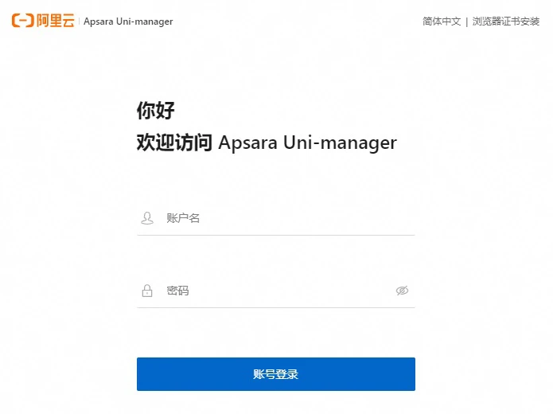

   > **说明**
   >
   > 您可以单击右上角的当前语言切换其它语言。当前支持简体中文、英文、繁体中文三种语言切换。

3. 输入正确的用户名及密码。

   > **说明**
   >
   > - 登录Apsara Uni-manager运维控制台的用户名和密码请从部署人员或管理员处获取。
   >
   > - 若连续输入密码错误三次，系统将启动图片验证码登录功能；若连续输入错误五次，账户将被锁定，请联系管理员进行激活。

   首次登录Apsara Uni-manager运维控制台时，需要修改登录用户名的密码，请按照提示完成密码修改。

   为提高安全性，密码必须满足以下要求：

   - 必须包含英文大小写字母。

   - 必须包含阿拉伯数字（0~9）。

   - 必须包含特殊符号，包括感叹号（!）、at（@）、井号（#）、美元符号（$）、百分号（%）等。

   - 密码长度为10~20个字符。

4. 单击**账号登录**。

# 2.网络产品

## 2.1. SLB运维

### 2.1.1. SLB集群管理

通过设置SLB集群标签，方便用户在租户控制台中选择对应集群，提高SLB集群的易用性。

**操作步骤**

1. 登录Apsara Uni-manager运维控制台。

2. 在顶部菜单栏，选择**产品运维** > **网络运维** > **网络运维控制台**。

3. 在左侧导航栏，选择**网络产品** > **SLB 运维** > **SLB集群管理**。

4. 在**SLB集群管理**页面，选择可用区，单击**搜索**，查看需要的集群信息。

   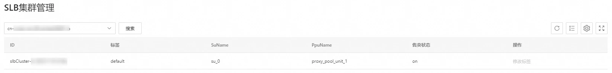

5. 在目标集群**操作**列，单击**修改标签**，在弹出的对话框中，修改标签名称，然后单击**确认**。

   > **说明**
   >
   > 默认集群不支持修改。

### 2.1.2. SLB管理

SLB管理页面从集群和实例两个方面展示了SLB四层的服务资源与监控运维信息。

**前提条件**

产品BaseServiceAll的NetworkBaseServiceCluster集群已部署且已到终态。

**SLB集群**

在SLB集群页面查看集群内单设备节点的基本信息、bps、pps、活跃连接数、非活跃连接数及水位情况。

**操作步骤**

1. 登录Apsara Uni-manager运维控制台。

2. 在顶部菜单栏，选择**产品运维** > **网络运维** > **网络运维控制台**。

3. 在左侧导航栏，选择**网络产品** > **SLB 运维** > **SLB管理**。

4. 在**SLB管理**页面，单击**SLB集群**页签，选择需要查看的**集群**，系统将显示当前集群中的设备**节点信息**和**集群水位数据**。

   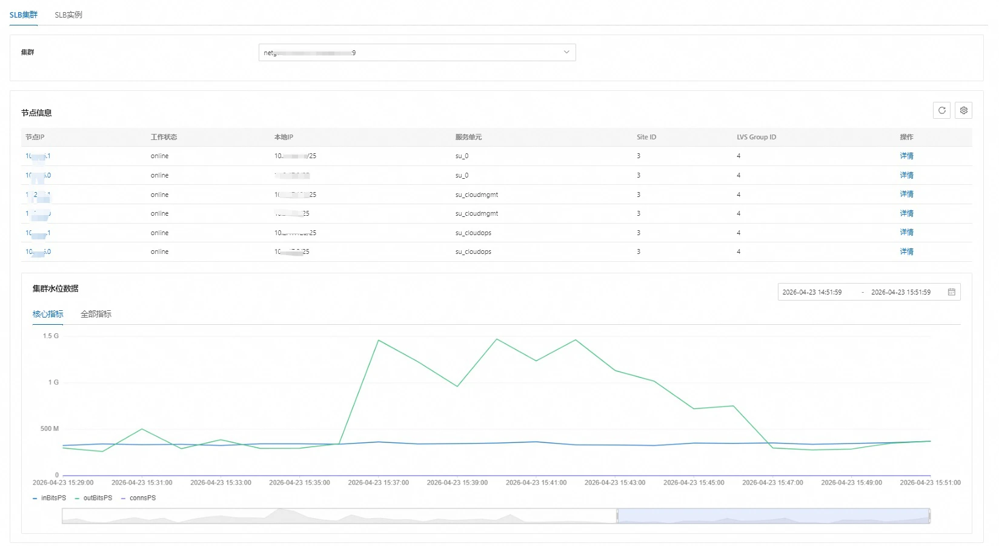

   - 在**节点信息**区域，查看节点列表信息，包括**节点IP**、**工作状态**、**本地IP**、**服务单元**、**Site ID**和**LVS Group ID**。

     **查看节点详情**：在目标设备节点**操作**列，单击**详情**，进入**SLB节点详情**页面，获取**节点信息**和**水位数据**。

     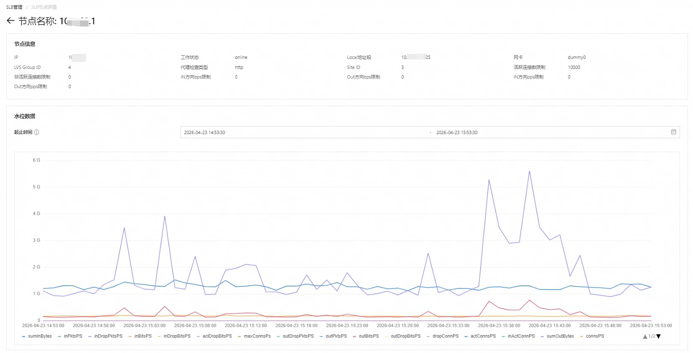

     - **节点信息**：包括**IP**、**工作状态**、**Local地址段**、**网卡**、**LVS Group ID**、**代理检查类型**、**Site ID**、**活跃连接数限制**、**非活跃连接数限制**、**IN方向bps限制**、**Out方向bps限制**、**IN方向pps限制**、**Out方向pps限制**等。

     - **水位数据**：选择**起止时间**，查看该节点在指定时间范围内的运行水位图。各指标数据含义请参考节点/实例水位数据指标说明。

       > **说明**
       >
       > - 起始时间与结束时间的范围不得超过12小时。
       >
       > - 单击**最近5分钟**、**最近30分钟**、**最近1小时**、**最近6小时**可以快速查询对应时间范围内的水位数据信息。
       >
       > - 将鼠标悬停于图中任意一个时间节点，系统会显示该时间节点的所有指标的数值。

   - 在**集群水位数据**区域，选择起止时间，查看集群在目标时间范围内的运行水位图。包括**核心指标**和**全部指标**。各指标数据含义请参考集群水位数据指标说明。

     > **说明**
     >
     > - 起始时间与结束时间的范围不得超过12小时。
     >
     > - 单击**最近1小时**、**最近3小时**、**最近6小时**、**最近12小时**可以快速查询对应时间范围内的水位数据信息。
     >
     > - 将鼠标悬停于图中任意一个时间节点，系统会显示该时间节点的所有指标的数值。

**SLB实例**

在SLB实例页面查看实例的基本信息以及bps、pps的水位情况。

**操作步骤**

1. 登录Apsara Uni-manager运维控制台。

2. 在顶部菜单栏，选择**产品运维** > **网络运维** > **网络运维控制台**。

3. 在左侧导航栏，选择**网络产品** > **SLB 运维** > **SLB管理**。

4. 在**SLB管理**页面，单击**SLB实例**页签，可以查看SLB实例列表信息，包括**IP地址**、**实例ID**、**网络类型**、**产品**、**所属AZone**以及**更新时间**。

   单击**高级筛选**，可以根据**IP版本**、**IP地址**、**实例 ID**、**产品名称**以及**网络类型**组合搜索获取目标SLB实例。

   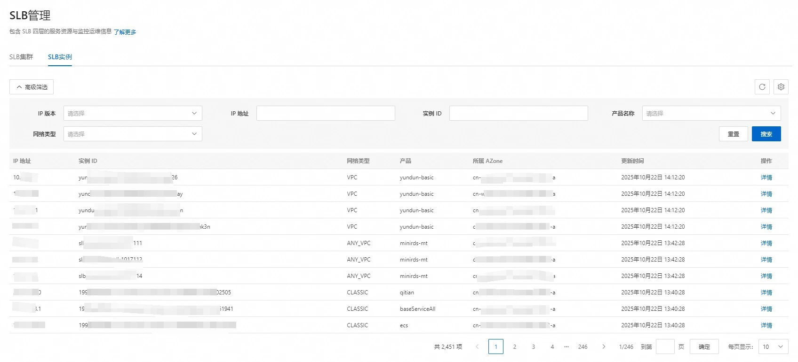

5. 在目标SLB实例**操作**列，单击**详情**，进入**SLB实例详情**页面。可以查看**实例信息**、**服务器组信息**和**水位数据**。

   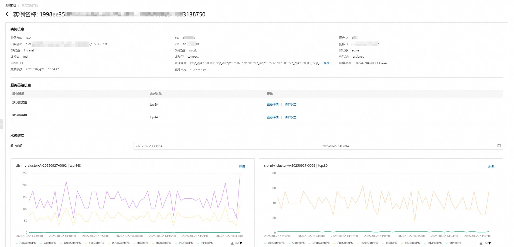

   - 在**实例信息**区域，查看SLB实例的基本信息，供运维工程师在出现故障时进行排障和确认设备归属。

     单击**限速规则**右侧**修改**，可以更改当前SLB实例的限速规则。限速规则的参数设置依赖**SLB实例开关**的状态，具体请参考<strong>《专有云运维平台 平台操作指南》</strong>中**UniConsole管控研发平台 > 产品控制台配置管理**章节的**开关列表（开关管理）**，查看**networkops**控制台的开关列表。

     - 当SLB实例开关**开启**时，支持修改如下限速值：

       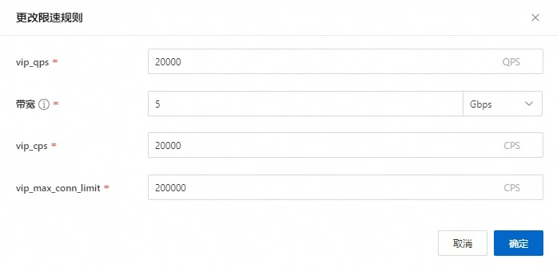

     - 当SLB实例开关**关闭**时，仅支持修改带宽值：

       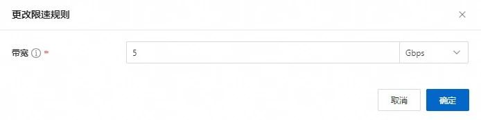

     > **说明**
     >
     > 实例限速值设置上限如下所示：
     >
     > - vip_qps：最大值50000QPS。
     >
     > - 带宽：最大值15Gbps（实际限速值以B为单位，会进行向上取整处理）。
     >
     > - vip_cps：最大值100000CPS。
     >
     > - vip_max_conn_limit：最大值1000000CPS。

   - 在**服务器组信息**区域，查看SLB实例的服务器组信息，包括**服务器组**、**监听名称**等。

     - 查看权重调整详情：单击目标服务器组**操作**列的**查看详情**，获取对应服务器组权重调整详情。

       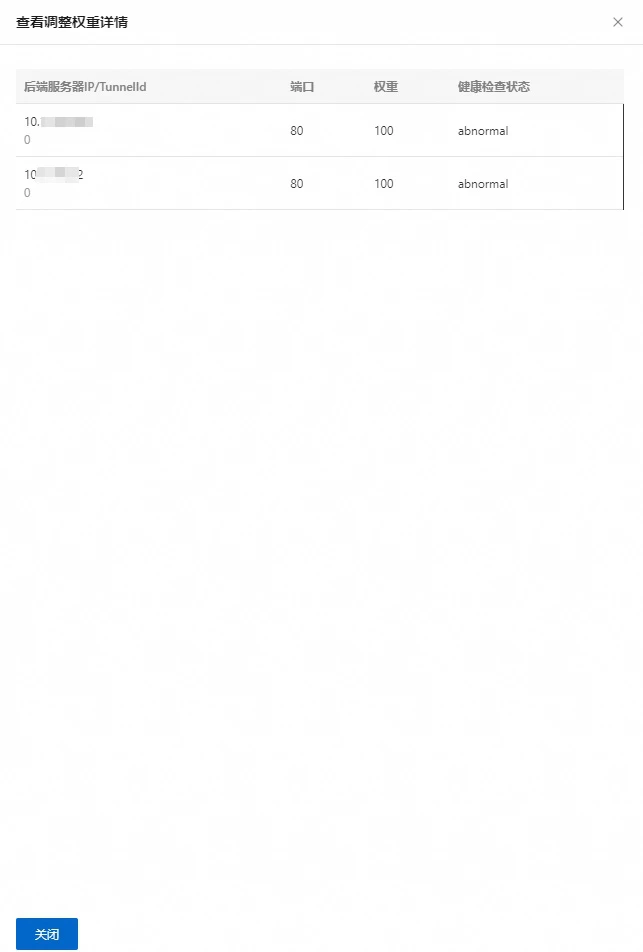

     - 调整权重

       <ol type="a">

       <li>

       单击目标服务器组**操作**列的**调节权重**，在弹出的面板中，修改**权重**列数据，然后单击**确定**。

       </li>

       <li>

       在弹出的对话框中，确认提示内容，单击**确定**。

       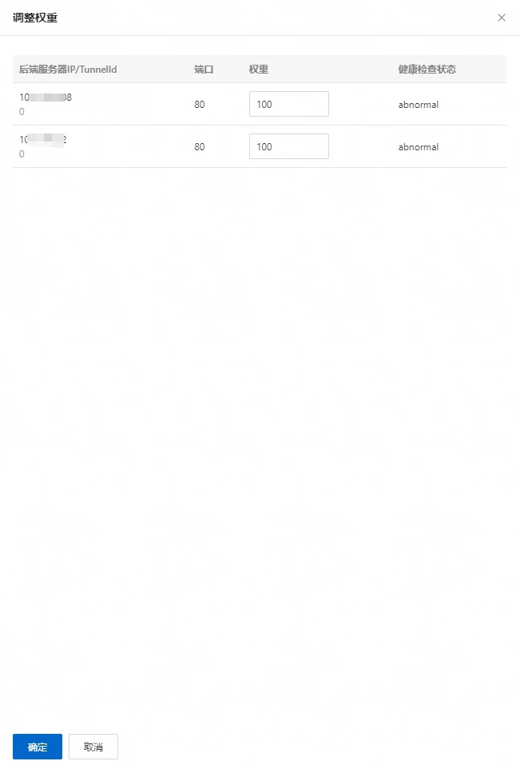

       </li>

       </ol>

       > **说明**
       >
       > - 在维修或应急场景后，尽量恢复权重设置，后续升级同城双机房容灾场景系统会恢复默认权重，确认后变更生效。
       >
       > - 租户侧开通的SLB，请到Apsara Uni-manager运营控制台（ASCM）进行调整。

   - 在**水位数据**区域，选择**起止时间**、**节点** ，查看SLB实例指定节点在指定时间内的运行水位图。各指标数据含义请参考节点/实例水位数据指标说明。

     > **说明**
     >
     > - 起始时间与结束时间的范围不得超过12小时。
     >
     > - 单击**最近5分钟**、**最近30分钟**、**最近1小时**、**最近6小时**可以快速查询对应时间范围内的水位数据信息。
     >
     > - 将鼠标悬停于图中任意一个时间节点，系统会显示该时间节点的所有指标的数值。

     查看水位详情：单击目标水位图右上角的**详情**，可以查看具体的RS水位详情。

     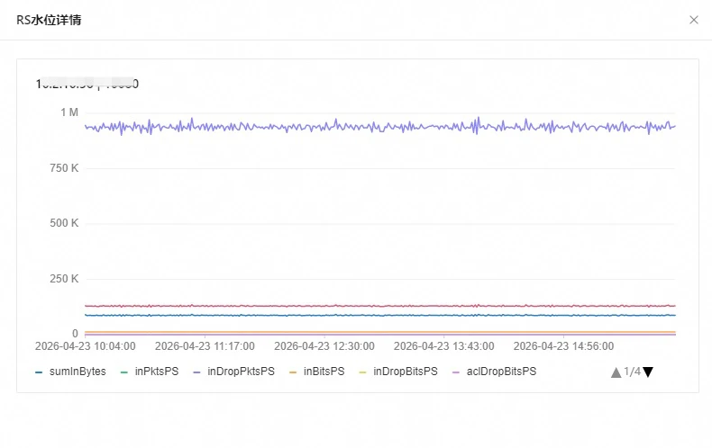

**AI诊断**

> **说明**
>
> 使用AI功能前，需确保云维小智产品已部署且已到达终态。

1. 在**SLB实例详情**页面，单击左上角**AI诊断**。

   

2. 通过智能诊断分析当前实例各检查项的状态详情，获取实例的详细信息，并根据诊断结果给出相关的评估建议。

   根据**产品**不同，AI诊断数据展示情况各有不同，具体以界面实际结果为准。

   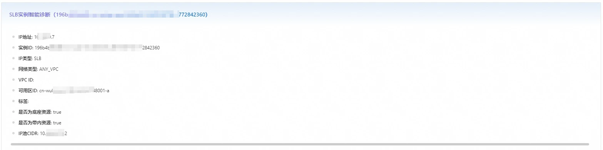

**集群水位数据指标说明**

**指标分类**

**指标**

**描述**

**示例**

每秒入bit数

**inBitsPS**

248

每秒出bit数

**核心指标**

**outBitsPS**

208

新建连接数

**connsPS**

1

入方向字节总数

**sumInBytes**

248

每秒入包数

**inPktsPS**

1

每秒入丢包数

**inDropPktsPS**

0

每秒入bit数

**inBitsPS**

248

每秒入丢弃bit数

**inDropBitsPS**

0

ACL每秒丢弃bit数

**aclDropBitsPS**

0

每秒并发连接数

**maxConnsPs**

1

每秒出丢包数

**outDropPktsPS**

0

每秒出包数

**outPktsPS**

1

**全部指标**

每秒出bit数

**outBitsPS**

208

每秒出丢弃bit数

**outDropBitsPS**

0

每秒丢弃连接数

**dropConnsPS**

0

活跃连接数

**actConnsPS**

0

非活跃连接数

**inActConnPS**

1

出方向字节总数

**sumOutBytes**

248

新建连接数

**connsPS**

1

ACL每秒丢弃包数

**aclDropPktsPS**

0

每秒失败连接数

**failConnPS**

0

**节点/实例水位数据指标说明**

| 指标 | 描述 | 示例 |
| --- | --- | --- |
| sumInBytes | 入方向字节总数 | 248 |
| inPktsPS | 每秒入包数 | 1 |
| inDropPktsPS | 每秒入丢包数 | 0 |
| inBitsPS | 每秒入bit数 | 248 |
| inDropBitsPS | 每秒入丢弃bit数 | 0 |
| aclDropBitsPS | ACL每秒丢弃bit数 | 0 |
| maxConnsPs | 每秒并发连接数 | 1 |
| outDropPktsPS | 每秒出丢包数 | 0 |
| outPktsPS | 每秒出包数 | 1 |
| outBitsPS | 每秒出bit数 | 208 |
| outDropBitsPS | 每秒出丢弃bit数 | 0 |
| dropConnPS | 每秒丢弃连接数 | 0 |
| actConnsPS | 活跃连接数 | 0 |
| inActConnPS | 非活跃连接数 | 1 |
| sumOutBytes | 出方向字节总数 | 248 |
| connsPS | 新建连接数 | 1 |
| aclDropPktsPS | ACL每秒丢弃包数 | 0 |
| failConnPS | 每秒失败连接数 | 0 |

## 2.2. Proxy运维

### 2.2.1. Proxy管理

Proxy管理包含SLB七层的服务资源与监控运维信息。

**Proxy集群**

查看SLB Proxy集群的节点状态、水位数据、集群聚合监控指标。

**操作步骤**

1. 登录Apsara Uni-manager运维控制台。

2. 在顶部菜单栏，选择**产品运维** > **网络运维** > **网络运维控制台**。

3. 在左侧导航栏，选择**网络产品** > **Proxy 运维** > **Proxy 管理**。

4. 在**Proxy 管理**页面，单击**Proxy 集群**页签，选择**集群**，查看目标集群的**节点信息**和**集群聚合监控**。

   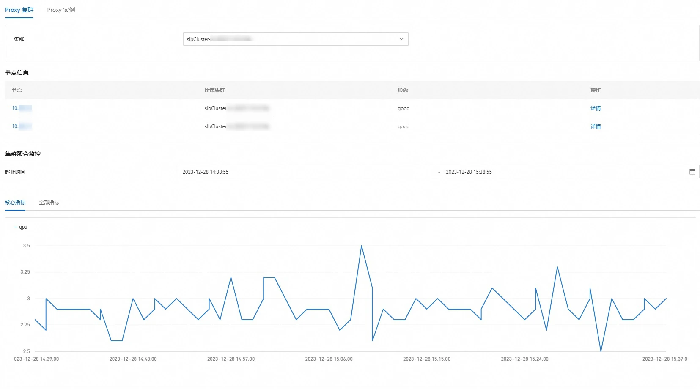

5. 在**节点信息**区域。

   - 查看节点列表：包括**节点**、**所属集群**和**形态**等。

   - 查看节点详情：单击目标节点名称或者**操作**列的**详情**，进入**SLB Proxy节点详情**页面，选择**起止时间**，查看节点的各项指标**水位数据**。

     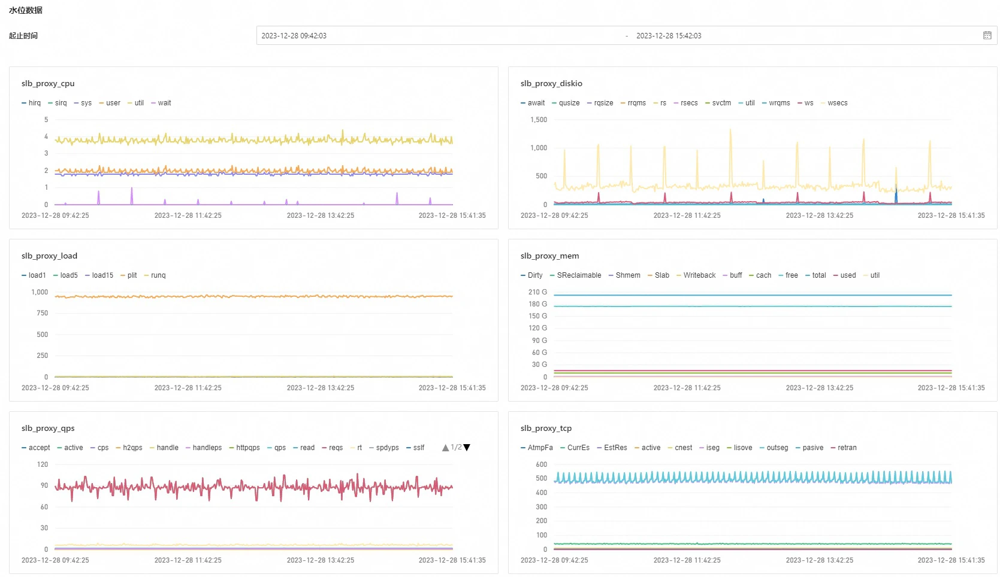

     > **说明**
     >
     > - 起始时间与结束时间的范围不得超过12小时。
     >
     > - 单击**最近5分钟**、**最近30分钟**、**最近1小时**、**最近6小时**快速查询对应时间范围内的水位数据信息。
     >
     > - 将鼠标悬停于图中任意一个时间节点，系统会显示该时间节点的所有指标的数值。

     相关指标含义如下表所示：

     **分类**

     **指标**

     **描述**

     系统处理硬中断的时间与总时间的百分比

     **hirq**

     系统处理软中断的时间与总时间的百分比

     **sirq**

     系统CPU占用率

     **sys**

     **slb_proxy_cpu**

     **user**

     CPU执行用户进程的时间与总时间的百分比

     CPU使用时间与总时间的百分比

     **util**

     CPU等待I/O操作完成的时间与总时间的百分比

     **wait**

     向要服务的设备发出I/O请求的平均时间（毫秒）

     **await**

     向设备发出的请求的平均队列长度（个）

     **qusize**

     向设备发出的请求的平均大小（以扇区为单位，个）

     **rqsize**

     每秒从设备读取的扇区数（个）

     **rrqms**

     每秒向设备发出的读取请求数（个）

     **rs**

     每秒从设备读取的扇区数（个）

     **rsecs**

     **slb_proxy_diskio**

     向设备发出I/O请求的平均服务时间（毫秒）

     **svctm**

     向设备发出I/O请求的CPU时间与CPU总时间的百分比（设备

     **util**

     的带宽利用率）

     每秒向设备发出的合并写入请求数（个）

     **wrqms**

     每秒向设备发出的写入请求数（个）

     **ws**

     每秒写入设备的扇区数（个）

     **wsecs**

     一分钟的系统平均负载（%）

     **load1**

     五分钟的系统平均负载（%）

     **load5**

     十五分钟的系统平均负载（%）

     **load15**

     **slb_proxy_load**

     在采样时刻，系统中活跃的任务（不包括运行已结束的任

     **plit**

     务）数（个）

     在采样时刻，运行队列的任务数（个）

     **runq**

     等待被写回到磁盘的数据大小（KB）

     **Dirty**

     可收回slab内存大小（KB）

     **SReclaimable**

     已经被分配的共享内存大小（KB）

     **Shmem**

     内核数据结构缓存大小（KB）

     **Slab**

     正在被写回的数据大小（KB）

     **Writeback**

     **slb_proxy_mem**

     buff使用的内存大小（KB）

     **buff**

     操作系统分配给文件缓冲区的内存大小（KB）

     **cach**

     空闲的物理内存大小（KB）

     **free**

     系统总的内存大小（KB）

     **total**

     已经使用的内存大小（KB）

     **used**

     内存使用率

     **util**

     总共接收的新TCP连接数（个）

     **accept**

     活跃的TCP连接数（个），等于read+write+wait。

     **active**

     每秒平均收到的TCP连接数（个）

     **cps**

     HTTP2 每秒处理请求数

     **h2qps**

     总共处理的TCP连接数（个）

     **handle**

     平均处理连接数

     **handleps**

     HTTP 每秒处理请求数

     **httpqps**

     每秒处理的请求数（个）

     **qps**

     读取请求数据的TCP连接数（个）

     **read**

     **slb_proxy_qps**

     总共产生请求数（个）

     **reqs**

     平均响应时间（毫秒）

     **rt**

     每秒处理的spdy请求数（个）

     **spdyps**

     SSL 连接失败数

     **sslf**

     平均SSL握手时间（毫秒）

     **sslhst**

     每秒处理的SSL请求数（个）

     **sslqps**

     SSLv3 连接失败数

     **sslv3f**

     长连接等待的TCP连接数（个）

     **wait**

     向用户写响应数据的TCP连接数（个）

     **write**

     每秒发起TCP连接失败的次数（个）

     **AtmpFa**

     当前TCP连接数（个）

     **CurrEs**

     每秒TCP连接被重置的次数（个）

     **EstRes**

     每秒主动发起TCP连接数（个）

     **active**

     **slb_proxy_tcp**

     每秒流入tcpsegment数（个）

     **iseg**

     由于listenaccept队列满导致被丢弃的TCP请求数（个）

     **lisove**

     每秒流出tcpsegment数（个）

     **outseg**

     每秒被动生成的TCP连接数（个）

     **pasive**

     根据重传segment和总的segment，计算出的重传率。

     **retran**

6. 在**集群聚合监控**区域，选择**起止时间**，分别在**核心指标**和**全部指标**页签中查看对应集群聚合监控指标。

   > **说明**
   >
   > - 起始时间与结束时间的范围不得超过12小时。
   >
   > - 将鼠标悬停于图中任意一个时间节点，系统会显示该时间节点的所有指标的数值。

   相关指标含义如下表所示：

   **页签**

   **名称**

   **描述**

   每秒处理的请求数（个）

   **核心指标**

   **qps**

   总共接收的新TCP连接数（个）

   **accept**

   活跃的TCP连接数（个），等于read+write+wait。

   **active**

   每秒平均收到的TCP连接数（个）

   **cps**

   HTTP2 每秒处理请求数

   **h2qps**

   总共处理的TCP连接数（个）

   **handle**

   平均处理连接数

   **handleps**

   HTTP 每秒处理请求数

   **httpqps**

   每秒处理的请求数（个）

   **qps**

   读取请求数据的TCP连接数（个）

   **read**

   **全部指标**

   总共产生请求数（个）

   **reqs**

   平均响应时间（毫秒）

   **rt**

   每秒处理的spdy请求数（个）

   **spdyps**

   SSL 连接失败数

   **sslf**

   平均SSL握手时间（毫秒）

   **sslhst**

   每秒处理的SSL请求数（个）

   **sslqps**

   SSLv3 连接失败数

   **sslv3f**

   长连接等待的TCP连接数（个）

   **wait**

   向用户写响应数据的TCP连接数（个）

   **write**

**Proxy实例**

查看SLB Proxy实例监控指标及水位图。

**前提条件**

产品BaseServiceAll的NetworkBaseServiceCluster集群已部署且已到终态。

**操作步骤**

1. 登录Apsara Uni-manager运维控制台。

2. 在顶部菜单栏，选择**产品运维** > **网络运维** > **网络运维控制台**。

3. 在左侧导航栏，选择**网络产品** > **Proxy 运维** > **Proxy 管理**。

4. 在**Proxy 管理**页面，单击**Proxy 实例**页签。

5. 选择**集群**，输入实例ID或VIP地址后选择**监听实例**，选择**起止时间**，单击**搜索**。

6. 单击**请求**、**连接**、**流量**、**时延**、**状态码**页签，分别查看对应指标项的水位图。

   相关指标含义如下表所示：

   <table>
     <tr>
       <td></td>
       <td>名称</td>
       <td>描述</td>
     </tr>
     <tr>
       <td rowspan="3">请求</td>
       <td>qps</td>
       <td>每秒平均收到的请求数量（个）</td>
     </tr>
     <tr>
       <td>req_concurrent</td>
       <td>当前并发请求数量（个）</td>
     </tr>
     <tr>
       <td>REQ_DROP</td>
       <td>因限速不转发的请求数量（个）</td>
     </tr>
     <tr>
       <td rowspan="2">连接</td>
       <td>conn_concurrent</td>
       <td>当前并发连接数量（个）</td>
     </tr>
     <tr>
       <td>cps</td>
       <td>每秒平均收到的连接数量（个）</td>
     </tr>
     <tr>
       <td rowspan="2">流量</td>
       <td>inBitsPS</td>
       <td>入流量（比特/秒）</td>
     </tr>
     <tr>
       <td>outBitsPS</td>
       <td>出流量（比特/秒）</td>
     </tr>
     <tr>
       <td rowspan="2">时延</td>
       <td>rt</td>
       <td>平均处理延时时间（毫秒）</td>
     </tr>
     <tr>
       <td>upstream_rt</td>
       <td>后端ECS平均处理延时时间（毫秒）</td>
     </tr>
     <tr>
       <td rowspan="7">状态码</td>
       <td>status_code_2xx</td>
       <td>返回2xx响应码的请求数量（个）</td>
     </tr>
     <tr>
       <td>status_code_3xx</td>
       <td>返回3xx响应码的请求数量（个）</td>
     </tr>
     <tr>
       <td>status_code_4xx</td>
       <td>返回4xx响应码的请求数量（个）</td>
     </tr>
     <tr>
       <td>status_code_5xx</td>
       <td>返回5xx响应码的请求数量（个）</td>
     </tr>
     <tr>
       <td>status_code_other</td>
       <td>返回其它响应码的请求数量（非2xx 3xx 4xx 5xx）（个）</td>
     </tr>
     <tr>
       <td>upstream_code_4xx</td>
       <td>后端ECS返回4xx响应码的请求数量（个）</td>
     </tr>
     <tr>
       <td>upstream_code_5xx</td>
       <td>后端ECS返回5xx响应码的请求数量（个）</td>
     </tr>
   </table>

### 2.2.2. ALB 管理

ALB 管理包含ALB服务资源与监控运维信息。

**ALB Proxy集群**

查看ALB Proxy集群的节点状态、水位数据、集群聚合监控指标。

**操作步骤**

1. 登录Apsara Uni-manager运维控制台。

2. 在顶部菜单栏，选择**产品运维** > **网络运维** > **网络运维控制台**。

3. 在左侧导航栏，选择**网络产品** > **Proxy运维** > **ALB 管理**。

4. 在**ALB Proxy集群**页签下，选择待查看的**集群**，可以查看集群**节点信息**和**集群聚合监控**。

   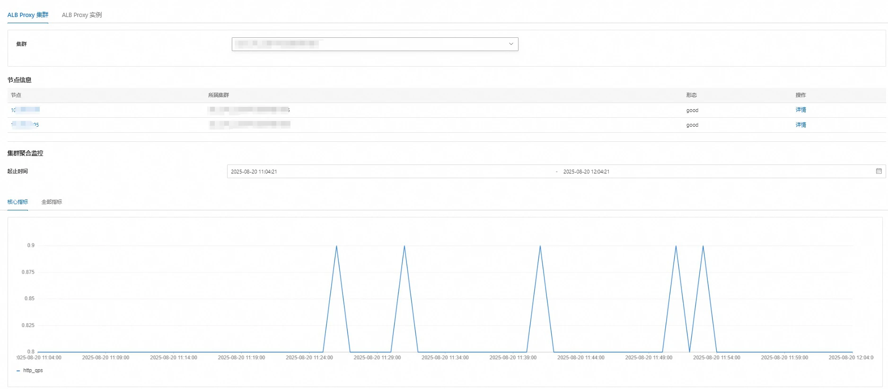

5. 在**节点信息**区域支持以下操作。

   - 查看节点列表：包括**节点**、**所属集群**和**形态**。

   - 查看节点详情：在目标节点的**操作**列，单击**详情**，进入节点详情页面；选择起止时间，可以查看节点的各项指标水位数据。默认显示最近1小时的数据。

     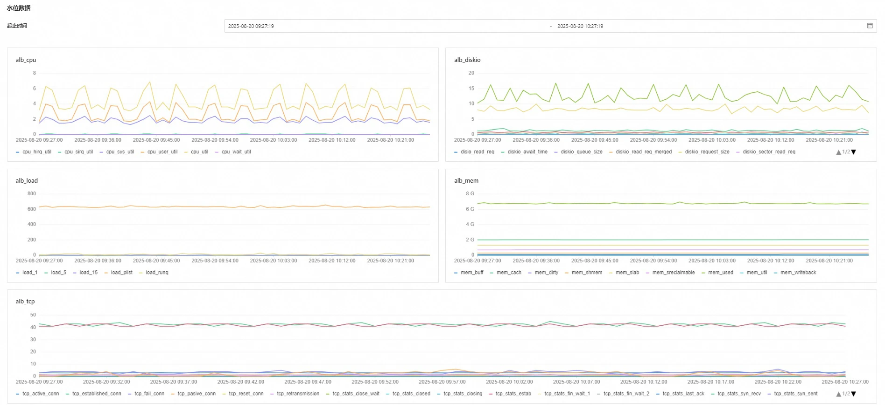

     > **说明**
     >
     > - 起始时间与结束时间的范围不得超过12小时。
     >
     > - 单击起止时间，选择**最近5分钟**、**最近30分钟**、**最近1小时**、**最近6小时**可以快速查询对应时间范围内的水位数据信息。
     >
     > - 将鼠标悬停于图中任意一个时间节点，系统会显示该时间节点的所有指标的数值。

     相关指标含义如下表所示。

     **分类**

     **指标**

     **描述**

     系统处理硬中断的时间与总时间的百分比

     **cpu_hirq_util**

     系统处理软中断的时间与总时间的百分比

     **cpu_sirq_util**

     系统内容运行时间与总时间的百分比

     **cpu_sys_util**

     **alb_cpu**

     CPU执行用户进程的时间与总时间的百分比

     **cpu_user_util**

     CPU使用时间与总时间的百分比

     **cpu_util**

     CPU等待I/O操作完成的时间与总时间的百分比

     **cpu_wait_util**

     每秒发送给设备的读取请求数（个）

     **diskio_read_req**

     向设备发出的I/O请求的平均时间（毫秒）

     **diskio_await_time**

     发给设备的请求的平均队列长度（个）

     **diskio_quese_size**

     **diskio_read_req_merge**

     每秒发送给设备的合并读取请求数（个）

     **d**

     发送给设备的请求的平均扇区内大小（个）

     **diskio_request_size**

     每秒从设备读取的扇区数（个）

     **diskio_sector_read_req**

     **alb_diskio**

     **diskio_sector_write_re**

     每秒从设备写入的扇区数（个）

     **q**

     发给设备的I/O请求的平均服务时间（毫秒）

     **diskio_service_time**

     在设备上发出I/O请求的CPU时间与CPU总时间的百分比

     **diskio_util**

     （设备的带宽利用率）

     每秒发送给设备的写入请求数（个）

     **diskio_write_req**

     **diskio_write_req_merg**

     每秒发送给设备的合并写入请求数（个）

     **ed**

     一分钟的系统平均负载（%）

     **load1**

     五分钟的系统平均负载（%）

     **load5**

     **alb_load**

     十五分钟的系统平均负载（%）

     **load15**

     在采样时刻，系统中活跃的任务（不包括运行已结束的

     **load_plist**

     任务）数（个）

     在采样时刻，运行队列的任务数（个）

     **load_runq**

     节点内存buff使用大小（KB）

     **mem_buff**

     节点内存缓冲使用大小（KB）

     **mem_cach**

     节点内存等待被写回到磁盘的大小（KB）

     **mem_dirty**

     节点内存已经被分配的共享内存（KB）

     **mem_shmem**

     节点内存内核数据结构缓存（KB）

     **alb_mem**

     **mem_slab**

     节点内存压力大可以reclaim的部分（KB）

     **mem_sreclaimable**

     节点内存已经使用内存大小（KB）

     **mem_used**

     节点内存使用率

     **mem_util**

     节点内存正在被写回的数据大小（KB）

     **mem_writeback**

     每秒主动发起TCP连接的次数（个）

     **tcp_active_conn**

     当前TCP连接数（个）

     **tcp_established_conn**

     每秒TCP发起但是失败的连接数目（个）

     **tcp_fail_conn**

     每秒被动生成的TCP连接的次数（个）

     **tcp_pasive_conn**

     每秒TCP连接被重置的次数（个）

     **tcp_reset_conn**

     根据重传segment和总的segment，计算出的TCP重传

     **tcp_retransmission**

     率

     TCP CLOSE_WAIT 状态数（个）

     **tcp_stats_close_wait**

     TCP CLOSED 状态数（个）

     **tcp_stats_closed**

     **alb_tcp**

     TCP CLOSING 状态数（个）

     **tcp_stats_closing**

     TCP ESTABLISH 状态数（个）

     **tcp_stats_estab**

     TCP FIN_WAIT_1 状态数（个）

     **tcp_stats_fin_wait_1**

     TCP FIN_WAIT_2 状态数（个）

     **tcp_stats_fin_wait_2**

     TCP LAST_ACK 状态数（个）

     **tcp_stats_last_ack**

     TCP SYN_RECV状态数（个）

     **tcp_stats_syn_recv**

     TCP SYN_SENT状态数（个）

     **tcp_stats_syn_sent**

     TCP TIME_WAIT 状态数（个）

     **tcp_stats_time_wait**

6. 在**集群聚合监控**区域，选择起止时间，可以分别在**核心指标**和**全部指标**页签中查看对应集群聚合监控指标数据。默认显示最近1小时的数据。

   > **说明**
   >
   > - 起始时间与结束时间的范围不得超过12小时。
   >
   > - 将鼠标悬停于图中任意一个时间节点，系统会显示该时间节点的所有指标的数值。

   相关指标含义如下表所示。

   **页签**

   **名称**

   **描述**

   HTTP 每秒处理请求数（个），等于qps-sslqps

   **核心指标**

   **http_qps**

   总共接收的新TCP连接数（个）

   **conn_accept_1m**

   活跃的TCP连接数（个），等于read+write+wait

   **conn_active_1m**

   总共处理的TCP连接数（个）

   **conn_handle_1m**

   读取请求头数据的TCP连接数（个）

   **conn_read_1m**

   长连接等待的TCP连接数（个）

   **conn_wait_1m**

   向用户发送响应数据的TCP连接数（个）

   **conn_write_1m**

   HTTP2 每秒处理请求数（个）

   **http2_qps**

   HTTP 每秒处理请求数（个），等于qps-sslqps

   **http_qps**

   **全部指标**

   总共处理的请求数（个）

   **requests_1m**

   **rt**

   平均响应时间（毫秒）

   每秒处理的spdy请求数（个）

   **spdy_ps**

   SSL 连接失败数（个）

   **ssl_failed_1m**

   **ssl_handshake_ti**

   平均SSL握手时间（毫秒）

   **me**

   每秒处理的SSL请求数（个）

   **ssl_qps**

   SSLv3 连接失败数（个）

   **sslv3_failed_1m**

   TLS 连接失败数（个）

   **tls_failed_1m**

**ALB Proxy实例**

查看ALB Proxy实例监控指标及水位图。

**前提条件**

产品BaseServiceAll的主干分支已部署且已到终态。

**操作步骤**

1. 登录Apsara Uni-manager运维控制台。

2. 在顶部菜单栏，选择**产品运维** > **网络运维** > **网络运维控制台**。

3. 在左侧导航栏，选择**网络产品** > **Proxy运维** > **ALB 管理**。

4. 在**ALB Proxy实例**页签下，选择**集群**，配置**请输入实例ID或VIP地址**，选择**监听实例**，然后单击**搜索**。

5. 分别单击**请求**、**连接**、**流量**、**时延**、**状态码**，查看对应指标项的水位图。

   相关指标含义如下表所示。

   <table>
     <tr>
       <td></td>
       <td>名称</td>
       <td>描述</td>
     </tr>
   </table>

   每秒平均收到的请求数量（个）

   **qps**

   **请求**

   当前并发请求数量（个）

   **req_concurrent**

   当前并发连接数量（个）

   **conn_concurrent**

   **连接**

   每秒平均收到的连接数量（个）

   **cps**

   接收字节流量（比特/秒）

   **in_bytes_1m**

   **流量**

   发送字节流量（比特/秒）

   **out_bytes_1m**

   平均处理延时时间（毫秒）

   **rt**

   **时延**

   后端ECS平均处理延时时间（毫秒）

   **upstream_rt**

   每秒响应码的请求数量（个）

   **100**

   每秒响应码的请求数量（个）

   **101**

   每秒响应码的请求数量（个）

   **200**

   每秒响应码的请求数量（个）

   **206**

   每秒响应码的请求数量（个）

   **301**

   每秒响应码的请求数量（个）

   **302**

   每秒响应码的请求数量（个）

   **304**

   每秒响应码的请求数量（个）

   **400**

   每秒响应码的请求数量（个）

   **403**

   每秒响应码的请求数量（个）

   **404**

   每秒响应码的请求数量（个）

   **416**

   每秒响应码的请求数量（个）

   **499**

   每秒响应码的请求数量（个）

   **500**

   每秒响应码的请求数量（个）

   **502**

   每秒响应码的请求数量（个）

   **503**

   每秒响应码的请求数量（个）

   **504**

   每秒响应码的请求数量（个）

   **508**

   每秒返回2xx响应码的请求数量（个）

   **status_code_2xx**

   每秒返回3xx响应码的请求数量（个）

   **status_code_3xx**

   每秒返回4xx响应码的请求数量（个）

   **status_code_4xx**

   每秒返回5xx响应码的请求数量（个）

   **status_code_5xx**

   **状态码**

   每秒返回其它响应码的请求数量（非2xx 3xx 4xx 5xx）

   **status_code_other**

   （个）

   每秒后端ECS返回4xx响应码的请求数量（个）

   **upstream_code_4xx**

   每秒后端ECS返回5xx响应码的请求数量（个）

   **upstream_code_5xx**

   每秒上游返回100响应码的请求数量（个）

   **upstream_100**

   每秒上游返回101响应码的请求数量（个）

   **upstream_101**

   每秒上游返回200响应码的请求数量（个）

   **upstream_200**

   每秒上游返回206响应码的请求数量（个）

   **upstream_206**

   每秒上游返回301响应码的请求数量（个）

   **upstream_301**

   每秒上游返回302响应码的请求数量（个）

   **upstream_302**

   每秒上游返回304响应码的请求数量（个）

   **upstream_304**

   每秒上游返回400响应码的请求数量（个）

   **upstream_400**

   每秒上游返回403响应码的请求数量（个）

   **upstream_403**

   每秒上游返回404响应码的请求数量（个）

   **upstream_404**

   每秒上游返回416响应码的请求数量（个）

   **upstream_416**

   每秒上游返回499响应码的请求数量（个）

   **upstream_499**

   每秒上游返回500响应码的请求数量（个）

   **upstream_500**

   每秒上游返回502响应码的请求数量（个）

   **upstream_502**

   每秒上游返回503响应码的请求数量（个）

   **upstream_503**

   每秒上游返回504响应码的请求数量（个）

   **upstream_504**

   每秒上游返回508响应码的请求数量（个）

   **upstream_508**

   每秒上游返回其他响应码的请求数量（个）

   **upstream_other_code**

# 3.网络资源

## 3.1. 云实例管理

云服务实例的生命周期管理，包括创建，删除以及状态查询。

**创建云服务实例**

1. 登录Apsara Uni-manager运维控制台。

2. 在顶部菜单栏，选择**产品运维** > **网络运维** > **网络运维控制台**。

3. 在左侧导航栏，选择**网络资源** > **云实例管理**。

4. 单击创建云服务实例 > **创建云服务实例**。

5. 在**创建VPC 云服务实例**步骤下，配置如下参数后单击**创建**。

   <table>
     <tr>
       <th width="178">参数</th>
       <th>参数说明</th>
     </tr>
     <tr>
       <td>RegionID</td>
       <td>实例的地域ID。</td>
     </tr>
     <tr>
       <td>云服务实例ID</td>
       <td>选择云产品实例的ID。</td>
     </tr>
     <tr>
       <td>Tunnel类型</td>
       <td>• <strong>singleTunnel</strong>：申请singleTunnel VIP后，使单个VPC内的ECS可以访问外部的云服务。 • <strong>anyTunnel</strong>：申请anyTunnel VIP后，所有VPC内的ECS都可访问该云服务。</td>
     </tr>
     <tr>
       <td>CloudInstance IP</td>
       <td>为该实例分配VIP。如果不指定，则系统自动分配一个VIP。</td>
     </tr>
     <tr>
       <td>Vswitch ID</td>
       <td>当<strong>Tunnel类型</strong>为<strong>singleTunnel</strong>时生效。需要访问外部云服务的ecs所在的VPC内的任意一个VSwitch ID。</td>
     </tr>
     <tr>
       <td>UID</td>
       <td>当<strong>Tunnel类型</strong>为<strong>singleTunnel</strong>时生效。VSwitch创建者的UID，Vswitch创建者不是API调用者的情况下必填。</td>
     </tr>
     <tr>
       <td>BID</td>
       <td>当<strong>Tunnel类型</strong>为<strong>singleTunnel</strong>时生效。VSwitch创建者的BID，Vswitch创建者不是API调用者的情况下必填。</td>
     </tr>
     <tr>
       <td>CIDR Type</td>
       <td>当<strong>Tunnel类型</strong>为<strong>anyTunnel</strong>时生效。 • <strong>link_local（普通云服务）</strong>：选择该CIDR类型后，ALB VIP需要从除过100.100.100.0/24以外的掩码分配anyTunnel地址。 • <strong>特殊inner（特殊服务：ECS META Server）服务</strong>：选择该CIDR类型后，ALB VIP需要从100.100.100.0/24掩码分配anyTunnel地址。</td>
     </tr>
   </table>

   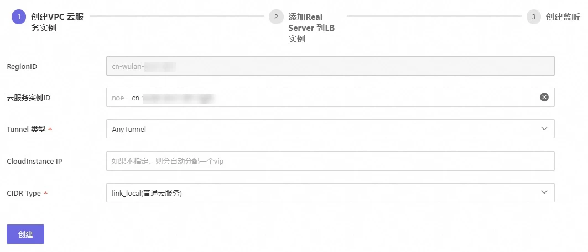

6. 在**添加Real Server到LB实例**步骤下，完成如下配置后单击**创建**。

   <table>
     <tr>
       <th width="87">参数</th>
       <th>参数说明</th>
     </tr>
     <tr>
       <td>VPC ID</td>
       <td>若要添加专有网络类型的ECS实例，则输入所属VPC的ID。</td>
     </tr>
     <tr>
       <td>RS列表</td>
       <td>展示要添加的后端服务器列表。单击<strong>添加RS机器</strong>，配置<strong>IP</strong>和<strong>weight</strong>。<strong>weight</strong>取值范围为0-1000，若留空，默认值为100。 说明单击目标RS机器对应<strong>操作</strong>列的<strong>删除</strong>，可以删除RS机器。</td>
     </tr>
   </table>

   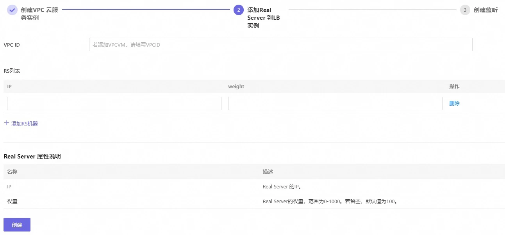

7. 在**创建监听**步骤下，配置如下参数后单击**创建**。

   | 参数 | 参数说明 |
   | --- | --- |
   | 协议 | 选择监听协议。 • Tcp • Udp |
   | 前端端口 | 输入VIP的前端端口。 |
   | 后端端口 | 输入Real Server的服务端口。 |
   | 配置 | 单击<strong>配置</strong>，配置轮询策略、健康检查等。 |
   | 删除 | 单击<strong>删除</strong>，可以删除监听配置。 |

   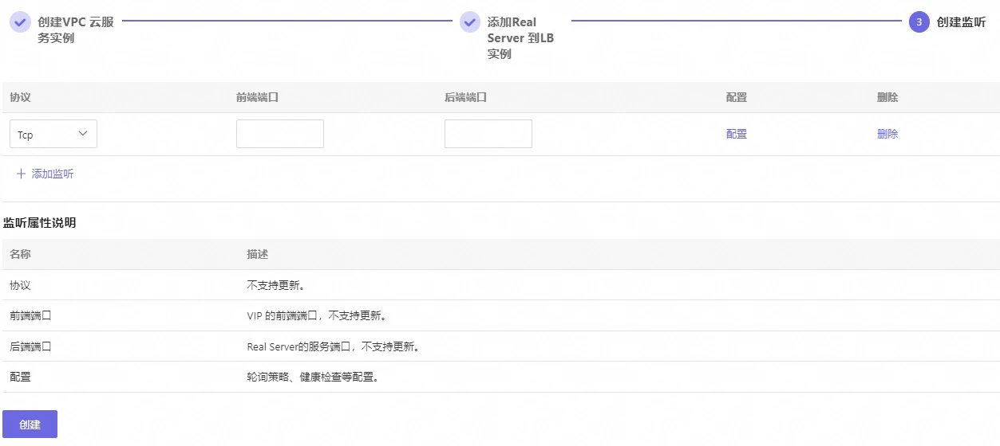

8. 返回至云服务实例列表，当出现**Tunnel类型**为**AnyTunnel**或**SingleTunnel**的实例时，表示云服务实例创建完成。

**创建Direct Any Tunnel**

1. 单击**创建云服务实例** > **创建Direct Any Tunnel**。

2. 配置如下参数后单击**创建**。

   <table>
     <tr>
       <th width="178">参数</th>
       <th>参数说明</th>
     </tr>
     <tr>
       <td>RegionID</td>
       <td>实例的地域ID。</td>
     </tr>
     <tr>
       <td>云服务实例ID</td>
       <td>选择云产品实例的ID。</td>
     </tr>
     <tr>
       <td>Tunnel类型</td>
       <td><strong>Direct Any Tunnel</strong>：申请Direct Any Tunnel VIP后，所有VPC内的ECS实例都可以通过申请的VIP访问该云服务。</td>
     </tr>
     <tr>
       <td>CloudInstance IP</td>
       <td>为该实例分配VIP。如果不指定，则系统自动分配一个VIP。</td>
     </tr>
     <tr>
       <td>CIDR Type</td>
       <td>• <strong>link_local（普通云服务）</strong>：选择该CIDR类型后，Direct Any Tunnel VIP需要从除过100.100.100.0/24以外的掩码分配anyTunnel地址。 • <strong>特殊inner（特殊服务：ECS META Server）服务</strong>：选择该CIDR类型后，Direct Any Tunnel VIP需要从100.100.100.0/24掩码分配anyTunnel地址。</td>
     </tr>
   </table>

   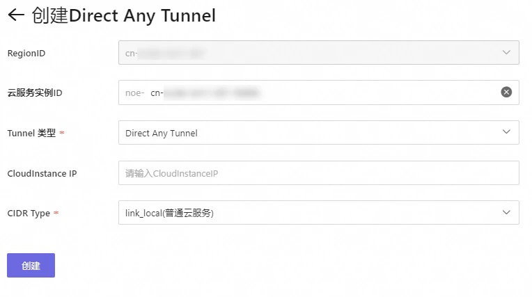

3. 返回至云服务实例列表，当出现**Tunnel类型**为**DirectAnyTunnel**的实例时，表示Direct Any Tunnel创建完成。

**存量资源纳管**

**前提条件**

未执行过存量资源纳管操作。

**操作步骤**

1. 单击云服务实例列表上方的**存量资源纳管**。

2. 等待刷新页面后，若出现非noe开头的云服务实例ID，则表示存量资源纳管成功。

   > **说明**
   >
   > - 存量资源纳管功能在所有资源成功处理后将被置灰，不再允许操作。
   >
   > - 若存在**Tunnel类型**为**InvalidResource**的实例时，则表示该实例为原平台异常资源（创建中止、无效资源等），纳管后只支持用户查看和删除，不支持管理（编辑RS、编辑监听）。

**相关操作**

<table>
  <tr>
    <th width="138">操作</th>
    <th>操作说明</th>
  </tr>
  <tr>
    <td>编辑RS</td>
    <td>说明<strong>Tunnel类型</strong>为<strong>InvalidResource</strong>的实例不支持编辑RS。 1. 单击目标云服务实例对应<strong>操作</strong>列的<strong>编辑RS</strong>。 2. 在弹出的对话框中编辑RS列表参数，修改完后单击<strong>确定</strong>。参数含义可参考步骤6。</td>
  </tr>
  <tr>
    <td>编辑监听</td>
    <td>说明<strong>Tunnel类型</strong>为<strong>InvalidResource</strong>的实例不支持编辑监听。 1. 单击目标云服务实例对应<strong>操作</strong>列的<strong>编辑监听</strong>。 2. 在弹出的对话框中编辑监听列表参数，修改完后单击<strong>确定</strong>。参数含义可参考步骤7。</td>
  </tr>
  <tr>
    <td>删除云服务实例</td>
    <td>1. 单击目标云服务实例对应<strong>操作</strong>列的<strong>删除</strong>。 2. 在弹出的对话框中单击<strong>确定</strong>。</td>
  </tr>
</table>
