阿里云  
专有云  
专有网络VPC  
运维指南  
产品版本：V3.18.6  
文档版本：20260528

**目录**

- [1.登录Apsara Uni-manager运维控制台](#section-1)
- [2.网络大盘](#section-2)
    - [2.1. 概览](#section-2-1)
    - [2.2. 网络拓扑](#section-2-2)
    - [2.3. 自定义视图](#section-2-3)
- [3.基础网络](#section-3)
    - [3.1. 网元管理](#section-3-1)
    - [3.2. SYSLOG日志](#section-3-2)
- [4.网络产品](#section-4)
    - [4.1. XGW运维](#section-4-1)
        - [4.1.1. XGW集群管理](#section-4-1-1)
        - [4.1.2. XGW管理](#section-4-1-2)
        - [4.1.3. NAT网关监控](#section-4-1-3)
        - [4.1.4. RI实例](#section-4-1-4)
    - [4.2. AVS运维](#section-4-2)
        - [4.2.1. AVS管理](#section-4-2-1)
    - [4.3. VPC运维](#section-4-3)
        - [4.3.1. 天宫VPC](#section-4-3-1)
        - [4.3.2. VPC工作流](#section-4-3-2)
- [5.网络监控告警](#section-5)
    - [5.1. 网络事件中心](#section-5-1)
    - [5.2. 网络事件配置](#section-5-2)
- [6.智能诊断](#section-6)
    - [6.1. 网络巡检](#section-6-1)
    - [6.2. 智能路径分析](#section-6-2)
        - [6.2.1. 抓包分析](#section-6-2-1)
        - [6.2.2. 拓扑分析](#section-6-2-2)
    - [6.3. 网络实例诊断](#section-6-3)
    - [6.4. 容器网络诊断](#section-6-4)
    - [6.5. 网络健康评估](#section-6-5)
    - [6.6. 光模块异常分析](#section-6-6)
    - [6.7. NOE ping](#section-6-7)
    - [6.8. 网络工具箱](#section-6-8)
        - [6.8.1. 工具列表](#section-6-8-1)
        - [6.8.2. 工具执行历史](#section-6-8-2)
- [7.网络资源](#section-7)
    - [7.1. 网络资产管理](#section-7-1)
    - [7.2. IP地址池管理](#section-7-2)
        - [7.2.1. IP地址池](#section-7-2-1)
        - [7.2.2. 采集设置](#section-7-2-2)
    - [7.3. 反向访问](#section-7-3)
    - [7.4. 云实例管理](#section-7-4)
- [8.网络变更](#section-8)
    - [8.1. 变更方案](#section-8-1)
        - [8.1.1. 变更方案列表](#section-8-1-1)
        - [8.1.2. 方案执行历史](#section-8-1-2)
    - [8.2. 功能编排](#section-8-2)
        - [8.2.1. IPv6大盘](#section-8-2-1)
- [9.平台管理](#section-9)
    - [9.1. 日志管理](#section-9-1)
        - [9.1.1. 日志查询](#section-9-1-1)
    - [9.2. 指标管理](#section-9-2)
        - [9.2.1. TSDB 集群](#section-9-2-1)
- [10.附录](#section-10)
    - [10.1. VPC修改私网Cidr方案](#section-10-1)
    - [10.2. 【VPC】ASCM白屏新增IDC侧物理专线并网方案](#section-10-2)
    - [10.3. 【VPC】ASCM白屏复用物理专线新建VBR并网方案](#section-10-3)
    - [10.4. 【VPC】ASCM白屏存量专线新增路由并网方案](#section-10-4)
    - [10.5. 【VPC】专有云V3环境中如何扩容anytunnel_cidr网段](#section-10-5)

<a id="section-1"></a>

# 1.登录Apsara Uni-manager运维控制台

本文介绍运维工程师等相关用户如何登录到Apsara Uni-manager运维控制台。

**前提条件**

- 已从部署人员或管理员处获取Apsara Uni-manager运维控制台的访问地址、用户名和密码。

  Apsara Uni-manager运维控制台访问地址格式为*region-id*.ops.console.*intranet-domain-id*。

- 推荐使用Chrome浏览器。

**操作步骤**

1. 打开浏览器。

2. 在地址栏中，输入Apsara Uni-manager运维控制台的访问地址，按回车键。

   

   > **说明**
   >
   > 您可以单击右上角的当前语言切换其它语言。当前支持简体中文、英文、繁体中文三种语言切换。

3. 输入正确的用户名及密码。

   > **说明**
   >
   > - 登录Apsara Uni-manager运维控制台的用户名和密码请从部署人员或管理员处获取。
   >
   > - 若连续输入密码错误三次，系统将启动图片验证码登录功能；若连续输入错误五次，账户将被锁定，请联系管理员进行激活。

   首次登录Apsara Uni-manager运维控制台时，需要修改登录用户名的密码，请按照提示完成密码修改。

   为提高安全性，密码必须满足以下要求：

   - 必须包含英文大小写字母。

   - 必须包含阿拉伯数字（0~9）。

   - 必须包含特殊符号，包括感叹号（!）、at（@）、井号（#）、美元符号（$）、百分号（%）等。

   - 密码长度为10~20个字符。

4. 单击**账号登录**。

<a id="section-2"></a>

# 2.网络大盘

<a id="section-2-1"></a>

## 2.1. 概览

网络大盘概览展示网络产品的核心指标，帮助用户及时掌控产品及设备状态。

**操作步骤**

1. 登录Apsara Uni-manager运维控制台。

2. 在顶部菜单栏，选择**产品运维** > **网络运维** > **网络运维控制台**。

3. 在左侧导航栏，选择**网络大盘** > **概览**。

4. 在**概览**页面，查看网络大盘信息。

   - **告警水位概览**

     <table>
       <tr>
         <th width="89">区域</th>
         <th>描述</th>
       </tr>
       <tr>
         <td>告警概览</td>
         <td>• <strong>告警分布</strong>：展示网络设备产生告警的总数量以及告警事件来源类型分布情况。<br>• <strong>告警列表</strong>：默认展示网络事件中心<strong>P1</strong>、<strong>P2</strong>等级的告警信息列表。包括<strong>名称/事件</strong><strong>code</strong>、<strong>描述</strong>、<strong>告警关联对象、来源类型</strong>、<strong>告警来源</strong>、<strong>告警类型</strong>、<strong>告警等级</strong>、<strong>告警</strong><strong>次数</strong>、<strong>是否恢复</strong>、<strong>发生时间</strong>、<strong>恢复时间</strong>、<strong>自动恢复事件周期</strong>、<strong>自动恢复时间</strong>等。单击右上角<strong>查看详情</strong>，支持在弹出框中查看<strong>告警列表</strong>。<br>• <strong>高级筛选</strong>：支持根据<strong>名称</strong>、<strong>告警关联对象、告警等级</strong>、<strong>来源类型、告警来</strong><strong>源、关联事件CODE</strong>组合筛选，进行精准查找。<br>• 单击目标告警<strong>详情</strong>列的<strong>详情</strong>，在<strong>事件详情</strong>弹出框中，可以查看对应告警的详细信息。</td>
       </tr>
     </table>

     <table>
       <tr>
         <td>端口概览</td>
         <td>• <strong>端口使用率</strong>：展示各类型网络设备的端口使用率。单击右上角<strong>查看详情</strong>，支持在弹出框中查看<strong>端口使用率详情</strong>。包括<strong>设备角色</strong>、<strong>设</strong><strong>备名称</strong>、<strong>IP地址</strong>、<strong>使用率</strong>、<strong>设备状态</strong>、<strong>端口总计</strong>和<strong>已使用</strong>。<br>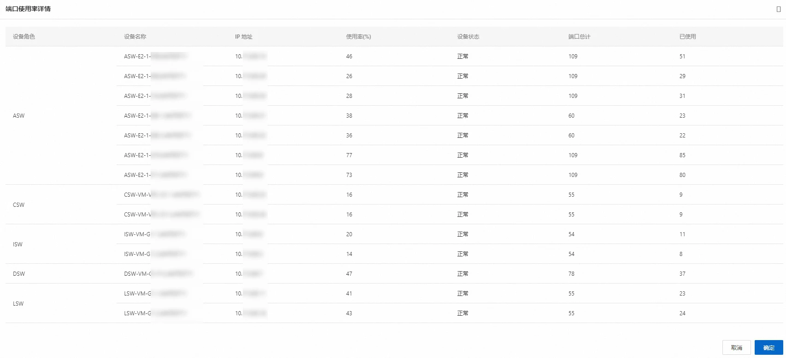<br>• <strong>光模块健康比例分布：</strong>展示系统中光模块在当天的状态分布情况。<br>• <strong>异常光模块列表</strong>：默认展示<strong>异常</strong>状态的光模块列表。包括<strong>主机名</strong>、<strong>接口名称</strong>、<strong>归</strong><strong>属类型</strong>、<strong>厂商</strong>、<strong>型号</strong>、<strong>状态</strong>、<strong>故障概率</strong>、<strong>预期剩余寿命</strong>、<strong>智能分析结果</strong>等。单击右上角<strong>查看详情</strong>，支持在弹出框中查看<strong>异常光模块列表</strong>。<br>• <strong>高级筛选</strong>：支持根据<strong>光模块型号</strong>、<strong>光模块厂商、光模块状态、主机名</strong>、<strong>接口名</strong><strong>称</strong>、<strong>所属设备类型</strong>组合筛选，进行精准查找。<br>• 单击目标光模块<strong>操作</strong>列的<strong>详情</strong>，跳转至<strong>智能诊断</strong> &gt; <strong>光模块异常分析</strong>，在<strong>光模块</strong><strong>预测详情</strong>页面可以查看对应光模块的详细信息。具体操作，可参考光模块异常分析。</td>
       </tr>
       <tr>
         <td>流量大盘</td>
         <td>默认展示<strong>最近1小时内</strong>的<strong>SLB 集群水位总览</strong>和<strong>XGW 集群水位总览</strong>。具体指标，请参考流量大盘水位指标说明。<br>• 单击<strong>最近1小时</strong>、<strong>最近6小时</strong>、<strong>最近12小时</strong>、<strong>最近24小时</strong>可以快速查询对应时间范围内SLB集群和XGW集群的历史收发水位趋势图。<br>• 单击右上角选择目标产品的集群，可以查看对应产品集群中的水位情况。</td>
       </tr>
     </table>

     **流量大盘水位指标说明**

     <table>
       <tr>
         <td></td>
         <td>指标</td>
         <td>描述</td>
       </tr>
       <tr>
         <td rowspan="2">SLB集群</td>
         <td>InBitsPS</td>
         <td>每秒入bit数</td>
       </tr>
       <tr>
         <td>OutBitsPS</td>
         <td>每秒出bit数</td>
       </tr>
       <tr>
         <td rowspan="2">XGW集群</td>
         <td>InByteRate</td>
         <td>入方向字节速率（比特/秒）</td>
       </tr>
       <tr>
         <td>OutByteRate</td>
         <td>出方向字节速率（比特/秒）</td>
       </tr>
     </table>

     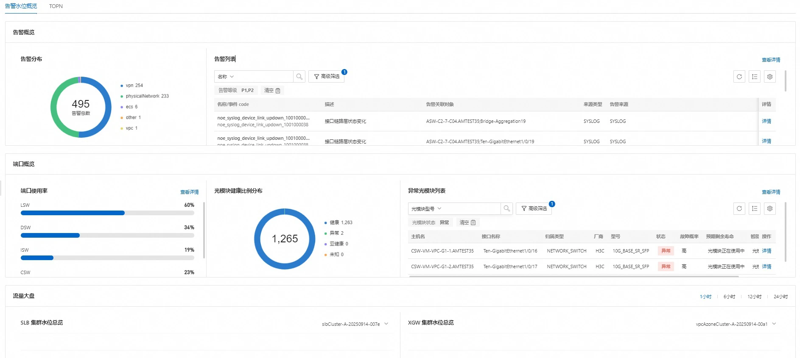

   - **TOPN**：按照数量**值**排序，默认展示各项数据的top5指标。

     支持各区域根据topn个数、起止时间、交换机、端口等条件筛选展示目标指标数据。

     <table>
       <tr>
         <th width="89">区域</th>
         <th>数据项目</th>
       </tr>
       <tr>
         <td>物理网络</td>
         <td>• 交换机 CPU<br>• 交换机内存<br>• 交换机端口<br>• <strong>交换机端口带宽</strong>（入方向、出方向）<br>• <strong>交换机端口包速率</strong>（入方向、出方向）<br>• <strong>交换机端口错包</strong>（包含入方向、出方向的CRC校验错包数据）<br>• <strong>交换机端口丢包</strong>（入方向、出方向）</td>
       </tr>
     </table>

     | 网元设备 | • XGW<br>• XGW CPU 使用率<br>• XGW 大页内存使用率<br>• <strong>XGW 端口带宽</strong>（入方向、出方向）<br>• <strong>XGW 端口包速率</strong>（入方向、出方向）<br>• <strong>XGW 端口丢包率</strong>（入方向、出方向）<br>• LVS<br>• LVS 新建连接数<br>• LVS 关闭连接数<br>• LVS 失败连接数<br>• LVS 并发连接数<br>• <strong>LVS 带宽</strong>（入方向、出方向）<br>• <strong>LVS 包速率</strong>（入方向、出方向）<br>• <strong>LVS 丢包</strong>（入方向、出方向）<br>• SLB_PROXY<br>• PROXY 请求数<br>• PROXY qps<br>• PROXY 平均响应时间<br>• PROXY 接收连接数<br>• PROXY 处理连接数<br>• PROXY 并发连接数<br>• AVS<br>• AVS CPU 使用率<br>• AVS 入方向丢包<br>• AVS 入方向缓冲丢包<br>• AVS 新建连接数<br>• AVS 并发连接数<br>• <strong>AVS 带宽</strong>（入方向、出方向）<br>• <strong>AVS 包速率</strong>（入方向、出方向）<br>• <strong>AVS 错包</strong>（入方向、出方向） |
     | --- | --- |

     | 网络资源 | • EIP<br>• <strong>EIP 带宽</strong>（入方向、出方向）<br>• <strong>EIP 包速率</strong>（入方向、出方向）<br>• 反向访问<br>• <strong>反向访问带宽</strong>（入方向、出方向）<br>• <strong>反向访问包速率</strong>（入方向、出方向）<br>• <strong>反向访问限速丢包</strong>（入方向、出方向）<br>• <strong>反向访问丢包</strong>（入方向、出方向）<br>• NATGW<br>• NATGW 并发连接数<br>• NATGW 丢弃连接数<br>• NATGW 限速丢弃连接数<br>• vlink<br>• <strong>VLINK 带宽</strong>（入方向、出方向）<br>• <strong>VLINK 包速率</strong>（入方向、出方向）<br>• 4层VIP<br>• <strong>SLB 监听新建连接数</strong>/<strong>SLB 后端新建连接数</strong><br>• <strong>SLB 监听丢弃连接数</strong>/<strong>SLB 后端丢弃连接数</strong><br>• <strong>SLB 监听并发连接数</strong>/<strong>SLB 后端并发连接数</strong><br>• <strong>SLB 监听包速率</strong>（入方向、出方向）/<strong>SLB 后端包速率</strong>（入方向、出方向）<br>• <strong>SLB 监听带宽</strong>（入方向、出方向）/<strong>SLB 后端带宽</strong>（入方向、出方向）<br>• <strong>SLB 监听丢包</strong>（入方向、出方向）/<strong>SLB 后端丢包</strong>（入方向、出方向）<br>• 7层VIP<br>• PROXY 监听新建连接数<br>• PROXY 监听每秒请求数<br>• PROXY 监听处理延迟<br>• PROXY 监听并发连接数<br>• vport<br>• AVS vport 新建连接数<br>• AVS vport 并发连接数<br>• <strong>AVS vport 包速率</strong>（入方向、出方向）<br>• <strong>AVS vport 带宽</strong>（入方向、出方向）<br>• <strong>AVS vport 丢包</strong>（入方向、出方向） |
     | --- | --- |

<a id="section-2-2"></a>

## 2.2. 网络拓扑

通过此功能可以查看物理网络的拓扑关系。

**前提条件**

产品BaseServiceAll的NetworkBaseServiceCluster集群已部署且已到终态。

**操作步骤**

1. 登录Apsara Uni-manager运维控制台。

2. 在顶部菜单栏，选择**产品运维** > **网络运维** > **网络运维控制台**。

3. 在左侧导航栏，选择**网络大盘** > **网络拓扑**。

4. 在**网络拓扑**页面，选择**机房**，查看目标物理机房的物理网络拓扑结构图。

   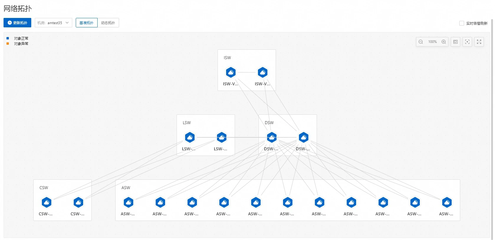

   - 网络设备的颜色代表设备的状态。

     - 蓝色：表示对象正常。

     - 橙色：表示对象异常。

   - 单击**基准拓扑**或**动态拓扑**可以查看对应类型的网络拓扑图。

     当选择**基准拓扑**时，在页面右上角可以开启或关闭**实时告警刷新**功能。**动态拓扑**不支持**实时告警刷新**功能。

     > **说明**
     >
     > 关闭实时告警刷新功能后，如果后续产生新的告警，拓扑图上的设备或链路状态将不再更新。

   - 单击**更新拓扑**可以更新拓扑的偏移量。

     

5. 通过网络拓扑图，可以查看网络设备信息和互联链路状态。

   - 单击目标网络设备图标，在弹出框中查看对应设备的**网络设备信息**，包括**设备基本信息**和**告警列表**。

     鼠标悬浮在目标告警**告警详情**列的**详情**上，可以查看对应告警的详细信息。

     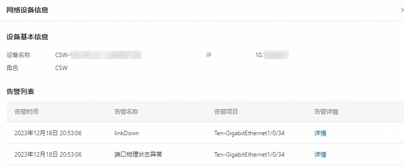

   - 单击目标网络设备间的链路，在弹出框中查看对应设备间的**互联链路状态**，包括**链路信息列表**和**告警列表**。

     鼠标悬浮在目标告警**告警详情**列的**详情**上，可以查看对应告警的详细信息。

     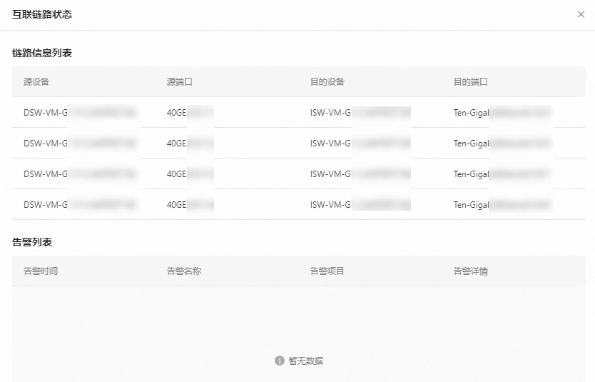

<a id="section-2-3"></a>

## 2.3. 自定义视图

通过此功能可以新建自定义视图，按需设置视图的展示内容和规则，集中汇总并展示感兴趣的监控数据和图表信息。

**前提条件**

产品BaseServiceAll的NetworkBaseServiceCluster集群已部署且已到终态。

**操作步骤**

1. 登录Apsara Uni-manager运维控制台。

2. 在顶部菜单栏，选择**产品运维** > **网络运维** > **网络运维控制台**。

3. 在左侧导航栏，选择**网络大盘** > **自定义视图**。

4. 在**自定义视图**页面，单击**新建视图**。

5. 在弹出的对话框中，输入**视图名称**及**视图描述**，单击**确定**。

   

   > **说明**
   >
   > **视图名称**具有唯一性，若提示数据已存在，请修改视图名称再新建。

6. 新建完成后，通过选择视图名称和起止时间，可以获取目标自定义视图及其在对应时间范围内的子视图监控数据图表。

   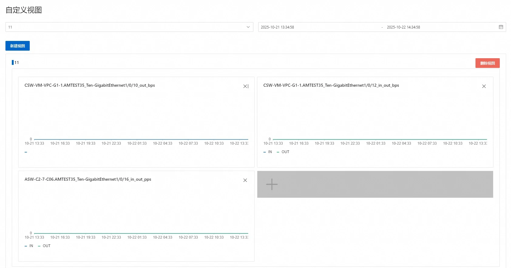

   - **新建子视图**

     <ol type="a">

     <li>

     单击目标视图下方的  图标。

     </li>

     <li>

     在弹出的面板中，根据如下内容完成配置，然后单击**确定**。

     <table>
       <tr>
         <th width="89">配置参数</th>
         <th>参数说明</th>
       </tr>
       <tr>
         <td>设备</td>
         <td>选择待监控的设备。自定义视图仅支持非cpn交换机设备。</td>
       </tr>
       <tr>
         <td>监控类型</td>
         <td>选择监控的类型：<br>• <strong>hardware</strong>：交换机硬件，包含内存和CPU使用率等。<br>• <strong>interface</strong>：交换机接口，包含接口的水位、错包和丢包等。</td>
       </tr>
       <tr>
         <td>监控项</td>
         <td>根据所选的监控类型，选择对应的监控项。</td>
       </tr>
       <tr>
         <td>监控子项</td>
         <td>根据所选的监控项，选择对应的监控子项。</td>
       </tr>
     </table>

     

     </li>

     </ol>

   - **删除子视图**

     <ol type="a">

     <li>

     单击目标子视图右上角的  图标。

     </li>

     <li>

     在弹出的确认框中，单击**确定**。

     </li>

     </ol>

7. （可选）单击目标视图右上角**删除视图**，可以删除不需要的自定义视图。

   > **重要**
   >
   > 删除视图会同时删除内部关联的子视图，请谨慎操作。
   >
   > 删除视图会同时删除内部关联的子视图
   >
   > 删除视图会同时删除内部关联的子视图，请谨慎操作。

<a id="section-3"></a>

# 3.基础网络

<a id="section-3-1"></a>

## 3.1. 网元管理

网元即网络设备，包括交换机、路由器等。网元管理页面主要展示了物理网络设备的基础信息和运行状态，同时，还提供了对物理网络设备相关的配置管理操作，包含设备管理、密码管理以及配置一致性比对等。NOE适配各厂商的功能可参考ASO-NOE（网络运维控制台）支持交换机监控能力说明。

**设备管理**

设备管理主要展示了物理网元设备的监控信息，同时还提供了对网络设备的采集设置操作。

**前提条件**

产品BaseServiceAll的NetworkBaseServiceCluster集群已部署且已到终态。

**网络监控**

查看专有云内物理网络设备的基础信息、运行状态及流量监控等信息，及时了解全网设备的健康状态。

1. 登录Apsara Uni-manager运维控制台。

2. 在顶部菜单栏，选择**产品运维** > **网络运维** > **网络运维控制台**。

3. 在左侧导航栏，选择**基础网络** > **网元管理**。

4. 在**网元管理**页面，选择**设备管理**页签。

5. 单击**网络监控**页签，默认展示全部机房的专有云内物理网络监控设备列表。

   - 列表包括**设备名称**、**管理IP**、**SN**、**业务域**、**厂商**、**型号**、**角色**、**在线时间**、**Ping状态**、**采集模式**、**最近更新**等。

   - 通过选择**IDC**，可以对应展示目标IDC机房的专有云内物理网络监控设备列表。

   - 在列表右上角的搜索框中，输入设备名称或管理IP，单击**搜索**，可以查找指定的监控设备。

   - **管理IP**和**Ping状态**支持排序，**角色**支持过滤。

   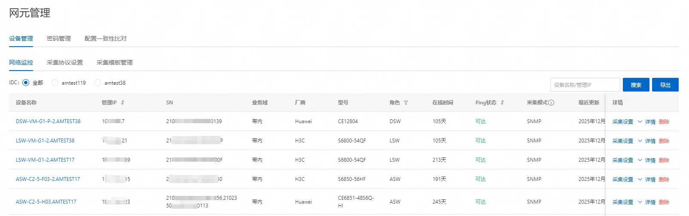

6. 在网络监控设备列表，支持执行如下操作。

   - 单击目标网络监控设备**详情**列的**采集设置 > 采集模式切换**，可以切换对应设备的采集模式。

     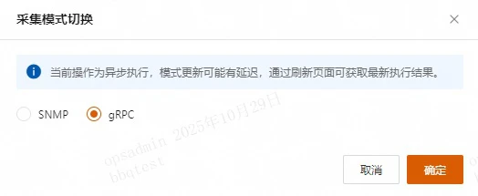

     > **说明**
     >
     > - 当目标交换机设备的属性不支持 gRPC时，切换采集模式禁用**grpc**选项。通常在起始采集模式为**snmp**时会出现此情况。
     >
     > - 当前操作为异步执行，模式更新可能有延迟，通过刷新页面可获取最新执行结果。

   - 单击目标网络监控设备**详情**列的**采集设置 > 采集配置**，查看采集配置。

     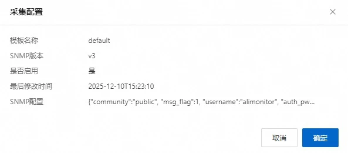

   - 单击目标网络监控设备**设备名称**列的名称，或者单击目标设备**详情**列的**详情**，可以查看对应设备的详细信息。

     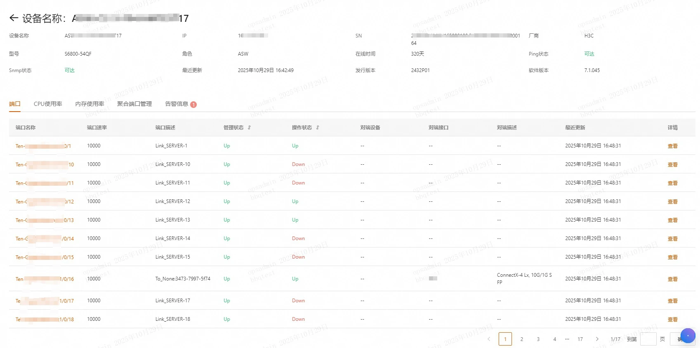

     <table>
       <tr>
         <th width="110">区域</th>
         <th>说明</th>
       </tr>
       <tr>
         <td>基本信息</td>
         <td>包括<strong>设备名称</strong>、<strong>IP</strong>、<strong>SN</strong>、<strong>厂商</strong>、<strong>型号</strong>、<strong>角色</strong>、<strong>在线时间</strong>、<strong>Ping状态</strong>、<strong>Snmp状态</strong>、<strong>最近更</strong><strong>新</strong>、<strong>发行版本</strong>和<strong>软件版本</strong>。</td>
       </tr>
       <tr>
         <td>端口</td>
         <td>展示该设备的端口列表。端口内容包括<strong>端口名称</strong>、<strong>端口速率</strong>、<strong>端口描述</strong>、<strong>管理状态</strong>、<strong>操作状</strong><strong>态</strong>、<strong>对端设备</strong>、<strong>对端接口</strong>、<strong>对端描述</strong>、<strong>最近更新</strong>等。<br>说明<strong>管理状态</strong>和<strong>操作状态</strong>支持排序。<br>查看端口详情：单击目标端口<strong>端口名称</strong>列的名称，或者单击目标端口<strong>详情</strong>列的<strong>查看</strong>，获取对应端口的基本信息和水位数据。<br>• 基本信息：包括<strong>端口名称</strong>、<strong>端口速率</strong>、<strong>端口描述</strong>、<strong>管理状态</strong>、<strong>操作状态</strong>、<strong>对端设备</strong>、<strong>对端</strong><strong>接口</strong>、<strong>对端描述</strong>、<strong>最近更新</strong>以及<strong>端口索引</strong>。<br>• <strong>水位数据</strong>：默认展示最近1小时的流量数据。相关指标含义，请参考端口指标说明。在右上角选择起止时间，单击<strong>搜索</strong>，支持查看目标时间范围内的运行水位数据信息。<br>说明<br>• 单击<strong>快速查询</strong>选项的<strong>5MIN</strong>、<strong>30MIN</strong>、<strong>1H</strong>、<strong>6H</strong>可以快速查询对应时间范围内的水位数据信息。<br>• 将鼠标悬停于图中任意一个时间节点，系统会显示该时间节点的所有指标的数值。<br>• 单击任意指标项，将单独展示对应指标的水位趋势图。<br>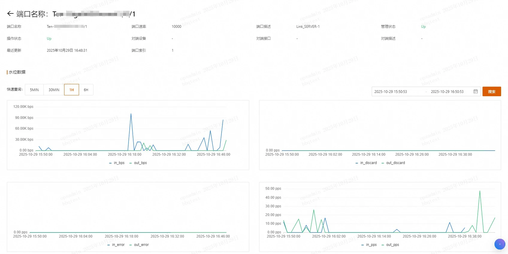</td>
       </tr>
       <tr>
         <td>CPU使用率</td>
         <td>展示该设备的CPU使用率信息。<br>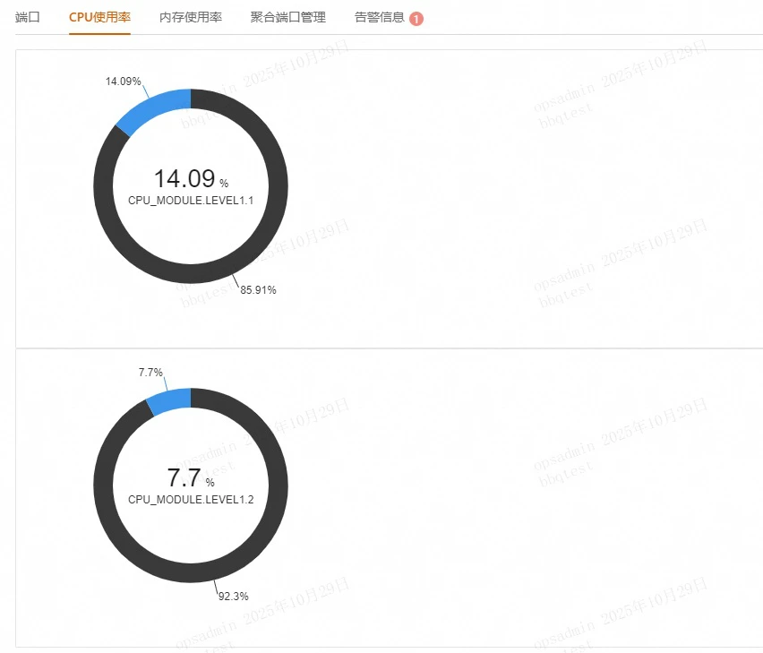</td>
       </tr>
     </table>

     <table>
       <tr>
         <td>内存使用率</td>
         <td>展示该设备的内存使用率信息。<br>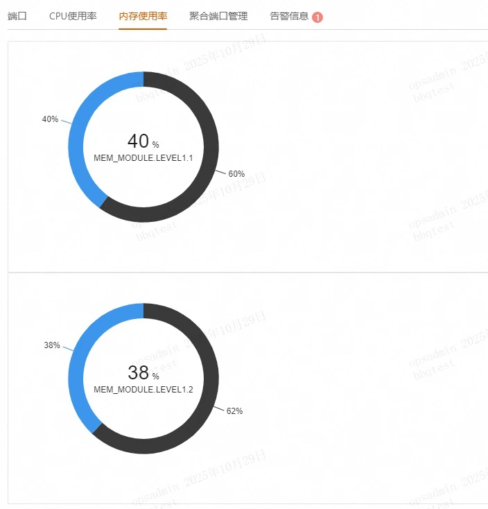</td>
       </tr>
     </table>

     <table>
       <tr>
         <td>聚合端口管理</td>
         <td>展示该设备的所有聚合端口信息。<br>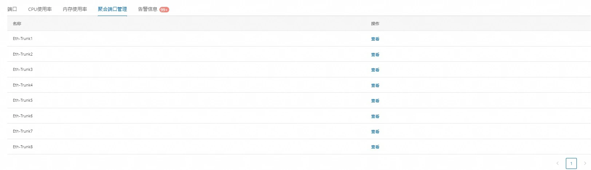<br>单击目标聚合端口<strong>操作</strong>列的<strong>查看</strong>，可以查看对应聚合端口的水位信息。相关指标含义，请参考端口指标说明。<br>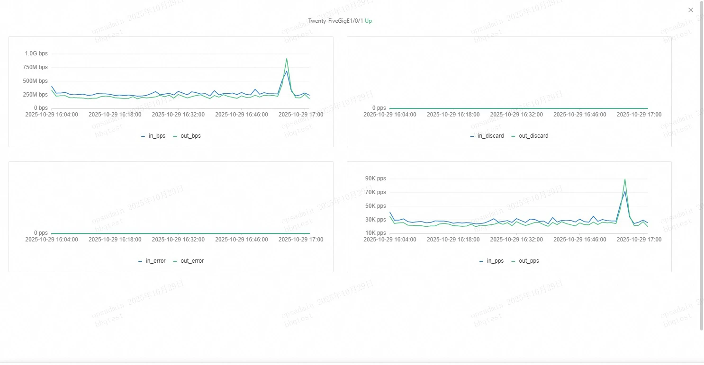<br>说明<br>• 将鼠标悬停于图中任意一个时间节点，系统会显示该时间节点的所有指标的数值。<br>• 单击任意指标项，将单独展示对应指标的水位趋势图。</td>
       </tr>
       <tr>
         <td>告警信息</td>
         <td>展示该设备的告警列表信息，包括<strong>告警时间</strong>、<strong>告警来源</strong>、<strong>告警IP</strong>、<strong>告警设备</strong>、<strong>告警名称</strong>、<strong>告</strong><strong>警项目</strong>等。鼠标悬浮在目标告警<strong>告警详情</strong>列的<strong>查看</strong>按钮上，可以查看对应告警的详情。<br>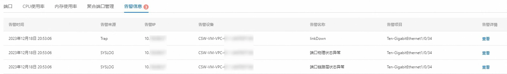<br>说明日常运维过程中，需要及时关注设备的告警信息。<strong>告警信息</strong>页签无数据，表示设备运行正常；若出现告警事件，系统会显示当前未恢复的告警事件，请及时处理。</td>
       </tr>
     </table>

   - 单击目标网络监控设备**详情**列的**删除**，可以删除对应设备的监控信息。

7. 单击列表右上角的**导出**，支持将所有网络设备的监控信息导出到本地。

**端口指标说明**

| 名称 | 描述 |
| --- | --- |
| in_bps | 端口入方向字节速率（比特/秒） |
| out_bps | 端口出方向字节速率（比特/秒） |
| in_discard | 端口入方向报文丢弃速率（个/秒） |
| out_discard | 端口出方向报文丢弃速率（个/秒） |
| in_error | 端口入方向错误包速率（个/秒） |
| out_error | 端口出方向错误包速率（个/秒） |
| in_pps | 端口入方向数据包速率（个/秒） |
| out_pps | 端口出方向数据包速率（个/秒） |

**采集协议设置**

采集协议设置功能主要提供对物理网元设备采集协议的设置和OOB网段的管理。

- 采集网络设备信息前，需要根据业务需求进行SNMP 协议配置。

- OOB网段管理主要用于对物理网元设备管理范围的设置，通常需要由运维工程师添加当前待管理的网络设备所在的纳管网段。

> **说明**
>
> 首次使用网络运维控制台的网元管理功能时，需要添加当前专有云网络设备规划好的设备loopback IP地址段，一般为IP规划表中的netdev.loopback字段对应的地址段。当网络进行扩容，同时伴随loopback IP地址段的扩容时，也需要将扩容涉及的IP地址网段添加至管理范围，扩容IP地址段的添加方式与首次录入的方法相同。录入完成后，即可在页面查询当前管理的设备的网段信息。

1. 登录Apsara Uni-manager运维控制台。

2. 在顶部菜单栏，选择**产品运维** > **网络运维** > **网络运维控制台**。

3. 在左侧导航栏，选择**基础网络** > **网元管理**。

4. 在**网元管理**页面，单击**设备管理 > 采集协议设置**。

   - **SNMP 设置**

     单击**SNMP 设置**页签，管理采集协议。

     <ol type="a">

     <li>

     单击**新增采集协议**，在**新增采集协议**页面**SNMP 协议配置**区域，根据以下内容完成参数配置。

     | 参数 | 说明 |
     | --- | --- |
     | 采集模板名称 | 输入自定义采集模板名称。 |
     | SNMP 版本 | 选择SNMP 版本，包括<strong>v2c</strong>和<strong>v3</strong>。 |
     | community 团体字 | 输入<strong>community 团体字</strong>。<br>说明当<strong>SNMP 版本</strong>选择<strong>v2c</strong>时，需要配置此参数。 |
     | 启用 | 选择是否启用采集协议。 |
     | SNMP 用户 | 输入SNMP 用户。<br>说明当<strong>SNMP 版本</strong>选择<strong>v3</strong>时，需要配置此参数。 |
     | 认证密码 | 输入认证密码。<br>说明当<strong>SNMP 版本</strong>选择<strong>v3</strong>时，需要配置此参数。 |
     | 认证协议 | 输入认证协议。<br>说明当<strong>SNMP 版本</strong>选择<strong>v3</strong>时，需要配置此参数。 |
     | 加密密码 | 输入加密密码。<br>说明当<strong>SNMP 版本</strong>选择<strong>v3</strong>时，需要配置此参数。 |
     | 加密协议 | 输入加密协议。<br>说明当<strong>SNMP 版本</strong>选择<strong>v3</strong>时，需要配置此参数。 |

     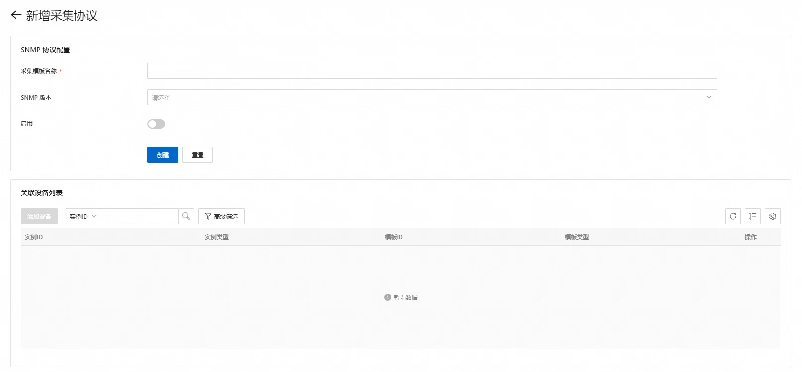

     </li>

     <li>

     单击**创建**。

     </li>

     </ol>

     <ol type="i" start="100">

     <li>

     在**关联设备列表**区域，添加关联设备。

     <ol type="a">

     <li>

     单击左上角**添加设备**，在**添加设备**弹出框中，获取所有的设备。

     > **说明**
     >
     > - 设备内容包括**设备名称**、**设备IP**、**角色**、**IDC**、**厂商**、**模板id**。
     >
     > - 单击**高级筛选**，支持通过**IDC**、**设备名称**、**IP 地址**、**设备角色**组合筛选获取目标设备。

     </li>

     <li>

     在设备列表中，勾选待添加的设备，单击**确定**。

     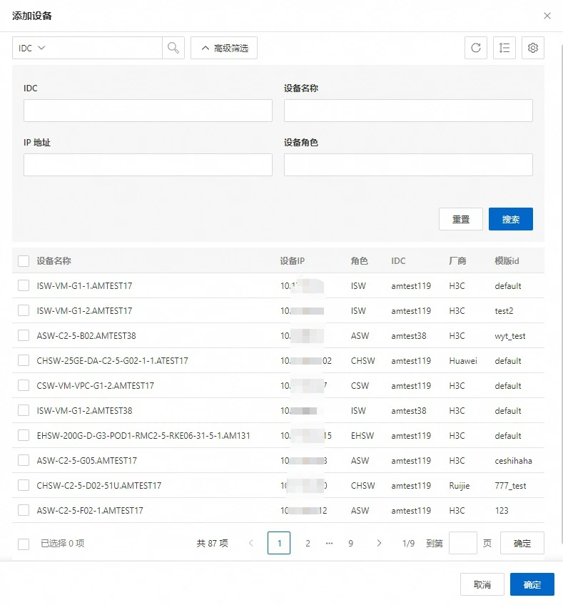

     </li>

     </ol>

     </li>

     <li value="500">

     返回**SNMP 设置**，通过列表查看采集协议信息，包括**UUID**、**模板名称**、**是否启用**、**模板来源**、**模板归属**、**SNMP协议版本**、**SNMP配置、创建时间**、**最后修改时间**等。

     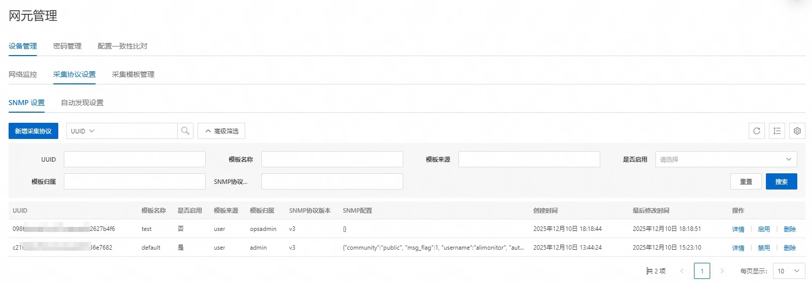

     > **说明**
     >
     > 单击**高级筛选**，支持通过**UUID**、**模板名称**、**模板来源**、**是否启用**、**模板归属**、**SNMP协议版本**组合筛选获取目标协议。

     - **查看采集协议详情**：单击目标采集协议**操作**列的**详情**，在**采集协议详情**页面，查看对应协议的详细信息。

       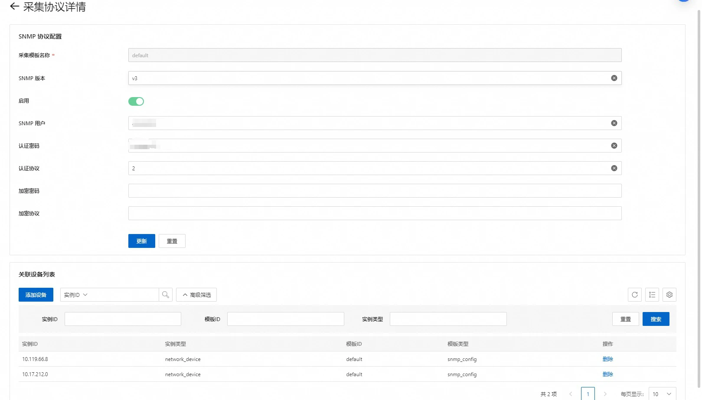

       - 在**SNMP 协议配置**区域<strong>，</strong>修改配置参数，单击**更新**，可以更新协议配置。

         具体参数说明，请参考新增采集协议。

       - 在**关联设备列表**区域，通过列表查看关联设备，包括**实例ID**、**实例类型**、**模板ID**、**模板类型**等。

         > **说明**
         >
         > 单击**高级筛选**，支持通过**实例ID**、**模板ID**、**实例类型**组合筛选获取目标设备。

         删除设备：单击目标设备**操作**列的**删除**，可以删除关联设备。

     - **启用/禁用采集协议**：单击目标采集协议**操作**列的**启用**/**禁用**，可以设置目标采集协议是否启用。

     - **删除采集协议**：单击目标采集协议**操作**列的**删除**，可以删除采集协议。

     </li>

     </ol>

   - **自动发现设置**

     单击**自动发现设置**页签，管理OOB网段。

     <ol type="a">

     <li>

     单击**OOB网段管理**区域网段列表下方**新增网段**，在弹出的对话框中，根据如下内容完成配置。

     - **管理网段**：输入含掩码信息的IP地址段和掩码，例如10.0.0.0/8。

     - **机房**：选择机房。

     - **业务域**：选择**带内**或**带外**。

     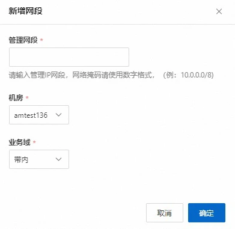

     </li>

     <li>

     单击**确定**。

     </li>

     </ol>

     <ol type="i" start="100">

     <li>

     查看网段列表，包括**ID**、**管理网段**、**机房**、**业务域**、**创建时间**、**最后修改**等。

     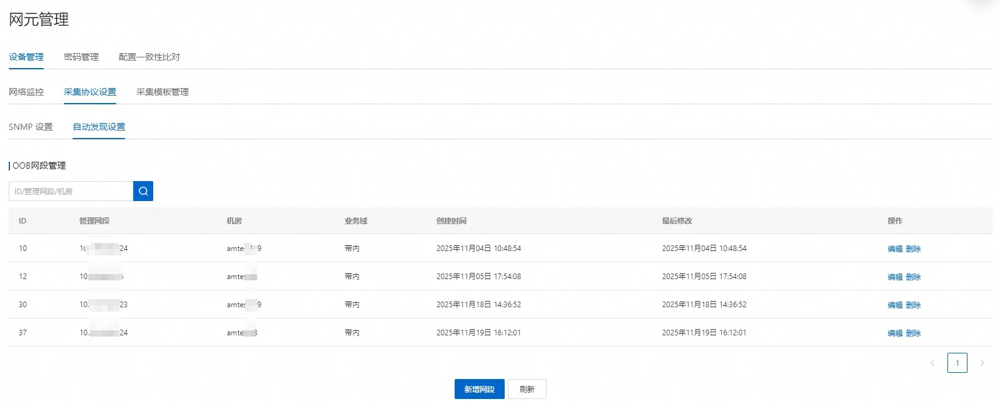

     > **说明**
     >
     > 在列表上方搜索框中，输入**ID/管理网段/机房**，单击
     >
     > 图标可以查看目标网段的相关信息。
     >
     > 

     - **编辑网段**：单击目标网段**操作**列的**编辑**，在弹出的对话框中，修改配置参数。

       具体参数说明，请参考新增网段。

     - **删除网段**：单击目标网段**操作**列的**删除**，可以删除网段。

     </li>

     </ol>

**采集模板管理**

snmp指标定制化采集方案管理。

1. 登录Apsara Uni-manager运维控制台。

2. 在顶部菜单栏，选择**产品运维** > **网络运维** > **网络运维控制台**。

3. 在左侧导航栏，选择**基础网络** > **网元管理**。

4. 在**网元管理**页面，单击**设备管理 > 采集模板管理**页签。

5. 单击**新增采集模板**。

6. 在**新增采集模板**页面**模板信息**区域，输入**采集模板名称**并选择开启或者关闭**启用**，单击**创建**。

   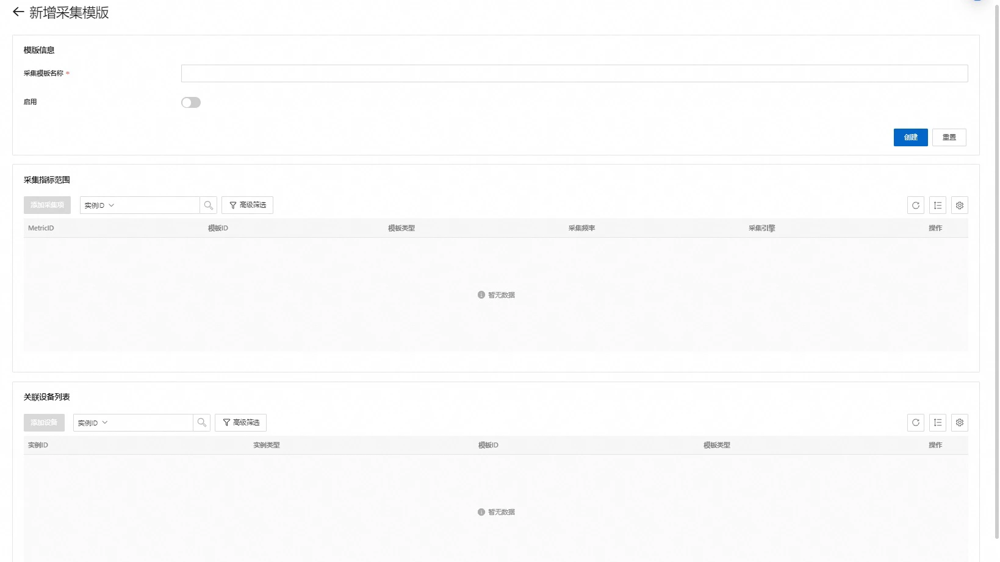

7. 在**采集指标范围**区域，添加采集指标。

   <ol type="i">

   <li>

   单击左上角**添加采集项**，在**添加指标项**弹出框中，获取所有的指标项。

   > **说明**
   >
   > - 指标项内容包括**ID**、**名称**、**类型**、**维度信息**、**存储类型**、**采集频率**、**采集引擎**、**描述**、**创建时间**、**最后修改时间**。
   >
   > - 单击**高级筛选**，支持通过**ID**、**名称**、**类型**、**维度信息**、**存储类型**组合筛选获取目标指标项。

   </li>

   <li>

   在左侧指标项列表，勾选待添加的指标项，单击**添加**，待添加的指标项会出现在右侧列表中。

   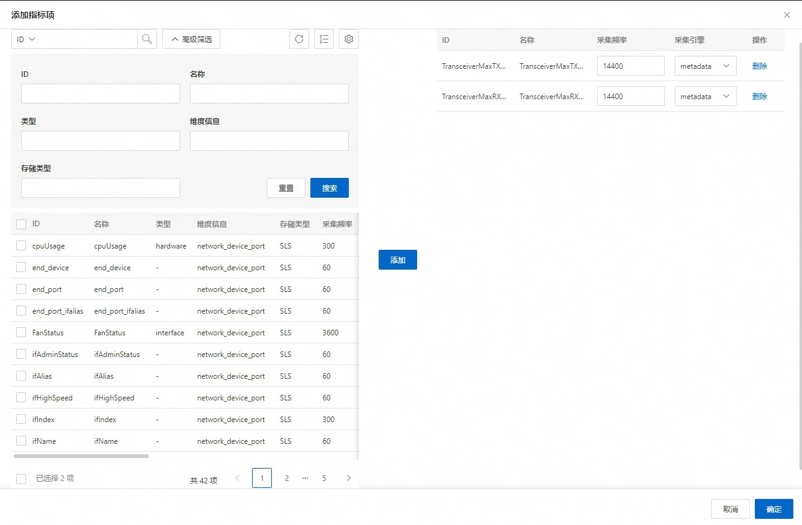

   > **说明**
   >
   > - 在待添加指标项列表中，可以为指标项设置**采集频率**、**采集引擎**。采集引擎包括**metric**和**metadata**。
   >
   > - 在待添加指标项列表中，单击目标指标项**操作**列的**删除**，可以移除单个设备；再次进行**添加**操作即可实现待添加指标项更改。

   </li>

   <li>

   待添加指标项配置完成后，单击**确定**。

   </li>

   </ol>

8. 在**关联设备列表**区域，添加关联设备。

   <ol type="i">

   <li>

   单击左上角**添加设备**，在**添加设备**弹出框中，获取所有的设备。

   > **说明**
   >
   > - 设备内容包括**设备名称**、**设备IP**、**角色**、**IDC**、**厂商**、**模板id**。
   >
   > - 单击**高级筛选**，支持通过**IDC**、**设备名称**、**IP 地址**、**设备角色**组合筛选获取目标设备。

   </li>

   <li>

   在设备列表中，勾选待添加的设备，单击**确定**。

   

   </li>

   </ol>

9. 返回**采集模板管理**，通过列表查看模板信息，包括**UUID**、**采集模板名称**、**是否启用**、**模板来源**、**模板归属**、**SNMP协议版本**、**创建时间**、**最后修改时间**等。

   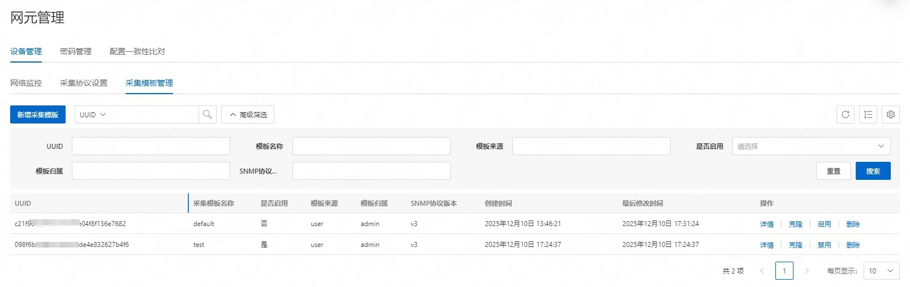

   > **说明**
   >
   > 单击**高级筛选**，支持通过**UUID**、**模板名称**、**模板来源**、**是否启用**、**模板归属**、**SNMP协议版本**组合筛选获取目标采集模板。

   - **查看采集模板详情**：单击目标采集模板**操作**列的**详情**，在**采集模板详情**页面，查看对应模板的详细信息。

     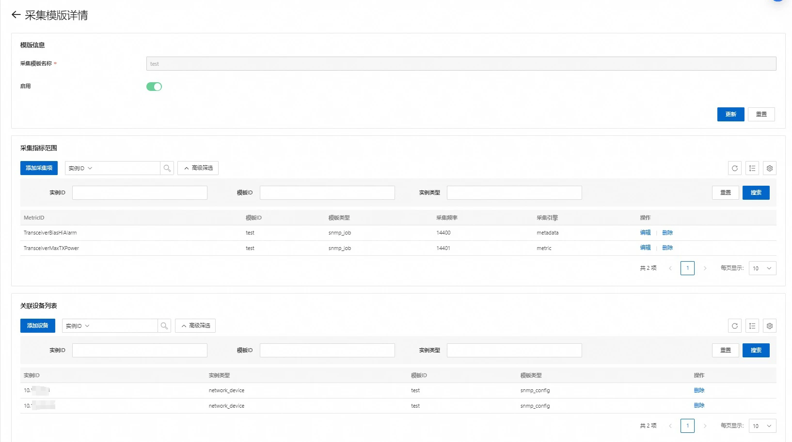

     - 在**模板信息**区域<strong>，</strong>选择开启或关闭**启用**，单击**更新**，可以更新模板信息。

     - 在**采集指标范围**区域，通过列表查看采集指标，包括**MetricID**、**模板ID**、**模板类型**、**采集频率**、**采集引擎**等。

       > **说明**
       >
       > 单击**高级筛选**，支持通过**实例ID**、**模板ID**、**实例类型**组合筛选获取目标采集项。

       - 编辑指标项：单击目标采集项**操作**列的**编辑**，在弹出框中，修改**采集频率**、**采集引擎**。

         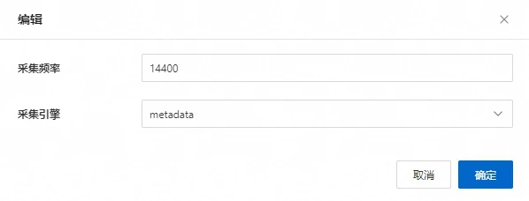

       - 删除指标项：单击目标采集项**操作**列的**删除**，可以删除采集指标项。

     - 在**关联设备列表**区域，通过列表查看关联设备，包括**实例ID**、**实例类型**、**模板ID**、**模板类型**等。

       > **说明**
       >
       > 单击**高级筛选**，支持通过**实例ID**、**模板ID**、**实例类型**组合筛选获取目标设备。

       删除设备：单击目标设备**操作**列的**删除**，可以删除关联设备。

   - **克隆**：单击目标采集模板**操作**列的**克隆**，在弹出框中，输入**新采集模板名称**，可以通过克隆目标模板生成一个新的模板。

     

   - 启用/禁用采集模板：单击目标采集模板**操作**列的**启用**/**禁用**，可以设置目标模板是否启用。

   - **删除采集模板**：单击目标采集模板**操作**列的**删除**，可以删除采集模板。

**密码管理**

修改物理网络设备的密码。

1. 登录Apsara Uni-manager运维控制台。

2. 在顶部菜单栏，选择**产品运维** > **网络运维** > **网络运维控制台**。

3. 在左侧导航栏，选择**基础网络** > **网元管理**。

4. 在**网元管理**页面，单击**密码管理**页签，获取所有的现网设备。

   > **说明**
   >
   > 在搜索框中输入设备名称可以进行精确查找。

5. 在现网设备列表，勾选待修改密码的设备，单击**加入实施**，待修改密码的设备会出现在右侧**实施设备**中。

   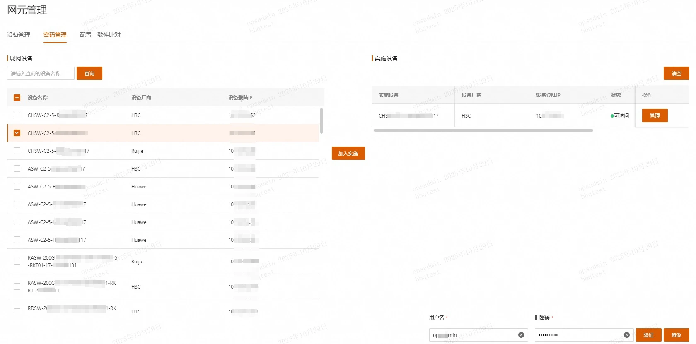

   > **说明**
   >
   > 如果需要更换或者移除待修改密码的物理设备，可以在**实施设备**列表找到目标设备，单击**操作**列的**管理** > **删除**，移出单个设备，或者单击右侧的**清空**按钮，移出所有已加入的设备，然后再进行加入操作。

6. 在修改密码前，系统需要对旧密码进行验证。在**实施设备**区域下方输入**用户名**和**旧密码**，单击**验证**。

   > **说明**
   >
   > - 如果添加了多个实施设备且旧密码不一致，请分开进行验证。
   >
   > - 验证通过后，实施设备列表的**验证状态**为**验证通过**。

7. 验证通过后，可以选择对单台设备或者所有设备进行密码修改。

   - 修改单台设备的密码

     <ol type="a">

     <li>

     单击目标设备**操作**列的**管理** > **设置账号密码**。

     </li>

     <li>

     在弹出的对话框中，输入**用户名**和**密码**，单击**确定**。

     </li>

     </ol>

     

   - 修改所有设备的密码

     <ol type="a">

     <li>

     单击**实施设备**区域下方的**修改**。

     </li>

     <li>

     在弹出的对话框中，输入**用户名**和**密码**，单击**确定**。

     </li>

     </ol>

**配置一致性比对**

可以将设备上当前运行的配置与启动时的配置进行一致性比对。

**前提条件**

产品BaseServiceAll的NetworkBaseServiceCluster集群已部署且已到终态。

**操作步骤**

1. 登录Apsara Uni-manager运维控制台。

2. 在顶部菜单栏，选择**产品运维** > **网络运维** > **网络运维控制台**。

3. 在左侧导航栏，选择**基础网络** > **网元管理**。

4. 在**网元管理**页面，单击**配置一致性比对**页签，获取网络设备列表，包括**设备名称**、**设备厂商**、**设备登陆IP**以及**结果**。

   > **说明**
   >
   > 在搜索框中输入设备名称可以进行精确查找。

   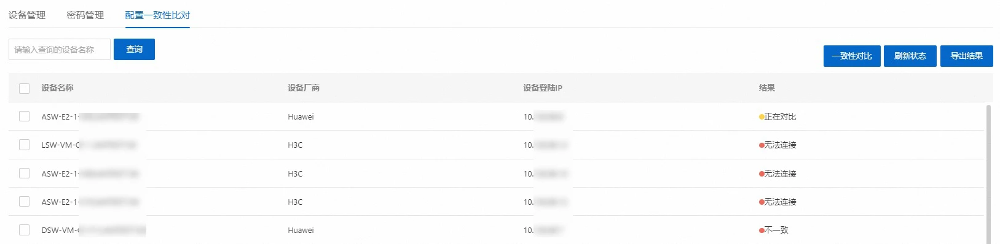

5. 勾选待比对配置的所有设备，单击列表右上角**一致性比对**，进行配置一致性对比。

6. 单击列表右上角**刷新状态**，可以刷新列表**结果**列比对结果显示内容。

7. 单击列表右上角**导出结果**，可以将对比差异结果导出到本地进行查看。

<a id="section-3-2"></a>

## 3.2. SYSLOG日志

Syslog日志基于时间、日志等级、模块等维度，将系统内网络硬件设备产生的日志信息进行记录和存储，方便后续的分析和管理，以快速发现和解决问题，提高设备的可用性和稳定性。

**查看日志**

1. 登录Apsara Uni-manager运维控制台。

2. 在顶部菜单栏，选择**产品运维** > **网络运维** > **网络运维控制台**。

3. 在左侧导航栏，选择**基础网络** > **SYSLOG日志**。

4. 单击**高级筛选**，通过**机房**、**来源设备**、**记录时间**、**日志内容**、**解析状态**、**日志级别**、**厂商**以及**告警模块**组合筛选目标日志信息。

5. 在日志列表中，查看日志数据信息。

   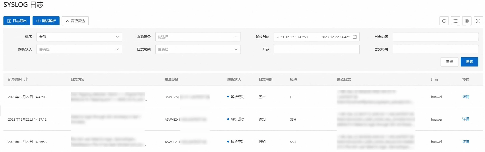

   <table>
     <tr>
       <th width="90">列表项</th>
       <th>列表项说明</th>
     </tr>
     <tr>
       <td>记录时间</td>
       <td>日志记录的时间，支持排序。</td>
     </tr>
     <tr>
       <td>日志内容</td>
       <td>解析后的日志数据，即原始日志中的content部分。</td>
     </tr>
     <tr>
       <td>来源设备</td>
       <td>日志数据的来源设备。</td>
     </tr>
     <tr>
       <td>解析状态</td>
       <td>日志数据解析的状态，包括<strong>解析成功</strong>、<strong>解析失败</strong>。<br>说明日志解析失败可能的原因如下：<br>• 日志格式不满足RFC 3164规范。<br>• 网络设备非专有云支持的重资产厂商。</td>
     </tr>
     <tr>
       <td>日志级别</td>
       <td>日志数据的级别，包括<strong>紧急</strong>、<strong>告警</strong>、<strong>严重</strong>、<strong>错误</strong>、<strong>警告</strong>、<strong>通知</strong>、<strong>信息</strong>、<strong>调试</strong>。</td>
     </tr>
     <tr>
       <td>模块</td>
       <td>日志数据所属模块。</td>
     </tr>
     <tr>
       <td>原始日志</td>
       <td>日志数据的原始文本，即未解析的日志信息。</td>
     </tr>
     <tr>
       <td>厂商</td>
       <td>设备所属厂商。</td>
     </tr>
   </table>

6. 单击操作列的**详情**，可查看更详细的日志信息，如告警匹配结果、模块详情、Location信息等。

   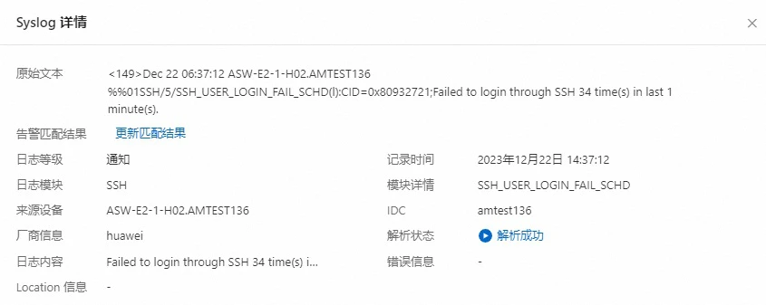

**更多操作**

**日志导出**

在日志列表上方，单击**日志导出**，即可将日志信息导出至本地进行查看。

> **说明**
>
> 默认导出全部日志信息。

**测试解析**

1. 在日志列表上方，单击**测试解析**。

2. 输入**原始文本**，单击**提交**。

   > **说明**
   >
   > 单击**重置**，会将原始文本中的内容清空。

3. 在解析结果区域，查看Description、Hostname、LogLevel等解析结果信息。

<a id="section-4"></a>

# 4.网络产品

<a id="section-4-1"></a>

## 4.1. XGW运维

<a id="section-4-1-1"></a>

### 4.1.1. XGW集群管理

**操作步骤**

1. 登录Apsara Uni-manager运维控制台。

2. 在顶部菜单栏，选择**产品运维** > **网络运维** > **网络运维控制台**。

3. 在左侧导航栏，选择**网络产品** > **XGW 运维** > **XGW 集群管理**。

4. 在**XGW 集群管理**页面，选择**地域**，查看目标地域的可用区信息以及集群拓扑关系图。

   > **说明**
   >
   > 仅支持x86物理机形态管理。

   - **可用区列表**：包括**地域**、**可用区**、**备份可用区**等。

   - **集群拓扑关系**：展示集群拓扑关系数据。

   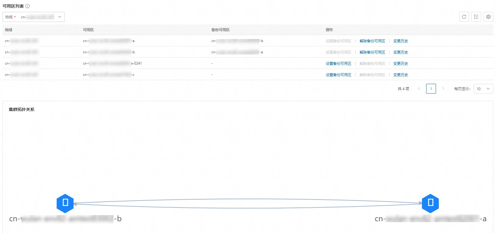

**相关操作**

**设置备份可用区**

> **说明**
>
> 未配置备份可用区的可用区支持此操作。

1. 单击目标可用区**操作**列的**设置备份可用区**。

2. 在弹出的对话框中，配置**选择备份可用区**内容，单击**确定**。

   > **说明**
   >
   > - 备份可用区只支持相同Region、相同架构的集群。
   >
   > - 选择备份可用区时，该备份可用区不能已被其他可用区指定为备份。

   

**解除备份可用区**

> **说明**
>
> 已配置备份可用区的可用区支持此操作。

1. 单击目标可用区**操作**列的**解除备份可用区**。

2. 在弹出的对话框中，单击**确定**。

**查看变更历史**

1. 单击目标可用区**操作**列的**变更历史**。

2. 在**变更历史**弹出框中，查看对应可用区的历史变更记录。

3. 变更记录包括**工作流ID**、**方案名称**、**类型**、**执行时间**、**执行结果**、**执行人**、**描述**、**执行参数**等。

   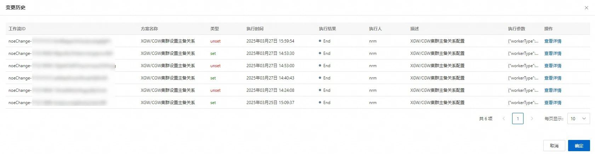

4. 单击目标变更记录**操作**列的**查看详情**，跳转至**方案执行详情**页面，查看变更记录的详细信息。

   具体内容，请参考查看变更方案列表。

   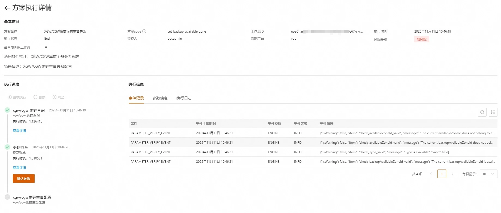

<a id="section-4-1-2"></a>

### 4.1.2. XGW管理

XGW管理就是对VPC网关的管理，可以查看设备节点和服务实例相关的水位信息。

**XGW集群**

在XGW管理页面查看XGW网络产品的基本信息、运行状态、聚合流量及各设备节点的水位情况。

**前提条件**

产品BaseServiceAll的NetworkBaseServiceCluster集群已部署且已到终态。

**操作步骤**

1. 登录Apsara Uni-manager运维控制台。

2. 在顶部菜单栏，选择**产品运维** > **网络运维** > **网络运维控制台**。

3. 在左侧导航栏，选择**网络产品** > **XGW 运维** > **XGW管理**。

4. 在**XGW管理**页面，单击**XGW集群**页签，选择**集群**，获取目标集群中所有设备的**节点信息**和**聚合流量**水位情况。

   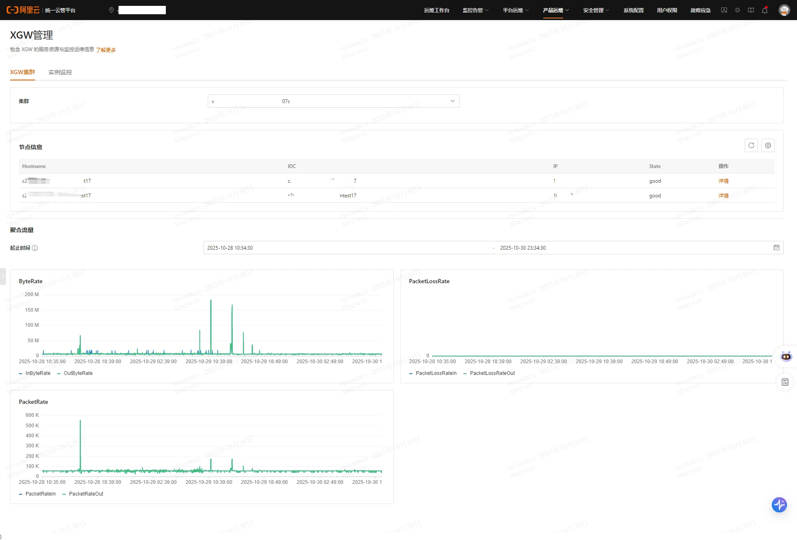

   - 在**节点信息**区域，查看节点列表信息。

     - 节点列表包括**Hostname**、**IDC**、**IP**和**State**。

     - 单击目标节点**操作**列的**详情**，在弹出面板中，查看对应节点的详细水位数据。默认展示最近1小时的数据。

       相关指标含义，请参考集群相关指标说明。

       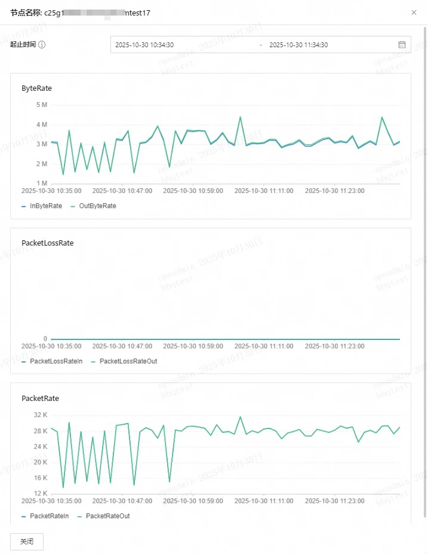

       > **说明**
       >
       > - 选择**起止时间**，可以查看目标时间范围内的水位数据信息。
       >
       > - 单击**最近1小时**、**最近3小时**、**最近6小时**、**最近1天**可以快速查询对应时间范围内的水位数据信息。
       >
       > - 将鼠标悬停于图中任意一个时间节点，系统会显示该时间节点的所有指标的数值。
       >
       > - 单击任意指标项，将单独展示对应指标的水位趋势图。

   - 在**聚合流量**区域，默认展示当前集群最近1小时的设备节点水位流量信息。

     相关指标含义，请参考集群相关指标说明。

     > **说明**
     >
     > - 选择**起止时间**，可以查看目标时间范围内的水位数据信息。
     >
     > - 单击**最近1小时**、**最近3小时**、**最近6小时**、**最近1天**可以快速查询对应时间范围内的水位数据信息。
     >
     > - 将鼠标悬停于图中任意一个时间节点，系统会显示该时间节点的所有指标的数值。
     >
     > - 单击任意指标项，将单独展示对应指标的水位趋势图。

**实例监控**

在实例监控页面查看某个实例的水位情况。

**前提条件**

产品BaseServiceAll的NetworkBaseServiceCluster集群已部署且已到终态。

**操作步骤**

1. 登录Apsara Uni-manager运维控制台。

2. 在顶部菜单栏，选择**产品运维** > **网络运维** > **网络运维控制台**。

3. 在左侧导航栏，选择**网络产品** > **XGW 运维** > **XGW管理**。

4. 在**XGW管理**页面，单击**实例监控**页签，选择**集群**，输入**实例IP地址**并选择起止时间。

5. 单击**搜索**，查看在指定时间范围内目标集群下实例运行的水位图。

   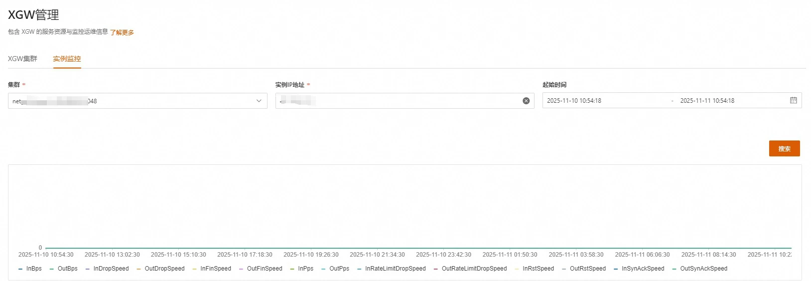

   相关指标含义，请参考实例相关指标说明。

   > **说明**
   >
   > - 单击**最近1小时**、**最近3小时**、**最近6小时**、**最近1天**可以快速查询对应时间范围内的水位数据信息。
   >
   > - 将鼠标悬停于图中任意一个时间节点，系统会显示该时间节点的所有指标的数值。

**集群相关指标说明**

<table>
  <tr>
    <th>分类</th>
    <th>名称</th>
    <th>描述</th>
  </tr>
  <tr>
    <td rowspan="2">ByteRate</td>
    <td>InByteRate</td>
    <td>入方向字节速率（比特/秒）</td>
  </tr>
  <tr>
    <td>OutByteRate</td>
    <td>出方向字节速率（比特/秒）</td>
  </tr>
  <tr>
    <td rowspan="2">PacketLossRate</td>
    <td>PacketLossRateIn</td>
    <td>入方向报文丢弃速率（个/秒）</td>
  </tr>
  <tr>
    <td>PacketLossRateOut</td>
    <td>出方向报文丢弃速率（个/秒）</td>
  </tr>
  <tr>
    <td rowspan="2">PacketRate</td>
    <td>PacketRateIn</td>
    <td>入方向报文速率（个/秒）</td>
  </tr>
  <tr>
    <td>PacketRateOut</td>
    <td>出方向报文速率（个/秒）</td>
  </tr>
</table>

**实例相关指标说明**

| 名称 | 描述 |
| --- | --- |
| InBps | 入方向字节速率（比特/秒） |
| OutBps | 出方向字节速率（比特/秒） |
| InDropSpeed | 入方向丢包速率（个/秒） |
| OutDropSpeed | 出方向丢包速率（个/秒） |
| InFinSpeed | 入方向fin包速率（个/秒） |
| OutFinSpeed | 出方向fin包速率（个/秒） |
| InPps | 入方向数据包速率（个/秒） |
| OutPps | 出方向数据包速率（个/秒） |
| InRateLimitDropSpeed | 入方向限速丢包速率（个/秒） |
| OutRateLimitDropSpeed | 出方向限速丢包速率（个/秒） |
| InRstSpeed | 入方向rst 包速率（个/秒） |
| OutRstSpeed | 出方向rst包速率（个/秒） |
| InSynAckSpeed | 入方向syn_ack包速率（个/秒） |
| OutSynAckSpeed | 出方向syn_ack包速率（个/秒） |

<a id="section-4-1-3"></a>

### 4.1.3. NAT网关监控

在多云异地容灾、混合云等场景下，可以根据tunnel ID查询NAT网关实例监控数据。

**操作步骤**

1. 登录Apsara Uni-manager运维控制台。

2. 在顶部菜单栏，选择**产品运维** > **网络运维** > **网络运维控制台**。

3. 在左侧导航栏，选择**网络产品** > **XGW 运维** > **NAT网关监控**。

4. 在**NAT网关监控**页面，选择集群、输入TunnelID，单击**查询**可以查看NAT网关实例监控趋势图。

   默认查询展示最近1小时内的实例监控数据，支持选择起止时间查询指定时间范围内的数据。

   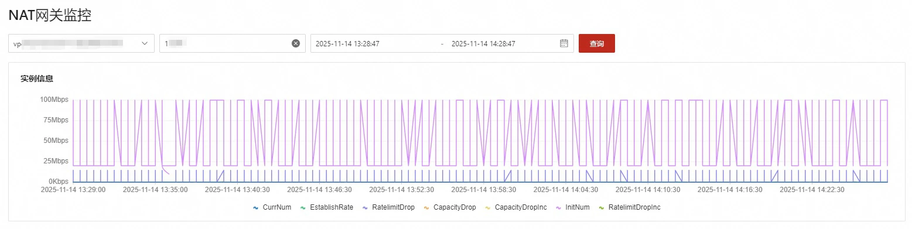

   > **说明**
   >
   > - 将鼠标悬停于图中任意一个时间节点，系统会显示该时间节点的所有指标的数值。
   >
   > - 单击任意指标项，将单独展示对应指标的水位趋势图。

   相关指标含义如下所示：

   | 指标 | 描述 |
   | --- | --- |
   | CurrNum | 当前实例数（个） |
   | EstablishRate | Establish建联速率（连接个数/秒） |
   | RatelimitDrop | 限速丢包数（个） |
   | CapacityDropInc | Inc容量丢包数（个） |
   | CapacityDrop | 容量丢包数（个） |
   | IninNum | 初始化实例数（个） |
   | RatelimitDropInc | Inc限速丢包数（个） |

<a id="section-4-1-4"></a>

### 4.1.4. RI实例

本章节介绍了如何查看路由器接口的实例列表以及查看实例的详细运维信息。

**操作步骤**

1. 登录Apsara Uni-manager运维控制台。

2. 在顶部菜单栏，选择**产品运维** > **网络运维** > **网络运维控制台**。

3. 在左侧导航栏，选择**网络产品** > **XGW 运维** > **RI 实例**。

4. 在 **RI 实例列表**页面，通过**高级筛选**，在**查询条件**中选择**VPC ID**/**UID**并输入查询参数，结合**Region**信息，单击**搜索**，可以查看对应的RI 实例列表。

   - RI 实例信息包括**RI ID**、**实例名称**、**实例状态**、**路由器ID**、**路由器类型**、**连接类型**、**对端RI ID**、**对端路由器 ID**、**对端路由器类型**、**对端Region ID**、**创建时间**等<strong>。</strong>

   - 支持根据**连接类型**、**RI ID**、**路由器类型**、**路由器ID**、**实例状态**、**实例名称**、**对端RI ID**、**对端路由器ID**、**对端路由器类型**、**对端Region ID**进一步组合筛选，查看目标RI实例。

   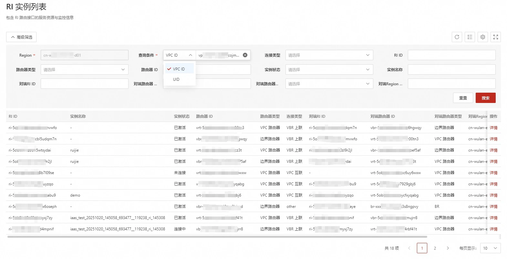

5. 单击目标RI实例**操作**列的**详情**，在**RI 实例详情**页面，可以查看对应RI实例的运维信息，包括详细的**实例信息**以及**水位数据**。

   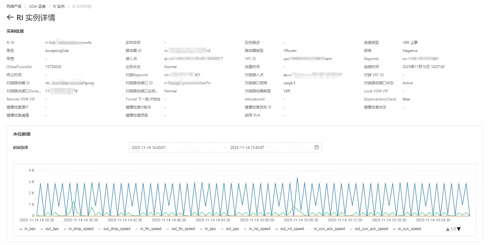

   - **实例信息**：包括**RI ID**、**实例名称**、**实例描述**、**连接类型**、**角色**、**路由器ID**、**路由器类型**、**规格**、**带宽**、**接入点**、**VPC ID**、**RegionId**、**GlobalTunnelId**、**业务状态**、**创建时间**、**连接时间**、**终止时间**、**对端RegionId**、**对端接入点**、**对端 VPC ID**、**对端路由器 ID**、**对端路由器接口 ID**、**对端接口规格**、**对端接口状态**、**对端路由接口Owner ID**、**对端路由接口业务状态**、**对端路由器类型**、**Local VGW VIP**、**Remote VGW VIP**、**Tunnel 下一跳 IP地址**、**AllocationId**、**SkipInventoryCheck**、**健康检查源IP**、**健康检查IP版本**、**健康检查目的IP**、**健康检查状态**、**健康检查阈值**、**健康检查频率**、**启用 IPv6**等<strong>。</strong>

   - **水位数据**：默认展示目标RI实例最近1小时内的实例水位数据。

     > **说明**
     >
     > - 通过**时间选择**可以查看目标时间范围内的水位数据信息。
     >
     > - 单击**最近1小时**、**最近3小时**、**最近6小时**、**最近1天**可以快速查询对应时间范围内的水位数据信息。
     >
     > - 将鼠标悬停于图中任意一个时间节点，系统会显示该时间节点的所有指标的数值。
     >
     > - 单击任意指标项，将单独展示对应指标的水位趋势图。

     相关指标含义如下所示：

     | 指标 | 描述 |
     | --- | --- |
     | in_bps | 入方向字节速率（比特/秒） |
     | out_bps | 出方向字节速率（比特/秒） |
     | in_drop_speed | 入方向丢包速率（个/秒） |
     | out_drop_speed | 出方向丢包速率（个/秒） |
     | in_fin_speed | 入方向fin包速率（个/秒） |
     | out_fin_speed | 出方向fin包速率（个/秒） |
     | in_pps | 入方向数据包速率（个/秒） |
     | out_pps | 出方向数据包速率（个/秒） |
     | in_rst_speed | 入方向rst 包速率（个/秒） |
     | out_rst_speed | 出方向rst包速率（个/秒） |
     | in_syn_ack_speed | 入方向syn_ack包速率（个/秒） |
     | out_syn_ack_speed | 出方向syn_ack包速率（个/秒） |
     | in_syn_speed | 入方向syn包速率（个/秒） |
     | out_syn_speed | 出方向syn包速率（个/秒） |
     | ratelimit_drop_speed | 限速丢包速率（个/秒） |

<a id="section-4-2"></a>

## 4.2. AVS运维

<a id="section-4-2-1"></a>

### 4.2.1. AVS管理

本章节介绍如何获取查看AVS的基本信息以及AVS的水位大盘信息。

**操作步骤**

1. 登录Apsara Uni-manager运维控制台。

2. 在顶部菜单栏，选择**产品运维** > **网络运维** > **网络运维控制台**。

3. 在左侧导航栏，选择**网络产品** > **AVS 运维** > **AVS 管理**。

4. 在**AVS 管理**页面，可以查看AVS列表内容。

   - AVS基本信息包括**主机名**、**NC IP**、**内核版本**、**pync版本**、**rpm版本**、**mvssSDK版本**、**vtools版本**等。

   - 支持输入**NC IP**获取指定的AVS信息。

   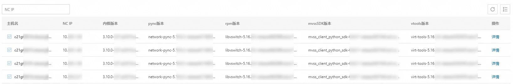

5. 单击目标AVS**操作**列的**详情**，在**AVS 节点详情**页面，可以获取对应AVS的水位大盘数据。默认展示最近1小时的数据。

   **节点监控**：包括**netdev 流量**、**CPU 使用率**、**vport 总流量**、**vxlanVport 总流量**、**物理网卡流量**。

   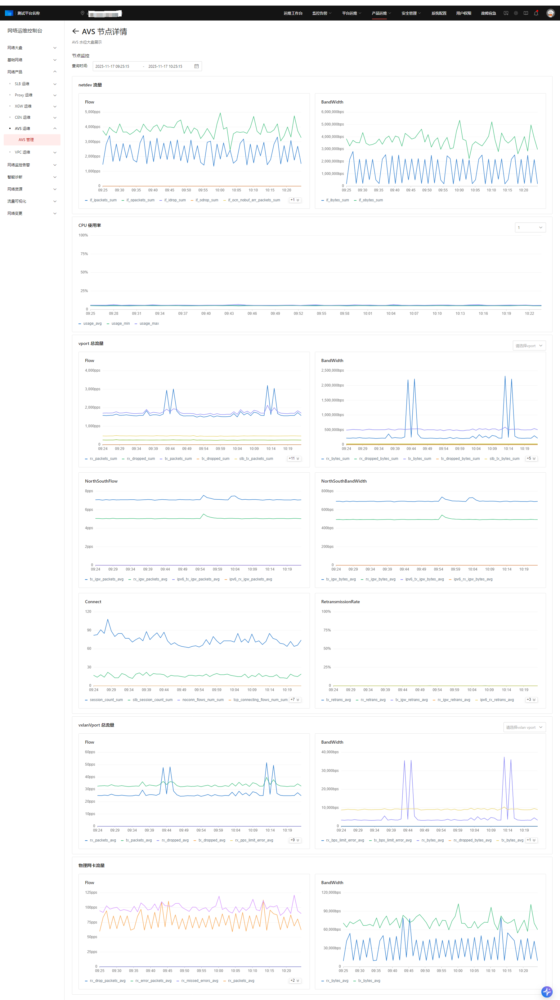

   > **说明**
   >
   > - 选择**查询时间**，可以查看目标时间范围内的水位数据信息。
   >
   > - 单击**最近1小时**、**最近3小时**、**最近6小时**、**最近1天**可以快速查询对应时间范围内的水位数据信息。
   >
   > - 将鼠标悬停于图中任意一个时间节点，系统会显示该时间节点的所有指标的数值。
   >
   > - 单击任意指标项，将单独展示对应指标的水位趋势图。
   >
   > - **CPU 使用率**类型下各指标支持根据CPU 号筛选展示水位数据。
   >
   > - **vport 总流量**类型下各指标支持根据vport筛选展示水位数据。
   >
   > - **vxlanVport 总流量**类型下各指标支持根据vxlan vport筛选展示水位数据。

   关键指标含义如下表所示：

   **分类**

   **指标**

   **含义**

   netdev网卡入方向报文数

   **if_ipackets_sum**

   netdev网卡出方向报文数

   **if_opackets_sum**

   netdev网卡入方向丢弃报文数

   **if_idrop_sum**

   **Flow**

   netdev网卡出方向丢弃报文数

   **if_odrop_sum**

   netdev网卡出方向Connection连接缓存不

   **if_ocn_nobuf_err_pack**

   **netdev 流**

   足错误报文数

   **ets_sum**

   **量**

   **if_ofpga_nobuf_packet**

   netdev网卡出方向FPGA缓存不足报文数

   **s_sum**

   netdev网卡入方向字节数

   **if_ibytes_sum**

   **BandWidth**

   netdev网卡出方向字节数

   **if_obytes_sum**

   CPU平均使用率

   **usage_avg**

   CPU最小使用率

   **CPU 使用率**

   **usage_min**

   CPU最大使用率

   **usage_max**

   入向报文数

   **rx_packets_sum**

   入向丢弃报文数

   **rx_dropped_sum**

   出向报文数

   **tx_packets_sum**

   出向丢弃报文数

   **tx_dropped_sum**

   SLB方向出向报文数

   **slb_tx_packets_sum**

   SLB方向出向丢弃报文数

   **slb_tx_dropped_sum**

   SLB方向入向报文数

   **slb_rx_packets_sum**

   SLB方向入向丢弃报文数

   **slb_rx_dropped_sum**

   **Flow**

   **rx_pps_limit_error_su**

   入向限速丢包数

   **m**

   **tx_pps_limit_error_su**

   出向限速丢包数

   **m**

   入向安全组丢包数

   **rx_acl_error_sum**

   出向安全组丢包数

   **tx_acl_error_sum**

   出向IPv6报文数

   **ipv6_tx_packets_sum**

   出向IPv6安全组丢弃报文数

   **ipv6_tx_acl_error_sum**

   入向IPv6报文数

   **ipv6_rx_packets_sum**

   入向IPv6安全组丢弃报文数

   **ipv6_rx_acl_error_sum**

   入向字节数

   **rx_bytes_sum**

   入向丢弃报文字节数

   **rx_dropped_bytes_sum**

   出向字节数

   **tx_bytes_sum**

   出向丢弃报文字节数

   **tx_dropped_bytes_sum**

   SLB方向出向字节数

   **slb_tx_bytes_sum**

   **BandWidth**

   **slb_tx_dropped_bytes_**

   SLB方向出向丢弃报文字节数

   **sum**

   SLB方向入向字节数

   **slb_rx_bytes_sum**

   **slb_rx_dropped_bytes_**

   SLB方向入向丢弃报文字节数

   **sum**

   出向IPv6字节数

   **ipv6_tx_bytes_sum**

   入向IPv6字节数

   **ipv6_rx_bytes_sum**

   IGW方向出向报文数

   **tx_igw_packets_avg**

   IGW方向入向报文数

   **rx_igw_packets_avg**

   **NorthSouth**

   **vport 总流**

   **Flow**

   **ipv6_tx_igw_packets_a**

   IGW方向出向IPv6报文数

   **量**

   **vg**

   **ipv6_rx_igw_packets_a**

   IGW方向入向IPv6报文数

   **vg**

   IGW方向出向字节数

   **tx_igw_bytes_avg**

   IGW方向入向字节数

   **rx_igw_bytes_avg**

   **NorthSouth BandWidth**

   IGW方向出向IPv6字节数

   **ipv6_tx_igw_bytes_avg**

   IGW方向入向IPv6字节数

   **ipv6_rx_igw_bytes_avg**

   快转会话总数

   **session_count_sum**

   **slb_session_count_su**

   SLB类型会话数

   **m**

   **noconn_flows_num_su**

   UDP\\ICMP类型会话数

   **m**

   **tcp_connecting_flows_**

   Connecting状态会话数（新建连接数）

   **num_sum**

   **tcp_established_flows_**

   Established状态会话数（并发连接数）

   **num_sum**

   **tcp_closing_flows_num**

   Closing状态会话数

   **Connect**

   **_sum**

   **tcp_closed_flows_num**

   Closed状态会话数

   **_sum**

   **rx_session_new_fail_su**

   入向新建会话失败数

   **m**

   **rx_session_update_fail**

   入向更新会话失败数

   **_sum**

   **tx_session_new_fail_su**

   出向新建会话失败数

   **m**

   **tx_session_update_fail**

   出向更新会话失败数

   **_sum**

   出向报文重传率

   **tx_retrans_avg**

   入向报文重传率

   **rx_retrans_avg**

   IGW方向出向报文重传率

   **tx_igw_retrans_avg**

   IGW方向入向报文重传率

   **rx_igw_retrans_avg**

   **Retransmiss ionRate**

   出向IPv6报文重传率

   **ipv6_rx_retrans_avg**

   入向IPv6报文重传率

   **ipv6_tx_retrans_avg**

   **ipv6_tx_igw_retrans_a**

   IGW方向出向IPv6报文重传率

   **vg**

   **ipv6_rx_igw_retrans_a**

   IGW方向入向IPv6报文重传率

   **vg**

   入向报文数

   **rx_packets_avg**

   出向报文数

   **tx_packets_avg**

   入向丢弃报文数

   **rx_dropped_avg**

   出向丢弃报文数

   **tx_dropped_avg**

   入向pps限速丢包数

   **rx_pps_limit_error_avg**

   入向快转丢包数

   **rx_fastpath_error_avg**

   出向pps限速丢包数

   **tx_pps_limit_error_avg**

   **Flow**

   出向快转丢包数

   **tx_fastpath_error_avg**

   入向cpu限速丢包数

   **rx_cpu_limit_error_avg**

   出向cpu限速丢包数

   **tx_cpu_limit_error_avg**

   **vxlanVpor t 总流量**

   relay 错误报文数，热迁移场景

   **relay_packet_err_avg**

   relay 报文数，热迁移场景

   **relay_packet_avg**

   入向位置表匹配错误数

   **rx_loc_route_error_avg**

   入向位置表IPv6匹配错误数

   **ipv6_rx_loc_error_avg**

   入向bps限速丢包数

   **rx_bps_limit_error_avg**

   出向bps限速丢包数

   **tx_bps_limit_error_avg**

   入向字节数

   **rx_bytes_avg**

   **BandWidth**

   入向丢弃报文字节数

   **rx_dropped_bytes_avg**

   出向字节数

   **tx_bytes_avg**

   出向丢弃报文字节数

   **tx_dropped_bytes_avg**

   入向丢弃报文数

   **rx_drop_packets_avg**

   入向错误报文数

   **rx_error_packets_avg**

   入向缓冲丢包数

   **rx_missed_errors_avg**

   **Flow**

   入向报文数

   **rx_packets_avg**

   **物理网卡流量**

   出向错误报文数

   **tx_error_packets_avg**

   出向报文数

   **tx_packets_avg**

   入向字节数

   **rx_bytes_avg**

   **BandWidth**

   出向字节数

   **tx_bytes_avg**

<a id="section-4-3"></a>

## 4.3. VPC运维

<a id="section-4-3-1"></a>

### 4.3.1. 天宫VPC

**操作步骤**

1. 登录Apsara Uni-manager运维控制台。

2. 在顶部菜单栏，选择**产品运维** > **网络运维** > **网络运维控制台**。

3. 在左侧导航栏，选择**网络产品** > **VPC 运维** > **天宫VPC**。

4. 在**天宫VPC**页面，查看VPC列表，默认展示**全部状态**的VPC。

   - VPC信息包括**Region**、**VPC**、**版本**、**状态**、**创建时间**等。

   - 单击**高级筛选**，支持根据**VPC ID**、**状态**以及**创建时间**组合筛选获取目标VPC。

   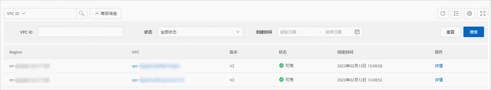

5. 单击目标VPC**操作**列的**详情**或者**VPC**列的实例ID，进入**VPC详情**页面，可以获取对应VPC及其相关资源的详细信息。

   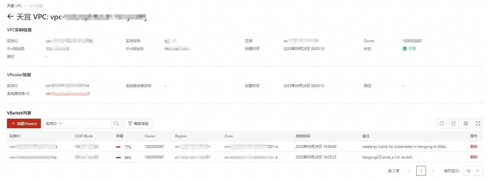

   - **VPC实例信息**：包括**实例ID**、**实例名称**、**区域**、**Owner**、**IPv4地址段**、**IPv6地址段**、**创建时间**、**状态**、**描述**。

   - **VRouter信息**：包括**实例ID**、**系统路由表名称**、**创建时间**、**状态**、**系统路由表 ID**。

     单击**系统路由表 ID**右侧ID，可以查看对应路由表的详细信息。

     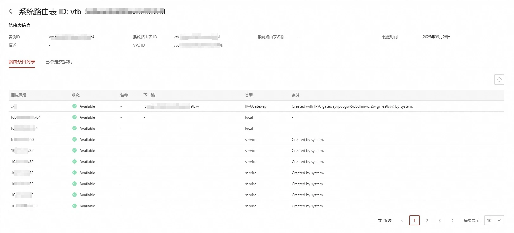

     - <strong>路由表信息：</strong>包括**实例ID**、**系统路由表 ID**、**系统路由表名称**、**创建时间**、**描述**、**VPC ID**。

     - **路由条目列表**：包括**目标网段**、**状态**、**名称**、**下一跳**、**类型**、**备注**。

     - **已绑定交换机**：包括**交换机**、**名字**、**状态**、**目标网段**。

       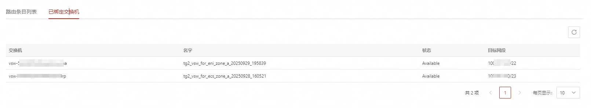

   - **VSwitch列表**：VSwitch信息包括**实例ID**、**CIDR Block**、**容量**、**Owner**、**Region**、**Zone**、**创建时间**、**备注**等。

     单击**高级筛选**，支持根据**实例ID**、**Owner**、**Zone**以及**创建时间**组合筛选获取目标VSwitch。

     - **创建VSwitch**：单击**创建VSwitch**，在弹出框中配置如下参数，单击**确定**。

       | 参数 | 参数说明 |
       | --- | --- |
       | Zone | 输入创建VSwitch关联的可用区ID。 |
       | CIDR Block | 输入VSwitch配置所属的IPv4网段。 |
       | 用途 | 选择VSwitch的业务用途：<br>• 云产品<br>• 容器网络 |
       | 描述 | 输入VSwitch相关的描述信息。 |

       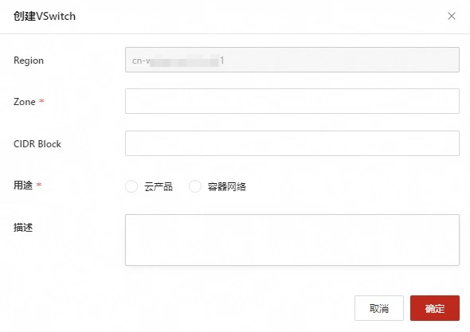

     - **删除VSwitch**：单击目标VSwitch**操作**列的**删除**，在弹出的对话框中，单击**确定**。

       > **重要**
       >
       > 实例删除后无法恢复，请谨慎操作！

<a id="section-4-3-2"></a>

### 4.3.2. VPC工作流

本文介绍如何查看和管理VPC瑶池工作流。

**操作步骤**

1. 登录Apsara Uni-manager运维控制台。

2. 在顶部菜单栏，选择**产品运维** > **网络运维** > **网络运维控制台**。

3. 在左侧导航栏，选择**网络产品** > **VPC 运维** > **VPC 工作流**。

4. 在**工作流管理**页面，获取VPC瑶池工作流列表，查看并管理对应进程任务。

   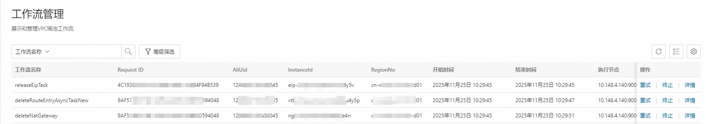

   - VPC 工作流信息包括**工作流名称**、**Request ID**、**AliUid**、**InstanceId**、**RegionNo、开始时间**、**结束时间**、**执行节点**等。

   - 单击**高级筛选**，支持根据如下参数组合筛选获取目标进程任务。

     <table>
       <tr>
         <th width="125">参数</th>
         <th>说明</th>
       </tr>
       <tr>
         <td>工作流名称</td>
         <td>自定义的工作流名称。</td>
       </tr>
       <tr>
         <td>执行状态</td>
         <td>任务的执行状态，支持如下：<br>• <strong>SCHEDULABLE</strong>：可调度<br>• <strong>RUNNING</strong>：执行中<br>• <strong>PAUSED</strong>：暂停<br>• <strong>HUMAN_PROCESSING</strong>：人工介入<br>• <strong>COMPLETED</strong>：已完成<br>• <strong>FAILED</strong>：失败<br>• <strong>TIMEOUT</strong>：超时</td>
       </tr>
       <tr>
         <td>Request ID</td>
         <td>任务的Request ID。</td>
       </tr>
       <tr>
         <td>AliUid</td>
         <td>阿里云账户ID。</td>
       </tr>
       <tr>
         <td>InstanceId</td>
         <td>工作流操作的实例ID。</td>
       </tr>
     </table>

   - **查看工作流详情**：单击目标进程任务**操作**列的**详情**，在**工作流详情页**，查看工作流的**活动详情**和**活动摘要**。

     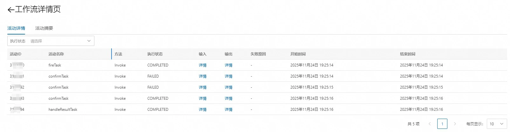

     - 对应活动详情信息均包括**活动ID**、**活动名称**、**方法**、**执行状态**、**输入**、**输出**、**失败原因**、**开始时间**、**结束时间**。

     - 支持通过选择**执行状态**筛选获取指定的活动内容。

     - 在对应活动列表，单击目标活动**输入**/**输出**列的**详情**，均支持在弹出框中查看相关的进程详情。

       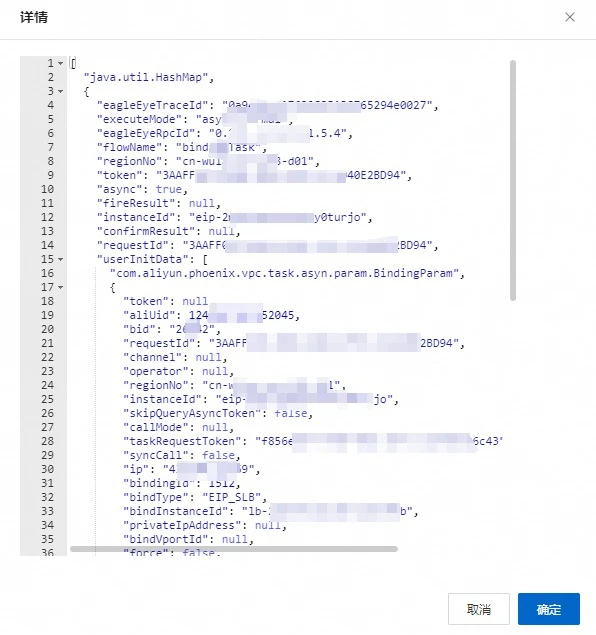

   - **终止工作流**：单击目标进程任务**操作**列的**终止**，支持终止对应工作流。

   - **重试工作流**：单击目标进程任务**操作**列的**重试**，支持重新执行对应工作流。

<a id="section-5"></a>

# 5.网络监控告警

<a id="section-5-1"></a>

## 5.1. 网络事件中心

通过网络事件中心，支持查询当前网络平台内记录的所有事件，包括巡检、Syslog、NOE Ping等。

**操作步骤**

1. 登录Apsara Uni-manager运维控制台。

2. 在顶部菜单栏，选择**产品运维** > **网络运维** > **网络运维控制台**。

3. 在左侧导航栏，选择**网络监控告警** > **网络事件中心**。

4. 在**网络事件中心**页面，查看事件列表，事件内容包括**名称/事件 code**、**描述**、**关联对象**、**事件源类型**、**事件源关联任务**、**类型**、**等级**、**已转化告警**、**发生次数、发生时间**、**最近一次上报时间**等。

   单击**高级筛选**，支持根据**时间**、**名称**、**关联对象**、**等级**、**事件源类型**、**事件类型**、**事件 code**组合筛选获取目标事件内容。

   

5. 单击目标事件对应**操作**列的**详情**，在弹出框中获取**事件详情**。（RECOVER类型的事件不支持详情查看）

   主要包括**事件信息**、**事件内容**（VALUE类型的事件不展示事件内容）；根据事件类型不同，事件详情内容有所不同，具体以界面展示为准。

   

6. 事件中心支持告警智能解析功能。

   > **说明**
   >
   > 使用AI解析功能前，需确保云维小智产品已部署且已到达终态。

   <ol type="i">

   <li>

   单击目标事件对应**操作**列的**AI解析**。

   </li>

   <li>

   通过**网络运维助手**对告警进行智能解析，查看对应告警的含义、原因、影响以及处理方法等。

   

   </li>

   </ol>

<a id="section-5-2"></a>

## 5.2. 网络事件配置

通过专有云网络事件配置中心，支持对事件的产生逻辑进行编辑管理。支持新建、导入、克隆、更新、删除事件配置。

**操作步骤**

1. 登录Apsara Uni-manager运维控制台。

2. 在顶部菜单栏，选择**产品运维** > **网络运维** > **网络运维控制台**。

3. 在左侧导航栏，选择**网络监控告警** > **网络事件配置**。

4. 在**网络事件配置**页面，查看事件配置列表，配置信息包括**事件名称**、**描述**、**事件等级**、**类型**、**事件源、事件code**、**事件维度**、**启用状态**、**转换告警**、**自动恢复时间、事件组**等。

   单击**高级筛选**，支持根据**名称**、**事件等级**、**事件源**、**事件code**、**启用状态**、**转化告警**组合筛选获取目标事件配置。

   **事件源**包括如下类型：

   - **INSPECT**：NOE 巡检平台

   - **SYSLOG**：交换机 Syslog

   - **NOEPING**：NOE Ping 连通性检查

   - **EVENT_CENTER**：NOE 事件中心，二次生成事件

   - **NOE_TSDB**：NOE TSDB 时序数据库

   - **NOE_GRPC**：NOE grpc链路

   

5. 在**网络事件配置**页面，还支持如下操作。

   - **新建事件配置**

     单击事件配置列表左上方**创建规则**，在**新建事件**页面，根据下面参数完成配置，单击**创建**。

     <table>
       <tr>
         <th>配置参数</th>
         <th>说明</th>
       </tr>
       <tr>
         <td colspan="2">基础设置</td>
       </tr>
       <tr>
         <td>事件code</td>
         <td>输入事件的唯一标识。</td>
       </tr>
       <tr>
         <td>事件名称</td>
         <td>输入事件默认展示名称。可以用正则表达式表示。</td>
       </tr>
       <tr>
         <td>启用</td>
         <td>选择是否启用该事件配置规则。默认<strong>开启</strong>。</td>
       </tr>
       <tr>
         <td>描述</td>
         <td>输入事件说明，展示事件相关静态信息。</td>
       </tr>
       <tr>
         <td>关联维度</td>
         <td>选择事件关联对象所处维度，按自顶向下逻辑顺序，用于事件聚合和定位。作为事件的唯一关联信息，支持多选。<br>• <strong>PRODUCT</strong>：产品名称<br>• <strong>CLUSTER</strong>：集群名称<br>• <strong>SERVICE</strong>：服务名称<br>• <strong>SERVER_ROLE</strong>：服务角色名称<br>• <strong>HOST</strong>：主机名<br>• <strong>HOST_PORT</strong>：主机端口<br>• <strong>INSTANCE_ID</strong>：实例名称<br>• <strong>DOMAIN_NAME</strong>：域名<br>• <strong>IP</strong>：IP 地址<br>• <strong>PAIR</strong>：NOEPING 模块专用，源目的对<br>• <strong>IDC</strong>：机房<br>• <strong>NETWORK_DEVICE</strong>：网络设备<br>• <strong>NETWORK_DEVICE_COMPONENT</strong>：网络设备组件<br>• <strong>NETWORK_DEVICE_PORT</strong>：网络设备端口</td>
       </tr>
       <tr>
         <td>事件等级</td>
         <td>选择事件等级，分为<strong>P1</strong>、<strong>P2</strong>、<strong>P3</strong>、<strong>P4</strong>、<strong>P5</strong>、<strong>P6</strong>、<strong>P7</strong>。</td>
       </tr>
       <tr>
         <td colspan="2">告警配置</td>
       </tr>
       <tr>
         <td>关联告警</td>
         <td>选择是否转化为告警，默认<strong>开启</strong>。</td>
       </tr>
       <tr>
         <td>自动恢复时间</td>
         <td>设置自动恢复时间。超过设定时间后没有上报事件视为已恢复，默认为1h。设置为0则采用平台内默认恢复时间。</td>
       </tr>
       <tr>
         <td>存在恢复事件</td>
         <td>选择数据源是否可推送异常恢复事件，默认<strong>关闭</strong>。<br>• 当数据源可推送恢复事件时，平台接收到恢复事件后将恢复最近一次异常事件关联的告警。<br>• 当数据源不推送恢复事件时，平台按设置的<strong>自动恢复时间</strong>进行事件关联告警恢复。</td>
       </tr>
       <tr>
         <td>事件聚合时间</td>
         <td>设置事件聚合时间<strong>。</strong>通过事件聚合时间减少告警频率。聚合时间内相同事件源和关联对象上报的相同事件将会被聚合，默认为600 s。</td>
       </tr>
       <tr>
         <td>事件组</td>
         <td>事件组用于一个恢复事件恢复多个异常事件，相关联的一系列事件为一个组，一个事件可以是多个组的成员。</td>
       </tr>
       <tr>
         <td colspan="2">规则设置</td>
       </tr>
       <tr>
         <td>事件源</td>
         <td>选择事件源。不同事件来源在事件关联维度，告警上报等逻辑的处理上有所不同。自定义创建事件支持选择<strong>SYSLOG</strong>、<strong>NOE_TSDB</strong>两种事件源。SYSLOG 监控交换机运行状态，TSDB 监控网络指标运行状态。<br>• <strong>SYSLOG</strong>：交换机 Syslog<br>• <strong>NOE_TSDB</strong>：NOE TSDB 时序数据库</td>
       </tr>
       <tr>
         <td>事件类型</td>
         <td>选择事件类型。<br>• <strong>VALUE</strong>：指标异常事件，表示指标不在预期值范围内。<br>• <strong>CONFIG</strong>：配置对账异常事件，表示底层机器配置和预期不符。<br>• <strong>NORMAL</strong>：未定义事件详情格式，通过纯字符串形式表示事件详情。<br>• <strong>RECOVER</strong>：恢复事件，表示异常状态的消失，用于取消最近一次异常事件产生的告警。</td>
       </tr>
       <tr>
         <td>存在下游告警规则</td>
         <td>选择开启/关闭存在下游告警规则开关<strong>。</strong>如果开启开关，需要根据选择的事件源配置以下内容：<br>• SYSLOG匹配规则<br>说明当<strong>事件源</strong>选择<strong>SYSLOG</strong>时，需要配置此项参数。<br>• <strong>设备制造商</strong>：选择网元设备的制造商。包括<strong>H3C</strong>、<strong>Huawei</strong>、<strong>Ruijie</strong>。<br>• <strong>告警关联</strong>：输入告警关联对象，最终上报到事件中心，和事件关联维度一一对应。<br>• <strong>正则模板</strong>：输入syslog对应正则表达式。<br>• <strong>正则关键字</strong>：输入正则表达式中提取出来的字段。<br>• <strong>日志等级</strong>：输入等级 。<br>单击<strong>自动识别</strong>，在<strong>一键识别</strong>弹出框中输入<strong>原始文本</strong>，然后单击<strong>提交</strong>，支持快速解析<strong>一键填入</strong>解析结果到文本框。<br>• <strong>日志模块</strong>：输入模块，一般为厂商私有定义。<br>• <strong>助记词</strong>：输入告警助记词，一般为厂商私有定义。<br>• 指标异常检测规则<br>说明当<strong>事件源</strong>选择<strong>NOE_TSDB</strong>时，需要配置此项参数。<br>• <strong>PromQL语句</strong>：输入PromQL语句。<br>• 单击<strong>测试</strong>，可以查看输入语句的检测结果。<br>• 单击<strong>检索支持指标</strong>，支持输入<strong>查询指标</strong>模糊搜索TSDB指标列表，并展示指标关联标签。<br>• <strong>告警对象</strong>：输入告警关联对象，最终上报到事件中心，和事件关联维度一一对应。<br>• <strong>告警描述</strong>：输入告警描述。<br>• <strong>检测周期</strong>：设置检测周期，默认60s。<br>• <strong>自定义标签</strong>：添加自定义标签键值对，可在告警描述中使用。</td>
       </tr>
     </table>

   - **克隆事件配置**

     <ol type="a">

     <li>

     单击目标事件配置对应**操作**列的**克隆**，在**复制告警规则**弹出框中，输入**新事件名称**、**新事件code**，单击**确定**。

     

     </li>

     <li>

     克隆提示成功后，跳转到**事件详情**页面，可执行更新事件配置操作。

     </li>

     </ol>

   - **更新事件配置**

     单击目标事件配置对应**操作**列的**详情**，在**事件详情**页查看并修改事件配置相关参数，然后单击**更新**。

     

   - **删除事件配置**

     勾选目标事件配置，单击网络事件配置列表左下角**删除**，在弹出框中确认内容，单击**确定**。

   - **导入配置**

     单击事件配置列表左上方**导入配置**，在弹出框中选择本地配置文件，单击**打开**，完成事件配置的导入。

<a id="section-6"></a>

# 6.智能诊断

<a id="section-6-1"></a>

## 6.1. 网络巡检

周期调度网络巡检任务并转化结果为巡检事件或告警。

**操作步骤**

1. 登录Apsara Uni-manager运维控制台。

2. 在顶部菜单栏，选择**产品运维** > **网络运维** > **网络运维控制台**。

3. 在左侧导航栏，选择**智能诊断** > **网络巡检**。

4. 在**网络巡检**页面，查看巡检配置列表。

   - 巡检配置信息包括**名称**、**描述**、**执行周期**、**启用状态**、**执行次数**、**归属产品**、**归属服务**、**归属角色**等。

   - 单击**高级筛选**，支持根据**名称**、**归属产品**、**归属服务**、**归属角色**、**启用状态**组合筛选获取目标巡检配置。

   

   > **说明**
   >
   > 单击**执行次数**列
   >
   > ，支持按照升序或降序对列表进行排序。
   >
   > 

5. 在巡检配置列表，单击目标巡检配置**操作**列的**查看详情**，在弹出的面板中，获取巡检项详情。

   - 在**执行信息**页签下，获取**基本信息**、**执行信息**以及执行任务列表。

     

     - **基本信息**：包括**巡检项ID**、**名称**、**Code**、**描述**、**类型**、**产品**、**服务**、**服务角色**、**转换告警**、**告警等级**。

     - **执行信息**：包括**执行位置**、**执行内容**、**周期**、**运行状态**。

     - 查看执行任务列表：任务信息包括**任务ID**、**启动时间**、**执行状态**等。

       - 支持根据**任务ID**、**状态**、**执行时间**组合筛选获取目标执行任务。

       - 鼠标悬浮于目标执行任务**执行状态**列的状态，将获取执行结果信息。

         > **说明**
         >
         > 执行状态的含义：
         >
         > - **WAITING**：巡检任务等待触发
         >
         > - **RUNNING**：巡检任务运行中
         >
         > - **SUCCESS**：巡检任务执行成功
         >
         > - **FAILED**：巡检任务执行失败
         >
         > - **TIMEOUT**：巡检任务结果等待超时
         >
         > - **CLEANED**：上一次平台运行残留任务将在平台初始化时被清理

       - 鼠标悬浮于目标执行任务**操作**列的**执行参数**，将获取执行参数信息。

       - 鼠标悬浮于目标执行任务**操作**列的**额外信息**，将获取执行额外信息。

   - 在**相关事件**页签下，获取事件列表。

     

     - 事件信息包括**事件名称**、**事件描述**、**事件关联对象**、**事件来源类型**、**事件来源**、**事件异常类型**、**事件超时时间**、**事件等级**、**关联告警ID**、**发生时间**等。

     - 单击**高级筛选**，支持根据**时间**、**事件名称**、**事件关联对象**、**告警等级**、**事件来源类型**、**事件异常类型**组合筛选获取目标事件。

     - 单击目标事件对应**操作**列的**详情**，在弹出的对话框中，获取事件详情。

       主要包括**事件信息**、**事件内容**；根据事件类型不同，事件详情内容有所不同，具体以界面展示为准。

       

**更多操作**

<table>
  <tr>
    <th width="122">操作</th>
    <th>操作说明</th>
  </tr>
  <tr>
    <td>导入巡检配置</td>
    <td>1. 在<strong>网络巡检</strong>页面，单击<strong>导入巡检配置</strong>。<br>2. 选择需要导入的巡检配置文件，单击<strong>打开</strong>。</td>
  </tr>
  <tr>
    <td>启用巡检配置</td>
    <td>说明网络巡检配置的<strong>启用状态</strong>为<strong>停止</strong>时支持启用。<br>1. 在巡检配置列表，单击目标巡检配置<strong>操作</strong>列的<strong>启用</strong>。<br>2. 在弹出的对话框中，单击<strong>确定</strong>。</td>
  </tr>
  <tr>
    <td>停止巡检配置</td>
    <td>说明网络巡检配置的<strong>启用状态</strong>为<strong>启动</strong>时支持停止。<br>1. 在巡检配置列表，单击目标巡检配置<strong>操作</strong>列的<strong>停止</strong>。<br>2. 在弹出的对话框中，单击<strong>确定</strong>。</td>
  </tr>
</table>

<a id="section-6-2"></a>

## 6.2. 智能路径分析

<a id="section-6-2-1"></a>

### 6.2.1. 抓包分析

智能抓包分析功能提供路径诊断能力，通过快速建立IP路径，实现端到端的分析，助力故障界定，缩短故障界定时间。

**前提条件**

产品BaseServiceAll的NetworkBaseServiceCluster集群已部署且已到达终态。

**操作步骤**

1. 登录Apsara Uni-manager运维控制台。

2. 在顶部菜单栏，选择**产品运维** > **网络运维** > **网络运维控制台**。

3. 在左侧导航栏，选择**智能诊断** > **智能路径分析** > **抓包分析**。

4. 在**智能抓包分析**页面**任务列表**页签，单击**创建抓包分析**。

5. 在跳转的新页面中，根据如下内容完成参数配置。

   

   | 参数 | 参数说明 | 示例 |
   | --- | --- | --- |

   <table>
     <tr>
       <td>访问场景</td>
       <td>选择路径分析的场景，包含如下场景：<br>• <strong>ECS 互访</strong>：业务VPC内ECS相互访问的场景。<br>• <strong>ECS 访问负载均衡</strong>：业务VPC内ECS主动请求负载均衡实例的场景。<br>• <strong>ECS 访问 AnyTunnel</strong>：业务VPC内ECS主动访问AnyTunnel VIP的场景。<br>• <strong>ECS 访问 SingleTunnel</strong>：业务VPC内ECS主动访问SingleTunnel VIP的场景。<br>• <strong>ECS 访问 IDC</strong>：业务VPC内ECS与客户IDC主机并网后相互访问的场景。<br>• <strong>ECS 访问互联网</strong>：业务VPC内ECS访问互联网服务的场景。<br>• <strong>天基容器互访</strong>：云平台管控容器Docker相互访问的场景。<br>• <strong>天基容器访问负载均衡</strong>：云平台管控容器Docker主动访问平台侧负载均衡实例的场景。<br>• <strong>天基容器访问 NC</strong>：云平台管控容器Docker主动访问云平台物理机的场景。<br>• <strong>NC 互访</strong>：云平台物理机相互访问的场景。<br>• <strong>NC 访问天基容器</strong>：云平台物理机主动访问云平台管控容器Docker的场景。<br>• <strong>NC 访问负载均衡</strong>：云平台物理机主动访问平台侧负载均衡实例的场景。</td>
       <td>ECS互访</td>
     </tr>
     <tr>
       <td>物理链路分析</td>
       <td>选择开启或关闭物理链路分析功能。<br>• 开启时，需要对交换机设备下发配置，将会显著延长分析时间。<br>• 关闭时，可以缩短分析时间，但将不会有物理设备的抓包数据。</td>
       <td>/</td>
     </tr>
     <tr>
       <td>源 IP</td>
       <td>源节点IP，支持IPv4和IPv6格式。</td>
       <td>192.168.1.1或FE80::/10</td>
     </tr>
     <tr>
       <td>目的 IP</td>
       <td>目的节点IP，支持IPv4和IPv6格式。<br>说明<strong>源 IP</strong>和<strong>目的 IP</strong>不可以相同。</td>
       <td>192.168.1.1或FE80::/10</td>
     </tr>
     <tr>
       <td>探测协议</td>
       <td>路径分析探测报文的协议类型，包含如下协议：<br>• TCP<br>• UDP<br>• ICMP</td>
       <td>TCP</td>
     </tr>
     <tr>
       <td>源端口</td>
       <td>源节点端口，未填写默认全部端口。</td>
       <td>80</td>
     </tr>
     <tr>
       <td>目的端口</td>
       <td>目的节点端口，未填写默认全部端口。</td>
       <td>8080</td>
     </tr>
     <tr>
       <td>探测报文数</td>
       <td>路径分析总的探测报文数量。</td>
       <td>10</td>
     </tr>
     <tr>
       <td>源 VpcId</td>
       <td>源节点在VPC内时必须存在源节点所在VpcId。</td>
       <td>vpc-**fczvaczv</td>
     </tr>
     <tr>
       <td>目的 VpcId</td>
       <td>目的节点在VPC内时必须存在源节点所在VpcId。</td>
       <td>vpc-**fczvaczv</td>
     </tr>
     <tr>
       <td>超时时间</td>
       <td>分析任务抓包的总时间超过该时间，将停止抓包。单位：分钟。</td>
       <td>5</td>
     </tr>
   </table>

6. 单击**分析**，分析任务开始运行。

   - 在**抓包分析**区域，展示本次分析任务的状态时间轴以及路径的拓扑图。

     包括**等待中**、**配置中**、**运行中**、**分析中**四个阶段，时间轴预估给出每个阶段大概需要的时间。

     

     > **说明**
     >
     > - 单击任意拓扑图标，可以在弹出的面板中查看相关内容。
     >
     > - 对于ECS类型节点，支持跳转至ECS运维控制台查看实例详情内容。
     >
     > - 对于NC类型的路径节点，可以单击拓扑图中的**蓝色链接字样**查看详情，同时支持跳转至**飞天基础运维平台**机器详情页。

   - 在**诊断详情**区域，展示本次任务的分析结果（默认为**分析成功**）及相关详细信息。

     

7. 待分析任务完成后，各区域将更新展示本次任务分析结果以及相关内容。（**分析结果以界面实际内容为准**）

   - 在**抓包分析**区域：展示本次分析任务状态结果详情以及路径的拓扑图。

     

   - 在**诊断详情**区域：根据实际结果更新展示分析结果为**分析成功**或**分析失败**。

     

   - 在**逐条分析**区域：展示本次任务所抓取报文的分析详情。

     - **逻辑链路**

     - **物理链路**：若创建分析任务时，选择开启**物理链路分析**，可以单击展开逐条查看报文的分析详情。

       

8. 返回至**智能抓包分析**页面，在**任务列表**页签，查看历史分析任务列表。

   - 分析任务内容包括**任务ID**、**任务状态**、**诊断场景**、**创建时间**等。

   - 通过选择时间范围，可以查看目标时间段内的智能抓包分析任务信息。

   

**相关操作**

| 操作 | 操作说明 |
| --- | --- |
| 查看分析任务详情 | 1. 在历史分析任务列表，单击目标分析任务<strong>操作</strong>列的<strong>详情</strong>。<br>2. 查看分析任务详情，包括基本信息、<strong>抓包分析</strong>、<strong>诊断详情</strong>以及<strong>逐条分析</strong>。具体内容可参考任务详情（<strong>运行中</strong>）或任务详情（<strong>分析完成</strong>）。 |
| 终止分析任务 | 在分析任务运行过程中，返回分析任务列表，单击目标任务<strong>操作</strong>列的<strong>终止</strong>，可以终止<strong>任务状</strong><strong>态</strong>为<strong>运行中</strong>的分析任务。<br>说明<strong>任务状态</strong>为<strong>完成</strong>的分析任务，不支持终止操作。 |

<a id="section-6-2-2"></a>

### 6.2.2. 拓扑分析

**前提条件**

产品BaseServiceAll的NetworkBaseServiceCluster集群已部署且已到达终态。

**操作步骤**

1. 登录Apsara Uni-manager运维控制台。

2. 在顶部菜单栏，选择**产品运维** > **网络运维** > **网络运维控制台**。

3. 在左侧导航栏，选择**智能诊断** > **智能路径分析**> **拓扑分析**。

4. 在**拓扑分析**页面，根据如下内容完成参数配置。

   

   | 参数 | 参数说明 |
   | --- | --- |

   <table>
     <tr>
       <td>访问场景</td>
       <td>选择路径分析的场景。<br>• 物理路径拓扑<br>• <strong>ECS互访</strong>：业务VPC内ECS相互访问的场景。<br>• <strong>ECS访问 AnyTunnel</strong>：业务VPC内ECS主动访问AnyTunnel VIP的场景。<br>• <strong>ECS访问 SingleTunnel</strong>：业务VPC内ECS主动访问SingleTunnel VIP的场景。<br>• <strong>ECS访问SLB</strong>：业务VPC内ECS主动请求负载均衡实例的场景。<br>• <strong>ECS访问IDC</strong>：业务VPC内ECS与客户IDC主机并网后相互访问的场景。<br>• <strong>ECS访问Internet</strong>：业务VPC内ECS访问互联网服务的场景。<br>• <strong>Docker互访</strong>：云平台管控容器Docker相互访问的场景。<br>• <strong>Docker访问SLB</strong>：云平台管控容器Docker主动访问平台侧负载均衡实例的场景。<br>• <strong>Docker访问NC</strong>：云平台管控容器Docker主动访问云平台物理机的场景。<br>• <strong>NC互访</strong>：云平台物理机相互访问的场景。<br>• <strong>NC访问Docker</strong>：云平台物理机主动访问云平台管控容器Docker的场景。<br>• <strong>NC访问SLB</strong>：云平台物理机主动访问平台侧负载均衡实例的场景。<br>• <strong>转发路径拓扑</strong> &gt; <strong>通用转发路径分析</strong></td>
     </tr>
     <tr>
       <td>源 IP</td>
       <td>源节点IP，支持IPv4和IPv6格式。</td>
     </tr>
     <tr>
       <td>目的 IP</td>
       <td>目的节点IP，支持IPv4和IPv6格式。</td>
     </tr>
     <tr>
       <td>探测协议</td>
       <td>路径分析探测报文的协议类型，包含如下协议：<br>• TCP<br>• UDP<br>• ICMP</td>
     </tr>
     <tr>
       <td>源端口</td>
       <td>源节点端口，未填写默认全部端口。</td>
     </tr>
     <tr>
       <td>目的端口</td>
       <td>目的节点端口，未填写默认全部端口。</td>
     </tr>
     <tr>
       <td>源 VpcId</td>
       <td>源节点在VPC内时必须存在源节点所在VpcId。</td>
     </tr>
     <tr>
       <td>目的 VpcId</td>
       <td>目的节点在VPC内时必须存在源节点所在VpcId。</td>
     </tr>
   </table>

5. 单击**分析**，在**拓扑分析**区域，查看及管控逻辑拓扑展示。

   

   > **说明**
   >
   > - 单击任意拓扑图标，可以在弹出的面板中查看相关内容。
   >
   > - 对于ECS类型节点，支持跳转至ECS运维控制台查看实例详情内容。
   >
   > - 对于NC类型的路径节点，可以单击拓扑图中的**蓝色链接字样**查看详情，同时支持跳转至天基机器运维平台。

<a id="section-6-3"></a>

## 6.3. 网络实例诊断

网络实例诊断功能提供便捷的一键分析网络实例运行状态的能力。

**使用场景**

该功能能够一键分析网络实例，判断其是否有非预期的运行状态，提供可视化、自动化的诊断能力，能够提高网络运维工程师的运维效率、降低运维风险，有效提升专有云网络运维质量。

**限制条件**

- 产品BaseServiceAll的NetworkBaseServiceCluster集群已部署且已到达终态。

- 一次诊断任务启动后，直至诊断结束才会停止，不能执行暂停或终止操作。

**操作步骤**

1. 登录Apsara Uni-manager运维控制台。

2. 在顶部菜单栏，选择**产品运维** > **网络运维** > **网络运维控制台**。

3. 在左侧导航栏，选择**智能诊断** > **网络实例诊断**。

4. 在**网络实例诊断**页面，支持如下操作。

   

   - **一键分析网络实例运行状态**：通过下拉框选择任意一种诊断类型并输入对应的实例ID，单击**立即诊断**。

     - 诊断类型包括**SLB**、**DNS**、**弹性公网 IP**、**边界路由器**、**物理专线**、**NAT 网关**、**DCI 专线**、**互联专线**、**网络交换机**。

     - 执行诊断操作后，跳转至**网络实例诊断结果页**中，查看对应实例的诊断结果，具体内容请参考查看网络实例诊断结果。

   - **SLB类型**的实例支持AI智能诊断功能。

     > **说明**
     >
     > 使用AI诊断功能前，需确保云维小智产品已部署且已到达终态。

     <ol type="a">

     <li>

     选择**SLB**诊断类型并输入实例ID，单击**AI诊断**。

     </li>

     <li>

     通过智能诊断分析对应实例各检查项的状态详情，获取实例的详细信息，并根据诊断结果给出相关的评估建议。

     不同SLB实例，AI诊断数据展示情况略有不同，具体以界面实际结果为准。

     

     </li>

     </ol>

   - **查看诊断任务列表**

     - 诊断任务信息包括**任务ID**、**任务类型**、**任务对象ID**、**任务状态**、**创建时间**等。

     - 支持通过选择时间范围筛选获取目标任务列表。

   - **查看网络实例诊断结果**

     <ol type="a">

     <li>

     在**任务列表**，单击目标诊断任务**操作**列的**详情**。

     </li>

     <li>

     在**网络实例诊断结果页**中，查看对应网络实例的诊断详情。

     > **说明**
     >
     > - 根据诊断类型不同，诊断结果内容稍有不同，本文仅以**SLB实例**诊断结果为例进行详细介绍。
     >
     > - 同时支持在诊断结果页面，选择诊断类型并输入对应的实例ID，单击**诊断**/**立即诊断**，执行网络实例诊断操作。

     

     - **实例详情**（仅限SLB实例诊断）

       包括**业务方ID**、**BID**、**用户ID**、**LB实例ID**、**VIP**、**集群ID**、**EIP类型**、**GW类型**、**LB状态**、**LB模式**、**LB类型**、**VIP状态**、**Tunnel ID**、**限速规则**、**创建时间**、**最后修改**以及**服务单元**。

     - **实例拓扑**：查看目标网络实例的拓扑图。

       > **说明**
       >
       > - 针对**SLB实例**，拓扑图中，第一层级表示SLB实例，第二层级表示SLB实例对应的监听实例，第三层级表示监听实例对应的后端服务器。
       >
       > - 单击任意拓扑图标，系统将在弹出的**real server**面板中，根据拓扑内容展示对应的实例详情（内容以实际界面为准）。
       >
       >   

     - **诊断详情**：列表展示当前实例的所有诊断项目详细信息，包括**诊断项名称**、**诊断项描述**、**诊断结果**以及**诊断详情**。

     </li>

     </ol>

<a id="section-6-4"></a>

## 6.4. 容器网络诊断

基于互访场景提供容器网络的一键智能诊断能力。

**使用场景**

该功能能够一键分析容器网络，判断其是否有非预期的运行状态，提供可视化、自动化的诊断能力，能够提高网络运维工程师的运维效率、降低运维风险，有效提升专有云网络运维质量。

**操作步骤**

1. 登录Apsara Uni-manager运维控制台。

2. 在顶部菜单栏，选择**产品运维** > **网络运维** > **网络运维控制台**。

3. 在左侧导航栏，选择**智能诊断** > **容器网络诊断**。

4. 在**容器网络诊断**页面，单击**创建诊断任务**，根据如下内容完成参数配置。

   | 配置参数 | 参数说明 |
   | --- | --- |
   | 源IP | 输入源IP地址。 |
   | 目的节点信息 | 选择<strong>目的IP</strong>或者<strong>目的域名</strong>，并输入对应信息。 |
   | 目的端口 | 输入目的端口号。 |
   | 协议 | 选择协议类型：<br>• tcp<br>• udp |
   | 开启全局检查 | 选择是否开启全局检查。开启后无拓扑图信息。 |

   

5. 单击**提交**，待诊断任务运行完成后，在页面下方可以获取诊断详情。

   - **路径分析**：展示拓扑图。（**若选择开启全局检查，则无路径分析拓扑图**）

     

   - **配置诊断报告**：展示各**诊断项**及其**诊断结果**与**诊断详情**。

     

6. 返回至**容器网络诊断**页面，查看容器网络运维列表。

   - 支持通过选择时间范围，查看目标时间段内的容器网络诊断任务。

   - 诊断任务信息包括**任务id**、**任务状态**、**创建时间**等。

   

**相关操作**

<table>
  <tr>
    <th width="154">操作</th>
    <th>操作说明</th>
  </tr>
  <tr>
    <td>查看诊断任务详情</td>
    <td>1. 在容器网络运维列表，单击目标诊断任务的<strong>操作</strong>列的<strong>详情</strong>。<br>2. 在<strong>容器网络诊断</strong>页面，可获取任务详情内容。具体内容请参考步骤5.</td>
  </tr>
  <tr>
    <td>终止诊断任务</td>
    <td>1. 在诊断任务运行过程中，返回容器网络运维列表，单击目标诊断任务的<strong>操作</strong>列的<strong>终止</strong>。<br>2. 在弹出的对话框中，单击<strong>确定</strong>。<br>说明仅<strong>任务状态</strong>为<strong>运行中</strong>的诊断任务支持终止操作。</td>
  </tr>
</table>

<a id="section-6-5"></a>

## 6.5. 网络健康评估

网络健康评估，是通过检查网络每一层的健康状态，对不同层次网络的性能、容量、功能、状态等健康度进行评估诊断，以整体的评估的视角查看网络健康状态的全貌，实时发现网络中各个层次的问题和风险，保障网络正常运行。

**操作步骤**

1. 登录Apsara Uni-manager运维控制台。

2. 在顶部菜单栏，选择**产品运维** > **网络运维** > **网络运维控制台**。

3. 在左侧导航栏，选择**智能诊断** > **网络健康评估**。

4. 在健康度概览列表，查看各网络层次的健康度评估情况。

   

   | 评估层次名称 | 说明 | 维度 |
   | --- | --- | --- |
   | 网络产品管控 | 检查VPC、SLB、DNS、NSP等产品控制面告警，依赖产品自身监控数据，及时发现问题。 | 状态健康评估得分、正常诊断项和诊断项总数、该层整体得分（百分制） |
   | 网络服务接入 | 通过对服务实例的功能及配置检查，及时发现网络服务实例接入及配置方面的问题。 | 功能健康评估得分、正常诊断项和诊断项总数、该层整体得分（百分制） |
   | overlay网络层 | 检查XGW、AVS、CSW、CGW、SNA、HSW等服务的物理服务器本身的监控结果、网元节点的监控结果以及水位错包监控结果，综合判断服务健康状态。 | 状态健康评估得分、正常诊断项和诊断项总数、该层整体得分（百分制） |
   | 设备层 | 通过对设备关键指标的监控判断设备的健康状态。 | 性能健康评估得分、容量健康评估得分、状态健康评估得分、正常诊断项和诊断项总数、该层整体得分（百分制） |
   | 协议层 | 主要检查路由协议状态，如OSPF/BGP状态检测等。 | 容量健康评估得分、正常诊断项和诊断项总数、该层整体得分（百分制） |
   | 网络层 | 主要检查设备互联状态、网络物理接口、光模块智能预测、NC网卡的监控数据，从而进行综合判断。 | 性能健康评估得分、状态健康评估得分、正常诊断项和诊断项总数、该层整体得分（百分制） |

5. 单击目标评估层次**操作**列的**详情**，进入**健康度详情**页面。

   

   - 在**KPI详情**区域，查看KPI列表。

     单击**高级筛选**，支持根据**KPI 名称**、**状态**、**网络评估层次类型**组合筛选获取目标KPI信息。

     <table>
       <tr>
         <th width="199">参数</th>
         <th>说明</th>
       </tr>
       <tr>
         <td>KPI名称</td>
         <td>评估层次下的KPI名称。不同评估层次的KPI会不同。</td>
       </tr>
       <tr>
         <td>层次类型</td>
         <td>评估层次类型，不同评估层次有所不同。<br>• 网络服务接入：仅支持<strong>功能</strong>类型。<br>• overlay网络层：仅支持<strong>状态</strong>类型。<br>• 网络产品管控：仅支持<strong>状态</strong>类型。<br>• 设备层：仅支持<strong>性能</strong>、<strong>容量</strong>和<strong>状态</strong>类型。<br>• 协议层：仅支持<strong>容量</strong>类型。<br>• 网络层：仅支持<strong>性能</strong>和<strong>状态</strong>类型。</td>
       </tr>
       <tr>
         <td>状态</td>
         <td>KPI的状态，包括<strong>严重</strong>、<strong>异常</strong>、<strong>亚健康</strong>、<strong>健康</strong>四种。</td>
       </tr>
       <tr>
         <td>诊断项总数</td>
         <td>KPI的总诊断项数量。</td>
       </tr>
       <tr>
         <td>诊断项通过数</td>
         <td>KPI诊断项中通过的数量。</td>
       </tr>
       <tr>
         <td>诊断项异常数</td>
         <td>KPI诊断项中异常的数量，单击数字，可将下方异常事件按当前KPI进行过滤。</td>
       </tr>
       <tr>
         <td>健康评估得分（百分制）</td>
         <td>KPI的健康评估分数，即诊断项通过数/诊断项总数。</td>
       </tr>
       <tr>
         <td>更新时间</td>
         <td>KPI诊断的更新时间。</td>
       </tr>
     </table>

   - 在**异常事件**区域，查看异常事件列表。默认不展示已清除问题的异常事件。

     单击**高级筛选**，支持根据**KPI 名称**、**起始时间**、**清除时间**、**展示已清除问题**、**等级**、**关联实例**、**事件类型**组合筛选获取目标异常事件。

     <table>
       <tr>
         <th width="89">参数</th>
         <th>说明</th>
       </tr>
       <tr>
         <td>名称</td>
         <td>异常事件的名称。</td>
       </tr>
       <tr>
         <td>KPI名称</td>
         <td>异常事件所属的KPI名称。</td>
       </tr>
       <tr>
         <td>问题描述</td>
         <td>异常事件的问题描述。</td>
       </tr>
       <tr>
         <td>关联实例</td>
         <td>异常事件关联的实例信息。</td>
       </tr>
       <tr>
         <td>危险等级</td>
         <td>异常事件的危险等级信息。严重程度关系为<strong>P1</strong> &gt; <strong>P2</strong> &gt; <strong>P3</strong> &gt; <strong>P4</strong> &gt; <strong>P5</strong> &gt; <strong>P6</strong> &gt; <strong>P7</strong>。</td>
       </tr>
       <tr>
         <td>类型</td>
         <td>异常事件的所属类型，包括<strong>状态</strong>、<strong>功能</strong>、<strong>容量</strong>、<strong>性能</strong>等。</td>
       </tr>
       <tr>
         <td>清除标记</td>
         <td>异常事件的<strong>清除标记</strong>默认显示<strong>否</strong>，单击操作列<strong>清除</strong>后，显示为<strong>是</strong>。</td>
       </tr>
       <tr>
         <td>确认标记</td>
         <td>异常事件的<strong>确认标记</strong>默认显示<strong>否</strong>，单击操作列<strong>确认</strong>后，显示为<strong>是</strong>。</td>
       </tr>
       <tr>
         <td>起始时间</td>
         <td>异常事件发生的起始时间。</td>
       </tr>
       <tr>
         <td>清除时间</td>
         <td>异常事件清除的时间。</td>
       </tr>
     </table>

     - 单击目标异常事件**操作**列的**确认**，然后单击**确定**，可以对目标事件进行标记，表示该事件确实属于异常事件。

     - 已确认的异常事件，在根据事件名称、问题描述、危险等级和关联实例等信息及时处理解决后，可以进行清除。

       单击目标异常事件**操作**列的**清除**，然后单击**确定**，可以对已解决的异常事件进行清除。

       

       > **说明**
       >
       > 仅执行**确认**操作后的异常事件支持**清除**功能。

   - 单击目标异常事件**操作**列的**详情**，在弹出的**异常事件详情**面板，查看事件详情。（**不同KPI详情内容有所不同，实际以界面为准**）

     - 事件详情内容主要包括**实例详情**、**实例拓扑**等。

     - 部分异常事件支持通过详情面板跳转至**飞天基础运维平台**机器详情页。

     

<a id="section-6-6"></a>

## 6.6. 光模块异常分析

基于AI智能算法，对光模块异常情况进行分析以及预测，辅助运维人员定位故障。

**操作步骤**

1. 登录Apsara Uni-manager运维控制台。

2. 在顶部菜单栏，选择**产品运维** > **网络运维** > **网络运维控制台**。

3. 在左侧导航栏，选择**智能诊断** > **光模块异常分析**。

4. 在**光模块异常分析**页面，查看系统中光模块当天状态分布统计和时间区间内光模块状态分布情况。

   

   > **说明**
   >
   > 光模块分为四种状态（**健康**、**亚健康**、**异常**、**未知**），折线图展示健康光模块占比变化趋势。

   - **当天状态分布**：展示系统中光模块当天状态分布统计图。

   - **状态分布**：默认展示最近一周的光模块状态分布情况。

     > **说明**
     >
     > - 选择起止时间，可以查看目标时间范围内的光模块状态分布情况。
     >
     > - 单击**最近7天**、**最近15天**、**最近30天**、**最近90天**可以快速查询对应时间范围内的光模块状态分布情况。

   - **光模块信息列表**：列表展示光模块基本信息和分析结果等。

     <table>
       <tr>
         <th width="121">参数</th>
         <th>说明</th>
       </tr>
       <tr>
         <td>主机名</td>
         <td>光模块所属设备的名称。</td>
       </tr>
       <tr>
         <td>接口名称</td>
         <td>光模块所属设备的接口名称。</td>
       </tr>
       <tr>
         <td>归属类型</td>
         <td>光模块所属设备类型，包括<strong>RDMA_NC</strong>、<strong>NETWORK_SWITCH</strong>（网络交换机）和<strong>NC</strong>（数字输入模块）。</td>
       </tr>
       <tr>
         <td>厂商</td>
         <td>光模块厂商。</td>
       </tr>
       <tr>
         <td>型号</td>
         <td>光模块型号。</td>
       </tr>
       <tr>
         <td>状态</td>
         <td>光模块的状态。</td>
       </tr>
       <tr>
         <td>故障概率</td>
         <td>光模块的故障概率。故障概率通过发射功率、接收功率、偏置电流变化幅度（方差）进行预测。</td>
       </tr>
       <tr>
         <td>预期剩余寿命</td>
         <td>光模预期剩余寿命。<br>说明剩余寿命基于偏置电流监控数据和阈值进行计算，当偏置电流阈值数据或当前数值无法采集时显示为unknown。</td>
       </tr>
       <tr>
         <td>智能分析结果</td>
         <td>光模块的智能分析结果。基于光模块状态、当前预测故障概率和剩余寿命等数据，得出异常分析结果：<br>• 光模块状态正常<br>• 光模块未运行<br>• 光模块故障概率过高<br>• 光模块接触不良<br>• 剩余寿命不足</td>
       </tr>
     </table>

     <ol type="a">

     <li>

     单击**高级筛选**支持根据**光模块型号**、**光模块厂商**、**光模块状态**、**主机名**、**接口名称**以及**所属设备类型**组合筛选获取目标光模块。

     </li>

     <li>

     查看光模块预测详情：单击目标光模块**操作**列的**详情**，进入**光模块预测详情**页面。

     

     - 在页面上方区域，查看光模块的基本信息和预测信息，包括**主机名**、**接口名称**、**归属类型**、**厂商**、**型号**、**状态**、**故障概率**、**预期剩余寿命**、**智能分析结果**、**偏置电流告警阈值**、**电压告警阈值**、**发送光功率告警阈值**、**接收光功率告警阈值**、**温度告警阈值**。

     - 在**指标图示**区域，查看光模块指标图示，包括**温度**、**偏置电流**、**电压**、**发射功率**、**接收功率**等。默认展示最近一周的指标数据。

       > **说明**
       >
       > - 选择起止时间，可以查看目标时间范围内的光模块指标数据。
       >
       > - 单击**最近7天**、**最近15天**、**最近30天**、**最近90天**可以快速查询对应时间范围内的光模块指标数据。
       >
       > - 将鼠标悬停于图中任意一个时间节点，系统会显示该时间节点的指标值。

       <table>
         <tr>
           <th colspan="2">指标</th>
           <th>说明</th>
         </tr>
         <tr>
           <td>温度(°C)</td>
           <td>TEMPERAT URE</td>
           <td>光模块的温度会影响光模块的性能和寿命，温度过高或者过低，可能会导致光模块的性能受损，缩短光模块的使用寿命。<br>• 温度过高可能会影响光模块的传输距离和传输速率，还会导致发光器和探测器的性能下降，导致光模块故障。<br>• 温度过低会影响光模块的性能，缩短使用寿命。</td>
         </tr>
         <tr>
           <td>偏置电流（mA）</td>
           <td>BIAS_CUR RENT</td>
           <td>光模块的偏置电流是用来激励激光器发射光信号的电流，偏置电流的大小会影响激光器的输出功率和光模块的传输距离。<br>• 偏置电流过大，可能会导致激光器的老化和损坏，缩短光模块的使用寿命。<br>• 偏置电流过小，可能会导致激光器输出功率不足，使传输距离受限。</td>
         </tr>
         <tr>
           <td>电压(mV)</td>
           <td>VOLTAGE</td>
           <td>光模块的电压是指用来激励激光器发射光信号和接收器接收光信号的电压。当电压不稳定或偏离规定范围，会导致光模块的性能下降或故障。<br>• 电压偏低时，可能会导致光模块发射功率降低。<br>• 电压偏高时，可能会导致光模块故障。</td>
         </tr>
         <tr>
           <td>发射功率(dBM)</td>
           <td>TX_POWER</td>
           <td>光模块的发射功率是指激光器输出的光信号的功率大小。光模块发射功率的大小会影响光模块的传输距离和传输速率。<br>• 过高的发射功率可能会损坏光模块。<br>• 过低的发射功率可能会导致传输距离受限。</td>
         </tr>
         <tr>
           <td>接收功率(dBM)</td>
           <td>RX_POWER</td>
           <td>光模块的接收功率是指接收器接收光信号的功率大小。光模块接收功率的大小会影响光模块的接收灵敏度和传输性能。当接收功率超出规定范围，会导致信号传输中断、错误增多、降低传输距离等问题，所以可以通过监控接收功率及时发现并处理问题。<br>• 当接收功率偏高时，可以减小发射功率或检查连接光纤的长度。<br>• 当接收功率偏低时，可以增加发射功率或检查连接光纤的质量。</td>
         </tr>
       </table>

     </li>

     </ol>

<a id="section-6-7"></a>

## 6.7. NOE ping

针对云平台全局网络故障场景，提供物理网络全路径探测能力，解决单机房内丢包、跨机房DCI专线质量监控、边缘AZ及跨Region网络质量检测问题。

**部署NOE ping Agent**

1. 登录Apsara Uni-manager运维控制台。

2. 在顶部菜单栏，选择**产品运维** > **网络运维** > **网络运维控制台**。

3. 在左侧导航栏，选择**智能诊断** > **NOE ping**。

4. 在**Agent信息**页签下，单击**部署**。

5. 在弹出对话框内，填入部署Agent的**物理机IP**，单击**确定**。

**相关操作**

<table>
  <tr>
    <th width="185">操作</th>
    <th>操作说明</th>
  </tr>
  <tr>
    <td>启动探测</td>
    <td>在<strong>Agent信息</strong>页签下，在对应Agent的操作列中单击<strong>启</strong><strong>动</strong>，启动探测。</td>
  </tr>
  <tr>
    <td>停止探测</td>
    <td>在<strong>Agent信息</strong>页签下，在对应Agent的操作列中单击<strong>停</strong><strong>止</strong>，停止探测。</td>
  </tr>
  <tr>
    <td>下线NOE ping Agent</td>
    <td>在<strong>Agent信息</strong>页签下，在对应Agent的操作列中单击<strong>下</strong><strong>线</strong>，下线相应的NOE ping Agent。</td>
  </tr>
  <tr>
    <td>设置黑名单</td>
    <td>在<strong>Agent信息</strong>页签下，单击<strong>黑名单</strong>。在弹出对话框内添加<strong>已屏蔽IP列表</strong>。<br>说明针对已屏蔽的IP探测失败不会产生告警。</td>
  </tr>
  <tr>
    <td>参数设置</td>
    <td>在<strong>Agent信息</strong>页签下，单击<strong>参数设置</strong>。在弹出页面设置探测指标参数。<br>说明<br>• AZ 间和跨Region时使用 udp 报文探测，NOEping Agent 开启 udp 服务，相互探测。<br>• AZ 内使用 tcp 报文探测，NOEping Agent 分别探测一组 ASW 下不同的IP。</td>
  </tr>
</table>

**查看Az内探测结果**

1. 登录Apsara Uni-manager运维控制台。

2. 在顶部菜单栏，选择**产品运维** > **网络运维** > **网络运维控制台**。

3. 在左侧导航栏，选择**智能诊断** > **NOE ping**。

4. 在**Az内探测结果**页签下，查看探测结果。

**相关操作**

<table>
  <tr>
    <th width="89">操作</th>
    <th>操作说明</th>
  </tr>
  <tr>
    <td>发起探测</td>
    <td>在对应的操作列中单击<strong>发起探测</strong>，在弹出对话框内选择<strong>探</strong><strong>测协议</strong>，单击<strong>确认</strong>，启动探测。</td>
  </tr>
  <tr>
    <td>探测详情</td>
    <td>在对应的操作列中单击<strong>探测详情</strong>，查看探测详情。</td>
  </tr>
</table>

**查看跨Az内探测结果**

1. 登录Apsara Uni-manager运维控制台。

2. 在顶部菜单栏，选择**产品运维** > **网络运维** > **网络运维控制台**。

3. 在左侧导航栏，选择**智能诊断** > **NOE ping**。

4. 在**跨Az内探测结果**页签下，查看探测结果。

<a id="section-6-8"></a>

## 6.8. 网络工具箱

<a id="section-6-8-1"></a>

### 6.8.1. 工具列表

展示当前网络工具箱可用工具列表。

**查看工具列表**

1. 登录Apsara Uni-manager运维控制台。

2. 在顶部菜单栏，选择**产品运维** > **网络运维** > **网络运维控制台**。

3. 在左侧导航栏，选择**智能诊断** > **网络工具箱** > **工具列表**。

4. 在**工具列表**页面，展示当前网络工具箱可用工具列表，工具内容包括**工具名称**、**风险等级**、**影响产品**、**执行次数**以及**描述**等。

   - 单击列表上方的**导入工具**，支持选择本地文件。

   - 单击**高级筛选**，支持根据**工具名称**、**风险等级**、**影响产品**组合筛选获取目标工具。

   - 单击目标工具**执行次数**列的数字，可以跳转至**工具执行历史**页面，查看对应工具的执行历史信息，具体可参考查询工具执行历史。

**平台预置工具**

| 工具名称 | 风险等级 | 描述 |
| --- | --- | --- |
| logic topo | 低风险 | 用于分析云平台中不同节点之间的网络连接路径，具体参数描述可查看拓扑分析章节中参数说明。 |

**查看工具详情**

1. 登录Apsara Uni-manager运维控制台。

2. 在顶部菜单栏，选择**产品运维** > **网络运维** > **网络运维控制台**。

3. 在左侧导航栏，选择**智能诊断** > **网络工具箱** > **工具列表**。

4. 在**工具列表**页面，单击目标工具**操作**列的**详情**。

5. 在**工具详情页**中，可以查看对应工具的详细信息。

   - **基本信息**：包括**工具code**、**名称**、**风险等级**、**影响产品**、**版本号**、**适用条件描述**、**场景描述**。

   - **工具流程图**：展示对应工具的执行步骤流程，包括**参数检查**以及后续各项实际执行项。

     - 根据工具的不同，对应后续执行内容各有不同，以界面实际展示为准。

     - 单击任意执行步骤图标，可以查看对应执行内容的**步骤详情**，包括**步骤信息**和**执行信息**。

**发起工具执行**

1. 登录Apsara Uni-manager运维控制台。

2. 在顶部菜单栏，选择**产品运维** > **网络运维** > **网络运维控制台**。

3. 在左侧导航栏，选择**智能诊断** > **网络工具箱** > **工具列表**。

4. 在**工具列表**页面，单击目标工具**操作**列的**发起执行**。

   > **说明**
   >
   > 同时支持在**工具详情页**中，单击右上角**发起执行**，创建工具执行工作流。

5. 在**发起执行**弹出框中，配置相关参数，单击**确定**。

   根据工具的不同，需要配置的具体参数内容也各有不同，以实际操作界面为准。

   

6. 工具执行工作流创建完成后，跳转至**工具执行详情**页面，可以查看对应工作流执行情况，具体可参考查看工具执行详情。

<a id="section-6-8-2"></a>

### 6.8.2. 工具执行历史

工具执行工作流历史列表。

**操作步骤**

1. 登录Apsara Uni-manager运维控制台。

2. 在顶部菜单栏，选择**产品运维** > **网络运维** > **网络运维控制台**。

3. 在左侧导航栏，选择**智能诊断** > **网络工具箱** > **工具执行历史**。

4. 在**工具执行历史**页面，展示工具工作流执行历史列表，执行信息包括**工作流ID**、**工具名称**、**描述**、**执行时间**、**执行结果**、**执行人**、**执行参数**等。

   

   - **查询工具执行历史**

     单击**高级筛选**，支持根据**工具名称**、**执行结果**、**执行时间**、**提交人**、**工作流ID**、**执行参数**组合筛选获取目标执行工具。

     > **说明**
     >
     > **执行结果**内容可参考工具执行结果含义说明。

   - **查看工具执行详情**

     单击目标执行工具**操作**列的**查看详情**，跳转至**工具执行详情**页面，可以查看对应执行工具的详细信息。

     > **说明**
     >
     > 根据变更工具的不同，工具执行详情各有不同，以界面实际展示为准。

     - **基本信息**：包括**工具名称**、**工具code**、**工作流ID**、**执行时间**、**执行状态**、**提交人**、**影响产品**、**风险等级**、**是否为回滚工作流**、**适用条件描述**、**场景描述**等。

       - 当**执行状态**为W_Running，需等待状态转变为ParamVerifying。

       - 当**执行状态**为ParamVerifying时，表示工作流已暂停，处于参数检查结果确认状态，需要工具执行人进一步确认。

       - 当**执行状态**为Failed或者W_MaxRetries等异常状态时，则中断本次工具，并检查日志排除问题，待问题排查完成后继续或重新执行工具。

       - 当**执行状态**为W_MaxRetries状态时，支持对工作流进行重试操作。

       - 最终**执行状态**为End状态时，即代表工作流结束。

     - **执行进度**：查看当前工具执行工作流各项内容的执行情况，执行项内容对应工具流程图各步骤。

       - 支持对工作流进行**继续执行**、**暂停**、**终止**等变更操作。

       - 单击任意执行项区域**查看详情**，可以查看对应项目的**步骤详情**。

         

         - **基本信息**：展示执行步骤的基本信息。

         - **执行信息**：包括**最近一次执行信息**、**最近一次执行环境变量**以及**执行历史**。

           在**执行历史**区域，鼠标悬浮至目标执行历史**操作**列的**详情**，可以查看对应执行历史的详细信息。

         - **参数信息**：包括**输入参数**和**输出参数**，展示了参数名称、参数类型、描述等。

       - 单击**参数检查**区域**确认参数**，可以查看当前变更工作流中各检查项目的参数检查结果，并根据实际情况判断各项检查结果是否正常。

         - 单击**审批通过**，将继续执行工作流。

         - 单击**终止工作流**，将结束工作流。

       - 单击对应执行项区域**重试**，支持重新执行方案步骤。

     - **执行信息**

       - **执行结果**：展示工具执行结果。

       - **事件记录**：展示上报事件列表。

       - **参数信息**：展示**参数检查**结果列表以及**输入参数**列表。

       - **执行日志**：展示最近1000行的执行日志。

         单击右上角  支持下载执行日志到本地查看。

**工具执行结果含义说明**

| 执行结果 | 说明 | 运行状态 |
| --- | --- | --- |
| Pending | 待执行 | Launching（启动中） |
| Preparing | 环境准备中 | Launching（启动中） |
| ParamParsing | 参数预处理 | Launching（启动中） |
| TransformBuilding | 工作流配置编排 | Launching（启动中） |
| ContextBuilding | 工作流上下文生成 | Launching（启动中） |
| WardenLaunching | 工作流引擎启动 | Launching（启动中） |
| TaskRunning | 工作流运行中 | Running（运行中） |
| ParamVerifying | 待审批参数 | Interrupted（中断） |
| End | 工作流完成 | Closed（停止） |
| W_Init | 工作流引擎初始化工作流 | Running（运行中） |
| W_New | 工作流引擎新建工作流 | Running（运行中） |
| W_Adopting | 工作流引擎分发工作流 | Running（运行中） |
| W_Start | 工作流引擎启动工作流 | Running（运行中） |
| W_Running | 工作流引擎工作流运行中 | Running（运行中） |
| W_Done | 工作流引擎工作流收尾 | Interrupted（中断） |
| W_Closed | 工作流引擎工作流关闭 | Closed（停止） |
| W_Cancelled | 工作流引擎工作流取消 | Closed（停止） |
| W_StepError | 工作流引擎工作流步骤异常 | Closed（停止） |
| W_MaxRetries | 工作流引擎工作流达最大重试次数 | Closed（停止） |
| W_Paused | 工作流引擎工作流暂停 | Interrupted（中断） |
| W_Rollback | 工作流引擎工作流回滚 | Running（运行中） |
| W_Misfired | 工作流引擎触发工作流过时终止 | Closed（停止） |
| W_Escaping | 工作流引擎工作流逃逸 | Running（运行中） |
| W_EscapeFail | 工作流引擎工作流逃逸失败 | Closed（停止） |
| W_EscapeSuccess | 工作流引擎工作流逃逸成功 | Closed（停止） |
| W_QuotaReached | 工作流引擎达最大工作流限额 | Closed（停止） |
| Cleaned | 工作流作为残留数据被清理 | Closed（停止） |
| Failed | 工作流执行异常 | Closed（停止） |

<a id="section-7"></a>

# 7.网络资源

<a id="section-7-1"></a>

## 7.1. 网络资产管理

本文介绍如何获取查看专有云网络的网络资产，支持通过资产类型、IP地址、实例ID等属性进行过滤查询。

**前提条件**

产品BaseServiceAll的NetworkBaseServiceCluster集群已部署且已到达终态。

**操作步骤**

1. 登录Apsara Uni-manager运维控制台。

2. 在顶部菜单栏，选择**产品运维** > **网络运维** > **网络运维控制台**。

3. 在左侧导航栏，选择**网络资源** > **网络资产管理**。

4. 在**网络资产管理**页面，查看专有云网络的网络资产列表。

   <ol type="i">

   <li>

   资产信息包括**资产类型**、**IP 地址**、**实例 ID**、**网络类型**、**VPC ID**、**所属 IP 地址池类型**、**IP 地址池ID**、**IP 地址池 CIDR**、**Product**、**Service**、**Server Role**、**所属 AZone**、**是否为带内资源**、**是否为底座资源**、**IP 版本**、**更新时间**等。

   </li>

   <li>

   单击**高级筛选**，可以通过**资产类型**、**IP 版本**、**IP 地址**、**网络类型**、**实例 ID**、**所属AZone**、**Product**、**ClusterName**、**Service**、**Server Role**、**IP 地址池 ID**、**为底座资源**、**为带内资源**以及**VPC ID**组合筛选获取目标网络资产。

   </li>

   <li>

   单击**重载IP数据**，可以刷新IP地址信息。

   </li>

   </ol>

   > **说明**
   >
   > - VPC内资源仅展示部分实例，特定实例需通过实例IP、ID单独查询。
   >
   > - 过滤查询时，选择**Service**需先选择**Product**、**ClusterName**。
   >
   > - 过滤查询时，选择**Server Role**需先选择**Product**、**ClusterName**、**Service**。

   

5. 单击目标资产**操作**列的**查看详情**，可以查看对应资产详细信息，主要包括**实例详情**、**实例拓扑**等。

   根据**资产类型**不同，资产详情数据各有不同。

**AI搜索**

> **说明**
>
> 使用AI搜索功能前，需确保云维小智产品已部署且已到达终态。

1. 在**网络资产管理**页面，单击**网络资产智能搜索**文本框<strong>，</strong>在下拉框中选择通过AI分析给出的搜索建议。

   

2. （可选）根据用户实际需求更改搜索条件内容。

3. 单击右上角**AI搜索**，筛选获取目标网络资产。

<a id="section-7-2"></a>

## 7.2. IP地址池管理

<a id="section-7-2-1"></a>

### 7.2.1. IP地址池

基于云平台视角查看全量云产品声明的IP地址段信息。支持用户按运维需求新增扩容IP网段、查询IP网段详情或删除IP网段等常规运维操作。冲突校验功能为IP网段扩容场景提供了工具化的地址冲突检查能力，支持同时检查、分析地址段包含与被包含两种场景。

**背景信息**

适用于多云异地容灾、混合云等场景，支持以下功能：

一个云实例中会部署多个云产品，在网络变更、安全审核等运维场景中，需要按需查看特定云产品声明的IP网段信息，用于分析变更范围及安全规则策略等。本功能支持查看云实例中各个云产品申请的IP地址网段信息，同时支持用户自定义网段的录入功能。

**操作步骤**

1. 登录Apsara Uni-manager运维控制台。

2. 在顶部菜单栏，选择**产品运维** > **网络运维** > **网络运维控制台**。

3. 在左侧导航栏，选择**网络资源** > **IP 地址池管理** > **IP 地址池**。

4. 在**IP 网段管理**页面，通过以下操作查看及管理IP 网段内容。

   

   - 支持查看**网段类别**、**协议分布**、**IPV4 前缀分布**、**IPV6 前缀分布**的统计情况。

   - 增加网段：单击**人工录入**，在弹出的面板中，配置如下参数，单击**确定**。

     

     | 参数 | 描述 |
     | --- | --- |
     | 网段名称 | 输入需要录入的网段名称。 |
     | 网段信息 | 输入需要录入的网段信息。 |
     | 协议类型 | 选择录入的网段所属的协议类型。<br>• IPv4<br>• IPv6 |
     | 网段归属 | 选择网段的归属。<br>• 网络设备<br>• 云产品<br>• 其他 |
     | 网络类型layer | 选择录入网段所属网络类型。<br>• 平台网络<br>• 租户网络 |
     | Region | 选择录入的网段所属的Region信息。 |
     | 可用区 | 选择<strong>Region</strong>后，选择可用区域。 |
     | 网段类别 | 选择网段的类别。<br>• 私网网段<br>• 公网网段<br>• 公网私用<br>• 其他 |
     | 产品名称 | 选择录入网段所属产品名称。 |
     | 集群名称 | 选择<strong>产品名称</strong>后，选择录入网段所属集群名称。 |
     | 服务名称 | 选择<strong>集群名称</strong>后，选择录入网段所属服务名称。 |
     | 服务角色 | 选择<strong>服务名称</strong>后，选择录入网段所属服务角色。 |
     | IDC | 选择录入网段机房信息。 |
     | 关联网络设备 | 选择<strong>IDC</strong>后，选择录入网段来源设备。 |
     | 关联网络接口 | 选择<strong>IDC</strong>后，选择录入网段关联端口名称。 |
     | 备注 | 输入录入网段备注信息。 |
     | 启用 | 设置是否启用录入网段。 |
     | 过期时间 | 设置网段的过期时间。 |

   - 网段冲突验证

     <ol type="a">

     <li>

     单击**冲突验证**，在弹出的对话框中，输入目标IP的**网段信息** 。

     </li>

     <li>

     单击**检测**，系统将显示网段冲突校验结果。

     </li>

     </ol>

     

   - 查询网段

     <ol type="a">

     <li>

     单击**高级筛选**，通过**ID**、**IPResourceName**、**网段信息**、**协议**、**产品**、**ClusterName**、**Service**、**ServerRole**、**启用状态**以及**网段类别**组合设置筛选条件。

     </li>

     <li>

     单击**搜索**，获取目标网段。

     </li>

     </ol>

   - 查看网段列表：网段信息包括**ID**、**网段信息**、**IPResourceName、协议、网段类别、网络类型、启用状态、Region、Zone、Product、Service、Server Role**、**来源设备**、**关联端口**、**最近更新**等。

   - 查看网段详情：单击目标网段**操作**列的**详情**，在弹出的面板中查看实例的详细信息。

     

   - 删除网段

     - 单击目标网段**操作**列的**删除**。

     - 在弹出框中，单击**确定**。

<a id="section-7-2-2"></a>

### 7.2.2. 采集设置

提供基于平台全局视角查看云产品地址池的采集配置信息，同时支持触发单一地址池数据的刷新。

**背景信息**

适用于多云异地容灾、混合云等场景，支持以下功能：

- 查看云平台所有云产品IP地址池采集规则列表信息。

- 按需触发单一地址池数据刷新操作。

**操作步骤**

1. 登录Apsara Uni-manager运维控制台。

2. 在顶部菜单栏，选择**产品运维** > **网络运维** > **网络运维控制台**。

3. 在左侧导航栏，选择**网络资源** > **IP 地址池管理** > **采集设置**。

4. 在**采集设置**页面，查看地址池网段采集设置列表。

   - 地址池网段配置信息包括**地址池名称**、**归属产品**、**服务**、**服务角色**、**DB归属SR**、**地址池属性**、**同步方式**、**同步状态**、**最近更新**等。

   - 支持根据**地址池名称**查询获取目标地址池的网段采集配置信息。

   

5. 在地址池网段采集设置列表，支持如下操作。

   - **查看配置详情**

     - 单击目标地址池**操作**列的**详情**。

     - 在弹出的面板中，通过**实例信息**查看对应地址池的采集配置详情。

       鼠标悬浮至**地址池采集配置**右侧**详情**，可以查看采集设置详情。

       

   - **地址池单次采集**

     - 单击目标地址池**操作**列的**单次触发**。

     - 在弹出的对话框中，单击**确定**，系统将展示采集任务结果。

       

<a id="section-7-3"></a>

## 7.3. 反向访问

反向访问通过建立NAT映射实现底座云服务主动访问VPC服务。

**创建反向访问实例**

1. 登录Apsara Uni-manager运维控制台。

2. 在顶部菜单栏，选择**产品运维** > **网络运维** > **网络运维控制台**。

3. 在左侧导航栏，选择**网络资源** > **反向访问**。

4. 在**云服务反向访问**页面，单击**创建反向接入**。

5. 在**创建云服务反向访问实例**弹出框中，通过如下操作创建反向实例。

   <ol type="i">

   <li>

   根据以下内容完成参数配置，单击**创建app**。

   | 配置参数 | 说明 |
   | --- | --- |
   | app名称 | 输入创建app的名称。 |
   | app描述 | 输入创建app的相关描述。 |
   | uid | 输入用户标识，用于资源纳管，必填。 |

   

   </li>

   <li>

   创建成功后，系统将自动分配标识反向访问云服务的**appID**。

   

   </li>

   <li>

   **（可选）创建Server 地址池**：在**Server 地址池设置**区域，配置如下参数，单击**创建**。

   | 配置参数 | 说明 |
   | --- | --- |
   | 地址池ID | 输入待新增App Server的地址池ID，不填则创建新的地址池ID。 |
   | 地址池名字 | 当<strong>地址池ID</strong>不填时，输入地址池名称。 |

   <table>
     <tr>
       <th width="122">地址池描述</th>
       <th>当<strong>地址池ID</strong>不填时，输入地址池相关的描述信息。</th>
     </tr>
     <tr>
       <td>创建类型</td>
       <td>选择新增App Server的创建类型。<br>• VPC内<br>• 非VPC内<br>说明当添加类型为VPC内的App Server时，仅支持批量添加同一VPC内实例，使用逗号分隔instanceId/instanceIp。</td>
     </tr>
     <tr>
       <td>vpcId</td>
       <td>当<strong>创建类型</strong>选择<strong>VPC内</strong>时生效。输入App Server所在的VPC ID。</td>
     </tr>
     <tr>
       <td>serverIds</td>
       <td>当<strong>创建类型</strong>选择<strong>VPC内</strong>时生效。输入需要添加的App Server的实例ID，支持批量创建，用英文逗号进行分隔。</td>
     </tr>
     <tr>
       <td>vswitchId</td>
       <td>当<strong>创建类型</strong>选择<strong>VPC内</strong>时生效。输入App Server实例所在的vswitch ID。</td>
     </tr>
     <tr>
       <td>mappingIp</td>
       <td>当<strong>创建类型</strong>选择<strong>VPC内</strong>时生效。为上述指定的vswitch创建mappingIp资源，该资源用于App Server的IP地址映射。<br>说明当vswitch中存在未使用完的mappingIp，则当前创建的资源不一定被使用，如果该vswitch中目前没有mappingIp，不在这里指定创建的话后续流程将会报错。</td>
     </tr>
     <tr>
       <td>serverIps</td>
       <td>当<strong>创建类型</strong>选择<strong>非VPC内</strong>时生效。输入需要添加的App Server的经典网络IP。</td>
     </tr>
   </table>

   

   </li>

   <li>

   **（可选）创建ECS 反向授权**：创建地址池成功后，继续配置如下参数，单击**创建ECS授权**。

   | 配置参数 | 说明 |
   | --- | --- |
   | VPC ID | 需要授权访问的ECS所在的VPC ID。 |
   | 创建类型 | 选择创建ECS授权的类型。<br>• 实例 ID<br>• 实例 IP |
   | instanceId | 当<strong>创建类型</strong>选择<strong>实例 ID</strong>时生效。输入创建ECS授权的实例ID。 |
   | instanceIp | 当<strong>创建类型</strong>选择<strong>实例 IP</strong>时生效。输入创建ECS授权的私网IP。 |
   | instancePort | 输入指定用于授权反向访问的映射端口。 |

   

   </li>

   </ol>

**更多操作**

**查看反向访问实例列表**

反向接入创建完成后，在**云服务反向访问**页面，获取反向访问实例列表。

- 实例信息包括**实例名称**、**AppId**、**UID**、**状态**、**描述**、**创建时间**等

- 单击**高级筛选**，支持通过**AppId**、**UID**组合筛选获取目标反向实例。


**查看反向访问实例详情**

1. 在反向实例列表，单击目标反向访问实例**操作**列的**详情**。

2. 在**反向访问实例详情**页面，查看对应实例的详细信息。

   

   - **基本信息**：包括**实例ID**、**实例名称**、**Region**、**UID**、**状态**、**描述**、**创建时间**。

   - **Server 地址池**：展示对应实例的地址池列表。

     <table>
       <tr>
         <th width="106">操作</th>
         <th>说明</th>
       </tr>
       <tr>
         <td>查看地址池</td>
         <td>• 地址池信息包括<strong>地址池 ID</strong>、<strong>名称</strong>、<strong>IP 地址段</strong>、<strong>region</strong>、<strong>可用数量</strong>、<strong>描述</strong>、<strong>创建</strong><strong>时间</strong>。<br>• 支持通过<strong>地址池ID</strong>筛选目标地址池。</td>
       </tr>
     </table>

     <table>
       <tr>
         <td>新增地址池</td>
         <td>a. 单击<strong>新增地址池</strong>。<br>b. 在弹出框中，完成参数配置，单击<strong>创建</strong>。具体参数说明，请参考创建Server地址池。<br></td>
       </tr>
       <tr>
         <td>查看server详情</td>
         <td>单击目标地址池<strong>操作</strong>列的<strong>server详情</strong>，可以查看对应的server详情列表。<br><br>说明<br>• server信息包括<strong>VPC ID</strong>、<strong>Server ID</strong>、<strong>Server IP</strong>、<strong>Server</strong> <strong>Mapping IP</strong>、<strong>server类型</strong>以及<strong>状态</strong>。<br>• 单击<strong>高级筛选</strong>，支持通过<strong>VPC ID</strong>、<strong>serverId</strong>、<strong>serverIp</strong>组合筛选获取目标Server。<br>• 单击<strong>新增App Server</strong>可以为当前地址池新增App Server。具体请参考创建Server地址池。<br>• 单击目标App Server<strong>操作</strong>列的<strong>删除</strong>，可以删除App Server。</td>
       </tr>
     </table>

     <table>
       <tr>
         <td>修改地址池</td>
         <td>a. 单击目标地址池<strong>操作</strong>列的<strong>修改</strong>。<br>b. 在弹出的对话框中，修改地址池属性，单击<strong>修改</strong>。<br><br>说明仅支持修改地址池<strong>名称</strong>以及<strong>描述</strong>。</td>
       </tr>
       <tr>
         <td>删除地址池</td>
         <td>a. 单击目标地址池<strong>操作</strong>列的<strong>删除</strong>。<br>b. 在弹出的对话框中，单击<strong>删除</strong>。<br>说明<br>• 在删除地址池之前，先删除与它相关的所有App Server，否则删除失败！<br>• 提交后将立即删除，请谨慎操作！</td>
       </tr>
     </table>

   - **ECS 反向授权**：展示对应实例的ECS授权列表。

     

     <table>
       <tr>
         <th width="90">操作</th>
         <th>说明</th>
       </tr>
       <tr>
         <td>查看授权</td>
         <td>• ECS授权信息包括<strong>vpcId</strong>、<strong>instanceId</strong>、<strong>instanceIp</strong>、<strong>instancePort</strong>、<strong>mappingIp</strong>、<strong>mappingPort</strong>、<strong>状态</strong>等。<br>• 单击<strong>高级筛选</strong>，支持通过<strong>VPC ID</strong>、<strong>instanceId</strong>、<strong>instanceIp</strong>组合筛选获取目标授权。</td>
       </tr>
       <tr>
         <td>新增授权</td>
         <td>a. 单击<strong>新增授权</strong>。<br>b. 在弹出框中，完成参数配置，单击<strong>创建 ECS 授权</strong>。具体参数说明，请参考创建ECS反向授权。<br></td>
       </tr>
       <tr>
         <td>删除授权</td>
         <td>a. 单击目标ECS 授权<strong>操作</strong>列的<strong>删除</strong>。<br>b. 在弹出的对话框中，单击<strong>删除</strong>。<br>说明提交后将立即删除，请谨慎操作！</td>
       </tr>
     </table>

   **删除反向访问实例**

   <ol type="i">

   <li>

   单击右上角的**删除实例**。

   </li>

   <li>

   在弹出的对话框中单击**删除**。

   > **说明**
   >
   > 在删除反向访问实例之前，请先删除与它相关的所有App Server与地址池，否则删除失败！

   </li>

   </ol>

**修改反向访问实例**

1. 在反向实例列表，单击目标反向访问实例**操作**列的**修改**。

2. 在弹出的对话框中，修改实例属性，单击**修改**。

   > **说明**
   >
   > 仅支持修改**实例ID/名称**以及**描述**。

<a id="section-7-4"></a>

## 7.4. 云实例管理

云服务实例的生命周期管理，包括创建，删除以及状态查询。

**创建云服务实例**

1. 登录Apsara Uni-manager运维控制台。

2. 在顶部菜单栏，选择**产品运维** > **网络运维** > **网络运维控制台**。

3. 在左侧导航栏，选择**网络资源** > **云实例管理**。

4. 在**CloudInstance管理**页面，单击**创建云服务实例** > **创建云服务实例**。

5. 在**创建云服务实例**页面，根据如下操作，完成实例创建。

   **步骤一：创建VPC 云服务实例**

   在**创建VPC 云服务实例**向导，配置如下参数，单击**创建**。

   <table>
     <tr>
       <th width="178">参数</th>
       <th>参数说明</th>
     </tr>
     <tr>
       <td>Region ID</td>
       <td>展示实例的地域ID。</td>
     </tr>
     <tr>
       <td>云服务实例ID</td>
       <td>输入云产品实例的ID。默认随机显示任意云产品实例ID。</td>
     </tr>
     <tr>
       <td>Tunnel 类型</td>
       <td>选择Tunnel 类型。默认为<strong>AnyTunnel</strong>。<br>• <strong>SingleTunnel</strong>：申请SingleTunnel VIP后，使单个VPC内的ECS可以访问外部的云服务。<br>• <strong>AnyTunnel</strong>：申请AnyTunnel VIP后，所有VPC内的ECS都可访问该云服务。</td>
     </tr>
     <tr>
       <td>IpVersion</td>
       <td>选择协议类型。默认为<strong>IPv4</strong>。<br>• IPv4<br>• IPv6</td>
     </tr>
     <tr>
       <td>CloudInstance IP</td>
       <td>输入为该实例分配的VIP。如果不指定，则系统自动分配一个VIP。</td>
     </tr>
     <tr>
       <td>vSwitch ID</td>
       <td>当<strong>Tunnel 类型</strong>选择<strong>SingleTunnel</strong>时生效。输入需要访问外部云服务的ECS所在的VPC内的任意一个VSwitch ID。</td>
     </tr>
     <tr>
       <td>UID</td>
       <td>当<strong>Tunnel 类型</strong>选择<strong>SingleTunnel</strong>时生效。输入VSwitch创建者的UID，VSwitch创建者不是API调用者的情况下必填。</td>
     </tr>
     <tr>
       <td>BID</td>
       <td>当<strong>Tunnel 类型</strong>选择<strong>SingleTunnel</strong>时生效。输入VSwitch创建者的BID，VSwitch创建者不是API调用者的情况下必填。</td>
     </tr>
     <tr>
       <td>CIDR Type</td>
       <td>当<strong>Tunnel类型</strong>选择<strong>AnyTunnel</strong>时生效。选择CIDR类型。<br>• <strong>link_local(普通云服务)</strong>：选择该CIDR类型后，ALB VIP需要从除过100.100.100.0/24以外的掩码分配AnyTunnel地址。<br>• <strong>特殊inner(特殊服务：ECS META Server)服务</strong>：选择该CIDR类型后，ALB VIP需要从100.100.100.0/24掩码分配AnyTunnel地址。</td>
     </tr>
   </table>

   

   **步骤二：添加Real Server到LB实例**

   在**添加Real Server 到LB实例**向导，完成如下配置，单击**创建**。

   **参数**

   **参数说明**

   选择要添加的实例是否是专有网络类型。

   - **inVpc**

   - **notInVpc**

   **RS列表**

   配置要添加的后端服务器列表。

   - <strong>serverId：</strong>Real Server的ID。若实例归属选择**notInVpc**，则不需要配置ID。

   - **IP**：Real Server的IP。

   - **weight**：Real Server的权重。范围为0-1000，若留空，默认值为100。

   > **说明**
   >
   > - 单击**添加RS机器**，支持添加多个RS。
   >
   > - 单击目标RS机器对应**操作**列的**删除**，可以删除RS机器。

   

   **步骤三：创建监听**

   在**创建监听**向导，根据以下参数完成配置，单击**创建**。

   | 参数 | 参数说明 |
   | --- | --- |
   | 协议 | 选择监听协议。<br>• Tcp<br>• Udp |
   | 前端端口 | 输入VIP的前端端口。 |
   | 后端端口 | 输入Real Server的服务端口。 |

   | 配置 | 单击<strong>配置</strong>，进行轮询策略、健康检查等配置。<br>• <strong>调度策略</strong>：支持选择<strong>轮询（RR）</strong>、<strong>加权轮询（WRR）</strong>、<strong>加权最小连接数</strong><strong>（WLC）</strong>。<br>• <strong>会话保持时间(秒)</strong>：输入会话保持时间，取值0~3600。<br>• <strong>健康检查方式</strong>：支持选择<strong>Close</strong>、<strong>TCP</strong>、<strong>HTTP</strong>。<br> |
   | --- | --- |

   > **说明**
   >
   > - 单击**添加监听**，支持添加多个监听配置。
   >
   > - 单击**删除**，可以删除不需要的监听配置。

   

6. （可选）云服务实例创建成功后，**状态**为**工作中**，可返回至**CloudInstance管理**页面，在实例列表查看。

**创建Direct Any Tunnel**

1. 登录Apsara Uni-manager运维控制台。

2. 在顶部菜单栏，选择**产品运维** > **网络运维** > **网络运维控制台**。

3. 在左侧导航栏，选择**网络资源** > **云实例管理**。

4. 在**CloudInstance管理**页面，单击**创建云服务实例** > **创建Direct Any Tunnel**。

5. 在**创建云服务实例**页面，配置如下参数，单击**创建**。

   <table>
     <tr>
       <th width="178">参数</th>
       <th>参数说明</th>
     </tr>
     <tr>
       <td>Region ID</td>
       <td>展示实例的地域ID。</td>
     </tr>
     <tr>
       <td>云服务实例ID</td>
       <td>输入云产品实例的ID。默认随机显示任意云产品实例ID。</td>
     </tr>
     <tr>
       <td>Tunnel 类型</td>
       <td>仅支持选择<strong>Direct Any Tunnel</strong>。申请Direct Any Tunnel VIP后，所有VPC内的ECS实例都可以通过申请的VIP访问该云服务。</td>
     </tr>
     <tr>
       <td>CloudInstance IP</td>
       <td>输入CloudInstance IP。如果不指定，则系统自动分配一个VIP。</td>
     </tr>
     <tr>
       <td>CIDR Type</td>
       <td>选择CIDR类型。<br>• <strong>link_local(普通云服务</strong>)：选择该CIDR类型后，Direct Any Tunnel VIP需要从除过100.100.100.0/24以外的掩码分配AnyTunnel地址。<br>• <strong>特殊inner(特殊服务：ECS META Server)服务</strong>：选择该CIDR类型后，Direct Any Tunnel VIP需要从100.100.100.0/24掩码分配AnyTunnel地址。</td>
     </tr>
   </table>

   

6. （可选）Direct Any Tunnel创建成功后，**状态**为**工作中**，可返回至**CloudInstance管理**页面，在实例列表查看。

**查看实例列表**

在**CloudInstance管理**页面，查看实例列表。

- 实例信息包括**云服务实例ID**、**LB实例ID**、**Region**、**Tunnel 类型**、**CloudInstance IP(VIP)**、**状态**等。

- 支持通过**云服务实例ID**筛选获取目标实例。


**存量资源纳管**

**前提条件**

当前未执行过存量资源纳管操作。

**操作步骤**

> **重要**
>
> - 存量资源纳管操作会尝试纳管原齐天界面创建的**SingleTunnel**、**AnyTunnel**、**DirectAnyTunnel**资源。执行该动作后，一旦所有资源均成功纳管，则不允许重复执行。
>
> - 存量资源纳管执行后，若列表出现**Tunnel类型**为**InvalidResource**的实例，则表示该实例为原齐天平台的异常资源（创建中止、无效资源等）。
>
>   此类实例**状态**显示为**Invalid**，只支持用户查看和删除，不支持管理（编辑RS、编辑监听），后续如有使用需求推荐删除后重新创建。

1. 在**CloudInstance管理**页面，单击实例列表上方的**存量资源纳管**。

2. 在弹出框中确认信息，单击**确定**，资源纳管启动成功。

   

3. 刷新**CloudInstance管理**页面，若云服务实例列表出现非noe开头的**云服务实例ID**，则表示存量资源纳管执行完成。

   - 若所有资源均成功纳管，**存量资源纳管**功能将被置灰。

   - 若存在部分资源纳管失败，功能按钮显示为**部分资源纳管失败**。支持对失败的资源再次尝试执行纳管操作。

     <ol type="a">

     <li>

     单击实例列表上方的**部分资源纳管失败**。

     </li>

     <li>

     在弹出框中，单击**确定**进行重试，再次启动资源纳管。

     </li>

     </ol>

**更多操作**

| 操作 | 操作说明 |
| --- | --- |

<table>
  <tr>
    <td>编辑RS</td>
    <td>说明<br>• <strong>Tunnel 类型</strong>为<strong>DirectAnyTunnel</strong>的实例不支持编辑RS操作。<br>• <strong>状态</strong>为<strong>创建失败</strong>或<strong>Invalid</strong>的实例不支持编辑RS操作。<br>1. 在实例列表，单击目标云服务实例<strong>操作</strong>列的<strong>编辑RS</strong>。<br>2. 在弹出的对话框中，编辑RS列表参数，单击<strong>确定</strong>。具体参数配置，请参考步骤二：添加Real Server到LB实例。<br>3. （可选）若编辑RS操作失败，目标实例<strong>状态</strong>变更为<strong>更新失败</strong>，单击<strong>编辑RS</strong>可再次更新RS列表。</td>
  </tr>
  <tr>
    <td>编辑监听</td>
    <td>说明<br>• <strong>Tunnel 类型</strong>为<strong>DirectAnyTunnel</strong>的实例不支持编辑监听操作。<br>• <strong>状态</strong>为<strong>创建失败</strong>或<strong>Invalid</strong>的实例不支持编辑监听操作。<br>1. 在实例列表，单击目标云服务实例<strong>操作</strong>列的<strong>编辑监听</strong>。<br>2. 在弹出的对话框中，编辑监听列表参数，单击<strong>确定</strong>。具体参数配置，请参考步骤三：创建监听。<br>3. （可选）若编辑监听操作失败，目标实例<strong>状态</strong>变更为<strong>更新失败</strong>，单击<strong>编辑监听</strong>可再次更新监听列表。</td>
  </tr>
  <tr>
    <td>删除云服务实例</td>
    <td>1. 在实例列表，单击目标云服务实例对应<strong>操作</strong>列的<strong>删除</strong>。<br>2. 在弹出的对话框中，单击<strong>确定</strong>。</td>
  </tr>
</table>

<a id="section-8"></a>

# 8.网络变更

网络变更提供了主流场景下交换机配置的简化流程，包括RAMA扩容、KVM地址扩容、SLB VIP扩容、ASW扩容等。

<a id="section-8-1"></a>

## 8.1. 变更方案

<a id="section-8-1-1"></a>

### 8.1.1. 变更方案列表

变更方案列表展示了当前变更平台可用方案列表。

**前提条件**

- 朱雀增量规划已经完成，并且已获取到终态文件。

- 按照朱雀增量规划完成交换机上架、连线部署。

- 完成新增交换机加电、版本补丁更新操作。

- 完成DSW关联配置新增操作。

**查看变更方案列表**

1. 登录Apsara Uni-manager运维控制台。

2. 在顶部菜单栏，选择**产品运维** > **网络运维** > **网络运维控制台**。

3. 在左侧导航栏，选择**网络变更** > **变更方案** > **变更方案列表**。

4. 在**变更方案列表**页面，展示平台预置变更方案列表，方案内容包括**方案名称**、**风险等级**、**影响产品**、**执行次数**以及**描述**等。

   - 单击列表上方的**导入方案**，支持选择本地文件，导入变更方案。

   - 单击**高级筛选**，支持根据**方案名称**、**风险等级**、**影响产品**组合筛选获取目标变更方案。

   - 单击目标变更方案**执行次数**列的数字，可以跳转至**方案执行历史**页面，查看对应方案的执行历史信息，具体可参考查询执行方案。

   

**平台预置变更方案**

| 序号 | 方案名称 | 风险等级 | 描述 |
| --- | --- | --- | --- |
| 1 | 交换机账号密码变更 | 高风险 | 因特殊需求或密码策略等原因，需要修改交换机的密码。请牢记修改后的密码。 |
| 2 | ACL规则配置 | 高风险 | 为交换机配置acl规则，可以同时配置多条acl规则，一次变更配置的端口共用一套acl规则。不可用于已有acl组的规则添加，回滚时会删除整个acl组。 |
| 3 | 专有云企业版云平台ASW增量部署 | 低风险 | 专有云企业版云平台ASW增量部署。 |
| 4 | CGW设置3AZ容灾关系 | 高风险 | 只能针对当前三AZ+单集群采用，后续如果支持更多AZ，或者CGW更多集群，该方案不适用。 |
| 5 | 经典网络和IDC并网 | 高风险 | 客户需要通过ISW或CSW打通IDC网络和云上经典网络。本方案将通过物理接口或子接口的方式，配置云侧交换机nqa和静态路由，支持云侧交换机单机房、主备和双活三种形态。输入参数通过逗号分割一一对应。 |
| 6 | eip网段扩容 | 低风险 | 在专有云V3环境中，当EIP资源不足或已使用完时，需要通过本方案进行EIP网段的扩容。 |
| 7 | Keyserver节点下线 | 高风险 | 对Keyserver后端服务器执行下线操作，包括SLB摘流、验证流量排空、停止服务进程等步骤。 |
| 8 | Keyserver节点上线 | 高风险 | 对Keyserver后端服务器执行上线操作，包括启动服务进程、验证进程状态、SLB加流等步骤。 |
| 9 | kvm_docker网段新增 | 低风险 | kvm_docker网段新增。 |
| 1 0 | kvm_docker网段扩容 | 低风险 | kvm_docker网段扩容。 |
| 1 1 | LVS节点下线 | 高风险 | 对LVS节点执行下线操作，包括关闭限速、节点下线摘流、停止变配、停止SLB转发进程等步骤。 |
| 1 2 | LVS节点上线 | 高风险 | 对LVS节点执行上线操作，包括启动SLB转发进程、enable前置检查、配置enable、online前置检查、节点引流、开启限速等步骤。 |
| 1 3 | VPC IDC并网场景下的物理专线新增和复用前置检查 | 低风险 | 在VPC与IDC并网场景下，新增或复用物理专线前进行前置检查环境。 |
| 1 4 | 新增rama网段 | 低风险 | 新增rama网段。 |
| 1 5 | rama网段扩容 | 低风险 | rama网段扩容。 |
| 1 6 | XGW/CGW集群设置主备关系 | 高风险 | XGW/CGW集群主备关系配置。 |
| 1 7 | SLB VIP地址段扩容 | 低风险 | VIP资源池的IP不足，或平台部署中规划的网段资源不足，可以通过此方案进行VIP网段的扩容。 |
| 1 8 | snmp配置 | 高风险 | 在配置网络监控时，对网络设备进行网管配置snmp。 |
| 1 9 | VPC anytunnel_cidr网段扩容 | 低风险 | 在经典网络中扩容了新网段，当前对应网段中的服务需要和VPC进行通信，需将对应的网段加入到anytunnel_cidr网段中。 |
| 2 0 | 公网私用增加vpc网段 | 高风险 | 专有云环境，VPC的私网地址受key_value_config_info中的private_cidr控制，绑定EIP后ECS会根据管控从该表下发的私网配置进行路由判断，以决定数据的转发路径，在一些场景下，客户需要将一些公网或者伪公网（公网私用）地址当做私网地址处理，因此需要将这些公网地址以私网网段的形式下发给AVS，调整方式为直接修改key_value_config_info中的vpc_default_private_cidr，或者调整vpc的User_cidr表，使用客户自定义的私网配置。 |
| 2 1 | VPC mapping_server地址段扩容 | 低风险 | 对于专有云而言，反向访问用来提供经典网络单向访问VPC的能力。交付时会规划一定数量的反向访问用地址。随着环境的使用，可能出现反向访问地址用尽的情况。此时，必须要扩容反向访问地址，才能继续提供反向访问能力。 |
| 2 2 | XGW节点引流操作 | 高风险 | 执行XGW节点引流操作，包括配置下发、状态更新、后置验证等步骤。 |
| 2 3 | XGW节点上下线操作前置检查 | 低风险 | 在XGW节点上下线操作前进行前置环境检查，确保操作安全。 |
| 2 4 | XGW节点下线操作 | 高风险 | 执行XGW节点下线操作，包括前置检查、节点下线、后置验证等步骤。 |
| 2 5 | XGW节点上线操作 | 高风险 | 执行XGW节点上线操作，包括前置检查、节点上线、后置验证等步骤。 |

**查看变更方案详情**

1. 登录Apsara Uni-manager运维控制台。

2. 在顶部菜单栏，选择**产品运维** > **网络运维** > **网络运维控制台**。

3. 在左侧导航栏，选择**网络变更** > **变更方案列表**。

4. 在**变更方案列表**页面，单击目标变更方案**操作**列的**详情**。

5. 在**变更方案详情页**中，可以查看对应方案的详细信息。

   

   - **基本信息**：包括**方案code**、**名称**、**风险等级**、**影响产品**、**版本号**、**适用条件描述**、**场景描述**。

   - **方案流程图**：展示对应方案的执行步骤流程，包括**参数检查**以及后续各项实际执行项。

     - 根据变更方案的不同，对应后续执行内容各有不同，以界面实际展示为准。

     - 单击任意执行步骤图标，可以查看对应执行内容的**步骤详情**，包括**步骤信息**和**执行信息**。

       

**创建变更工作流**

1. 登录Apsara Uni-manager运维控制台。

2. 在顶部菜单栏，选择**产品运维** > **网络运维** > **网络运维控制台**。

3. 在左侧导航栏，选择**网络变更** > **变更方案列表**。

4. 在**变更方案列表**页面，单击目标变更方案**操作**列的**发起执行**。

   > **说明**
   >
   > 同时支持在**变更方案详情页**中，单击右上角**发起执行**，创建变更工作流。

5. 在**发起执行**弹出框中，配置相关参数，单击**确定**。

   根据变更方案的不同，需要配置的具体参数内容也各有不同，以实际操作界面为准。

   

6. 变更工作流创建完成后，跳转至**方案执行详情**页面，可以查看对应工作流执行情况，具体可参考查看执行方案详情。

<a id="section-8-1-2"></a>

### 8.1.2. 方案执行历史

查看变更方案执行的历史信息。

**操作步骤**

1. 登录Apsara Uni-manager运维控制台。

2. 在顶部菜单栏，选择**产品运维** > **网络运维** > **网络运维控制台**。

3. 在左侧导航栏，选择**网络变更** > **变更方案** > **方案执行历史**。

4. 在**方案执行历史**页面，展示变更工作流执行历史列表，执行信息包括**工作流ID**、**方案名称**、**描述**、**执行时间**、**执行结果**、**执行人**、**执行参数**等。

   

   - **查询执行方案**

     单击**高级筛选**，支持根据**方案名称**、**执行结果**、**执行时间**、**提交人**、**工作流ID**、**执行参数**组合筛选获取目标执行方案。

     > **说明**
     >
     > **执行结果**内容可参考变更方案执行结果含义说明。

   - **查看执行方案详情**

     单击目标执行方案**操作**列的**查看详情**，跳转至**方案执行详情**页面，可以查看对应执行方案的详细信息。

     

     > **说明**
     >
     > 根据变更方案的不同，方案执行详情各有不同，以界面实际展示为准。

     - **基本信息**：包括**方案名称**、**方案code**、**工作流ID**、**执行时间**、**执行状态**、**提交人**、**影响产品**、**风险等级**、**是否为回滚工作流**、**适用条件描述**、**场景描述**等。

       - 当**执行状态**为W_Running，需等待状态转变为ParamVerifying。

       - 当**执行状态**为ParamVerifying时，表示工作流已暂停，处于参数检查结果确认状态，需要变更执行人进一步确认。

       - 当**执行状态**为Failed或者W_MaxRetries等异常状态时，则中断本次变更，并检查日志排除问题，待问题排查完成后继续或重新执行变更。

       - 当**执行状态**为W_MaxRetries状态时，支持对工作流进行重试操作。

       - 最终**执行状态**为End状态时，即代表工作流结束。

     - **执行进度**：查看当前变更工作流各项内容的执行情况，执行项内容对应方案流程图各步骤。

       - 支持对工作流进行**继续执行**、**暂停**、**终止**等变更操作。

       - 单击任意执行项区域**查看详情**，可以查看对应项目的**步骤详情**。

         - **基本信息**：展示执行步骤基本信息。

           

         - **执行信息**：包括**最近一次执行信息**、**最近一次执行环境变量**以及**执行历史**。

           在**执行历史**区域，鼠标悬浮至目标执行历史**操作**列的**详情**，可以查看对应执行历史的详细信息。

           

         - **参数信息**：包括**输入参数**和**输出参数**，展示了参数名称、参数类型、描述等。

           

       - 单击**参数检查**区域**确认参数**，可以查看当前变更工作流中各检查项目的参数检查结果，并根据实际情况判断各项检查结果是否正常。

         

         - 单击**审批通过**，将继续执行工作流。

         - 单击**终止工作流**，将结束工作流。

       - 单击对应执行项区域**重试**，支持重新执行方案步骤。

     - **执行信息**

       - **事件记录**：展示上报事件列表。

       - **参数信息**：展示**参数检查**结果列表以及**输入参数**列表。

         

       - **执行日志**：展示最近1000行的执行日志。支持**自定刷新**功能。

         单击右上角  支持下载执行日志到本地查看。

         

**变更方案执行结果含义说明**

| 执行结果 | 说明 | 运行状态 |
| --- | --- | --- |
| Pending | 待执行 | Launching（启动中） |
| Preparing | 环境准备中 | Launching（启动中） |
| ParamParsing | 参数预处理 | Launching（启动中） |
| TransformBuilding | 工作流配置编排 | Launching（启动中） |
| ContextBuilding | 工作流上下文生成 | Launching（启动中） |
| WardenLaunching | 工作流引擎启动 | Launching（启动中） |
| TaskRunning | 工作流运行中 | Running（运行中） |
| ParamVerifying | 待审批参数 | Interrupted（中断） |
| End | 工作流完成 | Closed（停止） |
| W_Init | 工作流引擎初始化工作流 | Running（运行中） |
| W_New | 工作流引擎新建工作流 | Running（运行中） |
| W_Adopting | 工作流引擎分发工作流 | Running（运行中） |
| W_Start | 工作流引擎启动工作流 | Running（运行中） |
| W_Running | 工作流引擎工作流运行中 | Running（运行中） |
| W_Done | 工作流引擎工作流收尾 | Interrupted（中断） |
| W_Closed | 工作流引擎工作流关闭 | Closed（停止） |
| W_Cancelled | 工作流引擎工作流取消 | Closed（停止） |
| W_StepError | 工作流引擎工作流步骤异常 | Closed（停止） |
| W_MaxRetries | 工作流引擎工作流达最大重试次数 | Closed（停止） |
| W_Paused | 工作流引擎工作流暂停 | Interrupted（中断） |
| W_Rollback | 工作流引擎工作流回滚 | Running（运行中） |
| W_Misfired | 工作流引擎触发工作流过时终止 | Closed（停止） |
| W_Escaping | 工作流引擎工作流逃逸 | Running（运行中） |
| W_EscapeFail | 工作流引擎工作流逃逸失败 | Closed（停止） |
| W_EscapeSuccess | 工作流引擎工作流逃逸成功 | Closed（停止） |
| W_QuotaReached | 工作流引擎达最大工作流限额 | Closed（停止） |
| Cleaned | 工作流作为残留数据被清理 | Closed（停止） |
| Failed | 工作流执行异常 | Closed（停止） |

<a id="section-8-2"></a>

## 8.2. 功能编排

<a id="section-8-2-1"></a>

### 8.2.1. IPv6大盘

通过本章节可以查看专有云平台各云产品服务的IPv6能力支持情况和IPv6启用状态。

**操作步骤**

1. 登录Apsara Uni-manager运维控制台。

2. 在顶部菜单栏，选择**产品运维** > **网络运维** > **网络运维控制台**。

3. 在左侧导航栏，选择**网络变更** > **功能编排** > **IPv6大盘**。

4. 在**云服务IPv6大盘**页面，展示专有云平台支持IPv6能力的云产品服务列表。列表内容包括**产品**、**集群**、**机房**、**IPv6服务能力**、**IPv6启用状态**、**IPv6启用时间**、**最后同步时间**等。

   单击**高级筛选**，支持根据**机房**、**产品**、**集群**、**是否启用IPv6**组合筛选获取目标云服务产品。

   

   

   - 单击目标集群**操作**列的**刷新集群状态**，可以手动刷新当前集群的状态。

   - 单击目标集群**操作**列的**IPv6服务依赖**，弹窗展示集群的牵制依赖服务情况及服务的IPv6启用状态。

     

   - 单击目标集群**操作**列的**开启IPv6**，支持执行集群IPv6开启操作。

     <ol type="a">

     <li>

     在弹出框中，查看并确认启用此服务的依赖服务的IPv6状态，单击**确定**。

     

     > **说明**
     >
     > 开启IPv6前，需要先查看IPv6服务依赖，如有依赖，先开启依赖IPv6，再开启目标集群IPv6。

     </li>

     <li>

     在弹出框中，根据提示要求确认所有依赖服务均开启IPv6，单击**确定**。

     

     </li>

     </ol>

     <ol type="i" start="100">

     <li>

     页面跳转至服务编排执行的记录详情页面，执行集群IPv6开启操作。

     具体内容，请参考<strong>《专有云运维平台 用户指南》</strong>中**运维服务**下的<strong>《执行记录》</strong>章节。

     </li>

     </ol>

<a id="section-9"></a>

# 9.平台管理

<a id="section-9-1"></a>

## 9.1. 日志管理

<a id="section-9-1-1"></a>

### 9.1.1. 日志查询

本文介绍了日志的快速查询能力，根据鹰眼ID可快速并发查询多产品、服务角色下的各类型日志，帮助快速排查解决问题。

**前提条件**

已获得日志中心读写权限。

**操作步骤**

1. 登录Apsara Uni-manager运维控制台。

2. 在顶部菜单栏，选择**产品运维 > 网络运维 > 网络运维控制台**。

3. 在左侧导航栏，选择**平台管理 > 日志管理 > 日志查询**。

4. 在**平台日志**页签下，支持根据**产品**、**日志类型**、**日志名称**、**时间范围**、**查询条件**组合筛选获取目标日志。

   > **说明**
   >
   > - **产品**、**日志类型**、**日志名称**均支持多选。
   >
   > - **查询条件**支持输入关键字查询，可以使用and、or、not 等语法，如：（44 or http） and error not fatal

5. 在页面下方查看日志信息。

   <table>
     <tr>
       <th width="90">区域</th>
       <th>说明</th>
     </tr>
     <tr>
       <td>日志目录</td>
       <td>支持输入日志名称或服务角色进行搜索。选择目标日志后可在右侧查看详细内容。</td>
     </tr>
     <tr>
       <td>基本信息</td>
       <td>查看日志的<strong>产品名称</strong>、<strong>服务名称</strong>、<strong>服务角色</strong>、<strong>日志名称</strong>、<strong>日志条数</strong>及<strong>错误日志条数</strong>。</td>
     </tr>
     <tr>
       <td>日志列表</td>
       <td>• 单击<strong>导出列表</strong>可以将日志内容导出到本地进行查看。<br>• 支持通过关键字进行精确搜索。<br>• 勾选<strong>仅显示异常日志</strong>将展示异常日志列表。<br>• 支持<strong>列表</strong>和<strong>聚合</strong>两种方式展示日志信息。<br>说明在<strong>列表</strong>模式下，单击目标日志对应<strong>操作</strong>列的<strong>详情</strong>，可以查看日志内容。</td>
     </tr>
   </table>

   

6. 在**本地日志**页签下，支持根据**产品**、**服务**、**组件**、**日志路径**组合筛选获取目标日志。

7. 在页面下方选择目标机器后，在右侧查看日志内容。

   > **说明**
   >
   > - 支持根据**时间范围**与**关键字**组合过滤目标日志内容。
   >
   > - 单击**导出日志**可以将日志内容导出到本地进行查看。

   

<a id="section-9-2"></a>

## 9.2. 指标管理

<a id="section-9-2-1"></a>

### 9.2.1. TSDB 集群

通过本章节可以获取时间序列数据库（Time Series Database）集群列表数据，展示存储的云网络时序监控指标详情。（**仅支持 x86 物理机形态**）

**操作步骤**

1. 登录Apsara Uni-manager运维控制台。

2. 在顶部菜单栏，选择**产品运维 > 网络运维 > 网络运维控制台**。

3. 在左侧导航栏，选择**平台管理 > 指标管理 > TSDB 集群**。

4. 在**TSDB 多集群管理页**，查看**可用区列表**。

   

   - 集群内容包括集群ID、可用区、**集群名称**、**集群类型**、**接入点信息**、**服务节点列表**、**配置信息**。

   - 单击**高级筛选**，支持根据**集群ID**、**可用区**、**集群名称**、**集群类型**组合筛选获取目标集群。

   - 单击目标集群**接入点信息**列的**详情**，在弹出框中查看对应集群接入点详情。

   - 单击目标集群**服务节点列表**列的**详情**，在弹出框中查看对应集群服务节点详情。

   - 单击目标集群**配置信息**列的**详情**，在弹出框中查看对应集群配置信息详情。

<a id="section-10"></a>

# 10.附录

<a id="section-10-1"></a>

## 10.1. VPC修改私网Cidr方案

1. **概述**

专有云环境，VPC的私网地址受key_value_config_info中的private_cidr控制，绑定EIP后ECS会根据管控从该表下发的私网配置进行路由判断，以决定数据的转发路径，在一些场景下，客户需要将一些公网或者伪公网（公网私用）地址当做私网地址处理，因此需要将这些公网地址以私网网段的形式下发给AVS，调整方式为直接修改key_value_config_info中的vpc_default_private_cidr，或者调整vpc的User_cidr表，使用客户自定义的私网配置。

| 类别 | 内容 | 说明 |
| --- | --- | --- |
| 是否可被监控发现？ | 否 | N/A |
| 临时或固化方案？ | 固化 | N/A |
| 是否涉及数据修订？ | 是 | N/A |

**风险说明**

| 评估类别 | 评估内容 |
| --- | --- |
| 是否影响客户业务 | 是 |
| 执行方案操作的风险描述 | 调整私网CIDR可能会导致已绑定EIP的ECS路由判断发生问题，一定要谨慎处理。 |

2. **解决方案**

**2.1 环境检查**

**2.1.1 检查key表，User_cidr的当前配置**

登录vpcregiondb，执行如下命令，获取当前环境vpc默认私网段配置。

如何登录vpcregiondb，请参见登录数据库中的相关内容。

```sql
select config_value from key_value_config_info where 
config_key='vpc_default_private_cidr';
```

```sql
select * from vpc_user_cidr where vpc_id = "涉及到变更的VPC";
```

> **重要**
>
> 下发给AVS的私网段为以上两个sql输出的合集，一定要确保当前配置的网段总数量<10，如果水位已经较高（接近10），不建议再做类似变更，否则可能导致环境数据异常。（v3.6.2以上版本不受限制，变更前请确认）。

**2.1.2 获取virtualmaster地址**

登录vpcregiondb，执行如下命令:

```sql
select master_id from master_lock;
```

**2.2 实施步骤**

**2.2.1 修改VPC_User_Cidr配置值（按需）**

登录ecs-ag，执行如下命令：

```bash
curl "http://$master_ip:9627?
method=modifyVpcAttribute&vpcId=$vpc_id&userCidr=$cidr1,cidr2,cidr3"
```

> **说明**
>
> - `$master_ip` 在2.1.2 获取virtualmaster地址章节中获取。
>
> - `$vpc_id` 为本次变更涉及到的VPC。
>
> - `$cidr1/2/3` 根据2.1.1 检查key表，User_cidr的当前配置章节中的vpc_user_cidr表内获取的数据填写，如果这个表里面已经有三个IP或者网段，那么没法再继续调整，如果<3个，则可以补充增加到3个段。

如果客户只想调整单个VPC的路由逻辑，那么可以选择只编辑该VPC的vpc_user_cidr表；如果客户想调整所有存量以及新建VPC的路由逻辑，则可以选择更新vpc_default_private_cidr。

**2.2.2 修改vpc_default_private_cidr配置值(按需)**

1. 登录ecs-ag，执行如下命令，使用delete方式，删除不再需要的cidr，如8.8.8.8/32，或者暂时移除，准备聚合成大段（按需）。

   ```bash
   curl "http://$master_ip:9627?
   method=ModifyVpcDefaultPrivateCidr&operation=delete&cidr=$cidr"
   ```

2. 执行如下命令，使用add方式，增加新的cidr，如8.8.8.8/32（按需）。

   ```bash
   curl "http://$master_ip:9627?
   method=ModifyVpcDefaultPrivateCidr&operation=add&cidr=$cidr"
   ```

3. 刷新存量vpc的私网地址块（按需）。

   ```bash
   curl "http://$master_ip:9627?method=RefreshPrivateCidr&vpcId=$vpc_id"
   ```

   3. **结果验证**

**3.1 查看新网段是否写入DB以及AVS**

登录vpcregiondb，执行如下命令，获取当前环境vpc默认私网段配置。

- 适用于修改vpc_user_cidr的场景：

  ```sql
  select * from vpc_user_cidr where vpc_id = "涉及到变更的VPC";
  ```

- 适用于修改vpc_default_private_cidr的场景：

  ```bash
  curl "http://$master_ip:9627?method=GetKeyConfig&key=vpc_default_private_cidr"
  ```

  正常可以看到新增的网段已经写入该表。

**3.2 在ecs访问目标地址，看转发是否正常**

在ECS中访问目标地址，确认转发路径是否正常。

4. **回滚方案**

**4.1 回滚VPC_User_Cidr配置值**

登录ecs-ag，执行如下命令：

```bash
curl "http://$master_ip:9627?
method=modifyVpcAttribute&vpcId=$vpc_id&userCidr=$cidr1,cidr2,cidr3"
```

> **说明**
>
> - `$master_ip` 在2.1.2 获取virtualmaster地址章节中获取。
>
> - `$vpc_id` 为本次变更涉及到的VPC。
>
> - `$cidr1/2/3`  请将值回滚为2.1.1 检查key表，User_cidr的当前配置中获取到的初始值。

**4.2 回滚vpc_default_private_cidr配置值**

1. 登录ecs-ag，执行如下命令，使用add方式执行的变更，执行delete方法回滚，回滚完用下面api刷新vpc私网地址。

   ```bash
   curl "http://$master_ip:9627?
   method=ModifyVpcDefaultPrivateCidr&operation=delete&cidr=$cidr"
   ```

2. 使用delete方式执行的变更，执行add方法回滚，回滚完用下面api刷新vpc私网地址。

   ```bash
   curl "http://$master_ip:9627?
   method=ModifyVpcDefaultPrivateCidr&operation=add&cidr=$cidr"
   ```

3. 刷新存量vpc的私网地址块。

   ```bash
   curl "http://$master_ip:9627?method=RefreshPrivateCidr&vpcId=$vpc_id"
   ```

   5. **适用范围**

专有云V2/V3平台。

<a id="section-10-2"></a>

## 10.2. 【VPC】ASCM白屏新增IDC侧物理专线并网方案

本文主要介绍如何使用ASCM平台进行VPC专线并网，简化并网配置步骤，解决VPC与用户IDC网络环境不通问题。

**适用范围**

- 专有云版本：企业版-V3.18、 企业版-V3.17、 企业版-V3.16、 企业版-V3.15

- 复杂度：中

- 风险等级：低风险

- 操作方式：白屏操作

**用户告知**

VPC并网的目标：通过在VRouter与VBR中添加相应的路由，实现VPC和客户IDC的网络打通，使用户能够访问VPC内的资源。

VPC并网的逻辑拓扑图如下所示：


**风险须知**

> **说明**
>
> - 并网操作理论上无风险，但需做好环境检查和正确规划网络数据信息，路由添加错误可能导致网络中断。
>
> - 针对并网RI较多的局点，并网前需评估云外网络客户设备的ICMP队列是否超限，并提前进行修改。防止因健康检测ICMP请求过多打满客户端设备ICMP队列导致健康检测不通。

- 对云平台影响：对平台无影响

- 对业务影响：对存量业务无影响

- 高危命令：不涉及

**解决方案**

1. **环境检查**

   <ol type="i">

   <li>

   **并网前期规划与信息搜集**

   根据步骤获取相关信息记入表格，以便并网时使用。附件：《VPC专线并网信息收集表》

   <ol type="a">

   <li>

   **搜集并记录将执行并网变更的VPC的ID及其它信息**

   <ol type="a">

   <li>

   通过ASCM找到并记录即将执行并网变更的VPC的ID，记为<strong>$VPC_ID。</strong>

   

   </li>

   <li>

   通过SRECLI工具获取并网VPC相关信息，进行记录。

   ```text
    ali_query vpc vpc_to_idc info_collection -vpc_id=$vpc_id
   ```

   

   - **$VPC_CIDR**：VPC内VSW网段，根据用户实际的业务需求，搜集需要打通的云内VPC网段。（可以是VPC整个网段，也可以是VPC下的某一个或几个VSW网段）

   - **$UID**：VPC所在部门ali_uid

   - **$AP_ID**： Access Point Id即为接入点ID

   - **$CSW1_name**：并网的CSW1交换机名

   - **$CSW2_name**：并网的CSW2交换机名

   </li>

   </ol>

   </li>

   <li>

   **健康检查源目地址规划（可选）**

   <ol type="a">

   <li>

   健康检查目的地址：一般为<strong>$CSW_对端_IP</strong>。

   </li>

   <li>

   健康检查源地址：本次并网VPC下的一个空闲地址。

   通过SRECLI工具分配健康检查源地址，根据物理专线条数从中选择对应数量地址，一般为2条。分别记为：

   - 健康检查源地址1：**$HC_IP1**

   - 健康检查源地址2：**$HC_IP2**

   ```text
    ali_query vpc vpc_to_idc healthcheck_ip_allocate -vpc_id=$vpc_id/-vsw_id=$vsw_id
   ```

   

   </li>

   </ol>

   </li>

   </ol>

   <ol type="i" start="100">

   <li>

   **规划并网所需的物理专线接口、vlan与直连地址以及搜集需打通的云外网段**

   - 当前版本云上VPC与云外网络进行并网，支持且仅支持**三层VLAN子接口**模式。所以，我们需要提前规划并网所需的交换机物理专线接口、直连互通VLAN与直连本对端IP地址。

   - 用户需要结合项目的实际情况，联络现场负责网络规划的专业人员，进行此直连VLAN与直连IP地址的规划。由于涉及云内网络和云外客户网络的打通，必要时，则需要与客户网络部门负责人对接，共同协商来规划此直连VLAN与直连互通地址的信息，并最终敲定此信息。

   - 规划上述所需的物理接口、VLAN与直连本端IP地址信息，记为：

     - **$CSW1_Ten x/x/x、$CSW2_Ten x/x/x；**

     - **$CSW1_vlan、$CSW1_本端_IP、$CSW1_对端_IP；**

     - **$CSW2_vlan、$CSW2_本端_IP、$CSW2_对端_IP。**

     > **说明**
     >
     > - 此处用户可根据实际情况，灵活规划并网VLAN与直连的IP地址。
     >
     >   例如CSW1和CSW2使用同一VLAN也可，直连IP地址不使用/30位的直连地址段也可。用户可以根据您的实际网络情况，在正确、合理的范围内，规划您此处的互联VLAN与直连IP地址段。
     >
     > - 物理专线接口一般在初次并网时需规划，在复用专线时无需规划。
     >
     > - 另外，需要搜集计划通过此次并网打通的云外客户网段的信息记为<strong>$IDC_CIDR</strong>，此信息由客户侧提供。在配置路由时需要输入此信息。

   </li>

   </ol>

   </li>

   <li>

   **环境检查**

   > **说明**
   >
   > **前置检查白屏化，要求baseserviceall版本大于等于v3.18.6r-baseServiceAll-SP009。**

   <ol type="a">

   <li>

   根据并网前期规划与信息搜集中获取的内容，执行**VPC IDC并网场景下的物理专线新增和复用前置检查**方案，详细操作请参考创建变更工作流。

   </li>

   <li>

   在**方案执行详情**页面**执行进度**区域，单击**确认参数**，查看并确认参数检查结果，待检查项目全部**通过**后，单击**审批通过**。

   详细操作请参考查看执行方案详情。

   | 检查项目 | 描述 | 备注 |
   | --- | --- | --- |
   | vpc_env_check | 判断环境中是否有 vpc env check异常告警 | 脏数据需要清理。 |
   | vpc_final_state_chec k | 判断 vpc 对应服务和服务角色是否已达终态 | 未达终态需要修终态。 |
   | qitian_final_state_che ck | 判断 qitian 对应服务和服务角色是否已达终态 | 未达终态需要修终态。 |
   | vpc_ip_pool_in_defau lt_private_cidr_check | 判断 vpc 地址池是否包含在default_private_cidr 中 | 通过此项检查是为了避免并网VPC路由转发时走igw逻辑转发。如果没有添加，则参考VPC修改私网Cidr方案进行添加。 |
   | check_if_have_blocki ng_task | 判断环境中是否存在阻塞任务 | 如果存在阻塞任务，则需先进行阻塞任务清理，然后进行专线并网操作。 |
   | check_csw_license | 对于 CSW 交换机为华为交换机的，需要检查确认 license 是否有效 | license state 为 Normal 则代表当前license 正常。 |
   | check_csw_vxlan_mo de | 判断 CSW 交换机上的 VxLAN 模式是否正常 | 仅华三/锐捷的 CSW 交换机需要检查，华三交换机需为 border32k，锐捷交换机需为 vxlan-border 或支持 switch-mode alpm overlay slot 0。 |
   | check_if_segment_co nflict | 判断扩容网段是否冲突，基于交换机路由表和云内 IP 资产数据判断 | 若发现存在网段路由冲突，则需要重新评估规划并网网段。 |
   | check_if_vpc_route_c onflict | 判断 vpc 管控路由是否存在冲突 | 若发现存在网段路由冲突，则需要重新评估规划并网网段。 |
   | xnet2_final_state_ch eck | 判断 xnet2 对应服务和服务角色是否已达终态 | 未达终态需要修终态。 |
   | vpc_xgw_reconciliati on_check | 判断环境中是否有 vpc xgw 对账异常告警 | 需要先处理告警。 |

   </li>

   </ol>

   </li>

   </ol>

2. **实施步骤**

   > **说明**
   >
   > 每一步操作后，需等待资源状态到达终态，才能继续操作，否则可能造成任务阻塞。

   <ol type="i">

   <li>

   **创建物理专线（复用专线并网时无需再创建专线）**

   - **v3.18.3及之前版本**

     创建独享物理专线，具体操作请参考步骤二：申请物理专线接口。

     

     

     部分参数说明如下：

     - **专线名称**、**对端位置**：必选项，根据需要填写即可。

     - **接入点**：前期收集信息中已获取（**$AP_ID**）。

     - **接入端口类型**：下拉选择对应物理端口类型，一般为**万兆单模光口**。

     - **接入设备**：选择前期搜集（**$CSW1_name**、**$CSW2_name**）。

     - **物理端口**：前期收集（**$CSW1_Ten x/x/x**、**$CSW2_Ten x/x/x**），留空会自动分配1个端口，建议前期指定。

     - **专线带宽**：填入物理端口支持的带宽大小，一般10000。

     > **说明**
     >
     > - 创建完成专线处于**正在分配资源**状态，等待**状态**变成**等待开启**之后，单击**确认接入**，即可激活该专线。**状态**为**已开通**时，表示专线创建成功。
     >
     > - 如果在ASCM页面上创建物理专线提示：**新增物理专线请在ASO-网络运维控制台配置**；则执行3183之后版本。
     >
     > - 若为多条专线并网，按照步骤完成**CSW1**对应的专线1创建后，还需继续按照步骤完成**CSW2**对应的专线2创建。

   - **v3.18.3之后版本**

     创建物理专线，具体操作请参考物理专线管理。

     

     

     部分参数说明如下：

     <ol type="a">

     <li>

     **接入点ID**：前期收集信息中已获取（**$AP_ID**）。

     </li>

     <li>

     **设备名称**：选择前期搜集（**$CSW1_name**、**$CSW2_name**）。一次仅能填写一台设备名称。

     </li>

     </ol>

     <ol type="i" start="100">

     <li>

     **设备端口**：前期收集（**$CSW1_Ten x/x/x**、**$CSW2_Ten x/x/x**），留空会自动分配1个端口，建议前期指定。一次仅能填写一个设备端口。

     </li>

     </ol>

     > **说明**
     >
     > - 创建完成，等待**专线状态**变成**等待开启**之后，单击**开启**按钮，即可激活该专线。**专线状态**为**已启用**时，表示创建成功。
     >
     > - 若为多条专线并网，按照步骤完成**CSW1**对应的专线1创建后，还需继续按照步骤完成**CSW2**对应的专线2创建。

   </li>

   <li>

   **创建虚拟边界路由器（VBR）**

   创建边界路由器。具体操作，请参考创建边界路由器。

   

   

   部分参数说明如下：

   <ol type="a">

   <li>

   **账号类型**：使用并网VPC所在的账号，若当前ASCM账号UID与并网VPC所在部门UID不一致时，选择**为其他组织创建**，填入（**$VPC_UID**）。

   > **说明**
   >
   > v3.18.6版本必须选择**当前组织**，之后选择到对应专线的组织才可以创建。

   </li>

   <li>

   **物理专线接口**，选择上一步创建的物理专线ID（CSW1和CSW2方向各一条，常规情况一个方向对应创建一个VBR）。

   </li>

   </ol>

   <ol type="i" start="100">

   <li>

   **VLAN ID**： 写入规划并网的VLAN即可（**$CSW1_vlan**、**$CSW2_vlan**），不可使用3000以上的VLAN，3000以上的VLAN架构定义保留用作其他用途；建议VLAN不与已配置VLAN重复，华三部分交换机VLAN重复会导致网络不通。

   </li>

   <li value="500">

   **互联IP**：本端、对端的IP地址及子网掩码，按照规划填写即可（**$CSW1_本端_IP**、**$CSW1_对端_IP**；**$CSW2_本端_IP**、**$CSW2_对端_IP**）。

   > **说明**
   >
   > 在v3.18.6版本互联IP不可使用100.64.0.0./10网段内的IP。

   </li>

   </ol>

   > **说明**
   >
   > - 创建完**VBR**后，**状态**为**正常**，如果无法到达此状态，需要查看是否出现阻塞及查看失败任务流（创建成功的VBR记为<strong>$CSW1_VBR1</strong>）。
   >
   > - 若为双线并网，按照以上步骤选择专线1完成**VBR1**的创建后，则还需按照同样的步骤选取专线2进行**VBR2**的创建（**$CSW2_VBR2**）。

   </li>

   <li>

   **创建路由器接口**

   创建路由器接口。具体操作，请参考创建对等连接。

   

   

   部分参数说明（此页面分两块信息，第一块**VBR侧配置**、第二块**VPC侧配置**）：

   <ol type="a">

   <li>

   **地域**、**接入点**、**VBR**：前期收集信息中已获取。

   </li>

   <li>

   **路由器接口规格**：选择对应带宽速率。

   </li>

   </ol>

   <ol type="i" start="100">

   <li>

   **健康检查源IP**：前期获取的<strong>$HC_IP</strong>中选择一个未使用地址。

   </li>

   <li value="500">

   **健康检查目的IP**：一般为客户与VBR互连地址，即<strong>$CSW1_对端_IP</strong>、**$CSW2_对端_IP**，从中选择对应线路IP。

   </li>

   </ol>

   > **说明**
   >
   > - 健康检查必须配置，**普通路由**没限制，但**负载路由**和**主备路由**会检查是否配置了健康检查**HealthCheckSourceIp**。
   >
   > - 创建完路由器接口后，**状态**会转变为**已激活**，若长时间未达终态需要查看是否出现阻塞及查看失败任务流。
   >
   > - 若为双线并网，按照以上步骤完成**vrouter**到**VBR1**接口对创建后，则还需按照同样的步骤完成**vrouter**到**VBR2**的路由接口对创建。

   并网成功后可通过SRECLI工具获取并网对应信息，记录各互联<strong>$interface_id</strong>。

   ```text
   netsh resource query $vpc_id
   ```

   

   </li>

   <li>

   **添加路由**

   <ol type="a">

   <li>

   **添加vrouter(VPC)指向客户IDC的路由**

   为并网VPC对应路由表添加路由条目，具体操作请参考添加自定义路由条目。

   

   

   

   部分参数说明如下：

   <ol type="a">

   <li>

   **IPv4网段**/**IPv6网段**：选择**目标网段**类型后，输入客户IDC网段（**$IDC_CIDR**）。

   </li>

   <li>

   **下一跳类型**：选择**路由器接口（边界路由器方向）**。

   </li>

   </ol>

   <ol type="i" start="100">

   <li>

   **路由类型**：单链路选择**普通路由**，主备链路选择**主备路由**，等价多链路选择**负载路由**；一般**负载路由**环境较多。

   </li>

   <li value="500">

   **负载路由**：增加下一跳，选择对应VBR或vpc_vbr_interface_id的下一跳为**路由**，**权重**默认100。

   </li>

   </ol>

   > **说明**
   >
   > - 当路由**状态**为**可用**时，表示成功添加路由。如果无法到达此状态，需要查看是否出现阻塞，以及查看失败任务流。
   >
   > - 必须看到**可用**状态后，才能去添加下一条路由。
   >
   > - 若客户IDC存在多个网段需要访问VPC，则按照以上步骤依次进行添加即可。

   </li>

   <li>

   **添加VBR（CSW）路由指向客户IDC的路由**

   为对应的边界路由器<strong>$CSW1_VBR1</strong>添加路由条目，具体操作请参考添加路由条目。

   

   

   

   部分参数说明如下：

   <ol type="a">

   <li>

   **下一跳类型**：专有网络指添加VBR去往VPC侧路由方向，物理专线接口指VBR添加去往IDC客户侧路由方向。

   </li>

   <li>

   **目标网段**：专有网络对应VPC侧网段（$VPC_CIDR），物理专线接口对应客户IDC网段（$IDC_CIDR）。

   </li>

   </ol>

   <ol type="i" start="100">

   <li>

   **下一跳**：专有网络对应$vpc_id/$vbr_vpc_interface_id，物理专线接口对应$pc_id/$vbr_vlan_interface_id。

   </li>

   </ol>

   > **说明**
   >
   > - 当路由**状态**为**可用**时，表示成功添加路由。如果无法到达此状态，需要查看是否出现阻塞，以及查看失败任务流。
   >
   > - 必须看到为**可用**状态后，才能添加下一条路由。当两侧路由添加完成后，可以看到**下一跳类型**为两侧的路由。
   >
   > - 若为双线并网，则按照以上步骤进行<strong>$CSW2_VBR2</strong>路由添加。

   </li>

   </ol>

   </li>

   </ol>

3. **结果验证**

   <ol type="i">

   <li>

   **客户侧完成相关网络配置**

   专线并网变更动作属于两个网络的打通，所以不是阿里云侧自行配置完成后，即可完成打通的。还需要客户侧也进行相应的配置，双方均正确地进行网络配置后，才能完成最终的连通需求。

   <ol type="a">

   <li>

   若客户侧已完成配置，则可继续执行步骤4的检查，验证连通性和业务需求；

   </li>

   <li>

   若您操作的需求是阿里云侧先完成配置，后等待客户侧自行安排时间配置，则截至此处，您的变更操作已经成功完成，只待客户侧完成相应配置后，再协助进行相关验证；此部分操作为客户侧网络设备的操作，故此，阿里云方无法提供变更支持。阿里云侧可以将相关的信息交由客户方网络负责人，请对方完成所需的配置。

   <ol type="a">

   <li>

   直连VLAN接口，根据前期规划所记录的直连信息，请云外网络负责人配置CSW对端的三层设备，按照规划的信息配置VLAN，以及直连接口IP地址。

   </li>

   <li>

   为目标网段添加路由并根据客户侧自身网络的规划需求，进行路由重分布等操作。根据在前期规划所记录的需要打通的VPC下的网段，请云外网络负责人按需配置目的地址为需要打通的VPC网段的路由条目。

   </li>

   </ol>

   <ol type="i" start="100">

   <li>

   为健康检查源地址单独添加32位的明细路由：

   <ol type="a">

   <li>

   若根据用户的并网规划，无需配置健康检查，则自然客户侧也无需这个步骤，可以跳过；

   </li>

   <li>

   若有配置健康检查，则请客户侧网络负责人针对健康检查源地址用/32位的明细路由，按链路进行回指。主要是针对两台CSW的对端为同一台设备，或CSW对端为堆叠后组成的逻辑上的单台设备的情况，

   </li>

   </ol>

   <ol type="i" start="100">

   <li>

   如果没有针对健康检查源地址用32位明细按照链路分别回指，会出现健康检查路径不一致的情况导致单条健康检查失败， `disable` 路由。

   </li>

   <li value="500">

   若CSW对端为各自独立的两台设备，当然不配置32位明细也可。但我们还是建议，条件允许的情况下，请为健康检查源地址单独用32位明细路由按链路回指，提高可靠性。

   </li>

   </ol>

   </li>

   </ol>

   </li>

   </ol>

   </li>

   <li>

   **健康检查状态验证（未配置健康检查需跳过此步）**

   登录XGW执行如下语句，获取健康检查状态信息，CHECK_TIMES表示探测超时的次数。

   ```bash
   sudo xgw_admin --table ap-vlink-hc --list | grep -E "$HC_IP1|$HC_IP2"
   ```

   

   <ol type="a">

   <li>

   当这项值为0时，表示链路检查正常；

   </li>

   <li>

   当数值在增加时，表示探测失败，该条VPC的tunnel通道一定是down（若CSW为主备部署，则主侧CHECK_TIMES为0，备侧不为0；

   </li>

   </ol>

   <ol type="i" start="100">

   <li>

   若是双活部署，两条链路CHECK_TIMES字段应该都为0）；

   </li>

   </ol>

   </li>

   <li>

   **XGW路由检查**

   <ol type="a">

   <li>

   替换vpc-xxxxxxxxxxxx为本次并网的$VPC_ID，然后在vpcregindb执行如下语句，记录tunnel_id为<em><strong>$tunnel_id</strong></em>；

   ```sql
    select * from vpc where vpc_id='vpc-xxxxxxxxxxxx'; //vpc-xxxxxxxxxxxx替换为前⾯收
   集的$VPC_ID
   ```

   

   </li>

   <li>

   替换上一步查出的**tunnel_id**，然后登录XGW，执行如下语句，查询XGW上是否存在本次并网网段的路由；

   ```bash
    sudo xgw_admin --table vpc-rt --list --tunnel-id $tunnel_id
   ```

   

   </li>

   </ol>

   </li>

   <li>

   **网络连通性验证**

   <ol type="a">

   <li>

   在并网的VPC下创建或请客户提供可用的ECS，进行并网连通性的验证测试。

   </li>

   <li>

   在本次并网的VPC下的ECS机器上， `ping` 或者 `telnet` 云外客户提供的测试主机地址，验证并网打通。

   </li>

   </ol>

   </li>

   </ol>

<a id="section-10-3"></a>

## 10.3. 【VPC】ASCM白屏复用物理专线新建VBR并网方案

本文主要介绍如何复用已有的物理专线资源，为新部门创建VBR并完成并网操作，实现跨部门VPC与IDC的网络互通。

**问题描述**

跨部门复用物理专线新建VBR进行VPC并网是一种常见需求，尤其在多个部门（不同UID）共享同一对物理专线的情况下。但物理专线资源有限，无法为每个新部门单独拉专线并新建并网。通过复用现有物理专线，无需新增专线资源，即可实现VPC之间的网络互通。

**问题原因**

根据客户规划，不同的VPC可能属于不同的阿里云UID账号。但物理专线一般只有一对，不可能有一个新的阿里云UID账号的VPC需要并网就重新拉一对专线并新建物理专线并网。所以，跨部门复用物理专线对于专线并网需求很常见。

**适用范围**

- 专有云版本：企业版-V3.16、企业版-V3.18

- 复杂度：简单

- 风险等级：低风险

- 操作方式：白屏操作

**解决方案**

> **说明**
>
> 并网所需要的地址需用户侧统一规划，并在云内外检查是否存在冲突。本方案适用云侧并网，用户侧并网需检查是否有回指云侧VPC的路由，如没有则需要做用户侧的并网操作，该操作由用户侧自行评估和操作；文档适用于新增VPC场景，必须从创建VBR开始，若新增物理专线，需要从新建物理专线开始。

1. **环境检查**

   <ol type="i">

   <li>

   **并网前期规划与信息搜集**

   根据步骤获取相关信息记入表格，以便并网时使用。附件：《VPC专线并网信息收集表》

   <ol type="a">

   <li>

   **搜集并记录将执行并网变更的VPC的ID及其它信息**

   <ol type="a">

   <li>

   通过ASCM找到并记录即将执行并网变更的VPC的ID，记为<strong>$VPC_ID。</strong>

   

   </li>

   <li>

   通过SRECLI工具获取并网VPC相关信息，进行记录。

   ```text
    ali_query vpc vpc_to_idc info_collection -vpc_id=$vpc_id
   ```

   

   - **$VPC_CIDR**：VPC内VSW网段，根据用户实际的业务需求，搜集需要打通的云内VPC网段。（可以是VPC整个网段，也可以是VPC下的某一个或几个VSW网段）

   - **$UID**：VPC所在部门ali_uid

   - **$AP_ID**： Access Point Id即为接入点ID

   - **$CSW1_name**：并网的CSW1交换机名

   - **$CSW2_name**：并网的CSW2交换机名

   </li>

   </ol>

   </li>

   <li>

   **获取本次需要复用的物理专线ID和其对应的UID**

   通过ASCM找到本次需要复用的物理专线，并记录专线的UID为<strong>$PC_UID</strong>，记录专线的Instance ID为<strong>$PC_ID1</strong>/**$PC_ID2**；

   

   </li>

   </ol>

   <ol type="i" start="100">

   <li>

   **规划并网所需的物理专线接口、vlan与直连地址以及搜集需打通的云外网段**

   - 当前版本云上VPC与云外网络进行并网，支持且仅支持**三层VLAN子接口**模式。所以，我们需要提前规划并网所需的交换机物理专线接口、直连互通VLAN与直连本对端IP地址。

   - 用户需要结合项目的实际情况，联络现场负责网络规划的专业人员，进行此直连VLAN与直连IP地址的规划。由于涉及云内网络和云外客户网络的打通，必要时，则需要与客户网络部门负责人对接，共同协商来规划此直连VLAN与直连互通地址的信息，并最终敲定此信息。

   - 规划上述所需的物理接口、VLAN与直连本端IP地址信息，记为：

     - **$CSW1_vlan、$CSW1_本端_IP、$CSW1_对端_IP；**

     - **$CSW2_vlan、$CSW2_本端_IP、$CSW2_对端_IP。**

     > **说明**
     >
     > - 此处可根据您的实际情况，灵活规划并网VLAN与直连的IP地址。
     >
     >   例如CSW1和CSW2使用同一VLAN也可，直连IP地址不使用/30位的直连地址段也可。用户可以根据您的实际网络情况，在正确、合理的范围内，规划您此处的互联VLAN与直连IP地址段。
     >
     > - 物理专线接口一般在初次并网时需规划，在复用专线时无需规划。
     >
     > - 另外，需要搜集计划通过此次并网打通的云外客户网段的信息记为<strong>$IDC_CIDR</strong>，此信息由客户侧提供。在配置路由时需要输入此信息。

   </li>

   <li value="500">

   **健康检查源目地址规划**

   <ol type="a">

   <li>

   健康检查目的地址：**$CSW_对端_IP**。

   </li>

   <li>

   健康检查源地址：本次并网VPC下的一个空闲地址，不能是VPC网段的最后7个地址。

   </li>

   </ol>

   <ol type="i" start="100">

   <li>

   确认健康检查源地址不是VSW的gateway地址。

   替换vpc_subnet_id为选取的健康检查源地址所在的vsw_id，然后登录vpcregiondb执行如下语句：

   ```sql
   select * from vpc_subnet where vpc_subnet_id ="$vsw-xxxxxxx"\G
   ```

   类似如下图所示的结果：

   

   可以看到此vsw的gateway地址为192.x.x.253，则此地址不可使用。

   </li>

   <li value="500">

   确认健康检查源地址是VSW内的空闲地址。

   替换vpc_subnet_id为选取的健康检查源地址所在的vsw_id，ip_address填写选取的健康检查地址，然后在vpcregiondb执行如下语句：

   ```sql
   select vpc_subnet_id,ip_address,relation_key from private_ip where 
   vpc_subnet_id="$vsw-xxxxxx" and ip_address="$健康检查源地址";
   ```

   - 若查询结果不为空，则表示此地址被占用，需要更换其他地址；

     

   - 若查询结果为空，则确认此地址为空闲地址，可以用作健康检查源地址；

     

     分别记为：

     - 健康检查源地址1：**$HC_IP1**

     - 健康检查源地址2：**$HC_IP2**

   </li>

   </ol>

   </li>

   </ol>

   </li>

   <li>

   **环境检查**

   > **说明**
   >
   > **前置检查白屏化，要求baseserviceall版本大于等于v3.18.6r-baseServiceAll-SP009。**

   <ol type="a">

   <li>

   根据并网前期规划与信息搜集中获取的内容，执行**VPC IDC并网场景下的物理专线新增和复用前置检查**方案，详细操作请参考创建变更工作流。

   </li>

   <li>

   在**方案执行详情**页面**执行进度**区域，单击**确认参数**，查看并确认参数检查结果，待检查项目全部**通过**后，单击**审批通过**。

   详细操作请参考查看执行方案详情。

   | 检查项目 | 描述 | 备注 |
   | --- | --- | --- |
   | vpc_env_check | 判断环境中是否有 vpc env check异常告警 | 脏数据需要清理。 |
   | vpc_final_state_chec k | 判断 vpc 对应服务和服务角色是否已达终态 | 未达终态需要修终态。 |
   | qitian_final_state_che ck | 判断 qitian 对应服务和服务角色是否已达终态 | 未达终态需要修终态。 |
   | vpc_ip_pool_in_defau lt_private_cidr_check | 判断 vpc 地址池是否包含在default_private_cidr 中 | 通过此项检查是为了避免并网VPC路由转发时走igw逻辑转发。如果没有添加，则参考VPC修改私网Cidr方案进行添加。 |
   | check_if_have_blocki ng_task | 判断环境中是否存在阻塞任务 | 如果存在阻塞任务，则需先进行阻塞任务清理，然后进行专线并网操作。 |
   | check_csw_license | 对于 CSW 交换机为华为交换机的，需要检查确认 license 是否有效 | license state 为 Normal 则代表当前license 正常。 |
   | check_csw_vxlan_mo de | 判断 CSW 交换机上的 VxLAN 模式是否正常 | 仅华三/锐捷的 CSW 交换机需要检查，华三交换机需为 border32k，锐捷交换机需为 vxlan-border 或支持 switch-mode alpm overlay slot 0。 |
   | check_if_segment_co nflict | 判断扩容网段是否冲突，基于交换机路由表和云内 IP 资产数据判断 | 若发现存在网段路由冲突，则需要重新评估规划并网网段。 |
   | check_if_vpc_route_c onflict | 判断 vpc 管控路由是否存在冲突 | 若发现存在网段路由冲突，则需要重新评估规划并网网段。 |
   | xnet2_final_state_ch eck | 判断 xnet2 对应服务和服务角色是否已达终态 | 未达终态需要修终态。 |
   | vpc_xgw_reconciliati on_check | 判断环境中是否有 vpc xgw 对账异常告警 | 需要先处理告警。 |

   </li>

   </ol>

   </li>

   </ol>

2. **实施步骤**

   <ol type="i">

   <li>

   **创建虚拟边界路由器（VBR）**

   创建边界路由器。具体操作，请参考创建边界路由器。

   

   

   部分参数说明如下：

   <ol type="a">

   <li>

   **账号类型**：使用并网VPC所在的账号，若当前ASCM账号UID与并网VPC所在部门UID不一致时，选择**为其他组织创建**，填入（**$VPC_UID**）。

   > **说明**
   >
   > v3.18.6版本必须选择**当前组织**，之后选择到对应专线的组织才可以创建。

   </li>

   <li>

   **物理专线接口**，选择上一步创建的物理专线ID（CSW1和CSW2方向各一条，常规情况一个方向对应创建一个VBR）。

   </li>

   </ol>

   <ol type="i" start="100">

   <li>

   **VLAN ID**： 写入规划并网的VLAN即可（**$CSW1_vlan**、**$CSW2_vlan**），不可使用3000以上的VLAN，3000以上的VLAN架构定义保留用作其他用途；建议VLAN不与已配置VLAN重复，华三部分交换机VLAN重复会导致网络不通。

   </li>

   <li value="500">

   **互联IP**：本端、对端的IP地址及子网掩码，按照规划填写即可（**$CSW1_本端_IP**、**$CSW1_对端_IP**；**$CSW2_本端_IP**、**$CSW2_对端_IP**）。

   > **说明**
   >
   > 在v3.18.6版本互联IP不可使用100.64.0.0./10网段内的IP。

   </li>

   </ol>

   > **说明**
   >
   > - 创建完**VBR**后，**状态**为**正常**，如果无法到达此状态，需要查看是否出现阻塞及查看失败任务流（创建成功的VBR记为<strong>$CSW1_VBR1</strong>）。
   >
   > - 若为双线并网，按照以上步骤选择专线1完成**VBR1**的创建后，则还需按照同样的步骤选取专线2进行**VBR2**的创建（**$CSW2_VBR2**）。

   </li>

   <li>

   **创建路由器接口**

   创建路由器接口。具体操作，请参考创建对等连接。

   

   

   部分参数说明（此页面分两块信息，第一块**VBR侧配置**、第二块**VPC侧配置**）：

   <ol type="a">

   <li>

   **地域**、**接入点**、**VBR**：前期收集信息中已获取。

   </li>

   <li>

   **路由器接口规格**：选择对应带宽速率。

   </li>

   </ol>

   <ol type="i" start="100">

   <li>

   **健康检查源IP**：前期获取的<strong>$HC_IP</strong>中选择一个未使用地址。

   </li>

   <li value="500">

   **健康检查目的IP**：一般为客户与VBR互连地址，即<strong>$CSW1_对端_IP</strong>、**$CSW2_对端_IP**，从中选择对应线路IP。

   </li>

   </ol>

   > **说明**
   >
   > - 健康检查必须配置，**普通路由**没限制，但**负载路由**和**主备路由**会检查是否配置了健康检查**HealthCheckSourceIp**。
   >
   > - 创建完路由器接口后，**状态**会转变为**已激活**，若长时间未达终态需要查看是否出现阻塞及查看失败任务流。
   >
   > - 若为双线并网，按照以上步骤完成**vrouter**到**VBR1**接口对创建后，则还需按照同样的步骤完成**vrouter**到**VBR2**的路由接口对创建。

   并网成功后可通过SRECLI工具获取并网对应信息，记录各互联<strong>$interface_id</strong>。

   ```text
   netsh resource query $vpc_id
   ```

   

   </li>

   <li>

   **添加路由**

   <ol type="a">

   <li>

   **添加vrouter(VPC)指向客户IDC的路由**

   为并网VPC对应路由表添加路由条目，具体操作请参考添加自定义路由条目。

   

   

   

   部分参数说明如下：

   <ol type="a">

   <li>

   **IPv4网段**/**IPv6网段**：选择**目标网段**类型后，输入客户IDC网段（**$IDC_CIDR**）。

   </li>

   <li>

   **下一跳类型**：选择**路由器接口（边界路由器方向）**。

   </li>

   </ol>

   <ol type="i" start="100">

   <li>

   **路由类型**：单链路选择**普通路由**，主备链路选择**主备路由**，等价多链路选择**负载路由**；一般**负载路由**环境较多。

   </li>

   <li value="500">

   **负载路由**：增加下一跳，选择对应VBR或vpc_vbr_interface_id的下一跳为**路由**，**权重**默认100。

   </li>

   </ol>

   > **说明**
   >
   > - 当路由**状态**为**可用**时，表示成功添加路由。如果无法到达此状态，需要查看是否出现阻塞，以及查看失败任务流。
   >
   > - 必须看到**可用**状态后，才能去添加下一条路由。
   >
   > - 若客户IDC存在多个网段需要访问VPC，则按照以上步骤依次进行添加即可。

   </li>

   <li>

   **添加VBR（CSW）路由指向客户IDC的路由**

   为对应的边界路由器<strong>$CSW1_VBR1</strong>添加路由条目，具体操作请参考添加路由条目。

   

   

   

   部分参数说明如下：

   <ol type="a">

   <li>

   **下一跳类型**：专有网络指添加VBR去往VPC侧路由方向，物理专线接口指VBR添加去往IDC客户侧路由方向。

   </li>

   <li>

   **目标网段**：专有网络对应VPC侧网段（$VPC_CIDR），物理专线接口对应客户IDC网段（$IDC_CIDR）。

   </li>

   </ol>

   <ol type="i" start="100">

   <li>

   **下一跳**：专有网络对应$vpc_id/$vbr_vpc_interface_id，物理专线接口对应$pc_id/$vbr_vlan_interface_id。

   </li>

   </ol>

   > **说明**
   >
   > - 当路由**状态**为**可用**时，表示成功添加路由。如果无法到达此状态，需要查看是否出现阻塞，以及查看失败任务流。
   >
   > - 必须看到为**可用**状态后，才能添加下一条路由。当两侧路由添加完成后，可以看到**下一跳类型**为两侧的路由。
   >
   > - 若为双线并网，则按照以上步骤进行<strong>$CSW2_VBR2</strong>路由添加。

   </li>

   </ol>

   </li>

   </ol>

3. **结果验证**

   在并网的VPC下创建或请客户提供可用的ECS，进行并网联通性的验证测试。在本次并网的VPC下的ECS机器上，ping或者telnet云外客户提供的测试主机地址，验证并网打通。

<a id="section-10-4"></a>

## 10.4. 【VPC】ASCM白屏存量专线新增路由并网方案

本文主要介绍如何通过ASCM并网的方式，针对已经并过网的VPC需要新增客户IDC新网段路由的场景进行打通（Vrouter添加去往IDC新增网段路由、VBR添加去往IDC新增网段路由）。

**问题描述**

VPC存量专线新增路由并网解决方案。

**问题原因**

专线并网涉及到VPC内路由调整，不增加VPC的情况下不需要重新创建VBR以及路由器接口对，直接添加路由即可。

**适用范围**

- 专有云版本：企业版

- 复杂度：简单

- 风险等级：低风险

- 操作方式：白屏操作

**解决方案**

> **说明**
>
> 并网所需要的地址需用户侧统一规划，并在云内外检查是否存在冲突。本方案适用云侧并网，用户侧并网需检查是否有回指云侧VPC的路由，如没有则需要做用户侧的并网操作，该操作由用户侧自行评估和操作；文档适用于新增VPC场景，必须从创建VBR开始，若新增物理专线，需要从新建物理专线开始。

1. **环境检查**

   <ol type="i">

   <li>

   **本场景是存量vpc添加路由操作，前置检查通过后，直接从添加并网路由步骤开始**

   双CSW并网的环境，添加VPC路由请采用ECMP方式，单CSW并网的环境，添加VPC路由采用普通方式。

   > **重要**
   >
   > 未做高可用的ECMP添加 （单线云内云外并网），后期将无法履约高可用演练！

   </li>

   <li>

   **IP信息规划**

   **$Custom_Subnet** = {规划值} // 填入云内并网VPC需要访问的客户地址段，如x.x.x.x/x。

   </li>

   <li>

   **环境检查**

   > **说明**
   >
   > **前置检查白屏化，要求baseserviceall版本大于等于v3.18.6r-baseServiceAll-SP009。**

   <ol type="a">

   <li>

   根据并网前期规划与信息搜集中获取的内容，执行**VPC IDC并网场景下的物理专线新增和复用前置检查**方案，详细操作请参考创建变更工作流。

   </li>

   <li>

   在**方案执行详情**页面**执行进度**区域，单击**确认参数**，查看并确认参数检查结果，待检查项目全部**通过**后，单击**审批通过**。

   详细操作请参考查看执行方案详情。

   | 检查项目 | 描述 | 备注 |
   | --- | --- | --- |
   | vpc_env_check | 判断环境中是否有 vpc env check异常告警 | 脏数据需要清理。 |
   | vpc_final_state_chec k | 判断 vpc 对应服务和服务角色是否已达终态 | 未达终态需要修终态。 |
   | qitian_final_state_che ck | 判断 qitian 对应服务和服务角色是否已达终态 | 未达终态需要修终态。 |
   | vpc_ip_pool_in_defau lt_private_cidr_check | 判断 vpc 地址池是否包含在default_private_cidr 中 | 通过此项检查是为了避免并网VPC路由转发时走igw逻辑转发。如果没有添加，则参考VPC修改私网Cidr方案进行添加。 |
   | check_if_have_blocki ng_task | 判断环境中是否存在阻塞任务 | 如果存在阻塞任务，则需先进行阻塞任务清理，然后进行专线并网操作。 |
   | check_csw_license | 对于 CSW 交换机为华为交换机的，需要检查确认 license 是否有效 | license state 为 Normal 则代表当前license 正常。 |
   | check_csw_vxlan_mo de | 判断 CSW 交换机上的 VxLAN 模式是否正常 | 仅华三/锐捷的 CSW 交换机需要检查，华三交换机需为 border32k，锐捷交换机需为 vxlan-border 或支持 switch-mode alpm overlay slot 0。 |
   | check_if_segment_co nflict | 判断扩容网段是否冲突，基于交换机路由表和云内 IP 资产数据判断 | 若发现存在网段路由冲突，则需要重新评估规划并网网段。 |
   | check_if_vpc_route_c onflict | 判断 vpc 管控路由是否存在冲突 | 若发现存在网段路由冲突，则需要重新评估规划并网网段。 |
   | xnet2_final_state_ch eck | 判断 xnet2 对应服务和服务角色是否已达终态 | 未达终态需要修终态。 |
   | vpc_xgw_reconciliati on_check | 判断环境中是否有 vpc xgw 对账异常告警 | 需要先处理告警。 |

   </li>

   </ol>

   </li>

   </ol>

2. **实施步骤**

   <ol type="i">

   <li>

   **获取VBR上连信息**

   查看并获取接口对信息。具体操作，请参考VBR上连列表。

   

   </li>

   <li>

   **添加路由**

   <ol type="a">

   <li>

   **添加vrouter(VPC)指向客户IDC的路由**

   为并网VPC对应路由表添加路由条目，具体操作请参考添加自定义路由条目。

   

   

   

   部分参数说明如下：

   <ol type="a">

   <li>

   **IPv4网段**/**IPv6网段**：选择**目标网段**类型后，输入客户IDC网段（**$IDC_CIDR**）。

   </li>

   <li>

   **下一跳类型**：选择**路由器接口（边界路由器方向）**。

   </li>

   </ol>

   <ol type="i" start="100">

   <li>

   **路由类型**：单链路选择**普通路由**，主备链路选择**主备路由**，等价多链路选择**负载路由**；一般**负载路由**环境较多。

   </li>

   <li value="500">

   **负载路由**：增加下一跳，选择对应VBR或vpc_vbr_interface_id的下一跳为**路由**，**权重**默认100。

   </li>

   </ol>

   > **说明**
   >
   > - 当路由**状态**为**可用**时，表示成功添加路由。如果无法到达此状态，需要查看是否出现阻塞，以及查看失败任务流。
   >
   > - 必须看到**可用**状态后，才能去添加下一条路由。
   >
   > - 若客户IDC存在多个网段需要访问VPC，则按照以上步骤依次进行添加即可。

   </li>

   <li>

   **添加VBR（CSW）路由指向客户IDC的路由**

   为对应的边界路由器<strong>$CSW1_VBR1</strong>添加路由条目，具体操作请参考添加路由条目。

   

   

   

   部分参数说明如下：

   <ol type="a">

   <li>

   **下一跳类型**：专有网络指添加VBR去往VPC侧路由方向，物理专线接口指VBR添加去往IDC客户侧路由方向。

   </li>

   <li>

   **目标网段**：专有网络对应VPC侧网段（$VPC_CIDR），物理专线接口对应客户IDC网段（$IDC_CIDR）。

   </li>

   </ol>

   <ol type="i" start="100">

   <li>

   **下一跳**：专有网络对应$vpc_id/$vbr_vpc_interface_id，物理专线接口对应$pc_id/$vbr_vlan_interface_id。

   </li>

   </ol>

   > **说明**
   >
   > - 当路由**状态**为**可用**时，表示成功添加路由。如果无法到达此状态，需要查看是否出现阻塞，以及查看失败任务流。
   >
   > - 必须看到为**可用**状态后，才能添加下一条路由。当两侧路由添加完成后，可以看到**下一跳类型**为两侧的路由。
   >
   > - 若为双线并网，则按照以上步骤进行<strong>$CSW2_VBR2</strong>路由添加。

   </li>

   </ol>

   </li>

   </ol>

3. **结果验证**

   从VPC内VM或者客户侧的client上进行通信测试，通过ping或者telnet来判断网络是否正常，测试过程中，请确保ECS的安全组已经开放，并且如果客户边界有安全设备的话，已经进行了相关的策略放通。

<a id="section-10-5"></a>

## 10.5. 【VPC】专有云V3环境中如何扩容anytunnel_cidr网段

本文介绍在专有云V3环境中如何使用白屏扩容anytunnel_cidr网段。

**问题描述**

在经典网络中扩容了新网段，当前对应网段中的服务需要和VPC进行通信，需将对应的网段加入到anytunnel_cidr网段中。

**适用范围**

- 专有云版本：企业版-V3.18.6、 企业版-V3.18.6-zArm、 企业版-V3.19

- 复杂度：简单

- 风险等级：低风险

- 操作方式：白屏操作

**风险须知**

- 对云平台影响：对平台无影响

- 对业务影响：对存量业务无影响

- 高危命令：不涉及

**用户告知**

本文以新增11.126.X.X/32的网段加入到anytunnel_cidr网段中为例。

**解决方案**

1. **环境检查**

   > **说明**
   >
   > **前置检查白屏化，要求baseserviceall版本大于等于v3.18.6r-baseServiceAll-SP009。**

   <ol type="i">

   <li>

   执行**VPC anytunnel_cidr网段扩容**方案，详细操作请参考创建变更工作流。

   </li>

   <li>

   在**方案执行详情**页面**执行进度**区域，单击**确认参数**，查看并确认参数检查结果。

   详细操作请参考查看执行方案详情。

   | 检查项目 | 描述 | 备注 |
   | --- | --- | --- |
   | check_current_vpc_servic e_cidr_overlaps | 判断 vpc_service_cidr 网段中不包含新扩容的网段 | 网段可能存在冲突，请查看详情判断检查出的冲突是否可以忽略。 |
   | check_current_any_tunne l_vip_segment_overlaps | 判断 any_vip_segment 字段中不包含新扩容的网段 | 网段可能存在冲突，请查看详情判断检查出的冲突是否可以忽略。 |
   | check_cidr_type | 判断 cidr_type 字段是否合法 | 一般是不为网络位。 |
   | check_if_segments_count _over50 | 判断现有的云服务网段和默认的网段，加起来是否超过50 | 超过则需要删除之前网段，否则不能扩容。 |
   | check_current_vpc_defau lt_private_cidr_overlaps | 判断 vpc_default_private_cidr 网段中不包含新扩容的网段 | 网段可能存在冲突，请查看详情判断检查出的冲突是否可以忽略。 |

   </li>

   </ol>

2. **实施步骤**

   待检查项目全部**通过**后，单击**审批通过**，开始进行自动化扩容。详细操作请参考查看执行方案详情。

3. **结果验证**

   待工作流结束，进入了**End**状态，执行以下操作可以进行结果验证。

   <ol type="i">

   <li>

   登录vpcregiondb数据库，执行以下SQL语句，确认any_vip_segment字段中存在anytunnel_cidr网段。

   ```sql
   select * from any_tunnel_vip_segment;
   ```

   系统显示类似如下：

   

   </li>

   <li>

   执行以下SQL语句，确认vpc_service_cidr网段中存在anytunnel_cidr网段。

   ```sql
   select * from key_value_config_info where config_key='vpc_service_cidr';
   ```

   系统显示类似如下：

   

   </li>

   <li>

   执行以下SQL语句，确认vpc_default_private_cidr网段中存在anytunnel_cidr网段。

   ```sql
   select * from key_value_config_info where config_key='vpc_default_private_cidr';
   ```

   系统显示类似如下：

   

   </li>

   <li>

   执行以下 SQL 语句，ASCM上任选一个 VPC查看其路由表，确认 VPC存量路由是否已经刷新。

   ```sql
   select * from vpc_route_entry where vpc_id = "$vpc_id";
   ```

   系统显示类似如下：

   

   </li>

   </ol>
