阿里云  
专有云  
弹性高性能计算  
用户指南  
产品版本：V3.18.6  
文档版本：20260528

**目录**

- [1.什么是弹性高性能计算E-HPC](#section-1)
- [2.快速入门](#section-2)
    - [2.1. 快速入门概述](#section-2-1)
    - [2.2. 登录E-HPC控制台](#section-2-2)
    - [2.3. 创建集群](#section-2-3)
    - [2.4. 登录集群](#section-2-4)
- [3.管理集群](#section-3)
    - [3.1. 集群概述](#section-3-1)
    - [3.2. 创建集群](#section-3-2)
    - [3.3. 查看集群详情](#section-3-3)
    - [3.4. 登录集群](#section-3-4)
    - [3.5. 扩容集群](#section-3-5)
    - [3.6. 通过客户端测试集群性能](#section-3-6)
    - [3.7. 释放集群](#section-3-7)
- [4.节点与队列](#section-4)
    - [4.1. 节点与队列概述](#section-4-1)
    - [4.2. 管理节点](#section-4-2)
        - [4.2.1. 查看节点详情](#section-4-2-1)
        - [4.2.2. 启动节点](#section-4-2-2)
        - [4.2.3. 停止节点](#section-4-2-3)
        - [4.2.4. 重启节点](#section-4-2-4)
        - [4.2.5. 删除节点](#section-4-2-5)
    - [4.3. 管理队列](#section-4-3)
        - [4.3.1. 创建队列](#section-4-3-1)
        - [4.3.2. 在队列间移动节点](#section-4-3-2)
        - [4.3.3. 删除队列](#section-4-3-3)
- [5.管理用户](#section-5)
    - [5.1. 用户概述](#section-5-1)
    - [5.2. 创建用户](#section-5-2)
    - [5.3. 修改用户信息](#section-5-3)
    - [5.4. 删除用户](#section-5-4)
- [6.管理作业](#section-6)
    - [6.1. 作业概述](#section-6-1)
    - [6.2. 通过控制台管理作业](#section-6-2)
        - [6.2.1. 通过控制台提交作业](#section-6-2-1)
        - [6.2.2. 通过命令行提交作业](#section-6-2-2)
        - [6.2.3. 创建作业模板](#section-6-2-3)
        - [6.2.4. 查看作业详情](#section-6-2-4)
        - [6.2.5. 停止作业](#section-6-2-5)
    - [6.3. 通过客户端管理作业](#section-6-3)
        - [6.3.1. 配置客户端所需环境](#section-6-3-1)
        - [6.3.2. 安装并登录客户端](#section-6-3-2)
        - [6.3.3. 提交作业](#section-6-3-3)
        - [6.3.4. 查询作业](#section-6-3-4)
        - [6.3.5. 管理文件](#section-6-3-5)
    - [6.4. 查看作业报表](#section-6-4)
- [7.运维](#section-7)
    - [7.1. 健康巡检](#section-7-1)
    - [7.2. 作业布防](#section-7-2)

<a id="section-1"></a>

# 1.什么是弹性高性能计算E-HPC

弹性高性能计算（Elastic High Performance Computing，简称E-HPC）是阿里云提供的性能卓越、稳定可靠、弹性扩展的高性能计算服务。弹性高性能计算将计算能力积聚，用并行计算方式解决更大规模的科学、工程和商业问题。

E-HPC基于阿里云基础设施，为您提供一站式专有云HPC服务。在材料科学、石油勘探、金融市场、应急管理、医学和互联网等领域有广泛应用，可以为您提供快捷、弹性、安全和与阿里云产品互通的技术计算云平台。

E-HPC主要面向需求大规模计算能力的教育科研机构、企事业单位和个人，支持HPC、AI和大规模数据分析等应用。提供以下服务：

- 高性能CPU、GPU实例的IaaS服务。

- 高性能计算软件栈的PaaS服务。

- 根据应用模版定制的SaaS服务。

<a id="section-2"></a>

# 2.快速入门

- 快速入门概述

  介绍从前期准备到开始业务部署的整个集群操作流程。

- 登录云服务器E-HPC控制台

  本章节介绍如何登录弹性高性能计算E-HPC控制台

- 创建集群

  介绍如何快速创建ehpc集群

- 连接集群实例

  本章节主要介绍如何连接到ehpc集群上，进行业务部署。

<a id="section-2-1"></a>

## 2.1. 快速入门概述

本节介绍如何快速创建和使用E-HPC集群，旨在引导您一站式完成一系列准备工作。

创建E-HPC集群的简单流程如下：

1. 创建专有网络VPC和交换机。

   集群所在的专有网络VPC和交换机，不同的专有网络之间彻底逻辑隔离。您可以完全掌控自己的专有网络，例如选择IP地址范围、配置路由表和网关等。交换机（VSwitch）是组成专有网络的基础网络模块，用来连接不同的云资源。关于如何创建专有网络和创建交换机，请参见*专有网络VPC用户指南*中*创建专有网络*和*创建交换机*章节。

2. （可选）开通NAS服务，创建文件系统并添加挂载点。

   E-HPC所有用户数据、调度数据、作业共享数据等信息都会存储在共享存储上以供集群各节点访问，而共享存储是由文件存储NAS提供。关于如何创建文件系统并添加挂载点，请参见*文件存储NAS用户指南*中*创建文件系统*和*添加挂载点*章节。

3. 创建集群。

   集群可为E-HPC计算提供计算资源，用于后续提交、调试、运行作业，查看作业结果。您可以根据业务实际的情况创建不同节点规格的集群。

4. 登录集群。

   您可以登录集群，在集群节点上配置业务和软件资源等。

<a id="section-2-2"></a>

## 2.2. 登录E-HPC控制台

本章节介绍如何登录弹性高性能计算E-HPC控制台。

**前提条件**

- 登录Apsara Uni-manager运营控制台前，确认您已从部署人员处获取Apsara Uni-manager运营控制台的服务域名地址。

- 推荐使用Chrome浏览器。

**操作步骤**

1. 在浏览器地址栏中，输入Apsara Uni-manager运营控制台的服务域名地址，按回车键。

2. 输入正确的用户名及密码。

   请向运营管理员获取登录控制台的用户名和密码。

   > **说明**
   >
   > 首次登录Apsara Uni-manager运营控制台时，需要修改登录用户名的密码，请按照提示完成密码修改。为提高安全性，密码长度必须为8~20位，且至少包含以下两种类型：
   >
   > - 英文大写或小写字母（A~Z、a~z）
   >
   > - 阿拉伯数字（0~9）
   >
   > - 特殊符号（感叹号（！）、at（@）、井号（#）、美元符号（$）、百分号（%）等）

3. 单击**登录**。

4. 如果账号已激活MFA多因素认证，请根据以下两种情况进行操作：

   - 管理员强制开启MFA后的首次登录：

     <ol type="a">

     <li>

     在绑定虚拟MFA设备页面中，按页面提示步骤绑定MFA设备。

     </li>

     <li>

     按照步骤2重新输入账号和密码，单击登录。

     </li>

     </ol>

     <ol type="i" start="100">

     <li>

     输入6位MFA码后单击认证。

     </li>

     </ol>

   - 您已开启并绑定MFA：

     输入6位MFA码后单击认证。

     > **说明**
     >
     > 绑定并开启MFA的操作请参见Apsara Uni-manager运营控制台用户指南中的章节绑定并开启虚拟MFA设备。

5. 在页面顶部的导航栏中，选择**产品** > **计算** > **弹性高性能计算 E-HPC**。

<a id="section-2-3"></a>

## 2.3. 创建集群

创建集群时，您需要配置节点、文件系统、调度器等资源，节点用于高性能计算、文件系统用于存储资源、调度器用于作业调度。本文介绍如何在E-HPC控制台创建集群。

**前提条件**

- 已创建专有网络和创建交换机。具体操作，请参见<strong>《专有网络VPC用户指南》</strong>中的<strong>《创建和管理专有网络》</strong>和<strong>《创建和管理交换机》</strong>章节。

- 开通NAS服务，创建NAS文件系统（通用型）和挂载点。具体操作，请参见<strong>《文件存储NAS用户指南》</strong>中<strong>《创建文件系统》</strong>。

**准备工作**

1. 创建Bucket及对应目录。

   <ol type="i">

   <li>

   创建**Bucket名称**为ehpc-bucket-package，**读写权限**为**公共读写**的Bucket。具体操作，请参见<strong>《对象存储用户指南》</strong>中的<strong>《创建存储空间》</strong>章节。

   </li>

   <li>

   在已创建的Bucket中创建 `packages/aliyun/3` 目录和 `packages/centos/7/softwares` 目录。

   </li>

   </ol>

2. 下载E-HPC集群所需的ehpc_client_base_alinux3.tgz和packages.tgz。

   packages.tgz下载完后需执行 `tar -xvzf packages.tgz` 解压文件，解压完成后， `packages` 文件夹下将会有以下两个文件夹。

   

3. 将下载的文件上传到新创建的Bucket。

   上传文件时，请勿修改文件名称。下载及解压后的文件对应的Bucket中的位置如下表所示：

   | 下载或解压后的文件 | 上传到Bucket中的目录 |
   | --- | --- |
   | ehpc_client_base_alinux3.tgz | ehpc-bucket-package<br>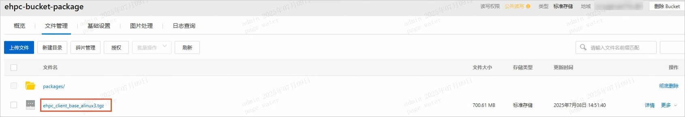 |
   | <code>/packages/aliyun/3</code><br>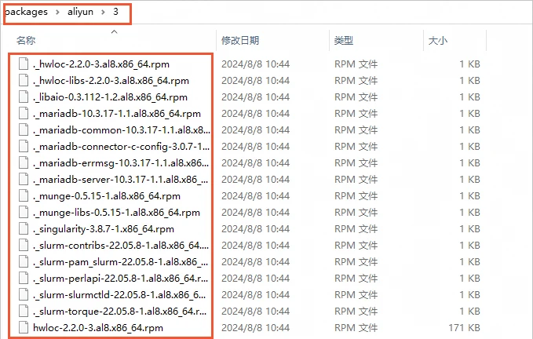 | <code>ehpc-bucket-package/packages/aliyun/3</code><br>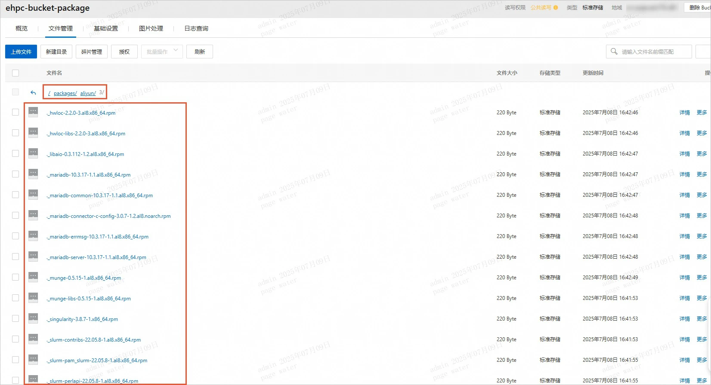 |
   | <code>/packages/centos/7</code><br>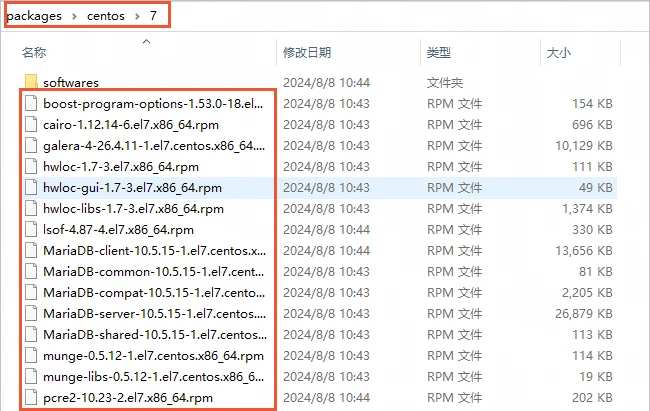 | <code>ehpc-bucket-package/packages/centos/7</code><br>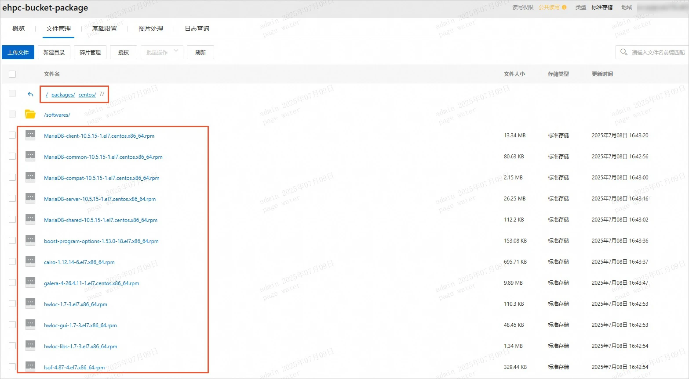 |
   | <code>/packages/centos/7/softwares/</code><br>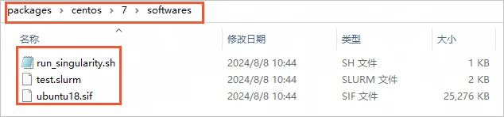 | <code>ehpc-bucket-</code><br><code>package/packages/centos/7/softwares/</code><br>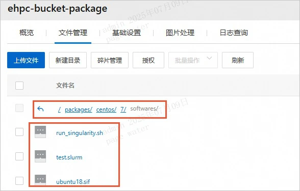 |

**操作步骤**

1. 登录E-HPC控制台。

2. 在左侧导航栏，单击**集群**。

3. 在**集群列表**页面，单击**创建集群**。

4. 配置集群参数。

   需要注意的参数如下：

   **是否必**

   **配置项**

   **说明**

   **选**

   仅支持按量计费。用户先使用服务，然后根据实际使用的资源量在事后生成费用。这种方式适用于业务用量经常变化的场景，用户可以根据实际需求灵活使用资源，避免浪费。

   **计费配**

   是

   **计费方式**

   > **说明**

   **置**

   > 仅当您的管理员在运营中心中配置了计费规则时才会展示此选项。关于计费规则的详细说明，请参见<strong>《Apsara Uni-manager运营控制台 用户指南》</strong>中的<strong>《计费规则》</strong>章节。

   是

   集群所属的组织和资源集。

   **组织/资源集**

   集群所属的地域和可用区。

   是

   **地域/可用区**

   可用区指在同一区域下，电力、网络隔离的物理区域，可用区之间内网互通，不同可用区之间做到故障隔离。

   集群名称，该名称将会在集群列表中显示，便于您查找识别。

   长度为2~64字符，至少包含下面五项中的一项：

   **基本信息**

   - 中文字符

   - 大写字母

   是

   **集群名称**

   - 小写字母

   - 数字

   - 特殊字符： ``( ) ` ~ ! @ # $ % ^ & * - + = | [ ] : ; '``

     ```text
     < > , . ? / { } 
     ```

   集群的登录密码。该密码用于远程SSH访问集群登录节点，Linux集群对应的用户名为root，Windows集群对应的用户名为administrator。

   长度为8~32个字符，至少同时包含下面四项中的三项：

   - 大写字母

   **登录密码**和**确认密**

   是

   - 小写字母

   **码**

   - 数字

   - 特殊字符： ``( ) ` ~ ! @ # $ % ^ & * - + = | [ ] : ; '``

     ```text
     < > , . ? / { } 
     ```

   **管理节点类**

   管理节点部署了调度服务和域账号服务，用于管理集群。请根据业务需要

   **型**

   是

   选择合适的节点规格，具体节点规格说明，请参见<strong>《云服务器ECS实例规格族&实例规格简介》</strong>。

   **管理节点数**

   是

   不可设置，默认为1。

   **量**

   计算节点用于执行高性能计算作业，其配置决定了集群的总体性能。请根

   **计算节点类**

   是

   据业务需要选择合适的节点规格，具体节点规格说明，请参见<strong>《云服务器</strong>

   **型**

   **ECS实例规格族&实例规格简介》**。

   **计算节点数**

   是

   根据作业需求，结合计算节点类型来设置计算节点数量。

   **量**

   所有节点系统盘使用的云盘类型。默认使用高效云盘，当前可用区无高效

   否

   **系统盘类型**

   云盘时，会自动使用SSD云盘。

   否

   所有节点系统盘的容量。取值范围：40~500 GB。

   **系统盘容量**

   集群所在的专有网络，不同的专有网络之间逻辑上彻底隔离。您可以在专

   是

   **VPC**

   有网络内创建和管理集群。

   集群所在的交换机，您在专有网络内创建集群时，必须指定云资源所连接

   是

   **交换机**

   的交换机。

   **文件系统类**

   是

   集群中挂载的文件系统类型，当前仅支持**通用型NAS**。

   **规格配**

   **型**

   **置**

   集群中挂载的文件系统的ID。

   是

   **文件系统ID**

   E-HPC所有用户数据、调度数据、作业共享数据等信息都会存储在文件系统中以供集群所有节点共享访问。

   **计算节点挂**

   是

   文件系统下的挂载点。

   **载点**

   调度器是指E-HPC集群上部署的作业调度软件。请根据业务需要选择其一：

   是

   **调度器类型**

   - **pbs**

   - **slurm**

   是

   镜像类型，支持公共镜像和自定义镜像。

   **镜像类型**

   不同镜像对应不同的操作系统，系统会根据您选择的镜像来部署集群节

   是

   **镜像Id**

   点。

   为节点绑定RAM角色，使得节点可以使用相关角色权限访问阿里云产品。系统创建的默认角色为AliyunECSInstanceForEHPCRole。

   **RAM角色**

   否

   > **重要**

   **授权**

   > 节点绑定RAM角色后，将授予节点该角色所拥有的所有权限，请谨慎操作。

   是

   E-HPC使用的Agent版本。默认为1.1.0。

   **Agent版本**

5. 配置完成后，请在页面右侧**配置概览**面板检查部署集的配置参数，确保符合您的要求。

6. 创建集群。

   - 服务管理中已创建云产品为**裸金属算力平台BMCP**、资源项为**裸金属-智算算力集群**的服务：确认相关参数，单击**确认订单**。

   - 服务管理中未创建云产品为**裸金属算力平台BMCP**、资源项为**裸金属-智算算力集群**的服务：确认相关参数，单击**提交**。

   关于服务管理的更多信息，请参见<strong>《Apsara Uni-manager运营控制台 用户指南》</strong> 中的<strong>《服务管理》</strong>章节。单击**确认订单**。

   > **说明**
   >
   > 您也可以选择单击**加入配置报价单**以便后续购买。

**执行结果**

创建完成后，在E-HPC集群页面，查看新创建的集群状态。若新创建的集群和集群所有节点都处于**运行中**状态，则集群已创建完成。

<a id="section-2-4"></a>

## 2.4. 登录集群

登录集群指连接到管控节点，本文介绍如何连接到E-HPC集群管控节点上进行业务操作，如下载作业算例、执行作业命令等。

**前期条件**

集群和集群节点状态都为**运行中**。

**操作步骤**

1. 登录E-HPC控制台。

2. 在左侧导航栏，单击**集群**。

3. 在集群页面，单击管理节点ID。

   跳转到该节点对应的ECS控制台**实例详情**页面。

4. 在**实例详情**页面的右上角，单击**远程连接**。

5. 在弹出的**远程连接**对话框中，单击**通过Workbench远程连接**对应的**立即登录**。

6. 输入实例的用户名和密码，登录实例。

   登录集群后，您可以根据业务需求，执行相关操作，如下载作业算例、执行作业命令、查看作业运行状态等。

   - 如果是Linux实例，输入用户名root和实例登录密码。

   - 如果是Windows实例，输入用户名administrator和实例登录密码。

     > **说明**
     >
     > 对于Linux操作系统，界面不会显示密码的输入过程，输入后直接按回车即可。

<a id="section-3"></a>

# 3.管理集群

<a id="section-3-1"></a>

## 3.1. 集群概述

集群指运行高性能计算的节点集合，可以提供单节点不能提供的强大计算能力，拥有高性能、弹性扩展、稳定可靠等优点。本文介绍集群涉及的基本概念和功能。

**基本概念**

> **说明**
>
> 本文仅介绍E-HPC集群的相关概念，通过BMCP控制台创建的裸金属-超算算力集群可以在E-HPC集群中展示并运行作业，但管理BMCP集群请在BMCP控制台操作。更多信息，请参见<strong>《机器学习 BMCP用户指南》</strong>中的<strong>《裸金属-超算算力集群》</strong>章节。

<table>
  <tr>
    <th width="90">基本概念</th>
    <th>详细说明</th>
  </tr>
  <tr>
    <td>节点</td>
    <td>E-HPC集群中的每个节点是一台ECS实例或者BMCP高网实例。按节点功能分类，可以分为管控节点和计算节点。</td>
  </tr>
  <tr>
    <td>镜像</td>
    <td>镜像提供集群节点所需的信息，包括必要的操作系统和相关配置数据等。E-HPC支持以下几类镜像：<br>• 公共镜像：阿里云官方镜像。<br>• 自定义镜像：支持按需导入镜像。<br>说明当集群节点为ECS实例支持使用镜像。</td>
  </tr>
  <tr>
    <td>调度器</td>
    <td>调度器是集群上调度作业的软件。</td>
  </tr>
  <tr>
    <td>共享存储</td>
    <td>E-HPC集群的用户数据、调度器信息、作业共享数据等信息均会存储在文件系统，以供集群所有节点共享访问。E-HPC当前仅支持通用型NAS文件系统。</td>
  </tr>
  <tr>
    <td>用户</td>
    <td>创建集群用户后，您才能在集群上提交、调试、运行作业。您可以创建两种不同权限的用户来使用集群。<br>• 普通权限组：适用于只有提交、调试作业需求的普通用户。<br>• sudo权限组：适用于需要管理集群的管理员，除提交、调试作业外，还可以执行sudo命令进行安装软件、重启节点等操作。</td>
  </tr>
</table>

**集群状态**

- **创建中**：集群创建初始状态。

- **安装中**：集群处于安装软件状态。

- **初始化中**：集群处于初始化阶段，包括初始化root用户等。

- **运行中**：集群创建完成后处于正常可用状态。

- **异常**：当管理节点被删除或停止、调度器软件退出时，集群状态为**异常**。您可以尝试修复集群，若修复无效后，请联系技术支持。

- **释放中**：集群在停机释放过程中。

<a id="section-3-2"></a>

## 3.2. 创建集群

创建集群时，您需要配置节点、文件系统、调度器等资源，节点用于高性能计算、文件系统用于存储资源、调度器用于作业调度。本文介绍如何在E-HPC控制台创建集群。

**前提条件**

- 已创建专有网络和创建交换机。具体操作，请参见<strong>《专有网络VPC用户指南》</strong>中的<strong>《创建和管理专有网络》</strong>和<strong>《创建和管理交换机》</strong>章节。

- 开通NAS服务，创建NAS文件系统（通用型）和挂载点。具体操作，请参见<strong>《文件存储NAS用户指南》</strong>中<strong>《创建文件系统》</strong>。

**准备工作**

1. 创建Bucket及对应目录。

   <ol type="i">

   <li>

   创建**Bucket名称**为ehpc-bucket-package，**读写权限**为**公共读写**的Bucket。具体操作，请参见<strong>《对象存储用户指南》</strong>中的<strong>《创建存储空间》</strong>章节。

   </li>

   <li>

   在已创建的Bucket中创建 `packages/aliyun/3` 目录和 `packages/centos/7/softwares` 目录。

   </li>

   </ol>

2. 下载E-HPC集群所需的ehpc_client_base_alinux3.tgz和packages.tgz。

   packages.tgz下载完后需执行 `tar -xvzf packages.tgz` 解压文件，解压完成后， `packages` 文件夹下将会有以下两个文件夹。

   

3. 将下载的文件上传到新创建的Bucket。

   上传文件时，请勿修改文件名称。下载及解压后的文件对应的Bucket中的位置如下表所示：

   | 下载或解压后的文件 | 上传到Bucket中的目录 |
   | --- | --- |
   | ehpc_client_base_alinux3.tgz | ehpc-bucket-package<br> |

   <table>
     <tr>
       <td><code>/packages/aliyun/3</code><br></td>
       <td><code>ehpc-bucket-package/packages/aliyun/3</code><br></td>
     </tr>
     <tr>
       <td><code>/packages/centos/7</code><br></td>
       <td><code>ehpc-bucket-package/packages/centos/7</code><br></td>
     </tr>
     <tr>
       <td><code>/packages/centos/7/softwares/</code><br></td>
       <td><code>ehpc-bucket-</code><br><code>package/packages/centos/7/softwares/</code><br></td>
     </tr>
   </table>

**操作步骤**

1. 登录E-HPC控制台。

2. 在左侧导航栏，单击**集群**。

3. 在**集群列表**页面，单击**创建集群**。

4. 配置集群参数。

   需要注意的参数如下：

   **是否必**

   **配置项**

   **说明**

   **选**

   仅支持按量计费。用户先使用服务，然后根据实际使用的资源量在事后生成费用。这种方式适用于业务用量经常变化的场景，用户可以根据实际需求灵活使用资源，避免浪费。

   **计费配**

   是

   **计费方式**

   > **说明**

   **置**

   > 仅当您的管理员在运营中心中配置了计费规则时才会展示此选项。关于计费规则的详细说明，请参见<strong>《Apsara Uni-manager运营控制台 用户指南》</strong>中的<strong>《计费规则》</strong>章节。

   是

   集群所属的组织和资源集。

   **组织/资源集**

   集群所属的地域和可用区。

   是

   **地域/可用区**

   可用区指在同一区域下，电力、网络隔离的物理区域，可用区之间内网互通，不同可用区之间做到故障隔离。

   集群名称，该名称将会在集群列表中显示，便于您查找识别。

   长度为2~64字符，至少包含下面五项中的一项：

   - 中文字符

   - 大写字母

   是

   **集群名称**

   - 小写字母

   **基本信**

   - 数字

   **息**

   - 特殊字符： ``( ) ` ~ ! @ # $ % ^ & * - + = | [ ] : ; '``

     ```text
     < > , . ? / { } 
     ```

   集群的登录密码。该密码用于远程SSH访问集群登录节点，Linux集群对应的用户名为root，Windows集群对应的用户名为administrator。

   长度为8~32个字符，至少同时包含下面四项中的三项：

   - 大写字母

   **登录密码**和**确认密**

   是

   - 小写字母

   **码**

   - 数字

   - 特殊字符： ``( ) ` ~ ! @ # $ % ^ & * - + = | [ ] : ; '``

     ```text
     < > , . ? / { } 
     ```

   管理节点部署了调度服务和域账号服务，用于管理集群。请根据业务需要

   **管理节点类**

   是

   选择合适的节点规格，具体节点规格说明，请参见<strong>《云服务器ECS实例</strong>

   **型**

   **规格族&实例规格简介》**。

   **管理节点数**

   是

   不可设置，默认为1。

   **量**

   计算节点用于执行高性能计算作业，其配置决定了集群的总体性能。请根

   **计算节点类**

   是

   据业务需要选择合适的节点规格，具体节点规格说明，请参见<strong>《云服务器</strong>

   **型**

   **ECS实例规格族&实例规格简介》**。

   **计算节点数**

   是

   根据作业需求，结合计算节点类型来设置计算节点数量。

   **量**

   所有节点系统盘使用的云盘类型。默认使用高效云盘，当前可用区无高效

   否

   **系统盘类型**

   云盘时，会自动使用SSD云盘。

   否

   所有节点系统盘的容量。取值范围：40~500 GB。

   **系统盘容量**

   集群所在的专有网络，不同的专有网络之间逻辑上彻底隔离。您可以在专

   是

   **VPC**

   有网络内创建和管理集群。

   集群所在的交换机，您在专有网络内创建集群时，必须指定云资源所连接

   是

   **交换机**

   的交换机。

   **文件系统类**

   是

   集群中挂载的文件系统类型，当前仅支持**通用型NAS**。

   **型**

   **规格配**

   集群中挂载的文件系统的ID。

   **置**

   是

   **文件系统ID**

   E-HPC所有用户数据、调度数据、作业共享数据等信息都会存储在文件系统中以供集群所有节点共享访问。

   **计算节点挂**

   是

   文件系统下的挂载点。

   **载点**

   调度器是指E-HPC集群上部署的作业调度软件。请根据业务需要选择其一：

   是

   **调度器类型**

   - **pbs**

   - **slurm**

   是

   镜像类型，支持公共镜像和自定义镜像。

   **镜像类型**

   不同镜像对应不同的操作系统，系统会根据您选择的镜像来部署集群节

   是

   **镜像Id**

   点。

   为节点绑定RAM角色，使得节点可以使用相关角色权限访问阿里云产品。系统创建的默认角色为AliyunECSInstanceForEHPCRole。

   **RAM角色**

   否

   > **重要**

   **授权**

   > 节点绑定RAM角色后，将授予节点该角色所拥有的所有权限，请谨慎操作。

   是

   E-HPC使用的Agent版本。默认为1.1.0。

   **Agent版本**

5. 配置完成后，请在页面右侧**配置概览**面板检查部署集的配置参数，确保符合您的要求。

6. 创建集群。

   - 服务管理中已创建云产品为**裸金属算力平台BMCP**、资源项为**裸金属-智算算力集群**的服务：确认相关参数，单击**确认订单**。

   - 服务管理中未创建云产品为**裸金属算力平台BMCP**、资源项为**裸金属-智算算力集群**的服务：确认相关参数，单击**提交**。

   关于服务管理的更多信息，请参见<strong>《Apsara Uni-manager运营控制台 用户指南》</strong> 中的<strong>《服务管理》</strong>章节。单击**确认订单**。

   > **说明**
   >
   > 您也可以选择单击**加入配置报价单**以便后续购买。

**执行结果**

创建完成后，在E-HPC集群页面，查看新创建的集群状态。若新创建的集群和集群所有节点都处于**运行中**状态，则集群已创建完成。

<a id="section-3-3"></a>

## 3.3. 查看集群详情

本文介绍如何查看已创建的集群列表和集群登录节点的详细信息。

**操作步骤**

1. 登录E-HPC控制台。

2. 在左侧导航栏，单击**集群**。

   展示当前地域中已创建的集群列表和集群信息，包括集群ID/集群名称、集群状态、计算节点类型、计算节点数、调度器类型、操作系统类型等。

3. 在集群列表中选择目标集群。

4. 单击目标集群所在行的**管理节点ID**。

   跳转至该节点对应的ECS控制台实例详情页面，查看实例的详细配置信息。

<a id="section-3-4"></a>

## 3.4. 登录集群

登录集群指连接到管控节点，本文介绍如何连接到E-HPC集群管控节点上进行业务操作，如下载作业算例、执行作业命令等。

**前期条件**

集群和集群节点状态都为**运行中**。

**操作步骤**

1. 登录E-HPC控制台。

2. 在左侧导航栏，单击**集群**。

3. 在集群页面，单击管理节点ID。

   跳转到该节点对应的ECS控制台**实例详情**页面。

4. 在**实例详情**页面的右上角，单击**远程连接**。

5. 在弹出的**远程连接**对话框中，单击**通过Workbench远程连接**对应的**立即登录**。

6. 输入实例的用户名和密码，登录实例。

   登录集群后，您可以根据业务需求，执行相关操作，如下载作业算例、执行作业命令、查看作业运行状态等。

   - 如果是Linux实例，输入用户名root和实例登录密码。

   - 如果是Windows实例，输入用户名administrator和实例登录密码。

     > **说明**
     >
     > 对于Linux操作系统，界面不会显示密码的输入过程，输入后直接按回车即可。

<a id="section-3-5"></a>

## 3.5. 扩容集群

E-HPC支持扩容，当业务发展导致集群计算节点不足时，您可以根据实际需求扩容集群，增加计算节点。

**前提条件**

扩容节点所在地域有可用交换机，关于如何创建交换机，请参见<strong>《专有网络VPC用户指南》</strong>中的<strong>《创建和管理交换机》</strong>章节。

**使用限制**

当节点实例规格为BMCP规格时，不支持在E-HPC控制台进行扩容，只能在裸金属算力平台BMCP控制台进行扩容。具体操作，请参见<strong>《机器学习 BMCP用户指南》</strong>中的<strong>《裸金属-超算算力集群 >集群扩容》</strong>章节。

**操作步骤**

本文以在E-HPC控制台进行扩容为例进行说明如何扩容集群。

1. 登录E-HPC控制台。

2. 在左侧导航栏，单击**集群**。

3. 在**集群列表**页面，选择需要扩容的集群，单击操作列的**扩容**。

4. 在**集群扩容**面板，完成基本配置。

   <table>
     <tr>
       <th>配置项</th>
       <th>是否必选</th>
       <th>说明</th>
     </tr>
     <tr>
       <td>可用区</td>
       <td>是</td>
       <td>扩容计算节点所在地域的可用区。E-HPC支持跨可用区扩容，扩容节点所在可用区可与集群所在的可用区不同。</td>
     </tr>
     <tr>
       <td>新增节点规格</td>
       <td>否</td>
       <td>需要扩容的计算节点的规格。</td>
     </tr>
     <tr>
       <td>新增节点数量</td>
       <td>是</td>
       <td>需要扩容的计算节点的数量。</td>
     </tr>
     <tr>
       <td>交换机</td>
       <td>是</td>
       <td>扩容节点所在的交换机，您在专有网络内扩容集群时，必须指定该集群内云资源所连接的交换机。</td>
     </tr>
     <tr>
       <td>操作系统镜像标签</td>
       <td>是</td>
       <td>系统自动填入，不可设置。</td>
     </tr>
     <tr>
       <td>镜像类型</td>
       <td>是</td>
       <td>镜像类型，支持公共镜像和自定义镜像。</td>
     </tr>
     <tr>
       <td>镜像Id</td>
       <td>是</td>
       <td>不同镜像对应不同的操作系统，系统会根据您选择的镜像来部署集群节点。</td>
     </tr>
     <tr>
       <td>队列</td>
       <td>否</td>
       <td>扩容节点需要加入的队列，在不指定的情况下自动加入集群默认队列。</td>
     </tr>
     <tr>
       <td>主机名前缀</td>
       <td>否</td>
       <td rowspan="2">根据业务需求设置，方便您标记管理节点。</td>
     </tr>
     <tr>
       <td>主机名后缀</td>
       <td>否</td>
     </tr>
     <tr>
       <td>系统盘</td>
       <td>否</td>
       <td>扩容节点的系统盘类型。默认使用高效云盘，当前可用区无高效云盘时，会自动使用SSD云盘。</td>
     </tr>
     <tr>
       <td>系统盘大小</td>
       <td>是</td>
       <td>扩容节点的系统盘大小。取值范围：40~500 GB。</td>
     </tr>
   </table>

5. 单击**确认订单**。

<a id="section-3-6"></a>

## 3.6. 通过客户端测试集群性能

E-HPC客户端提供了可视化的页面来配置HPL、iPerf和FIO应用，可以快速提交相关作业，测试集群benchmark性能，包括浮点计算能力、带宽性能和读写能力。

**背景信息**

测试集群benchmark性能将使用以下几个软件：

- HPL：一个测试高性能计算集群系统浮点性能的基准程序。HPL通过对高性能计算集群采用高斯消元法求解一元N次稠密线性代数方程组的测试，评价高性能计算集群的浮点计算能力。

- iPerf：一个网络性能测试工具，支持设置协议、时间等相关参数，可以报告带宽、数据包丢失等。

- FIO：一个开源的I/O压力测试工具，主要用于测试磁盘的IO性能，支持多引擎和多场景测试。

**前提条件**

- 集群和节点状态均处于**运行中**。

- 集群已配置共享存储，即已挂载NAS文件系统。

**准备工作**

1. 配置环境。具体操作，请参见配置客户端所需环境。

2. 下载并登录客户端。具体操作，请参见安装并登录客户端。

3. 确认集群中已安装测试所需的软件。

   相关说明如下：

   - HPL：需自行安装intel-mpi。

   - iPerf：默认已安装。

   - FIO：可在计算节点执行 `yum install -y fio` 命令安装。

4. 修改配置文件。

   在客户端的**数据管理**页面打开当前用户路径下的 `.bashrc` 文件（该文件默认隐藏，可单击右上角的 

   图标，配置显示隐藏文件），增加以下内容：

   ```bash
   export MODULEPATH=/opt/ehpcmodulefiles/
   module load openmpi/3.0.0
   ```

**操作步骤**

1. 打开并登录客户端。

2. 在左侧导航栏，单击**应用中心**。

3. 测试算力。

   <ol type="i">

   <li>

   单击**hpl**应用。

   </li>

   <li>

   在弹出面板配置相关参数，单击**提交**。

   <table>
     <tr>
       <th>参数类型</th>
       <th>参数</th>
       <th>示例值</th>
       <th>描述</th>
     </tr>
     <tr>
       <td rowspan="5">基础参数</td>
       <td>作业名称</td>
       <td>hpltest</td>
       <td>自定义设置。</td>
     </tr>
     <tr>
       <td>作业队列</td>
       <td>workq</td>
       <td>运行该作业的队列。</td>
     </tr>
     <tr>
       <td>CPU核数</td>
       <td>2</td>
       <td>单个节点的CPU核数。</td>
     </tr>
     <tr>
       <td>节点数</td>
       <td>1</td>
       <td>运行该作业所需的计算节点数。</td>
     </tr>
     <tr>
       <td>输出日志</td>
       <td>hpl_test.log</td>
       <td>作业运行日志的输出路径。</td>
     </tr>
     <tr>
       <td rowspan="2">应用参数</td>
       <td>求解规模</td>
       <td>25600</td>
       <td>求解的矩阵规模（N）。规模越大，有效计算所占的比例越大，则系统浮点处理性能越高。但矩阵规模越大会导致内存消耗量越多，如果系统实际内存空间不足，使用缓存、性能会大幅度降低。矩阵占用系统总内存的80%左右为最佳，即N×N×8=系统总内存×80%（其中总内存的单位为字节）。</td>
     </tr>
     <tr>
       <td>分块大小</td>
       <td>192 256</td>
       <td>求解矩阵过程中矩阵分块的大小（NB）。NB值的选择主要是通过实际测试得出最优值。</td>
     </tr>
   </table>

   </li>

   </ol>

4. 测试带宽。

   <ol type="i">

   <li>

   单击**iperf**应用。

   </li>

   <li>

   在弹出面板配置相关参数，单击**提交**。

   <table>
     <tr>
       <th>参数类型</th>
       <th>参数</th>
       <th>示例值</th>
       <th>描述</th>
     </tr>
     <tr>
       <td rowspan="5">基础参数</td>
       <td>作业名称</td>
       <td>iperftest</td>
       <td>自定义设置。</td>
     </tr>
     <tr>
       <td>作业队列</td>
       <td>workq</td>
       <td>运行该作业的队列。</td>
     </tr>
     <tr>
       <td>CPU核数</td>
       <td>2</td>
       <td>单个节点的CPU核数。</td>
     </tr>
     <tr>
       <td>节点数</td>
       <td>1</td>
       <td>运行该作业所需的计算节点数。</td>
     </tr>
     <tr>
       <td>输出日志</td>
       <td>iperf_test.log</td>
       <td>作业运行日志的输出路径。</td>
     </tr>
     <tr>
       <td rowspan="2">应用参数</td>
       <td>HostName</td>
       <td>manager</td>
       <td>要测试的节点主机名称。</td>
     </tr>
     <tr>
       <td>主机网卡</td>
       <td>eth0</td>
       <td>要测试的节点主机网卡。</td>
     </tr>
   </table>

   </li>

   </ol>

5. 测试读写能力。

   <ol type="i">

   <li>

   单击**fio**应用。

   </li>

   <li>

   在弹出面板配置相关参数，单击**提交**。

   <table>
     <tr>
       <th>参数类型</th>
       <th>参数</th>
       <th>示例值</th>
       <th>描述</th>
     </tr>
     <tr>
       <td rowspan="5">基础参数</td>
       <td>作业名称</td>
       <td>fiotest</td>
       <td>自定义设置。</td>
     </tr>
     <tr>
       <td>作业队列</td>
       <td>workq</td>
       <td>运行该作业的队列。</td>
     </tr>
     <tr>
       <td>CPU核数</td>
       <td>2</td>
       <td>单个节点的CPU核数。</td>
     </tr>
     <tr>
       <td>节点数</td>
       <td>1</td>
       <td>运行该作业所需的计算节点数。</td>
     </tr>
     <tr>
       <td>输出日志</td>
       <td>iperf_test.log</td>
       <td>作业运行日志的输出路径。</td>
     </tr>
     <tr>
       <td rowspan="7">应用参数</td>
       <td>ioengine</td>
       <td>psync</td>
       <td>I/O引擎使用的测试方式。可选项：<br>• psync<br>• libaio</td>
     </tr>
     <tr>
       <td>读写方式</td>
       <td>rw</td>
       <td>测试的读写方式。可选项：<br>• read：顺序读<br>• write：顺序写<br>• rw：顺序读写<br>• randread：随机读<br>• randwrite：随机写<br>• randrw：随机读写</td>
     </tr>
     <tr>
       <td>Io Size</td>
       <td>4K</td>
       <td>单次I/O测试的块文件大小，可配置为4K或16K。</td>
     </tr>
     <tr>
       <td>Threads</td>
       <td>1</td>
       <td>测试线程数。</td>
     </tr>
     <tr>
       <td>Time</td>
       <td>100s</td>
       <td>测试时间。</td>
     </tr>
     <tr>
       <td>读写数据量</td>
       <td>1024M</td>
       <td>要测试的数据量。</td>
     </tr>
     <tr>
       <td>测试文件</td>
       <td>/home/username</td>
       <td>存放系统生成的测试文件的路径。</td>
     </tr>
   </table>

   </li>

   </ol>

**查看结果**

1. 在客户端的左侧导航栏，单击**作业查询**。

2. 找到HPL、iPerf和FIO作业，分别确认作业状态并获取结果。

   当作业状态变为**FINISHED**时，单击作业对应的**详情**，在**作业详情**页面单击**作业输出文件与路径**后的**查看**，即可查看结果。结果示例如下：

   - HPL

     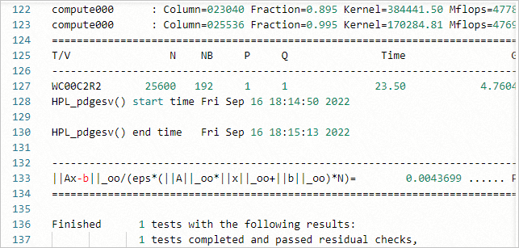

   - iPerf

     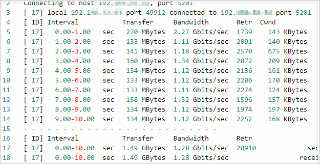

   - FIO

     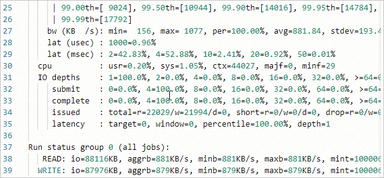

<a id="section-3-7"></a>

## 3.7. 释放集群

当集群不再使用时，您可以随时选择释放集群。本文介绍如何释放集群。

**前提条件**

释放集群后不可恢复，建议您释放前备份好集群数据。

**操作步骤**

1. 登录E-HPC控制台。

2. 在左侧导航栏，单击**集群**。

3. 在集群列表中选择目标集群。

4. 单击目标集群操作列的**释放**。

5. 在弹出的对话框中确认信息，然后单击**释放**。

6. 单击**确认订单**。

   集群将进入**释放中**状态，释放完成后集群列表不再显示此集群信息。

<a id="section-4"></a>

# 4.节点与队列

<a id="section-4-1"></a>

## 4.1. 节点与队列概述

本文介绍节点和队列的相关概念。

**什么是管控节点**

管控节点用于管理集群的节点，部署了调度服务和域账号服务。

- 调度服务：主要作用是运行PBS或Slurm等调度工具的服务端，处理作业提交、管理调度等。

- 域账号服务：集中管理E-HPC集群内用户信息。

**什么是计算节点**

计算节点是E-HPC集群的关键组件之一，用于执行计算任务和处理数据。每个计算节点是一台ECS实例或BMCP高网实例，它们提供了计算能力和存储能力，能够承载和运行各种类型的计算工作负载，如并行计算、大规模数据处理、深度学习训练等。通过配置多个计算节点，您可以构建一个强大的计算集群，以快速、高效地完成大规模计算任务。

**什么是队列**

在E-HPC集群中，队列是一个用于管理和调度作业的资源分配单元（计算节点池）。队列定义了作业的优先级、限制和调度策略，并且可以根据用户的需求进行配置。队列可以根据不同的作业类型、用户组或资源需求进行划分，以便更有效地管理和利用集群资源。通过配置队列，用户可以实现作业的优先级管理、资源限制和负载均衡，从而更好地满足不同用户的需求。

**节点与队列的关系**

在E-HPC集群中，节点和队列是两个关键概念，它们共同协作以实现高效的资源管理和任务调度。

- 节点作为队列的元素

  在E-HPC集群中，每个计算节点可以被视为队列中的一个元素。这些节点负责执行分配给它们的任务。节点的状态（如空闲、忙碌、维护等）会影响它们在队列中的位置和优先级。

- 队列管理节点任务

  队列系统负责接收、排序和分发任务到各个节点。它根据任务的优先级、资源需求和节点的可用性来调度任务。队列系统还负责监控节点的健康状况，确保任务能够在最佳状态下执行。

- 动态资源分配

  队列系统能够根据任务对资源的实际需求，动态地将任务分配到具有相应资源的节点上，例如将内存密集型任务分配给内存资源丰富的节点，有助于优化资源使用，提高集群的整体性能。

- 负载均衡

  队列系统通过智能调度算法来平衡集群内的负载，确保没有单个节点因过载而影响性能，同时也不会让其他节点资源闲置，从而提高整体效率。

<a id="section-4-2"></a>

## 4.2. 管理节点

<a id="section-4-2-1"></a>

### 4.2.1. 查看节点详情

本章节主要介绍如何查询集群节点信息，以及各节点的功能。

**操作步骤**

1. 登录E-HPC控制台。

2. 在左侧导航栏，单击**节点与队列。**

3. 在**集群**列表中选择目标集群。

4. 在**节点类型**列表中选择目标类型，即可查看不同类型的节点列表。

   不同类型节点说明如下表所示。

   <table>
     <tr>
       <th width="90">节点类型</th>
       <th>说明</th>
     </tr>
     <tr>
       <td>管控节点</td>
       <td>包括调度服务器和域帐号服务器。<br>• 调度服务器：主要作用是运行PBS调度器的服务端，处理作业提交、管理调度等。<br>• 域帐户服务器：集中管理E-HPC集群内用户信息。</td>
     </tr>
     <tr>
       <td>计算节点</td>
       <td>用于执行高性能计算作业的节点，其配置决定了E-HPC集群的总体性能。</td>
     </tr>
   </table>

5. 单击目标节点所在行的**更多** >**详情**。

   跳转至ECS控制台实例详情页面，查看该节点对应的ECS实例的详细配置信息。

<a id="section-4-2-2"></a>

### 4.2.2. 启动节点

在节点处于停止状态时无法运行作业，如需使用需要先启动节点。本文介绍如何在E-HPC管理控制台启动节点。

**前提条件**

节点类型必须为计算节点，并且节点状态为**停止**。

**操作步骤**

1. 登录E-HPC控制台。

2. 在左侧导航栏，单击**节点与队列。**

3. 在**集群**列表中选择目标集群，在**节点类型**列表中选择计算节点。

4. 在节点列表中选中要启动的节点，单击节点列表上方的**启动**。

5. 在**启动**对话框，单击**确定**。

<a id="section-4-2-3"></a>

### 4.2.3. 停止节点

当您暂时不需要某些节点运行作业时，可以停止节点。本文介绍如何在E-HPC管理控制台停止节点。

**前提条件**

节点类型必须为计算节点，并且节点状态为**运行中**。

**操作步骤**

1. 登录E-HPC控制台<strong>。</strong>

2. 在左侧导航栏，单击**节点与队列。**

3. 在**集群**列表中选择目标集群，在**节点类型**列表中选择计算节点。

4. 在节点列表中选中要停止的节点，单击节点列表上方的**停机**。

5. 在**停机**对话框，单击**确定**。

<a id="section-4-2-4"></a>

### 4.2.4. 重启节点

当节点异常时，您可以重启节点进行修复。本文介绍如何在E-HPC管理控制台重启节点。

**背景信息**

重启节点时，正在该节点运行的作业将会停止。如无特殊需要（如故障修复等），请勿重启处于**运行中**状态的节点。

**操作步骤**

1. 登录E-HPC控制台。

2. 在左侧导航栏，单击**节点与队列。**

3. 在**集群**列表中选择目标集群，在**节点类型**列表中选择目标节点类型。

4. 在节点列表中选择要重启的节点，单击操作列的**重启**。

5. 在**重启节点**对话框，选择重启方式，单击**确定**。

   - **普通重启**：向节点发送重启命令，由操作系统完成终止进程、系统重启等操作。

   - **强制重启**：等同于强制断电重启，可能丢失数据。请仅在普通重启失败时再尝试强制重启。

<a id="section-4-2-5"></a>

### 4.2.5. 删除节点

本文主要介绍如何删除集群中空闲或者不再使用的计算节点，以节省配置资源。

**前提条件**

仅支持删除计算节点。

**背景信息**

您可以通过删除计算节点对集群进行缩容。删除节点时，有以下注意事项：

- 目标计算节点中有作业在运行时，不支持删除。

- 删除节点不可恢复，建议您删除前备份作业数据。

**操作步骤**

1. 登录E-HPC控制台。

2. 在左侧导航栏，单击**节点与队列。**

3. 在**集群**列表中选择目标集群，在**节点类型**列表中选择**计算节点**。

4. 在节点列表区域，选中要删除的节点，单击**批量删除**。

5. 在弹出的**批量删除**对话框，单击**确定**。

<a id="section-4-3"></a>

## 4.3. 管理队列

<a id="section-4-3-1"></a>

### 4.3.1. 创建队列

E-HPC支持通过队列将运行不同作业或执行不同任务的计算节点进行分类，便于筛选节点。本文介绍如何在E-HPC管理控制台创建队列。

**背景信息**

集群中计算节点必须属于一个队列，如果没有自定义队列，节点默认加入集群的默认队列。

**操作步骤**

1. 登录E-HPC控制台。

2. 在左侧导航栏，单击**节点和队列**。

3. 在**集群**列表中选择目标集群，在**节点类型**列表中选择**计算节点**。

4. 在节点列表区域，单击**新建队列**。

5. 在**新建队列**面板，输入队列名称，单击**确定**。

   创建完成后，单击**队列**右侧的下拉列表，可以查看到该集群所有队列信息。

**后续步骤**

创建队列后，您可以将计算节点移动到该队列，具体操作，请参见在队列间移动节点。

<a id="section-4-3-2"></a>

### 4.3.2. 在队列间移动节点

本文介绍如何在集群不同队列之间移动计算节点。

**操作步骤**

1. 登录E-HPC控制台。

2. 在左侧导航栏，单击**节点和队列**。

3. 在**集群**列表中选择目标集群。

4. 在**节点类型**列表中选择计算节点。

5. 在节点列表区域，选择要移动的计算节点，单击**移动到队列**。

6. 在**移动到队列**面板，选择目标队列，单击**确定**。

   在**队列**列表中，选择目标队列，可看到该节点已经迁移到目标队列中。

<a id="section-4-3-3"></a>

### 4.3.3. 删除队列

本文介绍如何在E-HPC管理控制台删除队列。

**背景信息**

删除队列时，有以下限制：

- 集群中默认队列不可删除。

- 使用调度器的集群，队列中存在节点时不可删除。

**操作步骤**

1. 登录E-HPC控制台。

2. 在左侧导航栏，单击**节点和队列**。

3. 在**集群**列表中选择目标集群，在**节点类型**列表中选择计算节点。

4. 在节点列表区域，选择要删除的队列，单击**删除队列**。

5. 在**删除队列**对话框，单击**确定**。

<a id="section-5"></a>

# 5.管理用户

<a id="section-5-1"></a>

## 5.1. 用户概述

用户用于在集群中提交作业时标识身份。E-HPC集群支持创建具有不同权限的用户，方便区分管理员和普通用户。本文介绍关于E-HPC集群用户的相关概念。

**为什么要创建集群用户**

在E-HPC集群中，创建集群用户有以下几个重要原因：

- 访问权限控制

  为了保证集群中的资源和数据的安全性，需要通过创建集群用户来管理访问权限，以便限制不同用户对资源和数据的访问和操作权限。

- 用户身份识别

  通过创建集群用户，可以对用户进行身份认证和识别，以确保集群中的用户具有合法的身份和权限，并且可以进行相应的操作和管理。

- 用户管理

  通过创建集群用户，可以方便地对用户进行管理和监控，包括创建用户、密码管理、用户组管理等，以确保集群中的用户信息和权限的安全和合理管理。

综上所述，创建集群用户是保证集群安全和有效管理的重要手段，是集群管理中的重要环节之一。

**支持的用户类型**

在E-HPC集群中，用户账号体系通常分为以下两种类型：

- sudo权限组

  指用于运行集群系统服务和管理操作的用户账号，具有较高的权限。

  > **重要**
  >
  > 请谨慎分配sudo权限。具有sudo权限的用户如果操作错误（如误删除E-HPC软件栈模块），会导致集群异常。

- 普通权限组

  指普通的集群用户账号，用于提交计算任务和使用集群资源。每个普通用户都有自己的用户名和密码。

<a id="section-5-2"></a>

## 5.2. 创建用户

您必须提前创建用户，用于在集群中提交作业时标识身份。E-HPC集群支持创建具有不同权限的用户，方便区分管理员和普通用户角色。

**前提条件**

集群和集群节点状态都为**运行中**。

**操作步骤**

1. 登录E-HPC控制台。

2. 在左侧导航栏，单击**用户**。

3. 在**用户**页面，在集群列表中选择目标集群，单击**新增用户**。

4. 在**新增用户**对话框，根据提示填写用户信息。

   <table>
     <tr>
       <th width="170">参数</th>
       <th>说明</th>
     </tr>
     <tr>
       <td>用户名</td>
       <td>集群的用户名，用于登录集群。格式要求请参考界面提示。</td>
     </tr>
     <tr>
       <td>用户组</td>
       <td>用户组用于控制用户的权限：<br>• 普通权限组：适用于只有提交、调试作业需求的普通用户。<br>• sudo权限组：适用于需要管理集群的管理员，除提交、调试作业外，还可以执行sudo命令进行安装软件、重启节点等操作。<br>重要请谨慎分配sudo权限，操作错误时（如误删除E-HPC软件栈模块）会导致集群异常。</td>
     </tr>
     <tr>
       <td>密码、再次输入密码</td>
       <td>集群的登录密码。格式要求请参考界面提示。</td>
     </tr>
   </table>

5. 单击**确定**。

   创建完成后，在用户列表区域，可以查看新建的用户信息。

<a id="section-5-3"></a>

## 5.3. 修改用户信息

本文介绍如何在E-HPC管理控制台修改用户权限和重置用户密码。

**修改用户权限**

1. 登录E-HPC控制台。

2. 在左侧导航栏，单击**用户**。

3. 在**用户**页面，在集群列表中选择目标集群。

4. 在**集群用户管理**区域，找到需要修改权限的用户，单击操作列的**修改权限**。

5. 在**修改用户权限**对话框，从**用户组**列表中选择需要的用户组，单击**确定**。

   - 普通权限组：适用于只有提交、调试作业需求的普通用户。

   - sudo权限组：适用于需要管理集群的管理员，除提交、调试作业外，还可以执行sudo命令进行安装软件、重启节点等操作。

**重置用户密码**

E-HPC不提供密码找回功能，但您可以为丢失或泄漏密码的用户重置密码。

1. 登录E-HPC控制台。

2. 在左侧导航栏，单击**用户**。

3. 在**用户**页面，在集群列表中选择目标集群。

4. 在**集群用户管理**区域，找到需要重置密码的用户，单击操作列的**重置用户密码**。

5. 根据页面提示，设置符合要求的新密码，单击**确定**。

<a id="section-5-4"></a>

## 5.4. 删除用户

当不再需要用户时，您可以删除用户。本文介绍如何在E-HPC管理控制台删除用户。

**操作步骤**

1. 登录E-HPC控制台。

2. 在左侧导航栏，单击**用户**。

3. 在**用户**页面，在集群列表中选择目标集群。

4. 在**集群用户管理**区域，找到需要删除的用户，单击操作列的**删除**。

   > **重要**
   >
   > 删除用户后会保留用户数据（/home下对应的用户目录）供其他用户访问，但被删除的用户不可恢复，即使再次创建同名用户也不会复用保留的数据。

5. 在弹出的**删除用户**对话框，单击**确定**。

<a id="section-6"></a>

# 6.管理作业

<a id="section-6-1"></a>

## 6.1. 作业概述

本文介绍E-HPC集群作业的定义、类型以及作业提交方式功能。

**什么是作业**

在E-HPC集群中，作业是指通过命令行命令、Shell脚本或可执行文件形式提交到集群进行高性能计算的基本工作单元。作业的具体运行方式将根据您设置的队列和调度器配置进行决定。您可以根据自己的需求设置作业的优先级和资源要求，以便集群可以按照您的需求进行作业调度和执行。

**作业类型**

根据提交作业的场景不同，作业类型分为以下两种：

**批处理**

批处理作业是一种无需用户交互的作业类型，通常用于运行大规模、长时间的计算或数据处理任务。您可以向系统提交批处理作业，并指定作业的参数和要运行的程序，然后系统会按照一定的调度策略自动执行这些作业。批处理作业通常用于后台运行，不需要您实时干预，适合大规模高性能计算任务。

**交互式**

交互式作业是一种需要用户实时交互的作业类型，您可以在命令行或图形界面上直接输入指令并观察结果，与系统进行交互操作。交互式作业通常用于进行临时的探索性分析、开发调试程序或测试程序功能，您可以实时查看计算结果并根据需要进行调整。交互式作业通常具有较低的优先级和较短的运行时间，适合小规模快速反馈的计算任务。

<a id="section-6-2"></a>

## 6.2. 通过控制台管理作业

<a id="section-6-2-1"></a>

### 6.2.1. 通过控制台提交作业

E-HPC控制台提供了创建作业、停止作业、查看作业状态等功能，本文介绍如何使用E-HPC控制台提交作业。

**背景信息**

作业指提交到E-HPC集群进行高性能计算的基本工作单元，包括Shell脚本、可执行文件等，具体作业执行顺序根据您设置的队列以及调度器决定。

**前提条件**

- 集群和集群节点状态都为**运行中**。

- 已创建用户。具体操作，请参见创建用户。

**操作步骤**

1. 登录E-HPC控制台。

2. 在左侧导航栏，单击**作业**。

3. 在**作业**页面，在集群列表中选择目标集群，单击页面右上角的**创建作业**。

4. 在创建作业页面，完成作业参数配置。

   <table>
     <tr>
       <th>参数名</th>
       <th>是否必填</th>
       <th>说明</th>
     </tr>
     <tr>
       <td>用户名</td>
       <td>是</td>
       <td>执行该作业使用的用户名。</td>
     </tr>
     <tr>
       <td>密码</td>
       <td>是</td>
       <td>执行该作业使用的用户密码。更多信息，请参加创建用户。</td>
     </tr>
     <tr>
       <td>作业名</td>
       <td>是</td>
       <td>该作业的名称。如需自动下载解压作业文件，解压目录也以作业名命名。</td>
     </tr>
     <tr>
       <td>作业模板</td>
       <td>否</td>
       <td>可选择已配置的作业模板快速创建作业。</td>
     </tr>
     <tr>
       <td>作业执行命令</td>
       <td>是</td>
       <td>向调度器提交的作业执行命令，可以是脚本文件，也可以是一段命令文本。有以下两种情况：<br>• 要执行的作业内容为脚本文件（如/home/test目录下的job.pbs），且该脚本文件可执行，或填写相对路径，如<code> ./job.pbs </code>。<br>• 要执行的作业内容为脚本文件（如/home/test目录下的job.pbs），但该脚本文件没有可执行权限，则需要填写执行命令，如<code> /home/test/job.pbs </code>。如果是PBS调度器，还需要在命令前加<code> - </code>，如<code> -/home/test/job.pbs </code>。</td>
     </tr>
     <tr>
       <td>调度器队列</td>
       <td>否</td>
       <td>在创建集群时，若计算节点已加入了指定的队列，则需要将作业提交到对应的指定队列；若没有指定，则默认将作业提交到调度器的默认队列中。选择的队列应与计算节点相对应，否则作业会执行失败。</td>
     </tr>
     <tr>
       <td>作业优先级</td>
       <td>否</td>
       <td>作业优先级，取值范围0~9，取值越大，优先级越高。如果集群的调度策略设置为根据优先级调度，高优先级的作业会被优先调度运行。在提交了多个作业时，对于需要优先执行的作业，您可以通过设置高优先级来优先执行。</td>
     </tr>
     <tr>
       <td>启动job array</td>
       <td>否</td>
       <td>是否启用调度器的job array功能。job array可自定义选择执行作业的规则。作业队列长度设置格式X-Y[:Z]， 最小值X是第一个索引，最大值Y是最后一个索引，Z表示步长，例如2-7:2，表示生成的job array包含编号为2、4、6的3个子作业，如果Z不指定的话，默认是1。</td>
     </tr>
     <tr>
       <td>标准输出路径</td>
       <td>否</td>
       <td rowspan="2">定义Linux系统的stderr/stdout输出重定向路径，包含输出文件名。<br>• stdout：标准文件输出路径。<br>• stderr：错误文件输出路径。用户必须有该路径的可写权限，默认按照调度器设置生成输出文件。</td>
     </tr>
     <tr>
       <td>错误输出路径</td>
       <td>否</td>
     </tr>
     <tr>
       <td>作业变量</td>
       <td>否</td>
       <td>传递到作业的运行时变量，可以在作业执行文件中通过环境变量访问。</td>
     </tr>
   </table>

5. 单击**确认**，作业将提交至集群，开始执行。

**执行结果**

创建作业完成后，在作业列表页即可查看已提交的作业。

单击该作业操作列的**详情**。在弹出的作业信息面板页，即可查看作业的详细信息，包括作业名称、作业ID、开始时间、最后更新时间、作业运行信息等。

<a id="section-6-2-2"></a>

### 6.2.2. 通过命令行提交作业

本文介绍如何使用PBS调度系统通过命令行提交作业。

**前提条件**

- 集群和集群节点状态都为**运行中**。

- 已创建用户。具体操作，请参见创建用户。

**操作步骤**

1. 通过SSH客户端远程登录到集群。具体操作，请参见连接集群节点。

2. 上传或新建作业执行文件test.pbs到/home/testuser目录下。

   > **说明**
   >
   > /home/testuser仅为示例目录，实际使用中可根据业务需要修改。

   作业执行程序test.pbs示例如下所示，更多语法规则信息，请参见PBS官网。

   ```bash
   $ cat > test.pbs
   #!/bin/sh
   #PBS -l ncpus=4,mem=1gb          #对作业所需计算资源的预估：需要 4 vCPU及1 GB内存。
   #PBS -l walltime=00:10:00            #对作业运⾏时间的预估：10分钟。
   #PBS -o test_pbs.log                     #指定stdout输出⽂件。
   #PBS -j oe                                      #把stderr和stdout的输出合并到上⾯指定的输出
   ⽂件。
   ping -c 100 localhost                 
   ```

3. 提交作业执行文件test.pbs。

   ```bash
   cd /home/testuser/
   qsub test.pbs
   ```

4. 查看作业运行情况。

   ```text
   qstat
   ```

<a id="section-6-2-3"></a>

### 6.2.3. 创建作业模板

作业模板包含作业相关参数配置，通过作业模板，您可以快速提交作业，提高工作效率。

**前提条件**

已创建用户。具体操作，请参见创建用户。

**操作步骤**

1. 登录E-HPC控制台。

2. 在左侧导航栏，选择**作业管理>模板**。

3. 在**模板管理**页面，单击**创建作业模板**。

4. 参考参数说明，配置作业相关参数。

   **参数**

   **说明**

   作业模板名

   模板的名称。

   作业优先级，取值范围0~9，取值越大，优先级越高。如果集群的调度策

   作业优先级

   略设置为根据优先级调度，高优先级的作业会被优先调度运行。

   用户名

   执行作业的用户。

   用于运行作业的计算节点所在的队列。

   在创建集群时，若计算节点已加入了指定的队列，则需要将作业提交到对应的指定

   调度器队列

   队列；若没有指定，则默认将作业提交到调度器的默认队列中。选择的队列应与计算节点相对应，否则作业会执行失败。

   作业执行命令，可以是脚本文件（如 `/home/test` 目录下的job.pbs），也可以是一段命令文本。有以下两种情况：

   脚本文件可执行，填写相对路径，如 `./job.pbs` 。

   脚本文件没有可执行权限，则需要填写执行命令，

   作业执行命令

   如： `/opt/mpi/bin/mpirun /home/test/job.pbs` 。如果是PBS调度器，还需要在命令前加-，如： `-/opt/mpi/bin/mpirun /home/test/job.pbs` 。

   计算节点数

   运行该作业的计算节点数量。

   任务数

   每个计算节点运行此作业使用的任务数，即进程数。

   最大内存

   每个计算节点运行此作业可使用的最大内存，为空时不限制内存大小。

   最大运行时间

   作业最长运行时间，超时作业将失败，为空时不限制运行时间。

   线程数

   每个任务所使用的线程数，为空时线程数为1。

   每个计算节点运行此作业使用的GPU数。使用该参数时请确认计算节点为GPU实

   GPU数

   例。

   标准输出路径

   定义Linux系统的stderr/stdout输出重定向路径，包含输出文件名。

   - stdout：标准文件输出路径。

   - stderr：错误文件输出路径。

   错误输出路径

   集群用户必须有该路径的可写权限，默认按照调度器设置生成输出文件。

   <table>
     <tr>
       <td>启动job array</td>
       <td>是否启用调度器的job array功能。job array可自定义选择执行作业的规则。作业队列长度设置格式X-Y[:Z]， 最小值X是第一个索引，最大值Y是最后一个索引，Z表示步长，例如2-7:2，表示生成的job array包含编号为2、4、6的3个子作业，如果Z不指定的话，默认是1。</td>
     </tr>
     <tr>
       <td>作业变量</td>
       <td>运行作业时所需的环境变量。环境变量会输出到作业执行脚本中，可以在脚本内引用。</td>
     </tr>
   </table>

5. 单击**保存模板**。

**相关操作**

**修改模板**

在**模板管理**页面，找到要修改的模板，单击对应操作列中的**编辑**，在弹出面板中修改作业相关参数，然后单击**保存模板**。

**删除模板**

在模板管理页面，找到要删除的模板，单击对应操作列中的**删除**，在弹出的对话框中单击**确定**即可删除。

<a id="section-6-2-4"></a>

### 6.2.4. 查看作业详情

本文介绍如何查询指定集群的作业状态与作业执行结果。

**操作步骤**

1. 登录E-HPC控制台。

2. 在左侧导航栏，单击**作业**。

3. 在**作业**页面，在集群列表中选择目标集群。

4. 查看作业运行详情。

   - 单击**未完成**页签，显示正在排队（**QUEUE**）或者正在运行（**RUNNING**）中的作业列表信息。单击要查看作业操作列的**详情**。在弹出的作业信息面板页，即可查看作业的详细信息，包括作业名称、作业ID、开始时间、最后更新时间、作业运行信息等。

   - 单击**已完成**页签，显示已经完成（**FINISHED**）的作业列表信息。单击要查看作业操作列的**详情**。在弹出的作业信息面板页，即可查看作业的详细信息，包括作业名称、作业ID、开始时间、最后更新时间、作业运行信息等。

5. 查看作业运行结果。

   <ol type="i">

   <li>

   登录集群。具体操作，请参见登录集群。

   </li>

   <li>

   进入输出路径，如 `/home/testuser/job.pbs` ，查看作业运行结果。

   </li>

   </ol>

<a id="section-6-2-5"></a>

### 6.2.5. 停止作业

当作业运行失败或不再需要运行该作业时，您可以停止处于QUEUE或RUNNING状态的作业。本文介绍如何停止作业。

**前提条件**

作业必须处于**QUEUE**或**RUNNING**状态。

**操作步骤**

1. 登录E-HPC控制台。

2. 在左侧导航栏，单击**作业**。

3. 在**集群**列表中选择目标集群，在作业状态栏，单击**未完成**页签。

4. 在作业列表页，选择要停止的作业，单击操作列的**详情**。

5. 在**信息面板**，单击右下角的**停止作业**。

<a id="section-6-3"></a>

## 6.3. 通过客户端管理作业

<a id="section-6-3-1"></a>

### 6.3.1. 配置客户端所需环境

使用E-HPC客户端前，集群管理员需要准备好相关环境，包括集群、用户等配置。

**前提条件**

- 已创建使用PBS调度器的集群。具体操作，请参见创建集群。

- 已创建集群用户。具体操作，请参见创建用户。

**操作步骤**

1. 登录E-HPC控制台。

2. 在左侧导航栏，单击**集群**。

3. 配置集群的安全组规则。

   <ol type="i">

   <li>

   在**集群**页面，找到目标集群，单击管理节点ID。

   </li>

   <li>

   在管理节点的**实例详情**页面，单击**安全组**页签。

   </li>

   <li>

   单击安全组ID，进入安全组详情页面。

   </li>

   <li>

   单击**安全组规则**页签，然后单击**添加安全组规则**。

   </li>

   <li>

   在弹出的对话框中配置安全组规则。

   客户端访问集群将通过12011端口，则安全组需添加入方向允许12011端口（TCP协议）访问的规则，授权对象为要使用客户端的本地电脑的所在网段。

   </li>

   </ol>

4. 确认集群服务是否正常运行。

   <ol type="i">

   <li>

   登录集群。

   </li>

   <li>

   执行以下命令确认服务是否正常运行。

   ```bash
   systemctl status ehpc-service
   ```

   预期返回：

   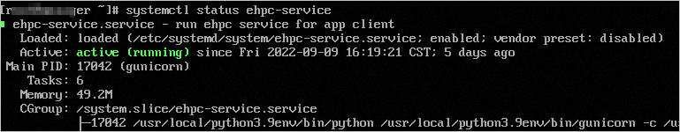

   </li>

   </ol>

<a id="section-6-3-2"></a>

### 6.3.2. 安装并登录客户端

E-HPC客户端支持作业提交和查询、文件管理等功能，可以方便您日常管理作业。

**前提条件**

- 已完成集群环境配置。具体操作，请参见配置客户端所需环境。

- 要安装客户端的本地电脑和集群之间网络互通。

**安装客户端**

首次操作时，请根据本地电脑的操作系统类型下载相应的客户端。

| 操作系统 | 下载链接 | 说明 |
| --- | --- | --- |
| Windows | • Windows中文版<br>• Windows英文版 | Windows电脑的操作系统版本要求为Windows 7及以上版本。 |
| macOS | • macOS中文版<br>• macOS英文版 | macOS电脑需配置打开未验证的开发者应用。 |

**登录客户端**

1. 打开E-HPC客户端。

2. 在登录页面输入登录信息。

   登录相关参数说明如下：

   <table>
     <tr>
       <th width="122">参数</th>
       <th>说明</th>
     </tr>
     <tr>
       <td>服务器信息</td>
       <td>服务器信息包括以下两部分：<br>• 集群IP：集群管理节点的私网IP。<br>• 端口：固定端口，配置为12011。</td>
     </tr>
     <tr>
       <td>用户名、密码</td>
       <td>输入集群用户的用户名和密码。普通权限组和sudo权限组的用户均可登录。</td>
     </tr>
     <tr>
       <td>记住登录信息</td>
       <td>默认选中。如果取消选中，下次登录时，需重新输入密码。</td>
     </tr>
   </table>

3. 单击**登录**。

   - 如果登录成功，将进入客户端操作页面，包含作业查询、作业提交等功能模块。

   - 如果登录失败，请按照弹出的错误提示排查问题。

<a id="section-6-3-3"></a>

### 6.3.3. 提交作业

作业是E-HPC集群进行高性能计算的基本工作单元，包括Shell脚本、可执行文件等。使用客户端可以方便、快速地提交作业。

**前提条件**

- 集群状态为**运行中**。

- 集群中已安装作业需要的软件。

**准备工作**

提交作业前，您需要准备好作业文件，并上传到E-HPC集群中。

E-HPC客户端支持以下两种方式上传作业文件：

- 在**数据管理**页面，可以新建并编辑作业文件，或者直接将本地的作业文件上传到集群。具体操作，请参见管理文件。

- 在**会话管理**页面，单击**terminal**可以远程登录到集群，执行命令创建作业文件。

**方式一：通过客户端直接提交作业**

1. 打开并登录客户端。

2. 在左侧导航栏，选择**作业提交**。

3. 单击**提交作业**。

4. 在弹出面板，配置作业相关参数，然后单击**提交作业**。

   | 参数 | 描述 |
   | --- | --- |
   | 队列 | 运行作业的队列。如果计算节点已加入到指定队列中，则必须将作业提交到对应的队列，否则作业会执行失败；如果计算节点没有加入队列，则默认将作业提交到调度器所在的默认队列中。 |
   | 作业名称 | 作业的名称。如果需要自动下载解压作业文件，解压目录也将以作业名称进行命名。 |
   | 执行命令 | 向调度器提交的作业执行命令，可以是脚本文件（如<code> /home/test </code>目录下的job.pbs文件），也可以是一段命令文本。有以下两种情况：<br>• 脚本文件可执行，可填写相对路径，如<code> ./job.pbs </code>。<br>• 脚本文件没有可执行权限，则需要填写执行命令，如：<code> /opt/mpi/bin/mpirun </code><code>/home/test/job.pbs </code>。如果是PBS调度器，还需要在命令前加<code> - </code>，如：<code> -</code><code>/opt/mpi/bin/mpirun/home/test/job.pbs </code>。 |
   | 优先级 | 作业运行的优先级。取值范围为0~9，取值越大，优先级越高。如果集群的调度策略设置为根据优先级调度，高优先级的作业会被优先调度运行。 |
   | 计算节点数 | 用来运行此作业的计算节点数。 |
   | 任务数 | 每个计算节点运行此作业使用的任务数，即进程数。 |
   | 最大内存 | 每个计算节点运行此作业可使用的最大内存。默认为空，表示不限制内存大小。 |
   | 执行时间 | 作业最长运行时间，超时作业将执行失败，默认为空，表示不限制运行时间。 |
   | 线程数 | 每个任务所使用的线程数。默认为空，表示线程数为1。 |
   | GPU数 | 每个计算节点运行此作业使用的GPU数。配置该参数时请确保计算节点为GPU实例。 |
   | 标准输出路径、错误输出路径 | 定义Linux系统的stderr、stdout输出重定向路径，包含输出文件名。<br>• stdout：标准文件输出路径。<br>• stderr：错误文件输出路径。集群用户必须有该路径的可写权限，默认按照调度器设置生成输出文件。 |
   | 添加环境变量 | 可根据需要添加环境变量。 |

**方式二：通过命令行提交作业**

1. 打开并登录客户端。

2. 通过Terminal远程登录集群。

   <ol type="i">

   <li>

   在左侧导航栏，选择**会话管理**。

   </li>

   <li>

   在右侧页面单击**terminal**。

   </li>

   </ol>

3. 在弹出窗口，执行相关命令提交作业。

   假设作业文件为test.pbs，则执行 `qsub test.pbs` 命令提交作业。

**方式三：通过作业模板提交作业**

将常用的作业参数配置保存为模板后，方便快速提交作业。

1. 打开并登录客户端。

2. 在左侧导航栏，选择**作业提交**。

3. 创建作业模板。

   <ol type="i">

   <li>

   在**作业提交**页面，单击**提交作业**。

   </li>

   <li>

   在**新建作业**面板，配置作业相关参数。

   参数说明请参见作业参数说明表。

   </li>

   <li>

   单击**保存为模板**。

   </li>

   <li>

   在弹出的对话框中输入模板名称，单击**确定**。

   </li>

   </ol>

4. 在**作业提交**页面的**作业提交模板**区域，找到目标作业模板，单击对应的  图标。

5. 在弹出面板，确认作业相关参数，单击**提交作业**。

**方式四：通过应用中心提交作业**

E-HPC客户端提供了可视化的界面来配置Ansys Fluent、ABAQUS等软件应用，方便您配置应用相关的作业参数，可以快速提交作业。

1. 打开并登录客户端。

2. 在左侧导航栏，选择**应用中心**。

3. 单击要配置的应用。

4. 在弹出面板配置应用相关的作业参数，然后单击**提交**。

   参数包括基础参数和应用参数，不同应用支持配置的参数不同。以GROMACS为例，可配置的参数如下：

   <table>
     <tr>
       <th>参数类型</th>
       <th>参数</th>
       <th>示例值</th>
       <th>描述</th>
     </tr>
     <tr>
       <td rowspan="5">基础参数</td>
       <td>作业名称</td>
       <td>gromacs_test</td>
       <td>自定义设置。</td>
     </tr>
     <tr>
       <td>作业队列</td>
       <td>workq</td>
       <td>运行该作业的队列。</td>
     </tr>
     <tr>
       <td>CPU核数</td>
       <td>16</td>
       <td>单个节点的CPU核数。</td>
     </tr>
     <tr>
       <td>节点数</td>
       <td>3</td>
       <td>运行该作业所需的计算节点数。</td>
     </tr>
     <tr>
       <td>输出日志</td>
       <td>gromacs_test.log</td>
       <td>作业运行日志的输出路径。</td>
     </tr>
     <tr>
       <td rowspan="2">应用参数</td>
       <td>预处理文件（.tpr）</td>
       <td>/home/user***/water-cut1.0_GMX50_bare/00 12/topol_pme.tpr</td>
       <td>选择已经预处理的算例文件。</td>
     </tr>
     <tr>
       <td>模拟迭代步数</td>
       <td>1000</td>
       <td>设置最大运行步数（nsteps）。</td>
     </tr>
   </table>

<a id="section-6-3-4"></a>

### 6.3.4. 查询作业

提交作业后，您可以在E-HPC客户端查询作业数据，包括作业名称、作业状态、作业运行开始和结束时间，以及作业详情等，便于您了解集群运行作业的情况，及时调整作业任务。

**操作步骤**

1. 打开并登录客户端。

2. 在左侧导航栏，选择**作业查询**。

3. 根据需要设置查询条件。

   支持设置的查询条件如下：

   <table>
     <tr>
       <th width="106">配置项</th>
       <th>说明</th>
     </tr>
     <tr>
       <td>查询时间段</td>
       <td>查询在某一时间段内运行的作业。可快速选择查看距离当前时间前1小时、4小时、12小时、1天或1周的数据，也可以精确设置时间段。</td>
     </tr>
     <tr>
       <td>状态</td>
       <td>查询处于某一状态（所有、未完成、已完成）的作业。</td>
     </tr>
     <tr>
       <td>排序</td>
       <td>根据查询条件查询作业数据后，按排序设置（提交时间升、降序，或者运行时间升、降序）显示作业数据。</td>
     </tr>
     <tr>
       <td>作业名</td>
       <td>按作业名称查询。</td>
     </tr>
     <tr>
       <td>主机名</td>
       <td>按执行作业的节点主机名查询。</td>
     </tr>
   </table>

4. （可选）在**资源监控**区域，筛选调度器队列，查看作业使用的资源数据。

5. 在作业列表中查看作业数据。单击某一作业对应的**详情**，查看该作业的详细运行数据。

   > **说明**
   >
   > 对于未完成的作业，如果想要停止，可单击作业详情页右上角的**停止作业**。

<a id="section-6-3-5"></a>

### 6.3.5. 管理文件

客户端以文件浏览器的形式提供可视化的文件管理功能，支持文件编辑、重命名、删除等操作，同时支持在本地电脑和集群之间进行文件传输，便于管理文件。

**操作步骤**

1. 打开并登录客户端。

2. 在左侧导航栏，选择**数据管理**。

3. 根据需要进行操作。

   支持的操作如下表所示。

   操作

   说明

   进入下层路径

   单击文件夹可进入相应的下层文件路径。

   文件路径操作

   回到上层路径

   页面左上角按层级显示当前文件路径，单击文件夹名称可回到上层路径。

   新建

   单击右上角的  图标，选择**文件夹**，可以新建文件夹来分组管理文件。

   找到目标文件，单击对应操作列的  图标，选择**重命名**，完成后续操作即

   重命名

   可修改文件夹名称。

   文件夹操作

   找到目标文件夹，单击对应操作列的  图标，选择**删除**，确认后即可删除

   文件夹。

   删除

   > **重要**
   >
   > 删除文件夹将同步删除该文件夹下的所有文件，请谨慎操作。

   单击右上角的  图标，选择**文件**，输入文件名称并编写文件内容，完成后

   新建

   单击**保存**即可新建文件。

   编辑

   找到目标文件，单击对应操作列的  图标，即可编辑文件内容。

   文件操作

   找到目标文件，单击对应操作列的  图标，选择**重命名**，完成后续操作即

   重命名

   可修改文件名称。

   找到目标文件，单击对应操作列的  图标，选择**删除**，确认后即可删除文

   删除

   件。

   单击右上角的  图标，可选择文件进行上传。上传后，刷新页面即可查看

   上传文件到集

   新上传的文件。

   群

   上传、下载文件

   找到目标文件，单击对应操作列中的  图标，设置要保存文件的本地电脑

   下载文件到本地电脑

   路径，即可下载文件到指定路径。

   文件浏览器配

   显示隐藏文件

   单击右上角的  图标，可选择是否显示隐藏文件。

   置

   单击右上角的  图标，可打开SSH窗口连接集群，并进入到当前选择的路

   打开SSH窗口

   SSH

   径，支持通过命令进行操作。

<a id="section-6-4"></a>

## 6.4. 查看作业报表

在集群中运行作业后，您可以查看作业报表。作业报表可以展示某一时间段集群的使用情况，包括用户使用量、队列使用量、作业列表等，便于您直观了解作业整体情况，及时调整集群规模和作业任务。

**前提条件**

- 集群状态为**运行中**。

- 集群中的作业已运行1小时以上。

**操作步骤**

1. 登录E-HPC控制台。

2. 在左侧导航栏，选择**作业管理>报表**。

3. 在**报表**页面的顶部下拉列表中，选择目标集群。

4. 设置要查看的时间段。

   - 快速设置：直接拖动进度条调整时间段。

   - 精准设置：单击**时间段选择**，在弹出面板选择距离当前的时间，或者自定义设置时间段。

5. 在页面下方查看报表。

   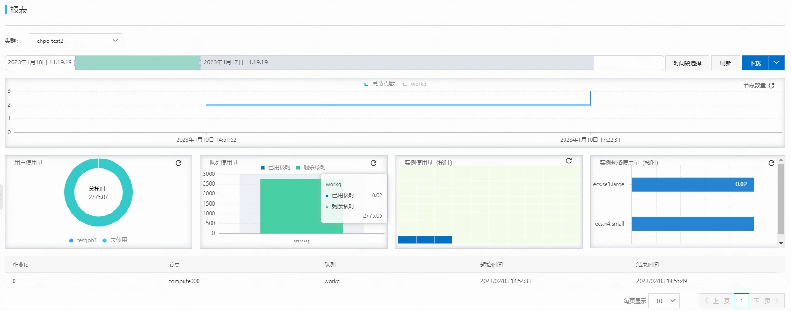

   > **说明**
   >
   > - 鼠标移动到各统计图上方的相应位置，可以查看详细数据。
   >
   > - 用户使用量、队列使用量等各使用量统计图的单位为核时，即CPU核数\*时间（小时）。
   >
   > - 如果想要下载报表，可以单击右上角的**下载**，默认下载XLSX文件，也可以选择**下载>CSV下载**，下载CSV文件。

   报表各区域说明如下：

   <table>
     <tr>
       <th width="138">区域</th>
       <th>说明</th>
     </tr>
     <tr>
       <td>节点数量</td>
       <td>展示集群中节点数量的变化折线图，支持显示各队列节点数量变化。</td>
     </tr>
     <tr>
       <td>用户使用量</td>
       <td>展示各用户使用集群的饼状图。</td>
     </tr>
     <tr>
       <td>队列使用量</td>
       <td>展示各队列使用情况的树状图。</td>
     </tr>
     <tr>
       <td>实例使用量</td>
       <td>展示各实例（即节点）使用情况的树状图。在队列使用量的图示中选择某一队列，将切换显示该队列对应结果。</td>
     </tr>
     <tr>
       <td>实例规格使用量</td>
       <td>展示各实例规格使用情况的树状图。在队列使用量的图示中选择某一队列，将切换显示该队列对应结果。</td>
     </tr>
     <tr>
       <td>作业列表</td>
       <td>默认不展示执行过的作业列表。可根据需要单击用户使用量、队列使用量或者实例使用量的图示，选择某一用户、队列或者节点，作业列表将根据选择展示相应的作业列表。例如：在队列使用量的树状图中，单击队列1，则在作业列表将展示在队列1执行过的作业列表。</td>
     </tr>
   </table>

<a id="section-7"></a>

# 7.运维

<a id="section-7-1"></a>

## 7.1. 健康巡检

健康巡检功能支持实时检测集群健康状态，提供系统、存储、网络、调度器等常见故障检查。

**故障检查项说明**

健康巡检功能支持检查以下常见故障：

<table>
  <tr>
    <th>故障场景</th>
    <th>故障类型</th>
    <th>故障级别</th>
  </tr>
  <tr>
    <td rowspan="4">base_env：系统检测</td>
    <td>filecompare：文件对比异常</td>
    <td>critial</td>
  </tr>
  <tr>
    <td>servicecheck：业务检查异常</td>
    <td>fatal</td>
  </tr>
  <tr>
    <td>permissoncheck：权限错误</td>
    <td>critial</td>
  </tr>
  <tr>
    <td>existcheck：文件不存在</td>
    <td>critial</td>
  </tr>
  <tr>
    <td rowspan="3">storage：存储检测</td>
    <td>mountcheck：找不到挂载目录</td>
    <td>critial</td>
  </tr>
  <tr>
    <td>mounttype：挂载类型不匹配</td>
    <td>critial</td>
  </tr>
  <tr>
    <td>mountcapacity：挂载能力不支持</td>
    <td>critial</td>
  </tr>
  <tr>
    <td>net：网络检测</td>
    <td>netStatus：网络链接异常</td>
    <td>critial</td>
  </tr>
  <tr>
    <td rowspan="2">sched：调度器检测</td>
    <td>jobSchedCheck：作业调度异常</td>
    <td>warning</td>
  </tr>
  <tr>
    <td>jobRunTimeCheck：作业运行异常</td>
    <td>warning</td>
  </tr>
</table>

**启动健康巡检**

1. 登录E-HPC控制台。

2. 在左侧导航栏，选择**运维 > 健康巡检**。

3. 在**健康巡检**页面上方的集群列表中选择目标集群。

4. 根据需要选中评测节点，并在右侧选择巡检的时间间隔，然后单击**确定**。

   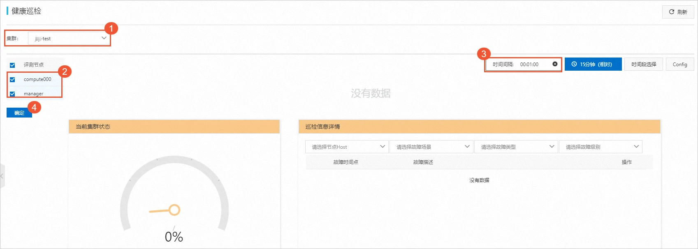

**查询健康巡检结果**

1. 在**健康巡检**页面上方的集群列表中选择目标集群。

2. 在巡检信息详情处，选择节点、故障场景等。

3. 在右上角选择时间范围，然后在下方查看巡检结果。

   巡检信息详情区域列出了当前集群存在的故障详情，你可以根据需要单击**操作**列的**修复**。

   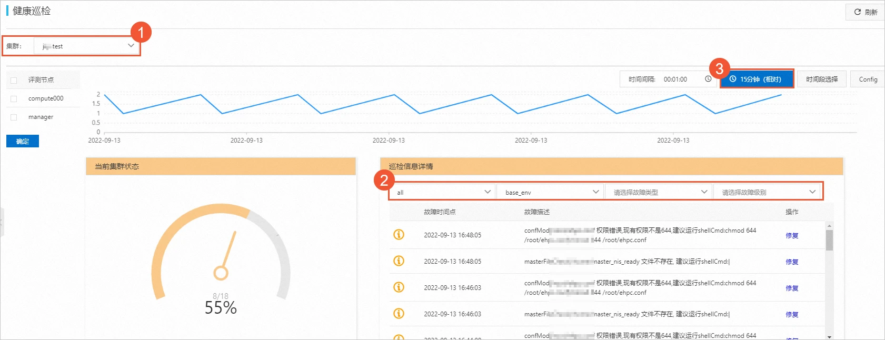

<a id="section-7-2"></a>

## 7.2. 作业布防

作业布防可以实现定时、重复运行作业，适用于需要自动运行作业的场景，一般用于配合用户进行作业巡检，检测集群作业运行环境是否正常。

**前提条件**

- 集群和节点的状态均为**运行中**。

- 已创建好作业模板。具体操作，请参见创建作业模板。

**操作步骤**

1. 登录E-HPC控制台。

2. 在左侧导航栏，选择**运维 > 作业布防**。

3. 在**作业布防**页面上方的集群列表中选择目标集群，然后单击**创建布防**。

4. 在**创建布防**对话框中，完成布防参数配置。

   <table>
     <tr>
       <th width="121">参数</th>
       <th>说明</th>
     </tr>
     <tr>
       <td>名称</td>
       <td>输入布防的名称，自定义输入，必须以字母开头。</td>
     </tr>
     <tr>
       <td>运行任务</td>
       <td>选择要运行的作业模板。</td>
     </tr>
     <tr>
       <td>描述</td>
       <td>输入布防描述信息，选填。</td>
     </tr>
     <tr>
       <td>开始执行时间</td>
       <td>运行作业的开始时间。</td>
     </tr>
     <tr>
       <td>重复周期</td>
       <td>支持不重复，以及按天、按星期、按月重复运行作业，请根据需要选择并设置重复周期。</td>
     </tr>
     <tr>
       <td>重复结束时间</td>
       <td>设置重复周期时，需要设置重复结束时间，即运行作业的结束时间。</td>
     </tr>
   </table>

5. 单击**确定**。

   创建布防后，系统将按照设置在对应的时间点自动运行作业。

**相关操作**

**查询布防**

在**作业布防**页面的布防列表中，您可以查看布防信息，包括开始执行时间、重复周期和重复结束时间。

**删除布防**

在**作业布防**页面，选择以下一种方式删除布防。

- 找到要删除布防，单击操作列中的**删除**。

- 选中一个或多个要删除的布防，单击**批量删除**。
