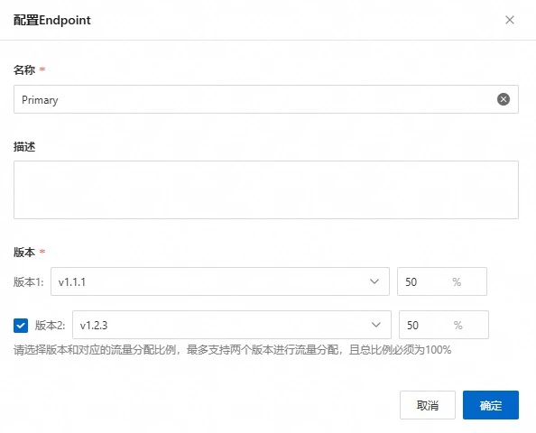
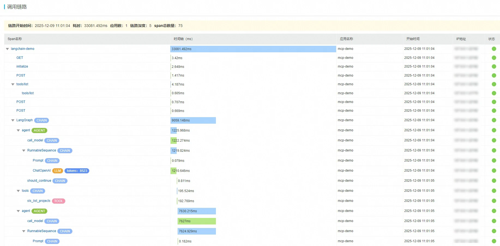
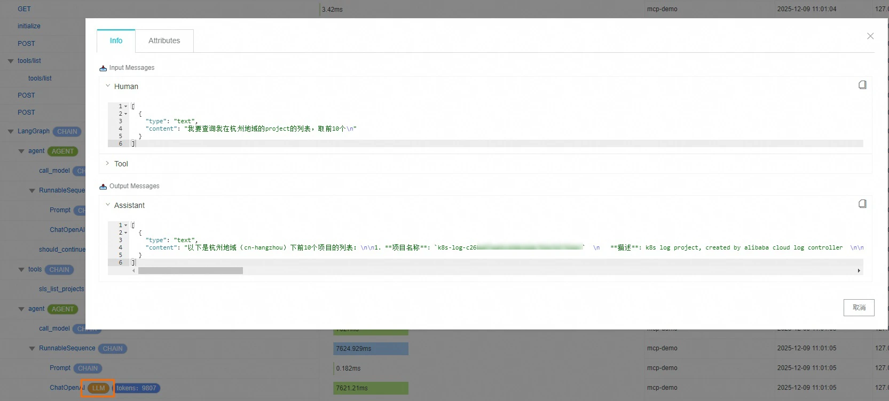
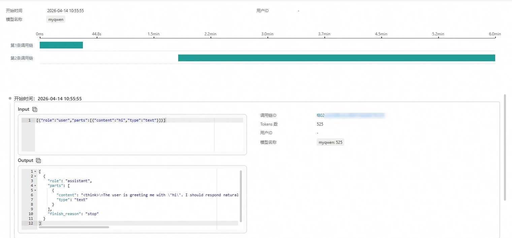
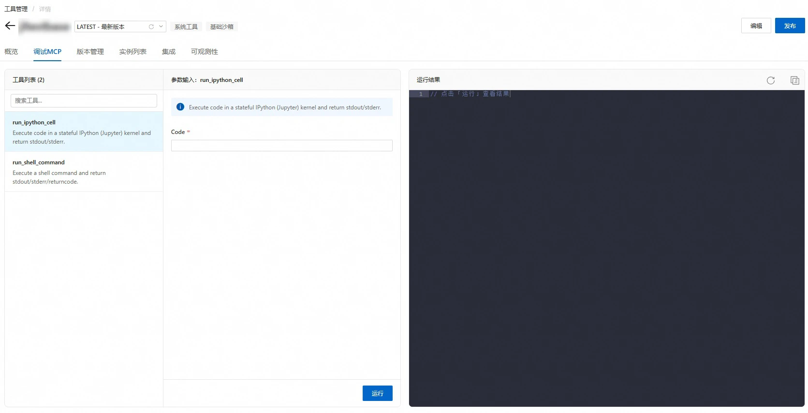
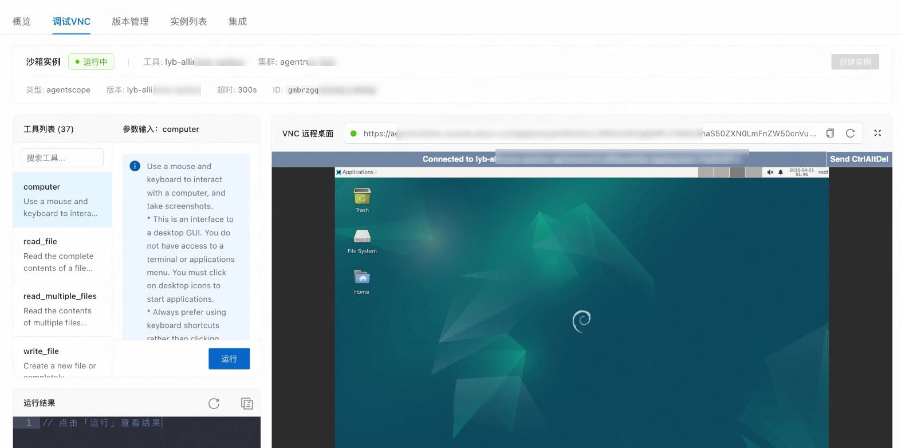

阿里云  
专有云  
智能体工厂 OpenTrek  
AgentRuntime 用户指南  
产品版本：v3.18.6-SP2607  
文档版本：20260729

**目录**

- [1.什么是AgentRuntime 智能体运行服务](#section-1)
- [2.快速入门](#section-2)
    - [2.1. 登录AgentRuntime控制台](#section-2-1)
- [3.Agent管理](#section-3)
    - [3.1. 快速创建Agent](#section-3-1)
    - [3.2. 代码创建Agent](#section-3-2)
    - [3.3. 更多操作](#section-3-3)
- [4.工具管理](#section-4)
    - [4.1. 创建系统工具](#section-4-1)
    - [4.2. 创建自定义工具](#section-4-2)
    - [4.3. 更多操作](#section-4-3)
- [5.资源管理](#section-5)
    - [5.1. 集群管理](#section-5-1)
    - [5.2. 模型管理](#section-5-2)
    - [5.3. 凭证管理](#section-5-3)
    - [5.4. 镜像源配置管理](#section-5-4)

# 1.什么是AgentRuntime 智能体运行服务

**AgentRuntime Platform** 是一个专为企业级 AI Agent 应用设计的、部署在企业自有云环境下的 PaaS (Platform-as-a-Service) 平台。它专注于解决 Agent 在生产环境中从代码调试、部署到运维全生命周期的核心挑战，提供统一的 **Agent 运行时管理、工具（Tool/MCP）生命周期管理、底层异构资源的精细化弹性调度，以及多级安全隔离能力**。

**运行时管理**

| 功能点 | 详细说明 |
| --- | --- |
| 统一执行环境 | 提供标准化的执行环境，支持各类 Agent 应用运行。 |
| 全生命周期管理 | 支持 Agent 应用调试、部署、监控、升级。 |
| Python/Node.js/Java 运行时 | 支持 Python、Node.js 和 Java 运行时。 |

**沙箱能力**

| 功能点 | 详细说明 |
| --- | --- |
| Code Interpreter | 提供安全隔离环境，支持动态生成代码的执行，支持文件I/O 和会话管理。 |
| Browser Use | 支持通过自动化浏览器执行网页浏览、数据抓取、表单填写等任务。 |
| All-in-One 沙箱 | 将代码执行、浏览器、文件系统等能力集成于一个沙箱实例中。 |
| 文件系统 | 为沙箱提供隔离的、可读写的虚拟文件系统，支持创建、读取、修改和删除文件。 |
| 操作能力（Computer/Mobile Use） | 支持模拟桌面或移动设备图形界面（GUI）操作。 |

**弹性调度**

| 功能点 | 详细说明 |
| --- | --- |
| 秒级冷启与按需弹性 | 支持将 Agent 实例缩容至零，请求到达时启动实例。 |
| 休眠与恢复（即将上线） | 实例缩容前可将其运行状态（如内存、会话信息）快照并持久化，恢复时加载快照。 |
| 会话亲和性保障 | 同一用户的连续请求可路由到同一Agent或工具实例。 |
| 独占会话保障 | 对于独占模式的Agent或工具，每个会话分配不同的运行实例。 |
| 高并发弹性扩容 | 支持根据预设策略自动增加实例数量。 |
| 业务感知调度接口 | 提供 API，允许业务代码主动申请或释放计算资源。 |

**安全隔离**

| 功能点 | 详细说明 |
| --- | --- |
| 多级安全隔离 | 支持请求级、实例级、会话级隔离。 |
| 多租户隔离保障 | 从网络、计算、存储等维度提供租户隔离机制。 |
| 独占会话隔离保障 | 对于独占模式的Agent或工具，每个会话独占一个实例，做到会话级别的天然隔离。 |
| 物理/集群隔离 | 支持将不同安全等级或不同业务单元的 Agent 部署在完全独立的物理集群中，实现最高级别的安全隔离。 |
| 节点隔离 | 通过调度策略，可将高风险的 Agent 限定在专用的“沙箱节点池”中运行，确保其与其他常规业务在计算节点层面物理隔离。 |
| 内核级隔离 （强沙箱）（即将上线） | 平台无缝整合了 ACK 提供的 runD 等强安全沙箱能力。对于执行不可信代码等高风险任务，可将其运行在基于硬件虚拟化的独立内核中，有效防止恶意代码的容器逃逸，保护宿主机和其他应用的安全。 |
| TLS 1.2+ 传输加密 | 所有网络通信采用 TLS 1.2 及以上版本加密。 |
| 存储隔离与挂载 | 支持将外部存储（如对象存储、本地磁盘）安全挂载至沙箱。 |

**可观测性**

| 功能点 | 详细说明 |
| --- | --- |
| 全链路 Trace | 支持从前端请求、网关、Agent、模型、工具到外部依赖的调用链追踪。 |
| AI 应用监控（可观测需要集成 AI 可观测产品） | 支持基于 Prometheus / ARMS 的监控，可分析模型性能、Token 消耗、GPU 使用情况。 |
| 日志与评估 | 日志统一存储，支持检索和 SQL 分析；支持对模型调用日志进行质量、安全、意图等评估。 |

**工具与模型管理**

| 功能点 | 详细说明 |
| --- | --- |
| MCP | 支持 MCP（模型上下文协议） 模式。 |
| 工具治理和版本管理 | 支持工具的生命周期管理、版本控制和权限治理。 |
| 主流模型接入 | 支持接入通义千问、DeepSeek 等主流大模型。 |
| 多模型负载均衡与降级 | 集成AI网关在多个模型实例间分发请求；模型故障时切换至备用模型。 |
| 内容安全与 Token 限流 | 集成AI网关对模型输入输出进行内容安全审核；支持按策略限制 Token 消耗。 |
| 统一工具定义与调用 | 提供标准化的工具定义、注册、版本化和调用协议。 |

**凭证管理**

| 功能点 | 详细说明 |
| --- | --- |
| 支持多种凭证类型 | 支持API Key凭证类型。 |
| 动态凭证注入 | 与 AgentRuntime 运行时联动，在运行时通过安全机制注入凭证。 |
| 启用/禁用控制 | 支持一键启用或禁用凭证。 |

# 2.快速入门

## 2.1. 登录AgentRuntime控制台

本文介绍如何登录到AgentRuntime的控制台。

**前提条件**

- 登录Apsara Uni-manager运营控制台前，确认您已从部署人员处获取Apsara Uni-manager运营控制台的服务域名地址。

- 推荐使用Chrome浏览器。

**操作步骤**

1. 在浏览器地址栏中，输入Apsara Uni-manager运营控制台的服务域名地址，按回车键。

   

   > **说明**
   >
   > - 单击页面右上角的当前语言可以切换其它语言。
   >
   > - 授权登录是第三方认证中配置了全局IdP设置才会显示，且“授权登录”名称用户可按需自定义。
   >
   > - 由于浏览器证书过期或环境开启HTTPS认证等出现多次单击继续访问或无Apsara Uni-manager运营控制台地址入口等现象，此时需要安装证书才能正常访问。单击页面右上角的**浏览器证书安装**，可打开浏览器证书安装指南。

2. 请输入正确的用户名及密码。

   > **说明**
   >
   > - 请向运营管理员获取登录控制台的用户名和密码。
   >
   > - 首次登录Apsara Uni-manager运营控制台时，需要修改登录用户名的密码，请按照提示完成密码修改。为提高安全性，密码长度必须为10~32位，且包含英文字母大小写、阿拉伯数字和特殊符号（感叹号（!）、at（@）、井号（#）、美元符号（$）、百分号（%）等）。

3. 单击**账号登录**。

4. 如果账号已激活MFA多因素认证，请根据以下两种情况进行操作：

   - **管理员强制开启MFA后的首次登录**

     <ol type="a">

     <li>

     在绑定虚拟MFA设备页面中，按页面提示步骤绑定MFA设备。

     </li>

     <li>

     按照步骤2重新输入账号和密码，单击**账号登录**。

     </li>

     </ol>

     <ol type="i" start="100">

     <li>

     输入6位MFA码后单击**认证**。

     </li>

     </ol>

   - **您已开启并绑定MFA**

     输入6位MFA码后单击**认证**。

     > **说明**
     >
     > 绑定并开启MFA的操作请参见《 Apsara Uni-manager运营控制台 用户指南》的**管理多因素认证**章节。

5. 在顶部菜单栏选择**产品 > 中间件 > 微服务工具及平台 > 智能体运行服务AgentRuntime** ，进入AgentRuntime控制台。

# 3.Agent管理

## 3.1. 快速创建Agent

AgentRuntime是一个面向智能体（Agent）全生命周期管理的一站式开发与运行平台，若您是初次使用或需要快速验证想法，推荐选择快速创建方式。通过可视化界面配置Agent，无需编写代码，适合快速原型开发。

**创建Agent**

1. 登录AgentRuntime控制台。

2. 在左侧导航，单击**Agent管理**。

3. 在**Agent列表**页面，单击**创建Agent**。

4. 在**创建Agent**页面，可以选择**快速创建**方式，填写以下配置项，单击**开始创建**。

   <table>
     <tr>
       <th>配置项</th>
       <th>描述</th>
       <th>示例值</th>
     </tr>
     <tr>
       <td colspan="3">基本信息</td>
     </tr>
     <tr>
       <td>Agent名称</td>
       <td>集群内的唯一标识，需符合 DNS格式：仅支持小写字母、数字和短横线（-），且必须以字母或数字开头和结尾。创建后不可修改。</td>
       <td>my-chat-agent</td>
     </tr>
     <tr>
       <td>显示名称</td>
       <td>用于前端展示的友好名称，支持中文和特殊字符。</td>
       <td>智能客服助手</td>
     </tr>
     <tr>
       <td>描述</td>
       <td>记录 Agent 的用途、能力或备注信息。</td>
       <td>基于qwen-plus的多轮对话客服Agent，支持工具调用。</td>
     </tr>
     <tr>
       <td colspan="3">资源配置</td>
     </tr>
     <tr>
       <td>选择集群</td>
       <td>集群算力池中有可用节点时才能选择。请选择集群，如果无可用集群请参见接入集群。</td>
       <td>无</td>
     </tr>
     <tr>
       <td>命名空间</td>
       <td>选择集群所在的命名空间。</td>
       <td>无</td>
     </tr>
     <tr>
       <td>CPU配额</td>
       <td>选择CPU配额。单个工具实例的CPU 上限（limits）。平台会自动设置 requests 为限制值的1/4（如配额 1 核，requests 为0.25 核）。浏览器类工具建议 1核及以上。</td>
       <td>1核</td>
     </tr>
     <tr>
       <td>内存配额</td>
       <td>单个 Agent 实例的内存上限（limits）。平台会自动设置requests 为限制值的 1/4（如配额1Gi，requests 为 256Mi）。建议至少 512Mi，加载大模型 SDK 或处理大文件时建议 1Gi 及以上。</td>
       <td>1024Mi</td>
     </tr>
     <tr>
       <td>临时存储空间</td>
       <td>容器内临时磁盘空间上限（limits），平台会自动设置requests 为限制值的 1/4。Pod重启后数据丢失，如需持久化数据请在高级配置中启用 OSS 存储。</td>
       <td>4Gi</td>
     </tr>
     <tr>
       <td colspan="3">模型配置</td>
     </tr>
     <tr>
       <td>模型服务</td>
       <td>请选择模型，如果无可用模型请参见模型管理。</td>
       <td>无</td>
     </tr>
     <tr>
       <td>系统提示词</td>
       <td>请输入系统提示词，引导模型输出。</td>
       <td>无</td>
     </tr>
     <tr>
       <td colspan="3">工具配置</td>
     </tr>
     <tr>
       <td>选择工具</td>
       <td>请选择工具，如果无可用工具请参见创建系统工具或创建自定义工具。</td>
       <td>无</td>
     </tr>
     <tr>
       <td colspan="3">访问凭证</td>
     </tr>
     <tr>
       <td>访问凭证</td>
       <td>请选择访问凭证，如果无可用凭证请参见创建凭证。</td>
       <td>无</td>
     </tr>
     <tr>
       <td colspan="3">高级配置 &gt; 存储配置</td>
     </tr>
     <tr>
       <td>OSS存储</td>
       <td>说明快速创建的Agent，挂载OSS卷后，实例销毁后，会话数据可在新实例内重新加载。</td>
       <td></td>
     </tr>
     <tr>
       <td>存储桶名称</td>
       <td>OSS Bucket 名称，默认使用集群配置的存储桶，可按需修改。Bucket名称为3~63个字符，仅支持小写字母、数字和连字符（-），且必须以小写字母或数字开头和结尾。</td>
       <td>bucket-name</td>
     </tr>
     <tr>
       <td>读写模式</td>
       <td>请选择读写模式。 • <strong>多实例读写（推荐）</strong>：多副本部署时请选择，以确保所有实例都能读写数据。 • 单实例读写 • 多实例只读</td>
       <td>多实例读写</td>
     </tr>
     <tr>
       <td>存储目录</td>
       <td>从性能与数据安全治理角度出发，工具的存储目录路径必须严格限制含有相应的工具名称。</td>
       <td>tool-name</td>
     </tr>
     <tr>
       <td>容器内路径</td>
       <td>OSS 挂载到容器内的路径，应用通过此路径读写持久化数据。</td>
       <td>/workspace</td>
     </tr>
   </table>

## 3.2. 代码创建Agent

AgentRuntime是一个面向智能体（Agent）全生命周期管理的一站式开发与运行平台。若需要实现复杂的业务逻辑或与现有系统深度集成，建议选择代码创建方式。使用Python或JavaScript编写Agent逻辑，实现更复杂的业务需求。

**创建Agent**

1. 登录AgentRuntime控制台。

2. 在左侧导航，单击**Agent管理**。

3. 在**Agent列表**页面，单击**创建Agent**。

4. 在**创建Agent**页面，选择**代码创建**方式，填写以下配置项，单击**开始创建**。

   <table>
     <tr>
       <th>配置项</th>
       <th>描述</th>
       <th>示例值</th>
     </tr>
     <tr>
       <td colspan="3">基本信息</td>
     </tr>
     <tr>
       <td>Agent名称</td>
       <td>集群内的唯一标识，需符合 DNS格式：仅支持小写字母、数字和短横线（-），且必须以字母或数字开头和结尾。创建后不可修改。</td>
       <td>my-chat-agent</td>
     </tr>
     <tr>
       <td>显示名称</td>
       <td>用于前端展示的友好名称，支持中文和特殊字符。</td>
       <td>智能客服助手</td>
     </tr>
     <tr>
       <td>描述</td>
       <td>记录 Agent 的用途、能力或备注信息。</td>
       <td>基于qwen-plus的多轮对话客服Agent，支持工具调用。</td>
     </tr>
     <tr>
       <td colspan="3">资源配置</td>
     </tr>
     <tr>
       <td>选择集群</td>
       <td>集群算力池中有可用节点时才能选择。请选择集群。如果无可用集群请参见接入集群。</td>
       <td>无</td>
     </tr>
     <tr>
       <td>命名空间</td>
       <td>选择集群所在的命名空间。</td>
       <td>无</td>
     </tr>
     <tr>
       <td>CPU配额</td>
       <td>选择CPU配额。单个工具实例的CPU 上限（limits）。平台会自动设置 requests 为限制值的1/4（如配额 1 核，requests 为0.25 核）。浏览器类工具建议 1核及以上。</td>
       <td>1核</td>
     </tr>
     <tr>
       <td>内存配额</td>
       <td>单个 Agent 实例的内存上限（limits）。平台会自动设置requests 为限制值的 1/4（如配额1Gi，requests 为 256Mi）。建议至少 512Mi，加载大模型 SDK 或处理大文件时建议 1Gi 及以上。</td>
       <td>1024Mi</td>
     </tr>
     <tr>
       <td>临时存储空间</td>
       <td>容器内临时磁盘空间上限（limits），平台会自动设置requests 为限制值的 1/4。Pod重启后数据丢失，如需持久化数据请在高级配置中启用 OSS 存储。</td>
       <td>4Gi</td>
     </tr>
     <tr>
       <td colspan="3">制品配置</td>
     </tr>
     <tr>
       <td>制品类型</td>
       <td>请选择制品类型。 • 上传代码 • 镜像地址</td>
       <td>上传代码</td>
     </tr>
     <tr>
       <td>代码上传方式</td>
       <td><strong>制品类型</strong>选择<strong>上传代码</strong>时显示。请选择代码上传方式。 • 文件上传 • URL上传</td>
       <td>文件上传</td>
     </tr>
     <tr>
       <td>上传代码</td>
       <td><strong>制品类型</strong>选择<strong>上传代码</strong>时显示。 • <strong>代码上传方式</strong>选择<strong>文件上传</strong>时显示。|拖拽文件到指定位置，单击上传，支持.tar，.gzip，.gz，.tar.gz，.t gz，.zip格式。 • <strong>代码上传方式</strong>选择URL时显示。代码存放路径，例如：http://xxx/xxx.zip。</td>
       <td>http://xxx/xxx.zip</td>
     </tr>
     <tr>
       <td>运行时选择</td>
       <td><strong>制品类型</strong>选择<strong>上传代码</strong>时显示。请选择运行时。 • Java8 • Java11 • Java17 • Java21 • Java25 • Node.js 18 • Node.js 20 • Node.js 22 • Python 3.10 • Python 3.12</td>
       <td>Node.js 18</td>
     </tr>
     <tr>
       <td>启动命令</td>
       <td><strong>制品类型</strong>选择<strong>上传代码</strong>时显示。请输入启动命令。</td>
       <td>npm start</td>
     </tr>
     <tr>
       <td>镜像仓库类型</td>
       <td><strong>制品类型</strong>选择<strong>镜像地址</strong>时显示。 • 自定义 • ACR</td>
       <td>ACR</td>
     </tr>
     <tr>
       <td>镜像地址</td>
       <td><strong>制品类型</strong>选择<strong>镜像地址</strong>时显示。</td>
       <td>registry.{region}.aliyuncs.com/test/we ather-tool:latest</td>
     </tr>
     <tr>
       <td colspan="3">访问配置</td>
     </tr>
     <tr>
       <td>端口号</td>
       <td>请输入端口号。Agent 服务监听的端口号，需与代码中实际监听端口一致。</td>
       <td>80</td>
     </tr>
     <tr>
       <td>协议类型</td>
       <td>请选择协议类型。Agent 服务的通信协议，需与代码中的服务协议匹配。 • HTTP • HTTPS • SSH • VNC</td>
       <td>HTTP</td>
     </tr>
     <tr>
       <td>访问凭证</td>
       <td>请选择访问凭证。用于 Agent API认证的 Kubernetes Secret。需提前在集群中创建，包含认证所需的key-value 对。如果无可用凭证请参见创建凭证。</td>
       <td>无</td>
     </tr>
     <tr>
       <td colspan="3">环境变量配置</td>
     </tr>
     <tr>
       <td>环境变量</td>
       <td>单击添加，请输入<strong>变量名</strong>和<strong>变量</strong><strong>值</strong>。</td>
       <td>无</td>
     </tr>
     <tr>
       <td colspan="3">高级配置 &gt; 存储配置</td>
     </tr>
     <tr>
       <td>OSS存储</td>
       <td>说明代码创建的agent，挂载OSS卷后，需要自行完成持久化与恢复。</td>
       <td></td>
     </tr>
     <tr>
       <td>存储桶名称</td>
       <td>OSS Bucket 名称，默认使用集群配置的存储桶，可按需修改。Bucket名称为3~63个字符，仅支持小写字母、数字和连字符（-），且必须以小写字母或数字开头和结尾。</td>
       <td>bucket-name</td>
     </tr>
     <tr>
       <td>读写模式</td>
       <td>请选择读写模式。 • <strong>多实例读写（推荐）</strong>：多副本部署时请选择，以确保所有实例都能读写数据。 • 单实例读写 • 多实例只读</td>
       <td>多实例读写</td>
     </tr>
     <tr>
       <td>存储目录</td>
       <td>从性能与数据安全治理角度出发，工具的存储目录路径必须严格限制含有相应的工具名称。</td>
       <td>tool-name</td>
     </tr>
     <tr>
       <td>容器内路径</td>
       <td>OSS 挂载到容器内的路径，应用通过此路径读写持久化数据。</td>
       <td>/workspace</td>
     </tr>
     <tr>
       <td colspan="3">高级配置 &gt; 实例隔离策略</td>
     </tr>
     <tr>
       <td>隔离策略</td>
       <td>请选择隔离策略。决定请求如何分配到实例。 • <strong>共享策略</strong>：多个用户会话共享同一实例，资源利用率高，适合无状态或轻量有状态场景。 • <strong>独占模式</strong>：每个用户会话独占一个实例，会话间完全隔离，适合需要独立运行环境的场景（如沙箱、代码执行）。</td>
       <td>独占模式</td>
     </tr>
     <tr>
       <td>会话空闲时间</td>
       <td>服务完全空闲后，仍保留最后一个实例一段时间，以便在短时间内有新请求到来时能立即响应，而无需经历从零启动的延迟。单位：秒。取值范围：[0,7776000]。</td>
       <td>1800</td>
     </tr>
     <tr>
       <td>单实例最大会话数</td>
       <td>仅共享模式生效。单个实例同时承载的最大会话数，超出后将触发扩容或排队。独占模式下固定为1。<strong>隔离策略</strong>选择<strong>共享模式</strong>显示。取值范围：[0,2000]。</td>
       <td>100</td>
     </tr>
     <tr>
       <td colspan="3">高级配置 &gt; 弹性策略</td>
     </tr>
     <tr>
       <td>最小实例数</td>
       <td>仅共享模式生效。缩容下限。系统保证运行中的实例数不低于此值。设为 0 表示允许缩容到零（无流量时不保留实例）。取值范围：[0,2000]。</td>
       <td>0</td>
     </tr>
     <tr>
       <td>最大实例数</td>
       <td>扩容上限。系统保证运行中的实例数不超过此值。取值范围：[0,2000]。</td>
       <td>100</td>
     </tr>
     <tr>
       <td>冷却时间</td>
       <td>当实例并发/请求量下降时，系统不会立即缩减实例数，而是等待该冷却时间过后，才执行缩容。在冷却时间窗口内，系统会保持窗口期内的实例数不变。单位：秒。取值范围：[0,86400]。</td>
       <td>300</td>
     </tr>
     <tr>
       <td colspan="3">高级配置 &gt; 日志服务</td>
     </tr>
     <tr>
       <td>日志项目</td>
       <td>SLS 日志服务的 Project 名称，需提前在日志服务控制台创建。</td>
       <td>my-tool-logs</td>
     </tr>
     <tr>
       <td>日志库</td>
       <td>SLS 日志服务的 Logstore 名称，用于存储工具运行日志。</td>
       <td>tool-access-log</td>
     </tr>
     <tr>
       <td>日志类型</td>
       <td>请选择日志类型。 • 文件 • 标准输出</td>
       <td>文件</td>
     </tr>
     <tr>
       <td>日志路径</td>
       <td>请根据日志类型写日志路径。 • <strong>文件</strong>：请输入日志路径。 • <strong>标准输出</strong>：stdout。</td>
       <td>/var/log/app.log</td>
     </tr>
     <tr>
       <td colspan="3">健康检查</td>
     </tr>
     <tr>
       <td>检查路径</td>
       <td>工具提供的健康检查 HTTP 端点路径，需返回 2xx 状态码表示健康。</td>
       <td>/fastapi/health</td>
     </tr>
     <tr>
       <td>端口</td>
       <td>健康检查请求的目标端口，通常与访问配置中的端口号一致。</td>
       <td>80</td>
     </tr>
     <tr>
       <td>检查间隔（秒）</td>
       <td>两次健康检查之间的间隔秒数。过短会增加工具负载，建议 5-30秒。</td>
       <td>5</td>
     </tr>
     <tr>
       <td>检查超时（秒）</td>
       <td>单次健康检查的超时秒数，超时视为不健康。建议不超过检查间隔。</td>
       <td>3</td>
     </tr>
   </table>

## 3.3. 更多操作

本文档全面介绍了AgentRuntime平台中 Agent 的全生命周期管理与集成能力，涵盖从配置、调试、发布、监控到删除的完整操作流程。

**前置条件**

已快速创建Agent或已代码创建Agent。

**操作指南**

1. 登录AgentRuntime控制台。

2. 在左侧导航，单击**Agent管理**。

3. 在**Agent列表**页面，单击目标Agent的**显示名称/ID**或者**操作**列的**详情**，进入到Agent详情页面。

   **概览**

   在Agent详情页的**概览**页签，可以查看Agent以下配置信息。

   - 在**基本信息**区域，可以查看**Agent ID**、**Agent名称**、**显示名称**、**状态**、**创建时间**、**最后更新时间**和**描述**信息。

   - 在**资源配置**区域，可以查看**集群**、**命名空间**、**CPU配额**、**内存配额**和**临时存储空间**等信息。

   - 在**存储配置**区域，可以查看存储类型信息。

   - 在**快速访问配置**区域，可以查看**访问端点**、**协议类型**、**端口号**、**访问凭证**和**认证方式**等信息。

   - 在**协议声明**区域，可以查看当**前支持的协议**和**协议声明说明**等信息。

   **配置与调试**

   在Agent详情页的**配置与调试**页签，可以根据创建方式不同选择以下调试方式。

   - 快速创建Agent

     如果Agent的创建方式为快速创建，可以配置以下信息进行调试。

     <table>
       <tr>
         <th>配置项</th>
         <th>描述</th>
         <th>示例值</th>
       </tr>
       <tr>
         <td>提示词/Prompt</td>
         <td>请输入系统提示词，引导模型输出。</td>
         <td>你是个助手</td>
       </tr>
       <tr>
         <td colspan="3">模型服务</td>
       </tr>
       <tr>
         <td>选择模型</td>
         <td>请选择模型，创建模型请参见模型管理。</td>
         <td>qwen</td>
       </tr>
       <tr>
         <td>Temperature</td>
         <td>取值范围[0,1]，不填为模型自身的默认值。</td>
         <td>无</td>
       </tr>
       <tr>
         <td>Max Tokens</td>
         <td>模型的参数，一般指最多输出token数量，填写数字，具体限制看模型供应商限制。</td>
         <td>无</td>
       </tr>
       <tr>
         <td colspan="3">变量管理</td>
       </tr>
       <tr>
         <td>变量名称</td>
         <td>变量的Key。</td>
         <td>user_name</td>
       </tr>
       <tr>
         <td>默认值</td>
         <td>变量的Value。</td>
         <td>zhangsan</td>
       </tr>
       <tr>
         <td>描述（可选）</td>
         <td>描述变量的用途。</td>
         <td>无</td>
       </tr>
       <tr>
         <td colspan="3">工具配置</td>
       </tr>
       <tr>
         <td>选择工具</td>
         <td>请选择工具，更多工具信息请参见工具管理。</td>
         <td>无</td>
       </tr>
       <tr>
         <td colspan="3">访问配置</td>
       </tr>
       <tr>
         <td>访问凭证</td>
         <td>请选择访问凭证，更多凭证信息请参见凭证管理。</td>
         <td>cert01</td>
       </tr>
     </table>

   - 代码创建Agent

     如果Agent的创建方式为代码创建，输入问题进行调试。

     编辑：单击**编辑**，可以修改代码。

     更新：单击**更新**，立即看到修改代码变化。

     下载：单击**下载**，可以下载修改后的代码，如需固化，需要下载代码，使用代码包部署或重新构建镜像后部署。

     

   **发布管理**

   在Agent详情页的**发布管理**页签，可以进行Agent版本管理和Endpoint管理。

   > **说明**
   >
   > 版本一旦创建成功就不能再修改，可以通过输入更大的版本号来区分和升级新版本。

   - 版本管理

     **创建**：在Agent详情页的**发布管理**页签，单击右上角的**发布**，在**发布**对话框中输入以下配置项，单击**确定**。

     | 配置项 | 描述 | 示例值 |
     | --- | --- | --- |
     | 版本号 | 版本号格式：vX.Y.Z。 | v1.0.0 |
     | 版本说明 | 请说明此版本的更新内容。 | 修改CPU配额 |

     **编辑**：在Agent详情页的**发布管理**页签，单击右上角的**编辑**，可以修改Agent的配置项，更多配置项详情请参见快速创建Agent。

     **查看**：在**版本列表**区域，可以查看**版本号**、**版本名称**、**Agent名称**、**版本说明**、**状态**和**创建时间**等信息。

     **克隆**：在**版本列表**区域，单击目标版本操作列的克隆，输入**版本号**和**版本说明**，单击**保存并发布**。

   - Endpoint管理

     **创建**：在工具详情页的**发布管理**页签的**Endpoint管理**区域，单击右上角**创建版本Endpoint**，在**创建版本Endpoint**对话框中输入以下配置项，单击**确定**。

     | 配置项 | 描述 | 示例值 |
     | --- | --- | --- |
     | 名称 | 仅支持小写字母、数字和短横线，且以字母或数字开头和结尾。 | test |
     | 描述 | 请说明此Endpoint的使用对象。 | 开发 |
     | 版本 | 请选择关联的版本。 | v1.0.0 |

     **配置**：在工具详情页的**发布管理**页签的**Endpoint管理**区域，单击生产环境Endpoint的**编辑**，在**配置Endpoint**对话框中选择多个版本设置比例进行流量分配，单击**确定**。

     

     **删除**：在工具详情页的**版本发布**页签的**Endpoint管理**区域，单击目标Endpoint的**删除**，在**删除**对话框中，单击**确定**。

   **实例列表**

   在工具详情页的**实例列表**页签，可以查看**实例ID/名称**、**集群ID/命名空间**、**运行状态**、**CPU使用**、**内存使用**、**运行时长**、**IP地址**、**主机IP**和**启动时间**等信息。

   在工具详情页的**实例列表**页签，单击目标实例**操作**列的**详情**，可以查看**实例名称**、**集群ID**、**命名空间**、**运行状态**、**IP地址**、**主机IP** 、**CPU使用量**、**CPU限制**、**内存使用量**、**内存限制**、**运行时长**、和**启动时间**等信息。

   在工具详情页的**实例列表**页签，单击目标实例**操作**列的**终端**，在**实例终端**对话框，选择**container**，单击**连接**。

   在工具详情页的**实例列表**页签，单击目标实例**操作**列的**日志**，在**查看日志**对话框，选择**container**，查看日志。

   **集成**

   在Agent详情页的**集成**页签，可以查看以下集成说明，具体集成操作步骤以控制台为准。

   - Python 集成 Agent：Python 以多种协议访问兼容 AgentScope Runtime 的 Agent。

   - 通过 curl 调用 Agent：通过  `curl`  向兼容 OpenAI 协议的 Agent 发起对话请求。

   - 零码 Agent 集成指南：通过外层 Web 服务集成使用零码 Agent（Zero Code Agent）。

   **可观测性**

   在Agent详情页的**可观测性**页签，可以查看以下指标信息。

   **应用总览**

   在**应用总览**页签，可以查看以下指标信息：

   | 面板 | 说明 |
   | --- | --- |
   | 模型调用次数 | 应用的大语言模型在指定时间段内被调用的次数。 |
   | Token使用 | 应用的Token在指定时间段内被使用的次数。 |
   | Trace数量 | 应用在指定时间段产生的调用链数量。 |
   | Span数量 | 应用在指定时间段产生的Span数量。 |
   | 会话数 | 应用在指定时间段产生的会话数量。您需要在相应LLM框架中设置会话才可统计此指标。 |
   | 用户数 | 应用在指定时间段内的用户数量。您需要在相应LLM框架中设置用户才可统计此指标。 |
   | 操作类型分布 | • <strong>CHAIN</strong>：一种将LLM和其他多个组件连接在一起以实现复杂任务的工具，可能包含Retrieval、Embedding、LLM调用，还可以嵌套Chain等。 • <strong>EMBEDDING</strong>：嵌入处理，例如针对文本嵌入大模型的操作，可以根据相似度查询并优化问题。 • <strong>RETRIEVER</strong>：一般表示访问向量存储或者数据库获取数据，通常用于补充上下文内容，以提升LLM的响应准确性以及效率。 • <strong>RERANKER</strong>：针对输入的多个文档，结合提问内容判断相关性进行排序处理，可能返回TopK的文档作为LLM。 • <strong>LLM</strong>：标识对大模型的调用，例如基于SDK或OpenAPI请求不同的大模型进行推理或者文本生成等。 • <strong>TOOL</strong>：标识对外部工具的调用，例如可能调用计算器或者请求天气API获取最新的天气情况。 • <strong>AGENT</strong>：智能体场景，一种复杂的CHAIN，需要基于大模型的推理结果决策执行下一步，例如可能涉及到LLM以及Tool的多次调用，一步步决策得出最终答案。 • <strong>TASK</strong>：标识内部自定义方法，例如可能调用本地的某个Function应用自定义的逻辑。 |
   | Avg LLM call per request | 每次请求平均访问大模型次数。此指标通过将<strong>大模型调</strong><strong>用次数</strong>除以<strong>调用链数量</strong>得到。 |
   | Request数趋势 | LLM应用每分钟的Trace数趋势图。 |
   | 模型调用排行 Top5 | LLM应用中被调用次数最多的大语言模型Top5。 |
   | 用户请求排行 | LLM应用中发起请求最多的用户Top5。 |
   | 会话数趋势 | LLM应用每分钟的会话数趋势图。 |

   **性能分析**

   在**性能分析**页签，可以查看以下指标信息：

   | 面板 | 说明 |
   | --- | --- |
   | 模型调用次数 | 应用在指定时间段内调用大语言模型的次数。 |
   | 模型调用平均耗时 | 应用在指定时间段内调用大语言模型的平均耗时。 |
   | 模型调用错误次数 | 应用在指定时间段内调用大语言模型失败的次数。 |
   | 模型调用次数 | 应用每分钟调用大语言模型的次数。 |
   | 模型调用平均耗时 | 应用每分钟调用大语言模型的平均耗时。 |
   | 模型调用错误次数 | 应用每分钟调用大语言模型失败的次数。 |
   | 模型调用排行（Top5） | 按调用次数从高到低排序，展示调用量最高的前5个模型。 |
   | 模型调用平均耗时排行（Top5） | 按平均耗时从高到低排序，展示耗时最长的前5个模型。 |
   | 模型调用错误排行（Top5） | 按调用错误次数从高到低排序，展示错误率最高的前5个模型。 |
   | 模型调用P99耗时 | 应用调用大语言模型耗时的P99分位数值（即99%的调用耗时小于该值）。 |
   | 模型首次调用平均耗时 | 应用调用大语言模型返回首次调用数据的平均耗时。 |

   **Token分析**

   在**Token分析**页签，可以查看以下指标信息：

   | 面板 | 说明 |
   | --- | --- |
   | Token使用 | 指定时间段内所有模型调用消耗的Token总量。 |
   | 每次LLM调用平均Token数 | 每次模型调用（LLM Call）平均消耗的Token数量。 |
   | 每次请求平均Token数 | 每个用户请求（Request）平均消耗的Token数量。 |
   | Tokens消耗/1m | 每分钟内所有模型调用消耗的Token总量。 |
   | 每次LLM调用平均Token数/1m | 每分钟内每次模型调用平均消耗的Token数量。 |
   | 每次请求平均Token数/0 | 每分钟内每个用户请求平均消耗的Token数量。 |
   | Token使用模型排行（Top5） | 按Token消耗总量从高到低排序，展示Token使用最多的前5个模型。 |
   | Token使用会话排行（Top5） | 按Token消耗总量从高到低排序，展示Token使用最多的前5个会话（Session）。 |
   | Token使用用户排行（Top5） | 按Token消耗总量从高到低排序，展示Token使用最多的前5个用户。 |

   **嵌入分析**

   在**嵌入分析**页签，可以查看以下指标信息：

   | 面板 | 说明 |
   | --- | --- |
   | Embedding次数 | 指定时间段内所有Embedding调用的总次数。 |
   | Embedding平均耗时 | 指定时间段内所有Embedding调用的平均耗时。 |
   | Embedding错误次数 | 指定时间段内所有Embedding调用失败的次数。 |
   | Embedding调用趋势/1m | 每分钟内Embedding调用的总次数。 |
   | Embedding耗时趋势/1m | 每分钟内所有Embedding调用的平均耗时。 |
   | Embedding错误趋势/1m | 每分钟内Embedding调用失败的次数。 |
   | Embedding调用排行（Top5） | 按调用次数从高到低排序，展示调用量最高的前5个Embedding功能或模型。 |
   | Embedding耗时排行（Top5） | 按平均耗时从高到低排序，展示耗时最长的前5个Embedding功能或模型。 |
   | Embedding错误排行（Top5） | 按调用错误次数从高到低排序，展示错误率最高的前5个Embedding功能或模型。 |

   **检索增强**

   在大模型应用中，检索增强（Retrieval-Augmented Generation, RAG） 是一种结合检索（Retrieval）和重排序（Rerank）的技术，用于提升大模型生成内容的相关性和准确性。

   通过监控Retrieval的相关指标，您可以评估检索增强功能的性能、稳定性和效果，为优化大模型应用提供数据支持。

   在**检索增强**页签，可以查看以下指标信息：

   <table>
     <tr>
       <th>面板</th>
       <th>说明</th>
     </tr>
     <tr>
       <td colspan="2">Retrieval</td>
     </tr>
     <tr>
       <td>调用次数</td>
       <td>指定时间段内所有检索操作的调用总次数。</td>
     </tr>
     <tr>
       <td>调用平均耗时</td>
       <td>指定时间段内所有检索操作的平均耗时。</td>
     </tr>
     <tr>
       <td>错误次数</td>
       <td>指定时间段内所有检索调用失败的次数。</td>
     </tr>
     <tr>
       <td>调用次数趋势/1m</td>
       <td>每分钟内检索调用的总次数。</td>
     </tr>
     <tr>
       <td>调用耗时趋势/1m</td>
       <td>每分钟内所有检索调用的平均耗时。</td>
     </tr>
     <tr>
       <td>错误次数趋势/1m</td>
       <td>每分钟内检索调用失败的次数。</td>
     </tr>
   </table>

   **工具调用**

   在大模型应用中，工具调用（Tool Calling） 是指大模型在执行任务时，调用外部工具或API来完成特定功能的过程。这些工具可以是计算器、数据库查询接口、搜索引擎、翻译服务等，用于扩展大模型的能力，使其能够处理更复杂或更具体的任务。

   通过工具调用的监控数据，您可以全面评估大模型应用与外部工具的交互情况，为优化和运维提供数据支持。

   在**工具调用**页签，可以查看以下指标信息：

   | 面板 | 说明 |
   | --- | --- |
   | 调用次数 | 指定时间段内所有工具的调用总次数。 |
   | 调用平均耗时 | 指定时间段内所有工具调用的平均耗时。 |
   | 错误次数 | 指定时间段内所有工具调用失败的次数。 |
   | 调用次数趋势/1m | 每分钟内工具调用的总次数。 |
   | 调用耗时趋势/1m | 每分钟内所有工具调用的平均耗时。 |
   | 错误次数趋势/1m | 每分钟内工具调用失败的次数。 |

   **调用链分析**

   <ol type="i">

   <li>

   在**调用链路分析**页签右上角的时间选择框设置需要查询的时间段。

   </li>

   <li>

   可基于**响应时间**、**请求数**、**异常数**等指标，精准定位目标调用链。

   </li>

   <li>

   单击目标调用链，可以查看**产生时间**、**Span名称**、**主机/IP**、**耗时**和**TraceId**等信息。

   </li>

   <li>

   在调用链列表中，单击目标**TraceId**，进入调用链路详情页面。

   在调用链详情面板可以查看调用链的时间轴、开始时间、总耗时等信息，并且可以展开查看各个Span。

   

   对于带有 CHAIN、AGENT、LLM等标签的Span节点，您可点击该标签以查看更多AI相关调用信息。

   

   </li>

   </ol>

   **会话分析**

   <ol type="i">

   <li>

   在**会话分析**页签，可以查看**会话ID**、**耗时**、**Tokens数**、**调用链路**、**用户**和**开始时间**等信息。

   </li>

   <li>

   在会话列表中，单击目标会话的**会话ID**或**操作**列的**详情**，在会话详情页面，可以查看会话的**开始时间**、**模型名称**和**调用链条数**信息。

   </li>

   <li>

   单击目标调用链，可以查看调用链的开始时间、Intput、Output、调用链ID、Tokens数、用户ID和模型名称等信息。

   

   </li>

   </ol>

   **编辑Agent**

   <ol type="i">

   <li>

   登录AgentRuntime控制台。

   </li>

   <li>

   在左侧导航，单击**Agent管理**。

   </li>

   <li>

   在**Agent列表**页面，单击目标Agent**操作**列的**编辑**，在编辑Agent对话框中，可以修改**显示名称**和**描述**，单击**确定**。

   </li>

   </ol>

   **删除Agent**

   <ol type="i">

   <li>

   登录AgentRuntime控制台。

   </li>

   <li>

   在左侧导航，单击**Agent管理**。

   </li>

   <li>

   在**Agent列表**页面，单击目标Agent**操作**列的**删除**，在<strong>确认删除该Agent吗？</strong>对话框中，单击**确定**。

   </li>

   </ol>

# 4.工具管理

## 4.1. 创建系统工具

AgentRuntime的工具市场提供了丰富的工具，用户可以实现工具的一键部署，快速获取并集成高质量工具，极大提升Agent开发效率，加速业务落地。

**创建系统工具**

1. 登录AgentRuntime控制台。

2. 在左侧导航，单击**工具管理**。

3. 在**工具列表**页面，单击**创建工具**。

4. 在**创建工具**页面的**系统工具**区域，选择合适的工具，单击**创建**。

   | 工具 | 描述 |
   | --- | --- |
   | 基础沙箱 | Python代码与Shell脚本执行。 |
   | 浏览器沙箱 | 浏览器沙箱。 |
   | 文件系统沙箱 | 文件系统沙箱。 |
   | GUI沙箱 | GUI沙箱。 |
   | AllInOne沙箱 | All In One沙箱，组合了代码解析沙箱、浏览器沙箱、文件系统沙箱和GUI沙箱。 |
   | E2B Sandbox | E2B代码沙箱。 |

5. 在**创建工具**页面，设置以下配置项，单击**创建**。

   <table>
     <tr>
       <th>配置项</th>
       <th>描述</th>
       <th>示例值</th>
     </tr>
     <tr>
       <td colspan="3">创建方式</td>
     </tr>
   </table>

   <table>
     <tr>
       <td>创建方式选择</td>
       <td>基于预配置模板快速创建系统工具，包括代码解释器、浏览器等。 • 基础沙箱 • 浏览器沙箱 • 文件系统沙箱 • GUI沙箱 • AllInOne沙箱 • E2B Sandbox</td>
       <td>基础沙箱</td>
     </tr>
     <tr>
       <td colspan="3">基本信息</td>
     </tr>
     <tr>
       <td>工具名称</td>
       <td>平台内的唯一标识，需符合 DNS格式：仅支持小写字母、数字和短横线（-），且必须以字母或数字开头和结尾，长度为1-32个字符。创建后不可修改。</td>
       <td>tool-name</td>
     </tr>
     <tr>
       <td>显示名称</td>
       <td>用于前端展示的友好名称，支持中文和特殊字符，长度为1-128个字符。</td>
       <td>display_name</td>
     </tr>
     <tr>
       <td>描述</td>
       <td>记录工具的用途和能力，Agent 在选择工具时可能参考此描述。</td>
       <td>无</td>
     </tr>
     <tr>
       <td colspan="3">资源配置</td>
     </tr>
     <tr>
       <td>选择集群</td>
       <td>集群算力池中有可用节点时才能选择。如果无可用集群请参见接入集群。</td>
       <td>无</td>
     </tr>
     <tr>
       <td>命名空间</td>
       <td>选择集群所在的命名空间。</td>
       <td>无</td>
     </tr>
     <tr>
       <td>CPU配额</td>
       <td>单个工具实例的 CPU 上限（limits）。平台会自动设置requests 为限制值的 1/4（如配额1 核，requests 为 0.25 核）。浏览器类工具建议 1 核及以上。</td>
       <td>1核</td>
     </tr>
     <tr>
       <td>内存配额</td>
       <td>单个工具实例的内存上限（limits）。平台会自动设置requests 为限制值的 1/4（如配额2Gi，requests 为 512Mi）。浏览器类工具建议 2Gi 及以上。</td>
       <td>1024Mi</td>
     </tr>
     <tr>
       <td>临时存储空间</td>
       <td>容器内临时磁盘空间上限（limits），平台会自动设置requests 为限制值的 1/4。Pod重启后数据丢失，如需持久化数据请在高级配置中启用 OSS 存储。</td>
       <td>4Gi</td>
     </tr>
     <tr>
       <td colspan="3">访问配置</td>
     </tr>
     <tr>
       <td>端口号</td>
       <td>工具服务监听的端口号，需与工具代码中实际监听端口一致。Agent通过此端口与工具通信。</td>
       <td>80</td>
     </tr>
     <tr>
       <td>协议类型</td>
       <td>工具服务的通信协议，需与工具代码的服务协议匹配。 • HTTP • SSH • VNC</td>
       <td>HTTP</td>
     </tr>
     <tr>
       <td>访问凭证</td>
       <td>用于工具 API 认证的 Kubernetes Secret。Agent 调用工具时会携带此凭证进行身份验证。如果无可用凭证请参见创建凭证。</td>
       <td>无</td>
     </tr>
     <tr>
       <td colspan="3">环境变量配置</td>
     </tr>
     <tr>
       <td>环境变量</td>
       <td>单击添加，请输入<strong>变量名</strong>和<strong>变量</strong><strong>值</strong>。</td>
       <td>无</td>
     </tr>
     <tr>
       <td colspan="3">高级配置 &gt; 存储配置</td>
     </tr>
     <tr>
       <td>OSS存储</td>
       <td></td>
       <td></td>
     </tr>
     <tr>
       <td colspan="3">高级配置 &gt; 实例隔离策略</td>
     </tr>
     <tr>
       <td>隔离策略</td>
       <td>请选择隔离策略。 • <strong>共享策略</strong>：多个用户会话共享同一实例，资源利用率高，适合无状态或轻量有状态场景。 • <strong>独占模式</strong>：每个用户会话独占一个实例，会话间完全隔离，适合需要独立运行环境的场景（如沙箱、代码执行）。</td>
       <td>独占模式</td>
     </tr>
     <tr>
       <td>会话空闲时间</td>
       <td>服务完全空闲后，仍保留最后一个实例一段时间，以便在短时间内有新请求到来时能立即响应，而无需经历从零启动的延迟。单位：秒。取值范围：[0,7776000]。</td>
       <td>1800</td>
     </tr>
     <tr>
       <td>单实例最大会话数</td>
       <td><strong>隔离策略</strong>选择<strong>共享模式</strong>显示。单个实例同时承载的最大会话数，超出后将触发扩容或排队。独占模式下固定为 1。取值范围：[0,2000]。</td>
       <td>100</td>
     </tr>
     <tr>
       <td colspan="3">高级配置 &gt; 弹性策略</td>
     </tr>
     <tr>
       <td>最小实例数</td>
       <td>仅共享模式生效。缩容下限。系统保证运行中的实例数不低于此值。设为 0 表示允许缩容到零（无流量时不保留实例）。取值范围：[0,2000]。</td>
       <td>0</td>
     </tr>
     <tr>
       <td>最大实例数</td>
       <td>扩容上限。系统保证运行中的实例数不超过此值。取值范围：[0,2000]。</td>
       <td>100</td>
     </tr>
     <tr>
       <td>冷却时间</td>
       <td>当实例并发/请求量下降时，系统不会立即缩减实例数，而是等待该冷却时间过后，才执行缩容。在冷却时间窗口内，系统会保持窗口期内的实例数不变。单位：秒。取值范围：[0,86400]。</td>
       <td>300</td>
     </tr>
     <tr>
       <td colspan="3">高级配置 &gt; 日志服务</td>
     </tr>
     <tr>
       <td>日志项目</td>
       <td>SLS 日志服务的 Project 名称，需提前在日志服务控制台创建。</td>
       <td>my-tool-logs</td>
     </tr>
     <tr>
       <td>日志库</td>
       <td>SLS 日志服务的 Logstore 名称，用于存储工具运行日志。</td>
       <td>tool-access-log</td>
     </tr>
     <tr>
       <td>日志类型</td>
       <td>请选择日志类型。 • 文件 • 标准输出</td>
       <td>文件</td>
     </tr>
     <tr>
       <td>日志路径</td>
       <td>请根据日志类型写日志路径。 • <strong>文件</strong>：请输入日志路径。 • <strong>标准输出</strong>：stdout。</td>
       <td>/var/log/app.log</td>
     </tr>
   </table>

## 4.2. 创建自定义工具

本文档介绍了AgentRuntime创建自定义工具的完整配置流程，涵盖基本信息、资源配置、访问设置、环境变量及高级策略等参数，支持灵活部署具备浏览器自动化等能力的工具服务。

以下通过两种方式创建自定义工具：

- 通过导入工具创建自定义工具：通过OpenAPI规范或MCP协议导入现有工具。

- 通过代码创建自定义工具：通过编写代码创建自定义工具。

**通过导入工具创建自定义工具**

1. 登录AgentRuntime控制台。

2. 在左侧导航，单击**工具管理**。

3. 在**工具列表**页面，单击**创建工具**。

4. 在**创建工具**页面的**自定义工具**区域，选择**导入工具**，单击**创建**。

5. 在**创建工具**页面，设置以下配置项，单击**创建**。

   <table>
     <tr>
       <th>配置项</th>
       <th>描述</th>
       <th>示例值</th>
     </tr>
     <tr>
       <td colspan="3">创建方式</td>
     </tr>
     <tr>
       <td>创建方式选择</td>
       <td>通过OpenAPI规范或MCP协议导入现有工具。</td>
       <td>导入工具</td>
     </tr>
     <tr>
       <td colspan="3">基本信息</td>
     </tr>
     <tr>
       <td>工具名称</td>
       <td>平台内的唯一标识，需符合 DNS格式：仅支持小写字母、数字和短横线（-），且必须以字母或数字开头和结尾。创建后不可修改。</td>
       <td>browser-tool</td>
     </tr>
     <tr>
       <td>显示名称</td>
       <td>用于前端展示的友好名称，支持中文和特殊字符，最大长度为 64 个字符。</td>
       <td>浏览器工具</td>
     </tr>
     <tr>
       <td>描述</td>
       <td>记录工具的用途和能力，Agent 在选择工具时可能参考此描述。</td>
       <td>提供浏览器自动化能力，支持网页截图、内容抓取等操作。</td>
     </tr>
     <tr>
       <td colspan="3">资源配置</td>
     </tr>
     <tr>
       <td>选择集群</td>
       <td>集群算力池中有可用节点时才能选择。请选择集群，如果无可用集群请参见接入集群。</td>
       <td>无</td>
     </tr>
     <tr>
       <td>命名空间</td>
       <td>选择集群所在的命名空间。</td>
       <td>无</td>
     </tr>
     <tr>
       <td>CPU配额</td>
       <td>选择CPU配额。单个工具实例的CPU 上限（limits）。平台会自动设置 requests 为限制值的1/4（如配额 1 核，requests 为0.25 核）。浏览器类工具建议 1核及以上。</td>
       <td>1核</td>
     </tr>
     <tr>
       <td>内存配额</td>
       <td>选择内存配额。单个工具实例的内存上限（limits）。平台会自动设置 requests 为限制值的 1/4（如配额 2Gi，requests 为512Mi）。浏览器类工具建议 2Gi及以上。</td>
       <td>1024Mi</td>
     </tr>
     <tr>
       <td>临时存储空间</td>
       <td>选择临时存储空间。容器内临时磁盘空间上限（limits），平台会自动设置 requests 为限制值的1/4。Pod 重启后数据丢失，如需持久化数据请在高级配置中启用OSS 存储。</td>
       <td>4Gi</td>
     </tr>
     <tr>
       <td colspan="3">导入配置</td>
     </tr>
     <tr>
       <td>本地方式（stdio）</td>
       <td>请输入 MCP 服务器配置（JSON 格式），切换导入方式会自动填充对应示例。 说明对于stdio模式，必须有字段command。</td>
       <td><code>{</code> <code>"mcpServers": {</code> <code>"filesystem": {</code> <code>"command": "npx",</code> <code>"args": [</code> <code>"-y",</code> <code>"@modelcontextprotocol/s</code> <code>erver-filesystem",</code> <code>"/tmp"</code> <code>]</code> <code>}</code> <code>}</code> <code>}</code></td>
     </tr>
     <tr>
       <td>远程方式-SSE（sse）</td>
       <td>请输入 MCP 服务器配置（JSON 格式），切换导入方式会自动填充对应示例。 说明对于sse模式，必须有url及type，且type为sse。</td>
       <td><code>{</code> <code>"mcpServers": {</code> <code>"websearch": {</code> <code>"type": "sse",</code> <code>"url":</code> <code>"https://websearch/sse"</code> <code>}</code> <code>}</code> <code>}</code></td>
     </tr>
     <tr>
       <td>远程方式-StreamableHttp（streamabl eHttp）</td>
       <td>请输入 MCP 服务器配置（JSON 格式），切换导入方式会自动填充对应示例。 说明对于streamableHttp模式，就必须包含type，且为streamable_http。</td>
       <td><code>{</code> <code>"mcpServers": {</code> <code>"amap-maps": {</code> <code>"type":</code> <code>"streamable_http",</code> <code>"url":</code> <code>"https://mcp.amap.com/mc</code> <code>p?key=xxx"</code> <code>}</code> <code>}</code> <code>}</code></td>
     </tr>
     <tr>
       <td colspan="3">访问配置</td>
     </tr>
     <tr>
       <td>端口号</td>
       <td>请输入端口号。工具服务监听的端口号，需与工具代码中实际监听端口一致。Agent 通过此端口与工具通信。</td>
       <td>80</td>
     </tr>
     <tr>
       <td>协议类型</td>
       <td>请选择协议类型。工具服务的通信协议，需与工具代码的服务协议匹配。 • HTTP • SSH • VNC</td>
       <td>HTTP</td>
     </tr>
     <tr>
       <td>访问凭证</td>
       <td>请选择访问凭证。用于工具 API 认证的 Kubernetes Secret。Agent调用工具时会携带此凭证进行身份验证。如果无可用凭证请参见创建凭证。</td>
       <td>无</td>
     </tr>
     <tr>
       <td colspan="3">环境变量配置</td>
     </tr>
     <tr>
       <td>环境变量</td>
       <td>单击添加，请输入<strong>变量名</strong>和<strong>变量</strong><strong>值</strong>。</td>
       <td>无</td>
     </tr>
     <tr>
       <td colspan="3">高级配置 &gt; 存储配置</td>
     </tr>
     <tr>
       <td>OSS存储</td>
       <td>说明启用持久化存储后，会话历史、沙箱文件等数据将保存到OSS，Pod 重启或扩缩容后数据不会丢失。多副本部署时建议选择「多实例读写」模式。</td>
       <td></td>
     </tr>
     <tr>
       <td>存储桶名称</td>
       <td>OSS Bucket 名称，默认使用集群配置的存储桶，可按需修改。Bucket名称为3~63个字符，仅支持小写字母、数字和连字符（-），且必须以小写字母或数字开头和结尾。</td>
       <td>bucket-name</td>
     </tr>
     <tr>
       <td>读写模式</td>
       <td>请选择读写模式。 • <strong>多实例读写（推荐）</strong>：多副本部署时请选择，以确保所有实例都能读写数据。 • 单实例读写 • 多实例只读</td>
       <td>多实例读写</td>
     </tr>
     <tr>
       <td>存储目录</td>
       <td>从性能与数据安全治理角度出发，工具的存储目录路径必须严格限制含有相应的工具名称。</td>
       <td>tool-name</td>
     </tr>
     <tr>
       <td>容器内路径</td>
       <td>OSS 挂载到容器内的路径，应用通过此路径读写持久化数据。</td>
       <td>/workspace</td>
     </tr>
     <tr>
       <td colspan="3">高级配置 &gt; 实例隔离策略</td>
     </tr>
     <tr>
       <td>隔离策略</td>
       <td>请选择隔离策略。决定请求如何分配到实例。 • <strong>共享策略</strong>：多个用户会话共享同一实例，资源利用率高，适合无状态或轻量有状态场景。 • <strong>独占模式</strong>：每个用户会话独占一个实例，会话间完全隔离，适合需要独立运行环境的场景（如沙箱、代码执行）。</td>
       <td>独占模式</td>
     </tr>
     <tr>
       <td>会话空闲时间</td>
       <td>服务完全空闲后，仍保留最后一个实例一段时间，以便在短时间内有新请求到来时能立即响应，而无需经历从零启动的延迟。单位：秒。取值范围：[0,7776000]。</td>
       <td>1800</td>
     </tr>
     <tr>
       <td>单实例最大会话数</td>
       <td>仅共享模式生效。单个实例同时承载的最大会话数，超出后将触发扩容或排队。独占模式下固定为1。<strong>隔离策略</strong>选择<strong>共享模式</strong>显示。取值范围：[0,2000]。</td>
       <td>100</td>
     </tr>
     <tr>
       <td colspan="3">高级配置 &gt; 弹性策略</td>
     </tr>
     <tr>
       <td>最小实例数</td>
       <td>仅共享模式生效。缩容下限。系统保证运行中的实例数不低于此值。设为 0 表示允许缩容到零（无流量时不保留实例）。取值范围：[0,2000]。</td>
       <td>0</td>
     </tr>
     <tr>
       <td>最大实例数</td>
       <td>扩容上限。系统保证运行中的实例数不超过此值。取值范围：[0,2000]。</td>
       <td>100</td>
     </tr>
     <tr>
       <td>冷却时间</td>
       <td>当实例并发/请求量下降时，系统不会立即缩减实例数，而是等待该冷却时间过后，才执行缩容。在冷却时间窗口内，系统会保持窗口期内的实例数不变。单位：秒。取值范围：[0,86400]。</td>
       <td>300</td>
     </tr>
     <tr>
       <td colspan="3">高级配置 &gt; 日志服务</td>
     </tr>
     <tr>
       <td>日志项目</td>
       <td>SLS 日志服务的 Project 名称，需提前在日志服务控制台创建。</td>
       <td>my-tool-logs</td>
     </tr>
     <tr>
       <td>日志库</td>
       <td>SLS 日志服务的 Logstore 名称，用于存储工具运行日志。</td>
       <td>tool-access-log</td>
     </tr>
     <tr>
       <td>日志类型</td>
       <td>请选择日志类型。 • 文件 • 标准输出</td>
       <td>文件</td>
     </tr>
     <tr>
       <td>日志路径</td>
       <td>请根据日志类型写日志路径。 • <strong>文件</strong>：请输入日志路径。 • <strong>标准输出</strong>：stdout。</td>
       <td>/var/log/app.log</td>
     </tr>
   </table>

**通过代码创建自定义工具**

1. 登录AgentRuntime控制台。

2. 在左侧导航，单击**工具管理**。

3. 在**工具列表**页面，单击**创建工具**。

4. 在**创建工具**页面的**自定义工具**区域，选择**代码创建**，单击**创建**。

5. 在**创建工具**页面，设置以下配置项，单击**创建**。

   <table>
     <tr>
       <th>配置项</th>
       <th>描述</th>
       <th>示例值</th>
     </tr>
     <tr>
       <td colspan="3">创建方式</td>
     </tr>
     <tr>
       <td>创建方式选择</td>
       <td>通过代码创建工具。</td>
       <td>代码创建</td>
     </tr>
     <tr>
       <td colspan="3">基本信息</td>
     </tr>
     <tr>
       <td>工具名称</td>
       <td>平台内的唯一标识，需符合 DNS格式：仅支持小写字母、数字和短横线（-），且必须以字母或数字开头和结尾。创建后不可修改。</td>
       <td>browser-tool</td>
     </tr>
     <tr>
       <td>显示名称</td>
       <td>用于前端展示的友好名称，支持中文和特殊字符，最大长度为 64 个字符。</td>
       <td>浏览器工具</td>
     </tr>
     <tr>
       <td>描述</td>
       <td>记录工具的用途和能力，Agent 在选择工具时可能参考此描述。</td>
       <td>提供浏览器自动化能力，支持网页截图、内容抓取等操作。</td>
     </tr>
     <tr>
       <td colspan="3">资源配置</td>
     </tr>
     <tr>
       <td>选择集群</td>
       <td>集群算力池中有可用节点时才能选择。请选择集群，如果无可用集群请参见接入集群。</td>
       <td>无</td>
     </tr>
     <tr>
       <td>命名空间</td>
       <td>选择集群所在的命名空间。</td>
       <td>无</td>
     </tr>
     <tr>
       <td>CPU配额</td>
       <td>选择CPU配额。单个工具实例的CPU 上限（limits）。平台会自动设置 requests 为限制值的1/4（如配额 1 核，requests 为0.25 核）。浏览器类工具建议 1核及以上。</td>
       <td>1核</td>
     </tr>
     <tr>
       <td>内存配额</td>
       <td>选择内存配额。单个工具实例的内存上限（limits）。平台会自动设置 requests 为限制值的 1/4（如配额 2Gi，requests 为512Mi）。浏览器类工具建议 2Gi及以上。</td>
       <td>1024Mi</td>
     </tr>
     <tr>
       <td>临时存储空间</td>
       <td>选择临时存储空间。容器内临时磁盘空间上限（limits），平台会自动设置 requests 为限制值的1/4。Pod 重启后数据丢失，如需持久化数据请在高级配置中启用OSS 存储。</td>
       <td>4Gi</td>
     </tr>
     <tr>
       <td colspan="3">制品配置</td>
     </tr>
     <tr>
       <td>制品类型</td>
       <td>请选择制品类型。 • 上传代码 • 镜像地址</td>
       <td>上传代码</td>
     </tr>
     <tr>
       <td>代码上传方式</td>
       <td><strong>制品类型</strong>选择<strong>上传代码</strong>时显示。请选择代码上传方式。 • 文件上传 • URL上传</td>
       <td>文件上传</td>
     </tr>
     <tr>
       <td>上传代码</td>
       <td><strong>制品类型</strong>选择<strong>上传代码</strong>时显示。 • <strong>代码上传方式</strong>选择<strong>文件上传</strong>时显示。|拖拽文件到指定位置，单击上传，支持.tar，.gzip，.gz，.tar.gz，.t gz，.zip格式。 • <strong>代码上传方式</strong>选择URL时显示。代码存放路径，例如：http://xxx/xxx.zip。</td>
       <td>http://xxx/xxx.zip</td>
     </tr>
     <tr>
       <td>运行时选择</td>
       <td><strong>制品类型</strong>选择<strong>上传代码</strong>时显示。请选择运行时。 • Java8 • Java11 • Java17 • Java21 • Java25 • Node.js 18 • Node.js 20 • Node.js 22 • Python 3.10 • Python 3.12</td>
       <td>Node.js 18</td>
     </tr>
     <tr>
       <td>启动命令</td>
       <td><strong>制品类型</strong>选择<strong>上传代码</strong>时显示。请输入启动命令。</td>
       <td>npm start</td>
     </tr>
     <tr>
       <td>镜像仓库类型</td>
       <td><strong>制品类型</strong>选择<strong>镜像地址</strong>时显示。 • 自定义 • ACR</td>
       <td>ACR</td>
     </tr>
     <tr>
       <td>镜像地址</td>
       <td><strong>制品类型</strong>选择<strong>镜像地址</strong>时显示。</td>
       <td>registry.{region}.aliyuncs.com/test/we ather-tool:latest</td>
     </tr>
     <tr>
       <td colspan="3">访问配置</td>
     </tr>
     <tr>
       <td>端口号</td>
       <td>请输入端口号。工具服务监听的端口号，需与工具代码中实际监听端口一致。Agent 通过此端口与工具通信。</td>
       <td>80</td>
     </tr>
     <tr>
       <td>协议类型</td>
       <td>请选择协议类型。工具服务的通信协议，需与工具代码的服务协议匹配。 • HTTP • SSH • VNC</td>
       <td>HTTP</td>
     </tr>
     <tr>
       <td>访问凭证</td>
       <td>请选择访问凭证。用于工具 API 认证的 Kubernetes Secret。Agent调用工具时会携带此凭证进行身份验证。如果无可用凭证请参见创建凭证。</td>
       <td>无</td>
     </tr>
     <tr>
       <td colspan="3">环境变量配置</td>
     </tr>
     <tr>
       <td>环境变量</td>
       <td>单击添加，请输入<strong>变量名</strong>和<strong>变量</strong><strong>值</strong>。</td>
       <td>无</td>
     </tr>
     <tr>
       <td colspan="3">高级配置 &gt; 存储配置</td>
     </tr>
     <tr>
       <td>OSS存储</td>
       <td>说明启用持久化存储后，会话历史、沙箱文件等数据将保存到OSS，Pod 重启或扩缩容后数据不会丢失。多副本部署时建议选择「多实例读写」模式。</td>
       <td></td>
     </tr>
     <tr>
       <td>存储桶名称</td>
       <td>OSS Bucket 名称，默认使用集群配置的存储桶，可按需修改。Bucket名称为3~63个字符，仅支持小写字母、数字和连字符（-），且必须以小写字母或数字开头和结尾。</td>
       <td>bucket-name</td>
     </tr>
     <tr>
       <td>读写模式</td>
       <td>请选择读写模式。 • <strong>多实例读写（推荐）</strong>：多副本部署时请选择，以确保所有实例都能读写数据。 • 单实例读写 • 多实例只读</td>
       <td>多实例读写</td>
     </tr>
     <tr>
       <td>存储目录</td>
       <td>从性能与数据安全治理角度出发，工具的存储目录路径必须严格限制含有相应的工具名称。</td>
       <td>tool-name</td>
     </tr>
     <tr>
       <td>容器内路径</td>
       <td>OSS 挂载到容器内的路径，应用通过此路径读写持久化数据。</td>
       <td>/workspace</td>
     </tr>
     <tr>
       <td colspan="3">高级配置 &gt; 实例隔离策略</td>
     </tr>
     <tr>
       <td>隔离策略</td>
       <td>请选择隔离策略。决定请求如何分配到实例。 • <strong>共享策略</strong>：多个用户会话共享同一实例，资源利用率高，适合无状态或轻量有状态场景。 • <strong>独占模式</strong>：每个用户会话独占一个实例，会话间完全隔离，适合需要独立运行环境的场景（如沙箱、代码执行）。</td>
       <td>独占模式</td>
     </tr>
     <tr>
       <td>会话空闲时间</td>
       <td>服务完全空闲后，仍保留最后一个实例一段时间，以便在短时间内有新请求到来时能立即响应，而无需经历从零启动的延迟。单位：秒。取值范围：[0,7776000]。</td>
       <td>1800</td>
     </tr>
     <tr>
       <td>单实例最大会话数</td>
       <td>仅共享模式生效。单个实例同时承载的最大会话数，超出后将触发扩容或排队。独占模式下固定为1。<strong>隔离策略</strong>选择<strong>共享模式</strong>显示。取值范围：[0,2000]。</td>
       <td>100</td>
     </tr>
     <tr>
       <td colspan="3">高级配置 &gt; 弹性策略</td>
     </tr>
     <tr>
       <td>最小实例数</td>
       <td>仅共享模式生效。缩容下限。系统保证运行中的实例数不低于此值。设为 0 表示允许缩容到零（无流量时不保留实例）。取值范围：[0,2000]。</td>
       <td>0</td>
     </tr>
     <tr>
       <td>最大实例数</td>
       <td>扩容上限。系统保证运行中的实例数不超过此值。取值范围：[0,2000]。</td>
       <td>100</td>
     </tr>
     <tr>
       <td>冷却时间</td>
       <td>当实例并发/请求量下降时，系统不会立即缩减实例数，而是等待该冷却时间过后，才执行缩容。在冷却时间窗口内，系统会保持窗口期内的实例数不变。单位：秒。取值范围：[0,86400]。</td>
       <td>300</td>
     </tr>
     <tr>
       <td colspan="3">高级配置 &gt; 日志服务</td>
     </tr>
     <tr>
       <td>日志项目</td>
       <td>SLS 日志服务的 Project 名称，需提前在日志服务控制台创建。</td>
       <td>my-tool-logs</td>
     </tr>
     <tr>
       <td>日志库</td>
       <td>SLS 日志服务的 Logstore 名称，用于存储工具运行日志。</td>
       <td>tool-access-log</td>
     </tr>
     <tr>
       <td>日志类型</td>
       <td>请选择日志类型。 • 文件 • 标准输出</td>
       <td>文件</td>
     </tr>
     <tr>
       <td>日志路径</td>
       <td>请根据日志类型写日志路径。 • <strong>文件</strong>：请输入日志路径。 • <strong>标准输出</strong>：stdout。</td>
       <td>/var/log/app.log</td>
     </tr>
     <tr>
       <td colspan="3">健康检查</td>
     </tr>
     <tr>
       <td>检查路径</td>
       <td>工具提供的健康检查 HTTP 端点路径，需返回 2xx 状态码表示健康。</td>
       <td>/fastapi/health</td>
     </tr>
     <tr>
       <td>检查间隔（秒）</td>
       <td>两次健康检查之间的间隔秒数。过短会增加工具负载，建议 5-30秒。</td>
       <td>5</td>
     </tr>
     <tr>
       <td>检查超时（秒）</td>
       <td>单次健康检查的超时秒数，超时视为不健康。建议不超过检查间隔。</td>
       <td>3</td>
     </tr>
   </table>

## 4.3. 更多操作

本文介绍了AgentRuntime平台中工具的全生命周期管理与集成能力，涵盖配置查看、版本发布、实例运维、调试及可观测性监控，助力开发者高效构建、部署和调用智能体所需的各类沙箱与外部工具服务。

**前置条件**

创建系统工具或创建自定义工具。

**操作指南**

1. 登录AgentRuntime控制台。

2. 在左侧导航，单击**工具管理**。

3. 在**工具列表**页面，单击目标工具**显示名称/ID**或者**操作**列的**详情**，进入到工具详情页面。

   **概览**

   在工具详情页的**概览**页签，可以查看工具以下配置信息。

   - 在**基本信息**区域，可以查看**工具 ID**、**工具名称**、**显示名称**、**状态**、**创建时间**、**最后更新时间**和**描述**信息。

   - 在**模板配置**区域，可以查看**沙箱模板**。

   - 在**制品配置**区域，可以查看**制品类型**和**镜像地址**等信息。

   - 在**资源配置**区域，可以查看**集群**、**命名空间**、**CPU配额**、**内存配额**和**临时存储空间**等信息。

   - 在**访问配置**区域，可以查看**协议类型**、**端口号**和**访问凭证**等信息。

   - 在**环境变量配置**区域，可以查看**变量名**和**变量值**等信息。

   - 在**存储配置**区域，可以查看存储类型信息。

   - 在**实例隔离策略**区域，可以查看**隔离策略**信息。

   - 在**弹性策略**区域，可以查看**最小实例数**、**最大实例数**和**冷却时间**等信息。

   - 在**日志服务**区域，可以查看**日志项目**、**日志库**、**日志类型**和**日志路径**等信息。

   - 在**健康检查**区域，可以查看**检查路径**、**端口**、**检查时间**和**检查超时**等信息。

   - 在**快速访问配置**区域，可以查看**访问端点**、**协议类型**、**端口号**、**访问凭证**和**认证方式**等信息。

   **调试**

   - 调试MCP

     在工具详情页的**调试MCP**页签，在**工具列表**选择工具，输入参数，单击**运行**进行调试。

     

   - 调试VNC

     在工具详情页的**调试VNC**页签，单击**创建实例**，可以查看工具基本信息，包含沙箱实例运行状态、工具、集群、类型、版本、超时和ID等信息。

     在**工具列表**选择工具，输入参数，单击**运行**进行调试。

     

   - 代码调试

     编辑：单击**编辑**，可以修改代码。

     更新：单击**更新**，立即看到修改代码变化。

     下载：单击**下载**，可以下载修改后的代码，如需固化，需要下载代码，使用代码包部署或重新构建镜像后部署。

     

   **版本管理**

   在工具详情页的**版本发布**页签，可以进行工具版本管理和Endpoint管理。

   > **说明**
   >
   > 版本一旦创建成功就不能再修改，可以通过输入更大的版本号来区分和升级新版本。

   - 版本管理

     **创建**：在工具详情页的**版本发布**页签，单击右上角的**发布**，在**发布**对话框中输入以下配置项，单击**确定**。

     | 配置项 | 描述 | 示例值 |
     | --- | --- | --- |
     | 版本号 | 版本号格式：vX.Y.Z。 | v1.0.0 |
     | 版本说明 | 请说明此版本的更新内容。 | 修改CPU配额 |

     **编辑**：在工具详情页的**版本发布**页签，单击右上角的**编辑**，可以修改工具的配置项，更多配置项详情请参见创建系统工具和创建自定义工具。

     **查看**：在**版本列表**区域，可以查看**版本号**、**版本名称**、**工具名称**、**状态**和**创建时间**等信息。

     **克隆**：在**版本列表**区域，单击目标版本操作列的克隆，输入**版本号**和**版本说明**，单击**保存并发布**。

   - Endpoint管理

     **创建**：在工具详情页的**版本发布**页签的**Endpoint管理**区域，单击右上角创建版本Endpoint，在**创建版本Endpoint**对话框中输入以下配置项，单击**确定**。

     | 配置项 | 描述 | 示例值 |
     | --- | --- | --- |
     | 名称 | 仅支持小写字母、数字和短横线，且以字母或数字开头和结尾。 | v1.0.0 |
     | 描述 | 请说明此版本的更新内容。 | 修改CPU配额 |
     | 版本 | 请选择关联的版本。 | v1.0.0 |

     **配置**：在工具详情页的**版本发布**页签的**Endpoint管理**区域，单击生产环境Endpoint的  ，在**配置**

     **Endpoint**对话框中选择多个版本设置比例进行流量分配，单击**确定**。

     

     **删除**：在工具详情页的**版本发布**页签的**Endpoint管理**区域，单击目标Endpoint的  ，在**删除**对话框

     中，单击**确定**。

   **实例列表**

   在工具详情页的**实例列表**页签，可以查看**实例ID/名称**、**集群ID/命名空间**、**运行状态**、**CPU使用**、**内存使用**、**运行时长**、**IP地址**、**主机IP**和**启动时间**等信息。

   在工具详情页的**实例列表**页签，单击目标实例**操作**列的**详情**，可以查看**实例名称**、**集群ID**、**命名空间**、**运行状态**、**IP地址**、**主机IP** 、**CPU使用量**、**CPU限制**、**内存使用量**、**内存限制**、**运行时长**和**启动时间**等信息。

   在工具详情页的**实例列表**页签，单击目标实例**操作**列的**终端**，在**实例终端**对话框，选择**container**，单击**连接**。

   在工具详情页的**实例列表**页签，单击目标实例**操作**列的**日志**，在**查看日志**对话框，选择**container**，查看日志。

   **集成**

   在工具详情页的**集成**页签，可以查看以下集成说明，具体集成操作以控制台为准。

   - MCP JSON 配置：在 MCP 客户端（IDE、Agent 框架等）中通过 JSON 配置接入平台托管的ToolServer。

   - Python MCP 客户端访问 ToolServer：通过 Python MCP SDK 以 Streamable HTTP 协议访问平台托管的 ToolServer。

   - agentscope-runtime 集成沙箱工具：在 agentscope-runtime Agent 中通过代码集成平台托管的沙箱工具。

   - LangGraph 集成 AgentScope 沙箱工具：在 LangGraph ReAct Agent 中通过代码集成平台托管的沙箱工具（代码执行等）。

   **可观测性**

   在工具详情页的**可观测性**页签，可以查看**应用总览**和**接口调用**信息。

   **应用总览**

   在**应用总览**页签上展示以下关键指标：

   - 选定时间内的**总请求量**、**平均响应时间**、**错误数**和**实时实例数**，以及这些指标和上周、上一天的同比升降幅度。

   - **应用提供服务**：因用户访问该应用而产生的数据，例如用户在浏览器中访问该应用。其包含应**用提供服务的请求量**和**应用提供服务平均响应时间**两个指标。

   - **应用依赖服务**：因该应用访问其他服务而产生的数据，例如该应用访问数据库。其包含**应用依赖服务的请求量**和**应用依赖服务平均响应时间**两个指标。

   - **接口慢调用分析**：可以查看**接口慢调用分析**、**统计信息**和**平均响应时间**等信息。

   - **异常类型**：可以查看**异常类型**和<strong>出现次数（/占比）</strong>等信息。

   **接口调用**

   在**接口调用**页签的**接口列表**区域，可以根据**响应时间**、**请求数**、**错误数**或**异常数**升序或者降序查询接口列表。

   单击目标接口，可以查看**产生时间**、**接口名称**、**应用名称**、**耗时**、**状态**和**TraceId**等信息。

# 5.资源管理

## 5.1. 集群管理

集群在AgentRuntime系统中作为底层基础设施，用于托管和运行 Agent 及其关联工具的计算资源，提供Kubernetes 环境、算力调度、网络网关、存储与监控等能力，支撑智能体的部署、通信、扩缩容及全生命周期管理。

**接入集群**

1. 登录AgentRuntime控制台。

2. 在左侧导航，单击**资源管理 > 集群管理**。

3. 在**集群管理**页面，单击**接入集群**。

4. 在**接入集群**页面的**基本信息**页签，配置以下配置项，单击**下一步，网关配置**。

   | 配置项 | 描述 | 示例值 |
   | --- | --- | --- |
   | 集群名称 | 请输入集群名称。长度为 1-64 个字符。 | aigateway-cluster |
   | 集群类型 | 请选择集群类型。 • 自建 Kubernetes | 自建 Kubernetes |
   | Kubeconfig（YAML格式） | 请粘贴你的KubeConfig内容。 | 无 |
   | API Server地址 | KubeConfig内容中Server内容回显。 | 无 |
   | 集群描述 | 描述集群用途，负责团队或维护周期等信息。 | 无 |
   | 测试连通性 | 测试自建Kubernetes的网络连通性。 | 无 |

5. 在**接入集群**页面的**网关配置**页签，配置以下配置项，单击**下一步，域名配置**。

   | 配置项 | 描述 | 示例值 |
   | --- | --- | --- |
   | 网关类型 | 请选择网关类型。 • AI 网关 | AI 网关 |
   | 网关列表 | 请选择网关列表。 | 无 |
   | 命名空间 | 选择网关列表之后命名空间回显。 | 无 |

6. 在**接入集群**页面的**域名配置**页签，配置以下配置项，单击**下一步，完成导入**。

   | 配置项 | 描述 | 示例值 |
   | --- | --- | --- |
   | 域名 | 请选择域名。 | 无 |
   | 启用HTTPS | • <strong>启用</strong>：绿色表示已启用。 • <strong>不启用</strong>：灰色表示不启用。 | 启用 |
   | 强制HTTPS | 只生效 HTTPS（443端口），HTTP（80端口）访问将被重定向至 HTTPS（443端口）。 | 无 |
   | 证书名称 | 请选择证书名称。 | 无 |

7. 在**接入集群**页面的**完成导入**页签，确认配置信息，单击**完成导入**。

**查看集群详情**

1. 登录AgentRuntime控制台。

2. 在左侧导航，单击**资源管理 > 集群管理**。

3. 在**集群管理**页面，可以根据**集群名称**或**区域**搜索集群信息。单击**高级筛选**，可以根据**集群名称**和**区域**组合搜索集群信息。

4. 在集群列表中，可以查看**集群/ID**、**状态**、**算力池节点**、**运行中实例**、**描述**、**区域**、**版本**、**创建时间**和**更新时间**等信息。

5. 在集群列表中，单击**操作**列的**详情**，进入到**集群详情**页面，可以查看**集群基本信息**、**沙箱管理器**、**算力池节点**、**关联的Agent及工具**和**运行时实例列表**等信息。

   在**集群基本信息**区域，可以查看**集群名称**、**描述**、**集群ID**、**状态**、**算力池节点**、**区域**、**Kubernetes 版本**、**创建时间**和**更新时间**等信息。

   在**沙箱管理器**区域，可以查看**集群内部访问端点**、**集群外部访问端点**和**访问token**等信息。

6. 在**算力池节点**、**关联的Agent及工具**、**运行时实例列表**页签可以进行以下操作。

   **算力池节点**

   - 在**资源运行趋势**区域，可以查看**CPU使用率趋势**图和**内存使用率趋势**图。

   - 在**算力池节点列表**区域，可以查看**节点名称**、**IP地址**、**规格**、**操作系统**、**芯片类型**和**状态**等信息。

     单击目标节点**操作**列的**查看实例**，可以查看**实例信息**、**状态**、**IP地址**、**类型**、**创建时间**和**更新时间**等信息。

     单击目标节点**操作**列的**移除**，在<strong>确定移除该节点吗？</strong>的对话框中，单击**确定**。

   **关联的Agent及工具**

   - 在**Agent**页签的**Agent列表**中，可以查看**Agent 名称/ID**、**显示名称**、**描述**、**类型**、**集群**、**命名空间**、**状态**、**最新版本**、**创建时间**和**更新时间**等信息。

     在Agent列表中，单击目标Agent**操作**列的**详情**，可以查看Agent的详细信息，更多详情请参见概览。

   - 在**工具**页签的**工具列表**中，可以查看**工具名称/ID**、**显示名称**、**描述**、**类型**、**状态**、**集群**、**命名空间**、**创建时间**和**更新时间**等信息。

     在工具列表中，单击目标工具**操作**列的**详情**，可以查看工具的详细信息，更多详情请参见概览。

   **运行实例列表**

   在**运行时实例列表**页签，可以查看**实例信息**、**状态**、**IP地址**、**类型**、**创建时间**和**更新时间**等信息。

   在**运行时实例列表**中，单击目标运行时实例**操作**列的**详情**，可以查看**实例名称**、**集群ID**、**命名空间**、**运行状态**、**IP地址**、**主机IP**、**CPU使用量**、**CPU限制**、**内存使用量**、**内存限制**、**运行时长**和**启动时间**等信息。

   在**运行时实例列表**中，单击目标运行时实例**操作**列的**终端**，在**实例终端**对话框，选择**container**，单击**连接**。

   在**运行时实例列表**中，单击目标运行时实例**操作**列的**日志**，在**查看日志**对话框，选择**container**，查看日志。

**编辑集群**

1. 登录AgentRuntime控制台。

2. 在左侧导航，单击**资源管理 > 集群管理**。

3. 在集群列表中，单击目标集群**操作**列的**编辑**，配置以下配置项，单击**保存**。

   | 配置项 | 描述 | 示例值 |
   | --- | --- | --- |
   | 名称 | 请输入集群名称。长度为 1-64 个字符。 | aigateway-cluster |
   | 集群类型 | 请选择集群类型。 • 自建 Kubernetes • 容器服务 | 自建 Kubernetes |
   | 区域 | 请选择区域。 | 无 |
   | Kubeconfig（YAML格式） | 集群类型选择<strong>自建</strong><strong>Kubernetes</strong>显示，请粘贴你的KubeConfig内容。 | 无 |
   | API Server地址 | 集群类型选择<strong>自建</strong><strong>Kubernetes</strong>显示，KubeConfig内容中Server内容回显。 | 无 |
   | 描述 | 描述集群用途，负责团队或维护周期等信息。 | 无 |

**删除集群**

1. 登录AgentRuntime控制台。

2. 在左侧导航，单击**资源管理 > 集群管理**。

3. 在集群列表中，单击目标集群**操作**列的**删除**，在<strong>确认删除该集群吗？</strong>对话框中，单击**确定**。

**更多操作**

1. 登录AgentRuntime控制台。

2. 在左侧导航，单击**资源管理 > 集群管理**。

3. 在集群列表中，单击**操作**列的**详情**，进入到**集群详情**页面。

   - 单击右上角的**域名设置**，可以配置以下配置项，单击**确定**。

     | 配置项 | 描述 | 示例值 |
     | --- | --- | --- |
     | 域名 | 请选择域名。 | 无 |
     | 启用HTTPS | • <strong>启用</strong>：绿色表示已启用。 • <strong>不启用</strong>：灰色表示不启用。 | 启用 |
     | 强制HTTPS | 只生效 HTTPS（443端口），HTTP（80端口）访问将被重定向至 HTTPS（443端口）。 | 无 |
     | 证书名称 | 请选择证书名称。 | 无 |

   - 单击右上角的**网关设置**，可以配置以下配置项，单击**确定**。

     | 配置项 | 描述 | 示例值 |
     | --- | --- | --- |
     | 网关类型 | 请选择网关类型。 • AI 网关 • Higress | AI 网关 |
     | 网关列表 | 网关类型选择<strong>AI 网关</strong>时显示，选择网关列表。 | 无 |
     | 网关详情 | 网关类型选择<strong>AI 网关</strong>时，可以查看<strong>网关ID</strong>、<strong>命名空间</strong>、<strong>Ingress</strong> <strong>Class</strong>和<strong>访问Endpoint</strong>等信息。网关类型选择<strong>Higress</strong>时，可以查看<strong>命名空间</strong>和<strong>Ingress</strong> <strong>Class</strong>等信息。 | 无 |

   - 单击右上角的**镜像源设置**，请选择镜像源配置，单击**绑定配置**。关于镜像源配置的更多信息，请参见镜像源配置管理。

   - 单击右上角的**更多 > 监控配置**，在**监控 · Prometheus**对话框中，可以配置以下配置项，单击**保存配置**。

     | 配置项 | 描述 | 示例值 |
     | --- | --- | --- |
     | Prometheus HTTP API 地址 | 请输入API地址。 | http://prometheus2-console.console.\*\*\*\*\* |
     | Token | 请输入Token。 | 无 |

   - 单击右上角的**更多 > OSS配置**，在**存储 · OSS配置**对话框中，可以配置以下配置项，单击**保存配置**。

     | 配置项 | 描述 | 示例值 |
     | --- | --- | --- |
     | OSS Region | 请选择OSS Region。 | 无 |
     | 认证模式 | 请选择认证模式。 • 专有云模式：RAM 角色扮演 • 开源版：AK/SK | 专有云模式：RAM 角色扮演 |
     | RAM 角色名称 | 认证模式选择<strong>专有云模式：RAM</strong><strong>角色扮演</strong>时显示。具备OSS读写权限的RAM角色名称（非ARN，仅角色名）。运行时将通过STS AssumeRole获取临时AK，自动转换，无需在集群中存放长期凭证。 | AliyunECSImageExportDefault Role |
     | Access Key ID | 认证模式选择<strong>开源版：AK/SK</strong>时显示。建议使用仅具备目标Bucket读写权限的子账号AK。 | LTAI\*\*\*\*\*\* |
     | Access Key Secret | 认证模式选择<strong>开源版：AK/SK</strong>时显示。建议使用仅具备目标Bucket读写权限的子账号SK。 | 无 |
     | 用户上传包 | 存放用户上传的应用包文件。 | e.g. my-upload-bucket |
     | 部署加速存储 | 用于部署流程的分发加速缓存。 | e.g. my-deploy-cache-bucket |
     | OSS 存储卷 | ACK PVC 挂载使用的 Bucket。 | e.g. my-pvc-bucket |

     > **说明**
     >
     > **用户上传包**、**部署加速存储**和**OSS 存储卷**的Bucket可分别指向不同的Bucket，也可以共用同一个Bucket。请确保所配置的认证凭证对所有填写的Bucket均具备读写权限。

   - 单击右上角的**更多 > 编辑算力池**，在**编辑算力池**页面，可以查看**节点名称**、**IP地址**、**规格**、**安全等级**、**操作系统**、**芯片类型**和**状态**等信息。

     在计算池列表中，可以选择多个目标节点名称，单击**确定**。

## 5.2. 模型管理

模型在AgentRuntime系统中作为智能推理的核心能力提供者，通过配置其 API 端点、认证信息和协议类型，为 Agent 提供文本生成、对话理解等 AI 能力，支撑 Agent 的决策与交互功能。

**添加模型**

1. 登录AgentRuntime控制台。

2. 在左侧导航，单击**资源管理 > 模型管理**。

3. 在**模型列表**页面，单击**添加模型**。

4. 在**添加模型**页面，配置以下配置项，单击**添加**。

   | 配置项 | 描述 | 示例值 |
   | --- | --- | --- |
   | 模型名称 | 平台内的唯一标识名称，需符合DNS 格式：仅支持小写字母、数字和短横线（-），且必须以字母或数字开头和结尾。如模型官方名称含有不支持的字符（如点号、下划线），请替换为短横线。 | qwen |
   | 模型标识 | 模型标识必须以字母或数字开头和结尾，允许包含字母、数字、连字符（-）、点（.）、下划线（_）和冒号（:），长度不超过128个字符。 | qwen2.5:3b |
   | 提供商 | 模型的服务提供商。不同提供商的API 端点和认证方式不同。 • OpenAI • Azure OpenAI • Claude • Gemini • 文心一言 • 通义千问 • 智谱AI • Moonshot • DeepSeek | 通义千问 |
   | 模型类型 | 请选择模型类型。 • <strong>文本类型</strong>：用于对话和文本生成。 • 图像类型 • 视频类型 • 重排序类型 • 向量类型 • <strong>多模态类型</strong>：支持图片、音频等输入。 | 文本类型 |
   | 支持协议 | 请选择模型 API 兼容的协议格式。 • <strong>openai</strong>：兼容 OpenAI Chat Completions API 格式，大多数模型提供商都支持此协议。 • <strong>dashscope</strong>：通义千问DashScope 原生协议。 • <strong>anthropic</strong>：Anthropic Claude Messages API 格式。 | dashscope |
   | API端点 | 模型服务的 API 地址，需填写完整URL。 说明端点必须与所选的<strong>支持协议</strong>类型匹配，选择不同协议时端点地址可能不同。例如选择openai 协议时需使用OpenAI 兼容格式的端点地址。 | https://dashscope.aliyuncs.co m/\*\*\*\*\*\* |
   | API密钥 | 从模型提供商处获取的 API Key，用于身份认证。请妥善保管，不要泄露。 | 无 |
   | 描述 | 请输入描述信息。 | 无 |
   | 模型状态 | 关闭后该模型将不可被 Agent 选用，但配置信息会保留。 • <strong>启用</strong>：绿色表示已启用。 • <strong>不启用</strong>：灰色表示不启用。 | 启用 |
   | 测试链接 | 测试连接从管控端发起请求，网络环境与实际集群内 Agent 调用不同。测试通过仅表示管控端可达该API 端点，不代表集群内 Agent 也能正常访问（可能存在网络策略、DNS 解析、代理配置等差异）。 | 无 |

**更多操作**

1. 登录AgentRuntime控制台。

2. 在左侧导航，单击**资源管理 > 模型管理**。

3. 在**模型列表**页面，可以根据**模型名称**、**状态**、**服务提供商**或**模型类型**搜索模型信息。单击**高级筛选**，可以根据**模型名称**、**状态**、**服务提供商**和**模型类型**组合搜索模型信息。

4. 在模型列表中，可以查看**模型名称**、**服务提供商**、**模型类型**、**API 端点**、**支持协议**、**状态**、**创建时间**和**更新时间**等信息。

5. 在模型列表中，单击**操作**列的**详情**，可以查看模型的**模型名称**、**模型标识符**、**服务提供商**、**模型类型**、**API 端点**、**支持协议**、**状态**、**描述**、**创建时间**和**更新时间**等信息。

6. 在模型列表中，单击**操作**列的**编辑**，在编辑模型页面，修改配置项，单击**更新**。配置项详情请参见：添加模型。

7. 在模型列表中，单击**操作**列的**禁用**，在<strong>确定禁用该模型吗？</strong>的对话框中，单击**确定**。

8. 在模型列表中，单击**操作**列的**启用**，在<strong>确定启用该模型吗？</strong>的对话框中，单击**确定**。

9. 在模型列表中，单击**操作**列的**删除**，在<strong>确定删除该模型吗？</strong>的对话框中，单击**确定**。

## 5.3. 凭证管理

为避免在代码或工具中硬编码密钥、令牌等敏感信息，AgentRuntime提供了集中的凭证管理功能。您可以安全地存储认证信息，并在多个智能体中引用。这不仅提升了安全性，也极大地简化了凭证的维护工作，只需修改一次，所有引用该凭证的地方即可同步生效。

**使用介绍**

AgentRun 中的凭证主要分为两大类：

- 访问Agent服务的凭证：用于访问和使用Agent上的各项资源，更多信息请参见快速创建Agent时添加凭证和代码创建Agent时添加凭证。

  > **说明**
  >
  > 在使用快速创建 Agent 时，只需配置访问 Agent 的凭证，Agent 内部会自动具备访问所指定工具所需的凭证，无需额外配置。

- 访问工具的凭证：用于访问工具，更多信息请参见创建系统工具添加凭证和创建自定义工具添加凭证。

**创建凭证**

1. 登录AgentRuntime控制台。

2. 在左侧导航，单击**资源管理 > 凭证管理**。

3. 在**凭证列表**页面，单击**创建凭证**。

4. 在**创建凭证**页面，配置以下配置项，单击**确定**。

   | 配置项 | 描述 | 示例值 |
   | --- | --- | --- |
   | 凭证名称 | 请输入凭证名称。 | cert01 |
   | 凭证类型 | 请选择凭证类型。 • API Key | API Key |
   | 描述 | 请输入描述信息。 | 无 |
   | API Key | 请输入API Key，留空则自动生成。 | 无 |
   | Header 名称 | 请输入Header 名称。 | Authorization |

**更多操作**

1. 登录AgentRuntime控制台。

2. 在左侧导航，单击**资源管理 > 凭证管理**。

3. 在**凭证列表**页面，可以根据**凭证名称**或**状态**搜索凭证信息。单击**高级筛选**，可以根据**凭证名称**和**状态**组合搜索凭证信息。

4. 在凭证列表中，可以查看**凭证名称/ID**、**描述**、**凭证类型**、**关联的Agent/工具**、**状态**、**创建时间**和**更新时间**等信息。

5. 在凭证列表中，单击**关联的Agent/工具**列的**Agent**，可以查看凭证关联的Agent的**名称**、**Agent 名称/ID**、**版本**和**关联时间**等信息。

   在凭证列表中，单击**关联的Agent/工具**列的**工具**，可以查看凭证关联工具的**名称**、**工具名称/ID**、**版本**、**关联时间**等信息。

6. 在凭证列表中，单击**操作**列的**详情**，可以查看凭证的**凭证ID**、**凭证名称**、**凭证类型**、**状态**、**API Key**、**Header 名称**、**描述**、**创建时间**和**更新时间**等信息。

7. 在凭证列表中，单击**操作**列的**复制**，可以复制凭证信息。

8. 在凭证列表中，单击**操作**列的**禁用**，在<strong>确认禁用该凭证吗？</strong>的对话框中，单击**确定**。

9. 在凭证列表中，单击**操作**列的**启用**，在<strong>确认启用该凭证吗？</strong>的对话框中，单击**确定**。

0. 在凭证列表中，单击**操作**列的**删除**，在<strong>确认删除该凭证吗？</strong>的对话框中，单击**确定**。

## 5.4. 镜像源配置管理

在软件开发中，依赖包的高效、稳定获取是保障研发效率与系统可靠性的关键。本文介绍镜像源配置，一站式解决 Python（pip / uv）与 Node.js（npm）等主流生态的镜像加速与安全配置问题。

**创建镜像源配置**

1. 登录AgentRuntime控制台。

2. 在左侧导航，单击**资源管理 > 镜像源配置**。

3. 在**镜像源配置管理**页面，单击**新增**。

4. 在**创建镜像源配置**页面，配置以下配置项，单击**确定**。

   | 配置项 | 描述 | 示例值 |
   | --- | --- | --- |
   | 配置名称 | 镜像源配置的唯一标识名称，用于在 Agent/工具构建时选择使用镜像源。 | china-mirrors |
   | 描述 | 记录该镜像源配置的用途或适用场景。 | 国内网络环境使用的镜像源配置。 |
   | UV 主镜像源 | UV 包安装器的主要镜像源地址（对应 UV_INDEX_URL）。UV 是一个高性能的 Python 包安装工具，平台默认使用 UV 安装Python 依赖。 | https://mirrors.aliyun.com/pypi/\*\*\*\*\*\* |
   | UV 额外镜像源 | UV 包安装器的备用镜像源地址（对应UV_EXTRA_INDEX_URL）。当主镜像源中找不到某个包时，会从额外镜像源查找。多个URL用空格分隔，最多10个。 | https://pypi.org/\*\*\*\*\*\* |
   | pip 主镜像源 | pip 的主要镜像源地址（对应PIP_INDEX_URL）。用于 Python包的安装，当构建环境使用 pip 而非 UV 时生效。 | https://mirrors.aliyun.com/pypi/\*\*\*\*\*\* |
   | pip 可信主机 | pip 的可信主机列表（对应PIP_TRUSTED_HOST）。当镜像源使用 HTTP 或自签名 HTTPS 证书时，需将其域名加入可信列表以跳过证书校验。多个主机用空格分隔。 | mirrors.aliyun.com |
   | npm 镜像源 | npm 包管理器的镜像源地址（对应NPM_CONFIG_REGISTRY）。用于 Node.js 包的安装。 | https://registry.npmmirrors.co m |

5. 创建完成后，可以在集群管理详情页面配置镜像源，更多操作请参见镜像源设置。

**更多操作**

1. 登录AgentRuntime控制台。

2. 在左侧导航，单击**资源管理 > 镜像源配置**。

3. 在**镜像源配置管理**页面，可以根据**镜像源名称**或**状态**搜索镜像源配置信息。单击**高级筛选**，可以根据**镜像源名称**和**状态**组合搜索镜像源配置信息。

4. 在镜像源配置列表中，可以查看**镜像源名称/ID**、**状态**、**创建时间**和**更新时间**等信息。

5. 在镜像源配置列表中，单击目标镜像源**操作**列的**详情**，在**镜像源配置详情**页面，可以查看**配置ID**、**配置名称**、**描述**、**UV 主镜像源**、**UV 额外镜像源**、**pip 主镜像源**、**pip 可信主机**、**npm 镜像源**、**状态**、**创建时间**和**更新时间**等信息。

6. 在镜像源配置列表中，单击目标镜像源**操作**列的**编辑**，在**编辑镜像源配置**页面，修改配置项，单击**确定**。配置项详情请参见：创建镜像源配置。

7. 在镜像源配置列表中，单击目标镜像源**操作**列的**禁用**，在<strong>确定禁用该镜像源配置吗？</strong>对话框中，单击**确定**。

8. 在镜像源配置列表中，单击目标镜像源**操作**列的**启用**，在<strong>确定启用该镜像源配置吗？</strong>对话框中，单击**确定**。

9. 在镜像源配置列表中，单击目标镜像源**操作**列的**删除**，在<strong>确定删除该镜像源配置吗？</strong>对话框中，单击**确定**。
