阿里云  
专有云  
智能体工厂 OpenTrek  
HiMarket 开发指南  
产品版本：v3.18.6-SP2607  
文档版本：20260729

**目录**

- [1.快速入门](#section-1)
    - [1.1. 开发文档使用说明](#section-1-1)
    - [1.2. API调用流程说明](#section-1-2)
- [2.准备工作](#section-2)
    - [2.1. 接入准备](#section-2-1)
    - [2.2. 认证与签名](#section-2-2)
    - [2.3. 错误处理与安全规范](#section-2-3)
- [3.API参考](#section-3)
    - [3.1. AI Resource Catalog 分类管理接口](#section-3-1)
        - [3.1.1. bindListings](#section-3-1-1)
        - [3.1.2. deleteCategory](#section-3-1-2)
        - [3.1.3. getCategory](#section-3-1-3)
        - [3.1.4. listAssociatedListings](#section-3-1-4)
        - [3.1.5. listCategories](#section-3-1-5)
        - [3.1.6. saveCategory](#section-3-1-6)
        - [3.1.7. unbindListings](#section-3-1-7)
    - [3.2. AI Resource Catalog 搜索接口（Public）](#section-3-2)
        - [3.2.1. getItem](#section-3-2-1)
        - [3.2.2. search](#section-3-2-2)
    - [3.3. AI Resource Catalog 管理接口（Admin）](#section-3-3)
        - [3.3.1. decideReview](#section-3-3-1)
        - [3.3.2. getCatalogReview](#section-3-3-2)
        - [3.3.3. getListing](#section-3-3-3)
        - [3.3.4. getReviewCheck](#section-3-3-4)
        - [3.3.5. getReviewChecks](#section-3-3-5)
        - [3.3.6. listCatalogReviews](#section-3-3-6)
        - [3.3.7. listListings](#section-3-3-7)
        - [3.3.8. publishListing](#section-3-3-8)
        - [3.3.9. rerunReviewChecks](#section-3-3-9)
        - [3.3.10. saveCatalogListing](#section-3-3-10)
        - [3.3.11. submitCatalogReview](#section-3-3-11)
        - [3.3.12. unpublishListing](#section-3-3-12)
    - [3.4. AI Resource Manifest 开放接口](#section-3-4)
        - [3.4.1. applyManifest](#section-3-4-1)
    - [3.5. AI Resource Resolver 开放接口](#section-3-5)
        - [3.5.1. resolve](#section-3-5-1)
    - [3.6. AI Resource Runtime 托管开放接口](#section-3-6)
        - [3.6.1. syncHosting](#section-3-6-1)
    - [3.7. AI Resource Subscription 开放接口](#section-3-7)
        - [3.7.1. approveSubscription](#section-3-7-1)
        - [3.7.2. createSubscription](#section-3-7-2)
        - [3.7.3. getSubscription](#section-3-7-3)
        - [3.7.4. listResourceSubscriptions](#section-3-7-4)
        - [3.7.5. rejectSubscription](#section-3-7-5)
        - [3.7.6. revokeSubscription](#section-3-7-6)
    - [3.8. AI Resource 个人中心开放接口](#section-3-8)
        - [3.8.1. cancelDraftListing](#section-3-8-1)
        - [3.8.2. createMyResource](#section-3-8-2)
        - [3.8.3. deleteMyResource](#section-3-8-3)
        - [3.8.4. forcePublishResourcePackageVersion](#section-3-8-4)
        - [3.8.5. getMyManifestTemplate](#section-3-8-5)
        - [3.8.6. getMyResource](#section-3-8-6)
        - [3.8.7. getMyResourceManifest](#section-3-8-7)
        - [3.8.8. getMyResourceVersion](#section-3-8-8)
        - [3.8.9. getOverview](#section-3-8-9)
        - [3.8.10. getProfile](#section-3-8-10)
        - [3.8.11. getReview](#section-3-8-11)
        - [3.8.12. importResourcePackage](#section-3-8-12)
        - [3.8.13. listDraftListings](#section-3-8-13)
        - [3.8.14. listMyMcpEndpoints](#section-3-8-14)
        - [3.8.15. listMyResourceVersions](#section-3-8-15)
        - [3.8.16. listMyResources](#section-3-8-16)
        - [3.8.17. listMySubscriptions](#section-3-8-17)
        - [3.8.18. listReviews](#section-3-8-18)
        - [3.8.19. saveListing](#section-3-8-19)
        - [3.8.20. submitReview](#section-3-8-20)
        - [3.8.21. updateMyProfile](#section-3-8-21)
        - [3.8.22. updateMyResourceBasicInfo](#section-3-8-22)
        - [3.8.23. updateMyResourceDescription](#section-3-8-23)
        - [3.8.24. uploadResourcePackage](#section-3-8-24)
        - [3.8.25. withdrawReview](#section-3-8-25)
    - [3.9. AI Resource 包导入接口](#section-3-9)
        - [3.9.1. importPackage](#section-3-9-1)
    - [3.10. AI Resource 包版本管理接口](#section-3-10)
        - [3.10.1. deleteResourcePackageDraft](#section-3-10-1)
        - [3.10.2. downloadResourcePackage](#section-3-10-2)
        - [3.10.3. forcePublishPackageVersion](#section-3-10-3)
        - [3.10.4. getResourcePackageFileContent](#section-3-10-4)
        - [3.10.5. getResourcePackageFileTree](#section-3-10-5)
        - [3.10.6. getResourcePackageSource](#section-3-10-6)
        - [3.10.7. listResourcePackageVersions](#section-3-10-7)
        - [3.10.8. previewResourcePackage](#section-3-10-8)
        - [3.10.9. publishResourcePackageVersion](#section-3-10-9)
        - [3.10.10. setLatestResourcePackageVersion](#section-3-10-10)
        - [3.10.11. updateResourcePackageVersionStatus](#section-3-10-11)
        - [3.10.12. uploadResourcePackageVersion](#section-3-10-12)
    - [3.11. AI Resource 命令式开放接口](#section-3-11)
        - [3.11.1. createResource](#section-3-11-1)
        - [3.11.2. deleteResource](#section-3-11-2)
        - [3.11.3. getManifest](#section-3-11-3)
        - [3.11.4. getManifestTemplate](#section-3-11-4)
        - [3.11.5. getResource](#section-3-11-5)
        - [3.11.6. getVersion](#section-3-11-6)
        - [3.11.7. listResources](#section-3-11-7)
        - [3.11.8. listVersions](#section-3-11-8)
        - [3.11.9. syncGatewayBinding](#section-3-11-9)
        - [3.11.10. syncNacosSkill](#section-3-11-10)
        - [3.11.11. updateBinding](#section-3-11-11)
        - [3.11.12. updateResourceBasicInfo](#section-3-11-12)
        - [3.11.13. updateResourceDescription](#section-3-11-13)
        - [3.11.14. updateSubscriptionPolicy](#section-3-11-14)
    - [3.12. AI Resource 应用消费组合开放接口](#section-3-12)
        - [3.12.1. getCatalogItem](#section-3-12-1)
        - [3.12.2. resolveApplicationResource](#section-3-12-2)
        - [3.12.3. resolveBatch](#section-3-12-3)
        - [3.12.4. searchCatalog](#section-3-12-4)
        - [3.12.5. subscribe](#section-3-12-5)
    - [3.13. CLI Provider 开放接口](#section-3-13)
        - [3.13.1. listMarketSkills](#section-3-13-1)
        - [3.13.2. listMarketWorkers](#section-3-13-2)
    - [3.14. Consumer管理](#section-3-14)
        - [3.14.1. approveConsumerSubscription](#section-3-14-1)
        - [3.14.2. createConsumer](#section-3-14-2)
        - [3.14.3. createCredential](#section-3-14-3)
        - [3.14.4. deleteCredential](#section-3-14-4)
        - [3.14.5. deleteDevConsumer](#section-3-14-5)
        - [3.14.6. deleteSubscription](#section-3-14-6)
        - [3.14.7. getConsumer](#section-3-14-7)
        - [3.14.8. getCredential](#section-3-14-8)
        - [3.14.9. listConsumerSubscriptions](#section-3-14-9)
        - [3.14.10. listConsumers](#section-3-14-10)
        - [3.14.11. subscribeResource](#section-3-14-11)
        - [3.14.12. updateConsumer](#section-3-14-12)
        - [3.14.13. updateCredential](#section-3-14-13)
    - [3.15. MCP Resource 聚合开放接口](#section-3-15)
        - [3.15.1. checkHealth](#section-3-15-1)
        - [3.15.2. deploySandbox](#section-3-15-2)
        - [3.15.3. getDeployStatus](#section-3-15-3)
        - [3.15.4. getDetail](#section-3-15-4)
        - [3.15.5. refreshTools](#section-3-15-5)
        - [3.15.6. setDefaultEndpoint](#section-3-15-6)
        - [3.15.7. undeploySandbox](#section-3-15-7)
        - [3.15.8. updateExtraParams](#section-3-15-8)
        - [3.15.9. updateServiceIntro](#section-3-15-9)
        - [3.15.10. updateToolsConfig](#section-3-15-10)
    - [3.16. MCP 供应商导入](#section-3-16)
        - [3.16.1. batchImport](#section-3-16-1)
        - [3.16.2. listRemoteMcpItems](#section-3-16-2)
    - [3.17. Nacos资源管理](#section-3-17)
        - [3.17.1. createNacosInstance](#section-3-17-1)
        - [3.17.2. deleteNacosInstance](#section-3-17-2)
        - [3.17.3. fetchAgents](#section-3-17-3)
        - [3.17.4. fetchMcpServers](#section-3-17-4)
        - [3.17.5. fetchNacos](#section-3-17-5)
        - [3.17.6. fetchNamespaces](#section-3-17-6)
        - [3.17.7. getDefaultNacosInstance](#section-3-17-7)
        - [3.17.8. getNacosInstance](#section-3-17-8)
        - [3.17.9. listNacosInstances](#section-3-17-9)
        - [3.17.10. setDefaultNacosInstance](#section-3-17-10)
        - [3.17.11. updateNacosInstance](#section-3-17-11)
    - [3.18. Skill Catalog 包接口](#section-3-18)
        - [3.18.1. downloadSkillPackage](#section-3-18-1)
        - [3.18.2. getSkillCliDownloadInfo](#section-3-18-2)
        - [3.18.3. getSkillPackageFileContent](#section-3-18-3)
        - [3.18.4. getSkillPackageFileTree](#section-3-18-4)
        - [3.18.5. listSkillPackageVersions](#section-3-18-5)
    - [3.19. Worker Catalog 包接口](#section-3-19)
        - [3.19.1. downloadWorkerPackage](#section-3-19-1)
        - [3.19.2. getWorkerCliDownloadInfo](#section-3-19-2)
        - [3.19.3. getWorkerPackageFileContent](#section-3-19-3)
        - [3.19.4. getWorkerPackageFileTree](#section-3-19-4)
        - [3.19.5. listWorkerPackageVersions](#section-3-19-5)
    - [3.20. oidc-controller](#section-3-20)
        - [3.20.1. authorize](#section-3-20-1)
        - [3.20.2. callback](#section-3-20-2)
        - [3.20.3. getProviders](#section-3-20-3)
    - [3.21. 开发者管理](#section-3-21)
        - [3.21.1. changeDeveloperPassword](#section-3-21-1)
        - [3.21.2. deleteDeveloper](#section-3-21-2)
        - [3.21.3. developerLogin](#section-3-21-3)
        - [3.21.4. developerLogout](#section-3-21-4)
        - [3.21.5. getCurrentDeveloperInfo](#section-3-21-5)
        - [3.21.6. listDevelopers](#section-3-21-6)
        - [3.21.7. register](#section-3-21-7)
        - [3.21.8. setDeveloperStatus](#section-3-21-8)
        - [3.21.9. updateDeveloperProfile](#section-3-21-9)
    - [3.22. 网关资源管理](#section-3-22)
        - [3.22.1. deleteGateway](#section-3-22-1)
        - [3.22.2. fetchAdpGateways](#section-3-22-2)
        - [3.22.3. fetchAgentAPIs](#section-3-22-3)
        - [3.22.4. fetchApsaraGateways](#section-3-22-4)
        - [3.22.5. fetchGatewayMcpServers](#section-3-22-5)
        - [3.22.6. fetchGateways](#section-3-22-6)
        - [3.22.7. fetchModelAPIs](#section-3-22-7)
        - [3.22.8. fetchRESTAPIs](#section-3-22-8)
        - [3.22.9. importGateway](#section-3-22-9)
        - [3.22.10. listGateways](#section-3-22-10)
        - [3.22.11. updateGateway](#section-3-22-11)
    - [3.23. 门户入口](#section-3-23)
        - [3.23.1. resolvePortalEntry](#section-3-23-1)

<a id="section-1"></a>

# 1.快速入门

<a id="section-1-1"></a>

## 1.1. 开发文档使用说明

本文主要介绍了HiMarket接口选择、调用检查以及响应排查。

**接口选择**

选择接口时，先根据业务目标确定接口类型，再进入对应模块查找 operationId。

| 业务目标 | 推荐入口 | 说明 |
| --- | --- | --- |
| 开发者登录、维护个人资料。 | 开发者管理。 | 获取和维护开发者身份。 |
| 创建应用 Consumer、维护运行时凭据。 | Consumer管理。 | Consumer 通常代表调用资源的业务应用。 |
| 浏览市场资源、查看 Listing 详情。 | AI Resource Catalog 搜索接口（Public）。 | 适合应用侧发现可订阅资源。 |
| 申请订阅并解析资源访问配置。 | AI Resource 应用消费组合开放接口。 | 适合应用接入 MCP Server、Skill、Worker 等资源。 |
| 管理自己发布的资源和 Listing。 | AI Resource 个人中心开放接口。 | 适合资源提供方维护个人名下资源。 |
| 通过自动化系统同步资源。 | AI Resource Manifest 开放接口、AI Resource 命令式开放接口。 | 属于管理面 OpenAPI，需要部署方授权。 |
| 管理包版本、下载 Skill 或 Worker包。 | AI Resource 包版本管理接口、Skill Catalog 包接口、Worker Catalog 包接口。 | 按资源类型选择对应模块。 |

接口页面的文件名和页面锚点均使用英文 operationId，例如  `developerLogin` 、 `resolveApplicationResource` 。页面标题使用中文接口名称，便于阅读；接口调用、排查和沟通时建议同时提供模块名称和 operationId。

**调用前检查清单**

发起请求前，请确认以下事项：

<table>
  <tr>
    <th width="196">检查项</th>
    <th>说明</th>
  </tr>
  <tr>
    <td>Base URL 已确认。</td>
    <td>本地直连通常为<code> http://localhost:8080/himarket/v1 </code>；正式环境以部署方提供的 HTTPS 地址为准。</td>
  </tr>
  <tr>
    <td>已选择正确认证方式。</td>
    <td>开发者门户 API 使用 Bearer Token；管理面 OpenAPI使用 Token 或 AK/SK 签名。</td>
  </tr>
  <tr>
    <td>请求路径完整。</td>
    <td>直连后端时路径包含 <code> /himarket/v1 </code>；经网关、Portal 或反向代理访问时，以部署方暴露路径为准。</td>
  </tr>
  <tr>
    <td>参数按接口页填写。</td>
    <td>Path、Query、Header 和 Body 参数以具体接口文档为准。</td>
  </tr>
  <tr>
    <td>示例值已替换。</td>
    <td>文档中的 <code> &lt;accessToken&gt; </code>、<code> &lt;admin-openapi-</code><code>token&gt; </code>、<code> listing-001 </code> 等示例值需要替换为真实值。</td>
  </tr>
  <tr>
    <td>敏感信息不写入日志。</td>
    <td>不要在日志、截图、工单或文档中暴露密码、Token、AccessKey、SecretKey。</td>
  </tr>
  <tr>
    <td>记录 <code> requestId </code>。</td>
    <td>排查接口失败时，请保留响应中的 <code> requestId </code> 和调用时间。</td>
  </tr>
</table>

**响应与排查**

普通 JSON 接口统一返回响应包装，核心字段如下：

| 字段 | 说明 |
| --- | --- |
| <code>code</code> | 响应码，<code> SUCCESS </code> 表示请求成功。 |
| <code>message</code> | 响应消息，失败时通常包含可读错误说明。 |
| <code>data</code> | 业务数据，具体结构以接口页面为准。 |
| <code>accessDeniedDetail</code> | 鉴权失败详情。 |
| <code>requestId</code> | 请求 ID，用于问题排查和服务端日志关联。 |

二进制下载、SSE 流式响应或特殊透传接口可能不使用上述 JSON 包装，具体以对应接口文档为准。

<a id="section-1-2"></a>

## 1.2. API调用流程说明

本文为您介绍调用示例以及典型的业务流程。

**调用流程**

| 步骤 | 开发者门户 API | 管理面 OpenAPI |
| --- | --- | --- |
| 获取访问地址。 | 使用 Portal 暴露的 <code> /api/v1 </code>或后端直连地址。 | 使用部署方提供的管理面 OpenAPI服务地址。 |
| 获取凭证。 | 通过开发者用户名密码或 OIDC 登录获取 accessToken。 | 由部署管理员配置 OpenAPI Token或 AK/SK。 |
| 选择接口。 | 从开发者门户 API 模块选择接口。 | 从管理面 OpenAPI 模块选择接口。 |
| 构造请求。 | 设置 <code> Authorization </code> Header，按接口文档传参数。 | 设置 OpenAPI Header，Token 模式或 AK/SK 签名二选一。 |
| 处理响应。 | 读取统一响应包装的 <code> data </code> 字段。 | 读取统一响应包装的 <code> data </code> 字段，并记录 <code> requestId </code>。 |

**路径规则**

| 路径前缀 | 接口类型 | 说明 |
| --- | --- | --- |
| <code>/developers/*</code> | 开发者门户 API。 | 开发者注册、登录、资料维护和登出。 |
| <code>/consumers/*</code> | 开发者门户 API。 | Consumer 应用、运行时凭据和Consumer 维度订阅。 |
| <code>/open-api/v1/catalog/*</code> | 开发者门户 API 或管理面OpenAPI。 | 公开市场浏览、Skill/Worker 包浏览、Listing 管理和审核。 |
| <code>/open-</code><br><code>api/v1/application/*</code> | 开发者门户 API。 | 应用侧市场查询、订阅申请和资源解析。 |
| <code>/open-api/v1/me/*</code> | 开发者门户 API。 | 我的资源、我的 Listing、我的订阅、我的审核和个人资料。 |
| <code>/open-</code><br><code>api/v1/resources/*</code> | 管理面 OpenAPI。 | AI Resource 命令式管理、版本、包、绑定和运行时托管。 |
| <code>/open-</code><br><code>api/v1/manifests/*</code> | 管理面 OpenAPI。 | AI Resource 声明式创建或更新。 |
| <code> /gateways/* </code>、<code> /nacos/* </code> | 管理面 OpenAPI。 | 网关与 Nacos 资源导入、同步和查询。 |

**请求与响应规范**

**请求规范**

<table>
  <tr>
    <th width="135">项目</th>
    <th>规范</th>
  </tr>
  <tr>
    <td>协议</td>
    <td>正式环境必须使用 HTTPS。</td>
  </tr>
  <tr>
    <td>字符集</td>
    <td>JSON 请求体使用 UTF-8。</td>
  </tr>
  <tr>
    <td>Content-Type</td>
    <td>JSON 写请求使用 <code> application/json </code>。</td>
  </tr>
  <tr>
    <td>Path 参数</td>
    <td>按逐接口文档替换<code> {resourceId} </code>、<code> {listingId} </code> 等路径变量。</td>
  </tr>
  <tr>
    <td>Query 参数</td>
    <td>多个 Query 参数按标准 URL 编码传递；签名场景必须保证参与签名的 Query 与实际请求一致。</td>
  </tr>
  <tr>
    <td>Body 参数</td>
    <td>POST、PUT 等写请求以 JSON 对象传递。</td>
  </tr>
  <tr>
    <td>文件下载</td>
    <td>Skill/Worker 包下载等接口可能返回二进制内容，不适用普通 JSON 响应包装。</td>
  </tr>
  <tr>
    <td>SSE</td>
    <td>对话流式接口可能使用 SSE，不适用普通 JSON 响应包装。</td>
  </tr>
</table>

**统一响应格式**

除二进制下载、SSE、特殊透传响应外，接口返回统一 JSON 响应：

```json
{
  "code": "SUCCESS",
  "message": null,
  "data": {},
  "accessDeniedDetail": null,
  "requestId": "req-001"
}
```

| 字段 | 类型 | 说明 |
| --- | --- | --- |
| <code>code</code> | <code>string</code> | 响应码，“SUCCESS\`”时表示请求成功。 |
| <code>message</code> | <code>string</code> | 响应消息。成功时通常为空。 |
| <code>data</code> | <code>object</code> | array。 |
| <code>accessDeniedDetail</code> | <code>object</code> | 鉴权失败详情。成功时通常为空。 |
| <code>requestId</code> | <code>string</code> | 请求 ID。排查问题时请提供该值。 |

**分页响应**

分页接口通常返回  `PageResult`  结构：

```json
{
  "code": "SUCCESS",
  "message": null,
  "data": {
    "content": [],
    "pageNumber": 1,
    "pageSize": 10,
    "totalCount": 0
  },
  "accessDeniedDetail": null,
  "requestId": "req-001"
}
```

| 字段 | 类型 | 说明 |
| --- | --- | --- |
| <code>data.content</code> | <code>array</code> | 当前页数据列表。 |
| <code>data.pageNumber</code> | <code>integer</code> | 当前页码。 |
| <code>data.pageSize</code> | <code>integer</code> | 每页大小。 |
| <code>data.totalCount</code> | <code>integer</code> | 符合条件的数据总数。 |

请求分页参数以逐接口文档为准。部分接口使用 Spring Pageable 原始参数， `page`  通常从  `0`  开始；示例中如使用  `page=1` ，表示业务展示页码。客户端接入时应以对应接口页面的参数说明为准。

**时间、枚举和空值**

<table>
  <tr>
    <th width="90">项目</th>
    <th>规范</th>
  </tr>
  <tr>
    <td>时间</td>
    <td>时间字段使用 ISO 8601 格式，例如 <code> 2026-06-</code><code>22T12:00:00Z </code>。</td>
  </tr>
  <tr>
    <td>枚举</td>
    <td>枚举字段大小写敏感，必须使用文档列出的可选值。</td>
  </tr>
  <tr>
    <td>空值</td>
    <td>可选字段未设置时可能返回 <code> null </code>、空字符串、空对象或空数组，具体以接口语义为准。</td>
  </tr>
  <tr>
    <td>扩展字段</td>
    <td><code> extras </code>、<code> metadata </code>、<code> config </code> 等扩展对象可能随能力演进增加字段，客户端应忽略未识别字段。</td>
  </tr>
</table>

**幂等与重试**

| 场景 | 建议 |
| --- | --- |
| 查询接口 | 可按网络情况安全重试。 |
| 创建、发布、审批、导入接口 | 默认按非幂等处理。客户端应避免重复提交，必要时先查询当前资源状态。 |
| Manifest Apply | 建议先使用 <code> dryRun=true </code> 做预校验，再正式提交。 |
| 网络超时 | 不应盲目重复写请求。请先通过查询接口确认资源是否已经创建或状态是否已变更。 |

**API 调用示例**

**开发者登录并搜索市场**

```bash
curl -s -X POST http://localhost:8080/himarket/v1/developers/login \
  -H 'Content-Type: application/json' \
  -d '{"username":"alice","password":"<password>"}' > /tmp/hm_login.json

python3 -c "import json; print(json.load(open('/tmp/hm_login.json'))['data']
['accessToken'])" > /tmp/hm_token.txt
TOKEN=$(cat /tmp/hm_token.txt)

curl -s \
  -H "Authorization: Bearer $TOKEN" \
  "http://localhost:8080/himarket/v1/open-api/v1/catalog/search?
kind=MCP_SERVER&page=0&size=10" \
  > /tmp/hm_catalog.json
```

**创建 Consumer 并申请订阅**

```bash
TOKEN=$(cat /tmp/hm_token.txt)

curl -s -X POST http://localhost:8080/himarket/v1/consumers \
  -H "Authorization: Bearer $TOKEN" \
  -H 'Content-Type: application/json' \
  -d '{"name":"demo-app","description":"示例应⽤"}' > /tmp/hm_consumer.json

CONSUMER_ID=$(python3 -c "import json; print(json.load(open('/tmp/hm_consumer.json'))['data']['consumerId'])")
LISTING_ID="listing-001"

curl -s -X POST "http://localhost:8080/himarket/v1/open-
api/v1/application/catalog/items/$LISTING_ID/subscriptions" \
  -H "Authorization: Bearer $TOKEN" \
  -H 'Content-Type: application/json' \
  -d "{\"subjectType\":\"APP\",\"subjectId\":\"$CONSUMER_ID\"}" > 
/tmp/hm_subscription.json
```

**解析资源运行时配置**

```bash
TOKEN=$(cat /tmp/hm_token.txt)
LISTING_ID="listing-001"
CONSUMER_ID="consumer-001"

curl -s -X POST http://localhost:8080/himarket/v1/open-api/v1/application/resolve \
  -H "Authorization: Bearer $TOKEN" \
  -H 'Content-Type: application/json' \
  -d "
{\"subjectType\":\"APP\",\"subjectId\":\"$CONSUMER_ID\",\"listingId\":\"$LISTING_ID\",\"r
uireGrant\":true}" \
  > /tmp/hm_resolve.json
```

**管理面 Token 调用 Manifest Apply**

```bash
curl -s -X POST http://localhost:8080/himarket/v1/open-api/v1/manifests/apply \
  -H 'X-HIMARKET-OPENAPI: HIMARKET_OPENAPI' \
  -H 'X-HIMARKET-TOKEN: <admin-openapi-token>' \
  -H 'Content-Type: application/json' \
  -d '{"manifest":
{"apiVersion":"himarket.alibaba.com/v1","kind":"MCP_SERVER","metadata":{"name":"demo-mcp","version":"1.0.0"}},"dryRun":true}' \
  > /tmp/hm_manifest_dry_run.json
```

**管理面 AK/SK 查询资源**

AK/SK 示例应使用 3.3 的签名函数生成 Header。不要在日志、文档或工单中输出真实 SecretKey。

```python
import json
import requests

base_url = "http://localhost:8080"
path = "/himarket/v1/open-api/v1/resources"
query = {"page": "0", "size": "10"}
body = b""

headers = sign("GET", path, query, body, "<access-key>", "<secret-key>")
resp = requests.get(base_url + path, params=query, headers=headers, timeout=10)
print(json.dumps(resp.json(), ensure_ascii=False, indent=2))
```

**浏览 Skill 包文件**

```bash
TOKEN=$(cat /tmp/hm_token.txt)
LISTING_ID="listing-001"

curl -s \
  -H "Authorization: Bearer $TOKEN" \
  "http://localhost:8080/himarket/v1/open-api/v1/catalog/skills/$LISTING_ID/files" \
  > /tmp/hm_skill_files.json

curl -s \
  -H "Authorization: Bearer $TOKEN" \
  "http://localhost:8080/himarket/v1/open-
api/v1/catalog/skills/$LISTING_ID/files/SKILL.md" \
  > /tmp/hm_skill_readme.json
```

**典型业务流程**

**开发者消费资源**

| 步骤 | 接口 | 说明 |
| --- | --- | --- |
| 1. 登录。 | <code>POST /developers/login</code> | 获取开发者 accessToken。 |
| 2. 浏览市场。 | <code>GET /open-</code><br><code>api/v1/catalog/search</code> | 按资源类型、关键词、分类筛选Listing。 |
| 3. 查看详情。 | <code>GET /open-</code><br><code>api/v1/catalog/items/{listin</code><br><code>gId}</code> | 查看资源详情、版本和能力说明。 |
| 4. 创建 Consumer。 | <code>POST /consumers</code> | 创建代表应用的 Consumer。 |
| 5. 创建凭据。 | <code>POST</code><br><code>/consumers/{consumerId}/cred</code><br><code>entials</code> | 为 Consumer 生成运行时凭据。 |
| 6. 提交订阅。 | <code>POST /open-</code><br><code>api/v1/application/catalog/i</code><br><code>tems/{listingId}/subscriptio</code><br><code>ns</code> | 申请访问目标资源。 |
| 7. 解析资源。 | <code>POST /open-</code><br><code>api/v1/application/resolve</code> | 获取 endpoint、协议、授权和调用路径。 |


**开发者发布资源**

| 步骤 | 接口 | 说明 |
| --- | --- | --- |
| 1. 获取模板。 | <code>GET /open-</code><br><code>api/v1/me/resources/manifest</code><br><code>-template</code> | 读取资源类型对应的最小Manifest。 |
| 2. 创建资源。 | <code>POST /open-</code><br><code>api/v1/me/resources</code> | 创建开发者名下 AI Resource。 |
| 3. 上传或导入包。 | <code>POST /open-</code><br><code>api/v1/me/resource-</code><br><code>packages/import</code> | 导入 Skill 或 Worker 包并创建版本。 |
| 4. 创建 Listing。 | <code>POST /open-</code><br><code>api/v1/me/listings</code> | 创建市场上架草稿。 |
| 5. 提交审核。 | <code>POST /open-</code><br><code>api/v1/me/listings/{listingI</code><br><code>d}/submit-review</code> | 进入审核流程。 |
| 6. 查看审核进度。 | <code>GET /open-</code><br><code>api/v1/me/reviews</code> | 查询审核记录、检查项和审核结果。 |

**系统集成方同步资源**

| 步骤 | 接口 | 说明 |
| --- | --- | --- |
| 1. 准备凭证。 | 管理面 OpenAPI Token 或AK/SK。 | 确认当前部署允许管理面直连。 |
| 2. dryRun。 | <code>POST /open-</code><br><code>api/v1/manifests/apply</code> | 传 <code> dryRun=true </code> 预校验Manifest。 |
| 3. 正式应用。 | <code>POST /open-</code><br><code>api/v1/manifests/apply</code> | 创建或更新 Resource、Version、Capability、Endpoint 等资源。 |
| 4. 查询结果。 | <code>GET /open-</code><br><code>api/v1/resources/{resourceId</code><br><code>}</code> | 确认资源、版本和绑定状态。 |
| 5. 创建 Listing。 | <code>POST /open-</code><br><code>api/v1/catalog/listings</code> | 创建或更新市场 Listing 草稿。 |
| 6. 发布或审核。 | <code>POST /open-</code><br><code>api/v1/catalog/listings/{lis</code> <code>tingId}/submit-review </code> 或<code>POST /open-</code><br><code>api/v1/catalog/listings/{lis</code><br><code>tingId}/publish</code> | 按部署策略进入审核或直接发布。 |

<a id="section-2"></a>

# 2.准备工作

<a id="section-2-1"></a>

## 2.1. 接入准备

本文介绍了接入准备的调用地址、调用流程以及路径规则。

**调用地址**

调用方应先确认部署形态，再确定 Base URL。

| 部署场景 | Base URL 示例 | 说明 |
| --- | --- | --- |
| 本地直连后端。 | <code>http://localhost:8080/hima</code><br><code>rket/v1</code> | 本地调试 himarket-server 时使用。 |
| Portal 前端代理。 | <code>/api/v1</code> | Portal 前端由网关或 nginx 转发到目标服务。 |
| Admin 前端代理。 | <code>/api/v1</code> | Admin 前端由产品部署侧转发到目标服务。 |
| enterprise 生产。 | 由产品控制台或门户入口暴露。 | 管理后台和开发者门户使用产品既定入口与平台鉴权链路。 |
| standalone 生产。 | <code>https://{customer-</code><br><code>domain}/himarket/v1</code> | 客户侧直连部署，无平台转发组件。 |
| aistack 生产。 | <code>https://{customer-</code><br><code>domain}/himarket/v1</code> | 客户侧直连部署，管理员登录通常接入 SAML。 |

本文后续示例使用本地直连地址。正式环境请替换为部署方提供的 Base URL。

**调用流程**

| 步骤 | 开发者门户 API | 管理面 OpenAPI |
| --- | --- | --- |
| 1. 获取访问地址。 | 使用 Portal 暴露的 <code> /api/v1 </code>或后端直连地址。 | 使用部署方提供的管理面 OpenAPI服务地址。 |
| 2. 获取凭证。 | 通过开发者用户名密码或 OIDC 登录获取 accessToken。 | 由部署管理员配置 OpenAPI Token或 AK/SK。 |
| 3. 选择接口。 | 从开发者门户 API 模块选择接口。 | 从管理面 OpenAPI 模块选择接口。 |
| 4. 构造请求。 | 设置 <code> Authorization </code> Header，按接口文档传参数。 | 设置 OpenAPI Header，Token 模式或 AK/SK 签名二选一。 |
| 5. 处理响应。 | 读取统一响应包装的 <code> data </code> 字段。 | 读取统一响应包装的 <code> data </code> 字段，并记录 <code> requestId </code>。 |

**路径规则**

| 路径前缀 | 接口类型 | 说明 |
| --- | --- | --- |
| <code>/developers/*</code> | 开发者门户 API。 | 开发者注册、登录、资料维护和登出。 |
| <code>/consumers/*</code> | 开发者门户 API。 | Consumer 应用、运行时凭据和Consumer 维度订阅。 |
| <code>/open-api/v1/catalog/*</code> | 开发者门户 API 或管理面OpenAPI。 | 公开市场浏览、Skill/Worker 包浏览、Listing 管理和审核。 |
| <code>/open-</code><br><code>api/v1/application/*</code> | 开发者门户 API。 | 应用侧市场查询、订阅申请和资源解析。 |
| <code>/open-api/v1/me/*</code> | 开发者门户 API。 | 我的资源、我的 Listing、我的订阅、我的审核和个人资料。 |
| <code>/open-</code><br><code>api/v1/resources/*</code> | 管理面 OpenAPI。 | AI Resource 命令式管理、版本、包、绑定和运行时托管。 |
| <code>/open-</code><br><code>api/v1/manifests/*</code> | 管理面 OpenAPI。 | AI Resource 声明式创建或更新。 |
| <code> /gateways/* </code>、<code> /nacos/* </code> | 管理面 OpenAPI。 | 网关与 Nacos 资源导入、同步和查询。 |

<a id="section-2-2"></a>

## 2.2. 认证与签名

本文主要介绍了HiMarket开发者JWT、管理面Token及AK/SK签名认证方式与部署边界。

**开发者 JWT 认证**

开发者登录成功后，服务端返回 accessToken。调用需要登录的开发者接口时，在请求 Header 中携带：

```text
Authorization: Bearer <accessToken>
```

请求示例：

```http
GET /himarket/v1/developers/profile HTTP/1.1
Host: localhost:8080
Authorization: Bearer <accessToken>
```

开发者 JWT 只代表当前开发者身份。应用访问资源时，仍需按资源要求创建 Consumer、申请订阅、获得授权或解析运行时访问配置。

**管理面 OpenAPI Token 认证**

Token 模式适合受控网络、自动化系统或本地联调。调用时必须同时携带 OpenAPI 标记和 Token：

| Header | 是否必选 | 说明 |
| --- | --- | --- |
| <code>X-HIMARKET-OPENAPI</code> | 是。 | 固定值 <code> HIMARKET_OPENAPI </code>。 |
| <code>X-HIMARKET-TOKEN</code> | 是。 | 管理面 OpenAPI Token，由部署管理员配置。 |
| <code>Content-Type</code> | 写请求必选。 | JSON 请求使用<code> application/json </code>。 |

请求示例：

```http
POST /himarket/v1/open-api/v1/manifests/apply HTTP/1.1
Host: localhost:8080
X-HIMARKET-OPENAPI: HIMARKET_OPENAPI
X-HIMARKET-TOKEN: <admin-openapi-token>
Content-Type: application/json
```

**3.3 管理面 OpenAPI AK/SK 签名认证 {#admin-aksk-auth}**

AK/SK 模式适合需要更强请求完整性校验的系统集成。调用方使用 SecretKey 对规范化字符串计算HMAC-SHA256 签名。

| Header | 是否必选 | 说明 |
| --- | --- | --- |
| <code>X-HIMARKET-OPENAPI</code> | 是。 | 固定值 <code> HIMARKET_OPENAPI </code>。 |
| <code>X-HIMARKET-ACCESS-KEY</code> | 是。 | 管理面 OpenAPI AccessKey。 |
| <code>X-HIMARKET-TIMESTAMP</code> | 是。 | 请求发起时间，支持秒级或毫秒级时间戳。 |
| <code>X-HIMARKET-SIGNATURE</code> | 是。 | HMAC-SHA256 十六进制签名。 |
| <code>Content-Type</code> | 写请求必选。 | JSON 请求使用<code> application/json </code>。 |

签名原文由以下字段按顺序使用换行符拼接：

```text
METHOD
REQUEST_URI
CANONICAL_QUERY
TIMESTAMP
ACCESS_KEY
BODY_SHA256_HEX
```

| 字段 | 说明 | 示例 |
| --- | --- | --- |
| <code>METHOD</code> | HTTP 方法大写。 | <code>POST</code> |
| <code>REQUEST_URI</code> | 服务端接收到的请求路径，直连默认包含 <code> /himarket/v1 </code>。 | <code>/himarket/v1/open-</code><br><code>api/v1/manifests/apply</code> |
| <code>CANONICAL_QUERY</code> | Query 参数按参数名排序，同名参数值也排序，并进行 URL 编码。无Query 时为空字符串。 | <code>kind=MCP_SERVER&amp;page=0&amp;siz</code><br><code>e=10</code> |
| <code>TIMESTAMP</code> | 与 Header 中 <code> X-HIMARKET-</code><code>TIMESTAMP </code> 完全一致。 | <code>1782101122456</code> |
| <code>ACCESS_KEY</code> | 与 Header 中 <code> X-HIMARKET-</code><code>ACCESS-KEY </code> 完全一致。 | <code>&lt;access-key&gt;</code> |
| <code>BODY_SHA256_HEX</code> | 原始请求体字节的 SHA-256 十六进制摘要。GET 无 Body 时对空字节计算。 | <code>e3b0c442...</code> |

Python 签名示例：

```python
import hashlib
import hmac
import time
from urllib.parse import quote

OPENAPI_MARK = "HIMARKET_OPENAPI"

def sha256_hex(body: bytes) -> str:
    return hashlib.sha256(body or b"").hexdigest()

def encode(value: str) -> str:
    return quote(str(value or ""), safe="~")

def canonical_query(params: dict[str, list[str] | str]) -> str:
    pairs = []
    for key in sorted(params):
        values = params[key]
        if not isinstance(values, list):
            values = [values]
        for value in sorted(values):
            pairs.append(f"{encode(key)}={encode(value)}")
    return "&".join(pairs)

def sign(method: str, request_uri: str, query: dict, body: bytes, access_key: str, secret: str):
    timestamp = str(int(time.time() * 1000))
    canonical = "\n".join([
        method.upper(),
        request_uri,
        canonical_query(query),
        timestamp,
        access_key,
        sha256_hex(body),
    ])
    signature = hmac.new(secret.encode(), canonical.encode(), 
hashlib.sha256).hexdigest()
    return {
        "X-HIMARKET-OPENAPI": OPENAPI_MARK,
        "X-HIMARKET-ACCESS-KEY": access_key,
        "X-HIMARKET-TIMESTAMP": timestamp,
        "X-HIMARKET-SIGNATURE": signature,
        "Content-Type": "application/json",
    }
```

**部署模式边界**

| 部署模式 | 开发者门户 API | 管理面 OpenAPI |
| --- | --- | --- |
| <code>enterprise</code> | 开发者经产品门户登录并调用服务。 | 管理后台经产品控制台和平台鉴权链路授权；外部系统不应绕过该链路直连服务端。 |
| <code>standalone</code> | 开发者经客户侧 Portal 或直连服务登录。 | 可按部署方配置使用 Token 或AK/SK 直连。 |
| <code>aistack</code> | 开发者经客户侧 Portal 或直连服务登录。 | 可按部署方配置使用 Token 或AK/SK 直连，管理员登录通常接入SAML。 |

<a id="section-2-3"></a>

## 2.3. 错误处理与安全规范

本文主要介绍了HiMarket接口错误处理、排查要素、凭证安全及外部发布规范。

**错误处理与排查**

**错误响应格式**

```json
{
  "code": "UNAUTHORIZED",
  "message": "Invalid token",
  "data": null,
  "accessDeniedDetail": null,
  "requestId": "req-001"
}
```

**常见错误**

| 场景 | 可能错误码 | 处理建议 |
| --- | --- | --- |
| 未登录或 Token 过期。 | <code>UNAUTHORIZED</code> | 重新登录获取 accessToken。 |
| 管理面 OpenAPI Header 缺失。 | <code>UNAUTHORIZED</code> | 检查 <code> X-HIMARKET-OPENAPI </code>、Token 或 AK/SK Header。 |
| AK/SK 签名不匹配。 | <code>UNAUTHORIZED</code> | 确认 request URI、query 排序、timestamp、accessKey 和 body hash 与实际请求一致。 |
| enterprise 环境尝试直连管理面OpenAPI。 | <code> UNAUTHORIZED </code> 或<code>FORBIDDEN</code> | 使用产品控制台或产品正式入口。 |
| 资源不存在。 | <code>NOT_FOUND</code> | 确认 resourceId、listingId、versionId 是否正确，且属于当前租户和当前主体。 |
| 订阅未批准就解析资源。 | <code>FORBIDDEN</code> | 等待订阅审批，或确认资源是否配置自动批准。 |
| 参数校验失败。 | <code>INVALID_REQUEST</code> | 按逐接口文档检查必填字段、枚举值和对象结构。 |
| 写请求重复提交。 | 视接口而定。 | 先查询当前资源状态，再决定是否重试或补偿。 |

**排查信息**

提交问题时建议提供以下信息：

| 信息 | 说明 |
| --- | --- |
| <code>requestId</code> | 响应中的请求 ID。 |
| 接口路径和 HTTP 方法 | 例如 <code> POST /open-api/v1/manifests/apply </code>。 |
| 部署模式 | enterprise、standalone 或 <code> aistack </code> |
| 认证方式 | 开发者 JWT、管理面 Token 或 AK/SK。不要提供真实密钥。 |
| 请求时间 | 用于排查日志和签名时间窗口问题。 |
| 脱敏后的请求体 | 去除密码、Token、SecretKey、API Key 等敏感字段。 |

**安全与发布规范**

**凭证安全**

| 要求 | 说明 |
| --- | --- |
| 不在前端硬编码密钥。 | AK/SK、OpenAPI Token 和 SecretKey 只能保存在受控服务端或安全配置系统中。 |
| 不在日志输出密钥。 | 日志、工单、截图和文档中不得出现真实 Token、SecretKey、API Key 或密码。 |
| 定期轮转凭证。 | 生产环境应配置凭证轮转和失效策略。 |
| 区分环境凭证。 | 开发、测试、预发和生产环境使用不同凭证。 |
| 最小权限授权。 | 管理面 OpenAPI 凭证只授予所需模块和资源范围。 |

**外部发布检查清单**

<table>
  <tr>
    <th width="146">检查项</th>
    <th>要求</th>
  </tr>
  <tr>
    <td>开放范围</td>
    <td>普通开发者文档只包含开发者门户 API；管理面OpenAPI 面向受控集成方单独说明。</td>
  </tr>
  <tr>
    <td>内部接口</td>
    <td>部署、集群、沙箱、初始化、内部观测等接口不进入外部文档。</td>
  </tr>
  <tr>
    <td>示例值</td>
    <td>示例中使用 <code> demo </code>、<code> resource-</code><code>001 </code>、<code> listing-001 </code> 等脱敏值。</td>
  </tr>
  <tr>
    <td>响应示例</td>
    <td>普通 JSON 接口体现统一响应包装，避免双层 <code> data </code>嵌套。</td>
  </tr>
  <tr>
    <td>格式规范</td>
    <td>表格表头加粗，类型字段使用代码格式，说明列以中文句号结尾。</td>
  </tr>
  <tr>
    <td>Markdown 兼容</td>
    <td>不使用引用块，代码块语言标记明确。</td>
  </tr>
  <tr>
    <td>链接有效</td>
    <td>所有 <code> API</code>参考<code>-</code>对外<code> </code> 链接可打开。</td>
  </tr>
</table>

<a id="section-3"></a>

# 3.API参考

<a id="section-3-1"></a>

## 3.1. AI Resource Catalog 分类管理接口

<a id="section-3-1-1"></a>

### 3.1.1. bindListings

**接口信息**

- **接口路径**： `POST /himarket/v1/open-api/v1/catalog/categories/{categoryId}/listings`

- **接口说明**：批量关联 Listing 到分类。

- **认证方式**：该接口属于管理面 OpenAPI。调用前请完成 OpenAPI 凭证配置，并按 Token 模式或AK/SK 签名模式携带认证 Header。

- **Header 示例**：Token 模式使用  `X-HIMARKET-OPENAPI: HIMARKET_OPENAPI`  与  `X-HIMARKET-TOKEN` ；AK/SK 模式使用  `X-HIMARKET-ACCESS-KEY` 、 `X-HIMARKET-TIMESTAMP`  和  `X-HIMARKET-SIGNATURE` 。

**请求参数**

| 参数名称 | 位置 | 类型 | 是否必选 | 示例 | 说明 |
| --- | --- | --- | --- | --- | --- |
| categoryId | path | <code>string</code> | 是 | <code>"category-</code><br><code>001"</code> | 分类 ID。 |
| listingIds | body | <code>array</code> | 是 | <code>["sample-</code><br><code>value"]</code> | Listing ID 列表。 |
| force | body | <code>boolean</code> | 否 | <code>false</code> | 是否强制执行。 |

**返回数据**

| 参数名称 | 类型 | 示例 | 说明 |
| --- | --- | --- | --- |
| code | <code>string</code> | <code>SUCCESS</code> | 响应码，取值为<code> SUCCESS </code> 时表示请求成功。 |
| message | <code>string</code> | <code>null</code> | 响应消息。请求成功时通常为空。 |
| data | <code>object</code> | <code>{"updated":</code><br><code>["sample-</code><br><code>value"],"skipped":</code><br><code>[{}]}</code> | 响应数据。具体结构以接口语义为准。 |
| accessDeniedDetail | <code>object</code> | <code>null</code> | 鉴权失败详情。请求成功时通常为空。 |
| requestId | <code>string</code> | <code>req-001</code> | 请求 ID，可用于问题排查和日志检索。 |
| data.updated | <code>array</code> | <code>["sample-value"]</code> | 本次成功更新的对象列表。 |
| data.skipped | <code>array</code> | <code>[{"listingId":"lis</code><br><code>ting-</code><br><code>001","reason":"sampl</code><br><code>e-value"}]</code> | 本次跳过处理的对象列表。 |
| data.skipped\[\].listingId | <code>string</code> | <code>"listing-001"</code> | Listing ID。 |
| data.skipped\[\].reason | <code>string</code> | <code>"sample-value"</code> | 原因说明。 |

**示例**

**请求示例**

```http
POST /himarket/v1/open-api/v1/catalog/categories/{categoryId}/listings HTTP/1.1
Host: localhost:8080
X-HIMARKET-OPENAPI: HIMARKET_OPENAPI
X-HIMARKET-TOKEN: <admin-openapi-token>
Content-Type: application/json

{
  "listingIds": [
    "sample-value"
  ],
  "force": false
}
```

**响应示例**

```json
{
  "code": "SUCCESS",
  "message": null,
  "data": {
    "updated": [
      "sample-value"
    ],
    "skipped": [
      {}
    ]
  },
  "accessDeniedDetail": null,
  "requestId": "req-001"
}
```

<a id="section-3-1-2"></a>

### 3.1.2. deleteCategory

**接口信息**

- **接口路径**： `DELETE /himarket/v1/open-api/v1/catalog/categories/{categoryId}`

- **接口说明**：删除市场分类。

- **认证方式**：该接口属于管理面 OpenAPI。调用前请完成 OpenAPI 凭证配置，并按 Token 模式或AK/SK 签名模式携带认证 Header。

- **Header 示例**：Token 模式使用  `X-HIMARKET-OPENAPI: HIMARKET_OPENAPI`  与  `X-HIMARKET-TOKEN` ；AK/SK 模式使用  `X-HIMARKET-ACCESS-KEY` 、 `X-HIMARKET-TIMESTAMP`  和  `X-HIMARKET-SIGNATURE` 。

**请求参数**

| 参数名称 | 位置 | 类型 | 是否必选 | 示例 | 说明 |
| --- | --- | --- | --- | --- | --- |
| categoryId | path | <code>string</code> | 是 | <code>"categor</code><br><code>y-001"</code> | 分类 ID。 |
| cascade | query | <code>boolean</code> | 否 | <code>false</code> | 是否级联删除分类关联。取值为 true 时，先解除该分类与 Listing 的关联后再删除分类；取值为 false 时，如仍有关联 Listing 将拒绝删除。 |

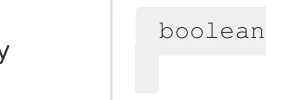

**返回数据**

| 参数名称 | 类型 | 示例 | 说明 |
| --- | --- | --- | --- |
| code | <code>string</code> | <code>SUCCESS</code> | 响应码，取值为<code> SUCCESS </code> 时表示请求成功。 |
| message | <code>string</code> | <code>null</code> | 响应消息。请求成功时通常为空。 |
| data | <code>object</code> | <code>null</code> | 响应数据。无返回内容时为 <code> null </code>。 |
| accessDeniedDetail | <code>object</code> | <code>null</code> | 鉴权失败详情。请求成功时通常为空。 |
| requestId | <code>string</code> | <code>req-001</code> | 请求 ID，可用于问题排查和日志检索。 |

**示例**

**请求示例**

```http
DELETE /himarket/v1/open-api/v1/catalog/categories/{categoryId}?cascade=false HTTP/1.1
Host: localhost:8080
X-HIMARKET-OPENAPI: HIMARKET_OPENAPI
X-HIMARKET-TOKEN: <admin-openapi-token>
```

**响应示例**

```json
{
  "code": "SUCCESS",
  "message": null,
  "data": null,
  "accessDeniedDetail": null,
  "requestId": "req-001"
}
```

<a id="section-3-1-3"></a>

### 3.1.3. getCategory

**接口信息**

- **接口路径**： `GET /himarket/v1/open-api/v1/catalog/categories/{categoryId}`

- **接口说明**：查询市场分类详情。

- **认证方式**：该接口属于管理面 OpenAPI。调用前请完成 OpenAPI 凭证配置，并按 Token 模式或AK/SK 签名模式携带认证 Header。

- **Header 示例**：Token 模式使用  `X-HIMARKET-OPENAPI: HIMARKET_OPENAPI`  与  `X-HIMARKET-TOKEN` ；AK/SK 模式使用  `X-HIMARKET-ACCESS-KEY` 、 `X-HIMARKET-TIMESTAMP`  和  `X-HIMARKET-SIGNATURE` 。

**请求参数**

| 参数名称 | 位置 | 类型 | 是否必选 | 示例 | 说明 |
| --- | --- | --- | --- | --- | --- |
| categoryId | path | <code>string</code> | 是 | <code>"category-</code><br><code>001"</code> | 分类 ID。 |

**返回数据**

| 参数名称 | 类型 | 示例 | 说明 |
| --- | --- | --- | --- |
| code | <code>string</code> | <code>SUCCESS</code> | 响应码，取值为<code> SUCCESS </code> 时表示请求成功。 |
| message | <code>string</code> | <code>null</code> | 响应消息。请求成功时通常为空。 |
| data | <code>object</code> | <code>{"categoryId":"cat</code><br><code>egory-</code><br><code>001","tenantId":"ten</code><br><code>ant-</code><br><code>001","kind":"MODEL_A</code><br><code>PI","code":"model-</code><br><code>api","name":"sample-</code><br><code>name","description":</code> <code>"</code>用于演示的资源描述<code>"} </code> | 响应数据。具体结构以接口语义为准。 |
| accessDeniedDetail | <code>object</code> | <code>null</code> | 鉴权失败详情。请求成功时通常为空。 |
| requestId | <code>string</code> | <code>req-001</code> | 请求 ID，可用于问题排查和日志检索。 |
| data.categoryId | <code>string</code> | <code>"category-001"</code> | 分类 ID。 |
| data.tenantId | <code>string</code> | <code>"tenant-001"</code> | 租户ID。 |
| data.kind | <code>string</code> | <code>"MODEL_API"</code> | 资源类型。 |
| data.code | <code>string</code> | <code>"model-api"</code> | 业务编码。 |
| data.name | <code>string</code> | <code>"sample-name"</code> | 名称。 |
| data.description | <code>string</code> | <code> "</code>用于演示的资源描述<code>" </code> | 描述信息。 |
| data.icon | <code>string</code> | <code>"sample-value"</code> | 图标地址。 |
| data.sortOrder | <code>integer&lt;int32&gt;</code> | <code>100</code> | 排序值。 |
| data.status | <code>string</code> | <code>"sample-value"</code> | 状态。 |
| data.createdBy | <code>string</code> | <code>"sample-value"</code> | 创建人。 |
| data.updatedBy | <code>string</code> | <code>"sample-value"</code> | 更新人。 |
| data.createdAt | <code>string&lt;date-</code><br><code>time&gt;</code> | <code>"2026-06-</code><br><code>22T12:00:00Z"</code> | 创建时间。 |
| data.updatedAt | <code>string&lt;date-</code><br><code>time&gt;</code> | <code>"2026-06-</code><br><code>22T12:00:00Z"</code> | 更新时间。 |
| data.listingCount | <code>integer&lt;int64&gt;</code> | <code>1</code> | Listing 数量。 |

**示例**

**请求示例**

```http
GET /himarket/v1/open-api/v1/catalog/categories/{categoryId} HTTP/1.1
Host: localhost:8080
X-HIMARKET-OPENAPI: HIMARKET_OPENAPI
X-HIMARKET-TOKEN: <admin-openapi-token>
```

**响应示例**

```json
{
  "code": "SUCCESS",
  "message": null,
  "data": {
    "categoryId": "category-001",
    "tenantId": "tenant-001",
    "kind": "MODEL_API",
    "code": "model-api",
    "name": "sample-name",
    "description": "⽤于演示的资源描述"
  },
  "accessDeniedDetail": null,
  "requestId": "req-001"
}
```

<a id="section-3-1-4"></a>

### 3.1.4. listAssociatedListings

**接口信息**

- **接口路径**： `GET /himarket/v1/open-api/v1/catalog/categories/{categoryId}/listings`

- **接口说明**：查询分类下已关联的 Listing。

- **认证方式**：该接口属于管理面 OpenAPI。调用前请完成 OpenAPI 凭证配置，并按 Token 模式或AK/SK 签名模式携带认证 Header。

- **Header 示例**：Token 模式使用  `X-HIMARKET-OPENAPI: HIMARKET_OPENAPI`  与  `X-HIMARKET-TOKEN` ；AK/SK 模式使用  `X-HIMARKET-ACCESS-KEY` 、 `X-HIMARKET-TIMESTAMP`  和  `X-HIMARKET-SIGNATURE` 。

**请求参数**

| 参数名称 | 位置 | 类型 | 是否必选 | 示例 | 说明 |
| --- | --- | --- | --- | --- | --- |
| categoryId | path | <code>string</code> | 是 | <code>"category-</code><br><code>001"</code> | 分类 ID。 |
| tenantId | query | <code>string</code> | 否 | <code>"tenant-</code><br><code>001"</code> | 租户ID。 |
| resourceId | query | <code>string</code> | 否 | <code>"resource-</code><br><code>001"</code> | AI Resource ID。 |
| kind | query | <code>string</code> | 否 | <code>"MODEL_API</code><br><code>"</code> | 资源类型。 |
| categoryId | query | <code>string</code> | 否 | <code>"category-</code><br><code>001"</code> | 分类 ID。当路径中未携带categoryId时，可通过此参数指定。 |
| portalId | query | <code>string</code> | 否 | <code>"portal-</code><br><code>001"</code> | 门户ID。 |
| visibility | query | <code>string</code> | 否 | <code>"PRIVATE"</code> | 可见性。可选值：<code> PRIVATE</code><code> </code>、<code> PUBLIC</code><code> </code>。 |
| publicationSt atus | query | <code>string</code> | 否 | <code>"DRAFT"</code> | 发布状态。可选值：<code> DRAFT </code>、<code> IN_REVIEW</code><code> </code>、<code> PUBLISH</code> <code>ED </code>、<code> UNPUB</code> <code>LISHED </code>、<code> R</code> <code>EJECTED </code>。 |
| keyword | query | <code>string</code> | 否 | <code>"sample-</code><br><code>value"</code> | 搜索关键词。 |
| page | query | <code>integer&lt;in</code><br><code>t32&gt;</code> | 否 | <code>1</code> | 页码。 |
| size | query | <code>integer&lt;in</code><br><code>t32&gt;</code> | 否 | <code>10</code> | 每页记录数。 |
| sort | query | <code>array</code> | 否 | <code>["sample-</code><br><code>value"]</code> | 排序条件。 |


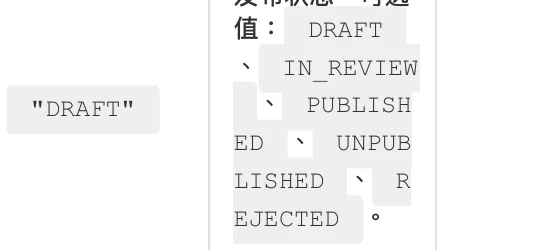

**返回数据**

| 参数名称 | 类型 | 示例 | 说明 |
| --- | --- | --- | --- |
| code | <code>string</code> | <code>SUCCESS</code> | 响应码，取值为<code> SUCCESS </code> 时表示请求成功。 |
| message | <code>string</code> | <code>null</code> | 响应消息。请求成功时通常为空。 |
| data | <code>object</code> | <code>{"content":</code><br><code>[{}],"pageNumber":1,</code><br><code>"pageSize":10,"total</code><br><code>Count":1}</code> | 响应数据。具体结构以接口语义为准。 |
| accessDeniedDetail | <code>object</code> | <code>null</code> | 鉴权失败详情。请求成功时通常为空。 |
| requestId | <code>string</code> | <code>req-001</code> | 请求 ID，可用于问题排查和日志检索。 |
| data.content | <code>array</code> | <code>[{"listingId":"lis</code><br><code>ting-</code><br><code>001","tenantId":"ten</code><br><code>ant-</code><br><code>001","resourceId":"r</code><br><code>esource-</code><br><code>001","defaultVersion</code><br><code>Id":"defaultVersion-</code><br><code>001","portalId":"por</code><br><code>tal-</code><br><code>001","visibility":"P</code><br><code>RIVATE"}]</code> | 分页结果列表。 |
| data.content\[\].listingId | <code>string</code> | <code>"listing-001"</code> | Listing ID。 |
| data.content\[\].tenantI d | <code>string</code> | <code>"tenant-001"</code> | 租户ID。 |
| data.content\[\].resourc eId | <code>string</code> | <code>"resource-001"</code> | AI Resource ID。 |
| data.content\[\].default VersionId | <code>string</code> | <code>"defaultVersion-</code><br><code>001"</code> | 默认版本ID。 |
| data.content\[\].portalId | <code>string</code> | <code>"portal-001"</code> | 门户ID。 |
| data.content\[\].visibility | <code>string</code> | <code>"PRIVATE"</code> | 可见性。可选值：<code> PRIVATE </code>、<code> PU</code> <code>BLIC </code>。 |
| data.content\[\].title | <code>string</code> | <code> "</code>示例资源标题<code>" </code> | 标题。 |
| data.content\[\].summa ry | <code>string</code> | <code> "</code>示例摘要<code>" </code> | 摘要信息。 |
| data.content\[\].descript ion | <code>string</code> | <code> "</code>用于演示的资源描述<code>" </code> | 描述信息。 |
| data.content\[\].icon | <code>string</code> | <code>"sample-value"</code> | 图标地址。 |
| data.content\[\].banner | <code>string</code> | <code>"sample-value"</code> | 横幅图片地址。 |
| data.content\[\].categor yId | <code>string</code> | <code>"category-001"</code> | 分类 ID。 |
| data.content\[\].categor y | <code>object</code> | <code>{"categoryId":"cat</code><br><code>egory-</code><br><code>001","tenantId":"ten</code><br><code>ant-</code><br><code>001","kind":"MODEL_A</code><br><code>PI","code":"model-</code><br><code>api","name":"sample-</code><br><code>name","description":</code> <code>"</code>用于演示的资源描述<code>"} </code> | 分类信息。 |
| data.content\[\].categor y.categoryId | <code>string</code> | <code>"category-001"</code> | 分类 ID。 |
| data.content\[\].categor y.tenantId | <code>string</code> | <code>"tenant-001"</code> | 租户ID。 |
| data.content\[\].categor y.kind | <code>string</code> | <code>"MODEL_API"</code> | 资源类型。 |
| data.content\[\].categor y.code | <code>string</code> | <code>"model-api"</code> | 业务编码。 |
| data.content\[\].categor y.name | <code>string</code> | <code>"sample-name"</code> | 名称。 |
| data.content\[\].categor y.description | <code>string</code> | <code> "</code>用于演示的资源描述<code>" </code> | 描述信息。 |
| data.content\[\].categor y.icon | <code>string</code> | <code>"sample-value"</code> | 图标地址。 |
| data.content\[\].categor y.sortOrder | <code>integer&lt;int32&gt;</code> | <code>100</code> | 排序值。 |
| data.content\[\].categor y.status | <code>string</code> | <code>"sample-value"</code> | 状态。 |
| data.content\[\].categor y.createdBy | <code>string</code> | <code>"sample-value"</code> | 创建人。 |
| data.content\[\].categor y.updatedBy | <code>string</code> | <code>"sample-value"</code> | 更新人。 |
| data.content\[\].categor y.createdAt | <code>string&lt;date-</code><br><code>time&gt;</code> | <code>"2026-06-</code><br><code>22T12:00:00Z"</code> | 创建时间。 |
| data.content\[\].categor y.updatedAt | <code>string&lt;date-</code><br><code>time&gt;</code> | <code>"2026-06-</code><br><code>22T12:00:00Z"</code> | 更新时间。 |
| data.content\[\].categor y.listingCount | <code>integer&lt;int64&gt;</code> | <code>1</code> | Listing 数量。 |
| data.content\[\].tags | <code>array</code> | <code>["sample-value"]</code> | 标签列表。 |
| data.content\[\].pricing Mode | <code>string</code> | <code>"sample-value"</code> | 计费模式。 |
| data.content\[\].listingSt atus | <code>string</code> | <code>"sample-value"</code> | 市场条目状态。 |
| data.content\[\].publicat ionStatus | <code>string</code> | <code>"DRAFT"</code> | 发布状态。可选值：<code> DRAFT </code>、<code> IN_R</code> <code>EVIEW </code>、<code> PUBLISHED</code><code> </code>、<code> UNPUBLISHED </code>、<code> REJECTED </code>。 |
| data.content\[\].created By | <code>string</code> | <code>"sample-value"</code> | 创建人。 |
| data.content\[\].publish edBy | <code>string</code> | <code>"sample-value"</code> | 发布人 ID。 |
| data.content\[\].publish edAt | <code>string&lt;date-</code><br><code>time&gt;</code> | <code>"2026-06-</code><br><code>22T12:00:00Z"</code> | 发布时间。 |


<table>
  <tr>
    <td>data.content[].created At</td>
    <td><code>string&lt;date-</code><br><code>time&gt;</code></td>
    <td><code>"2026-06-</code><br><code>22T12:00:00Z"</code></td>
    <td>创建时间。</td>
  </tr>
  <tr>
    <td>data.content[].update dAt</td>
    <td><code>string&lt;date-</code><br><code>time&gt;</code></td>
    <td><code>"2026-06-</code><br><code>22T12:00:00Z"</code></td>
    <td>更新时间。</td>
  </tr>
  <tr>
    <td>data.pageNumber</td>
    <td><code>integer&lt;int32&gt;</code></td>
    <td><code>1</code></td>
    <td>当前页码。</td>
  </tr>
  <tr>
    <td>data.pageSize</td>
    <td><code>integer&lt;int32&gt;</code></td>
    <td><code>10</code></td>
    <td>每页大小。</td>
  </tr>
  <tr>
    <td>data.totalCount</td>
    <td><code>integer&lt;int64&gt;</code></td>
    <td><code>1</code></td>
    <td>总记录数。</td>
  </tr>
</table>

**示例**

**请求示例**

```http
GET /himarket/v1/open-api/v1/catalog/categories/{categoryId}/listings?tenantId=tenant-001&resourceId=resource-001&kind=MODEL_API&categoryId=category-001&portalId=portal-001&visibility=PRIVATE&publicationStatus=DRAFT&keyword=sample-value HTTP/1.1
Host: localhost:8080
X-HIMARKET-OPENAPI: HIMARKET_OPENAPI
X-HIMARKET-TOKEN: <admin-openapi-token>
```

**响应示例**

```json
{
  "code": "SUCCESS",
  "message": null,
  "data": {
    "content": [
      {}
    ],
    "pageNumber": 1,
    "pageSize": 10,
    "totalCount": 1
  },
  "accessDeniedDetail": null,
  "requestId": "req-001"
}
```

<a id="section-3-1-5"></a>

### 3.1.5. listCategories

**接口信息**

- **接口路径**： `GET /himarket/v1/open-api/v1/catalog/categories`

- **接口说明**：分页查询市场分类。

- **认证方式**：该接口属于管理面 OpenAPI。调用前请完成 OpenAPI 凭证配置，并按 Token 模式或AK/SK 签名模式携带认证 Header。

- **Header 示例**：Token 模式使用  `X-HIMARKET-OPENAPI: HIMARKET_OPENAPI`  与  `X-HIMARKET-TOKEN` ；AK/SK 模式使用  `X-HIMARKET-ACCESS-KEY` 、 `X-HIMARKET-TIMESTAMP`  和  `X-HIMARKET-SIGNATURE` 。

**请求参数**

| 参数名称 | 位置 | 类型 | 是否必选 | 示例 | 说明 |
| --- | --- | --- | --- | --- | --- |
| tenantId | query | <code>string</code> | 否 | <code>"tenant-</code><br><code>001"</code> | 租户ID。 |
| kind | query | <code>string</code> | 否 | <code>"MODEL_API</code><br><code>"</code> | 资源类型。 |
| keyword | query | <code>string</code> | 否 | <code>"sample-</code><br><code>value"</code> | 搜索关键词。 |
| status | query | <code>string</code> | 否 | <code>"sample-</code><br><code>value"</code> | 状态。 |
| page | query | <code>integer&lt;in</code><br><code>t32&gt;</code> | 否 | <code>1</code> | 页码。 |
| size | query | <code>integer&lt;in</code><br><code>t32&gt;</code> | 否 | <code>10</code> | 每页记录数。 |
| sort | query | <code>array</code> | 否 | <code>["sample-</code><br><code>value"]</code> | 排序条件。 |

**返回数据**

| 参数名称 | 类型 | 示例 | 说明 |
| --- | --- | --- | --- |
| code | <code>string</code> | <code>SUCCESS</code> | 响应码，取值为<code> SUCCESS </code> 时表示请求成功。 |
| message | <code>string</code> | <code>null</code> | 响应消息。请求成功时通常为空。 |
| data | <code>object</code> | <code>{"content":</code><br><code>[{"categoryId":"cate</code><br><code>gory-</code><br><code>001","tenantId":"ten</code><br><code>ant-</code><br><code>001","kind":"MODEL_A</code><br><code>PI","code":"model-</code><br><code>api","name":"sample-</code><br><code>name","description":</code> <code>"</code>用于演示的资源描述<code>","icon":"sample-</code><code>value","sortOrder":1</code><br><code>00,"status":"sample-</code><br><code>value","createdBy":"</code><br><code>sample-</code><br><code>value","updatedBy":"</code><br><code>sample-</code><br><code>value","createdAt":"</code><br><code>2026-06-</code><br><code>22T12:00:00Z","updat</code><br><code>edAt":"2026-06-</code><br><code>22T12:00:00Z","listi</code><br><code>ngCount":1}],"pageNu</code><br><code>mber":1,"pageSize":1</code><br><code>0,"totalCount":1}</code> | 响应数据。具体结构以接口语义为准。 |
| accessDeniedDetail | <code>object</code> | <code>null</code> | 鉴权失败详情。请求成功时通常为空。 |
| requestId | <code>string</code> | <code>req-001</code> | 请求 ID，可用于问题排查和日志检索。 |
| data.content | <code>array</code> | <code>[{"categoryId":"ca</code><br><code>tegory-</code><br><code>001","tenantId":"ten</code><br><code>ant-</code><br><code>001","kind":"MODEL_A</code><br><code>PI","code":"model-</code><br><code>api","name":"sample-</code><br><code>name","description":</code> <code>"</code>用于演示的资源描述<code>"}] </code> | 分页结果列表。 |
| data.content\[\].categor yId | <code>string</code> | <code>"category-001"</code> | 分类 ID。 |
| data.content\[\].tenantI d | <code>string</code> | <code>"tenant-001"</code> | 租户ID。 |
| data.content\[\].kind | <code>string</code> | <code>"MODEL_API"</code> | 资源类型。 |
| data.content\[\].code | <code>string</code> | <code>"model-api"</code> | 业务编码。 |
| data.content\[\].name | <code>string</code> | <code>"sample-name"</code> | 名称。 |
| data.content\[\].descript ion | <code>string</code> | <code> "</code>用于演示的资源描述<code>" </code> | 描述信息。 |
| data.content\[\].icon | <code>string</code> | <code>"sample-value"</code> | 图标地址。 |
| data.content\[\].sortOrd er | <code>integer&lt;int32&gt;</code> | <code>100</code> | 排序值。 |
| data.content\[\].status | <code>string</code> | <code>"sample-value"</code> | 状态。 |
| data.content\[\].created By | <code>string</code> | <code>"sample-value"</code> | 创建人。 |
| data.content\[\].update dBy | <code>string</code> | <code>"sample-value"</code> | 更新人。 |
| data.content\[\].created At | <code>string&lt;date-</code><br><code>time&gt;</code> | <code>"2026-06-</code><br><code>22T12:00:00Z"</code> | 创建时间。 |
| data.content\[\].update dAt | <code>string&lt;date-</code><br><code>time&gt;</code> | <code>"2026-06-</code><br><code>22T12:00:00Z"</code> | 更新时间。 |
| data.content\[\].listingC ount | <code>integer&lt;int64&gt;</code> | <code>1</code> | Listing 数量。 |
| data.pageNumber | <code>integer&lt;int32&gt;</code> | <code>1</code> | 当前页码。 |
| data.pageSize | <code>integer&lt;int32&gt;</code> | <code>10</code> | 每页大小。 |
| data.totalCount | <code>integer&lt;int64&gt;</code> | <code>1</code> | 总记录数。 |

**示例**

**请求示例**

```text
GET /himarket/v1/open-api/v1/catalog/categories?tenantId=tenant-
001&kind=MODEL_API&keyword=sample-value&status=sample-value&page=1&size=10&sort=sample-value HTTP/1.1
Host: localhost:8080
X-HIMARKET-OPENAPI: HIMARKET_OPENAPI
X-HIMARKET-TOKEN: <admin-openapi-token>
```

**响应示例**

```json
{
  "code": "SUCCESS",
  "message": null,
  "data": {
    "content": [
      {
        "categoryId": "category-001",
        "tenantId": "tenant-001",
        "kind": "MODEL_API",
        "code": "model-api",
        "name": "sample-name",
        "description": "⽤于演示的资源描述",
        "icon": "sample-value",
        "sortOrder": 100,
        "status": "sample-value",
        "createdBy": "sample-value",
        "updatedBy": "sample-value",
        "createdAt": "2026-06-22T12:00:00Z",
        "updatedAt": "2026-06-22T12:00:00Z",
        "listingCount": 1
      }
    ],
    "pageNumber": 1,
    "pageSize": 10,
    "totalCount": 1
  },
  "accessDeniedDetail": null,
  "requestId": "req-001"
}
```

<a id="section-3-1-6"></a>

### 3.1.6. saveCategory

**接口信息**

- **接口路径**： `POST /himarket/v1/open-api/v1/catalog/categories`

- **接口说明**：创建或更新市场分类。

- **认证方式**：该接口属于管理面 OpenAPI。调用前请完成 OpenAPI 凭证配置，并按 Token 模式或AK/SK 签名模式携带认证 Header。

- **Header 示例**：Token 模式使用  `X-HIMARKET-OPENAPI: HIMARKET_OPENAPI`  与  `X-HIMARKET-TOKEN` ；AK/SK 模式使用  `X-HIMARKET-ACCESS-KEY` 、 `X-HIMARKET-TIMESTAMP`  和  `X-HIMARKET-SIGNATURE` 。

**请求参数**

| 参数名称 | 位置 | 类型 | 是否必选 | 示例 | 说明 |
| --- | --- | --- | --- | --- | --- |
| categoryId | body | <code>string</code> | 否 | <code>"category-</code><br><code>001"</code> | 分类 ID。 |
| kind | body | <code>string</code> | 是 | <code>"MODEL_API</code><br><code>"</code> | 资源类型。 |
| code | body | <code>string</code> | 是 | <code>"model-</code><br><code>api"</code> | 业务编码。 |
| name | body | <code>string</code> | 是 | <code>"sample-</code><br><code>name"</code> | 名称。 |
| description | body | <code>string</code> | 否 | <code> "</code>用于演示的资源描述<code>" </code> | 描述信息。 |
| icon | body | <code>string</code> | 否 | <code>"sample-</code><br><code>value"</code> | 图标地址。 |
| sortOrder | body | <code>integer&lt;in</code><br><code>t32&gt;</code> | 否 | <code>100</code> | 排序值。 |
| status | body | <code>string</code> | 否 | <code>"sample-</code><br><code>value"</code> | 状态。 |

**返回数据**

| 参数名称 | 类型 | 示例 | 说明 |
| --- | --- | --- | --- |
| code | <code>string</code> | <code>SUCCESS</code> | 响应码，取值为<code> SUCCESS </code> 时表示请求成功。 |
| message | <code>string</code> | <code>null</code> | 响应消息。请求成功时通常为空。 |
| data | <code>object</code> | <code>{"categoryId":"cat</code><br><code>egory-</code><br><code>001","tenantId":"ten</code><br><code>ant-</code><br><code>001","kind":"MODEL_A</code><br><code>PI","code":"model-</code><br><code>api","name":"sample-</code><br><code>name","description":</code> <code>"</code>用于演示的资源描述<code>"} </code> | 响应数据。具体结构以接口语义为准。 |
| accessDeniedDetail | <code>object</code> | <code>null</code> | 鉴权失败详情。请求成功时通常为空。 |
| requestId | <code>string</code> | <code>req-001</code> | 请求 ID，可用于问题排查和日志检索。 |
| data.categoryId | <code>string</code> | <code>"category-001"</code> | 分类 ID。 |
| data.tenantId | <code>string</code> | <code>"tenant-001"</code> | 租户ID。 |
| data.kind | <code>string</code> | <code>"MODEL_API"</code> | 资源类型。 |
| data.code | <code>string</code> | <code>"model-api"</code> | 业务编码。 |
| data.name | <code>string</code> | <code>"sample-name"</code> | 名称。 |
| data.description | <code>string</code> | <code> "</code>用于演示的资源描述<code>" </code> | 描述信息。 |
| data.icon | <code>string</code> | <code>"sample-value"</code> | 图标地址。 |
| data.sortOrder | <code>integer&lt;int32&gt;</code> | <code>100</code> | 排序值。 |
| data.status | <code>string</code> | <code>"sample-value"</code> | 状态。 |
| data.createdBy | <code>string</code> | <code>"sample-value"</code> | 创建人。 |
| data.updatedBy | <code>string</code> | <code>"sample-value"</code> | 更新人。 |
| data.createdAt | <code>string&lt;date-</code><br><code>time&gt;</code> | <code>"2026-06-</code><br><code>22T12:00:00Z"</code> | 创建时间。 |
| data.updatedAt | <code>string&lt;date-</code><br><code>time&gt;</code> | <code>"2026-06-</code><br><code>22T12:00:00Z"</code> | 更新时间。 |
| data.listingCount | <code>integer&lt;int64&gt;</code> | <code>1</code> | Listing 数量。 |

**示例**

**请求示例**

```http
POST /himarket/v1/open-api/v1/catalog/categories HTTP/1.1
Host: localhost:8080
X-HIMARKET-OPENAPI: HIMARKET_OPENAPI
X-HIMARKET-TOKEN: <admin-openapi-token>
Content-Type: application/json

{
  "categoryId": "category-001",
  "kind": "MODEL_API",
  "code": "model-api",
  "name": "sample-name",
  "description": "⽤于演示的资源描述",
  "icon": "sample-value"
}
```

**响应示例**

```json
{
  "code": "SUCCESS",
  "message": null,
  "data": {
    "categoryId": "category-001",
    "tenantId": "tenant-001",
    "kind": "MODEL_API",
    "code": "model-api",
    "name": "sample-name",
    "description": "⽤于演示的资源描述"
  },
  "accessDeniedDetail": null,
  "requestId": "req-001"
}
```

<a id="section-3-1-7"></a>

### 3.1.7. unbindListings

**接口信息**

- **接口路径**： `DELETE /himarket/v1/open-api/v1/catalog/categories/{categoryId}/listings`

- **接口说明**：批量解除分类与 Listing 的关联。

- **认证方式**：该接口属于管理面 OpenAPI。调用前请完成 OpenAPI 凭证配置，并按 Token 模式或AK/SK 签名模式携带认证 Header。

- **Header 示例**：Token 模式使用  `X-HIMARKET-OPENAPI: HIMARKET_OPENAPI`  与  `X-HIMARKET-TOKEN` ；AK/SK 模式使用  `X-HIMARKET-ACCESS-KEY` 、 `X-HIMARKET-TIMESTAMP`  和  `X-HIMARKET-SIGNATURE` 。

**请求参数**

| 参数名称 | 位置 | 类型 | 是否必选 | 示例 | 说明 |
| --- | --- | --- | --- | --- | --- |
| categoryId | path | <code>string</code> | 是 | <code>"category-</code><br><code>001"</code> | 分类 ID。 |
| listingIds | body | <code>array</code> | 是 | <code>["sample-</code><br><code>value"]</code> | Listing ID 列表。 |
| force | body | <code>boolean</code> | 否 | <code>false</code> | 是否强制执行。 |

**返回数据**

| 参数名称 | 类型 | 示例 | 说明 |
| --- | --- | --- | --- |
| code | <code>string</code> | <code>SUCCESS</code> | 响应码，取值为<code> SUCCESS </code> 时表示请求成功。 |
| message | <code>string</code> | <code>null</code> | 响应消息。请求成功时通常为空。 |
| data | <code>object</code> | <code>null</code> | 响应数据。无返回内容时为 <code> null </code>。 |
| accessDeniedDetail | <code>object</code> | <code>null</code> | 鉴权失败详情。请求成功时通常为空。 |
| requestId | <code>string</code> | <code>req-001</code> | 请求 ID，可用于问题排查和日志检索。 |

**示例**

**请求示例**

```http
DELETE /himarket/v1/open-api/v1/catalog/categories/{categoryId}/listings HTTP/1.1
Host: localhost:8080
X-HIMARKET-OPENAPI: HIMARKET_OPENAPI
X-HIMARKET-TOKEN: <admin-openapi-token>
Content-Type: application/json

{
  "listingIds": [
    "sample-value"
  ],
  "force": false
}
```

**响应示例**

```json
{
  "code": "SUCCESS",
  "message": null,
  "data": null,
  "accessDeniedDetail": null,
  "requestId": "req-001"
}
```

<a id="section-3-2"></a>

## 3.2. AI Resource Catalog 搜索接口（Public）

<a id="section-3-2-1"></a>

### 3.2.1. getItem

**接口信息**

- **接口路径**： `GET /himarket/v1/open-api/v1/catalog/items/{listingId}`

- **接口说明**：查询已发布市场资源详情。

- **认证方式**：该接口属于开发者门户开放能力。是否需要登录态以接口实际返回为准；需要登录态时，请在请求 Header 中携带  `Authorization: Bearer <accessToken>` 。

- **Header 示例**：需要登录态的接口使用  `Authorization: Bearer <accessToken>` 。

**请求参数**

| 参数名称 | 位置 | 类型 | 是否必选 | 示例 | 说明 |
| --- | --- | --- | --- | --- | --- |
| listingId | path | <code>string</code> | 是 | <code>"listing-</code><br><code>001"</code> | Listing ID。 |
| version | query | <code>string</code> | 否 | <code>"sample-</code><br><code>value"</code> | 版本号。 |

**返回数据**

| 参数名称 | 类型 | 示例 | 说明 |
| --- | --- | --- | --- |
| code | <code>string</code> | <code>SUCCESS</code> | 响应码，取值为<code> SUCCESS </code> 时表示请求成功。 |
| message | <code>string</code> | <code>null</code> | 响应消息。请求成功时通常为空。 |
| data | <code>object</code> | <code>{"listingId":"list</code><br><code>ing-</code><br><code>001","tenantId":"ten</code><br><code>ant-</code><br><code>001","resourceId":"r</code><br><code>esource-</code><br><code>001","defaultVersion</code><br><code>Id":"defaultVersion-</code><br><code>001","portalId":"por</code><br><code>tal-</code><br><code>001","visibility":"P</code><br><code>RIVATE"}</code> | 响应数据。具体结构以接口语义为准。 |
| accessDeniedDetail | <code>object</code> | <code>null</code> | 鉴权失败详情。请求成功时通常为空。 |
| requestId | <code>string</code> | <code>req-001</code> | 请求 ID，可用于问题排查和日志检索。 |
| data.listingId | <code>string</code> | <code>"listing-001"</code> | Listing ID。 |
| data.tenantId | <code>string</code> | <code>"tenant-001"</code> | 租户ID。 |
| data.resourceId | <code>string</code> | <code>"resource-001"</code> | AI Resource ID。 |
| data.defaultVersionId | <code>string</code> | <code>"defaultVersion-</code><br><code>001"</code> | 默认版本ID。 |
| data.portalId | <code>string</code> | <code>"portal-001"</code> | 门户ID。 |
| data.visibility | <code>string</code> | <code>"PRIVATE"</code> | 可见性。可选值：<code> PRIVATE </code>、<code> PU</code> <code>BLIC </code>。 |
| data.title | <code>string</code> | <code> "</code>示例资源标题<code>" </code> | 标题。 |
| data.summary | <code>string</code> | <code> "</code>示例摘要<code>" </code> | 摘要信息。 |
| data.description | <code>string</code> | <code> "</code>用于演示的资源描述<code>" </code> | 描述信息。 |
| data.icon | <code>string</code> | <code>"sample-value"</code> | 图标地址。 |
| data.banner | <code>string</code> | <code>"sample-value"</code> | 横幅图片地址。 |
| data.categoryId | <code>string</code> | <code>"category-001"</code> | 分类 ID。 |
| data.category | <code>object</code> | <code>{"categoryId":"cat</code><br><code>egory-</code><br><code>001","tenantId":"ten</code><br><code>ant-</code><br><code>001","kind":"MODEL_A</code><br><code>PI","code":"model-</code><br><code>api","name":"sample-</code><br><code>name","description":</code> <code>"</code>用于演示的资源描述<code>"} </code> | 分类信息。 |
| data.category.categor yId | <code>string</code> | <code>"category-001"</code> | 分类 ID。 |
| data.category.tenantId | <code>string</code> | <code>"tenant-001"</code> | 租户ID。 |
| data.category.kind | <code>string</code> | <code>"MODEL_API"</code> | 资源类型。 |
| data.category.code | <code>string</code> | <code>"model-api"</code> | 业务编码。 |
| data.category.name | <code>string</code> | <code>"sample-name"</code> | 名称。 |
| data.category.descript ion | <code>string</code> | <code> "</code>用于演示的资源描述<code>" </code> | 描述信息。 |
| data.category.icon | <code>string</code> | <code>"sample-value"</code> | 图标地址。 |
| data.category.sortOrd er | <code>integer&lt;int32&gt;</code> | <code>100</code> | 排序值。 |
| data.category.status | <code>string</code> | <code>"sample-value"</code> | 状态。 |
| data.category.created By | <code>string</code> | <code>"sample-value"</code> | 创建人。 |
| data.category.updated By | <code>string</code> | <code>"sample-value"</code> | 更新人。 |
| data.category.created At | <code>string&lt;date-</code><br><code>time&gt;</code> | <code>"2026-06-</code><br><code>22T12:00:00Z"</code> | 创建时间。 |
| data.category.updated At | <code>string&lt;date-</code><br><code>time&gt;</code> | <code>"2026-06-</code><br><code>22T12:00:00Z"</code> | 更新时间。 |
| data.category.listingC ount | <code>integer&lt;int64&gt;</code> | <code>1</code> | Listing 数量。 |
| data.tags | <code>array</code> | <code>["sample-value"]</code> | 标签列表。 |
| data.pricingMode | <code>string</code> | <code>"sample-value"</code> | 计费模式。 |
| data.sourceType | <code>string</code> | <code>"sample-value"</code> | 来源类型。 |
| data.listingStatus | <code>string</code> | <code>"sample-value"</code> | 市场条目状态。 |
| data.publicationStatus | <code>string</code> | <code>"DRAFT"</code> | 发布状态。可选值：<code> DRAFT </code>、<code> IN_R</code> <code>EVIEW </code>、<code> PUBLISHED</code><code> </code>、<code> UNPUBLISHED </code>、<code> REJECTED </code>。 |
| data.publishedAt | <code>string&lt;date-</code><br><code>time&gt;</code> | <code>"2026-06-</code><br><code>22T12:00:00Z"</code> | 发布时间。 |
| data.resource | <code>object</code> | <code>{"resourceId":"res</code><br><code>ource-</code><br><code>001","tenantId":"ten</code><br><code>ant-</code><br><code>001","kind":"MODEL_A</code><br><code>PI","name":"sample-</code><br><code>name","displayName":</code> <code>"</code>示例资源<code>","summary":"</code>示例摘要<code>"} </code> | AI Resource 基础信息。 |
| data.resource.resourc eId | <code>string</code> | <code>"resource-001"</code> | AI Resource ID。 |
| data.resource.tenantId | <code>string</code> | <code>"tenant-001"</code> | 租户ID。 |
| data.resource.kind | <code>string</code> | <code>"MODEL_API"</code> | 资源类型。 |
| data.resource.name | <code>string</code> | <code>"sample-name"</code> | 名称。 |
| data.resource.displayN ame | <code>string</code> | <code> "</code>示例资源<code>" </code> | 展示名称。 |
| data.resource.summar y | <code>string</code> | <code> "</code>示例摘要<code>" </code> | 摘要信息。 |
| data.resource.descripti on | <code>string</code> | <code> "</code>用于演示的资源描述<code>" </code> | 描述信息。 |
| data.resource.ownerTy pe | <code>string</code> | <code>"USER"</code> | 归属主体类型。可选值：<code> USER </code>、<code> APP </code>、<code> SYSTEM </code>。 |


<table>
  <tr>
    <td>data.resource.ownerId</td>
    <td><code>string</code></td>
    <td><code>"owner-001"</code></td>
    <td>归属主体ID。</td>
  </tr>
  <tr>
    <td>data.resource.created By</td>
    <td><code>string</code></td>
    <td><code>"sample-value"</code></td>
    <td>创建人。</td>
  </tr>
  <tr>
    <td>data.resource.created ByName</td>
    <td><code>string</code></td>
    <td><code>"demo-createdby"</code></td>
    <td>创建人名称。</td>
  </tr>
  <tr>
    <td>data.resource.icon</td>
    <td><code>string</code></td>
    <td><code>"sample-value"</code></td>
    <td>图标地址。</td>
  </tr>
  <tr>
    <td>data.resource.tags</td>
    <td><code>array</code></td>
    <td><code>["sample-value"]</code></td>
    <td>标签列表。</td>
  </tr>
  <tr>
    <td>data.resource.lifecycle Status</td>
    <td><code>string</code></td>
    <td><code>"DRAFT"</code></td>
    <td>生命周期状态。可选值：<code> DRAFT </code>、<code> ACTI</code> <code>VE </code>、<code> DEPRECATED </code>、<code> ARCHIVED </code>。</td>
  </tr>
  <tr>
    <td>data.resource.latestVe rsionId</td>
    <td><code>string</code></td>
    <td><code>"latestVersion-</code><br><code>001"</code></td>
    <td>最新版本ID。</td>
  </tr>
  <tr>
    <td>data.resource.autoApp roveSubscription</td>
    <td><code>boolean</code></td>
    <td><code>true</code></td>
    <td>是否自动批准订阅。</td>
  </tr>
  <tr>
    <td>data.resource.extras</td>
    <td><code>object</code></td>
    <td><code>{}</code></td>
    <td>扩展配置。</td>
  </tr>
  <tr>
    <td>data.resource.created At</td>
    <td><code>string&lt;date-</code><br><code>time&gt;</code></td>
    <td><code>"2026-06-</code><br><code>22T12:00:00Z"</code></td>
    <td>创建时间。</td>
  </tr>
  <tr>
    <td>data.resource.updated At</td>
    <td><code>string&lt;date-</code><br><code>time&gt;</code></td>
    <td><code>"2026-06-</code><br><code>22T12:00:00Z"</code></td>
    <td>更新时间。</td>
  </tr>
  <tr>
    <td>data.version</td>
    <td><code>object</code></td>
    <td><code>{"versionId":"vers</code><br><code>ion-</code><br><code>001","resourceId":"r</code><br><code>esource-</code><br><code>001","version":"samp</code><br><code>le-</code><br><code>value","versionSchem</code><br><code>e":"SEMVER","status"</code><br><code>:"DRAFT","manifestId</code><br><code>":"manifest-001"}</code></td>
    <td>版本号。</td>
  </tr>
  <tr>
    <td>data.version.versionId</td>
    <td><code>string</code></td>
    <td><code>"version-001"</code></td>
    <td>版本 ID。</td>
  </tr>
  <tr>
    <td>data.version.resourceI d</td>
    <td><code>string</code></td>
    <td><code>"resource-001"</code></td>
    <td>AI Resource ID。</td>
  </tr>
  <tr>
    <td>data.version.version</td>
    <td><code>string</code></td>
    <td><code>"sample-value"</code></td>
    <td>版本号。</td>
  </tr>
  <tr>
    <td>data.version.versionSc heme</td>
    <td><code>string</code></td>
    <td><code>"SEMVER"</code></td>
    <td>版本号方案。可选值：<code> SEMVER </code>、<code> TIM</code> <code>ESTAMP </code>、<code> REVISION</code><code> </code>、<code> EXTERNAL </code>。</td>
  </tr>
  <tr>
    <td>data.version.status</td>
    <td><code>string</code></td>
    <td><code>"DRAFT"</code></td>
    <td>状态。</td>
  </tr>
  <tr>
    <td>data.version.manifestI d</td>
    <td><code>string</code></td>
    <td><code>"manifest-001"</code></td>
    <td>Manifest ID。</td>
  </tr>
  <tr>
    <td>data.version.sourceBin dingId</td>
    <td><code>string</code></td>
    <td><code>"sourceBinding-</code><br><code>001"</code></td>
    <td>来源绑定ID。</td>
  </tr>
  <tr>
    <td>data.version.artifactDi gest</td>
    <td><code>string</code></td>
    <td><code>"sample-value"</code></td>
    <td>制品摘要。</td>
  </tr>
  <tr>
    <td>data.version.releaseNo te</td>
    <td><code>string</code></td>
    <td><code>"sample-value"</code></td>
    <td>版本说明。</td>
  </tr>
  <tr>
    <td>data.version.createdB y</td>
    <td><code>string</code></td>
    <td><code>"sample-value"</code></td>
    <td>创建人。</td>
  </tr>
  <tr>
    <td>data.version.published At</td>
    <td><code>string&lt;date-</code><br><code>time&gt;</code></td>
    <td><code>"2026-06-</code><br><code>22T12:00:00Z"</code></td>
    <td>发布时间。</td>
  </tr>
  <tr>
    <td>data.version.createdAt</td>
    <td><code>string&lt;date-</code><br><code>time&gt;</code></td>
    <td><code>"2026-06-</code><br><code>22T12:00:00Z"</code></td>
    <td>创建时间。</td>
  </tr>
  <tr>
    <td>data.version.updatedA t</td>
    <td><code>string&lt;date-</code><br><code>time&gt;</code></td>
    <td><code>"2026-06-</code><br><code>22T12:00:00Z"</code></td>
    <td>更新时间。</td>
  </tr>
  <tr>
    <td>data.version.download Count</td>
    <td><code>integer&lt;int64&gt;</code></td>
    <td><code>1</code></td>
    <td>下载次数。</td>
  </tr>
</table>

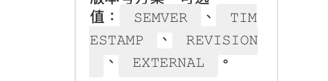

<table>
  <tr>
    <td>data.version.isLatest</td>
    <td><code>boolean</code></td>
    <td><code>true</code></td>
    <td>是否为最新版本。</td>
  </tr>
  <tr>
    <td>data.manifest</td>
    <td><code>object</code></td>
    <td><code>{}</code></td>
    <td>资源 Manifest 内容。</td>
  </tr>
  <tr>
    <td>data.extras</td>
    <td><code>object</code></td>
    <td><code>{}</code></td>
    <td>扩展配置。</td>
  </tr>
  <tr>
    <td>data.metrics</td>
    <td><code>object</code></td>
    <td><code>{"toolCount":1,"su</code><br><code>bscriptionCount":1}</code></td>
    <td>指标信息。</td>
  </tr>
  <tr>
    <td>data.metrics.toolCount</td>
    <td><code>integer&lt;int64&gt;</code></td>
    <td><code>1</code></td>
    <td>工具数量。</td>
  </tr>
  <tr>
    <td>data.metrics.subscripti onCount</td>
    <td><code>integer&lt;int64&gt;</code></td>
    <td><code>1</code></td>
    <td>订阅数量。</td>
  </tr>
</table>


**示例**

**请求示例**

```http
GET /himarket/v1/open-api/v1/catalog/items/{listingId}?version=sample-value HTTP/1.1
Host: localhost:8080
Authorization: Bearer <accessToken>
```

**响应示例**

```json
{
  "code": "SUCCESS",
  "message": null,
  "data": {
    "listingId": "listing-001",
    "tenantId": "tenant-001",
    "resourceId": "resource-001",
    "defaultVersionId": "defaultVersion-001",
    "portalId": "portal-001",
    "visibility": "PRIVATE"
  },
  "accessDeniedDetail": null,
  "requestId": "req-001"
}
```

<a id="section-3-2-2"></a>

### 3.2.2. search

**接口信息**

- **接口路径**： `GET /himarket/v1/open-api/v1/catalog/search`

- **接口说明**：搜索已发布市场资源。

- **认证方式**：该接口属于开发者门户开放能力。是否需要登录态以接口实际返回为准；需要登录态时，请在请求 Header 中携带  `Authorization: Bearer <accessToken>` 。

- **Header 示例**：需要登录态的接口使用  `Authorization: Bearer <accessToken>` 。

**请求参数**

| 参数名称 | 位置 | 类型 | 是否必选 | 示例 | 说明 |
| --- | --- | --- | --- | --- | --- |
| tenantId | query | <code>string</code> | 否 | <code>"tenant-</code><br><code>001"</code> | 租户ID。 |
| portalId | query | <code>string</code> | 否 | <code>"portal-</code><br><code>001"</code> | 门户ID。 |
| kind | query | <code>string</code> | 否 | <code>"MODEL_API</code><br><code>"</code> | 资源类型。 |
| keyword | query | <code>string</code> | 否 | <code>"sample-</code><br><code>value"</code> | 搜索关键词。 |
| categoryId | query | <code>string</code> | 否 | <code>"category-</code><br><code>001"</code> | 分类 ID。 |
| tag | query | <code>string</code> | 否 | <code>"sample-</code><br><code>value"</code> | 标签。 |
| pricingMode | query | <code>string</code> | 否 | <code>"sample-</code><br><code>value"</code> | 计费模式。 |
| sourceType | query | <code>string</code> | 否 | <code>"sample-</code><br><code>value"</code> | 来源类型。 |
| origin | query | <code>string</code> | 否 | <code>"sample-</code><br><code>value"</code> | 来源标识。 |
| excludeOrigin | query | <code>string</code> | 否 | <code>"sample-</code><br><code>value"</code> | 排除的来源标识。 |
| sortBy | query | <code>string</code> | 否 | <code>"sample-</code><br><code>value"</code> | 排序字段。 |
| page | query | <code>integer&lt;in</code><br><code>t32&gt;</code> | 否 | <code>1</code> | 页码。 |
| size | query | <code>integer&lt;in</code><br><code>t32&gt;</code> | 否 | <code>10</code> | 每页记录数。 |
| sort | query | <code>array</code> | 否 | <code>["sample-</code><br><code>value"]</code> | 排序条件。 |

**返回数据**

| 参数名称 | 类型 | 示例 | 说明 |
| --- | --- | --- | --- |
| code | <code>string</code> | <code>SUCCESS</code> | 响应码，取值为<code> SUCCESS </code> 时表示请求成功。 |
| message | <code>string</code> | <code>null</code> | 响应消息。请求成功时通常为空。 |
| data | <code>object</code> | <code>{"content":</code><br><code>[{}],"pageNumber":1,</code><br><code>"pageSize":10,"total</code><br><code>Count":1}</code> | 响应数据。具体结构以接口语义为准。 |
| accessDeniedDetail | <code>object</code> | <code>null</code> | 鉴权失败详情。请求成功时通常为空。 |
| requestId | <code>string</code> | <code>req-001</code> | 请求 ID，可用于问题排查和日志检索。 |

<table>
  <tr>
    <td>data.content</td>
    <td><code>array</code></td>
    <td><code>[{"listingId":"lis</code><br><code>ting-</code><br><code>001","tenantId":"ten</code><br><code>ant-</code><br><code>001","resourceId":"r</code><br><code>esource-</code><br><code>001","defaultVersion</code><br><code>Id":"defaultVersion-</code><br><code>001","portalId":"por</code><br><code>tal-</code><br><code>001","visibility":"P</code><br><code>RIVATE"}]</code></td>
    <td>分页结果列表。</td>
  </tr>
  <tr>
    <td>data.content[].listingId</td>
    <td><code>string</code></td>
    <td><code>"listing-001"</code></td>
    <td>Listing ID。</td>
  </tr>
  <tr>
    <td>data.content[].tenantI d</td>
    <td><code>string</code></td>
    <td><code>"tenant-001"</code></td>
    <td>租户ID。</td>
  </tr>
  <tr>
    <td>data.content[].resourc eId</td>
    <td><code>string</code></td>
    <td><code>"resource-001"</code></td>
    <td>AI Resource ID。</td>
  </tr>
  <tr>
    <td>data.content[].default VersionId</td>
    <td><code>string</code></td>
    <td><code>"defaultVersion-</code><br><code>001"</code></td>
    <td>默认版本ID。</td>
  </tr>
  <tr>
    <td>data.content[].portalId</td>
    <td><code>string</code></td>
    <td><code>"portal-001"</code></td>
    <td>门户ID。</td>
  </tr>
  <tr>
    <td>data.content[].visibility</td>
    <td><code>string</code></td>
    <td><code>"PRIVATE"</code></td>
    <td>可见性。可选值：<code> PRIVATE </code>、<code> PU</code> <code>BLIC </code>。</td>
  </tr>
  <tr>
    <td>data.content[].title</td>
    <td><code>string</code></td>
    <td><code> "</code>示例资源标题<code>" </code></td>
    <td>标题。</td>
  </tr>
  <tr>
    <td>data.content[].summa ry</td>
    <td><code>string</code></td>
    <td><code> "</code>示例摘要<code>" </code></td>
    <td>摘要信息。</td>
  </tr>
  <tr>
    <td>data.content[].descript ion</td>
    <td><code>string</code></td>
    <td><code> "</code>用于演示的资源描述<code>" </code></td>
    <td>描述信息。</td>
  </tr>
  <tr>
    <td>data.content[].icon</td>
    <td><code>string</code></td>
    <td><code>"sample-value"</code></td>
    <td>图标地址。</td>
  </tr>
  <tr>
    <td>data.content[].banner</td>
    <td><code>string</code></td>
    <td><code>"sample-value"</code></td>
    <td>横幅图片地址。</td>
  </tr>
  <tr>
    <td>data.content[].categor yId</td>
    <td><code>string</code></td>
    <td><code>"category-001"</code></td>
    <td>分类 ID。</td>
  </tr>
  <tr>
    <td>data.content[].categor y</td>
    <td><code>object</code></td>
    <td><code>{"categoryId":"cat</code><br><code>egory-</code><br><code>001","tenantId":"ten</code><br><code>ant-</code><br><code>001","kind":"MODEL_A</code><br><code>PI","code":"model-</code><br><code>api","name":"sample-</code><br><code>name","description":</code> <code>"</code>用于演示的资源描述<code>"} </code></td>
    <td>分类信息。</td>
  </tr>
  <tr>
    <td>data.content[].categor y.categoryId</td>
    <td><code>string</code></td>
    <td><code>"category-001"</code></td>
    <td>分类 ID。</td>
  </tr>
  <tr>
    <td>data.content[].categor y.tenantId</td>
    <td><code>string</code></td>
    <td><code>"tenant-001"</code></td>
    <td>租户ID。</td>
  </tr>
  <tr>
    <td>data.content[].categor y.kind</td>
    <td><code>string</code></td>
    <td><code>"MODEL_API"</code></td>
    <td>资源类型。</td>
  </tr>
  <tr>
    <td>data.content[].categor y.code</td>
    <td><code>string</code></td>
    <td><code>"model-api"</code></td>
    <td>业务编码。</td>
  </tr>
  <tr>
    <td>data.content[].categor y.name</td>
    <td><code>string</code></td>
    <td><code>"sample-name"</code></td>
    <td>名称。</td>
  </tr>
  <tr>
    <td>data.content[].categor y.description</td>
    <td><code>string</code></td>
    <td><code> "</code>用于演示的资源描述<code>" </code></td>
    <td>描述信息。</td>
  </tr>
  <tr>
    <td>data.content[].categor y.icon</td>
    <td><code>string</code></td>
    <td><code>"sample-value"</code></td>
    <td>图标地址。</td>
  </tr>
  <tr>
    <td>data.content[].categor y.sortOrder</td>
    <td><code>integer&lt;int32&gt;</code></td>
    <td><code>100</code></td>
    <td>排序值。</td>
  </tr>
  <tr>
    <td>data.content[].categor y.status</td>
    <td><code>string</code></td>
    <td><code>"sample-value"</code></td>
    <td>状态。</td>
  </tr>
  <tr>
    <td>data.content[].categor y.createdBy</td>
    <td><code>string</code></td>
    <td><code>"sample-value"</code></td>
    <td>创建人。</td>
  </tr>
  <tr>
    <td>data.content[].categor y.updatedBy</td>
    <td><code>string</code></td>
    <td><code>"sample-value"</code></td>
    <td>更新人。</td>
  </tr>
  <tr>
    <td>data.content[].categor y.createdAt</td>
    <td><code>string&lt;date-</code><br><code>time&gt;</code></td>
    <td><code>"2026-06-</code><br><code>22T12:00:00Z"</code></td>
    <td>创建时间。</td>
  </tr>
  <tr>
    <td>data.content[].categor y.updatedAt</td>
    <td><code>string&lt;date-</code><br><code>time&gt;</code></td>
    <td><code>"2026-06-</code><br><code>22T12:00:00Z"</code></td>
    <td>更新时间。</td>
  </tr>
  <tr>
    <td>data.content[].categor y.listingCount</td>
    <td><code>integer&lt;int64&gt;</code></td>
    <td><code>1</code></td>
    <td>Listing 数量。</td>
  </tr>
  <tr>
    <td>data.content[].tags</td>
    <td><code>array</code></td>
    <td><code>["sample-value"]</code></td>
    <td>标签列表。</td>
  </tr>
  <tr>
    <td>data.content[].pricing Mode</td>
    <td><code>string</code></td>
    <td><code>"sample-value"</code></td>
    <td>计费模式。</td>
  </tr>
  <tr>
    <td>data.content[].sourceT ype</td>
    <td><code>string</code></td>
    <td><code>"sample-value"</code></td>
    <td>来源类型。</td>
  </tr>
  <tr>
    <td>data.content[].origin</td>
    <td><code>string</code></td>
    <td><code>"sample-value"</code></td>
    <td>来源标识。</td>
  </tr>
  <tr>
    <td>data.content[].listingSt atus</td>
    <td><code>string</code></td>
    <td><code>"sample-value"</code></td>
    <td>市场条目状态。</td>
  </tr>
  <tr>
    <td>data.content[].publicat ionStatus</td>
    <td><code>string</code></td>
    <td><code>"DRAFT"</code></td>
    <td>发布状态。可选值：<code> DRAFT </code>、<code> IN_R</code> <code>EVIEW </code>、<code> PUBLISHED</code><code> </code>、<code> UNPUBLISHED </code>、<code> REJECTED </code>。</td>
  </tr>
  <tr>
    <td>data.content[].publish edAt</td>
    <td><code>string&lt;date-</code><br><code>time&gt;</code></td>
    <td><code>"2026-06-</code><br><code>22T12:00:00Z"</code></td>
    <td>发布时间。</td>
  </tr>
</table>


<table>
  <tr>
    <td>data.content[].resourc e</td>
    <td><code>object</code></td>
    <td><code>{"resourceId":"res</code><br><code>ource-</code><br><code>001","tenantId":"ten</code><br><code>ant-</code><br><code>001","kind":"MODEL_A</code><br><code>PI","name":"sample-</code><br><code>name","displayName":</code> <code>"</code>示例资源<code>","summary":"</code>示例摘要<code>"} </code></td>
    <td>AI Resource 基础信息。</td>
  </tr>
  <tr>
    <td>data.content[].resourc e.resourceId</td>
    <td><code>string</code></td>
    <td><code>"resource-001"</code></td>
    <td>AI Resource ID。</td>
  </tr>
  <tr>
    <td>data.content[].resourc e.tenantId</td>
    <td><code>string</code></td>
    <td><code>"tenant-001"</code></td>
    <td>租户ID。</td>
  </tr>
  <tr>
    <td>data.content[].resourc e.kind</td>
    <td><code>string</code></td>
    <td><code>"MODEL_API"</code></td>
    <td>资源类型。</td>
  </tr>
  <tr>
    <td>data.content[].resourc e.name</td>
    <td><code>string</code></td>
    <td><code>"sample-name"</code></td>
    <td>名称。</td>
  </tr>
  <tr>
    <td>data.content[].resourc e.displayName</td>
    <td><code>string</code></td>
    <td><code> "</code>示例资源<code>" </code></td>
    <td>展示名称。</td>
  </tr>
  <tr>
    <td>data.content[].resourc e.summary</td>
    <td><code>string</code></td>
    <td><code> "</code>示例摘要<code>" </code></td>
    <td>摘要信息。</td>
  </tr>
  <tr>
    <td>data.content[].resourc e.description</td>
    <td><code>string</code></td>
    <td><code> "</code>用于演示的资源描述<code>" </code></td>
    <td>描述信息。</td>
  </tr>
  <tr>
    <td>data.content[].resourc e.ownerType</td>
    <td><code>string</code></td>
    <td><code>"USER"</code></td>
    <td>归属主体类型。可选值：<code> USER </code>、<code> APP </code>、<code> SYSTEM </code>。</td>
  </tr>
  <tr>
    <td>data.content[].resourc e.ownerId</td>
    <td><code>string</code></td>
    <td><code>"owner-001"</code></td>
    <td>归属主体ID。</td>
  </tr>
  <tr>
    <td>data.content[].resourc e.createdBy</td>
    <td><code>string</code></td>
    <td><code>"sample-value"</code></td>
    <td>创建人。</td>
  </tr>
  <tr>
    <td>data.content[].resourc e.createdByName</td>
    <td><code>string</code></td>
    <td><code>"demo-createdby"</code></td>
    <td>创建人名称。</td>
  </tr>
  <tr>
    <td>data.content[].resourc e.icon</td>
    <td><code>string</code></td>
    <td><code>"sample-value"</code></td>
    <td>图标地址。</td>
  </tr>
  <tr>
    <td>data.content[].resourc e.tags</td>
    <td><code>array</code></td>
    <td><code>["sample-value"]</code></td>
    <td>标签列表。</td>
  </tr>
  <tr>
    <td>data.content[].resourc e.lifecycleStatus</td>
    <td><code>string</code></td>
    <td><code>"DRAFT"</code></td>
    <td>生命周期状态。可选值：<code> DRAFT </code>、<code> ACTI</code> <code>VE </code>、<code> DEPRECATED </code>、<code> ARCHIVED </code>。</td>
  </tr>
  <tr>
    <td>data.content[].resourc e.latestVersionId</td>
    <td><code>string</code></td>
    <td><code>"latestVersion-</code><br><code>001"</code></td>
    <td>最新版本ID。</td>
  </tr>
  <tr>
    <td>data.content[].resourc e.autoApproveSubscri ption</td>
    <td><code>boolean</code></td>
    <td><code>true</code></td>
    <td>是否自动批准订阅。</td>
  </tr>
  <tr>
    <td>data.content[].resourc e.extras</td>
    <td><code>object</code></td>
    <td><code>{}</code></td>
    <td>扩展配置。</td>
  </tr>
  <tr>
    <td>data.content[].resourc e.createdAt</td>
    <td><code>string&lt;date-</code><br><code>time&gt;</code></td>
    <td><code>"2026-06-</code><br><code>22T12:00:00Z"</code></td>
    <td>创建时间。</td>
  </tr>
  <tr>
    <td>data.content[].resourc e.updatedAt</td>
    <td><code>string&lt;date-</code><br><code>time&gt;</code></td>
    <td><code>"2026-06-</code><br><code>22T12:00:00Z"</code></td>
    <td>更新时间。</td>
  </tr>
  <tr>
    <td>data.content[].version</td>
    <td><code>object</code></td>
    <td><code>{"versionId":"vers</code><br><code>ion-</code><br><code>001","resourceId":"r</code><br><code>esource-</code><br><code>001","version":"samp</code><br><code>le-</code><br><code>value","versionSchem</code><br><code>e":"SEMVER","status"</code><br><code>:"DRAFT","manifestId</code><br><code>":"manifest-001"}</code></td>
    <td>版本号。</td>
  </tr>
  <tr>
    <td>data.content[].version.versionId</td>
    <td><code>string</code></td>
    <td><code>"version-001"</code></td>
    <td>版本 ID。</td>
  </tr>
  <tr>
    <td>data.content[].version.resourceId</td>
    <td><code>string</code></td>
    <td><code>"resource-001"</code></td>
    <td>AI Resource ID。</td>
  </tr>
  <tr>
    <td>data.content[].version.version</td>
    <td><code>string</code></td>
    <td><code>"sample-value"</code></td>
    <td>版本号。</td>
  </tr>
  <tr>
    <td>data.content[].version.versionScheme</td>
    <td><code>string</code></td>
    <td><code>"SEMVER"</code></td>
    <td>版本号方案。可选值：<code> SEMVER </code>、<code> TIM</code> <code>ESTAMP </code>、<code> REVISION</code><code> </code>、<code> EXTERNAL </code>。</td>
  </tr>
  <tr>
    <td>data.content[].version.status</td>
    <td><code>string</code></td>
    <td><code>"DRAFT"</code></td>
    <td>状态。</td>
  </tr>
  <tr>
    <td>data.content[].version.manifestId</td>
    <td><code>string</code></td>
    <td><code>"manifest-001"</code></td>
    <td>Manifest ID。</td>
  </tr>
  <tr>
    <td>data.content[].version.sourceBindingId</td>
    <td><code>string</code></td>
    <td><code>"sourceBinding-</code><br><code>001"</code></td>
    <td>来源绑定ID。</td>
  </tr>
  <tr>
    <td>data.content[].version.artifactDigest</td>
    <td><code>string</code></td>
    <td><code>"sample-value"</code></td>
    <td>制品摘要。</td>
  </tr>
  <tr>
    <td>data.content[].version.releaseNote</td>
    <td><code>string</code></td>
    <td><code>"sample-value"</code></td>
    <td>版本说明。</td>
  </tr>
  <tr>
    <td>data.content[].version.createdBy</td>
    <td><code>string</code></td>
    <td><code>"sample-value"</code></td>
    <td>创建人。</td>
  </tr>
  <tr>
    <td>data.content[].version.publishedAt</td>
    <td><code>string&lt;date-</code><br><code>time&gt;</code></td>
    <td><code>"2026-06-</code><br><code>22T12:00:00Z"</code></td>
    <td>发布时间。</td>
  </tr>
  <tr>
    <td>data.content[].version.createdAt</td>
    <td><code>string&lt;date-</code><br><code>time&gt;</code></td>
    <td><code>"2026-06-</code><br><code>22T12:00:00Z"</code></td>
    <td>创建时间。</td>
  </tr>
  <tr>
    <td>data.content[].version.updatedAt</td>
    <td><code>string&lt;date-</code><br><code>time&gt;</code></td>
    <td><code>"2026-06-</code><br><code>22T12:00:00Z"</code></td>
    <td>更新时间。</td>
  </tr>
  <tr>
    <td>data.content[].version.downloadCount</td>
    <td><code>integer&lt;int64&gt;</code></td>
    <td><code>1</code></td>
    <td>下载次数。</td>
  </tr>
  <tr>
    <td>data.content[].version.isLatest</td>
    <td><code>boolean</code></td>
    <td><code>true</code></td>
    <td>是否为最新版本。</td>
  </tr>
</table>


<table>
  <tr>
    <td>data.content[].manifes t</td>
    <td><code>object</code></td>
    <td><code>{}</code></td>
    <td>资源 Manifest 内容。</td>
  </tr>
  <tr>
    <td>data.content[].extras</td>
    <td><code>object</code></td>
    <td><code>{}</code></td>
    <td>扩展配置。</td>
  </tr>
  <tr>
    <td>data.content[].metrics</td>
    <td><code>object</code></td>
    <td><code>{"toolCount":1,"su</code><br><code>bscriptionCount":1}</code></td>
    <td>指标信息。</td>
  </tr>
  <tr>
    <td>data.content[].metrics.toolCount</td>
    <td><code>integer&lt;int64&gt;</code></td>
    <td><code>1</code></td>
    <td>工具数量。</td>
  </tr>
  <tr>
    <td>data.content[].metrics.subscriptionCount</td>
    <td><code>integer&lt;int64&gt;</code></td>
    <td><code>1</code></td>
    <td>订阅数量。</td>
  </tr>
  <tr>
    <td>data.pageNumber</td>
    <td><code>integer&lt;int32&gt;</code></td>
    <td><code>1</code></td>
    <td>当前页码。</td>
  </tr>
  <tr>
    <td>data.pageSize</td>
    <td><code>integer&lt;int32&gt;</code></td>
    <td><code>10</code></td>
    <td>每页大小。</td>
  </tr>
  <tr>
    <td>data.totalCount</td>
    <td><code>integer&lt;int64&gt;</code></td>
    <td><code>1</code></td>
    <td>总记录数。</td>
  </tr>
</table>

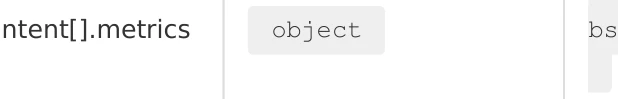

**示例**

**请求示例**

```text
GET /himarket/v1/open-api/v1/catalog/search?tenantId=tenant-001&portalId=portal-001&kind=MODEL_API&keyword=sample-value&categoryId=category-001&tag=sample-
value&pricingMode=sample-value&sourceType=sample-value HTTP/1.1
Host: localhost:8080
Authorization: Bearer <accessToken>
```

**响应示例**

```json
{
  "code": "SUCCESS",
  "message": null,
  "data": {
    "content": [
      {}
    ],
    "pageNumber": 1,
    "pageSize": 10,
    "totalCount": 1
  },
  "accessDeniedDetail": null,
  "requestId": "req-001"
}
```

<a id="section-3-3"></a>

## 3.3. AI Resource Catalog 管理接口（Admin）

<a id="section-3-3-1"></a>

### 3.3.1. decideReview

**接口信息**

- **接口路径**： `POST /himarket/v1/open-api/v1/catalog/reviews/{submissionId}/decision`

- **接口说明**：审批 Listing 审核单。

- **认证方式**：该接口属于管理面 OpenAPI。调用前请完成 OpenAPI 凭证配置，并按 Token 模式或AK/SK 签名模式携带认证 Header。

- **Header 示例**：Token 模式使用  `X-HIMARKET-OPENAPI: HIMARKET_OPENAPI`  与  `X-HIMARKET-TOKEN` ；AK/SK 模式使用  `X-HIMARKET-ACCESS-KEY` 、 `X-HIMARKET-TIMESTAMP`  和  `X-HIMARKET-SIGNATURE` 。

**请求参数**

| 参数名称 | 位置 | 类型 | 是否必选 | 示例 | 说明 |
| --- | --- | --- | --- | --- | --- |
| submissionId | path | <code>string</code> | 是 | <code>"submissio</code><br><code>n-001"</code> | 评审提交ID。 |
| status | body | <code>string</code> | 是 | <code>"PENDING"</code> | 状态。 |
| comment | body | <code>string</code> | 否 | <code>"sample-</code><br><code>value"</code> | 审批意见或备注信息。 |


**返回数据**

| 参数名称 | 类型 | 示例 | 说明 |
| --- | --- | --- | --- |
| code | <code>string</code> | <code>SUCCESS</code> | 响应码，取值为<code> SUCCESS </code> 时表示请求成功。 |
| message | <code>string</code> | <code>null</code> | 响应消息。请求成功时通常为空。 |
| data | <code>object</code> | <code>{"submissionId":"s</code><br><code>ubmission-</code><br><code>001","targetType":"s</code><br><code>ample-</code><br><code>value","targetId":"t</code><br><code>arget-</code><br><code>001","submitterId":"</code><br><code>submitter-</code><br><code>001","reviewType":"s</code><br><code>ample-</code><br><code>value","status":"PEN</code><br><code>DING"}</code> | 响应数据。具体结构以接口语义为准。 |
| accessDeniedDetail | <code>object</code> | <code>null</code> | 鉴权失败详情。请求成功时通常为空。 |
| requestId | <code>string</code> | <code>req-001</code> | 请求 ID，可用于问题排查和日志检索。 |
| data.submissionId | <code>string</code> | <code>"submission-001"</code> | 评审提交ID。 |
| data.targetType | <code>string</code> | <code>"sample-value"</code> | 订阅目标类型。 |
| data.targetId | <code>string</code> | <code>"target-001"</code> | 目标对象 ID。 |
| data.submitterId | <code>string</code> | <code>"submitter-001"</code> | 提交人 ID。 |
| data.reviewType | <code>string</code> | <code>"sample-value"</code> | 审核类型。 |
| data.status | <code>string</code> | <code>"PENDING"</code> | 状态。 |
| data.checks | <code>object</code> | <code>{}</code> | 审核检查项列表。 |
| data.decision | <code>object</code> | <code>{}</code> | 审核决策。 |
| data.reviewerId | <code>string</code> | <code>"reviewer-001"</code> | 审核人 ID。 |
| data.submittedAt | <code>string&lt;date-</code><br><code>time&gt;</code> | <code>"2026-06-</code><br><code>22T12:00:00Z"</code> | 提交时间。 |
| data.decidedAt | <code>string&lt;date-</code><br><code>time&gt;</code> | <code>"2026-06-</code><br><code>22T12:00:00Z"</code> | 审批时间。 |

**示例**

**请求示例**

```http
POST /himarket/v1/open-api/v1/catalog/reviews/{submissionId}/decision HTTP/1.1
Host: localhost:8080
X-HIMARKET-OPENAPI: HIMARKET_OPENAPI
X-HIMARKET-TOKEN: <admin-openapi-token>
Content-Type: application/json

{
  "status": "PENDING",
  "comment": "sample-value"
}
```

**响应示例**

```json
{
  "code": "SUCCESS",
  "message": null,
  "data": {
    "submissionId": "submission-001",
    "targetType": "sample-value",
    "targetId": "target-001",
    "submitterId": "submitter-001",
    "reviewType": "sample-value",
    "status": "PENDING"
  },
  "accessDeniedDetail": null,
  "requestId": "req-001"
}
```

<a id="section-3-3-2"></a>

### 3.3.2. getCatalogReview

**接口信息**

- **接口路径**： `GET /himarket/v1/open-api/v1/catalog/reviews/{submissionId}`

- **接口说明**：查询审核单详情。

- **认证方式**：该接口属于管理面 OpenAPI。调用前请完成 OpenAPI 凭证配置，并按 Token 模式或AK/SK 签名模式携带认证 Header。

- **Header 示例**：Token 模式使用  `X-HIMARKET-OPENAPI: HIMARKET_OPENAPI`  与  `X-HIMARKET-TOKEN` ；AK/SK 模式使用  `X-HIMARKET-ACCESS-KEY` 、 `X-HIMARKET-TIMESTAMP`  和  `X-HIMARKET-SIGNATURE` 。

**请求参数**

| 参数名称 | 位置 | 类型 | 是否必选 | 示例 | 说明 |
| --- | --- | --- | --- | --- | --- |
| submissionId | path | <code>string</code> | 是 | <code>"submissio</code><br><code>n-001"</code> | 评审提交ID。 |

**返回数据**

| 参数名称 | 类型 | 示例 | 说明 |
| --- | --- | --- | --- |
| code | <code>string</code> | <code>SUCCESS</code> | 响应码，取值为<code> SUCCESS </code> 时表示请求成功。 |
| message | <code>string</code> | <code>null</code> | 响应消息。请求成功时通常为空。 |
| data | <code>object</code> | <code>{"review":</code><br><code>{"submissionId":"sub</code><br><code>mission-</code><br><code>001","targetType":"s</code><br><code>ample-</code><br><code>value","targetId":"t</code><br><code>arget-</code><br><code>001","submitterId":"</code><br><code>submitter-</code><br><code>001","reviewType":"s</code><br><code>ample-</code><br><code>value","status":"PEN</code><br><code>DING"},"listing":</code><br><code>{"listingId":"listin</code><br><code>g-</code><br><code>001","tenantId":"ten</code><br><code>ant-</code><br><code>001","resourceId":"r</code><br><code>esource-</code><br><code>001","defaultVersion</code><br><code>Id":"defaultVersion-</code><br><code>001","portalId":"por</code><br><code>tal-</code><br><code>001","visibility":"P</code><br><code>RIVATE"},"resource":</code><br><code>{"resourceId":"resou</code><br><code>rce-</code><br><code>001","tenantId":"ten</code><br><code>ant-</code><br><code>001","kind":"MODEL_A</code><br><code>PI","name":"sample-</code><br><code>name","displayName":</code> <code>"</code>示例资源<code>","summary":"</code>示例摘要<code>"},"defaultVersion</code> <code>":</code><br><code>{"versionId":"versio</code><br><code>n-</code><br><code>001","resourceId":"r</code><br><code>esource-</code><br><code>001","version":"samp</code><br><code>le-</code><br><code>value","versionSchem</code><br><code>e":"SEMVER","status"</code><br><code>:"DRAFT","manifestId</code><br><code>":"manifest-</code><br><code>001"}}</code> | 响应数据。具体结构以接口语义为准。 |
|  |  |  |  |
| accessDeniedDetail | <code>object</code> | <code>null</code> | 鉴权失败详情。请求成功时通常为空。 |
| requestId | <code>string</code> | <code>req-001</code> | 请求 ID，可用于问题排查和日志检索。 |
| data.review | <code>object</code> | <code>{"submissionId":"s</code><br><code>ubmission-</code><br><code>001","targetType":"s</code><br><code>ample-</code><br><code>value","targetId":"t</code><br><code>arget-</code><br><code>001","submitterId":"</code><br><code>submitter-</code><br><code>001","reviewType":"s</code><br><code>ample-</code><br><code>value","status":"PEN</code><br><code>DING"}</code> | 审核单信息。 |
| data.review.submissio nId | <code>string</code> | <code>"submission-001"</code> | 评审提交ID。 |
| data.review.targetTyp e | <code>string</code> | <code>"sample-value"</code> | 订阅目标类型。 |
| data.review.targetId | <code>string</code> | <code>"target-001"</code> | 目标对象 ID。 |
| data.review.submitterI d | <code>string</code> | <code>"submitter-001"</code> | 提交人 ID。 |
| data.review.reviewTyp e | <code>string</code> | <code>"sample-value"</code> | 审核类型。 |
| data.review.status | <code>string</code> | <code>"PENDING"</code> | 状态。 |
| data.review.checks | <code>object</code> | <code>{"metadata":</code><br><code>{"status":"PASSED","</code> <code>message":"</code>元数据校验通过<code>"},"security":</code> <code>{"status":"PASSED","</code> <code>message":"</code>安全校验通过<code>"}} </code> | 审核检查项列表。 |
| data.review.decision | <code>object</code> | <code>{"result":"APPROVE</code><br><code>D","operator":"admin</code> <code>-001","comment":"</code>审核通过<code>"} </code> | 审核决策。 |
| data.review.reviewerId | <code>string</code> | <code>"reviewer-001"</code> | 审核人 ID。 |
| data.review.submitted At | <code>string&lt;date-</code><br><code>time&gt;</code> | <code>"2026-06-</code><br><code>22T12:00:00Z"</code> | 提交时间。 |
| data.review.decidedAt | <code>string&lt;date-</code><br><code>time&gt;</code> | <code>"2026-06-</code><br><code>22T12:00:00Z"</code> | 审批时间。 |
| data.listing | <code>object</code> | <code>{"listingId":"list</code><br><code>ing-</code><br><code>001","tenantId":"ten</code><br><code>ant-</code><br><code>001","resourceId":"r</code><br><code>esource-</code><br><code>001","defaultVersion</code><br><code>Id":"defaultVersion-</code><br><code>001","portalId":"por</code><br><code>tal-</code><br><code>001","visibility":"P</code><br><code>RIVATE"}</code> | Listing 信息。 |
| data.listing.listingId | <code>string</code> | <code>"listing-001"</code> | Listing ID。 |
| data.listing.tenantId | <code>string</code> | <code>"tenant-001"</code> | 租户ID。 |
| data.listing.resourceId | <code>string</code> | <code>"resource-001"</code> | AI Resource ID。 |
| data.listing.defaultVer sionId | <code>string</code> | <code>"defaultVersion-</code><br><code>001"</code> | 默认版本ID。 |
| data.listing.portalId | <code>string</code> | <code>"portal-001"</code> | 门户ID。 |
| data.listing.visibility | <code>string</code> | <code>"PRIVATE"</code> | 可见性。可选值：<code> PRIVATE </code>、<code> PU</code> <code>BLIC </code>。 |
| data.listing.title | <code>string</code> | <code> "</code>示例资源标题<code>" </code> | 标题。 |
| data.listing.summary | <code>string</code> | <code> "</code>示例摘要<code>" </code> | 摘要信息。 |
| data.listing.description | <code>string</code> | <code> "</code>用于演示的资源描述<code>" </code> | 描述信息。 |
| data.listing.icon | <code>string</code> | <code>"sample-value"</code> | 图标地址。 |
| data.listing.banner | <code>string</code> | <code>"sample-value"</code> | 横幅图片地址。 |
| data.listing.categoryId | <code>string</code> | <code>"category-001"</code> | 分类 ID。 |
| data.listing.category | <code>object</code> | <code>{"categoryId":"cat</code><br><code>egory-</code><br><code>001","tenantId":"ten</code><br><code>ant-</code><br><code>001","kind":"MODEL_A</code><br><code>PI","code":"model-</code><br><code>api","name":"sample-</code><br><code>name","description":</code> <code>"</code>用于演示的资源描述<code>"} </code> | 分类信息。 |
| data.listing.category.c ategoryId | <code>string</code> | <code>"category-001"</code> | 分类 ID。 |
| data.listing.category.t enantId | <code>string</code> | <code>"tenant-001"</code> | 租户ID。 |
| data.listing.category.ki nd | <code>string</code> | <code>"MODEL_API"</code> | 资源类型。 |
| data.listing.category.c ode | <code>string</code> | <code>"model-api"</code> | 业务编码。 |
| data.listing.category.n ame | <code>string</code> | <code>"sample-name"</code> | 名称。 |
| data.listing.category.d escription | <code>string</code> | <code> "</code>用于演示的资源描述<code>" </code> | 描述信息。 |
| data.listing.category.ic on | <code>string</code> | <code>"sample-value"</code> | 图标地址。 |
| data.listing.category.s ortOrder | <code>integer&lt;int32&gt;</code> | <code>100</code> | 排序值。 |
| data.listing.category.st atus | <code>string</code> | <code>"sample-value"</code> | 状态。 |
| data.listing.category.cr eatedBy | <code>string</code> | <code>"sample-value"</code> | 创建人。 |
| data.listing.category.u pdatedBy | <code>string</code> | <code>"sample-value"</code> | 更新人。 |
| data.listing.category.cr eatedAt | <code>string&lt;date-</code><br><code>time&gt;</code> | <code>"2026-06-</code><br><code>22T12:00:00Z"</code> | 创建时间。 |
| data.listing.category.u pdatedAt | <code>string&lt;date-</code><br><code>time&gt;</code> | <code>"2026-06-</code><br><code>22T12:00:00Z"</code> | 更新时间。 |
| data.listing.category.li stingCount | <code>integer&lt;int64&gt;</code> | <code>1</code> | Listing 数量。 |
| data.listing.tags | <code>array</code> | <code>["sample-value"]</code> | 标签列表。 |
| data.listing.pricingMod e | <code>string</code> | <code>"sample-value"</code> | 计费模式。 |
| data.listing.listingStatu s | <code>string</code> | <code>"sample-value"</code> | 市场条目状态。 |
| data.listing.publication Status | <code>string</code> | <code>"DRAFT"</code> | 发布状态。可选值：<code> DRAFT </code>、<code> IN_R</code> <code>EVIEW </code>、<code> PUBLISHED</code><code> </code>、<code> UNPUBLISHED </code>、<code> REJECTED </code>。 |
| data.listing.createdBy | <code>string</code> | <code>"sample-value"</code> | 创建人。 |
| data.listing.publishedB y | <code>string</code> | <code>"sample-value"</code> | 发布人 ID。 |
| data.listing.publishedA t | <code>string&lt;date-</code><br><code>time&gt;</code> | <code>"2026-06-</code><br><code>22T12:00:00Z"</code> | 发布时间。 |
| data.listing.createdAt | <code>string&lt;date-</code><br><code>time&gt;</code> | <code>"2026-06-</code><br><code>22T12:00:00Z"</code> | 创建时间。 |
| data.listing.updatedAt | <code>string&lt;date-</code><br><code>time&gt;</code> | <code>"2026-06-</code><br><code>22T12:00:00Z"</code> | 更新时间。 |
| data.resource | <code>object</code> | <code>{"resourceId":"res</code><br><code>ource-</code><br><code>001","tenantId":"ten</code><br><code>ant-</code><br><code>001","kind":"MODEL_A</code><br><code>PI","name":"sample-</code><br><code>name","displayName":</code> <code>"</code>示例资源<code>","summary":"</code>示例摘要<code>"} </code> | AI Resource 基础信息。 |
| data.resource.resourc eId | <code>string</code> | <code>"resource-001"</code> | AI Resource ID。 |
| data.resource.tenantId | <code>string</code> | <code>"tenant-001"</code> | 租户ID。 |
| data.resource.kind | <code>string</code> | <code>"MODEL_API"</code> | 资源类型。 |
| data.resource.name | <code>string</code> | <code>"sample-name"</code> | 名称。 |
| data.resource.displayN ame | <code>string</code> | <code> "</code>示例资源<code>" </code> | 展示名称。 |


<table>
  <tr>
    <td>data.resource.summar y</td>
    <td><code>string</code></td>
    <td><code> "</code>示例摘要<code>" </code></td>
    <td>摘要信息。</td>
  </tr>
  <tr>
    <td>data.resource.descripti on</td>
    <td><code>string</code></td>
    <td><code> "</code>用于演示的资源描述<code>" </code></td>
    <td>描述信息。</td>
  </tr>
  <tr>
    <td>data.resource.ownerTy pe</td>
    <td><code>string</code></td>
    <td><code>"USER"</code></td>
    <td>归属主体类型。可选值：<code> USER </code>、<code> APP </code>、<code> SYSTEM </code>。</td>
  </tr>
  <tr>
    <td>data.resource.ownerId</td>
    <td><code>string</code></td>
    <td><code>"owner-001"</code></td>
    <td>归属主体ID。</td>
  </tr>
  <tr>
    <td>data.resource.created By</td>
    <td><code>string</code></td>
    <td><code>"sample-value"</code></td>
    <td>创建人。</td>
  </tr>
  <tr>
    <td>data.resource.created ByName</td>
    <td><code>string</code></td>
    <td><code>"demo-createdby"</code></td>
    <td>创建人名称。</td>
  </tr>
  <tr>
    <td>data.resource.icon</td>
    <td><code>string</code></td>
    <td><code>"sample-value"</code></td>
    <td>图标地址。</td>
  </tr>
  <tr>
    <td>data.resource.tags</td>
    <td><code>array</code></td>
    <td><code>["sample-value"]</code></td>
    <td>标签列表。</td>
  </tr>
  <tr>
    <td>data.resource.lifecycle Status</td>
    <td><code>string</code></td>
    <td><code>"DRAFT"</code></td>
    <td>生命周期状态。可选值：<code> DRAFT </code>、<code> ACTI</code> <code>VE </code>、<code> DEPRECATED </code>、<code> ARCHIVED </code>。</td>
  </tr>
  <tr>
    <td>data.resource.latestVe rsionId</td>
    <td><code>string</code></td>
    <td><code>"latestVersion-</code><br><code>001"</code></td>
    <td>最新版本ID。</td>
  </tr>
  <tr>
    <td>data.resource.autoApp roveSubscription</td>
    <td><code>boolean</code></td>
    <td><code>true</code></td>
    <td>是否自动批准订阅。</td>
  </tr>
  <tr>
    <td>data.resource.extras</td>
    <td><code>object</code></td>
    <td><code>{"displayOrder":10</code><br><code>0}</code></td>
    <td>扩展配置。</td>
  </tr>
  <tr>
    <td>data.resource.created At</td>
    <td><code>string&lt;date-</code><br><code>time&gt;</code></td>
    <td><code>"2026-06-</code><br><code>22T12:00:00Z"</code></td>
    <td>创建时间。</td>
  </tr>
  <tr>
    <td>data.resource.updated At</td>
    <td><code>string&lt;date-</code><br><code>time&gt;</code></td>
    <td><code>"2026-06-</code><br><code>22T12:00:00Z"</code></td>
    <td>更新时间。</td>
  </tr>
  <tr>
    <td>data.defaultVersion</td>
    <td><code>object</code></td>
    <td><code>{"versionId":"vers</code><br><code>ion-</code><br><code>001","resourceId":"r</code><br><code>esource-</code><br><code>001","version":"samp</code><br><code>le-</code><br><code>value","versionSchem</code><br><code>e":"SEMVER","status"</code><br><code>:"DRAFT","manifestId</code><br><code>":"manifest-001"}</code></td>
    <td>默认版本信息。</td>
  </tr>
  <tr>
    <td>data.defaultVersion.ve rsionId</td>
    <td><code>string</code></td>
    <td><code>"version-001"</code></td>
    <td>版本 ID。</td>
  </tr>
  <tr>
    <td>data.defaultVersion.re sourceId</td>
    <td><code>string</code></td>
    <td><code>"resource-001"</code></td>
    <td>AI Resource ID。</td>
  </tr>
  <tr>
    <td>data.defaultVersion.ve rsion</td>
    <td><code>string</code></td>
    <td><code>"sample-value"</code></td>
    <td>版本号。</td>
  </tr>
  <tr>
    <td>data.defaultVersion.ve rsionScheme</td>
    <td><code>string</code></td>
    <td><code>"SEMVER"</code></td>
    <td>版本号方案。可选值：<code> SEMVER </code>、<code> TIM</code> <code>ESTAMP </code>、<code> REVISION</code><code> </code>、<code> EXTERNAL </code>。</td>
  </tr>
  <tr>
    <td>data.defaultVersion.st atus</td>
    <td><code>string</code></td>
    <td><code>"DRAFT"</code></td>
    <td>状态。</td>
  </tr>
  <tr>
    <td>data.defaultVersion.m anifestId</td>
    <td><code>string</code></td>
    <td><code>"manifest-001"</code></td>
    <td>Manifest ID。</td>
  </tr>
  <tr>
    <td>data.defaultVersion.so urceBindingId</td>
    <td><code>string</code></td>
    <td><code>"sourceBinding-</code><br><code>001"</code></td>
    <td>来源绑定ID。</td>
  </tr>
  <tr>
    <td>data.defaultVersion.art ifactDigest</td>
    <td><code>string</code></td>
    <td><code>"sample-value"</code></td>
    <td>制品摘要。</td>
  </tr>
  <tr>
    <td>data.defaultVersion.rel easeNote</td>
    <td><code>string</code></td>
    <td><code>"sample-value"</code></td>
    <td>版本说明。</td>
  </tr>
  <tr>
    <td>data.defaultVersion.cr eatedBy</td>
    <td><code>string</code></td>
    <td><code>"sample-value"</code></td>
    <td>创建人。</td>
  </tr>
</table>

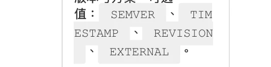

**示例请求示例**

```http
GET /himarket/v1/open-api/v1/catalog/reviews/{submissionId} HTTP/1.1
Host: localhost:8080
X-HIMARKET-OPENAPI: HIMARKET_OPENAPI
X-HIMARKET-TOKEN: <admin-openapi-token>
```

**响应示例**

```json
{
  "code": "SUCCESS",
  "message": null,
  "data": {
    "review": {
      "submissionId": "submission-001",
      "targetType": "sample-value",
      "targetId": "target-001",
      "submitterId": "submitter-001",
      "reviewType": "sample-value",
      "status": "PENDING",
      "checks": {
        "metadata": {
          "status": "PASSED",
          "message": "元数据校验通过"
        },
        "security": {
          "status": "PASSED",
          "message": "安全校验通过"
        }
      },
      "decision": {
        "result": "APPROVED",
        "operator": "admin-001",
        "comment": "审核通过"
      },
      "reviewerId": "reviewer-001",
      "submittedAt": "2026-06-22T12:00:00Z",
      "decidedAt": "2026-06-22T12:00:00Z"
    },
    "listing": {
      "listingId": "listing-001",
      "tenantId": "tenant-001",
      "resourceId": "resource-001",
      "defaultVersionId": "defaultVersion-001",
      "portalId": "portal-001",
      "visibility": "PRIVATE"
    },
    "resource": {
      "resourceId": "resource-001",
      "tenantId": "tenant-001",
      "kind": "MODEL_API",
      "name": "sample-name",
      "displayName": "示例资源",
      summary: 示例摘要摘要"
    },
    "defaultVersion": {
      "versionId": "version-001",
      "resourceId": "resource-001",
      "version": "sample-value",
      "versionScheme": "SEMVER",
      "status": "DRAFT",
      "manifestId": "manifest-001"
    }
  },
  "accessDeniedDetail": null,
  "requestId": "req-001"
}
```

<a id="section-3-3-3"></a>

### 3.3.3. getListing

**接口信息**

- **接口路径**： `GET /himarket/v1/open-api/v1/catalog/listings/{listingId}`

- **接口说明**：查询市场 Listing 详情。

- **认证方式**：该接口属于管理面 OpenAPI。调用前请完成 OpenAPI 凭证配置，并按 Token 模式或AK/SK 签名模式携带认证 Header。

- **Header 示例**：Token 模式使用  `X-HIMARKET-OPENAPI: HIMARKET_OPENAPI`  与  `X-HIMARKET-TOKEN` ；AK/SK 模式使用  `X-HIMARKET-ACCESS-KEY` 、 `X-HIMARKET-TIMESTAMP`  和  `X-HIMARKET-SIGNATURE` 。

**请求参数**

| 参数名称 | 位置 | 类型 | 是否必选 | 示例 | 说明 |
| --- | --- | --- | --- | --- | --- |
| listingId | path | <code>string</code> | 是 | <code>"listing-</code><br><code>001"</code> | Listing ID。 |

**返回数据**

| 参数名称 | 类型 | 示例 | 说明 |
| --- | --- | --- | --- |
| code | <code>string</code> | <code>SUCCESS</code> | 响应码，取值为<code> SUCCESS </code> 时表示请求成功。 |
| message | <code>string</code> | <code>null</code> | 响应消息。请求成功时通常为空。 |
| data | <code>object</code> | <code>{"listingId":"list</code><br><code>ing-</code><br><code>001","tenantId":"ten</code><br><code>ant-</code><br><code>001","resourceId":"r</code><br><code>esource-</code><br><code>001","defaultVersion</code><br><code>Id":"defaultVersion-</code><br><code>001","portalId":"por</code><br><code>tal-</code><br><code>001","visibility":"P</code><br><code>RIVATE"}</code> | 响应数据。具体结构以接口语义为准。 |
| accessDeniedDetail | <code>object</code> | <code>null</code> | 鉴权失败详情。请求成功时通常为空。 |
| requestId | <code>string</code> | <code>req-001</code> | 请求 ID，可用于问题排查和日志检索。 |
| data.listingId | <code>string</code> | <code>"listing-001"</code> | Listing ID。 |
| data.tenantId | <code>string</code> | <code>"tenant-001"</code> | 租户ID。 |
| data.resourceId | <code>string</code> | <code>"resource-001"</code> | AI Resource ID。 |
| data.defaultVersionId | <code>string</code> | <code>"defaultVersion-</code><br><code>001"</code> | 默认版本ID。 |
| data.portalId | <code>string</code> | <code>"portal-001"</code> | 门户ID。 |
| data.visibility | <code>string</code> | <code>"PRIVATE"</code> | 可见性。可选值：<code> PRIVATE </code>、<code> PU</code> <code>BLIC </code>。 |
| data.title | <code>string</code> | <code> "</code>示例资源标题<code>" </code> | 标题。 |
| data.summary | <code>string</code> | <code> "</code>示例摘要<code>" </code> | 摘要信息。 |
| data.description | <code>string</code> | <code> "</code>用于演示的资源描述<code>" </code> | 描述信息。 |
| data.icon | <code>string</code> | <code>"sample-value"</code> | 图标地址。 |
| data.banner | <code>string</code> | <code>"sample-value"</code> | 横幅图片地址。 |
| data.categoryId | <code>string</code> | <code>"category-001"</code> | 分类 ID。 |
| data.category | <code>object</code> | <code>{"categoryId":"cat</code><br><code>egory-</code><br><code>001","tenantId":"ten</code><br><code>ant-</code><br><code>001","kind":"MODEL_A</code><br><code>PI","code":"model-</code><br><code>api","name":"sample-</code><br><code>name","description":</code> <code>"</code>用于演示的资源描述<code>"} </code> | 分类信息。 |
| data.category.categor yId | <code>string</code> | <code>"category-001"</code> | 分类 ID。 |
| data.category.tenantId | <code>string</code> | <code>"tenant-001"</code> | 租户ID。 |
| data.category.kind | <code>string</code> | <code>"MODEL_API"</code> | 资源类型。 |
| data.category.code | <code>string</code> | <code>"model-api"</code> | 业务编码。 |
| data.category.name | <code>string</code> | <code>"sample-name"</code> | 名称。 |
| data.category.descript ion | <code>string</code> | <code> "</code>用于演示的资源描述<code>" </code> | 描述信息。 |
| data.category.icon | <code>string</code> | <code>"sample-value"</code> | 图标地址。 |
| data.category.sortOrd er | <code>integer&lt;int32&gt;</code> | <code>100</code> | 排序值。 |
| data.category.status | <code>string</code> | <code>"sample-value"</code> | 状态。 |
| data.category.created By | <code>string</code> | <code>"sample-value"</code> | 创建人。 |
| data.category.updated By | <code>string</code> | <code>"sample-value"</code> | 更新人。 |
| data.category.created At | <code>string&lt;date-</code><br><code>time&gt;</code> | <code>"2026-06-</code><br><code>22T12:00:00Z"</code> | 创建时间。 |
| data.category.updated At | <code>string&lt;date-</code><br><code>time&gt;</code> | <code>"2026-06-</code><br><code>22T12:00:00Z"</code> | 更新时间。 |
| data.category.listingC ount | <code>integer&lt;int64&gt;</code> | <code>1</code> | Listing 数量。 |
| data.tags | <code>array</code> | <code>["sample-value"]</code> | 标签列表。 |
| data.pricingMode | <code>string</code> | <code>"sample-value"</code> | 计费模式。 |
| data.listingStatus | <code>string</code> | <code>"sample-value"</code> | 市场条目状态。 |
| data.publicationStatus | <code>string</code> | <code>"DRAFT"</code> | 发布状态。可选值：<code> DRAFT </code>、<code> IN_R</code> <code>EVIEW </code>、<code> PUBLISHED</code><code> </code>、<code> UNPUBLISHED </code>、<code> REJECTED </code>。 |
| data.createdBy | <code>string</code> | <code>"sample-value"</code> | 创建人。 |
| data.publishedBy | <code>string</code> | <code>"sample-value"</code> | 发布人 ID。 |
| data.publishedAt | <code>string&lt;date-</code><br><code>time&gt;</code> | <code>"2026-06-</code><br><code>22T12:00:00Z"</code> | 发布时间。 |
| data.createdAt | <code>string&lt;date-</code><br><code>time&gt;</code> | <code>"2026-06-</code><br><code>22T12:00:00Z"</code> | 创建时间。 |
| data.updatedAt | <code>string&lt;date-</code><br><code>time&gt;</code> | <code>"2026-06-</code><br><code>22T12:00:00Z"</code> | 更新时间。 |


**示例**

**请求示例**

```http
GET /himarket/v1/open-api/v1/catalog/listings/{listingId} HTTP/1.1
Host: localhost:8080
X-HIMARKET-OPENAPI: HIMARKET_OPENAPI
X-HIMARKET-TOKEN: <admin-openapi-token>
```

**响应示例**

```json
{
  "code": "SUCCESS",
  "message": null,
  "data": {
    "listingId": "listing-001",
    "tenantId": "tenant-001",
    "resourceId": "resource-001",
    "defaultVersionId": "defaultVersion-001",
    "portalId": "portal-001",
    "visibility": "PRIVATE"
  },
  "accessDeniedDetail": null,
  "requestId": "req-001"
}
```

<a id="section-3-3-4"></a>

### 3.3.4. getReviewCheck

**接口信息**

- **接口路径**： `GET /himarket/v1/open-`

  ```text
  api/v1/catalog/reviews/{submissionId}/checks/{checkId} 
  ```

- **接口说明**：查询审核单单项检查详情。

- **认证方式**：该接口属于管理面 OpenAPI。调用前请完成 OpenAPI 凭证配置，并按 Token 模式或AK/SK 签名模式携带认证 Header。

- **Header 示例**：Token 模式使用  `X-HIMARKET-OPENAPI: HIMARKET_OPENAPI`  与  `X-HIMARKET-TOKEN` ；AK/SK 模式使用  `X-HIMARKET-ACCESS-KEY` 、 `X-HIMARKET-TIMESTAMP`  和  `X-HIMARKET-SIGNATURE` 。

**请求参数**

| 参数名称 | 位置 | 类型 | 是否必选 | 示例 | 说明 |
| --- | --- | --- | --- | --- | --- |
| submissionId | path | <code>string</code> | 是 | <code>"submissio</code><br><code>n-001"</code> | 评审提交ID。 |
| checkId | path | <code>string</code> | 是 | <code>"check-</code><br><code>001"</code> | 检查项ID。 |

**返回数据**

| 参数名称 | 类型 | 示例 | 说明 |
| --- | --- | --- | --- |
| code | <code>string</code> | <code>SUCCESS</code> | 响应码，取值为<code> SUCCESS </code> 时表示请求成功。 |
| message | <code>string</code> | <code>null</code> | 响应消息。请求成功时通常为空。 |
| data | <code>object</code> | <code>{}</code> | 响应数据。具体结构以接口语义为准。 |
| accessDeniedDetail | <code>object</code> | <code>null</code> | 鉴权失败详情。请求成功时通常为空。 |
| requestId | <code>string</code> | <code>req-001</code> | 请求 ID，可用于问题排查和日志检索。 |

**示例**

**请求示例**

```http
GET /himarket/v1/open-api/v1/catalog/reviews/{submissionId}/checks/{checkId} HTTP/1.1
Host: localhost:8080
X-HIMARKET-OPENAPI: HIMARKET_OPENAPI
X-HIMARKET-TOKEN: <admin-openapi-token>
```

**响应示例**

```json
{
  "code": "SUCCESS",
  "message": null,
  "data": {},
  "accessDeniedDetail": null,
  "requestId": "req-001"
}
```

<a id="section-3-3-5"></a>

### 3.3.5. getReviewChecks

**接口信息**

- **接口路径**： `GET /himarket/v1/open-api/v1/catalog/reviews/{submissionId}/checks`

- **接口说明**：查询审核单检查结果。

- **认证方式**：该接口属于管理面 OpenAPI。调用前请完成 OpenAPI 凭证配置，并按 Token 模式或AK/SK 签名模式携带认证 Header。

- **Header 示例**：Token 模式使用  `X-HIMARKET-OPENAPI: HIMARKET_OPENAPI`  与  `X-HIMARKET-TOKEN` ；AK/SK 模式使用  `X-HIMARKET-ACCESS-KEY` 、 `X-HIMARKET-TIMESTAMP`  和  `X-HIMARKET-SIGNATURE` 。

**请求参数**

| 参数名称 | 位置 | 类型 | 是否必选 | 示例 | 说明 |
| --- | --- | --- | --- | --- | --- |
| submissionId | path | <code>string</code> | 是 | <code>"submissio</code><br><code>n-001"</code> | 评审提交ID。 |

**返回数据**

| 参数名称 | 类型 | 示例 | 说明 |
| --- | --- | --- | --- |
| code | <code>string</code> | <code>SUCCESS</code> | 响应码，取值为<code> SUCCESS </code> 时表示请求成功。 |
| message | <code>string</code> | <code>null</code> | 响应消息。请求成功时通常为空。 |
| data | <code>object</code> | <code>{}</code> | 响应数据。具体结构以接口语义为准。 |
| accessDeniedDetail | <code>object</code> | <code>null</code> | 鉴权失败详情。请求成功时通常为空。 |
| requestId | <code>string</code> | <code>req-001</code> | 请求 ID，可用于问题排查和日志检索。 |

**示例**

**请求示例**

```http
GET /himarket/v1/open-api/v1/catalog/reviews/{submissionId}/checks HTTP/1.1
Host: localhost:8080
X-HIMARKET-OPENAPI: HIMARKET_OPENAPI
X-HIMARKET-TOKEN: <admin-openapi-token>
```

**响应示例**

```json
{
  "code": "SUCCESS",
  "message": null,
  "data": {},
  "accessDeniedDetail": null,
  "requestId": "req-001"
}
```

<a id="section-3-3-6"></a>

### 3.3.6. listCatalogReviews

**接口信息**

- **接口路径**： `GET /himarket/v1/open-api/v1/catalog/reviews`

- **接口说明**：分页查询审核工作台。

- **认证方式**：该接口属于管理面 OpenAPI。调用前请完成 OpenAPI 凭证配置，并按 Token 模式或AK/SK 签名模式携带认证 Header。

- **Header 示例**：Token 模式使用  `X-HIMARKET-OPENAPI: HIMARKET_OPENAPI`  与  `X-HIMARKET-TOKEN` ；AK/SK 模式使用  `X-HIMARKET-ACCESS-KEY` 、 `X-HIMARKET-TIMESTAMP`  和  `X-HIMARKET-SIGNATURE` 。

**请求参数**

| 参数名称 | 位置 | 类型 | 是否必选 | 示例 | 说明 |
| --- | --- | --- | --- | --- | --- |
| tenantId | query | <code>string</code> | 否 | <code>"tenant-</code><br><code>001"</code> | 租户ID。 |
| resourceId | query | <code>string</code> | 否 | <code>"resource-</code><br><code>001"</code> | AI Resource ID。 |
| listingId | query | <code>string</code> | 否 | <code>"listing-</code><br><code>001"</code> | Listing ID。 |
| targetType | query | <code>string</code> | 否 | <code>"sample-</code><br><code>value"</code> | 订阅目标类型。 |
| targetId | query | <code>string</code> | 否 | <code>"target-</code><br><code>001"</code> | 目标对象 ID。 |
| reviewType | query | <code>string</code> | 否 | <code>"sample-</code><br><code>value"</code> | 审核类型。 |
| status | query | <code>string</code> | 否 | <code>"PENDING"</code> | 状态。 |
| pendingOnly | query | <code>boolean</code> | 否 | <code>false</code> | pendingOnly字段。 |
| submitterId | query | <code>string</code> | 否 | <code>"submitter</code><br><code>-001"</code> | 提交人 ID。 |
| reviewerId | query | <code>string</code> | 否 | <code>"reviewer-</code><br><code>001"</code> | 审核人 ID。 |
| page | query | <code>integer&lt;in</code><br><code>t32&gt;</code> | 否 | <code>1</code> | 页码。 |
| size | query | <code>integer&lt;in</code><br><code>t32&gt;</code> | 否 | <code>10</code> | 每页记录数。 |
| sort | query | <code>array</code> | 否 | <code>["sample-</code><br><code>value"]</code> | 排序条件。 |


**返回数据**

| 参数名称 | 类型 | 示例 | 说明 |
| --- | --- | --- | --- |
| code | <code>string</code> | <code>SUCCESS</code> | 响应码，取值为<code> SUCCESS </code> 时表示请求成功。 |
| message | <code>string</code> | <code>null</code> | 响应消息。请求成功时通常为空。 |
| data | <code>object</code> | <code>{"content":</code><br><code>[{}],"pageNumber":1,</code><br><code>"pageSize":10,"total</code><br><code>Count":1}</code> | 响应数据。具体结构以接口语义为准。 |
| accessDeniedDetail | <code>object</code> | <code>null</code> | 鉴权失败详情。请求成功时通常为空。 |
| requestId | <code>string</code> | <code>req-001</code> | 请求 ID，可用于问题排查和日志检索。 |
| data.content | <code>array</code> | <code>[{"review":</code><br><code>{},"listing":</code><br><code>{},"resource":</code><br><code>{},"defaultVersion":</code><br><code>{}}]</code> | 分页结果列表。 |
| data.content\[\].review | <code>object</code> | <code>{"submissionId":"s</code><br><code>ubmission-</code><br><code>001","targetType":"s</code><br><code>ample-</code><br><code>value","targetId":"t</code><br><code>arget-</code><br><code>001","submitterId":"</code><br><code>submitter-</code><br><code>001","reviewType":"s</code><br><code>ample-</code><br><code>value","status":"PEN</code><br><code>DING"}</code> | 审核单信息。 |
| data.content\[\].review.s ubmissionId | <code>string</code> | <code>"submission-001"</code> | 评审提交ID。 |
| data.content\[\].review.t argetType | <code>string</code> | <code>"sample-value"</code> | 订阅目标类型。 |
| data.content\[\].review.t argetId | <code>string</code> | <code>"target-001"</code> | 目标对象 ID。 |
| data.content\[\].review.s ubmitterId | <code>string</code> | <code>"submitter-001"</code> | 提交人 ID。 |
| data.content\[\].review.r eviewType | <code>string</code> | <code>"sample-value"</code> | 审核类型。 |
| data.content\[\].review.s tatus | <code>string</code> | <code>"PENDING"</code> | 状态。 |
| data.content\[\].review.checks | <code>object</code> | <code>{}</code> | 审核检查项列表。 |
| data.content\[\].review.decision | <code>object</code> | <code>{}</code> | 审核决策。 |
| data.content\[\].review.r eviewerId | <code>string</code> | <code>"reviewer-001"</code> | 审核人 ID。 |
| data.content\[\].review.s ubmittedAt | <code>string&lt;date-</code><br><code>time&gt;</code> | <code>"2026-06-</code><br><code>22T12:00:00Z"</code> | 提交时间。 |
| data.content\[\].review.decidedAt | <code>string&lt;date-</code><br><code>time&gt;</code> | <code>"2026-06-</code><br><code>22T12:00:00Z"</code> | 审批时间。 |
| data.content\[\].listing | <code>object</code> | <code>{"listingId":"list</code><br><code>ing-</code><br><code>001","tenantId":"ten</code><br><code>ant-</code><br><code>001","resourceId":"r</code><br><code>esource-</code><br><code>001","defaultVersion</code><br><code>Id":"defaultVersion-</code><br><code>001","portalId":"por</code><br><code>tal-</code><br><code>001","visibility":"P</code><br><code>RIVATE"}</code> | Listing 信息。 |
| data.content\[\].listing.li stingId | <code>string</code> | <code>"listing-001"</code> | Listing ID。 |
| data.content\[\].listing.t enantId | <code>string</code> | <code>"tenant-001"</code> | 租户ID。 |
| data.content\[\].listing.r esourceId | <code>string</code> | <code>"resource-001"</code> | AI Resource ID。 |
| data.content\[\].listing.d efaultVersionId | <code>string</code> | <code>"defaultVersion-</code><br><code>001"</code> | 默认版本ID。 |
| data.content\[\].listing.p ortalId | <code>string</code> | <code>"portal-001"</code> | 门户ID。 |
| data.content\[\].listing.vi sibility | <code>string</code> | <code>"PRIVATE"</code> | 可见性。可选值：<code> PRIVATE </code>、<code> PU</code> <code>BLIC </code>。 |
| data.content\[\].listing.ti tle | <code>string</code> | <code> "</code>示例资源标题<code>" </code> | 标题。 |
| data.content\[\].listing.s ummary | <code>string</code> | <code> "</code>示例摘要<code>" </code> | 摘要信息。 |
| data.content\[\].listing.d escription | <code>string</code> | <code> "</code>用于演示的资源描述<code>" </code> | 描述信息。 |
| data.content\[\].listing.ic on | <code>string</code> | <code>"sample-value"</code> | 图标地址。 |
| data.content\[\].listing.b anner | <code>string</code> | <code>"sample-value"</code> | 横幅图片地址。 |
| data.content\[\].listing.c ategoryId | <code>string</code> | <code>"category-001"</code> | 分类 ID。 |
| data.content\[\].listing.c ategory | <code>object</code> | <code>{"categoryId":"cat</code><br><code>egory-</code><br><code>001","tenantId":"ten</code><br><code>ant-</code><br><code>001","kind":"MODEL_A</code><br><code>PI","code":"model-</code><br><code>api","name":"sample-</code><br><code>name","description":</code> <code>"</code>用于演示的资源描述<code>"} </code> | 分类信息。 |
| data.content\[\].listing.c ategory.categoryId | <code>string</code> | <code>"category-001"</code> | 分类 ID。 |
| data.content\[\].listing.c ategory.tenantId | <code>string</code> | <code>"tenant-001"</code> | 租户ID。 |
| data.content\[\].listing.c ategory.kind | <code>string</code> | <code>"MODEL_API"</code> | 资源类型。 |
| data.content\[\].listing.c ategory.code | <code>string</code> | <code>"model-api"</code> | 业务编码。 |
| data.content\[\].listing.c ategory.name | <code>string</code> | <code>"sample-name"</code> | 名称。 |
| data.content\[\].listing.c ategory.description | <code>string</code> | <code> "</code>用于演示的资源描述<code>" </code> | 描述信息。 |
| data.content\[\].listing.c ategory.icon | <code>string</code> | <code>"sample-value"</code> | 图标地址。 |
| data.content\[\].listing.c ategory.sortOrder | <code>integer&lt;int32&gt;</code> | <code>100</code> | 排序值。 |
| data.content\[\].listing.c ategory.status | <code>string</code> | <code>"sample-value"</code> | 状态。 |
| data.content\[\].listing.c ategory.createdBy | <code>string</code> | <code>"sample-value"</code> | 创建人。 |
| data.content\[\].listing.c ategory.updatedBy | <code>string</code> | <code>"sample-value"</code> | 更新人。 |
| data.content\[\].listing.c ategory.createdAt | <code>string&lt;date-</code><br><code>time&gt;</code> | <code>"2026-06-</code><br><code>22T12:00:00Z"</code> | 创建时间。 |
| data.content\[\].listing.c ategory.updatedAt | <code>string&lt;date-</code><br><code>time&gt;</code> | <code>"2026-06-</code><br><code>22T12:00:00Z"</code> | 更新时间。 |
| data.content\[\].listing.c ategory.listingCount | <code>integer&lt;int64&gt;</code> | <code>1</code> | Listing 数量。 |
| data.content\[\].listing.t ags | <code>array</code> | <code>["sample-value"]</code> | 标签列表。 |
| data.content\[\].listing.p ricingMode | <code>string</code> | <code>"sample-value"</code> | 计费模式。 |
| data.content\[\].listing.li stingStatus | <code>string</code> | <code>"sample-value"</code> | 市场条目状态。 |
| data.content\[\].listing.p ublicationStatus | <code>string</code> | <code>"DRAFT"</code> | 发布状态。可选值：<code> DRAFT </code>、<code> IN_R</code> <code>EVIEW </code>、<code> PUBLISHED</code><code> </code>、<code> UNPUBLISHED </code>、<code> REJECTED </code>。 |
| data.content\[\].listing.c reatedBy | <code>string</code> | <code>"sample-value"</code> | 创建人。 |

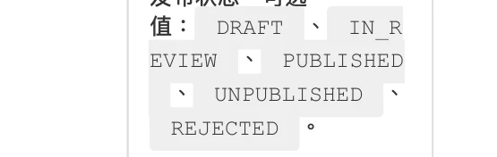

<table>
  <tr>
    <td>data.content[].listing.p ublishedBy</td>
    <td><code>string</code></td>
    <td><code>"sample-value"</code></td>
    <td>发布人 ID。</td>
  </tr>
  <tr>
    <td>data.content[].listing.p ublishedAt</td>
    <td><code>string&lt;date-</code><br><code>time&gt;</code></td>
    <td><code>"2026-06-</code><br><code>22T12:00:00Z"</code></td>
    <td>发布时间。</td>
  </tr>
  <tr>
    <td>data.content[].listing.c reatedAt</td>
    <td><code>string&lt;date-</code><br><code>time&gt;</code></td>
    <td><code>"2026-06-</code><br><code>22T12:00:00Z"</code></td>
    <td>创建时间。</td>
  </tr>
  <tr>
    <td>data.content[].listing.u pdatedAt</td>
    <td><code>string&lt;date-</code><br><code>time&gt;</code></td>
    <td><code>"2026-06-</code><br><code>22T12:00:00Z"</code></td>
    <td>更新时间。</td>
  </tr>
  <tr>
    <td>data.content[].resourc e</td>
    <td><code>object</code></td>
    <td><code>{"resourceId":"res</code><br><code>ource-</code><br><code>001","tenantId":"ten</code><br><code>ant-</code><br><code>001","kind":"MODEL_A</code><br><code>PI","name":"sample-</code><br><code>name","displayName":</code> <code>"</code>示例资源<code>","summary":"</code>示例摘要<code>"} </code></td>
    <td>AI Resource 基础信息。</td>
  </tr>
  <tr>
    <td>data.content[].resourc e.resourceId</td>
    <td><code>string</code></td>
    <td><code>"resource-001"</code></td>
    <td>AI Resource ID。</td>
  </tr>
  <tr>
    <td>data.content[].resourc e.tenantId</td>
    <td><code>string</code></td>
    <td><code>"tenant-001"</code></td>
    <td>租户ID。</td>
  </tr>
  <tr>
    <td>data.content[].resourc e.kind</td>
    <td><code>string</code></td>
    <td><code>"MODEL_API"</code></td>
    <td>资源类型。</td>
  </tr>
  <tr>
    <td>data.content[].resourc e.name</td>
    <td><code>string</code></td>
    <td><code>"sample-name"</code></td>
    <td>名称。</td>
  </tr>
  <tr>
    <td>data.content[].resourc e.displayName</td>
    <td><code>string</code></td>
    <td><code> "</code>示例资源<code>" </code></td>
    <td>展示名称。</td>
  </tr>
  <tr>
    <td>data.content[].resourc e.summary</td>
    <td><code>string</code></td>
    <td><code> "</code>示例摘要<code>" </code></td>
    <td>摘要信息。</td>
  </tr>
  <tr>
    <td>data.content[].resourc e.description</td>
    <td><code>string</code></td>
    <td><code> "</code>用于演示的资源描述<code>" </code></td>
    <td>描述信息。</td>
  </tr>
  <tr>
    <td>data.content[].resourc e.ownerType</td>
    <td><code>string</code></td>
    <td><code>"USER"</code></td>
    <td>归属主体类型。可选值：<code> USER </code>、<code> APP </code>、<code> SYSTEM </code>。</td>
  </tr>
  <tr>
    <td>data.content[].resourc e.ownerId</td>
    <td><code>string</code></td>
    <td><code>"owner-001"</code></td>
    <td>归属主体ID。</td>
  </tr>
  <tr>
    <td>data.content[].resourc e.createdBy</td>
    <td><code>string</code></td>
    <td><code>"sample-value"</code></td>
    <td>创建人。</td>
  </tr>
  <tr>
    <td>data.content[].resourc e.createdByName</td>
    <td><code>string</code></td>
    <td><code>"demo-createdby"</code></td>
    <td>创建人名称。</td>
  </tr>
  <tr>
    <td>data.content[].resourc e.icon</td>
    <td><code>string</code></td>
    <td><code>"sample-value"</code></td>
    <td>图标地址。</td>
  </tr>
  <tr>
    <td>data.content[].resourc e.tags</td>
    <td><code>array</code></td>
    <td><code>["sample-value"]</code></td>
    <td>标签列表。</td>
  </tr>
  <tr>
    <td>data.content[].resourc e.lifecycleStatus</td>
    <td><code>string</code></td>
    <td><code>"DRAFT"</code></td>
    <td>生命周期状态。可选值：<code> DRAFT </code>、<code> ACTI</code> <code>VE </code>、<code> DEPRECATED </code>、<code> ARCHIVED </code>。</td>
  </tr>
  <tr>
    <td>data.content[].resourc e.latestVersionId</td>
    <td><code>string</code></td>
    <td><code>"latestVersion-</code><br><code>001"</code></td>
    <td>最新版本ID。</td>
  </tr>
  <tr>
    <td>data.content[].resourc e.autoApproveSubscri ption</td>
    <td><code>boolean</code></td>
    <td><code>true</code></td>
    <td>是否自动批准订阅。</td>
  </tr>
  <tr>
    <td>data.content[].resourc e.extras</td>
    <td><code>object</code></td>
    <td><code>{}</code></td>
    <td>扩展配置。</td>
  </tr>
  <tr>
    <td>data.content[].resourc e.createdAt</td>
    <td><code>string&lt;date-</code><br><code>time&gt;</code></td>
    <td><code>"2026-06-</code><br><code>22T12:00:00Z"</code></td>
    <td>创建时间。</td>
  </tr>
  <tr>
    <td>data.content[].resourc e.updatedAt</td>
    <td><code>string&lt;date-</code><br><code>time&gt;</code></td>
    <td><code>"2026-06-</code><br><code>22T12:00:00Z"</code></td>
    <td>更新时间。</td>
  </tr>
  <tr>
    <td>data.content[].default Version</td>
    <td><code>object</code></td>
    <td><code>{"versionId":"vers</code><br><code>ion-</code><br><code>001","resourceId":"r</code><br><code>esource-</code><br><code>001","version":"samp</code><br><code>le-</code><br><code>value","versionSchem</code><br><code>e":"SEMVER","status"</code><br><code>:"DRAFT","manifestId</code><br><code>":"manifest-001"}</code></td>
    <td>默认版本信息。</td>
  </tr>
  <tr>
    <td>data.content[].default Version.versionId</td>
    <td><code>string</code></td>
    <td><code>"version-001"</code></td>
    <td>版本 ID。</td>
  </tr>
  <tr>
    <td>data.content[].default Version.resourceId</td>
    <td><code>string</code></td>
    <td><code>"resource-001"</code></td>
    <td>AI Resource ID。</td>
  </tr>
  <tr>
    <td>data.content[].default Version.version</td>
    <td><code>string</code></td>
    <td><code>"sample-value"</code></td>
    <td>版本号。</td>
  </tr>
  <tr>
    <td>data.content[].default Version.versionSchem e</td>
    <td><code>string</code></td>
    <td><code>"SEMVER"</code></td>
    <td>版本号方案。可选值：<code> SEMVER </code>、<code> TIM</code> <code>ESTAMP </code>、<code> REVISION</code><code> </code>、<code> EXTERNAL </code>。</td>
  </tr>
  <tr>
    <td>data.content[].default Version.status</td>
    <td><code>string</code></td>
    <td><code>"DRAFT"</code></td>
    <td>状态。</td>
  </tr>
  <tr>
    <td>data.content[].default Version.manifestId</td>
    <td><code>string</code></td>
    <td><code>"manifest-001"</code></td>
    <td>Manifest ID。</td>
  </tr>
  <tr>
    <td>data.content[].default Version.sourceBindingI d</td>
    <td><code>string</code></td>
    <td><code>"sourceBinding-</code><br><code>001"</code></td>
    <td>来源绑定ID。</td>
  </tr>
  <tr>
    <td>data.content[].default Version.artifactDigest</td>
    <td><code>string</code></td>
    <td><code>"sample-value"</code></td>
    <td>制品摘要。</td>
  </tr>
  <tr>
    <td>data.content[].default Version.releaseNote</td>
    <td><code>string</code></td>
    <td><code>"sample-value"</code></td>
    <td>版本说明。</td>
  </tr>
</table>


**示例**

**请求示例**

```http
GET /himarket/v1/open-api/v1/catalog/reviews?tenantId=tenant-001&resourceId=resource-001&listingId=listing-001&targetType=sample-value&targetId=target-001&reviewType=sample-value&status=PENDING&pendingOnly=false HTTP/1.1
Host: localhost:8080
X-HIMARKET-OPENAPI: HIMARKET_OPENAPI
X-HIMARKET-TOKEN: <admin-openapi-token>
```

**响应示例**

```json
{
  "code": "SUCCESS",
  "message": null,
  "data": {
    "content": [
      {}
    ],
    "pageNumber": 1,
    "pageSize": 10,
    "totalCount": 1
  },
  "accessDeniedDetail": null,
  "requestId": "req-001"
}
```

<a id="section-3-3-7"></a>

### 3.3.7. listListings

**接口信息**

- **接口路径**： `GET /himarket/v1/open-api/v1/catalog/listings`

- **接口说明**：分页查询市场 Listing。

- **认证方式**：该接口属于管理面 OpenAPI。调用前请完成 OpenAPI 凭证配置，并按 Token 模式或AK/SK 签名模式携带认证 Header。

- **Header 示例**：Token 模式使用  `X-HIMARKET-OPENAPI: HIMARKET_OPENAPI`  与  `X-HIMARKET-TOKEN` ；AK/SK 模式使用  `X-HIMARKET-ACCESS-KEY` 、 `X-HIMARKET-TIMESTAMP`  和  `X-HIMARKET-SIGNATURE` 。

**请求参数**

| 参数名称 | 位置 | 类型 | 是否必选 | 示例 | 说明 |
| --- | --- | --- | --- | --- | --- |
| tenantId | query | <code>string</code> | 否 | <code>"tenant-</code><br><code>001"</code> | 租户ID。 |
| resourceId | query | <code>string</code> | 否 | <code>"resource-</code><br><code>001"</code> | AI Resource ID。 |
| kind | query | <code>string</code> | 否 | <code>"MODEL_API</code><br><code>"</code> | 资源类型。 |
| categoryId | query | <code>string</code> | 否 | <code>"category-</code><br><code>001"</code> | 分类 ID。 |
| portalId | query | <code>string</code> | 否 | <code>"portal-</code><br><code>001"</code> | 门户ID。 |
| visibility | query | <code>string</code> | 否 | <code>"PRIVATE"</code> | 可见性。可选值：<code> PRIVATE</code><code> </code>、<code> PUBLIC</code><code> </code>。 |
| publicationSt atus | query | <code>string</code> | 否 | <code>"DRAFT"</code> | 发布状态。可选值：<code> DRAFT </code>、<code> IN_REVIEW</code><code> </code>、<code> PUBLISH</code> <code>ED </code>、<code> UNPUB</code> <code>LISHED </code>、<code> R</code> <code>EJECTED </code>。 |
| keyword | query | <code>string</code> | 否 | <code>"sample-</code><br><code>value"</code> | 搜索关键词。 |
| page | query | <code>integer&lt;in</code><br><code>t32&gt;</code> | 否 | <code>1</code> | 页码。 |
| size | query | <code>integer&lt;in</code><br><code>t32&gt;</code> | 否 | <code>10</code> | 每页记录数。 |
| sort | query | <code>array</code> | 否 | <code>["sample-</code><br><code>value"]</code> | 排序条件。 |


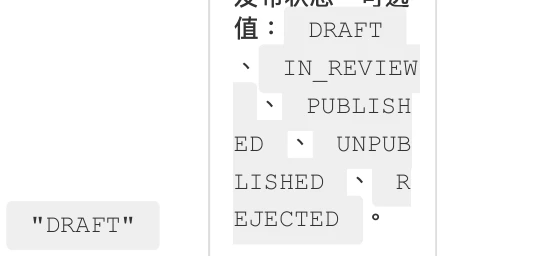

**返回数据**

| 参数名称 | 类型 | 示例 | 说明 |
| --- | --- | --- | --- |
| code | <code>string</code> | <code>SUCCESS</code> | 响应码，取值为<code> SUCCESS </code> 时表示请求成功。 |
| message | <code>string</code> | <code>null</code> | 响应消息。请求成功时通常为空。 |
| data | <code>object</code> | <code>{"content":</code><br><code>[{"listingId":"listi</code><br><code>ng-</code><br><code>001","tenantId":"ten</code><br><code>ant-</code><br><code>001","resourceId":"r</code><br><code>esource-</code><br><code>001","defaultVersion</code><br><code>Id":"defaultVersion-</code><br><code>001","portalId":"por</code><br><code>tal-</code><br><code>001","visibility":"P</code> <code>RIVATE","title":"</code>示例资源标题<code>","summary":"</code>示例摘要<code>","description":"</code>用于演示的资源描述<code>","icon":"sample-</code><code>value","banner":"sam</code><br><code>ple-</code><br><code>value","categoryId":</code><br><code>"category-</code><br><code>001","category":</code><br><code>{"categoryId":"categ</code><br><code>ory-</code><br><code>001","tenantId":"ten</code><br><code>ant-</code><br><code>001","kind":"MODEL_A</code><br><code>PI","code":"model-</code><br><code>api","name":"sample-</code><br><code>name","description":</code> <code>"</code>用于演示的资源描述<code>","icon":"sample-</code><code>value","sortOrder":1</code><br><code>00,"status":"sample-</code><br><code>value","createdBy":"</code><br><code>sample-</code><br><code>value","updatedBy":"</code><br><code>sample-</code><br><code>value","createdAt":"</code><br><code>2026-06-</code><br><code>22T12:00:00Z","updat</code><br><code>edAt":"2026-06-</code><code>22T12:00:00Z","listi</code><br><code>ngCount":1},"tags":</code><br><code>["sample-</code><br><code>value"],"pricingMode</code><br><code>":"FREE","listingSta</code><br><code>tus":"ACTIVE","publi</code><br><code>cationStatus":"DRAFT</code><br><code>","createdBy":"sampl</code><br><code>e-</code><br><code>value","publishedBy"</code><br><code>:"sample-</code><br><code>value","publishedAt"</code><br><code>:"2026-06-</code><br><code>22T12:00:00Z","creat</code><br><code>edAt":"2026-06-</code><br><code>22T12:00:00Z","updat</code><br><code>edAt":"2026-06-</code><br><code>22T12:00:00Z"}],"pag</code><br><code>eNumber":1,"pageSize</code><br><code>":10,"totalCount":1}</code> | 响应数据。具体结构以接口语义为准。 |
| accessDeniedDetail | <code>object</code> | <code>null</code> | 鉴权失败详情。请求成功时通常为空。 |
| requestId | <code>string</code> | <code>req-001</code> | 请求 ID，可用于问题排查和日志检索。 |
| data.content | <code>array</code> | <code>[{"listingId":"lis</code><br><code>ting-</code><br><code>001","tenantId":"ten</code><br><code>ant-</code><br><code>001","resourceId":"r</code><br><code>esource-</code><br><code>001","defaultVersion</code><br><code>Id":"defaultVersion-</code><br><code>001","portalId":"por</code><br><code>tal-</code><br><code>001","visibility":"P</code><br><code>RIVATE"}]</code> | 分页结果列表。 |
| data.content\[\].listingId | <code>string</code> | <code>"listing-001"</code> | Listing ID。 |
| data.content\[\].tenantI d | <code>string</code> | <code>"tenant-001"</code> | 租户ID。 |
| data.content\[\].resourc eId | <code>string</code> | <code>"resource-001"</code> | AI Resource ID。 |
| data.content\[\].default VersionId | <code>string</code> | <code>"defaultVersion-</code><br><code>001"</code> | 默认版本ID。 |
| data.content\[\].portalId | <code>string</code> | <code>"portal-001"</code> | 门户ID。 |
| data.content\[\].visibility | <code>string</code> | <code>"PRIVATE"</code> | 可见性。可选值：<code> PRIVATE </code>、<code> PU</code> <code>BLIC </code>。 |
| data.content\[\].title | <code>string</code> | <code> "</code>示例资源标题<code>" </code> | 标题。 |
| data.content\[\].summa ry | <code>string</code> | <code> "</code>示例摘要<code>" </code> | 摘要信息。 |
| data.content\[\].descript ion | <code>string</code> | <code> "</code>用于演示的资源描述<code>" </code> | 描述信息。 |
| data.content\[\].icon | <code>string</code> | <code>"sample-value"</code> | 图标地址。 |
| data.content\[\].banner | <code>string</code> | <code>"sample-value"</code> | 横幅图片地址。 |
| data.content\[\].categor yId | <code>string</code> | <code>"category-001"</code> | 分类 ID。 |
| data.content\[\].categor y | <code>object</code> | <code>{"categoryId":"cat</code><br><code>egory-</code><br><code>001","tenantId":"ten</code><br><code>ant-</code><br><code>001","kind":"MODEL_A</code><br><code>PI","code":"model-</code><br><code>api","name":"sample-</code><br><code>name","description":</code> <code>"</code>用于演示的资源描述<code>"} </code> | 分类信息。 |
| data.content\[\].categor y.categoryId | <code>string</code> | <code>"category-001"</code> | 分类 ID。 |
| data.content\[\].categor y.tenantId | <code>string</code> | <code>"tenant-001"</code> | 租户ID。 |
| data.content\[\].categor y.kind | <code>string</code> | <code>"MODEL_API"</code> | 资源类型。 |
| data.content\[\].categor y.code | <code>string</code> | <code>"model-api"</code> | 业务编码。 |
| data.content\[\].categor y.name | <code>string</code> | <code>"sample-name"</code> | 名称。 |
| data.content\[\].categor y.description | <code>string</code> | <code> "</code>用于演示的资源描述<code>" </code> | 描述信息。 |
| data.content\[\].categor y.icon | <code>string</code> | <code>"sample-value"</code> | 图标地址。 |
| data.content\[\].categor y.sortOrder | <code>integer&lt;int32&gt;</code> | <code>100</code> | 排序值。 |
| data.content\[\].categor y.status | <code>string</code> | <code>"sample-value"</code> | 状态。 |
| data.content\[\].categor y.createdBy | <code>string</code> | <code>"sample-value"</code> | 创建人。 |
| data.content\[\].categor y.updatedBy | <code>string</code> | <code>"sample-value"</code> | 更新人。 |
| data.content\[\].categor y.createdAt | <code>string&lt;date-</code><br><code>time&gt;</code> | <code>"2026-06-</code><br><code>22T12:00:00Z"</code> | 创建时间。 |
| data.content\[\].categor y.updatedAt | <code>string&lt;date-</code><br><code>time&gt;</code> | <code>"2026-06-</code><br><code>22T12:00:00Z"</code> | 更新时间。 |
| data.content\[\].categor y.listingCount | <code>integer&lt;int64&gt;</code> | <code>1</code> | Listing 数量。 |
| data.content\[\].tags | <code>array</code> | <code>["sample-value"]</code> | 标签列表。 |
| data.content\[\].pricing Mode | <code>string</code> | <code>"sample-value"</code> | 计费模式。 |
| data.content\[\].listingSt atus | <code>string</code> | <code>"sample-value"</code> | 市场条目状态。 |
| data.content\[\].publicat ionStatus | <code>string</code> | <code>"DRAFT"</code> | 发布状态。可选值：<code> DRAFT </code>、<code> IN_R</code> <code>EVIEW </code>、<code> PUBLISHED</code><code> </code>、<code> UNPUBLISHED </code>、<code> REJECTED </code>。 |
| data.content\[\].created By | <code>string</code> | <code>"sample-value"</code> | 创建人。 |
| data.content\[\].publish edBy | <code>string</code> | <code>"sample-value"</code> | 发布人 ID。 |
| data.content\[\].publish edAt | <code>string&lt;date-</code><br><code>time&gt;</code> | <code>"2026-06-</code><br><code>22T12:00:00Z"</code> | 发布时间。 |
| data.content\[\].created At | <code>string&lt;date-</code><br><code>time&gt;</code> | <code>"2026-06-</code><br><code>22T12:00:00Z"</code> | 创建时间。 |
| data.content\[\].update dAt | <code>string&lt;date-</code><br><code>time&gt;</code> | <code>"2026-06-</code><br><code>22T12:00:00Z"</code> | 更新时间。 |
| data.pageNumber | <code>integer&lt;int32&gt;</code> | <code>1</code> | 当前页码。 |
| data.pageSize | <code>integer&lt;int32&gt;</code> | <code>10</code> | 每页大小。 |
| data.totalCount | <code>integer&lt;int64&gt;</code> | <code>1</code> | 总记录数。 |


**示例**

**请求示例**

```text
GET /himarket/v1/open-api/v1/catalog/listings?tenantId=tenant-001&resourceId=resource-001&kind=MODEL_API&categoryId=category-001&portalId=portal-
001&visibility=PRIVATE&publicationStatus=DRAFT&keyword=sample-value HTTP/1.1
Host: localhost:8080
X-HIMARKET-OPENAPI: HIMARKET_OPENAPI
X-HIMARKET-TOKEN: <admin-openapi-token>
```

**响应示例**

```json
{
  "code": "SUCCESS",
  "message": null,
  "data": {
    "content": [
      {
        "listingId": "listing-001",
        "tenantId": "tenant-001",
        "resourceId": "resource-001",
        "defaultVersionId": "defaultVersion-001",
        "portalId": "portal-001",
        "visibility": "PRIVATE",
        "title": "示例资源标题",
        "summary": "示例摘要",
        "description": "⽤于演示的资源描述",
        "icon": "sample-value",
        "banner": "sample-value",
        "categoryId": "category-001",
        "category": {
          "categoryId": "category-001",
          "tenantId": "tenant-001",
          "kind": "MODEL_API",
          "code": "model-api",
          "name": "sample-name",
          "description": "⽤于演示的资源描述",
          "icon": "sample-value",
          "sortOrder": 100,
          "status": "sample-value",
          "createdBy": "sample-value",
          "updatedBy": "sample-value",
          "createdAt": "2026-06-22T12:00:00Z",
          "updatedAt": "2026-06-22T12:00:00Z",
          "listingCount": 1
        },
        "tags": [
          "sample-value"
        ],
        "pricingMode": "FREE",
        "listingStatus": "ACTIVE",
        "publicationStatus": "DRAFT",
        "createdBy": "sample-value",
        "publishedBy": "sample-value",
        "publishedAt": "2026-06-22T12:00:00Z",
        "createdAt": "2026-06-22T12:00:00Z",
        "updatedAt": "2026-06-22T12:00:00Z"
      }
    ],
    "pageNumber": 1,
    "pageSize": 10,
    "totalCount": 1
  },
  "accessDeniedDetail": null,
  "requestId": "req-001"
}
```

<a id="section-3-3-8"></a>

### 3.3.8. publishListing

**接口信息**

- **接口路径**： `POST /himarket/v1/open-api/v1/catalog/listings/{listingId}/publish`

- **接口说明**：管理员直接发布 Listing。

- **认证方式**：该接口属于管理面 OpenAPI。调用前请完成 OpenAPI 凭证配置，并按 Token 模式或AK/SK 签名模式携带认证 Header。

- **Header 示例**：Token 模式使用  `X-HIMARKET-OPENAPI: HIMARKET_OPENAPI`  与  `X-HIMARKET-TOKEN` ；AK/SK 模式使用  `X-HIMARKET-ACCESS-KEY` 、 `X-HIMARKET-TIMESTAMP`  和  `X-HIMARKET-SIGNATURE` 。

**请求参数**

| 参数名称 | 位置 | 类型 | 是否必选 | 示例 | 说明 |
| --- | --- | --- | --- | --- | --- |
| listingId | path | <code>string</code> | 是 | <code>"listing-</code><br><code>001"</code> | Listing ID。 |

**返回数据**

| 参数名称 | 类型 | 示例 | 说明 |
| --- | --- | --- | --- |
| code | <code>string</code> | <code>SUCCESS</code> | 响应码，取值为<code> SUCCESS </code> 时表示请求成功。 |
| message | <code>string</code> | <code>null</code> | 响应消息。请求成功时通常为空。 |
| data | <code>object</code> | <code>{"listingId":"list</code><br><code>ing-</code><br><code>001","tenantId":"ten</code><br><code>ant-</code><br><code>001","resourceId":"r</code><br><code>esource-</code><br><code>001","defaultVersion</code><br><code>Id":"defaultVersion-</code><br><code>001","portalId":"por</code><br><code>tal-</code><br><code>001","visibility":"P</code><br><code>RIVATE"}</code> | 响应数据。具体结构以接口语义为准。 |
| accessDeniedDetail | <code>object</code> | <code>null</code> | 鉴权失败详情。请求成功时通常为空。 |
| requestId | <code>string</code> | <code>req-001</code> | 请求 ID，可用于问题排查和日志检索。 |
| data.listingId | <code>string</code> | <code>"listing-001"</code> | Listing ID。 |
| data.tenantId | <code>string</code> | <code>"tenant-001"</code> | 租户ID。 |
| data.resourceId | <code>string</code> | <code>"resource-001"</code> | AI Resource ID。 |
| data.defaultVersionId | <code>string</code> | <code>"defaultVersion-</code><br><code>001"</code> | 默认版本ID。 |
| data.portalId | <code>string</code> | <code>"portal-001"</code> | 门户ID。 |
| data.visibility | <code>string</code> | <code>"PRIVATE"</code> | 可见性。可选值：<code> PRIVATE </code>、<code> PU</code> <code>BLIC </code>。 |
| data.title | <code>string</code> | <code> "</code>示例资源标题<code>" </code> | 标题。 |
| data.summary | <code>string</code> | <code> "</code>示例摘要<code>" </code> | 摘要信息。 |
| data.description | <code>string</code> | <code> "</code>用于演示的资源描述<code>" </code> | 描述信息。 |
| data.icon | <code>string</code> | <code>"sample-value"</code> | 图标地址。 |
| data.banner | <code>string</code> | <code>"sample-value"</code> | 横幅图片地址。 |
| data.categoryId | <code>string</code> | <code>"category-001"</code> | 分类 ID。 |

<table>
  <tr>
    <td>data.category</td>
    <td><code>object</code></td>
    <td><code>{"categoryId":"cat</code><br><code>egory-</code><br><code>001","tenantId":"ten</code><br><code>ant-</code><br><code>001","kind":"MODEL_A</code><br><code>PI","code":"model-</code><br><code>api","name":"sample-</code><br><code>name","description":</code> <code>"</code>用于演示的资源描述<code>"} </code></td>
    <td>分类信息。</td>
  </tr>
  <tr>
    <td>data.category.categor yId</td>
    <td><code>string</code></td>
    <td><code>"category-001"</code></td>
    <td>分类 ID。</td>
  </tr>
  <tr>
    <td>data.category.tenantId</td>
    <td><code>string</code></td>
    <td><code>"tenant-001"</code></td>
    <td>租户ID。</td>
  </tr>
  <tr>
    <td>data.category.kind</td>
    <td><code>string</code></td>
    <td><code>"MODEL_API"</code></td>
    <td>资源类型。</td>
  </tr>
  <tr>
    <td>data.category.code</td>
    <td><code>string</code></td>
    <td><code>"model-api"</code></td>
    <td>业务编码。</td>
  </tr>
  <tr>
    <td>data.category.name</td>
    <td><code>string</code></td>
    <td><code>"sample-name"</code></td>
    <td>名称。</td>
  </tr>
  <tr>
    <td>data.category.descript ion</td>
    <td><code>string</code></td>
    <td><code> "</code>用于演示的资源描述<code>" </code></td>
    <td>描述信息。</td>
  </tr>
  <tr>
    <td>data.category.icon</td>
    <td><code>string</code></td>
    <td><code>"sample-value"</code></td>
    <td>图标地址。</td>
  </tr>
  <tr>
    <td>data.category.sortOrd er</td>
    <td><code>integer&lt;int32&gt;</code></td>
    <td><code>100</code></td>
    <td>排序值。</td>
  </tr>
  <tr>
    <td>data.category.status</td>
    <td><code>string</code></td>
    <td><code>"sample-value"</code></td>
    <td>状态。</td>
  </tr>
  <tr>
    <td>data.category.created By</td>
    <td><code>string</code></td>
    <td><code>"sample-value"</code></td>
    <td>创建人。</td>
  </tr>
  <tr>
    <td>data.category.updated By</td>
    <td><code>string</code></td>
    <td><code>"sample-value"</code></td>
    <td>更新人。</td>
  </tr>
  <tr>
    <td>data.category.created At</td>
    <td><code>string&lt;date-</code><br><code>time&gt;</code></td>
    <td><code>"2026-06-</code><br><code>22T12:00:00Z"</code></td>
    <td>创建时间。</td>
  </tr>
  <tr>
    <td>data.category.updated At</td>
    <td><code>string&lt;date-</code><br><code>time&gt;</code></td>
    <td><code>"2026-06-</code><br><code>22T12:00:00Z"</code></td>
    <td>更新时间。</td>
  </tr>
  <tr>
    <td>data.category.listingC ount</td>
    <td><code>integer&lt;int64&gt;</code></td>
    <td><code>1</code></td>
    <td>Listing 数量。</td>
  </tr>
  <tr>
    <td>data.tags</td>
    <td><code>array</code></td>
    <td><code>["sample-value"]</code></td>
    <td>标签列表。</td>
  </tr>
  <tr>
    <td>data.pricingMode</td>
    <td><code>string</code></td>
    <td><code>"sample-value"</code></td>
    <td>计费模式。</td>
  </tr>
  <tr>
    <td>data.listingStatus</td>
    <td><code>string</code></td>
    <td><code>"sample-value"</code></td>
    <td>市场条目状态。</td>
  </tr>
  <tr>
    <td>data.publicationStatus</td>
    <td><code>string</code></td>
    <td><code>"DRAFT"</code></td>
    <td>发布状态。可选值：<code> DRAFT </code>、<code> IN_R</code> <code>EVIEW </code>、<code> PUBLISHED</code><code> </code>、<code> UNPUBLISHED </code>、<code> REJECTED </code>。</td>
  </tr>
  <tr>
    <td>data.createdBy</td>
    <td><code>string</code></td>
    <td><code>"sample-value"</code></td>
    <td>创建人。</td>
  </tr>
  <tr>
    <td>data.publishedBy</td>
    <td><code>string</code></td>
    <td><code>"sample-value"</code></td>
    <td>发布人 ID。</td>
  </tr>
  <tr>
    <td>data.publishedAt</td>
    <td><code>string&lt;date-</code><br><code>time&gt;</code></td>
    <td><code>"2026-06-</code><br><code>22T12:00:00Z"</code></td>
    <td>发布时间。</td>
  </tr>
  <tr>
    <td>data.createdAt</td>
    <td><code>string&lt;date-</code><br><code>time&gt;</code></td>
    <td><code>"2026-06-</code><br><code>22T12:00:00Z"</code></td>
    <td>创建时间。</td>
  </tr>
  <tr>
    <td>data.updatedAt</td>
    <td><code>string&lt;date-</code><br><code>time&gt;</code></td>
    <td><code>"2026-06-</code><br><code>22T12:00:00Z"</code></td>
    <td>更新时间。</td>
  </tr>
</table>


**示例**

**请求示例**

```http
POST /himarket/v1/open-api/v1/catalog/listings/{listingId}/publish HTTP/1.1
Host: localhost:8080
X-HIMARKET-OPENAPI: HIMARKET_OPENAPI
X-HIMARKET-TOKEN: <admin-openapi-token>
```

**响应示例**

```json
{
  "code": "SUCCESS",
  "message": null,
  "data": {
    "listingId": "listing-001",
    "tenantId": "tenant-001",
    "resourceId": "resource-001",
    "defaultVersionId": "defaultVersion-001",
    "portalId": "portal-001",
    "visibility": "PRIVATE"
  },
  "accessDeniedDetail": null,
  "requestId": "req-001"
}
```

<a id="section-3-3-9"></a>

### 3.3.9. rerunReviewChecks

**接口信息**

- **接口路径**： `POST /himarket/v1/open-api/v1/catalog/reviews/{submissionId}/checks/rerun`

- **接口说明**：重新运行审核单检查。

- **认证方式**：该接口属于管理面 OpenAPI。调用前请完成 OpenAPI 凭证配置，并按 Token 模式或AK/SK 签名模式携带认证 Header。

- **Header 示例**：Token 模式使用  `X-HIMARKET-OPENAPI: HIMARKET_OPENAPI`  与  `X-HIMARKET-TOKEN` ；AK/SK 模式使用  `X-HIMARKET-ACCESS-KEY` 、 `X-HIMARKET-TIMESTAMP`  和  `X-HIMARKET-SIGNATURE` 。

**请求参数**

| 参数名称 | 位置 | 类型 | 是否必选 | 示例 | 说明 |
| --- | --- | --- | --- | --- | --- |
| submissionId | path | <code>string</code> | 是 | <code>"submissio</code><br><code>n-001"</code> | 评审提交ID。 |

**返回数据**

| 参数名称 | 类型 | 示例 | 说明 |
| --- | --- | --- | --- |
| code | <code>string</code> | <code>SUCCESS</code> | 响应码，取值为<code> SUCCESS </code> 时表示请求成功。 |
| message | <code>string</code> | <code>null</code> | 响应消息。请求成功时通常为空。 |
| data | <code>object</code> | <code>{"submissionId":"s</code><br><code>ubmission-</code><br><code>001","targetType":"s</code><br><code>ample-</code><br><code>value","targetId":"t</code><br><code>arget-</code><br><code>001","submitterId":"</code><br><code>submitter-</code><br><code>001","reviewType":"s</code><br><code>ample-</code><br><code>value","status":"PEN</code><br><code>DING"}</code> | 响应数据。具体结构以接口语义为准。 |
| accessDeniedDetail | <code>object</code> | <code>null</code> | 鉴权失败详情。请求成功时通常为空。 |
| requestId | <code>string</code> | <code>req-001</code> | 请求 ID，可用于问题排查和日志检索。 |
| data.submissionId | <code>string</code> | <code>"submission-001"</code> | 评审提交ID。 |
| data.targetType | <code>string</code> | <code>"sample-value"</code> | 订阅目标类型。 |
| data.targetId | <code>string</code> | <code>"target-001"</code> | 目标对象 ID。 |
| data.submitterId | <code>string</code> | <code>"submitter-001"</code> | 提交人 ID。 |
| data.reviewType | <code>string</code> | <code>"sample-value"</code> | 审核类型。 |
| data.status | <code>string</code> | <code>"PENDING"</code> | 状态。 |
| data.checks | <code>object</code> | <code>{}</code> | 审核检查项列表。 |
| data.decision | <code>object</code> | <code>{}</code> | 审核决策。 |
| data.reviewerId | <code>string</code> | <code>"reviewer-001"</code> | 审核人 ID。 |
| data.submittedAt | <code>string&lt;date-</code><br><code>time&gt;</code> | <code>"2026-06-</code><br><code>22T12:00:00Z"</code> | 提交时间。 |
| data.decidedAt | <code>string&lt;date-</code><br><code>time&gt;</code> | <code>"2026-06-</code><br><code>22T12:00:00Z"</code> | 审批时间。 |

**示例**

**请求示例**

```http
POST /himarket/v1/open-api/v1/catalog/reviews/{submissionId}/checks/rerun HTTP/1.1
Host: localhost:8080
X-HIMARKET-OPENAPI: HIMARKET_OPENAPI
X-HIMARKET-TOKEN: <admin-openapi-token>
```

**响应示例**

```json
{
  "code": "SUCCESS",
  "message": null,
  "data": {
    "submissionId": "submission-001",
    "targetType": "sample-value",
    "targetId": "target-001",
    "submitterId": "submitter-001",
    "reviewType": "sample-value",
    "status": "PENDING"
  },
  "accessDeniedDetail": null,
  "requestId": "req-001"
}
```

<a id="section-3-3-10"></a>

### 3.3.10. saveCatalogListing

**接口信息**

- **接口路径**： `POST /himarket/v1/open-api/v1/catalog/listings`

- **接口说明**：创建或更新市场 Listing 草稿。

- **认证方式**：该接口属于管理面 OpenAPI。调用前请完成 OpenAPI 凭证配置，并按 Token 模式或AK/SK 签名模式携带认证 Header。

- **Header 示例**：Token 模式使用  `X-HIMARKET-OPENAPI: HIMARKET_OPENAPI`  与  `X-HIMARKET-TOKEN` ；AK/SK 模式使用  `X-HIMARKET-ACCESS-KEY` 、 `X-HIMARKET-TIMESTAMP`  和  `X-HIMARKET-SIGNATURE` 。

**请求参数**

| 参数名称 | 位置 | 类型 | 是否必选 | 示例 | 说明 |
| --- | --- | --- | --- | --- | --- |
| resourceId | body | <code>string</code> | 是 | <code>"resource-</code><br><code>001"</code> | AI Resource ID。 |
| defaultVersio nId | body | <code>string</code> | 否 | <code>"defaultVe</code><br><code>rsion-001"</code> | 默认版本ID。 |
| portalId | body | <code>string</code> | 否 | <code>"portal-</code><br><code>001"</code> | 门户ID。 |
| visibility | body | <code>string</code> | 否 | <code>"PRIVATE"</code> | 可见性。可选值：<code> PRIVATE</code><code> </code>、<code> PUBLIC</code><code> </code>。 |
| title | body | <code>string</code> | 是 | <code> "</code>示例资源标题<code>" </code> | 标题。 |
| summary | body | <code>string</code> | 否 | <code> "</code>示例摘要<code>" </code> | 摘要信息。 |
| description | body | <code>string</code> | 否 | <code> "</code>用于演示的资源描述<code>" </code> | 描述信息。 |
| banner | body | <code>string</code> | 否 | <code>"sample-</code><br><code>value"</code> | 横幅图片地址。 |
| pricingMode | body | <code>string</code> | 否 | <code>"sample-</code><br><code>value"</code> | 计费模式。 |
| categoryId | body | <code>string</code> | 否 | <code>"category-</code><br><code>001"</code> | 分类 ID。 |


**返回数据**

| 参数名称 | 类型 | 示例 | 说明 |
| --- | --- | --- | --- |
| code | <code>string</code> | <code>SUCCESS</code> | 响应码，取值为<code> SUCCESS </code> 时表示请求成功。 |
| message | <code>string</code> | <code>null</code> | 响应消息。请求成功时通常为空。 |
| data | <code>object</code> | <code>{"listingId":"list</code><br><code>ing-</code><br><code>001","tenantId":"ten</code><br><code>ant-</code><br><code>001","resourceId":"r</code><br><code>esource-</code><br><code>001","defaultVersion</code><br><code>Id":"defaultVersion-</code><br><code>001","portalId":"por</code><br><code>tal-</code><br><code>001","visibility":"P</code><br><code>RIVATE"}</code> | 响应数据。具体结构以接口语义为准。 |
| accessDeniedDetail | <code>object</code> | <code>null</code> | 鉴权失败详情。请求成功时通常为空。 |
| requestId | <code>string</code> | <code>req-001</code> | 请求 ID，可用于问题排查和日志检索。 |
| data.listingId | <code>string</code> | <code>"listing-001"</code> | Listing ID。 |
| data.tenantId | <code>string</code> | <code>"tenant-001"</code> | 租户ID。 |
| data.resourceId | <code>string</code> | <code>"resource-001"</code> | AI Resource ID。 |
| data.defaultVersionId | <code>string</code> | <code>"defaultVersion-</code><br><code>001"</code> | 默认版本ID。 |
| data.portalId | <code>string</code> | <code>"portal-001"</code> | 门户ID。 |
| data.visibility | <code>string</code> | <code>"PRIVATE"</code> | 可见性。可选值：<code> PRIVATE </code>、<code> PU</code> <code>BLIC </code>。 |
| data.title | <code>string</code> | <code> "</code>示例资源标题<code>" </code> | 标题。 |
| data.summary | <code>string</code> | <code> "</code>示例摘要<code>" </code> | 摘要信息。 |
| data.description | <code>string</code> | <code> "</code>用于演示的资源描述<code>" </code> | 描述信息。 |
| data.icon | <code>string</code> | <code>"sample-value"</code> | 图标地址。 |
| data.banner | <code>string</code> | <code>"sample-value"</code> | 横幅图片地址。 |
| data.categoryId | <code>string</code> | <code>"category-001"</code> | 分类 ID。 |
| data.category | <code>object</code> | <code>{"categoryId":"cat</code><br><code>egory-</code><br><code>001","tenantId":"ten</code><br><code>ant-</code><br><code>001","kind":"MODEL_A</code><br><code>PI","code":"model-</code><br><code>api","name":"sample-</code><br><code>name","description":</code> <code>"</code>用于演示的资源描述<code>"} </code> | 分类信息。 |
| data.category.categor yId | <code>string</code> | <code>"category-001"</code> | 分类 ID。 |
| data.category.tenantId | <code>string</code> | <code>"tenant-001"</code> | 租户ID。 |
| data.category.kind | <code>string</code> | <code>"MODEL_API"</code> | 资源类型。 |
| data.category.code | <code>string</code> | <code>"model-api"</code> | 业务编码。 |
| data.category.name | <code>string</code> | <code>"sample-name"</code> | 名称。 |
| data.category.descript ion | <code>string</code> | <code> "</code>用于演示的资源描述<code>" </code> | 描述信息。 |
| data.category.icon | <code>string</code> | <code>"sample-value"</code> | 图标地址。 |
| data.category.sortOrd er | <code>integer&lt;int32&gt;</code> | <code>100</code> | 排序值。 |
| data.category.status | <code>string</code> | <code>"sample-value"</code> | 状态。 |
| data.category.created By | <code>string</code> | <code>"sample-value"</code> | 创建人。 |
| data.category.updated By | <code>string</code> | <code>"sample-value"</code> | 更新人。 |
| data.category.created At | <code>string&lt;date-</code><br><code>time&gt;</code> | <code>"2026-06-</code><br><code>22T12:00:00Z"</code> | 创建时间。 |
| data.category.updated At | <code>string&lt;date-</code><br><code>time&gt;</code> | <code>"2026-06-</code><br><code>22T12:00:00Z"</code> | 更新时间。 |
| data.category.listingC ount | <code>integer&lt;int64&gt;</code> | <code>1</code> | Listing 数量。 |
| data.tags | <code>array</code> | <code>["sample-value"]</code> | 标签列表。 |
| data.pricingMode | <code>string</code> | <code>"sample-value"</code> | 计费模式。 |
| data.listingStatus | <code>string</code> | <code>"sample-value"</code> | 市场条目状态。 |
| data.publicationStatus | <code>string</code> | <code>"DRAFT"</code> | 发布状态。可选值：<code> DRAFT </code>、<code> IN_R</code> <code>EVIEW </code>、<code> PUBLISHED</code><code> </code>、<code> UNPUBLISHED </code>、<code> REJECTED </code>。 |
| data.createdBy | <code>string</code> | <code>"sample-value"</code> | 创建人。 |
| data.publishedBy | <code>string</code> | <code>"sample-value"</code> | 发布人 ID。 |
| data.publishedAt | <code>string&lt;date-</code><br><code>time&gt;</code> | <code>"2026-06-</code><br><code>22T12:00:00Z"</code> | 发布时间。 |

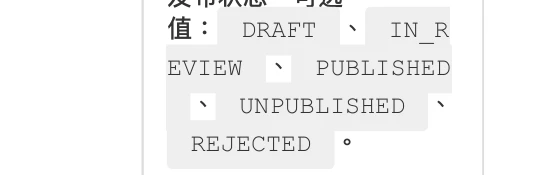

<table>
  <tr>
    <td>data.createdAt</td>
    <td><code>string&lt;date-</code><br><code>time&gt;</code></td>
    <td><code>"2026-06-</code><br><code>22T12:00:00Z"</code></td>
    <td>创建时间。</td>
  </tr>
  <tr>
    <td>data.updatedAt</td>
    <td><code>string&lt;date-</code><br><code>time&gt;</code></td>
    <td><code>"2026-06-</code><br><code>22T12:00:00Z"</code></td>
    <td>更新时间。</td>
  </tr>
</table>

**示例**

**请求示例**

```http
POST /himarket/v1/open-api/v1/catalog/listings HTTP/1.1
Host: localhost:8080
X-HIMARKET-OPENAPI: HIMARKET_OPENAPI
X-HIMARKET-TOKEN: <admin-openapi-token>
Content-Type: application/json

{
  "resourceId": "resource-001",
  "defaultVersionId": "defaultVersion-001",
  "portalId": "portal-001",
  "visibility": "PRIVATE",
  "title": "示例资源标题",
  "summary": "示例摘要"
}
```

**响应示例**

```json
{
  "code": "SUCCESS",
  "message": null,
  "data": {
    "listingId": "listing-001",
    "tenantId": "tenant-001",
    "resourceId": "resource-001",
    "defaultVersionId": "defaultVersion-001",
    "portalId": "portal-001",
    "visibility": "PRIVATE"
  },
  "accessDeniedDetail": null,
  "requestId": "req-001"
}
```

<a id="section-3-3-11"></a>

### 3.3.11. submitCatalogReview

**接口信息**

- **接口路径**： `POST /himarket/v1/open-api/v1/catalog/listings/{listingId}/submit-review`

- **接口说明**：提交 Listing 审核。

- **认证方式**：该接口属于管理面 OpenAPI。调用前请完成 OpenAPI 凭证配置，并按 Token 模式或AK/SK 签名模式携带认证 Header。

- **Header 示例**：Token 模式使用  `X-HIMARKET-OPENAPI: HIMARKET_OPENAPI`  与  `X-HIMARKET-TOKEN` ；AK/SK 模式使用  `X-HIMARKET-ACCESS-KEY` 、 `X-HIMARKET-TIMESTAMP`  和  `X-HIMARKET-SIGNATURE` 。

**请求参数**

| 参数名称 | 位置 | 类型 | 是否必选 | 示例 | 说明 |
| --- | --- | --- | --- | --- | --- |
| listingId | path | <code>string</code> | 是 | <code>"listing-</code><br><code>001"</code> | Listing ID。 |
| checks | body | <code>object</code> | 否 | <code>{}</code> | 审核检查项列表。 |

**返回数据**

| 参数名称 | 类型 | 示例 | 说明 |
| --- | --- | --- | --- |
| code | <code>string</code> | <code>SUCCESS</code> | 响应码，取值为<code> SUCCESS </code> 时表示请求成功。 |
| message | <code>string</code> | <code>null</code> | 响应消息。请求成功时通常为空。 |
| data | <code>object</code> | <code>{"submissionId":"s</code><br><code>ubmission-</code><br><code>001","targetType":"s</code><br><code>ample-</code><br><code>value","targetId":"t</code><br><code>arget-</code><br><code>001","submitterId":"</code><br><code>submitter-</code><br><code>001","reviewType":"s</code><br><code>ample-</code><br><code>value","status":"PEN</code><br><code>DING"}</code> | 响应数据。具体结构以接口语义为准。 |
| accessDeniedDetail | <code>object</code> | <code>null</code> | 鉴权失败详情。请求成功时通常为空。 |
| requestId | <code>string</code> | <code>req-001</code> | 请求 ID，可用于问题排查和日志检索。 |
| data.submissionId | <code>string</code> | <code>"submission-001"</code> | 评审提交ID。 |
| data.targetType | <code>string</code> | <code>"sample-value"</code> | 订阅目标类型。 |
| data.targetId | <code>string</code> | <code>"target-001"</code> | 目标对象 ID。 |
| data.submitterId | <code>string</code> | <code>"submitter-001"</code> | 提交人 ID。 |
| data.reviewType | <code>string</code> | <code>"sample-value"</code> | 审核类型。 |
| data.status | <code>string</code> | <code>"PENDING"</code> | 状态。 |
| data.checks | <code>object</code> | <code>{}</code> | 审核检查项列表。 |
| data.decision | <code>object</code> | <code>{}</code> | 审核决策。 |
| data.reviewerId | <code>string</code> | <code>"reviewer-001"</code> | 审核人 ID。 |
| data.submittedAt | <code>string&lt;date-</code><br><code>time&gt;</code> | <code>"2026-06-</code><br><code>22T12:00:00Z"</code> | 提交时间。 |
| data.decidedAt | <code>string&lt;date-</code><br><code>time&gt;</code> | <code>"2026-06-</code><br><code>22T12:00:00Z"</code> | 审批时间。 |

**示例**

**请求示例**

```http
POST /himarket/v1/open-api/v1/catalog/listings/{listingId}/submit-review HTTP/1.1
Host: localhost:8080
X-HIMARKET-OPENAPI: HIMARKET_OPENAPI
X-HIMARKET-TOKEN: <admin-openapi-token>
Content-Type: application/json

{
  "checks": {}
}
```

**响应示例**

```json
{
  "code": "SUCCESS",
  "message": null,
  "data": {
    "submissionId": "submission-001",
    "targetType": "sample-value",
    "targetId": "target-001",
    "submitterId": "submitter-001",
    "reviewType": "sample-value",
    "status": "PENDING"
  },
  "accessDeniedDetail": null,
  "requestId": "req-001"
}
```

<a id="section-3-3-12"></a>

### 3.3.12. unpublishListing

**接口信息**

- **接口路径**： `POST /himarket/v1/open-api/v1/catalog/listings/{listingId}/unpublish`

- **接口说明**：下架 Listing。

- **认证方式**：该接口属于管理面 OpenAPI。调用前请完成 OpenAPI 凭证配置，并按 Token 模式或AK/SK 签名模式携带认证 Header。

- **Header 示例**：Token 模式使用  `X-HIMARKET-OPENAPI: HIMARKET_OPENAPI`  与  `X-HIMARKET-TOKEN` ；AK/SK 模式使用  `X-HIMARKET-ACCESS-KEY` 、 `X-HIMARKET-TIMESTAMP`  和  `X-HIMARKET-SIGNATURE` 。

**请求参数**

| 参数名称 | 位置 | 类型 | 是否必选 | 示例 | 说明 |
| --- | --- | --- | --- | --- | --- |
| listingId | path | <code>string</code> | 是 | <code>"listing-</code><br><code>001"</code> | Listing ID。 |

**返回数据**

| 参数名称 | 类型 | 示例 | 说明 |
| --- | --- | --- | --- |
| code | <code>string</code> | <code>SUCCESS</code> | 响应码，取值为<code> SUCCESS </code> 时表示请求成功。 |
| message | <code>string</code> | <code>null</code> | 响应消息。请求成功时通常为空。 |
| data | <code>object</code> | <code>{"listingId":"list</code><br><code>ing-</code><br><code>001","tenantId":"ten</code><br><code>ant-</code><br><code>001","resourceId":"r</code><br><code>esource-</code><br><code>001","defaultVersion</code><br><code>Id":"defaultVersion-</code><br><code>001","portalId":"por</code><br><code>tal-</code><br><code>001","visibility":"P</code><br><code>RIVATE"}</code> | 响应数据。具体结构以接口语义为准。 |
| accessDeniedDetail | <code>object</code> | <code>null</code> | 鉴权失败详情。请求成功时通常为空。 |
| requestId | <code>string</code> | <code>req-001</code> | 请求 ID，可用于问题排查和日志检索。 |
| data.listingId | <code>string</code> | <code>"listing-001"</code> | Listing ID。 |
| data.tenantId | <code>string</code> | <code>"tenant-001"</code> | 租户ID。 |
| data.resourceId | <code>string</code> | <code>"resource-001"</code> | AI Resource ID。 |
| data.defaultVersionId | <code>string</code> | <code>"defaultVersion-</code><br><code>001"</code> | 默认版本ID。 |
| data.portalId | <code>string</code> | <code>"portal-001"</code> | 门户ID。 |
| data.visibility | <code>string</code> | <code>"PRIVATE"</code> | 可见性。可选值：<code> PRIVATE </code>、<code> PU</code> <code>BLIC </code>。 |
| data.title | <code>string</code> | <code> "</code>示例资源标题<code>" </code> | 标题。 |
| data.summary | <code>string</code> | <code> "</code>示例摘要<code>" </code> | 摘要信息。 |
| data.description | <code>string</code> | <code> "</code>用于演示的资源描述<code>" </code> | 描述信息。 |
| data.icon | <code>string</code> | <code>"sample-value"</code> | 图标地址。 |
| data.banner | <code>string</code> | <code>"sample-value"</code> | 横幅图片地址。 |
| data.categoryId | <code>string</code> | <code>"category-001"</code> | 分类 ID。 |
| data.category | <code>object</code> | <code>{"categoryId":"cat</code><br><code>egory-</code><br><code>001","tenantId":"ten</code><br><code>ant-</code><br><code>001","kind":"MODEL_A</code><br><code>PI","code":"model-</code><br><code>api","name":"sample-</code><br><code>name","description":</code> <code>"</code>用于演示的资源描述<code>"} </code> | 分类信息。 |
| data.category.categor yId | <code>string</code> | <code>"category-001"</code> | 分类 ID。 |
| data.category.tenantId | <code>string</code> | <code>"tenant-001"</code> | 租户ID。 |
| data.category.kind | <code>string</code> | <code>"MODEL_API"</code> | 资源类型。 |
| data.category.code | <code>string</code> | <code>"model-api"</code> | 业务编码。 |
| data.category.name | <code>string</code> | <code>"sample-name"</code> | 名称。 |
| data.category.descript ion | <code>string</code> | <code> "</code>用于演示的资源描述<code>" </code> | 描述信息。 |
| data.category.icon | <code>string</code> | <code>"sample-value"</code> | 图标地址。 |
| data.category.sortOrd er | <code>integer&lt;int32&gt;</code> | <code>100</code> | 排序值。 |
| data.category.status | <code>string</code> | <code>"sample-value"</code> | 状态。 |
| data.category.created By | <code>string</code> | <code>"sample-value"</code> | 创建人。 |
| data.category.updated By | <code>string</code> | <code>"sample-value"</code> | 更新人。 |
| data.category.created At | <code>string&lt;date-</code><br><code>time&gt;</code> | <code>"2026-06-</code><br><code>22T12:00:00Z"</code> | 创建时间。 |
| data.category.updated At | <code>string&lt;date-</code><br><code>time&gt;</code> | <code>"2026-06-</code><br><code>22T12:00:00Z"</code> | 更新时间。 |
| data.category.listingC ount | <code>integer&lt;int64&gt;</code> | <code>1</code> | Listing 数量。 |
| data.tags | <code>array</code> | <code>["sample-value"]</code> | 标签列表。 |
| data.pricingMode | <code>string</code> | <code>"sample-value"</code> | 计费模式。 |
| data.listingStatus | <code>string</code> | <code>"sample-value"</code> | 市场条目状态。 |
| data.publicationStatus | <code>string</code> | <code>"DRAFT"</code> | 发布状态。可选值：<code> DRAFT </code>、<code> IN_R</code> <code>EVIEW </code>、<code> PUBLISHED</code><code> </code>、<code> UNPUBLISHED </code>、<code> REJECTED </code>。 |
| data.createdBy | <code>string</code> | <code>"sample-value"</code> | 创建人。 |
| data.publishedBy | <code>string</code> | <code>"sample-value"</code> | 发布人 ID。 |
| data.publishedAt | <code>string&lt;date-</code><br><code>time&gt;</code> | <code>"2026-06-</code><br><code>22T12:00:00Z"</code> | 发布时间。 |
| data.createdAt | <code>string&lt;date-</code><br><code>time&gt;</code> | <code>"2026-06-</code><br><code>22T12:00:00Z"</code> | 创建时间。 |
| data.updatedAt | <code>string&lt;date-</code><br><code>time&gt;</code> | <code>"2026-06-</code><br><code>22T12:00:00Z"</code> | 更新时间。 |


**示例请求示例**

```http
POST /himarket/v1/open-api/v1/catalog/listings/{listingId}/unpublish HTTP/1.1
Host: localhost:8080
X-HIMARKET-OPENAPI: HIMARKET_OPENAPI
X-HIMARKET-TOKEN: <admin-openapi-token>
```

**响应示例**

```json
{
  "code": "SUCCESS",
  "message": null,
  "data": {
    "listingId": "listing-001",
    "tenantId": "tenant-001",
    "resourceId": "resource-001",
    "defaultVersionId": "defaultVersion-001",
    "portalId": "portal-001",
    "visibility": "PRIVATE"
  },
  "accessDeniedDetail": null,
  "requestId": "req-001"
}
```

<a id="section-3-4"></a>

## 3.4. AI Resource Manifest 开放接口

<a id="section-3-4-1"></a>

### 3.4.1. applyManifest

**接口信息**

- **接口路径**： `POST /himarket/v1/open-api/v1/manifests/apply`

- **接口说明**：声明式创建或更新 AI Resource。

- **认证方式**：该接口属于管理面 OpenAPI。调用前请完成 OpenAPI 凭证配置，并按 Token 模式或AK/SK 签名模式携带认证 Header。

- **Header 示例**：Token 模式使用  `X-HIMARKET-OPENAPI: HIMARKET_OPENAPI`  与  `X-HIMARKET-TOKEN` ；AK/SK 模式使用  `X-HIMARKET-ACCESS-KEY` 、 `X-HIMARKET-TIMESTAMP`  和  `X-HIMARKET-SIGNATURE` 。

**请求参数**

| 参数名称 | 位置 | 类型 | 是否必选 | 示例 | 说明 |
| --- | --- | --- | --- | --- | --- |
| manifest | body | <code>object</code> | 是 | <code>{}</code> | 资源 Manifest内容。 |
| dryRun | body | <code>boolean</code> | 否 | <code>false</code> | 是否只执行预校验。取值为<code> true </code> 时不会写入数据。 |

**返回数据**

| 参数名称 | 类型 | 示例 | 说明 |
| --- | --- | --- | --- |
| code | <code>string</code> | <code>SUCCESS</code> | 响应码，取值为<code> SUCCESS </code> 时表示请求成功。 |
| message | <code>string</code> | <code>null</code> | 响应消息。请求成功时通常为空。 |
| data | <code>object</code> | <code>{"dryRun":false,"a</code><br><code>ction":"sample-</code><br><code>value","kind":"MODEL</code><br><code>_API","resourceId":"</code><br><code>resource-</code><br><code>001","versionId":"ve</code><br><code>rsion-</code><br><code>001","manifestId":"m</code><br><code>anifest-001"}</code> | 响应数据。具体结构以接口语义为准。 |
| accessDeniedDetail | <code>object</code> | <code>null</code> | 鉴权失败详情。请求成功时通常为空。 |
| requestId | <code>string</code> | <code>req-001</code> | 请求 ID，可用于问题排查和日志检索。 |
| data.dryRun | <code>boolean</code> | <code>false</code> | 是否只执行预校验。取值为 <code> true </code> 时不会写入数据。 |
| data.action | <code>string</code> | <code>"sample-value"</code> | 本次操作类型。 |
| data.kind | <code>string</code> | <code>"MODEL_API"</code> | 资源类型。 |
| data.resourceId | <code>string</code> | <code>"resource-001"</code> | AI Resource ID。 |
| data.versionId | <code>string</code> | <code>"version-001"</code> | 版本 ID。 |
| data.manifestId | <code>string</code> | <code>"manifest-001"</code> | Manifest ID。 |
| data.sourceBindingId | <code>string</code> | <code>"sourceBinding-</code><br><code>001"</code> | 来源绑定ID。 |
| data.name | <code>string</code> | <code>"sample-name"</code> | 名称。 |
| data.version | <code>string</code> | <code>"sample-value"</code> | 版本号。 |
| data.endpointCount | <code>integer&lt;int32&gt;</code> | <code>1</code> | Endpoint 数量。 |
| data.capabilityCount | <code>integer&lt;int32&gt;</code> | <code>1</code> | 能力数量。 |
| data.artifactCount | <code>integer&lt;int32&gt;</code> | <code>1</code> | 制品数量。 |
| data.warnings | <code>array</code> | <code>["sample-value"]</code> | 告警信息列表。 |

**示例**

**请求示例**

```http
POST /himarket/v1/open-api/v1/manifests/apply HTTP/1.1
Host: localhost:8080
X-HIMARKET-OPENAPI: HIMARKET_OPENAPI
X-HIMARKET-TOKEN: <admin-openapi-token>
Content-Type: application/json

{
  "manifest": {},
  "dryRun": false
}
```

**响应示例**

```json
{
  "code": "SUCCESS",
  "message": null,
  "data": {
    "dryRun": false,
    "action": "sample-value",
    "kind": "MODEL_API",
    "resourceId": "resource-001",
    "versionId": "version-001",
    "manifestId": "manifest-001"
  },
  "accessDeniedDetail": null,
  "requestId": "req-001"
}
```

<a id="section-3-5"></a>

## 3.5. AI Resource Resolver 开放接口

<a id="section-3-5-1"></a>

### 3.5.1. resolve

**接口信息**

- **接口路径**： `POST /himarket/v1/open-api/v1/resolver/resolve`

- **接口说明**：解析 AI Resource 为运行时消费配置。

- **认证方式**：该接口属于管理面 OpenAPI。调用前请完成 OpenAPI 凭证配置，并按 Token 模式或AK/SK 签名模式携带认证 Header。

- **Header 示例**：Token 模式使用  `X-HIMARKET-OPENAPI: HIMARKET_OPENAPI`  与  `X-HIMARKET-TOKEN` ；AK/SK 模式使用  `X-HIMARKET-ACCESS-KEY` 、 `X-HIMARKET-TIMESTAMP`  和  `X-HIMARKET-SIGNATURE` 。

**请求参数**

| 参数名称 | 位置 | 类型 | 是否必选 | 示例 | 说明 |
| --- | --- | --- | --- | --- | --- |
| actor | body | <code>object</code> | 否 | <code>{"type":"U</code><br><code>SER","id":"i</code><br><code>d-001"}</code> | 操作主体。 |
| actor.type | body | <code>string</code> | 否 | <code>"USER"</code> | 类型。 |
| actor.id | body | <code>string</code> | 否 | <code>"id-001"</code> | 资源唯一标识。 |
| selection | body | <code>object</code> | 是 | <code>{"kind":"M</code><br><code>ODEL_API","l</code><br><code>istingId":"l</code><br><code>isting-</code><br><code>001","resour</code><br><code>ceId":"resou</code><br><code>rce-</code><br><code>001","versio</code><br><code>nId":"versio</code><br><code>n-</code><br><code>001","versio</code><br><code>n":"sample-</code><br><code>value","endp</code><br><code>ointId":"end</code><br><code>point-</code><br><code>001"}</code> | 资源选择条件，用于指定待解析的资源、版本、端点和授权要求。 |
| selection.kind | body | <code>string</code> | 是 | <code>"MODEL_API</code><br><code>"</code> | 资源类型。 |
| selection.listi ngId | body | <code>string</code> | 否 | <code>"listing-</code><br><code>001"</code> | Listing ID。 |
| selection.reso urceId | body | <code>string</code> | 否 | <code>"resource-</code><br><code>001"</code> | AI Resource ID。 |
| selection.vers ionId | body | <code>string</code> | 否 | <code>"version-</code><br><code>001"</code> | 版本 ID。 |
| selection.vers ion | body | <code>string</code> | 否 | <code>"sample-</code><br><code>value"</code> | 版本号。 |
| selection.end pointId | body | <code>string</code> | 否 | <code>"endpoint-</code><br><code>001"</code> | Endpoint ID。 |
| selection.prot ocol | body | <code>string</code> | 否 | <code>"HTTP"</code> | 协议类型。可选值：<code> HTTP </code>、<code> HTTPS </code>、<code> SSE </code>、<code> ST</code> <code>REAMABLE_HTT</code> <code>P </code>、<code> STDIO</code><code> </code>、<code> NACOS_D</code> <code>ESCRIPTOR</code>。 |
| selection.task Type | body | <code>string</code> | 否 | <code>"TEXT_CHAT</code><br><code>"</code> | taskType。可选值：<code> TEXT_CH</code> <code>AT </code>、<code> TEXT_</code><code>GENERATION</code>、<code> IMAGE_GEN</code> <code>ERATION </code>、<code> </code><code>IMAGE_EDIT</code>、<code> IMAGE_VAR</code> <code>IATION </code>、<code> V</code> <code>IDEO_GENERAT</code> <code>ION </code>、<code> VIDE</code> <code>O_QUERY </code>、<code> </code><code>TASK_QUERY</code>。 |
| selection.net workScope | body | <code>string</code> | 否 | <code>"sample-</code><br><code>value"</code> | 网络访问范围。 |
| selection.requ ireGrant | body | <code>boolean</code> | 否 | <code>false</code> | 是否需要授权Grant。 |
| purpose | body | <code>string</code> | 否 | <code>"sample-</code><br><code>value"</code> | purpose 字段。 |


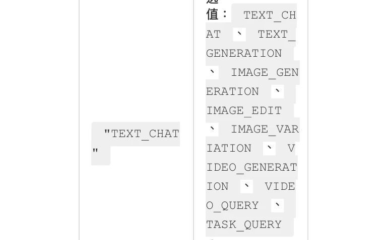

**返回数据**

| 参数名称 | 类型 | 示例 | 说明 |
| --- | --- | --- | --- |
| code | <code>string</code> | <code>SUCCESS</code> | 响应码，取值为<code> SUCCESS </code> 时表示请求成功。 |
| message | <code>string</code> | <code>null</code> | 响应消息。请求成功时通常为空。 |
| data | <code>object</code> | <code>{"kind":"MODEL_API</code><br><code>","resolutionMode":"</code><br><code>ENDPOINT","resourceI</code><br><code>d":"resource-</code><br><code>001","versionId":"ve</code><br><code>rsion-</code><br><code>001","version":"samp</code><br><code>le-</code><br><code>value","tenantId":"t</code><br><code>enant-001"}</code> | 响应数据。具体结构以接口语义为准。 |
| accessDeniedDetail | <code>object</code> | <code>null</code> | 鉴权失败详情。请求成功时通常为空。 |
| requestId | <code>string</code> | <code>req-001</code> | 请求 ID，可用于问题排查和日志检索。 |
| data.kind | <code>string</code> | <code>"MODEL_API"</code> | 资源类型。 |
| data.resolutionMode | <code>string</code> | <code>"ENDPOINT"</code> | resolutionMode。可选值：<code> ENDPOINT </code>、<code> S</code> <code>OURCE_DESCRIPTOR </code>。 |
| data.resourceId | <code>string</code> | <code>"resource-001"</code> | AI Resource ID。 |
| data.versionId | <code>string</code> | <code>"version-001"</code> | 版本 ID。 |
| data.version | <code>string</code> | <code>"sample-value"</code> | 版本号。 |
| data.tenantId | <code>string</code> | <code>"tenant-001"</code> | 租户ID。 |
| data.name | <code>string</code> | <code>"sample-name"</code> | 名称。 |
| data.displayName | <code>string</code> | <code> "</code>示例资源<code>" </code> | 展示名称。 |
| data.actor | <code>object</code> | <code>{"type":"USER","id</code><br><code>":"id-001"}</code> | 操作主体。 |
| data.actor.type | <code>string</code> | <code>"USER"</code> | 类型。 |
| data.actor.id | <code>string</code> | <code>"id-001"</code> | 资源唯一标识。 |
| data.access | <code>object</code> | <code>{"mode":"sample-</code><br><code>value","subscription</code><br><code>Id":"subscription-</code><br><code>001","grantId":"gran</code><br><code>t-</code><br><code>001","credentialBind</code><br><code>ingId":"credentialBi</code><br><code>nding-001"}</code> | 访问配置。 |
| data.access.mode | <code>string</code> | <code>"sample-value"</code> | 模式。 |
| data.access.subscripti onId | <code>string</code> | <code>"subscription-</code><br><code>001"</code> | 订阅申请 ID。 |
| data.access.grantId | <code>string</code> | <code>"grant-001"</code> | 授权 Grant ID。 |
| data.access.credential BindingId | <code>string</code> | <code>"credentialBinding</code><br><code>-001"</code> | 凭据绑定 ID。 |
| data.source | <code>object</code> | <code>{"sourceBindingId"</code><br><code>:"sourceBinding-</code><br><code>001","sourceType":"G</code><br><code>ATEWAY","sourceRef":</code><br><code>"sample-</code><br><code>value","syncStatus":</code><br><code>"sample-</code><br><code>value","credentialRe</code><br><code>f":"sample-</code><br><code>value","config":</code><br><code>{"key":"value"}}</code> | 来源。 |
| data.source.sourceBin dingId | <code>string</code> | <code>"sourceBinding-</code><br><code>001"</code> | 来源绑定ID。 |
| data.source.sourceTyp e | <code>string</code> | <code>"GATEWAY"</code> | 来源类型。可选值：<code> GATEWAY </code>、<code> NA</code> <code>COS </code>、<code> REMOTE_ENDPO</code> <code>INT </code>、<code> SANDBOX </code>、<code> REGISTRY </code>、<code> CUSTO</code> <code>M </code>。 |
| data.source.sourceRef | <code>string</code> | <code>"sample-value"</code> | 来源引用。 |
| data.source.syncStatu s | <code>string</code> | <code>"sample-value"</code> | 同步状态。 |
| data.source.credential Ref | <code>string</code> | <code>"sample-value"</code> | 凭据引用。 |
| data.source.config | <code>object</code> | <code>{"key":"value"}</code> | 配置信息。 |
| data.endpoints | <code>array</code> | <code>[{"endpointId":"en</code><br><code>dpoint-</code><br><code>001","name":"sample-</code><br><code>name","endpointType"</code><br><code>:"MODEL_INFERENCE","</code><br><code>providerType":"SANDB</code><br><code>OX","protocol":"HTTP</code><br><code>","url":"https://api</code><br><code>.example.com"}]</code> | 访问端点列表。 |
| data.endpoints\[\].endp ointId | <code>string</code> | <code>"endpoint-001"</code> | Endpoint ID。 |
| data.endpoints\[\].name | <code>string</code> | <code>"sample-name"</code> | 名称。 |
| data.endpoints\[\].endp ointType | <code>string</code> | <code>"MODEL_INFERENCE"</code> | Endpoint 类型。 |
| data.endpoints\[\].provi derType | <code>string</code> | <code>"SANDBOX"</code> | 提供方类型。 |

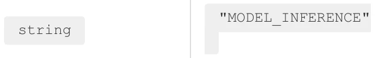

<table>
  <tr>
    <td>data.endpoints[].proto col</td>
    <td><code>string</code></td>
    <td><code>"HTTP"</code></td>
    <td>协议类型。可选值：<code> HTTP </code>、<code> HTTPS</code><code> </code>、<code> SSE </code>、<code> STREAMA</code> <code>BLE_HTTP </code>、<code> STDIO </code>、<code> NACOS_DESCRIPTOR</code><code> </code>。</td>
  </tr>
  <tr>
    <td>data.endpoints[].url</td>
    <td><code>string</code></td>
    <td><code>"https://api.examp</code><br><code>le.com"</code></td>
    <td>访问地址。</td>
  </tr>
  <tr>
    <td>data.endpoints[].base Url</td>
    <td><code>string</code></td>
    <td><code>"https://api.examp</code><br><code>le.com"</code></td>
    <td>服务基础地址。</td>
  </tr>
  <tr>
    <td>data.endpoints[].auth Mode</td>
    <td><code>string</code></td>
    <td><code>"sample-value"</code></td>
    <td>认证模式。</td>
  </tr>
  <tr>
    <td>data.endpoints[].netw orkScope</td>
    <td><code>string</code></td>
    <td><code>"sample-value"</code></td>
    <td>网络访问范围。</td>
  </tr>
  <tr>
    <td>data.endpoints[].defau ltInvocation</td>
    <td><code>boolean</code></td>
    <td><code>false</code></td>
    <td>默认调用配置。</td>
  </tr>
  <tr>
    <td>data.endpoints[].healt hStatus</td>
    <td><code>string</code></td>
    <td><code>"sample-value"</code></td>
    <td>健康检查状态。</td>
  </tr>
  <tr>
    <td>data.endpoints[].provi derConfig</td>
    <td><code>object</code></td>
    <td><code>{"provider":"sandb</code><br><code>ox","sandboxId":"san</code><br><code>dbox-001"}</code></td>
    <td>Provider 配置。</td>
  </tr>
  <tr>
    <td>data.endpoints[].meta data</td>
    <td><code>object</code></td>
    <td><code>{"source":"himarke</code><br><code>t"}</code></td>
    <td>扩展元数据。</td>
  </tr>
</table>

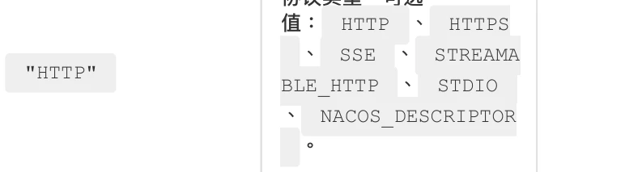

<table>
  <tr>
    <td>data.capabilities</td>
    <td><code>array</code></td>
    <td><code>[{"capabilityId":"</code><br><code>capability-</code><br><code>001","capabilityType</code><br><code>":"MODEL","name":"sa</code><br><code>mple-</code><br><code>name","displayName":</code> <code>"</code>示例资源<code>","description":"</code>用于演示的资源描述<code>","inputSchema":</code> <code>{"type":"object","pr</code><br><code>operties":{"input":</code><br><code>{"type":"string"}}}}</code><br><code>]</code></td>
    <td>资源能力列表。</td>
  </tr>
  <tr>
    <td>data.capabilities[].cap abilityId</td>
    <td><code>string</code></td>
    <td><code>"capability-001"</code></td>
    <td>能力 ID。</td>
  </tr>
  <tr>
    <td>data.capabilities[].cap abilityType</td>
    <td><code>string</code></td>
    <td><code>"MODEL"</code></td>
    <td>capabilityType。可选值：<code> MODEL </code>、<code> MCP_</code><code>TOOL </code>、<code> MCP_RESOURC</code> <code>E </code>、<code> MCP_PROMPT </code>、<code> SKILL </code>、<code> WORKER </code>、<code> API </code>。</td>
  </tr>
  <tr>
    <td>data.capabilities[].nam e</td>
    <td><code>string</code></td>
    <td><code>"sample-name"</code></td>
    <td>名称。</td>
  </tr>
  <tr>
    <td>data.capabilities[].disp layName</td>
    <td><code>string</code></td>
    <td><code> "</code>示例资源<code>" </code></td>
    <td>展示名称。</td>
  </tr>
  <tr>
    <td>data.capabilities[].des cription</td>
    <td><code>string</code></td>
    <td><code> "</code>用于演示的资源描述<code>" </code></td>
    <td>描述信息。</td>
  </tr>
  <tr>
    <td>data.capabilities[].inpu tSchema</td>
    <td><code>object</code></td>
    <td><code>{"type":"object","</code><br><code>properties":</code><br><code>{"input":</code><br><code>{"type":"string"}}}</code></td>
    <td>输入参数 Schema。</td>
  </tr>
  <tr>
    <td>data.capabilities[].out putSchema</td>
    <td><code>object</code></td>
    <td><code>{"type":"object","</code><br><code>properties":</code><br><code>{"result":</code><br><code>{"type":"string"}}}</code></td>
    <td>输出结果 Schema。</td>
  </tr>
</table>


<table>
  <tr>
    <td>data.capabilities[].tags</td>
    <td><code>array</code></td>
    <td><code>["sample-value"]</code></td>
    <td>标签列表。</td>
  </tr>
  <tr>
    <td>data.capabilities[].risk Level</td>
    <td><code>string</code></td>
    <td><code>"sample-value"</code></td>
    <td>风险等级。</td>
  </tr>
  <tr>
    <td>data.capabilities[].per missionScope</td>
    <td><code>string</code></td>
    <td><code>"sample-value"</code></td>
    <td>权限范围。</td>
  </tr>
  <tr>
    <td>data.modelInvocation</td>
    <td><code>object</code></td>
    <td><code>{"protocol":"sampl</code><br><code>e-</code><br><code>value","baseUrl":"ht</code><br><code>tps://api.example.co</code><br><code>m","selectedTarget":</code><br><code>{"baseUrl":"https://</code><br><code>api.example.com","ba</code><br><code>sePath":"sample-</code><br><code>value","source":"sam</code><br><code>ple-</code><br><code>value","accessModeTy</code><br><code>pe":"sample-</code><br><code>value","networkType"</code><br><code>:"sample-</code><br><code>value"},"selectedOpe</code><br><code>ration":</code><br><code>{"code":"CHAT_COMPLE</code><br><code>TIONS","taskType":"T</code><br><code>EXT_CHAT","operation</code><br><code>Role":"sample-</code><br><code>value","method":"sam</code><br><code>ple-</code><br><code>value","path":"sampl</code><br><code>e-</code><br><code>value","gatewayPath"</code><br><code>:"sample-</code><br><code>value"},"targets":</code><br><code>[{"baseUrl":"https:/</code><br><code>/api.example.com","b</code><br><code>asePath":"/v1","sour</code><br><code>ce":"GATEWAY","acces</code><br><code>sModeType":"PUBLIC",</code><br><code>"networkType":"INTER</code><br><code>NET"}],"operations":</code><br><code>[{"code":"CHAT_COMPL</code><br><code>ETIONS","taskType":"</code><br><code>TEXT_CHAT","operatio</code><br><code>nRole":"INVOKE","met</code></td>
    <td>模型调用配置。</td>
  </tr>
  <tr>
    <td>data.modelInvocation.protocol</td>
    <td><code>string</code></td>
    <td><code>hod":"POST","path":"</code><br><code>/chat/completions","</code><br><code>"sample-value"</code><br><code>gatewayPath":"/v1/ch</code><br><code>at/completions"}]}</code></td>
    <td>协议类型。</td>
  </tr>
  <tr>
    <td>data.modelInvocation.baseUrl</td>
    <td><code>string</code></td>
    <td><code>"https://api.examp</code><br><code>le.com"</code></td>
    <td>服务基础地址。</td>
  </tr>
  <tr>
    <td>data.modelInvocation.selectedTarget</td>
    <td><code>object</code></td>
    <td><code>{"baseUrl":"https:</code><br><code>//api.example.com","</code><br><code>basePath":"sample-</code><br><code>value","source":"sam</code><br><code>ple-</code><br><code>value","accessModeTy</code><br><code>pe":"sample-</code><br><code>value","networkType"</code><br><code>:"sample-value"}</code></td>
    <td>选中的目标对象。</td>
  </tr>
  <tr>
    <td>data.modelInvocation.selectedTarget.baseUr l</td>
    <td><code>string</code></td>
    <td><code>"https://api.examp</code><br><code>le.com"</code></td>
    <td>服务基础地址。</td>
  </tr>
  <tr>
    <td>data.modelInvocation.selectedTarget.basePa th</td>
    <td><code>string</code></td>
    <td><code>"sample-value"</code></td>
    <td>基础路径。</td>
  </tr>
  <tr>
    <td>data.modelInvocation.selectedTarget.source</td>
    <td><code>string</code></td>
    <td><code>"sample-value"</code></td>
    <td>来源。</td>
  </tr>
  <tr>
    <td>data.modelInvocation.selectedTarget.access ModeType</td>
    <td><code>string</code></td>
    <td><code>"sample-value"</code></td>
    <td>访问模式类型。</td>
  </tr>
  <tr>
    <td>data.modelInvocation.selectedTarget.networ kType</td>
    <td><code>string</code></td>
    <td><code>"sample-value"</code></td>
    <td>网络类型。</td>
  </tr>
  <tr>
    <td>data.modelInvocation.selectedOperation</td>
    <td><code>object</code></td>
    <td><code>{"code":"CHAT_COMP</code><br><code>LETIONS","taskType":</code><br><code>"TEXT_CHAT","operati</code><br><code>onRole":"sample-</code><br><code>value","method":"sam</code><br><code>ple-</code><br><code>value","path":"sampl</code><br><code>e-</code><br><code>value","gatewayPath"</code><br><code>:"sample-value"}</code></td>
    <td>选中的操作。</td>
  </tr>
  <tr>
    <td>data.modelInvocation.selectedOperation.cod e</td>
    <td><code>string</code></td>
    <td><code>"CHAT_COMPLETIONS"</code></td>
    <td>业务编码。</td>
  </tr>
</table>

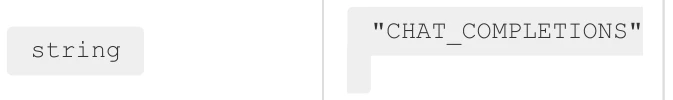

<table>
  <tr>
    <td>data.modelInvocation.selectedOperation.tas kType</td>
    <td><code>string</code></td>
    <td><code>"TEXT_CHAT"</code></td>
    <td>taskType。可选值：<code> TEXT_CHAT </code>、<code> </code><code>TEXT_GENERATION </code>、<code>IMAGE_GENERATION</code>、<code> IMAGE_EDIT </code>、<code> I</code> <code>MAGE_VARIATION </code>、<code> </code><code>VIDEO_GENERATION </code>、<code> VIDEO_QUERY </code>、<code> TA</code> <code>SK_QUERY </code>。</td>
  </tr>
  <tr>
    <td>data.modelInvocation.selectedOperation.ope rationRole</td>
    <td><code>string</code></td>
    <td><code>"sample-value"</code></td>
    <td>操作角色。</td>
  </tr>
  <tr>
    <td>data.modelInvocation.selectedOperation.met hod</td>
    <td><code>string</code></td>
    <td><code>"sample-value"</code></td>
    <td>HTTP方法。</td>
  </tr>
  <tr>
    <td>data.modelInvocation.selectedOperation.pat h</td>
    <td><code>string</code></td>
    <td><code>"sample-value"</code></td>
    <td>路径。</td>
  </tr>
  <tr>
    <td>data.modelInvocation.selectedOperation.gat ewayPath</td>
    <td><code>string</code></td>
    <td><code>"sample-value"</code></td>
    <td>Gateway 路径。</td>
  </tr>
  <tr>
    <td>data.modelInvocation.selectedOperation.rout ePath</td>
    <td><code>string</code></td>
    <td><code>"sample-value"</code></td>
    <td>路由路径。</td>
  </tr>
  <tr>
    <td>data.modelInvocation.selectedOperation.ena bled</td>
    <td><code>boolean</code></td>
    <td><code>true</code></td>
    <td>是否启用。</td>
  </tr>
  <tr>
    <td>data.modelInvocation.selectedOperation.met adata</td>
    <td><code>object</code></td>
    <td><code>{"source":"himarke</code><br><code>t"}</code></td>
    <td>扩展元数据。</td>
  </tr>
  <tr>
    <td>data.modelInvocation.t argets</td>
    <td><code>array</code></td>
    <td><code>[{"baseUrl":"https</code><br><code>://api.example.com",</code><br><code>"basePath":"sample-</code><br><code>value","source":"sam</code><br><code>ple-</code><br><code>value","accessModeTy</code><br><code>pe":"sample-</code><br><code>value","networkType"</code><br><code>:"sample-value"}]</code></td>
    <td>目标列表。</td>
  </tr>
  <tr>
    <td>data.modelInvocation.t argets[].baseUrl</td>
    <td><code>string</code></td>
    <td><code>"https://api.examp</code><br><code>le.com"</code></td>
    <td>服务基础地址。</td>
  </tr>
  <tr>
    <td>data.modelInvocation.t argets[].basePath</td>
    <td><code>string</code></td>
    <td><code>"sample-value"</code></td>
    <td>基础路径。</td>
  </tr>
  <tr>
    <td>data.modelInvocation.t argets[].source</td>
    <td><code>string</code></td>
    <td><code>"sample-value"</code></td>
    <td>来源。</td>
  </tr>
  <tr>
    <td>data.modelInvocation.t argets[].accessModeTy pe</td>
    <td><code>string</code></td>
    <td><code>"sample-value"</code></td>
    <td>访问模式类型。</td>
  </tr>
  <tr>
    <td>data.modelInvocation.t argets[].networkType</td>
    <td><code>string</code></td>
    <td><code>"sample-value"</code></td>
    <td>网络类型。</td>
  </tr>
  <tr>
    <td>data.modelInvocation.operations</td>
    <td><code>array</code></td>
    <td><code>[{"code":"CHAT_COM</code><br><code>PLETIONS","taskType"</code><br><code>:"TEXT_CHAT","operat</code><br><code>ionRole":"sample-</code><br><code>value","method":"sam</code><br><code>ple-</code><br><code>value","path":"sampl</code><br><code>e-</code><br><code>value","gatewayPath"</code><br><code>:"sample-value"}]</code></td>
    <td>操作列表。</td>
  </tr>
  <tr>
    <td>data.modelInvocation.operations[].code</td>
    <td><code>string</code></td>
    <td><code>"CHAT_COMPLETIONS"</code></td>
    <td>业务编码。</td>
  </tr>
  <tr>
    <td>data.modelInvocation.operations[].taskType</td>
    <td><code>string</code></td>
    <td><code>"TEXT_CHAT"</code></td>
    <td>taskType。可选值：<code> TEXT_CHAT </code>、<code> </code><code>TEXT_GENERATION </code>、<code>IMAGE_GENERATION</code>、<code> IMAGE_EDIT </code>、<code> I</code> <code>MAGE_VARIATION </code>、<code> </code><code>VIDEO_GENERATION </code>、<code> VIDEO_QUERY </code>、<code> TA</code> <code>SK_QUERY </code>。</td>
  </tr>
</table>

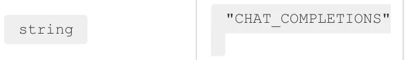

<table>
  <tr>
    <td>data.modelInvocation.operations[].operation Role</td>
    <td><code>string</code></td>
    <td><code>"sample-value"</code></td>
    <td>操作角色。</td>
  </tr>
  <tr>
    <td>data.modelInvocation.operations[].method</td>
    <td><code>string</code></td>
    <td><code>"sample-value"</code></td>
    <td>HTTP方法。</td>
  </tr>
  <tr>
    <td>data.modelInvocation.operations[].path</td>
    <td><code>string</code></td>
    <td><code>"sample-value"</code></td>
    <td>路径。</td>
  </tr>
  <tr>
    <td>data.modelInvocation.operations[].gatewayP ath</td>
    <td><code>string</code></td>
    <td><code>"sample-value"</code></td>
    <td>Gateway 路径。</td>
  </tr>
</table>

**示例**

**请求示例**

```http
POST /himarket/v1/open-api/v1/resolver/resolve HTTP/1.1
Host: localhost:8080
X-HIMARKET-OPENAPI: HIMARKET_OPENAPI
X-HIMARKET-TOKEN: <admin-openapi-token>
Content-Type: application/json

{
  "actor": {
    "type": "USER",
    "id": "id-001"
  },
  "selection": {
    "kind": "MODEL_API",
    "listingId": "listing-001",
    "resourceId": "resource-001",
    "versionId": "version-001",
    "version": "sample-value",
    "endpointId": "endpoint-001"
  },
  "purpose": "sample-value"
}
```

**响应示例**

```json
{
  "code": "SUCCESS",
  "message": null,
  "data": {
    "kind": "MODEL_API",
    "resolutionMode": "ENDPOINT",
    "resourceId": "resource-001",
    "versionId": "version-001",
    "version": "sample-value",
    "tenantId": "tenant-001"
  },
  "accessDeniedDetail": null,
  "requestId": "req-001"
}
```

<a id="section-3-6"></a>

## 3.6. AI Resource Runtime 托管开放接口

<a id="section-3-6-1"></a>

### 3.6.1. syncHosting

**接口信息**

- **接口路径**： `POST /himarket/v1/open-api/v1/runtime/hosting/sync`

- **接口说明**：同步 Runtime 托管状态并回写 endpoint/source binding。

- **认证方式**：该接口属于管理面 OpenAPI。调用前请完成 OpenAPI 凭证配置，并按 Token 模式或AK/SK 签名模式携带认证 Header。

- **Header 示例**：Token 模式使用  `X-HIMARKET-OPENAPI: HIMARKET_OPENAPI`  与  `X-HIMARKET-TOKEN` ；AK/SK 模式使用  `X-HIMARKET-ACCESS-KEY` 、 `X-HIMARKET-TIMESTAMP`  和  `X-HIMARKET-SIGNATURE` 。

**请求参数**

| 参数名称 | 位置 | 类型 | 是否必选 | 示例 | 说明 |
| --- | --- | --- | --- | --- | --- |
| resourceId | body | <code>string</code> | 是 | <code>"resource-</code><br><code>001"</code> | AI Resource ID。 |
| versionId | body | <code>string</code> | 是 | <code>"version-</code><br><code>001"</code> | 版本 ID。 |
| providerType | body | <code>string</code> | 是 | <code>"SANDBOX"</code> | 提供方类型。 |


<table>
  <tr>
    <td>runtimeProvid erId</td>
    <td>body</td>
    <td><code>string</code></td>
    <td>否</td>
    <td><code>"runtime-</code><br><code>provider-</code><br><code>001"</code></td>
    <td>运行时Provider ID。</td>
  </tr>
  <tr>
    <td>deploymentId</td>
    <td>body</td>
    <td><code>string</code></td>
    <td>否</td>
    <td><code>"deploymen</code><br><code>t-001"</code></td>
    <td>部署ID。</td>
  </tr>
  <tr>
    <td>providerConfi g</td>
    <td>body</td>
    <td><code>object</code></td>
    <td>否</td>
    <td><code>{"provider</code><br><code>":"sandbox",</code><br><code>"sandboxId":</code><br><code>"sandbox-</code><br><code>001"}</code></td>
    <td>Provider 配置。</td>
  </tr>
  <tr>
    <td>endpoint</td>
    <td>body</td>
    <td><code>object</code></td>
    <td>否</td>
    <td><code>{"name":"s</code><br><code>ample-</code><br><code>name","endpo</code><br><code>intType":"MO</code><br><code>DEL_INFERENC</code><br><code>E","protocol</code><br><code>":"HTTP","ur</code><br><code>l":"https://</code><br><code>api.example.</code><br><code>com","gatewa</code><br><code>yId":"gatewa</code><br><code>y-</code><br><code>001","routeI</code><br><code>d":"route-</code><br><code>001"}</code></td>
    <td>访问端点。</td>
  </tr>
  <tr>
    <td>endpoint.nam e</td>
    <td>body</td>
    <td><code>string</code></td>
    <td>否</td>
    <td><code>"sample-</code><br><code>name"</code></td>
    <td>名称。</td>
  </tr>
  <tr>
    <td>endpoint.end pointType</td>
    <td>body</td>
    <td><code>string</code></td>
    <td>否</td>
    <td><code>"MODEL_INF</code><br><code>ERENCE"</code></td>
    <td>Endpoint 类型。</td>
  </tr>
  <tr>
    <td>endpoint.prot ocol</td>
    <td>body</td>
    <td><code>string</code></td>
    <td>否</td>
    <td><code>"HTTP"</code></td>
    <td>协议类型。可选值：<code> HTTP </code>、<code> HTTPS </code>、<code> SSE </code>、<code> ST</code> <code>REAMABLE_HTT</code> <code>P </code>、<code> STDIO</code><code> </code>、<code> NACOS_D</code> <code>ESCRIPTOR</code>。</td>
  </tr>
</table>


<table>
  <tr>
    <td>endpoint.url</td>
    <td>body</td>
    <td><code>string</code></td>
    <td>否</td>
    <td><code>"https://a</code><br><code>pi.example.c</code><br><code>om"</code></td>
    <td>访问地址。</td>
  </tr>
  <tr>
    <td>endpoint.gate wayId</td>
    <td>body</td>
    <td><code>string</code></td>
    <td>否</td>
    <td><code>"gateway-</code><br><code>001"</code></td>
    <td>Gateway ID。</td>
  </tr>
  <tr>
    <td>endpoint.rout eId</td>
    <td>body</td>
    <td><code>string</code></td>
    <td>否</td>
    <td><code>"route-</code><br><code>001"</code></td>
    <td>路由 ID。</td>
  </tr>
  <tr>
    <td>endpoint.auth Mode</td>
    <td>body</td>
    <td><code>string</code></td>
    <td>否</td>
    <td><code>"sample-</code><br><code>value"</code></td>
    <td>认证模式。</td>
  </tr>
  <tr>
    <td>endpoint.cred entialPolicy</td>
    <td>body</td>
    <td><code>object</code></td>
    <td>否</td>
    <td><code>{"mode":"I</code><br><code>NHERIT"}</code></td>
    <td>凭据策略。</td>
  </tr>
  <tr>
    <td>endpoint.net workScope</td>
    <td>body</td>
    <td><code>string</code></td>
    <td>否</td>
    <td><code>"sample-</code><br><code>value"</code></td>
    <td>网络访问范围。</td>
  </tr>
  <tr>
    <td>endpoint.heal thStatus</td>
    <td>body</td>
    <td><code>string</code></td>
    <td>否</td>
    <td><code>"sample-</code><br><code>value"</code></td>
    <td>健康检查状态。</td>
  </tr>
  <tr>
    <td>endpoint.stat us</td>
    <td>body</td>
    <td><code>string</code></td>
    <td>否</td>
    <td><code>"ACTIVE"</code></td>
    <td>状态。</td>
  </tr>
  <tr>
    <td>endpoint.met adata</td>
    <td>body</td>
    <td><code>object</code></td>
    <td>否</td>
    <td><code>{"source":</code><br><code>"himarket"}</code></td>
    <td>扩展元数据。</td>
  </tr>
</table>

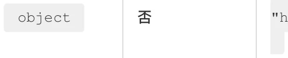

<table>
  <tr>
    <td>source</td>
    <td>body</td>
    <td><code>object</code></td>
    <td>否</td>
    <td><code>{"sourceRe</code><br><code>f":"sample-</code><br><code>value","prim</code><br><code>aryBinding":</code><br><code>false,"prior</code><br><code>ity":100,"sy</code><br><code>ncMode":"sam</code><br><code>ple-</code><br><code>value","sync</code><br><code>Status":"sam</code><br><code>ple-</code><br><code>value","cred</code><br><code>entialRef":"</code><br><code>sample-</code><br><code>value"}</code></td>
    <td>来源。</td>
  </tr>
  <tr>
    <td>source.source Ref</td>
    <td>body</td>
    <td><code>string</code></td>
    <td>否</td>
    <td><code>"sample-</code><br><code>value"</code></td>
    <td>来源引用。</td>
  </tr>
  <tr>
    <td>source.primar yBinding</td>
    <td>body</td>
    <td><code>boolean</code></td>
    <td>否</td>
    <td><code>false</code></td>
    <td>是否为主绑定关系。</td>
  </tr>
  <tr>
    <td>source.priorit y</td>
    <td>body</td>
    <td><code>integer&lt;in</code><br><code>t32&gt;</code></td>
    <td>否</td>
    <td><code>100</code></td>
    <td>优先级。</td>
  </tr>
  <tr>
    <td>source.syncM ode</td>
    <td>body</td>
    <td><code>string</code></td>
    <td>否</td>
    <td><code>"sample-</code><br><code>value"</code></td>
    <td>同步模式。</td>
  </tr>
  <tr>
    <td>source.syncSt atus</td>
    <td>body</td>
    <td><code>string</code></td>
    <td>否</td>
    <td><code>"sample-</code><br><code>value"</code></td>
    <td>同步状态。</td>
  </tr>
  <tr>
    <td>source.crede ntialRef</td>
    <td>body</td>
    <td><code>string</code></td>
    <td>否</td>
    <td><code>"sample-</code><br><code>value"</code></td>
    <td>凭据引用。</td>
  </tr>
  <tr>
    <td>source.config</td>
    <td>body</td>
    <td><code>object</code></td>
    <td>否</td>
    <td><code>{"key":"va</code><br><code>lue"}</code></td>
    <td>配置信息。</td>
  </tr>
</table>

**返回数据**

| 参数名称 | 类型 | 示例 | 说明 |
| --- | --- | --- | --- |
| code | <code>string</code> | <code>SUCCESS</code> | 响应码，取值为<code> SUCCESS </code> 时表示请求成功。 |
| message | <code>string</code> | <code>null</code> | 响应消息。请求成功时通常为空。 |
| data | <code>object</code> | <code>{"resourceId":"res</code><br><code>ource-</code><br><code>001","versionId":"ve</code><br><code>rsion-</code><br><code>001","resourceKind":</code><br><code>"MODEL_API","provide</code><br><code>rType":"SANDBOX","ac</code><br><code>tion":"sample-</code><br><code>value","sourceBindin</code><br><code>g":</code><br><code>{"sourceBindingId":"</code><br><code>sourceBinding-</code><br><code>001","resourceId":"r</code><br><code>esource-</code><br><code>001","sourceType":"G</code><br><code>ATEWAY","sourceRef":</code><br><code>"sample-</code><br><code>value","primaryBindi</code><br><code>ng":false,"priority"</code><br><code>:100}}</code> | 响应数据。具体结构以接口语义为准。 |
| accessDeniedDetail | <code>object</code> | <code>null</code> | 鉴权失败详情。请求成功时通常为空。 |
| requestId | <code>string</code> | <code>req-001</code> | 请求 ID，可用于问题排查和日志检索。 |
| data.resourceId | <code>string</code> | <code>"resource-001"</code> | AI Resource ID。 |
| data.versionId | <code>string</code> | <code>"version-001"</code> | 版本 ID。 |
| data.resourceKind | <code>string</code> | <code>"MODEL_API"</code> | resourceKind。可选值：<code> MODEL_API </code>、<code> </code><code>MCP_SERVER </code>、<code> SKIL</code> <code>L </code>、<code> AGENT </code>、<code> WORK</code> <code>ER </code>、<code> REST_API </code>、<code> HTTP_API </code>、<code> PROMP</code> <code>T_TEMPLATE </code>、<code> DATA</code> <code>SET </code>、<code> EVAL </code>、<code> WO</code> <code>RKFLOW </code>。 |
| data.providerType | <code>string</code> | <code>"SANDBOX"</code> | 提供方类型。 |
| data.action | <code>string</code> | <code>"sample-value"</code> | 本次操作类型。 |
| data.sourceBinding | <code>object</code> | <code>{"sourceBindingId"</code><br><code>:"sourceBinding-</code><br><code>001","resourceId":"r</code><br><code>esource-</code><br><code>001","sourceType":"G</code><br><code>ATEWAY","sourceRef":</code><br><code>"sample-</code><br><code>value","primaryBindi</code><br><code>ng":false,"priority"</code><br><code>:100}</code> | 来源绑定信息。 |
| data.sourceBinding.so urceBindingId | <code>string</code> | <code>"sourceBinding-</code><br><code>001"</code> | 来源绑定ID。 |
| data.sourceBinding.res ourceId | <code>string</code> | <code>"resource-001"</code> | AI Resource ID。 |

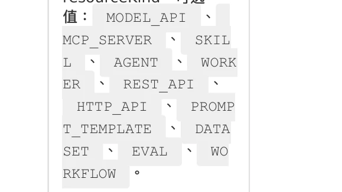

<table>
  <tr>
    <td>data.sourceBinding.so urceType</td>
    <td><code>string</code></td>
    <td><code>"GATEWAY"</code></td>
    <td>来源类型。可选值：<code> GATEWAY </code>、<code> NA</code> <code>COS </code>、<code> REMOTE_ENDPO</code> <code>INT </code>、<code> SANDBOX </code>、<code> REGISTRY </code>、<code> CUSTO</code> <code>M </code>。</td>
  </tr>
  <tr>
    <td>data.sourceBinding.so urceRef</td>
    <td><code>string</code></td>
    <td><code>"sample-value"</code></td>
    <td>来源引用。</td>
  </tr>
  <tr>
    <td>data.sourceBinding.pri maryBinding</td>
    <td><code>boolean</code></td>
    <td><code>false</code></td>
    <td>是否为主绑定关系。</td>
  </tr>
  <tr>
    <td>data.sourceBinding.pri ority</td>
    <td><code>integer&lt;int32&gt;</code></td>
    <td><code>100</code></td>
    <td>优先级。</td>
  </tr>
  <tr>
    <td>data.sourceBinding.sy ncMode</td>
    <td><code>string</code></td>
    <td><code>"sample-value"</code></td>
    <td>同步模式。</td>
  </tr>
  <tr>
    <td>data.sourceBinding.sy ncStatus</td>
    <td><code>string</code></td>
    <td><code>"sample-value"</code></td>
    <td>同步状态。</td>
  </tr>
  <tr>
    <td>data.sourceBinding.cre dentialRef</td>
    <td><code>string</code></td>
    <td><code>"sample-value"</code></td>
    <td>凭据引用。</td>
  </tr>
  <tr>
    <td>data.sourceBinding.co nfig</td>
    <td><code>object</code></td>
    <td><code>{"key":"value"}</code></td>
    <td>配置信息。</td>
  </tr>
  <tr>
    <td>data.sourceBinding.las tSyncedAt</td>
    <td><code>string&lt;date-</code><br><code>time&gt;</code></td>
    <td><code>"2026-06-</code><br><code>22T12:00:00Z"</code></td>
    <td>最近一次同步时间。</td>
  </tr>
</table>

<table>
  <tr>
    <td>data.endpoints</td>
    <td><code>array</code></td>
    <td><code>[{"endpointId":"en</code><br><code>dpoint-</code><br><code>001","versionId":"ve</code><br><code>rsion-</code><br><code>001","deploymentId":</code><br><code>"deployment-</code><br><code>001","runtimeProvide</code><br><code>rId":"runtime-</code><br><code>provider-</code><br><code>001","providerType":</code><br><code>"SANDBOX","providerC</code><br><code>onfig":</code><br><code>{"provider":"sandbox</code><br><code>","sandboxId":"sandb</code><br><code>ox-001"}}]</code></td>
    <td>访问端点列表。</td>
  </tr>
  <tr>
    <td>data.endpoints[].endp ointId</td>
    <td><code>string</code></td>
    <td><code>"endpoint-001"</code></td>
    <td>Endpoint ID。</td>
  </tr>
  <tr>
    <td>data.endpoints[].versi onId</td>
    <td><code>string</code></td>
    <td><code>"version-001"</code></td>
    <td>版本 ID。</td>
  </tr>
  <tr>
    <td>data.endpoints[].deplo ymentId</td>
    <td><code>string</code></td>
    <td><code>"deployment-001"</code></td>
    <td>部署ID。</td>
  </tr>
  <tr>
    <td>data.endpoints[].runti meProviderId</td>
    <td><code>string</code></td>
    <td><code>"runtime-</code><br><code>provider-001"</code></td>
    <td>运行时 Provider ID。</td>
  </tr>
  <tr>
    <td>data.endpoints[].provi derType</td>
    <td><code>string</code></td>
    <td><code>"SANDBOX"</code></td>
    <td>提供方类型。</td>
  </tr>
  <tr>
    <td>data.endpoints[].provi derConfig</td>
    <td><code>object</code></td>
    <td><code>{"provider":"sandb</code><br><code>ox","sandboxId":"san</code><br><code>dbox-001"}</code></td>
    <td>Provider 配置。</td>
  </tr>
  <tr>
    <td>data.endpoints[].name</td>
    <td><code>string</code></td>
    <td><code>"sample-name"</code></td>
    <td>名称。</td>
  </tr>
  <tr>
    <td>data.endpoints[].endp ointType</td>
    <td><code>string</code></td>
    <td><code>"MODEL_INFERENCE"</code></td>
    <td>Endpoint 类型。</td>
  </tr>
</table>

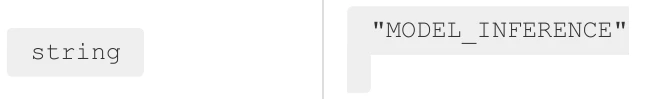

<table>
  <tr>
    <td>data.endpoints[].proto col</td>
    <td><code>string</code></td>
    <td><code>"HTTP"</code></td>
    <td>协议类型。可选值：<code> HTTP </code>、<code> HTTPS</code><code> </code>、<code> SSE </code>、<code> STREAMA</code> <code>BLE_HTTP </code>、<code> STDIO </code>、<code> NACOS_DESCRIPTOR</code><code> </code>。</td>
  </tr>
  <tr>
    <td>data.endpoints[].url</td>
    <td><code>string</code></td>
    <td><code>"https://api.examp</code><br><code>le.com"</code></td>
    <td>访问地址。</td>
  </tr>
  <tr>
    <td>data.endpoints[].gate wayId</td>
    <td><code>string</code></td>
    <td><code>"gateway-001"</code></td>
    <td>Gateway ID。</td>
  </tr>
  <tr>
    <td>data.endpoints[].routeI d</td>
    <td><code>string</code></td>
    <td><code>"route-001"</code></td>
    <td>路由 ID。</td>
  </tr>
  <tr>
    <td>data.endpoints[].auth Mode</td>
    <td><code>string</code></td>
    <td><code>"sample-value"</code></td>
    <td>认证模式。</td>
  </tr>
  <tr>
    <td>data.endpoints[].crede ntialPolicy</td>
    <td><code>object</code></td>
    <td><code>{"mode":"INHERIT"}</code></td>
    <td>凭据策略。</td>
  </tr>
  <tr>
    <td>data.endpoints[].netw orkScope</td>
    <td><code>string</code></td>
    <td><code>"sample-value"</code></td>
    <td>网络访问范围。</td>
  </tr>
  <tr>
    <td>data.endpoints[].defau ltInvocation</td>
    <td><code>boolean</code></td>
    <td><code>false</code></td>
    <td>默认调用配置。</td>
  </tr>
  <tr>
    <td>data.endpoints[].healt hStatus</td>
    <td><code>string</code></td>
    <td><code>"sample-value"</code></td>
    <td>健康检查状态。</td>
  </tr>
  <tr>
    <td>data.endpoints[].status</td>
    <td><code>string</code></td>
    <td><code>"ACTIVE"</code></td>
    <td>状态。</td>
  </tr>
  <tr>
    <td>data.endpoints[].meta data</td>
    <td><code>object</code></td>
    <td><code>{"source":"himarke</code><br><code>t"}</code></td>
    <td>扩展元数据。</td>
  </tr>
  <tr>
    <td>data.endpoints[].creat edAt</td>
    <td><code>string&lt;date-</code><br><code>time&gt;</code></td>
    <td><code>"2026-06-</code><br><code>22T12:00:00Z"</code></td>
    <td>创建时间。</td>
  </tr>
  <tr>
    <td>data.endpoints[].updat edAt</td>
    <td><code>string&lt;date-</code><br><code>time&gt;</code></td>
    <td><code>"2026-06-</code><br><code>22T12:00:00Z"</code></td>
    <td>更新时间。</td>
  </tr>
</table>

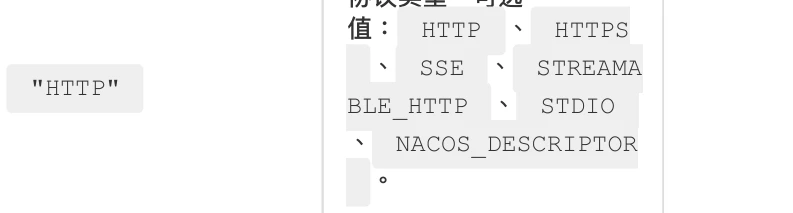

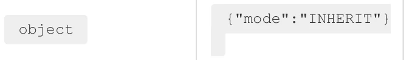

<table>
  <tr>
    <td>data.syncedAt</td>
    <td><code>string&lt;date-</code><br><code>time&gt;</code></td>
    <td><code>"2026-06-</code><br><code>22T12:00:00Z"</code></td>
    <td>同步时间。</td>
  </tr>
</table>

**示例**

**请求示例**

```http
POST /himarket/v1/open-api/v1/runtime/hosting/sync HTTP/1.1
Host: localhost:8080
X-HIMARKET-OPENAPI: HIMARKET_OPENAPI
X-HIMARKET-TOKEN: <admin-openapi-token>
Content-Type: application/json

{
  "resourceId": "resource-001",
  "versionId": "version-001",
  "providerType": "SANDBOX",
  "runtimeProviderId": "runtime-provider-001",
  "deploymentId": "deployment-001",
  "providerConfig": {}
}
```

**响应示例**

```json
{
  "code": "SUCCESS",
  "message": null,
  "data": {
    "resourceId": "resource-001",
    "versionId": "version-001",
    "resourceKind": "MODEL_API",
    "providerType": "SANDBOX",
    "action": "sample-value",
    "sourceBinding": {
      "sourceBindingId": "sourceBinding-001",
      "resourceId": "resource-001",
      "sourceType": "GATEWAY",
      "sourceRef": "sample-value",
      "primaryBinding": false,
      "priority": 100,
      "syncMode": "AUTO",
      "syncStatus": "SYNCED",
      "credentialRef": "credential-001",
      "config": {
        "key": "value"
      },
      "lastSyncedAt": "2026-06-22T12:00:00Z"
    },
    "endpoints": [
      {
        "endpointId": "endpoint-001",
        "versionId": "version-001",
        "deploymentId": "deployment-001",
        "runtimeProviderId": "runtime-provider-001",
        "providerType": "SANDBOX",
        "providerConfig": {
          "provider": "sandbox",
          "sandboxId": "sandbox-001"
        },
        "name": "sample-name",
        "endpointType": "MODEL_INFERENCE",
        "protocol": "HTTP",
        "url": "https://api.example.com",
        "gatewayId": "gateway-001",
        "routeId": "route-001",
        "authMode": "BEARER",
        "credentialPolicy": {
          "mode": "INHERIT"
        },
        "networkScope": "PUBLIC",
        "defaultInvocation": false,
        "healthStatus": "HEALTHY",
        "status": "ACTIVE",
        "metadata": {
          "source": "himarket"
        },
        "createdAt": "2026-06-22T12:00:00Z",
        "updatedAt": "2026-06-22T12:00:00Z"
      }
    ],
    "syncedAt": "2026-06-22T12:00:00Z"
  },
  "accessDeniedDetail": null,
  "requestId": "req-001"
}
```

<a id="section-3-7"></a>

## 3.7. AI Resource Subscription 开放接口

<a id="section-3-7-1"></a>

### 3.7.1. approveSubscription

**接口信息**

- **接口路径**： `POST /himarket/v1/open-api/v1/subscriptions/{subscriptionId}/approve`

- **接口说明**：审批通过资源订阅并生成 Grant。

- **认证方式**：该接口属于开发者门户 API。调用前请完成开发者登录，并在请求 Header 中携带  `Authorization: Bearer <accessToken>` 。

- **Header 示例**：需要登录态的接口使用  `Authorization: Bearer <accessToken>` 。

**请求参数**

| 参数名称 | 位置 | 类型 | 是否必选 | 示例 | 说明 |
| --- | --- | --- | --- | --- | --- |
| subscriptionId | path | <code>string</code> | 是 | <code>"subscript</code><br><code>ion-001"</code> | 订阅申请 ID。 |
| scope | body | <code>string</code> | 否 | <code>"sample-</code><br><code>value"</code> | 作用域。 |
| credentialBin dingId | body | <code>string</code> | 否 | <code>"credentia</code><br><code>lBinding-</code><br><code>001"</code> | 凭据绑定 ID。 |
| policy | body | <code>object</code> | 否 | <code>{}</code> | policy 字段。 |
| expiresAt | body | <code>string&lt;dat</code><br><code>e-time&gt;</code> | 否 | <code>"2026-06-</code><br><code>22T12:00:00Z</code><br><code>"</code> | 过期时间。 |

**返回数据**

| 参数名称 | 类型 | 示例 | 说明 |
| --- | --- | --- | --- |
| code | <code>string</code> | <code>SUCCESS</code> | 响应码，取值为<code> SUCCESS </code> 时表示请求成功。 |
| message | <code>string</code> | <code>null</code> | 响应消息。请求成功时通常为空。 |
| data | <code>object</code> | <code>{"subscriptionId":</code><br><code>"subscription-</code><br><code>001","subjectType":"</code><br><code>USER","subjectId":"s</code><br><code>ubject-</code><br><code>001","targetType":"s</code><br><code>ample-</code><br><code>value","targetId":"t</code><br><code>arget-</code><br><code>001","status":"PENDI</code><br><code>NG"}</code> | 响应数据。具体结构以接口语义为准。 |
| accessDeniedDetail | <code>object</code> | <code>null</code> | 鉴权失败详情。请求成功时通常为空。 |
| requestId | <code>string</code> | <code>req-001</code> | 请求 ID，可用于问题排查和日志检索。 |
| data.subscriptionId | <code>string</code> | <code>"subscription-</code><br><code>001"</code> | 订阅申请 ID。 |
| data.subjectType | <code>string</code> | <code>"USER"</code> | subjectType。可选值：<code> USER </code>、<code> APP </code>。 |
| data.subjectId | <code>string</code> | <code>"subject-001"</code> | 主体 ID。 |
| data.targetType | <code>string</code> | <code>"sample-value"</code> | 订阅目标类型。 |
| data.targetId | <code>string</code> | <code>"target-001"</code> | 目标对象 ID。 |
| data.status | <code>string</code> | <code>"PENDING"</code> | 状态。 |
| data.quotaPolicyId | <code>string</code> | <code>"quotaPolicy-</code><br><code>001"</code> | 配额策略 ID。 |
| data.expiresAt | <code>string&lt;date-</code><br><code>time&gt;</code> | <code>"2026-06-</code><br><code>22T12:00:00Z"</code> | 过期时间。 |
| data.createdAt | <code>string&lt;date-</code><br><code>time&gt;</code> | <code>"2026-06-</code><br><code>22T12:00:00Z"</code> | 创建时间。 |
| data.updatedAt | <code>string&lt;date-</code><br><code>time&gt;</code> | <code>"2026-06-</code><br><code>22T12:00:00Z"</code> | 更新时间。 |

<table>
  <tr>
    <td>data.grants</td>
    <td><code>array</code></td>
    <td><code>[{"grantId":"grant</code><br><code>-</code><br><code>001","subscriptionId</code><br><code>":"subscription-</code><br><code>001","scope":"sample</code><br><code>-</code><br><code>value","credentialBi</code><br><code>ndingId":"credential</code><br><code>Binding-</code><br><code>001","policySnapshot</code><br><code>":</code><br><code>{},"status":"ACTIVE"</code><br><code>}]</code></td>
    <td>授权 Grant 列表。</td>
  </tr>
  <tr>
    <td>data.grants[].grantId</td>
    <td><code>string</code></td>
    <td><code>"grant-001"</code></td>
    <td>授权 Grant ID。</td>
  </tr>
  <tr>
    <td>data.grants[].subscript ionId</td>
    <td><code>string</code></td>
    <td><code>"subscription-</code><br><code>001"</code></td>
    <td>订阅申请 ID。</td>
  </tr>
  <tr>
    <td>data.grants[].scope</td>
    <td><code>string</code></td>
    <td><code>"sample-value"</code></td>
    <td>作用域。</td>
  </tr>
  <tr>
    <td>data.grants[].credentia lBindingId</td>
    <td><code>string</code></td>
    <td><code>"credentialBinding</code><br><code>-001"</code></td>
    <td>凭据绑定 ID。</td>
  </tr>
  <tr>
    <td>data.grants[].policySn apshot</td>
    <td><code>object</code></td>
    <td><code>{}</code></td>
    <td>策略快照。</td>
  </tr>
  <tr>
    <td>data.grants[].status</td>
    <td><code>string</code></td>
    <td><code>"ACTIVE"</code></td>
    <td>状态。</td>
  </tr>
  <tr>
    <td>data.consumerName</td>
    <td><code>string</code></td>
    <td><code>"sample-</code><br><code>consumer"</code></td>
    <td>Consumer 名称。</td>
  </tr>
  <tr>
    <td>data.portalId</td>
    <td><code>string</code></td>
    <td><code>"portal-001"</code></td>
    <td>门户ID。</td>
  </tr>
  <tr>
    <td>data.portalName</td>
    <td><code>string</code></td>
    <td><code>"demo-portal"</code></td>
    <td>门户名称。</td>
  </tr>
  <tr>
    <td>data.developerId</td>
    <td><code>string</code></td>
    <td><code>"developer-001"</code></td>
    <td>开发者ID。</td>
  </tr>
  <tr>
    <td>data.developerUserna me</td>
    <td><code>string</code></td>
    <td><code>"demo-</code><br><code>developeruser"</code></td>
    <td>开发者用户名。</td>
  </tr>
</table>

**示例**

**请求示例**

```http
POST /himarket/v1/open-api/v1/subscriptions/{subscriptionId}/approve HTTP/1.1
Host: localhost:8080
Authorization: Bearer <accessToken>
Content-Type: application/json

{
  "scope": "sample-value",
  "credentialBindingId": "credentialBinding-001",
  "policy": {},
  "expiresAt": "2026-06-22T12:00:00Z"
}
```

**响应示例**

```json
{
  "code": "SUCCESS",
  "message": null,
  "data": {
    "subscriptionId": "subscription-001",
    "subjectType": "USER",
    "subjectId": "subject-001",
    "targetType": "sample-value",
    "targetId": "target-001",
    "status": "PENDING"
  },
  "accessDeniedDetail": null,
  "requestId": "req-001"
}
```

<a id="section-3-7-2"></a>

### 3.7.2. createSubscription

**接口信息**

- **接口路径**： `POST /himarket/v1/open-api/v1/subscriptions`

- **接口说明**：创建资源订阅申请。

- **认证方式**：该接口属于开发者门户 API。调用前请完成开发者登录，并在请求 Header 中携带  `Authorization: Bearer <accessToken>` 。

- **Header 示例**：需要登录态的接口使用  `Authorization: Bearer <accessToken>` 。

**请求参数**

| 参数名称 | 位置 | 类型 | 是否必选 | 示例 | 说明 |
| --- | --- | --- | --- | --- | --- |
| subjectType | body | <code>string</code> | 是 | <code>"USER"</code> | subjectType。可选值：<code> USER </code>、<code> APP </code>。 |
| subjectId | body | <code>string</code> | 是 | <code>"subject-</code><br><code>001"</code> | 主体 ID。 |
| targetType | body | <code>string</code> | 是 | <code>"sample-</code><br><code>value"</code> | 订阅目标类型。 |
| targetId | body | <code>string</code> | 是 | <code>"target-</code><br><code>001"</code> | 目标对象 ID。 |
| quotaPolicyId | body | <code>string</code> | 否 | <code>"quotaPoli</code><br><code>cy-001"</code> | 配额策略 ID。 |
| expiresAt | body | <code>string&lt;dat</code><br><code>e-time&gt;</code> | 否 | <code>"2026-06-</code><br><code>22T12:00:00Z</code><br><code>"</code> | 过期时间。 |

**返回数据**

| 参数名称 | 类型 | 示例 | 说明 |
| --- | --- | --- | --- |
| code | <code>string</code> | <code>SUCCESS</code> | 响应码，取值为<code> SUCCESS </code> 时表示请求成功。 |
| message | <code>string</code> | <code>null</code> | 响应消息。请求成功时通常为空。 |
| data | <code>object</code> | <code>{"subscriptionId":</code><br><code>"subscription-</code><br><code>001","subjectType":"</code><br><code>USER","subjectId":"s</code><br><code>ubject-</code><br><code>001","targetType":"s</code><br><code>ample-</code><br><code>value","targetId":"t</code><br><code>arget-</code><br><code>001","status":"PENDI</code><br><code>NG"}</code> | 响应数据。具体结构以接口语义为准。 |
| accessDeniedDetail | <code>object</code> | <code>null</code> | 鉴权失败详情。请求成功时通常为空。 |
| requestId | <code>string</code> | <code>req-001</code> | 请求 ID，可用于问题排查和日志检索。 |
| data.subscriptionId | <code>string</code> | <code>"subscription-</code><br><code>001"</code> | 订阅申请 ID。 |
| data.subjectType | <code>string</code> | <code>"USER"</code> | subjectType。可选值：<code> USER </code>、<code> APP </code>。 |
| data.subjectId | <code>string</code> | <code>"subject-001"</code> | 主体 ID。 |
| data.targetType | <code>string</code> | <code>"sample-value"</code> | 订阅目标类型。 |
| data.targetId | <code>string</code> | <code>"target-001"</code> | 目标对象 ID。 |
| data.status | <code>string</code> | <code>"PENDING"</code> | 状态。 |
| data.quotaPolicyId | <code>string</code> | <code>"quotaPolicy-</code><br><code>001"</code> | 配额策略 ID。 |
| data.expiresAt | <code>string&lt;date-</code><br><code>time&gt;</code> | <code>"2026-06-</code><br><code>22T12:00:00Z"</code> | 过期时间。 |
| data.createdAt | <code>string&lt;date-</code><br><code>time&gt;</code> | <code>"2026-06-</code><br><code>22T12:00:00Z"</code> | 创建时间。 |
| data.updatedAt | <code>string&lt;date-</code><br><code>time&gt;</code> | <code>"2026-06-</code><br><code>22T12:00:00Z"</code> | 更新时间。 |
| data.grants | <code>array</code> | <code>[{"grantId":"grant</code><br><code>-</code><br><code>001","subscriptionId</code><br><code>":"subscription-</code><br><code>001","scope":"sample</code><br><code>-</code><br><code>value","credentialBi</code><br><code>ndingId":"credential</code><br><code>Binding-</code><br><code>001","policySnapshot</code><br><code>":</code><br><code>{},"status":"ACTIVE"</code><br><code>}]</code> | 授权 Grant 列表。 |
| data.grants\[\].grantId | <code>string</code> | <code>"grant-001"</code> | 授权 Grant ID。 |
| data.grants\[\].subscript ionId | <code>string</code> | <code>"subscription-</code><br><code>001"</code> | 订阅申请 ID。 |
| data.grants\[\].scope | <code>string</code> | <code>"sample-value"</code> | 作用域。 |
| data.grants\[\].credentia lBindingId | <code>string</code> | <code>"credentialBinding</code><br><code>-001"</code> | 凭据绑定 ID。 |
| data.grants\[\].policySn apshot | <code>object</code> | <code>{}</code> | 策略快照。 |
| data.grants\[\].status | <code>string</code> | <code>"ACTIVE"</code> | 状态。 |
| data.consumerName | <code>string</code> | <code>"sample-</code><br><code>consumer"</code> | Consumer 名称。 |
| data.portalId | <code>string</code> | <code>"portal-001"</code> | 门户ID。 |
| data.portalName | <code>string</code> | <code>"demo-portal"</code> | 门户名称。 |
| data.developerId | <code>string</code> | <code>"developer-001"</code> | 开发者ID。 |
| data.developerUserna me | <code>string</code> | <code>"demo-</code><br><code>developeruser"</code> | 开发者用户名。 |

**示例**

**请求示例**

```http
POST /himarket/v1/open-api/v1/subscriptions HTTP/1.1
Host: localhost:8080
Authorization: Bearer <accessToken>
Content-Type: application/json

{
  "subjectType": "USER",
  "subjectId": "subject-001",
  "targetType": "sample-value",
  "targetId": "target-001",
  "quotaPolicyId": "quotaPolicy-001",
  "expiresAt": "2026-06-22T12:00:00Z"
}
```

**响应示例**

```json
{
  "code": "SUCCESS",
  "message": null,
  "data": {
    "subscriptionId": "subscription-001",
    "subjectType": "USER",
    "subjectId": "subject-001",
    "targetType": "sample-value",
    "targetId": "target-001",
    "status": "PENDING"
  },
  "accessDeniedDetail": null,
  "requestId": "req-001"
}
```

<a id="section-3-7-3"></a>

### 3.7.3. getSubscription

**接口信息**

- **接口路径**： `GET /himarket/v1/open-api/v1/subscriptions/{subscriptionId}`

- **接口说明**：查询资源订阅详情。

- **认证方式**：该接口属于开发者门户 API。调用前请完成开发者登录，并在请求 Header 中携带  `Authorization: Bearer <accessToken>` 。

- **Header 示例**：需要登录态的接口使用  `Authorization: Bearer <accessToken>` 。

**请求参数**

| 参数名称 | 位置 | 类型 | 是否必选 | 示例 | 说明 |
| --- | --- | --- | --- | --- | --- |
| subscriptionId | path | <code>string</code> | 是 | <code>"subscript</code><br><code>ion-001"</code> | 订阅申请 ID。 |

**返回数据**

| 参数名称 | 类型 | 示例 | 说明 |
| --- | --- | --- | --- |
| code | <code>string</code> | <code>SUCCESS</code> | 响应码，取值为<code> SUCCESS </code> 时表示请求成功。 |
| message | <code>string</code> | <code>null</code> | 响应消息。请求成功时通常为空。 |
| data | <code>object</code> | <code>{"subscriptionId":</code><br><code>"subscription-</code><br><code>001","subjectType":"</code><br><code>USER","subjectId":"s</code><br><code>ubject-</code><br><code>001","targetType":"s</code><br><code>ample-</code><br><code>value","targetId":"t</code><br><code>arget-</code><br><code>001","status":"PENDI</code><br><code>NG"}</code> | 响应数据。具体结构以接口语义为准。 |
| accessDeniedDetail | <code>object</code> | <code>null</code> | 鉴权失败详情。请求成功时通常为空。 |
| requestId | <code>string</code> | <code>req-001</code> | 请求 ID，可用于问题排查和日志检索。 |
| data.subscriptionId | <code>string</code> | <code>"subscription-</code><br><code>001"</code> | 订阅申请 ID。 |
| data.subjectType | <code>string</code> | <code>"USER"</code> | subjectType。可选值：<code> USER </code>、<code> APP </code>。 |
| data.subjectId | <code>string</code> | <code>"subject-001"</code> | 主体 ID。 |
| data.targetType | <code>string</code> | <code>"sample-value"</code> | 订阅目标类型。 |
| data.targetId | <code>string</code> | <code>"target-001"</code> | 目标对象 ID。 |
| data.status | <code>string</code> | <code>"PENDING"</code> | 状态。 |
| data.quotaPolicyId | <code>string</code> | <code>"quotaPolicy-</code><br><code>001"</code> | 配额策略 ID。 |
| data.expiresAt | <code>string&lt;date-</code><br><code>time&gt;</code> | <code>"2026-06-</code><br><code>22T12:00:00Z"</code> | 过期时间。 |
| data.createdAt | <code>string&lt;date-</code><br><code>time&gt;</code> | <code>"2026-06-</code><br><code>22T12:00:00Z"</code> | 创建时间。 |
| data.updatedAt | <code>string&lt;date-</code><br><code>time&gt;</code> | <code>"2026-06-</code><br><code>22T12:00:00Z"</code> | 更新时间。 |
| data.grants | <code>array</code> | <code>[{"grantId":"grant</code><br><code>-</code><br><code>001","subscriptionId</code><br><code>":"subscription-</code><br><code>001","scope":"sample</code><br><code>-</code><br><code>value","credentialBi</code><br><code>ndingId":"credential</code><br><code>Binding-</code><br><code>001","policySnapshot</code><br><code>":</code><br><code>{},"status":"ACTIVE"</code><br><code>}]</code> | 授权 Grant 列表。 |
| data.grants\[\].grantId | <code>string</code> | <code>"grant-001"</code> | 授权 Grant ID。 |
| data.grants\[\].subscript ionId | <code>string</code> | <code>"subscription-</code><br><code>001"</code> | 订阅申请 ID。 |
| data.grants\[\].scope | <code>string</code> | <code>"sample-value"</code> | 作用域。 |
| data.grants\[\].credentia lBindingId | <code>string</code> | <code>"credentialBinding</code><br><code>-001"</code> | 凭据绑定 ID。 |
| data.grants\[\].policySn apshot | <code>object</code> | <code>{}</code> | 策略快照。 |
| data.grants\[\].status | <code>string</code> | <code>"ACTIVE"</code> | 状态。 |
| data.consumerName | <code>string</code> | <code>"sample-</code><br><code>consumer"</code> | Consumer 名称。 |
| data.portalId | <code>string</code> | <code>"portal-001"</code> | 门户ID。 |
| data.portalName | <code>string</code> | <code>"demo-portal"</code> | 门户名称。 |
| data.developerId | <code>string</code> | <code>"developer-001"</code> | 开发者ID。 |
| data.developerUserna me | <code>string</code> | <code>"demo-</code><br><code>developeruser"</code> | 开发者用户名。 |

**示例**

**请求示例**

```http
GET /himarket/v1/open-api/v1/subscriptions/{subscriptionId} HTTP/1.1
Host: localhost:8080
Authorization: Bearer <accessToken>
```

**响应示例**

```json
{
  "code": "SUCCESS",
  "message": null,
  "data": {
    "subscriptionId": "subscription-001",
    "subjectType": "USER",
    "subjectId": "subject-001",
    "targetType": "sample-value",
    "targetId": "target-001",
    "status": "PENDING"
  },
  "accessDeniedDetail": null,
  "requestId": "req-001"
}
```

<a id="section-3-7-4"></a>

### 3.7.4. listResourceSubscriptions

**接口信息**

- **接口路径**： `GET /himarket/v1/open-api/v1/subscriptions`

- **接口说明**：分页查询资源订阅。

- **认证方式**：该接口属于开发者门户 API。调用前请完成开发者登录，并在请求 Header 中携带  `Authorization: Bearer <accessToken>` 。

- **Header 示例**：需要登录态的接口使用  `Authorization: Bearer <accessToken>` 。

**请求参数**

| 参数名称 | 位置 | 类型 | 是否必选 | 示例 | 说明 |
| --- | --- | --- | --- | --- | --- |
| subjectType | query | <code>string</code> | 否 | <code>"USER"</code> | subjectType。可选值：<code> USER </code>、<code> APP </code>。 |
| subjectId | query | <code>string</code> | 否 | <code>"subject-</code><br><code>001"</code> | 主体 ID。 |
| targetType | query | <code>string</code> | 否 | <code>"sample-</code><br><code>value"</code> | 订阅目标类型。 |
| targetId | query | <code>string</code> | 否 | <code>"target-</code><br><code>001"</code> | 目标对象 ID。 |
| status | query | <code>string</code> | 否 | <code>"PENDING"</code> | 状态。 |


<table>
  <tr>
    <td>excludeStatus es</td>
    <td>query</td>
    <td><code>array</code></td>
    <td>否</td>
    <td><code>["PENDING"</code><br><code>]</code></td>
    <td>查询时需要排除的订阅状态列表。</td>
  </tr>
  <tr>
    <td>page</td>
    <td>query</td>
    <td><code>integer&lt;in</code><br><code>t32&gt;</code></td>
    <td>否</td>
    <td><code>1</code></td>
    <td>页码。</td>
  </tr>
  <tr>
    <td>size</td>
    <td>query</td>
    <td><code>integer&lt;in</code><br><code>t32&gt;</code></td>
    <td>否</td>
    <td><code>10</code></td>
    <td>每页记录数。</td>
  </tr>
  <tr>
    <td>sort</td>
    <td>query</td>
    <td><code>array</code></td>
    <td>否</td>
    <td><code>["sample-</code><br><code>value"]</code></td>
    <td>排序条件。</td>
  </tr>
</table>

**返回数据**

| 参数名称 | 类型 | 示例 | 说明 |
| --- | --- | --- | --- |
| code | <code>string</code> | <code>SUCCESS</code> | 响应码，取值为<code> SUCCESS </code> 时表示请求成功。 |
| message | <code>string</code> | <code>null</code> | 响应消息。请求成功时通常为空。 |
| data | <code>object</code> | <code>{"content":</code><br><code>[{}],"pageNumber":1,</code><br><code>"pageSize":10,"total</code><br><code>Count":1}</code> | 响应数据。具体结构以接口语义为准。 |
| accessDeniedDetail | <code>object</code> | <code>null</code> | 鉴权失败详情。请求成功时通常为空。 |
| requestId | <code>string</code> | <code>req-001</code> | 请求 ID，可用于问题排查和日志检索。 |

<table>
  <tr>
    <td>data.content</td>
    <td><code>array</code></td>
    <td><code>[{"subscriptionId"</code><br><code>:"subscription-</code><br><code>001","subjectType":"</code><br><code>USER","subjectId":"s</code><br><code>ubject-</code><br><code>001","targetType":"s</code><br><code>ample-</code><br><code>value","targetId":"t</code><br><code>arget-</code><br><code>001","status":"PENDI</code><br><code>NG"}]</code></td>
    <td>分页结果列表。</td>
  </tr>
  <tr>
    <td>data.content[].subscri ptionId</td>
    <td><code>string</code></td>
    <td><code>"subscription-</code><br><code>001"</code></td>
    <td>订阅申请 ID。</td>
  </tr>
  <tr>
    <td>data.content[].subject Type</td>
    <td><code>string</code></td>
    <td><code>"USER"</code></td>
    <td>subjectType。可选值：<code> USER </code>、<code> APP </code>。</td>
  </tr>
  <tr>
    <td>data.content[].subjectI d</td>
    <td><code>string</code></td>
    <td><code>"subject-001"</code></td>
    <td>主体 ID。</td>
  </tr>
  <tr>
    <td>data.content[].targetT ype</td>
    <td><code>string</code></td>
    <td><code>"sample-value"</code></td>
    <td>订阅目标类型。</td>
  </tr>
  <tr>
    <td>data.content[].targetId</td>
    <td><code>string</code></td>
    <td><code>"target-001"</code></td>
    <td>目标对象 ID。</td>
  </tr>
  <tr>
    <td>data.content[].status</td>
    <td><code>string</code></td>
    <td><code>"PENDING"</code></td>
    <td>状态。</td>
  </tr>
  <tr>
    <td>data.content[].quotaPo licyId</td>
    <td><code>string</code></td>
    <td><code>"quotaPolicy-</code><br><code>001"</code></td>
    <td>配额策略 ID。</td>
  </tr>
  <tr>
    <td>data.content[].expires At</td>
    <td><code>string&lt;date-</code><br><code>time&gt;</code></td>
    <td><code>"2026-06-</code><br><code>22T12:00:00Z"</code></td>
    <td>过期时间。</td>
  </tr>
  <tr>
    <td>data.content[].created At</td>
    <td><code>string&lt;date-</code><br><code>time&gt;</code></td>
    <td><code>"2026-06-</code><br><code>22T12:00:00Z"</code></td>
    <td>创建时间。</td>
  </tr>
  <tr>
    <td>data.content[].update dAt</td>
    <td><code>string&lt;date-</code><br><code>time&gt;</code></td>
    <td><code>"2026-06-</code><br><code>22T12:00:00Z"</code></td>
    <td>更新时间。</td>
  </tr>
  <tr>
    <td>data.content[].grants</td>
    <td><code>array</code></td>
    <td><code>[{"grantId":"grant</code><br><code>-</code><br><code>001","subscriptionId</code><br><code>":"subscription-</code><br><code>001","scope":"sample</code><br><code>-</code><br><code>value","credentialBi</code><br><code>ndingId":"credential</code><br><code>Binding-</code><br><code>001","policySnapshot</code><br><code>":</code><br><code>{},"status":"ACTIVE"</code><br><code>}]</code></td>
    <td>授权 Grant 列表。</td>
  </tr>
  <tr>
    <td>data.content[].grants[].grantId</td>
    <td><code>string</code></td>
    <td><code>"grant-001"</code></td>
    <td>授权 Grant ID。</td>
  </tr>
  <tr>
    <td>data.content[].grants[].subscriptionId</td>
    <td><code>string</code></td>
    <td><code>"subscription-</code><br><code>001"</code></td>
    <td>订阅申请 ID。</td>
  </tr>
  <tr>
    <td>data.content[].grants[].scope</td>
    <td><code>string</code></td>
    <td><code>"sample-value"</code></td>
    <td>作用域。</td>
  </tr>
  <tr>
    <td>data.content[].grants[].credentialBindingId</td>
    <td><code>string</code></td>
    <td><code>"credentialBinding</code><br><code>-001"</code></td>
    <td>凭据绑定 ID。</td>
  </tr>
  <tr>
    <td>data.content[].grants[].policySnapshot</td>
    <td><code>object</code></td>
    <td><code>{}</code></td>
    <td>策略快照。</td>
  </tr>
  <tr>
    <td>data.content[].grants[].status</td>
    <td><code>string</code></td>
    <td><code>"ACTIVE"</code></td>
    <td>状态。</td>
  </tr>
  <tr>
    <td>data.content[].consum erName</td>
    <td><code>string</code></td>
    <td><code>"sample-</code><br><code>consumer"</code></td>
    <td>Consumer 名称。</td>
  </tr>
  <tr>
    <td>data.content[].portalId</td>
    <td><code>string</code></td>
    <td><code>"portal-001"</code></td>
    <td>门户ID。</td>
  </tr>
  <tr>
    <td>data.content[].portalN ame</td>
    <td><code>string</code></td>
    <td><code>"demo-portal"</code></td>
    <td>门户名称。</td>
  </tr>
  <tr>
    <td>data.content[].develop erId</td>
    <td><code>string</code></td>
    <td><code>"developer-001"</code></td>
    <td>开发者ID。</td>
  </tr>
  <tr>
    <td>data.content[].develop erUsername</td>
    <td><code>string</code></td>
    <td><code>"demo-</code><br><code>developeruser"</code></td>
    <td>开发者用户名。</td>
  </tr>
  <tr>
    <td>data.pageNumber</td>
    <td><code>integer&lt;int32&gt;</code></td>
    <td><code>1</code></td>
    <td>当前页码。</td>
  </tr>
  <tr>
    <td>data.pageSize</td>
    <td><code>integer&lt;int32&gt;</code></td>
    <td><code>10</code></td>
    <td>每页大小。</td>
  </tr>
  <tr>
    <td>data.totalCount</td>
    <td><code>integer&lt;int64&gt;</code></td>
    <td><code>1</code></td>
    <td>总记录数。</td>
  </tr>
</table>

**示例**

**请求示例**

```text
GET /himarket/v1/open-api/v1/subscriptions?subjectType=USER&subjectId=subject-001&targetType=sample-value&targetId=target-
001&status=PENDING&excludeStatuses=PENDING&page=1&size=10 HTTP/1.1
Host: localhost:8080
Authorization: Bearer <accessToken>
```

**响应示例**

```json
{
  "code": "SUCCESS",
  "message": null,
  "data": {
    "content": [
      {}
    ],
    "pageNumber": 1,
    "pageSize": 10,
    "totalCount": 1
  },
  "accessDeniedDetail": null,
  "requestId": "req-001"
}
```

<a id="section-3-7-5"></a>

### 3.7.5. rejectSubscription

**接口信息**

- **接口路径**： `POST /himarket/v1/open-api/v1/subscriptions/{subscriptionId}/reject`

- **接口说明**：拒绝资源订阅。

- **认证方式**：该接口属于开发者门户 API。调用前请完成开发者登录，并在请求 Header 中携带  `Authorization: Bearer <accessToken>` 。

- **Header 示例**：需要登录态的接口使用  `Authorization: Bearer <accessToken>` 。

**请求参数**

| 参数名称 | 位置 | 类型 | 是否必选 | 示例 | 说明 |
| --- | --- | --- | --- | --- | --- |
| subscriptionId | path | <code>string</code> | 是 | <code>"subscript</code><br><code>ion-001"</code> | 订阅申请 ID。 |
| reason | body | <code>string</code> | 否 | <code>"sample-</code><br><code>value"</code> | 原因说明。 |

**返回数据**

| 参数名称 | 类型 | 示例 | 说明 |
| --- | --- | --- | --- |
| code | <code>string</code> | <code>SUCCESS</code> | 响应码，取值为<code> SUCCESS </code> 时表示请求成功。 |
| message | <code>string</code> | <code>null</code> | 响应消息。请求成功时通常为空。 |
| data | <code>object</code> | <code>{"subscriptionId":</code><br><code>"subscription-</code><br><code>001","subjectType":"</code><br><code>USER","subjectId":"s</code><br><code>ubject-</code><br><code>001","targetType":"s</code><br><code>ample-</code><br><code>value","targetId":"t</code><br><code>arget-</code><br><code>001","status":"PENDI</code><br><code>NG"}</code> | 响应数据。具体结构以接口语义为准。 |
| accessDeniedDetail | <code>object</code> | <code>null</code> | 鉴权失败详情。请求成功时通常为空。 |
| requestId | <code>string</code> | <code>req-001</code> | 请求 ID，可用于问题排查和日志检索。 |
| data.subscriptionId | <code>string</code> | <code>"subscription-</code><br><code>001"</code> | 订阅申请 ID。 |
| data.subjectType | <code>string</code> | <code>"USER"</code> | subjectType。可选值：<code> USER </code>、<code> APP </code>。 |
| data.subjectId | <code>string</code> | <code>"subject-001"</code> | 主体 ID。 |
| data.targetType | <code>string</code> | <code>"sample-value"</code> | 订阅目标类型。 |
| data.targetId | <code>string</code> | <code>"target-001"</code> | 目标对象 ID。 |
| data.status | <code>string</code> | <code>"PENDING"</code> | 状态。 |
| data.quotaPolicyId | <code>string</code> | <code>"quotaPolicy-</code><br><code>001"</code> | 配额策略 ID。 |
| data.expiresAt | <code>string&lt;date-</code><br><code>time&gt;</code> | <code>"2026-06-</code><br><code>22T12:00:00Z"</code> | 过期时间。 |
| data.createdAt | <code>string&lt;date-</code><br><code>time&gt;</code> | <code>"2026-06-</code><br><code>22T12:00:00Z"</code> | 创建时间。 |
| data.updatedAt | <code>string&lt;date-</code><br><code>time&gt;</code> | <code>"2026-06-</code><br><code>22T12:00:00Z"</code> | 更新时间。 |
| data.grants | <code>array</code> | <code>[{"grantId":"grant</code><br><code>-</code><br><code>001","subscriptionId</code><br><code>":"subscription-</code><br><code>001","scope":"sample</code><br><code>-</code><br><code>value","credentialBi</code><br><code>ndingId":"credential</code><br><code>Binding-</code><br><code>001","policySnapshot</code><br><code>":</code><br><code>{},"status":"ACTIVE"</code><br><code>}]</code> | 授权 Grant 列表。 |
| data.grants\[\].grantId | <code>string</code> | <code>"grant-001"</code> | 授权 Grant ID。 |
| data.grants\[\].subscript ionId | <code>string</code> | <code>"subscription-</code><br><code>001"</code> | 订阅申请 ID。 |
| data.grants\[\].scope | <code>string</code> | <code>"sample-value"</code> | 作用域。 |
| data.grants\[\].credentia lBindingId | <code>string</code> | <code>"credentialBinding</code><br><code>-001"</code> | 凭据绑定 ID。 |
| data.grants\[\].policySn apshot | <code>object</code> | <code>{}</code> | 策略快照。 |
| data.grants\[\].status | <code>string</code> | <code>"ACTIVE"</code> | 状态。 |
| data.consumerName | <code>string</code> | <code>"sample-</code><br><code>consumer"</code> | Consumer 名称。 |
| data.portalId | <code>string</code> | <code>"portal-001"</code> | 门户ID。 |
| data.portalName | <code>string</code> | <code>"demo-portal"</code> | 门户名称。 |
| data.developerId | <code>string</code> | <code>"developer-001"</code> | 开发者ID。 |
| data.developerUserna me | <code>string</code> | <code>"demo-</code><br><code>developeruser"</code> | 开发者用户名。 |

**示例**

**请求示例**

```http
POST /himarket/v1/open-api/v1/subscriptions/{subscriptionId}/reject HTTP/1.1
Host: localhost:8080
Authorization: Bearer <accessToken>
Content-Type: application/json

{
  "reason": "sample-value"
}
```

**响应示例**

```json
{
  "code": "SUCCESS",
  "message": null,
  "data": {
    "subscriptionId": "subscription-001",
    "subjectType": "USER",
    "subjectId": "subject-001",
    "targetType": "sample-value",
    "targetId": "target-001",
    "status": "PENDING"
  },
  "accessDeniedDetail": null,
  "requestId": "req-001"
}
```

<a id="section-3-7-6"></a>

### 3.7.6. revokeSubscription

**接口信息**

- **接口路径**： `POST /himarket/v1/open-api/v1/subscriptions/{subscriptionId}/revoke`

- **接口说明**：撤销资源订阅和关联 Grant。

- **认证方式**：该接口属于开发者门户 API。调用前请完成开发者登录，并在请求 Header 中携带  `Authorization: Bearer <accessToken>` 。

- **Header 示例**：需要登录态的接口使用  `Authorization: Bearer <accessToken>` 。

**请求参数**

| 参数名称 | 位置 | 类型 | 是否必选 | 示例 | 说明 |
| --- | --- | --- | --- | --- | --- |
| subscriptionId | path | <code>string</code> | 是 | <code>"subscript</code><br><code>ion-001"</code> | 订阅申请 ID。 |

**返回数据**

| 参数名称 | 类型 | 示例 | 说明 |
| --- | --- | --- | --- |
| code | <code>string</code> | <code>SUCCESS</code> | 响应码，取值为<code> SUCCESS </code> 时表示请求成功。 |
| message | <code>string</code> | <code>null</code> | 响应消息。请求成功时通常为空。 |
| data | <code>object</code> | <code>{"subscriptionId":</code><br><code>"subscription-</code><br><code>001","subjectType":"</code><br><code>USER","subjectId":"s</code><br><code>ubject-</code><br><code>001","targetType":"s</code><br><code>ample-</code><br><code>value","targetId":"t</code><br><code>arget-</code><br><code>001","status":"PENDI</code><br><code>NG"}</code> | 响应数据。具体结构以接口语义为准。 |
| accessDeniedDetail | <code>object</code> | <code>null</code> | 鉴权失败详情。请求成功时通常为空。 |
| requestId | <code>string</code> | <code>req-001</code> | 请求 ID，可用于问题排查和日志检索。 |
| data.subscriptionId | <code>string</code> | <code>"subscription-</code><br><code>001"</code> | 订阅申请 ID。 |
| data.subjectType | <code>string</code> | <code>"USER"</code> | subjectType。可选值：<code> USER </code>、<code> APP </code>。 |
| data.subjectId | <code>string</code> | <code>"subject-001"</code> | 主体 ID。 |
| data.targetType | <code>string</code> | <code>"sample-value"</code> | 订阅目标类型。 |
| data.targetId | <code>string</code> | <code>"target-001"</code> | 目标对象 ID。 |
| data.status | <code>string</code> | <code>"PENDING"</code> | 状态。 |
| data.quotaPolicyId | <code>string</code> | <code>"quotaPolicy-</code><br><code>001"</code> | 配额策略 ID。 |
| data.expiresAt | <code>string&lt;date-</code><br><code>time&gt;</code> | <code>"2026-06-</code><br><code>22T12:00:00Z"</code> | 过期时间。 |
| data.createdAt | <code>string&lt;date-</code><br><code>time&gt;</code> | <code>"2026-06-</code><br><code>22T12:00:00Z"</code> | 创建时间。 |
| data.updatedAt | <code>string&lt;date-</code><br><code>time&gt;</code> | <code>"2026-06-</code><br><code>22T12:00:00Z"</code> | 更新时间。 |
| data.grants | <code>array</code> | <code>[{"grantId":"grant</code><br><code>-</code><br><code>001","subscriptionId</code><br><code>":"subscription-</code><br><code>001","scope":"sample</code><br><code>-</code><br><code>value","credentialBi</code><br><code>ndingId":"credential</code><br><code>Binding-</code><br><code>001","policySnapshot</code><br><code>":</code><br><code>{},"status":"ACTIVE"</code><br><code>}]</code> | 授权 Grant 列表。 |
| data.grants\[\].grantId | <code>string</code> | <code>"grant-001"</code> | 授权 Grant ID。 |
| data.grants\[\].subscript ionId | <code>string</code> | <code>"subscription-</code><br><code>001"</code> | 订阅申请 ID。 |
| data.grants\[\].scope | <code>string</code> | <code>"sample-value"</code> | 作用域。 |
| data.grants\[\].credentia lBindingId | <code>string</code> | <code>"credentialBinding</code><br><code>-001"</code> | 凭据绑定 ID。 |
| data.grants\[\].policySn apshot | <code>object</code> | <code>{}</code> | 策略快照。 |
| data.grants\[\].status | <code>string</code> | <code>"ACTIVE"</code> | 状态。 |
| data.consumerName | <code>string</code> | <code>"sample-</code><br><code>consumer"</code> | Consumer 名称。 |
| data.portalId | <code>string</code> | <code>"portal-001"</code> | 门户ID。 |
| data.portalName | <code>string</code> | <code>"demo-portal"</code> | 门户名称。 |
| data.developerId | <code>string</code> | <code>"developer-001"</code> | 开发者ID。 |
| data.developerUserna me | <code>string</code> | <code>"demo-</code><br><code>developeruser"</code> | 开发者用户名。 |

**示例**

**请求示例**

```http
POST /himarket/v1/open-api/v1/subscriptions/{subscriptionId}/revoke HTTP/1.1
Host: localhost:8080
Authorization: Bearer <accessToken>
```

**响应示例**

```json
{
  "code": "SUCCESS",
  "message": null,
  "data": {
    "subscriptionId": "subscription-001",
    "subjectType": "USER",
    "subjectId": "subject-001",
    "targetType": "sample-value",
    "targetId": "target-001",
    "status": "PENDING"
  },
  "accessDeniedDetail": null,
  "requestId": "req-001"
}
```

<a id="section-3-8"></a>

## 3.8. AI Resource 个人中心开放接口

<a id="section-3-8-1"></a>

### 3.8.1. cancelDraftListing

**接口信息**

- **接口路径**： `DELETE /himarket/v1/open-api/v1/me/listings/{listingId}`

- **接口说明**：取消我的 Listing 草稿。

- **认证方式**：该接口属于开发者门户 API。调用前请完成开发者登录，并在请求 Header 中携带  `Authorization: Bearer <accessToken>` 。

- **Header 示例**：需要登录态的接口使用  `Authorization: Bearer <accessToken>` 。

**请求参数**

| 参数名称 | 位置 | 类型 | 是否必选 | 示例 | 说明 |
| --- | --- | --- | --- | --- | --- |
| listingId | path | <code>string</code> | 是 | <code>"listing-</code><br><code>001"</code> | Listing ID。 |

**返回数据**

| 参数名称 | 类型 | 示例 | 说明 |
| --- | --- | --- | --- |
| code | <code>string</code> | <code>SUCCESS</code> | 响应码，取值为<code> SUCCESS </code> 时表示请求成功。 |
| message | <code>string</code> | <code>null</code> | 响应消息。请求成功时通常为空。 |
| data | <code>object</code> | <code>{"listingId":"list</code><br><code>ing-</code><br><code>001","tenantId":"ten</code><br><code>ant-</code><br><code>001","resourceId":"r</code><br><code>esource-</code><br><code>001","defaultVersion</code><br><code>Id":"defaultVersion-</code><br><code>001","portalId":"por</code><br><code>tal-</code><br><code>001","visibility":"P</code><br><code>RIVATE"}</code> | 响应数据。具体结构以接口语义为准。 |
| accessDeniedDetail | <code>object</code> | <code>null</code> | 鉴权失败详情。请求成功时通常为空。 |
| requestId | <code>string</code> | <code>req-001</code> | 请求 ID，可用于问题排查和日志检索。 |
| data.listingId | <code>string</code> | <code>"listing-001"</code> | Listing ID。 |
| data.tenantId | <code>string</code> | <code>"tenant-001"</code> | 租户ID。 |
| data.resourceId | <code>string</code> | <code>"resource-001"</code> | AI Resource ID。 |
| data.defaultVersionId | <code>string</code> | <code>"defaultVersion-</code><br><code>001"</code> | 默认版本ID。 |
| data.portalId | <code>string</code> | <code>"portal-001"</code> | 门户ID。 |
| data.visibility | <code>string</code> | <code>"PRIVATE"</code> | 可见性。可选值：<code> PRIVATE </code>、<code> PU</code> <code>BLIC </code>。 |
| data.title | <code>string</code> | <code> "</code>示例资源标题<code>" </code> | 标题。 |
| data.summary | <code>string</code> | <code> "</code>示例摘要<code>" </code> | 摘要信息。 |
| data.description | <code>string</code> | <code> "</code>用于演示的资源描述<code>" </code> | 描述信息。 |
| data.icon | <code>string</code> | <code>"sample-value"</code> | 图标地址。 |
| data.banner | <code>string</code> | <code>"sample-value"</code> | 横幅图片地址。 |
| data.categoryId | <code>string</code> | <code>"category-001"</code> | 分类 ID。 |
| data.category | <code>object</code> | <code>{"categoryId":"cat</code><br><code>egory-</code><br><code>001","tenantId":"ten</code><br><code>ant-</code><br><code>001","kind":"MODEL_A</code><br><code>PI","code":"model-</code><br><code>api","name":"sample-</code><br><code>name","description":</code> <code>"</code>用于演示的资源描述<code>"} </code> | 分类信息。 |
| data.category.categor yId | <code>string</code> | <code>"category-001"</code> | 分类 ID。 |
| data.category.tenantId | <code>string</code> | <code>"tenant-001"</code> | 租户ID。 |
| data.category.kind | <code>string</code> | <code>"MODEL_API"</code> | 资源类型。 |
| data.category.code | <code>string</code> | <code>"model-api"</code> | 业务编码。 |
| data.category.name | <code>string</code> | <code>"sample-name"</code> | 名称。 |
| data.category.descript ion | <code>string</code> | <code> "</code>用于演示的资源描述<code>" </code> | 描述信息。 |
| data.category.icon | <code>string</code> | <code>"sample-value"</code> | 图标地址。 |
| data.category.sortOrd er | <code>integer&lt;int32&gt;</code> | <code>100</code> | 排序值。 |
| data.category.status | <code>string</code> | <code>"sample-value"</code> | 状态。 |
| data.category.created By | <code>string</code> | <code>"sample-value"</code> | 创建人。 |
| data.category.updated By | <code>string</code> | <code>"sample-value"</code> | 更新人。 |
| data.category.created At | <code>string&lt;date-</code><br><code>time&gt;</code> | <code>"2026-06-</code><br><code>22T12:00:00Z"</code> | 创建时间。 |
| data.category.updated At | <code>string&lt;date-</code><br><code>time&gt;</code> | <code>"2026-06-</code><br><code>22T12:00:00Z"</code> | 更新时间。 |
| data.category.listingC ount | <code>integer&lt;int64&gt;</code> | <code>1</code> | Listing 数量。 |
| data.tags | <code>array</code> | <code>["sample-value"]</code> | 标签列表。 |
| data.pricingMode | <code>string</code> | <code>"sample-value"</code> | 计费模式。 |
| data.listingStatus | <code>string</code> | <code>"sample-value"</code> | 市场条目状态。 |
| data.publicationStatus | <code>string</code> | <code>"DRAFT"</code> | 发布状态。可选值：<code> DRAFT </code>、<code> IN_R</code> <code>EVIEW </code>、<code> PUBLISHED</code><code> </code>、<code> UNPUBLISHED </code>、<code> REJECTED </code>。 |


<table>
  <tr>
    <td>data.createdBy</td>
    <td><code>string</code></td>
    <td><code>"sample-value"</code></td>
    <td>创建人。</td>
  </tr>
  <tr>
    <td>data.publishedBy</td>
    <td><code>string</code></td>
    <td><code>"sample-value"</code></td>
    <td>发布人 ID。</td>
  </tr>
  <tr>
    <td>data.publishedAt</td>
    <td><code>string&lt;date-</code><br><code>time&gt;</code></td>
    <td><code>"2026-06-</code><br><code>22T12:00:00Z"</code></td>
    <td>发布时间。</td>
  </tr>
  <tr>
    <td>data.createdAt</td>
    <td><code>string&lt;date-</code><br><code>time&gt;</code></td>
    <td><code>"2026-06-</code><br><code>22T12:00:00Z"</code></td>
    <td>创建时间。</td>
  </tr>
  <tr>
    <td>data.updatedAt</td>
    <td><code>string&lt;date-</code><br><code>time&gt;</code></td>
    <td><code>"2026-06-</code><br><code>22T12:00:00Z"</code></td>
    <td>更新时间。</td>
  </tr>
</table>

**示例**

**请求示例**

```http
DELETE /himarket/v1/open-api/v1/me/listings/{listingId} HTTP/1.1
Host: localhost:8080
Authorization: Bearer <accessToken>
```

**响应示例**

```json
{
  "code": "SUCCESS",
  "message": null,
  "data": {
    "listingId": "listing-001",
    "tenantId": "tenant-001",
    "resourceId": "resource-001",
    "defaultVersionId": "defaultVersion-001",
    "portalId": "portal-001",
    "visibility": "PRIVATE"
  },
  "accessDeniedDetail": null,
  "requestId": "req-001"
}
```

<a id="section-3-8-2"></a>

### 3.8.2. createMyResource

**接口信息**

- **接口路径**： `POST /himarket/v1/open-api/v1/me/resources`

- **接口说明**：创建我的 AI Resource。

- **认证方式**：该接口属于开发者门户 API。调用前请完成开发者登录，并在请求 Header 中携带  `Authorization: Bearer <accessToken>` 。

- **Header 示例**：需要登录态的接口使用  `Authorization: Bearer <accessToken>` 。

**请求参数**

| 参数名称 | 位置 | 类型 | 是否必选 | 示例 | 说明 |
| --- | --- | --- | --- | --- | --- |
| apiVersion | body | <code>string</code> | 否 | <code>"sample-</code><br><code>value"</code> | API 版本。 |
| kind | body | <code>string</code> | 是 | <code>"MODEL_API</code><br><code>"</code> | 资源类型。 |
| tenantId | body | <code>string</code> | 否 | <code>"tenant-</code><br><code>001"</code> | 租户ID。 |
| name | body | <code>string</code> | 否 | <code>"sample-</code><br><code>name"</code> | 名称。 |
| displayName | body | <code>string</code> | 否 | <code> "</code>示例资源<code>" </code> | 展示名称。 |
| summary | body | <code>string</code> | 否 | <code> "</code>示例摘要<code>" </code> | 摘要信息。 |
| description | body | <code>string</code> | 否 | <code> "</code>用于演示的资源描述<code>" </code> | 描述信息。 |
| icon | body | <code>string</code> | 否 | <code>"sample-</code><br><code>value"</code> | 图标地址。 |
| version | body | <code>string</code> | 否 | <code>"sample-</code><br><code>value"</code> | 版本号。 |
| ownerType | body | <code>string</code> | 否 | <code>"USER"</code> | 归属主体类型。可选值：<code> USER </code>、<code> APP </code>、<code> </code><code>SYSTEM </code>。 |
| ownerId | body | <code>string</code> | 否 | <code>"owner-</code><br><code>001"</code> | 归属主体ID。 |


<table>
  <tr>
    <td>spec</td>
    <td>body</td>
    <td><code>object</code></td>
    <td>是</td>
    <td><code>{}</code></td>
    <td>资源规格定义，结构随资源类型不同而不同。</td>
  </tr>
  <tr>
    <td>dryRun</td>
    <td>body</td>
    <td><code>boolean</code></td>
    <td>否</td>
    <td><code>false</code></td>
    <td>是否只执行预校验。取值为<code> true </code> 时不会写入数据。</td>
  </tr>
  <tr>
    <td>autoApproveS ubscription</td>
    <td>body</td>
    <td><code>boolean</code></td>
    <td>否</td>
    <td><code>true</code></td>
    <td>是否自动批准订阅。</td>
  </tr>
  <tr>
    <td>tags</td>
    <td>body</td>
    <td><code>array</code></td>
    <td>否</td>
    <td><code>["sample-</code><br><code>value"]</code></td>
    <td>标签列表。</td>
  </tr>
</table>

**返回数据**

| 参数名称 | 类型 | 示例 | 说明 |
| --- | --- | --- | --- |
| code | <code>string</code> | <code>SUCCESS</code> | 响应码，取值为<code> SUCCESS </code> 时表示请求成功。 |
| message | <code>string</code> | <code>null</code> | 响应消息。请求成功时通常为空。 |
| data | <code>object</code> | <code>{"dryRun":false,"a</code><br><code>ction":"sample-</code><br><code>value","kind":"MODEL</code><br><code>_API","resourceId":"</code><br><code>resource-</code><br><code>001","versionId":"ve</code><br><code>rsion-</code><br><code>001","manifestId":"m</code><br><code>anifest-001"}</code> | 响应数据。具体结构以接口语义为准。 |
| accessDeniedDetail | <code>object</code> | <code>null</code> | 鉴权失败详情。请求成功时通常为空。 |
| requestId | <code>string</code> | <code>req-001</code> | 请求 ID，可用于问题排查和日志检索。 |
| data.dryRun | <code>boolean</code> | <code>false</code> | 是否只执行预校验。取值为 <code> true </code> 时不会写入数据。 |
| data.action | <code>string</code> | <code>"sample-value"</code> | 本次操作类型。 |
| data.kind | <code>string</code> | <code>"MODEL_API"</code> | 资源类型。 |
| data.resourceId | <code>string</code> | <code>"resource-001"</code> | AI Resource ID。 |
| data.versionId | <code>string</code> | <code>"version-001"</code> | 版本 ID。 |
| data.manifestId | <code>string</code> | <code>"manifest-001"</code> | Manifest ID。 |
| data.sourceBindingId | <code>string</code> | <code>"sourceBinding-</code><br><code>001"</code> | 来源绑定ID。 |
| data.name | <code>string</code> | <code>"sample-name"</code> | 名称。 |
| data.version | <code>string</code> | <code>"sample-value"</code> | 版本号。 |
| data.endpointCount | <code>integer&lt;int32&gt;</code> | <code>1</code> | Endpoint 数量。 |
| data.capabilityCount | <code>integer&lt;int32&gt;</code> | <code>1</code> | 能力数量。 |
| data.artifactCount | <code>integer&lt;int32&gt;</code> | <code>1</code> | 制品数量。 |
| data.warnings | <code>array</code> | <code>["sample-value"]</code> | 告警信息列表。 |

**示例**

**请求示例**

```http
POST /himarket/v1/open-api/v1/me/resources HTTP/1.1
Host: localhost:8080
Authorization: Bearer <accessToken>
Content-Type: application/json

{
  "apiVersion": "sample-value",
  "kind": "MODEL_API",
  "tenantId": "tenant-001",
  "name": "sample-name",
  "displayName": "示例资源",
  "summary": "示例摘要"
}
```

**响应示例**

```json
{
  "code": "SUCCESS",
  "message": null,
  "data": {
    "dryRun": false,
    "action": "sample-value",
    "kind": "MODEL_API",
    "resourceId": "resource-001",
    "versionId": "version-001",
    "manifestId": "manifest-001"
  },
  "accessDeniedDetail": null,
  "requestId": "req-001"
}
```

<a id="section-3-8-3"></a>

### 3.8.3. deleteMyResource

**接口信息**

- **接口路径**： `DELETE /himarket/v1/open-api/v1/me/resources/{resourceId}`

- **接口说明**：删除我的 AI Resource。

- **认证方式**：该接口属于开发者门户 API。调用前请完成开发者登录，并在请求 Header 中携带  `Authorization: Bearer <accessToken>` 。

- **Header 示例**：需要登录态的接口使用  `Authorization: Bearer <accessToken>` 。

**请求参数**

| 参数名称 | 位置 | 类型 | 是否必选 | 示例 | 说明 |
| --- | --- | --- | --- | --- | --- |
| resourceId | path | <code>string</code> | 是 | <code>"resource-</code><br><code>001"</code> | AI Resource ID。 |

**返回数据**

| 参数名称 | 类型 | 示例 | 说明 |
| --- | --- | --- | --- |
| code | <code>string</code> | <code>SUCCESS</code> | 响应码，取值为<code> SUCCESS </code> 时表示请求成功。 |
| message | <code>string</code> | <code>null</code> | 响应消息。请求成功时通常为空。 |
| data | <code>object</code> | <code>{"resourceId":"res</code><br><code>ource-</code><br><code>001","resourceName":</code><br><code>"sample-mcp-</code><br><code>server","kind":"MODE</code><br><code>L_API","deletedVersi</code><br><code>onCount":1,"deletedL</code><br><code>istingCount":1,"dele</code><br><code>tedReviewCount":1}</code> | 响应数据。具体结构以接口语义为准。 |
| accessDeniedDetail | <code>object</code> | <code>null</code> | 鉴权失败详情。请求成功时通常为空。 |
| requestId | <code>string</code> | <code>req-001</code> | 请求 ID，可用于问题排查和日志检索。 |
| data.resourceId | <code>string</code> | <code>"resource-001"</code> | AI Resource ID。 |
| data.resourceName | <code>string</code> | <code>"sample-mcp-</code><br><code>server"</code> | AI Resource 名称。 |
| data.kind | <code>string</code> | <code>"MODEL_API"</code> | 资源类型。 |
| data.deletedVersionCo unt | <code>integer&lt;int32&gt;</code> | <code>1</code> | 已删除的版本数量。 |
| data.deletedListingCou nt | <code>integer&lt;int32&gt;</code> | <code>1</code> | 已删除的 Listing 数量。 |
| data.deletedReviewCo unt | <code>integer&lt;int32&gt;</code> | <code>1</code> | 已删除的审核单数量。 |
| data.deletedSubscripti onCount | <code>integer&lt;int32&gt;</code> | <code>1</code> | 已删除的订阅数量。 |
| data.deletedGrantCou nt | <code>integer&lt;int32&gt;</code> | <code>1</code> | 已删除的授权 Grant 数量。 |
| data.deletedEndpointC ount | <code>integer&lt;int32&gt;</code> | <code>1</code> | 已删除的 Endpoint 数量。 |
| data.deletedCapability Count | <code>integer&lt;int32&gt;</code> | <code>1</code> | 已删除的能力数量。 |
| data.deletedArtifactCo unt | <code>integer&lt;int32&gt;</code> | <code>1</code> | 已删除的制品数量。 |
| data.deletedSourceBin dingCount | <code>integer&lt;int32&gt;</code> | <code>1</code> | 已删除的来源绑定数量。 |
| data.deletedManifestC ount | <code>integer&lt;int32&gt;</code> | <code>1</code> | 已删除的 Manifest 数量。 |

**示例**

**请求示例**

```http
DELETE /himarket/v1/open-api/v1/me/resources/{resourceId} HTTP/1.1
Host: localhost:8080
Authorization: Bearer <accessToken>
```

**响应示例**

```json
{
  "code": "SUCCESS",
  "message": null,
  "data": {
    "resourceId": "resource-001",
    "resourceName": "sample-mcp-server",
    "kind": "MODEL_API",
    "deletedVersionCount": 1,
    "deletedListingCount": 1,
    "deletedReviewCount": 1
  },
  "accessDeniedDetail": null,
  "requestId": "req-001"
}
```

<a id="section-3-8-4"></a>

### 3.8.4. forcePublishResourcePackageVersion

**接口信息**

- **接口路径**： `POST /himarket/v1/open-`

  ```text
  api/v1/me/resources/{resourceId}/package/versions/{marketVersion}/force-publish 
  ```

- **接口说明**：强制发布我的 Skill / Worker 包版本。

- **认证方式**：该接口属于开发者门户 API。调用前请完成开发者登录，并在请求 Header 中携带  `Authorization: Bearer <accessToken>` 。

- **Header 示例**：需要登录态的接口使用  `Authorization: Bearer <accessToken>` 。

**请求参数**

| 参数名称 | 位置 | 类型 | 是否必选 | 示例 | 说明 |
| --- | --- | --- | --- | --- | --- |
| resourceId | path | <code>string</code> | 是 | <code>"resource-</code><br><code>001"</code> | AI Resource ID。 |
| marketVersio n | path | <code>string</code> | 是 | <code>"sample-</code><br><code>value"</code> | 市场版本号。 |
| updateLatest Label | query | <code>boolean</code> | 否 | <code>true</code> | updateLatest Label 字段。 |

**返回数据**

| 参数名称 | 类型 | 示例 | 说明 |
| --- | --- | --- | --- |
| code | <code>string</code> | <code>SUCCESS</code> | 响应码，取值为<code> SUCCESS </code> 时表示请求成功。 |
| message | <code>string</code> | <code>null</code> | 响应消息。请求成功时通常为空。 |
| data | <code>object</code> | <code>{"versions":</code><br><code>[{}],"orphanSourceVe</code><br><code>rsions":["sample-</code><br><code>value"]}</code> | 响应数据。具体结构以接口语义为准。 |
| accessDeniedDetail | <code>object</code> | <code>null</code> | 鉴权失败详情。请求成功时通常为空。 |
| requestId | <code>string</code> | <code>req-001</code> | 请求 ID，可用于问题排查和日志检索。 |
| data.versions | <code>array</code> | <code>[{"versionId":"ver</code><br><code>sion-</code><br><code>001","version":"samp</code><br><code>le-</code><br><code>value","updateTime":</code><br><code>1,"status":"sample-</code><br><code>value","downloadCoun</code><br><code>t":1,"publishPipelin</code><br><code>eInfo":"sample-</code><br><code>value"}]</code> | 版本列表。 |
| data.versions\[\].version Id | <code>string</code> | <code>"version-001"</code> | 版本 ID。 |
| data.versions\[\].version | <code>string</code> | <code>"sample-value"</code> | 版本号。 |
| data.versions\[\].update Time | <code>integer&lt;int64&gt;</code> | <code>1</code> | 更新时间。 |
| data.versions\[\].status | <code>string</code> | <code>"sample-value"</code> | 状态。 |
| data.versions\[\].downlo adCount | <code>integer&lt;int64&gt;</code> | <code>1</code> | 下载次数。 |
| data.versions\[\].publish PipelineInfo | <code>string</code> | <code>"sample-value"</code> | 发布流水线信息。 |
| data.versions\[\].isLates t | <code>boolean</code> | <code>true</code> | 是否为最新版本。 |
| data.versions\[\].mappin gState | <code>string</code> | <code>"OK"</code> | mappingState。可选值：<code> OK </code>、<code> NACOS_MI</code> <code>SSING </code>。 |
| data.orphanSourceVer sions | <code>array</code> | <code>["sample-value"]</code> | 未关联到当前资源版本的来源版本列表。 |

**示例**

**请求示例**

```text
POST /himarket/v1/open-
api/v1/me/resources/{resourceId}/package/versions/{marketVersion}/force-publish?updateLatestLabel=true HTTP/1.1
Host: localhost:8080
Authorization: Bearer <accessToken>
```

**响应示例**

```json
{
  "code": "SUCCESS",
  "message": null,
  "data": {
    "versions": [
      {}
    ],
    "orphanSourceVersions": [
      "sample-value"
    ]
  },
  "accessDeniedDetail": null,
  "requestId": "req-001"
}
```

<a id="section-3-8-5"></a>

### 3.8.5. getMyManifestTemplate

**接口信息**

- **接口路径**： `GET /himarket/v1/open-api/v1/me/resources/manifest-template`

- **接口说明**：获取我的 AI Resource 最小 Manifest 模板。

- **认证方式**：该接口属于开发者门户 API。调用前请完成开发者登录，并在请求 Header 中携带  `Authorization: Bearer <accessToken>` 。

- **Header 示例**：需要登录态的接口使用  `Authorization: Bearer <accessToken>` 。

**请求参数**

| 参数名称 | 位置 | 类型 | 是否必选 | 示例 | 说明 |
| --- | --- | --- | --- | --- | --- |
| kind | query | <code>string</code> | 是 | <code>"MODEL_API</code><br><code>"</code> | 资源类型。 |

**返回数据**

| 参数名称 | 类型 | 示例 | 说明 |
| --- | --- | --- | --- |
| code | <code>string</code> | <code>SUCCESS</code> | 响应码，取值为<code> SUCCESS </code> 时表示请求成功。 |
| message | <code>string</code> | <code>null</code> | 响应消息。请求成功时通常为空。 |
| data | <code>object</code> | <code>{"kind":"MODEL_API</code><br><code>","manifest":</code><br><code>{},"specSchema":</code><br><code>{}}</code> | 响应数据。具体结构以接口语义为准。 |
| accessDeniedDetail | <code>object</code> | <code>null</code> | 鉴权失败详情。请求成功时通常为空。 |
| requestId | <code>string</code> | <code>req-001</code> | 请求 ID，可用于问题排查和日志检索。 |
| data.kind | <code>string</code> | <code>"MODEL_API"</code> | 资源类型。 |
| data.manifest | <code>object</code> | <code>{}</code> | 资源 Manifest 内容。 |
| data.specSchema | <code>object</code> | <code>{}</code> | 规格 Schema。 |

**示例**

**请求示例**

```http
GET /himarket/v1/open-api/v1/me/resources/manifest-template?kind=MODEL_API HTTP/1.1
Host: localhost:8080
Authorization: Bearer <accessToken>
```

**响应示例**

```json
{
  "code": "SUCCESS",
  "message": null,
  "data": {
    "kind": "MODEL_API",
    "manifest": {},
    "specSchema": {}
  },
  "accessDeniedDetail": null,
  "requestId": "req-001"
}
```

<a id="section-3-8-6"></a>

### 3.8.6. getMyResource

**接口信息**

- **接口路径**： `GET /himarket/v1/open-api/v1/me/resources/{resourceId}`

- **接口说明**：查询我的 AI Resource 详情。

- **认证方式**：该接口属于开发者门户 API。调用前请完成开发者登录，并在请求 Header 中携带  `Authorization: Bearer <accessToken>` 。

- **Header 示例**：需要登录态的接口使用  `Authorization: Bearer <accessToken>` 。

**请求参数**

| 参数名称 | 位置 | 类型 | 是否必选 | 示例 | 说明 |
| --- | --- | --- | --- | --- | --- |
| resourceId | path | <code>string</code> | 是 | <code>"resource-</code><br><code>001"</code> | AI Resource ID。 |

**返回数据**

| 参数名称 | 类型 | 示例 | 说明 |
| --- | --- | --- | --- |
| code | <code>string</code> | <code>SUCCESS</code> | 响应码，取值为<code> SUCCESS </code> 时表示请求成功。 |
| message | <code>string</code> | <code>null</code> | 响应消息。请求成功时通常为空。 |
| data | <code>object</code> | <code>{"resource":</code><br><code>{"resourceId":"resou</code><br><code>rce-</code><br><code>001","tenantId":"ten</code><br><code>ant-</code><br><code>001","kind":"MODEL_A</code><br><code>PI","name":"sample-</code><br><code>name","displayName":</code> <code>"</code>示例资源<code>","summary":"</code>示例摘要<code>"},"latestVersion"</code><code>:</code><br><code>{"versionId":"versio</code><br><code>n-</code><br><code>001","resourceId":"r</code><br><code>esource-</code><br><code>001","version":"samp</code><br><code>le-</code><br><code>value","versionSchem</code><br><code>e":"SEMVER","status"</code><br><code>:"DRAFT","manifestId</code><br><code>":"manifest-</code><br><code>001"},"sourceBinding</code><br><code>s":[{}]}</code> | 响应数据。具体结构以接口语义为准。 |
| accessDeniedDetail | <code>object</code> | <code>null</code> | 鉴权失败详情。请求成功时通常为空。 |
| requestId | <code>string</code> | <code>req-001</code> | 请求 ID，可用于问题排查和日志检索。 |
| data.resource | <code>object</code> | <code>{"resourceId":"res</code><br><code>ource-</code><br><code>001","tenantId":"ten</code><br><code>ant-</code><br><code>001","kind":"MODEL_A</code><br><code>PI","name":"sample-</code><br><code>name","displayName":</code> <code>"</code>示例资源<code>","summary":"</code>示例摘要<code>"} </code> | AI Resource 基础信息。 |
| data.resource.resourc eId | <code>string</code> | <code>"resource-001"</code> | AI Resource ID。 |
| data.resource.tenantId | <code>string</code> | <code>"tenant-001"</code> | 租户ID。 |
| data.resource.kind | <code>string</code> | <code>"MODEL_API"</code> | 资源类型。 |
| data.resource.name | <code>string</code> | <code>"sample-name"</code> | 名称。 |
| data.resource.displayN ame | <code>string</code> | <code> "</code>示例资源<code>" </code> | 展示名称。 |
| data.resource.summar y | <code>string</code> | <code> "</code>示例摘要<code>" </code> | 摘要信息。 |
| data.resource.descripti on | <code>string</code> | <code> "</code>用于演示的资源描述<code>" </code> | 描述信息。 |
| data.resource.ownerTy pe | <code>string</code> | <code>"USER"</code> | 归属主体类型。可选值：<code> USER </code>、<code> APP </code>、<code> SYSTEM </code>。 |
| data.resource.ownerId | <code>string</code> | <code>"owner-001"</code> | 归属主体ID。 |
| data.resource.created By | <code>string</code> | <code>"sample-value"</code> | 创建人。 |
| data.resource.created ByName | <code>string</code> | <code>"demo-createdby"</code> | 创建人名称。 |
| data.resource.icon | <code>string</code> | <code>"sample-value"</code> | 图标地址。 |
| data.resource.tags | <code>array</code> | <code>["sample-value"]</code> | 标签列表。 |
| data.resource.lifecycle Status | <code>string</code> | <code>"DRAFT"</code> | 生命周期状态。可选值：<code> DRAFT </code>、<code> ACTI</code> <code>VE </code>、<code> DEPRECATED </code>、<code> ARCHIVED </code>。 |
| data.resource.latestVe rsionId | <code>string</code> | <code>"latestVersion-</code><br><code>001"</code> | 最新版本ID。 |
| data.resource.autoApp roveSubscription | <code>boolean</code> | <code>true</code> | 是否自动批准订阅。 |
| data.resource.extras | <code>object</code> | <code>{}</code> | 扩展配置。 |
| data.resource.created At | <code>string&lt;date-</code><br><code>time&gt;</code> | <code>"2026-06-</code><br><code>22T12:00:00Z"</code> | 创建时间。 |
| data.resource.updated At | <code>string&lt;date-</code><br><code>time&gt;</code> | <code>"2026-06-</code><br><code>22T12:00:00Z"</code> | 更新时间。 |
| data.latestVersion | <code>object</code> | <code>{"versionId":"vers</code><br><code>ion-</code><br><code>001","resourceId":"r</code><br><code>esource-</code><br><code>001","version":"samp</code><br><code>le-</code><br><code>value","versionSchem</code><br><code>e":"SEMVER","status"</code><br><code>:"DRAFT","manifestId</code><br><code>":"manifest-001"}</code> | 最新版本信息。 |
| data.latestVersion.vers ionId | <code>string</code> | <code>"version-001"</code> | 版本 ID。 |
| data.latestVersion.reso urceId | <code>string</code> | <code>"resource-001"</code> | AI Resource ID。 |
| data.latestVersion.vers ion | <code>string</code> | <code>"sample-value"</code> | 版本号。 |
| data.latestVersion.vers ionScheme | <code>string</code> | <code>"SEMVER"</code> | 版本号方案。可选值：<code> SEMVER </code>、<code> TIM</code> <code>ESTAMP </code>、<code> REVISION</code><code> </code>、<code> EXTERNAL </code>。 |
| data.latestVersion.stat us | <code>string</code> | <code>"DRAFT"</code> | 状态。 |
| data.latestVersion.ma nifestId | <code>string</code> | <code>"manifest-001"</code> | Manifest ID。 |
| data.latestVersion.sou rceBindingId | <code>string</code> | <code>"sourceBinding-</code><br><code>001"</code> | 来源绑定ID。 |


<table>
  <tr>
    <td>data.latestVersion.artif actDigest</td>
    <td><code>string</code></td>
    <td><code>"sample-value"</code></td>
    <td>制品摘要。</td>
  </tr>
  <tr>
    <td>data.latestVersion.rele aseNote</td>
    <td><code>string</code></td>
    <td><code>"sample-value"</code></td>
    <td>版本说明。</td>
  </tr>
  <tr>
    <td>data.latestVersion.cre atedBy</td>
    <td><code>string</code></td>
    <td><code>"sample-value"</code></td>
    <td>创建人。</td>
  </tr>
  <tr>
    <td>data.latestVersion.pub lishedAt</td>
    <td><code>string&lt;date-</code><br><code>time&gt;</code></td>
    <td><code>"2026-06-</code><br><code>22T12:00:00Z"</code></td>
    <td>发布时间。</td>
  </tr>
  <tr>
    <td>data.latestVersion.cre atedAt</td>
    <td><code>string&lt;date-</code><br><code>time&gt;</code></td>
    <td><code>"2026-06-</code><br><code>22T12:00:00Z"</code></td>
    <td>创建时间。</td>
  </tr>
  <tr>
    <td>data.latestVersion.upd atedAt</td>
    <td><code>string&lt;date-</code><br><code>time&gt;</code></td>
    <td><code>"2026-06-</code><br><code>22T12:00:00Z"</code></td>
    <td>更新时间。</td>
  </tr>
  <tr>
    <td>data.latestVersion.dow nloadCount</td>
    <td><code>integer&lt;int64&gt;</code></td>
    <td><code>1</code></td>
    <td>下载次数。</td>
  </tr>
  <tr>
    <td>data.latestVersion.isLa test</td>
    <td><code>boolean</code></td>
    <td><code>true</code></td>
    <td>是否为最新版本。</td>
  </tr>
  <tr>
    <td>data.sourceBindings</td>
    <td><code>array</code></td>
    <td><code>[{"sourceBindingId</code><br><code>":"sourceBinding-</code><br><code>001","resourceId":"r</code><br><code>esource-</code><br><code>001","sourceType":"G</code><br><code>ATEWAY","sourceRef":</code><br><code>"sample-</code><br><code>value","primaryBindi</code><br><code>ng":false,"priority"</code><br><code>:100}]</code></td>
    <td>来源绑定列表。</td>
  </tr>
  <tr>
    <td>data.sourceBindings[].sourceBindingId</td>
    <td><code>string</code></td>
    <td><code>"sourceBinding-</code><br><code>001"</code></td>
    <td>来源绑定ID。</td>
  </tr>
  <tr>
    <td>data.sourceBindings[].resourceId</td>
    <td><code>string</code></td>
    <td><code>"resource-001"</code></td>
    <td>AI Resource ID。</td>
  </tr>
  <tr>
    <td>data.sourceBindings[].sourceType</td>
    <td><code>string</code></td>
    <td><code>"GATEWAY"</code></td>
    <td>来源类型。可选值：<code> GATEWAY </code>、<code> NA</code> <code>COS </code>、<code> REMOTE_ENDPO</code> <code>INT </code>、<code> SANDBOX </code>、<code> REGISTRY </code>、<code> CUSTO</code> <code>M </code>。</td>
  </tr>
  <tr>
    <td>data.sourceBindings[].sourceRef</td>
    <td><code>string</code></td>
    <td><code>"sample-value"</code></td>
    <td>来源引用。</td>
  </tr>
  <tr>
    <td>data.sourceBindings[].primaryBinding</td>
    <td><code>boolean</code></td>
    <td><code>false</code></td>
    <td>是否为主绑定关系。</td>
  </tr>
  <tr>
    <td>data.sourceBindings[].priority</td>
    <td><code>integer&lt;int32&gt;</code></td>
    <td><code>100</code></td>
    <td>优先级。</td>
  </tr>
  <tr>
    <td>data.sourceBindings[].syncMode</td>
    <td><code>string</code></td>
    <td><code>"sample-value"</code></td>
    <td>同步模式。</td>
  </tr>
  <tr>
    <td>data.sourceBindings[].syncStatus</td>
    <td><code>string</code></td>
    <td><code>"sample-value"</code></td>
    <td>同步状态。</td>
  </tr>
  <tr>
    <td>data.sourceBindings[].credentialRef</td>
    <td><code>string</code></td>
    <td><code>"sample-value"</code></td>
    <td>凭据引用。</td>
  </tr>
  <tr>
    <td>data.sourceBindings[].config</td>
    <td><code>object</code></td>
    <td><code>{}</code></td>
    <td>配置信息。</td>
  </tr>
  <tr>
    <td>data.sourceBindings[].l astSyncedAt</td>
    <td><code>string&lt;date-</code><br><code>time&gt;</code></td>
    <td><code>"2026-06-</code><br><code>22T12:00:00Z"</code></td>
    <td>最近一次同步时间。</td>
  </tr>
</table>

**示例**

**请求示例**

```http
GET /himarket/v1/open-api/v1/me/resources/{resourceId} HTTP/1.1
Host: localhost:8080
Authorization: Bearer <accessToken>
```

**响应示例**

```json
{
  "code": "SUCCESS",
  "message": null,
  "data": {
    "resource": {
      "resourceId": "resource-001",
      "tenantId": "tenant-001",
      "kind": "MODEL_API",
      "name": "sample-name",
      "displayName": "示例资源",
      "summary": "示例摘要"
    },
    "latestVersion": {
      "versionId": "version-001",
      "resourceId": "resource-001",
      "version": "sample-value",
      "versionScheme": "SEMVER",
      "status": "DRAFT",
      "manifestId": "manifest-001"
    },
    "sourceBindings": [
      {}
    ]
  },
  "accessDeniedDetail": null,
  "requestId": "req-001"
}
```

<a id="section-3-8-7"></a>

### 3.8.7. getMyResourceManifest

**接口信息**

- **接口路径**： `GET /himarket/v1/open-`

  ```text
  api/v1/me/resources/{resourceId}/versions/{versionId}/manifest 
  ```

- **接口说明**：查询我的 AI Resource 版本 Manifest。

- **认证方式**：该接口属于开发者门户 API。调用前请完成开发者登录，并在请求 Header 中携带  `Authorization: Bearer <accessToken>` 。

- **Header 示例**：需要登录态的接口使用  `Authorization: Bearer <accessToken>` 。

**请求参数**

| 参数名称 | 位置 | 类型 | 是否必选 | 示例 | 说明 |
| --- | --- | --- | --- | --- | --- |
| resourceId | path | <code>string</code> | 是 | <code>"resource-</code><br><code>001"</code> | AI Resource ID。 |
| versionId | path | <code>string</code> | 是 | <code>"version-</code><br><code>001"</code> | 版本 ID。 |

**返回数据**

| 参数名称 | 类型 | 示例 | 说明 |
| --- | --- | --- | --- |
| code | <code>string</code> | <code>SUCCESS</code> | 响应码，取值为<code> SUCCESS </code> 时表示请求成功。 |
| message | <code>string</code> | <code>null</code> | 响应消息。请求成功时通常为空。 |
| data | <code>object</code> | <code>{"manifestId":"man</code><br><code>ifest-</code><br><code>001","resourceId":"r</code><br><code>esource-</code><br><code>001","versionId":"ve</code><br><code>rsion-</code><br><code>001","apiVersion":"s</code><br><code>ample-</code><br><code>value","kind":"MODEL</code><br><code>_API","schemaVersion</code><br><code>":"sample-value"}</code> | 响应数据。具体结构以接口语义为准。 |
| accessDeniedDetail | <code>object</code> | <code>null</code> | 鉴权失败详情。请求成功时通常为空。 |
| requestId | <code>string</code> | <code>req-001</code> | 请求 ID，可用于问题排查和日志检索。 |
| data.manifestId | <code>string</code> | <code>"manifest-001"</code> | Manifest ID。 |
| data.resourceId | <code>string</code> | <code>"resource-001"</code> | AI Resource ID。 |
| data.versionId | <code>string</code> | <code>"version-001"</code> | 版本 ID。 |
| data.apiVersion | <code>string</code> | <code>"sample-value"</code> | API 版本。 |
| data.kind | <code>string</code> | <code>"MODEL_API"</code> | 资源类型。 |
| data.schemaVersion | <code>string</code> | <code>"sample-value"</code> | Schema 版本。 |
| data.contentHash | <code>string</code> | <code>"sample-value"</code> | 内容哈希。 |
| data.content | <code>object</code> | <code>{}</code> | 分页结果列表。 |
| data.validationStatus | <code>string</code> | <code>"sample-value"</code> | 校验状态。 |
| data.validationReport | <code>object</code> | <code>{}</code> | 校验报告。 |
| data.createdAt | <code>string&lt;date-</code><br><code>time&gt;</code> | <code>"2026-06-</code><br><code>22T12:00:00Z"</code> | 创建时间。 |
| data.updatedAt | <code>string&lt;date-</code><br><code>time&gt;</code> | <code>"2026-06-</code><br><code>22T12:00:00Z"</code> | 更新时间。 |

**示例**

**请求示例**

```text
GET /himarket/v1/open-api/v1/me/resources/{resourceId}/versions/{versionId}/manifest HT
TP/1.1
Host: localhost:8080
Authorization: Bearer <accessToken>
```

**响应示例**

```json
{
  "code": "SUCCESS",
  "message": null,
  "data": {
    "manifestId": "manifest-001",
    "resourceId": "resource-001",
    "versionId": "version-001",
    "apiVersion": "sample-value",
    "kind": "MODEL_API",
    "schemaVersion": "sample-value"
  },
  "accessDeniedDetail": null,
  "requestId": "req-001"
}
```

<a id="section-3-8-8"></a>

### 3.8.8. getMyResourceVersion

**接口信息**

- **接口路径**： `GET /himarket/v1/open-api/v1/me/resources/{resourceId}/versions/{versionId}`

- **接口说明**：查询我的 AI Resource 版本详情。

- **认证方式**：该接口属于开发者门户 API。调用前请完成开发者登录，并在请求 Header 中携带  `Authorization: Bearer <accessToken>` 。

- **Header 示例**：需要登录态的接口使用  `Authorization: Bearer <accessToken>` 。

**请求参数**

| 参数名称 | 位置 | 类型 | 是否必选 | 示例 | 说明 |
| --- | --- | --- | --- | --- | --- |
| resourceId | path | <code>string</code> | 是 | <code>"resource-</code><br><code>001"</code> | AI Resource ID。 |
| versionId | path | <code>string</code> | 是 | <code>"version-</code><br><code>001"</code> | 版本 ID。 |

**返回数据**

| 参数名称 | 类型 | 示例 | 说明 |
| --- | --- | --- | --- |
| code | <code>string</code> | <code>SUCCESS</code> | 响应码，取值为<code> SUCCESS </code> 时表示请求成功。 |
| message | <code>string</code> | <code>null</code> | 响应消息。请求成功时通常为空。 |
| data | <code>object</code> | <code>{"resource":</code><br><code>{"resourceId":"resou</code><br><code>rce-</code><br><code>001","tenantId":"ten</code><br><code>ant-</code><br><code>001","kind":"MODEL_A</code><br><code>PI","name":"sample-</code><br><code>name","displayName":</code> <code>"</code>示例资源<code>","summary":"</code>示例摘要<code>"},"version":</code> <code>{"versionId":"versio</code><br><code>n-</code><br><code>001","resourceId":"r</code><br><code>esource-</code><br><code>001","version":"samp</code><br><code>le-</code><br><code>value","versionSchem</code><br><code>e":"SEMVER","status"</code><br><code>:"DRAFT","manifestId</code><br><code>":"manifest-</code><br><code>001"},"sourceBinding</code><br><code>":</code><br><code>{"sourceBindingId":"</code><br><code>sourceBinding-</code><br><code>001","resourceId":"r</code><br><code>esource-</code><br><code>001","sourceType":"G</code><br><code>ATEWAY","sourceRef":</code><br><code>"sample-</code><br><code>value","primaryBindi</code><br><code>ng":false,"priority"</code><br><code>:100},"endpoints":</code><br><code>[{}],"capabilities":</code><br><code>[{}],"artifacts":</code><br><code>[{}]}</code> | 响应数据。具体结构以接口语义为准。 |
|  |  |  |  |
| accessDeniedDetail | <code>object</code> | <code>null</code> | 鉴权失败详情。请求成功时通常为空。 |
| requestId | <code>string</code> | <code>req-001</code> | 请求 ID，可用于问题排查和日志检索。 |
| data.resource | <code>object</code> | <code>{"resourceId":"res</code><br><code>ource-</code><br><code>001","tenantId":"ten</code><br><code>ant-</code><br><code>001","kind":"MODEL_A</code><br><code>PI","name":"sample-</code><br><code>name","displayName":</code> <code>"</code>示例资源<code>","summary":"</code>示例摘要<code>"} </code> | AI Resource 基础信息。 |
| data.resource.resourc eId | <code>string</code> | <code>"resource-001"</code> | AI Resource ID。 |
| data.resource.tenantId | <code>string</code> | <code>"tenant-001"</code> | 租户ID。 |
| data.resource.kind | <code>string</code> | <code>"MODEL_API"</code> | 资源类型。 |
| data.resource.name | <code>string</code> | <code>"sample-name"</code> | 名称。 |
| data.resource.displayN ame | <code>string</code> | <code> "</code>示例资源<code>" </code> | 展示名称。 |
| data.resource.summar y | <code>string</code> | <code> "</code>示例摘要<code>" </code> | 摘要信息。 |
| data.resource.descripti on | <code>string</code> | <code> "</code>用于演示的资源描述<code>" </code> | 描述信息。 |
| data.resource.ownerTy pe | <code>string</code> | <code>"USER"</code> | 归属主体类型。可选值：<code> USER </code>、<code> APP </code>、<code> SYSTEM </code>。 |
| data.resource.ownerId | <code>string</code> | <code>"owner-001"</code> | 归属主体ID。 |
| data.resource.created By | <code>string</code> | <code>"sample-value"</code> | 创建人。 |
| data.resource.created ByName | <code>string</code> | <code>"demo-createdby"</code> | 创建人名称。 |
| data.resource.icon | <code>string</code> | <code>"sample-value"</code> | 图标地址。 |
| data.resource.tags | <code>array</code> | <code>["sample-value"]</code> | 标签列表。 |
| data.resource.lifecycle Status | <code>string</code> | <code>"DRAFT"</code> | 生命周期状态。可选值：<code> DRAFT </code>、<code> ACTI</code> <code>VE </code>、<code> DEPRECATED </code>、<code> ARCHIVED </code>。 |
| data.resource.latestVe rsionId | <code>string</code> | <code>"latestVersion-</code><br><code>001"</code> | 最新版本ID。 |
| data.resource.autoApp roveSubscription | <code>boolean</code> | <code>true</code> | 是否自动批准订阅。 |
| data.resource.extras | <code>object</code> | <code>{}</code> | 扩展配置。 |
| data.resource.created At | <code>string&lt;date-</code><br><code>time&gt;</code> | <code>"2026-06-</code><br><code>22T12:00:00Z"</code> | 创建时间。 |
| data.resource.updated At | <code>string&lt;date-</code><br><code>time&gt;</code> | <code>"2026-06-</code><br><code>22T12:00:00Z"</code> | 更新时间。 |
| data.version | <code>object</code> | <code>{"versionId":"vers</code><br><code>ion-</code><br><code>001","resourceId":"r</code><br><code>esource-</code><br><code>001","version":"samp</code><br><code>le-</code><br><code>value","versionSchem</code><br><code>e":"SEMVER","status"</code><br><code>:"DRAFT","manifestId</code><br><code>":"manifest-001"}</code> | 版本号。 |
| data.version.versionId | <code>string</code> | <code>"version-001"</code> | 版本 ID。 |
| data.version.resourceI d | <code>string</code> | <code>"resource-001"</code> | AI Resource ID。 |
| data.version.version | <code>string</code> | <code>"sample-value"</code> | 版本号。 |
| data.version.versionSc heme | <code>string</code> | <code>"SEMVER"</code> | 版本号方案。可选值：<code> SEMVER </code>、<code> TIM</code> <code>ESTAMP </code>、<code> REVISION</code><code> </code>、<code> EXTERNAL </code>。 |
| data.version.status | <code>string</code> | <code>"DRAFT"</code> | 状态。 |
| data.version.manifestI d | <code>string</code> | <code>"manifest-001"</code> | Manifest ID。 |
| data.version.sourceBin dingId | <code>string</code> | <code>"sourceBinding-</code><br><code>001"</code> | 来源绑定ID。 |
| data.version.artifactDi gest | <code>string</code> | <code>"sample-value"</code> | 制品摘要。 |
| data.version.releaseNo te | <code>string</code> | <code>"sample-value"</code> | 版本说明。 |


<table>
  <tr>
    <td>data.version.createdB y</td>
    <td><code>string</code></td>
    <td><code>"sample-value"</code></td>
    <td>创建人。</td>
  </tr>
  <tr>
    <td>data.version.published At</td>
    <td><code>string&lt;date-</code><br><code>time&gt;</code></td>
    <td><code>"2026-06-</code><br><code>22T12:00:00Z"</code></td>
    <td>发布时间。</td>
  </tr>
  <tr>
    <td>data.version.createdAt</td>
    <td><code>string&lt;date-</code><br><code>time&gt;</code></td>
    <td><code>"2026-06-</code><br><code>22T12:00:00Z"</code></td>
    <td>创建时间。</td>
  </tr>
  <tr>
    <td>data.version.updatedA t</td>
    <td><code>string&lt;date-</code><br><code>time&gt;</code></td>
    <td><code>"2026-06-</code><br><code>22T12:00:00Z"</code></td>
    <td>更新时间。</td>
  </tr>
  <tr>
    <td>data.version.download Count</td>
    <td><code>integer&lt;int64&gt;</code></td>
    <td><code>1</code></td>
    <td>下载次数。</td>
  </tr>
  <tr>
    <td>data.version.isLatest</td>
    <td><code>boolean</code></td>
    <td><code>true</code></td>
    <td>是否为最新版本。</td>
  </tr>
  <tr>
    <td>data.sourceBinding</td>
    <td><code>object</code></td>
    <td><code>{"sourceBindingId"</code><br><code>:"sourceBinding-</code><br><code>001","resourceId":"r</code><br><code>esource-</code><br><code>001","sourceType":"G</code><br><code>ATEWAY","sourceRef":</code><br><code>"sample-</code><br><code>value","primaryBindi</code><br><code>ng":false,"priority"</code><br><code>:100}</code></td>
    <td>来源绑定信息。</td>
  </tr>
  <tr>
    <td>data.sourceBinding.so urceBindingId</td>
    <td><code>string</code></td>
    <td><code>"sourceBinding-</code><br><code>001"</code></td>
    <td>来源绑定ID。</td>
  </tr>
  <tr>
    <td>data.sourceBinding.res ourceId</td>
    <td><code>string</code></td>
    <td><code>"resource-001"</code></td>
    <td>AI Resource ID。</td>
  </tr>
  <tr>
    <td>data.sourceBinding.so urceType</td>
    <td><code>string</code></td>
    <td><code>"GATEWAY"</code></td>
    <td>来源类型。可选值：<code> GATEWAY </code>、<code> NA</code> <code>COS </code>、<code> REMOTE_ENDPO</code> <code>INT </code>、<code> SANDBOX </code>、<code> REGISTRY </code>、<code> CUSTO</code> <code>M </code>。</td>
  </tr>
  <tr>
    <td>data.sourceBinding.so urceRef</td>
    <td><code>string</code></td>
    <td><code>"sample-value"</code></td>
    <td>来源引用。</td>
  </tr>
  <tr>
    <td>data.sourceBinding.pri maryBinding</td>
    <td><code>boolean</code></td>
    <td><code>false</code></td>
    <td>是否为主绑定关系。</td>
  </tr>
  <tr>
    <td>data.sourceBinding.pri ority</td>
    <td><code>integer&lt;int32&gt;</code></td>
    <td><code>100</code></td>
    <td>优先级。</td>
  </tr>
  <tr>
    <td>data.sourceBinding.sy ncMode</td>
    <td><code>string</code></td>
    <td><code>"sample-value"</code></td>
    <td>同步模式。</td>
  </tr>
  <tr>
    <td>data.sourceBinding.sy ncStatus</td>
    <td><code>string</code></td>
    <td><code>"sample-value"</code></td>
    <td>同步状态。</td>
  </tr>
  <tr>
    <td>data.sourceBinding.cre dentialRef</td>
    <td><code>string</code></td>
    <td><code>"sample-value"</code></td>
    <td>凭据引用。</td>
  </tr>
  <tr>
    <td>data.sourceBinding.co nfig</td>
    <td><code>object</code></td>
    <td><code>{}</code></td>
    <td>配置信息。</td>
  </tr>
  <tr>
    <td>data.sourceBinding.las tSyncedAt</td>
    <td><code>string&lt;date-</code><br><code>time&gt;</code></td>
    <td><code>"2026-06-</code><br><code>22T12:00:00Z"</code></td>
    <td>最近一次同步时间。</td>
  </tr>
  <tr>
    <td>data.endpoints</td>
    <td><code>array</code></td>
    <td><code>[{"endpointId":"en</code><br><code>dpoint-</code><br><code>001","versionId":"ve</code><br><code>rsion-</code><br><code>001","deploymentId":</code><br><code>"deployment-</code><br><code>001","runtimeProvide</code><br><code>rId":"runtime-</code><br><code>provider-</code><br><code>001","providerType":</code><br><code>"SANDBOX","providerC</code><br><code>onfig":{}}]</code></td>
    <td>访问端点列表。</td>
  </tr>
  <tr>
    <td>data.endpoints[].endp ointId</td>
    <td><code>string</code></td>
    <td><code>"endpoint-001"</code></td>
    <td>Endpoint ID。</td>
  </tr>
  <tr>
    <td>data.endpoints[].versi onId</td>
    <td><code>string</code></td>
    <td><code>"version-001"</code></td>
    <td>版本 ID。</td>
  </tr>
  <tr>
    <td>data.endpoints[].deplo ymentId</td>
    <td><code>string</code></td>
    <td><code>"deployment-001"</code></td>
    <td>部署ID。</td>
  </tr>
  <tr>
    <td>data.endpoints[].runti meProviderId</td>
    <td><code>string</code></td>
    <td><code>"runtime-</code><br><code>provider-001"</code></td>
    <td>运行时 Provider ID。</td>
  </tr>
  <tr>
    <td>data.endpoints[].provi derType</td>
    <td><code>string</code></td>
    <td><code>"SANDBOX"</code></td>
    <td>提供方类型。</td>
  </tr>
  <tr>
    <td>data.endpoints[].provi derConfig</td>
    <td><code>object</code></td>
    <td><code>{}</code></td>
    <td>Provider 配置。</td>
  </tr>
  <tr>
    <td>data.endpoints[].name</td>
    <td><code>string</code></td>
    <td><code>"sample-name"</code></td>
    <td>名称。</td>
  </tr>
  <tr>
    <td>data.endpoints[].endp ointType</td>
    <td><code>string</code></td>
    <td><code>"MODEL_INFERENCE"</code></td>
    <td>Endpoint 类型。</td>
  </tr>
  <tr>
    <td>data.endpoints[].proto col</td>
    <td><code>string</code></td>
    <td><code>"HTTP"</code></td>
    <td>协议类型。可选值：<code> HTTP </code>、<code> HTTPS</code><code> </code>、<code> SSE </code>、<code> STREAMA</code> <code>BLE_HTTP </code>、<code> STDIO </code>、<code> NACOS_DESCRIPTOR</code><code> </code>。</td>
  </tr>
  <tr>
    <td>data.endpoints[].url</td>
    <td><code>string</code></td>
    <td><code>"https://api.examp</code><br><code>le.com"</code></td>
    <td>访问地址。</td>
  </tr>
  <tr>
    <td>data.endpoints[].gate wayId</td>
    <td><code>string</code></td>
    <td><code>"gateway-001"</code></td>
    <td>Gateway ID。</td>
  </tr>
  <tr>
    <td>data.endpoints[].routeI d</td>
    <td><code>string</code></td>
    <td><code>"route-001"</code></td>
    <td>路由 ID。</td>
  </tr>
  <tr>
    <td>data.endpoints[].auth Mode</td>
    <td><code>string</code></td>
    <td><code>"sample-value"</code></td>
    <td>认证模式。</td>
  </tr>
  <tr>
    <td>data.endpoints[].crede ntialPolicy</td>
    <td><code>object</code></td>
    <td><code>{}</code></td>
    <td>凭据策略。</td>
  </tr>
  <tr>
    <td>data.endpoints[].netw orkScope</td>
    <td><code>string</code></td>
    <td><code>"sample-value"</code></td>
    <td>网络访问范围。</td>
  </tr>
  <tr>
    <td>data.endpoints[].defau ltInvocation</td>
    <td><code>boolean</code></td>
    <td><code>false</code></td>
    <td>默认调用配置。</td>
  </tr>
  <tr>
    <td>data.endpoints[].healt hStatus</td>
    <td><code>string</code></td>
    <td><code>"sample-value"</code></td>
    <td>健康检查状态。</td>
  </tr>
</table>

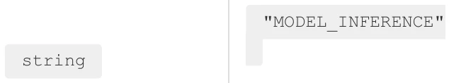

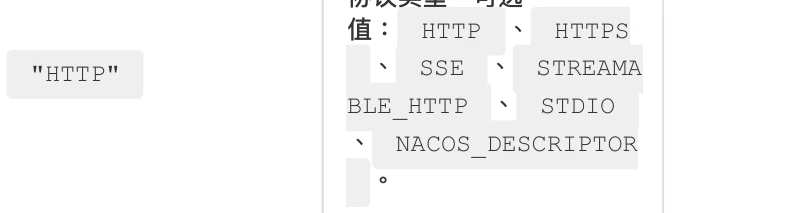

<table>
  <tr>
    <td>data.endpoints[].status</td>
    <td><code>string</code></td>
    <td><code>"ACTIVE"</code></td>
    <td>状态。</td>
  </tr>
  <tr>
    <td>data.endpoints[].meta data</td>
    <td><code>object</code></td>
    <td><code>{}</code></td>
    <td>扩展元数据。</td>
  </tr>
  <tr>
    <td>data.endpoints[].creat edAt</td>
    <td><code>string&lt;date-</code><br><code>time&gt;</code></td>
    <td><code>"2026-06-</code><br><code>22T12:00:00Z"</code></td>
    <td>创建时间。</td>
  </tr>
  <tr>
    <td>data.endpoints[].updat edAt</td>
    <td><code>string&lt;date-</code><br><code>time&gt;</code></td>
    <td><code>"2026-06-</code><br><code>22T12:00:00Z"</code></td>
    <td>更新时间。</td>
  </tr>
  <tr>
    <td>data.capabilities</td>
    <td><code>array</code></td>
    <td><code>[{"capabilityId":"</code><br><code>capability-</code><br><code>001","versionId":"ve</code><br><code>rsion-</code><br><code>001","capabilityType</code><br><code>":"MODEL","name":"sa</code><br><code>mple-</code><br><code>name","displayName":</code> <code>"</code>示例资源<code>","description":"</code>用于演示的资源描述<code>"}] </code></td>
    <td>资源能力列表。</td>
  </tr>
  <tr>
    <td>data.capabilities[].cap abilityId</td>
    <td><code>string</code></td>
    <td><code>"capability-001"</code></td>
    <td>能力 ID。</td>
  </tr>
  <tr>
    <td>data.capabilities[].vers ionId</td>
    <td><code>string</code></td>
    <td><code>"version-001"</code></td>
    <td>版本 ID。</td>
  </tr>
  <tr>
    <td>data.capabilities[].cap abilityType</td>
    <td><code>string</code></td>
    <td><code>"MODEL"</code></td>
    <td>capabilityType。可选值：<code> MODEL </code>、<code> MCP_</code><code>TOOL </code>、<code> MCP_RESOURC</code> <code>E </code>、<code> MCP_PROMPT </code>、<code> SKILL </code>、<code> WORKER </code>、<code> API </code>。</td>
  </tr>
  <tr>
    <td>data.capabilities[].nam e</td>
    <td><code>string</code></td>
    <td><code>"sample-name"</code></td>
    <td>名称。</td>
  </tr>
  <tr>
    <td>data.capabilities[].disp layName</td>
    <td><code>string</code></td>
    <td><code> "</code>示例资源<code>" </code></td>
    <td>展示名称。</td>
  </tr>
  <tr>
    <td>data.capabilities[].des cription</td>
    <td><code>string</code></td>
    <td><code> "</code>用于演示的资源描述<code>" </code></td>
    <td>描述信息。</td>
  </tr>
  <tr>
    <td>data.capabilities[].inpu tSchema</td>
    <td><code>object</code></td>
    <td><code>{}</code></td>
    <td>输入参数 Schema。</td>
  </tr>
  <tr>
    <td>data.capabilities[].out putSchema</td>
    <td><code>object</code></td>
    <td><code>{}</code></td>
    <td>输出结果 Schema。</td>
  </tr>
  <tr>
    <td>data.capabilities[].tags</td>
    <td><code>array</code></td>
    <td><code>["sample-value"]</code></td>
    <td>标签列表。</td>
  </tr>
</table>

**示例**

**请求示例**

```http
GET /himarket/v1/open-api/v1/me/resources/{resourceId}/versions/{versionId} HTTP/1.1
Host: localhost:8080
Authorization: Bearer <accessToken>
```

**响应示例**

```json
{
  "code": "SUCCESS",
  "message": null,
  "data": {
    "resource": {
      "resourceId": "resource-001",
      "tenantId": "tenant-001",
      "kind": "MODEL_API",
      "name": "sample-name",
      "displayName": "示例资源",
      "summary": "示例摘要"
    },
    "version": {
      "versionId": "version-001",
      "resourceId": "resource-001",
      "version": "sample-value",
      "versionScheme": "SEMVER",
      "status": "DRAFT",
      "manifestId": "manifest-001"
    },
    "sourceBinding": {
      "sourceBindingId": "sourceBinding-001",
      "resourceId": "resource-001",
      "sourceType": "GATEWAY",
      "sourceRef": "sample-value",
      "primaryBinding": false,
      "priority": 100
    },
    "endpoints": [
      {}
    ],
    "capabilities": [
      {}
    ],
    "artifacts": [
      {}
    ]
  },
  "accessDeniedDetail": null,
  "requestId": "req-001"
}
```

<a id="section-3-8-9"></a>

### 3.8.9. getOverview

**接口信息**

- **接口路径**： `GET /himarket/v1/open-api/v1/me/overview`

- **接口说明**：查询我的个人中心总览。

- **认证方式**：该接口属于开发者门户 API。调用前请完成开发者登录，并在请求 Header 中携带  `Authorization: Bearer <accessToken>` 。

- **Header 示例**：需要登录态的接口使用  `Authorization: Bearer <accessToken>` 。

**请求参数**

无请求参数。

**返回数据**

| 参数名称 | 类型 | 示例 | 说明 |
| --- | --- | --- | --- |
| code | <code>string</code> | <code>SUCCESS</code> | 响应码，取值为<code> SUCCESS </code> 时表示请求成功。 |
| message | <code>string</code> | <code>null</code> | 响应消息。请求成功时通常为空。 |
| data | <code>object</code> | <code>{"profile":</code><br><code>{"developerId":"deve</code><br><code>loper-</code><br><code>001","portalId":"por</code><br><code>tal-</code><br><code>001","username":"adm</code><br><code>in","email":"user@ex</code><br><code>ample.com","avatarUr</code><br><code>l":"https://api.exam</code><br><code>ple.com","status":"A</code><br><code>PPROVED"},"consumerC</code><br><code>ount":1,"credentialC</code><br><code>onfiguredConsumerCou</code><br><code>nt":1,"subscriptionS</code><br><code>ummary":</code><br><code>{"totalCount":1,"app</code><br><code>rovedCount":1,"pendi</code><br><code>ngCount":1,"rejected</code><br><code>Count":1,"cancelledC</code><br><code>ount":1,"expiredCoun</code><br><code>t":1},"recentSubscri</code><br><code>ptions":[{}]}</code> | 响应数据。具体结构以接口语义为准。 |
| accessDeniedDetail | <code>object</code> | <code>null</code> | 鉴权失败详情。请求成功时通常为空。 |
| requestId | <code>string</code> | <code>req-001</code> | 请求 ID，可用于问题排查和日志检索。 |
| data.profile | <code>object</code> | <code>{"developerId":"de</code><br><code>veloper-</code><br><code>001","portalId":"por</code><br><code>tal-</code><br><code>001","username":"adm</code><br><code>in","email":"user@ex</code><br><code>ample.com","avatarUr</code><br><code>l":"https://api.exam</code><br><code>ple.com","status":"A</code><br><code>PPROVED"}</code> | 开发者资料。 |
| data.profile.developerI d | <code>string</code> | <code>"developer-001"</code> | 开发者ID。 |
| data.profile.portalId | <code>string</code> | <code>"portal-001"</code> | 门户ID。 |
| data.profile.username | <code>string</code> | <code>"admin"</code> | 用户名。 |
| data.profile.email | <code>string</code> | <code>"user@example.com"</code> | 邮箱。 |
| data.profile.avatarUrl | <code>string</code> | <code>"https://api.examp</code><br><code>le.com"</code> | 头像地址。 |
| data.profile.status | <code>string</code> | <code>"APPROVED"</code> | 状态。 |
| data.profile.authType | <code>string</code> | <code>"LOCAL"</code> | authType。可选值：<code> LOCAL </code>、<code> BUIL</code> <code>TIN </code>、<code> EXTERNAL </code>、<code> OIDC </code>、<code> OAUTH2 </code>。 |
| data.profile.createdAt | <code>string&lt;date-</code><br><code>time&gt;</code> | <code>"2026-06-</code><br><code>22T12:00:00Z"</code> | 创建时间。 |
| data.profile.updatedAt | <code>string&lt;date-</code><br><code>time&gt;</code> | <code>"2026-06-</code><br><code>22T12:00:00Z"</code> | 更新时间。 |

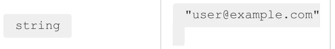

<table>
  <tr>
    <td>data.profile.identities</td>
    <td><code>array</code></td>
    <td><code>[{"provider":"samp</code><br><code>le-</code><br><code>value","subject":"sa</code><br><code>mple-</code><br><code>value","displayName"</code><code>:"</code>示例资源<code>","authType":"LOCA</code> <code>L","createdAt":"2026</code><br><code>-06-</code><br><code>22T12:00:00Z","updat</code><br><code>edAt":"2026-06-</code><br><code>22T12:00:00Z"}]</code></td>
    <td>身份信息列表。</td>
  </tr>
  <tr>
    <td>data.profile.identities[].provider</td>
    <td><code>string</code></td>
    <td><code>"sample-value"</code></td>
    <td>OIDC Provider 标识。</td>
  </tr>
  <tr>
    <td>data.profile.identities[].subject</td>
    <td><code>string</code></td>
    <td><code>"sample-value"</code></td>
    <td>主体信息。</td>
  </tr>
  <tr>
    <td>data.profile.identities[].displayName</td>
    <td><code>string</code></td>
    <td><code> "</code>示例资源<code>" </code></td>
    <td>展示名称。</td>
  </tr>
  <tr>
    <td>data.profile.identities[].authType</td>
    <td><code>string</code></td>
    <td><code>"LOCAL"</code></td>
    <td>authType。可选值：<code> LOCAL </code>、<code> BUIL</code> <code>TIN </code>、<code> EXTERNAL </code>、<code> OIDC </code>、<code> OAUTH2 </code>。</td>
  </tr>
  <tr>
    <td>data.profile.identities[].createdAt</td>
    <td><code>string&lt;date-</code><br><code>time&gt;</code></td>
    <td><code>"2026-06-</code><br><code>22T12:00:00Z"</code></td>
    <td>创建时间。</td>
  </tr>
  <tr>
    <td>data.profile.identities[].updatedAt</td>
    <td><code>string&lt;date-</code><br><code>time&gt;</code></td>
    <td><code>"2026-06-</code><br><code>22T12:00:00Z"</code></td>
    <td>更新时间。</td>
  </tr>
  <tr>
    <td>data.consumerCount</td>
    <td><code>integer&lt;int32&gt;</code></td>
    <td><code>1</code></td>
    <td>Consumer 数量。</td>
  </tr>
  <tr>
    <td>data.credentialConfigu redConsumerCount</td>
    <td><code>integer&lt;int32&gt;</code></td>
    <td><code>1</code></td>
    <td>已配置凭据的 Consumer数量。</td>
  </tr>
  <tr>
    <td>data.subscriptionSum mary</td>
    <td><code>object</code></td>
    <td><code>{"totalCount":1,"a</code><br><code>pprovedCount":1,"pen</code><br><code>dingCount":1,"reject</code><br><code>edCount":1,"cancelle</code><br><code>dCount":1,"expiredCo</code><br><code>unt":1}</code></td>
    <td>订阅汇总信息。</td>
  </tr>
  <tr>
    <td>data.subscriptionSum mary.totalCount</td>
    <td><code>integer&lt;int32&gt;</code></td>
    <td><code>1</code></td>
    <td>总记录数。</td>
  </tr>
  <tr>
    <td>data.subscriptionSum mary.approvedCount</td>
    <td><code>integer&lt;int32&gt;</code></td>
    <td><code>1</code></td>
    <td>已通过数量。</td>
  </tr>
  <tr>
    <td>data.subscriptionSum mary.pendingCount</td>
    <td><code>integer&lt;int32&gt;</code></td>
    <td><code>1</code></td>
    <td>待处理数量。</td>
  </tr>
  <tr>
    <td>data.subscriptionSum mary.rejectedCount</td>
    <td><code>integer&lt;int32&gt;</code></td>
    <td><code>1</code></td>
    <td>已拒绝数量。</td>
  </tr>
  <tr>
    <td>data.subscriptionSum mary.cancelledCount</td>
    <td><code>integer&lt;int32&gt;</code></td>
    <td><code>1</code></td>
    <td>已取消数量。</td>
  </tr>
  <tr>
    <td>data.subscriptionSum mary.expiredCount</td>
    <td><code>integer&lt;int32&gt;</code></td>
    <td><code>1</code></td>
    <td>已过期数量。</td>
  </tr>
  <tr>
    <td>data.subscriptionSum mary.activeGrantCoun t</td>
    <td><code>integer&lt;int32&gt;</code></td>
    <td><code>1</code></td>
    <td>生效中的授权 Grant 数量。</td>
  </tr>
  <tr>
    <td>data.recentSubscriptio ns</td>
    <td><code>array</code></td>
    <td><code>[{"subscriptionId"</code><br><code>:"subscription-</code><br><code>001","consumerId":"c</code><br><code>onsumer-</code><br><code>001","consumerName":</code><br><code>"sample-</code><br><code>consumer","status":"</code><br><code>PENDING","targetType</code><br><code>":"sample-</code><br><code>value","targetId":"t</code><br><code>arget-001"}]</code></td>
    <td>最近的订阅记录。</td>
  </tr>
  <tr>
    <td>data.recentSubscriptio ns[].subscriptionId</td>
    <td><code>string</code></td>
    <td><code>"subscription-</code><br><code>001"</code></td>
    <td>订阅申请 ID。</td>
  </tr>
  <tr>
    <td>data.recentSubscriptio ns[].consumerId</td>
    <td><code>string</code></td>
    <td><code>"consumer-001"</code></td>
    <td>Consumer ID。</td>
  </tr>
  <tr>
    <td>data.recentSubscriptio ns[].consumerName</td>
    <td><code>string</code></td>
    <td><code>"sample-</code><br><code>consumer"</code></td>
    <td>Consumer 名称。</td>
  </tr>
  <tr>
    <td>data.recentSubscriptio ns[].status</td>
    <td><code>string</code></td>
    <td><code>"PENDING"</code></td>
    <td>状态。</td>
  </tr>
  <tr>
    <td>data.recentSubscriptio ns[].targetType</td>
    <td><code>string</code></td>
    <td><code>"sample-value"</code></td>
    <td>订阅目标类型。</td>
  </tr>
  <tr>
    <td>data.recentSubscriptio ns[].targetId</td>
    <td><code>string</code></td>
    <td><code>"target-001"</code></td>
    <td>目标对象 ID。</td>
  </tr>
  <tr>
    <td>data.recentSubscriptio ns[].resourceId</td>
    <td><code>string</code></td>
    <td><code>"resource-001"</code></td>
    <td>AI Resource ID。</td>
  </tr>
  <tr>
    <td>data.recentSubscriptio ns[].versionId</td>
    <td><code>string</code></td>
    <td><code>"version-001"</code></td>
    <td>版本 ID。</td>
  </tr>
  <tr>
    <td>data.recentSubscriptio ns[].resourceKind</td>
    <td><code>string</code></td>
    <td><code>"MODEL_API"</code></td>
    <td>resourceKind。可选值：<code> MODEL_API </code>、<code> </code><code>MCP_SERVER </code>、<code> SKIL</code> <code>L </code>、<code> AGENT </code>、<code> WORK</code> <code>ER </code>、<code> REST_API </code>、<code> HTTP_API </code>、<code> PROMP</code> <code>T_TEMPLATE </code>、<code> DATA</code> <code>SET </code>、<code> EVAL </code>、<code> WO</code> <code>RKFLOW </code>。</td>
  </tr>
  <tr>
    <td>data.recentSubscriptio ns[].resourceName</td>
    <td><code>string</code></td>
    <td><code>"sample-mcp-</code><br><code>server"</code></td>
    <td>AI Resource 名称。</td>
  </tr>
  <tr>
    <td>data.recentSubscriptio ns[].activeGrant</td>
    <td><code>boolean</code></td>
    <td><code>true</code></td>
    <td>当前生效的授权 Grant。</td>
  </tr>
  <tr>
    <td>data.recentSubscriptio ns[].expiresAt</td>
    <td><code>string&lt;date-</code><br><code>time&gt;</code></td>
    <td><code>"2026-06-</code><br><code>22T12:00:00Z"</code></td>
    <td>过期时间。</td>
  </tr>
  <tr>
    <td>data.recentSubscriptio ns[].createdAt</td>
    <td><code>string&lt;date-</code><br><code>time&gt;</code></td>
    <td><code>"2026-06-</code><br><code>22T12:00:00Z"</code></td>
    <td>创建时间。</td>
  </tr>
</table>


<table>
  <tr>
    <td>data.recentSubscriptio ns[].updatedAt</td>
    <td><code>string&lt;date-</code><br><code>time&gt;</code></td>
    <td><code>"2026-06-</code><br><code>22T12:00:00Z"</code></td>
    <td>更新时间。</td>
  </tr>
</table>

**示例**

**请求示例**

```http
GET /himarket/v1/open-api/v1/me/overview HTTP/1.1
Host: localhost:8080
Authorization: Bearer <accessToken>
```

**响应示例**

```json
{
  "code": "SUCCESS",
  "message": null,
  "data": {
    "profile": {
      "developerId": "developer-001",
      "portalId": "portal-001",
      "username": "admin",
      "email": "user@example.com",
      "avatarUrl": "https://api.example.com",
      "status": "APPROVED"
    },
    "consumerCount": 1,
    "credentialConfiguredConsumerCount": 1,
    "subscriptionSummary": {
      "totalCount": 1,
      "approvedCount": 1,
      "pendingCount": 1,
      "rejectedCount": 1,
      "cancelledCount": 1,
      "expiredCount": 1
    },
    "recentSubscriptions": [
      {}
    ]
  },
  "accessDeniedDetail": null,
  "requestId": "req-001"
}
```

<a id="section-3-8-10"></a>

### 3.8.10. getProfile

**接口信息**

- **接口路径**： `GET /himarket/v1/open-api/v1/me/profile`

- **接口说明**：查询我的账号资料。

- **认证方式**：该接口属于开发者门户 API。调用前请完成开发者登录，并在请求 Header 中携带  `Authorization: Bearer <accessToken>` 。

- **Header 示例**：需要登录态的接口使用  `Authorization: Bearer <accessToken>` 。

**请求参数**

无请求参数。

**返回数据**

| 参数名称 | 类型 | 示例 | 说明 |
| --- | --- | --- | --- |
| code | <code>string</code> | <code>SUCCESS</code> | 响应码，取值为<code> SUCCESS </code> 时表示请求成功。 |
| message | <code>string</code> | <code>null</code> | 响应消息。请求成功时通常为空。 |
| data | <code>object</code> | <code>{"developerId":"de</code><br><code>veloper-</code><br><code>001","portalId":"por</code><br><code>tal-</code><br><code>001","username":"adm</code><br><code>in","email":"user@ex</code><br><code>ample.com","avatarUr</code><br><code>l":"https://api.exam</code><br><code>ple.com","status":"A</code><br><code>PPROVED"}</code> | 响应数据。具体结构以接口语义为准。 |
| accessDeniedDetail | <code>object</code> | <code>null</code> | 鉴权失败详情。请求成功时通常为空。 |
| requestId | <code>string</code> | <code>req-001</code> | 请求 ID，可用于问题排查和日志检索。 |
| data.developerId | <code>string</code> | <code>"developer-001"</code> | 开发者ID。 |
| data.portalId | <code>string</code> | <code>"portal-001"</code> | 门户ID。 |
| data.username | <code>string</code> | <code>"admin"</code> | 用户名。 |
| data.email | <code>string</code> | <code>"user@example.com"</code> | 邮箱。 |
| data.avatarUrl | <code>string</code> | <code>"https://api.examp</code><br><code>le.com"</code> | 头像地址。 |
| data.status | <code>string</code> | <code>"APPROVED"</code> | 状态。 |
| data.authType | <code>string</code> | <code>"LOCAL"</code> | authType。可选值：<code> LOCAL </code>、<code> BUIL</code> <code>TIN </code>、<code> EXTERNAL </code>、<code> OIDC </code>、<code> OAUTH2 </code>。 |
| data.createdAt | <code>string&lt;date-</code><br><code>time&gt;</code> | <code>"2026-06-</code><br><code>22T12:00:00Z"</code> | 创建时间。 |
| data.updatedAt | <code>string&lt;date-</code><br><code>time&gt;</code> | <code>"2026-06-</code><br><code>22T12:00:00Z"</code> | 更新时间。 |
| data.identities | <code>array</code> | <code>[{"provider":"samp</code><br><code>le-</code><br><code>value","subject":"sa</code><br><code>mple-</code><br><code>value","displayName"</code><code>:"</code>示例资源<code>","authType":"LOCA</code> <code>L","createdAt":"2026</code><br><code>-06-</code><br><code>22T12:00:00Z","updat</code><br><code>edAt":"2026-06-</code><br><code>22T12:00:00Z"}]</code> | 身份信息列表。 |
| data.identities\[\].provid er | <code>string</code> | <code>"sample-value"</code> | OIDC Provider 标识。 |
| data.identities\[\].subjec t | <code>string</code> | <code>"sample-value"</code> | 主体信息。 |
| data.identities\[\].displa yName | <code>string</code> | <code> "</code>示例资源<code>" </code> | 展示名称。 |

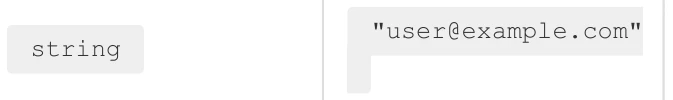

<table>
  <tr>
    <td>data.identities[].authT ype</td>
    <td><code>string</code></td>
    <td><code>"LOCAL"</code></td>
    <td>authType。可选值：<code> LOCAL </code>、<code> BUIL</code> <code>TIN </code>、<code> EXTERNAL </code>、<code> OIDC </code>、<code> OAUTH2 </code>。</td>
  </tr>
  <tr>
    <td>data.identities[].create dAt</td>
    <td><code>string&lt;date-</code><br><code>time&gt;</code></td>
    <td><code>"2026-06-</code><br><code>22T12:00:00Z"</code></td>
    <td>创建时间。</td>
  </tr>
  <tr>
    <td>data.identities[].updat edAt</td>
    <td><code>string&lt;date-</code><br><code>time&gt;</code></td>
    <td><code>"2026-06-</code><br><code>22T12:00:00Z"</code></td>
    <td>更新时间。</td>
  </tr>
</table>

**示例**

**请求示例**

```http
GET /himarket/v1/open-api/v1/me/profile HTTP/1.1
Host: localhost:8080
Authorization: Bearer <accessToken>
```

**响应示例**

```json
{
  "code": "SUCCESS",
  "message": null,
  "data": {
    "developerId": "developer-001",
    "portalId": "portal-001",
    "username": "admin",
    "email": "user@example.com",
    "avatarUrl": "https://api.example.com",
    "status": "APPROVED"
  },
  "accessDeniedDetail": null,
  "requestId": "req-001"
}
```

<a id="section-3-8-11"></a>

### 3.8.11. getReview

**接口信息**

- **接口路径**： `GET /himarket/v1/open-api/v1/me/reviews/{submissionId}`

- **接口说明**：查询我的审核单详情。

- **认证方式**：该接口属于开发者门户 API。调用前请完成开发者登录，并在请求 Header 中携带  `Authorization: Bearer <accessToken>` 。

- **Header 示例**：需要登录态的接口使用  `Authorization: Bearer <accessToken>` 。

**请求参数**

| 参数名称 | 位置 | 类型 | 是否必选 | 示例 | 说明 |
| --- | --- | --- | --- | --- | --- |
| submissionId | path | <code>string</code> | 是 | <code>"submissio</code><br><code>n-001"</code> | 评审提交ID。 |

**返回数据**

| 参数名称 | 类型 | 示例 | 说明 |
| --- | --- | --- | --- |
| code | <code>string</code> | <code>SUCCESS</code> | 响应码，取值为<code> SUCCESS </code> 时表示请求成功。 |
| message | <code>string</code> | <code>null</code> | 响应消息。请求成功时通常为空。 |

<table>
  <tr>
    <td>data</td>
    <td><code>object</code></td>
    <td><code>{"review":</code><br><code>{"submissionId":"sub</code><br><code>mission-</code><br><code>001","targetType":"s</code><br><code>ample-</code><br><code>value","targetId":"t</code><br><code>arget-</code><br><code>001","submitterId":"</code><br><code>submitter-</code><br><code>001","reviewType":"s</code><br><code>ample-</code><br><code>value","status":"PEN</code><br><code>DING"},"listing":</code><br><code>{"listingId":"listin</code><br><code>g-</code><br><code>001","tenantId":"ten</code><br><code>ant-</code><br><code>001","resourceId":"r</code><br><code>esource-</code><br><code>001","defaultVersion</code><br><code>Id":"defaultVersion-</code><br><code>001","portalId":"por</code><br><code>tal-</code><br><code>001","visibility":"P</code><br><code>RIVATE"},"resource":</code><br><code>{"resourceId":"resou</code><br><code>rce-</code><br><code>001","tenantId":"ten</code><br><code>ant-</code><br><code>001","kind":"MODEL_A</code><br><code>PI","name":"sample-</code><br><code>name","displayName":</code> <code>"</code>示例资源<code>","summary":"</code>示例摘要<code>"},"defaultVersion</code> <code>":</code><br><code>{"versionId":"versio</code><br><code>n-</code><br><code>001","resourceId":"r</code><br><code>esource-</code><br><code>001","version":"samp</code><br><code>le-</code><br><code>value","versionSchem</code><br><code>e":"SEMVER","status"</code><br><code>:"DRAFT","manifestId</code><br><code>":"manifest-</code><br><code>001"}}</code></td>
    <td>响应数据。具体结构以接口语义为准。</td>
  </tr>
  <tr>
    <td>accessDeniedDetail</td>
    <td><code>object</code></td>
    <td><code>null</code></td>
    <td>鉴权失败详情。请求成功时通常为空。</td>
  </tr>
  <tr>
    <td>requestId</td>
    <td><code>string</code></td>
    <td><code>req-001</code></td>
    <td>请求 ID，可用于问题排查和日志检索。</td>
  </tr>
  <tr>
    <td>data.review</td>
    <td><code>object</code></td>
    <td><code>{"submissionId":"s</code><br><code>ubmission-</code><br><code>001","targetType":"s</code><br><code>ample-</code><br><code>value","targetId":"t</code><br><code>arget-</code><br><code>001","submitterId":"</code><br><code>submitter-</code><br><code>001","reviewType":"s</code><br><code>ample-</code><br><code>value","status":"PEN</code><br><code>DING"}</code></td>
    <td>审核单信息。</td>
  </tr>
  <tr>
    <td>data.review.submissio nId</td>
    <td><code>string</code></td>
    <td><code>"submission-001"</code></td>
    <td>评审提交ID。</td>
  </tr>
  <tr>
    <td>data.review.targetTyp e</td>
    <td><code>string</code></td>
    <td><code>"sample-value"</code></td>
    <td>订阅目标类型。</td>
  </tr>
  <tr>
    <td>data.review.targetId</td>
    <td><code>string</code></td>
    <td><code>"target-001"</code></td>
    <td>目标对象 ID。</td>
  </tr>
  <tr>
    <td>data.review.submitterI d</td>
    <td><code>string</code></td>
    <td><code>"submitter-001"</code></td>
    <td>提交人 ID。</td>
  </tr>
  <tr>
    <td>data.review.reviewTyp e</td>
    <td><code>string</code></td>
    <td><code>"sample-value"</code></td>
    <td>审核类型。</td>
  </tr>
  <tr>
    <td>data.review.status</td>
    <td><code>string</code></td>
    <td><code>"PENDING"</code></td>
    <td>状态。</td>
  </tr>
  <tr>
    <td>data.review.checks</td>
    <td><code>object</code></td>
    <td><code>{}</code></td>
    <td>审核检查项列表。</td>
  </tr>
  <tr>
    <td>data.review.decision</td>
    <td><code>object</code></td>
    <td><code>{}</code></td>
    <td>审核决策。</td>
  </tr>
  <tr>
    <td>data.review.reviewerId</td>
    <td><code>string</code></td>
    <td><code>"reviewer-001"</code></td>
    <td>审核人 ID。</td>
  </tr>
  <tr>
    <td>data.review.submitted At</td>
    <td><code>string&lt;date-</code><br><code>time&gt;</code></td>
    <td><code>"2026-06-</code><br><code>22T12:00:00Z"</code></td>
    <td>提交时间。</td>
  </tr>
  <tr>
    <td>data.review.decidedAt</td>
    <td><code>string&lt;date-</code><br><code>time&gt;</code></td>
    <td><code>"2026-06-</code><br><code>22T12:00:00Z"</code></td>
    <td>审批时间。</td>
  </tr>
  <tr>
    <td>data.listing</td>
    <td><code>object</code></td>
    <td><code>{"listingId":"list</code><br><code>ing-</code><br><code>001","tenantId":"ten</code><br><code>ant-</code><br><code>001","resourceId":"r</code><br><code>esource-</code><br><code>001","defaultVersion</code><br><code>Id":"defaultVersion-</code><br><code>001","portalId":"por</code><br><code>tal-</code><br><code>001","visibility":"P</code><br><code>RIVATE"}</code></td>
    <td>Listing 信息。</td>
  </tr>
  <tr>
    <td>data.listing.listingId</td>
    <td><code>string</code></td>
    <td><code>"listing-001"</code></td>
    <td>Listing ID。</td>
  </tr>
  <tr>
    <td>data.listing.tenantId</td>
    <td><code>string</code></td>
    <td><code>"tenant-001"</code></td>
    <td>租户ID。</td>
  </tr>
  <tr>
    <td>data.listing.resourceId</td>
    <td><code>string</code></td>
    <td><code>"resource-001"</code></td>
    <td>AI Resource ID。</td>
  </tr>
  <tr>
    <td>data.listing.defaultVer sionId</td>
    <td><code>string</code></td>
    <td><code>"defaultVersion-</code><br><code>001"</code></td>
    <td>默认版本ID。</td>
  </tr>
  <tr>
    <td>data.listing.portalId</td>
    <td><code>string</code></td>
    <td><code>"portal-001"</code></td>
    <td>门户ID。</td>
  </tr>
  <tr>
    <td>data.listing.visibility</td>
    <td><code>string</code></td>
    <td><code>"PRIVATE"</code></td>
    <td>可见性。可选值：<code> PRIVATE </code>、<code> PU</code> <code>BLIC </code>。</td>
  </tr>
  <tr>
    <td>data.listing.title</td>
    <td><code>string</code></td>
    <td><code> "</code>示例资源标题<code>" </code></td>
    <td>标题。</td>
  </tr>
  <tr>
    <td>data.listing.summary</td>
    <td><code>string</code></td>
    <td><code> "</code>示例摘要<code>" </code></td>
    <td>摘要信息。</td>
  </tr>
  <tr>
    <td>data.listing.description</td>
    <td><code>string</code></td>
    <td><code> "</code>用于演示的资源描述<code>" </code></td>
    <td>描述信息。</td>
  </tr>
  <tr>
    <td>data.listing.icon</td>
    <td><code>string</code></td>
    <td><code>"sample-value"</code></td>
    <td>图标地址。</td>
  </tr>
  <tr>
    <td>data.listing.banner</td>
    <td><code>string</code></td>
    <td><code>"sample-value"</code></td>
    <td>横幅图片地址。</td>
  </tr>
  <tr>
    <td>data.listing.categoryId</td>
    <td><code>string</code></td>
    <td><code>"category-001"</code></td>
    <td>分类 ID。</td>
  </tr>
  <tr>
    <td>data.listing.category</td>
    <td><code>object</code></td>
    <td><code>{"categoryId":"cat</code><br><code>egory-</code><br><code>001","tenantId":"ten</code><br><code>ant-</code><br><code>001","kind":"MODEL_A</code><br><code>PI","code":"model-</code><br><code>api","name":"sample-</code><br><code>name","description":</code> <code>"</code>用于演示的资源描述<code>"} </code></td>
    <td>分类信息。</td>
  </tr>
  <tr>
    <td>data.listing.category.c ategoryId</td>
    <td><code>string</code></td>
    <td><code>"category-001"</code></td>
    <td>分类 ID。</td>
  </tr>
  <tr>
    <td>data.listing.category.t enantId</td>
    <td><code>string</code></td>
    <td><code>"tenant-001"</code></td>
    <td>租户ID。</td>
  </tr>
  <tr>
    <td>data.listing.category.ki nd</td>
    <td><code>string</code></td>
    <td><code>"MODEL_API"</code></td>
    <td>资源类型。</td>
  </tr>
  <tr>
    <td>data.listing.category.c ode</td>
    <td><code>string</code></td>
    <td><code>"model-api"</code></td>
    <td>业务编码。</td>
  </tr>
  <tr>
    <td>data.listing.category.n ame</td>
    <td><code>string</code></td>
    <td><code>"sample-name"</code></td>
    <td>名称。</td>
  </tr>
  <tr>
    <td>data.listing.category.d escription</td>
    <td><code>string</code></td>
    <td><code> "</code>用于演示的资源描述<code>" </code></td>
    <td>描述信息。</td>
  </tr>
  <tr>
    <td>data.listing.category.ic on</td>
    <td><code>string</code></td>
    <td><code>"sample-value"</code></td>
    <td>图标地址。</td>
  </tr>
  <tr>
    <td>data.listing.category.s ortOrder</td>
    <td><code>integer&lt;int32&gt;</code></td>
    <td><code>100</code></td>
    <td>排序值。</td>
  </tr>
  <tr>
    <td>data.listing.category.st atus</td>
    <td><code>string</code></td>
    <td><code>"sample-value"</code></td>
    <td>状态。</td>
  </tr>
  <tr>
    <td>data.listing.category.cr eatedBy</td>
    <td><code>string</code></td>
    <td><code>"sample-value"</code></td>
    <td>创建人。</td>
  </tr>
  <tr>
    <td>data.listing.category.u pdatedBy</td>
    <td><code>string</code></td>
    <td><code>"sample-value"</code></td>
    <td>更新人。</td>
  </tr>
  <tr>
    <td>data.listing.category.cr eatedAt</td>
    <td><code>string&lt;date-</code><br><code>time&gt;</code></td>
    <td><code>"2026-06-</code><br><code>22T12:00:00Z"</code></td>
    <td>创建时间。</td>
  </tr>
  <tr>
    <td>data.listing.category.u pdatedAt</td>
    <td><code>string&lt;date-</code><br><code>time&gt;</code></td>
    <td><code>"2026-06-</code><br><code>22T12:00:00Z"</code></td>
    <td>更新时间。</td>
  </tr>
  <tr>
    <td>data.listing.category.li stingCount</td>
    <td><code>integer&lt;int64&gt;</code></td>
    <td><code>1</code></td>
    <td>Listing 数量。</td>
  </tr>
  <tr>
    <td>data.listing.tags</td>
    <td><code>array</code></td>
    <td><code>["sample-value"]</code></td>
    <td>标签列表。</td>
  </tr>
  <tr>
    <td>data.listing.pricingMod e</td>
    <td><code>string</code></td>
    <td><code>"sample-value"</code></td>
    <td>计费模式。</td>
  </tr>
  <tr>
    <td>data.listing.listingStatu s</td>
    <td><code>string</code></td>
    <td><code>"sample-value"</code></td>
    <td>市场条目状态。</td>
  </tr>
  <tr>
    <td>data.listing.publication Status</td>
    <td><code>string</code></td>
    <td><code>"DRAFT"</code></td>
    <td>发布状态。可选值：<code> DRAFT </code>、<code> IN_R</code> <code>EVIEW </code>、<code> PUBLISHED</code><code> </code>、<code> UNPUBLISHED </code>、<code> REJECTED </code>。</td>
  </tr>
  <tr>
    <td>data.listing.createdBy</td>
    <td><code>string</code></td>
    <td><code>"sample-value"</code></td>
    <td>创建人。</td>
  </tr>
  <tr>
    <td>data.listing.publishedB y</td>
    <td><code>string</code></td>
    <td><code>"sample-value"</code></td>
    <td>发布人 ID。</td>
  </tr>
  <tr>
    <td>data.listing.publishedA t</td>
    <td><code>string&lt;date-</code><br><code>time&gt;</code></td>
    <td><code>"2026-06-</code><br><code>22T12:00:00Z"</code></td>
    <td>发布时间。</td>
  </tr>
  <tr>
    <td>data.listing.createdAt</td>
    <td><code>string&lt;date-</code><br><code>time&gt;</code></td>
    <td><code>"2026-06-</code><br><code>22T12:00:00Z"</code></td>
    <td>创建时间。</td>
  </tr>
</table>


<table>
  <tr>
    <td>data.listing.updatedAt</td>
    <td><code>string&lt;date-</code><br><code>time&gt;</code></td>
    <td><code>"2026-06-</code><br><code>22T12:00:00Z"</code></td>
    <td>更新时间。</td>
  </tr>
  <tr>
    <td>data.resource</td>
    <td><code>object</code></td>
    <td><code>{"resourceId":"res</code><br><code>ource-</code><br><code>001","tenantId":"ten</code><br><code>ant-</code><br><code>001","kind":"MODEL_A</code><br><code>PI","name":"sample-</code><br><code>name","displayName":</code> <code>"</code>示例资源<code>","summary":"</code>示例摘要<code>"} </code></td>
    <td>AI Resource 基础信息。</td>
  </tr>
  <tr>
    <td>data.resource.resourc eId</td>
    <td><code>string</code></td>
    <td><code>"resource-001"</code></td>
    <td>AI Resource ID。</td>
  </tr>
  <tr>
    <td>data.resource.tenantId</td>
    <td><code>string</code></td>
    <td><code>"tenant-001"</code></td>
    <td>租户ID。</td>
  </tr>
  <tr>
    <td>data.resource.kind</td>
    <td><code>string</code></td>
    <td><code>"MODEL_API"</code></td>
    <td>资源类型。</td>
  </tr>
  <tr>
    <td>data.resource.name</td>
    <td><code>string</code></td>
    <td><code>"sample-name"</code></td>
    <td>名称。</td>
  </tr>
  <tr>
    <td>data.resource.displayN ame</td>
    <td><code>string</code></td>
    <td><code> "</code>示例资源<code>" </code></td>
    <td>展示名称。</td>
  </tr>
  <tr>
    <td>data.resource.summar y</td>
    <td><code>string</code></td>
    <td><code> "</code>示例摘要<code>" </code></td>
    <td>摘要信息。</td>
  </tr>
  <tr>
    <td>data.resource.descripti on</td>
    <td><code>string</code></td>
    <td><code> "</code>用于演示的资源描述<code>" </code></td>
    <td>描述信息。</td>
  </tr>
  <tr>
    <td>data.resource.ownerTy pe</td>
    <td><code>string</code></td>
    <td><code>"USER"</code></td>
    <td>归属主体类型。可选值：<code> USER </code>、<code> APP </code>、<code> SYSTEM </code>。</td>
  </tr>
  <tr>
    <td>data.resource.ownerId</td>
    <td><code>string</code></td>
    <td><code>"owner-001"</code></td>
    <td>归属主体ID。</td>
  </tr>
  <tr>
    <td>data.resource.created By</td>
    <td><code>string</code></td>
    <td><code>"sample-value"</code></td>
    <td>创建人。</td>
  </tr>
  <tr>
    <td>data.resource.created ByName</td>
    <td><code>string</code></td>
    <td><code>"demo-createdby"</code></td>
    <td>创建人名称。</td>
  </tr>
  <tr>
    <td>data.resource.icon</td>
    <td><code>string</code></td>
    <td><code>"sample-value"</code></td>
    <td>图标地址。</td>
  </tr>
  <tr>
    <td>data.resource.tags</td>
    <td><code>array</code></td>
    <td><code>["sample-value"]</code></td>
    <td>标签列表。</td>
  </tr>
  <tr>
    <td>data.resource.lifecycle Status</td>
    <td><code>string</code></td>
    <td><code>"DRAFT"</code></td>
    <td>生命周期状态。可选值：<code> DRAFT </code>、<code> ACTI</code> <code>VE </code>、<code> DEPRECATED </code>、<code> ARCHIVED </code>。</td>
  </tr>
  <tr>
    <td>data.resource.latestVe rsionId</td>
    <td><code>string</code></td>
    <td><code>"latestVersion-</code><br><code>001"</code></td>
    <td>最新版本ID。</td>
  </tr>
  <tr>
    <td>data.resource.autoApp roveSubscription</td>
    <td><code>boolean</code></td>
    <td><code>true</code></td>
    <td>是否自动批准订阅。</td>
  </tr>
  <tr>
    <td>data.resource.extras</td>
    <td><code>object</code></td>
    <td><code>{}</code></td>
    <td>扩展配置。</td>
  </tr>
  <tr>
    <td>data.resource.created At</td>
    <td><code>string&lt;date-</code><br><code>time&gt;</code></td>
    <td><code>"2026-06-</code><br><code>22T12:00:00Z"</code></td>
    <td>创建时间。</td>
  </tr>
  <tr>
    <td>data.resource.updated At</td>
    <td><code>string&lt;date-</code><br><code>time&gt;</code></td>
    <td><code>"2026-06-</code><br><code>22T12:00:00Z"</code></td>
    <td>更新时间。</td>
  </tr>
  <tr>
    <td>data.defaultVersion</td>
    <td><code>object</code></td>
    <td><code>{"versionId":"vers</code><br><code>ion-</code><br><code>001","resourceId":"r</code><br><code>esource-</code><br><code>001","version":"samp</code><br><code>le-</code><br><code>value","versionSchem</code><br><code>e":"SEMVER","status"</code><br><code>:"DRAFT","manifestId</code><br><code>":"manifest-001"}</code></td>
    <td>默认版本信息。</td>
  </tr>
  <tr>
    <td>data.defaultVersion.ve rsionId</td>
    <td><code>string</code></td>
    <td><code>"version-001"</code></td>
    <td>版本 ID。</td>
  </tr>
  <tr>
    <td>data.defaultVersion.re sourceId</td>
    <td><code>string</code></td>
    <td><code>"resource-001"</code></td>
    <td>AI Resource ID。</td>
  </tr>
  <tr>
    <td>data.defaultVersion.ve rsion</td>
    <td><code>string</code></td>
    <td><code>"sample-value"</code></td>
    <td>版本号。</td>
  </tr>
  <tr>
    <td>data.defaultVersion.ve rsionScheme</td>
    <td><code>string</code></td>
    <td><code>"SEMVER"</code></td>
    <td>版本号方案。可选值：<code> SEMVER </code>、<code> TIM</code> <code>ESTAMP </code>、<code> REVISION</code><code> </code>、<code> EXTERNAL </code>。</td>
  </tr>
  <tr>
    <td>data.defaultVersion.st atus</td>
    <td><code>string</code></td>
    <td><code>"DRAFT"</code></td>
    <td>状态。</td>
  </tr>
  <tr>
    <td>data.defaultVersion.m anifestId</td>
    <td><code>string</code></td>
    <td><code>"manifest-001"</code></td>
    <td>Manifest ID。</td>
  </tr>
  <tr>
    <td>data.defaultVersion.so urceBindingId</td>
    <td><code>string</code></td>
    <td><code>"sourceBinding-</code><br><code>001"</code></td>
    <td>来源绑定ID。</td>
  </tr>
  <tr>
    <td>data.defaultVersion.art ifactDigest</td>
    <td><code>string</code></td>
    <td><code>"sample-value"</code></td>
    <td>制品摘要。</td>
  </tr>
  <tr>
    <td>data.defaultVersion.rel easeNote</td>
    <td><code>string</code></td>
    <td><code>"sample-value"</code></td>
    <td>版本说明。</td>
  </tr>
  <tr>
    <td>data.defaultVersion.cr eatedBy</td>
    <td><code>string</code></td>
    <td><code>"sample-value"</code></td>
    <td>创建人。</td>
  </tr>
</table>


**示例**

**请求示例**

```http
GET /himarket/v1/open-api/v1/me/reviews/{submissionId} HTTP/1.1
Host: localhost:8080
Authorization: Bearer <accessToken>
```

**响应示例**

```json
{
  "code": "SUCCESS",
  "message": null,
  "data": {
    "review": {
      "submissionId": "submission-001",
      "targetType": "sample-value",
      "targetId": "target-001",
      "submitterId": "submitter-001",
      "reviewType": "sample-value",
      "status": "PENDING"
    },
    "listing": {
      "listingId": "listing-001",
      "tenantId": "tenant-001",
      "resourceId": "resource-001",
      "defaultVersionId": "defaultVersion-001",
      "portalId": "portal-001",
      "visibility": "PRIVATE"
    },
    "resource": {
      "resourceId": "resource-001",
      "tenantId": "tenant-001",
      "kind": "MODEL_API",
      "name": "sample-name",
      "displayName": "示例资源",
      "summary": "示例摘要"
    },
    "defaultVersion": {
      "versionId": "version-001",
      "resourceId": "resource-001",
      "version": "sample-value",
      "versionScheme": "SEMVER",
      "status": "DRAFT",
      "manifestId": "manifest-001"
    }
  },
  "accessDeniedDetail": null,
  "requestId": "req-001"
}
```

<a id="section-3-8-12"></a>

### 3.8.12. importResourcePackage

**接口信息**

- **接口路径**： `POST /himarket/v1/open-api/v1/me/resource-packages/import`

- **接口说明**：导入我的 Skill / Worker 包。

- **认证方式**：该接口属于开发者门户 API。调用前请完成开发者登录，并在请求 Header 中携带  `Authorization: Bearer <accessToken>` 。

- **Header 示例**：需要登录态的接口使用  `Authorization: Bearer <accessToken>` 。

**请求参数**

| 参数名称 | 位置 | 类型 | 是否必选 | 示例 | 说明 |
| --- | --- | --- | --- | --- | --- |
| kind | query | <code>string</code> | 是 | <code>"MODEL_API</code><br><code>"</code> | 资源类型。 |
| file | body | <code>string&lt;bin</code><br><code>ary&gt;</code> | 是 | <code>"sample-</code><br><code>value"</code> | file 字段。 |

**返回数据**

| 参数名称 | 类型 | 示例 | 说明 |
| --- | --- | --- | --- |
| code | <code>string</code> | <code>SUCCESS</code> | 响应码，取值为<code> SUCCESS </code> 时表示请求成功。 |
| message | <code>string</code> | <code>null</code> | 响应消息。请求成功时通常为空。 |
| data | <code>object</code> | <code>{"nacosId":"nacos-</code><br><code>001","namespace":"pu</code><br><code>blic","resourceName"</code><br><code>:"sample-mcp-</code><br><code>server","description</code> <code>":"</code>用于演示的资源描述<code>","latestVersion":</code> <code>"sample-</code><br><code>value","sourceRef":"</code><br><code>sample-value"}</code> | 响应数据。具体结构以接口语义为准。 |
| accessDeniedDetail | <code>object</code> | <code>null</code> | 鉴权失败详情。请求成功时通常为空。 |
| requestId | <code>string</code> | <code>req-001</code> | 请求 ID，可用于问题排查和日志检索。 |
| data.nacosId | <code>string</code> | <code>"nacos-001"</code> | Nacos 实例 ID。 |
| data.namespace | <code>string</code> | <code>"public"</code> | 命名空间。 |
| data.resourceName | <code>string</code> | <code>"sample-mcp-</code><br><code>server"</code> | AI Resource 名称。 |
| data.description | <code>string</code> | <code> "</code>用于演示的资源描述<code>" </code> | 描述信息。 |
| data.latestVersion | <code>string</code> | <code>"sample-value"</code> | 最新版本信息。 |
| data.sourceRef | <code>string</code> | <code>"sample-value"</code> | 来源引用。 |
| data.fileCount | <code>integer&lt;int32&gt;</code> | <code>1</code> | 文件数量。 |
| data.fileTree | <code>array</code> | <code>[{"name":"sample-</code><br><code>name","path":"sample</code><br><code>-</code><br><code>value","type":"sampl</code><br><code>e-</code><br><code>value","encoding":"s</code><br><code>ample-</code><br><code>value","size":10}]</code> | 文件树。 |
| data.fileTree\[\].name | <code>string</code> | <code>"sample-name"</code> | 名称。 |
| data.fileTree\[\].path | <code>string</code> | <code>"sample-value"</code> | 路径。 |
| data.fileTree\[\].type | <code>string</code> | <code>"sample-value"</code> | 类型。 |
| data.fileTree\[\].encodin g | <code>string</code> | <code>"sample-value"</code> | 编码格式。 |
| data.fileTree\[\].size | <code>integer&lt;int32&gt;</code> | <code>10</code> | 每页记录数。 |
| data.fileContents | <code>object</code> | <code>{}</code> | 文件内容。 |

**示例**

**请求示例**

```http
POST /himarket/v1/open-api/v1/me/resource-packages/import?kind=MODEL_API HTTP/1.1
Host: localhost:8080
Authorization: Bearer <accessToken>
Content-Type: application/json

{
  "file": "sample-value"
}
```

**响应示例**

```json
{
  "code": "SUCCESS",
  "message": null,
  "data": {
    "nacosId": "nacos-001",
    "namespace": "public",
    "resourceName": "sample-mcp-server",
    "description": "⽤于演示的资源描述",
    "latestVersion": "sample-value",
    "sourceRef": "sample-value"
  },
  "accessDeniedDetail": null,
  "requestId": "req-001"
}
```

<a id="section-3-8-13"></a>

### 3.8.13. listDraftListings

**接口信息**

- **接口路径**： `GET /himarket/v1/open-api/v1/me/listings/drafts`

- **接口说明**：分页查询我的 Listing 草稿。

- **认证方式**：该接口属于开发者门户 API。调用前请完成开发者登录，并在请求 Header 中携带  `Authorization: Bearer <accessToken>` 。

- **Header 示例**：需要登录态的接口使用  `Authorization: Bearer <accessToken>` 。

**请求参数**

| 参数名称 | 位置 | 类型 | 是否必选 | 示例 | 说明 |
| --- | --- | --- | --- | --- | --- |
| tenantId | query | <code>string</code> | 否 | <code>"tenant-</code><br><code>001"</code> | 租户ID。 |
| resourceId | query | <code>string</code> | 否 | <code>"resource-</code><br><code>001"</code> | AI Resource ID。 |
| kind | query | <code>string</code> | 否 | <code>"MODEL_API</code><br><code>"</code> | 资源类型。 |
| categoryId | query | <code>string</code> | 否 | <code>"category-</code><br><code>001"</code> | 分类 ID。 |
| portalId | query | <code>string</code> | 否 | <code>"portal-</code><br><code>001"</code> | 门户ID。 |
| visibility | query | <code>string</code> | 否 | <code>"PRIVATE"</code> | 可见性。可选值：<code> PRIVATE</code><code> </code>、<code> PUBLIC</code><code> </code>。 |
| publicationSt atus | query | <code>string</code> | 否 | <code>"DRAFT"</code> | 发布状态。可选值：<code> DRAFT </code>、<code> IN_REVIEW</code><code> </code>、<code> PUBLISH</code> <code>ED </code>、<code> UNPUB</code> <code>LISHED </code>、<code> R</code> <code>EJECTED </code>。 |
| keyword | query | <code>string</code> | 否 | <code>"sample-</code><br><code>value"</code> | 搜索关键词。 |
| page | query | <code>integer&lt;in</code><br><code>t32&gt;</code> | 否 | <code>1</code> | 页码。 |
| size | query | <code>integer&lt;in</code><br><code>t32&gt;</code> | 否 | <code>10</code> | 每页记录数。 |
| sort | query | <code>array</code> | 否 | <code>["sample-</code><br><code>value"]</code> | 排序条件。 |


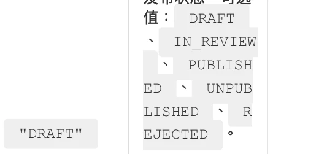

**返回数据**

| 参数名称 | 类型 | 示例 | 说明 |
| --- | --- | --- | --- |
| code | <code>string</code> | <code>SUCCESS</code> | 响应码，取值为<code> SUCCESS </code> 时表示请求成功。 |
| message | <code>string</code> | <code>null</code> | 响应消息。请求成功时通常为空。 |
| data | <code>object</code> | <code>{"content":</code><br><code>[{}],"pageNumber":1,</code><br><code>"pageSize":10,"total</code><br><code>Count":1}</code> | 响应数据。具体结构以接口语义为准。 |
| accessDeniedDetail | <code>object</code> | <code>null</code> | 鉴权失败详情。请求成功时通常为空。 |
| requestId | <code>string</code> | <code>req-001</code> | 请求 ID，可用于问题排查和日志检索。 |
| data.content | <code>array</code> | <code>[{"listingId":"lis</code><br><code>ting-</code><br><code>001","tenantId":"ten</code><br><code>ant-</code><br><code>001","resourceId":"r</code><br><code>esource-</code><br><code>001","defaultVersion</code><br><code>Id":"defaultVersion-</code><br><code>001","portalId":"por</code><br><code>tal-</code><br><code>001","visibility":"P</code><br><code>RIVATE"}]</code> | 分页结果列表。 |
| data.content\[\].listingId | <code>string</code> | <code>"listing-001"</code> | Listing ID。 |
| data.content\[\].tenantI d | <code>string</code> | <code>"tenant-001"</code> | 租户ID。 |
| data.content\[\].resourc eId | <code>string</code> | <code>"resource-001"</code> | AI Resource ID。 |
| data.content\[\].default VersionId | <code>string</code> | <code>"defaultVersion-</code><br><code>001"</code> | 默认版本ID。 |
| data.content\[\].portalId | <code>string</code> | <code>"portal-001"</code> | 门户ID。 |
| data.content\[\].visibility | <code>string</code> | <code>"PRIVATE"</code> | 可见性。可选值：<code> PRIVATE </code>、<code> PU</code> <code>BLIC </code>。 |
| data.content\[\].title | <code>string</code> | <code> "</code>示例资源标题<code>" </code> | 标题。 |
| data.content\[\].summa ry | <code>string</code> | <code> "</code>示例摘要<code>" </code> | 摘要信息。 |
| data.content\[\].descript ion | <code>string</code> | <code> "</code>用于演示的资源描述<code>" </code> | 描述信息。 |
| data.content\[\].icon | <code>string</code> | <code>"sample-value"</code> | 图标地址。 |
| data.content\[\].banner | <code>string</code> | <code>"sample-value"</code> | 横幅图片地址。 |
| data.content\[\].categor yId | <code>string</code> | <code>"category-001"</code> | 分类 ID。 |
| data.content\[\].categor y | <code>object</code> | <code>{"categoryId":"cat</code><br><code>egory-</code><br><code>001","tenantId":"ten</code><br><code>ant-</code><br><code>001","kind":"MODEL_A</code><br><code>PI","code":"model-</code><br><code>api","name":"sample-</code><br><code>name","description":</code> <code>"</code>用于演示的资源描述<code>"} </code> | 分类信息。 |
| data.content\[\].categor y.categoryId | <code>string</code> | <code>"category-001"</code> | 分类 ID。 |
| data.content\[\].categor y.tenantId | <code>string</code> | <code>"tenant-001"</code> | 租户ID。 |
| data.content\[\].categor y.kind | <code>string</code> | <code>"MODEL_API"</code> | 资源类型。 |
| data.content\[\].categor y.code | <code>string</code> | <code>"model-api"</code> | 业务编码。 |
| data.content\[\].categor y.name | <code>string</code> | <code>"sample-name"</code> | 名称。 |
| data.content\[\].categor y.description | <code>string</code> | <code> "</code>用于演示的资源描述<code>" </code> | 描述信息。 |
| data.content\[\].categor y.icon | <code>string</code> | <code>"sample-value"</code> | 图标地址。 |
| data.content\[\].categor y.sortOrder | <code>integer&lt;int32&gt;</code> | <code>100</code> | 排序值。 |
| data.content\[\].categor y.status | <code>string</code> | <code>"sample-value"</code> | 状态。 |
| data.content\[\].categor y.createdBy | <code>string</code> | <code>"sample-value"</code> | 创建人。 |
| data.content\[\].categor y.updatedBy | <code>string</code> | <code>"sample-value"</code> | 更新人。 |
| data.content\[\].categor y.createdAt | <code>string&lt;date-</code><br><code>time&gt;</code> | <code>"2026-06-</code><br><code>22T12:00:00Z"</code> | 创建时间。 |
| data.content\[\].categor y.updatedAt | <code>string&lt;date-</code><br><code>time&gt;</code> | <code>"2026-06-</code><br><code>22T12:00:00Z"</code> | 更新时间。 |
| data.content\[\].categor y.listingCount | <code>integer&lt;int64&gt;</code> | <code>1</code> | Listing 数量。 |
| data.content\[\].tags | <code>array</code> | <code>["sample-value"]</code> | 标签列表。 |
| data.content\[\].pricing Mode | <code>string</code> | <code>"sample-value"</code> | 计费模式。 |
| data.content\[\].listingSt atus | <code>string</code> | <code>"sample-value"</code> | 市场条目状态。 |
| data.content\[\].publicat ionStatus | <code>string</code> | <code>"DRAFT"</code> | 发布状态。可选值：<code> DRAFT </code>、<code> IN_R</code> <code>EVIEW </code>、<code> PUBLISHED</code><code> </code>、<code> UNPUBLISHED </code>、<code> REJECTED </code>。 |


<table>
  <tr>
    <td>data.content[].created By</td>
    <td><code>string</code></td>
    <td><code>"sample-value"</code></td>
    <td>创建人。</td>
  </tr>
  <tr>
    <td>data.content[].publish edBy</td>
    <td><code>string</code></td>
    <td><code>"sample-value"</code></td>
    <td>发布人 ID。</td>
  </tr>
  <tr>
    <td>data.content[].publish edAt</td>
    <td><code>string&lt;date-</code><br><code>time&gt;</code></td>
    <td><code>"2026-06-</code><br><code>22T12:00:00Z"</code></td>
    <td>发布时间。</td>
  </tr>
  <tr>
    <td>data.content[].created At</td>
    <td><code>string&lt;date-</code><br><code>time&gt;</code></td>
    <td><code>"2026-06-</code><br><code>22T12:00:00Z"</code></td>
    <td>创建时间。</td>
  </tr>
  <tr>
    <td>data.content[].update dAt</td>
    <td><code>string&lt;date-</code><br><code>time&gt;</code></td>
    <td><code>"2026-06-</code><br><code>22T12:00:00Z"</code></td>
    <td>更新时间。</td>
  </tr>
  <tr>
    <td>data.pageNumber</td>
    <td><code>integer&lt;int32&gt;</code></td>
    <td><code>1</code></td>
    <td>当前页码。</td>
  </tr>
  <tr>
    <td>data.pageSize</td>
    <td><code>integer&lt;int32&gt;</code></td>
    <td><code>10</code></td>
    <td>每页大小。</td>
  </tr>
  <tr>
    <td>data.totalCount</td>
    <td><code>integer&lt;int64&gt;</code></td>
    <td><code>1</code></td>
    <td>总记录数。</td>
  </tr>
</table>

**示例**

**请求示例**

```text
GET /himarket/v1/open-api/v1/me/listings/drafts?tenantId=tenant-
001&resourceId=resource-001&kind=MODEL_API&categoryId=category-001&portalId=portal-001&visibility=PRIVATE&publicationStatus=DRAFT&keyword=sample-value HTTP/1.1
Host: localhost:8080
Authorization: Bearer <accessToken>
```

**响应示例**

```json
{
  "code": "SUCCESS",
  "message": null,
  "data": {
    "content": [
      {}
    ],
    "pageNumber": 1,
    "pageSize": 10,
    "totalCount": 1
  },
  "accessDeniedDetail": null,
  "requestId": "req-001"
}
```

<a id="section-3-8-14"></a>

### 3.8.14. listMyMcpEndpoints

**接口信息**

- **接口路径**： `GET /himarket/v1/open-api/v1/me/mcp-endpoints`

- **接口说明**：查询我已订阅的 MCP Server Endpoint 列表。

- **认证方式**：该接口属于开发者门户 API。调用前请完成开发者登录，并在请求 Header 中携带  `Authorization: Bearer <accessToken>` 。

- **Header 示例**：需要登录态的接口使用  `Authorization: Bearer <accessToken>` 。

**请求参数**

无请求参数。

**返回数据**

| 参数名称 | 类型 | 示例 | 说明 |
| --- | --- | --- | --- |
| code | <code>string</code> | <code>SUCCESS</code> | 响应码，取值为<code> SUCCESS </code> 时表示请求成功。 |
| message | <code>string</code> | <code>null</code> | 响应消息。请求成功时通常为空。 |

<table>
  <tr>
    <td>data</td>
    <td><code>array</code></td>
    <td><code>[{"endpointId":"en</code><br><code>dpoint-</code><br><code>001","mcpServerId":"</code><br><code>mcpServer-</code><br><code>001","endpointUrl":"</code><br><code>https://api.example.</code><br><code>com","hostingType":"</code><br><code>api.example.com","pr</code><br><code>otocol":"sample-</code><br><code>value","hostingInsta</code><br><code>nceId":"api.example.</code><br><code>com"}]</code></td>
    <td>响应数据。具体结构以接口语义为准。</td>
  </tr>
  <tr>
    <td>accessDeniedDetail</td>
    <td><code>object</code></td>
    <td><code>null</code></td>
    <td>鉴权失败详情。请求成功时通常为空。</td>
  </tr>
  <tr>
    <td>requestId</td>
    <td><code>string</code></td>
    <td><code>req-001</code></td>
    <td>请求 ID，可用于问题排查和日志检索。</td>
  </tr>
  <tr>
    <td>data[].endpointId</td>
    <td><code>string</code></td>
    <td><code>"endpoint-001"</code></td>
    <td>Endpoint ID。</td>
  </tr>
  <tr>
    <td>data[].mcpServerId</td>
    <td><code>string</code></td>
    <td><code>"mcpServer-001"</code></td>
    <td>MCP Server ID。</td>
  </tr>
  <tr>
    <td>data[].endpointUrl</td>
    <td><code>string</code></td>
    <td><code>"https://api.examp</code><br><code>le.com"</code></td>
    <td>Endpoint 访问地址。</td>
  </tr>
  <tr>
    <td>data[].hostingType</td>
    <td><code>string</code></td>
    <td><code>"api.example.com"</code></td>
    <td>托管类型。</td>
  </tr>
  <tr>
    <td>data[].protocol</td>
    <td><code>string</code></td>
    <td><code>"sample-value"</code></td>
    <td>协议类型。</td>
  </tr>
  <tr>
    <td>data[].hostingInstanceI d</td>
    <td><code>string</code></td>
    <td><code>"api.example.com"</code></td>
    <td>托管实例 ID。</td>
  </tr>
  <tr>
    <td>data[].subscribeParam s</td>
    <td><code>string</code></td>
    <td><code>"sample-value"</code></td>
    <td>订阅参数。</td>
  </tr>
  <tr>
    <td>data[].status</td>
    <td><code>string</code></td>
    <td><code>"sample-value"</code></td>
    <td>状态。</td>
  </tr>
  <tr>
    <td>data[].endpointCreate dAt</td>
    <td><code>string&lt;date-</code><br><code>time&gt;</code></td>
    <td><code>"2026-06-</code><br><code>22T12:00:00Z"</code></td>
    <td>Endpoint 创建时间。</td>
  </tr>
</table>


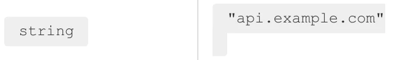

<table>
  <tr>
    <td>data[].resourceId</td>
    <td><code>string</code></td>
    <td><code>"resource-001"</code></td>
    <td>AI Resource ID。</td>
  </tr>
  <tr>
    <td>data[].displayName</td>
    <td><code>string</code></td>
    <td><code> "</code>示例资源<code>" </code></td>
    <td>展示名称。</td>
  </tr>
  <tr>
    <td>data[].mcpName</td>
    <td><code>string</code></td>
    <td><code>"sample-mcp"</code></td>
    <td>MCP Server 名称。</td>
  </tr>
  <tr>
    <td>data[].description</td>
    <td><code>string</code></td>
    <td><code> "</code>用于演示的资源描述<code>" </code></td>
    <td>描述信息。</td>
  </tr>
  <tr>
    <td>data[].icon</td>
    <td><code>string</code></td>
    <td><code>"sample-value"</code></td>
    <td>图标地址。</td>
  </tr>
  <tr>
    <td>data[].tags</td>
    <td><code>string</code></td>
    <td><code>"sample-value"</code></td>
    <td>标签列表。</td>
  </tr>
  <tr>
    <td>data[].protocolType</td>
    <td><code>string</code></td>
    <td><code>"sample-value"</code></td>
    <td>协议类型。</td>
  </tr>
  <tr>
    <td>data[].origin</td>
    <td><code>string</code></td>
    <td><code>"sample-value"</code></td>
    <td>来源标识。</td>
  </tr>
  <tr>
    <td>data[].toolsConfig</td>
    <td><code>string</code></td>
    <td><code>"sample-value"</code></td>
    <td>工具配置。</td>
  </tr>
</table>

**示例**

**请求示例**

```http
GET /himarket/v1/open-api/v1/me/mcp-endpoints HTTP/1.1
Host: localhost:8080
Authorization: Bearer <accessToken>
```

**响应示例**

```json
{
  "code": "SUCCESS",
  "message": null,
  "data": [
    {
      "endpointId": "endpoint-001",
      "mcpServerId": "mcpServer-001",
      "endpointUrl": "https://api.example.com",
      "hostingType": "api.example.com",
      "protocol": "sample-value",
      "hostingInstanceId": "api.example.com"
    }
  ],
  "accessDeniedDetail": null,
  "requestId": "req-001"
}
```

<a id="section-3-8-15"></a>

### 3.8.15. listMyResourceVersions

**接口信息**

- **接口路径**： `GET /himarket/v1/open-api/v1/me/resources/{resourceId}/versions`

- **接口说明**：分页查询我的 AI Resource 版本。

- **认证方式**：该接口属于开发者门户 API。调用前请完成开发者登录，并在请求 Header 中携带  `Authorization: Bearer <accessToken>` 。

- **Header 示例**：需要登录态的接口使用  `Authorization: Bearer <accessToken>` 。

**请求参数**

| 参数名称 | 位置 | 类型 | 是否必选 | 示例 | 说明 |
| --- | --- | --- | --- | --- | --- |
| resourceId | path | <code>string</code> | 是 | <code>"resource-</code><br><code>001"</code> | AI Resource ID。 |
| page | query | <code>integer&lt;in</code><br><code>t32&gt;</code> | 否 | <code>1</code> | 页码。 |
| size | query | <code>integer&lt;in</code><br><code>t32&gt;</code> | 否 | <code>10</code> | 每页记录数。 |
| sort | query | <code>array</code> | 否 | <code>["sample-</code><br><code>value"]</code> | 排序条件。 |

**返回数据**

| 参数名称 | 类型 | 示例 | 说明 |
| --- | --- | --- | --- |
| code | <code>string</code> | <code>SUCCESS</code> | 响应码，取值为<code> SUCCESS </code> 时表示请求成功。 |
| message | <code>string</code> | <code>null</code> | 响应消息。请求成功时通常为空。 |
| data | <code>object</code> | <code>{"content":</code><br><code>[{}],"pageNumber":1,</code><br><code>"pageSize":10,"total</code><br><code>Count":1}</code> | 响应数据。具体结构以接口语义为准。 |
| accessDeniedDetail | <code>object</code> | <code>null</code> | 鉴权失败详情。请求成功时通常为空。 |
| requestId | <code>string</code> | <code>req-001</code> | 请求 ID，可用于问题排查和日志检索。 |
| data.content | <code>array</code> | <code>[{"versionId":"ver</code><br><code>sion-</code><br><code>001","resourceId":"r</code><br><code>esource-</code><br><code>001","version":"samp</code><br><code>le-</code><br><code>value","versionSchem</code><br><code>e":"SEMVER","status"</code><br><code>:"DRAFT","manifestId</code><br><code>":"manifest-</code><br><code>001"}]</code> | 分页结果列表。 |
| data.content\[\].versionI d | <code>string</code> | <code>"version-001"</code> | 版本 ID。 |
| data.content\[\].resourc eId | <code>string</code> | <code>"resource-001"</code> | AI Resource ID。 |
| data.content\[\].version | <code>string</code> | <code>"sample-value"</code> | 版本号。 |
| data.content\[\].version Scheme | <code>string</code> | <code>"SEMVER"</code> | 版本号方案。可选值：<code> SEMVER </code>、<code> TIM</code> <code>ESTAMP </code>、<code> REVISION</code><code> </code>、<code> EXTERNAL </code>。 |


<table>
  <tr>
    <td>data.content[].status</td>
    <td><code>string</code></td>
    <td><code>"DRAFT"</code></td>
    <td>状态。</td>
  </tr>
  <tr>
    <td>data.content[].manifes tId</td>
    <td><code>string</code></td>
    <td><code>"manifest-001"</code></td>
    <td>Manifest ID。</td>
  </tr>
  <tr>
    <td>data.content[].sourceB indingId</td>
    <td><code>string</code></td>
    <td><code>"sourceBinding-</code><br><code>001"</code></td>
    <td>来源绑定ID。</td>
  </tr>
  <tr>
    <td>data.content[].artifact Digest</td>
    <td><code>string</code></td>
    <td><code>"sample-value"</code></td>
    <td>制品摘要。</td>
  </tr>
  <tr>
    <td>data.content[].release Note</td>
    <td><code>string</code></td>
    <td><code>"sample-value"</code></td>
    <td>版本说明。</td>
  </tr>
  <tr>
    <td>data.content[].created By</td>
    <td><code>string</code></td>
    <td><code>"sample-value"</code></td>
    <td>创建人。</td>
  </tr>
  <tr>
    <td>data.content[].publish edAt</td>
    <td><code>string&lt;date-</code><br><code>time&gt;</code></td>
    <td><code>"2026-06-</code><br><code>22T12:00:00Z"</code></td>
    <td>发布时间。</td>
  </tr>
  <tr>
    <td>data.content[].created At</td>
    <td><code>string&lt;date-</code><br><code>time&gt;</code></td>
    <td><code>"2026-06-</code><br><code>22T12:00:00Z"</code></td>
    <td>创建时间。</td>
  </tr>
  <tr>
    <td>data.content[].update dAt</td>
    <td><code>string&lt;date-</code><br><code>time&gt;</code></td>
    <td><code>"2026-06-</code><br><code>22T12:00:00Z"</code></td>
    <td>更新时间。</td>
  </tr>
  <tr>
    <td>data.content[].downlo adCount</td>
    <td><code>integer&lt;int64&gt;</code></td>
    <td><code>1</code></td>
    <td>下载次数。</td>
  </tr>
  <tr>
    <td>data.content[].isLatest</td>
    <td><code>boolean</code></td>
    <td><code>true</code></td>
    <td>是否为最新版本。</td>
  </tr>
  <tr>
    <td>data.pageNumber</td>
    <td><code>integer&lt;int32&gt;</code></td>
    <td><code>1</code></td>
    <td>当前页码。</td>
  </tr>
  <tr>
    <td>data.pageSize</td>
    <td><code>integer&lt;int32&gt;</code></td>
    <td><code>10</code></td>
    <td>每页大小。</td>
  </tr>
  <tr>
    <td>data.totalCount</td>
    <td><code>integer&lt;int64&gt;</code></td>
    <td><code>1</code></td>
    <td>总记录数。</td>
  </tr>
</table>

**示例**

**请求示例**

```text
GET /himarket/v1/open-api/v1/me/resources/{resourceId}/versions?
page=1&size=10&sort=sample-value HTTP/1.1
Host: localhost:8080
Authorization: Bearer <accessToken>
```

**响应示例**

```json
{
  "code": "SUCCESS",
  "message": null,
  "data": {
    "content": [
      {}
    ],
    "pageNumber": 1,
    "pageSize": 10,
    "totalCount": 1
  },
  "accessDeniedDetail": null,
  "requestId": "req-001"
}
```

<a id="section-3-8-16"></a>

### 3.8.16. listMyResources

**接口信息**

- **接口路径**： `GET /himarket/v1/open-api/v1/me/resources`

- **接口说明**：分页查询我的 AI Resource。

- **认证方式**：该接口属于开发者门户 API。调用前请完成开发者登录，并在请求 Header 中携带  `Authorization: Bearer <accessToken>` 。

- **Header 示例**：需要登录态的接口使用  `Authorization: Bearer <accessToken>` 。

**请求参数**

| 参数名称 | 位置 | 类型 | 是否必选 | 示例 | 说明 |
| --- | --- | --- | --- | --- | --- |
| tenantId | query | <code>string</code> | 否 | <code>"tenant-</code><br><code>001"</code> | 租户ID。 |
| kind | query | <code>string</code> | 否 | <code>"MODEL_API</code><br><code>"</code> | 资源类型。 |
| lifecycleStatu s | query | <code>string</code> | 否 | <code>"DRAFT"</code> | 生命周期状态。可选值：<code> DRAFT </code>、<code> ACTIVE </code>、<code> DEPRECATE</code> <code>D </code>、<code> ARCHIV</code> <code>ED </code>。 |
| ownerType | query | <code>string</code> | 否 | <code>"USER"</code> | 归属主体类型。可选值：<code> USER </code>、<code> APP </code>、<code> </code><code>SYSTEM </code>。 |
| ownerId | query | <code>string</code> | 否 | <code>"owner-</code><br><code>001"</code> | 归属主体ID。 |
| keyword | query | <code>string</code> | 否 | <code>"sample-</code><br><code>value"</code> | 搜索关键词。 |
| page | query | <code>integer&lt;in</code><br><code>t32&gt;</code> | 否 | <code>1</code> | 页码。 |
| size | query | <code>integer&lt;in</code><br><code>t32&gt;</code> | 否 | <code>10</code> | 每页记录数。 |
| sort | query | <code>array</code> | 否 | <code>["sample-</code><br><code>value"]</code> | 排序条件。 |


**返回数据**

| 参数名称 | 类型 | 示例 | 说明 |
| --- | --- | --- | --- |
| code | <code>string</code> | <code>SUCCESS</code> | 响应码，取值为<code> SUCCESS </code> 时表示请求成功。 |
| message | <code>string</code> | <code>null</code> | 响应消息。请求成功时通常为空。 |
| data | <code>object</code> | <code>{"content":</code><br><code>[{"resourceId":"reso</code><br><code>urce-</code><br><code>001","tenantId":"ten</code><br><code>ant-</code><br><code>001","kind":"MODEL_A</code><br><code>PI","name":"sample-</code><br><code>name","displayName":</code> <code>"</code>示例资源<code>","summary":"</code>示例摘要<code>","description":"</code>用于演示的资源描述<code>","ownerType":"USE</code> <code>R","ownerId":"owner-</code><br><code>001","createdBy":"sa</code><br><code>mple-</code><br><code>value","createdByNam</code><br><code>e":"demo-</code><br><code>createdby","icon":"s</code><br><code>ample-</code><br><code>value","tags":</code><br><code>["sample-</code><br><code>value"],"lifecycleSt</code><br><code>atus":"DRAFT","lates</code><br><code>tVersionId":"latestV</code><br><code>ersion-</code><br><code>001","autoApproveSub</code><br><code>scription":true,"ext</code><br><code>ras":</code><br><code>{"displayOrder":100}</code><br><code>,"createdAt":"2026-</code><br><code>06-</code><br><code>22T12:00:00Z","updat</code><br><code>edAt":"2026-06-</code><br><code>22T12:00:00Z"}],"pag</code><br><code>eNumber":1,"pageSize</code><br><code>":10,"totalCount":1}</code> | 响应数据。具体结构以接口语义为准。 |
|  |  |  |  |
| accessDeniedDetail | <code>object</code> | <code>null</code> | 鉴权失败详情。请求成功时通常为空。 |
| requestId | <code>string</code> | <code>req-001</code> | 请求 ID，可用于问题排查和日志检索。 |
| data.content | <code>array</code> | <code>[{"resourceId":"re</code><br><code>source-</code><br><code>001","tenantId":"ten</code><br><code>ant-</code><br><code>001","kind":"MODEL_A</code><br><code>PI","name":"sample-</code><br><code>name","displayName":</code> <code>"</code>示例资源<code>","summary":"</code>示例摘要<code>"}] </code> | 分页结果列表。 |
| data.content\[\].resourc eId | <code>string</code> | <code>"resource-001"</code> | AI Resource ID。 |
| data.content\[\].tenantI d | <code>string</code> | <code>"tenant-001"</code> | 租户ID。 |
| data.content\[\].kind | <code>string</code> | <code>"MODEL_API"</code> | 资源类型。 |
| data.content\[\].name | <code>string</code> | <code>"sample-name"</code> | 名称。 |
| data.content\[\].display Name | <code>string</code> | <code> "</code>示例资源<code>" </code> | 展示名称。 |
| data.content\[\].summa ry | <code>string</code> | <code> "</code>示例摘要<code>" </code> | 摘要信息。 |
| data.content\[\].descript ion | <code>string</code> | <code> "</code>用于演示的资源描述<code>" </code> | 描述信息。 |
| data.content\[\].ownerT ype | <code>string</code> | <code>"USER"</code> | 归属主体类型。可选值：<code> USER </code>、<code> APP </code>、<code> SYSTEM </code>。 |
| data.content\[\].ownerId | <code>string</code> | <code>"owner-001"</code> | 归属主体ID。 |
| data.content\[\].created By | <code>string</code> | <code>"sample-value"</code> | 创建人。 |
| data.content\[\].created ByName | <code>string</code> | <code>"demo-createdby"</code> | 创建人名称。 |
| data.content\[\].icon | <code>string</code> | <code>"sample-value"</code> | 图标地址。 |
| data.content\[\].tags | <code>array</code> | <code>["sample-value"]</code> | 标签列表。 |
| data.content\[\].lifecycle Status | <code>string</code> | <code>"DRAFT"</code> | 生命周期状态。可选值：<code> DRAFT </code>、<code> ACTI</code> <code>VE </code>、<code> DEPRECATED </code>、<code> ARCHIVED </code>。 |
| data.content\[\].latestVe rsionId | <code>string</code> | <code>"latestVersion-</code><br><code>001"</code> | 最新版本ID。 |
| data.content\[\].autoAp proveSubscription | <code>boolean</code> | <code>true</code> | 是否自动批准订阅。 |
| data.content\[\].extras | <code>object</code> | <code>{"displayOrder":10</code><br><code>0}</code> | 扩展配置。 |
| data.content\[\].created At | <code>string&lt;date-</code><br><code>time&gt;</code> | <code>"2026-06-</code><br><code>22T12:00:00Z"</code> | 创建时间。 |
| data.content\[\].update dAt | <code>string&lt;date-</code><br><code>time&gt;</code> | <code>"2026-06-</code><br><code>22T12:00:00Z"</code> | 更新时间。 |
| data.pageNumber | <code>integer&lt;int32&gt;</code> | <code>1</code> | 当前页码。 |
| data.pageSize | <code>integer&lt;int32&gt;</code> | <code>10</code> | 每页大小。 |
| data.totalCount | <code>integer&lt;int64&gt;</code> | <code>1</code> | 总记录数。 |

**示例**

**请求示例**

```text
GET /himarket/v1/open-api/v1/me/resources?tenantId=tenant-
001&kind=MODEL_API&lifecycleStatus=DRAFT&ownerType=USER&ownerId=owner-
001&keyword=sample-value&page=1&size=10 HTTP/1.1
Host: localhost:8080
Authorization: Bearer <accessToken>
```

**响应示例**

```json
{
  "code": "SUCCESS",
  "message": null,
  "data": {
    "content": [
      {
        "resourceId": "resource-001",
        "tenantId": "tenant-001",
        "kind": "MODEL_API",
        "name": "sample-name",
        "displayName": "示例资源",
        "summary": "示例摘要",
        "description": "⽤于演示的资源描述",
        "ownerType": "USER",
        "ownerId": "owner-001",
        "createdBy": "sample-value",
        "createdByName": "demo-createdby",
        "icon": "sample-value",
        "tags": [
          "sample-value"
        ],
        "lifecycleStatus": "DRAFT",
        "latestVersionId": "latestVersion-001",
        "autoApproveSubscription": true,
        "extras": {
          "displayOrder": 100
        },
        "createdAt": "2026-06-22T12:00:00Z",
        "updatedAt": "2026-06-22T12:00:00Z"
      }
    ],
    "pageNumber": 1,
    "pageSize": 10,
    "totalCount": 1
  },
  "accessDeniedDetail": null,
  "requestId": "req-001"
}
```

<a id="section-3-8-17"></a>

### 3.8.17. listMySubscriptions

**接口信息**

- **接口路径**： `GET /himarket/v1/open-api/v1/me/subscriptions`

- **接口说明**：查询我的订阅。

- **认证方式**：该接口属于开发者门户 API。调用前请完成开发者登录，并在请求 Header 中携带  `Authorization: Bearer <accessToken>` 。

- **Header 示例**：需要登录态的接口使用  `Authorization: Bearer <accessToken>` 。

**请求参数**

无请求参数。

**返回数据**

| 参数名称 | 类型 | 示例 | 说明 |
| --- | --- | --- | --- |
| code | <code>string</code> | <code>SUCCESS</code> | 响应码，取值为<code> SUCCESS </code> 时表示请求成功。 |
| message | <code>string</code> | <code>null</code> | 响应消息。请求成功时通常为空。 |
| data | <code>array</code> | <code>[{"subscriptionId"</code><br><code>:"subscription-</code><br><code>001","consumerId":"c</code><br><code>onsumer-</code><br><code>001","consumerName":</code><br><code>"sample-</code><br><code>consumer","status":"</code><br><code>PENDING","targetType</code><br><code>":"sample-</code><br><code>value","targetId":"t</code><br><code>arget-001"}]</code> | 响应数据。具体结构以接口语义为准。 |
| accessDeniedDetail | <code>object</code> | <code>null</code> | 鉴权失败详情。请求成功时通常为空。 |
| requestId | <code>string</code> | <code>req-001</code> | 请求 ID，可用于问题排查和日志检索。 |
| data\[\].subscriptionId | <code>string</code> | <code>"subscription-</code><br><code>001"</code> | 订阅申请 ID。 |
| data\[\].consumerId | <code>string</code> | <code>"consumer-001"</code> | Consumer ID。 |
| data\[\].consumerName | <code>string</code> | <code>"sample-</code><br><code>consumer"</code> | Consumer 名称。 |
| data\[\].status | <code>string</code> | <code>"PENDING"</code> | 状态。 |
| data\[\].targetType | <code>string</code> | <code>"sample-value"</code> | 订阅目标类型。 |
| data\[\].targetId | <code>string</code> | <code>"target-001"</code> | 目标对象 ID。 |
| data\[\].resourceId | <code>string</code> | <code>"resource-001"</code> | AI Resource ID。 |
| data\[\].versionId | <code>string</code> | <code>"version-001"</code> | 版本 ID。 |
| data\[\].resourceKind | <code>string</code> | <code>"MODEL_API"</code> | resourceKind。可选值：<code> MODEL_API </code>、<code> </code><code>MCP_SERVER </code>、<code> SKIL</code> <code>L </code>、<code> AGENT </code>、<code> WORK</code> <code>ER </code>、<code> REST_API </code>、<code> HTTP_API </code>、<code> PROMP</code> <code>T_TEMPLATE </code>、<code> DATA</code> <code>SET </code>、<code> EVAL </code>、<code> WO</code> <code>RKFLOW </code>。 |
| data\[\].resourceName | <code>string</code> | <code>"sample-mcp-</code><br><code>server"</code> | AI Resource 名称。 |
| data\[\].activeGrant | <code>boolean</code> | <code>true</code> | 当前生效的授权 Grant。 |
| data\[\].expiresAt | <code>string&lt;date-</code><br><code>time&gt;</code> | <code>"2026-06-</code><br><code>22T12:00:00Z"</code> | 过期时间。 |
| data\[\].createdAt | <code>string&lt;date-</code><br><code>time&gt;</code> | <code>"2026-06-</code><br><code>22T12:00:00Z"</code> | 创建时间。 |
| data\[\].updatedAt | <code>string&lt;date-</code><br><code>time&gt;</code> | <code>"2026-06-</code><br><code>22T12:00:00Z"</code> | 更新时间。 |

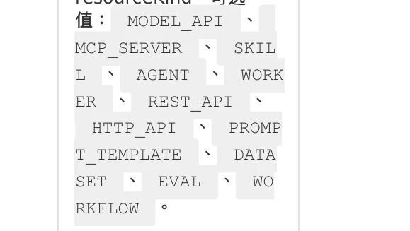

**示例**

**请求示例**

```http
GET /himarket/v1/open-api/v1/me/subscriptions HTTP/1.1
Host: localhost:8080
Authorization: Bearer <accessToken>
```

**响应示例**

```json
{
  "code": "SUCCESS",
  "message": null,
  "data": [
    {
      "subscriptionId": "subscription-001",
      "consumerId": "consumer-001",
      "consumerName": "sample-consumer",
      "status": "PENDING",
      "targetType": "sample-value",
      "targetId": "target-001"
    }
  ],
  "accessDeniedDetail": null,
  "requestId": "req-001"
}
```

<a id="section-3-8-18"></a>

### 3.8.18. listReviews

**接口信息**

- **接口路径**： `GET /himarket/v1/open-api/v1/me/reviews`

- **接口说明**：分页查询我的审核状态。

- **认证方式**：该接口属于开发者门户 API。调用前请完成开发者登录，并在请求 Header 中携带  `Authorization: Bearer <accessToken>` 。

- **Header 示例**：需要登录态的接口使用  `Authorization: Bearer <accessToken>` 。

**请求参数**

| 参数名称 | 位置 | 类型 | 是否必选 | 示例 | 说明 |
| --- | --- | --- | --- | --- | --- |
| tenantId | query | <code>string</code> | 否 | <code>"tenant-</code><br><code>001"</code> | 租户ID。 |
| resourceId | query | <code>string</code> | 否 | <code>"resource-</code><br><code>001"</code> | AI Resource ID。 |
| listingId | query | <code>string</code> | 否 | <code>"listing-</code><br><code>001"</code> | Listing ID。 |
| targetType | query | <code>string</code> | 否 | <code>"sample-</code><br><code>value"</code> | 订阅目标类型。 |
| targetId | query | <code>string</code> | 否 | <code>"target-</code><br><code>001"</code> | 目标对象 ID。 |
| reviewType | query | <code>string</code> | 否 | <code>"sample-</code><br><code>value"</code> | 审核类型。 |
| status | query | <code>string</code> | 否 | <code>"PENDING"</code> | 状态。 |
| pendingOnly | query | <code>boolean</code> | 否 | <code>false</code> | pendingOnly字段。 |
| submitterId | query | <code>string</code> | 否 | <code>"submitter</code><br><code>-001"</code> | 提交人 ID。 |
| reviewerId | query | <code>string</code> | 否 | <code>"reviewer-</code><br><code>001"</code> | 审核人 ID。 |
| page | query | <code>integer&lt;in</code><br><code>t32&gt;</code> | 否 | <code>1</code> | 页码。 |
| size | query | <code>integer&lt;in</code><br><code>t32&gt;</code> | 否 | <code>10</code> | 每页记录数。 |
| sort | query | <code>array</code> | 否 | <code>["sample-</code><br><code>value"]</code> | 排序条件。 |


**返回数据**

| 参数名称 | 类型 | 示例 | 说明 |
| --- | --- | --- | --- |
| code | <code>string</code> | <code>SUCCESS</code> | 响应码，取值为<code> SUCCESS </code> 时表示请求成功。 |
| message | <code>string</code> | <code>null</code> | 响应消息。请求成功时通常为空。 |
| data | <code>object</code> | <code>{"content":</code><br><code>[{}],"pageNumber":1,</code><br><code>"pageSize":10,"total</code><br><code>Count":1}</code> | 响应数据。具体结构以接口语义为准。 |
| accessDeniedDetail | <code>object</code> | <code>null</code> | 鉴权失败详情。请求成功时通常为空。 |
| requestId | <code>string</code> | <code>req-001</code> | 请求 ID，可用于问题排查和日志检索。 |
| data.content | <code>array</code> | <code>[{"review":</code><br><code>{},"listing":</code><br><code>{},"resource":</code><br><code>{},"defaultVersion":</code><br><code>{}}]</code> | 分页结果列表。 |
| data.content\[\].review | <code>object</code> | <code>{"submissionId":"s</code><br><code>ubmission-</code><br><code>001","targetType":"s</code><br><code>ample-</code><br><code>value","targetId":"t</code><br><code>arget-</code><br><code>001","submitterId":"</code><br><code>submitter-</code><br><code>001","reviewType":"s</code><br><code>ample-</code><br><code>value","status":"PEN</code><br><code>DING"}</code> | 审核单信息。 |
| data.content\[\].review.s ubmissionId | <code>string</code> | <code>"submission-001"</code> | 评审提交ID。 |
| data.content\[\].review.t argetType | <code>string</code> | <code>"sample-value"</code> | 订阅目标类型。 |
| data.content\[\].review.t argetId | <code>string</code> | <code>"target-001"</code> | 目标对象 ID。 |
| data.content\[\].review.s ubmitterId | <code>string</code> | <code>"submitter-001"</code> | 提交人 ID。 |
| data.content\[\].review.r eviewType | <code>string</code> | <code>"sample-value"</code> | 审核类型。 |
| data.content\[\].review.s tatus | <code>string</code> | <code>"PENDING"</code> | 状态。 |
| data.content\[\].review.checks | <code>object</code> | <code>{}</code> | 审核检查项列表。 |
| data.content\[\].review.decision | <code>object</code> | <code>{}</code> | 审核决策。 |
| data.content\[\].review.r eviewerId | <code>string</code> | <code>"reviewer-001"</code> | 审核人 ID。 |
| data.content\[\].review.s ubmittedAt | <code>string&lt;date-</code><br><code>time&gt;</code> | <code>"2026-06-</code><br><code>22T12:00:00Z"</code> | 提交时间。 |
| data.content\[\].review.decidedAt | <code>string&lt;date-</code><br><code>time&gt;</code> | <code>"2026-06-</code><br><code>22T12:00:00Z"</code> | 审批时间。 |
| data.content\[\].listing | <code>object</code> | <code>{"listingId":"list</code><br><code>ing-</code><br><code>001","tenantId":"ten</code><br><code>ant-</code><br><code>001","resourceId":"r</code><br><code>esource-</code><br><code>001","defaultVersion</code><br><code>Id":"defaultVersion-</code><br><code>001","portalId":"por</code><br><code>tal-</code><br><code>001","visibility":"P</code><br><code>RIVATE"}</code> | Listing 信息。 |
| data.content\[\].listing.li stingId | <code>string</code> | <code>"listing-001"</code> | Listing ID。 |
| data.content\[\].listing.t enantId | <code>string</code> | <code>"tenant-001"</code> | 租户ID。 |
| data.content\[\].listing.r esourceId | <code>string</code> | <code>"resource-001"</code> | AI Resource ID。 |
| data.content\[\].listing.d efaultVersionId | <code>string</code> | <code>"defaultVersion-</code><br><code>001"</code> | 默认版本ID。 |
| data.content\[\].listing.p ortalId | <code>string</code> | <code>"portal-001"</code> | 门户ID。 |
| data.content\[\].listing.vi sibility | <code>string</code> | <code>"PRIVATE"</code> | 可见性。可选值：<code> PRIVATE </code>、<code> PU</code> <code>BLIC </code>。 |
| data.content\[\].listing.ti tle | <code>string</code> | <code> "</code>示例资源标题<code>" </code> | 标题。 |
| data.content\[\].listing.s ummary | <code>string</code> | <code> "</code>示例摘要<code>" </code> | 摘要信息。 |
| data.content\[\].listing.d escription | <code>string</code> | <code> "</code>用于演示的资源描述<code>" </code> | 描述信息。 |
| data.content\[\].listing.ic on | <code>string</code> | <code>"sample-value"</code> | 图标地址。 |
| data.content\[\].listing.b anner | <code>string</code> | <code>"sample-value"</code> | 横幅图片地址。 |
| data.content\[\].listing.c ategoryId | <code>string</code> | <code>"category-001"</code> | 分类 ID。 |
| data.content\[\].listing.c ategory | <code>object</code> | <code>{"categoryId":"cat</code><br><code>egory-</code><br><code>001","tenantId":"ten</code><br><code>ant-</code><br><code>001","kind":"MODEL_A</code><br><code>PI","code":"model-</code><br><code>api","name":"sample-</code><br><code>name","description":</code> <code>"</code>用于演示的资源描述<code>"} </code> | 分类信息。 |
| data.content\[\].listing.c ategory.categoryId | <code>string</code> | <code>"category-001"</code> | 分类 ID。 |
| data.content\[\].listing.c ategory.tenantId | <code>string</code> | <code>"tenant-001"</code> | 租户ID。 |
| data.content\[\].listing.c ategory.kind | <code>string</code> | <code>"MODEL_API"</code> | 资源类型。 |
| data.content\[\].listing.c ategory.code | <code>string</code> | <code>"model-api"</code> | 业务编码。 |
| data.content\[\].listing.c ategory.name | <code>string</code> | <code>"sample-name"</code> | 名称。 |
| data.content\[\].listing.c ategory.description | <code>string</code> | <code> "</code>用于演示的资源描述<code>" </code> | 描述信息。 |
| data.content\[\].listing.c ategory.icon | <code>string</code> | <code>"sample-value"</code> | 图标地址。 |
| data.content\[\].listing.c ategory.sortOrder | <code>integer&lt;int32&gt;</code> | <code>100</code> | 排序值。 |
| data.content\[\].listing.c ategory.status | <code>string</code> | <code>"sample-value"</code> | 状态。 |
| data.content\[\].listing.c ategory.createdBy | <code>string</code> | <code>"sample-value"</code> | 创建人。 |
| data.content\[\].listing.c ategory.updatedBy | <code>string</code> | <code>"sample-value"</code> | 更新人。 |
| data.content\[\].listing.c ategory.createdAt | <code>string&lt;date-</code><br><code>time&gt;</code> | <code>"2026-06-</code><br><code>22T12:00:00Z"</code> | 创建时间。 |
| data.content\[\].listing.c ategory.updatedAt | <code>string&lt;date-</code><br><code>time&gt;</code> | <code>"2026-06-</code><br><code>22T12:00:00Z"</code> | 更新时间。 |
| data.content\[\].listing.c ategory.listingCount | <code>integer&lt;int64&gt;</code> | <code>1</code> | Listing 数量。 |
| data.content\[\].listing.t ags | <code>array</code> | <code>["sample-value"]</code> | 标签列表。 |
| data.content\[\].listing.p ricingMode | <code>string</code> | <code>"sample-value"</code> | 计费模式。 |
| data.content\[\].listing.li stingStatus | <code>string</code> | <code>"sample-value"</code> | 市场条目状态。 |
| data.content\[\].listing.p ublicationStatus | <code>string</code> | <code>"DRAFT"</code> | 发布状态。可选值：<code> DRAFT </code>、<code> IN_R</code> <code>EVIEW </code>、<code> PUBLISHED</code><code> </code>、<code> UNPUBLISHED </code>、<code> REJECTED </code>。 |
| data.content\[\].listing.c reatedBy | <code>string</code> | <code>"sample-value"</code> | 创建人。 |
| data.content\[\].listing.p ublishedBy | <code>string</code> | <code>"sample-value"</code> | 发布人 ID。 |
| data.content\[\].listing.p ublishedAt | <code>string&lt;date-</code><br><code>time&gt;</code> | <code>"2026-06-</code><br><code>22T12:00:00Z"</code> | 发布时间。 |
| data.content\[\].listing.c reatedAt | <code>string&lt;date-</code><br><code>time&gt;</code> | <code>"2026-06-</code><br><code>22T12:00:00Z"</code> | 创建时间。 |
| data.content\[\].listing.u pdatedAt | <code>string&lt;date-</code><br><code>time&gt;</code> | <code>"2026-06-</code><br><code>22T12:00:00Z"</code> | 更新时间。 |
| data.content\[\].resourc e | <code>object</code> | <code>{"resourceId":"res</code><br><code>ource-</code><br><code>001","tenantId":"ten</code><br><code>ant-</code><br><code>001","kind":"MODEL_A</code><br><code>PI","name":"sample-</code><br><code>name","displayName":</code> <code>"</code>示例资源<code>","summary":"</code>示例摘要<code>"} </code> | AI Resource 基础信息。 |
| data.content\[\].resourc e.resourceId | <code>string</code> | <code>"resource-001"</code> | AI Resource ID。 |
| data.content\[\].resourc e.tenantId | <code>string</code> | <code>"tenant-001"</code> | 租户ID。 |
| data.content\[\].resourc e.kind | <code>string</code> | <code>"MODEL_API"</code> | 资源类型。 |


<table>
  <tr>
    <td>data.content[].resourc e.name</td>
    <td><code>string</code></td>
    <td><code>"sample-name"</code></td>
    <td>名称。</td>
  </tr>
  <tr>
    <td>data.content[].resourc e.displayName</td>
    <td><code>string</code></td>
    <td><code> "</code>示例资源<code>" </code></td>
    <td>展示名称。</td>
  </tr>
  <tr>
    <td>data.content[].resourc e.summary</td>
    <td><code>string</code></td>
    <td><code> "</code>示例摘要<code>" </code></td>
    <td>摘要信息。</td>
  </tr>
  <tr>
    <td>data.content[].resourc e.description</td>
    <td><code>string</code></td>
    <td><code> "</code>用于演示的资源描述<code>" </code></td>
    <td>描述信息。</td>
  </tr>
  <tr>
    <td>data.content[].resourc e.ownerType</td>
    <td><code>string</code></td>
    <td><code>"USER"</code></td>
    <td>归属主体类型。可选值：<code> USER </code>、<code> APP </code>、<code> SYSTEM </code>。</td>
  </tr>
  <tr>
    <td>data.content[].resourc e.ownerId</td>
    <td><code>string</code></td>
    <td><code>"owner-001"</code></td>
    <td>归属主体ID。</td>
  </tr>
  <tr>
    <td>data.content[].resourc e.createdBy</td>
    <td><code>string</code></td>
    <td><code>"sample-value"</code></td>
    <td>创建人。</td>
  </tr>
  <tr>
    <td>data.content[].resourc e.createdByName</td>
    <td><code>string</code></td>
    <td><code>"demo-createdby"</code></td>
    <td>创建人名称。</td>
  </tr>
  <tr>
    <td>data.content[].resourc e.icon</td>
    <td><code>string</code></td>
    <td><code>"sample-value"</code></td>
    <td>图标地址。</td>
  </tr>
  <tr>
    <td>data.content[].resourc e.tags</td>
    <td><code>array</code></td>
    <td><code>["sample-value"]</code></td>
    <td>标签列表。</td>
  </tr>
  <tr>
    <td>data.content[].resourc e.lifecycleStatus</td>
    <td><code>string</code></td>
    <td><code>"DRAFT"</code></td>
    <td>生命周期状态。可选值：<code> DRAFT </code>、<code> ACTI</code> <code>VE </code>、<code> DEPRECATED </code>、<code> ARCHIVED </code>。</td>
  </tr>
  <tr>
    <td>data.content[].resourc e.latestVersionId</td>
    <td><code>string</code></td>
    <td><code>"latestVersion-</code><br><code>001"</code></td>
    <td>最新版本ID。</td>
  </tr>
  <tr>
    <td>data.content[].resourc e.autoApproveSubscri ption</td>
    <td><code>boolean</code></td>
    <td><code>true</code></td>
    <td>是否自动批准订阅。</td>
  </tr>
  <tr>
    <td>data.content[].resourc e.extras</td>
    <td><code>object</code></td>
    <td><code>{}</code></td>
    <td>扩展配置。</td>
  </tr>
  <tr>
    <td>data.content[].resourc e.createdAt</td>
    <td><code>string&lt;date-</code><br><code>time&gt;</code></td>
    <td><code>"2026-06-</code><br><code>22T12:00:00Z"</code></td>
    <td>创建时间。</td>
  </tr>
  <tr>
    <td>data.content[].resourc e.updatedAt</td>
    <td><code>string&lt;date-</code><br><code>time&gt;</code></td>
    <td><code>"2026-06-</code><br><code>22T12:00:00Z"</code></td>
    <td>更新时间。</td>
  </tr>
  <tr>
    <td>data.content[].default Version</td>
    <td><code>object</code></td>
    <td><code>{"versionId":"vers</code><br><code>ion-</code><br><code>001","resourceId":"r</code><br><code>esource-</code><br><code>001","version":"samp</code><br><code>le-</code><br><code>value","versionSchem</code><br><code>e":"SEMVER","status"</code><br><code>:"DRAFT","manifestId</code><br><code>":"manifest-001"}</code></td>
    <td>默认版本信息。</td>
  </tr>
  <tr>
    <td>data.content[].default Version.versionId</td>
    <td><code>string</code></td>
    <td><code>"version-001"</code></td>
    <td>版本 ID。</td>
  </tr>
  <tr>
    <td>data.content[].default Version.resourceId</td>
    <td><code>string</code></td>
    <td><code>"resource-001"</code></td>
    <td>AI Resource ID。</td>
  </tr>
  <tr>
    <td>data.content[].default Version.version</td>
    <td><code>string</code></td>
    <td><code>"sample-value"</code></td>
    <td>版本号。</td>
  </tr>
  <tr>
    <td>data.content[].default Version.versionSchem e</td>
    <td><code>string</code></td>
    <td><code>"SEMVER"</code></td>
    <td>版本号方案。可选值：<code> SEMVER </code>、<code> TIM</code> <code>ESTAMP </code>、<code> REVISION</code><code> </code>、<code> EXTERNAL </code>。</td>
  </tr>
  <tr>
    <td>data.content[].default Version.status</td>
    <td><code>string</code></td>
    <td><code>"DRAFT"</code></td>
    <td>状态。</td>
  </tr>
  <tr>
    <td>data.content[].default Version.manifestId</td>
    <td><code>string</code></td>
    <td><code>"manifest-001"</code></td>
    <td>Manifest ID。</td>
  </tr>
</table>


<table>
  <tr>
    <td>data.content[].default Version.sourceBindingI d</td>
    <td><code>string</code></td>
    <td><code>"sourceBinding-</code><br><code>001"</code></td>
    <td>来源绑定ID。</td>
  </tr>
  <tr>
    <td>data.content[].default Version.artifactDigest</td>
    <td><code>string</code></td>
    <td><code>"sample-value"</code></td>
    <td>制品摘要。</td>
  </tr>
  <tr>
    <td>data.content[].default Version.releaseNote</td>
    <td><code>string</code></td>
    <td><code>"sample-value"</code></td>
    <td>版本说明。</td>
  </tr>
</table>

**示例**

**请求示例**

```http
GET /himarket/v1/open-api/v1/me/reviews?tenantId=tenant-001&resourceId=resource-001&listingId=listing-001&targetType=sample-value&targetId=target-001&reviewType=sample-value&status=PENDING&pendingOnly=false HTTP/1.1
Host: localhost:8080
Authorization: Bearer <accessToken>
```

**响应示例**

```json
{
  "code": "SUCCESS",
  "message": null,
  "data": {
    "content": [
      {}
    ],
    "pageNumber": 1,
    "pageSize": 10,
    "totalCount": 1
  },
  "accessDeniedDetail": null,
  "requestId": "req-001"
}
```

<a id="section-3-8-19"></a>

### 3.8.19. saveListing

**接口信息**

- **接口路径**： `POST /himarket/v1/open-api/v1/me/listings`

- **接口说明**：创建或更新我的 Listing 草稿。

- **认证方式**：该接口属于开发者门户 API。调用前请完成开发者登录，并在请求 Header 中携带  `Authorization: Bearer <accessToken>` 。

- **Header 示例**：需要登录态的接口使用  `Authorization: Bearer <accessToken>` 。

**请求参数**

| 参数名称 | 位置 | 类型 | 是否必选 | 示例 | 说明 |
| --- | --- | --- | --- | --- | --- |
| resourceId | body | <code>string</code> | 是 | <code>"resource-</code><br><code>001"</code> | AI Resource ID。 |
| defaultVersio nId | body | <code>string</code> | 否 | <code>"defaultVe</code><br><code>rsion-001"</code> | 默认版本ID。 |
| portalId | body | <code>string</code> | 否 | <code>"portal-</code><br><code>001"</code> | 门户ID。 |
| visibility | body | <code>string</code> | 否 | <code>"PRIVATE"</code> | 可见性。可选值：<code> PRIVATE</code><code> </code>、<code> PUBLIC</code><code> </code>。 |
| title | body | <code>string</code> | 是 | <code> "</code>示例资源标题<code>" </code> | 标题。 |
| summary | body | <code>string</code> | 否 | <code> "</code>示例摘要<code>" </code> | 摘要信息。 |
| description | body | <code>string</code> | 否 | <code> "</code>用于演示的资源描述<code>" </code> | 描述信息。 |
| banner | body | <code>string</code> | 否 | <code>"sample-</code><br><code>value"</code> | 横幅图片地址。 |
| pricingMode | body | <code>string</code> | 否 | <code>"sample-</code><br><code>value"</code> | 计费模式。 |
| categoryId | body | <code>string</code> | 否 | <code>"category-</code><br><code>001"</code> | 分类 ID。 |


**返回数据**

| 参数名称 | 类型 | 示例 | 说明 |
| --- | --- | --- | --- |
| code | <code>string</code> | <code>SUCCESS</code> | 响应码，取值为<code> SUCCESS </code> 时表示请求成功。 |
| message | <code>string</code> | <code>null</code> | 响应消息。请求成功时通常为空。 |
| data | <code>object</code> | <code>{"listingId":"list</code><br><code>ing-</code><br><code>001","tenantId":"ten</code><br><code>ant-</code><br><code>001","resourceId":"r</code><br><code>esource-</code><br><code>001","defaultVersion</code><br><code>Id":"defaultVersion-</code><br><code>001","portalId":"por</code><br><code>tal-</code><br><code>001","visibility":"P</code><br><code>RIVATE"}</code> | 响应数据。具体结构以接口语义为准。 |
| accessDeniedDetail | <code>object</code> | <code>null</code> | 鉴权失败详情。请求成功时通常为空。 |
| requestId | <code>string</code> | <code>req-001</code> | 请求 ID，可用于问题排查和日志检索。 |
| data.listingId | <code>string</code> | <code>"listing-001"</code> | Listing ID。 |
| data.tenantId | <code>string</code> | <code>"tenant-001"</code> | 租户ID。 |
| data.resourceId | <code>string</code> | <code>"resource-001"</code> | AI Resource ID。 |
| data.defaultVersionId | <code>string</code> | <code>"defaultVersion-</code><br><code>001"</code> | 默认版本ID。 |
| data.portalId | <code>string</code> | <code>"portal-001"</code> | 门户ID。 |
| data.visibility | <code>string</code> | <code>"PRIVATE"</code> | 可见性。可选值：<code> PRIVATE </code>、<code> PU</code> <code>BLIC </code>。 |
| data.title | <code>string</code> | <code> "</code>示例资源标题<code>" </code> | 标题。 |
| data.summary | <code>string</code> | <code> "</code>示例摘要<code>" </code> | 摘要信息。 |
| data.description | <code>string</code> | <code> "</code>用于演示的资源描述<code>" </code> | 描述信息。 |
| data.icon | <code>string</code> | <code>"sample-value"</code> | 图标地址。 |
| data.banner | <code>string</code> | <code>"sample-value"</code> | 横幅图片地址。 |
| data.categoryId | <code>string</code> | <code>"category-001"</code> | 分类 ID。 |
| data.category | <code>object</code> | <code>{"categoryId":"cat</code><br><code>egory-</code><br><code>001","tenantId":"ten</code><br><code>ant-</code><br><code>001","kind":"MODEL_A</code><br><code>PI","code":"model-</code><br><code>api","name":"sample-</code><br><code>name","description":</code> <code>"</code>用于演示的资源描述<code>"} </code> | 分类信息。 |
| data.category.categor yId | <code>string</code> | <code>"category-001"</code> | 分类 ID。 |
| data.category.tenantId | <code>string</code> | <code>"tenant-001"</code> | 租户ID。 |
| data.category.kind | <code>string</code> | <code>"MODEL_API"</code> | 资源类型。 |
| data.category.code | <code>string</code> | <code>"model-api"</code> | 业务编码。 |
| data.category.name | <code>string</code> | <code>"sample-name"</code> | 名称。 |
| data.category.descript ion | <code>string</code> | <code> "</code>用于演示的资源描述<code>" </code> | 描述信息。 |
| data.category.icon | <code>string</code> | <code>"sample-value"</code> | 图标地址。 |
| data.category.sortOrd er | <code>integer&lt;int32&gt;</code> | <code>100</code> | 排序值。 |
| data.category.status | <code>string</code> | <code>"sample-value"</code> | 状态。 |
| data.category.created By | <code>string</code> | <code>"sample-value"</code> | 创建人。 |
| data.category.updated By | <code>string</code> | <code>"sample-value"</code> | 更新人。 |
| data.category.created At | <code>string&lt;date-</code><br><code>time&gt;</code> | <code>"2026-06-</code><br><code>22T12:00:00Z"</code> | 创建时间。 |
| data.category.updated At | <code>string&lt;date-</code><br><code>time&gt;</code> | <code>"2026-06-</code><br><code>22T12:00:00Z"</code> | 更新时间。 |
| data.category.listingC ount | <code>integer&lt;int64&gt;</code> | <code>1</code> | Listing 数量。 |
| data.tags | <code>array</code> | <code>["sample-value"]</code> | 标签列表。 |
| data.pricingMode | <code>string</code> | <code>"sample-value"</code> | 计费模式。 |
| data.listingStatus | <code>string</code> | <code>"sample-value"</code> | 市场条目状态。 |
| data.publicationStatus | <code>string</code> | <code>"DRAFT"</code> | 发布状态。可选值：<code> DRAFT </code>、<code> IN_R</code> <code>EVIEW </code>、<code> PUBLISHED</code><code> </code>、<code> UNPUBLISHED </code>、<code> REJECTED </code>。 |
| data.createdBy | <code>string</code> | <code>"sample-value"</code> | 创建人。 |
| data.publishedBy | <code>string</code> | <code>"sample-value"</code> | 发布人 ID。 |
| data.publishedAt | <code>string&lt;date-</code><br><code>time&gt;</code> | <code>"2026-06-</code><br><code>22T12:00:00Z"</code> | 发布时间。 |


<table>
  <tr>
    <td>data.createdAt</td>
    <td><code>string&lt;date-</code><br><code>time&gt;</code></td>
    <td><code>"2026-06-</code><br><code>22T12:00:00Z"</code></td>
    <td>创建时间。</td>
  </tr>
  <tr>
    <td>data.updatedAt</td>
    <td><code>string&lt;date-</code><br><code>time&gt;</code></td>
    <td><code>"2026-06-</code><br><code>22T12:00:00Z"</code></td>
    <td>更新时间。</td>
  </tr>
</table>

**示例**

**请求示例**

```http
POST /himarket/v1/open-api/v1/me/listings HTTP/1.1
Host: localhost:8080
Authorization: Bearer <accessToken>
Content-Type: application/json

{
  "resourceId": "resource-001",
  "defaultVersionId": "defaultVersion-001",
  "portalId": "portal-001",
  "visibility": "PRIVATE",
  "title": "示例资源标题",
  "summary": "示例摘要"
}
```

**响应示例**

```json
{
  "code": "SUCCESS",
  "message": null,
  "data": {
    "listingId": "listing-001",
    "tenantId": "tenant-001",
    "resourceId": "resource-001",
    "defaultVersionId": "defaultVersion-001",
    "portalId": "portal-001",
    "visibility": "PRIVATE"
  },
  "accessDeniedDetail": null,
  "requestId": "req-001"
}
```

<a id="section-3-8-20"></a>

### 3.8.20. submitReview

**接口信息**

- **接口路径**： `POST /himarket/v1/open-api/v1/me/listings/{listingId}/submit-review`

- **接口说明**：提交我的 Listing 审核。

- **认证方式**：该接口属于开发者门户 API。调用前请完成开发者登录，并在请求 Header 中携带  `Authorization: Bearer <accessToken>` 。

- **Header 示例**：需要登录态的接口使用  `Authorization: Bearer <accessToken>` 。

**请求参数**

| 参数名称 | 位置 | 类型 | 是否必选 | 示例 | 说明 |
| --- | --- | --- | --- | --- | --- |
| listingId | path | <code>string</code> | 是 | <code>"listing-</code><br><code>001"</code> | Listing ID。 |
| checks | body | <code>object</code> | 否 | <code>{}</code> | 审核检查项列表。 |

**返回数据**

| 参数名称 | 类型 | 示例 | 说明 |
| --- | --- | --- | --- |
| code | <code>string</code> | <code>SUCCESS</code> | 响应码，取值为<code> SUCCESS </code> 时表示请求成功。 |
| message | <code>string</code> | <code>null</code> | 响应消息。请求成功时通常为空。 |
| data | <code>object</code> | <code>{"submissionId":"s</code><br><code>ubmission-</code><br><code>001","targetType":"s</code><br><code>ample-</code><br><code>value","targetId":"t</code><br><code>arget-</code><br><code>001","submitterId":"</code><br><code>submitter-</code><br><code>001","reviewType":"s</code><br><code>ample-</code><br><code>value","status":"PEN</code><br><code>DING"}</code> | 响应数据。具体结构以接口语义为准。 |
| accessDeniedDetail | <code>object</code> | <code>null</code> | 鉴权失败详情。请求成功时通常为空。 |
| requestId | <code>string</code> | <code>req-001</code> | 请求 ID，可用于问题排查和日志检索。 |
| data.submissionId | <code>string</code> | <code>"submission-001"</code> | 评审提交ID。 |
| data.targetType | <code>string</code> | <code>"sample-value"</code> | 订阅目标类型。 |
| data.targetId | <code>string</code> | <code>"target-001"</code> | 目标对象 ID。 |
| data.submitterId | <code>string</code> | <code>"submitter-001"</code> | 提交人 ID。 |
| data.reviewType | <code>string</code> | <code>"sample-value"</code> | 审核类型。 |
| data.status | <code>string</code> | <code>"PENDING"</code> | 状态。 |
| data.checks | <code>object</code> | <code>{}</code> | 审核检查项列表。 |
| data.decision | <code>object</code> | <code>{}</code> | 审核决策。 |
| data.reviewerId | <code>string</code> | <code>"reviewer-001"</code> | 审核人 ID。 |
| data.submittedAt | <code>string&lt;date-</code><br><code>time&gt;</code> | <code>"2026-06-</code><br><code>22T12:00:00Z"</code> | 提交时间。 |
| data.decidedAt | <code>string&lt;date-</code><br><code>time&gt;</code> | <code>"2026-06-</code><br><code>22T12:00:00Z"</code> | 审批时间。 |

**示例**

**请求示例**

```http
POST /himarket/v1/open-api/v1/me/listings/{listingId}/submit-review HTTP/1.1
Host: localhost:8080
Authorization: Bearer <accessToken>
Content-Type: application/json

{
  "checks": {}
}
```

**响应示例**

```json
{
  "code": "SUCCESS",
  "message": null,
  "data": {
    "submissionId": "submission-001",
    "targetType": "sample-value",
    "targetId": "target-001",
    "submitterId": "submitter-001",
    "reviewType": "sample-value",
    "status": "PENDING"
  },
  "accessDeniedDetail": null,
  "requestId": "req-001"
}
```

<a id="section-3-8-21"></a>

### 3.8.21. updateMyProfile

**接口信息**

- **接口路径**： `PUT /himarket/v1/open-api/v1/me/profile`

- **接口说明**：更新我的账号资料。

- **认证方式**：该接口属于开发者门户 API。调用前请完成开发者登录，并在请求 Header 中携带  `Authorization: Bearer <accessToken>` 。

- **Header 示例**：需要登录态的接口使用  `Authorization: Bearer <accessToken>` 。

**请求参数**

| 参数名称 | 位置 | 类型 | 是否必选 | 示例 | 说明 |
| --- | --- | --- | --- | --- | --- |
| username | body | <code>string</code> | 否 | <code>"admin"</code> | 用户名。 |
| email | body | <code>string</code> | 否 | <code>"user@exam</code><br><code>ple.com"</code> | 邮箱。 |
| avatarUrl | body | <code>string</code> | 否 | <code>"https://a</code><br><code>pi.example.c</code><br><code>om"</code> | 头像地址。 |

**返回数据**

| 参数名称 | 类型 | 示例 | 说明 |
| --- | --- | --- | --- |
| code | <code>string</code> | <code>SUCCESS</code> | 响应码，取值为<code> SUCCESS </code> 时表示请求成功。 |
| message | <code>string</code> | <code>null</code> | 响应消息。请求成功时通常为空。 |
| data | <code>object</code> | <code>{"developerId":"de</code><br><code>veloper-</code><br><code>001","portalId":"por</code><br><code>tal-</code><br><code>001","username":"adm</code><br><code>in","email":"user@ex</code><br><code>ample.com","avatarUr</code><br><code>l":"https://api.exam</code><br><code>ple.com","status":"A</code><br><code>PPROVED"}</code> | 响应数据。具体结构以接口语义为准。 |
| accessDeniedDetail | <code>object</code> | <code>null</code> | 鉴权失败详情。请求成功时通常为空。 |
| requestId | <code>string</code> | <code>req-001</code> | 请求 ID，可用于问题排查和日志检索。 |
| data.developerId | <code>string</code> | <code>"developer-001"</code> | 开发者ID。 |
| data.portalId | <code>string</code> | <code>"portal-001"</code> | 门户ID。 |
| data.username | <code>string</code> | <code>"admin"</code> | 用户名。 |
| data.email | <code>string</code> | <code>"user@example.com"</code> | 邮箱。 |
| data.avatarUrl | <code>string</code> | <code>"https://api.examp</code><br><code>le.com"</code> | 头像地址。 |
| data.status | <code>string</code> | <code>"APPROVED"</code> | 状态。 |


<table>
  <tr>
    <td>data.authType</td>
    <td><code>string</code></td>
    <td><code>"LOCAL"</code></td>
    <td>authType。可选值：<code> LOCAL </code>、<code> BUIL</code> <code>TIN </code>、<code> EXTERNAL </code>、<code> OIDC </code>、<code> OAUTH2 </code>。</td>
  </tr>
  <tr>
    <td>data.createdAt</td>
    <td><code>string&lt;date-</code><br><code>time&gt;</code></td>
    <td><code>"2026-06-</code><br><code>22T12:00:00Z"</code></td>
    <td>创建时间。</td>
  </tr>
  <tr>
    <td>data.updatedAt</td>
    <td><code>string&lt;date-</code><br><code>time&gt;</code></td>
    <td><code>"2026-06-</code><br><code>22T12:00:00Z"</code></td>
    <td>更新时间。</td>
  </tr>
  <tr>
    <td>data.identities</td>
    <td><code>array</code></td>
    <td><code>[{"provider":"samp</code><br><code>le-</code><br><code>value","subject":"sa</code><br><code>mple-</code><br><code>value","displayName"</code><code>:"</code>示例资源<code>","authType":"LOCA</code> <code>L","createdAt":"2026</code><br><code>-06-</code><br><code>22T12:00:00Z","updat</code><br><code>edAt":"2026-06-</code><br><code>22T12:00:00Z"}]</code></td>
    <td>身份信息列表。</td>
  </tr>
  <tr>
    <td>data.identities[].provid er</td>
    <td><code>string</code></td>
    <td><code>"sample-value"</code></td>
    <td>OIDC Provider 标识。</td>
  </tr>
  <tr>
    <td>data.identities[].subjec t</td>
    <td><code>string</code></td>
    <td><code>"sample-value"</code></td>
    <td>主体信息。</td>
  </tr>
  <tr>
    <td>data.identities[].displa yName</td>
    <td><code>string</code></td>
    <td><code> "</code>示例资源<code>" </code></td>
    <td>展示名称。</td>
  </tr>
  <tr>
    <td>data.identities[].authT ype</td>
    <td><code>string</code></td>
    <td><code>"LOCAL"</code></td>
    <td>authType。可选值：<code> LOCAL </code>、<code> BUIL</code> <code>TIN </code>、<code> EXTERNAL </code>、<code> OIDC </code>、<code> OAUTH2 </code>。</td>
  </tr>
  <tr>
    <td>data.identities[].create dAt</td>
    <td><code>string&lt;date-</code><br><code>time&gt;</code></td>
    <td><code>"2026-06-</code><br><code>22T12:00:00Z"</code></td>
    <td>创建时间。</td>
  </tr>
  <tr>
    <td>data.identities[].updat edAt</td>
    <td><code>string&lt;date-</code><br><code>time&gt;</code></td>
    <td><code>"2026-06-</code><br><code>22T12:00:00Z"</code></td>
    <td>更新时间。</td>
  </tr>
</table>

**示例**

**请求示例**

```http
PUT /himarket/v1/open-api/v1/me/profile HTTP/1.1
Host: localhost:8080
Authorization: Bearer <accessToken>
Content-Type: application/json

{
  "username": "admin",
  "email": "user@example.com",
  "avatarUrl": "https://api.example.com"
}
```

**响应示例**

```json
{
  "code": "SUCCESS",
  "message": null,
  "data": {
    "developerId": "developer-001",
    "portalId": "portal-001",
    "username": "admin",
    "email": "user@example.com",
    "avatarUrl": "https://api.example.com",
    "status": "APPROVED"
  },
  "accessDeniedDetail": null,
  "requestId": "req-001"
}
```

<a id="section-3-8-22"></a>

### 3.8.22. updateMyResourceBasicInfo

**接口信息**

- **接口路径**： `PUT /himarket/v1/open-api/v1/me/resources/{resourceId}/basic-info`

- **接口说明**：更新我的 AI Resource 基础信息。

- **认证方式**：该接口属于开发者门户 API。调用前请完成开发者登录，并在请求 Header 中携带  `Authorization: Bearer <accessToken>` 。

- **Header 示例**：需要登录态的接口使用  `Authorization: Bearer <accessToken>` 。

**请求参数**

| 参数名称 | 位置 | 类型 | 是否必选 | 示例 | 说明 |
| --- | --- | --- | --- | --- | --- |
| resourceId | path | <code>string</code> | 是 | <code>"resource-</code><br><code>001"</code> | AI Resource ID。 |
| displayName | body | <code>string</code> | 否 | <code> "</code>示例资源<code>" </code> | 展示名称。 |
| summary | body | <code>string</code> | 否 | <code> "</code>示例摘要<code>" </code> | 摘要信息。 |
| autoApproveS ubscription | body | <code>boolean</code> | 否 | <code>true</code> | 是否自动批准订阅。 |
| icon | body | <code>string</code> | 否 | <code>"sample-</code><br><code>value"</code> | 图标地址。 |
| tags | body | <code>array</code> | 否 | <code>["sample-</code><br><code>value"]</code> | 标签列表。 |

**返回数据**

| 参数名称 | 类型 | 示例 | 说明 |
| --- | --- | --- | --- |
| code | <code>string</code> | <code>SUCCESS</code> | 响应码，取值为<code> SUCCESS </code> 时表示请求成功。 |
| message | <code>string</code> | <code>null</code> | 响应消息。请求成功时通常为空。 |

<table>
  <tr>
    <td>data</td>
    <td><code>object</code></td>
    <td><code>{"resource":</code><br><code>{"resourceId":"resou</code><br><code>rce-</code><br><code>001","tenantId":"ten</code><br><code>ant-</code><br><code>001","kind":"MODEL_A</code><br><code>PI","name":"sample-</code><br><code>name","displayName":</code> <code>"</code>示例资源<code>","summary":"</code>示例摘要<code>"},"latestVersion"</code><code>:</code><br><code>{"versionId":"versio</code><br><code>n-</code><br><code>001","resourceId":"r</code><br><code>esource-</code><br><code>001","version":"samp</code><br><code>le-</code><br><code>value","versionSchem</code><br><code>e":"SEMVER","status"</code><br><code>:"DRAFT","manifestId</code><br><code>":"manifest-</code><br><code>001"},"sourceBinding</code><br><code>s":[{}]}</code></td>
    <td>响应数据。具体结构以接口语义为准。</td>
  </tr>
  <tr>
    <td>accessDeniedDetail</td>
    <td><code>object</code></td>
    <td><code>null</code></td>
    <td>鉴权失败详情。请求成功时通常为空。</td>
  </tr>
  <tr>
    <td>requestId</td>
    <td><code>string</code></td>
    <td><code>req-001</code></td>
    <td>请求 ID，可用于问题排查和日志检索。</td>
  </tr>
  <tr>
    <td>data.resource</td>
    <td><code>object</code></td>
    <td><code>{"resourceId":"res</code><br><code>ource-</code><br><code>001","tenantId":"ten</code><br><code>ant-</code><br><code>001","kind":"MODEL_A</code><br><code>PI","name":"sample-</code><br><code>name","displayName":</code> <code>"</code>示例资源<code>","summary":"</code>示例摘要<code>"} </code></td>
    <td>AI Resource 基础信息。</td>
  </tr>
  <tr>
    <td>data.resource.resourc eId</td>
    <td><code>string</code></td>
    <td><code>"resource-001"</code></td>
    <td>AI Resource ID。</td>
  </tr>
  <tr>
    <td>data.resource.tenantId</td>
    <td><code>string</code></td>
    <td><code>"tenant-001"</code></td>
    <td>租户ID。</td>
  </tr>
  <tr>
    <td>data.resource.kind</td>
    <td><code>string</code></td>
    <td><code>"MODEL_API"</code></td>
    <td>资源类型。</td>
  </tr>
  <tr>
    <td>data.resource.name</td>
    <td><code>string</code></td>
    <td><code>"sample-name"</code></td>
    <td>名称。</td>
  </tr>
  <tr>
    <td>data.resource.displayN ame</td>
    <td><code>string</code></td>
    <td><code> "</code>示例资源<code>" </code></td>
    <td>展示名称。</td>
  </tr>
  <tr>
    <td>data.resource.summar y</td>
    <td><code>string</code></td>
    <td><code> "</code>示例摘要<code>" </code></td>
    <td>摘要信息。</td>
  </tr>
  <tr>
    <td>data.resource.descripti on</td>
    <td><code>string</code></td>
    <td><code> "</code>用于演示的资源描述<code>" </code></td>
    <td>描述信息。</td>
  </tr>
  <tr>
    <td>data.resource.ownerTy pe</td>
    <td><code>string</code></td>
    <td><code>"USER"</code></td>
    <td>归属主体类型。可选值：<code> USER </code>、<code> APP </code>、<code> SYSTEM </code>。</td>
  </tr>
  <tr>
    <td>data.resource.ownerId</td>
    <td><code>string</code></td>
    <td><code>"owner-001"</code></td>
    <td>归属主体ID。</td>
  </tr>
  <tr>
    <td>data.resource.created By</td>
    <td><code>string</code></td>
    <td><code>"sample-value"</code></td>
    <td>创建人。</td>
  </tr>
  <tr>
    <td>data.resource.created ByName</td>
    <td><code>string</code></td>
    <td><code>"demo-createdby"</code></td>
    <td>创建人名称。</td>
  </tr>
  <tr>
    <td>data.resource.icon</td>
    <td><code>string</code></td>
    <td><code>"sample-value"</code></td>
    <td>图标地址。</td>
  </tr>
  <tr>
    <td>data.resource.tags</td>
    <td><code>array</code></td>
    <td><code>["sample-value"]</code></td>
    <td>标签列表。</td>
  </tr>
  <tr>
    <td>data.resource.lifecycle Status</td>
    <td><code>string</code></td>
    <td><code>"DRAFT"</code></td>
    <td>生命周期状态。可选值：<code> DRAFT </code>、<code> ACTI</code> <code>VE </code>、<code> DEPRECATED </code>、<code> ARCHIVED </code>。</td>
  </tr>
  <tr>
    <td>data.resource.latestVe rsionId</td>
    <td><code>string</code></td>
    <td><code>"latestVersion-</code><br><code>001"</code></td>
    <td>最新版本ID。</td>
  </tr>
  <tr>
    <td>data.resource.autoApp roveSubscription</td>
    <td><code>boolean</code></td>
    <td><code>true</code></td>
    <td>是否自动批准订阅。</td>
  </tr>
  <tr>
    <td>data.resource.extras</td>
    <td><code>object</code></td>
    <td><code>{}</code></td>
    <td>扩展配置。</td>
  </tr>
  <tr>
    <td>data.resource.created At</td>
    <td><code>string&lt;date-</code><br><code>time&gt;</code></td>
    <td><code>"2026-06-</code><br><code>22T12:00:00Z"</code></td>
    <td>创建时间。</td>
  </tr>
  <tr>
    <td>data.resource.updated At</td>
    <td><code>string&lt;date-</code><br><code>time&gt;</code></td>
    <td><code>"2026-06-</code><br><code>22T12:00:00Z"</code></td>
    <td>更新时间。</td>
  </tr>
  <tr>
    <td>data.latestVersion</td>
    <td><code>object</code></td>
    <td><code>{"versionId":"vers</code><br><code>ion-</code><br><code>001","resourceId":"r</code><br><code>esource-</code><br><code>001","version":"samp</code><br><code>le-</code><br><code>value","versionSchem</code><br><code>e":"SEMVER","status"</code><br><code>:"DRAFT","manifestId</code><br><code>":"manifest-001"}</code></td>
    <td>最新版本信息。</td>
  </tr>
  <tr>
    <td>data.latestVersion.vers ionId</td>
    <td><code>string</code></td>
    <td><code>"version-001"</code></td>
    <td>版本 ID。</td>
  </tr>
  <tr>
    <td>data.latestVersion.reso urceId</td>
    <td><code>string</code></td>
    <td><code>"resource-001"</code></td>
    <td>AI Resource ID。</td>
  </tr>
  <tr>
    <td>data.latestVersion.vers ion</td>
    <td><code>string</code></td>
    <td><code>"sample-value"</code></td>
    <td>版本号。</td>
  </tr>
  <tr>
    <td>data.latestVersion.vers ionScheme</td>
    <td><code>string</code></td>
    <td><code>"SEMVER"</code></td>
    <td>版本号方案。可选值：<code> SEMVER </code>、<code> TIM</code> <code>ESTAMP </code>、<code> REVISION</code><code> </code>、<code> EXTERNAL </code>。</td>
  </tr>
  <tr>
    <td>data.latestVersion.stat us</td>
    <td><code>string</code></td>
    <td><code>"DRAFT"</code></td>
    <td>状态。</td>
  </tr>
  <tr>
    <td>data.latestVersion.ma nifestId</td>
    <td><code>string</code></td>
    <td><code>"manifest-001"</code></td>
    <td>Manifest ID。</td>
  </tr>
</table>

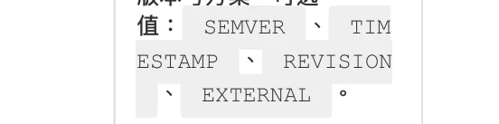

<table>
  <tr>
    <td>data.latestVersion.sou rceBindingId</td>
    <td><code>string</code></td>
    <td><code>"sourceBinding-</code><br><code>001"</code></td>
    <td>来源绑定ID。</td>
  </tr>
  <tr>
    <td>data.latestVersion.artif actDigest</td>
    <td><code>string</code></td>
    <td><code>"sample-value"</code></td>
    <td>制品摘要。</td>
  </tr>
  <tr>
    <td>data.latestVersion.rele aseNote</td>
    <td><code>string</code></td>
    <td><code>"sample-value"</code></td>
    <td>版本说明。</td>
  </tr>
  <tr>
    <td>data.latestVersion.cre atedBy</td>
    <td><code>string</code></td>
    <td><code>"sample-value"</code></td>
    <td>创建人。</td>
  </tr>
  <tr>
    <td>data.latestVersion.pub lishedAt</td>
    <td><code>string&lt;date-</code><br><code>time&gt;</code></td>
    <td><code>"2026-06-</code><br><code>22T12:00:00Z"</code></td>
    <td>发布时间。</td>
  </tr>
  <tr>
    <td>data.latestVersion.cre atedAt</td>
    <td><code>string&lt;date-</code><br><code>time&gt;</code></td>
    <td><code>"2026-06-</code><br><code>22T12:00:00Z"</code></td>
    <td>创建时间。</td>
  </tr>
  <tr>
    <td>data.latestVersion.upd atedAt</td>
    <td><code>string&lt;date-</code><br><code>time&gt;</code></td>
    <td><code>"2026-06-</code><br><code>22T12:00:00Z"</code></td>
    <td>更新时间。</td>
  </tr>
  <tr>
    <td>data.latestVersion.dow nloadCount</td>
    <td><code>integer&lt;int64&gt;</code></td>
    <td><code>1</code></td>
    <td>下载次数。</td>
  </tr>
  <tr>
    <td>data.latestVersion.isLa test</td>
    <td><code>boolean</code></td>
    <td><code>true</code></td>
    <td>是否为最新版本。</td>
  </tr>
  <tr>
    <td>data.sourceBindings</td>
    <td><code>array</code></td>
    <td><code>[{"sourceBindingId</code><br><code>":"sourceBinding-</code><br><code>001","resourceId":"r</code><br><code>esource-</code><br><code>001","sourceType":"G</code><br><code>ATEWAY","sourceRef":</code><br><code>"sample-</code><br><code>value","primaryBindi</code><br><code>ng":false,"priority"</code><br><code>:100}]</code></td>
    <td>来源绑定列表。</td>
  </tr>
  <tr>
    <td>data.sourceBindings[].sourceBindingId</td>
    <td><code>string</code></td>
    <td><code>"sourceBinding-</code><br><code>001"</code></td>
    <td>来源绑定ID。</td>
  </tr>
  <tr>
    <td>data.sourceBindings[].resourceId</td>
    <td><code>string</code></td>
    <td><code>"resource-001"</code></td>
    <td>AI Resource ID。</td>
  </tr>
  <tr>
    <td>data.sourceBindings[].sourceType</td>
    <td><code>string</code></td>
    <td><code>"GATEWAY"</code></td>
    <td>来源类型。可选值：<code> GATEWAY </code>、<code> NA</code> <code>COS </code>、<code> REMOTE_ENDPO</code> <code>INT </code>、<code> SANDBOX </code>、<code> REGISTRY </code>、<code> CUSTO</code> <code>M </code>。</td>
  </tr>
  <tr>
    <td>data.sourceBindings[].sourceRef</td>
    <td><code>string</code></td>
    <td><code>"sample-value"</code></td>
    <td>来源引用。</td>
  </tr>
  <tr>
    <td>data.sourceBindings[].primaryBinding</td>
    <td><code>boolean</code></td>
    <td><code>false</code></td>
    <td>是否为主绑定关系。</td>
  </tr>
  <tr>
    <td>data.sourceBindings[].priority</td>
    <td><code>integer&lt;int32&gt;</code></td>
    <td><code>100</code></td>
    <td>优先级。</td>
  </tr>
  <tr>
    <td>data.sourceBindings[].syncMode</td>
    <td><code>string</code></td>
    <td><code>"sample-value"</code></td>
    <td>同步模式。</td>
  </tr>
  <tr>
    <td>data.sourceBindings[].syncStatus</td>
    <td><code>string</code></td>
    <td><code>"sample-value"</code></td>
    <td>同步状态。</td>
  </tr>
  <tr>
    <td>data.sourceBindings[].credentialRef</td>
    <td><code>string</code></td>
    <td><code>"sample-value"</code></td>
    <td>凭据引用。</td>
  </tr>
  <tr>
    <td>data.sourceBindings[].config</td>
    <td><code>object</code></td>
    <td><code>{}</code></td>
    <td>配置信息。</td>
  </tr>
  <tr>
    <td>data.sourceBindings[].l astSyncedAt</td>
    <td><code>string&lt;date-</code><br><code>time&gt;</code></td>
    <td><code>"2026-06-</code><br><code>22T12:00:00Z"</code></td>
    <td>最近一次同步时间。</td>
  </tr>
</table>

**示例**

**请求示例**

```http
PUT /himarket/v1/open-api/v1/me/resources/{resourceId}/basic-info HTTP/1.1
Host: localhost:8080
Authorization: Bearer <accessToken>
Content-Type: application/json

{
  "displayName": "示例资源",
  "summary": "示例摘要",
  "autoApproveSubscription": true,
  "icon": "sample-value",
  "tags": [
    "sample-value"
  ]
}
```

**响应示例**

```json
{
  "code": "SUCCESS",
  "message": null,
  "data": {
    "resource": {
      "resourceId": "resource-001",
      "tenantId": "tenant-001",
      "kind": "MODEL_API",
      "name": "sample-name",
      "displayName": "示例资源",
      "summary": "示例摘要"
    },
    "latestVersion": {
      "versionId": "version-001",
      "resourceId": "resource-001",
      "version": "sample-value",
      "versionScheme": "SEMVER",
      "status": "DRAFT",
      "manifestId": "manifest-001"
    },
    "sourceBindings": [
      {}
    ]
  },
  "accessDeniedDetail": null,
  "requestId": "req-001"
}
```

<a id="section-3-8-23"></a>

### 3.8.23. updateMyResourceDescription

**接口信息**

- **接口路径**： `PUT /himarket/v1/open-api/v1/me/resources/{resourceId}/description`

- **接口说明**：更新我的 AI Resource Markdown 说明。

- **认证方式**：该接口属于开发者门户 API。调用前请完成开发者登录，并在请求 Header 中携带  `Authorization: Bearer <accessToken>` 。

- **Header 示例**：需要登录态的接口使用  `Authorization: Bearer <accessToken>` 。

**请求参数**

| 参数名称 | 位置 | 类型 | 是否必选 | 示例 | 说明 |
| --- | --- | --- | --- | --- | --- |
| resourceId | path | <code>string</code> | 是 | <code>"resource-</code><br><code>001"</code> | AI Resource ID。 |
| description | body | <code>string</code> | 否 | <code> "</code>用于演示的资源描述<code>" </code> | 描述信息。 |

**返回数据**

| 参数名称 | 类型 | 示例 | 说明 |
| --- | --- | --- | --- |
| code | <code>string</code> | <code>SUCCESS</code> | 响应码，取值为<code> SUCCESS </code> 时表示请求成功。 |
| message | <code>string</code> | <code>null</code> | 响应消息。请求成功时通常为空。 |

<table>
  <tr>
    <td>data</td>
    <td><code>object</code></td>
    <td><code>{"resource":</code><br><code>{"resourceId":"resou</code><br><code>rce-</code><br><code>001","tenantId":"ten</code><br><code>ant-</code><br><code>001","kind":"MODEL_A</code><br><code>PI","name":"sample-</code><br><code>name","displayName":</code> <code>"</code>示例资源<code>","summary":"</code>示例摘要<code>"},"latestVersion"</code><code>:</code><br><code>{"versionId":"versio</code><br><code>n-</code><br><code>001","resourceId":"r</code><br><code>esource-</code><br><code>001","version":"samp</code><br><code>le-</code><br><code>value","versionSchem</code><br><code>e":"SEMVER","status"</code><br><code>:"DRAFT","manifestId</code><br><code>":"manifest-</code><br><code>001"},"sourceBinding</code><br><code>s":[{}]}</code></td>
    <td>响应数据。具体结构以接口语义为准。</td>
  </tr>
  <tr>
    <td>accessDeniedDetail</td>
    <td><code>object</code></td>
    <td><code>null</code></td>
    <td>鉴权失败详情。请求成功时通常为空。</td>
  </tr>
  <tr>
    <td>requestId</td>
    <td><code>string</code></td>
    <td><code>req-001</code></td>
    <td>请求 ID，可用于问题排查和日志检索。</td>
  </tr>
  <tr>
    <td>data.resource</td>
    <td><code>object</code></td>
    <td><code>{"resourceId":"res</code><br><code>ource-</code><br><code>001","tenantId":"ten</code><br><code>ant-</code><br><code>001","kind":"MODEL_A</code><br><code>PI","name":"sample-</code><br><code>name","displayName":</code> <code>"</code>示例资源<code>","summary":"</code>示例摘要<code>"} </code></td>
    <td>AI Resource 基础信息。</td>
  </tr>
  <tr>
    <td>data.resource.resourc eId</td>
    <td><code>string</code></td>
    <td><code>"resource-001"</code></td>
    <td>AI Resource ID。</td>
  </tr>
  <tr>
    <td>data.resource.tenantId</td>
    <td><code>string</code></td>
    <td><code>"tenant-001"</code></td>
    <td>租户ID。</td>
  </tr>
  <tr>
    <td>data.resource.kind</td>
    <td><code>string</code></td>
    <td><code>"MODEL_API"</code></td>
    <td>资源类型。</td>
  </tr>
  <tr>
    <td>data.resource.name</td>
    <td><code>string</code></td>
    <td><code>"sample-name"</code></td>
    <td>名称。</td>
  </tr>
  <tr>
    <td>data.resource.displayN ame</td>
    <td><code>string</code></td>
    <td><code> "</code>示例资源<code>" </code></td>
    <td>展示名称。</td>
  </tr>
  <tr>
    <td>data.resource.summar y</td>
    <td><code>string</code></td>
    <td><code> "</code>示例摘要<code>" </code></td>
    <td>摘要信息。</td>
  </tr>
  <tr>
    <td>data.resource.descripti on</td>
    <td><code>string</code></td>
    <td><code> "</code>用于演示的资源描述<code>" </code></td>
    <td>描述信息。</td>
  </tr>
  <tr>
    <td>data.resource.ownerTy pe</td>
    <td><code>string</code></td>
    <td><code>"USER"</code></td>
    <td>归属主体类型。可选值：<code> USER </code>、<code> APP </code>、<code> SYSTEM </code>。</td>
  </tr>
  <tr>
    <td>data.resource.ownerId</td>
    <td><code>string</code></td>
    <td><code>"owner-001"</code></td>
    <td>归属主体ID。</td>
  </tr>
  <tr>
    <td>data.resource.created By</td>
    <td><code>string</code></td>
    <td><code>"sample-value"</code></td>
    <td>创建人。</td>
  </tr>
  <tr>
    <td>data.resource.created ByName</td>
    <td><code>string</code></td>
    <td><code>"demo-createdby"</code></td>
    <td>创建人名称。</td>
  </tr>
  <tr>
    <td>data.resource.icon</td>
    <td><code>string</code></td>
    <td><code>"sample-value"</code></td>
    <td>图标地址。</td>
  </tr>
  <tr>
    <td>data.resource.tags</td>
    <td><code>array</code></td>
    <td><code>["sample-value"]</code></td>
    <td>标签列表。</td>
  </tr>
  <tr>
    <td>data.resource.lifecycle Status</td>
    <td><code>string</code></td>
    <td><code>"DRAFT"</code></td>
    <td>生命周期状态。可选值：<code> DRAFT </code>、<code> ACTI</code> <code>VE </code>、<code> DEPRECATED </code>、<code> ARCHIVED </code>。</td>
  </tr>
  <tr>
    <td>data.resource.latestVe rsionId</td>
    <td><code>string</code></td>
    <td><code>"latestVersion-</code><br><code>001"</code></td>
    <td>最新版本ID。</td>
  </tr>
  <tr>
    <td>data.resource.autoApp roveSubscription</td>
    <td><code>boolean</code></td>
    <td><code>true</code></td>
    <td>是否自动批准订阅。</td>
  </tr>
  <tr>
    <td>data.resource.extras</td>
    <td><code>object</code></td>
    <td><code>{}</code></td>
    <td>扩展配置。</td>
  </tr>
  <tr>
    <td>data.resource.created At</td>
    <td><code>string&lt;date-</code><br><code>time&gt;</code></td>
    <td><code>"2026-06-</code><br><code>22T12:00:00Z"</code></td>
    <td>创建时间。</td>
  </tr>
  <tr>
    <td>data.resource.updated At</td>
    <td><code>string&lt;date-</code><br><code>time&gt;</code></td>
    <td><code>"2026-06-</code><br><code>22T12:00:00Z"</code></td>
    <td>更新时间。</td>
  </tr>
  <tr>
    <td>data.latestVersion</td>
    <td><code>object</code></td>
    <td><code>{"versionId":"vers</code><br><code>ion-</code><br><code>001","resourceId":"r</code><br><code>esource-</code><br><code>001","version":"samp</code><br><code>le-</code><br><code>value","versionSchem</code><br><code>e":"SEMVER","status"</code><br><code>:"DRAFT","manifestId</code><br><code>":"manifest-001"}</code></td>
    <td>最新版本信息。</td>
  </tr>
  <tr>
    <td>data.latestVersion.vers ionId</td>
    <td><code>string</code></td>
    <td><code>"version-001"</code></td>
    <td>版本 ID。</td>
  </tr>
  <tr>
    <td>data.latestVersion.reso urceId</td>
    <td><code>string</code></td>
    <td><code>"resource-001"</code></td>
    <td>AI Resource ID。</td>
  </tr>
  <tr>
    <td>data.latestVersion.vers ion</td>
    <td><code>string</code></td>
    <td><code>"sample-value"</code></td>
    <td>版本号。</td>
  </tr>
  <tr>
    <td>data.latestVersion.vers ionScheme</td>
    <td><code>string</code></td>
    <td><code>"SEMVER"</code></td>
    <td>版本号方案。可选值：<code> SEMVER </code>、<code> TIM</code> <code>ESTAMP </code>、<code> REVISION</code><code> </code>、<code> EXTERNAL </code>。</td>
  </tr>
  <tr>
    <td>data.latestVersion.stat us</td>
    <td><code>string</code></td>
    <td><code>"DRAFT"</code></td>
    <td>状态。</td>
  </tr>
  <tr>
    <td>data.latestVersion.ma nifestId</td>
    <td><code>string</code></td>
    <td><code>"manifest-001"</code></td>
    <td>Manifest ID。</td>
  </tr>
  <tr>
    <td>data.latestVersion.sou rceBindingId</td>
    <td><code>string</code></td>
    <td><code>"sourceBinding-</code><br><code>001"</code></td>
    <td>来源绑定ID。</td>
  </tr>
</table>


<table>
  <tr>
    <td>data.latestVersion.artif actDigest</td>
    <td><code>string</code></td>
    <td><code>"sample-value"</code></td>
    <td>制品摘要。</td>
  </tr>
  <tr>
    <td>data.latestVersion.rele aseNote</td>
    <td><code>string</code></td>
    <td><code>"sample-value"</code></td>
    <td>版本说明。</td>
  </tr>
  <tr>
    <td>data.latestVersion.cre atedBy</td>
    <td><code>string</code></td>
    <td><code>"sample-value"</code></td>
    <td>创建人。</td>
  </tr>
  <tr>
    <td>data.latestVersion.pub lishedAt</td>
    <td><code>string&lt;date-</code><br><code>time&gt;</code></td>
    <td><code>"2026-06-</code><br><code>22T12:00:00Z"</code></td>
    <td>发布时间。</td>
  </tr>
  <tr>
    <td>data.latestVersion.cre atedAt</td>
    <td><code>string&lt;date-</code><br><code>time&gt;</code></td>
    <td><code>"2026-06-</code><br><code>22T12:00:00Z"</code></td>
    <td>创建时间。</td>
  </tr>
  <tr>
    <td>data.latestVersion.upd atedAt</td>
    <td><code>string&lt;date-</code><br><code>time&gt;</code></td>
    <td><code>"2026-06-</code><br><code>22T12:00:00Z"</code></td>
    <td>更新时间。</td>
  </tr>
  <tr>
    <td>data.latestVersion.dow nloadCount</td>
    <td><code>integer&lt;int64&gt;</code></td>
    <td><code>1</code></td>
    <td>下载次数。</td>
  </tr>
  <tr>
    <td>data.latestVersion.isLa test</td>
    <td><code>boolean</code></td>
    <td><code>true</code></td>
    <td>是否为最新版本。</td>
  </tr>
  <tr>
    <td>data.sourceBindings</td>
    <td><code>array</code></td>
    <td><code>[{"sourceBindingId</code><br><code>":"sourceBinding-</code><br><code>001","resourceId":"r</code><br><code>esource-</code><br><code>001","sourceType":"G</code><br><code>ATEWAY","sourceRef":</code><br><code>"sample-</code><br><code>value","primaryBindi</code><br><code>ng":false,"priority"</code><br><code>:100}]</code></td>
    <td>来源绑定列表。</td>
  </tr>
  <tr>
    <td>data.sourceBindings[].sourceBindingId</td>
    <td><code>string</code></td>
    <td><code>"sourceBinding-</code><br><code>001"</code></td>
    <td>来源绑定ID。</td>
  </tr>
  <tr>
    <td>data.sourceBindings[].resourceId</td>
    <td><code>string</code></td>
    <td><code>"resource-001"</code></td>
    <td>AI Resource ID。</td>
  </tr>
  <tr>
    <td>data.sourceBindings[].sourceType</td>
    <td><code>string</code></td>
    <td><code>"GATEWAY"</code></td>
    <td>来源类型。可选值：<code> GATEWAY </code>、<code> NA</code> <code>COS </code>、<code> REMOTE_ENDPO</code> <code>INT </code>、<code> SANDBOX </code>、<code> REGISTRY </code>、<code> CUSTO</code> <code>M </code>。</td>
  </tr>
  <tr>
    <td>data.sourceBindings[].sourceRef</td>
    <td><code>string</code></td>
    <td><code>"sample-value"</code></td>
    <td>来源引用。</td>
  </tr>
  <tr>
    <td>data.sourceBindings[].primaryBinding</td>
    <td><code>boolean</code></td>
    <td><code>false</code></td>
    <td>是否为主绑定关系。</td>
  </tr>
  <tr>
    <td>data.sourceBindings[].priority</td>
    <td><code>integer&lt;int32&gt;</code></td>
    <td><code>100</code></td>
    <td>优先级。</td>
  </tr>
  <tr>
    <td>data.sourceBindings[].syncMode</td>
    <td><code>string</code></td>
    <td><code>"sample-value"</code></td>
    <td>同步模式。</td>
  </tr>
  <tr>
    <td>data.sourceBindings[].syncStatus</td>
    <td><code>string</code></td>
    <td><code>"sample-value"</code></td>
    <td>同步状态。</td>
  </tr>
  <tr>
    <td>data.sourceBindings[].credentialRef</td>
    <td><code>string</code></td>
    <td><code>"sample-value"</code></td>
    <td>凭据引用。</td>
  </tr>
  <tr>
    <td>data.sourceBindings[].config</td>
    <td><code>object</code></td>
    <td><code>{}</code></td>
    <td>配置信息。</td>
  </tr>
  <tr>
    <td>data.sourceBindings[].l astSyncedAt</td>
    <td><code>string&lt;date-</code><br><code>time&gt;</code></td>
    <td><code>"2026-06-</code><br><code>22T12:00:00Z"</code></td>
    <td>最近一次同步时间。</td>
  </tr>
</table>

**示例**

**请求示例**

```http
PUT /himarket/v1/open-api/v1/me/resources/{resourceId}/description HTTP/1.1
Host: localhost:8080
Authorization: Bearer <accessToken>
Content-Type: application/json

{
  "description": "⽤于演示的资源描述"
}
```

**响应示例**

```json
{
  "code": "SUCCESS",
  "message": null,
  "data": {
    "resource": {
      "resourceId": "resource-001",
      "tenantId": "tenant-001",
      "kind": "MODEL_API",
      "name": "sample-name",
      "displayName": "示例资源",
      "summary": "示例摘要"
    },
    "latestVersion": {
      "versionId": "version-001",
      "resourceId": "resource-001",
      "version": "sample-value",
      "versionScheme": "SEMVER",
      "status": "DRAFT",
      "manifestId": "manifest-001"
    },
    "sourceBindings": [
      {}
    ]
  },
  "accessDeniedDetail": null,
  "requestId": "req-001"
}
```

<a id="section-3-8-24"></a>

### 3.8.24. uploadResourcePackage

**接口信息**

- **接口路径**： `POST /himarket/v1/open-api/v1/me/resources/{resourceId}/package`

- **接口说明**：上传我的 Skill / Worker 包版本。

- **认证方式**：该接口属于开发者门户 API。调用前请完成开发者登录，并在请求 Header 中携带  `Authorization: Bearer <accessToken>` 。

- **Header 示例**：需要登录态的接口使用  `Authorization: Bearer <accessToken>` 。

**请求参数**

| 参数名称 | 位置 | 类型 | 是否必选 | 示例 | 说明 |
| --- | --- | --- | --- | --- | --- |
| resourceId | path | <code>string</code> | 是 | <code>"resource-</code><br><code>001"</code> | AI Resource ID。 |
| marketVersio n | query | <code>string</code> | 是 | <code>"sample-</code><br><code>value"</code> | 市场版本号。 |
| file | body | <code>string&lt;bin</code><br><code>ary&gt;</code> | 是 | <code>"sample-</code><br><code>value"</code> | file 字段。 |

**返回数据**

| 参数名称 | 类型 | 示例 | 说明 |
| --- | --- | --- | --- |
| code | <code>string</code> | <code>SUCCESS</code> | 响应码，取值为<code> SUCCESS </code> 时表示请求成功。 |
| message | <code>string</code> | <code>null</code> | 响应消息。请求成功时通常为空。 |
| data | <code>object</code> | <code>{"versionId":"vers</code><br><code>ion-</code><br><code>001","version":"samp</code><br><code>le-</code><br><code>value","updateTime":</code><br><code>1,"status":"sample-</code><br><code>value","downloadCoun</code><br><code>t":1,"publishPipelin</code><br><code>eInfo":"sample-</code><br><code>value"}</code> | 响应数据。具体结构以接口语义为准。 |
| accessDeniedDetail | <code>object</code> | <code>null</code> | 鉴权失败详情。请求成功时通常为空。 |
| requestId | <code>string</code> | <code>req-001</code> | 请求 ID，可用于问题排查和日志检索。 |
| data.versionId | <code>string</code> | <code>"version-001"</code> | 版本 ID。 |
| data.version | <code>string</code> | <code>"sample-value"</code> | 版本号。 |
| data.updateTime | <code>integer&lt;int64&gt;</code> | <code>1</code> | 更新时间。 |
| data.status | <code>string</code> | <code>"sample-value"</code> | 状态。 |
| data.downloadCount | <code>integer&lt;int64&gt;</code> | <code>1</code> | 下载次数。 |
| data.publishPipelineInf o | <code>string</code> | <code>"sample-value"</code> | 发布流水线信息。 |
| data.isLatest | <code>boolean</code> | <code>true</code> | 是否为最新版本。 |
| data.mappingState | <code>string</code> | <code>"OK"</code> | mappingState。可选值：<code> OK </code>、<code> NACOS_MI</code> <code>SSING </code>。 |

**示例**

**请求示例**

```http
POST /himarket/v1/open-api/v1/me/resources/{resourceId}/package?marketVersion=sample-value HTTP/1.1
Host: localhost:8080
Authorization: Bearer <accessToken>
Content-Type: application/json

{
  "file": "sample-value"
}
```

**响应示例**

```json
{
  "code": "SUCCESS",
  "message": null,
  "data": {
    "versionId": "version-001",
    "version": "sample-value",
    "updateTime": 1,
    "status": "sample-value",
    "downloadCount": 1,
    "publishPipelineInfo": "sample-value"
  },
  "accessDeniedDetail": null,
  "requestId": "req-001"
}
```

<a id="section-3-8-25"></a>

### 3.8.25. withdrawReview

**接口信息**

- **接口路径**： `POST /himarket/v1/open-api/v1/me/listings/{listingId}/withdraw-review`

- **接口说明**：撤回我的 Listing 审核。

- **认证方式**：该接口属于开发者门户 API。调用前请完成开发者登录，并在请求 Header 中携带  `Authorization: Bearer <accessToken>` 。

- **Header 示例**：需要登录态的接口使用  `Authorization: Bearer <accessToken>` 。

**请求参数**

| 参数名称 | 位置 | 类型 | 是否必选 | 示例 | 说明 |
| --- | --- | --- | --- | --- | --- |
| listingId | path | <code>string</code> | 是 | <code>"listing-</code><br><code>001"</code> | Listing ID。 |

**返回数据**

| 参数名称 | 类型 | 示例 | 说明 |
| --- | --- | --- | --- |
| code | <code>string</code> | <code>SUCCESS</code> | 响应码，取值为<code> SUCCESS </code> 时表示请求成功。 |
| message | <code>string</code> | <code>null</code> | 响应消息。请求成功时通常为空。 |
| data | <code>object</code> | <code>{"submissionId":"s</code><br><code>ubmission-</code><br><code>001","targetType":"s</code><br><code>ample-</code><br><code>value","targetId":"t</code><br><code>arget-</code><br><code>001","submitterId":"</code><br><code>submitter-</code><br><code>001","reviewType":"s</code><br><code>ample-</code><br><code>value","status":"PEN</code><br><code>DING"}</code> | 响应数据。具体结构以接口语义为准。 |
| accessDeniedDetail | <code>object</code> | <code>null</code> | 鉴权失败详情。请求成功时通常为空。 |
| requestId | <code>string</code> | <code>req-001</code> | 请求 ID，可用于问题排查和日志检索。 |
| data.submissionId | <code>string</code> | <code>"submission-001"</code> | 评审提交ID。 |
| data.targetType | <code>string</code> | <code>"sample-value"</code> | 订阅目标类型。 |
| data.targetId | <code>string</code> | <code>"target-001"</code> | 目标对象 ID。 |
| data.submitterId | <code>string</code> | <code>"submitter-001"</code> | 提交人 ID。 |
| data.reviewType | <code>string</code> | <code>"sample-value"</code> | 审核类型。 |
| data.status | <code>string</code> | <code>"PENDING"</code> | 状态。 |
| data.checks | <code>object</code> | <code>{}</code> | 审核检查项列表。 |
| data.decision | <code>object</code> | <code>{}</code> | 审核决策。 |
| data.reviewerId | <code>string</code> | <code>"reviewer-001"</code> | 审核人 ID。 |
| data.submittedAt | <code>string&lt;date-</code><br><code>time&gt;</code> | <code>"2026-06-</code><br><code>22T12:00:00Z"</code> | 提交时间。 |
| data.decidedAt | <code>string&lt;date-</code><br><code>time&gt;</code> | <code>"2026-06-</code><br><code>22T12:00:00Z"</code> | 审批时间。 |

**示例**

**请求示例**

```http
POST /himarket/v1/open-api/v1/me/listings/{listingId}/withdraw-review HTTP/1.1
Host: localhost:8080
Authorization: Bearer <accessToken>
```

**响应示例**

```json
{
  "code": "SUCCESS",
  "message": null,
  "data": {
    "submissionId": "submission-001",
    "targetType": "sample-value",
    "targetId": "target-001",
    "submitterId": "submitter-001",
    "reviewType": "sample-value",
    "status": "PENDING"
  },
  "accessDeniedDetail": null,
  "requestId": "req-001"
}
```

<a id="section-3-9"></a>

## 3.9. AI Resource 包导入接口

<a id="section-3-9-1"></a>

### 3.9.1. importPackage

**接口信息**

- **接口路径**： `POST /himarket/v1/open-api/v1/resource-packages/import`

- **接口说明**：导入 Skill / Worker 包（从 Nacos）。

- **认证方式**：该接口属于管理面 OpenAPI。调用前请完成 OpenAPI 凭证配置，并按 Token 模式或AK/SK 签名模式携带认证 Header。

- **Header 示例**：Token 模式使用  `X-HIMARKET-OPENAPI: HIMARKET_OPENAPI`  与  `X-HIMARKET-TOKEN` ；AK/SK 模式使用  `X-HIMARKET-ACCESS-KEY` 、 `X-HIMARKET-TIMESTAMP`  和  `X-HIMARKET-SIGNATURE` 。

**请求参数**

| 参数名称 | 位置 | 类型 | 是否必选 | 示例 | 说明 |
| --- | --- | --- | --- | --- | --- |
| kind | query | <code>string</code> | 是 | <code>"MODEL_API</code><br><code>"</code> | 资源类型。 |
| nacosId | query | <code>string</code> | 是 | <code>"nacos-</code><br><code>001"</code> | Nacos 实例ID。 |
| namespace | query | <code>string</code> | 否 | <code>"public"</code> | 命名空间。 |
| file | body | <code>string&lt;bin</code><br><code>ary&gt;</code> | 是 | <code>"sample-</code><br><code>value"</code> | file 字段。 |

**返回数据**

| 参数名称 | 类型 | 示例 | 说明 |
| --- | --- | --- | --- |
| code | <code>string</code> | <code>SUCCESS</code> | 响应码，取值为<code> SUCCESS </code> 时表示请求成功。 |
| message | <code>string</code> | <code>null</code> | 响应消息。请求成功时通常为空。 |
| data | <code>object</code> | <code>{"nacosId":"nacos-</code><br><code>001","namespace":"pu</code><br><code>blic","resourceName"</code><br><code>:"sample-mcp-</code><br><code>server","description</code> <code>":"</code>用于演示的资源描述<code>","latestVersion":</code> <code>"sample-</code><br><code>value","sourceRef":"</code><br><code>sample-value"}</code> | 响应数据。具体结构以接口语义为准。 |
| accessDeniedDetail | <code>object</code> | <code>null</code> | 鉴权失败详情。请求成功时通常为空。 |
| requestId | <code>string</code> | <code>req-001</code> | 请求 ID，可用于问题排查和日志检索。 |
| data.nacosId | <code>string</code> | <code>"nacos-001"</code> | Nacos 实例 ID。 |
| data.namespace | <code>string</code> | <code>"public"</code> | 命名空间。 |
| data.resourceName | <code>string</code> | <code>"sample-mcp-</code><br><code>server"</code> | AI Resource 名称。 |
| data.description | <code>string</code> | <code> "</code>用于演示的资源描述<code>" </code> | 描述信息。 |
| data.latestVersion | <code>string</code> | <code>"sample-value"</code> | 最新版本信息。 |
| data.sourceRef | <code>string</code> | <code>"sample-value"</code> | 来源引用。 |
| data.fileCount | <code>integer&lt;int32&gt;</code> | <code>1</code> | 文件数量。 |
| data.fileTree | <code>array</code> | <code>[{"name":"sample-</code><br><code>name","path":"sample</code><br><code>-</code><br><code>value","type":"sampl</code><br><code>e-</code><br><code>value","encoding":"s</code><br><code>ample-</code><br><code>value","size":10}]</code> | 文件树。 |
| data.fileTree\[\].name | <code>string</code> | <code>"sample-name"</code> | 名称。 |
| data.fileTree\[\].path | <code>string</code> | <code>"sample-value"</code> | 路径。 |
| data.fileTree\[\].type | <code>string</code> | <code>"sample-value"</code> | 类型。 |
| data.fileTree\[\].encodin g | <code>string</code> | <code>"sample-value"</code> | 编码格式。 |
| data.fileTree\[\].size | <code>integer&lt;int32&gt;</code> | <code>10</code> | 每页记录数。 |
| data.fileContents | <code>object</code> | <code>{}</code> | 文件内容。 |

**示例**

**请求示例**

```http
POST /himarket/v1/open-api/v1/resource-packages/import?kind=MODEL_API&nacosId=nacos-001&namespace=public HTTP/1.1
Host: localhost:8080
X-HIMARKET-OPENAPI: HIMARKET_OPENAPI
X-HIMARKET-TOKEN: <admin-openapi-token>
Content-Type: application/json

{
  "file": "sample-value"
}
```

**响应示例**

```json
{
  "code": "SUCCESS",
  "message": null,
  "data": {
    "nacosId": "nacos-001",
    "namespace": "public",
    "resourceName": "sample-mcp-server",
    "description": "⽤于演示的资源描述",
    "latestVersion": "sample-value",
    "sourceRef": "sample-value"
  },
  "accessDeniedDetail": null,
  "requestId": "req-001"
}
```

<a id="section-3-10"></a>

## 3.10. AI Resource 包版本管理接口

<a id="section-3-10-1"></a>

### 3.10.1. deleteResourcePackageDraft

**接口信息**

- **接口路径**： `DELETE /himarket/v1/open-api/v1/resources/{resourceId}/package/draft`

- **接口说明**：删除Draft。

- **认证方式**：该接口属于管理面 OpenAPI。调用前请完成 OpenAPI 凭证配置，并按 Token 模式或AK/SK 签名模式携带认证 Header。

- **Header 示例**：Token 模式使用  `X-HIMARKET-OPENAPI: HIMARKET_OPENAPI`  与  `X-HIMARKET-TOKEN` ；AK/SK 模式使用  `X-HIMARKET-ACCESS-KEY` 、 `X-HIMARKET-TIMESTAMP`  和  `X-HIMARKET-SIGNATURE` 。

**请求参数**

| 参数名称 | 位置 | 类型 | 是否必选 | 示例 | 说明 |
| --- | --- | --- | --- | --- | --- |
| resourceId | path | <code>string</code> | 是 | <code>"resource-</code><br><code>001"</code> | AI Resource ID。 |

**返回数据**

| 参数名称 | 类型 | 示例 | 说明 |
| --- | --- | --- | --- |
| code | <code>string</code> | <code>SUCCESS</code> | 响应码，取值为<code> SUCCESS </code> 时表示请求成功。 |
| message | <code>string</code> | <code>null</code> | 响应消息。请求成功时通常为空。 |
| data | <code>object</code> | <code>{"versions":</code><br><code>[{}],"orphanSourceVe</code><br><code>rsions":["sample-</code><br><code>value"]}</code> | 响应数据。具体结构以接口语义为准。 |
| accessDeniedDetail | <code>object</code> | <code>null</code> | 鉴权失败详情。请求成功时通常为空。 |
| requestId | <code>string</code> | <code>req-001</code> | 请求 ID，可用于问题排查和日志检索。 |
| data.versions | <code>array</code> | <code>[{"versionId":"ver</code><br><code>sion-</code><br><code>001","version":"samp</code><br><code>le-</code><br><code>value","updateTime":</code><br><code>1,"status":"sample-</code><br><code>value","downloadCoun</code><br><code>t":1,"publishPipelin</code><br><code>eInfo":"sample-</code><br><code>value"}]</code> | 版本列表。 |
| data.versions\[\].version Id | <code>string</code> | <code>"version-001"</code> | 版本 ID。 |
| data.versions\[\].version | <code>string</code> | <code>"sample-value"</code> | 版本号。 |
| data.versions\[\].update Time | <code>integer&lt;int64&gt;</code> | <code>1</code> | 更新时间。 |
| data.versions\[\].status | <code>string</code> | <code>"sample-value"</code> | 状态。 |
| data.versions\[\].downlo adCount | <code>integer&lt;int64&gt;</code> | <code>1</code> | 下载次数。 |
| data.versions\[\].publish PipelineInfo | <code>string</code> | <code>"sample-value"</code> | 发布流水线信息。 |
| data.versions\[\].isLates t | <code>boolean</code> | <code>true</code> | 是否为最新版本。 |
| data.versions\[\].mappin gState | <code>string</code> | <code>"OK"</code> | mappingState。可选值：<code> OK </code>、<code> NACOS_MI</code> <code>SSING </code>。 |
| data.orphanSourceVer sions | <code>array</code> | <code>["sample-value"]</code> | 未关联到当前资源版本的来源版本列表。 |

**示例**

**请求示例**

```http
DELETE /himarket/v1/open-api/v1/resources/{resourceId}/package/draft HTTP/1.1
Host: localhost:8080
X-HIMARKET-OPENAPI: HIMARKET_OPENAPI
X-HIMARKET-TOKEN: <admin-openapi-token>
```

**响应示例**

```json
{
  "code": "SUCCESS",
  "message": null,
  "data": {
    "versions": [
      {}
    ],
    "orphanSourceVersions": [
      "sample-value"
    ]
  },
  "accessDeniedDetail": null,
  "requestId": "req-001"
}
```

<a id="section-3-10-2"></a>

### 3.10.2. downloadResourcePackage

**接口信息**

- **接口路径**： `GET /himarket/v1/open-api/v1/resources/{resourceId}/package/download`

- **接口说明**：下载资源包。

- **认证方式**：该接口属于管理面 OpenAPI。调用前请完成 OpenAPI 凭证配置，并按 Token 模式或AK/SK 签名模式携带认证 Header。

- **Header 示例**：Token 模式使用  `X-HIMARKET-OPENAPI: HIMARKET_OPENAPI`  与  `X-HIMARKET-TOKEN` ；AK/SK 模式使用  `X-HIMARKET-ACCESS-KEY` 、 `X-HIMARKET-TIMESTAMP`  和  `X-HIMARKET-SIGNATURE` 。

**请求参数**

| 参数名称 | 位置 | 类型 | 是否必选 | 示例 | 说明 |
| --- | --- | --- | --- | --- | --- |
| resourceId | path | <code>string</code> | 是 | <code>"resource-</code><br><code>001"</code> | AI Resource ID。 |
| version | query | <code>string</code> | 否 | <code>"sample-</code><br><code>value"</code> | 版本号。 |

**返回数据**

该接口返回资源包文件流。客户端应按 HTTP 响应头中的  `Content-Type` 、 `Content-Disposition`  等信息处理文件名和内容，不应按统一 JSON 响应格式解析。

**示例**

**请求示例**

```http
GET /himarket/v1/open-api/v1/resources/{resourceId}/package/download?version=sample-value HTTP/1.1
Host: localhost:8080
X-HIMARKET-OPENAPI: HIMARKET_OPENAPI
X-HIMARKET-TOKEN: <admin-openapi-token>
```

**响应示例**

```xml
HTTP/1.1 200 OK
Content-Type: application/octet-stream
Content-Disposition: attachment; filename="package.zip"

<binary>
```

<a id="section-3-10-3"></a>

### 3.10.3. forcePublishPackageVersion

**接口信息**

- **接口路径**： `POST /himarket/v1/open-`

  ```text
  api/v1/resources/{resourceId}/package/versions/{marketVersion}/force-publish 
  ```

- **接口说明**：强制Publish 版本。

- **认证方式**：该接口属于管理面 OpenAPI。调用前请完成 OpenAPI 凭证配置，并按 Token 模式或AK/SK 签名模式携带认证 Header。

- **Header 示例**：Token 模式使用  `X-HIMARKET-OPENAPI: HIMARKET_OPENAPI`  与  `X-HIMARKET-TOKEN` ；AK/SK 模式使用  `X-HIMARKET-ACCESS-KEY` 、 `X-HIMARKET-TIMESTAMP`  和  `X-HIMARKET-SIGNATURE` 。

**请求参数**

| 参数名称 | 位置 | 类型 | 是否必选 | 示例 | 说明 |
| --- | --- | --- | --- | --- | --- |
| resourceId | path | <code>string</code> | 是 | <code>"resource-</code><br><code>001"</code> | AI Resource ID。 |
| marketVersio n | path | <code>string</code> | 是 | <code>"sample-</code><br><code>value"</code> | 市场版本号。 |
| updateLatest Label | query | <code>boolean</code> | 否 | <code>true</code> | updateLatest Label 字段。 |

**返回数据**

| 参数名称 | 类型 | 示例 | 说明 |
| --- | --- | --- | --- |
| code | <code>string</code> | <code>SUCCESS</code> | 响应码，取值为<code> SUCCESS </code> 时表示请求成功。 |
| message | <code>string</code> | <code>null</code> | 响应消息。请求成功时通常为空。 |
| data | <code>object</code> | <code>{"versions":</code><br><code>[{}],"orphanSourceVe</code><br><code>rsions":["sample-</code><br><code>value"]}</code> | 响应数据。具体结构以接口语义为准。 |
| accessDeniedDetail | <code>object</code> | <code>null</code> | 鉴权失败详情。请求成功时通常为空。 |
| requestId | <code>string</code> | <code>req-001</code> | 请求 ID，可用于问题排查和日志检索。 |

<table>
  <tr>
    <td>data.versions</td>
    <td><code>array</code></td>
    <td><code>[{"versionId":"ver</code><br><code>sion-</code><br><code>001","version":"samp</code><br><code>le-</code><br><code>value","updateTime":</code><br><code>1,"status":"sample-</code><br><code>value","downloadCoun</code><br><code>t":1,"publishPipelin</code><br><code>eInfo":"sample-</code><br><code>value"}]</code></td>
    <td>版本列表。</td>
  </tr>
  <tr>
    <td>data.versions[].version Id</td>
    <td><code>string</code></td>
    <td><code>"version-001"</code></td>
    <td>版本 ID。</td>
  </tr>
  <tr>
    <td>data.versions[].version</td>
    <td><code>string</code></td>
    <td><code>"sample-value"</code></td>
    <td>版本号。</td>
  </tr>
  <tr>
    <td>data.versions[].update Time</td>
    <td><code>integer&lt;int64&gt;</code></td>
    <td><code>1</code></td>
    <td>更新时间。</td>
  </tr>
  <tr>
    <td>data.versions[].status</td>
    <td><code>string</code></td>
    <td><code>"sample-value"</code></td>
    <td>状态。</td>
  </tr>
  <tr>
    <td>data.versions[].downlo adCount</td>
    <td><code>integer&lt;int64&gt;</code></td>
    <td><code>1</code></td>
    <td>下载次数。</td>
  </tr>
  <tr>
    <td>data.versions[].publish PipelineInfo</td>
    <td><code>string</code></td>
    <td><code>"sample-value"</code></td>
    <td>发布流水线信息。</td>
  </tr>
  <tr>
    <td>data.versions[].isLates t</td>
    <td><code>boolean</code></td>
    <td><code>true</code></td>
    <td>是否为最新版本。</td>
  </tr>
  <tr>
    <td>data.versions[].mappin gState</td>
    <td><code>string</code></td>
    <td><code>"OK"</code></td>
    <td>mappingState。可选值：<code> OK </code>、<code> NACOS_MI</code> <code>SSING </code>。</td>
  </tr>
  <tr>
    <td>data.orphanSourceVer sions</td>
    <td><code>array</code></td>
    <td><code>["sample-value"]</code></td>
    <td>未关联到当前资源版本的来源版本列表。</td>
  </tr>
</table>

**示例**

**请求示例**

```text
POST /himarket/v1/open-
api/v1/resources/{resourceId}/package/versions/{marketVersion}/force-publish?updateLatestLabel=true HTTP/1.1
Host: localhost:8080
X-HIMARKET-OPENAPI: HIMARKET_OPENAPI
X-HIMARKET-TOKEN: <admin-openapi-token>
```

**响应示例**

```json
{
  "code": "SUCCESS",
  "message": null,
  "data": {
    "versions": [
      {}
    ],
    "orphanSourceVersions": [
      "sample-value"
    ]
  },
  "accessDeniedDetail": null,
  "requestId": "req-001"
}
```

<a id="section-3-10-4"></a>

### 3.10.4. getResourcePackageFileContent

**接口信息**

- **接口路径**： `GET /himarket/v1/open-`

  ```text
  api/v1/resources/{resourceId}/package/files/{*filePath} 
  ```

- **接口说明**：获取包文件内容。

- **认证方式**：该接口属于管理面 OpenAPI。调用前请完成 OpenAPI 凭证配置，并按 Token 模式或AK/SK 签名模式携带认证 Header。

- **Header 示例**：Token 模式使用  `X-HIMARKET-OPENAPI: HIMARKET_OPENAPI`  与  `X-HIMARKET-TOKEN` ；AK/SK 模式使用  `X-HIMARKET-ACCESS-KEY` 、 `X-HIMARKET-TIMESTAMP`  和  `X-HIMARKET-SIGNATURE` 。

**请求参数**

| 参数名称 | 位置 | 类型 | 是否必选 | 示例 | 说明 |
| --- | --- | --- | --- | --- | --- |
| resourceId | path | <code>string</code> | 是 | <code>"resource-</code><br><code>001"</code> | AI Resource ID。 |
| filePath | path | <code>string</code> | 是 | <code>"sample-</code><br><code>value"</code> | 包内文件路径。 |
| version | query | <code>string</code> | 否 | <code>"sample-</code><br><code>value"</code> | 版本号。 |

**返回数据**

| 参数名称 | 类型 | 示例 | 说明 |
| --- | --- | --- | --- |
| code | <code>string</code> | <code>SUCCESS</code> | 响应码，取值为<code> SUCCESS </code> 时表示请求成功。 |
| message | <code>string</code> | <code>null</code> | 响应消息。请求成功时通常为空。 |
| data | <code>object</code> | <code>{"path":"sample-</code><br><code>value","content":"sa</code><br><code>mple-</code><br><code>value","encoding":"s</code><br><code>ample-</code><br><code>value","size":10}</code> | 响应数据。具体结构以接口语义为准。 |
| accessDeniedDetail | <code>object</code> | <code>null</code> | 鉴权失败详情。请求成功时通常为空。 |
| requestId | <code>string</code> | <code>req-001</code> | 请求 ID，可用于问题排查和日志检索。 |
| data.path | <code>string</code> | <code>"sample-value"</code> | 路径。 |
| data.content | <code>string</code> | <code>"sample-value"</code> | 文件内容。 |
| data.encoding | <code>string</code> | <code>"sample-value"</code> | 编码格式。 |
| data.size | <code>integer&lt;int32&gt;</code> | <code>10</code> | 文件大小（字节）。 |

**示例**

**请求示例**

```http
GET /himarket/v1/open-api/v1/resources/{resourceId}/package/files/{*filePath}?version=sample-value HTTP/1.1
Host: localhost:8080
X-HIMARKET-OPENAPI: HIMARKET_OPENAPI
X-HIMARKET-TOKEN: <admin-openapi-token>
```

**响应示例**

```json
{
  "code": "SUCCESS",
  "message": null,
  "data": {
    "path": "sample-value",
    "content": "sample-value",
    "encoding": "sample-value",
    "size": 10
  },
  "accessDeniedDetail": null,
  "requestId": "req-001"
}
```

<a id="section-3-10-5"></a>

### 3.10.5. getResourcePackageFileTree

**接口信息**

- **接口路径**： `GET /himarket/v1/open-api/v1/resources/{resourceId}/package/files`

- **接口说明**：获取包文件树。

- **认证方式**：该接口属于管理面 OpenAPI。调用前请完成 OpenAPI 凭证配置，并按 Token 模式或AK/SK 签名模式携带认证 Header。

- **Header 示例**：Token 模式使用  `X-HIMARKET-OPENAPI: HIMARKET_OPENAPI`  与  `X-HIMARKET-TOKEN` ；AK/SK 模式使用  `X-HIMARKET-ACCESS-KEY` 、 `X-HIMARKET-TIMESTAMP`  和  `X-HIMARKET-SIGNATURE` 。

**请求参数**

| 参数名称 | 位置 | 类型 | 是否必选 | 示例 | 说明 |
| --- | --- | --- | --- | --- | --- |
| resourceId | path | <code>string</code> | 是 | <code>"resource-</code><br><code>001"</code> | AI Resource ID。 |
| version | query | <code>string</code> | 否 | <code>"sample-</code><br><code>value"</code> | 版本号。 |

**返回数据**

| 参数名称 | 类型 | 示例 | 说明 |
| --- | --- | --- | --- |
| code | <code>string</code> | <code>SUCCESS</code> | 响应码，取值为<code> SUCCESS </code> 时表示请求成功。 |
| message | <code>string</code> | <code>null</code> | 响应消息。请求成功时通常为空。 |
| data | <code>array</code> | <code>[{"name":"sample-</code><br><code>name","path":"sample</code><br><code>-</code><br><code>value","type":"sampl</code><br><code>e-</code><br><code>value","encoding":"s</code><br><code>ample-</code><br><code>value","size":10}]</code> | 响应数据。具体结构以接口语义为准。 |
| accessDeniedDetail | <code>object</code> | <code>null</code> | 鉴权失败详情。请求成功时通常为空。 |
| requestId | <code>string</code> | <code>req-001</code> | 请求 ID，可用于问题排查和日志检索。 |
| data\[\].name | <code>string</code> | <code>"sample-name"</code> | 名称。 |
| data\[\].path | <code>string</code> | <code>"sample-value"</code> | 路径。 |
| data\[\].type | <code>string</code> | <code>"sample-value"</code> | 类型。 |
| data\[\].encoding | <code>string</code> | <code>"sample-value"</code> | 编码格式。 |
| data\[\].size | <code>integer&lt;int32&gt;</code> | <code>10</code> | 每页记录数。 |

**示例**

**请求示例**

```text
GET /himarket/v1/open-api/v1/resources/{resourceId}/package/files?version=sample-value 
HTTP/1.1
Host: localhost:8080
X-HIMARKET-OPENAPI: HIMARKET_OPENAPI
X-HIMARKET-TOKEN: <admin-openapi-token>
```

**响应示例**

```json
{
  "code": "SUCCESS",
  "message": null,
  "data": [
    {
      "name": "sample-name",
      "path": "sample-value",
      "type": "sample-value",
      "encoding": "sample-value",
      "size": 10
    }
  ],
  "accessDeniedDetail": null,
  "requestId": "req-001"
}
```

<a id="section-3-10-6"></a>

### 3.10.6. getResourcePackageSource

**接口信息**

- **接口路径**： `GET /himarket/v1/open-api/v1/resources/{resourceId}/package/source`

- **接口说明**：查询包来源信息。

- **认证方式**：该接口属于管理面 OpenAPI。调用前请完成 OpenAPI 凭证配置，并按 Token 模式或AK/SK 签名模式携带认证 Header。

- **Header 示例**：Token 模式使用  `X-HIMARKET-OPENAPI: HIMARKET_OPENAPI`  与  `X-HIMARKET-TOKEN` ；AK/SK 模式使用  `X-HIMARKET-ACCESS-KEY` 、 `X-HIMARKET-TIMESTAMP`  和  `X-HIMARKET-SIGNATURE` 。

**请求参数**

| 参数名称 | 位置 | 类型 | 是否必选 | 示例 | 说明 |
| --- | --- | --- | --- | --- | --- |
| resourceId | path | <code>string</code> | 是 | <code>"resource-</code><br><code>001"</code> | AI Resource ID。 |

**返回数据**

| 参数名称 | 类型 | 示例 | 说明 |
| --- | --- | --- | --- |
| code | <code>string</code> | <code>SUCCESS</code> | 响应码，取值为<code> SUCCESS </code> 时表示请求成功。 |
| message | <code>string</code> | <code>null</code> | 响应消息。请求成功时通常为空。 |
| data | <code>object</code> | <code>{"nacosName":"samp</code><br><code>le-</code><br><code>nacos","namespaceNam</code><br><code>e":"public"}</code> | 响应数据。具体结构以接口语义为准。 |
| accessDeniedDetail | <code>object</code> | <code>null</code> | 鉴权失败详情。请求成功时通常为空。 |
| requestId | <code>string</code> | <code>req-001</code> | 请求 ID，可用于问题排查和日志检索。 |
| data.nacosName | <code>string</code> | <code>"sample-nacos"</code> | Nacos 实例名称。 |
| data.namespaceName | <code>string</code> | <code>"public"</code> | 命名空间名称。 |

**示例**

**请求示例**

```http
GET /himarket/v1/open-api/v1/resources/{resourceId}/package/source HTTP/1.1
Host: localhost:8080
X-HIMARKET-OPENAPI: HIMARKET_OPENAPI
X-HIMARKET-TOKEN: <admin-openapi-token>
```

**响应示例**

```json
{
  "code": "SUCCESS",
  "message": null,
  "data": {
    "nacosName": "sample-nacos",
    "namespaceName": "public"
  },
  "accessDeniedDetail": null,
  "requestId": "req-001"
}
```

<a id="section-3-10-7"></a>

### 3.10.7. listResourcePackageVersions

**接口信息**

- **接口路径**： `GET /himarket/v1/open-api/v1/resources/{resourceId}/package/versions`

- **接口说明**：查询包版本列表。

- **认证方式**：该接口属于管理面 OpenAPI。调用前请完成 OpenAPI 凭证配置，并按 Token 模式或AK/SK 签名模式携带认证 Header。

  模式使用

- **Header 示例**：Token 模式使用  `X-HIMARKET-OPENAPI: HIMARKET_OPENAPI`  与  `X-HIMARKET-TOKEN` ；AK/SK 模式使用  `X-HIMARKET-ACCESS-KEY` 、 `X-HIMARKET-TIMESTAMP`  和  `X-HIMARKET-SIGNATURE` 。

**请求参数**

| 参数名称 | 位置 | 类型 | 是否必选 | 示例 | 说明 |
| --- | --- | --- | --- | --- | --- |
| resourceId | path | <code>string</code> | 是 | <code>"resource-</code><br><code>001"</code> | AI Resource ID。 |

**返回数据**

| 参数名称 | 类型 | 示例 | 说明 |
| --- | --- | --- | --- |
| code | <code>string</code> | <code>SUCCESS</code> | 响应码，取值为<code> SUCCESS </code> 时表示请求成功。 |
| message | <code>string</code> | <code>null</code> | 响应消息。请求成功时通常为空。 |
| data | <code>object</code> | <code>{"versions":</code><br><code>[{"versionId":"versi</code><br><code>on-</code><br><code>001","version":"samp</code><br><code>le-</code><br><code>value","updateTime":</code><br><code>1,"status":"sample-</code><br><code>value","downloadCoun</code><br><code>t":1,"publishPipelin</code><br><code>eInfo":"sample-</code><br><code>value","isLatest":tr</code><br><code>ue,"mappingState":"O</code><br><code>K"}],"orphanSourceVe</code><br><code>rsions":["sample-</code><br><code>value"]}</code> | 响应数据。具体结构以接口语义为准。 |
| accessDeniedDetail | <code>object</code> | <code>null</code> | 鉴权失败详情。请求成功时通常为空。 |
| requestId | <code>string</code> | <code>req-001</code> | 请求 ID，可用于问题排查和日志检索。 |
| data.versions | <code>array</code> | <code>[{"versionId":"ver</code><br><code>sion-</code><br><code>001","version":"samp</code><br><code>le-</code><br><code>value","updateTime":</code><br><code>1,"status":"sample-</code><br><code>value","downloadCoun</code><br><code>t":1,"publishPipelin</code><br><code>eInfo":"sample-</code><br><code>value"}]</code> | 版本列表。 |
| data.versions\[\].version Id | <code>string</code> | <code>"version-001"</code> | 版本 ID。 |
| data.versions\[\].version | <code>string</code> | <code>"sample-value"</code> | 版本号。 |
| data.versions\[\].update Time | <code>integer&lt;int64&gt;</code> | <code>1</code> | 更新时间。 |
| data.versions\[\].status | <code>string</code> | <code>"sample-value"</code> | 状态。 |
| data.versions\[\].downlo adCount | <code>integer&lt;int64&gt;</code> | <code>1</code> | 下载次数。 |
| data.versions\[\].publish PipelineInfo | <code>string</code> | <code>"sample-value"</code> | 发布流水线信息。 |
| data.versions\[\].isLates t | <code>boolean</code> | <code>true</code> | 是否为最新版本。 |
| data.versions\[\].mappin gState | <code>string</code> | <code>"OK"</code> | mappingState。可选值：<code> OK </code>、<code> NACOS_MI</code> <code>SSING </code>。 |
| data.orphanSourceVer sions | <code>array</code> | <code>["sample-value"]</code> | 未关联到当前资源版本的来源版本列表。 |

**示例**

**请求示例**

```http
GET /himarket/v1/open-api/v1/resources/{resourceId}/package/versions HTTP/1.1
Host: localhost:8080
X-HIMARKET-OPENAPI: HIMARKET_OPENAPI
X-HIMARKET-TOKEN: <admin-openapi-token>
```

**响应示例**

```json
{
  "code": "SUCCESS",
  "message": null,
  "data": {
    "versions": [
      {
        "versionId": "version-001",
        "version": "sample-value",
        "updateTime": 1,
        "status": "sample-value",
        "downloadCount": 1,
        "publishPipelineInfo": "sample-value",
        "isLatest": true,
        "mappingState": "OK"
      }
    ],
    "orphanSourceVersions": [
      "sample-value"
    ]
  },
  "accessDeniedDetail": null,
  "requestId": "req-001"
}
```

<a id="section-3-10-8"></a>

### 3.10.8. previewResourcePackage

**接口信息**

- **接口路径**： `POST /himarket/v1/open-api/v1/resources/{resourceId}/package/preview`

- **接口说明**：预览资源包。

- **认证方式**：该接口属于管理面 OpenAPI。调用前请完成 OpenAPI 凭证配置，并按 Token 模式或AK/SK 签名模式携带认证 Header。

- **Header 示例**：Token 模式使用  `X-HIMARKET-OPENAPI: HIMARKET_OPENAPI`  与  `X-HIMARKET-TOKEN` ；AK/SK 模式使用  `X-HIMARKET-ACCESS-KEY` 、 `X-HIMARKET-TIMESTAMP`  和  `X-HIMARKET-SIGNATURE` 。

**请求参数**

| 参数名称 | 位置 | 类型 | 是否必选 | 示例 | 说明 |
| --- | --- | --- | --- | --- | --- |
| resourceId | path | <code>string</code> | 是 | <code>"resource-</code><br><code>001"</code> | AI Resource ID。 |
| file | body | <code>string&lt;bin</code><br><code>ary&gt;</code> | 是 | <code>"sample-</code><br><code>value"</code> | file 字段。 |

**返回数据**

| 参数名称 | 类型 | 示例 | 说明 |
| --- | --- | --- | --- |
| code | <code>string</code> | <code>SUCCESS</code> | 响应码，取值为<code> SUCCESS </code> 时表示请求成功。 |
| message | <code>string</code> | <code>null</code> | 响应消息。请求成功时通常为空。 |
| data | <code>object</code> | <code>{"nacosId":"nacos-</code><br><code>001","namespace":"pu</code><br><code>blic","resourceName"</code><br><code>:"sample-mcp-</code><br><code>server","description</code> <code>":"</code>用于演示的资源描述<code>","latestVersion":</code> <code>"sample-</code><br><code>value","sourceRef":"</code><br><code>sample-value"}</code> | 响应数据。具体结构以接口语义为准。 |
| accessDeniedDetail | <code>object</code> | <code>null</code> | 鉴权失败详情。请求成功时通常为空。 |
| requestId | <code>string</code> | <code>req-001</code> | 请求 ID，可用于问题排查和日志检索。 |
| data.nacosId | <code>string</code> | <code>"nacos-001"</code> | Nacos 实例 ID。 |
| data.namespace | <code>string</code> | <code>"public"</code> | 命名空间。 |
| data.resourceName | <code>string</code> | <code>"sample-mcp-</code><br><code>server"</code> | AI Resource 名称。 |
| data.description | <code>string</code> | <code> "</code>用于演示的资源描述<code>" </code> | 描述信息。 |
| data.latestVersion | <code>string</code> | <code>"sample-value"</code> | 最新版本信息。 |
| data.sourceRef | <code>string</code> | <code>"sample-value"</code> | 来源引用。 |
| data.fileCount | <code>integer&lt;int32&gt;</code> | <code>1</code> | 文件数量。 |
| data.fileTree | <code>array</code> | <code>[{"name":"sample-</code><br><code>name","path":"sample</code><br><code>-</code><br><code>value","type":"sampl</code><br><code>e-</code><br><code>value","encoding":"s</code><br><code>ample-</code><br><code>value","size":10}]</code> | 文件树。 |
| data.fileTree\[\].name | <code>string</code> | <code>"sample-name"</code> | 名称。 |
| data.fileTree\[\].path | <code>string</code> | <code>"sample-value"</code> | 路径。 |
| data.fileTree\[\].type | <code>string</code> | <code>"sample-value"</code> | 类型。 |
| data.fileTree\[\].encodin g | <code>string</code> | <code>"sample-value"</code> | 编码格式。 |
| data.fileTree\[\].size | <code>integer&lt;int32&gt;</code> | <code>10</code> | 每页记录数。 |
| data.fileContents | <code>object</code> | <code>{}</code> | 文件内容。 |

**示例**

**请求示例**

```http
POST /himarket/v1/open-api/v1/resources/{resourceId}/package/preview HTTP/1.1
Host: localhost:8080
X-HIMARKET-OPENAPI: HIMARKET_OPENAPI
X-HIMARKET-TOKEN: <admin-openapi-token>
Content-Type: application/json

{
  "file": "sample-value"
}
```

**响应示例**

```json
{
  "code": "SUCCESS",
  "message": null,
  "data": {
    "nacosId": "nacos-001",
    "namespace": "public",
    "resourceName": "sample-mcp-server",
    "description": "⽤于演示的资源描述",
    "latestVersion": "sample-value",
    "sourceRef": "sample-value"
  },
  "accessDeniedDetail": null,
  "requestId": "req-001"
}
```

<a id="section-3-10-9"></a>

### 3.10.9. publishResourcePackageVersion

**接口信息**

- **接口路径**： `POST /himarket/v1/open-api/v1/resources/{resourceId}/package/versions`

- **接口说明**：发布包版本。

- **认证方式**：该接口属于管理面 OpenAPI。调用前请完成 OpenAPI 凭证配置，并按 Token 模式或AK/SK 签名模式携带认证 Header。

- **Header 示例**：Token 模式使用  `X-HIMARKET-OPENAPI: HIMARKET_OPENAPI`  与  `X-HIMARKET-TOKEN` ；AK/SK 模式使用  `X-HIMARKET-ACCESS-KEY` 、 `X-HIMARKET-TIMESTAMP`  和  `X-HIMARKET-SIGNATURE` 。

**请求参数**

| 参数名称 | 位置 | 类型 | 是否必选 | 示例 | 说明 |
| --- | --- | --- | --- | --- | --- |
| resourceId | path | <code>string</code> | 是 | <code>"resource-</code><br><code>001"</code> | AI Resource ID。 |
| version | body | <code>string</code> | 是 | <code>"sample-</code><br><code>value"</code> | 版本号。 |

**返回数据**

| 参数名称 | 类型 | 示例 | 说明 |
| --- | --- | --- | --- |
| code | <code>string</code> | <code>SUCCESS</code> | 响应码，取值为<code> SUCCESS </code> 时表示请求成功。 |
| message | <code>string</code> | <code>null</code> | 响应消息。请求成功时通常为空。 |
| data | <code>object</code> | <code>{"versions":</code><br><code>[{}],"orphanSourceVe</code><br><code>rsions":["sample-</code><br><code>value"]}</code> | 响应数据。具体结构以接口语义为准。 |
| accessDeniedDetail | <code>object</code> | <code>null</code> | 鉴权失败详情。请求成功时通常为空。 |
| requestId | <code>string</code> | <code>req-001</code> | 请求 ID，可用于问题排查和日志检索。 |
| data.versions | <code>array</code> | <code>[{"versionId":"ver</code><br><code>sion-</code><br><code>001","version":"samp</code><br><code>le-</code><br><code>value","updateTime":</code><br><code>1,"status":"sample-</code><br><code>value","downloadCoun</code><br><code>t":1,"publishPipelin</code><br><code>eInfo":"sample-</code><br><code>value"}]</code> | 版本列表。 |
| data.versions\[\].version Id | <code>string</code> | <code>"version-001"</code> | 版本 ID。 |
| data.versions\[\].version | <code>string</code> | <code>"sample-value"</code> | 版本号。 |
| data.versions\[\].update Time | <code>integer&lt;int64&gt;</code> | <code>1</code> | 更新时间。 |
| data.versions\[\].status | <code>string</code> | <code>"sample-value"</code> | 状态。 |
| data.versions\[\].downlo adCount | <code>integer&lt;int64&gt;</code> | <code>1</code> | 下载次数。 |
| data.versions\[\].publish PipelineInfo | <code>string</code> | <code>"sample-value"</code> | 发布流水线信息。 |
| data.versions\[\].isLates t | <code>boolean</code> | <code>true</code> | 是否为最新版本。 |
| data.versions\[\].mappin gState | <code>string</code> | <code>"OK"</code> | mappingState。可选值：<code> OK </code>、<code> NACOS_MI</code> <code>SSING </code>。 |
| data.orphanSourceVer sions | <code>array</code> | <code>["sample-value"]</code> | 未关联到当前资源版本的来源版本列表。 |

**示例**

**请求示例**

```http
POST /himarket/v1/open-api/v1/resources/{resourceId}/package/versions HTTP/1.1
Host: localhost:8080
X-HIMARKET-OPENAPI: HIMARKET_OPENAPI
X-HIMARKET-TOKEN: <admin-openapi-token>
Content-Type: application/json

{
  "version": "sample-value"
}
```

**响应示例**

```json
{
  "code": "SUCCESS",
  "message": null,
  "data": {
    "versions": [
      {}
    ],
    "orphanSourceVersions": [
      "sample-value"
    ]
  },
  "accessDeniedDetail": null,
  "requestId": "req-001"
}
```

<a id="section-3-10-10"></a>

### 3.10.10. setLatestResourcePackageVersion

**接口信息**

- **接口路径**： `PUT /himarket/v1/open-api/v1/resources/{resourceId}/package/versions/latest`

- **接口说明**：设置最新包版本。

- **认证方式**：该接口属于管理面 OpenAPI。调用前请完成 OpenAPI 凭证配置，并按 Token 模式或AK/SK 签名模式携带认证 Header。

- **Header 示例**：Token 模式使用  `X-HIMARKET-OPENAPI: HIMARKET_OPENAPI`  与  `X-HIMARKET-TOKEN` ；AK/SK 模式使用  `X-HIMARKET-ACCESS-KEY` 、 `X-HIMARKET-TIMESTAMP`  和  `X-HIMARKET-SIGNATURE` 。

**请求参数**

| 参数名称 | 位置 | 类型 | 是否必选 | 示例 | 说明 |
| --- | --- | --- | --- | --- | --- |
| resourceId | path | <code>string</code> | 是 | <code>"resource-</code><br><code>001"</code> | AI Resource ID。 |
| version | body | <code>string</code> | 是 | <code>"sample-</code><br><code>value"</code> | 版本号。 |

**返回数据**

| 参数名称 | 类型 | 示例 | 说明 |
| --- | --- | --- | --- |
| code | <code>string</code> | <code>SUCCESS</code> | 响应码，取值为<code> SUCCESS </code> 时表示请求成功。 |
| message | <code>string</code> | <code>null</code> | 响应消息。请求成功时通常为空。 |
| data | <code>object</code> | <code>{"versions":</code><br><code>[{}],"orphanSourceVe</code><br><code>rsions":["sample-</code><br><code>value"]}</code> | 响应数据。具体结构以接口语义为准。 |
| accessDeniedDetail | <code>object</code> | <code>null</code> | 鉴权失败详情。请求成功时通常为空。 |
| requestId | <code>string</code> | <code>req-001</code> | 请求 ID，可用于问题排查和日志检索。 |
| data.versions | <code>array</code> | <code>[{"versionId":"ver</code><br><code>sion-</code><br><code>001","version":"samp</code><br><code>le-</code><br><code>value","updateTime":</code><br><code>1,"status":"sample-</code><br><code>value","downloadCoun</code><br><code>t":1,"publishPipelin</code><br><code>eInfo":"sample-</code><br><code>value"}]</code> | 版本列表。 |
| data.versions\[\].version Id | <code>string</code> | <code>"version-001"</code> | 版本 ID。 |
| data.versions\[\].version | <code>string</code> | <code>"sample-value"</code> | 版本号。 |
| data.versions\[\].update Time | <code>integer&lt;int64&gt;</code> | <code>1</code> | 更新时间。 |
| data.versions\[\].status | <code>string</code> | <code>"sample-value"</code> | 状态。 |
| data.versions\[\].downlo adCount | <code>integer&lt;int64&gt;</code> | <code>1</code> | 下载次数。 |
| data.versions\[\].publish PipelineInfo | <code>string</code> | <code>"sample-value"</code> | 发布流水线信息。 |
| data.versions\[\].isLates t | <code>boolean</code> | <code>true</code> | 是否为最新版本。 |
| data.versions\[\].mappin gState | <code>string</code> | <code>"OK"</code> | mappingState。可选值：<code> OK </code>、<code> NACOS_MI</code> <code>SSING </code>。 |
| data.orphanSourceVer sions | <code>array</code> | <code>["sample-value"]</code> | 未关联到当前资源版本的来源版本列表。 |

**示例**

**请求示例**

```http
PUT /himarket/v1/open-api/v1/resources/{resourceId}/package/versions/latest HTTP/1.1
Host: localhost:8080
X-HIMARKET-OPENAPI: HIMARKET_OPENAPI
X-HIMARKET-TOKEN: <admin-openapi-token>
Content-Type: application/json

{
  "version": "sample-value"
}
```

**响应示例**

```json
{
  "code": "SUCCESS",
  "message": null,
  "data": {
    "versions": [
      {}
    ],
    "orphanSourceVersions": [
      "sample-value"
    ]
  },
  "accessDeniedDetail": null,
  "requestId": "req-001"
}
```

<a id="section-3-10-11"></a>

### 3.10.11. updateResourcePackageVersionStatus

**接口信息**

- **接口路径**： `PATCH /himarket/v1/open-`

  ```text
  api/v1/resources/{resourceId}/package/versions/{marketVersion} 
  ```

- **接口说明**：更新包版本状态。

- **认证方式**：该接口属于管理面 OpenAPI。调用前请完成 OpenAPI 凭证配置，并按 Token 模式或AK/SK 签名模式携带认证 Header。

- **Header 示例**：Token 模式使用  `X-HIMARKET-OPENAPI: HIMARKET_OPENAPI`  与  `X-HIMARKET-TOKEN` ；AK/SK 模式使用  `X-HIMARKET-ACCESS-KEY` 、 `X-HIMARKET-TIMESTAMP`  和  `X-HIMARKET-SIGNATURE` 。

**请求参数**

| 参数名称 | 位置 | 类型 | 是否必选 | 示例 | 说明 |
| --- | --- | --- | --- | --- | --- |
| resourceId | path | <code>string</code> | 是 | <code>"resource-</code><br><code>001"</code> | AI Resource ID。 |
| marketVersio n | path | <code>string</code> | 是 | <code>"sample-</code><br><code>value"</code> | 市场版本号。 |
| status | body | <code>string</code> | 是 | <code>"sample-</code><br><code>value"</code> | 状态。 |

**返回数据**

| 参数名称 | 类型 | 示例 | 说明 |
| --- | --- | --- | --- |
| code | <code>string</code> | <code>SUCCESS</code> | 响应码，取值为<code> SUCCESS </code> 时表示请求成功。 |
| message | <code>string</code> | <code>null</code> | 响应消息。请求成功时通常为空。 |
| data | <code>object</code> | <code>{"versions":</code><br><code>[{}],"orphanSourceVe</code><br><code>rsions":["sample-</code><br><code>value"]}</code> | 响应数据。具体结构以接口语义为准。 |
| accessDeniedDetail | <code>object</code> | <code>null</code> | 鉴权失败详情。请求成功时通常为空。 |
| requestId | <code>string</code> | <code>req-001</code> | 请求 ID，可用于问题排查和日志检索。 |
| data.versions | <code>array</code> | <code>[{"versionId":"ver</code><br><code>sion-</code><br><code>001","version":"samp</code><br><code>le-</code><br><code>value","updateTime":</code><br><code>1,"status":"sample-</code><br><code>value","downloadCoun</code><br><code>t":1,"publishPipelin</code><br><code>eInfo":"sample-</code><br><code>value"}]</code> | 版本列表。 |
| data.versions\[\].version Id | <code>string</code> | <code>"version-001"</code> | 版本 ID。 |
| data.versions\[\].version | <code>string</code> | <code>"sample-value"</code> | 版本号。 |
| data.versions\[\].update Time | <code>integer&lt;int64&gt;</code> | <code>1</code> | 更新时间。 |
| data.versions\[\].status | <code>string</code> | <code>"sample-value"</code> | 状态。 |
| data.versions\[\].downlo adCount | <code>integer&lt;int64&gt;</code> | <code>1</code> | 下载次数。 |
| data.versions\[\].publish PipelineInfo | <code>string</code> | <code>"sample-value"</code> | 发布流水线信息。 |
| data.versions\[\].isLates t | <code>boolean</code> | <code>true</code> | 是否为最新版本。 |
| data.versions\[\].mappin gState | <code>string</code> | <code>"OK"</code> | mappingState。可选值：<code> OK </code>、<code> NACOS_MI</code> <code>SSING </code>。 |
| data.orphanSourceVer sions | <code>array</code> | <code>["sample-value"]</code> | 未关联到当前资源版本的来源版本列表。 |

**示例**

**请求示例**

```text
PATCH /himarket/v1/open-api/v1/resources/{resourceId}/package/versions/{marketVersion} 
HTTP/1.1
Host: localhost:8080
X-HIMARKET-OPENAPI: HIMARKET_OPENAPI
X-HIMARKET-TOKEN: <admin-openapi-token>
Content-Type: application/json

{
  "status": "sample-value"
}
```

**响应示例**

```json
{
  "code": "SUCCESS",
  "message": null,
  "data": {
    "versions": [
      {}
    ],
    "orphanSourceVersions": [
      "sample-value"
    ]
  },
  "accessDeniedDetail": null,
  "requestId": "req-001"
}
```

<a id="section-3-10-12"></a>

### 3.10.12. uploadResourcePackageVersion

**接口信息**

- **接口路径**： `POST /himarket/v1/open-api/v1/resources/{resourceId}/package`

- **接口说明**：上传资源包并创建市场版本。

- **认证方式**：该接口属于管理面 OpenAPI。调用前请完成 OpenAPI 凭证配置，并按 Token 模式或AK/SK 签名模式携带认证 Header。

- **Header 示例**：Token 模式使用  `X-HIMARKET-OPENAPI: HIMARKET_OPENAPI`  与  `X-HIMARKET-TOKEN` ；AK/SK 模式使用  `X-HIMARKET-ACCESS-KEY` 、 `X-HIMARKET-TIMESTAMP`  和  `X-HIMARKET-SIGNATURE` 。

**请求参数**

| 参数名称 | 位置 | 类型 | 是否必选 | 示例 | 说明 |
| --- | --- | --- | --- | --- | --- |
| resourceId | path | <code>string</code> | 是 | <code>"resource-</code><br><code>001"</code> | AI Resource ID。 |
| version | query | <code>string</code> | 是 | <code>"sample-</code><br><code>value"</code> | 版本号。 |
| file | body | <code>string&lt;bin</code><br><code>ary&gt;</code> | 是 | <code>"sample-</code><br><code>value"</code> | file 字段。 |

**返回数据**

| 参数名称 | 类型 | 示例 | 说明 |
| --- | --- | --- | --- |
| code | <code>string</code> | <code>SUCCESS</code> | 响应码，取值为<code> SUCCESS </code> 时表示请求成功。 |
| message | <code>string</code> | <code>null</code> | 响应消息。请求成功时通常为空。 |
| data | <code>object</code> | <code>{"versionId":"vers</code><br><code>ion-</code><br><code>001","version":"samp</code><br><code>le-</code><br><code>value","updateTime":</code><br><code>1,"status":"sample-</code><br><code>value","downloadCoun</code><br><code>t":1,"publishPipelin</code><br><code>eInfo":"sample-</code><br><code>value"}</code> | 响应数据。具体结构以接口语义为准。 |
| accessDeniedDetail | <code>object</code> | <code>null</code> | 鉴权失败详情。请求成功时通常为空。 |
| requestId | <code>string</code> | <code>req-001</code> | 请求 ID，可用于问题排查和日志检索。 |
| data.versionId | <code>string</code> | <code>"version-001"</code> | 版本 ID。 |
| data.version | <code>string</code> | <code>"sample-value"</code> | 版本号。 |
| data.updateTime | <code>integer&lt;int64&gt;</code> | <code>1</code> | 更新时间。 |
| data.status | <code>string</code> | <code>"sample-value"</code> | 状态。 |
| data.downloadCount | <code>integer&lt;int64&gt;</code> | <code>1</code> | 下载次数。 |
| data.publishPipelineInf o | <code>string</code> | <code>"sample-value"</code> | 发布流水线信息。 |
| data.isLatest | <code>boolean</code> | <code>true</code> | 是否为最新版本。 |
| data.mappingState | <code>string</code> | <code>"OK"</code> | mappingState。可选值：<code> OK </code>、<code> NACOS_MI</code> <code>SSING </code>。 |

**示例**

**请求示例**

```http
POST /himarket/v1/open-api/v1/resources/{resourceId}/package?version=sample-value HTTP/1.1
Host: localhost:8080
X-HIMARKET-OPENAPI: HIMARKET_OPENAPI
X-HIMARKET-TOKEN: <admin-openapi-token>
Content-Type: application/json

{
  "file": "sample-value"
}
```

**响应示例**

```json
{
  "code": "SUCCESS",
  "message": null,
  "data": {
    "versionId": "version-001",
    "version": "sample-value",
    "updateTime": 1,
    "status": "sample-value",
    "downloadCount": 1,
    "publishPipelineInfo": "sample-value"
  },
  "accessDeniedDetail": null,
  "requestId": "req-001"
}
```

<a id="section-3-11"></a>

## 3.11. AI Resource 命令式开放接口

<a id="section-3-11-1"></a>

### 3.11.1. createResource

**接口信息**

- **接口路径**： `POST /himarket/v1/open-api/v1/resources`

- **接口说明**：命令式创建或更新 AI Resource。

- **认证方式**：该接口属于管理面 OpenAPI。调用前请完成 OpenAPI 凭证配置，并按 Token 模式或AK/SK 签名模式携带认证 Header。

- **Header 示例**：Token 模式使用  `X-HIMARKET-OPENAPI: HIMARKET_OPENAPI`  与  `X-HIMARKET-TOKEN` ；AK/SK 模式使用  `X-HIMARKET-ACCESS-KEY` 、 `X-HIMARKET-TIMESTAMP`  和  `X-HIMARKET-SIGNATURE` 。

**请求参数**

| 参数名称 | 位置 | 类型 | 是否必选 | 示例 | 说明 |
| --- | --- | --- | --- | --- | --- |
| apiVersion | body | <code>string</code> | 否 | <code>"sample-</code><br><code>value"</code> | API 版本。 |
| kind | body | <code>string</code> | 是 | <code>"MODEL_API</code><br><code>"</code> | 资源类型。 |
| tenantId | body | <code>string</code> | 否 | <code>"tenant-</code><br><code>001"</code> | 租户ID。 |
| name | body | <code>string</code> | 否 | <code>"sample-</code><br><code>name"</code> | 名称。 |
| displayName | body | <code>string</code> | 否 | <code> "</code>示例资源<code>" </code> | 展示名称。 |
| summary | body | <code>string</code> | 否 | <code> "</code>示例摘要<code>" </code> | 摘要信息。 |
| description | body | <code>string</code> | 否 | <code> "</code>用于演示的资源描述<code>" </code> | 描述信息。 |
| icon | body | <code>string</code> | 否 | <code>"sample-</code><br><code>value"</code> | 图标地址。 |
| version | body | <code>string</code> | 否 | <code>"sample-</code><br><code>value"</code> | 版本号。 |
| ownerType | body | <code>string</code> | 否 | <code>"USER"</code> | 归属主体类型。可选值：<code> USER </code>、<code> APP </code>、<code> </code><code>SYSTEM </code>。 |
| ownerId | body | <code>string</code> | 否 | <code>"owner-</code><br><code>001"</code> | 归属主体ID。 |
| spec | body | <code>object</code> | 是 | <code>{}</code> | 资源规格定义，结构随资源类型不同而不同。 |

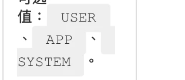

<table>
  <tr>
    <td>dryRun</td>
    <td>body</td>
    <td><code>boolean</code></td>
    <td>否</td>
    <td><code>false</code></td>
    <td>是否只执行预校验。取值为<code> true </code> 时不会写入数据。</td>
  </tr>
  <tr>
    <td>autoApproveS ubscription</td>
    <td>body</td>
    <td><code>boolean</code></td>
    <td>否</td>
    <td><code>true</code></td>
    <td>是否自动批准订阅。</td>
  </tr>
  <tr>
    <td>tags</td>
    <td>body</td>
    <td><code>array</code></td>
    <td>否</td>
    <td><code>["sample-</code><br><code>value"]</code></td>
    <td>标签列表。</td>
  </tr>
</table>

**返回数据**

| 参数名称 | 类型 | 示例 | 说明 |
| --- | --- | --- | --- |
| code | <code>string</code> | <code>SUCCESS</code> | 响应码，取值为<code> SUCCESS </code> 时表示请求成功。 |
| message | <code>string</code> | <code>null</code> | 响应消息。请求成功时通常为空。 |
| data | <code>object</code> | <code>{"dryRun":false,"a</code><br><code>ction":"sample-</code><br><code>value","kind":"MODEL</code><br><code>_API","resourceId":"</code><br><code>resource-</code><br><code>001","versionId":"ve</code><br><code>rsion-</code><br><code>001","manifestId":"m</code><br><code>anifest-001"}</code> | 响应数据。具体结构以接口语义为准。 |
| accessDeniedDetail | <code>object</code> | <code>null</code> | 鉴权失败详情。请求成功时通常为空。 |
| requestId | <code>string</code> | <code>req-001</code> | 请求 ID，可用于问题排查和日志检索。 |
| data.dryRun | <code>boolean</code> | <code>false</code> | 是否只执行预校验。取值为 <code> true </code> 时不会写入数据。 |
| data.action | <code>string</code> | <code>"sample-value"</code> | 本次操作类型。 |
| data.kind | <code>string</code> | <code>"MODEL_API"</code> | 资源类型。 |
| data.resourceId | <code>string</code> | <code>"resource-001"</code> | AI Resource ID。 |
| data.versionId | <code>string</code> | <code>"version-001"</code> | 版本 ID。 |
| data.manifestId | <code>string</code> | <code>"manifest-001"</code> | Manifest ID。 |
| data.sourceBindingId | <code>string</code> | <code>"sourceBinding-</code><br><code>001"</code> | 来源绑定ID。 |
| data.name | <code>string</code> | <code>"sample-name"</code> | 名称。 |
| data.version | <code>string</code> | <code>"sample-value"</code> | 版本号。 |
| data.endpointCount | <code>integer&lt;int32&gt;</code> | <code>1</code> | Endpoint 数量。 |
| data.capabilityCount | <code>integer&lt;int32&gt;</code> | <code>1</code> | 能力数量。 |
| data.artifactCount | <code>integer&lt;int32&gt;</code> | <code>1</code> | 制品数量。 |
| data.warnings | <code>array</code> | <code>["sample-value"]</code> | 告警信息列表。 |

**示例**

**请求示例**

```http
POST /himarket/v1/open-api/v1/resources HTTP/1.1
Host: localhost:8080
X-HIMARKET-OPENAPI: HIMARKET_OPENAPI
X-HIMARKET-TOKEN: <admin-openapi-token>
Content-Type: application/json

{
  "apiVersion": "sample-value",
  "kind": "MODEL_API",
  "tenantId": "tenant-001",
  "name": "sample-name",
  "displayName": "示例资源",
  "summary": "示例摘要"
}
```

**响应示例**

```json
{
  "code": "SUCCESS",
  "message": null,
  "data": {
    "dryRun": false,
    "action": "sample-value",
    "kind": "MODEL_API",
    "resourceId": "resource-001",
    "versionId": "version-001",
    "manifestId": "manifest-001"
  },
  "accessDeniedDetail": null,
  "requestId": "req-001"
}
```

<a id="section-3-11-2"></a>

### 3.11.2. deleteResource

**接口信息**

- **接口路径**： `DELETE /himarket/v1/open-api/v1/resources/{resourceId}`

- **接口说明**：删除 AI Resource。

- **认证方式**：该接口属于管理面 OpenAPI。调用前请完成 OpenAPI 凭证配置，并按 Token 模式或AK/SK 签名模式携带认证 Header。

- **Header 示例**：Token 模式使用  `X-HIMARKET-OPENAPI: HIMARKET_OPENAPI`  与  `X-HIMARKET-TOKEN` ；AK/SK 模式使用  `X-HIMARKET-ACCESS-KEY` 、 `X-HIMARKET-TIMESTAMP`  和  `X-HIMARKET-SIGNATURE` 。

**请求参数**

| 参数名称 | 位置 | 类型 | 是否必选 | 示例 | 说明 |
| --- | --- | --- | --- | --- | --- |
| resourceId | path | <code>string</code> | 是 | <code>"resource-</code><br><code>001"</code> | AI Resource ID。 |

**返回数据**

| 参数名称 | 类型 | 示例 | 说明 |
| --- | --- | --- | --- |
| code | <code>string</code> | <code>SUCCESS</code> | 响应码，取值为<code> SUCCESS </code> 时表示请求成功。 |
| message | <code>string</code> | <code>null</code> | 响应消息。请求成功时通常为空。 |
| data | <code>object</code> | <code>{"resourceId":"res</code><br><code>ource-</code><br><code>001","resourceName":</code><br><code>"sample-mcp-</code><br><code>server","kind":"MODE</code><br><code>L_API","deletedVersi</code><br><code>onCount":1,"deletedL</code><br><code>istingCount":1,"dele</code><br><code>tedReviewCount":1}</code> | 响应数据。具体结构以接口语义为准。 |
| accessDeniedDetail | <code>object</code> | <code>null</code> | 鉴权失败详情。请求成功时通常为空。 |
| requestId | <code>string</code> | <code>req-001</code> | 请求 ID，可用于问题排查和日志检索。 |
| data.resourceId | <code>string</code> | <code>"resource-001"</code> | AI Resource ID。 |
| data.resourceName | <code>string</code> | <code>"sample-mcp-</code><br><code>server"</code> | AI Resource 名称。 |
| data.kind | <code>string</code> | <code>"MODEL_API"</code> | 资源类型。 |
| data.deletedVersionCo unt | <code>integer&lt;int32&gt;</code> | <code>1</code> | 已删除的版本数量。 |
| data.deletedListingCou nt | <code>integer&lt;int32&gt;</code> | <code>1</code> | 已删除的 Listing 数量。 |
| data.deletedReviewCo unt | <code>integer&lt;int32&gt;</code> | <code>1</code> | 已删除的审核单数量。 |
| data.deletedSubscripti onCount | <code>integer&lt;int32&gt;</code> | <code>1</code> | 已删除的订阅数量。 |
| data.deletedGrantCou nt | <code>integer&lt;int32&gt;</code> | <code>1</code> | 已删除的授权 Grant 数量。 |
| data.deletedEndpointC ount | <code>integer&lt;int32&gt;</code> | <code>1</code> | 已删除的 Endpoint 数量。 |
| data.deletedCapability Count | <code>integer&lt;int32&gt;</code> | <code>1</code> | 已删除的能力数量。 |
| data.deletedArtifactCo unt | <code>integer&lt;int32&gt;</code> | <code>1</code> | 已删除的制品数量。 |
| data.deletedSourceBin dingCount | <code>integer&lt;int32&gt;</code> | <code>1</code> | 已删除的来源绑定数量。 |
| data.deletedManifestC ount | <code>integer&lt;int32&gt;</code> | <code>1</code> | 已删除的 Manifest 数量。 |

**示例**

**请求示例**

```http
DELETE /himarket/v1/open-api/v1/resources/{resourceId} HTTP/1.1
Host: localhost:8080
X-HIMARKET-OPENAPI: HIMARKET_OPENAPI
X-HIMARKET-TOKEN: <admin-openapi-token>
```

**响应示例**

```json
{
  "code": "SUCCESS",
  "message": null,
  "data": {
    "resourceId": "resource-001",
    "resourceName": "sample-mcp-server",
    "kind": "MODEL_API",
    "deletedVersionCount": 1,
    "deletedListingCount": 1,
    "deletedReviewCount": 1
  },
  "accessDeniedDetail": null,
  "requestId": "req-001"
}
```

<a id="section-3-11-3"></a>

### 3.11.3. getManifest

**接口信息**

- **接口路径**： `GET /himarket/v1/open-`

  ```text
  api/v1/resources/{resourceId}/versions/{versionId}/manifest 
  ```

- **接口说明**：查询 AI Resource 版本 Manifest。

- **认证方式**：该接口属于管理面 OpenAPI。调用前请完成 OpenAPI 凭证配置，并按 Token 模式或AK/SK 签名模式携带认证 Header。

- **Header 示例**：Token 模式使用  `X-HIMARKET-OPENAPI: HIMARKET_OPENAPI`  与  `X-HIMARKET-TOKEN` ；AK/SK 模式使用  `X-HIMARKET-ACCESS-KEY` 、 `X-HIMARKET-TIMESTAMP`  和  `X-HIMARKET-SIGNATURE` 。

**请求参数**

| 参数名称 | 位置 | 类型 | 是否必选 | 示例 | 说明 |
| --- | --- | --- | --- | --- | --- |
| resourceId | path | <code>string</code> | 是 | <code>"resource-</code><br><code>001"</code> | AI Resource ID。 |
| versionId | path | <code>string</code> | 是 | <code>"version-</code><br><code>001"</code> | 版本 ID。 |

**返回数据**

| 参数名称 | 类型 | 示例 | 说明 |
| --- | --- | --- | --- |
| code | <code>string</code> | <code>SUCCESS</code> | 响应码，取值为<code> SUCCESS </code> 时表示请求成功。 |
| message | <code>string</code> | <code>null</code> | 响应消息。请求成功时通常为空。 |
| data | <code>object</code> | <code>{"manifestId":"man</code><br><code>ifest-</code><br><code>001","resourceId":"r</code><br><code>esource-</code><br><code>001","versionId":"ve</code><br><code>rsion-</code><br><code>001","apiVersion":"s</code><br><code>ample-</code><br><code>value","kind":"MODEL</code><br><code>_API","schemaVersion</code><br><code>":"sample-value"}</code> | 响应数据。具体结构以接口语义为准。 |
| accessDeniedDetail | <code>object</code> | <code>null</code> | 鉴权失败详情。请求成功时通常为空。 |
| requestId | <code>string</code> | <code>req-001</code> | 请求 ID，可用于问题排查和日志检索。 |
| data.manifestId | <code>string</code> | <code>"manifest-001"</code> | Manifest ID。 |
| data.resourceId | <code>string</code> | <code>"resource-001"</code> | AI Resource ID。 |
| data.versionId | <code>string</code> | <code>"version-001"</code> | 版本 ID。 |
| data.apiVersion | <code>string</code> | <code>"sample-value"</code> | API 版本。 |
| data.kind | <code>string</code> | <code>"MODEL_API"</code> | 资源类型。 |
| data.schemaVersion | <code>string</code> | <code>"sample-value"</code> | Schema 版本。 |
| data.contentHash | <code>string</code> | <code>"sample-value"</code> | 内容哈希。 |
| data.content | <code>object</code> | <code>{}</code> | 分页结果列表。 |
| data.validationStatus | <code>string</code> | <code>"sample-value"</code> | 校验状态。 |
| data.validationReport | <code>object</code> | <code>{}</code> | 校验报告。 |
| data.createdAt | <code>string&lt;date-</code><br><code>time&gt;</code> | <code>"2026-06-</code><br><code>22T12:00:00Z"</code> | 创建时间。 |
| data.updatedAt | <code>string&lt;date-</code><br><code>time&gt;</code> | <code>"2026-06-</code><br><code>22T12:00:00Z"</code> | 更新时间。 |

**示例**

**请求示例**

```http
GET /himarket/v1/open-api/v1/resources/{resourceId}/versions/{versionId}/manifest HTTP/1.1
Host: localhost:8080
X-HIMARKET-OPENAPI: HIMARKET_OPENAPI
X-HIMARKET-TOKEN: <admin-openapi-token>
```

**响应示例**

```json
{
  "code": "SUCCESS",
  "message": null,
  "data": {
    "manifestId": "manifest-001",
    "resourceId": "resource-001",
    "versionId": "version-001",
    "apiVersion": "sample-value",
    "kind": "MODEL_API",
    "schemaVersion": "sample-value"
  },
  "accessDeniedDetail": null,
  "requestId": "req-001"
}
```

<a id="section-3-11-4"></a>

### 3.11.4. getManifestTemplate

**接口信息**

- **接口路径**： `GET /himarket/v1/open-api/v1/resources/manifest-template`

- **接口说明**：获取 AI Resource 最小 Manifest 模板。

- **认证方式**：该接口属于管理面 OpenAPI。调用前请完成 OpenAPI 凭证配置，并按 Token 模式或AK/SK 签名模式携带认证 Header。

- **Header 示例**：Token 模式使用  `X-HIMARKET-OPENAPI: HIMARKET_OPENAPI`  与  `X-HIMARKET-TOKEN` ；AK/SK 模式使用  `X-HIMARKET-ACCESS-KEY` 、 `X-HIMARKET-TIMESTAMP`  和  `X-HIMARKET-SIGNATURE` 。

**请求参数**

| 参数名称 | 位置 | 类型 | 是否必选 | 示例 | 说明 |
| --- | --- | --- | --- | --- | --- |
| kind | query | <code>string</code> | 是 | <code>"MODEL_API</code><br><code>"</code> | 资源类型。 |

**返回数据**

| 参数名称 | 类型 | 示例 | 说明 |
| --- | --- | --- | --- |
| code | <code>string</code> | <code>SUCCESS</code> | 响应码，取值为<code> SUCCESS </code> 时表示请求成功。 |
| message | <code>string</code> | <code>null</code> | 响应消息。请求成功时通常为空。 |
| data | <code>object</code> | <code>{"kind":"MODEL_API</code><br><code>","manifest":</code><br><code>{},"specSchema":</code><br><code>{}}</code> | 响应数据。具体结构以接口语义为准。 |
| accessDeniedDetail | <code>object</code> | <code>null</code> | 鉴权失败详情。请求成功时通常为空。 |
| requestId | <code>string</code> | <code>req-001</code> | 请求 ID，可用于问题排查和日志检索。 |
| data.kind | <code>string</code> | <code>"MODEL_API"</code> | 资源类型。 |
| data.manifest | <code>object</code> | <code>{}</code> | 资源 Manifest 内容。 |
| data.specSchema | <code>object</code> | <code>{}</code> | 规格 Schema。 |

**示例**

**请求示例**

```http
GET /himarket/v1/open-api/v1/resources/manifest-template?kind=MODEL_API HTTP/1.1
Host: localhost:8080
X-HIMARKET-OPENAPI: HIMARKET_OPENAPI
X-HIMARKET-TOKEN: <admin-openapi-token>
```

**响应示例**

```json
{
  "code": "SUCCESS",
  "message": null,
  "data": {
    "kind": "MODEL_API",
    "manifest": {},
    "specSchema": {}
  },
  "accessDeniedDetail": null,
  "requestId": "req-001"
}
```

<a id="section-3-11-5"></a>

### 3.11.5. getResource

**接口信息**

- **接口路径**： `GET /himarket/v1/open-api/v1/resources/{resourceId}`

- **接口说明**：查询 AI Resource 详情。

- **认证方式**：该接口属于管理面 OpenAPI。调用前请完成 OpenAPI 凭证配置，并按 Token 模式或AK/SK 签名模式携带认证 Header。

- **Header 示例**：Token 模式使用  `X-HIMARKET-OPENAPI: HIMARKET_OPENAPI`  与  `X-HIMARKET-TOKEN` ；AK/SK 模式使用  `X-HIMARKET-ACCESS-KEY` 、 `X-HIMARKET-TIMESTAMP`  和  `X-HIMARKET-SIGNATURE` 。

**请求参数**

| 参数名称 | 位置 | 类型 | 是否必选 | 示例 | 说明 |
| --- | --- | --- | --- | --- | --- |
| resourceId | path | <code>string</code> | 是 | <code>"resource-</code><br><code>001"</code> | AI Resource ID。 |

**返回数据**

| 参数名称 | 类型 | 示例 | 说明 |
| --- | --- | --- | --- |
| code | <code>string</code> | <code>SUCCESS</code> | 响应码，取值为<code> SUCCESS </code> 时表示请求成功。 |
| message | <code>string</code> | <code>null</code> | 响应消息。请求成功时通常为空。 |

<table>
  <tr>
    <td>data</td>
    <td><code>object</code></td>
    <td><code>{"resource":</code><br><code>{"resourceId":"resou</code><br><code>rce-</code><br><code>001","tenantId":"ten</code><br><code>ant-</code><br><code>001","kind":"MODEL_A</code><br><code>PI","name":"sample-</code><br><code>name","displayName":</code> <code>"</code>示例资源<code>","summary":"</code>示例摘要<code>"},"latestVersion"</code><code>:</code><br><code>{"versionId":"versio</code><br><code>n-</code><br><code>001","resourceId":"r</code><br><code>esource-</code><br><code>001","version":"samp</code><br><code>le-</code><br><code>value","versionSchem</code><br><code>e":"SEMVER","status"</code><br><code>:"DRAFT","manifestId</code><br><code>":"manifest-</code><br><code>001"},"sourceBinding</code><br><code>s":[{}]}</code></td>
    <td>响应数据。具体结构以接口语义为准。</td>
  </tr>
  <tr>
    <td>accessDeniedDetail</td>
    <td><code>object</code></td>
    <td><code>null</code></td>
    <td>鉴权失败详情。请求成功时通常为空。</td>
  </tr>
  <tr>
    <td>requestId</td>
    <td><code>string</code></td>
    <td><code>req-001</code></td>
    <td>请求 ID，可用于问题排查和日志检索。</td>
  </tr>
  <tr>
    <td>data.resource</td>
    <td><code>object</code></td>
    <td><code>{"resourceId":"res</code><br><code>ource-</code><br><code>001","tenantId":"ten</code><br><code>ant-</code><br><code>001","kind":"MODEL_A</code><br><code>PI","name":"sample-</code><br><code>name","displayName":</code> <code>"</code>示例资源<code>","summary":"</code>示例摘要<code>"} </code></td>
    <td>AI Resource 基础信息。</td>
  </tr>
  <tr>
    <td>data.resource.resourc eId</td>
    <td><code>string</code></td>
    <td><code>"resource-001"</code></td>
    <td>AI Resource ID。</td>
  </tr>
  <tr>
    <td>data.resource.tenantId</td>
    <td><code>string</code></td>
    <td><code>"tenant-001"</code></td>
    <td>租户ID。</td>
  </tr>
  <tr>
    <td>data.resource.kind</td>
    <td><code>string</code></td>
    <td><code>"MODEL_API"</code></td>
    <td>资源类型。</td>
  </tr>
  <tr>
    <td>data.resource.name</td>
    <td><code>string</code></td>
    <td><code>"sample-name"</code></td>
    <td>名称。</td>
  </tr>
  <tr>
    <td>data.resource.displayN ame</td>
    <td><code>string</code></td>
    <td><code> "</code>示例资源<code>" </code></td>
    <td>展示名称。</td>
  </tr>
  <tr>
    <td>data.resource.summar y</td>
    <td><code>string</code></td>
    <td><code> "</code>示例摘要<code>" </code></td>
    <td>摘要信息。</td>
  </tr>
  <tr>
    <td>data.resource.descripti on</td>
    <td><code>string</code></td>
    <td><code> "</code>用于演示的资源描述<code>" </code></td>
    <td>描述信息。</td>
  </tr>
  <tr>
    <td>data.resource.ownerTy pe</td>
    <td><code>string</code></td>
    <td><code>"USER"</code></td>
    <td>归属主体类型。可选值：<code> USER </code>、<code> APP </code>、<code> SYSTEM </code>。</td>
  </tr>
  <tr>
    <td>data.resource.ownerId</td>
    <td><code>string</code></td>
    <td><code>"owner-001"</code></td>
    <td>归属主体ID。</td>
  </tr>
  <tr>
    <td>data.resource.created By</td>
    <td><code>string</code></td>
    <td><code>"sample-value"</code></td>
    <td>创建人。</td>
  </tr>
  <tr>
    <td>data.resource.created ByName</td>
    <td><code>string</code></td>
    <td><code>"demo-createdby"</code></td>
    <td>创建人名称。</td>
  </tr>
  <tr>
    <td>data.resource.icon</td>
    <td><code>string</code></td>
    <td><code>"sample-value"</code></td>
    <td>图标地址。</td>
  </tr>
  <tr>
    <td>data.resource.tags</td>
    <td><code>array</code></td>
    <td><code>["sample-value"]</code></td>
    <td>标签列表。</td>
  </tr>
  <tr>
    <td>data.resource.lifecycle Status</td>
    <td><code>string</code></td>
    <td><code>"DRAFT"</code></td>
    <td>生命周期状态。可选值：<code> DRAFT </code>、<code> ACTI</code> <code>VE </code>、<code> DEPRECATED </code>、<code> ARCHIVED </code>。</td>
  </tr>
  <tr>
    <td>data.resource.latestVe rsionId</td>
    <td><code>string</code></td>
    <td><code>"latestVersion-</code><br><code>001"</code></td>
    <td>最新版本ID。</td>
  </tr>
  <tr>
    <td>data.resource.autoApp roveSubscription</td>
    <td><code>boolean</code></td>
    <td><code>true</code></td>
    <td>是否自动批准订阅。</td>
  </tr>
  <tr>
    <td>data.resource.extras</td>
    <td><code>object</code></td>
    <td><code>{}</code></td>
    <td>扩展配置。</td>
  </tr>
  <tr>
    <td>data.resource.created At</td>
    <td><code>string&lt;date-</code><br><code>time&gt;</code></td>
    <td><code>"2026-06-</code><br><code>22T12:00:00Z"</code></td>
    <td>创建时间。</td>
  </tr>
  <tr>
    <td>data.resource.updated At</td>
    <td><code>string&lt;date-</code><br><code>time&gt;</code></td>
    <td><code>"2026-06-</code><br><code>22T12:00:00Z"</code></td>
    <td>更新时间。</td>
  </tr>
  <tr>
    <td>data.latestVersion</td>
    <td><code>object</code></td>
    <td><code>{"versionId":"vers</code><br><code>ion-</code><br><code>001","resourceId":"r</code><br><code>esource-</code><br><code>001","version":"samp</code><br><code>le-</code><br><code>value","versionSchem</code><br><code>e":"SEMVER","status"</code><br><code>:"DRAFT","manifestId</code><br><code>":"manifest-001"}</code></td>
    <td>最新版本信息。</td>
  </tr>
  <tr>
    <td>data.latestVersion.vers ionId</td>
    <td><code>string</code></td>
    <td><code>"version-001"</code></td>
    <td>版本 ID。</td>
  </tr>
  <tr>
    <td>data.latestVersion.reso urceId</td>
    <td><code>string</code></td>
    <td><code>"resource-001"</code></td>
    <td>AI Resource ID。</td>
  </tr>
  <tr>
    <td>data.latestVersion.vers ion</td>
    <td><code>string</code></td>
    <td><code>"sample-value"</code></td>
    <td>版本号。</td>
  </tr>
  <tr>
    <td>data.latestVersion.vers ionScheme</td>
    <td><code>string</code></td>
    <td><code>"SEMVER"</code></td>
    <td>版本号方案。可选值：<code> SEMVER </code>、<code> TIM</code> <code>ESTAMP </code>、<code> REVISION</code><code> </code>、<code> EXTERNAL </code>。</td>
  </tr>
  <tr>
    <td>data.latestVersion.stat us</td>
    <td><code>string</code></td>
    <td><code>"DRAFT"</code></td>
    <td>状态。</td>
  </tr>
  <tr>
    <td>data.latestVersion.ma nifestId</td>
    <td><code>string</code></td>
    <td><code>"manifest-001"</code></td>
    <td>Manifest ID。</td>
  </tr>
</table>


<table>
  <tr>
    <td>data.latestVersion.sou rceBindingId</td>
    <td><code>string</code></td>
    <td><code>"sourceBinding-</code><br><code>001"</code></td>
    <td>来源绑定ID。</td>
  </tr>
  <tr>
    <td>data.latestVersion.artif actDigest</td>
    <td><code>string</code></td>
    <td><code>"sample-value"</code></td>
    <td>制品摘要。</td>
  </tr>
  <tr>
    <td>data.latestVersion.rele aseNote</td>
    <td><code>string</code></td>
    <td><code>"sample-value"</code></td>
    <td>版本说明。</td>
  </tr>
  <tr>
    <td>data.latestVersion.cre atedBy</td>
    <td><code>string</code></td>
    <td><code>"sample-value"</code></td>
    <td>创建人。</td>
  </tr>
  <tr>
    <td>data.latestVersion.pub lishedAt</td>
    <td><code>string&lt;date-</code><br><code>time&gt;</code></td>
    <td><code>"2026-06-</code><br><code>22T12:00:00Z"</code></td>
    <td>发布时间。</td>
  </tr>
  <tr>
    <td>data.latestVersion.cre atedAt</td>
    <td><code>string&lt;date-</code><br><code>time&gt;</code></td>
    <td><code>"2026-06-</code><br><code>22T12:00:00Z"</code></td>
    <td>创建时间。</td>
  </tr>
  <tr>
    <td>data.latestVersion.upd atedAt</td>
    <td><code>string&lt;date-</code><br><code>time&gt;</code></td>
    <td><code>"2026-06-</code><br><code>22T12:00:00Z"</code></td>
    <td>更新时间。</td>
  </tr>
  <tr>
    <td>data.latestVersion.dow nloadCount</td>
    <td><code>integer&lt;int64&gt;</code></td>
    <td><code>1</code></td>
    <td>下载次数。</td>
  </tr>
  <tr>
    <td>data.latestVersion.isLa test</td>
    <td><code>boolean</code></td>
    <td><code>true</code></td>
    <td>是否为最新版本。</td>
  </tr>
  <tr>
    <td>data.sourceBindings</td>
    <td><code>array</code></td>
    <td><code>[{"sourceBindingId</code><br><code>":"sourceBinding-</code><br><code>001","resourceId":"r</code><br><code>esource-</code><br><code>001","sourceType":"G</code><br><code>ATEWAY","sourceRef":</code><br><code>"sample-</code><br><code>value","primaryBindi</code><br><code>ng":false,"priority"</code><br><code>:100}]</code></td>
    <td>来源绑定列表。</td>
  </tr>
  <tr>
    <td>data.sourceBindings[].sourceBindingId</td>
    <td><code>string</code></td>
    <td><code>"sourceBinding-</code><br><code>001"</code></td>
    <td>来源绑定ID。</td>
  </tr>
  <tr>
    <td>data.sourceBindings[].resourceId</td>
    <td><code>string</code></td>
    <td><code>"resource-001"</code></td>
    <td>AI Resource ID。</td>
  </tr>
  <tr>
    <td>data.sourceBindings[].sourceType</td>
    <td><code>string</code></td>
    <td><code>"GATEWAY"</code></td>
    <td>来源类型。可选值：<code> GATEWAY </code>、<code> NA</code> <code>COS </code>、<code> REMOTE_ENDPO</code> <code>INT </code>、<code> SANDBOX </code>、<code> REGISTRY </code>、<code> CUSTO</code> <code>M </code>。</td>
  </tr>
  <tr>
    <td>data.sourceBindings[].sourceRef</td>
    <td><code>string</code></td>
    <td><code>"sample-value"</code></td>
    <td>来源引用。</td>
  </tr>
  <tr>
    <td>data.sourceBindings[].primaryBinding</td>
    <td><code>boolean</code></td>
    <td><code>false</code></td>
    <td>是否为主绑定关系。</td>
  </tr>
  <tr>
    <td>data.sourceBindings[].priority</td>
    <td><code>integer&lt;int32&gt;</code></td>
    <td><code>100</code></td>
    <td>优先级。</td>
  </tr>
  <tr>
    <td>data.sourceBindings[].syncMode</td>
    <td><code>string</code></td>
    <td><code>"sample-value"</code></td>
    <td>同步模式。</td>
  </tr>
  <tr>
    <td>data.sourceBindings[].syncStatus</td>
    <td><code>string</code></td>
    <td><code>"sample-value"</code></td>
    <td>同步状态。</td>
  </tr>
  <tr>
    <td>data.sourceBindings[].credentialRef</td>
    <td><code>string</code></td>
    <td><code>"sample-value"</code></td>
    <td>凭据引用。</td>
  </tr>
  <tr>
    <td>data.sourceBindings[].config</td>
    <td><code>object</code></td>
    <td><code>{}</code></td>
    <td>配置信息。</td>
  </tr>
  <tr>
    <td>data.sourceBindings[].l astSyncedAt</td>
    <td><code>string&lt;date-</code><br><code>time&gt;</code></td>
    <td><code>"2026-06-</code><br><code>22T12:00:00Z"</code></td>
    <td>最近一次同步时间。</td>
  </tr>
</table>

**示例**

**请求示例**

```http
GET /himarket/v1/open-api/v1/resources/{resourceId} HTTP/1.1
Host: localhost:8080
X-HIMARKET-OPENAPI: HIMARKET_OPENAPI
X-HIMARKET-TOKEN: <admin-openapi-token>
```

**响应示例**

```json
{
  "code": "SUCCESS",
  "message": null,
  "data": {
    "resource": {
      "resourceId": "resource-001",
      "tenantId": "tenant-001",
      "kind": "MODEL_API",
      "name": "sample-name",
      "displayName": "示例资源",
      "summary": "示例摘要"
    },
    "latestVersion": {
      "versionId": "version-001",
      "resourceId": "resource-001",
      "version": "sample-value",
      "versionScheme": "SEMVER",
      "status": "DRAFT",
      "manifestId": "manifest-001"
    },
    "sourceBindings": [
      {}
    ]
  },
  "accessDeniedDetail": null,
  "requestId": "req-001"
}
```

<a id="section-3-11-6"></a>

### 3.11.6. getVersion

**接口信息**

- **接口路径**： `GET /himarket/v1/open-api/v1/resources/{resourceId}/versions/{versionId}`

- **接口说明**：查询 AI Resource 版本详情。

- **认证方式**：该接口属于管理面 OpenAPI。调用前请完成 OpenAPI 凭证配置，并按 Token 模式或AK/SK 签名模式携带认证 Header。

- **Header 示例**：Token 模式使用  `X-HIMARKET-OPENAPI: HIMARKET_OPENAPI`  与  `X-HIMARKET-TOKEN` ；AK/SK 模式使用  `X-HIMARKET-ACCESS-KEY` 、 `X-HIMARKET-TIMESTAMP`  和  `X-HIMARKET-SIGNATURE` 。

**请求参数**

| 参数名称 | 位置 | 类型 | 是否必选 | 示例 | 说明 |
| --- | --- | --- | --- | --- | --- |
| resourceId | path | <code>string</code> | 是 | <code>"resource-</code><br><code>001"</code> | AI Resource ID。 |
| versionId | path | <code>string</code> | 是 | <code>"version-</code><br><code>001"</code> | 版本 ID。 |

**返回数据**

| 参数名称 | 类型 | 示例 | 说明 |
| --- | --- | --- | --- |
| code | <code>string</code> | <code>SUCCESS</code> | 响应码，取值为<code> SUCCESS </code> 时表示请求成功。 |
| message | <code>string</code> | <code>null</code> | 响应消息。请求成功时通常为空。 |

<table>
  <tr>
    <td>data</td>
    <td><code>object</code></td>
    <td><code>{"resource":</code><br><code>{"resourceId":"resou</code><br><code>rce-</code><br><code>001","tenantId":"ten</code><br><code>ant-</code><br><code>001","kind":"MODEL_A</code><br><code>PI","name":"sample-</code><br><code>name","displayName":</code> <code>"</code>示例资源<code>","summary":"</code>示例摘要<code>"},"version":</code> <code>{"versionId":"versio</code><br><code>n-</code><br><code>001","resourceId":"r</code><br><code>esource-</code><br><code>001","version":"samp</code><br><code>le-</code><br><code>value","versionSchem</code><br><code>e":"SEMVER","status"</code><br><code>:"DRAFT","manifestId</code><br><code>":"manifest-</code><br><code>001"},"sourceBinding</code><br><code>":</code><br><code>{"sourceBindingId":"</code><br><code>sourceBinding-</code><br><code>001","resourceId":"r</code><br><code>esource-</code><br><code>001","sourceType":"G</code><br><code>ATEWAY","sourceRef":</code><br><code>"sample-</code><br><code>value","primaryBindi</code><br><code>ng":false,"priority"</code><br><code>:100},"endpoints":</code><br><code>[{}],"capabilities":</code><br><code>[{}],"artifacts":</code><br><code>[{}]}</code></td>
    <td>响应数据。具体结构以接口语义为准。</td>
  </tr>
  <tr>
    <td>accessDeniedDetail</td>
    <td><code>object</code></td>
    <td><code>null</code></td>
    <td>鉴权失败详情。请求成功时通常为空。</td>
  </tr>
  <tr>
    <td>requestId</td>
    <td><code>string</code></td>
    <td><code>req-001</code></td>
    <td>请求 ID，可用于问题排查和日志检索。</td>
  </tr>
  <tr>
    <td>data.resource</td>
    <td><code>object</code></td>
    <td><code>{"resourceId":"res</code><br><code>ource-</code><br><code>001","tenantId":"ten</code><br><code>ant-</code><br><code>001","kind":"MODEL_A</code><br><code>PI","name":"sample-</code><br><code>name","displayName":</code> <code>"</code>示例资源<code>","summary":"</code>示例摘要<code>"} </code></td>
    <td>AI Resource 基础信息。</td>
  </tr>
  <tr>
    <td>data.resource.resourc eId</td>
    <td><code>string</code></td>
    <td><code>"resource-001"</code></td>
    <td>AI Resource ID。</td>
  </tr>
  <tr>
    <td>data.resource.tenantId</td>
    <td><code>string</code></td>
    <td><code>"tenant-001"</code></td>
    <td>租户ID。</td>
  </tr>
  <tr>
    <td>data.resource.kind</td>
    <td><code>string</code></td>
    <td><code>"MODEL_API"</code></td>
    <td>资源类型。</td>
  </tr>
  <tr>
    <td>data.resource.name</td>
    <td><code>string</code></td>
    <td><code>"sample-name"</code></td>
    <td>名称。</td>
  </tr>
  <tr>
    <td>data.resource.displayN ame</td>
    <td><code>string</code></td>
    <td><code> "</code>示例资源<code>" </code></td>
    <td>展示名称。</td>
  </tr>
  <tr>
    <td>data.resource.summar y</td>
    <td><code>string</code></td>
    <td><code> "</code>示例摘要<code>" </code></td>
    <td>摘要信息。</td>
  </tr>
  <tr>
    <td>data.resource.descripti on</td>
    <td><code>string</code></td>
    <td><code> "</code>用于演示的资源描述<code>" </code></td>
    <td>描述信息。</td>
  </tr>
  <tr>
    <td>data.resource.ownerTy pe</td>
    <td><code>string</code></td>
    <td><code>"USER"</code></td>
    <td>归属主体类型。可选值：<code> USER </code>、<code> APP </code>、<code> SYSTEM </code>。</td>
  </tr>
  <tr>
    <td>data.resource.ownerId</td>
    <td><code>string</code></td>
    <td><code>"owner-001"</code></td>
    <td>归属主体ID。</td>
  </tr>
  <tr>
    <td>data.resource.created By</td>
    <td><code>string</code></td>
    <td><code>"sample-value"</code></td>
    <td>创建人。</td>
  </tr>
  <tr>
    <td>data.resource.created ByName</td>
    <td><code>string</code></td>
    <td><code>"demo-createdby"</code></td>
    <td>创建人名称。</td>
  </tr>
  <tr>
    <td>data.resource.icon</td>
    <td><code>string</code></td>
    <td><code>"sample-value"</code></td>
    <td>图标地址。</td>
  </tr>
  <tr>
    <td>data.resource.tags</td>
    <td><code>array</code></td>
    <td><code>["sample-value"]</code></td>
    <td>标签列表。</td>
  </tr>
  <tr>
    <td>data.resource.lifecycle Status</td>
    <td><code>string</code></td>
    <td><code>"DRAFT"</code></td>
    <td>生命周期状态。可选值：<code> DRAFT </code>、<code> ACTI</code> <code>VE </code>、<code> DEPRECATED </code>、<code> ARCHIVED </code>。</td>
  </tr>
  <tr>
    <td>data.resource.latestVe rsionId</td>
    <td><code>string</code></td>
    <td><code>"latestVersion-</code><br><code>001"</code></td>
    <td>最新版本ID。</td>
  </tr>
  <tr>
    <td>data.resource.autoApp roveSubscription</td>
    <td><code>boolean</code></td>
    <td><code>true</code></td>
    <td>是否自动批准订阅。</td>
  </tr>
  <tr>
    <td>data.resource.extras</td>
    <td><code>object</code></td>
    <td><code>{}</code></td>
    <td>扩展配置。</td>
  </tr>
  <tr>
    <td>data.resource.created At</td>
    <td><code>string&lt;date-</code><br><code>time&gt;</code></td>
    <td><code>"2026-06-</code><br><code>22T12:00:00Z"</code></td>
    <td>创建时间。</td>
  </tr>
  <tr>
    <td>data.resource.updated At</td>
    <td><code>string&lt;date-</code><br><code>time&gt;</code></td>
    <td><code>"2026-06-</code><br><code>22T12:00:00Z"</code></td>
    <td>更新时间。</td>
  </tr>
  <tr>
    <td>data.version</td>
    <td><code>object</code></td>
    <td><code>{"versionId":"vers</code><br><code>ion-</code><br><code>001","resourceId":"r</code><br><code>esource-</code><br><code>001","version":"samp</code><br><code>le-</code><br><code>value","versionSchem</code><br><code>e":"SEMVER","status"</code><br><code>:"DRAFT","manifestId</code><br><code>":"manifest-001"}</code></td>
    <td>版本号。</td>
  </tr>
  <tr>
    <td>data.version.versionId</td>
    <td><code>string</code></td>
    <td><code>"version-001"</code></td>
    <td>版本 ID。</td>
  </tr>
  <tr>
    <td>data.version.resourceI d</td>
    <td><code>string</code></td>
    <td><code>"resource-001"</code></td>
    <td>AI Resource ID。</td>
  </tr>
  <tr>
    <td>data.version.version</td>
    <td><code>string</code></td>
    <td><code>"sample-value"</code></td>
    <td>版本号。</td>
  </tr>
  <tr>
    <td>data.version.versionSc heme</td>
    <td><code>string</code></td>
    <td><code>"SEMVER"</code></td>
    <td>版本号方案。可选值：<code> SEMVER </code>、<code> TIM</code> <code>ESTAMP </code>、<code> REVISION</code><code> </code>、<code> EXTERNAL </code>。</td>
  </tr>
  <tr>
    <td>data.version.status</td>
    <td><code>string</code></td>
    <td><code>"DRAFT"</code></td>
    <td>状态。</td>
  </tr>
  <tr>
    <td>data.version.manifestI d</td>
    <td><code>string</code></td>
    <td><code>"manifest-001"</code></td>
    <td>Manifest ID。</td>
  </tr>
  <tr>
    <td>data.version.sourceBin dingId</td>
    <td><code>string</code></td>
    <td><code>"sourceBinding-</code><br><code>001"</code></td>
    <td>来源绑定ID。</td>
  </tr>
  <tr>
    <td>data.version.artifactDi gest</td>
    <td><code>string</code></td>
    <td><code>"sample-value"</code></td>
    <td>制品摘要。</td>
  </tr>
  <tr>
    <td>data.version.releaseNo te</td>
    <td><code>string</code></td>
    <td><code>"sample-value"</code></td>
    <td>版本说明。</td>
  </tr>
  <tr>
    <td>data.version.createdB y</td>
    <td><code>string</code></td>
    <td><code>"sample-value"</code></td>
    <td>创建人。</td>
  </tr>
  <tr>
    <td>data.version.published At</td>
    <td><code>string&lt;date-</code><br><code>time&gt;</code></td>
    <td><code>"2026-06-</code><br><code>22T12:00:00Z"</code></td>
    <td>发布时间。</td>
  </tr>
  <tr>
    <td>data.version.createdAt</td>
    <td><code>string&lt;date-</code><br><code>time&gt;</code></td>
    <td><code>"2026-06-</code><br><code>22T12:00:00Z"</code></td>
    <td>创建时间。</td>
  </tr>
  <tr>
    <td>data.version.updatedA t</td>
    <td><code>string&lt;date-</code><br><code>time&gt;</code></td>
    <td><code>"2026-06-</code><br><code>22T12:00:00Z"</code></td>
    <td>更新时间。</td>
  </tr>
  <tr>
    <td>data.version.download Count</td>
    <td><code>integer&lt;int64&gt;</code></td>
    <td><code>1</code></td>
    <td>下载次数。</td>
  </tr>
  <tr>
    <td>data.version.isLatest</td>
    <td><code>boolean</code></td>
    <td><code>true</code></td>
    <td>是否为最新版本。</td>
  </tr>
</table>


<table>
  <tr>
    <td>data.sourceBinding</td>
    <td><code>object</code></td>
    <td><code>{"sourceBindingId"</code><br><code>:"sourceBinding-</code><br><code>001","resourceId":"r</code><br><code>esource-</code><br><code>001","sourceType":"G</code><br><code>ATEWAY","sourceRef":</code><br><code>"sample-</code><br><code>value","primaryBindi</code><br><code>ng":false,"priority"</code><br><code>:100}</code></td>
    <td>来源绑定信息。</td>
  </tr>
  <tr>
    <td>data.sourceBinding.so urceBindingId</td>
    <td><code>string</code></td>
    <td><code>"sourceBinding-</code><br><code>001"</code></td>
    <td>来源绑定ID。</td>
  </tr>
  <tr>
    <td>data.sourceBinding.res ourceId</td>
    <td><code>string</code></td>
    <td><code>"resource-001"</code></td>
    <td>AI Resource ID。</td>
  </tr>
  <tr>
    <td>data.sourceBinding.so urceType</td>
    <td><code>string</code></td>
    <td><code>"GATEWAY"</code></td>
    <td>来源类型。可选值：<code> GATEWAY </code>、<code> NA</code> <code>COS </code>、<code> REMOTE_ENDPO</code> <code>INT </code>、<code> SANDBOX </code>、<code> REGISTRY </code>、<code> CUSTO</code> <code>M </code>。</td>
  </tr>
  <tr>
    <td>data.sourceBinding.so urceRef</td>
    <td><code>string</code></td>
    <td><code>"sample-value"</code></td>
    <td>来源引用。</td>
  </tr>
  <tr>
    <td>data.sourceBinding.pri maryBinding</td>
    <td><code>boolean</code></td>
    <td><code>false</code></td>
    <td>是否为主绑定关系。</td>
  </tr>
  <tr>
    <td>data.sourceBinding.pri ority</td>
    <td><code>integer&lt;int32&gt;</code></td>
    <td><code>100</code></td>
    <td>优先级。</td>
  </tr>
  <tr>
    <td>data.sourceBinding.sy ncMode</td>
    <td><code>string</code></td>
    <td><code>"sample-value"</code></td>
    <td>同步模式。</td>
  </tr>
  <tr>
    <td>data.sourceBinding.sy ncStatus</td>
    <td><code>string</code></td>
    <td><code>"sample-value"</code></td>
    <td>同步状态。</td>
  </tr>
  <tr>
    <td>data.sourceBinding.cre dentialRef</td>
    <td><code>string</code></td>
    <td><code>"sample-value"</code></td>
    <td>凭据引用。</td>
  </tr>
  <tr>
    <td>data.sourceBinding.co nfig</td>
    <td><code>object</code></td>
    <td><code>{}</code></td>
    <td>配置信息。</td>
  </tr>
  <tr>
    <td>data.sourceBinding.las tSyncedAt</td>
    <td><code>string&lt;date-</code><br><code>time&gt;</code></td>
    <td><code>"2026-06-</code><br><code>22T12:00:00Z"</code></td>
    <td>最近一次同步时间。</td>
  </tr>
  <tr>
    <td>data.endpoints</td>
    <td><code>array</code></td>
    <td><code>[{"endpointId":"en</code><br><code>dpoint-</code><br><code>001","versionId":"ve</code><br><code>rsion-</code><br><code>001","deploymentId":</code><br><code>"deployment-</code><br><code>001","runtimeProvide</code><br><code>rId":"runtime-</code><br><code>provider-</code><br><code>001","providerType":</code><br><code>"SANDBOX","providerC</code><br><code>onfig":{}}]</code></td>
    <td>访问端点列表。</td>
  </tr>
  <tr>
    <td>data.endpoints[].endp ointId</td>
    <td><code>string</code></td>
    <td><code>"endpoint-001"</code></td>
    <td>Endpoint ID。</td>
  </tr>
  <tr>
    <td>data.endpoints[].versi onId</td>
    <td><code>string</code></td>
    <td><code>"version-001"</code></td>
    <td>版本 ID。</td>
  </tr>
  <tr>
    <td>data.endpoints[].deplo ymentId</td>
    <td><code>string</code></td>
    <td><code>"deployment-001"</code></td>
    <td>部署ID。</td>
  </tr>
  <tr>
    <td>data.endpoints[].runti meProviderId</td>
    <td><code>string</code></td>
    <td><code>"runtime-</code><br><code>provider-001"</code></td>
    <td>运行时 Provider ID。</td>
  </tr>
  <tr>
    <td>data.endpoints[].provi derType</td>
    <td><code>string</code></td>
    <td><code>"SANDBOX"</code></td>
    <td>提供方类型。</td>
  </tr>
  <tr>
    <td>data.endpoints[].provi derConfig</td>
    <td><code>object</code></td>
    <td><code>{}</code></td>
    <td>Provider 配置。</td>
  </tr>
  <tr>
    <td>data.endpoints[].name</td>
    <td><code>string</code></td>
    <td><code>"sample-name"</code></td>
    <td>名称。</td>
  </tr>
  <tr>
    <td>data.endpoints[].endp ointType</td>
    <td><code>string</code></td>
    <td><code>"MODEL_INFERENCE"</code></td>
    <td>Endpoint 类型。</td>
  </tr>
</table>

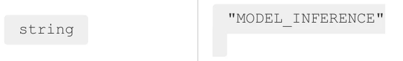

<table>
  <tr>
    <td>data.endpoints[].proto col</td>
    <td><code>string</code></td>
    <td><code>"HTTP"</code></td>
    <td>协议类型。可选值：<code> HTTP </code>、<code> HTTPS</code><code> </code>、<code> SSE </code>、<code> STREAMA</code> <code>BLE_HTTP </code>、<code> STDIO </code>、<code> NACOS_DESCRIPTOR</code><code> </code>。</td>
  </tr>
  <tr>
    <td>data.endpoints[].url</td>
    <td><code>string</code></td>
    <td><code>"https://api.examp</code><br><code>le.com"</code></td>
    <td>访问地址。</td>
  </tr>
  <tr>
    <td>data.endpoints[].gate wayId</td>
    <td><code>string</code></td>
    <td><code>"gateway-001"</code></td>
    <td>Gateway ID。</td>
  </tr>
  <tr>
    <td>data.endpoints[].routeI d</td>
    <td><code>string</code></td>
    <td><code>"route-001"</code></td>
    <td>路由 ID。</td>
  </tr>
  <tr>
    <td>data.endpoints[].auth Mode</td>
    <td><code>string</code></td>
    <td><code>"sample-value"</code></td>
    <td>认证模式。</td>
  </tr>
  <tr>
    <td>data.endpoints[].crede ntialPolicy</td>
    <td><code>object</code></td>
    <td><code>{}</code></td>
    <td>凭据策略。</td>
  </tr>
  <tr>
    <td>data.endpoints[].netw orkScope</td>
    <td><code>string</code></td>
    <td><code>"sample-value"</code></td>
    <td>网络访问范围。</td>
  </tr>
  <tr>
    <td>data.endpoints[].defau ltInvocation</td>
    <td><code>boolean</code></td>
    <td><code>false</code></td>
    <td>默认调用配置。</td>
  </tr>
  <tr>
    <td>data.endpoints[].healt hStatus</td>
    <td><code>string</code></td>
    <td><code>"sample-value"</code></td>
    <td>健康检查状态。</td>
  </tr>
  <tr>
    <td>data.endpoints[].status</td>
    <td><code>string</code></td>
    <td><code>"ACTIVE"</code></td>
    <td>状态。</td>
  </tr>
  <tr>
    <td>data.endpoints[].meta data</td>
    <td><code>object</code></td>
    <td><code>{}</code></td>
    <td>扩展元数据。</td>
  </tr>
  <tr>
    <td>data.endpoints[].creat edAt</td>
    <td><code>string&lt;date-</code><br><code>time&gt;</code></td>
    <td><code>"2026-06-</code><br><code>22T12:00:00Z"</code></td>
    <td>创建时间。</td>
  </tr>
  <tr>
    <td>data.endpoints[].updat edAt</td>
    <td><code>string&lt;date-</code><br><code>time&gt;</code></td>
    <td><code>"2026-06-</code><br><code>22T12:00:00Z"</code></td>
    <td>更新时间。</td>
  </tr>
</table>


<table>
  <tr>
    <td>data.capabilities</td>
    <td><code>array</code></td>
    <td><code>[{"capabilityId":"</code><br><code>capability-</code><br><code>001","versionId":"ve</code><br><code>rsion-</code><br><code>001","capabilityType</code><br><code>":"MODEL","name":"sa</code><br><code>mple-</code><br><code>name","displayName":</code> <code>"</code>示例资源<code>","description":"</code>用于演示的资源描述<code>"}] </code></td>
    <td>资源能力列表。</td>
  </tr>
  <tr>
    <td>data.capabilities[].cap abilityId</td>
    <td><code>string</code></td>
    <td><code>"capability-001"</code></td>
    <td>能力 ID。</td>
  </tr>
  <tr>
    <td>data.capabilities[].vers ionId</td>
    <td><code>string</code></td>
    <td><code>"version-001"</code></td>
    <td>版本 ID。</td>
  </tr>
  <tr>
    <td>data.capabilities[].cap abilityType</td>
    <td><code>string</code></td>
    <td><code>"MODEL"</code></td>
    <td>capabilityType。可选值：<code> MODEL </code>、<code> MCP_</code><code>TOOL </code>、<code> MCP_RESOURC</code> <code>E </code>、<code> MCP_PROMPT </code>、<code> SKILL </code>、<code> WORKER </code>、<code> API </code>。</td>
  </tr>
  <tr>
    <td>data.capabilities[].nam e</td>
    <td><code>string</code></td>
    <td><code>"sample-name"</code></td>
    <td>名称。</td>
  </tr>
  <tr>
    <td>data.capabilities[].disp layName</td>
    <td><code>string</code></td>
    <td><code> "</code>示例资源<code>" </code></td>
    <td>展示名称。</td>
  </tr>
  <tr>
    <td>data.capabilities[].des cription</td>
    <td><code>string</code></td>
    <td><code> "</code>用于演示的资源描述<code>" </code></td>
    <td>描述信息。</td>
  </tr>
  <tr>
    <td>data.capabilities[].inpu tSchema</td>
    <td><code>object</code></td>
    <td><code>{}</code></td>
    <td>输入参数 Schema。</td>
  </tr>
  <tr>
    <td>data.capabilities[].out putSchema</td>
    <td><code>object</code></td>
    <td><code>{}</code></td>
    <td>输出结果 Schema。</td>
  </tr>
  <tr>
    <td>data.capabilities[].tags</td>
    <td><code>array</code></td>
    <td><code>["sample-value"]</code></td>
    <td>标签列表。</td>
  </tr>
</table>

**示例请求示例**

```http
GET /himarket/v1/open-api/v1/resources/{resourceId}/versions/{versionId} HTTP/1.1
Host: localhost:8080
X-HIMARKET-OPENAPI: HIMARKET_OPENAPI
X-HIMARKET-TOKEN: <admin-openapi-token>
```

**响应示例**

```json
{
  "code": "SUCCESS",
  "message": null,
  "data": {
    "resource": {
      "resourceId": "resource-001",
      "tenantId": "tenant-001",
      "kind": "MODEL_API",
      "name": "sample-name",
      "displayName": "示例资源",
      "summary": "示例摘要"
    },
    "version": {
      "versionId": "version-001",
      "resourceId": "resource-001",
      "version": "sample-value",
      "versionScheme": "SEMVER",
      "status": "DRAFT",
      "manifestId": "manifest-001"
    },
    "sourceBinding": {
      "sourceBindingId": "sourceBinding-001",
      "resourceId": "resource-001",
      "sourceType": "GATEWAY",
      "sourceRef": "sample-value",
      "primaryBinding": false,
      "priority": 100
    },
    "endpoints": [
      {}
    ],
    "capabilities": [
      {}
    ],
    "artifacts": [
      {}
    ]
  },
  "accessDeniedDetail": null,
  "requestId": "req-001"
}
```

<a id="section-3-11-7"></a>

### 3.11.7. listResources

**接口信息**

- **接口路径**： `GET /himarket/v1/open-api/v1/resources`

- **接口说明**：分页查询 AI Resource。

- **认证方式**：该接口属于管理面 OpenAPI。调用前请完成 OpenAPI 凭证配置，并按 Token 模式或AK/SK 签名模式携带认证 Header。

- **Header 示例**：Token 模式使用  `X-HIMARKET-OPENAPI: HIMARKET_OPENAPI`  与  `X-HIMARKET-TOKEN` ；AK/SK 模式使用  `X-HIMARKET-ACCESS-KEY` 、 `X-HIMARKET-TIMESTAMP`  和  `X-HIMARKET-SIGNATURE` 。

**请求参数**

| 参数名称 | 位置 | 类型 | 是否必选 | 示例 | 说明 |
| --- | --- | --- | --- | --- | --- |
| tenantId | query | <code>string</code> | 否 | <code>"tenant-</code><br><code>001"</code> | 租户ID。 |
| kind | query | <code>string</code> | 否 | <code>"MODEL_API</code><br><code>"</code> | 资源类型。 |
| lifecycleStatu s | query | <code>string</code> | 否 | <code>"DRAFT"</code> | 生命周期状态。可选值：<code> DRAFT </code>、<code> ACTIVE </code>、<code> DEPRECATE</code> <code>D </code>、<code> ARCHIV</code> <code>ED </code>。 |
| ownerType | query | <code>string</code> | 否 | <code>"USER"</code> | 归属主体类型。可选值：<code> USER </code>、<code> APP </code>、<code> </code><code>SYSTEM </code>。 |
| ownerId | query | <code>string</code> | 否 | <code>"owner-</code><br><code>001"</code> | 归属主体ID。 |
| keyword | query | <code>string</code> | 否 | <code>"sample-</code><br><code>value"</code> | 搜索关键词。 |


<table>
  <tr>
    <td>page</td>
    <td>query</td>
    <td><code>integer&lt;in</code><br><code>t32&gt;</code></td>
    <td>否</td>
    <td><code>1</code></td>
    <td>页码。</td>
  </tr>
  <tr>
    <td>size</td>
    <td>query</td>
    <td><code>integer&lt;in</code><br><code>t32&gt;</code></td>
    <td>否</td>
    <td><code>10</code></td>
    <td>每页记录数。</td>
  </tr>
  <tr>
    <td>sort</td>
    <td>query</td>
    <td><code>array</code></td>
    <td>否</td>
    <td><code>["sample-</code><br><code>value"]</code></td>
    <td>排序条件。</td>
  </tr>
</table>

**返回数据**

| 参数名称 | 类型 | 示例 | 说明 |
| --- | --- | --- | --- |
| code | <code>string</code> | <code>SUCCESS</code> | 响应码，取值为<code> SUCCESS </code> 时表示请求成功。 |
| message | <code>string</code> | <code>null</code> | 响应消息。请求成功时通常为空。 |
| data | <code>object</code> | <code>{"content":</code><br><code>[{}],"pageNumber":1,</code><br><code>"pageSize":10,"total</code><br><code>Count":1}</code> | 响应数据。具体结构以接口语义为准。 |
| accessDeniedDetail | <code>object</code> | <code>null</code> | 鉴权失败详情。请求成功时通常为空。 |
| requestId | <code>string</code> | <code>req-001</code> | 请求 ID，可用于问题排查和日志检索。 |

<table>
  <tr>
    <td>data.content</td>
    <td><code>array</code></td>
    <td><code>[{"resourceId":"re</code><br><code>source-</code><br><code>001","tenantId":"ten</code><br><code>ant-</code><br><code>001","kind":"MODEL_A</code><br><code>PI","name":"sample-</code><br><code>name","displayName":</code> <code>"</code>示例资源<code>","summary":"</code>示例摘要<code>"}] </code></td>
    <td>分页结果列表。</td>
  </tr>
  <tr>
    <td>data.content[].resourc eId</td>
    <td><code>string</code></td>
    <td><code>"resource-001"</code></td>
    <td>AI Resource ID。</td>
  </tr>
  <tr>
    <td>data.content[].tenantI d</td>
    <td><code>string</code></td>
    <td><code>"tenant-001"</code></td>
    <td>租户ID。</td>
  </tr>
  <tr>
    <td>data.content[].kind</td>
    <td><code>string</code></td>
    <td><code>"MODEL_API"</code></td>
    <td>资源类型。</td>
  </tr>
  <tr>
    <td>data.content[].name</td>
    <td><code>string</code></td>
    <td><code>"sample-name"</code></td>
    <td>名称。</td>
  </tr>
  <tr>
    <td>data.content[].display Name</td>
    <td><code>string</code></td>
    <td><code> "</code>示例资源<code>" </code></td>
    <td>展示名称。</td>
  </tr>
  <tr>
    <td>data.content[].summa ry</td>
    <td><code>string</code></td>
    <td><code> "</code>示例摘要<code>" </code></td>
    <td>摘要信息。</td>
  </tr>
  <tr>
    <td>data.content[].descript ion</td>
    <td><code>string</code></td>
    <td><code> "</code>用于演示的资源描述<code>" </code></td>
    <td>描述信息。</td>
  </tr>
  <tr>
    <td>data.content[].ownerT ype</td>
    <td><code>string</code></td>
    <td><code>"USER"</code></td>
    <td>归属主体类型。可选值：<code> USER </code>、<code> APP </code>、<code> SYSTEM </code>。</td>
  </tr>
  <tr>
    <td>data.content[].ownerId</td>
    <td><code>string</code></td>
    <td><code>"owner-001"</code></td>
    <td>归属主体ID。</td>
  </tr>
  <tr>
    <td>data.content[].created By</td>
    <td><code>string</code></td>
    <td><code>"sample-value"</code></td>
    <td>创建人。</td>
  </tr>
  <tr>
    <td>data.content[].created ByName</td>
    <td><code>string</code></td>
    <td><code>"demo-createdby"</code></td>
    <td>创建人名称。</td>
  </tr>
  <tr>
    <td>data.content[].icon</td>
    <td><code>string</code></td>
    <td><code>"sample-value"</code></td>
    <td>图标地址。</td>
  </tr>
  <tr>
    <td>data.content[].tags</td>
    <td><code>array</code></td>
    <td><code>["sample-value"]</code></td>
    <td>标签列表。</td>
  </tr>
  <tr>
    <td>data.content[].lifecycle Status</td>
    <td><code>string</code></td>
    <td><code>"DRAFT"</code></td>
    <td>生命周期状态。可选值：<code> DRAFT </code>、<code> ACTI</code> <code>VE </code>、<code> DEPRECATED </code>、<code> ARCHIVED </code>。</td>
  </tr>
  <tr>
    <td>data.content[].latestVe rsionId</td>
    <td><code>string</code></td>
    <td><code>"latestVersion-</code><br><code>001"</code></td>
    <td>最新版本ID。</td>
  </tr>
  <tr>
    <td>data.content[].autoAp proveSubscription</td>
    <td><code>boolean</code></td>
    <td><code>true</code></td>
    <td>是否自动批准订阅。</td>
  </tr>
  <tr>
    <td>data.content[].extras</td>
    <td><code>object</code></td>
    <td><code>{}</code></td>
    <td>扩展配置。</td>
  </tr>
  <tr>
    <td>data.content[].created At</td>
    <td><code>string&lt;date-</code><br><code>time&gt;</code></td>
    <td><code>"2026-06-</code><br><code>22T12:00:00Z"</code></td>
    <td>创建时间。</td>
  </tr>
  <tr>
    <td>data.content[].update dAt</td>
    <td><code>string&lt;date-</code><br><code>time&gt;</code></td>
    <td><code>"2026-06-</code><br><code>22T12:00:00Z"</code></td>
    <td>更新时间。</td>
  </tr>
  <tr>
    <td>data.pageNumber</td>
    <td><code>integer&lt;int32&gt;</code></td>
    <td><code>1</code></td>
    <td>当前页码。</td>
  </tr>
  <tr>
    <td>data.pageSize</td>
    <td><code>integer&lt;int32&gt;</code></td>
    <td><code>10</code></td>
    <td>每页大小。</td>
  </tr>
  <tr>
    <td>data.totalCount</td>
    <td><code>integer&lt;int64&gt;</code></td>
    <td><code>1</code></td>
    <td>总记录数。</td>
  </tr>
</table>

**示例**

**请求示例**

```text
GET /himarket/v1/open-api/v1/resources?tenantId=tenant-
001&kind=MODEL_API&lifecycleStatus=DRAFT&ownerType=USER&ownerId=owner-
001&keyword=sample-value&page=1&size=10 HTTP/1.1
Host: localhost:8080
X-HIMARKET-OPENAPI: HIMARKET_OPENAPI
X-HIMARKET-TOKEN: <admin-openapi-token>
```

**响应示例**

```json
{
  "code": "SUCCESS",
  "message": null,
  "data": {
    "content": [
      {}
    ],
    "pageNumber": 1,
    "pageSize": 10,
    "totalCount": 1
  },
  "accessDeniedDetail": null,
  "requestId": "req-001"
}
```

<a id="section-3-11-8"></a>

### 3.11.8. listVersions

**接口信息**

- **接口路径**： `GET /himarket/v1/open-api/v1/resources/{resourceId}/versions`

- **接口说明**：分页查询 AI Resource 版本。

- **认证方式**：该接口属于管理面 OpenAPI。调用前请完成 OpenAPI 凭证配置，并按 Token 模式或AK/SK 签名模式携带认证 Header。

- **Header 示例**：Token 模式使用  `X-HIMARKET-OPENAPI: HIMARKET_OPENAPI`  与  `X-HIMARKET-TOKEN` ；AK/SK 模式使用  `X-HIMARKET-ACCESS-KEY` 、 `X-HIMARKET-TIMESTAMP`  和  `X-HIMARKET-SIGNATURE` 。

**请求参数**

| 参数名称 | 位置 | 类型 | 是否必选 | 示例 | 说明 |
| --- | --- | --- | --- | --- | --- |
| resourceId | path | <code>string</code> | 是 | <code>"resource-</code><br><code>001"</code> | AI Resource ID。 |
| page | query | <code>integer&lt;in</code><br><code>t32&gt;</code> | 否 | <code>1</code> | 页码。 |
| size | query | <code>integer&lt;in</code><br><code>t32&gt;</code> | 否 | <code>10</code> | 每页记录数。 |
| sort | query | <code>array</code> | 否 | <code>["sample-</code><br><code>value"]</code> | 排序条件。 |

**返回数据**

| 参数名称 | 类型 | 示例 | 说明 |
| --- | --- | --- | --- |
| code | <code>string</code> | <code>SUCCESS</code> | 响应码，取值为<code> SUCCESS </code> 时表示请求成功。 |
| message | <code>string</code> | <code>null</code> | 响应消息。请求成功时通常为空。 |
| data | <code>object</code> | <code>{"content":</code><br><code>[{}],"pageNumber":1,</code><br><code>"pageSize":10,"total</code><br><code>Count":1}</code> | 响应数据。具体结构以接口语义为准。 |
| accessDeniedDetail | <code>object</code> | <code>null</code> | 鉴权失败详情。请求成功时通常为空。 |
| requestId | <code>string</code> | <code>req-001</code> | 请求 ID，可用于问题排查和日志检索。 |
| data.content | <code>array</code> | <code>[{"versionId":"ver</code><br><code>sion-</code><br><code>001","resourceId":"r</code><br><code>esource-</code><br><code>001","version":"samp</code><br><code>le-</code><br><code>value","versionSchem</code><br><code>e":"SEMVER","status"</code><br><code>:"DRAFT","manifestId</code><br><code>":"manifest-</code><br><code>001"}]</code> | 分页结果列表。 |
| data.content\[\].versionI d | <code>string</code> | <code>"version-001"</code> | 版本 ID。 |
| data.content\[\].resourc eId | <code>string</code> | <code>"resource-001"</code> | AI Resource ID。 |
| data.content\[\].version | <code>string</code> | <code>"sample-value"</code> | 版本号。 |
| data.content\[\].version Scheme | <code>string</code> | <code>"SEMVER"</code> | 版本号方案。可选值：<code> SEMVER </code>、<code> TIM</code> <code>ESTAMP </code>、<code> REVISION</code><code> </code>、<code> EXTERNAL </code>。 |
| data.content\[\].status | <code>string</code> | <code>"DRAFT"</code> | 状态。 |
| data.content\[\].manifes tId | <code>string</code> | <code>"manifest-001"</code> | Manifest ID。 |
| data.content\[\].sourceB indingId | <code>string</code> | <code>"sourceBinding-</code><br><code>001"</code> | 来源绑定ID。 |
| data.content\[\].artifact Digest | <code>string</code> | <code>"sample-value"</code> | 制品摘要。 |
| data.content\[\].release Note | <code>string</code> | <code>"sample-value"</code> | 版本说明。 |
| data.content\[\].created By | <code>string</code> | <code>"sample-value"</code> | 创建人。 |
| data.content\[\].publish edAt | <code>string&lt;date-</code><br><code>time&gt;</code> | <code>"2026-06-</code><br><code>22T12:00:00Z"</code> | 发布时间。 |
| data.content\[\].created At | <code>string&lt;date-</code><br><code>time&gt;</code> | <code>"2026-06-</code><br><code>22T12:00:00Z"</code> | 创建时间。 |
| data.content\[\].update dAt | <code>string&lt;date-</code><br><code>time&gt;</code> | <code>"2026-06-</code><br><code>22T12:00:00Z"</code> | 更新时间。 |
| data.content\[\].downlo adCount | <code>integer&lt;int64&gt;</code> | <code>1</code> | 下载次数。 |
| data.content\[\].isLatest | <code>boolean</code> | <code>true</code> | 是否为最新版本。 |


<table>
  <tr>
    <td>data.pageNumber</td>
    <td><code>integer&lt;int32&gt;</code></td>
    <td><code>1</code></td>
    <td>当前页码。</td>
  </tr>
  <tr>
    <td>data.pageSize</td>
    <td><code>integer&lt;int32&gt;</code></td>
    <td><code>10</code></td>
    <td>每页大小。</td>
  </tr>
  <tr>
    <td>data.totalCount</td>
    <td><code>integer&lt;int64&gt;</code></td>
    <td><code>1</code></td>
    <td>总记录数。</td>
  </tr>
</table>

**示例**

**请求示例**

```text
GET /himarket/v1/open-api/v1/resources/{resourceId}/versions?
page=1&size=10&sort=sample-value HTTP/1.1
Host: localhost:8080
X-HIMARKET-OPENAPI: HIMARKET_OPENAPI
X-HIMARKET-TOKEN: <admin-openapi-token>
```

**响应示例**

```json
{
  "code": "SUCCESS",
  "message": null,
  "data": {
    "content": [
      {}
    ],
    "pageNumber": 1,
    "pageSize": 10,
    "totalCount": 1
  },
  "accessDeniedDetail": null,
  "requestId": "req-001"
}
```

<a id="section-3-11-9"></a>

### 3.11.9. syncGatewayBinding

**接口信息**

- **接口路径**： `POST /himarket/v1/open-api/v1/resources/{resourceId}/gateway/sync`

- **接口说明**：同步网关绑定的资源配置。

- **认证方式**：该接口属于管理面 OpenAPI。调用前请完成 OpenAPI 凭证配置，并按 Token 模式或AK/SK 签名模式携带认证 Header。

- **Header 示例**：Token 模式使用  `X-HIMARKET-OPENAPI: HIMARKET_OPENAPI`  与  `X-HIMARKET-TOKEN` ；AK/SK 模式使用  `X-HIMARKET-ACCESS-KEY` 、 `X-HIMARKET-TIMESTAMP`  和  `X-HIMARKET-SIGNATURE` 。

**请求参数**

| 参数名称 | 位置 | 类型 | 是否必选 | 示例 | 说明 |
| --- | --- | --- | --- | --- | --- |
| resourceId | path | <code>string</code> | 是 | <code>"resource-</code><br><code>001"</code> | AI Resource ID。 |

**返回数据**

| 参数名称 | 类型 | 示例 | 说明 |
| --- | --- | --- | --- |
| code | <code>string</code> | <code>SUCCESS</code> | 响应码，取值为<code> SUCCESS </code> 时表示请求成功。 |
| message | <code>string</code> | <code>null</code> | 响应消息。请求成功时通常为空。 |
| data | <code>object</code> | <code>{"resourceId":"res</code><br><code>ource-</code><br><code>001","sourceBindingI</code><br><code>d":"sourceBinding-</code><br><code>001","gatewayId":"ga</code><br><code>teway-</code><br><code>001","gatewayName":"</code><br><code>sample-</code><br><code>gateway","gatewayTyp</code><br><code>e":"sample-</code><br><code>value","sourceName":</code><br><code>"demo-source"}</code> | 响应数据。具体结构以接口语义为准。 |
| accessDeniedDetail | <code>object</code> | <code>null</code> | 鉴权失败详情。请求成功时通常为空。 |
| requestId | <code>string</code> | <code>req-001</code> | 请求 ID，可用于问题排查和日志检索。 |
| data.resourceId | <code>string</code> | <code>"resource-001"</code> | AI Resource ID。 |
| data.sourceBindingId | <code>string</code> | <code>"sourceBinding-</code><br><code>001"</code> | 来源绑定ID。 |
| data.gatewayId | <code>string</code> | <code>"gateway-001"</code> | Gateway ID。 |
| data.gatewayName | <code>string</code> | <code>"sample-gateway"</code> | Gateway 名称。 |
| data.gatewayType | <code>string</code> | <code>"sample-value"</code> | Gateway 类型。 |
| data.sourceName | <code>string</code> | <code>"demo-source"</code> | 来源名称。 |
| data.syncStatus | <code>string</code> | <code>"sample-value"</code> | 同步状态。 |
| data.lastSyncedAt | <code>string&lt;date-</code><br><code>time&gt;</code> | <code>"2026-06-</code><br><code>22T12:00:00Z"</code> | 最近一次同步时间。 |

**示例**

**请求示例**

```http
POST /himarket/v1/open-api/v1/resources/{resourceId}/gateway/sync HTTP/1.1
Host: localhost:8080
X-HIMARKET-OPENAPI: HIMARKET_OPENAPI
X-HIMARKET-TOKEN: <admin-openapi-token>
```

**响应示例**

```json
{
  "code": "SUCCESS",
  "message": null,
  "data": {
    "resourceId": "resource-001",
    "sourceBindingId": "sourceBinding-001",
    "gatewayId": "gateway-001",
    "gatewayName": "sample-gateway",
    "gatewayType": "sample-value",
    "sourceName": "demo-source"
  },
  "accessDeniedDetail": null,
  "requestId": "req-001"
}
```

<a id="section-3-11-10"></a>

### 3.11.10. syncNacosSkill

**接口信息**

- **接口路径**： `POST /himarket/v1/open-`

  ```text
  api/v1/resources/{resourceId}/versions/{versionId}/skill/nacos/sync 
  ```

- **接口说明**：刷新 Nacos-backed Skill 的版本快照和同步状态。

- **认证方式**：该接口属于管理面 OpenAPI。调用前请完成 OpenAPI 凭证配置，并按 Token 模式或AK/SK 签名模式携带认证 Header。

- **Header 示例**：Token 模式使用  `X-HIMARKET-OPENAPI: HIMARKET_OPENAPI`  与  `X-HIMARKET-TOKEN` ；AK/SK 模式使用  `X-HIMARKET-ACCESS-KEY` 、 `X-HIMARKET-TIMESTAMP`  和  `X-HIMARKET-SIGNATURE` 。

**请求参数**

| 参数名称 | 位置 | 类型 | 是否必选 | 示例 | 说明 |
| --- | --- | --- | --- | --- | --- |
| resourceId | path | <code>string</code> | 是 | <code>"resource-</code><br><code>001"</code> | AI Resource ID。 |
| versionId | path | <code>string</code> | 是 | <code>"version-</code><br><code>001"</code> | 版本 ID。 |
| nacosId | body | <code>string</code> | 否 | <code>"nacos-</code><br><code>001"</code> | Nacos 实例ID。 |
| namespace | body | <code>string</code> | 否 | <code>"public"</code> | 命名空间。 |
| skillName | body | <code>string</code> | 否 | <code>"demo-</code><br><code>skill"</code> | Skill 名称。 |
| skillVersion | body | <code>string</code> | 否 | <code>"sample-</code><br><code>value"</code> | Skill 版本。 |

**返回数据**

| 参数名称 | 类型 | 示例 | 说明 |
| --- | --- | --- | --- |
| code | <code>string</code> | <code>SUCCESS</code> | 响应码，取值为<code> SUCCESS </code> 时表示请求成功。 |
| message | <code>string</code> | <code>null</code> | 响应消息。请求成功时通常为空。 |
| data | <code>object</code> | <code>{"resourceId":"res</code><br><code>ource-</code><br><code>001","versionId":"ve</code><br><code>rsion-</code><br><code>001","sourceBindingI</code><br><code>d":"sourceBinding-</code><br><code>001","nacosId":"naco</code><br><code>s-</code><br><code>001","namespace":"pu</code><br><code>blic","skillName":"d</code><br><code>emo-skill"}</code> | 响应数据。具体结构以接口语义为准。 |
| accessDeniedDetail | <code>object</code> | <code>null</code> | 鉴权失败详情。请求成功时通常为空。 |
| requestId | <code>string</code> | <code>req-001</code> | 请求 ID，可用于问题排查和日志检索。 |
| data.resourceId | <code>string</code> | <code>"resource-001"</code> | AI Resource ID。 |
| data.versionId | <code>string</code> | <code>"version-001"</code> | 版本 ID。 |
| data.sourceBindingId | <code>string</code> | <code>"sourceBinding-</code><br><code>001"</code> | 来源绑定ID。 |
| data.nacosId | <code>string</code> | <code>"nacos-001"</code> | Nacos 实例 ID。 |
| data.namespace | <code>string</code> | <code>"public"</code> | 命名空间。 |
| data.skillName | <code>string</code> | <code>"demo-skill"</code> | Skill 名称。 |
| data.skillVersion | <code>string</code> | <code>"sample-value"</code> | Skill 版本。 |
| data.syncStatus | <code>string</code> | <code>"sample-value"</code> | 同步状态。 |
| data.snapshotHash | <code>string</code> | <code>"sample-value"</code> | 快照哈希。 |
| data.snapshot | <code>object</code> | <code>{}</code> | 快照内容。 |
| data.lastSyncedAt | <code>string&lt;date-</code><br><code>time&gt;</code> | <code>"2026-06-</code><br><code>22T12:00:00Z"</code> | 最近一次同步时间。 |

**示例**

**请求示例**

```text
POST /himarket/v1/open-
api/v1/resources/{resourceId}/versions/{versionId}/skill/nacos/sync HTTP/1.1
Host: localhost:8080
X-HIMARKET-OPENAPI: HIMARKET_OPENAPI
X-HIMARKET-TOKEN: <admin-openapi-token>
Content-Type: application/json

{
  "nacosId": "nacos-001",
  "namespace": "public",
  "skillName": "demo-skill",
  "skillVersion": "sample-value"
}
```

**响应示例**

```json
{
  "code": "SUCCESS",
  "message": null,
  "data": {
    "resourceId": "resource-001",
    "versionId": "version-001",
    "sourceBindingId": "sourceBinding-001",
    "nacosId": "nacos-001",
    "namespace": "public",
    "skillName": "demo-skill"
  },
  "accessDeniedDetail": null,
  "requestId": "req-001"
}
```

<a id="section-3-11-11"></a>

### 3.11.11. updateBinding

**接口信息**

- **接口路径**： `PUT /himarket/v1/open-api/v1/resources/{resourceId}/binding`

- **接口说明**：更新网关绑定（重新选择网关和 Model API）。

- **认证方式**：该接口属于管理面 OpenAPI。调用前请完成 OpenAPI 凭证配置，并按 Token 模式或AK/SK 签名模式携带认证 Header。

- **Header 示例**：Token 模式使用  `X-HIMARKET-OPENAPI: HIMARKET_OPENAPI`  与  `X-HIMARKET-TOKEN` ；AK/SK 模式使用  `X-HIMARKET-ACCESS-KEY` 、 `X-HIMARKET-TIMESTAMP`  和  `X-HIMARKET-SIGNATURE` 。

**请求参数**

| 参数名称 | 位置 | 类型 | 是否必选 | 示例 | 说明 |
| --- | --- | --- | --- | --- | --- |
| resourceId | path | <code>string</code> | 是 | <code>"resource-</code><br><code>001"</code> | AI Resource ID。 |
| gatewayId | body | <code>string</code> | 是 | <code>"gateway-</code><br><code>001"</code> | Gateway ID。 |
| sourceRef | body | <code>string</code> | 是 | <code>"sample-</code><br><code>value"</code> | 来源引用。 |

**返回数据**

| 参数名称 | 类型 | 示例 | 说明 |
| --- | --- | --- | --- |
| code | <code>string</code> | <code>SUCCESS</code> | 响应码，取值为<code> SUCCESS </code> 时表示请求成功。 |
| message | <code>string</code> | <code>null</code> | 响应消息。请求成功时通常为空。 |
| data | <code>object</code> | <code>{"resourceId":"res</code><br><code>ource-</code><br><code>001","gatewayId":"ga</code><br><code>teway-</code><br><code>001","gatewayName":"</code><br><code>sample-</code><br><code>gateway","gatewayTyp</code><br><code>e":"sample-</code><br><code>value","sourceName":</code><br><code>"demo-</code><br><code>source","sourceRef":</code><br><code>"sample-value"}</code> | 响应数据。具体结构以接口语义为准。 |
| accessDeniedDetail | <code>object</code> | <code>null</code> | 鉴权失败详情。请求成功时通常为空。 |
| requestId | <code>string</code> | <code>req-001</code> | 请求 ID，可用于问题排查和日志检索。 |
| data.resourceId | <code>string</code> | <code>"resource-001"</code> | AI Resource ID。 |
| data.gatewayId | <code>string</code> | <code>"gateway-001"</code> | Gateway ID。 |
| data.gatewayName | <code>string</code> | <code>"sample-gateway"</code> | Gateway 名称。 |
| data.gatewayType | <code>string</code> | <code>"sample-value"</code> | Gateway 类型。 |
| data.sourceName | <code>string</code> | <code>"demo-source"</code> | 来源名称。 |
| data.sourceRef | <code>string</code> | <code>"sample-value"</code> | 来源引用。 |
| data.endpointUrls | <code>array</code> | <code>["https://api.exam</code><br><code>ple.com"]</code> | Endpoint 地址列表。 |

**示例**

**请求示例**

```http
PUT /himarket/v1/open-api/v1/resources/{resourceId}/binding HTTP/1.1
Host: localhost:8080
X-HIMARKET-OPENAPI: HIMARKET_OPENAPI
X-HIMARKET-TOKEN: <admin-openapi-token>
Content-Type: application/json

{
  "gatewayId": "gateway-001",
  "sourceRef": "sample-value"
}
```

**响应示例**

```json
{
  "code": "SUCCESS",
  "message": null,
  "data": {
    "resourceId": "resource-001",
    "gatewayId": "gateway-001",
    "gatewayName": "sample-gateway",
    "gatewayType": "sample-value",
    "sourceName": "demo-source",
    "sourceRef": "sample-value"
  },
  "accessDeniedDetail": null,
  "requestId": "req-001"
}
```

<a id="section-3-11-12"></a>

### 3.11.12. updateResourceBasicInfo

**接口信息**

- **接口路径**： `PUT /himarket/v1/open-api/v1/resources/{resourceId}/basic-info`

- **接口说明**：更新 AI Resource 基础信息。

- **认证方式**：该接口属于管理面 OpenAPI。调用前请完成 OpenAPI 凭证配置，并按 Token 模式或AK/SK 签名模式携带认证 Header。

- **Header 示例**：Token 模式使用  `X-HIMARKET-OPENAPI: HIMARKET_OPENAPI`  与  `X-HIMARKET-TOKEN` ；AK/SK 模式使用  `X-HIMARKET-ACCESS-KEY` 、 `X-HIMARKET-TIMESTAMP`  和  `X-HIMARKET-SIGNATURE` 。

**请求参数**

| 参数名称 | 位置 | 类型 | 是否必选 | 示例 | 说明 |
| --- | --- | --- | --- | --- | --- |
| resourceId | path | <code>string</code> | 是 | <code>"resource-</code><br><code>001"</code> | AI Resource ID。 |
| displayName | body | <code>string</code> | 否 | <code> "</code>示例资源<code>" </code> | 展示名称。 |
| summary | body | <code>string</code> | 否 | <code> "</code>示例摘要<code>" </code> | 摘要信息。 |
| autoApproveS ubscription | body | <code>boolean</code> | 否 | <code>true</code> | 是否自动批准订阅。 |
| icon | body | <code>string</code> | 否 | <code>"sample-</code><br><code>value"</code> | 图标地址。 |
| tags | body | <code>array</code> | 否 | <code>["sample-</code><br><code>value"]</code> | 标签列表。 |

**返回数据**

| 参数名称 | 类型 | 示例 | 说明 |
| --- | --- | --- | --- |
| code | <code>string</code> | <code>SUCCESS</code> | 响应码，取值为<code> SUCCESS </code> 时表示请求成功。 |
| message | <code>string</code> | <code>null</code> | 响应消息。请求成功时通常为空。 |
| data | <code>object</code> | <code>{"resource":</code><br><code>{"resourceId":"resou</code><br><code>rce-</code><br><code>001","tenantId":"ten</code><br><code>ant-</code><br><code>001","kind":"MODEL_A</code><br><code>PI","name":"sample-</code><br><code>name","displayName":</code> <code>"</code>示例资源<code>","summary":"</code>示例摘要<code>"},"latestVersion"</code><code>:</code><br><code>{"versionId":"versio</code><br><code>n-</code><br><code>001","resourceId":"r</code><br><code>esource-</code><br><code>001","version":"samp</code><br><code>le-</code><br><code>value","versionSchem</code><br><code>e":"SEMVER","status"</code><br><code>:"DRAFT","manifestId</code><br><code>":"manifest-</code><br><code>001"},"sourceBinding</code><br><code>s":[{}]}</code> | 响应数据。具体结构以接口语义为准。 |
| accessDeniedDetail | <code>object</code> | <code>null</code> | 鉴权失败详情。请求成功时通常为空。 |
| requestId | <code>string</code> | <code>req-001</code> | 请求 ID，可用于问题排查和日志检索。 |
| data.resource | <code>object</code> | <code>{"resourceId":"res</code><br><code>ource-</code><br><code>001","tenantId":"ten</code><br><code>ant-</code><br><code>001","kind":"MODEL_A</code><br><code>PI","name":"sample-</code><br><code>name","displayName":</code> <code>"</code>示例资源<code>","summary":"</code>示例摘要<code>"} </code> | AI Resource 基础信息。 |
| data.resource.resourc eId | <code>string</code> | <code>"resource-001"</code> | AI Resource ID。 |
| data.resource.tenantId | <code>string</code> | <code>"tenant-001"</code> | 租户ID。 |
| data.resource.kind | <code>string</code> | <code>"MODEL_API"</code> | 资源类型。 |
| data.resource.name | <code>string</code> | <code>"sample-name"</code> | 名称。 |
| data.resource.displayN ame | <code>string</code> | <code> "</code>示例资源<code>" </code> | 展示名称。 |
| data.resource.summar y | <code>string</code> | <code> "</code>示例摘要<code>" </code> | 摘要信息。 |
| data.resource.descripti on | <code>string</code> | <code> "</code>用于演示的资源描述<code>" </code> | 描述信息。 |
| data.resource.ownerTy pe | <code>string</code> | <code>"USER"</code> | 归属主体类型。可选值：<code> USER </code>、<code> APP </code>、<code> SYSTEM </code>。 |
| data.resource.ownerId | <code>string</code> | <code>"owner-001"</code> | 归属主体ID。 |
| data.resource.created By | <code>string</code> | <code>"sample-value"</code> | 创建人。 |
| data.resource.created ByName | <code>string</code> | <code>"demo-createdby"</code> | 创建人名称。 |
| data.resource.icon | <code>string</code> | <code>"sample-value"</code> | 图标地址。 |
| data.resource.tags | <code>array</code> | <code>["sample-value"]</code> | 标签列表。 |
| data.resource.lifecycle Status | <code>string</code> | <code>"DRAFT"</code> | 生命周期状态。可选值：<code> DRAFT </code>、<code> ACTI</code> <code>VE </code>、<code> DEPRECATED </code>、<code> ARCHIVED </code>。 |
| data.resource.latestVe rsionId | <code>string</code> | <code>"latestVersion-</code><br><code>001"</code> | 最新版本ID。 |
| data.resource.autoApp roveSubscription | <code>boolean</code> | <code>true</code> | 是否自动批准订阅。 |
| data.resource.extras | <code>object</code> | <code>{}</code> | 扩展配置。 |
| data.resource.created At | <code>string&lt;date-</code><br><code>time&gt;</code> | <code>"2026-06-</code><br><code>22T12:00:00Z"</code> | 创建时间。 |
| data.resource.updated At | <code>string&lt;date-</code><br><code>time&gt;</code> | <code>"2026-06-</code><br><code>22T12:00:00Z"</code> | 更新时间。 |
| data.latestVersion | <code>object</code> | <code>{"versionId":"vers</code><br><code>ion-</code><br><code>001","resourceId":"r</code><br><code>esource-</code><br><code>001","version":"samp</code><br><code>le-</code><br><code>value","versionSchem</code><br><code>e":"SEMVER","status"</code><br><code>:"DRAFT","manifestId</code><br><code>":"manifest-001"}</code> | 最新版本信息。 |
| data.latestVersion.vers ionId | <code>string</code> | <code>"version-001"</code> | 版本 ID。 |
| data.latestVersion.reso urceId | <code>string</code> | <code>"resource-001"</code> | AI Resource ID。 |
| data.latestVersion.vers ion | <code>string</code> | <code>"sample-value"</code> | 版本号。 |
| data.latestVersion.vers ionScheme | <code>string</code> | <code>"SEMVER"</code> | 版本号方案。可选值：<code> SEMVER </code>、<code> TIM</code> <code>ESTAMP </code>、<code> REVISION</code><code> </code>、<code> EXTERNAL </code>。 |
| data.latestVersion.stat us | <code>string</code> | <code>"DRAFT"</code> | 状态。 |
| data.latestVersion.ma nifestId | <code>string</code> | <code>"manifest-001"</code> | Manifest ID。 |
| data.latestVersion.sou rceBindingId | <code>string</code> | <code>"sourceBinding-</code><br><code>001"</code> | 来源绑定ID。 |
| data.latestVersion.artif actDigest | <code>string</code> | <code>"sample-value"</code> | 制品摘要。 |
| data.latestVersion.rele aseNote | <code>string</code> | <code>"sample-value"</code> | 版本说明。 |
| data.latestVersion.cre atedBy | <code>string</code> | <code>"sample-value"</code> | 创建人。 |
| data.latestVersion.pub lishedAt | <code>string&lt;date-</code><br><code>time&gt;</code> | <code>"2026-06-</code><br><code>22T12:00:00Z"</code> | 发布时间。 |
| data.latestVersion.cre atedAt | <code>string&lt;date-</code><br><code>time&gt;</code> | <code>"2026-06-</code><br><code>22T12:00:00Z"</code> | 创建时间。 |
| data.latestVersion.upd atedAt | <code>string&lt;date-</code><br><code>time&gt;</code> | <code>"2026-06-</code><br><code>22T12:00:00Z"</code> | 更新时间。 |
| data.latestVersion.dow nloadCount | <code>integer&lt;int64&gt;</code> | <code>1</code> | 下载次数。 |
| data.latestVersion.isLa test | <code>boolean</code> | <code>true</code> | 是否为最新版本。 |


<table>
  <tr>
    <td>data.sourceBindings</td>
    <td><code>array</code></td>
    <td><code>[{"sourceBindingId</code><br><code>":"sourceBinding-</code><br><code>001","resourceId":"r</code><br><code>esource-</code><br><code>001","sourceType":"G</code><br><code>ATEWAY","sourceRef":</code><br><code>"sample-</code><br><code>value","primaryBindi</code><br><code>ng":false,"priority"</code><br><code>:100}]</code></td>
    <td>来源绑定列表。</td>
  </tr>
  <tr>
    <td>data.sourceBindings[].sourceBindingId</td>
    <td><code>string</code></td>
    <td><code>"sourceBinding-</code><br><code>001"</code></td>
    <td>来源绑定ID。</td>
  </tr>
  <tr>
    <td>data.sourceBindings[].resourceId</td>
    <td><code>string</code></td>
    <td><code>"resource-001"</code></td>
    <td>AI Resource ID。</td>
  </tr>
  <tr>
    <td>data.sourceBindings[].sourceType</td>
    <td><code>string</code></td>
    <td><code>"GATEWAY"</code></td>
    <td>来源类型。可选值：<code> GATEWAY </code>、<code> NA</code> <code>COS </code>、<code> REMOTE_ENDPO</code> <code>INT </code>、<code> SANDBOX </code>、<code> REGISTRY </code>、<code> CUSTO</code> <code>M </code>。</td>
  </tr>
  <tr>
    <td>data.sourceBindings[].sourceRef</td>
    <td><code>string</code></td>
    <td><code>"sample-value"</code></td>
    <td>来源引用。</td>
  </tr>
  <tr>
    <td>data.sourceBindings[].primaryBinding</td>
    <td><code>boolean</code></td>
    <td><code>false</code></td>
    <td>是否为主绑定关系。</td>
  </tr>
  <tr>
    <td>data.sourceBindings[].priority</td>
    <td><code>integer&lt;int32&gt;</code></td>
    <td><code>100</code></td>
    <td>优先级。</td>
  </tr>
  <tr>
    <td>data.sourceBindings[].syncMode</td>
    <td><code>string</code></td>
    <td><code>"sample-value"</code></td>
    <td>同步模式。</td>
  </tr>
  <tr>
    <td>data.sourceBindings[].syncStatus</td>
    <td><code>string</code></td>
    <td><code>"sample-value"</code></td>
    <td>同步状态。</td>
  </tr>
  <tr>
    <td>data.sourceBindings[].credentialRef</td>
    <td><code>string</code></td>
    <td><code>"sample-value"</code></td>
    <td>凭据引用。</td>
  </tr>
  <tr>
    <td>data.sourceBindings[].config</td>
    <td><code>object</code></td>
    <td><code>{}</code></td>
    <td>配置信息。</td>
  </tr>
  <tr>
    <td>data.sourceBindings[].l astSyncedAt</td>
    <td><code>string&lt;date-</code><br><code>time&gt;</code></td>
    <td><code>"2026-06-</code><br><code>22T12:00:00Z"</code></td>
    <td>最近一次同步时间。</td>
  </tr>
</table>

**示例**

**请求示例**

```http
PUT /himarket/v1/open-api/v1/resources/{resourceId}/basic-info HTTP/1.1
Host: localhost:8080
X-HIMARKET-OPENAPI: HIMARKET_OPENAPI
X-HIMARKET-TOKEN: <admin-openapi-token>
Content-Type: application/json

{
  "displayName": "示例资源",
  "summary": "示例摘要",
  "autoApproveSubscription": true,
  "icon": "sample-value",
  "tags": [
    "sample-value"
  ]
}
```

**响应示例**

```json
{
  "code": "SUCCESS",
  "message": null,
  "data": {
    "resource": {
      "resourceId": "resource-001",
      "tenantId": "tenant-001",
      "kind": "MODEL_API",
      "name": "sample-name",
      "displayName": "示例资源",
      "summary": "示例摘要"
    },
    "latestVersion": {
      "versionId": "version-001",
      "resourceId": "resource-001",
      "version": "sample-value",
      "versionScheme": "SEMVER",
      "status": "DRAFT",
      "manifestId": "manifest-001"
    },
    "sourceBindings": [
      {}
    ]
  },
  "accessDeniedDetail": null,
  "requestId": "req-001"
}
```

<a id="section-3-11-13"></a>

### 3.11.13. updateResourceDescription

**接口信息**

- **接口路径**： `PUT /himarket/v1/open-api/v1/resources/{resourceId}/description`

- **接口说明**：更新 AI Resource Markdown 说明。

- **认证方式**：该接口属于管理面 OpenAPI。调用前请完成 OpenAPI 凭证配置，并按 Token 模式或AK/SK 签名模式携带认证 Header。

- **Header 示例**：Token 模式使用  `X-HIMARKET-OPENAPI: HIMARKET_OPENAPI`  与  `X-HIMARKET-TOKEN` ；AK/SK 模式使用  `X-HIMARKET-ACCESS-KEY` 、 `X-HIMARKET-TIMESTAMP`  和  `X-HIMARKET-SIGNATURE` 。

**请求参数**

| 参数名称 | 位置 | 类型 | 是否必选 | 示例 | 说明 |
| --- | --- | --- | --- | --- | --- |
| resourceId | path | <code>string</code> | 是 | <code>"resource-</code><br><code>001"</code> | AI Resource ID。 |
| description | body | <code>string</code> | 否 | <code> "</code>用于演示的资源描述<code>" </code> | 描述信息。 |

**返回数据**

| 参数名称 | 类型 | 示例 | 说明 |
| --- | --- | --- | --- |
| code | <code>string</code> | <code>SUCCESS</code> | 响应码，取值为<code> SUCCESS </code> 时表示请求成功。 |
| message | <code>string</code> | <code>null</code> | 响应消息。请求成功时通常为空。 |
| data | <code>object</code> | <code>{"resource":</code><br><code>{"resourceId":"resou</code><br><code>rce-</code><br><code>001","tenantId":"ten</code><br><code>ant-</code><br><code>001","kind":"MODEL_A</code><br><code>PI","name":"sample-</code><br><code>name","displayName":</code> <code>"</code>示例资源<code>","summary":"</code>示例摘要<code>"},"latestVersion"</code><code>:</code><br><code>{"versionId":"versio</code><br><code>n-</code><br><code>001","resourceId":"r</code><br><code>esource-</code><br><code>001","version":"samp</code><br><code>le-</code><br><code>value","versionSchem</code><br><code>e":"SEMVER","status"</code><br><code>:"DRAFT","manifestId</code><br><code>":"manifest-</code><br><code>001"},"sourceBinding</code><br><code>s":[{}]}</code> | 响应数据。具体结构以接口语义为准。 |
| accessDeniedDetail | <code>object</code> | <code>null</code> | 鉴权失败详情。请求成功时通常为空。 |
| requestId | <code>string</code> | <code>req-001</code> | 请求 ID，可用于问题排查和日志检索。 |
| data.resource | <code>object</code> | <code>{"resourceId":"res</code><br><code>ource-</code><br><code>001","tenantId":"ten</code><br><code>ant-</code><br><code>001","kind":"MODEL_A</code><br><code>PI","name":"sample-</code><br><code>name","displayName":</code> <code>"</code>示例资源<code>","summary":"</code>示例摘要<code>"} </code> | AI Resource 基础信息。 |
| data.resource.resourc eId | <code>string</code> | <code>"resource-001"</code> | AI Resource ID。 |
| data.resource.tenantId | <code>string</code> | <code>"tenant-001"</code> | 租户ID。 |
| data.resource.kind | <code>string</code> | <code>"MODEL_API"</code> | 资源类型。 |
| data.resource.name | <code>string</code> | <code>"sample-name"</code> | 名称。 |
| data.resource.displayN ame | <code>string</code> | <code> "</code>示例资源<code>" </code> | 展示名称。 |
| data.resource.summar y | <code>string</code> | <code> "</code>示例摘要<code>" </code> | 摘要信息。 |
| data.resource.descripti on | <code>string</code> | <code> "</code>用于演示的资源描述<code>" </code> | 描述信息。 |
| data.resource.ownerTy pe | <code>string</code> | <code>"USER"</code> | 归属主体类型。可选值：<code> USER </code>、<code> APP </code>、<code> SYSTEM </code>。 |
| data.resource.ownerId | <code>string</code> | <code>"owner-001"</code> | 归属主体ID。 |
| data.resource.created By | <code>string</code> | <code>"sample-value"</code> | 创建人。 |
| data.resource.created ByName | <code>string</code> | <code>"demo-createdby"</code> | 创建人名称。 |
| data.resource.icon | <code>string</code> | <code>"sample-value"</code> | 图标地址。 |
| data.resource.tags | <code>array</code> | <code>["sample-value"]</code> | 标签列表。 |
| data.resource.lifecycle Status | <code>string</code> | <code>"DRAFT"</code> | 生命周期状态。可选值：<code> DRAFT </code>、<code> ACTI</code> <code>VE </code>、<code> DEPRECATED </code>、<code> ARCHIVED </code>。 |
| data.resource.latestVe rsionId | <code>string</code> | <code>"latestVersion-</code><br><code>001"</code> | 最新版本ID。 |
| data.resource.autoApp roveSubscription | <code>boolean</code> | <code>true</code> | 是否自动批准订阅。 |
| data.resource.extras | <code>object</code> | <code>{}</code> | 扩展配置。 |
| data.resource.created At | <code>string&lt;date-</code><br><code>time&gt;</code> | <code>"2026-06-</code><br><code>22T12:00:00Z"</code> | 创建时间。 |
| data.resource.updated At | <code>string&lt;date-</code><br><code>time&gt;</code> | <code>"2026-06-</code><br><code>22T12:00:00Z"</code> | 更新时间。 |
| data.latestVersion | <code>object</code> | <code>{"versionId":"vers</code><br><code>ion-</code><br><code>001","resourceId":"r</code><br><code>esource-</code><br><code>001","version":"samp</code><br><code>le-</code><br><code>value","versionSchem</code><br><code>e":"SEMVER","status"</code><br><code>:"DRAFT","manifestId</code><br><code>":"manifest-001"}</code> | 最新版本信息。 |
| data.latestVersion.vers ionId | <code>string</code> | <code>"version-001"</code> | 版本 ID。 |
| data.latestVersion.reso urceId | <code>string</code> | <code>"resource-001"</code> | AI Resource ID。 |
| data.latestVersion.vers ion | <code>string</code> | <code>"sample-value"</code> | 版本号。 |
| data.latestVersion.vers ionScheme | <code>string</code> | <code>"SEMVER"</code> | 版本号方案。可选值：<code> SEMVER </code>、<code> TIM</code> <code>ESTAMP </code>、<code> REVISION</code><code> </code>、<code> EXTERNAL </code>。 |
| data.latestVersion.stat us | <code>string</code> | <code>"DRAFT"</code> | 状态。 |
| data.latestVersion.ma nifestId | <code>string</code> | <code>"manifest-001"</code> | Manifest ID。 |
| data.latestVersion.sou rceBindingId | <code>string</code> | <code>"sourceBinding-</code><br><code>001"</code> | 来源绑定ID。 |
| data.latestVersion.artif actDigest | <code>string</code> | <code>"sample-value"</code> | 制品摘要。 |
| data.latestVersion.rele aseNote | <code>string</code> | <code>"sample-value"</code> | 版本说明。 |
| data.latestVersion.cre atedBy | <code>string</code> | <code>"sample-value"</code> | 创建人。 |
| data.latestVersion.pub lishedAt | <code>string&lt;date-</code><br><code>time&gt;</code> | <code>"2026-06-</code><br><code>22T12:00:00Z"</code> | 发布时间。 |
| data.latestVersion.cre atedAt | <code>string&lt;date-</code><br><code>time&gt;</code> | <code>"2026-06-</code><br><code>22T12:00:00Z"</code> | 创建时间。 |
| data.latestVersion.upd atedAt | <code>string&lt;date-</code><br><code>time&gt;</code> | <code>"2026-06-</code><br><code>22T12:00:00Z"</code> | 更新时间。 |
| data.latestVersion.dow nloadCount | <code>integer&lt;int64&gt;</code> | <code>1</code> | 下载次数。 |
| data.latestVersion.isLa test | <code>boolean</code> | <code>true</code> | 是否为最新版本。 |


<table>
  <tr>
    <td>data.sourceBindings</td>
    <td><code>array</code></td>
    <td><code>[{"sourceBindingId</code><br><code>":"sourceBinding-</code><br><code>001","resourceId":"r</code><br><code>esource-</code><br><code>001","sourceType":"G</code><br><code>ATEWAY","sourceRef":</code><br><code>"sample-</code><br><code>value","primaryBindi</code><br><code>ng":false,"priority"</code><br><code>:100}]</code></td>
    <td>来源绑定列表。</td>
  </tr>
  <tr>
    <td>data.sourceBindings[].sourceBindingId</td>
    <td><code>string</code></td>
    <td><code>"sourceBinding-</code><br><code>001"</code></td>
    <td>来源绑定ID。</td>
  </tr>
  <tr>
    <td>data.sourceBindings[].resourceId</td>
    <td><code>string</code></td>
    <td><code>"resource-001"</code></td>
    <td>AI Resource ID。</td>
  </tr>
  <tr>
    <td>data.sourceBindings[].sourceType</td>
    <td><code>string</code></td>
    <td><code>"GATEWAY"</code></td>
    <td>来源类型。可选值：<code> GATEWAY </code>、<code> NA</code> <code>COS </code>、<code> REMOTE_ENDPO</code> <code>INT </code>、<code> SANDBOX </code>、<code> REGISTRY </code>、<code> CUSTO</code> <code>M </code>。</td>
  </tr>
  <tr>
    <td>data.sourceBindings[].sourceRef</td>
    <td><code>string</code></td>
    <td><code>"sample-value"</code></td>
    <td>来源引用。</td>
  </tr>
  <tr>
    <td>data.sourceBindings[].primaryBinding</td>
    <td><code>boolean</code></td>
    <td><code>false</code></td>
    <td>是否为主绑定关系。</td>
  </tr>
  <tr>
    <td>data.sourceBindings[].priority</td>
    <td><code>integer&lt;int32&gt;</code></td>
    <td><code>100</code></td>
    <td>优先级。</td>
  </tr>
  <tr>
    <td>data.sourceBindings[].syncMode</td>
    <td><code>string</code></td>
    <td><code>"sample-value"</code></td>
    <td>同步模式。</td>
  </tr>
  <tr>
    <td>data.sourceBindings[].syncStatus</td>
    <td><code>string</code></td>
    <td><code>"sample-value"</code></td>
    <td>同步状态。</td>
  </tr>
  <tr>
    <td>data.sourceBindings[].credentialRef</td>
    <td><code>string</code></td>
    <td><code>"sample-value"</code></td>
    <td>凭据引用。</td>
  </tr>
  <tr>
    <td>data.sourceBindings[].config</td>
    <td><code>object</code></td>
    <td><code>{}</code></td>
    <td>配置信息。</td>
  </tr>
  <tr>
    <td>data.sourceBindings[].l astSyncedAt</td>
    <td><code>string&lt;date-</code><br><code>time&gt;</code></td>
    <td><code>"2026-06-</code><br><code>22T12:00:00Z"</code></td>
    <td>最近一次同步时间。</td>
  </tr>
</table>

**示例**

**请求示例**

```http
PUT /himarket/v1/open-api/v1/resources/{resourceId}/description HTTP/1.1
Host: localhost:8080
X-HIMARKET-OPENAPI: HIMARKET_OPENAPI
X-HIMARKET-TOKEN: <admin-openapi-token>
Content-Type: application/json

{
  "description": "⽤于演示的资源描述"
}
```

**响应示例**

```json
{
  "code": "SUCCESS",
  "message": null,
  "data": {
    "resource": {
      "resourceId": "resource-001",
      "tenantId": "tenant-001",
      "kind": "MODEL_API",
      "name": "sample-name",
      "displayName": "示例资源",
      "summary": "示例摘要"
    },
    "latestVersion": {
      "versionId": "version-001",
      "resourceId": "resource-001",
      "version": "sample-value",
      "versionScheme": "SEMVER",
      "status": "DRAFT",
      "manifestId": "manifest-001"
    },
    "sourceBindings": [
      {}
    ]
  },
  "accessDeniedDetail": null,
  "requestId": "req-001"
}
```

<a id="section-3-11-14"></a>

### 3.11.14. updateSubscriptionPolicy

**接口信息**

- **接口路径**： `PUT /himarket/v1/open-api/v1/resources/{resourceId}/subscription-policy`

- **接口说明**：更新资源订阅审批策略。

- **认证方式**：该接口属于管理面 OpenAPI。调用前请完成 OpenAPI 凭证配置，并按 Token 模式或AK/SK 签名模式携带认证 Header。

- **Header 示例**：Token 模式使用  `X-HIMARKET-OPENAPI: HIMARKET_OPENAPI`  与  `X-HIMARKET-TOKEN` ；AK/SK 模式使用  `X-HIMARKET-ACCESS-KEY` 、 `X-HIMARKET-TIMESTAMP`  和  `X-HIMARKET-SIGNATURE` 。

**请求参数**

| 参数名称 | 位置 | 类型 | 是否必选 | 示例 | 说明 |
| --- | --- | --- | --- | --- | --- |
| resourceId | path | <code>string</code> | 是 | <code>"resource-</code><br><code>001"</code> | AI Resource ID。 |
| autoApproveS ubscription | body | <code>boolean</code> | 是 | <code>true</code> | 是否自动批准订阅。 |

**返回数据**

| 参数名称 | 类型 | 示例 | 说明 |
| --- | --- | --- | --- |
| code | <code>string</code> | <code>SUCCESS</code> | 响应码，取值为<code> SUCCESS </code> 时表示请求成功。 |
| message | <code>string</code> | <code>null</code> | 响应消息。请求成功时通常为空。 |
| data | <code>object</code> | <code>{"resourceId":"res</code><br><code>ource-</code><br><code>001","autoApproveSub</code><br><code>scription":true}</code> | 响应数据。具体结构以接口语义为准。 |
| accessDeniedDetail | <code>object</code> | <code>null</code> | 鉴权失败详情。请求成功时通常为空。 |
| requestId | <code>string</code> | <code>req-001</code> | 请求 ID，可用于问题排查和日志检索。 |
| data.resourceId | <code>string</code> | <code>"resource-001"</code> | AI Resource ID。 |
| data.autoApproveSubs cription | <code>boolean</code> | <code>true</code> | 是否自动批准订阅。 |

**示例**

**请求示例**

```http
PUT /himarket/v1/open-api/v1/resources/{resourceId}/subscription-policy HTTP/1.1
Host: localhost:8080
X-HIMARKET-OPENAPI: HIMARKET_OPENAPI
X-HIMARKET-TOKEN: <admin-openapi-token>
Content-Type: application/json

{
  "autoApproveSubscription": true
}
```

**响应示例**

```json
{
  "code": "SUCCESS",
  "message": null,
  "data": {
    "resourceId": "resource-001",
    "autoApproveSubscription": true
  },
  "accessDeniedDetail": null,
  "requestId": "req-001"
}
```

<a id="section-3-12"></a>

## 3.12. AI Resource 应用消费组合开放接口

<a id="section-3-12-1"></a>

### 3.12.1. getCatalogItem

**接口信息**

- **接口路径**： `GET /himarket/v1/open-api/v1/application/catalog/items/{listingId}`

- **接口说明**：应用侧查询市场资源详情并返回订阅/授权状态。

- **认证方式**：该接口属于开发者门户 API。调用前请完成开发者登录，并在请求 Header 中携带  `Authorization: Bearer <accessToken>` 。

- **Header 示例**：需要登录态的接口使用  `Authorization: Bearer <accessToken>` 。

**请求参数**

| 参数名称 | 位置 | 类型 | 是否必选 | 示例 | 说明 |
| --- | --- | --- | --- | --- | --- |
| listingId | path | <code>string</code> | 是 | <code>"listing-</code><br><code>001"</code> | Listing ID。 |
| subjectType | query | <code>string</code> | 否 | <code>"USER"</code> | subjectType。可选值：<code> USER </code>、<code> APP </code>。 |
| subjectId | query | <code>string</code> | 否 | <code>"subject-</code><br><code>001"</code> | 主体 ID。 |
| version | query | <code>string</code> | 否 | <code>"sample-</code><br><code>value"</code> | 版本号。 |
| includeResolv ed | query | <code>boolean</code> | 否 | <code>false</code> | includeResolv ed 字段。 |
| requireGrant | query | <code>boolean</code> | 否 | <code>false</code> | 是否需要授权Grant。 |

**返回数据**

| 参数名称 | 类型 | 示例 | 说明 |
| --- | --- | --- | --- |
| code | <code>string</code> | <code>SUCCESS</code> | 响应码，取值为<code> SUCCESS </code> 时表示请求成功。 |
| message | <code>string</code> | <code>null</code> | 响应消息。请求成功时通常为空。 |
| data | <code>object</code> | <code>{"catalog":</code><br><code>{"listingId":"listin</code><br><code>g-</code><br><code>001","tenantId":"ten</code><br><code>ant-</code><br><code>001","resourceId":"r</code><br><code>esource-</code><br><code>001","defaultVersion</code><br><code>Id":"defaultVersion-</code><br><code>001","portalId":"por</code><br><code>tal-</code><br><code>001","visibility":"P</code><br><code>RIVATE"},"subscripti</code><br><code>on":</code><br><code>{"subscriptionId":"s</code><br><code>ubscription-</code><br><code>001","status":"PENDI</code><br><code>NG","targetType":"sa</code><br><code>mple-</code><br><code>value","targetId":"t</code><br><code>arget-</code><br><code>001","activeGrant":t</code><br><code>rue,"detail":</code><br><code>{}},"consumerSubscri</code><br><code>ptions":</code><br><code>[{}],"authorization"</code><br><code>:</code><br><code>{"resolvable":false,</code><br><code>"requireGrant":false</code><br><code>,"accessMode":"sampl</code><br><code>e-</code><br><code>value","reason":"sam</code><br><code>ple-</code><br><code>value"},"resolved":</code><br><code>{"kind":"MODEL_API",</code><br><code>"resolutionMode":"EN</code><br><code>DPOINT","resourceId"</code><br><code>:"resource-</code><br><code>001","versionId":"ve</code><br><code>rsion-</code><br><code>001","version":"samp</code><br><code>le-</code><br><code>value","tenantId":"t</code><br><code>enant-001"}}</code> | 响应数据。具体结构以接口语义为准。 |
|  |  |  |  |
| accessDeniedDetail | <code>object</code> | <code>null</code> | 鉴权失败详情。请求成功时通常为空。 |
| requestId | <code>string</code> | <code>req-001</code> | 请求 ID，可用于问题排查和日志检索。 |
| data.catalog | <code>object</code> | <code>{"listingId":"list</code><br><code>ing-</code><br><code>001","tenantId":"ten</code><br><code>ant-</code><br><code>001","resourceId":"r</code><br><code>esource-</code><br><code>001","defaultVersion</code><br><code>Id":"defaultVersion-</code><br><code>001","portalId":"por</code><br><code>tal-</code><br><code>001","visibility":"P</code><br><code>RIVATE"}</code> | 市场资源信息。 |
| data.catalog.listingId | <code>string</code> | <code>"listing-001"</code> | Listing ID。 |
| data.catalog.tenantId | <code>string</code> | <code>"tenant-001"</code> | 租户ID。 |
| data.catalog.resourceI d | <code>string</code> | <code>"resource-001"</code> | AI Resource ID。 |
| data.catalog.defaultVe rsionId | <code>string</code> | <code>"defaultVersion-</code><br><code>001"</code> | 默认版本ID。 |
| data.catalog.portalId | <code>string</code> | <code>"portal-001"</code> | 门户ID。 |
| data.catalog.visibility | <code>string</code> | <code>"PRIVATE"</code> | 可见性。可选值：<code> PRIVATE </code>、<code> PU</code> <code>BLIC </code>。 |
| data.catalog.title | <code>string</code> | <code> "</code>示例资源标题<code>" </code> | 标题。 |
| data.catalog.summary | <code>string</code> | <code> "</code>示例摘要<code>" </code> | 摘要信息。 |
| data.catalog.descriptio n | <code>string</code> | <code> "</code>用于演示的资源描述<code>" </code> | 描述信息。 |
| data.catalog.icon | <code>string</code> | <code>"sample-value"</code> | 图标地址。 |
| data.catalog.banner | <code>string</code> | <code>"sample-value"</code> | 横幅图片地址。 |
| data.catalog.categoryI d | <code>string</code> | <code>"category-001"</code> | 分类 ID。 |
| data.catalog.category | <code>object</code> | <code>{"categoryId":"cat</code><br><code>egory-</code><br><code>001","tenantId":"ten</code><br><code>ant-</code><br><code>001","kind":"MODEL_A</code><br><code>PI","code":"model-</code><br><code>api","name":"sample-</code><br><code>name","description":</code> <code>"</code>用于演示的资源描述<code>"} </code> | 分类信息。 |
| data.catalog.category.categoryId | <code>string</code> | <code>"category-001"</code> | 分类 ID。 |
| data.catalog.category.tenantId | <code>string</code> | <code>"tenant-001"</code> | 租户ID。 |
| data.catalog.category.kind | <code>string</code> | <code>"MODEL_API"</code> | 资源类型。 |
| data.catalog.category.code | <code>string</code> | <code>"model-api"</code> | 业务编码。 |
| data.catalog.category.name | <code>string</code> | <code>"sample-name"</code> | 名称。 |
| data.catalog.category.description | <code>string</code> | <code> "</code>用于演示的资源描述<code>" </code> | 描述信息。 |
| data.catalog.category.i con | <code>string</code> | <code>"sample-value"</code> | 图标地址。 |
| data.catalog.category.sortOrder | <code>integer&lt;int32&gt;</code> | <code>100</code> | 排序值。 |
| data.catalog.category.status | <code>string</code> | <code>"sample-value"</code> | 状态。 |
| data.catalog.category.createdBy | <code>string</code> | <code>"sample-value"</code> | 创建人。 |
| data.catalog.category.updatedBy | <code>string</code> | <code>"sample-value"</code> | 更新人。 |
| data.catalog.category.createdAt | <code>string&lt;date-</code><br><code>time&gt;</code> | <code>"2026-06-</code><br><code>22T12:00:00Z"</code> | 创建时间。 |
| data.catalog.category.updatedAt | <code>string&lt;date-</code><br><code>time&gt;</code> | <code>"2026-06-</code><br><code>22T12:00:00Z"</code> | 更新时间。 |
| data.catalog.category.l istingCount | <code>integer&lt;int64&gt;</code> | <code>1</code> | Listing 数量。 |
| data.catalog.tags | <code>array</code> | <code>["sample-value"]</code> | 标签列表。 |
| data.catalog.pricingMo de | <code>string</code> | <code>"sample-value"</code> | 计费模式。 |
| data.catalog.sourceTy pe | <code>string</code> | <code>"sample-value"</code> | 来源类型。 |
| data.catalog.origin | <code>string</code> | <code>"sample-value"</code> | 来源标识。 |
| data.catalog.listingSta tus | <code>string</code> | <code>"sample-value"</code> | 市场条目状态。 |
| data.catalog.publicatio nStatus | <code>string</code> | <code>"DRAFT"</code> | 发布状态。可选值：<code> DRAFT </code>、<code> IN_R</code> <code>EVIEW </code>、<code> PUBLISHED</code><code> </code>、<code> UNPUBLISHED </code>、<code> REJECTED </code>。 |
| data.catalog.published At | <code>string&lt;date-</code><br><code>time&gt;</code> | <code>"2026-06-</code><br><code>22T12:00:00Z"</code> | 发布时间。 |
| data.catalog.resource | <code>object</code> | <code>{"resourceId":"res</code><br><code>ource-</code><br><code>001","tenantId":"ten</code><br><code>ant-</code><br><code>001","kind":"MODEL_A</code><br><code>PI","name":"sample-</code><br><code>name","displayName":</code> <code>"</code>示例资源<code>","summary":"</code>示例摘要<code>"} </code> | AI Resource 基础信息。 |
| data.catalog.resource.resourceId | <code>string</code> | <code>"resource-001"</code> | AI Resource ID。 |
| data.catalog.resource.tenantId | <code>string</code> | <code>"tenant-001"</code> | 租户ID。 |
| data.catalog.resource.kind | <code>string</code> | <code>"MODEL_API"</code> | 资源类型。 |
| data.catalog.resource.name | <code>string</code> | <code>"sample-name"</code> | 名称。 |
| data.catalog.resource.displayName | <code>string</code> | <code> "</code>示例资源<code>" </code> | 展示名称。 |
| data.catalog.resource.summary | <code>string</code> | <code> "</code>示例摘要<code>" </code> | 摘要信息。 |
| data.catalog.resource.description | <code>string</code> | <code> "</code>用于演示的资源描述<code>" </code> | 描述信息。 |
| data.catalog.resource.ownerType | <code>string</code> | <code>"USER"</code> | 归属主体类型。可选值：<code> USER </code>、<code> APP </code>、<code> SYSTEM </code>。 |


<table>
  <tr>
    <td>data.catalog.resource.ownerId</td>
    <td><code>string</code></td>
    <td><code>"owner-001"</code></td>
    <td>归属主体ID。</td>
  </tr>
  <tr>
    <td>data.catalog.resource.createdBy</td>
    <td><code>string</code></td>
    <td><code>"sample-value"</code></td>
    <td>创建人。</td>
  </tr>
  <tr>
    <td>data.catalog.resource.createdByName</td>
    <td><code>string</code></td>
    <td><code>"demo-createdby"</code></td>
    <td>创建人名称。</td>
  </tr>
  <tr>
    <td>data.catalog.resource.i con</td>
    <td><code>string</code></td>
    <td><code>"sample-value"</code></td>
    <td>图标地址。</td>
  </tr>
  <tr>
    <td>data.catalog.resource.tags</td>
    <td><code>array</code></td>
    <td><code>["sample-value"]</code></td>
    <td>标签列表。</td>
  </tr>
  <tr>
    <td>data.catalog.resource.l ifecycleStatus</td>
    <td><code>string</code></td>
    <td><code>"DRAFT"</code></td>
    <td>生命周期状态。可选值：<code> DRAFT </code>、<code> ACTI</code> <code>VE </code>、<code> DEPRECATED </code>、<code> ARCHIVED </code>。</td>
  </tr>
  <tr>
    <td>data.catalog.resource.l atestVersionId</td>
    <td><code>string</code></td>
    <td><code>"latestVersion-</code><br><code>001"</code></td>
    <td>最新版本ID。</td>
  </tr>
  <tr>
    <td>data.catalog.resource.autoApproveSubscripti on</td>
    <td><code>boolean</code></td>
    <td><code>true</code></td>
    <td>是否自动批准订阅。</td>
  </tr>
  <tr>
    <td>data.catalog.resource.extras</td>
    <td><code>object</code></td>
    <td><code>{}</code></td>
    <td>扩展配置。</td>
  </tr>
  <tr>
    <td>data.catalog.resource.createdAt</td>
    <td><code>string&lt;date-</code><br><code>time&gt;</code></td>
    <td><code>"2026-06-</code><br><code>22T12:00:00Z"</code></td>
    <td>创建时间。</td>
  </tr>
  <tr>
    <td>data.catalog.resource.updatedAt</td>
    <td><code>string&lt;date-</code><br><code>time&gt;</code></td>
    <td><code>"2026-06-</code><br><code>22T12:00:00Z"</code></td>
    <td>更新时间。</td>
  </tr>
</table>

<table>
  <tr>
    <td>data.catalog.version</td>
    <td><code>object</code></td>
    <td><code>{"versionId":"vers</code><br><code>ion-</code><br><code>001","resourceId":"r</code><br><code>esource-</code><br><code>001","version":"samp</code><br><code>le-</code><br><code>value","versionSchem</code><br><code>e":"SEMVER","status"</code><br><code>:"DRAFT","manifestId</code><br><code>":"manifest-001"}</code></td>
    <td>版本号。</td>
  </tr>
  <tr>
    <td>data.catalog.version.v ersionId</td>
    <td><code>string</code></td>
    <td><code>"version-001"</code></td>
    <td>版本 ID。</td>
  </tr>
  <tr>
    <td>data.catalog.version.re sourceId</td>
    <td><code>string</code></td>
    <td><code>"resource-001"</code></td>
    <td>AI Resource ID。</td>
  </tr>
  <tr>
    <td>data.catalog.version.v ersion</td>
    <td><code>string</code></td>
    <td><code>"sample-value"</code></td>
    <td>版本号。</td>
  </tr>
  <tr>
    <td>data.catalog.version.v ersionScheme</td>
    <td><code>string</code></td>
    <td><code>"SEMVER"</code></td>
    <td>版本号方案。可选值：<code> SEMVER </code>、<code> TIM</code> <code>ESTAMP </code>、<code> REVISION</code><code> </code>、<code> EXTERNAL </code>。</td>
  </tr>
  <tr>
    <td>data.catalog.version.st atus</td>
    <td><code>string</code></td>
    <td><code>"DRAFT"</code></td>
    <td>状态。</td>
  </tr>
  <tr>
    <td>data.catalog.version.m anifestId</td>
    <td><code>string</code></td>
    <td><code>"manifest-001"</code></td>
    <td>Manifest ID。</td>
  </tr>
  <tr>
    <td>data.catalog.version.s ourceBindingId</td>
    <td><code>string</code></td>
    <td><code>"sourceBinding-</code><br><code>001"</code></td>
    <td>来源绑定ID。</td>
  </tr>
  <tr>
    <td>data.catalog.version.ar tifactDigest</td>
    <td><code>string</code></td>
    <td><code>"sample-value"</code></td>
    <td>制品摘要。</td>
  </tr>
</table>


<table>
  <tr>
    <td>data.catalog.version.re leaseNote</td>
    <td><code>string</code></td>
    <td><code>"sample-value"</code></td>
    <td>版本说明。</td>
  </tr>
  <tr>
    <td>data.catalog.version.cr eatedBy</td>
    <td><code>string</code></td>
    <td><code>"sample-value"</code></td>
    <td>创建人。</td>
  </tr>
  <tr>
    <td>data.catalog.version.p ublishedAt</td>
    <td><code>string&lt;date-</code><br><code>time&gt;</code></td>
    <td><code>"2026-06-</code><br><code>22T12:00:00Z"</code></td>
    <td>发布时间。</td>
  </tr>
  <tr>
    <td>data.catalog.version.cr eatedAt</td>
    <td><code>string&lt;date-</code><br><code>time&gt;</code></td>
    <td><code>"2026-06-</code><br><code>22T12:00:00Z"</code></td>
    <td>创建时间。</td>
  </tr>
  <tr>
    <td>data.catalog.version.u pdatedAt</td>
    <td><code>string&lt;date-</code><br><code>time&gt;</code></td>
    <td><code>"2026-06-</code><br><code>22T12:00:00Z"</code></td>
    <td>更新时间。</td>
  </tr>
  <tr>
    <td>data.catalog.version.d ownloadCount</td>
    <td><code>integer&lt;int64&gt;</code></td>
    <td><code>1</code></td>
    <td>下载次数。</td>
  </tr>
  <tr>
    <td>data.catalog.version.is Latest</td>
    <td><code>boolean</code></td>
    <td><code>true</code></td>
    <td>是否为最新版本。</td>
  </tr>
  <tr>
    <td>data.catalog.manifest</td>
    <td><code>object</code></td>
    <td><code>{}</code></td>
    <td>资源 Manifest 内容。</td>
  </tr>
  <tr>
    <td>data.catalog.extras</td>
    <td><code>object</code></td>
    <td><code>{}</code></td>
    <td>扩展配置。</td>
  </tr>
  <tr>
    <td>data.catalog.metrics</td>
    <td><code>object</code></td>
    <td><code>{"toolCount":1,"su</code><br><code>bscriptionCount":1}</code></td>
    <td>指标信息。</td>
  </tr>
  <tr>
    <td>data.catalog.metrics.t oolCount</td>
    <td><code>integer&lt;int64&gt;</code></td>
    <td><code>1</code></td>
    <td>工具数量。</td>
  </tr>
  <tr>
    <td>data.catalog.metrics.s ubscriptionCount</td>
    <td><code>integer&lt;int64&gt;</code></td>
    <td><code>1</code></td>
    <td>订阅数量。</td>
  </tr>
</table>


<table>
  <tr>
    <td>data.subscription</td>
    <td><code>object</code></td>
    <td><code>{"subscriptionId":</code><br><code>"subscription-</code><br><code>001","status":"PENDI</code><br><code>NG","targetType":"sa</code><br><code>mple-</code><br><code>value","targetId":"t</code><br><code>arget-</code><br><code>001","activeGrant":t</code><br><code>rue,"detail":</code><br><code>{"subscriptionId":"s</code><br><code>ubscription-</code><br><code>001","subjectType":"</code><br><code>USER","subjectId":"s</code><br><code>ubject-</code><br><code>001","targetType":"s</code><br><code>ample-</code><br><code>value","targetId":"t</code><br><code>arget-</code><br><code>001","status":"PENDI</code><br><code>NG"}}</code></td>
    <td>订阅信息。</td>
  </tr>
  <tr>
    <td>data.subscription.subs criptionId</td>
    <td><code>string</code></td>
    <td><code>"subscription-</code><br><code>001"</code></td>
    <td>订阅申请 ID。</td>
  </tr>
  <tr>
    <td>data.subscription.statu s</td>
    <td><code>string</code></td>
    <td><code>"PENDING"</code></td>
    <td>状态。</td>
  </tr>
  <tr>
    <td>data.subscription.targ etType</td>
    <td><code>string</code></td>
    <td><code>"sample-value"</code></td>
    <td>订阅目标类型。</td>
  </tr>
</table>

**示例**

**请求示例**

```text
GET /himarket/v1/open-api/v1/application/catalog/items/{listingId}?
subjectType=USER&subjectId=subject-001&version=sample-
value&includeResolved=false&requireGrant=false HTTP/1.1
Host: localhost:8080
Authorization: Bearer <accessToken>
```

**响应示例**

```json
{
  "code": "SUCCESS",
  "message": null,
  "data": {
    "catalog": {
      "listingId": "listing-001",
      "tenantId": "tenant-001",
      "resourceId": "resource-001",
      "defaultVersionId": "defaultVersion-001",
      "portalId": "portal-001",
      "visibility": "PRIVATE"
    },
    "subscription": {
      "subscriptionId": "subscription-001",
      "status": "PENDING",
      "targetType": "sample-value",
      "targetId": "target-001",
      "activeGrant": true,
      "detail": {}
    },
    "consumerSubscriptions": [
      {}
    ],
    "authorization": {
      "resolvable": false,
      "requireGrant": false,
      "accessMode": "sample-value",
      "reason": "sample-value"
    },
    "resolved": {
      "kind": "MODEL_API",
      "resolutionMode": "ENDPOINT",
      "resourceId": "resource-001",
      "versionId": "version-001",
      "version": "sample-value",
      "tenantId": "tenant-001"
    }
  },
  "accessDeniedDetail": null,
  "requestId": "req-001"
}
```

<a id="section-3-12-2"></a>

### 3.12.2. resolveApplicationResource

**接口信息**

- **接口路径**： `POST /himarket/v1/open-api/v1/application/resolve`

- **接口说明**：应用侧解析单个资源。

- **认证方式**：该接口属于开发者门户 API。调用前请完成开发者登录，并在请求 Header 中携带  `Authorization: Bearer <accessToken>` 。

- **Header 示例**：需要登录态的接口使用  `Authorization: Bearer <accessToken>` 。

**请求参数**

| 参数名称 | 位置 | 类型 | 是否必选 | 示例 | 说明 |
| --- | --- | --- | --- | --- | --- |
| subjectType | body | <code>string</code> | 否 | <code>"USER"</code> | subjectType。可选值：<code> USER </code>、<code> APP </code>。 |
| subjectId | body | <code>string</code> | 否 | <code>"subject-</code><br><code>001"</code> | 主体 ID。 |
| listingId | body | <code>string</code> | 否 | <code>"listing-</code><br><code>001"</code> | Listing ID。 |
| kind | body | <code>string</code> | 否 | <code>"MODEL_API</code><br><code>"</code> | 资源类型。 |
| resourceId | body | <code>string</code> | 否 | <code>"resource-</code><br><code>001"</code> | AI Resource ID。 |
| versionId | body | <code>string</code> | 否 | <code>"version-</code><br><code>001"</code> | 版本 ID。 |
| endpointId | body | <code>string</code> | 否 | <code>"endpoint-</code><br><code>001"</code> | Endpoint ID。 |
| protocol | body | <code>string</code> | 否 | <code>"HTTP"</code> | 协议类型。可选值：<code> HTTP </code>、<code> HTTPS </code>、<code> SSE </code>、<code> ST</code> <code>REAMABLE_HTT</code> <code>P </code>、<code> STDIO</code><code> </code>、<code> NACOS_D</code> <code>ESCRIPTOR</code>。 |

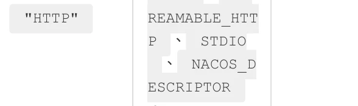

<table>
  <tr>
    <td>taskType</td>
    <td>body</td>
    <td><code>string</code></td>
    <td>否</td>
    <td><code>"TEXT_CHAT</code><br><code>"</code></td>
    <td>taskType。可选值：<code> TEXT_CH</code> <code>AT </code>、<code> TEXT_</code><code>GENERATION</code>、<code> IMAGE_GEN</code> <code>ERATION </code>、<code> </code><code>IMAGE_EDIT</code>、<code> IMAGE_VAR</code> <code>IATION </code>、<code> V</code> <code>IDEO_GENERAT</code> <code>ION </code>、<code> VIDE</code> <code>O_QUERY </code>、<code> </code><code>TASK_QUERY</code>。</td>
  </tr>
  <tr>
    <td>networkScope</td>
    <td>body</td>
    <td><code>string</code></td>
    <td>否</td>
    <td><code>"sample-</code><br><code>value"</code></td>
    <td>网络访问范围。</td>
  </tr>
  <tr>
    <td>requireGrant</td>
    <td>body</td>
    <td><code>boolean</code></td>
    <td>否</td>
    <td><code>false</code></td>
    <td>是否需要授权Grant。</td>
  </tr>
</table>

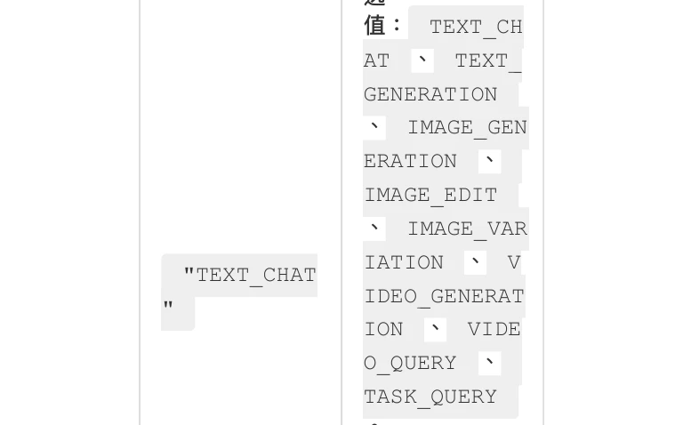

**返回数据**

| 参数名称 | 类型 | 示例 | 说明 |
| --- | --- | --- | --- |
| code | <code>string</code> | <code>SUCCESS</code> | 响应码，取值为<code> SUCCESS </code> 时表示请求成功。 |
| message | <code>string</code> | <code>null</code> | 响应消息。请求成功时通常为空。 |

<table>
  <tr>
    <td>data</td>
    <td><code>object</code></td>
    <td><code>{"kind":"MODEL_API</code><br><code>","resolutionMode":"</code><br><code>ENDPOINT","resourceI</code><br><code>d":"resource-</code><br><code>001","versionId":"ve</code><br><code>rsion-</code><br><code>001","version":"samp</code><br><code>le-</code><br><code>value","tenantId":"t</code><br><code>enant-001"}</code></td>
    <td>响应数据。具体结构以接口语义为准。</td>
  </tr>
  <tr>
    <td>accessDeniedDetail</td>
    <td><code>object</code></td>
    <td><code>null</code></td>
    <td>鉴权失败详情。请求成功时通常为空。</td>
  </tr>
  <tr>
    <td>requestId</td>
    <td><code>string</code></td>
    <td><code>req-001</code></td>
    <td>请求 ID，可用于问题排查和日志检索。</td>
  </tr>
  <tr>
    <td>data.kind</td>
    <td><code>string</code></td>
    <td><code>"MODEL_API"</code></td>
    <td>资源类型。</td>
  </tr>
  <tr>
    <td>data.resolutionMode</td>
    <td><code>string</code></td>
    <td><code>"ENDPOINT"</code></td>
    <td>resolutionMode。可选值：<code> ENDPOINT </code>、<code> S</code> <code>OURCE_DESCRIPTOR </code>。</td>
  </tr>
  <tr>
    <td>data.resourceId</td>
    <td><code>string</code></td>
    <td><code>"resource-001"</code></td>
    <td>AI Resource ID。</td>
  </tr>
  <tr>
    <td>data.versionId</td>
    <td><code>string</code></td>
    <td><code>"version-001"</code></td>
    <td>版本 ID。</td>
  </tr>
  <tr>
    <td>data.version</td>
    <td><code>string</code></td>
    <td><code>"sample-value"</code></td>
    <td>版本号。</td>
  </tr>
  <tr>
    <td>data.tenantId</td>
    <td><code>string</code></td>
    <td><code>"tenant-001"</code></td>
    <td>租户ID。</td>
  </tr>
  <tr>
    <td>data.name</td>
    <td><code>string</code></td>
    <td><code>"sample-name"</code></td>
    <td>名称。</td>
  </tr>
  <tr>
    <td>data.displayName</td>
    <td><code>string</code></td>
    <td><code> "</code>示例资源<code>" </code></td>
    <td>展示名称。</td>
  </tr>
  <tr>
    <td>data.actor</td>
    <td><code>object</code></td>
    <td><code>{"type":"USER","id</code><br><code>":"id-001"}</code></td>
    <td>操作主体。</td>
  </tr>
  <tr>
    <td>data.actor.type</td>
    <td><code>string</code></td>
    <td><code>"USER"</code></td>
    <td>类型。</td>
  </tr>
  <tr>
    <td>data.actor.id</td>
    <td><code>string</code></td>
    <td><code>"id-001"</code></td>
    <td>资源唯一标识。</td>
  </tr>
  <tr>
    <td>data.access</td>
    <td><code>object</code></td>
    <td><code>{"mode":"sample-</code><br><code>value","subscription</code><br><code>Id":"subscription-</code><br><code>001","grantId":"gran</code><br><code>t-</code><br><code>001","credentialBind</code><br><code>ingId":"credentialBi</code><br><code>nding-001"}</code></td>
    <td>访问配置。</td>
  </tr>
  <tr>
    <td>data.access.mode</td>
    <td><code>string</code></td>
    <td><code>"sample-value"</code></td>
    <td>模式。</td>
  </tr>
  <tr>
    <td>data.access.subscripti onId</td>
    <td><code>string</code></td>
    <td><code>"subscription-</code><br><code>001"</code></td>
    <td>订阅申请 ID。</td>
  </tr>
  <tr>
    <td>data.access.grantId</td>
    <td><code>string</code></td>
    <td><code>"grant-001"</code></td>
    <td>授权 Grant ID。</td>
  </tr>
  <tr>
    <td>data.access.credential BindingId</td>
    <td><code>string</code></td>
    <td><code>"credentialBinding</code><br><code>-001"</code></td>
    <td>凭据绑定 ID。</td>
  </tr>
  <tr>
    <td>data.source</td>
    <td><code>object</code></td>
    <td><code>{"sourceBindingId"</code><br><code>:"sourceBinding-</code><br><code>001","sourceType":"G</code><br><code>ATEWAY","sourceRef":</code><br><code>"sample-</code><br><code>value","syncStatus":</code><br><code>"sample-</code><br><code>value","credentialRe</code><br><code>f":"sample-</code><br><code>value","config":</code><br><code>{}}</code></td>
    <td>来源。</td>
  </tr>
  <tr>
    <td>data.source.sourceBin dingId</td>
    <td><code>string</code></td>
    <td><code>"sourceBinding-</code><br><code>001"</code></td>
    <td>来源绑定ID。</td>
  </tr>
  <tr>
    <td>data.source.sourceTyp e</td>
    <td><code>string</code></td>
    <td><code>"GATEWAY"</code></td>
    <td>来源类型。可选值：<code> GATEWAY </code>、<code> NA</code> <code>COS </code>、<code> REMOTE_ENDPO</code> <code>INT </code>、<code> SANDBOX </code>、<code> REGISTRY </code>、<code> CUSTO</code> <code>M </code>。</td>
  </tr>
  <tr>
    <td>data.source.sourceRef</td>
    <td><code>string</code></td>
    <td><code>"sample-value"</code></td>
    <td>来源引用。</td>
  </tr>
  <tr>
    <td>data.source.syncStatu s</td>
    <td><code>string</code></td>
    <td><code>"sample-value"</code></td>
    <td>同步状态。</td>
  </tr>
  <tr>
    <td>data.source.credential Ref</td>
    <td><code>string</code></td>
    <td><code>"sample-value"</code></td>
    <td>凭据引用。</td>
  </tr>
  <tr>
    <td>data.source.config</td>
    <td><code>object</code></td>
    <td><code>{}</code></td>
    <td>配置信息。</td>
  </tr>
  <tr>
    <td>data.endpoints</td>
    <td><code>array</code></td>
    <td><code>[{"endpointId":"en</code><br><code>dpoint-</code><br><code>001","name":"sample-</code><br><code>name","endpointType"</code><br><code>:"MODEL_INFERENCE","</code><br><code>providerType":"SANDB</code><br><code>OX","protocol":"HTTP</code><br><code>","url":"https://api</code><br><code>.example.com"}]</code></td>
    <td>访问端点列表。</td>
  </tr>
  <tr>
    <td>data.endpoints[].endp ointId</td>
    <td><code>string</code></td>
    <td><code>"endpoint-001"</code></td>
    <td>Endpoint ID。</td>
  </tr>
  <tr>
    <td>data.endpoints[].name</td>
    <td><code>string</code></td>
    <td><code>"sample-name"</code></td>
    <td>名称。</td>
  </tr>
  <tr>
    <td>data.endpoints[].endp ointType</td>
    <td><code>string</code></td>
    <td><code>"MODEL_INFERENCE"</code></td>
    <td>Endpoint 类型。</td>
  </tr>
  <tr>
    <td>data.endpoints[].provi derType</td>
    <td><code>string</code></td>
    <td><code>"SANDBOX"</code></td>
    <td>提供方类型。</td>
  </tr>
</table>


<table>
  <tr>
    <td>data.endpoints[].proto col</td>
    <td><code>string</code></td>
    <td><code>"HTTP"</code></td>
    <td>协议类型。可选值：<code> HTTP </code>、<code> HTTPS</code><code> </code>、<code> SSE </code>、<code> STREAMA</code> <code>BLE_HTTP </code>、<code> STDIO </code>、<code> NACOS_DESCRIPTOR</code><code> </code>。</td>
  </tr>
  <tr>
    <td>data.endpoints[].url</td>
    <td><code>string</code></td>
    <td><code>"https://api.examp</code><br><code>le.com"</code></td>
    <td>访问地址。</td>
  </tr>
  <tr>
    <td>data.endpoints[].base Url</td>
    <td><code>string</code></td>
    <td><code>"https://api.examp</code><br><code>le.com"</code></td>
    <td>服务基础地址。</td>
  </tr>
  <tr>
    <td>data.endpoints[].auth Mode</td>
    <td><code>string</code></td>
    <td><code>"sample-value"</code></td>
    <td>认证模式。</td>
  </tr>
  <tr>
    <td>data.endpoints[].netw orkScope</td>
    <td><code>string</code></td>
    <td><code>"sample-value"</code></td>
    <td>网络访问范围。</td>
  </tr>
  <tr>
    <td>data.endpoints[].defau ltInvocation</td>
    <td><code>boolean</code></td>
    <td><code>false</code></td>
    <td>默认调用配置。</td>
  </tr>
  <tr>
    <td>data.endpoints[].healt hStatus</td>
    <td><code>string</code></td>
    <td><code>"sample-value"</code></td>
    <td>健康检查状态。</td>
  </tr>
  <tr>
    <td>data.endpoints[].provi derConfig</td>
    <td><code>object</code></td>
    <td><code>{}</code></td>
    <td>Provider 配置。</td>
  </tr>
  <tr>
    <td>data.endpoints[].meta data</td>
    <td><code>object</code></td>
    <td><code>{}</code></td>
    <td>扩展元数据。</td>
  </tr>
  <tr>
    <td>data.capabilities</td>
    <td><code>array</code></td>
    <td><code>[{"capabilityId":"</code><br><code>capability-</code><br><code>001","capabilityType</code><br><code>":"MODEL","name":"sa</code><br><code>mple-</code><br><code>name","displayName":</code> <code>"</code>示例资源<code>","description":"</code>用于演示的资源描述<code>","inputSchema":</code> <code>{}}]</code></td>
    <td>资源能力列表。</td>
  </tr>
</table>

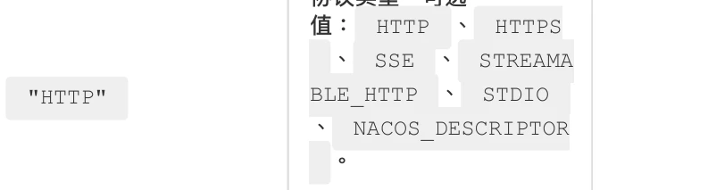

<table>
  <tr>
    <td>data.capabilities[].cap abilityId</td>
    <td><code>string</code></td>
    <td><code>"capability-001"</code></td>
    <td>能力 ID。</td>
  </tr>
  <tr>
    <td>data.capabilities[].cap abilityType</td>
    <td><code>string</code></td>
    <td><code>"MODEL"</code></td>
    <td>capabilityType。可选值：<code> MODEL </code>、<code> MCP_</code><code>TOOL </code>、<code> MCP_RESOURC</code> <code>E </code>、<code> MCP_PROMPT </code>、<code> SKILL </code>、<code> WORKER </code>、<code> API </code>。</td>
  </tr>
  <tr>
    <td>data.capabilities[].nam e</td>
    <td><code>string</code></td>
    <td><code>"sample-name"</code></td>
    <td>名称。</td>
  </tr>
  <tr>
    <td>data.capabilities[].disp layName</td>
    <td><code>string</code></td>
    <td><code> "</code>示例资源<code>" </code></td>
    <td>展示名称。</td>
  </tr>
  <tr>
    <td>data.capabilities[].des cription</td>
    <td><code>string</code></td>
    <td><code> "</code>用于演示的资源描述<code>" </code></td>
    <td>描述信息。</td>
  </tr>
  <tr>
    <td>data.capabilities[].inpu tSchema</td>
    <td><code>object</code></td>
    <td><code>{}</code></td>
    <td>输入参数 Schema。</td>
  </tr>
  <tr>
    <td>data.capabilities[].out putSchema</td>
    <td><code>object</code></td>
    <td><code>{}</code></td>
    <td>输出结果 Schema。</td>
  </tr>
  <tr>
    <td>data.capabilities[].tags</td>
    <td><code>array</code></td>
    <td><code>["sample-value"]</code></td>
    <td>标签列表。</td>
  </tr>
  <tr>
    <td>data.capabilities[].risk Level</td>
    <td><code>string</code></td>
    <td><code>"sample-value"</code></td>
    <td>风险等级。</td>
  </tr>
  <tr>
    <td>data.capabilities[].per missionScope</td>
    <td><code>string</code></td>
    <td><code>"sample-value"</code></td>
    <td>权限范围。</td>
  </tr>
</table>

<table>
  <tr>
    <td>data.modelInvocation</td>
    <td><code>object</code></td>
    <td><code>{"protocol":"sampl</code><br><code>e-</code><br><code>value","baseUrl":"ht</code><br><code>tps://api.example.co</code><br><code>m","selectedTarget":</code><br><code>{"baseUrl":"https://</code><br><code>api.example.com","ba</code><br><code>sePath":"sample-</code><br><code>value","source":"sam</code><br><code>ple-</code><br><code>value","accessModeTy</code><br><code>pe":"sample-</code><br><code>value","networkType"</code><br><code>:"sample-</code><br><code>value"},"selectedOpe</code><br><code>ration":</code><br><code>{"code":"CHAT_COMPLE</code><br><code>TIONS","taskType":"T</code><br><code>EXT_CHAT","operation</code><br><code>Role":"sample-</code><br><code>value","method":"sam</code><br><code>ple-</code><br><code>value","path":"sampl</code><br><code>e-</code><br><code>value","gatewayPath"</code><br><code>:"sample-</code><br><code>value"},"targets":</code><br><code>[{}],"operations":</code><br><code>[{}]}</code></td>
    <td>模型调用配置。</td>
  </tr>
  <tr>
    <td>data.modelInvocation.protocol</td>
    <td><code>string</code></td>
    <td><code>"sample-value"</code></td>
    <td>协议类型。</td>
  </tr>
  <tr>
    <td>data.modelInvocation.baseUrl</td>
    <td><code>string</code></td>
    <td><code>"https://api.examp</code><br><code>le.com"</code></td>
    <td>服务基础地址。</td>
  </tr>
</table>

<table>
  <tr>
    <td>data.modelInvocation.selectedTarget</td>
    <td><code>object</code></td>
    <td><code>{"baseUrl":"https:</code><br><code>//api.example.com","</code><br><code>basePath":"sample-</code><br><code>value","source":"sam</code><br><code>ple-</code><br><code>value","accessModeTy</code><br><code>pe":"sample-</code><br><code>value","networkType"</code><br><code>:"sample-value"}</code></td>
    <td>选中的目标对象。</td>
  </tr>
  <tr>
    <td>data.modelInvocation.selectedTarget.baseUr l</td>
    <td><code>string</code></td>
    <td><code>"https://api.examp</code><br><code>le.com"</code></td>
    <td>服务基础地址。</td>
  </tr>
  <tr>
    <td>data.modelInvocation.selectedTarget.basePa th</td>
    <td><code>string</code></td>
    <td><code>"sample-value"</code></td>
    <td>基础路径。</td>
  </tr>
  <tr>
    <td>data.modelInvocation.selectedTarget.source</td>
    <td><code>string</code></td>
    <td><code>"sample-value"</code></td>
    <td>来源。</td>
  </tr>
  <tr>
    <td>data.modelInvocation.selectedTarget.access ModeType</td>
    <td><code>string</code></td>
    <td><code>"sample-value"</code></td>
    <td>访问模式类型。</td>
  </tr>
  <tr>
    <td>data.modelInvocation.selectedTarget.networ kType</td>
    <td><code>string</code></td>
    <td><code>"sample-value"</code></td>
    <td>网络类型。</td>
  </tr>
  <tr>
    <td>data.modelInvocation.selectedOperation</td>
    <td><code>object</code></td>
    <td><code>{"code":"CHAT_COMP</code><br><code>LETIONS","taskType":</code><br><code>"TEXT_CHAT","operati</code><br><code>onRole":"sample-</code><br><code>value","method":"sam</code><br><code>ple-</code><br><code>value","path":"sampl</code><br><code>e-</code><br><code>value","gatewayPath"</code><br><code>:"sample-value"}</code></td>
    <td>选中的操作。</td>
  </tr>
  <tr>
    <td>data.modelInvocation.selectedOperation.cod e</td>
    <td><code>string</code></td>
    <td><code>"CHAT_COMPLETIONS"</code></td>
    <td>业务编码。</td>
  </tr>
</table>


<table>
  <tr>
    <td>data.modelInvocation.selectedOperation.tas kType</td>
    <td><code>string</code></td>
    <td><code>"TEXT_CHAT"</code></td>
    <td>taskType。可选值：<code> TEXT_CHAT </code>、<code> </code><code>TEXT_GENERATION </code>、<code>IMAGE_GENERATION</code>、<code> IMAGE_EDIT </code>、<code> I</code> <code>MAGE_VARIATION </code>、<code> </code><code>VIDEO_GENERATION </code>、<code> VIDEO_QUERY </code>、<code> TA</code> <code>SK_QUERY </code>。</td>
  </tr>
  <tr>
    <td>data.modelInvocation.selectedOperation.ope rationRole</td>
    <td><code>string</code></td>
    <td><code>"sample-value"</code></td>
    <td>操作角色。</td>
  </tr>
  <tr>
    <td>data.modelInvocation.selectedOperation.met hod</td>
    <td><code>string</code></td>
    <td><code>"sample-value"</code></td>
    <td>HTTP方法。</td>
  </tr>
  <tr>
    <td>data.modelInvocation.selectedOperation.pat h</td>
    <td><code>string</code></td>
    <td><code>"sample-value"</code></td>
    <td>路径。</td>
  </tr>
  <tr>
    <td>data.modelInvocation.selectedOperation.gat ewayPath</td>
    <td><code>string</code></td>
    <td><code>"sample-value"</code></td>
    <td>Gateway 路径。</td>
  </tr>
  <tr>
    <td>data.modelInvocation.selectedOperation.rout ePath</td>
    <td><code>string</code></td>
    <td><code>"sample-value"</code></td>
    <td>路由路径。</td>
  </tr>
  <tr>
    <td>data.modelInvocation.selectedOperation.ena bled</td>
    <td><code>boolean</code></td>
    <td><code>true</code></td>
    <td>是否启用。</td>
  </tr>
  <tr>
    <td>data.modelInvocation.selectedOperation.met adata</td>
    <td><code>object</code></td>
    <td><code>{}</code></td>
    <td>扩展元数据。</td>
  </tr>
  <tr>
    <td>data.modelInvocation.t argets</td>
    <td><code>array</code></td>
    <td><code>[{"baseUrl":"https</code><br><code>://api.example.com",</code><br><code>"basePath":"sample-</code><br><code>value","source":"sam</code><br><code>ple-</code><br><code>value","accessModeTy</code><br><code>pe":"sample-</code><br><code>value","networkType"</code><br><code>:"sample-value"}]</code></td>
    <td>目标列表。</td>
  </tr>
  <tr>
    <td>data.modelInvocation.t argets[].baseUrl</td>
    <td><code>string</code></td>
    <td><code>"https://api.examp</code><br><code>le.com"</code></td>
    <td>服务基础地址。</td>
  </tr>
  <tr>
    <td>data.modelInvocation.t argets[].basePath</td>
    <td><code>string</code></td>
    <td><code>"sample-value"</code></td>
    <td>基础路径。</td>
  </tr>
  <tr>
    <td>data.modelInvocation.t argets[].source</td>
    <td><code>string</code></td>
    <td><code>"sample-value"</code></td>
    <td>来源。</td>
  </tr>
  <tr>
    <td>data.modelInvocation.t argets[].accessModeTy pe</td>
    <td><code>string</code></td>
    <td><code>"sample-value"</code></td>
    <td>访问模式类型。</td>
  </tr>
  <tr>
    <td>data.modelInvocation.t argets[].networkType</td>
    <td><code>string</code></td>
    <td><code>"sample-value"</code></td>
    <td>网络类型。</td>
  </tr>
  <tr>
    <td>data.modelInvocation.operations</td>
    <td><code>array</code></td>
    <td><code>[{"code":"CHAT_COM</code><br><code>PLETIONS","taskType"</code><br><code>:"TEXT_CHAT","operat</code><br><code>ionRole":"sample-</code><br><code>value","method":"sam</code><br><code>ple-</code><br><code>value","path":"sampl</code><br><code>e-</code><br><code>value","gatewayPath"</code><br><code>:"sample-value"}]</code></td>
    <td>操作列表。</td>
  </tr>
  <tr>
    <td>data.modelInvocation.operations[].code</td>
    <td><code>string</code></td>
    <td><code>"CHAT_COMPLETIONS"</code></td>
    <td>业务编码。</td>
  </tr>
  <tr>
    <td>data.modelInvocation.operations[].taskType</td>
    <td><code>string</code></td>
    <td><code>"TEXT_CHAT"</code></td>
    <td>taskType。可选值：<code> TEXT_CHAT </code>、<code> </code><code>TEXT_GENERATION </code>、<code>IMAGE_GENERATION</code>、<code> IMAGE_EDIT </code>、<code> I</code> <code>MAGE_VARIATION </code>、<code> </code><code>VIDEO_GENERATION </code>、<code> VIDEO_QUERY </code>、<code> TA</code> <code>SK_QUERY </code>。</td>
  </tr>
  <tr>
    <td>data.modelInvocation.operations[].operation Role</td>
    <td><code>string</code></td>
    <td><code>"sample-value"</code></td>
    <td>操作角色。</td>
  </tr>
  <tr>
    <td>data.modelInvocation.operations[].method</td>
    <td><code>string</code></td>
    <td><code>"sample-value"</code></td>
    <td>HTTP方法。</td>
  </tr>
</table>

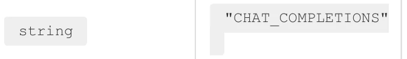

<table>
  <tr>
    <td>data.modelInvocation.operations[].path</td>
    <td><code>string</code></td>
    <td><code>"sample-value"</code></td>
    <td>路径。</td>
  </tr>
  <tr>
    <td>data.modelInvocation.operations[].gatewayP ath</td>
    <td><code>string</code></td>
    <td><code>"sample-value"</code></td>
    <td>Gateway 路径。</td>
  </tr>
</table>

**示例**

**请求示例**

```http
POST /himarket/v1/open-api/v1/application/resolve HTTP/1.1
Host: localhost:8080
Authorization: Bearer <accessToken>
Content-Type: application/json

{
  "subjectType": "USER",
  "subjectId": "subject-001",
  "listingId": "listing-001",
  "kind": "MODEL_API",
  "resourceId": "resource-001",
  "versionId": "version-001"
}
```

**响应示例**

```json
{
  "code": "SUCCESS",
  "message": null,
  "data": {
    "kind": "MODEL_API",
    "resolutionMode": "ENDPOINT",
    "resourceId": "resource-001",
    "versionId": "version-001",
    "version": "sample-value",
    "tenantId": "tenant-001"
  },
  "accessDeniedDetail": null,
  "requestId": "req-001"
}
```

<a id="section-3-12-3"></a>

### 3.12.3. resolveBatch

**接口信息**

- **接口路径**： `POST /himarket/v1/open-api/v1/application/resolve-batch`

- **接口说明**：应用侧批量解析资源。

- **认证方式**：该接口属于开发者门户 API。调用前请完成开发者登录，并在请求 Header 中携带  `Authorization: Bearer <accessToken>` 。

- **Header 示例**：需要登录态的接口使用  `Authorization: Bearer <accessToken>` 。

**请求参数**

| 参数名称 | 位置 | 类型 | 是否必选 | 示例 | 说明 |
| --- | --- | --- | --- | --- | --- |
| subjectType | body | <code>string</code> | 否 | <code>"USER"</code> | subjectType。可选值：<code> USER </code>、<code> APP </code>。 |
| subjectId | body | <code>string</code> | 否 | <code>"subject-</code><br><code>001"</code> | 主体 ID。 |
| items | body | <code>array</code> | 是 | <code>[{"listing</code><br><code>Id":"listing</code><br><code>-</code><br><code>001","kind":</code><br><code>"MODEL_API",</code><br><code>"resourceId"</code><br><code>:"resource-</code><br><code>001","versio</code><br><code>nId":"versio</code><br><code>n-</code><br><code>001","endpoi</code><br><code>ntId":"endpo</code><br><code>int-</code><br><code>001","protoc</code><br><code>ol":"HTTP"}]</code> | 数据项列表。 |
| items\[\].listingI d | body | <code>string</code> | 否 | <code>"listing-</code><br><code>001"</code> | Listing ID。 |
| items\[\].kind | body | <code>string</code> | 否 | <code>"MODEL_API</code><br><code>"</code> | 资源类型。 |
| items\[\].resour ceId | body | <code>string</code> | 否 | <code>"resource-</code><br><code>001"</code> | AI Resource ID。 |
| items\[\].versio nId | body | <code>string</code> | 否 | <code>"version-</code><br><code>001"</code> | 版本 ID。 |
| items\[\].endpo intId | body | <code>string</code> | 否 | <code>"endpoint-</code><br><code>001"</code> | Endpoint ID。 |
| items\[\].protoc ol | body | <code>string</code> | 否 | <code>"HTTP"</code> | 协议类型。可选值：<code> HTTP </code>、<code> HTTPS </code>、<code> SSE </code>、<code> ST</code> <code>REAMABLE_HTT</code> <code>P </code>、<code> STDIO</code><code> </code>、<code> NACOS_D</code> <code>ESCRIPTOR</code>。 |
| items\[\].netwo rkScope | body | <code>string</code> | 否 | <code>"sample-</code><br><code>value"</code> | 网络访问范围。 |
| items\[\].requir eGrant | body | <code>boolean</code> | 否 | <code>false</code> | 是否需要授权Grant。 |


**返回数据**

| 参数名称 | 类型 | 示例 | 说明 |
| --- | --- | --- | --- |
| code | <code>string</code> | <code>SUCCESS</code> | 响应码，取值为<code> SUCCESS </code> 时表示请求成功。 |
| message | <code>string</code> | <code>null</code> | 响应消息。请求成功时通常为空。 |
| data | <code>object</code> | <code>{"items":[{}]}</code> | 响应数据。具体结构以接口语义为准。 |
| accessDeniedDetail | <code>object</code> | <code>null</code> | 鉴权失败详情。请求成功时通常为空。 |
| requestId | <code>string</code> | <code>req-001</code> | 请求 ID，可用于问题排查和日志检索。 |
| data.items | <code>array</code> | <code>[{"listingId":"lis</code><br><code>ting-</code><br><code>001","kind":"MODEL_A</code><br><code>PI","resourceId":"re</code><br><code>source-</code><br><code>001","versionId":"ve</code><br><code>rsion-</code><br><code>001","endpointId":"e</code><br><code>ndpoint-</code><br><code>001","protocol":"HTT</code><br><code>P"}]</code> | 数据项列表。 |
| data.items\[\].listingId | <code>string</code> | <code>"listing-001"</code> | Listing ID。 |
| data.items\[\].kind | <code>string</code> | <code>"MODEL_API"</code> | 资源类型。 |
| data.items\[\].resourceI d | <code>string</code> | <code>"resource-001"</code> | AI Resource ID。 |
| data.items\[\].versionId | <code>string</code> | <code>"version-001"</code> | 版本 ID。 |
| data.items\[\].endpointI d | <code>string</code> | <code>"endpoint-001"</code> | Endpoint ID。 |
| data.items\[\].protocol | <code>string</code> | <code>"HTTP"</code> | 协议类型。可选值：<code> HTTP </code>、<code> HTTPS</code><code> </code>、<code> SSE </code>、<code> STREAMA</code> <code>BLE_HTTP </code>、<code> STDIO </code>、<code> NACOS_DESCRIPTOR</code><code> </code>。 |
| data.items\[\].networkS cope | <code>string</code> | <code>"sample-value"</code> | 网络访问范围。 |
| data.items\[\].requireGr ant | <code>boolean</code> | <code>false</code> | 是否需要授权 Grant。 |

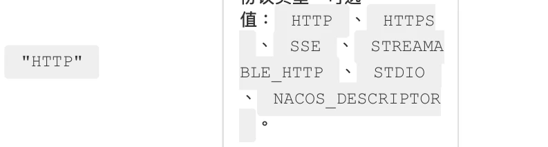

**示例**

**请求示例**

```http
POST /himarket/v1/open-api/v1/application/resolve-batch HTTP/1.1
Host: localhost:8080
Authorization: Bearer <accessToken>
Content-Type: application/json

{
  "subjectType": "USER",
  "subjectId": "subject-001",
  "items": [
    {}
  ]
}
```

**响应示例**

```json
{
  "code": "SUCCESS",
  "message": null,
  "data": {
    "items": [
      {}
    ]
  },
  "accessDeniedDetail": null,
  "requestId": "req-001"
}
```

<a id="section-3-12-4"></a>

### 3.12.4. searchCatalog

**接口信息**

- **接口路径**： `GET /himarket/v1/open-api/v1/application/catalog/search`

- **接口说明**：应用侧搜索市场资源并返回订阅/授权状态。

- **认证方式**：该接口属于开发者门户 API。调用前请完成开发者登录，并在请求 Header 中携带  `Authorization: Bearer <accessToken>` 。

- **Header 示例**：需要登录态的接口使用  `Authorization: Bearer <accessToken>` 。

**请求参数**

| 参数名称 | 位置 | 类型 | 是否必选 | 示例 | 说明 |
| --- | --- | --- | --- | --- | --- |
| tenantId | query | <code>string</code> | 否 | <code>"tenant-</code><br><code>001"</code> | 租户ID。 |
| portalId | query | <code>string</code> | 否 | <code>"portal-</code><br><code>001"</code> | 门户ID。 |
| kind | query | <code>string</code> | 否 | <code>"MODEL_API</code><br><code>"</code> | 资源类型。 |
| keyword | query | <code>string</code> | 否 | <code>"sample-</code><br><code>value"</code> | 搜索关键词。 |
| categoryId | query | <code>string</code> | 否 | <code>"category-</code><br><code>001"</code> | 分类 ID。 |
| tag | query | <code>string</code> | 否 | <code>"sample-</code><br><code>value"</code> | 标签。 |
| pricingMode | query | <code>string</code> | 否 | <code>"sample-</code><br><code>value"</code> | 计费模式。 |
| sortBy | query | <code>string</code> | 否 | <code>"sample-</code><br><code>value"</code> | 排序字段。 |
| subjectType | query | <code>string</code> | 否 | <code>"USER"</code> | subjectType。可选值：<code> USER </code>、<code> APP </code>。 |
| subjectId | query | <code>string</code> | 否 | <code>"subject-</code><br><code>001"</code> | 主体 ID。 |
| page | query | <code>integer&lt;in</code><br><code>t32&gt;</code> | 否 | <code>1</code> | 页码。 |
| size | query | <code>integer&lt;in</code><br><code>t32&gt;</code> | 否 | <code>10</code> | 每页记录数。 |
| sort | query | <code>array</code> | 否 | <code>["sample-</code><br><code>value"]</code> | 排序条件。 |

**返回数据**

| 参数名称 | 类型 | 示例 | 说明 |
| --- | --- | --- | --- |
| code | <code>string</code> | <code>SUCCESS</code> | 响应码，取值为<code> SUCCESS </code> 时表示请求成功。 |
| message | <code>string</code> | <code>null</code> | 响应消息。请求成功时通常为空。 |
| data | <code>object</code> | <code>{"content":</code><br><code>[{}],"pageNumber":1,</code><br><code>"pageSize":10,"total</code><br><code>Count":1}</code> | 响应数据。具体结构以接口语义为准。 |
| accessDeniedDetail | <code>object</code> | <code>null</code> | 鉴权失败详情。请求成功时通常为空。 |
| requestId | <code>string</code> | <code>req-001</code> | 请求 ID，可用于问题排查和日志检索。 |
| data.content | <code>array</code> | <code>[{"catalog":</code><br><code>{},"subscription":</code><br><code>{},"consumerSubscrip</code><br><code>tions":</code><br><code>[{}],"authorization"</code><br><code>:{},"resolved":</code><br><code>{}}]</code> | 分页结果列表。 |
| data.content\[\].catalog | <code>object</code> | <code>{"listingId":"list</code><br><code>ing-</code><br><code>001","tenantId":"ten</code><br><code>ant-</code><br><code>001","resourceId":"r</code><br><code>esource-</code><br><code>001","defaultVersion</code><br><code>Id":"defaultVersion-</code><br><code>001","portalId":"por</code><br><code>tal-</code><br><code>001","visibility":"P</code><br><code>RIVATE"}</code> | 市场资源信息。 |
| data.content\[\].catalog.listingId | <code>string</code> | <code>"listing-001"</code> | Listing ID。 |
| data.content\[\].catalog.tenantId | <code>string</code> | <code>"tenant-001"</code> | 租户ID。 |
| data.content\[\].catalog.resourceId | <code>string</code> | <code>"resource-001"</code> | AI Resource ID。 |
| data.content\[\].catalog.defaultVersionId | <code>string</code> | <code>"defaultVersion-</code><br><code>001"</code> | 默认版本ID。 |
| data.content\[\].catalog.portalId | <code>string</code> | <code>"portal-001"</code> | 门户ID。 |
| data.content\[\].catalog.visibility | <code>string</code> | <code>"PRIVATE"</code> | 可见性。可选值：<code> PRIVATE </code>、<code> PU</code> <code>BLIC </code>。 |
| data.content\[\].catalog.title | <code>string</code> | <code> "</code>示例资源标题<code>" </code> | 标题。 |
| data.content\[\].catalog.summary | <code>string</code> | <code> "</code>示例摘要<code>" </code> | 摘要信息。 |
| data.content\[\].catalog.description | <code>string</code> | <code> "</code>用于演示的资源描述<code>" </code> | 描述信息。 |
| data.content\[\].catalog.icon | <code>string</code> | <code>"sample-value"</code> | 图标地址。 |
| data.content\[\].catalog.banner | <code>string</code> | <code>"sample-value"</code> | 横幅图片地址。 |
| data.content\[\].catalog.categoryId | <code>string</code> | <code>"category-001"</code> | 分类 ID。 |
| data.content\[\].catalog.category | <code>object</code> | <code>{"categoryId":"cat</code><br><code>egory-</code><br><code>001","tenantId":"ten</code><br><code>ant-</code><br><code>001","kind":"MODEL_A</code><br><code>PI","code":"model-</code><br><code>api","name":"sample-</code><br><code>name","description":</code> <code>"</code>用于演示的资源描述<code>"} </code> | 分类信息。 |
| data.content\[\].catalog.category.categoryId | <code>string</code> | <code>"category-001"</code> | 分类 ID。 |
| data.content\[\].catalog.category.tenantId | <code>string</code> | <code>"tenant-001"</code> | 租户ID。 |
| data.content\[\].catalog.category.kind | <code>string</code> | <code>"MODEL_API"</code> | 资源类型。 |
| data.content\[\].catalog.category.code | <code>string</code> | <code>"model-api"</code> | 业务编码。 |
| data.content\[\].catalog.category.name | <code>string</code> | <code>"sample-name"</code> | 名称。 |
| data.content\[\].catalog.category.description | <code>string</code> | <code> "</code>用于演示的资源描述<code>" </code> | 描述信息。 |
| data.content\[\].catalog.category.icon | <code>string</code> | <code>"sample-value"</code> | 图标地址。 |
| data.content\[\].catalog.category.sortOrder | <code>integer&lt;int32&gt;</code> | <code>100</code> | 排序值。 |
| data.content\[\].catalog.category.status | <code>string</code> | <code>"sample-value"</code> | 状态。 |
| data.content\[\].catalog.category.createdBy | <code>string</code> | <code>"sample-value"</code> | 创建人。 |
| data.content\[\].catalog.category.updatedBy | <code>string</code> | <code>"sample-value"</code> | 更新人。 |
| data.content\[\].catalog.category.createdAt | <code>string&lt;date-</code><br><code>time&gt;</code> | <code>"2026-06-</code><br><code>22T12:00:00Z"</code> | 创建时间。 |
| data.content\[\].catalog.category.updatedAt | <code>string&lt;date-</code><br><code>time&gt;</code> | <code>"2026-06-</code><br><code>22T12:00:00Z"</code> | 更新时间。 |
| data.content\[\].catalog.category.listingCount | <code>integer&lt;int64&gt;</code> | <code>1</code> | Listing 数量。 |
| data.content\[\].catalog.tags | <code>array</code> | <code>["sample-value"]</code> | 标签列表。 |
| data.content\[\].catalog.pricingMode | <code>string</code> | <code>"sample-value"</code> | 计费模式。 |
| data.content\[\].catalog.sourceType | <code>string</code> | <code>"sample-value"</code> | 来源类型。 |
| data.content\[\].catalog.origin | <code>string</code> | <code>"sample-value"</code> | 来源标识。 |
| data.content\[\].catalog.listingStatus | <code>string</code> | <code>"sample-value"</code> | 市场条目状态。 |
| data.content\[\].catalog.publicationStatus | <code>string</code> | <code>"DRAFT"</code> | 发布状态。可选值：<code> DRAFT </code>、<code> IN_R</code> <code>EVIEW </code>、<code> PUBLISHED</code><code> </code>、<code> UNPUBLISHED </code>、<code> REJECTED </code>。 |
| data.content\[\].catalog.publishedAt | <code>string&lt;date-</code><br><code>time&gt;</code> | <code>"2026-06-</code><br><code>22T12:00:00Z"</code> | 发布时间。 |
| data.content\[\].catalog.resource | <code>object</code> | <code>{"resourceId":"res</code><br><code>ource-</code><br><code>001","tenantId":"ten</code><br><code>ant-</code><br><code>001","kind":"MODEL_A</code><br><code>PI","name":"sample-</code><br><code>name","displayName":</code> <code>"</code>示例资源<code>","summary":"</code>示例摘要<code>"} </code> | AI Resource 基础信息。 |
| data.content\[\].catalog.resource.resourceId | <code>string</code> | <code>"resource-001"</code> | AI Resource ID。 |
| data.content\[\].catalog.resource.tenantId | <code>string</code> | <code>"tenant-001"</code> | 租户ID。 |
| data.content\[\].catalog.resource.kind | <code>string</code> | <code>"MODEL_API"</code> | 资源类型。 |
| data.content\[\].catalog.resource.name | <code>string</code> | <code>"sample-name"</code> | 名称。 |


<table>
  <tr>
    <td>data.content[].catalog.resource.displayName</td>
    <td><code>string</code></td>
    <td><code> "</code>示例资源<code>" </code></td>
    <td>展示名称。</td>
  </tr>
  <tr>
    <td>data.content[].catalog.resource.summary</td>
    <td><code>string</code></td>
    <td><code> "</code>示例摘要<code>" </code></td>
    <td>摘要信息。</td>
  </tr>
  <tr>
    <td>data.content[].catalog.resource.description</td>
    <td><code>string</code></td>
    <td><code> "</code>用于演示的资源描述<code>" </code></td>
    <td>描述信息。</td>
  </tr>
  <tr>
    <td>data.content[].catalog.resource.ownerType</td>
    <td><code>string</code></td>
    <td><code>"USER"</code></td>
    <td>归属主体类型。可选值：<code> USER </code>、<code> APP </code>、<code> SYSTEM </code>。</td>
  </tr>
  <tr>
    <td>data.content[].catalog.resource.ownerId</td>
    <td><code>string</code></td>
    <td><code>"owner-001"</code></td>
    <td>归属主体ID。</td>
  </tr>
  <tr>
    <td>data.content[].catalog.resource.createdBy</td>
    <td><code>string</code></td>
    <td><code>"sample-value"</code></td>
    <td>创建人。</td>
  </tr>
  <tr>
    <td>data.content[].catalog.resource.createdByNa me</td>
    <td><code>string</code></td>
    <td><code>"demo-createdby"</code></td>
    <td>创建人名称。</td>
  </tr>
  <tr>
    <td>data.content[].catalog.resource.icon</td>
    <td><code>string</code></td>
    <td><code>"sample-value"</code></td>
    <td>图标地址。</td>
  </tr>
  <tr>
    <td>data.content[].catalog.resource.tags</td>
    <td><code>array</code></td>
    <td><code>["sample-value"]</code></td>
    <td>标签列表。</td>
  </tr>
  <tr>
    <td>data.content[].catalog.resource.lifecycleStatu s</td>
    <td><code>string</code></td>
    <td><code>"DRAFT"</code></td>
    <td>生命周期状态。可选值：<code> DRAFT </code>、<code> ACTI</code> <code>VE </code>、<code> DEPRECATED </code>、<code> ARCHIVED </code>。</td>
  </tr>
  <tr>
    <td>data.content[].catalog.resource.latestVersionI d</td>
    <td><code>string</code></td>
    <td><code>"latestVersion-</code><br><code>001"</code></td>
    <td>最新版本ID。</td>
  </tr>
  <tr>
    <td>data.content[].catalog.resource.autoApprove Subscription</td>
    <td><code>boolean</code></td>
    <td><code>true</code></td>
    <td>是否自动批准订阅。</td>
  </tr>
  <tr>
    <td>data.content[].catalog.resource.extras</td>
    <td><code>object</code></td>
    <td><code>{}</code></td>
    <td>扩展配置。</td>
  </tr>
  <tr>
    <td>data.content[].catalog.resource.createdAt</td>
    <td><code>string&lt;date-</code><br><code>time&gt;</code></td>
    <td><code>"2026-06-</code><br><code>22T12:00:00Z"</code></td>
    <td>创建时间。</td>
  </tr>
  <tr>
    <td>data.content[].catalog.resource.updatedAt</td>
    <td><code>string&lt;date-</code><br><code>time&gt;</code></td>
    <td><code>"2026-06-</code><br><code>22T12:00:00Z"</code></td>
    <td>更新时间。</td>
  </tr>
  <tr>
    <td>data.content[].catalog.version</td>
    <td><code>object</code></td>
    <td><code>{"versionId":"vers</code><br><code>ion-</code><br><code>001","resourceId":"r</code><br><code>esource-</code><br><code>001","version":"samp</code><br><code>le-</code><br><code>value","versionSchem</code><br><code>e":"SEMVER","status"</code><br><code>:"DRAFT","manifestId</code><br><code>":"manifest-001"}</code></td>
    <td>版本号。</td>
  </tr>
  <tr>
    <td>data.content[].catalog.version.versionId</td>
    <td><code>string</code></td>
    <td><code>"version-001"</code></td>
    <td>版本 ID。</td>
  </tr>
  <tr>
    <td>data.content[].catalog.version.resourceId</td>
    <td><code>string</code></td>
    <td><code>"resource-001"</code></td>
    <td>AI Resource ID。</td>
  </tr>
  <tr>
    <td>data.content[].catalog.version.version</td>
    <td><code>string</code></td>
    <td><code>"sample-value"</code></td>
    <td>版本号。</td>
  </tr>
  <tr>
    <td>data.content[].catalog.version.versionSchem e</td>
    <td><code>string</code></td>
    <td><code>"SEMVER"</code></td>
    <td>版本号方案。可选值：<code> SEMVER </code>、<code> TIM</code> <code>ESTAMP </code>、<code> REVISION</code><code> </code>、<code> EXTERNAL </code>。</td>
  </tr>
  <tr>
    <td>data.content[].catalog.version.status</td>
    <td><code>string</code></td>
    <td><code>"DRAFT"</code></td>
    <td>状态。</td>
  </tr>
  <tr>
    <td>data.content[].catalog.version.manifestId</td>
    <td><code>string</code></td>
    <td><code>"manifest-001"</code></td>
    <td>Manifest ID。</td>
  </tr>
  <tr>
    <td>data.content[].catalog.version.sourceBindingI d</td>
    <td><code>string</code></td>
    <td><code>"sourceBinding-</code><br><code>001"</code></td>
    <td>来源绑定ID。</td>
  </tr>
  <tr>
    <td>data.content[].catalog.version.artifactDigest</td>
    <td><code>string</code></td>
    <td><code>"sample-value"</code></td>
    <td>制品摘要。</td>
  </tr>
</table>


<table>
  <tr>
    <td>data.content[].catalog.version.releaseNote</td>
    <td><code>string</code></td>
    <td><code>"sample-value"</code></td>
    <td>版本说明。</td>
  </tr>
  <tr>
    <td>data.content[].catalog.version.createdBy</td>
    <td><code>string</code></td>
    <td><code>"sample-value"</code></td>
    <td>创建人。</td>
  </tr>
  <tr>
    <td>data.content[].catalog.version.publishedAt</td>
    <td><code>string&lt;date-</code><br><code>time&gt;</code></td>
    <td><code>"2026-06-</code><br><code>22T12:00:00Z"</code></td>
    <td>发布时间。</td>
  </tr>
  <tr>
    <td>data.content[].catalog.version.createdAt</td>
    <td><code>string&lt;date-</code><br><code>time&gt;</code></td>
    <td><code>"2026-06-</code><br><code>22T12:00:00Z"</code></td>
    <td>创建时间。</td>
  </tr>
  <tr>
    <td>data.content[].catalog.version.updatedAt</td>
    <td><code>string&lt;date-</code><br><code>time&gt;</code></td>
    <td><code>"2026-06-</code><br><code>22T12:00:00Z"</code></td>
    <td>更新时间。</td>
  </tr>
  <tr>
    <td>data.content[].catalog.version.downloadCoun t</td>
    <td><code>integer&lt;int64&gt;</code></td>
    <td><code>1</code></td>
    <td>下载次数。</td>
  </tr>
  <tr>
    <td>data.content[].catalog.version.isLatest</td>
    <td><code>boolean</code></td>
    <td><code>true</code></td>
    <td>是否为最新版本。</td>
  </tr>
  <tr>
    <td>data.content[].catalog.manifest</td>
    <td><code>object</code></td>
    <td><code>{}</code></td>
    <td>资源 Manifest 内容。</td>
  </tr>
  <tr>
    <td>data.content[].catalog.extras</td>
    <td><code>object</code></td>
    <td><code>{}</code></td>
    <td>扩展配置。</td>
  </tr>
  <tr>
    <td>data.content[].catalog.metrics</td>
    <td><code>object</code></td>
    <td><code>{"toolCount":1,"su</code><br><code>bscriptionCount":1}</code></td>
    <td>指标信息。</td>
  </tr>
  <tr>
    <td>data.content[].catalog.metrics.toolCount</td>
    <td><code>integer&lt;int64&gt;</code></td>
    <td><code>1</code></td>
    <td>工具数量。</td>
  </tr>
  <tr>
    <td>data.content[].catalog.metrics.subscriptionCo unt</td>
    <td><code>integer&lt;int64&gt;</code></td>
    <td><code>1</code></td>
    <td>订阅数量。</td>
  </tr>
</table>


<table>
  <tr>
    <td>data.content[].subscri ption</td>
    <td><code>object</code></td>
    <td><code>{"subscriptionId":</code><br><code>"subscription-</code><br><code>001","status":"PENDI</code><br><code>NG","targetType":"sa</code><br><code>mple-</code><br><code>value","targetId":"t</code><br><code>arget-</code><br><code>001","activeGrant":t</code><br><code>rue,"detail":</code><br><code>{"subscriptionId":"s</code><br><code>ubscription-</code><br><code>001","subjectType":"</code><br><code>USER","subjectId":"s</code><br><code>ubject-</code><br><code>001","targetType":"s</code><br><code>ample-</code><br><code>value","targetId":"t</code><br><code>arget-</code><br><code>001","status":"PENDI</code><br><code>NG"}}</code></td>
    <td>订阅信息。</td>
  </tr>
  <tr>
    <td>data.content[].subscri ption.subscriptionId</td>
    <td><code>string</code></td>
    <td><code>"subscription-</code><br><code>001"</code></td>
    <td>订阅申请 ID。</td>
  </tr>
  <tr>
    <td>data.content[].subscri ption.status</td>
    <td><code>string</code></td>
    <td><code>"PENDING"</code></td>
    <td>状态。</td>
  </tr>
</table>

**示例**

**请求示例**

```text
GET /himarket/v1/open-api/v1/application/catalog/search?tenantId=tenant-
001&portalId=portal-001&kind=MODEL_API&keyword=sample-value&categoryId=category-001&tag=sample-value&pricingMode=sample-value&sortBy=sample-value HTTP/1.1
Host: localhost:8080
Authorization: Bearer <accessToken>
```

**响应示例**

```json
{
  "code": "SUCCESS",
  "message": null,
  "data": {
    "content": [
      {}
    ],
    "pageNumber": 1,
    "pageSize": 10,
    "totalCount": 1
  },
  "accessDeniedDetail": null,
  "requestId": "req-001"
}
```

<a id="section-3-12-5"></a>

### 3.12.5. subscribe

**接口信息**

- **接口路径**： `POST /himarket/v1/open-`

  ```text
  api/v1/application/catalog/items/{listingId}/subscriptions 
  ```

- **接口说明**：应用侧提交资源订阅申请。

- **认证方式**：该接口属于开发者门户 API。调用前请完成开发者登录，并在请求 Header 中携带  `Authorization: Bearer <accessToken>` 。

- **Header 示例**：需要登录态的接口使用  `Authorization: Bearer <accessToken>` 。

**请求参数**

| 参数名称 | 位置 | 类型 | 是否必选 | 示例 | 说明 |
| --- | --- | --- | --- | --- | --- |
| listingId | path | <code>string</code> | 是 | <code>"listing-</code><br><code>001"</code> | Listing ID。 |
| subjectType | body | <code>string</code> | 否 | <code>"USER"</code> | subjectType。可选值：<code> USER </code>、<code> APP </code>。 |
| subjectId | body | <code>string</code> | 否 | <code>"subject-</code><br><code>001"</code> | 主体 ID。 |
| targetType | body | <code>string</code> | 否 | <code>"sample-</code><br><code>value"</code> | 订阅目标类型。 |
| targetId | body | <code>string</code> | 否 | <code>"target-</code><br><code>001"</code> | 目标对象 ID。 |
| quotaPolicyId | body | <code>string</code> | 否 | <code>"quotaPoli</code><br><code>cy-001"</code> | 配额策略 ID。 |
| expiresAt | body | <code>string&lt;dat</code><br><code>e-time&gt;</code> | 否 | <code>"2026-06-</code><br><code>22T12:00:00Z</code><br><code>"</code> | 过期时间。 |

**返回数据**

| 参数名称 | 类型 | 示例 | 说明 |
| --- | --- | --- | --- |
| code | <code>string</code> | <code>SUCCESS</code> | 响应码，取值为<code> SUCCESS </code> 时表示请求成功。 |
| message | <code>string</code> | <code>null</code> | 响应消息。请求成功时通常为空。 |
| data | <code>object</code> | <code>{"subscriptionId":</code><br><code>"subscription-</code><br><code>001","subjectType":"</code><br><code>USER","subjectId":"s</code><br><code>ubject-</code><br><code>001","targetType":"s</code><br><code>ample-</code><br><code>value","targetId":"t</code><br><code>arget-</code><br><code>001","status":"PENDI</code><br><code>NG"}</code> | 响应数据。具体结构以接口语义为准。 |
| accessDeniedDetail | <code>object</code> | <code>null</code> | 鉴权失败详情。请求成功时通常为空。 |
| requestId | <code>string</code> | <code>req-001</code> | 请求 ID，可用于问题排查和日志检索。 |
| data.subscriptionId | <code>string</code> | <code>"subscription-</code><br><code>001"</code> | 订阅申请 ID。 |
| data.subjectType | <code>string</code> | <code>"USER"</code> | subjectType。可选值：<code> USER </code>、<code> APP </code>。 |
| data.subjectId | <code>string</code> | <code>"subject-001"</code> | 主体 ID。 |
| data.targetType | <code>string</code> | <code>"sample-value"</code> | 订阅目标类型。 |
| data.targetId | <code>string</code> | <code>"target-001"</code> | 目标对象 ID。 |
| data.status | <code>string</code> | <code>"PENDING"</code> | 状态。 |
| data.quotaPolicyId | <code>string</code> | <code>"quotaPolicy-</code><br><code>001"</code> | 配额策略 ID。 |
| data.expiresAt | <code>string&lt;date-</code><br><code>time&gt;</code> | <code>"2026-06-</code><br><code>22T12:00:00Z"</code> | 过期时间。 |
| data.createdAt | <code>string&lt;date-</code><br><code>time&gt;</code> | <code>"2026-06-</code><br><code>22T12:00:00Z"</code> | 创建时间。 |
| data.updatedAt | <code>string&lt;date-</code><br><code>time&gt;</code> | <code>"2026-06-</code><br><code>22T12:00:00Z"</code> | 更新时间。 |
| data.grants | <code>array</code> | <code>[{"grantId":"grant</code><br><code>-</code><br><code>001","subscriptionId</code><br><code>":"subscription-</code><br><code>001","scope":"sample</code><br><code>-</code><br><code>value","credentialBi</code><br><code>ndingId":"credential</code><br><code>Binding-</code><br><code>001","policySnapshot</code><br><code>":</code><br><code>{},"status":"ACTIVE"</code><br><code>}]</code> | 授权 Grant 列表。 |
| data.grants\[\].grantId | <code>string</code> | <code>"grant-001"</code> | 授权 Grant ID。 |
| data.grants\[\].subscript ionId | <code>string</code> | <code>"subscription-</code><br><code>001"</code> | 订阅申请 ID。 |
| data.grants\[\].scope | <code>string</code> | <code>"sample-value"</code> | 作用域。 |
| data.grants\[\].credentia lBindingId | <code>string</code> | <code>"credentialBinding</code><br><code>-001"</code> | 凭据绑定 ID。 |
| data.grants\[\].policySn apshot | <code>object</code> | <code>{}</code> | 策略快照。 |
| data.grants\[\].status | <code>string</code> | <code>"ACTIVE"</code> | 状态。 |
| data.consumerName | <code>string</code> | <code>"sample-</code><br><code>consumer"</code> | Consumer 名称。 |
| data.portalId | <code>string</code> | <code>"portal-001"</code> | 门户ID。 |
| data.portalName | <code>string</code> | <code>"demo-portal"</code> | 门户名称。 |
| data.developerId | <code>string</code> | <code>"developer-001"</code> | 开发者ID。 |
| data.developerUserna me | <code>string</code> | <code>"demo-</code><br><code>developeruser"</code> | 开发者用户名。 |

**示例**

**请求示例**

```http
POST /himarket/v1/open-api/v1/application/catalog/items/{listingId}/subscriptions HTTP/1.1
Host: localhost:8080
Authorization: Bearer <accessToken>
Content-Type: application/json

{
  "subjectType": "USER",
  "subjectId": "subject-001",
  "targetType": "sample-value",
  "targetId": "target-001",
  "quotaPolicyId": "quotaPolicy-001",
  "expiresAt": "2026-06-22T12:00:00Z"
}
```

**响应示例**

```json
{
  "code": "SUCCESS",
  "message": null,
  "data": {
    "subscriptionId": "subscription-001",
    "subjectType": "USER",
    "subjectId": "subject-001",
    "targetType": "sample-value",
    "targetId": "target-001",
    "status": "PENDING"
  },
  "accessDeniedDetail": null,
  "requestId": "req-001"
}
```

<a id="section-3-13"></a>

## 3.13. CLI Provider 开放接口

<a id="section-3-13-1"></a>

### 3.13.1. listMarketSkills

**接口信息**

- **接口路径**： `GET /himarket/v1/open-api/v1/cli-providers/market-skills`

- **接口说明**：查询市场 Skill 列表。

- **认证方式**：该接口属于开发者门户 API。调用前请完成开发者登录，并在请求 Header 中携带  `Authorization: Bearer <accessToken>` 。

- **Header 示例**：需要登录态的接口使用  `Authorization: Bearer <accessToken>` 。

**请求参数**

无请求参数。

**返回数据**

| 参数名称 | 类型 | 示例 | 说明 |
| --- | --- | --- | --- |
| code | <code>string</code> | <code>SUCCESS</code> | 响应码，取值为<code> SUCCESS </code> 时表示请求成功。 |
| message | <code>string</code> | <code>null</code> | 响应消息。请求成功时通常为空。 |
| data | <code>array</code> | <code>[{"listingId":"lis</code><br><code>ting-</code><br><code>001","name":"sample-</code><br><code>name","description":</code> <code>"</code>用于演示的资源描述<code>","tags":</code> <code>["sample-</code><br><code>value"]}]</code> | 响应数据。具体结构以接口语义为准。 |
| accessDeniedDetail | <code>object</code> | <code>null</code> | 鉴权失败详情。请求成功时通常为空。 |
| requestId | <code>string</code> | <code>req-001</code> | 请求 ID，可用于问题排查和日志检索。 |
| data\[\].listingId | <code>string</code> | <code>"listing-001"</code> | Listing ID。 |
| data\[\].name | <code>string</code> | <code>"sample-name"</code> | 名称。 |
| data\[\].description | <code>string</code> | <code> "</code>用于演示的资源描述<code>" </code> | 描述信息。 |
| data\[\].tags | <code>array</code> | <code>["sample-value"]</code> | 标签列表。 |

**示例**

**请求示例**

```http
GET /himarket/v1/open-api/v1/cli-providers/market-skills HTTP/1.1
Host: localhost:8080
Authorization: Bearer <accessToken>
```

**响应示例**

```json
{
  "code": "SUCCESS",
  "message": null,
  "data": [
    {
      "listingId": "listing-001",
      "name": "sample-name",
      "description": "⽤于演示的资源描述",
      "tags": [
        "sample-value"
      ]
    }
  ],
  "accessDeniedDetail": null,
  "requestId": "req-001"
}
```

<a id="section-3-13-2"></a>

### 3.13.2. listMarketWorkers

**接口信息**

- **接口路径**： `GET /himarket/v1/open-api/v1/cli-providers/market-workers`

- **接口说明**：查询市场 Worker 列表。

- **认证方式**：该接口属于开发者门户 API。调用前请完成开发者登录，并在请求 Header 中携带  `Authorization: Bearer <accessToken>` 。

- **Header 示例**：需要登录态的接口使用  `Authorization: Bearer <accessToken>` 。

**请求参数**

无请求参数。

**返回数据**

| 参数名称 | 类型 | 示例 | 说明 |
| --- | --- | --- | --- |
| code | <code>string</code> | <code>SUCCESS</code> | 响应码，取值为<code> SUCCESS </code> 时表示请求成功。 |
| message | <code>string</code> | <code>null</code> | 响应消息。请求成功时通常为空。 |
| data | <code>array</code> | <code>[{"listingId":"lis</code><br><code>ting-</code><br><code>001","name":"sample-</code><br><code>name","description":</code> <code>"</code>用于演示的资源描述<code>","tags":</code> <code>["sample-</code><br><code>value"]}]</code> | 响应数据。具体结构以接口语义为准。 |
| accessDeniedDetail | <code>object</code> | <code>null</code> | 鉴权失败详情。请求成功时通常为空。 |
| requestId | <code>string</code> | <code>req-001</code> | 请求 ID，可用于问题排查和日志检索。 |
| data\[\].listingId | <code>string</code> | <code>"listing-001"</code> | Listing ID。 |
| data\[\].name | <code>string</code> | <code>"sample-name"</code> | 名称。 |
| data\[\].description | <code>string</code> | <code> "</code>用于演示的资源描述<code>" </code> | 描述信息。 |
| data\[\].tags | <code>array</code> | <code>["sample-value"]</code> | 标签列表。 |

**示例**

**请求示例**

```http
GET /himarket/v1/open-api/v1/cli-providers/market-workers HTTP/1.1
Host: localhost:8080
Authorization: Bearer <accessToken>
```

**响应示例**

```json
{
  "code": "SUCCESS",
  "message": null,
  "data": [
    {
      "listingId": "listing-001",
      "name": "sample-name",
      "description": "⽤于演示的资源描述",
      "tags": [
        "sample-value"
      ]
    }
  ],
  "accessDeniedDetail": null,
  "requestId": "req-001"
}
```

<a id="section-3-14"></a>

## 3.14. Consumer管理

<a id="section-3-14-1"></a>

### 3.14.1. approveConsumerSubscription

**接口信息**

- **接口路径**： `PATCH /himarket/v1/consumers/{consumerId}/subscriptions/{subscriptionId}`

- **接口说明**：审批订阅申请。

- **认证方式**：该接口属于开发者门户 API。调用前请完成开发者登录，并在请求 Header 中携带  `Authorization: Bearer <accessToken>` 。

- **Header 示例**：需要登录态的接口使用  `Authorization: Bearer <accessToken>` 。

**请求参数**

| 参数名称 | 位置 | 类型 | 是否必选 | 示例 | 说明 |
| --- | --- | --- | --- | --- | --- |
| consumerId | path | <code>string</code> | 是 | <code>"consumer-</code><br><code>001"</code> | Consumer ID。 |
| subscriptionId | path | <code>string</code> | 是 | <code>"subscript</code><br><code>ion-001"</code> | 订阅申请 ID。 |

**返回数据**

| 参数名称 | 类型 | 示例 | 说明 |
| --- | --- | --- | --- |
| code | <code>string</code> | <code>SUCCESS</code> | 响应码，取值为<code> SUCCESS </code> 时表示请求成功。 |
| message | <code>string</code> | <code>null</code> | 响应消息。请求成功时通常为空。 |
| data | <code>object</code> | <code>{"subscriptionId":</code><br><code>"subscription-</code><br><code>001","consumerId":"c</code><br><code>onsumer-</code><br><code>001","consumerName":</code><br><code>"sample-</code><br><code>consumer","status":"</code><br><code>sample-</code><br><code>value","listingId":"</code><br><code>listing-</code><br><code>001","targetType":"s</code><br><code>ample-value"}</code> | 响应数据。具体结构以接口语义为准。 |
| accessDeniedDetail | <code>object</code> | <code>null</code> | 鉴权失败详情。请求成功时通常为空。 |
| requestId | <code>string</code> | <code>req-001</code> | 请求 ID，可用于问题排查和日志检索。 |
| data.subscriptionId | <code>string</code> | <code>"subscription-</code><br><code>001"</code> | 订阅申请 ID。 |
| data.consumerId | <code>string</code> | <code>"consumer-001"</code> | Consumer ID。 |
| data.consumerName | <code>string</code> | <code>"sample-</code><br><code>consumer"</code> | Consumer 名称。 |
| data.status | <code>string</code> | <code>"sample-value"</code> | 状态。 |
| data.listingId | <code>string</code> | <code>"listing-001"</code> | Listing ID。 |
| data.targetType | <code>string</code> | <code>"sample-value"</code> | 订阅目标类型。 |
| data.targetId | <code>string</code> | <code>"target-001"</code> | 目标对象 ID。 |
| data.resourceId | <code>string</code> | <code>"resource-001"</code> | AI Resource ID。 |
| data.versionId | <code>string</code> | <code>"version-001"</code> | 版本 ID。 |
| data.resourceKind | <code>string</code> | <code>"MODEL_API"</code> | resourceKind。可选值：<code> MODEL_API </code>、<code> </code><code>MCP_SERVER </code>、<code> SKIL</code> <code>L </code>、<code> AGENT </code>、<code> WORK</code> <code>ER </code>、<code> REST_API </code>、<code> HTTP_API </code>、<code> PROMP</code> <code>T_TEMPLATE </code>、<code> DATA</code> <code>SET </code>、<code> EVAL </code>、<code> WO</code> <code>RKFLOW </code>。 |
| data.resourceName | <code>string</code> | <code>"sample-mcp-</code><br><code>server"</code> | AI Resource 名称。 |
| data.activeGrant | <code>boolean</code> | <code>true</code> | 当前生效的授权 Grant。 |
| data.createdAt | <code>string&lt;date-</code><br><code>time&gt;</code> | <code>"2026-06-</code><br><code>22T12:00:00Z"</code> | 创建时间。 |
| data.updatedAt | <code>string&lt;date-</code><br><code>time&gt;</code> | <code>"2026-06-</code><br><code>22T12:00:00Z"</code> | 更新时间。 |


**示例**

**请求示例**

```http
PATCH /himarket/v1/consumers/{consumerId}/subscriptions/{subscriptionId} HTTP/1.1
Host: localhost:8080
Authorization: Bearer <accessToken>
```

**响应示例**

```json
{
  "code": "SUCCESS",
  "message": null,
  "data": {
    "subscriptionId": "subscription-001",
    "consumerId": "consumer-001",
    "consumerName": "sample-consumer",
    "status": "sample-value",
    "listingId": "listing-001",
    "targetType": "sample-value"
  },
  "accessDeniedDetail": null,
  "requestId": "req-001"
}
```

<a id="section-3-14-2"></a>

### 3.14.2. createConsumer

**接口信息**

- **接口路径**： `POST /himarket/v1/consumers`

- **接口说明**：注册 Consumer。

- **认证方式**：该接口属于开发者门户 API。调用前请完成开发者登录，并在请求 Header 中携带  `Authorization: Bearer <accessToken>` 。

- **Header 示例**：需要登录态的接口使用  `Authorization: Bearer <accessToken>` 。

**请求参数**

| 参数名称 | 位置 | 类型 | 是否必选 | 示例 | 说明 |
| --- | --- | --- | --- | --- | --- |
| name | body | <code>string</code> | 是 | <code>"sample-</code><br><code>name"</code> | 名称。 |
| description | body | <code>string</code> | 否 | <code> "</code>用于演示的资源描述<code>" </code> | 描述信息。 |

**返回数据**

| 参数名称 | 类型 | 示例 | 说明 |
| --- | --- | --- | --- |
| code | <code>string</code> | <code>SUCCESS</code> | 响应码，取值为<code> SUCCESS </code> 时表示请求成功。 |
| message | <code>string</code> | <code>null</code> | 响应消息。请求成功时通常为空。 |
| data | <code>object</code> | <code>{"consumerId":"con</code><br><code>sumer-</code><br><code>001","name":"sample-</code><br><code>name","description":</code> <code>"</code>用于演示的资源描述<code>","isPrimary":fals</code> <code>e,"createdAt":"2026-</code><br><code>06-22T12:00:00Z"}</code> | 响应数据。具体结构以接口语义为准。 |
| accessDeniedDetail | <code>object</code> | <code>null</code> | 鉴权失败详情。请求成功时通常为空。 |
| requestId | <code>string</code> | <code>req-001</code> | 请求 ID，可用于问题排查和日志检索。 |
| data.consumerId | <code>string</code> | <code>"consumer-001"</code> | Consumer ID。 |
| data.name | <code>string</code> | <code>"sample-name"</code> | 名称。 |
| data.description | <code>string</code> | <code> "</code>用于演示的资源描述<code>" </code> | 描述信息。 |
| data.isPrimary | <code>boolean</code> | <code>false</code> | 是否为主 Consumer。 |
| data.createdAt | <code>string&lt;date-</code><br><code>time&gt;</code> | <code>"2026-06-</code><br><code>22T12:00:00Z"</code> | 创建时间。 |

**示例**

**请求示例**

```http
POST /himarket/v1/consumers HTTP/1.1
Host: localhost:8080
Authorization: Bearer <accessToken>
Content-Type: application/json

{
  "name": "sample-name",
  "description": "⽤于演示的资源描述"
}
```

**响应示例**

```json
{
  "code": "SUCCESS",
  "message": null,
  "data": {
    "consumerId": "consumer-001",
    "name": "sample-name",
    "description": "⽤于演示的资源描述",
    "isPrimary": false,
    "createdAt": "2026-06-22T12:00:00Z"
  },
  "accessDeniedDetail": null,
  "requestId": "req-001"
}
```

<a id="section-3-14-3"></a>

### 3.14.3. createCredential

**接口信息**

- **接口路径**： `POST /himarket/v1/consumers/{consumerId}/credentials`

- **接口说明**：生成 Consumer 凭证。

- **认证方式**：该接口属于开发者门户 API。调用前请完成开发者登录，并在请求 Header 中携带  `Authorization: Bearer <accessToken>` 。

- **Header 示例**：需要登录态的接口使用  `Authorization: Bearer <accessToken>` 。

**请求参数**

| 参数名称 | 位置 | 类型 | 是否必选 | 示例 | 说明 |
| --- | --- | --- | --- | --- | --- |
| consumerId | path | <code>string</code> | 是 | <code>"consumer-</code><br><code>001"</code> | Consumer ID。 |
| apiKeyConfig | body | <code>object</code> | 否 | <code>{"credenti</code><br><code>als":</code><br><code>[{}],"source</code><br><code>":"sample-</code><br><code>value","key"</code><br><code>:"sample-</code><br><code>value"}</code> | API Key 配置。 |
| apiKeyConfig.credentials | body | <code>array</code> | 否 | <code>[{"apiKey"</code><br><code>:"sample-</code><br><code>value","mode</code><br><code>":"SYSTEM"}]</code> | 凭据列表。 |


<table>
  <tr>
    <td>apiKeyConfig.credentials[].apiKey</td>
    <td>body</td>
    <td><code>string</code></td>
    <td>否</td>
    <td><code>"sample-</code><br><code>value"</code></td>
    <td>API Key。</td>
  </tr>
  <tr>
    <td>apiKeyConfig.credentials[].mode</td>
    <td>body</td>
    <td><code>string</code></td>
    <td>否</td>
    <td><code>"SYSTEM"</code></td>
    <td>mode。可选值：<code> SYSTEM</code><code> </code>、<code> CUSTOM</code><code> </code>。</td>
  </tr>
  <tr>
    <td>apiKeyConfig.source</td>
    <td>body</td>
    <td><code>string</code></td>
    <td>否</td>
    <td><code>"sample-</code><br><code>value"</code></td>
    <td>来源。</td>
  </tr>
  <tr>
    <td>apiKeyConfig.key</td>
    <td>body</td>
    <td><code>string</code></td>
    <td>否</td>
    <td><code>"sample-</code><br><code>value"</code></td>
    <td>配置键。</td>
  </tr>
  <tr>
    <td>hmacConfig</td>
    <td>body</td>
    <td><code>object</code></td>
    <td>否</td>
    <td><code>{"credenti</code><br><code>als":[{}]}</code></td>
    <td>HMAC 认证配置。</td>
  </tr>
  <tr>
    <td>hmacConfig.c redentials</td>
    <td>body</td>
    <td><code>array</code></td>
    <td>否</td>
    <td><code>[{"ak":"sa</code><br><code>mple-</code><br><code>value","sk":</code><br><code>"sample-</code><br><code>value","mode</code><br><code>":"SYSTEM"}]</code></td>
    <td>凭据列表。</td>
  </tr>
  <tr>
    <td>hmacConfig.c redentials[].a k</td>
    <td>body</td>
    <td><code>string</code></td>
    <td>否</td>
    <td><code>"sample-</code><br><code>value"</code></td>
    <td>AccessKey。</td>
  </tr>
  <tr>
    <td>hmacConfig.c redentials[].s k</td>
    <td>body</td>
    <td><code>string</code></td>
    <td>否</td>
    <td><code>"sample-</code><br><code>value"</code></td>
    <td>SecretKey。</td>
  </tr>
  <tr>
    <td>hmacConfig.c redentials[].m ode</td>
    <td>body</td>
    <td><code>string</code></td>
    <td>否</td>
    <td><code>"SYSTEM"</code></td>
    <td>mode。可选值：<code> SYSTEM</code><code> </code>、<code> CUSTOM</code><code> </code>。</td>
  </tr>
  <tr>
    <td>jwtConfig</td>
    <td>body</td>
    <td><code>object</code></td>
    <td>否</td>
    <td><code>{}</code></td>
    <td>JWT 认证配置。</td>
  </tr>
</table>

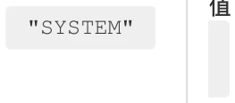


**返回数据**

| 参数名称 | 类型 | 示例 | 说明 |
| --- | --- | --- | --- |
| code | <code>string</code> | <code>SUCCESS</code> | 响应码，取值为<code> SUCCESS </code> 时表示请求成功。 |
| message | <code>string</code> | <code>null</code> | 响应消息。请求成功时通常为空。 |
| data | <code>object</code> | <code>null</code> | 响应数据。无返回内容时为 <code> null </code>。 |
| accessDeniedDetail | <code>object</code> | <code>null</code> | 鉴权失败详情。请求成功时通常为空。 |
| requestId | <code>string</code> | <code>req-001</code> | 请求 ID，可用于问题排查和日志检索。 |

**示例**

**请求示例**

```http
POST /himarket/v1/consumers/{consumerId}/credentials HTTP/1.1
Host: localhost:8080
Authorization: Bearer <accessToken>
Content-Type: application/json

{
  "apiKeyConfig": {
    "credentials": [
      {}
    ],
    "source": "sample-value",
    "key": "sample-value"
  },
  "hmacConfig": {
    "credentials": [
      {}
    ]
  },
  "jwtConfig": {}
}
```

**响应示例**

```json
{
  "code": "SUCCESS",
  "message": null,
  "data": null,
  "accessDeniedDetail": null,
  "requestId": "req-001"
}
```

<a id="section-3-14-4"></a>

### 3.14.4. deleteCredential

**接口信息**

- **接口路径**： `DELETE /himarket/v1/consumers/{consumerId}/credentials`

- **接口说明**：删除 Consumer 凭证。

- **认证方式**：该接口属于开发者门户 API。调用前请完成开发者登录，并在请求 Header 中携带  `Authorization: Bearer <accessToken>` 。

- **Header 示例**：需要登录态的接口使用  `Authorization: Bearer <accessToken>` 。

**请求参数**

| 参数名称 | 位置 | 类型 | 是否必选 | 示例 | 说明 |
| --- | --- | --- | --- | --- | --- |
| consumerId | path | <code>string</code> | 是 | <code>"consumer-</code><br><code>001"</code> | Consumer ID。 |

**返回数据**

| 参数名称 | 类型 | 示例 | 说明 |
| --- | --- | --- | --- |
| code | <code>string</code> | <code>SUCCESS</code> | 响应码，取值为<code> SUCCESS </code> 时表示请求成功。 |
| message | <code>string</code> | <code>null</code> | 响应消息。请求成功时通常为空。 |
| data | <code>object</code> | <code>null</code> | 响应数据。无返回内容时为 <code> null </code>。 |
| accessDeniedDetail | <code>object</code> | <code>null</code> | 鉴权失败详情。请求成功时通常为空。 |
| requestId | <code>string</code> | <code>req-001</code> | 请求 ID，可用于问题排查和日志检索。 |

**示例**

**请求示例**

```http
DELETE /himarket/v1/consumers/{consumerId}/credentials HTTP/1.1
Host: localhost:8080
Authorization: Bearer <accessToken>
```

**响应示例**

```json
{
  "code": "SUCCESS",
  "message": null,
  "data": null,
  "accessDeniedDetail": null,
  "requestId": "req-001"
}
```

<a id="section-3-14-5"></a>

### 3.14.5. deleteDevConsumer

**接口信息**

- **接口路径**： `DELETE /himarket/v1/consumers/{consumerId}`

- **接口说明**：删除 Consumer。

- **认证方式**：该接口属于开发者门户 API。调用前请完成开发者登录，并在请求 Header 中携带  `Authorization: Bearer <accessToken>` 。

- **Header 示例**：需要登录态的接口使用  `Authorization: Bearer <accessToken>` 。

**请求参数**

| 参数名称 | 位置 | 类型 | 是否必选 | 示例 | 说明 |
| --- | --- | --- | --- | --- | --- |
| consumerId | path | <code>string</code> | 是 | <code>"consumer-</code><br><code>001"</code> | Consumer ID。 |

**返回数据**

| 参数名称 | 类型 | 示例 | 说明 |
| --- | --- | --- | --- |
| code | <code>string</code> | <code>SUCCESS</code> | 响应码，取值为<code> SUCCESS </code> 时表示请求成功。 |
| message | <code>string</code> | <code>null</code> | 响应消息。请求成功时通常为空。 |
| data | <code>object</code> | <code>null</code> | 响应数据。无返回内容时为 <code> null </code>。 |
| accessDeniedDetail | <code>object</code> | <code>null</code> | 鉴权失败详情。请求成功时通常为空。 |
| requestId | <code>string</code> | <code>req-001</code> | 请求 ID，可用于问题排查和日志检索。 |

**示例**

**请求示例**

```http
DELETE /himarket/v1/consumers/{consumerId} HTTP/1.1
Host: localhost:8080
Authorization: Bearer <accessToken>
```

**响应示例**

```json
{
  "code": "SUCCESS",
  "message": null,
  "data": null,
  "accessDeniedDetail": null,
  "requestId": "req-001"
}
```

<a id="section-3-14-6"></a>

### 3.14.6. deleteSubscription

**接口信息**

- **接口路径**： `DELETE /himarket/v1/consumers/{consumerId}/subscriptions/{subscriptionId}`

- **接口说明**：取消订阅。

- **认证方式**：该接口属于开发者门户 API。调用前请完成开发者登录，并在请求 Header 中携带  `Authorization: Bearer <accessToken>` 。

- **Header 示例**：需要登录态的接口使用  `Authorization: Bearer <accessToken>` 。

**请求参数**

| 参数名称 | 位置 | 类型 | 是否必选 | 示例 | 说明 |
| --- | --- | --- | --- | --- | --- |
| consumerId | path | <code>string</code> | 是 | <code>"consumer-</code><br><code>001"</code> | Consumer ID。 |
| subscriptionId | path | <code>string</code> | 是 | <code>"subscript</code><br><code>ion-001"</code> | 订阅申请 ID。 |

**返回数据**

| 参数名称 | 类型 | 示例 | 说明 |
| --- | --- | --- | --- |
| code | <code>string</code> | <code>SUCCESS</code> | 响应码，取值为<code> SUCCESS </code> 时表示请求成功。 |
| message | <code>string</code> | <code>null</code> | 响应消息。请求成功时通常为空。 |
| data | <code>object</code> | <code>null</code> | 响应数据。无返回内容时为 <code> null </code>。 |
| accessDeniedDetail | <code>object</code> | <code>null</code> | 鉴权失败详情。请求成功时通常为空。 |
| requestId | <code>string</code> | <code>req-001</code> | 请求 ID，可用于问题排查和日志检索。 |

**示例**

**请求示例**

```http
DELETE /himarket/v1/consumers/{consumerId}/subscriptions/{subscriptionId} HTTP/1.1
Host: localhost:8080
Authorization: Bearer <accessToken>
```

**响应示例**

```json
{
  "code": "SUCCESS",
  "message": null,
  "data": null,
  "accessDeniedDetail": null,
  "requestId": "req-001"
}
```

<a id="section-3-14-7"></a>

### 3.14.7. getConsumer

**接口信息**

- **接口路径**： `GET /himarket/v1/consumers/{consumerId}`

- **接口说明**：获取 Consumer。

- **认证方式**：该接口属于开发者门户 API。调用前请完成开发者登录，并在请求 Header 中携带  `Authorization: Bearer <accessToken>` 。

- **Header 示例**：需要登录态的接口使用  `Authorization: Bearer <accessToken>` 。

**请求参数**

| 参数名称 | 位置 | 类型 | 是否必选 | 示例 | 说明 |
| --- | --- | --- | --- | --- | --- |
| consumerId | path | <code>string</code> | 是 | <code>"consumer-</code><br><code>001"</code> | Consumer ID。 |

**返回数据**

| 参数名称 | 类型 | 示例 | 说明 |
| --- | --- | --- | --- |
| code | <code>string</code> | <code>SUCCESS</code> | 响应码，取值为<code> SUCCESS </code> 时表示请求成功。 |
| message | <code>string</code> | <code>null</code> | 响应消息。请求成功时通常为空。 |
| data | <code>object</code> | <code>{"consumerId":"con</code><br><code>sumer-</code><br><code>001","name":"sample-</code><br><code>name","description":</code> <code>"</code>用于演示的资源描述<code>","isPrimary":fals</code> <code>e,"createdAt":"2026-</code><br><code>06-22T12:00:00Z"}</code> | 响应数据。具体结构以接口语义为准。 |
| accessDeniedDetail | <code>object</code> | <code>null</code> | 鉴权失败详情。请求成功时通常为空。 |
| requestId | <code>string</code> | <code>req-001</code> | 请求 ID，可用于问题排查和日志检索。 |
| data.consumerId | <code>string</code> | <code>"consumer-001"</code> | Consumer ID。 |
| data.name | <code>string</code> | <code>"sample-name"</code> | 名称。 |
| data.description | <code>string</code> | <code> "</code>用于演示的资源描述<code>" </code> | 描述信息。 |
| data.isPrimary | <code>boolean</code> | <code>false</code> | 是否为主 Consumer。 |
| data.createdAt | <code>string&lt;date-</code><br><code>time&gt;</code> | <code>"2026-06-</code><br><code>22T12:00:00Z"</code> | 创建时间。 |

**示例**

**请求示例**

```http
GET /himarket/v1/consumers/{consumerId} HTTP/1.1
Host: localhost:8080
Authorization: Bearer <accessToken>
```

**响应示例**

```json
{
  "code": "SUCCESS",
  "message": null,
  "data": {
    "consumerId": "consumer-001",
    "name": "sample-name",
    "description": "⽤于演示的资源描述",
    "isPrimary": false,
    "createdAt": "2026-06-22T12:00:00Z"
  },
  "accessDeniedDetail": null,
  "requestId": "req-001"
}
```

<a id="section-3-14-8"></a>

### 3.14.8. getCredential

**接口信息**

- **接口路径**： `GET /himarket/v1/consumers/{consumerId}/credentials`

- **接口说明**：获取 Consumer 凭证信息。

- **认证方式**：该接口属于开发者门户 API。调用前请完成开发者登录，并在请求 Header 中携带  `Authorization: Bearer <accessToken>` 。

- **Header 示例**：需要登录态的接口使用  `Authorization: Bearer <accessToken>` 。

**请求参数**

| 参数名称 | 位置 | 类型 | 是否必选 | 示例 | 说明 |
| --- | --- | --- | --- | --- | --- |
| consumerId | path | <code>string</code> | 是 | <code>"consumer-</code><br><code>001"</code> | Consumer ID。 |

**返回数据**

| 参数名称 | 类型 | 示例 | 说明 |
| --- | --- | --- | --- |
| code | <code>string</code> | <code>SUCCESS</code> | 响应码，取值为<code> SUCCESS </code> 时表示请求成功。 |
| message | <code>string</code> | <code>null</code> | 响应消息。请求成功时通常为空。 |
| data | <code>object</code> | <code>{"jwtConfig":</code><br><code>{},"hmacConfig":</code><br><code>{"credentials":</code><br><code>[{}]},"apiKeyConfig"</code><br><code>:{"credentials":</code><br><code>[{}],"source":"sampl</code><br><code>e-</code><br><code>value","key":"sample</code><br><code>-value"}}</code> | 响应数据。具体结构以接口语义为准。 |
| accessDeniedDetail | <code>object</code> | <code>null</code> | 鉴权失败详情。请求成功时通常为空。 |
| requestId | <code>string</code> | <code>req-001</code> | 请求 ID，可用于问题排查和日志检索。 |
| data.jwtConfig | <code>object</code> | <code>{}</code> | JWT 认证配置。 |
| data.hmacConfig | <code>object</code> | <code>{"credentials":</code><br><code>[{}]}</code> | HMAC 认证配置。 |
| data.hmacConfig.cred entials | <code>array</code> | <code>[{"ak":"sample-</code><br><code>value","sk":"sample-</code><br><code>value","mode":"SYSTE</code><br><code>M"}]</code> | 凭据列表。 |
| data.hmacConfig.cred entials\[\].ak | <code>string</code> | <code>"sample-value"</code> | AccessKey。 |
| data.hmacConfig.cred entials\[\].sk | <code>string</code> | <code>"sample-value"</code> | SecretKey。 |
| data.hmacConfig.cred entials\[\].mode | <code>string</code> | <code>"SYSTEM"</code> | mode。可选值：<code> SYSTEM </code>、<code> CUS</code> <code>TOM </code>。 |
| data.apiKeyConfig | <code>object</code> | <code>{"credentials":</code><br><code>[{}],"source":"sampl</code><br><code>e-</code><br><code>value","key":"sample</code><br><code>-value"}</code> | API Key 配置。 |
| data.apiKeyConfig.cre dentials | <code>array</code> | <code>[{"apiKey":"sample</code><br><code>-</code><br><code>value","mode":"SYSTE</code><br><code>M"}]</code> | 凭据列表。 |
| data.apiKeyConfig.cre dentials\[\].apiKey | <code>string</code> | <code>"sample-value"</code> | API Key。 |
| data.apiKeyConfig.cre dentials\[\].mode | <code>string</code> | <code>"SYSTEM"</code> | mode。可选值：<code> SYSTEM </code>、<code> CUS</code> <code>TOM </code>。 |
| data.apiKeyConfig.sou rce | <code>string</code> | <code>"sample-value"</code> | 来源。 |
| data.apiKeyConfig.key | <code>string</code> | <code>"sample-value"</code> | 配置键。 |

**示例**

**请求示例**

```http
GET /himarket/v1/consumers/{consumerId}/credentials HTTP/1.1
Host: localhost:8080
Authorization: Bearer <accessToken>
```

**响应示例**

```json
{
  "code": "SUCCESS",
  "message": null,
  "data": {
    "jwtConfig": {},
    "hmacConfig": {
      "credentials": [
        {}
      ]
    },
    "apiKeyConfig": {
      "credentials": [
        {}
      ],
      "source": "sample-value",
      "key": "sample-value"
    }
  },
  "accessDeniedDetail": null,
  "requestId": "req-001"
}
```

<a id="section-3-14-9"></a>

### 3.14.9. listConsumerSubscriptions

**接口信息**

- **接口路径**： `GET /himarket/v1/consumers/{consumerId}/subscriptions`

- **接口说明**：获取 Consumer 的订阅列表。

- **认证方式**：该接口属于开发者门户 API。调用前请完成开发者登录，并在请求 Header 中携带  `Authorization: Bearer <accessToken>` 。

- **Header 示例**：需要登录态的接口使用  `Authorization: Bearer <accessToken>` 。

**请求参数**

| 参数名称 | 位置 | 类型 | 是否必选 | 示例 | 说明 |
| --- | --- | --- | --- | --- | --- |
| consumerId | path | <code>string</code> | 是 | <code>"consumer-</code><br><code>001"</code> | Consumer ID。 |
| status | query | <code>string</code> | 否 | <code>"PENDING"</code> | 状态。 |
| resourceNam e | query | <code>string</code> | 否 | <code>"sample-</code><br><code>mcp-</code><br><code>server"</code> | AI Resource名称。 |


<table>
  <tr>
    <td>page</td>
    <td>query</td>
    <td><code>integer&lt;in</code><br><code>t32&gt;</code></td>
    <td>否</td>
    <td><code>1</code></td>
    <td>页码。</td>
  </tr>
  <tr>
    <td>size</td>
    <td>query</td>
    <td><code>integer&lt;in</code><br><code>t32&gt;</code></td>
    <td>否</td>
    <td><code>10</code></td>
    <td>每页记录数。</td>
  </tr>
  <tr>
    <td>sort</td>
    <td>query</td>
    <td><code>array</code></td>
    <td>否</td>
    <td><code>["sample-</code><br><code>value"]</code></td>
    <td>排序条件。</td>
  </tr>
</table>

**返回数据**

| 参数名称 | 类型 | 示例 | 说明 |
| --- | --- | --- | --- |
| code | <code>string</code> | <code>SUCCESS</code> | 响应码，取值为<code> SUCCESS </code> 时表示请求成功。 |
| message | <code>string</code> | <code>null</code> | 响应消息。请求成功时通常为空。 |
| data | <code>object</code> | <code>{"content":</code><br><code>[{}],"pageNumber":1,</code><br><code>"pageSize":10,"total</code><br><code>Count":1}</code> | 响应数据。具体结构以接口语义为准。 |
| accessDeniedDetail | <code>object</code> | <code>null</code> | 鉴权失败详情。请求成功时通常为空。 |
| requestId | <code>string</code> | <code>req-001</code> | 请求 ID，可用于问题排查和日志检索。 |

<table>
  <tr>
    <td>data.content</td>
    <td><code>array</code></td>
    <td><code>[{"subscriptionId"</code><br><code>:"subscription-</code><br><code>001","consumerId":"c</code><br><code>onsumer-</code><br><code>001","consumerName":</code><br><code>"sample-</code><br><code>consumer","status":"</code><br><code>sample-</code><br><code>value","listingId":"</code><br><code>listing-</code><br><code>001","targetType":"s</code><br><code>ample-value"}]</code></td>
    <td>分页结果列表。</td>
  </tr>
  <tr>
    <td>data.content[].subscri ptionId</td>
    <td><code>string</code></td>
    <td><code>"subscription-</code><br><code>001"</code></td>
    <td>订阅申请 ID。</td>
  </tr>
  <tr>
    <td>data.content[].consum erId</td>
    <td><code>string</code></td>
    <td><code>"consumer-001"</code></td>
    <td>Consumer ID。</td>
  </tr>
  <tr>
    <td>data.content[].consum erName</td>
    <td><code>string</code></td>
    <td><code>"sample-</code><br><code>consumer"</code></td>
    <td>Consumer 名称。</td>
  </tr>
  <tr>
    <td>data.content[].status</td>
    <td><code>string</code></td>
    <td><code>"sample-value"</code></td>
    <td>状态。</td>
  </tr>
  <tr>
    <td>data.content[].listingId</td>
    <td><code>string</code></td>
    <td><code>"listing-001"</code></td>
    <td>Listing ID。</td>
  </tr>
  <tr>
    <td>data.content[].targetT ype</td>
    <td><code>string</code></td>
    <td><code>"sample-value"</code></td>
    <td>订阅目标类型。</td>
  </tr>
  <tr>
    <td>data.content[].targetId</td>
    <td><code>string</code></td>
    <td><code>"target-001"</code></td>
    <td>目标对象 ID。</td>
  </tr>
  <tr>
    <td>data.content[].resourc eId</td>
    <td><code>string</code></td>
    <td><code>"resource-001"</code></td>
    <td>AI Resource ID。</td>
  </tr>
  <tr>
    <td>data.content[].versionI d</td>
    <td><code>string</code></td>
    <td><code>"version-001"</code></td>
    <td>版本 ID。</td>
  </tr>
  <tr>
    <td>data.content[].resourc eKind</td>
    <td><code>string</code></td>
    <td><code>"MODEL_API"</code></td>
    <td>resourceKind。可选值：<code> MODEL_API </code>、<code> </code><code>MCP_SERVER </code>、<code> SKIL</code> <code>L </code>、<code> AGENT </code>、<code> WORK</code> <code>ER </code>、<code> REST_API </code>、<code> HTTP_API </code>、<code> PROMP</code> <code>T_TEMPLATE </code>、<code> DATA</code> <code>SET </code>、<code> EVAL </code>、<code> WO</code> <code>RKFLOW </code>。</td>
  </tr>
  <tr>
    <td>data.content[].resourc eName</td>
    <td><code>string</code></td>
    <td><code>"sample-mcp-</code><br><code>server"</code></td>
    <td>AI Resource 名称。</td>
  </tr>
  <tr>
    <td>data.content[].activeG rant</td>
    <td><code>boolean</code></td>
    <td><code>true</code></td>
    <td>当前生效的授权 Grant。</td>
  </tr>
  <tr>
    <td>data.content[].created At</td>
    <td><code>string&lt;date-</code><br><code>time&gt;</code></td>
    <td><code>"2026-06-</code><br><code>22T12:00:00Z"</code></td>
    <td>创建时间。</td>
  </tr>
  <tr>
    <td>data.content[].update dAt</td>
    <td><code>string&lt;date-</code><br><code>time&gt;</code></td>
    <td><code>"2026-06-</code><br><code>22T12:00:00Z"</code></td>
    <td>更新时间。</td>
  </tr>
  <tr>
    <td>data.pageNumber</td>
    <td><code>integer&lt;int32&gt;</code></td>
    <td><code>1</code></td>
    <td>当前页码。</td>
  </tr>
  <tr>
    <td>data.pageSize</td>
    <td><code>integer&lt;int32&gt;</code></td>
    <td><code>10</code></td>
    <td>每页大小。</td>
  </tr>
  <tr>
    <td>data.totalCount</td>
    <td><code>integer&lt;int64&gt;</code></td>
    <td><code>1</code></td>
    <td>总记录数。</td>
  </tr>
</table>


**示例**

**请求示例**

```text
GET /himarket/v1/consumers/{consumerId}/subscriptions?
status=PENDING&resourceName=sample-mcp-server&page=1&size=10&sort=sample-value HTTP/1.1
Host: localhost:8080
Authorization: Bearer <accessToken>
```

**响应示例**

```json
{
  "code": "SUCCESS",
  "message": null,
  "data": {
    "content": [
      {}
    ],
    "pageNumber": 1,
    "pageSize": 10,
    "totalCount": 1
  },
  "accessDeniedDetail": null,
  "requestId": "req-001"
}
```

<a id="section-3-14-10"></a>

### 3.14.10. listConsumers

**接口信息**

- **接口路径**： `GET /himarket/v1/consumers`

- **接口说明**：获取 Consumer 列表。

- **认证方式**：该接口属于开发者门户 API。调用前请完成开发者登录，并在请求 Header 中携带  `Authorization: Bearer <accessToken>` 。

- **Header 示例**：需要登录态的接口使用  `Authorization: Bearer <accessToken>` 。

**请求参数**

| 参数名称 | 位置 | 类型 | 是否必选 | 示例 | 说明 |
| --- | --- | --- | --- | --- | --- |
| portalId | query | <code>string</code> | 否 | <code>"portal-</code><br><code>001"</code> | 门户ID。 |
| developerId | query | <code>string</code> | 否 | <code>"developer</code><br><code>-001"</code> | 开发者ID。 |
| name | query | <code>string</code> | 否 | <code>"sample-</code><br><code>name"</code> | 名称。 |
| primary | query | <code>boolean</code> | 否 | <code>false</code> | primary 字段。 |
| page | query | <code>integer&lt;in</code><br><code>t32&gt;</code> | 否 | <code>1</code> | 页码。 |
| size | query | <code>integer&lt;in</code><br><code>t32&gt;</code> | 否 | <code>10</code> | 每页记录数。 |
| sort | query | <code>array</code> | 否 | <code>["sample-</code><br><code>value"]</code> | 排序条件。 |

**返回数据**

| 参数名称 | 类型 | 示例 | 说明 |
| --- | --- | --- | --- |
| code | <code>string</code> | <code>SUCCESS</code> | 响应码，取值为<code> SUCCESS </code> 时表示请求成功。 |
| message | <code>string</code> | <code>null</code> | 响应消息。请求成功时通常为空。 |
| data | <code>object</code> | <code>{"content":</code><br><code>[{"consumerId":"cons</code><br><code>umer-</code><br><code>001","name":"sample-</code><br><code>name","description":</code> <code>"</code>用于演示的资源描述<code>","isPrimary":fals</code> <code>e,"createdAt":"2026-</code><br><code>06-</code><br><code>22T12:00:00Z"}],"pag</code><br><code>eNumber":1,"pageSize</code><br><code>":10,"totalCount":1}</code> | 响应数据。具体结构以接口语义为准。 |
| accessDeniedDetail | <code>object</code> | <code>null</code> | 鉴权失败详情。请求成功时通常为空。 |
| requestId | <code>string</code> | <code>req-001</code> | 请求 ID，可用于问题排查和日志检索。 |

<table>
  <tr>
    <td>data.content</td>
    <td><code>array</code></td>
    <td><code>[{"consumerId":"co</code><br><code>nsumer-</code><br><code>001","name":"sample-</code><br><code>name","description":</code> <code>"</code>用于演示的资源描述<code>","isPrimary":fals</code> <code>e,"createdAt":"2026-</code><br><code>06-</code><br><code>22T12:00:00Z"}]</code></td>
    <td>分页结果列表。</td>
  </tr>
  <tr>
    <td>data.content[].consum erId</td>
    <td><code>string</code></td>
    <td><code>"consumer-001"</code></td>
    <td>Consumer ID。</td>
  </tr>
  <tr>
    <td>data.content[].name</td>
    <td><code>string</code></td>
    <td><code>"sample-name"</code></td>
    <td>名称。</td>
  </tr>
  <tr>
    <td>data.content[].descript ion</td>
    <td><code>string</code></td>
    <td><code> "</code>用于演示的资源描述<code>" </code></td>
    <td>描述信息。</td>
  </tr>
  <tr>
    <td>data.content[].isPrimar y</td>
    <td><code>boolean</code></td>
    <td><code>false</code></td>
    <td>是否为主 Consumer。</td>
  </tr>
  <tr>
    <td>data.content[].created At</td>
    <td><code>string&lt;date-</code><br><code>time&gt;</code></td>
    <td><code>"2026-06-</code><br><code>22T12:00:00Z"</code></td>
    <td>创建时间。</td>
  </tr>
  <tr>
    <td>data.pageNumber</td>
    <td><code>integer&lt;int32&gt;</code></td>
    <td><code>1</code></td>
    <td>当前页码。</td>
  </tr>
  <tr>
    <td>data.pageSize</td>
    <td><code>integer&lt;int32&gt;</code></td>
    <td><code>10</code></td>
    <td>每页大小。</td>
  </tr>
  <tr>
    <td>data.totalCount</td>
    <td><code>integer&lt;int64&gt;</code></td>
    <td><code>1</code></td>
    <td>总记录数。</td>
  </tr>
</table>

**示例**

**请求示例**

```http
GET /himarket/v1/consumers?portalId=portal-001&developerId=developer-001&name=demo-&primary=false&page=1&size=10&sort=sample-value HTTP/1.1
Host: localhost:8080
Authorization: Bearer <accessToken>
```

**响应示例**

```json
{
  "code": "SUCCESS",
  "message": null,
  "data": {
    "content": [
      {
        "consumerId": "consumer-001",
        "name": "sample-name",
        "description": "⽤于演示的资源描述",
        "isPrimary": false,
        "createdAt": "2026-06-22T12:00:00Z"
      }
    ],
    "pageNumber": 1,
    "pageSize": 10,
    "totalCount": 1
  },
  "accessDeniedDetail": null,
  "requestId": "req-001"
}
```

<a id="section-3-14-11"></a>

### 3.14.11. subscribeResource

**接口信息**

- **接口路径**： `POST /himarket/v1/consumers/{consumerId}/subscriptions`

- **接口说明**：订阅资源。

- **认证方式**：该接口属于开发者门户 API。调用前请完成开发者登录，并在请求 Header 中携带  `Authorization: Bearer <accessToken>` 。

- **Header 示例**：需要登录态的接口使用  `Authorization: Bearer <accessToken>` 。

**请求参数**

| 参数名称 | 位置 | 类型 | 是否必选 | 示例 | 说明 |
| --- | --- | --- | --- | --- | --- |
| consumerId | path | <code>string</code> | 是 | <code>"consumer-</code><br><code>001"</code> | Consumer ID。 |
| listingId | body | <code>string</code> | 否 | <code>"listing-</code><br><code>001"</code> | Listing ID。 |
| resourceId | body | <code>string</code> | 否 | <code>"resource-</code><br><code>001"</code> | AI Resource ID。 |
| versionId | body | <code>string</code> | 否 | <code>"version-</code><br><code>001"</code> | 版本 ID。 |
| targetType | body | <code>string</code> | 否 | <code>"sample-</code><br><code>value"</code> | 订阅目标类型。 |
| targetId | body | <code>string</code> | 否 | <code>"target-</code><br><code>001"</code> | 目标对象 ID。 |
| quotaPolicyId | body | <code>string</code> | 否 | <code>"quotaPoli</code><br><code>cy-001"</code> | 配额策略 ID。 |
| expiresAt | body | <code>string&lt;dat</code><br><code>e-time&gt;</code> | 否 | <code>"2026-06-</code><br><code>22T12:00:00Z</code><br><code>"</code> | 过期时间。 |

**返回数据**

| 参数名称 | 类型 | 示例 | 说明 |
| --- | --- | --- | --- |
| code | <code>string</code> | <code>SUCCESS</code> | 响应码，取值为<code> SUCCESS </code> 时表示请求成功。 |
| message | <code>string</code> | <code>null</code> | 响应消息。请求成功时通常为空。 |
| data | <code>object</code> | <code>{"subscriptionId":</code><br><code>"subscription-</code><br><code>001","consumerId":"c</code><br><code>onsumer-</code><br><code>001","consumerName":</code><br><code>"sample-</code><br><code>consumer","status":"</code><br><code>sample-</code><br><code>value","listingId":"</code><br><code>listing-</code><br><code>001","targetType":"s</code><br><code>ample-value"}</code> | 响应数据。具体结构以接口语义为准。 |
| accessDeniedDetail | <code>object</code> | <code>null</code> | 鉴权失败详情。请求成功时通常为空。 |
| requestId | <code>string</code> | <code>req-001</code> | 请求 ID，可用于问题排查和日志检索。 |
| data.subscriptionId | <code>string</code> | <code>"subscription-</code><br><code>001"</code> | 订阅申请 ID。 |
| data.consumerId | <code>string</code> | <code>"consumer-001"</code> | Consumer ID。 |
| data.consumerName | <code>string</code> | <code>"sample-</code><br><code>consumer"</code> | Consumer 名称。 |
| data.status | <code>string</code> | <code>"sample-value"</code> | 状态。 |
| data.listingId | <code>string</code> | <code>"listing-001"</code> | Listing ID。 |
| data.targetType | <code>string</code> | <code>"sample-value"</code> | 订阅目标类型。 |
| data.targetId | <code>string</code> | <code>"target-001"</code> | 目标对象 ID。 |
| data.resourceId | <code>string</code> | <code>"resource-001"</code> | AI Resource ID。 |
| data.versionId | <code>string</code> | <code>"version-001"</code> | 版本 ID。 |
| data.resourceKind | <code>string</code> | <code>"MODEL_API"</code> | resourceKind。可选值：<code> MODEL_API </code>、<code> </code><code>MCP_SERVER </code>、<code> SKIL</code> <code>L </code>、<code> AGENT </code>、<code> WORK</code> <code>ER </code>、<code> REST_API </code>、<code> HTTP_API </code>、<code> PROMP</code> <code>T_TEMPLATE </code>、<code> DATA</code> <code>SET </code>、<code> EVAL </code>、<code> WO</code> <code>RKFLOW </code>。 |
| data.resourceName | <code>string</code> | <code>"sample-mcp-</code><br><code>server"</code> | AI Resource 名称。 |
| data.activeGrant | <code>boolean</code> | <code>true</code> | 当前生效的授权 Grant。 |
| data.createdAt | <code>string&lt;date-</code><br><code>time&gt;</code> | <code>"2026-06-</code><br><code>22T12:00:00Z"</code> | 创建时间。 |

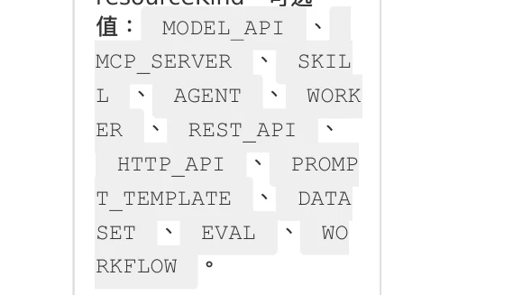

<table>
  <tr>
    <td>data.updatedAt</td>
    <td><code>string&lt;date-</code><br><code>time&gt;</code></td>
    <td><code>"2026-06-</code><br><code>22T12:00:00Z"</code></td>
    <td>更新时间。</td>
  </tr>
</table>

**示例**

**请求示例**

```http
POST /himarket/v1/consumers/{consumerId}/subscriptions HTTP/1.1
Host: localhost:8080
Authorization: Bearer <accessToken>
Content-Type: application/json

{
  "listingId": "listing-001",
  "resourceId": "resource-001",
  "versionId": "version-001",
  "targetType": "sample-value",
  "targetId": "target-001",
  "quotaPolicyId": "quotaPolicy-001"
}
```

**响应示例**

```json
{
  "code": "SUCCESS",
  "message": null,
  "data": {
    "subscriptionId": "subscription-001",
    "consumerId": "consumer-001",
    "consumerName": "sample-consumer",
    "status": "sample-value",
    "listingId": "listing-001",
    "targetType": "sample-value"
  },
  "accessDeniedDetail": null,
  "requestId": "req-001"
}
```

<a id="section-3-14-12"></a>

### 3.14.12. updateConsumer

**接口信息**

- **接口路径**： `PUT /himarket/v1/consumers/{consumerId}`

- **接口说明**：更新 Consumer。

- **认证方式**：该接口属于开发者门户 API。调用前请完成开发者登录，并在请求 Header 中携带  `Authorization: Bearer <accessToken>` 。

- **Header 示例**：需要登录态的接口使用  `Authorization: Bearer <accessToken>` 。

**请求参数**

| 参数名称 | 位置 | 类型 | 是否必选 | 示例 | 说明 |
| --- | --- | --- | --- | --- | --- |
| consumerId | path | <code>string</code> | 是 | <code>"consumer-</code><br><code>001"</code> | Consumer ID。 |
| description | body | <code>string</code> | 否 | <code> "</code>用于演示的资源描述<code>" </code> | 描述信息。 |
| isPrimary | body | <code>boolean</code> | 否 | <code>false</code> | 是否为主Consumer。 |

**返回数据**

| 参数名称 | 类型 | 示例 | 说明 |
| --- | --- | --- | --- |
| code | <code>string</code> | <code>SUCCESS</code> | 响应码，取值为<code> SUCCESS </code> 时表示请求成功。 |
| message | <code>string</code> | <code>null</code> | 响应消息。请求成功时通常为空。 |
| data | <code>object</code> | <code>null</code> | 响应数据。无返回内容时为 <code> null </code>。 |
| accessDeniedDetail | <code>object</code> | <code>null</code> | 鉴权失败详情。请求成功时通常为空。 |
| requestId | <code>string</code> | <code>req-001</code> | 请求 ID，可用于问题排查和日志检索。 |

**示例**

**请求示例**

```http
PUT /himarket/v1/consumers/{consumerId} HTTP/1.1
Host: localhost:8080
Authorization: Bearer <accessToken>
Content-Type: application/json

{
  "description": "⽤于演示的资源描述",
  "isPrimary": false
}
```

**响应示例**

```json
{
  "code": "SUCCESS",
  "message": null,
  "data": null,
  "accessDeniedDetail": null,
  "requestId": "req-001"
}
```

<a id="section-3-14-13"></a>

### 3.14.13. updateCredential

**接口信息**

- **接口路径**： `PUT /himarket/v1/consumers/{consumerId}/credentials`

- **接口说明**：更新 Consumer 凭证。

- **认证方式**：该接口属于开发者门户 API。调用前请完成开发者登录，并在请求 Header 中携带  `Authorization: Bearer <accessToken>` 。

- **Header 示例**：需要登录态的接口使用  `Authorization: Bearer <accessToken>` 。

**请求参数**

| 参数名称 | 位置 | 类型 | 是否必选 | 示例 | 说明 |
| --- | --- | --- | --- | --- | --- |
| consumerId | path | <code>string</code> | 是 | <code>"consumer-</code><br><code>001"</code> | Consumer ID。 |
| apiKeyConfig | body | <code>object</code> | 否 | <code>{"credenti</code><br><code>als":</code><br><code>[{}],"source</code><br><code>":"sample-</code><br><code>value","key"</code><br><code>:"sample-</code><br><code>value"}</code> | API Key 配置。 |
| apiKeyConfig.credentials | body | <code>array</code> | 否 | <code>[{"apiKey"</code><br><code>:"sample-</code><br><code>value","mode</code><br><code>":"SYSTEM"}]</code> | 凭据列表。 |
| apiKeyConfig.credentials\[\].apiKey | body | <code>string</code> | 否 | <code>"sample-</code><br><code>value"</code> | API Key。 |
| apiKeyConfig.credentials\[\].mode | body | <code>string</code> | 否 | <code>"SYSTEM"</code> | mode。可选值：<code> SYSTEM</code><code> </code>、<code> CUSTOM</code><code> </code>。 |
| apiKeyConfig.source | body | <code>string</code> | 否 | <code>"sample-</code><br><code>value"</code> | 来源。 |
| apiKeyConfig.key | body | <code>string</code> | 否 | <code>"sample-</code><br><code>value"</code> | 配置键。 |
| hmacConfig | body | <code>object</code> | 否 | <code>{"credenti</code><br><code>als":[{}]}</code> | HMAC 认证配置。 |
| hmacConfig.c redentials | body | <code>array</code> | 否 | <code>[{"ak":"sa</code><br><code>mple-</code><br><code>value","sk":</code><br><code>"sample-</code><br><code>value","mode</code><br><code>":"SYSTEM"}]</code> | 凭据列表。 |
| hmacConfig.c redentials\[\].a k | body | <code>string</code> | 否 | <code>"sample-</code><br><code>value"</code> | AccessKey。 |
| hmacConfig.c redentials\[\].s k | body | <code>string</code> | 否 | <code>"sample-</code><br><code>value"</code> | SecretKey。 |


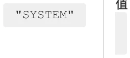


<table>
  <tr>
    <td>hmacConfig.c redentials[].m ode</td>
    <td>body</td>
    <td><code>string</code></td>
    <td>否</td>
    <td><code>"SYSTEM"</code></td>
    <td>mode。可选值：<code> SYSTEM</code><code> </code>、<code> CUSTOM</code><code> </code>。</td>
  </tr>
  <tr>
    <td>jwtConfig</td>
    <td>body</td>
    <td><code>object</code></td>
    <td>否</td>
    <td><code>{}</code></td>
    <td>JWT 认证配置。</td>
  </tr>
</table>

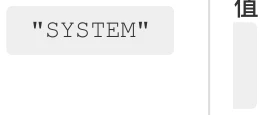

**返回数据**

| 参数名称 | 类型 | 示例 | 说明 |
| --- | --- | --- | --- |
| code | <code>string</code> | <code>SUCCESS</code> | 响应码，取值为<code> SUCCESS </code> 时表示请求成功。 |
| message | <code>string</code> | <code>null</code> | 响应消息。请求成功时通常为空。 |
| data | <code>object</code> | <code>null</code> | 响应数据。无返回内容时为 <code> null </code>。 |
| accessDeniedDetail | <code>object</code> | <code>null</code> | 鉴权失败详情。请求成功时通常为空。 |
| requestId | <code>string</code> | <code>req-001</code> | 请求 ID，可用于问题排查和日志检索。 |

**示例**

**请求示例**

```http
PUT /himarket/v1/consumers/{consumerId}/credentials HTTP/1.1
Host: localhost:8080
Authorization: Bearer <accessToken>
Content-Type: application/json

{
  "apiKeyConfig": {
    "credentials": [
      {}
    ],
    "source": "sample-value",
    "key": "sample-value"
  },
  "hmacConfig": {
    "credentials": [
      {}
    ]
  },
  "jwtConfig": {}
}
```

**响应示例**

```json
{
  "code": "SUCCESS",
  "message": null,
  "data": null,
  "accessDeniedDetail": null,
  "requestId": "req-001"
}
```

<a id="section-3-15"></a>

## 3.15. MCP Resource 聚合开放接口

<a id="section-3-15-1"></a>

### 3.15.1. checkHealth

**接口信息**

- **接口路径**： `POST /himarket/v1/open-api/v1/resources/{resourceId}/mcp/health/check`

- **接口说明**：检测 MCP 健康状态。

- **认证方式**：该接口属于开发者门户 API。调用前请完成开发者登录，并在请求 Header 中携带  `Authorization: Bearer <accessToken>` 。

- **Header 示例**：需要登录态的接口使用  `Authorization: Bearer <accessToken>` 。

**请求参数**

| 参数名称 | 位置 | 类型 | 是否必选 | 示例 | 说明 |
| --- | --- | --- | --- | --- | --- |
| resourceId | path | <code>string</code> | 是 | <code>"resource-</code><br><code>001"</code> | AI Resource ID。 |

**返回数据**

| 参数名称 | 类型 | 示例 | 说明 |
| --- | --- | --- | --- |
| code | <code>string</code> | <code>SUCCESS</code> | 响应码，取值为<code> SUCCESS </code> 时表示请求成功。 |
| message | <code>string</code> | <code>null</code> | 响应消息。请求成功时通常为空。 |
| data | <code>object</code> | <code>{"resource":</code><br><code>{"resourceId":"resou</code><br><code>rce-</code><br><code>001","tenantId":"ten</code><br><code>ant-</code><br><code>001","kind":"MODEL_A</code><br><code>PI","name":"sample-</code><br><code>name","displayName":</code> <code>"</code>示例资源<code>","summary":"</code>示例摘要<code>"},"latestVersion"</code><code>:</code><br><code>{"versionId":"versio</code><br><code>n-</code><br><code>001","resourceId":"r</code><br><code>esource-</code><br><code>001","version":"samp</code><br><code>le-</code><br><code>value","versionSchem</code><br><code>e":"SEMVER","status"</code><br><code>:"DRAFT","manifestId</code><br><code>":"manifest-</code><br><code>001"},"sourceBinding</code><br><code>s":</code><br><code>[{"sourceBindingId":</code><br><code>"sourceBinding-</code><br><code>001","resourceId":"r</code><br><code>esource-</code><br><code>001","sourceType":"G</code><br><code>ATEWAY","sourceRef":</code><br><code>"sample-</code><br><code>value","primaryBindi</code><br><code>ng":false,"priority"</code><br><code>:100,"syncMode":"AUT</code> <code>O","syncStatus":"SYN</code><br><code>CED","credentialRef"</code><br><code>:"credential-</code><br><code>001","config":</code><br><code>{"key":"value"},"las</code><br><code>tSyncedAt":"2026-</code><br><code>06-</code><br><code>22T12:00:00Z"}],"sum</code><br><code>mary":</code><br><code>{"mcpName":"sample-</code><br><code>mcp","sourceType":"s</code><br><code>ample-</code><br><code>value","runtimeMode"</code><br><code>:"HOSTED","origin":"</code><br><code>GATEWAY","protocols"</code><br><code>:["sample-</code><br><code>value"],"sandboxRequ</code><br><code>ired":true,"hasUsabl</code><br><code>eEndpoint":false,"to</code><br><code>olCount":1,"endpoint</code><br><code>Count":1,"lastSynced</code><br><code>At":"2026-06-</code><br><code>22T12:00:00Z"},"endp</code><br><code>oints":</code><br><code>[{"endpointId":"endp</code><br><code>oint-</code><br><code>001","protocol":"sam</code><br><code>ple-</code><br><code>value","providerType</code><br><code>":"sample-</code><br><code>value","url":"https:</code><br><code>//api.example.com","</code><br><code>status":"sample-</code><br><code>value","healthStatus</code><br><code>":"HEALTHY","authMod</code><br><code>e":"BEARER","network</code><br><code>Scope":"PUBLIC","def</code><br><code>aultInvocation":fals</code><br><code>e,"metadata":</code><br><code>{"source":"himarket"</code><br><code>}}],"connectionConfi</code><br><code>gs":</code><br><code>[{"key":"Authorizati</code><br><code>on","label":"sample-</code><br><code>value","transport":"</code><br><code>sample-</code><br><code>value","endpointId":</code><br><code>"endpoint-</code><br><code>001","providerType":</code><br><code>"sample-</code><br><code>value","url":"https:</code><br><code>//api.example.com","</code><br><code>status":"sample-</code><code>value","healthStatus</code><br><code>":"HEALTHY","default</code><br><code>Invocation":false}]}</code> | 响应数据。具体结构以接口语义为准。 |
| accessDeniedDetail | <code>object</code> | <code>null</code> | 鉴权失败详情。请求成功时通常为空。 |
| requestId | <code>string</code> | <code>req-001</code> | 请求 ID，可用于问题排查和日志检索。 |
| data.resource | <code>object</code> | <code>{"resourceId":"res</code><br><code>ource-</code><br><code>001","tenantId":"ten</code><br><code>ant-</code><br><code>001","kind":"MODEL_A</code><br><code>PI","name":"sample-</code><br><code>name","displayName":</code> <code>"</code>示例资源<code>","summary":"</code>示例摘要<code>"} </code> | AI Resource 基础信息。 |
| data.resource.resourc eId | <code>string</code> | <code>"resource-001"</code> | AI Resource ID。 |
| data.resource.tenantId | <code>string</code> | <code>"tenant-001"</code> | 租户ID。 |
| data.resource.kind | <code>string</code> | <code>"MODEL_API"</code> | 资源类型。 |
| data.resource.name | <code>string</code> | <code>"sample-name"</code> | 名称。 |
| data.resource.displayN ame | <code>string</code> | <code> "</code>示例资源<code>" </code> | 展示名称。 |
| data.resource.summar y | <code>string</code> | <code> "</code>示例摘要<code>" </code> | 摘要信息。 |
| data.resource.descripti on | <code>string</code> | <code> "</code>用于演示的资源描述<code>" </code> | 描述信息。 |
| data.resource.ownerTy pe | <code>string</code> | <code>"USER"</code> | 归属主体类型。可选值：<code> USER </code>、<code> APP </code>、<code> SYSTEM </code>。 |
| data.resource.ownerId | <code>string</code> | <code>"owner-001"</code> | 归属主体ID。 |
| data.resource.created By | <code>string</code> | <code>"sample-value"</code> | 创建人。 |
| data.resource.created ByName | <code>string</code> | <code>"demo-createdby"</code> | 创建人名称。 |
| data.resource.icon | <code>string</code> | <code>"sample-value"</code> | 图标地址。 |
| data.resource.tags | <code>array</code> | <code>["sample-value"]</code> | 标签列表。 |
| data.resource.lifecycle Status | <code>string</code> | <code>"DRAFT"</code> | 生命周期状态。可选值：<code> DRAFT </code>、<code> ACTI</code> <code>VE </code>、<code> DEPRECATED </code>、<code> ARCHIVED </code>。 |
| data.resource.latestVe rsionId | <code>string</code> | <code>"latestVersion-</code><br><code>001"</code> | 最新版本ID。 |
| data.resource.autoApp roveSubscription | <code>boolean</code> | <code>true</code> | 是否自动批准订阅。 |
| data.resource.extras | <code>object</code> | <code>{"displayOrder":10</code><br><code>0}</code> | 扩展配置。 |
| data.resource.created At | <code>string&lt;date-</code><br><code>time&gt;</code> | <code>"2026-06-</code><br><code>22T12:00:00Z"</code> | 创建时间。 |
| data.resource.updated At | <code>string&lt;date-</code><br><code>time&gt;</code> | <code>"2026-06-</code><br><code>22T12:00:00Z"</code> | 更新时间。 |
| data.latestVersion | <code>object</code> | <code>{"versionId":"vers</code><br><code>ion-</code><br><code>001","resourceId":"r</code><br><code>esource-</code><br><code>001","version":"samp</code><br><code>le-</code><br><code>value","versionSchem</code><br><code>e":"SEMVER","status"</code><br><code>:"DRAFT","manifestId</code><br><code>":"manifest-001"}</code> | 最新版本信息。 |
| data.latestVersion.vers ionId | <code>string</code> | <code>"version-001"</code> | 版本 ID。 |
| data.latestVersion.reso urceId | <code>string</code> | <code>"resource-001"</code> | AI Resource ID。 |
| data.latestVersion.vers ion | <code>string</code> | <code>"sample-value"</code> | 版本号。 |
| data.latestVersion.vers ionScheme | <code>string</code> | <code>"SEMVER"</code> | 版本号方案。可选值：<code> SEMVER </code>、<code> TIM</code> <code>ESTAMP </code>、<code> REVISION</code><code> </code>、<code> EXTERNAL </code>。 |
| data.latestVersion.stat us | <code>string</code> | <code>"DRAFT"</code> | 状态。 |
| data.latestVersion.ma nifestId | <code>string</code> | <code>"manifest-001"</code> | Manifest ID。 |
| data.latestVersion.sou rceBindingId | <code>string</code> | <code>"sourceBinding-</code><br><code>001"</code> | 来源绑定ID。 |
| data.latestVersion.artif actDigest | <code>string</code> | <code>"sample-value"</code> | 制品摘要。 |
| data.latestVersion.rele aseNote | <code>string</code> | <code>"sample-value"</code> | 版本说明。 |
| data.latestVersion.cre atedBy | <code>string</code> | <code>"sample-value"</code> | 创建人。 |
| data.latestVersion.pub lishedAt | <code>string&lt;date-</code><br><code>time&gt;</code> | <code>"2026-06-</code><br><code>22T12:00:00Z"</code> | 发布时间。 |
| data.latestVersion.cre atedAt | <code>string&lt;date-</code><br><code>time&gt;</code> | <code>"2026-06-</code><br><code>22T12:00:00Z"</code> | 创建时间。 |
| data.latestVersion.upd atedAt | <code>string&lt;date-</code><br><code>time&gt;</code> | <code>"2026-06-</code><br><code>22T12:00:00Z"</code> | 更新时间。 |
| data.latestVersion.dow nloadCount | <code>integer&lt;int64&gt;</code> | <code>1</code> | 下载次数。 |


<table>
  <tr>
    <td>data.latestVersion.isLa test</td>
    <td><code>boolean</code></td>
    <td><code>true</code></td>
    <td>是否为最新版本。</td>
  </tr>
  <tr>
    <td>data.sourceBindings</td>
    <td><code>array</code></td>
    <td><code>[{"sourceBindingId</code><br><code>":"sourceBinding-</code><br><code>001","resourceId":"r</code><br><code>esource-</code><br><code>001","sourceType":"G</code><br><code>ATEWAY","sourceRef":</code><br><code>"sample-</code><br><code>value","primaryBindi</code><br><code>ng":false,"priority"</code><br><code>:100}]</code></td>
    <td>来源绑定列表。</td>
  </tr>
  <tr>
    <td>data.sourceBindings[].sourceBindingId</td>
    <td><code>string</code></td>
    <td><code>"sourceBinding-</code><br><code>001"</code></td>
    <td>来源绑定ID。</td>
  </tr>
  <tr>
    <td>data.sourceBindings[].resourceId</td>
    <td><code>string</code></td>
    <td><code>"resource-001"</code></td>
    <td>AI Resource ID。</td>
  </tr>
  <tr>
    <td>data.sourceBindings[].sourceType</td>
    <td><code>string</code></td>
    <td><code>"GATEWAY"</code></td>
    <td>来源类型。可选值：<code> GATEWAY </code>、<code> NA</code> <code>COS </code>、<code> REMOTE_ENDPO</code> <code>INT </code>、<code> SANDBOX </code>、<code> REGISTRY </code>、<code> CUSTO</code> <code>M </code>。</td>
  </tr>
  <tr>
    <td>data.sourceBindings[].sourceRef</td>
    <td><code>string</code></td>
    <td><code>"sample-value"</code></td>
    <td>来源引用。</td>
  </tr>
  <tr>
    <td>data.sourceBindings[].primaryBinding</td>
    <td><code>boolean</code></td>
    <td><code>false</code></td>
    <td>是否为主绑定关系。</td>
  </tr>
  <tr>
    <td>data.sourceBindings[].priority</td>
    <td><code>integer&lt;int32&gt;</code></td>
    <td><code>100</code></td>
    <td>优先级。</td>
  </tr>
  <tr>
    <td>data.sourceBindings[].syncMode</td>
    <td><code>string</code></td>
    <td><code>"sample-value"</code></td>
    <td>同步模式。</td>
  </tr>
  <tr>
    <td>data.sourceBindings[].syncStatus</td>
    <td><code>string</code></td>
    <td><code>"sample-value"</code></td>
    <td>同步状态。</td>
  </tr>
  <tr>
    <td>data.sourceBindings[].credentialRef</td>
    <td><code>string</code></td>
    <td><code>"sample-value"</code></td>
    <td>凭据引用。</td>
  </tr>
  <tr>
    <td>data.sourceBindings[].config</td>
    <td><code>object</code></td>
    <td><code>{"key":"value"}</code></td>
    <td>配置信息。</td>
  </tr>
  <tr>
    <td>data.sourceBindings[].l astSyncedAt</td>
    <td><code>string&lt;date-</code><br><code>time&gt;</code></td>
    <td><code>"2026-06-</code><br><code>22T12:00:00Z"</code></td>
    <td>最近一次同步时间。</td>
  </tr>
  <tr>
    <td>data.summary</td>
    <td><code>object</code></td>
    <td><code>{"mcpName":"sample</code><br><code>-</code><br><code>mcp","sourceType":"s</code><br><code>ample-</code><br><code>value","runtimeMode"</code><br><code>:"HOSTED","origin":"</code><br><code>sample-</code><br><code>value","protocols":</code><br><code>["sample-</code><br><code>value"],"sandboxRequ</code><br><code>ired":true}</code></td>
    <td>摘要信息。</td>
  </tr>
  <tr>
    <td>data.summary.mcpNa me</td>
    <td><code>string</code></td>
    <td><code>"sample-mcp"</code></td>
    <td>MCP Server 名称。</td>
  </tr>
  <tr>
    <td>data.summary.sourceT ype</td>
    <td><code>string</code></td>
    <td><code>"sample-value"</code></td>
    <td>来源类型。</td>
  </tr>
  <tr>
    <td>data.summary.runtime Mode</td>
    <td><code>string</code></td>
    <td><code>"HOSTED"</code></td>
    <td>运行时模式。</td>
  </tr>
  <tr>
    <td>data.summary.origin</td>
    <td><code>string</code></td>
    <td><code>"sample-value"</code></td>
    <td>来源标识。</td>
  </tr>
  <tr>
    <td>data.summary.protoco ls</td>
    <td><code>array</code></td>
    <td><code>["sample-value"]</code></td>
    <td>支持的协议列表。</td>
  </tr>
  <tr>
    <td>data.summary.sandbo xRequired</td>
    <td><code>boolean</code></td>
    <td><code>true</code></td>
    <td>是否要求沙箱托管。</td>
  </tr>
  <tr>
    <td>data.summary.hasUsa bleEndpoint</td>
    <td><code>boolean</code></td>
    <td><code>false</code></td>
    <td>是否存在可用Endpoint。</td>
  </tr>
  <tr>
    <td>data.summary.toolCou nt</td>
    <td><code>integer&lt;int32&gt;</code></td>
    <td><code>1</code></td>
    <td>工具数量。</td>
  </tr>
  <tr>
    <td>data.summary.endpoi ntCount</td>
    <td><code>integer&lt;int32&gt;</code></td>
    <td><code>1</code></td>
    <td>Endpoint 数量。</td>
  </tr>
  <tr>
    <td>data.summary.lastSyn cedAt</td>
    <td><code>string&lt;date-</code><br><code>time&gt;</code></td>
    <td><code>"2026-06-</code><br><code>22T12:00:00Z"</code></td>
    <td>最近一次同步时间。</td>
  </tr>
  <tr>
    <td>data.endpoints</td>
    <td><code>array</code></td>
    <td><code>[{"endpointId":"en</code><br><code>dpoint-</code><br><code>001","protocol":"sam</code><br><code>ple-</code><br><code>value","providerType</code><br><code>":"sample-</code><br><code>value","url":"https:</code><br><code>//api.example.com","</code><br><code>status":"sample-</code><br><code>value","healthStatus</code><br><code>":"sample-</code><br><code>value"}]</code></td>
    <td>访问端点列表。</td>
  </tr>
  <tr>
    <td>data.endpoints[].endp ointId</td>
    <td><code>string</code></td>
    <td><code>"endpoint-001"</code></td>
    <td>Endpoint ID。</td>
  </tr>
  <tr>
    <td>data.endpoints[].proto col</td>
    <td><code>string</code></td>
    <td><code>"sample-value"</code></td>
    <td>协议类型。</td>
  </tr>
  <tr>
    <td>data.endpoints[].provi derType</td>
    <td><code>string</code></td>
    <td><code>"sample-value"</code></td>
    <td>提供方类型。</td>
  </tr>
  <tr>
    <td>data.endpoints[].url</td>
    <td><code>string</code></td>
    <td><code>"https://api.examp</code><br><code>le.com"</code></td>
    <td>访问地址。</td>
  </tr>
  <tr>
    <td>data.endpoints[].status</td>
    <td><code>string</code></td>
    <td><code>"sample-value"</code></td>
    <td>状态。</td>
  </tr>
  <tr>
    <td>data.endpoints[].healt hStatus</td>
    <td><code>string</code></td>
    <td><code>"sample-value"</code></td>
    <td>健康检查状态。</td>
  </tr>
  <tr>
    <td>data.endpoints[].auth Mode</td>
    <td><code>string</code></td>
    <td><code>"sample-value"</code></td>
    <td>认证模式。</td>
  </tr>
  <tr>
    <td>data.endpoints[].netw orkScope</td>
    <td><code>string</code></td>
    <td><code>"sample-value"</code></td>
    <td>网络访问范围。</td>
  </tr>
  <tr>
    <td>data.endpoints[].defau ltInvocation</td>
    <td><code>boolean</code></td>
    <td><code>false</code></td>
    <td>默认调用配置。</td>
  </tr>
  <tr>
    <td>data.endpoints[].meta data</td>
    <td><code>object</code></td>
    <td><code>{"source":"himarke</code><br><code>t"}</code></td>
    <td>扩展元数据。</td>
  </tr>
  <tr>
    <td>data.connectionConfig s</td>
    <td><code>array</code></td>
    <td><code>[{"key":"sample-</code><br><code>value","label":"samp</code><br><code>le-</code><br><code>value","transport":"</code><br><code>sample-</code><br><code>value","endpointId":</code><br><code>"endpoint-</code><br><code>001","providerType":</code><br><code>"sample-</code><br><code>value","url":"https:</code><br><code>//api.example.com"}]</code></td>
    <td>连接配置列表。</td>
  </tr>
  <tr>
    <td>data.connectionConfig s[].key</td>
    <td><code>string</code></td>
    <td><code>"sample-value"</code></td>
    <td>配置键。</td>
  </tr>
  <tr>
    <td>data.connectionConfig s[].label</td>
    <td><code>string</code></td>
    <td><code>"sample-value"</code></td>
    <td>展示标签。</td>
  </tr>
  <tr>
    <td>data.connectionConfig s[].transport</td>
    <td><code>string</code></td>
    <td><code>"sample-value"</code></td>
    <td>传输协议。</td>
  </tr>
  <tr>
    <td>data.connectionConfig s[].endpointId</td>
    <td><code>string</code></td>
    <td><code>"endpoint-001"</code></td>
    <td>Endpoint ID。</td>
  </tr>
  <tr>
    <td>data.connectionConfig s[].providerType</td>
    <td><code>string</code></td>
    <td><code>"sample-value"</code></td>
    <td>提供方类型。</td>
  </tr>
  <tr>
    <td>data.connectionConfig s[].url</td>
    <td><code>string</code></td>
    <td><code>"https://api.examp</code><br><code>le.com"</code></td>
    <td>访问地址。</td>
  </tr>
  <tr>
    <td>data.connectionConfig s[].status</td>
    <td><code>string</code></td>
    <td><code>"sample-value"</code></td>
    <td>状态。</td>
  </tr>
  <tr>
    <td>data.connectionConfig s[].healthStatus</td>
    <td><code>string</code></td>
    <td><code>"sample-value"</code></td>
    <td>健康检查状态。</td>
  </tr>
  <tr>
    <td>data.connectionConfig s[].defaultInvocation</td>
    <td><code>boolean</code></td>
    <td><code>false</code></td>
    <td>默认调用配置。</td>
  </tr>
</table>

**示例**

**请求示例**

```http
POST /himarket/v1/open-api/v1/resources/{resourceId}/mcp/health/check HTTP/1.1
Host: localhost:8080
Authorization: Bearer <accessToken>
```

**响应示例**

```json
{
  "code": "SUCCESS",
  "message": null,
  "data": {
    "resource": {
      "resourceId": "resource-001",
      "tenantId": "tenant-001",
      "kind": "MODEL_API",
      "name": "sample-name",
      "displayName": "示例资源",
      "summary": "示例摘要"
    },
    "latestVersion": {
      "versionId": "version-001",
      "resourceId": "resource-001",
      "version": "sample-value",
      "versionScheme": "SEMVER",
      "status": "DRAFT",
      "manifestId": "manifest-001"
    },
    "sourceBindings": [
      {
        "sourceBindingId": "sourceBinding-001",
        "resourceId": "resource-001",
        "sourceType": "GATEWAY",
        "sourceRef": "sample-value",
        "primaryBinding": false,
        "priority": 100,
        "syncMode": "AUTO",
        "syncStatus": "SYNCED",
        "credentialRef": "credential-001",
        "config": {
          "key": "value"
        },
        "lastSyncedAt": "2026-06-22T12:00:00Z"
      }
    ],
    "summary": {
      "mcpName": "sample-mcp",
      "sourceType": "sample-value",
      "runtimeMode": "HOSTED",
      "origin": "GATEWAY",
      "protocols": [
        samplevalueue"
      ],
      "sandboxRequired": true,
      "hasUsableEndpoint": false,
      "toolCount": 1,
      "endpointCount": 1,
      "lastSyncedAt": "2026-06-22T12:00:00Z"
    },
    "endpoints": [
      {
        "endpointId": "endpoint-001",
        "protocol": "sample-value",
        "providerType": "sample-value",
        "url": "https://api.example.com",
        "status": "sample-value",
        "healthStatus": "HEALTHY",
        "authMode": "BEARER",
        "networkScope": "PUBLIC",
        "defaultInvocation": false,
        "metadata": {
          "source": "himarket"
        }
      }
    ],
    "connectionConfigs": [
      {
        "key": "Authorization",
        "label": "sample-value",
        "transport": "sample-value",
        "endpointId": "endpoint-001",
        "providerType": "sample-value",
        "url": "https://api.example.com",
        "status": "sample-value",
        "healthStatus": "HEALTHY",
        "defaultInvocation": false
      }
    ]
  },
  "accessDeniedDetail": null,
  "requestId": "req-001"
}
```

<a id="section-3-15-2"></a>

### 3.15.2. deploySandbox

**接口信息**

- **接口路径**： `POST /himarket/v1/open-api/v1/resources/{resourceId}/mcp/sandbox/deploy`

- **接口说明**：部署 MCP 沙箱托管。

- **认证方式**：该接口属于开发者门户 API。调用前请完成开发者登录，并在请求 Header 中携带  `Authorization: Bearer <accessToken>` 。

- **Header 示例**：需要登录态的接口使用  `Authorization: Bearer <accessToken>` 。

**请求参数**

| 参数名称 | 位置 | 类型 | 是否必选 | 示例 | 说明 |
| --- | --- | --- | --- | --- | --- |
| resourceId | path | <code>string</code> | 是 | <code>"resource-</code><br><code>001"</code> | AI Resource ID。 |
| sandboxId | body | <code>string</code> | 是 | <code>"sandbox-</code><br><code>001"</code> | 沙箱实例ID。 |
| authType | body | <code>string</code> | 否 | <code>"sample-</code><br><code>value"</code> | 认证方式。可选值：none（不启用鉴权）、bearer（Bear er Token）、apikey（API Key）。 |
| paramValues | body | <code>string</code> | 否 | <code>"sample-</code><br><code>value"</code> | paramValues字段。 |
| namespace | body | <code>string</code> | 否 | <code>"public"</code> | 命名空间。 |
| resourceSpec | body | <code>string</code> | 否 | <code>"sample-</code><br><code>value"</code> | resourceSpec字段。 |

**返回数据**

| 参数名称 | 类型 | 示例 | 说明 |
| --- | --- | --- | --- |
| code | <code>string</code> | <code>SUCCESS</code> | 响应码，取值为<code> SUCCESS </code> 时表示请求成功。 |
| message | <code>string</code> | <code>null</code> | 响应消息。请求成功时通常为空。 |
| data | <code>object</code> | <code>{"resource":</code><br><code>{"resourceId":"resou</code><br><code>rce-</code><br><code>001","tenantId":"ten</code><br><code>ant-</code><br><code>001","kind":"MODEL_A</code><br><code>PI","name":"sample-</code><code>name","displayName":</code> <code>"</code>示例资源<code>","summary":"</code>示例摘要<code>"},"latestVersion"</code><code>:</code><br><code>{"versionId":"versio</code><br><code>n-</code><br><code>001","resourceId":"r</code><br><code>esource-</code><br><code>001","version":"samp</code><br><code>le-</code><br><code>value","versionSchem</code><br><code>e":"SEMVER","status"</code><br><code>:"DRAFT","manifestId</code><br><code>":"manifest-</code><br><code>001"},"sourceBinding</code><br><code>s":</code><br><code>[{"sourceBindingId":</code><br><code>"sourceBinding-</code><br><code>001","resourceId":"r</code><br><code>esource-</code><br><code>001","sourceType":"G</code><br><code>ATEWAY","sourceRef":</code><br><code>"sample-</code><br><code>value","primaryBindi</code><br><code>ng":false,"priority"</code><br><code>:100,"syncMode":"AUT</code><br><code>O","syncStatus":"SYN</code><br><code>CED","credentialRef"</code><br><code>:"credential-</code><br><code>001","config":</code><br><code>{"key":"value"},"las</code><br><code>tSyncedAt":"2026-</code><br><code>06-</code><br><code>22T12:00:00Z"}],"sum</code><br><code>mary":</code><br><code>{"mcpName":"sample-</code><br><code>mcp","sourceType":"s</code><br><code>ample-</code><br><code>value","runtimeMode"</code><br><code>:"HOSTED","origin":"</code><br><code>GATEWAY","protocols"</code><br><code>:["sample-</code><br><code>value"],"sandboxRequ</code><br><code>ired":true,"hasUsabl</code><br><code>eEndpoint":false,"to</code><br><code>olCount":1,"endpoint</code><br><code>Count":1,"lastSynced</code><br><code>At":"2026-06-</code><br><code>22T12:00:00Z"},"endp</code><br><code>oints":</code><br><code>[{"endpointId":"endp</code> <code>oint-</code><br><code>001","protocol":"sam</code><br><code>ple-</code><br><code>value","providerType</code><br><code>":"sample-</code><br><code>value","url":"https:</code><br><code>//api.example.com","</code><br><code>status":"sample-</code><br><code>value","healthStatus</code><br><code>":"HEALTHY","authMod</code><br><code>e":"BEARER","network</code><br><code>Scope":"PUBLIC","def</code><br><code>aultInvocation":fals</code><br><code>e,"metadata":</code><br><code>{"source":"himarket"</code><br><code>}}],"connectionConfi</code><br><code>gs":</code><br><code>[{"key":"Authorizati</code><br><code>on","label":"sample-</code><br><code>value","transport":"</code><br><code>sample-</code><br><code>value","endpointId":</code><br><code>"endpoint-</code><br><code>001","providerType":</code><br><code>"sample-</code><br><code>value","url":"https:</code><br><code>//api.example.com","</code><br><code>status":"sample-</code><br><code>value","healthStatus</code><br><code>":"HEALTHY","default</code><br><code>Invocation":false}]}</code> | 响应数据。具体结构以接口语义为准。 |
| accessDeniedDetail | <code>object</code> | <code>null</code> | 鉴权失败详情。请求成功时通常为空。 |
| requestId | <code>string</code> | <code>req-001</code> | 请求 ID，可用于问题排查和日志检索。 |
| data.resource | <code>object</code> | <code>{"resourceId":"res</code><br><code>ource-</code><br><code>001","tenantId":"ten</code><br><code>ant-</code><br><code>001","kind":"MODEL_A</code><br><code>PI","name":"sample-</code><br><code>name","displayName":</code> <code>"</code>示例资源<code>","summary":"</code>示例摘要<code>"} </code> | AI Resource 基础信息。 |
| data.resource.resourc eId | <code>string</code> | <code>"resource-001"</code> | AI Resource ID。 |
| data.resource.tenantId | <code>string</code> | <code>"tenant-001"</code> | 租户ID。 |
| data.resource.kind | <code>string</code> | <code>"MODEL_API"</code> | 资源类型。 |
| data.resource.name | <code>string</code> | <code>"sample-name"</code> | 名称。 |
| data.resource.displayN ame | <code>string</code> | <code> "</code>示例资源<code>" </code> | 展示名称。 |
| data.resource.summar y | <code>string</code> | <code> "</code>示例摘要<code>" </code> | 摘要信息。 |
| data.resource.descripti on | <code>string</code> | <code> "</code>用于演示的资源描述<code>" </code> | 描述信息。 |
| data.resource.ownerTy pe | <code>string</code> | <code>"USER"</code> | 归属主体类型。可选值：<code> USER </code>、<code> APP </code>、<code> SYSTEM </code>。 |
| data.resource.ownerId | <code>string</code> | <code>"owner-001"</code> | 归属主体ID。 |
| data.resource.created By | <code>string</code> | <code>"sample-value"</code> | 创建人。 |
| data.resource.created ByName | <code>string</code> | <code>"demo-createdby"</code> | 创建人名称。 |
| data.resource.icon | <code>string</code> | <code>"sample-value"</code> | 图标地址。 |
| data.resource.tags | <code>array</code> | <code>["sample-value"]</code> | 标签列表。 |
| data.resource.lifecycle Status | <code>string</code> | <code>"DRAFT"</code> | 生命周期状态。可选值：<code> DRAFT </code>、<code> ACTI</code> <code>VE </code>、<code> DEPRECATED </code>、<code> ARCHIVED </code>。 |
| data.resource.latestVe rsionId | <code>string</code> | <code>"latestVersion-</code><br><code>001"</code> | 最新版本ID。 |
| data.resource.autoApp roveSubscription | <code>boolean</code> | <code>true</code> | 是否自动批准订阅。 |
| data.resource.extras | <code>object</code> | <code>{"displayOrder":10</code><br><code>0}</code> | 扩展配置。 |
| data.resource.created At | <code>string&lt;date-</code><br><code>time&gt;</code> | <code>"2026-06-</code><br><code>22T12:00:00Z"</code> | 创建时间。 |
| data.resource.updated At | <code>string&lt;date-</code><br><code>time&gt;</code> | <code>"2026-06-</code><br><code>22T12:00:00Z"</code> | 更新时间。 |
| data.latestVersion | <code>object</code> | <code>{"versionId":"vers</code><br><code>ion-</code><br><code>001","resourceId":"r</code><br><code>esource-</code><br><code>001","version":"samp</code><br><code>le-</code><br><code>value","versionSchem</code><br><code>e":"SEMVER","status"</code><br><code>:"DRAFT","manifestId</code><br><code>":"manifest-001"}</code> | 最新版本信息。 |
| data.latestVersion.vers ionId | <code>string</code> | <code>"version-001"</code> | 版本 ID。 |
| data.latestVersion.reso urceId | <code>string</code> | <code>"resource-001"</code> | AI Resource ID。 |
| data.latestVersion.vers ion | <code>string</code> | <code>"sample-value"</code> | 版本号。 |
| data.latestVersion.vers ionScheme | <code>string</code> | <code>"SEMVER"</code> | 版本号方案。可选值：<code> SEMVER </code>、<code> TIM</code> <code>ESTAMP </code>、<code> REVISION</code><code> </code>、<code> EXTERNAL </code>。 |
| data.latestVersion.stat us | <code>string</code> | <code>"DRAFT"</code> | 状态。 |


<table>
  <tr>
    <td>data.latestVersion.ma nifestId</td>
    <td><code>string</code></td>
    <td><code>"manifest-001"</code></td>
    <td>Manifest ID。</td>
  </tr>
  <tr>
    <td>data.latestVersion.sou rceBindingId</td>
    <td><code>string</code></td>
    <td><code>"sourceBinding-</code><br><code>001"</code></td>
    <td>来源绑定ID。</td>
  </tr>
  <tr>
    <td>data.latestVersion.artif actDigest</td>
    <td><code>string</code></td>
    <td><code>"sample-value"</code></td>
    <td>制品摘要。</td>
  </tr>
  <tr>
    <td>data.latestVersion.rele aseNote</td>
    <td><code>string</code></td>
    <td><code>"sample-value"</code></td>
    <td>版本说明。</td>
  </tr>
  <tr>
    <td>data.latestVersion.cre atedBy</td>
    <td><code>string</code></td>
    <td><code>"sample-value"</code></td>
    <td>创建人。</td>
  </tr>
  <tr>
    <td>data.latestVersion.pub lishedAt</td>
    <td><code>string&lt;date-</code><br><code>time&gt;</code></td>
    <td><code>"2026-06-</code><br><code>22T12:00:00Z"</code></td>
    <td>发布时间。</td>
  </tr>
  <tr>
    <td>data.latestVersion.cre atedAt</td>
    <td><code>string&lt;date-</code><br><code>time&gt;</code></td>
    <td><code>"2026-06-</code><br><code>22T12:00:00Z"</code></td>
    <td>创建时间。</td>
  </tr>
  <tr>
    <td>data.latestVersion.upd atedAt</td>
    <td><code>string&lt;date-</code><br><code>time&gt;</code></td>
    <td><code>"2026-06-</code><br><code>22T12:00:00Z"</code></td>
    <td>更新时间。</td>
  </tr>
  <tr>
    <td>data.latestVersion.dow nloadCount</td>
    <td><code>integer&lt;int64&gt;</code></td>
    <td><code>1</code></td>
    <td>下载次数。</td>
  </tr>
  <tr>
    <td>data.latestVersion.isLa test</td>
    <td><code>boolean</code></td>
    <td><code>true</code></td>
    <td>是否为最新版本。</td>
  </tr>
  <tr>
    <td>data.sourceBindings</td>
    <td><code>array</code></td>
    <td><code>[{"sourceBindingId</code><br><code>":"sourceBinding-</code><br><code>001","resourceId":"r</code><br><code>esource-</code><br><code>001","sourceType":"G</code><br><code>ATEWAY","sourceRef":</code><br><code>"sample-</code><br><code>value","primaryBindi</code><br><code>ng":false,"priority"</code><br><code>:100}]</code></td>
    <td>来源绑定列表。</td>
  </tr>
  <tr>
    <td>data.sourceBindings[].sourceBindingId</td>
    <td><code>string</code></td>
    <td><code>"sourceBinding-</code><br><code>001"</code></td>
    <td>来源绑定ID。</td>
  </tr>
  <tr>
    <td>data.sourceBindings[].resourceId</td>
    <td><code>string</code></td>
    <td><code>"resource-001"</code></td>
    <td>AI Resource ID。</td>
  </tr>
  <tr>
    <td>data.sourceBindings[].sourceType</td>
    <td><code>string</code></td>
    <td><code>"GATEWAY"</code></td>
    <td>来源类型。可选值：<code> GATEWAY </code>、<code> NA</code> <code>COS </code>、<code> REMOTE_ENDPO</code> <code>INT </code>、<code> SANDBOX </code>、<code> REGISTRY </code>、<code> CUSTO</code> <code>M </code>。</td>
  </tr>
  <tr>
    <td>data.sourceBindings[].sourceRef</td>
    <td><code>string</code></td>
    <td><code>"sample-value"</code></td>
    <td>来源引用。</td>
  </tr>
  <tr>
    <td>data.sourceBindings[].primaryBinding</td>
    <td><code>boolean</code></td>
    <td><code>false</code></td>
    <td>是否为主绑定关系。</td>
  </tr>
  <tr>
    <td>data.sourceBindings[].priority</td>
    <td><code>integer&lt;int32&gt;</code></td>
    <td><code>100</code></td>
    <td>优先级。</td>
  </tr>
  <tr>
    <td>data.sourceBindings[].syncMode</td>
    <td><code>string</code></td>
    <td><code>"sample-value"</code></td>
    <td>同步模式。</td>
  </tr>
  <tr>
    <td>data.sourceBindings[].syncStatus</td>
    <td><code>string</code></td>
    <td><code>"sample-value"</code></td>
    <td>同步状态。</td>
  </tr>
  <tr>
    <td>data.sourceBindings[].credentialRef</td>
    <td><code>string</code></td>
    <td><code>"sample-value"</code></td>
    <td>凭据引用。</td>
  </tr>
  <tr>
    <td>data.sourceBindings[].config</td>
    <td><code>object</code></td>
    <td><code>{"key":"value"}</code></td>
    <td>配置信息。</td>
  </tr>
  <tr>
    <td>data.sourceBindings[].l astSyncedAt</td>
    <td><code>string&lt;date-</code><br><code>time&gt;</code></td>
    <td><code>"2026-06-</code><br><code>22T12:00:00Z"</code></td>
    <td>最近一次同步时间。</td>
  </tr>
  <tr>
    <td>data.summary</td>
    <td><code>object</code></td>
    <td><code>{"mcpName":"sample</code><br><code>-</code><br><code>mcp","sourceType":"s</code><br><code>ample-</code><br><code>value","runtimeMode"</code><br><code>:"HOSTED","origin":"</code><br><code>sample-</code><br><code>value","protocols":</code><br><code>["sample-</code><br><code>value"],"sandboxRequ</code><br><code>ired":true}</code></td>
    <td>摘要信息。</td>
  </tr>
  <tr>
    <td>data.summary.mcpNa me</td>
    <td><code>string</code></td>
    <td><code>"sample-mcp"</code></td>
    <td>MCP Server 名称。</td>
  </tr>
  <tr>
    <td>data.summary.sourceT ype</td>
    <td><code>string</code></td>
    <td><code>"sample-value"</code></td>
    <td>来源类型。</td>
  </tr>
  <tr>
    <td>data.summary.runtime Mode</td>
    <td><code>string</code></td>
    <td><code>"HOSTED"</code></td>
    <td>运行时模式。</td>
  </tr>
  <tr>
    <td>data.summary.origin</td>
    <td><code>string</code></td>
    <td><code>"sample-value"</code></td>
    <td>来源标识。</td>
  </tr>
  <tr>
    <td>data.summary.protoco ls</td>
    <td><code>array</code></td>
    <td><code>["sample-value"]</code></td>
    <td>支持的协议列表。</td>
  </tr>
  <tr>
    <td>data.summary.sandbo xRequired</td>
    <td><code>boolean</code></td>
    <td><code>true</code></td>
    <td>是否要求沙箱托管。</td>
  </tr>
  <tr>
    <td>data.summary.hasUsa bleEndpoint</td>
    <td><code>boolean</code></td>
    <td><code>false</code></td>
    <td>是否存在可用Endpoint。</td>
  </tr>
  <tr>
    <td>data.summary.toolCou nt</td>
    <td><code>integer&lt;int32&gt;</code></td>
    <td><code>1</code></td>
    <td>工具数量。</td>
  </tr>
  <tr>
    <td>data.summary.endpoi ntCount</td>
    <td><code>integer&lt;int32&gt;</code></td>
    <td><code>1</code></td>
    <td>Endpoint 数量。</td>
  </tr>
  <tr>
    <td>data.summary.lastSyn cedAt</td>
    <td><code>string&lt;date-</code><br><code>time&gt;</code></td>
    <td><code>"2026-06-</code><br><code>22T12:00:00Z"</code></td>
    <td>最近一次同步时间。</td>
  </tr>
  <tr>
    <td>data.endpoints</td>
    <td><code>array</code></td>
    <td><code>[{"endpointId":"en</code><br><code>dpoint-</code><br><code>001","protocol":"sam</code><br><code>ple-</code><br><code>value","providerType</code><br><code>":"sample-</code><br><code>value","url":"https:</code><br><code>//api.example.com","</code><br><code>status":"sample-</code><br><code>value","healthStatus</code><br><code>":"sample-</code><br><code>value"}]</code></td>
    <td>访问端点列表。</td>
  </tr>
  <tr>
    <td>data.endpoints[].endp ointId</td>
    <td><code>string</code></td>
    <td><code>"endpoint-001"</code></td>
    <td>Endpoint ID。</td>
  </tr>
  <tr>
    <td>data.endpoints[].proto col</td>
    <td><code>string</code></td>
    <td><code>"sample-value"</code></td>
    <td>协议类型。</td>
  </tr>
  <tr>
    <td>data.endpoints[].provi derType</td>
    <td><code>string</code></td>
    <td><code>"sample-value"</code></td>
    <td>提供方类型。</td>
  </tr>
  <tr>
    <td>data.endpoints[].url</td>
    <td><code>string</code></td>
    <td><code>"https://api.examp</code><br><code>le.com"</code></td>
    <td>访问地址。</td>
  </tr>
  <tr>
    <td>data.endpoints[].status</td>
    <td><code>string</code></td>
    <td><code>"sample-value"</code></td>
    <td>状态。</td>
  </tr>
  <tr>
    <td>data.endpoints[].healt hStatus</td>
    <td><code>string</code></td>
    <td><code>"sample-value"</code></td>
    <td>健康检查状态。</td>
  </tr>
  <tr>
    <td>data.endpoints[].auth Mode</td>
    <td><code>string</code></td>
    <td><code>"sample-value"</code></td>
    <td>认证模式。</td>
  </tr>
  <tr>
    <td>data.endpoints[].netw orkScope</td>
    <td><code>string</code></td>
    <td><code>"sample-value"</code></td>
    <td>网络访问范围。</td>
  </tr>
  <tr>
    <td>data.endpoints[].defau ltInvocation</td>
    <td><code>boolean</code></td>
    <td><code>false</code></td>
    <td>默认调用配置。</td>
  </tr>
  <tr>
    <td>data.endpoints[].meta data</td>
    <td><code>object</code></td>
    <td><code>{"source":"himarke</code><br><code>t"}</code></td>
    <td>扩展元数据。</td>
  </tr>
  <tr>
    <td>data.connectionConfig s</td>
    <td><code>array</code></td>
    <td><code>[{"key":"sample-</code><br><code>value","label":"samp</code><br><code>le-</code><br><code>value","transport":"</code><br><code>sample-</code><br><code>value","endpointId":</code><br><code>"endpoint-</code><br><code>001","providerType":</code><br><code>"sample-</code><br><code>value","url":"https:</code><br><code>//api.example.com"}]</code></td>
    <td>连接配置列表。</td>
  </tr>
  <tr>
    <td>data.connectionConfig s[].key</td>
    <td><code>string</code></td>
    <td><code>"sample-value"</code></td>
    <td>配置键。</td>
  </tr>
  <tr>
    <td>data.connectionConfig s[].label</td>
    <td><code>string</code></td>
    <td><code>"sample-value"</code></td>
    <td>展示标签。</td>
  </tr>
  <tr>
    <td>data.connectionConfig s[].transport</td>
    <td><code>string</code></td>
    <td><code>"sample-value"</code></td>
    <td>传输协议。</td>
  </tr>
  <tr>
    <td>data.connectionConfig s[].endpointId</td>
    <td><code>string</code></td>
    <td><code>"endpoint-001"</code></td>
    <td>Endpoint ID。</td>
  </tr>
  <tr>
    <td>data.connectionConfig s[].providerType</td>
    <td><code>string</code></td>
    <td><code>"sample-value"</code></td>
    <td>提供方类型。</td>
  </tr>
  <tr>
    <td>data.connectionConfig s[].url</td>
    <td><code>string</code></td>
    <td><code>"https://api.examp</code><br><code>le.com"</code></td>
    <td>访问地址。</td>
  </tr>
  <tr>
    <td>data.connectionConfig s[].status</td>
    <td><code>string</code></td>
    <td><code>"sample-value"</code></td>
    <td>状态。</td>
  </tr>
  <tr>
    <td>data.connectionConfig s[].healthStatus</td>
    <td><code>string</code></td>
    <td><code>"sample-value"</code></td>
    <td>健康检查状态。</td>
  </tr>
  <tr>
    <td>data.connectionConfig s[].defaultInvocation</td>
    <td><code>boolean</code></td>
    <td><code>false</code></td>
    <td>默认调用配置。</td>
  </tr>
</table>

**示例**

**请求示例**

```http
POST /himarket/v1/open-api/v1/resources/{resourceId}/mcp/sandbox/deploy HTTP/1.1
Host: localhost:8080
Authorization: Bearer <accessToken>
Content-Type: application/json

{
  "sandboxId": "sandbox-001",
  "authType": "sample-value",
  "paramValues": "sample-value",
  "namespace": "public",
  "resourceSpec": "sample-value"
}
```

**响应示例**

```json
{
  "code": "SUCCESS",
  "message": null,
  "data": {
    "resource": {
      "resourceId": "resource-001",
      "tenantId": "tenant-001",
      "kind": "MODEL_API",
      "name": "sample-name",
      "displayName": "示例资源",
      "summary": "示例摘要"
    },
    "latestVersion": {
      "versionId": "version-001",
      "resourceId": "resource-001",
      "version": "sample-value",
      "versionScheme": "SEMVER",
      "status": "DRAFT",
      "manifestId": "manifest-001"
    },
    "sourceBindings": [
      {
        "sourceBindingId": "sourceBinding-001",
        "resourceId": "resource-001",
        "sourceType": "GATEWAY",
        "sourceRef": "sample-value",
        "primaryBinding": false,
        "priority": 100,
        "syncMode": "AUTO",
        "syncStatus": "SYNCED",
        "credentialRef": "credential-001",
        "config": {
          "key": "value"
        },
        "lastSyncedAt": "2026-06-22T12:00:00Z"
      }
    ],
    "summary": {
      "mcpName": "sample-mcp",
      "sourceType": "sample-value",
      "runtimeMode": "HOSTED",
      "origin": "GATEWAY",
      "protocols": [
        "sample-value"
      ],
      "sandboxRequired": true,
      "hasUsableEndpoint": false,
      "toolCount": 1,
      "endpointCount": 1,
      "lastSyncedAt": "2026-06-22T12:00:00Z"
    },
    "endpoints": [
      {
        "endpointId": "endpoint-001",
        "protocol": "sample-value",
        "providerType": "sample-value",
        "url": "https://api.example.com",
        "status": "sample-value",
        "healthStatus": "HEALTHY",
        "authMode": "BEARER",
        "networkScope": "PUBLIC",
        "defaultInvocation": false,
        "metadata": {
          "source": "himarket"
        }
      }
    ],
    "connectionConfigs": [
      {
        "key": "Authorization",
        "label": "sample-value",
        "transport": "sample-value",
        "endpointId": "endpoint-001",
        "providerType": "sample-value",
        "url": "https://api.example.com",
        "status": "sample-value",
        "healthStatus": "HEALTHY",
        "defaultInvocation": false
      }
    ]
  },
  "accessDeniedDetail": null,
  "requestId": "req-001"
}
```

<a id="section-3-15-3"></a>

### 3.15.3. getDeployStatus

**接口信息**

- **接口路径**： `GET /himarket/v1/open-api/v1/resources/{resourceId}/mcp/sandbox/deploy-`

  ```text
  status 
  ```

- **接口说明**：查询 MCP 沙箱托管状态。

- **认证方式**：该接口属于开发者门户 API。调用前请完成开发者登录，并在请求 Header 中携带  `Authorization: Bearer <accessToken>` 。

- **Header 示例**：需要登录态的接口使用  `Authorization: Bearer <accessToken>` 。

**请求参数**

| 参数名称 | 位置 | 类型 | 是否必选 | 示例 | 说明 |
| --- | --- | --- | --- | --- | --- |
| resourceId | path | <code>string</code> | 是 | <code>"resource-</code><br><code>001"</code> | AI Resource ID。 |

**返回数据**

| 参数名称 | 类型 | 示例 | 说明 |
| --- | --- | --- | --- |
| code | <code>string</code> | <code>SUCCESS</code> | 响应码，取值为<code> SUCCESS </code> 时表示请求成功。 |
| message | <code>string</code> | <code>null</code> | 响应消息。请求成功时通常为空。 |
| data | <code>object</code> | <code>{"status":"sample-</code><br><code>value","endpointUrl"</code><br><code>:"https://api.exampl</code><br><code>e.com","message":"sa</code><br><code>mple-</code><br><code>value","deployedAt":</code><br><code>"2026-06-</code><br><code>22T12:00:00Z","hosti</code><br><code>ngType":"SANDBOX","s</code><br><code>andboxName":"demo-</code><br><code>sandbox"}</code> | 响应数据。具体结构以接口语义为准。 |
| accessDeniedDetail | <code>object</code> | <code>null</code> | 鉴权失败详情。请求成功时通常为空。 |
| requestId | <code>string</code> | <code>req-001</code> | 请求 ID，可用于问题排查和日志检索。 |
| data.status | <code>string</code> | <code>"sample-value"</code> | 状态。 |
| data.endpointUrl | <code>string</code> | <code>"https://api.examp</code><br><code>le.com"</code> | Endpoint 访问地址。 |
| data.message | <code>string</code> | <code>"sample-value"</code> | 响应消息。请求成功时通常为空。 |
| data.deployedAt | <code>string&lt;date-</code><br><code>time&gt;</code> | <code>"2026-06-</code><br><code>22T12:00:00Z"</code> | 部署时间。 |
| data.hostingType | <code>string</code> | <code>"SANDBOX"</code> | 托管类型。 |
| data.sandboxName | <code>string</code> | <code>"demo-sandbox"</code> | 沙箱名称。 |
| data.deployStatus | <code>string</code> | <code>"sample-value"</code> | 部署状态。 |
| data.failureReason | <code>string</code> | <code>"sample-value"</code> | 失败原因。 |
| data.failureMessage | <code>string</code> | <code>"sample-value"</code> | 失败信息。 |
| data.startedAt | <code>string&lt;date-</code><br><code>time&gt;</code> | <code>"2026-06-</code><br><code>22T12:00:00Z"</code> | 开始时间。 |
| data.finishedAt | <code>string&lt;date-</code><br><code>time&gt;</code> | <code>"2026-06-</code><br><code>22T12:00:00Z"</code> | 结束时间。 |

**示例**

**请求示例**

```http
GET /himarket/v1/open-api/v1/resources/{resourceId}/mcp/sandbox/deploy-status HTTP/1.1
Host: localhost:8080
Authorization: Bearer <accessToken>
```

**响应示例**

```json
{
  "code": "SUCCESS",
  "message": null,
  "data": {
    "status": "sample-value",
    "endpointUrl": "https://api.example.com",
    "message": "sample-value",
    "deployedAt": "2026-06-22T12:00:00Z",
    "hostingType": "SANDBOX",
    "sandboxName": "demo-sandbox"
  },
  "accessDeniedDetail": null,
  "requestId": "req-001"
}
```

<a id="section-3-15-4"></a>

### 3.15.4. getDetail

**接口信息**

- **接口路径**： `GET /himarket/v1/open-api/v1/resources/{resourceId}/mcp-detail`

- **接口说明**：查询 MCP Resource 聚合详情。

- **认证方式**：该接口属于开发者门户 API。调用前请完成开发者登录，并在请求 Header 中携带  `Authorization: Bearer <accessToken>` 。

- **Header 示例**：需要登录态的接口使用  `Authorization: Bearer <accessToken>` 。

**请求参数**

| 参数名称 | 位置 | 类型 | 是否必选 | 示例 | 说明 |
| --- | --- | --- | --- | --- | --- |
| resourceId | path | <code>string</code> | 是 | <code>"resource-</code><br><code>001"</code> | AI Resource ID。 |

**返回数据**

| 参数名称 | 类型 | 示例 | 说明 |
| --- | --- | --- | --- |
| code | <code>string</code> | <code>SUCCESS</code> | 响应码，取值为<code> SUCCESS </code> 时表示请求成功。 |
| message | <code>string</code> | <code>null</code> | 响应消息。请求成功时通常为空。 |

<table>
  <tr>
    <td>data</td>
    <td><code>object</code></td>
    <td><code>{"resource":</code><br><code>{"resourceId":"resou</code><br><code>rce-</code><br><code>001","tenantId":"ten</code><br><code>ant-</code><br><code>001","kind":"MODEL_A</code><br><code>PI","name":"sample-</code><br><code>name","displayName":</code> <code>"</code>示例资源<code>","summary":"</code>示例摘要<code>"},"latestVersion"</code><code>:</code><br><code>{"versionId":"versio</code><br><code>n-</code><br><code>001","resourceId":"r</code><br><code>esource-</code><br><code>001","version":"samp</code><br><code>le-</code><br><code>value","versionSchem</code><br><code>e":"SEMVER","status"</code><br><code>:"DRAFT","manifestId</code><br><code>":"manifest-</code><br><code>001"},"sourceBinding</code><br><code>s":[{}],"summary":</code><br><code>{"mcpName":"sample-</code><br><code>mcp","sourceType":"s</code><br><code>ample-</code><br><code>value","runtimeMode"</code><br><code>:"HOSTED","origin":"</code><br><code>sample-</code><br><code>value","protocols":</code><br><code>["sample-</code><br><code>value"],"sandboxRequ</code><br><code>ired":true},"endpoin</code><br><code>ts":</code><br><code>[{}],"connectionConf</code><br><code>igs":[{}]}</code></td>
    <td>响应数据。具体结构以接口语义为准。</td>
  </tr>
  <tr>
    <td>accessDeniedDetail</td>
    <td><code>object</code></td>
    <td><code>null</code></td>
    <td>鉴权失败详情。请求成功时通常为空。</td>
  </tr>
  <tr>
    <td>requestId</td>
    <td><code>string</code></td>
    <td><code>req-001</code></td>
    <td>请求 ID，可用于问题排查和日志检索。</td>
  </tr>
  <tr>
    <td>data.resource</td>
    <td><code>object</code></td>
    <td><code>{"resourceId":"res</code><br><code>ource-</code><br><code>001","tenantId":"ten</code><br><code>ant-</code><br><code>001","kind":"MODEL_A</code><br><code>PI","name":"sample-</code><br><code>name","displayName":</code> <code>"</code>示例资源<code>","summary":"</code>示例摘要<code>"} </code></td>
    <td>AI Resource 基础信息。</td>
  </tr>
  <tr>
    <td>data.resource.resourc eId</td>
    <td><code>string</code></td>
    <td><code>"resource-001"</code></td>
    <td>AI Resource ID。</td>
  </tr>
  <tr>
    <td>data.resource.tenantId</td>
    <td><code>string</code></td>
    <td><code>"tenant-001"</code></td>
    <td>租户ID。</td>
  </tr>
  <tr>
    <td>data.resource.kind</td>
    <td><code>string</code></td>
    <td><code>"MODEL_API"</code></td>
    <td>资源类型。</td>
  </tr>
  <tr>
    <td>data.resource.name</td>
    <td><code>string</code></td>
    <td><code>"sample-name"</code></td>
    <td>名称。</td>
  </tr>
  <tr>
    <td>data.resource.displayN ame</td>
    <td><code>string</code></td>
    <td><code> "</code>示例资源<code>" </code></td>
    <td>展示名称。</td>
  </tr>
  <tr>
    <td>data.resource.summar y</td>
    <td><code>string</code></td>
    <td><code> "</code>示例摘要<code>" </code></td>
    <td>摘要信息。</td>
  </tr>
  <tr>
    <td>data.resource.descripti on</td>
    <td><code>string</code></td>
    <td><code> "</code>用于演示的资源描述<code>" </code></td>
    <td>描述信息。</td>
  </tr>
  <tr>
    <td>data.resource.ownerTy pe</td>
    <td><code>string</code></td>
    <td><code>"USER"</code></td>
    <td>归属主体类型。可选值：<code> USER </code>、<code> APP </code>、<code> SYSTEM </code>。</td>
  </tr>
  <tr>
    <td>data.resource.ownerId</td>
    <td><code>string</code></td>
    <td><code>"owner-001"</code></td>
    <td>归属主体ID。</td>
  </tr>
  <tr>
    <td>data.resource.created By</td>
    <td><code>string</code></td>
    <td><code>"sample-value"</code></td>
    <td>创建人。</td>
  </tr>
  <tr>
    <td>data.resource.created ByName</td>
    <td><code>string</code></td>
    <td><code>"demo-createdby"</code></td>
    <td>创建人名称。</td>
  </tr>
  <tr>
    <td>data.resource.icon</td>
    <td><code>string</code></td>
    <td><code>"sample-value"</code></td>
    <td>图标地址。</td>
  </tr>
  <tr>
    <td>data.resource.tags</td>
    <td><code>array</code></td>
    <td><code>["sample-value"]</code></td>
    <td>标签列表。</td>
  </tr>
  <tr>
    <td>data.resource.lifecycle Status</td>
    <td><code>string</code></td>
    <td><code>"DRAFT"</code></td>
    <td>生命周期状态。可选值：<code> DRAFT </code>、<code> ACTI</code> <code>VE </code>、<code> DEPRECATED </code>、<code> ARCHIVED </code>。</td>
  </tr>
  <tr>
    <td>data.resource.latestVe rsionId</td>
    <td><code>string</code></td>
    <td><code>"latestVersion-</code><br><code>001"</code></td>
    <td>最新版本ID。</td>
  </tr>
  <tr>
    <td>data.resource.autoApp roveSubscription</td>
    <td><code>boolean</code></td>
    <td><code>true</code></td>
    <td>是否自动批准订阅。</td>
  </tr>
  <tr>
    <td>data.resource.extras</td>
    <td><code>object</code></td>
    <td><code>{}</code></td>
    <td>扩展配置。</td>
  </tr>
  <tr>
    <td>data.resource.created At</td>
    <td><code>string&lt;date-</code><br><code>time&gt;</code></td>
    <td><code>"2026-06-</code><br><code>22T12:00:00Z"</code></td>
    <td>创建时间。</td>
  </tr>
  <tr>
    <td>data.resource.updated At</td>
    <td><code>string&lt;date-</code><br><code>time&gt;</code></td>
    <td><code>"2026-06-</code><br><code>22T12:00:00Z"</code></td>
    <td>更新时间。</td>
  </tr>
  <tr>
    <td>data.latestVersion</td>
    <td><code>object</code></td>
    <td><code>{"versionId":"vers</code><br><code>ion-</code><br><code>001","resourceId":"r</code><br><code>esource-</code><br><code>001","version":"samp</code><br><code>le-</code><br><code>value","versionSchem</code><br><code>e":"SEMVER","status"</code><br><code>:"DRAFT","manifestId</code><br><code>":"manifest-001"}</code></td>
    <td>最新版本信息。</td>
  </tr>
  <tr>
    <td>data.latestVersion.vers ionId</td>
    <td><code>string</code></td>
    <td><code>"version-001"</code></td>
    <td>版本 ID。</td>
  </tr>
  <tr>
    <td>data.latestVersion.reso urceId</td>
    <td><code>string</code></td>
    <td><code>"resource-001"</code></td>
    <td>AI Resource ID。</td>
  </tr>
  <tr>
    <td>data.latestVersion.vers ion</td>
    <td><code>string</code></td>
    <td><code>"sample-value"</code></td>
    <td>版本号。</td>
  </tr>
  <tr>
    <td>data.latestVersion.vers ionScheme</td>
    <td><code>string</code></td>
    <td><code>"SEMVER"</code></td>
    <td>版本号方案。可选值：<code> SEMVER </code>、<code> TIM</code> <code>ESTAMP </code>、<code> REVISION</code><code> </code>、<code> EXTERNAL </code>。</td>
  </tr>
  <tr>
    <td>data.latestVersion.stat us</td>
    <td><code>string</code></td>
    <td><code>"DRAFT"</code></td>
    <td>状态。</td>
  </tr>
  <tr>
    <td>data.latestVersion.ma nifestId</td>
    <td><code>string</code></td>
    <td><code>"manifest-001"</code></td>
    <td>Manifest ID。</td>
  </tr>
  <tr>
    <td>data.latestVersion.sou rceBindingId</td>
    <td><code>string</code></td>
    <td><code>"sourceBinding-</code><br><code>001"</code></td>
    <td>来源绑定ID。</td>
  </tr>
  <tr>
    <td>data.latestVersion.artif actDigest</td>
    <td><code>string</code></td>
    <td><code>"sample-value"</code></td>
    <td>制品摘要。</td>
  </tr>
  <tr>
    <td>data.latestVersion.rele aseNote</td>
    <td><code>string</code></td>
    <td><code>"sample-value"</code></td>
    <td>版本说明。</td>
  </tr>
  <tr>
    <td>data.latestVersion.cre atedBy</td>
    <td><code>string</code></td>
    <td><code>"sample-value"</code></td>
    <td>创建人。</td>
  </tr>
  <tr>
    <td>data.latestVersion.pub lishedAt</td>
    <td><code>string&lt;date-</code><br><code>time&gt;</code></td>
    <td><code>"2026-06-</code><br><code>22T12:00:00Z"</code></td>
    <td>发布时间。</td>
  </tr>
  <tr>
    <td>data.latestVersion.cre atedAt</td>
    <td><code>string&lt;date-</code><br><code>time&gt;</code></td>
    <td><code>"2026-06-</code><br><code>22T12:00:00Z"</code></td>
    <td>创建时间。</td>
  </tr>
  <tr>
    <td>data.latestVersion.upd atedAt</td>
    <td><code>string&lt;date-</code><br><code>time&gt;</code></td>
    <td><code>"2026-06-</code><br><code>22T12:00:00Z"</code></td>
    <td>更新时间。</td>
  </tr>
  <tr>
    <td>data.latestVersion.dow nloadCount</td>
    <td><code>integer&lt;int64&gt;</code></td>
    <td><code>1</code></td>
    <td>下载次数。</td>
  </tr>
  <tr>
    <td>data.latestVersion.isLa test</td>
    <td><code>boolean</code></td>
    <td><code>true</code></td>
    <td>是否为最新版本。</td>
  </tr>
</table>


<table>
  <tr>
    <td>data.sourceBindings</td>
    <td><code>array</code></td>
    <td><code>[{"sourceBindingId</code><br><code>":"sourceBinding-</code><br><code>001","resourceId":"r</code><br><code>esource-</code><br><code>001","sourceType":"G</code><br><code>ATEWAY","sourceRef":</code><br><code>"sample-</code><br><code>value","primaryBindi</code><br><code>ng":false,"priority"</code><br><code>:100}]</code></td>
    <td>来源绑定列表。</td>
  </tr>
  <tr>
    <td>data.sourceBindings[].sourceBindingId</td>
    <td><code>string</code></td>
    <td><code>"sourceBinding-</code><br><code>001"</code></td>
    <td>来源绑定ID。</td>
  </tr>
  <tr>
    <td>data.sourceBindings[].resourceId</td>
    <td><code>string</code></td>
    <td><code>"resource-001"</code></td>
    <td>AI Resource ID。</td>
  </tr>
  <tr>
    <td>data.sourceBindings[].sourceType</td>
    <td><code>string</code></td>
    <td><code>"GATEWAY"</code></td>
    <td>来源类型。可选值：<code> GATEWAY </code>、<code> NA</code> <code>COS </code>、<code> REMOTE_ENDPO</code> <code>INT </code>、<code> SANDBOX </code>、<code> REGISTRY </code>、<code> CUSTO</code> <code>M </code>。</td>
  </tr>
  <tr>
    <td>data.sourceBindings[].sourceRef</td>
    <td><code>string</code></td>
    <td><code>"sample-value"</code></td>
    <td>来源引用。</td>
  </tr>
  <tr>
    <td>data.sourceBindings[].primaryBinding</td>
    <td><code>boolean</code></td>
    <td><code>false</code></td>
    <td>是否为主绑定关系。</td>
  </tr>
  <tr>
    <td>data.sourceBindings[].priority</td>
    <td><code>integer&lt;int32&gt;</code></td>
    <td><code>100</code></td>
    <td>优先级。</td>
  </tr>
  <tr>
    <td>data.sourceBindings[].syncMode</td>
    <td><code>string</code></td>
    <td><code>"sample-value"</code></td>
    <td>同步模式。</td>
  </tr>
  <tr>
    <td>data.sourceBindings[].syncStatus</td>
    <td><code>string</code></td>
    <td><code>"sample-value"</code></td>
    <td>同步状态。</td>
  </tr>
  <tr>
    <td>data.sourceBindings[].credentialRef</td>
    <td><code>string</code></td>
    <td><code>"sample-value"</code></td>
    <td>凭据引用。</td>
  </tr>
  <tr>
    <td>data.sourceBindings[].config</td>
    <td><code>object</code></td>
    <td><code>{}</code></td>
    <td>配置信息。</td>
  </tr>
  <tr>
    <td>data.sourceBindings[].l astSyncedAt</td>
    <td><code>string&lt;date-</code><br><code>time&gt;</code></td>
    <td><code>"2026-06-</code><br><code>22T12:00:00Z"</code></td>
    <td>最近一次同步时间。</td>
  </tr>
  <tr>
    <td>data.summary</td>
    <td><code>object</code></td>
    <td><code>{"mcpName":"sample</code><br><code>-</code><br><code>mcp","sourceType":"s</code><br><code>ample-</code><br><code>value","runtimeMode"</code><br><code>:"HOSTED","origin":"</code><br><code>sample-</code><br><code>value","protocols":</code><br><code>["sample-</code><br><code>value"],"sandboxRequ</code><br><code>ired":true}</code></td>
    <td>摘要信息。</td>
  </tr>
  <tr>
    <td>data.summary.mcpNa me</td>
    <td><code>string</code></td>
    <td><code>"sample-mcp"</code></td>
    <td>MCP Server 名称。</td>
  </tr>
  <tr>
    <td>data.summary.sourceT ype</td>
    <td><code>string</code></td>
    <td><code>"sample-value"</code></td>
    <td>来源类型。</td>
  </tr>
  <tr>
    <td>data.summary.runtime Mode</td>
    <td><code>string</code></td>
    <td><code>"HOSTED"</code></td>
    <td>运行时模式。</td>
  </tr>
  <tr>
    <td>data.summary.origin</td>
    <td><code>string</code></td>
    <td><code>"sample-value"</code></td>
    <td>来源标识。</td>
  </tr>
  <tr>
    <td>data.summary.protoco ls</td>
    <td><code>array</code></td>
    <td><code>["sample-value"]</code></td>
    <td>支持的协议列表。</td>
  </tr>
  <tr>
    <td>data.summary.sandbo xRequired</td>
    <td><code>boolean</code></td>
    <td><code>true</code></td>
    <td>是否要求沙箱托管。</td>
  </tr>
  <tr>
    <td>data.summary.hasUsa bleEndpoint</td>
    <td><code>boolean</code></td>
    <td><code>false</code></td>
    <td>是否存在可用Endpoint。</td>
  </tr>
  <tr>
    <td>data.summary.toolCou nt</td>
    <td><code>integer&lt;int32&gt;</code></td>
    <td><code>1</code></td>
    <td>工具数量。</td>
  </tr>
  <tr>
    <td>data.summary.endpoi ntCount</td>
    <td><code>integer&lt;int32&gt;</code></td>
    <td><code>1</code></td>
    <td>Endpoint 数量。</td>
  </tr>
  <tr>
    <td>data.summary.lastSyn cedAt</td>
    <td><code>string&lt;date-</code><br><code>time&gt;</code></td>
    <td><code>"2026-06-</code><br><code>22T12:00:00Z"</code></td>
    <td>最近一次同步时间。</td>
  </tr>
  <tr>
    <td>data.endpoints</td>
    <td><code>array</code></td>
    <td><code>[{"endpointId":"en</code><br><code>dpoint-</code><br><code>001","protocol":"sam</code><br><code>ple-</code><br><code>value","providerType</code><br><code>":"sample-</code><br><code>value","url":"https:</code><br><code>//api.example.com","</code><br><code>status":"sample-</code><br><code>value","healthStatus</code><br><code>":"sample-</code><br><code>value"}]</code></td>
    <td>访问端点列表。</td>
  </tr>
  <tr>
    <td>data.endpoints[].endp ointId</td>
    <td><code>string</code></td>
    <td><code>"endpoint-001"</code></td>
    <td>Endpoint ID。</td>
  </tr>
  <tr>
    <td>data.endpoints[].proto col</td>
    <td><code>string</code></td>
    <td><code>"sample-value"</code></td>
    <td>协议类型。</td>
  </tr>
  <tr>
    <td>data.endpoints[].provi derType</td>
    <td><code>string</code></td>
    <td><code>"sample-value"</code></td>
    <td>提供方类型。</td>
  </tr>
  <tr>
    <td>data.endpoints[].url</td>
    <td><code>string</code></td>
    <td><code>"https://api.examp</code><br><code>le.com"</code></td>
    <td>访问地址。</td>
  </tr>
  <tr>
    <td>data.endpoints[].status</td>
    <td><code>string</code></td>
    <td><code>"sample-value"</code></td>
    <td>状态。</td>
  </tr>
  <tr>
    <td>data.endpoints[].healt hStatus</td>
    <td><code>string</code></td>
    <td><code>"sample-value"</code></td>
    <td>健康检查状态。</td>
  </tr>
  <tr>
    <td>data.endpoints[].auth Mode</td>
    <td><code>string</code></td>
    <td><code>"sample-value"</code></td>
    <td>认证模式。</td>
  </tr>
  <tr>
    <td>data.endpoints[].netw orkScope</td>
    <td><code>string</code></td>
    <td><code>"sample-value"</code></td>
    <td>网络访问范围。</td>
  </tr>
  <tr>
    <td>data.endpoints[].defau ltInvocation</td>
    <td><code>boolean</code></td>
    <td><code>false</code></td>
    <td>默认调用配置。</td>
  </tr>
  <tr>
    <td>data.endpoints[].meta data</td>
    <td><code>object</code></td>
    <td><code>{}</code></td>
    <td>扩展元数据。</td>
  </tr>
  <tr>
    <td>data.connectionConfig s</td>
    <td><code>array</code></td>
    <td><code>[{"key":"sample-</code><br><code>value","label":"samp</code><br><code>le-</code><br><code>value","transport":"</code><br><code>sample-</code><br><code>value","endpointId":</code><br><code>"endpoint-</code><br><code>001","providerType":</code><br><code>"sample-</code><br><code>value","url":"https:</code><br><code>//api.example.com"}]</code></td>
    <td>连接配置列表。</td>
  </tr>
  <tr>
    <td>data.connectionConfig s[].key</td>
    <td><code>string</code></td>
    <td><code>"sample-value"</code></td>
    <td>配置键。</td>
  </tr>
  <tr>
    <td>data.connectionConfig s[].label</td>
    <td><code>string</code></td>
    <td><code>"sample-value"</code></td>
    <td>展示标签。</td>
  </tr>
  <tr>
    <td>data.connectionConfig s[].transport</td>
    <td><code>string</code></td>
    <td><code>"sample-value"</code></td>
    <td>传输协议。</td>
  </tr>
  <tr>
    <td>data.connectionConfig s[].endpointId</td>
    <td><code>string</code></td>
    <td><code>"endpoint-001"</code></td>
    <td>Endpoint ID。</td>
  </tr>
  <tr>
    <td>data.connectionConfig s[].providerType</td>
    <td><code>string</code></td>
    <td><code>"sample-value"</code></td>
    <td>提供方类型。</td>
  </tr>
  <tr>
    <td>data.connectionConfig s[].url</td>
    <td><code>string</code></td>
    <td><code>"https://api.examp</code><br><code>le.com"</code></td>
    <td>访问地址。</td>
  </tr>
  <tr>
    <td>data.connectionConfig s[].status</td>
    <td><code>string</code></td>
    <td><code>"sample-value"</code></td>
    <td>状态。</td>
  </tr>
  <tr>
    <td>data.connectionConfig s[].healthStatus</td>
    <td><code>string</code></td>
    <td><code>"sample-value"</code></td>
    <td>健康检查状态。</td>
  </tr>
  <tr>
    <td>data.connectionConfig s[].defaultInvocation</td>
    <td><code>boolean</code></td>
    <td><code>false</code></td>
    <td>默认调用配置。</td>
  </tr>
</table>

**示例**

**请求示例**

```http
GET /himarket/v1/open-api/v1/resources/{resourceId}/mcp-detail HTTP/1.1
Host: localhost:8080
Authorization: Bearer <accessToken>
```

**响应示例**

```json
{
  "code": "SUCCESS",
  "message": null,
  "data": {
    "resource": {
      "resourceId": "resource-001",
      "tenantId": "tenant-001",
      "kind": "MODEL_API",
      "name": "sample-name",
      "displayName": "示例资源",
      "summary": "示例摘要"
    },
    "latestVersion": {
      "versionId": "version-001",
      "resourceId": "resource-001",
      "version": "sample-value",
      "versionScheme": "SEMVER",
      "status": "DRAFT",
      "manifestId": "manifest-001"
    },
    "sourceBindings": [
      {}
    ],
    "summary": {
      "mcpName": "sample-mcp",
      "sourceType": "sample-value",
      "runtimeMode": "HOSTED",
      "origin": "sample-value",
      "protocols": [
        "sample-value"
      ],
      "sandboxRequired": true
    },
    "endpoints": [
      {}
    ],
    "connectionConfigs": [
      {}
    ]
  },
  "accessDeniedDetail": null,
  "requestId": "req-001"
}
```

<a id="section-3-15-5"></a>

### 3.15.5. refreshTools

**接口信息**

- **接口路径**： `POST /himarket/v1/open-api/v1/resources/{resourceId}/mcp/tools/refresh`

- **接口说明**：刷新 MCP 工具。

- **认证方式**：该接口属于开发者门户 API。调用前请完成开发者登录，并在请求 Header 中携带  `Authorization: Bearer <accessToken>` 。

- **Header 示例**：需要登录态的接口使用  `Authorization: Bearer <accessToken>` 。

**请求参数**

| 参数名称 | 位置 | 类型 | 是否必选 | 示例 | 说明 |
| --- | --- | --- | --- | --- | --- |
| resourceId | path | <code>string</code> | 是 | <code>"resource-</code><br><code>001"</code> | AI Resource ID。 |

**返回数据**

| 参数名称 | 类型 | 示例 | 说明 |
| --- | --- | --- | --- |
| code | <code>string</code> | <code>SUCCESS</code> | 响应码，取值为<code> SUCCESS </code> 时表示请求成功。 |
| message | <code>string</code> | <code>null</code> | 响应消息。请求成功时通常为空。 |

<table>
  <tr>
    <td>data</td>
    <td><code>object</code></td>
    <td><code>{"resource":</code><br><code>{"resourceId":"resou</code><br><code>rce-</code><br><code>001","tenantId":"ten</code><br><code>ant-</code><br><code>001","kind":"MODEL_A</code><br><code>PI","name":"sample-</code><br><code>name","displayName":</code> <code>"</code>示例资源<code>","summary":"</code>示例摘要<code>"},"latestVersion"</code><code>:</code><br><code>{"versionId":"versio</code><br><code>n-</code><br><code>001","resourceId":"r</code><br><code>esource-</code><br><code>001","version":"samp</code><br><code>le-</code><br><code>value","versionSchem</code><br><code>e":"SEMVER","status"</code><br><code>:"DRAFT","manifestId</code><br><code>":"manifest-</code><br><code>001"},"sourceBinding</code><br><code>s":[{}],"summary":</code><br><code>{"mcpName":"sample-</code><br><code>mcp","sourceType":"s</code><br><code>ample-</code><br><code>value","runtimeMode"</code><br><code>:"HOSTED","origin":"</code><br><code>sample-</code><br><code>value","protocols":</code><br><code>["sample-</code><br><code>value"],"sandboxRequ</code><br><code>ired":true},"endpoin</code><br><code>ts":</code><br><code>[{}],"connectionConf</code><br><code>igs":[{}]}</code></td>
    <td>响应数据。具体结构以接口语义为准。</td>
  </tr>
  <tr>
    <td>accessDeniedDetail</td>
    <td><code>object</code></td>
    <td><code>null</code></td>
    <td>鉴权失败详情。请求成功时通常为空。</td>
  </tr>
  <tr>
    <td>requestId</td>
    <td><code>string</code></td>
    <td><code>req-001</code></td>
    <td>请求 ID，可用于问题排查和日志检索。</td>
  </tr>
  <tr>
    <td>data.resource</td>
    <td><code>object</code></td>
    <td><code>{"resourceId":"res</code><br><code>ource-</code><br><code>001","tenantId":"ten</code><br><code>ant-</code><br><code>001","kind":"MODEL_A</code><br><code>PI","name":"sample-</code><br><code>name","displayName":</code> <code>"</code>示例资源<code>","summary":"</code>示例摘要<code>"} </code></td>
    <td>AI Resource 基础信息。</td>
  </tr>
  <tr>
    <td>data.resource.resourc eId</td>
    <td><code>string</code></td>
    <td><code>"resource-001"</code></td>
    <td>AI Resource ID。</td>
  </tr>
  <tr>
    <td>data.resource.tenantId</td>
    <td><code>string</code></td>
    <td><code>"tenant-001"</code></td>
    <td>租户ID。</td>
  </tr>
  <tr>
    <td>data.resource.kind</td>
    <td><code>string</code></td>
    <td><code>"MODEL_API"</code></td>
    <td>资源类型。</td>
  </tr>
  <tr>
    <td>data.resource.name</td>
    <td><code>string</code></td>
    <td><code>"sample-name"</code></td>
    <td>名称。</td>
  </tr>
  <tr>
    <td>data.resource.displayN ame</td>
    <td><code>string</code></td>
    <td><code> "</code>示例资源<code>" </code></td>
    <td>展示名称。</td>
  </tr>
  <tr>
    <td>data.resource.summar y</td>
    <td><code>string</code></td>
    <td><code> "</code>示例摘要<code>" </code></td>
    <td>摘要信息。</td>
  </tr>
  <tr>
    <td>data.resource.descripti on</td>
    <td><code>string</code></td>
    <td><code> "</code>用于演示的资源描述<code>" </code></td>
    <td>描述信息。</td>
  </tr>
  <tr>
    <td>data.resource.ownerTy pe</td>
    <td><code>string</code></td>
    <td><code>"USER"</code></td>
    <td>归属主体类型。可选值：<code> USER </code>、<code> APP </code>、<code> SYSTEM </code>。</td>
  </tr>
  <tr>
    <td>data.resource.ownerId</td>
    <td><code>string</code></td>
    <td><code>"owner-001"</code></td>
    <td>归属主体ID。</td>
  </tr>
  <tr>
    <td>data.resource.created By</td>
    <td><code>string</code></td>
    <td><code>"sample-value"</code></td>
    <td>创建人。</td>
  </tr>
  <tr>
    <td>data.resource.created ByName</td>
    <td><code>string</code></td>
    <td><code>"demo-createdby"</code></td>
    <td>创建人名称。</td>
  </tr>
  <tr>
    <td>data.resource.icon</td>
    <td><code>string</code></td>
    <td><code>"sample-value"</code></td>
    <td>图标地址。</td>
  </tr>
  <tr>
    <td>data.resource.tags</td>
    <td><code>array</code></td>
    <td><code>["sample-value"]</code></td>
    <td>标签列表。</td>
  </tr>
  <tr>
    <td>data.resource.lifecycle Status</td>
    <td><code>string</code></td>
    <td><code>"DRAFT"</code></td>
    <td>生命周期状态。可选值：<code> DRAFT </code>、<code> ACTI</code> <code>VE </code>、<code> DEPRECATED </code>、<code> ARCHIVED </code>。</td>
  </tr>
  <tr>
    <td>data.resource.latestVe rsionId</td>
    <td><code>string</code></td>
    <td><code>"latestVersion-</code><br><code>001"</code></td>
    <td>最新版本ID。</td>
  </tr>
  <tr>
    <td>data.resource.autoApp roveSubscription</td>
    <td><code>boolean</code></td>
    <td><code>true</code></td>
    <td>是否自动批准订阅。</td>
  </tr>
  <tr>
    <td>data.resource.extras</td>
    <td><code>object</code></td>
    <td><code>{}</code></td>
    <td>扩展配置。</td>
  </tr>
  <tr>
    <td>data.resource.created At</td>
    <td><code>string&lt;date-</code><br><code>time&gt;</code></td>
    <td><code>"2026-06-</code><br><code>22T12:00:00Z"</code></td>
    <td>创建时间。</td>
  </tr>
  <tr>
    <td>data.resource.updated At</td>
    <td><code>string&lt;date-</code><br><code>time&gt;</code></td>
    <td><code>"2026-06-</code><br><code>22T12:00:00Z"</code></td>
    <td>更新时间。</td>
  </tr>
  <tr>
    <td>data.latestVersion</td>
    <td><code>object</code></td>
    <td><code>{"versionId":"vers</code><br><code>ion-</code><br><code>001","resourceId":"r</code><br><code>esource-</code><br><code>001","version":"samp</code><br><code>le-</code><br><code>value","versionSchem</code><br><code>e":"SEMVER","status"</code><br><code>:"DRAFT","manifestId</code><br><code>":"manifest-001"}</code></td>
    <td>最新版本信息。</td>
  </tr>
  <tr>
    <td>data.latestVersion.vers ionId</td>
    <td><code>string</code></td>
    <td><code>"version-001"</code></td>
    <td>版本 ID。</td>
  </tr>
  <tr>
    <td>data.latestVersion.reso urceId</td>
    <td><code>string</code></td>
    <td><code>"resource-001"</code></td>
    <td>AI Resource ID。</td>
  </tr>
  <tr>
    <td>data.latestVersion.vers ion</td>
    <td><code>string</code></td>
    <td><code>"sample-value"</code></td>
    <td>版本号。</td>
  </tr>
  <tr>
    <td>data.latestVersion.vers ionScheme</td>
    <td><code>string</code></td>
    <td><code>"SEMVER"</code></td>
    <td>版本号方案。可选值：<code> SEMVER </code>、<code> TIM</code> <code>ESTAMP </code>、<code> REVISION</code><code> </code>、<code> EXTERNAL </code>。</td>
  </tr>
  <tr>
    <td>data.latestVersion.stat us</td>
    <td><code>string</code></td>
    <td><code>"DRAFT"</code></td>
    <td>状态。</td>
  </tr>
  <tr>
    <td>data.latestVersion.ma nifestId</td>
    <td><code>string</code></td>
    <td><code>"manifest-001"</code></td>
    <td>Manifest ID。</td>
  </tr>
  <tr>
    <td>data.latestVersion.sou rceBindingId</td>
    <td><code>string</code></td>
    <td><code>"sourceBinding-</code><br><code>001"</code></td>
    <td>来源绑定ID。</td>
  </tr>
  <tr>
    <td>data.latestVersion.artif actDigest</td>
    <td><code>string</code></td>
    <td><code>"sample-value"</code></td>
    <td>制品摘要。</td>
  </tr>
  <tr>
    <td>data.latestVersion.rele aseNote</td>
    <td><code>string</code></td>
    <td><code>"sample-value"</code></td>
    <td>版本说明。</td>
  </tr>
  <tr>
    <td>data.latestVersion.cre atedBy</td>
    <td><code>string</code></td>
    <td><code>"sample-value"</code></td>
    <td>创建人。</td>
  </tr>
  <tr>
    <td>data.latestVersion.pub lishedAt</td>
    <td><code>string&lt;date-</code><br><code>time&gt;</code></td>
    <td><code>"2026-06-</code><br><code>22T12:00:00Z"</code></td>
    <td>发布时间。</td>
  </tr>
  <tr>
    <td>data.latestVersion.cre atedAt</td>
    <td><code>string&lt;date-</code><br><code>time&gt;</code></td>
    <td><code>"2026-06-</code><br><code>22T12:00:00Z"</code></td>
    <td>创建时间。</td>
  </tr>
  <tr>
    <td>data.latestVersion.upd atedAt</td>
    <td><code>string&lt;date-</code><br><code>time&gt;</code></td>
    <td><code>"2026-06-</code><br><code>22T12:00:00Z"</code></td>
    <td>更新时间。</td>
  </tr>
  <tr>
    <td>data.latestVersion.dow nloadCount</td>
    <td><code>integer&lt;int64&gt;</code></td>
    <td><code>1</code></td>
    <td>下载次数。</td>
  </tr>
  <tr>
    <td>data.latestVersion.isLa test</td>
    <td><code>boolean</code></td>
    <td><code>true</code></td>
    <td>是否为最新版本。</td>
  </tr>
</table>


<table>
  <tr>
    <td>data.sourceBindings</td>
    <td><code>array</code></td>
    <td><code>[{"sourceBindingId</code><br><code>":"sourceBinding-</code><br><code>001","resourceId":"r</code><br><code>esource-</code><br><code>001","sourceType":"G</code><br><code>ATEWAY","sourceRef":</code><br><code>"sample-</code><br><code>value","primaryBindi</code><br><code>ng":false,"priority"</code><br><code>:100}]</code></td>
    <td>来源绑定列表。</td>
  </tr>
  <tr>
    <td>data.sourceBindings[].sourceBindingId</td>
    <td><code>string</code></td>
    <td><code>"sourceBinding-</code><br><code>001"</code></td>
    <td>来源绑定ID。</td>
  </tr>
  <tr>
    <td>data.sourceBindings[].resourceId</td>
    <td><code>string</code></td>
    <td><code>"resource-001"</code></td>
    <td>AI Resource ID。</td>
  </tr>
  <tr>
    <td>data.sourceBindings[].sourceType</td>
    <td><code>string</code></td>
    <td><code>"GATEWAY"</code></td>
    <td>来源类型。可选值：<code> GATEWAY </code>、<code> NA</code> <code>COS </code>、<code> REMOTE_ENDPO</code> <code>INT </code>、<code> SANDBOX </code>、<code> REGISTRY </code>、<code> CUSTO</code> <code>M </code>。</td>
  </tr>
  <tr>
    <td>data.sourceBindings[].sourceRef</td>
    <td><code>string</code></td>
    <td><code>"sample-value"</code></td>
    <td>来源引用。</td>
  </tr>
  <tr>
    <td>data.sourceBindings[].primaryBinding</td>
    <td><code>boolean</code></td>
    <td><code>false</code></td>
    <td>是否为主绑定关系。</td>
  </tr>
  <tr>
    <td>data.sourceBindings[].priority</td>
    <td><code>integer&lt;int32&gt;</code></td>
    <td><code>100</code></td>
    <td>优先级。</td>
  </tr>
  <tr>
    <td>data.sourceBindings[].syncMode</td>
    <td><code>string</code></td>
    <td><code>"sample-value"</code></td>
    <td>同步模式。</td>
  </tr>
  <tr>
    <td>data.sourceBindings[].syncStatus</td>
    <td><code>string</code></td>
    <td><code>"sample-value"</code></td>
    <td>同步状态。</td>
  </tr>
  <tr>
    <td>data.sourceBindings[].credentialRef</td>
    <td><code>string</code></td>
    <td><code>"sample-value"</code></td>
    <td>凭据引用。</td>
  </tr>
  <tr>
    <td>data.sourceBindings[].config</td>
    <td><code>object</code></td>
    <td><code>{}</code></td>
    <td>配置信息。</td>
  </tr>
  <tr>
    <td>data.sourceBindings[].l astSyncedAt</td>
    <td><code>string&lt;date-</code><br><code>time&gt;</code></td>
    <td><code>"2026-06-</code><br><code>22T12:00:00Z"</code></td>
    <td>最近一次同步时间。</td>
  </tr>
  <tr>
    <td>data.summary</td>
    <td><code>object</code></td>
    <td><code>{"mcpName":"sample</code><br><code>-</code><br><code>mcp","sourceType":"s</code><br><code>ample-</code><br><code>value","runtimeMode"</code><br><code>:"HOSTED","origin":"</code><br><code>sample-</code><br><code>value","protocols":</code><br><code>["sample-</code><br><code>value"],"sandboxRequ</code><br><code>ired":true}</code></td>
    <td>摘要信息。</td>
  </tr>
  <tr>
    <td>data.summary.mcpNa me</td>
    <td><code>string</code></td>
    <td><code>"sample-mcp"</code></td>
    <td>MCP Server 名称。</td>
  </tr>
  <tr>
    <td>data.summary.sourceT ype</td>
    <td><code>string</code></td>
    <td><code>"sample-value"</code></td>
    <td>来源类型。</td>
  </tr>
  <tr>
    <td>data.summary.runtime Mode</td>
    <td><code>string</code></td>
    <td><code>"HOSTED"</code></td>
    <td>运行时模式。</td>
  </tr>
  <tr>
    <td>data.summary.origin</td>
    <td><code>string</code></td>
    <td><code>"sample-value"</code></td>
    <td>来源标识。</td>
  </tr>
  <tr>
    <td>data.summary.protoco ls</td>
    <td><code>array</code></td>
    <td><code>["sample-value"]</code></td>
    <td>支持的协议列表。</td>
  </tr>
  <tr>
    <td>data.summary.sandbo xRequired</td>
    <td><code>boolean</code></td>
    <td><code>true</code></td>
    <td>是否要求沙箱托管。</td>
  </tr>
  <tr>
    <td>data.summary.hasUsa bleEndpoint</td>
    <td><code>boolean</code></td>
    <td><code>false</code></td>
    <td>是否存在可用Endpoint。</td>
  </tr>
  <tr>
    <td>data.summary.toolCou nt</td>
    <td><code>integer&lt;int32&gt;</code></td>
    <td><code>1</code></td>
    <td>工具数量。</td>
  </tr>
  <tr>
    <td>data.summary.endpoi ntCount</td>
    <td><code>integer&lt;int32&gt;</code></td>
    <td><code>1</code></td>
    <td>Endpoint 数量。</td>
  </tr>
  <tr>
    <td>data.summary.lastSyn cedAt</td>
    <td><code>string&lt;date-</code><br><code>time&gt;</code></td>
    <td><code>"2026-06-</code><br><code>22T12:00:00Z"</code></td>
    <td>最近一次同步时间。</td>
  </tr>
  <tr>
    <td>data.endpoints</td>
    <td><code>array</code></td>
    <td><code>[{"endpointId":"en</code><br><code>dpoint-</code><br><code>001","protocol":"sam</code><br><code>ple-</code><br><code>value","providerType</code><br><code>":"sample-</code><br><code>value","url":"https:</code><br><code>//api.example.com","</code><br><code>status":"sample-</code><br><code>value","healthStatus</code><br><code>":"sample-</code><br><code>value"}]</code></td>
    <td>访问端点列表。</td>
  </tr>
  <tr>
    <td>data.endpoints[].endp ointId</td>
    <td><code>string</code></td>
    <td><code>"endpoint-001"</code></td>
    <td>Endpoint ID。</td>
  </tr>
  <tr>
    <td>data.endpoints[].proto col</td>
    <td><code>string</code></td>
    <td><code>"sample-value"</code></td>
    <td>协议类型。</td>
  </tr>
  <tr>
    <td>data.endpoints[].provi derType</td>
    <td><code>string</code></td>
    <td><code>"sample-value"</code></td>
    <td>提供方类型。</td>
  </tr>
  <tr>
    <td>data.endpoints[].url</td>
    <td><code>string</code></td>
    <td><code>"https://api.examp</code><br><code>le.com"</code></td>
    <td>访问地址。</td>
  </tr>
  <tr>
    <td>data.endpoints[].status</td>
    <td><code>string</code></td>
    <td><code>"sample-value"</code></td>
    <td>状态。</td>
  </tr>
  <tr>
    <td>data.endpoints[].healt hStatus</td>
    <td><code>string</code></td>
    <td><code>"sample-value"</code></td>
    <td>健康检查状态。</td>
  </tr>
  <tr>
    <td>data.endpoints[].auth Mode</td>
    <td><code>string</code></td>
    <td><code>"sample-value"</code></td>
    <td>认证模式。</td>
  </tr>
  <tr>
    <td>data.endpoints[].netw orkScope</td>
    <td><code>string</code></td>
    <td><code>"sample-value"</code></td>
    <td>网络访问范围。</td>
  </tr>
  <tr>
    <td>data.endpoints[].defau ltInvocation</td>
    <td><code>boolean</code></td>
    <td><code>false</code></td>
    <td>默认调用配置。</td>
  </tr>
  <tr>
    <td>data.endpoints[].meta data</td>
    <td><code>object</code></td>
    <td><code>{}</code></td>
    <td>扩展元数据。</td>
  </tr>
  <tr>
    <td>data.connectionConfig s</td>
    <td><code>array</code></td>
    <td><code>[{"key":"sample-</code><br><code>value","label":"samp</code><br><code>le-</code><br><code>value","transport":"</code><br><code>sample-</code><br><code>value","endpointId":</code><br><code>"endpoint-</code><br><code>001","providerType":</code><br><code>"sample-</code><br><code>value","url":"https:</code><br><code>//api.example.com"}]</code></td>
    <td>连接配置列表。</td>
  </tr>
  <tr>
    <td>data.connectionConfig s[].key</td>
    <td><code>string</code></td>
    <td><code>"sample-value"</code></td>
    <td>配置键。</td>
  </tr>
  <tr>
    <td>data.connectionConfig s[].label</td>
    <td><code>string</code></td>
    <td><code>"sample-value"</code></td>
    <td>展示标签。</td>
  </tr>
  <tr>
    <td>data.connectionConfig s[].transport</td>
    <td><code>string</code></td>
    <td><code>"sample-value"</code></td>
    <td>传输协议。</td>
  </tr>
  <tr>
    <td>data.connectionConfig s[].endpointId</td>
    <td><code>string</code></td>
    <td><code>"endpoint-001"</code></td>
    <td>Endpoint ID。</td>
  </tr>
  <tr>
    <td>data.connectionConfig s[].providerType</td>
    <td><code>string</code></td>
    <td><code>"sample-value"</code></td>
    <td>提供方类型。</td>
  </tr>
  <tr>
    <td>data.connectionConfig s[].url</td>
    <td><code>string</code></td>
    <td><code>"https://api.examp</code><br><code>le.com"</code></td>
    <td>访问地址。</td>
  </tr>
  <tr>
    <td>data.connectionConfig s[].status</td>
    <td><code>string</code></td>
    <td><code>"sample-value"</code></td>
    <td>状态。</td>
  </tr>
  <tr>
    <td>data.connectionConfig s[].healthStatus</td>
    <td><code>string</code></td>
    <td><code>"sample-value"</code></td>
    <td>健康检查状态。</td>
  </tr>
  <tr>
    <td>data.connectionConfig s[].defaultInvocation</td>
    <td><code>boolean</code></td>
    <td><code>false</code></td>
    <td>默认调用配置。</td>
  </tr>
</table>

**示例**

**请求示例**

```http
POST /himarket/v1/open-api/v1/resources/{resourceId}/mcp/tools/refresh HTTP/1.1
Host: localhost:8080
Authorization: Bearer <accessToken>
```

**响应示例**

```json
{
  "code": "SUCCESS",
  "message": null,
  "data": {
    "resource": {
      "resourceId": "resource-001",
      "tenantId": "tenant-001",
      "kind": "MODEL_API",
      "name": "sample-name",
      "displayName": "示例资源",
      "summary": "示例摘要"
    },
    "latestVersion": {
      "versionId": "version-001",
      "resourceId": "resource-001",
      "version": "sample-value",
      "versionScheme": "SEMVER",
      "status": "DRAFT",
      "manifestId": "manifest-001"
    },
    "sourceBindings": [
      {}
    ],
    "summary": {
      "mcpName": "sample-mcp",
      "sourceType": "sample-value",
      "runtimeMode": "HOSTED",
      "origin": "sample-value",
      "protocols": [
        "sample-value"
      ],
      "sandboxRequired": true
    },
    "endpoints": [
      {}
    ],
    "connectionConfigs": [
      {}
    ]
  },
  "accessDeniedDetail": null,
  "requestId": "req-001"
}
```

<a id="section-3-15-6"></a>

### 3.15.6. setDefaultEndpoint

**接口信息**

- **接口路径**： `PUT /himarket/v1/open-api/v1/resources/{resourceId}/mcp/endpoints/default`

- **接口说明**：设置 MCP 默认内部调用连接点。

- **认证方式**：该接口属于开发者门户 API。调用前请完成开发者登录，并在请求 Header 中携带  `Authorization: Bearer <accessToken>` 。

- **Header 示例**：需要登录态的接口使用  `Authorization: Bearer <accessToken>` 。

**请求参数**

| 参数名称 | 位置 | 类型 | 是否必选 | 示例 | 说明 |
| --- | --- | --- | --- | --- | --- |
| resourceId | path | <code>string</code> | 是 | <code>"resource-</code><br><code>001"</code> | AI Resource ID。 |
| endpointId | body | <code>string</code> | 是 | <code>"endpoint-</code><br><code>001"</code> | Endpoint ID。 |

**返回数据**

| 参数名称 | 类型 | 示例 | 说明 |
| --- | --- | --- | --- |
| code | <code>string</code> | <code>SUCCESS</code> | 响应码，取值为<code> SUCCESS </code> 时表示请求成功。 |
| message | <code>string</code> | <code>null</code> | 响应消息。请求成功时通常为空。 |

<table>
  <tr>
    <td>data</td>
    <td><code>object</code></td>
    <td><code>{"resource":</code><br><code>{"resourceId":"resou</code><br><code>rce-</code><br><code>001","tenantId":"ten</code><br><code>ant-</code><br><code>001","kind":"MODEL_A</code><br><code>PI","name":"sample-</code><br><code>name","displayName":</code> <code>"</code>示例资源<code>","summary":"</code>示例摘要<code>"},"latestVersion"</code><code>:</code><br><code>{"versionId":"versio</code><br><code>n-</code><br><code>001","resourceId":"r</code><br><code>esource-</code><br><code>001","version":"samp</code><br><code>le-</code><br><code>value","versionSchem</code><br><code>e":"SEMVER","status"</code><br><code>:"DRAFT","manifestId</code><br><code>":"manifest-</code><br><code>001"},"sourceBinding</code><br><code>s":[{}],"summary":</code><br><code>{"mcpName":"sample-</code><br><code>mcp","sourceType":"s</code><br><code>ample-</code><br><code>value","runtimeMode"</code><br><code>:"HOSTED","origin":"</code><br><code>sample-</code><br><code>value","protocols":</code><br><code>["sample-</code><br><code>value"],"sandboxRequ</code><br><code>ired":true},"endpoin</code><br><code>ts":</code><br><code>[{}],"connectionConf</code><br><code>igs":[{}]}</code></td>
    <td>响应数据。具体结构以接口语义为准。</td>
  </tr>
  <tr>
    <td>accessDeniedDetail</td>
    <td><code>object</code></td>
    <td><code>null</code></td>
    <td>鉴权失败详情。请求成功时通常为空。</td>
  </tr>
  <tr>
    <td>requestId</td>
    <td><code>string</code></td>
    <td><code>req-001</code></td>
    <td>请求 ID，可用于问题排查和日志检索。</td>
  </tr>
  <tr>
    <td>data.resource</td>
    <td><code>object</code></td>
    <td><code>{"resourceId":"res</code><br><code>ource-</code><br><code>001","tenantId":"ten</code><br><code>ant-</code><br><code>001","kind":"MODEL_A</code><br><code>PI","name":"sample-</code><br><code>name","displayName":</code> <code>"</code>示例资源<code>","summary":"</code>示例摘要<code>"} </code></td>
    <td>AI Resource 基础信息。</td>
  </tr>
  <tr>
    <td>data.resource.resourc eId</td>
    <td><code>string</code></td>
    <td><code>"resource-001"</code></td>
    <td>AI Resource ID。</td>
  </tr>
  <tr>
    <td>data.resource.tenantId</td>
    <td><code>string</code></td>
    <td><code>"tenant-001"</code></td>
    <td>租户ID。</td>
  </tr>
  <tr>
    <td>data.resource.kind</td>
    <td><code>string</code></td>
    <td><code>"MODEL_API"</code></td>
    <td>资源类型。</td>
  </tr>
  <tr>
    <td>data.resource.name</td>
    <td><code>string</code></td>
    <td><code>"sample-name"</code></td>
    <td>名称。</td>
  </tr>
  <tr>
    <td>data.resource.displayN ame</td>
    <td><code>string</code></td>
    <td><code> "</code>示例资源<code>" </code></td>
    <td>展示名称。</td>
  </tr>
  <tr>
    <td>data.resource.summar y</td>
    <td><code>string</code></td>
    <td><code> "</code>示例摘要<code>" </code></td>
    <td>摘要信息。</td>
  </tr>
  <tr>
    <td>data.resource.descripti on</td>
    <td><code>string</code></td>
    <td><code> "</code>用于演示的资源描述<code>" </code></td>
    <td>描述信息。</td>
  </tr>
  <tr>
    <td>data.resource.ownerTy pe</td>
    <td><code>string</code></td>
    <td><code>"USER"</code></td>
    <td>归属主体类型。可选值：<code> USER </code>、<code> APP </code>、<code> SYSTEM </code>。</td>
  </tr>
  <tr>
    <td>data.resource.ownerId</td>
    <td><code>string</code></td>
    <td><code>"owner-001"</code></td>
    <td>归属主体ID。</td>
  </tr>
  <tr>
    <td>data.resource.created By</td>
    <td><code>string</code></td>
    <td><code>"sample-value"</code></td>
    <td>创建人。</td>
  </tr>
  <tr>
    <td>data.resource.created ByName</td>
    <td><code>string</code></td>
    <td><code>"demo-createdby"</code></td>
    <td>创建人名称。</td>
  </tr>
  <tr>
    <td>data.resource.icon</td>
    <td><code>string</code></td>
    <td><code>"sample-value"</code></td>
    <td>图标地址。</td>
  </tr>
  <tr>
    <td>data.resource.tags</td>
    <td><code>array</code></td>
    <td><code>["sample-value"]</code></td>
    <td>标签列表。</td>
  </tr>
  <tr>
    <td>data.resource.lifecycle Status</td>
    <td><code>string</code></td>
    <td><code>"DRAFT"</code></td>
    <td>生命周期状态。可选值：<code> DRAFT </code>、<code> ACTI</code> <code>VE </code>、<code> DEPRECATED </code>、<code> ARCHIVED </code>。</td>
  </tr>
  <tr>
    <td>data.resource.latestVe rsionId</td>
    <td><code>string</code></td>
    <td><code>"latestVersion-</code><br><code>001"</code></td>
    <td>最新版本ID。</td>
  </tr>
  <tr>
    <td>data.resource.autoApp roveSubscription</td>
    <td><code>boolean</code></td>
    <td><code>true</code></td>
    <td>是否自动批准订阅。</td>
  </tr>
  <tr>
    <td>data.resource.extras</td>
    <td><code>object</code></td>
    <td><code>{}</code></td>
    <td>扩展配置。</td>
  </tr>
  <tr>
    <td>data.resource.created At</td>
    <td><code>string&lt;date-</code><br><code>time&gt;</code></td>
    <td><code>"2026-06-</code><br><code>22T12:00:00Z"</code></td>
    <td>创建时间。</td>
  </tr>
  <tr>
    <td>data.resource.updated At</td>
    <td><code>string&lt;date-</code><br><code>time&gt;</code></td>
    <td><code>"2026-06-</code><br><code>22T12:00:00Z"</code></td>
    <td>更新时间。</td>
  </tr>
  <tr>
    <td>data.latestVersion</td>
    <td><code>object</code></td>
    <td><code>{"versionId":"vers</code><br><code>ion-</code><br><code>001","resourceId":"r</code><br><code>esource-</code><br><code>001","version":"samp</code><br><code>le-</code><br><code>value","versionSchem</code><br><code>e":"SEMVER","status"</code><br><code>:"DRAFT","manifestId</code><br><code>":"manifest-001"}</code></td>
    <td>最新版本信息。</td>
  </tr>
  <tr>
    <td>data.latestVersion.vers ionId</td>
    <td><code>string</code></td>
    <td><code>"version-001"</code></td>
    <td>版本 ID。</td>
  </tr>
  <tr>
    <td>data.latestVersion.reso urceId</td>
    <td><code>string</code></td>
    <td><code>"resource-001"</code></td>
    <td>AI Resource ID。</td>
  </tr>
  <tr>
    <td>data.latestVersion.vers ion</td>
    <td><code>string</code></td>
    <td><code>"sample-value"</code></td>
    <td>版本号。</td>
  </tr>
  <tr>
    <td>data.latestVersion.vers ionScheme</td>
    <td><code>string</code></td>
    <td><code>"SEMVER"</code></td>
    <td>版本号方案。可选值：<code> SEMVER </code>、<code> TIM</code> <code>ESTAMP </code>、<code> REVISION</code><code> </code>、<code> EXTERNAL </code>。</td>
  </tr>
  <tr>
    <td>data.latestVersion.stat us</td>
    <td><code>string</code></td>
    <td><code>"DRAFT"</code></td>
    <td>状态。</td>
  </tr>
  <tr>
    <td>data.latestVersion.ma nifestId</td>
    <td><code>string</code></td>
    <td><code>"manifest-001"</code></td>
    <td>Manifest ID。</td>
  </tr>
  <tr>
    <td>data.latestVersion.sou rceBindingId</td>
    <td><code>string</code></td>
    <td><code>"sourceBinding-</code><br><code>001"</code></td>
    <td>来源绑定ID。</td>
  </tr>
  <tr>
    <td>data.latestVersion.artif actDigest</td>
    <td><code>string</code></td>
    <td><code>"sample-value"</code></td>
    <td>制品摘要。</td>
  </tr>
  <tr>
    <td>data.latestVersion.rele aseNote</td>
    <td><code>string</code></td>
    <td><code>"sample-value"</code></td>
    <td>版本说明。</td>
  </tr>
  <tr>
    <td>data.latestVersion.cre atedBy</td>
    <td><code>string</code></td>
    <td><code>"sample-value"</code></td>
    <td>创建人。</td>
  </tr>
  <tr>
    <td>data.latestVersion.pub lishedAt</td>
    <td><code>string&lt;date-</code><br><code>time&gt;</code></td>
    <td><code>"2026-06-</code><br><code>22T12:00:00Z"</code></td>
    <td>发布时间。</td>
  </tr>
  <tr>
    <td>data.latestVersion.cre atedAt</td>
    <td><code>string&lt;date-</code><br><code>time&gt;</code></td>
    <td><code>"2026-06-</code><br><code>22T12:00:00Z"</code></td>
    <td>创建时间。</td>
  </tr>
  <tr>
    <td>data.latestVersion.upd atedAt</td>
    <td><code>string&lt;date-</code><br><code>time&gt;</code></td>
    <td><code>"2026-06-</code><br><code>22T12:00:00Z"</code></td>
    <td>更新时间。</td>
  </tr>
  <tr>
    <td>data.latestVersion.dow nloadCount</td>
    <td><code>integer&lt;int64&gt;</code></td>
    <td><code>1</code></td>
    <td>下载次数。</td>
  </tr>
</table>

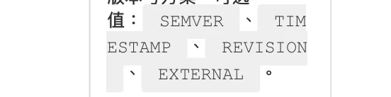

<table>
  <tr>
    <td>data.latestVersion.isLa test</td>
    <td><code>boolean</code></td>
    <td><code>true</code></td>
    <td>是否为最新版本。</td>
  </tr>
  <tr>
    <td>data.sourceBindings</td>
    <td><code>array</code></td>
    <td><code>[{"sourceBindingId</code><br><code>":"sourceBinding-</code><br><code>001","resourceId":"r</code><br><code>esource-</code><br><code>001","sourceType":"G</code><br><code>ATEWAY","sourceRef":</code><br><code>"sample-</code><br><code>value","primaryBindi</code><br><code>ng":false,"priority"</code><br><code>:100}]</code></td>
    <td>来源绑定列表。</td>
  </tr>
  <tr>
    <td>data.sourceBindings[].sourceBindingId</td>
    <td><code>string</code></td>
    <td><code>"sourceBinding-</code><br><code>001"</code></td>
    <td>来源绑定ID。</td>
  </tr>
  <tr>
    <td>data.sourceBindings[].resourceId</td>
    <td><code>string</code></td>
    <td><code>"resource-001"</code></td>
    <td>AI Resource ID。</td>
  </tr>
  <tr>
    <td>data.sourceBindings[].sourceType</td>
    <td><code>string</code></td>
    <td><code>"GATEWAY"</code></td>
    <td>来源类型。可选值：<code> GATEWAY </code>、<code> NA</code> <code>COS </code>、<code> REMOTE_ENDPO</code> <code>INT </code>、<code> SANDBOX </code>、<code> REGISTRY </code>、<code> CUSTO</code> <code>M </code>。</td>
  </tr>
  <tr>
    <td>data.sourceBindings[].sourceRef</td>
    <td><code>string</code></td>
    <td><code>"sample-value"</code></td>
    <td>来源引用。</td>
  </tr>
  <tr>
    <td>data.sourceBindings[].primaryBinding</td>
    <td><code>boolean</code></td>
    <td><code>false</code></td>
    <td>是否为主绑定关系。</td>
  </tr>
  <tr>
    <td>data.sourceBindings[].priority</td>
    <td><code>integer&lt;int32&gt;</code></td>
    <td><code>100</code></td>
    <td>优先级。</td>
  </tr>
  <tr>
    <td>data.sourceBindings[].syncMode</td>
    <td><code>string</code></td>
    <td><code>"sample-value"</code></td>
    <td>同步模式。</td>
  </tr>
  <tr>
    <td>data.sourceBindings[].syncStatus</td>
    <td><code>string</code></td>
    <td><code>"sample-value"</code></td>
    <td>同步状态。</td>
  </tr>
  <tr>
    <td>data.sourceBindings[].credentialRef</td>
    <td><code>string</code></td>
    <td><code>"sample-value"</code></td>
    <td>凭据引用。</td>
  </tr>
  <tr>
    <td>data.sourceBindings[].config</td>
    <td><code>object</code></td>
    <td><code>{}</code></td>
    <td>配置信息。</td>
  </tr>
  <tr>
    <td>data.sourceBindings[].l astSyncedAt</td>
    <td><code>string&lt;date-</code><br><code>time&gt;</code></td>
    <td><code>"2026-06-</code><br><code>22T12:00:00Z"</code></td>
    <td>最近一次同步时间。</td>
  </tr>
  <tr>
    <td>data.summary</td>
    <td><code>object</code></td>
    <td><code>{"mcpName":"sample</code><br><code>-</code><br><code>mcp","sourceType":"s</code><br><code>ample-</code><br><code>value","runtimeMode"</code><br><code>:"HOSTED","origin":"</code><br><code>sample-</code><br><code>value","protocols":</code><br><code>["sample-</code><br><code>value"],"sandboxRequ</code><br><code>ired":true}</code></td>
    <td>摘要信息。</td>
  </tr>
  <tr>
    <td>data.summary.mcpNa me</td>
    <td><code>string</code></td>
    <td><code>"sample-mcp"</code></td>
    <td>MCP Server 名称。</td>
  </tr>
  <tr>
    <td>data.summary.sourceT ype</td>
    <td><code>string</code></td>
    <td><code>"sample-value"</code></td>
    <td>来源类型。</td>
  </tr>
  <tr>
    <td>data.summary.runtime Mode</td>
    <td><code>string</code></td>
    <td><code>"HOSTED"</code></td>
    <td>运行时模式。</td>
  </tr>
  <tr>
    <td>data.summary.origin</td>
    <td><code>string</code></td>
    <td><code>"sample-value"</code></td>
    <td>来源标识。</td>
  </tr>
  <tr>
    <td>data.summary.protoco ls</td>
    <td><code>array</code></td>
    <td><code>["sample-value"]</code></td>
    <td>支持的协议列表。</td>
  </tr>
  <tr>
    <td>data.summary.sandbo xRequired</td>
    <td><code>boolean</code></td>
    <td><code>true</code></td>
    <td>是否要求沙箱托管。</td>
  </tr>
  <tr>
    <td>data.summary.hasUsa bleEndpoint</td>
    <td><code>boolean</code></td>
    <td><code>false</code></td>
    <td>是否存在可用Endpoint。</td>
  </tr>
  <tr>
    <td>data.summary.toolCou nt</td>
    <td><code>integer&lt;int32&gt;</code></td>
    <td><code>1</code></td>
    <td>工具数量。</td>
  </tr>
  <tr>
    <td>data.summary.endpoi ntCount</td>
    <td><code>integer&lt;int32&gt;</code></td>
    <td><code>1</code></td>
    <td>Endpoint 数量。</td>
  </tr>
  <tr>
    <td>data.summary.lastSyn cedAt</td>
    <td><code>string&lt;date-</code><br><code>time&gt;</code></td>
    <td><code>"2026-06-</code><br><code>22T12:00:00Z"</code></td>
    <td>最近一次同步时间。</td>
  </tr>
  <tr>
    <td>data.endpoints</td>
    <td><code>array</code></td>
    <td><code>[{"endpointId":"en</code><br><code>dpoint-</code><br><code>001","protocol":"sam</code><br><code>ple-</code><br><code>value","providerType</code><br><code>":"sample-</code><br><code>value","url":"https:</code><br><code>//api.example.com","</code><br><code>status":"sample-</code><br><code>value","healthStatus</code><br><code>":"sample-</code><br><code>value"}]</code></td>
    <td>访问端点列表。</td>
  </tr>
  <tr>
    <td>data.endpoints[].endp ointId</td>
    <td><code>string</code></td>
    <td><code>"endpoint-001"</code></td>
    <td>Endpoint ID。</td>
  </tr>
  <tr>
    <td>data.endpoints[].proto col</td>
    <td><code>string</code></td>
    <td><code>"sample-value"</code></td>
    <td>协议类型。</td>
  </tr>
  <tr>
    <td>data.endpoints[].provi derType</td>
    <td><code>string</code></td>
    <td><code>"sample-value"</code></td>
    <td>提供方类型。</td>
  </tr>
  <tr>
    <td>data.endpoints[].url</td>
    <td><code>string</code></td>
    <td><code>"https://api.examp</code><br><code>le.com"</code></td>
    <td>访问地址。</td>
  </tr>
  <tr>
    <td>data.endpoints[].status</td>
    <td><code>string</code></td>
    <td><code>"sample-value"</code></td>
    <td>状态。</td>
  </tr>
  <tr>
    <td>data.endpoints[].healt hStatus</td>
    <td><code>string</code></td>
    <td><code>"sample-value"</code></td>
    <td>健康检查状态。</td>
  </tr>
  <tr>
    <td>data.endpoints[].auth Mode</td>
    <td><code>string</code></td>
    <td><code>"sample-value"</code></td>
    <td>认证模式。</td>
  </tr>
  <tr>
    <td>data.endpoints[].netw orkScope</td>
    <td><code>string</code></td>
    <td><code>"sample-value"</code></td>
    <td>网络访问范围。</td>
  </tr>
  <tr>
    <td>data.endpoints[].defau ltInvocation</td>
    <td><code>boolean</code></td>
    <td><code>false</code></td>
    <td>默认调用配置。</td>
  </tr>
  <tr>
    <td>data.endpoints[].meta data</td>
    <td><code>object</code></td>
    <td><code>{}</code></td>
    <td>扩展元数据。</td>
  </tr>
  <tr>
    <td>data.connectionConfig s</td>
    <td><code>array</code></td>
    <td><code>[{"key":"sample-</code><br><code>value","label":"samp</code><br><code>le-</code><br><code>value","transport":"</code><br><code>sample-</code><br><code>value","endpointId":</code><br><code>"endpoint-</code><br><code>001","providerType":</code><br><code>"sample-</code><br><code>value","url":"https:</code><br><code>//api.example.com"}]</code></td>
    <td>连接配置列表。</td>
  </tr>
  <tr>
    <td>data.connectionConfig s[].key</td>
    <td><code>string</code></td>
    <td><code>"sample-value"</code></td>
    <td>配置键。</td>
  </tr>
  <tr>
    <td>data.connectionConfig s[].label</td>
    <td><code>string</code></td>
    <td><code>"sample-value"</code></td>
    <td>展示标签。</td>
  </tr>
  <tr>
    <td>data.connectionConfig s[].transport</td>
    <td><code>string</code></td>
    <td><code>"sample-value"</code></td>
    <td>传输协议。</td>
  </tr>
  <tr>
    <td>data.connectionConfig s[].endpointId</td>
    <td><code>string</code></td>
    <td><code>"endpoint-001"</code></td>
    <td>Endpoint ID。</td>
  </tr>
  <tr>
    <td>data.connectionConfig s[].providerType</td>
    <td><code>string</code></td>
    <td><code>"sample-value"</code></td>
    <td>提供方类型。</td>
  </tr>
  <tr>
    <td>data.connectionConfig s[].url</td>
    <td><code>string</code></td>
    <td><code>"https://api.examp</code><br><code>le.com"</code></td>
    <td>访问地址。</td>
  </tr>
  <tr>
    <td>data.connectionConfig s[].status</td>
    <td><code>string</code></td>
    <td><code>"sample-value"</code></td>
    <td>状态。</td>
  </tr>
  <tr>
    <td>data.connectionConfig s[].healthStatus</td>
    <td><code>string</code></td>
    <td><code>"sample-value"</code></td>
    <td>健康检查状态。</td>
  </tr>
  <tr>
    <td>data.connectionConfig s[].defaultInvocation</td>
    <td><code>boolean</code></td>
    <td><code>false</code></td>
    <td>默认调用配置。</td>
  </tr>
</table>

**示例**

**请求示例**

```http
PUT /himarket/v1/open-api/v1/resources/{resourceId}/mcp/endpoints/default HTTP/1.1
Host: localhost:8080
Authorization: Bearer <accessToken>
Content-Type: application/json

{
  "endpointId": "endpoint-001"
}
```

**响应示例**

```json
{
  "code": "SUCCESS",
  "message": null,
  "data": {
    "resource": {
      "resourceId": "resource-001",
      "tenantId": "tenant-001",
      "kind": "MODEL_API",
      "name": "sample-name",
      "displayName": "示例资源",
      "summary": "示例摘要"
    },
    "latestVersion": {
      "versionId": "version-001",
      "resourceId": "resource-001",
      "version": "sample-value",
      "versionScheme": "SEMVER",
      "status": "DRAFT",
      "manifestId": "manifest-001"
    },
    "sourceBindings": [
      {}
    ],
    "summary": {
      "mcpName": "sample-mcp",
      "sourceType": "sample-value",
      "runtimeMode": "HOSTED",
      "origin": "sample-value",
      "protocols": [
        "sample-value"
      ],
      "sandboxRequired": true
    },
    "endpoints": [
      {}
    ],
    "connectionConfigs": [
      {}
    ]
  },
  "accessDeniedDetail": null,
  "requestId": "req-001"
}
```

<a id="section-3-15-7"></a>

### 3.15.7. undeploySandbox

**接口信息**

- **接口路径**： `DELETE /himarket/v1/open-api/v1/resources/{resourceId}/mcp/sandbox/deploy`

- **接口说明**：取消 MCP 沙箱托管。

- **认证方式**：该接口属于开发者门户 API。调用前请完成开发者登录，并在请求 Header 中携带  `Authorization: Bearer <accessToken>` 。

- **Header 示例**：需要登录态的接口使用  `Authorization: Bearer <accessToken>` 。

**请求参数**

| 参数名称 | 位置 | 类型 | 是否必选 | 示例 | 说明 |
| --- | --- | --- | --- | --- | --- |
| resourceId | path | <code>string</code> | 是 | <code>"resource-</code><br><code>001"</code> | AI Resource ID。 |

**返回数据**

| 参数名称 | 类型 | 示例 | 说明 |
| --- | --- | --- | --- |
| code | <code>string</code> | <code>SUCCESS</code> | 响应码，取值为<code> SUCCESS </code> 时表示请求成功。 |
| message | <code>string</code> | <code>null</code> | 响应消息。请求成功时通常为空。 |

<table>
  <tr>
    <td>data</td>
    <td><code>object</code></td>
    <td><code>{"resource":</code><br><code>{"resourceId":"resou</code><br><code>rce-</code><br><code>001","tenantId":"ten</code><br><code>ant-</code><br><code>001","kind":"MODEL_A</code><br><code>PI","name":"sample-</code><br><code>name","displayName":</code> <code>"</code>示例资源<code>","summary":"</code>示例摘要<code>"},"latestVersion"</code><code>:</code><br><code>{"versionId":"versio</code><br><code>n-</code><br><code>001","resourceId":"r</code><br><code>esource-</code><br><code>001","version":"samp</code><br><code>le-</code><br><code>value","versionSchem</code><br><code>e":"SEMVER","status"</code><br><code>:"DRAFT","manifestId</code><br><code>":"manifest-</code><br><code>001"},"sourceBinding</code><br><code>s":[{}],"summary":</code><br><code>{"mcpName":"sample-</code><br><code>mcp","sourceType":"s</code><br><code>ample-</code><br><code>value","runtimeMode"</code><br><code>:"HOSTED","origin":"</code><br><code>sample-</code><br><code>value","protocols":</code><br><code>["sample-</code><br><code>value"],"sandboxRequ</code><br><code>ired":true},"endpoin</code><br><code>ts":</code><br><code>[{}],"connectionConf</code><br><code>igs":[{}]}</code></td>
    <td>响应数据。具体结构以接口语义为准。</td>
  </tr>
  <tr>
    <td>accessDeniedDetail</td>
    <td><code>object</code></td>
    <td><code>null</code></td>
    <td>鉴权失败详情。请求成功时通常为空。</td>
  </tr>
  <tr>
    <td>requestId</td>
    <td><code>string</code></td>
    <td><code>req-001</code></td>
    <td>请求 ID，可用于问题排查和日志检索。</td>
  </tr>
  <tr>
    <td>data.resource</td>
    <td><code>object</code></td>
    <td><code>{"resourceId":"res</code><br><code>ource-</code><br><code>001","tenantId":"ten</code><br><code>ant-</code><br><code>001","kind":"MODEL_A</code><br><code>PI","name":"sample-</code><br><code>name","displayName":</code> <code>"</code>示例资源<code>","summary":"</code>示例摘要<code>"} </code></td>
    <td>AI Resource 基础信息。</td>
  </tr>
  <tr>
    <td>data.resource.resourc eId</td>
    <td><code>string</code></td>
    <td><code>"resource-001"</code></td>
    <td>AI Resource ID。</td>
  </tr>
  <tr>
    <td>data.resource.tenantId</td>
    <td><code>string</code></td>
    <td><code>"tenant-001"</code></td>
    <td>租户ID。</td>
  </tr>
  <tr>
    <td>data.resource.kind</td>
    <td><code>string</code></td>
    <td><code>"MODEL_API"</code></td>
    <td>资源类型。</td>
  </tr>
  <tr>
    <td>data.resource.name</td>
    <td><code>string</code></td>
    <td><code>"sample-name"</code></td>
    <td>名称。</td>
  </tr>
  <tr>
    <td>data.resource.displayN ame</td>
    <td><code>string</code></td>
    <td><code> "</code>示例资源<code>" </code></td>
    <td>展示名称。</td>
  </tr>
  <tr>
    <td>data.resource.summar y</td>
    <td><code>string</code></td>
    <td><code> "</code>示例摘要<code>" </code></td>
    <td>摘要信息。</td>
  </tr>
  <tr>
    <td>data.resource.descripti on</td>
    <td><code>string</code></td>
    <td><code> "</code>用于演示的资源描述<code>" </code></td>
    <td>描述信息。</td>
  </tr>
  <tr>
    <td>data.resource.ownerTy pe</td>
    <td><code>string</code></td>
    <td><code>"USER"</code></td>
    <td>归属主体类型。可选值：<code> USER </code>、<code> APP </code>、<code> SYSTEM </code>。</td>
  </tr>
  <tr>
    <td>data.resource.ownerId</td>
    <td><code>string</code></td>
    <td><code>"owner-001"</code></td>
    <td>归属主体ID。</td>
  </tr>
  <tr>
    <td>data.resource.created By</td>
    <td><code>string</code></td>
    <td><code>"sample-value"</code></td>
    <td>创建人。</td>
  </tr>
  <tr>
    <td>data.resource.created ByName</td>
    <td><code>string</code></td>
    <td><code>"demo-createdby"</code></td>
    <td>创建人名称。</td>
  </tr>
  <tr>
    <td>data.resource.icon</td>
    <td><code>string</code></td>
    <td><code>"sample-value"</code></td>
    <td>图标地址。</td>
  </tr>
  <tr>
    <td>data.resource.tags</td>
    <td><code>array</code></td>
    <td><code>["sample-value"]</code></td>
    <td>标签列表。</td>
  </tr>
  <tr>
    <td>data.resource.lifecycle Status</td>
    <td><code>string</code></td>
    <td><code>"DRAFT"</code></td>
    <td>生命周期状态。可选值：<code> DRAFT </code>、<code> ACTI</code> <code>VE </code>、<code> DEPRECATED </code>、<code> ARCHIVED </code>。</td>
  </tr>
  <tr>
    <td>data.resource.latestVe rsionId</td>
    <td><code>string</code></td>
    <td><code>"latestVersion-</code><br><code>001"</code></td>
    <td>最新版本ID。</td>
  </tr>
  <tr>
    <td>data.resource.autoApp roveSubscription</td>
    <td><code>boolean</code></td>
    <td><code>true</code></td>
    <td>是否自动批准订阅。</td>
  </tr>
  <tr>
    <td>data.resource.extras</td>
    <td><code>object</code></td>
    <td><code>{}</code></td>
    <td>扩展配置。</td>
  </tr>
  <tr>
    <td>data.resource.created At</td>
    <td><code>string&lt;date-</code><br><code>time&gt;</code></td>
    <td><code>"2026-06-</code><br><code>22T12:00:00Z"</code></td>
    <td>创建时间。</td>
  </tr>
  <tr>
    <td>data.resource.updated At</td>
    <td><code>string&lt;date-</code><br><code>time&gt;</code></td>
    <td><code>"2026-06-</code><br><code>22T12:00:00Z"</code></td>
    <td>更新时间。</td>
  </tr>
  <tr>
    <td>data.latestVersion</td>
    <td><code>object</code></td>
    <td><code>{"versionId":"vers</code><br><code>ion-</code><br><code>001","resourceId":"r</code><br><code>esource-</code><br><code>001","version":"samp</code><br><code>le-</code><br><code>value","versionSchem</code><br><code>e":"SEMVER","status"</code><br><code>:"DRAFT","manifestId</code><br><code>":"manifest-001"}</code></td>
    <td>最新版本信息。</td>
  </tr>
  <tr>
    <td>data.latestVersion.vers ionId</td>
    <td><code>string</code></td>
    <td><code>"version-001"</code></td>
    <td>版本 ID。</td>
  </tr>
  <tr>
    <td>data.latestVersion.reso urceId</td>
    <td><code>string</code></td>
    <td><code>"resource-001"</code></td>
    <td>AI Resource ID。</td>
  </tr>
  <tr>
    <td>data.latestVersion.vers ion</td>
    <td><code>string</code></td>
    <td><code>"sample-value"</code></td>
    <td>版本号。</td>
  </tr>
  <tr>
    <td>data.latestVersion.vers ionScheme</td>
    <td><code>string</code></td>
    <td><code>"SEMVER"</code></td>
    <td>版本号方案。可选值：<code> SEMVER </code>、<code> TIM</code> <code>ESTAMP </code>、<code> REVISION</code><code> </code>、<code> EXTERNAL </code>。</td>
  </tr>
  <tr>
    <td>data.latestVersion.stat us</td>
    <td><code>string</code></td>
    <td><code>"DRAFT"</code></td>
    <td>状态。</td>
  </tr>
  <tr>
    <td>data.latestVersion.ma nifestId</td>
    <td><code>string</code></td>
    <td><code>"manifest-001"</code></td>
    <td>Manifest ID。</td>
  </tr>
  <tr>
    <td>data.latestVersion.sou rceBindingId</td>
    <td><code>string</code></td>
    <td><code>"sourceBinding-</code><br><code>001"</code></td>
    <td>来源绑定ID。</td>
  </tr>
  <tr>
    <td>data.latestVersion.artif actDigest</td>
    <td><code>string</code></td>
    <td><code>"sample-value"</code></td>
    <td>制品摘要。</td>
  </tr>
  <tr>
    <td>data.latestVersion.rele aseNote</td>
    <td><code>string</code></td>
    <td><code>"sample-value"</code></td>
    <td>版本说明。</td>
  </tr>
  <tr>
    <td>data.latestVersion.cre atedBy</td>
    <td><code>string</code></td>
    <td><code>"sample-value"</code></td>
    <td>创建人。</td>
  </tr>
  <tr>
    <td>data.latestVersion.pub lishedAt</td>
    <td><code>string&lt;date-</code><br><code>time&gt;</code></td>
    <td><code>"2026-06-</code><br><code>22T12:00:00Z"</code></td>
    <td>发布时间。</td>
  </tr>
  <tr>
    <td>data.latestVersion.cre atedAt</td>
    <td><code>string&lt;date-</code><br><code>time&gt;</code></td>
    <td><code>"2026-06-</code><br><code>22T12:00:00Z"</code></td>
    <td>创建时间。</td>
  </tr>
  <tr>
    <td>data.latestVersion.upd atedAt</td>
    <td><code>string&lt;date-</code><br><code>time&gt;</code></td>
    <td><code>"2026-06-</code><br><code>22T12:00:00Z"</code></td>
    <td>更新时间。</td>
  </tr>
  <tr>
    <td>data.latestVersion.dow nloadCount</td>
    <td><code>integer&lt;int64&gt;</code></td>
    <td><code>1</code></td>
    <td>下载次数。</td>
  </tr>
  <tr>
    <td>data.latestVersion.isLa test</td>
    <td><code>boolean</code></td>
    <td><code>true</code></td>
    <td>是否为最新版本。</td>
  </tr>
</table>


<table>
  <tr>
    <td>data.sourceBindings</td>
    <td><code>array</code></td>
    <td><code>[{"sourceBindingId</code><br><code>":"sourceBinding-</code><br><code>001","resourceId":"r</code><br><code>esource-</code><br><code>001","sourceType":"G</code><br><code>ATEWAY","sourceRef":</code><br><code>"sample-</code><br><code>value","primaryBindi</code><br><code>ng":false,"priority"</code><br><code>:100}]</code></td>
    <td>来源绑定列表。</td>
  </tr>
  <tr>
    <td>data.sourceBindings[].sourceBindingId</td>
    <td><code>string</code></td>
    <td><code>"sourceBinding-</code><br><code>001"</code></td>
    <td>来源绑定ID。</td>
  </tr>
  <tr>
    <td>data.sourceBindings[].resourceId</td>
    <td><code>string</code></td>
    <td><code>"resource-001"</code></td>
    <td>AI Resource ID。</td>
  </tr>
  <tr>
    <td>data.sourceBindings[].sourceType</td>
    <td><code>string</code></td>
    <td><code>"GATEWAY"</code></td>
    <td>来源类型。可选值：<code> GATEWAY </code>、<code> NA</code> <code>COS </code>、<code> REMOTE_ENDPO</code> <code>INT </code>、<code> SANDBOX </code>、<code> REGISTRY </code>、<code> CUSTO</code> <code>M </code>。</td>
  </tr>
  <tr>
    <td>data.sourceBindings[].sourceRef</td>
    <td><code>string</code></td>
    <td><code>"sample-value"</code></td>
    <td>来源引用。</td>
  </tr>
  <tr>
    <td>data.sourceBindings[].primaryBinding</td>
    <td><code>boolean</code></td>
    <td><code>false</code></td>
    <td>是否为主绑定关系。</td>
  </tr>
  <tr>
    <td>data.sourceBindings[].priority</td>
    <td><code>integer&lt;int32&gt;</code></td>
    <td><code>100</code></td>
    <td>优先级。</td>
  </tr>
  <tr>
    <td>data.sourceBindings[].syncMode</td>
    <td><code>string</code></td>
    <td><code>"sample-value"</code></td>
    <td>同步模式。</td>
  </tr>
  <tr>
    <td>data.sourceBindings[].syncStatus</td>
    <td><code>string</code></td>
    <td><code>"sample-value"</code></td>
    <td>同步状态。</td>
  </tr>
  <tr>
    <td>data.sourceBindings[].credentialRef</td>
    <td><code>string</code></td>
    <td><code>"sample-value"</code></td>
    <td>凭据引用。</td>
  </tr>
  <tr>
    <td>data.sourceBindings[].config</td>
    <td><code>object</code></td>
    <td><code>{}</code></td>
    <td>配置信息。</td>
  </tr>
  <tr>
    <td>data.sourceBindings[].l astSyncedAt</td>
    <td><code>string&lt;date-</code><br><code>time&gt;</code></td>
    <td><code>"2026-06-</code><br><code>22T12:00:00Z"</code></td>
    <td>最近一次同步时间。</td>
  </tr>
  <tr>
    <td>data.summary</td>
    <td><code>object</code></td>
    <td><code>{"mcpName":"sample</code><br><code>-</code><br><code>mcp","sourceType":"s</code><br><code>ample-</code><br><code>value","runtimeMode"</code><br><code>:"HOSTED","origin":"</code><br><code>sample-</code><br><code>value","protocols":</code><br><code>["sample-</code><br><code>value"],"sandboxRequ</code><br><code>ired":true}</code></td>
    <td>摘要信息。</td>
  </tr>
  <tr>
    <td>data.summary.mcpNa me</td>
    <td><code>string</code></td>
    <td><code>"sample-mcp"</code></td>
    <td>MCP Server 名称。</td>
  </tr>
  <tr>
    <td>data.summary.sourceT ype</td>
    <td><code>string</code></td>
    <td><code>"sample-value"</code></td>
    <td>来源类型。</td>
  </tr>
  <tr>
    <td>data.summary.runtime Mode</td>
    <td><code>string</code></td>
    <td><code>"HOSTED"</code></td>
    <td>运行时模式。</td>
  </tr>
  <tr>
    <td>data.summary.origin</td>
    <td><code>string</code></td>
    <td><code>"sample-value"</code></td>
    <td>来源标识。</td>
  </tr>
  <tr>
    <td>data.summary.protoco ls</td>
    <td><code>array</code></td>
    <td><code>["sample-value"]</code></td>
    <td>支持的协议列表。</td>
  </tr>
  <tr>
    <td>data.summary.sandbo xRequired</td>
    <td><code>boolean</code></td>
    <td><code>true</code></td>
    <td>是否要求沙箱托管。</td>
  </tr>
  <tr>
    <td>data.summary.hasUsa bleEndpoint</td>
    <td><code>boolean</code></td>
    <td><code>false</code></td>
    <td>是否存在可用Endpoint。</td>
  </tr>
  <tr>
    <td>data.summary.toolCou nt</td>
    <td><code>integer&lt;int32&gt;</code></td>
    <td><code>1</code></td>
    <td>工具数量。</td>
  </tr>
  <tr>
    <td>data.summary.endpoi ntCount</td>
    <td><code>integer&lt;int32&gt;</code></td>
    <td><code>1</code></td>
    <td>Endpoint 数量。</td>
  </tr>
  <tr>
    <td>data.summary.lastSyn cedAt</td>
    <td><code>string&lt;date-</code><br><code>time&gt;</code></td>
    <td><code>"2026-06-</code><br><code>22T12:00:00Z"</code></td>
    <td>最近一次同步时间。</td>
  </tr>
  <tr>
    <td>data.endpoints</td>
    <td><code>array</code></td>
    <td><code>[{"endpointId":"en</code><br><code>dpoint-</code><br><code>001","protocol":"sam</code><br><code>ple-</code><br><code>value","providerType</code><br><code>":"sample-</code><br><code>value","url":"https:</code><br><code>//api.example.com","</code><br><code>status":"sample-</code><br><code>value","healthStatus</code><br><code>":"sample-</code><br><code>value"}]</code></td>
    <td>访问端点列表。</td>
  </tr>
  <tr>
    <td>data.endpoints[].endp ointId</td>
    <td><code>string</code></td>
    <td><code>"endpoint-001"</code></td>
    <td>Endpoint ID。</td>
  </tr>
  <tr>
    <td>data.endpoints[].proto col</td>
    <td><code>string</code></td>
    <td><code>"sample-value"</code></td>
    <td>协议类型。</td>
  </tr>
  <tr>
    <td>data.endpoints[].provi derType</td>
    <td><code>string</code></td>
    <td><code>"sample-value"</code></td>
    <td>提供方类型。</td>
  </tr>
  <tr>
    <td>data.endpoints[].url</td>
    <td><code>string</code></td>
    <td><code>"https://api.examp</code><br><code>le.com"</code></td>
    <td>访问地址。</td>
  </tr>
  <tr>
    <td>data.endpoints[].status</td>
    <td><code>string</code></td>
    <td><code>"sample-value"</code></td>
    <td>状态。</td>
  </tr>
  <tr>
    <td>data.endpoints[].healt hStatus</td>
    <td><code>string</code></td>
    <td><code>"sample-value"</code></td>
    <td>健康检查状态。</td>
  </tr>
  <tr>
    <td>data.endpoints[].auth Mode</td>
    <td><code>string</code></td>
    <td><code>"sample-value"</code></td>
    <td>认证模式。</td>
  </tr>
  <tr>
    <td>data.endpoints[].netw orkScope</td>
    <td><code>string</code></td>
    <td><code>"sample-value"</code></td>
    <td>网络访问范围。</td>
  </tr>
  <tr>
    <td>data.endpoints[].defau ltInvocation</td>
    <td><code>boolean</code></td>
    <td><code>false</code></td>
    <td>默认调用配置。</td>
  </tr>
  <tr>
    <td>data.endpoints[].meta data</td>
    <td><code>object</code></td>
    <td><code>{}</code></td>
    <td>扩展元数据。</td>
  </tr>
  <tr>
    <td>data.connectionConfig s</td>
    <td><code>array</code></td>
    <td><code>[{"key":"sample-</code><br><code>value","label":"samp</code><br><code>le-</code><br><code>value","transport":"</code><br><code>sample-</code><br><code>value","endpointId":</code><br><code>"endpoint-</code><br><code>001","providerType":</code><br><code>"sample-</code><br><code>value","url":"https:</code><br><code>//api.example.com"}]</code></td>
    <td>连接配置列表。</td>
  </tr>
  <tr>
    <td>data.connectionConfig s[].key</td>
    <td><code>string</code></td>
    <td><code>"sample-value"</code></td>
    <td>配置键。</td>
  </tr>
  <tr>
    <td>data.connectionConfig s[].label</td>
    <td><code>string</code></td>
    <td><code>"sample-value"</code></td>
    <td>展示标签。</td>
  </tr>
  <tr>
    <td>data.connectionConfig s[].transport</td>
    <td><code>string</code></td>
    <td><code>"sample-value"</code></td>
    <td>传输协议。</td>
  </tr>
  <tr>
    <td>data.connectionConfig s[].endpointId</td>
    <td><code>string</code></td>
    <td><code>"endpoint-001"</code></td>
    <td>Endpoint ID。</td>
  </tr>
  <tr>
    <td>data.connectionConfig s[].providerType</td>
    <td><code>string</code></td>
    <td><code>"sample-value"</code></td>
    <td>提供方类型。</td>
  </tr>
  <tr>
    <td>data.connectionConfig s[].url</td>
    <td><code>string</code></td>
    <td><code>"https://api.examp</code><br><code>le.com"</code></td>
    <td>访问地址。</td>
  </tr>
  <tr>
    <td>data.connectionConfig s[].status</td>
    <td><code>string</code></td>
    <td><code>"sample-value"</code></td>
    <td>状态。</td>
  </tr>
  <tr>
    <td>data.connectionConfig s[].healthStatus</td>
    <td><code>string</code></td>
    <td><code>"sample-value"</code></td>
    <td>健康检查状态。</td>
  </tr>
  <tr>
    <td>data.connectionConfig s[].defaultInvocation</td>
    <td><code>boolean</code></td>
    <td><code>false</code></td>
    <td>默认调用配置。</td>
  </tr>
</table>

**示例**

**请求示例**

```http
DELETE /himarket/v1/open-api/v1/resources/{resourceId}/mcp/sandbox/deploy HTTP/1.1
Host: localhost:8080
Authorization: Bearer <accessToken>
```

**响应示例**

```json
{
  "code": "SUCCESS",
  "message": null,
  "data": {
    "resource": {
      "resourceId": "resource-001",
      "tenantId": "tenant-001",
      "kind": "MODEL_API",
      "name": "sample-name",
      "displayName": "示例资源",
      "summary": "示例摘要"
    },
    "latestVersion": {
      "versionId": "version-001",
      "resourceId": "resource-001",
      "version": "sample-value",
      "versionScheme": "SEMVER",
      "status": "DRAFT",
      "manifestId": "manifest-001"
    },
    "sourceBindings": [
      {}
    ],
    "summary": {
      "mcpName": "sample-mcp",
      "sourceType": "sample-value",
      "runtimeMode": "HOSTED",
      "origin": "sample-value",
      "protocols": [
        "sample-value"
      ],
      "sandboxRequired": true
    },
    "endpoints": [
      {}
    ],
    "connectionConfigs": [
      {}
    ]
  },
  "accessDeniedDetail": null,
  "requestId": "req-001"
}
```

<a id="section-3-15-8"></a>

### 3.15.8. updateExtraParams

**接口信息**

- **接口路径**： `PUT /himarket/v1/open-api/v1/resources/{resourceId}/mcp/extra-params`

- **接口说明**：更新 MCP 参数定义 (extraParams)。

- **认证方式**：该接口属于开发者门户 API。调用前请完成开发者登录，并在请求 Header 中携带  `Authorization: Bearer <accessToken>` 。

- **Header 示例**：需要登录态的接口使用  `Authorization: Bearer <accessToken>` 。

**请求参数**

| 参数名称 | 位置 | 类型 | 是否必选 | 示例 | 说明 |
| --- | --- | --- | --- | --- | --- |
| resourceId | path | <code>string</code> | 是 | <code>"resource-</code><br><code>001"</code> | AI Resource ID。 |
| extraParams | body | <code>string</code> | 否 | <code>"sample-</code><br><code>value"</code> | 扩展参数定义。 |

**返回数据**

| 参数名称 | 类型 | 示例 | 说明 |
| --- | --- | --- | --- |
| code | <code>string</code> | <code>SUCCESS</code> | 响应码，取值为<code> SUCCESS </code> 时表示请求成功。 |
| message | <code>string</code> | <code>null</code> | 响应消息。请求成功时通常为空。 |

<table>
  <tr>
    <td>data</td>
    <td><code>object</code></td>
    <td><code>{"resource":</code><br><code>{"resourceId":"resou</code><br><code>rce-</code><br><code>001","tenantId":"ten</code><br><code>ant-</code><br><code>001","kind":"MODEL_A</code><br><code>PI","name":"sample-</code><br><code>name","displayName":</code> <code>"</code>示例资源<code>","summary":"</code>示例摘要<code>"},"latestVersion"</code><code>:</code><br><code>{"versionId":"versio</code><br><code>n-</code><br><code>001","resourceId":"r</code><br><code>esource-</code><br><code>001","version":"samp</code><br><code>le-</code><br><code>value","versionSchem</code><br><code>e":"SEMVER","status"</code><br><code>:"DRAFT","manifestId</code><br><code>":"manifest-</code><br><code>001"},"sourceBinding</code><br><code>s":[{}],"summary":</code><br><code>{"mcpName":"sample-</code><br><code>mcp","sourceType":"s</code><br><code>ample-</code><br><code>value","runtimeMode"</code><br><code>:"HOSTED","origin":"</code><br><code>sample-</code><br><code>value","protocols":</code><br><code>["sample-</code><br><code>value"],"sandboxRequ</code><br><code>ired":true},"endpoin</code><br><code>ts":</code><br><code>[{}],"connectionConf</code><br><code>igs":[{}]}</code></td>
    <td>响应数据。具体结构以接口语义为准。</td>
  </tr>
  <tr>
    <td>accessDeniedDetail</td>
    <td><code>object</code></td>
    <td><code>null</code></td>
    <td>鉴权失败详情。请求成功时通常为空。</td>
  </tr>
  <tr>
    <td>requestId</td>
    <td><code>string</code></td>
    <td><code>req-001</code></td>
    <td>请求 ID，可用于问题排查和日志检索。</td>
  </tr>
  <tr>
    <td>data.resource</td>
    <td><code>object</code></td>
    <td><code>{"resourceId":"res</code><br><code>ource-</code><br><code>001","tenantId":"ten</code><br><code>ant-</code><br><code>001","kind":"MODEL_A</code><br><code>PI","name":"sample-</code><br><code>name","displayName":</code> <code>"</code>示例资源<code>","summary":"</code>示例摘要<code>"} </code></td>
    <td>AI Resource 基础信息。</td>
  </tr>
  <tr>
    <td>data.resource.resourc eId</td>
    <td><code>string</code></td>
    <td><code>"resource-001"</code></td>
    <td>AI Resource ID。</td>
  </tr>
  <tr>
    <td>data.resource.tenantId</td>
    <td><code>string</code></td>
    <td><code>"tenant-001"</code></td>
    <td>租户ID。</td>
  </tr>
  <tr>
    <td>data.resource.kind</td>
    <td><code>string</code></td>
    <td><code>"MODEL_API"</code></td>
    <td>资源类型。</td>
  </tr>
  <tr>
    <td>data.resource.name</td>
    <td><code>string</code></td>
    <td><code>"sample-name"</code></td>
    <td>名称。</td>
  </tr>
  <tr>
    <td>data.resource.displayN ame</td>
    <td><code>string</code></td>
    <td><code> "</code>示例资源<code>" </code></td>
    <td>展示名称。</td>
  </tr>
  <tr>
    <td>data.resource.summar y</td>
    <td><code>string</code></td>
    <td><code> "</code>示例摘要<code>" </code></td>
    <td>摘要信息。</td>
  </tr>
  <tr>
    <td>data.resource.descripti on</td>
    <td><code>string</code></td>
    <td><code> "</code>用于演示的资源描述<code>" </code></td>
    <td>描述信息。</td>
  </tr>
  <tr>
    <td>data.resource.ownerTy pe</td>
    <td><code>string</code></td>
    <td><code>"USER"</code></td>
    <td>归属主体类型。可选值：<code> USER </code>、<code> APP </code>、<code> SYSTEM </code>。</td>
  </tr>
  <tr>
    <td>data.resource.ownerId</td>
    <td><code>string</code></td>
    <td><code>"owner-001"</code></td>
    <td>归属主体ID。</td>
  </tr>
  <tr>
    <td>data.resource.created By</td>
    <td><code>string</code></td>
    <td><code>"sample-value"</code></td>
    <td>创建人。</td>
  </tr>
  <tr>
    <td>data.resource.created ByName</td>
    <td><code>string</code></td>
    <td><code>"demo-createdby"</code></td>
    <td>创建人名称。</td>
  </tr>
  <tr>
    <td>data.resource.icon</td>
    <td><code>string</code></td>
    <td><code>"sample-value"</code></td>
    <td>图标地址。</td>
  </tr>
  <tr>
    <td>data.resource.tags</td>
    <td><code>array</code></td>
    <td><code>["sample-value"]</code></td>
    <td>标签列表。</td>
  </tr>
  <tr>
    <td>data.resource.lifecycle Status</td>
    <td><code>string</code></td>
    <td><code>"DRAFT"</code></td>
    <td>生命周期状态。可选值：<code> DRAFT </code>、<code> ACTI</code> <code>VE </code>、<code> DEPRECATED </code>、<code> ARCHIVED </code>。</td>
  </tr>
  <tr>
    <td>data.resource.latestVe rsionId</td>
    <td><code>string</code></td>
    <td><code>"latestVersion-</code><br><code>001"</code></td>
    <td>最新版本ID。</td>
  </tr>
  <tr>
    <td>data.resource.autoApp roveSubscription</td>
    <td><code>boolean</code></td>
    <td><code>true</code></td>
    <td>是否自动批准订阅。</td>
  </tr>
  <tr>
    <td>data.resource.extras</td>
    <td><code>object</code></td>
    <td><code>{}</code></td>
    <td>扩展配置。</td>
  </tr>
  <tr>
    <td>data.resource.created At</td>
    <td><code>string&lt;date-</code><br><code>time&gt;</code></td>
    <td><code>"2026-06-</code><br><code>22T12:00:00Z"</code></td>
    <td>创建时间。</td>
  </tr>
  <tr>
    <td>data.resource.updated At</td>
    <td><code>string&lt;date-</code><br><code>time&gt;</code></td>
    <td><code>"2026-06-</code><br><code>22T12:00:00Z"</code></td>
    <td>更新时间。</td>
  </tr>
  <tr>
    <td>data.latestVersion</td>
    <td><code>object</code></td>
    <td><code>{"versionId":"vers</code><br><code>ion-</code><br><code>001","resourceId":"r</code><br><code>esource-</code><br><code>001","version":"samp</code><br><code>le-</code><br><code>value","versionSchem</code><br><code>e":"SEMVER","status"</code><br><code>:"DRAFT","manifestId</code><br><code>":"manifest-001"}</code></td>
    <td>最新版本信息。</td>
  </tr>
  <tr>
    <td>data.latestVersion.vers ionId</td>
    <td><code>string</code></td>
    <td><code>"version-001"</code></td>
    <td>版本 ID。</td>
  </tr>
  <tr>
    <td>data.latestVersion.reso urceId</td>
    <td><code>string</code></td>
    <td><code>"resource-001"</code></td>
    <td>AI Resource ID。</td>
  </tr>
  <tr>
    <td>data.latestVersion.vers ion</td>
    <td><code>string</code></td>
    <td><code>"sample-value"</code></td>
    <td>版本号。</td>
  </tr>
  <tr>
    <td>data.latestVersion.vers ionScheme</td>
    <td><code>string</code></td>
    <td><code>"SEMVER"</code></td>
    <td>版本号方案。可选值：<code> SEMVER </code>、<code> TIM</code> <code>ESTAMP </code>、<code> REVISION</code><code> </code>、<code> EXTERNAL </code>。</td>
  </tr>
  <tr>
    <td>data.latestVersion.stat us</td>
    <td><code>string</code></td>
    <td><code>"DRAFT"</code></td>
    <td>状态。</td>
  </tr>
  <tr>
    <td>data.latestVersion.ma nifestId</td>
    <td><code>string</code></td>
    <td><code>"manifest-001"</code></td>
    <td>Manifest ID。</td>
  </tr>
  <tr>
    <td>data.latestVersion.sou rceBindingId</td>
    <td><code>string</code></td>
    <td><code>"sourceBinding-</code><br><code>001"</code></td>
    <td>来源绑定ID。</td>
  </tr>
  <tr>
    <td>data.latestVersion.artif actDigest</td>
    <td><code>string</code></td>
    <td><code>"sample-value"</code></td>
    <td>制品摘要。</td>
  </tr>
  <tr>
    <td>data.latestVersion.rele aseNote</td>
    <td><code>string</code></td>
    <td><code>"sample-value"</code></td>
    <td>版本说明。</td>
  </tr>
  <tr>
    <td>data.latestVersion.cre atedBy</td>
    <td><code>string</code></td>
    <td><code>"sample-value"</code></td>
    <td>创建人。</td>
  </tr>
  <tr>
    <td>data.latestVersion.pub lishedAt</td>
    <td><code>string&lt;date-</code><br><code>time&gt;</code></td>
    <td><code>"2026-06-</code><br><code>22T12:00:00Z"</code></td>
    <td>发布时间。</td>
  </tr>
  <tr>
    <td>data.latestVersion.cre atedAt</td>
    <td><code>string&lt;date-</code><br><code>time&gt;</code></td>
    <td><code>"2026-06-</code><br><code>22T12:00:00Z"</code></td>
    <td>创建时间。</td>
  </tr>
  <tr>
    <td>data.latestVersion.upd atedAt</td>
    <td><code>string&lt;date-</code><br><code>time&gt;</code></td>
    <td><code>"2026-06-</code><br><code>22T12:00:00Z"</code></td>
    <td>更新时间。</td>
  </tr>
  <tr>
    <td>data.latestVersion.dow nloadCount</td>
    <td><code>integer&lt;int64&gt;</code></td>
    <td><code>1</code></td>
    <td>下载次数。</td>
  </tr>
</table>


<table>
  <tr>
    <td>data.latestVersion.isLa test</td>
    <td><code>boolean</code></td>
    <td><code>true</code></td>
    <td>是否为最新版本。</td>
  </tr>
  <tr>
    <td>data.sourceBindings</td>
    <td><code>array</code></td>
    <td><code>[{"sourceBindingId</code><br><code>":"sourceBinding-</code><br><code>001","resourceId":"r</code><br><code>esource-</code><br><code>001","sourceType":"G</code><br><code>ATEWAY","sourceRef":</code><br><code>"sample-</code><br><code>value","primaryBindi</code><br><code>ng":false,"priority"</code><br><code>:100}]</code></td>
    <td>来源绑定列表。</td>
  </tr>
  <tr>
    <td>data.sourceBindings[].sourceBindingId</td>
    <td><code>string</code></td>
    <td><code>"sourceBinding-</code><br><code>001"</code></td>
    <td>来源绑定ID。</td>
  </tr>
  <tr>
    <td>data.sourceBindings[].resourceId</td>
    <td><code>string</code></td>
    <td><code>"resource-001"</code></td>
    <td>AI Resource ID。</td>
  </tr>
  <tr>
    <td>data.sourceBindings[].sourceType</td>
    <td><code>string</code></td>
    <td><code>"GATEWAY"</code></td>
    <td>来源类型。可选值：<code> GATEWAY </code>、<code> NA</code> <code>COS </code>、<code> REMOTE_ENDPO</code> <code>INT </code>、<code> SANDBOX </code>、<code> REGISTRY </code>、<code> CUSTO</code> <code>M </code>。</td>
  </tr>
  <tr>
    <td>data.sourceBindings[].sourceRef</td>
    <td><code>string</code></td>
    <td><code>"sample-value"</code></td>
    <td>来源引用。</td>
  </tr>
  <tr>
    <td>data.sourceBindings[].primaryBinding</td>
    <td><code>boolean</code></td>
    <td><code>false</code></td>
    <td>是否为主绑定关系。</td>
  </tr>
  <tr>
    <td>data.sourceBindings[].priority</td>
    <td><code>integer&lt;int32&gt;</code></td>
    <td><code>100</code></td>
    <td>优先级。</td>
  </tr>
  <tr>
    <td>data.sourceBindings[].syncMode</td>
    <td><code>string</code></td>
    <td><code>"sample-value"</code></td>
    <td>同步模式。</td>
  </tr>
  <tr>
    <td>data.sourceBindings[].syncStatus</td>
    <td><code>string</code></td>
    <td><code>"sample-value"</code></td>
    <td>同步状态。</td>
  </tr>
  <tr>
    <td>data.sourceBindings[].credentialRef</td>
    <td><code>string</code></td>
    <td><code>"sample-value"</code></td>
    <td>凭据引用。</td>
  </tr>
  <tr>
    <td>data.sourceBindings[].config</td>
    <td><code>object</code></td>
    <td><code>{}</code></td>
    <td>配置信息。</td>
  </tr>
  <tr>
    <td>data.sourceBindings[].l astSyncedAt</td>
    <td><code>string&lt;date-</code><br><code>time&gt;</code></td>
    <td><code>"2026-06-</code><br><code>22T12:00:00Z"</code></td>
    <td>最近一次同步时间。</td>
  </tr>
  <tr>
    <td>data.summary</td>
    <td><code>object</code></td>
    <td><code>{"mcpName":"sample</code><br><code>-</code><br><code>mcp","sourceType":"s</code><br><code>ample-</code><br><code>value","runtimeMode"</code><br><code>:"HOSTED","origin":"</code><br><code>sample-</code><br><code>value","protocols":</code><br><code>["sample-</code><br><code>value"],"sandboxRequ</code><br><code>ired":true}</code></td>
    <td>摘要信息。</td>
  </tr>
  <tr>
    <td>data.summary.mcpNa me</td>
    <td><code>string</code></td>
    <td><code>"sample-mcp"</code></td>
    <td>MCP Server 名称。</td>
  </tr>
  <tr>
    <td>data.summary.sourceT ype</td>
    <td><code>string</code></td>
    <td><code>"sample-value"</code></td>
    <td>来源类型。</td>
  </tr>
  <tr>
    <td>data.summary.runtime Mode</td>
    <td><code>string</code></td>
    <td><code>"HOSTED"</code></td>
    <td>运行时模式。</td>
  </tr>
  <tr>
    <td>data.summary.origin</td>
    <td><code>string</code></td>
    <td><code>"sample-value"</code></td>
    <td>来源标识。</td>
  </tr>
  <tr>
    <td>data.summary.protoco ls</td>
    <td><code>array</code></td>
    <td><code>["sample-value"]</code></td>
    <td>支持的协议列表。</td>
  </tr>
  <tr>
    <td>data.summary.sandbo xRequired</td>
    <td><code>boolean</code></td>
    <td><code>true</code></td>
    <td>是否要求沙箱托管。</td>
  </tr>
  <tr>
    <td>data.summary.hasUsa bleEndpoint</td>
    <td><code>boolean</code></td>
    <td><code>false</code></td>
    <td>是否存在可用Endpoint。</td>
  </tr>
  <tr>
    <td>data.summary.toolCou nt</td>
    <td><code>integer&lt;int32&gt;</code></td>
    <td><code>1</code></td>
    <td>工具数量。</td>
  </tr>
  <tr>
    <td>data.summary.endpoi ntCount</td>
    <td><code>integer&lt;int32&gt;</code></td>
    <td><code>1</code></td>
    <td>Endpoint 数量。</td>
  </tr>
  <tr>
    <td>data.summary.lastSyn cedAt</td>
    <td><code>string&lt;date-</code><br><code>time&gt;</code></td>
    <td><code>"2026-06-</code><br><code>22T12:00:00Z"</code></td>
    <td>最近一次同步时间。</td>
  </tr>
  <tr>
    <td>data.endpoints</td>
    <td><code>array</code></td>
    <td><code>[{"endpointId":"en</code><br><code>dpoint-</code><br><code>001","protocol":"sam</code><br><code>ple-</code><br><code>value","providerType</code><br><code>":"sample-</code><br><code>value","url":"https:</code><br><code>//api.example.com","</code><br><code>status":"sample-</code><br><code>value","healthStatus</code><br><code>":"sample-</code><br><code>value"}]</code></td>
    <td>访问端点列表。</td>
  </tr>
  <tr>
    <td>data.endpoints[].endp ointId</td>
    <td><code>string</code></td>
    <td><code>"endpoint-001"</code></td>
    <td>Endpoint ID。</td>
  </tr>
  <tr>
    <td>data.endpoints[].proto col</td>
    <td><code>string</code></td>
    <td><code>"sample-value"</code></td>
    <td>协议类型。</td>
  </tr>
  <tr>
    <td>data.endpoints[].provi derType</td>
    <td><code>string</code></td>
    <td><code>"sample-value"</code></td>
    <td>提供方类型。</td>
  </tr>
  <tr>
    <td>data.endpoints[].url</td>
    <td><code>string</code></td>
    <td><code>"https://api.examp</code><br><code>le.com"</code></td>
    <td>访问地址。</td>
  </tr>
  <tr>
    <td>data.endpoints[].status</td>
    <td><code>string</code></td>
    <td><code>"sample-value"</code></td>
    <td>状态。</td>
  </tr>
  <tr>
    <td>data.endpoints[].healt hStatus</td>
    <td><code>string</code></td>
    <td><code>"sample-value"</code></td>
    <td>健康检查状态。</td>
  </tr>
  <tr>
    <td>data.endpoints[].auth Mode</td>
    <td><code>string</code></td>
    <td><code>"sample-value"</code></td>
    <td>认证模式。</td>
  </tr>
  <tr>
    <td>data.endpoints[].netw orkScope</td>
    <td><code>string</code></td>
    <td><code>"sample-value"</code></td>
    <td>网络访问范围。</td>
  </tr>
  <tr>
    <td>data.endpoints[].defau ltInvocation</td>
    <td><code>boolean</code></td>
    <td><code>false</code></td>
    <td>默认调用配置。</td>
  </tr>
  <tr>
    <td>data.endpoints[].meta data</td>
    <td><code>object</code></td>
    <td><code>{}</code></td>
    <td>扩展元数据。</td>
  </tr>
  <tr>
    <td>data.connectionConfig s</td>
    <td><code>array</code></td>
    <td><code>[{"key":"sample-</code><br><code>value","label":"samp</code><br><code>le-</code><br><code>value","transport":"</code><br><code>sample-</code><br><code>value","endpointId":</code><br><code>"endpoint-</code><br><code>001","providerType":</code><br><code>"sample-</code><br><code>value","url":"https:</code><br><code>//api.example.com"}]</code></td>
    <td>连接配置列表。</td>
  </tr>
  <tr>
    <td>data.connectionConfig s[].key</td>
    <td><code>string</code></td>
    <td><code>"sample-value"</code></td>
    <td>配置键。</td>
  </tr>
  <tr>
    <td>data.connectionConfig s[].label</td>
    <td><code>string</code></td>
    <td><code>"sample-value"</code></td>
    <td>展示标签。</td>
  </tr>
  <tr>
    <td>data.connectionConfig s[].transport</td>
    <td><code>string</code></td>
    <td><code>"sample-value"</code></td>
    <td>传输协议。</td>
  </tr>
  <tr>
    <td>data.connectionConfig s[].endpointId</td>
    <td><code>string</code></td>
    <td><code>"endpoint-001"</code></td>
    <td>Endpoint ID。</td>
  </tr>
  <tr>
    <td>data.connectionConfig s[].providerType</td>
    <td><code>string</code></td>
    <td><code>"sample-value"</code></td>
    <td>提供方类型。</td>
  </tr>
  <tr>
    <td>data.connectionConfig s[].url</td>
    <td><code>string</code></td>
    <td><code>"https://api.examp</code><br><code>le.com"</code></td>
    <td>访问地址。</td>
  </tr>
  <tr>
    <td>data.connectionConfig s[].status</td>
    <td><code>string</code></td>
    <td><code>"sample-value"</code></td>
    <td>状态。</td>
  </tr>
  <tr>
    <td>data.connectionConfig s[].healthStatus</td>
    <td><code>string</code></td>
    <td><code>"sample-value"</code></td>
    <td>健康检查状态。</td>
  </tr>
  <tr>
    <td>data.connectionConfig s[].defaultInvocation</td>
    <td><code>boolean</code></td>
    <td><code>false</code></td>
    <td>默认调用配置。</td>
  </tr>
</table>

**示例**

**请求示例**

```http
PUT /himarket/v1/open-api/v1/resources/{resourceId}/mcp/extra-params HTTP/1.1
Host: localhost:8080
Authorization: Bearer <accessToken>
Content-Type: application/json

{
  "extraParams": "sample-value"
}
```

**响应示例**

```json
{
  "code": "SUCCESS",
  "message": null,
  "data": {
    "resource": {
      "resourceId": "resource-001",
      "tenantId": "tenant-001",
      "kind": "MODEL_API",
      "name": "sample-name",
      "displayName": "示例资源",
      "summary": "示例摘要"
    },
    "latestVersion": {
      "versionId": "version-001",
      "resourceId": "resource-001",
      "version": "sample-value",
      "versionScheme": "SEMVER",
      "status": "DRAFT",
      "manifestId": "manifest-001"
    },
    "sourceBindings": [
      {}
    ],
    "summary": {
      "mcpName": "sample-mcp",
      "sourceType": "sample-value",
      "runtimeMode": "HOSTED",
      "origin": "sample-value",
      "protocols": [
        "sample-value"
      ],
      "sandboxRequired": true
    },
    "endpoints": [
      {}
    ],
    "connectionConfigs": [
      {}
    ]
  },
  "accessDeniedDetail": null,
  "requestId": "req-001"
}
```

<a id="section-3-15-9"></a>

### 3.15.9. updateServiceIntro

**接口信息**

- **接口路径**： `PUT /himarket/v1/open-api/v1/resources/{resourceId}/mcp/service-intro`

- **接口说明**：更新 MCP 服务说明。

- **认证方式**：该接口属于开发者门户 API。调用前请完成开发者登录，并在请求 Header 中携带  `Authorization: Bearer <accessToken>` 。

- **Header 示例**：需要登录态的接口使用  `Authorization: Bearer <accessToken>` 。

**请求参数**

| 参数名称 | 位置 | 类型 | 是否必选 | 示例 | 说明 |
| --- | --- | --- | --- | --- | --- |
| resourceId | path | <code>string</code> | 是 | <code>"resource-</code><br><code>001"</code> | AI Resource ID。 |
| serviceIntro | body | <code>string</code> | 是 | <code>"sample-</code><br><code>value"</code> | serviceIntro字段。 |

**返回数据**

| 参数名称 | 类型 | 示例 | 说明 |
| --- | --- | --- | --- |
| code | <code>string</code> | <code>SUCCESS</code> | 响应码，取值为<code> SUCCESS </code> 时表示请求成功。 |
| message | <code>string</code> | <code>null</code> | 响应消息。请求成功时通常为空。 |

<table>
  <tr>
    <td>data</td>
    <td><code>object</code></td>
    <td><code>{"resource":</code><br><code>{"resourceId":"resou</code><br><code>rce-</code><br><code>001","tenantId":"ten</code><br><code>ant-</code><br><code>001","kind":"MODEL_A</code><br><code>PI","name":"sample-</code><br><code>name","displayName":</code> <code>"</code>示例资源<code>","summary":"</code>示例摘要<code>"},"latestVersion"</code><code>:</code><br><code>{"versionId":"versio</code><br><code>n-</code><br><code>001","resourceId":"r</code><br><code>esource-</code><br><code>001","version":"samp</code><br><code>le-</code><br><code>value","versionSchem</code><br><code>e":"SEMVER","status"</code><br><code>:"DRAFT","manifestId</code><br><code>":"manifest-</code><br><code>001"},"sourceBinding</code><br><code>s":[{}],"summary":</code><br><code>{"mcpName":"sample-</code><br><code>mcp","sourceType":"s</code><br><code>ample-</code><br><code>value","runtimeMode"</code><br><code>:"HOSTED","origin":"</code><br><code>sample-</code><br><code>value","protocols":</code><br><code>["sample-</code><br><code>value"],"sandboxRequ</code><br><code>ired":true},"endpoin</code><br><code>ts":</code><br><code>[{}],"connectionConf</code><br><code>igs":[{}]}</code></td>
    <td>响应数据。具体结构以接口语义为准。</td>
  </tr>
  <tr>
    <td>accessDeniedDetail</td>
    <td><code>object</code></td>
    <td><code>null</code></td>
    <td>鉴权失败详情。请求成功时通常为空。</td>
  </tr>
  <tr>
    <td>requestId</td>
    <td><code>string</code></td>
    <td><code>req-001</code></td>
    <td>请求 ID，可用于问题排查和日志检索。</td>
  </tr>
  <tr>
    <td>data.resource</td>
    <td><code>object</code></td>
    <td><code>{"resourceId":"res</code><br><code>ource-</code><br><code>001","tenantId":"ten</code><br><code>ant-</code><br><code>001","kind":"MODEL_A</code><br><code>PI","name":"sample-</code><br><code>name","displayName":</code> <code>"</code>示例资源<code>","summary":"</code>示例摘要<code>"} </code></td>
    <td>AI Resource 基础信息。</td>
  </tr>
  <tr>
    <td>data.resource.resourc eId</td>
    <td><code>string</code></td>
    <td><code>"resource-001"</code></td>
    <td>AI Resource ID。</td>
  </tr>
  <tr>
    <td>data.resource.tenantId</td>
    <td><code>string</code></td>
    <td><code>"tenant-001"</code></td>
    <td>租户ID。</td>
  </tr>
  <tr>
    <td>data.resource.kind</td>
    <td><code>string</code></td>
    <td><code>"MODEL_API"</code></td>
    <td>资源类型。</td>
  </tr>
  <tr>
    <td>data.resource.name</td>
    <td><code>string</code></td>
    <td><code>"sample-name"</code></td>
    <td>名称。</td>
  </tr>
  <tr>
    <td>data.resource.displayN ame</td>
    <td><code>string</code></td>
    <td><code> "</code>示例资源<code>" </code></td>
    <td>展示名称。</td>
  </tr>
  <tr>
    <td>data.resource.summar y</td>
    <td><code>string</code></td>
    <td><code> "</code>示例摘要<code>" </code></td>
    <td>摘要信息。</td>
  </tr>
  <tr>
    <td>data.resource.descripti on</td>
    <td><code>string</code></td>
    <td><code> "</code>用于演示的资源描述<code>" </code></td>
    <td>描述信息。</td>
  </tr>
  <tr>
    <td>data.resource.ownerTy pe</td>
    <td><code>string</code></td>
    <td><code>"USER"</code></td>
    <td>归属主体类型。可选值：<code> USER </code>、<code> APP </code>、<code> SYSTEM </code>。</td>
  </tr>
  <tr>
    <td>data.resource.ownerId</td>
    <td><code>string</code></td>
    <td><code>"owner-001"</code></td>
    <td>归属主体ID。</td>
  </tr>
  <tr>
    <td>data.resource.created By</td>
    <td><code>string</code></td>
    <td><code>"sample-value"</code></td>
    <td>创建人。</td>
  </tr>
  <tr>
    <td>data.resource.created ByName</td>
    <td><code>string</code></td>
    <td><code>"demo-createdby"</code></td>
    <td>创建人名称。</td>
  </tr>
  <tr>
    <td>data.resource.icon</td>
    <td><code>string</code></td>
    <td><code>"sample-value"</code></td>
    <td>图标地址。</td>
  </tr>
  <tr>
    <td>data.resource.tags</td>
    <td><code>array</code></td>
    <td><code>["sample-value"]</code></td>
    <td>标签列表。</td>
  </tr>
  <tr>
    <td>data.resource.lifecycle Status</td>
    <td><code>string</code></td>
    <td><code>"DRAFT"</code></td>
    <td>生命周期状态。可选值：<code> DRAFT </code>、<code> ACTI</code> <code>VE </code>、<code> DEPRECATED </code>、<code> ARCHIVED </code>。</td>
  </tr>
  <tr>
    <td>data.resource.latestVe rsionId</td>
    <td><code>string</code></td>
    <td><code>"latestVersion-</code><br><code>001"</code></td>
    <td>最新版本ID。</td>
  </tr>
  <tr>
    <td>data.resource.autoApp roveSubscription</td>
    <td><code>boolean</code></td>
    <td><code>true</code></td>
    <td>是否自动批准订阅。</td>
  </tr>
  <tr>
    <td>data.resource.extras</td>
    <td><code>object</code></td>
    <td><code>{}</code></td>
    <td>扩展配置。</td>
  </tr>
  <tr>
    <td>data.resource.created At</td>
    <td><code>string&lt;date-</code><br><code>time&gt;</code></td>
    <td><code>"2026-06-</code><br><code>22T12:00:00Z"</code></td>
    <td>创建时间。</td>
  </tr>
  <tr>
    <td>data.resource.updated At</td>
    <td><code>string&lt;date-</code><br><code>time&gt;</code></td>
    <td><code>"2026-06-</code><br><code>22T12:00:00Z"</code></td>
    <td>更新时间。</td>
  </tr>
  <tr>
    <td>data.latestVersion</td>
    <td><code>object</code></td>
    <td><code>{"versionId":"vers</code><br><code>ion-</code><br><code>001","resourceId":"r</code><br><code>esource-</code><br><code>001","version":"samp</code><br><code>le-</code><br><code>value","versionSchem</code><br><code>e":"SEMVER","status"</code><br><code>:"DRAFT","manifestId</code><br><code>":"manifest-001"}</code></td>
    <td>最新版本信息。</td>
  </tr>
  <tr>
    <td>data.latestVersion.vers ionId</td>
    <td><code>string</code></td>
    <td><code>"version-001"</code></td>
    <td>版本 ID。</td>
  </tr>
  <tr>
    <td>data.latestVersion.reso urceId</td>
    <td><code>string</code></td>
    <td><code>"resource-001"</code></td>
    <td>AI Resource ID。</td>
  </tr>
  <tr>
    <td>data.latestVersion.vers ion</td>
    <td><code>string</code></td>
    <td><code>"sample-value"</code></td>
    <td>版本号。</td>
  </tr>
  <tr>
    <td>data.latestVersion.vers ionScheme</td>
    <td><code>string</code></td>
    <td><code>"SEMVER"</code></td>
    <td>版本号方案。可选值：<code> SEMVER </code>、<code> TIM</code> <code>ESTAMP </code>、<code> REVISION</code><code> </code>、<code> EXTERNAL </code>。</td>
  </tr>
  <tr>
    <td>data.latestVersion.stat us</td>
    <td><code>string</code></td>
    <td><code>"DRAFT"</code></td>
    <td>状态。</td>
  </tr>
  <tr>
    <td>data.latestVersion.ma nifestId</td>
    <td><code>string</code></td>
    <td><code>"manifest-001"</code></td>
    <td>Manifest ID。</td>
  </tr>
  <tr>
    <td>data.latestVersion.sou rceBindingId</td>
    <td><code>string</code></td>
    <td><code>"sourceBinding-</code><br><code>001"</code></td>
    <td>来源绑定ID。</td>
  </tr>
  <tr>
    <td>data.latestVersion.artif actDigest</td>
    <td><code>string</code></td>
    <td><code>"sample-value"</code></td>
    <td>制品摘要。</td>
  </tr>
  <tr>
    <td>data.latestVersion.rele aseNote</td>
    <td><code>string</code></td>
    <td><code>"sample-value"</code></td>
    <td>版本说明。</td>
  </tr>
  <tr>
    <td>data.latestVersion.cre atedBy</td>
    <td><code>string</code></td>
    <td><code>"sample-value"</code></td>
    <td>创建人。</td>
  </tr>
  <tr>
    <td>data.latestVersion.pub lishedAt</td>
    <td><code>string&lt;date-</code><br><code>time&gt;</code></td>
    <td><code>"2026-06-</code><br><code>22T12:00:00Z"</code></td>
    <td>发布时间。</td>
  </tr>
  <tr>
    <td>data.latestVersion.cre atedAt</td>
    <td><code>string&lt;date-</code><br><code>time&gt;</code></td>
    <td><code>"2026-06-</code><br><code>22T12:00:00Z"</code></td>
    <td>创建时间。</td>
  </tr>
  <tr>
    <td>data.latestVersion.upd atedAt</td>
    <td><code>string&lt;date-</code><br><code>time&gt;</code></td>
    <td><code>"2026-06-</code><br><code>22T12:00:00Z"</code></td>
    <td>更新时间。</td>
  </tr>
  <tr>
    <td>data.latestVersion.dow nloadCount</td>
    <td><code>integer&lt;int64&gt;</code></td>
    <td><code>1</code></td>
    <td>下载次数。</td>
  </tr>
  <tr>
    <td>data.latestVersion.isLa test</td>
    <td><code>boolean</code></td>
    <td><code>true</code></td>
    <td>是否为最新版本。</td>
  </tr>
</table>


<table>
  <tr>
    <td>data.sourceBindings</td>
    <td><code>array</code></td>
    <td><code>[{"sourceBindingId</code><br><code>":"sourceBinding-</code><br><code>001","resourceId":"r</code><br><code>esource-</code><br><code>001","sourceType":"G</code><br><code>ATEWAY","sourceRef":</code><br><code>"sample-</code><br><code>value","primaryBindi</code><br><code>ng":false,"priority"</code><br><code>:100}]</code></td>
    <td>来源绑定列表。</td>
  </tr>
  <tr>
    <td>data.sourceBindings[].sourceBindingId</td>
    <td><code>string</code></td>
    <td><code>"sourceBinding-</code><br><code>001"</code></td>
    <td>来源绑定ID。</td>
  </tr>
  <tr>
    <td>data.sourceBindings[].resourceId</td>
    <td><code>string</code></td>
    <td><code>"resource-001"</code></td>
    <td>AI Resource ID。</td>
  </tr>
  <tr>
    <td>data.sourceBindings[].sourceType</td>
    <td><code>string</code></td>
    <td><code>"GATEWAY"</code></td>
    <td>来源类型。可选值：<code> GATEWAY </code>、<code> NA</code> <code>COS </code>、<code> REMOTE_ENDPO</code> <code>INT </code>、<code> SANDBOX </code>、<code> REGISTRY </code>、<code> CUSTO</code> <code>M </code>。</td>
  </tr>
  <tr>
    <td>data.sourceBindings[].sourceRef</td>
    <td><code>string</code></td>
    <td><code>"sample-value"</code></td>
    <td>来源引用。</td>
  </tr>
  <tr>
    <td>data.sourceBindings[].primaryBinding</td>
    <td><code>boolean</code></td>
    <td><code>false</code></td>
    <td>是否为主绑定关系。</td>
  </tr>
  <tr>
    <td>data.sourceBindings[].priority</td>
    <td><code>integer&lt;int32&gt;</code></td>
    <td><code>100</code></td>
    <td>优先级。</td>
  </tr>
  <tr>
    <td>data.sourceBindings[].syncMode</td>
    <td><code>string</code></td>
    <td><code>"sample-value"</code></td>
    <td>同步模式。</td>
  </tr>
  <tr>
    <td>data.sourceBindings[].syncStatus</td>
    <td><code>string</code></td>
    <td><code>"sample-value"</code></td>
    <td>同步状态。</td>
  </tr>
  <tr>
    <td>data.sourceBindings[].credentialRef</td>
    <td><code>string</code></td>
    <td><code>"sample-value"</code></td>
    <td>凭据引用。</td>
  </tr>
  <tr>
    <td>data.sourceBindings[].config</td>
    <td><code>object</code></td>
    <td><code>{}</code></td>
    <td>配置信息。</td>
  </tr>
  <tr>
    <td>data.sourceBindings[].l astSyncedAt</td>
    <td><code>string&lt;date-</code><br><code>time&gt;</code></td>
    <td><code>"2026-06-</code><br><code>22T12:00:00Z"</code></td>
    <td>最近一次同步时间。</td>
  </tr>
  <tr>
    <td>data.summary</td>
    <td><code>object</code></td>
    <td><code>{"mcpName":"sample</code><br><code>-</code><br><code>mcp","sourceType":"s</code><br><code>ample-</code><br><code>value","runtimeMode"</code><br><code>:"HOSTED","origin":"</code><br><code>sample-</code><br><code>value","protocols":</code><br><code>["sample-</code><br><code>value"],"sandboxRequ</code><br><code>ired":true}</code></td>
    <td>摘要信息。</td>
  </tr>
  <tr>
    <td>data.summary.mcpNa me</td>
    <td><code>string</code></td>
    <td><code>"sample-mcp"</code></td>
    <td>MCP Server 名称。</td>
  </tr>
  <tr>
    <td>data.summary.sourceT ype</td>
    <td><code>string</code></td>
    <td><code>"sample-value"</code></td>
    <td>来源类型。</td>
  </tr>
  <tr>
    <td>data.summary.runtime Mode</td>
    <td><code>string</code></td>
    <td><code>"HOSTED"</code></td>
    <td>运行时模式。</td>
  </tr>
  <tr>
    <td>data.summary.origin</td>
    <td><code>string</code></td>
    <td><code>"sample-value"</code></td>
    <td>来源标识。</td>
  </tr>
  <tr>
    <td>data.summary.protoco ls</td>
    <td><code>array</code></td>
    <td><code>["sample-value"]</code></td>
    <td>支持的协议列表。</td>
  </tr>
  <tr>
    <td>data.summary.sandbo xRequired</td>
    <td><code>boolean</code></td>
    <td><code>true</code></td>
    <td>是否要求沙箱托管。</td>
  </tr>
  <tr>
    <td>data.summary.hasUsa bleEndpoint</td>
    <td><code>boolean</code></td>
    <td><code>false</code></td>
    <td>是否存在可用Endpoint。</td>
  </tr>
  <tr>
    <td>data.summary.toolCou nt</td>
    <td><code>integer&lt;int32&gt;</code></td>
    <td><code>1</code></td>
    <td>工具数量。</td>
  </tr>
  <tr>
    <td>data.summary.endpoi ntCount</td>
    <td><code>integer&lt;int32&gt;</code></td>
    <td><code>1</code></td>
    <td>Endpoint 数量。</td>
  </tr>
  <tr>
    <td>data.summary.lastSyn cedAt</td>
    <td><code>string&lt;date-</code><br><code>time&gt;</code></td>
    <td><code>"2026-06-</code><br><code>22T12:00:00Z"</code></td>
    <td>最近一次同步时间。</td>
  </tr>
  <tr>
    <td>data.endpoints</td>
    <td><code>array</code></td>
    <td><code>[{"endpointId":"en</code><br><code>dpoint-</code><br><code>001","protocol":"sam</code><br><code>ple-</code><br><code>value","providerType</code><br><code>":"sample-</code><br><code>value","url":"https:</code><br><code>//api.example.com","</code><br><code>status":"sample-</code><br><code>value","healthStatus</code><br><code>":"sample-</code><br><code>value"}]</code></td>
    <td>访问端点列表。</td>
  </tr>
  <tr>
    <td>data.endpoints[].endp ointId</td>
    <td><code>string</code></td>
    <td><code>"endpoint-001"</code></td>
    <td>Endpoint ID。</td>
  </tr>
  <tr>
    <td>data.endpoints[].proto col</td>
    <td><code>string</code></td>
    <td><code>"sample-value"</code></td>
    <td>协议类型。</td>
  </tr>
  <tr>
    <td>data.endpoints[].provi derType</td>
    <td><code>string</code></td>
    <td><code>"sample-value"</code></td>
    <td>提供方类型。</td>
  </tr>
  <tr>
    <td>data.endpoints[].url</td>
    <td><code>string</code></td>
    <td><code>"https://api.examp</code><br><code>le.com"</code></td>
    <td>访问地址。</td>
  </tr>
  <tr>
    <td>data.endpoints[].status</td>
    <td><code>string</code></td>
    <td><code>"sample-value"</code></td>
    <td>状态。</td>
  </tr>
  <tr>
    <td>data.endpoints[].healt hStatus</td>
    <td><code>string</code></td>
    <td><code>"sample-value"</code></td>
    <td>健康检查状态。</td>
  </tr>
  <tr>
    <td>data.endpoints[].auth Mode</td>
    <td><code>string</code></td>
    <td><code>"sample-value"</code></td>
    <td>认证模式。</td>
  </tr>
  <tr>
    <td>data.endpoints[].netw orkScope</td>
    <td><code>string</code></td>
    <td><code>"sample-value"</code></td>
    <td>网络访问范围。</td>
  </tr>
  <tr>
    <td>data.endpoints[].defau ltInvocation</td>
    <td><code>boolean</code></td>
    <td><code>false</code></td>
    <td>默认调用配置。</td>
  </tr>
  <tr>
    <td>data.endpoints[].meta data</td>
    <td><code>object</code></td>
    <td><code>{}</code></td>
    <td>扩展元数据。</td>
  </tr>
  <tr>
    <td>data.connectionConfig s</td>
    <td><code>array</code></td>
    <td><code>[{"key":"sample-</code><br><code>value","label":"samp</code><br><code>le-</code><br><code>value","transport":"</code><br><code>sample-</code><br><code>value","endpointId":</code><br><code>"endpoint-</code><br><code>001","providerType":</code><br><code>"sample-</code><br><code>value","url":"https:</code><br><code>//api.example.com"}]</code></td>
    <td>连接配置列表。</td>
  </tr>
  <tr>
    <td>data.connectionConfig s[].key</td>
    <td><code>string</code></td>
    <td><code>"sample-value"</code></td>
    <td>配置键。</td>
  </tr>
  <tr>
    <td>data.connectionConfig s[].label</td>
    <td><code>string</code></td>
    <td><code>"sample-value"</code></td>
    <td>展示标签。</td>
  </tr>
  <tr>
    <td>data.connectionConfig s[].transport</td>
    <td><code>string</code></td>
    <td><code>"sample-value"</code></td>
    <td>传输协议。</td>
  </tr>
  <tr>
    <td>data.connectionConfig s[].endpointId</td>
    <td><code>string</code></td>
    <td><code>"endpoint-001"</code></td>
    <td>Endpoint ID。</td>
  </tr>
  <tr>
    <td>data.connectionConfig s[].providerType</td>
    <td><code>string</code></td>
    <td><code>"sample-value"</code></td>
    <td>提供方类型。</td>
  </tr>
  <tr>
    <td>data.connectionConfig s[].url</td>
    <td><code>string</code></td>
    <td><code>"https://api.examp</code><br><code>le.com"</code></td>
    <td>访问地址。</td>
  </tr>
  <tr>
    <td>data.connectionConfig s[].status</td>
    <td><code>string</code></td>
    <td><code>"sample-value"</code></td>
    <td>状态。</td>
  </tr>
  <tr>
    <td>data.connectionConfig s[].healthStatus</td>
    <td><code>string</code></td>
    <td><code>"sample-value"</code></td>
    <td>健康检查状态。</td>
  </tr>
  <tr>
    <td>data.connectionConfig s[].defaultInvocation</td>
    <td><code>boolean</code></td>
    <td><code>false</code></td>
    <td>默认调用配置。</td>
  </tr>
</table>

**示例请求示例**

```http
PUT /himarket/v1/open-api/v1/resources/{resourceId}/mcp/service-intro HTTP/1.1
Host: localhost:8080
Authorization: Bearer <accessToken>
Content-Type: application/json

{
  "serviceIntro": "sample-value"
}
```

**响应示例**

```json
{
  "code": "SUCCESS",
  "message": null,
  "data": {
    "resource": {
      "resourceId": "resource-001",
      "tenantId": "tenant-001",
      "kind": "MODEL_API",
      "name": "sample-name",
      "displayName": "示例资源",
      "summary": "示例摘要"
    },
    "latestVersion": {
      "versionId": "version-001",
      "resourceId": "resource-001",
      "version": "sample-value",
      "versionScheme": "SEMVER",
      "status": "DRAFT",
      "manifestId": "manifest-001"
    },
    "sourceBindings": [
      {}
    ],
    "summary": {
      "mcpName": "sample-mcp",
      "sourceType": "sample-value",
      "runtimeMode": "HOSTED",
      "origin": "sample-value",
      "protocols": [
        "sample-value"
      ],
      "sandboxRequired": true
    },
    "endpoints": [
      {}
    ],
    "connectionConfigs": [
      {}
    ]
  },
  "accessDeniedDetail": null,
  "requestId": "req-001"
}
```

<a id="section-3-15-10"></a>

### 3.15.10. updateToolsConfig

**接口信息**

- **接口路径**： `PUT /himarket/v1/open-api/v1/resources/{resourceId}/mcp/tools-config`

- **接口说明**：更新 MCP 工具配置。

- **认证方式**：该接口属于开发者门户 API。调用前请完成开发者登录，并在请求 Header 中携带  `Authorization: Bearer <accessToken>` 。

- **Header 示例**：需要登录态的接口使用  `Authorization: Bearer <accessToken>` 。

**请求参数**

| 参数名称 | 位置 | 类型 | 是否必选 | 示例 | 说明 |
| --- | --- | --- | --- | --- | --- |
| resourceId | path | <code>string</code> | 是 | <code>"resource-</code><br><code>001"</code> | AI Resource ID。 |
| body | body | <code>object</code> | 是 | <code>{}</code> | 请求体。 |

**返回数据**

| 参数名称 | 类型 | 示例 | 说明 |
| --- | --- | --- | --- |
| code | <code>string</code> | <code>SUCCESS</code> | 响应码，取值为<code> SUCCESS </code> 时表示请求成功。 |
| message | <code>string</code> | <code>null</code> | 响应消息。请求成功时通常为空。 |

<table>
  <tr>
    <td>data</td>
    <td><code>object</code></td>
    <td><code>{"resource":</code><br><code>{"resourceId":"resou</code><br><code>rce-</code><br><code>001","tenantId":"ten</code><br><code>ant-</code><br><code>001","kind":"MODEL_A</code><br><code>PI","name":"sample-</code><br><code>name","displayName":</code> <code>"</code>示例资源<code>","summary":"</code>示例摘要<code>"},"latestVersion"</code><code>:</code><br><code>{"versionId":"versio</code><br><code>n-</code><br><code>001","resourceId":"r</code><br><code>esource-</code><br><code>001","version":"samp</code><br><code>le-</code><br><code>value","versionSchem</code><br><code>e":"SEMVER","status"</code><br><code>:"DRAFT","manifestId</code><br><code>":"manifest-</code><br><code>001"},"sourceBinding</code><br><code>s":[{}],"summary":</code><br><code>{"mcpName":"sample-</code><br><code>mcp","sourceType":"s</code><br><code>ample-</code><br><code>value","runtimeMode"</code><br><code>:"HOSTED","origin":"</code><br><code>sample-</code><br><code>value","protocols":</code><br><code>["sample-</code><br><code>value"],"sandboxRequ</code><br><code>ired":true},"endpoin</code><br><code>ts":</code><br><code>[{}],"connectionConf</code><br><code>igs":[{}]}</code></td>
    <td>响应数据。具体结构以接口语义为准。</td>
  </tr>
  <tr>
    <td>accessDeniedDetail</td>
    <td><code>object</code></td>
    <td><code>null</code></td>
    <td>鉴权失败详情。请求成功时通常为空。</td>
  </tr>
  <tr>
    <td>requestId</td>
    <td><code>string</code></td>
    <td><code>req-001</code></td>
    <td>请求 ID，可用于问题排查和日志检索。</td>
  </tr>
  <tr>
    <td>data.resource</td>
    <td><code>object</code></td>
    <td><code>{"resourceId":"res</code><br><code>ource-</code><br><code>001","tenantId":"ten</code><br><code>ant-</code><br><code>001","kind":"MODEL_A</code><br><code>PI","name":"sample-</code><br><code>name","displayName":</code> <code>"</code>示例资源<code>","summary":"</code>示例摘要<code>"} </code></td>
    <td>AI Resource 基础信息。</td>
  </tr>
  <tr>
    <td>data.resource.resourc eId</td>
    <td><code>string</code></td>
    <td><code>"resource-001"</code></td>
    <td>AI Resource ID。</td>
  </tr>
  <tr>
    <td>data.resource.tenantId</td>
    <td><code>string</code></td>
    <td><code>"tenant-001"</code></td>
    <td>租户ID。</td>
  </tr>
  <tr>
    <td>data.resource.kind</td>
    <td><code>string</code></td>
    <td><code>"MODEL_API"</code></td>
    <td>资源类型。</td>
  </tr>
  <tr>
    <td>data.resource.name</td>
    <td><code>string</code></td>
    <td><code>"sample-name"</code></td>
    <td>名称。</td>
  </tr>
  <tr>
    <td>data.resource.displayN ame</td>
    <td><code>string</code></td>
    <td><code> "</code>示例资源<code>" </code></td>
    <td>展示名称。</td>
  </tr>
  <tr>
    <td>data.resource.summar y</td>
    <td><code>string</code></td>
    <td><code> "</code>示例摘要<code>" </code></td>
    <td>摘要信息。</td>
  </tr>
  <tr>
    <td>data.resource.descripti on</td>
    <td><code>string</code></td>
    <td><code> "</code>用于演示的资源描述<code>" </code></td>
    <td>描述信息。</td>
  </tr>
  <tr>
    <td>data.resource.ownerTy pe</td>
    <td><code>string</code></td>
    <td><code>"USER"</code></td>
    <td>归属主体类型。可选值：<code> USER </code>、<code> APP </code>、<code> SYSTEM </code>。</td>
  </tr>
  <tr>
    <td>data.resource.ownerId</td>
    <td><code>string</code></td>
    <td><code>"owner-001"</code></td>
    <td>归属主体ID。</td>
  </tr>
  <tr>
    <td>data.resource.created By</td>
    <td><code>string</code></td>
    <td><code>"sample-value"</code></td>
    <td>创建人。</td>
  </tr>
  <tr>
    <td>data.resource.created ByName</td>
    <td><code>string</code></td>
    <td><code>"demo-createdby"</code></td>
    <td>创建人名称。</td>
  </tr>
  <tr>
    <td>data.resource.icon</td>
    <td><code>string</code></td>
    <td><code>"sample-value"</code></td>
    <td>图标地址。</td>
  </tr>
  <tr>
    <td>data.resource.tags</td>
    <td><code>array</code></td>
    <td><code>["sample-value"]</code></td>
    <td>标签列表。</td>
  </tr>
  <tr>
    <td>data.resource.lifecycle Status</td>
    <td><code>string</code></td>
    <td><code>"DRAFT"</code></td>
    <td>生命周期状态。可选值：<code> DRAFT </code>、<code> ACTI</code> <code>VE </code>、<code> DEPRECATED </code>、<code> ARCHIVED </code>。</td>
  </tr>
  <tr>
    <td>data.resource.latestVe rsionId</td>
    <td><code>string</code></td>
    <td><code>"latestVersion-</code><br><code>001"</code></td>
    <td>最新版本ID。</td>
  </tr>
  <tr>
    <td>data.resource.autoApp roveSubscription</td>
    <td><code>boolean</code></td>
    <td><code>true</code></td>
    <td>是否自动批准订阅。</td>
  </tr>
  <tr>
    <td>data.resource.extras</td>
    <td><code>object</code></td>
    <td><code>{}</code></td>
    <td>扩展配置。</td>
  </tr>
  <tr>
    <td>data.resource.created At</td>
    <td><code>string&lt;date-</code><br><code>time&gt;</code></td>
    <td><code>"2026-06-</code><br><code>22T12:00:00Z"</code></td>
    <td>创建时间。</td>
  </tr>
  <tr>
    <td>data.resource.updated At</td>
    <td><code>string&lt;date-</code><br><code>time&gt;</code></td>
    <td><code>"2026-06-</code><br><code>22T12:00:00Z"</code></td>
    <td>更新时间。</td>
  </tr>
  <tr>
    <td>data.latestVersion</td>
    <td><code>object</code></td>
    <td><code>{"versionId":"vers</code><br><code>ion-</code><br><code>001","resourceId":"r</code><br><code>esource-</code><br><code>001","version":"samp</code><br><code>le-</code><br><code>value","versionSchem</code><br><code>e":"SEMVER","status"</code><br><code>:"DRAFT","manifestId</code><br><code>":"manifest-001"}</code></td>
    <td>最新版本信息。</td>
  </tr>
  <tr>
    <td>data.latestVersion.vers ionId</td>
    <td><code>string</code></td>
    <td><code>"version-001"</code></td>
    <td>版本 ID。</td>
  </tr>
  <tr>
    <td>data.latestVersion.reso urceId</td>
    <td><code>string</code></td>
    <td><code>"resource-001"</code></td>
    <td>AI Resource ID。</td>
  </tr>
  <tr>
    <td>data.latestVersion.vers ion</td>
    <td><code>string</code></td>
    <td><code>"sample-value"</code></td>
    <td>版本号。</td>
  </tr>
  <tr>
    <td>data.latestVersion.vers ionScheme</td>
    <td><code>string</code></td>
    <td><code>"SEMVER"</code></td>
    <td>版本号方案。可选值：<code> SEMVER </code>、<code> TIM</code> <code>ESTAMP </code>、<code> REVISION</code><code> </code>、<code> EXTERNAL </code>。</td>
  </tr>
  <tr>
    <td>data.latestVersion.stat us</td>
    <td><code>string</code></td>
    <td><code>"DRAFT"</code></td>
    <td>状态。</td>
  </tr>
  <tr>
    <td>data.latestVersion.ma nifestId</td>
    <td><code>string</code></td>
    <td><code>"manifest-001"</code></td>
    <td>Manifest ID。</td>
  </tr>
  <tr>
    <td>data.latestVersion.sou rceBindingId</td>
    <td><code>string</code></td>
    <td><code>"sourceBinding-</code><br><code>001"</code></td>
    <td>来源绑定ID。</td>
  </tr>
  <tr>
    <td>data.latestVersion.artif actDigest</td>
    <td><code>string</code></td>
    <td><code>"sample-value"</code></td>
    <td>制品摘要。</td>
  </tr>
  <tr>
    <td>data.latestVersion.rele aseNote</td>
    <td><code>string</code></td>
    <td><code>"sample-value"</code></td>
    <td>版本说明。</td>
  </tr>
  <tr>
    <td>data.latestVersion.cre atedBy</td>
    <td><code>string</code></td>
    <td><code>"sample-value"</code></td>
    <td>创建人。</td>
  </tr>
  <tr>
    <td>data.latestVersion.pub lishedAt</td>
    <td><code>string&lt;date-</code><br><code>time&gt;</code></td>
    <td><code>"2026-06-</code><br><code>22T12:00:00Z"</code></td>
    <td>发布时间。</td>
  </tr>
  <tr>
    <td>data.latestVersion.cre atedAt</td>
    <td><code>string&lt;date-</code><br><code>time&gt;</code></td>
    <td><code>"2026-06-</code><br><code>22T12:00:00Z"</code></td>
    <td>创建时间。</td>
  </tr>
  <tr>
    <td>data.latestVersion.upd atedAt</td>
    <td><code>string&lt;date-</code><br><code>time&gt;</code></td>
    <td><code>"2026-06-</code><br><code>22T12:00:00Z"</code></td>
    <td>更新时间。</td>
  </tr>
  <tr>
    <td>data.latestVersion.dow nloadCount</td>
    <td><code>integer&lt;int64&gt;</code></td>
    <td><code>1</code></td>
    <td>下载次数。</td>
  </tr>
  <tr>
    <td>data.latestVersion.isLa test</td>
    <td><code>boolean</code></td>
    <td><code>true</code></td>
    <td>是否为最新版本。</td>
  </tr>
</table>


<table>
  <tr>
    <td>data.sourceBindings</td>
    <td><code>array</code></td>
    <td><code>[{"sourceBindingId</code><br><code>":"sourceBinding-</code><br><code>001","resourceId":"r</code><br><code>esource-</code><br><code>001","sourceType":"G</code><br><code>ATEWAY","sourceRef":</code><br><code>"sample-</code><br><code>value","primaryBindi</code><br><code>ng":false,"priority"</code><br><code>:100}]</code></td>
    <td>来源绑定列表。</td>
  </tr>
  <tr>
    <td>data.sourceBindings[].sourceBindingId</td>
    <td><code>string</code></td>
    <td><code>"sourceBinding-</code><br><code>001"</code></td>
    <td>来源绑定ID。</td>
  </tr>
  <tr>
    <td>data.sourceBindings[].resourceId</td>
    <td><code>string</code></td>
    <td><code>"resource-001"</code></td>
    <td>AI Resource ID。</td>
  </tr>
  <tr>
    <td>data.sourceBindings[].sourceType</td>
    <td><code>string</code></td>
    <td><code>"GATEWAY"</code></td>
    <td>来源类型。可选值：<code> GATEWAY </code>、<code> NA</code> <code>COS </code>、<code> REMOTE_ENDPO</code> <code>INT </code>、<code> SANDBOX </code>、<code> REGISTRY </code>、<code> CUSTO</code> <code>M </code>。</td>
  </tr>
  <tr>
    <td>data.sourceBindings[].sourceRef</td>
    <td><code>string</code></td>
    <td><code>"sample-value"</code></td>
    <td>来源引用。</td>
  </tr>
  <tr>
    <td>data.sourceBindings[].primaryBinding</td>
    <td><code>boolean</code></td>
    <td><code>false</code></td>
    <td>是否为主绑定关系。</td>
  </tr>
  <tr>
    <td>data.sourceBindings[].priority</td>
    <td><code>integer&lt;int32&gt;</code></td>
    <td><code>100</code></td>
    <td>优先级。</td>
  </tr>
  <tr>
    <td>data.sourceBindings[].syncMode</td>
    <td><code>string</code></td>
    <td><code>"sample-value"</code></td>
    <td>同步模式。</td>
  </tr>
  <tr>
    <td>data.sourceBindings[].syncStatus</td>
    <td><code>string</code></td>
    <td><code>"sample-value"</code></td>
    <td>同步状态。</td>
  </tr>
  <tr>
    <td>data.sourceBindings[].credentialRef</td>
    <td><code>string</code></td>
    <td><code>"sample-value"</code></td>
    <td>凭据引用。</td>
  </tr>
  <tr>
    <td>data.sourceBindings[].config</td>
    <td><code>object</code></td>
    <td><code>{}</code></td>
    <td>配置信息。</td>
  </tr>
  <tr>
    <td>data.sourceBindings[].l astSyncedAt</td>
    <td><code>string&lt;date-</code><br><code>time&gt;</code></td>
    <td><code>"2026-06-</code><br><code>22T12:00:00Z"</code></td>
    <td>最近一次同步时间。</td>
  </tr>
  <tr>
    <td>data.summary</td>
    <td><code>object</code></td>
    <td><code>{"mcpName":"sample</code><br><code>-</code><br><code>mcp","sourceType":"s</code><br><code>ample-</code><br><code>value","runtimeMode"</code><br><code>:"HOSTED","origin":"</code><br><code>sample-</code><br><code>value","protocols":</code><br><code>["sample-</code><br><code>value"],"sandboxRequ</code><br><code>ired":true}</code></td>
    <td>摘要信息。</td>
  </tr>
  <tr>
    <td>data.summary.mcpNa me</td>
    <td><code>string</code></td>
    <td><code>"sample-mcp"</code></td>
    <td>MCP Server 名称。</td>
  </tr>
  <tr>
    <td>data.summary.sourceT ype</td>
    <td><code>string</code></td>
    <td><code>"sample-value"</code></td>
    <td>来源类型。</td>
  </tr>
  <tr>
    <td>data.summary.runtime Mode</td>
    <td><code>string</code></td>
    <td><code>"HOSTED"</code></td>
    <td>运行时模式。</td>
  </tr>
  <tr>
    <td>data.summary.origin</td>
    <td><code>string</code></td>
    <td><code>"sample-value"</code></td>
    <td>来源标识。</td>
  </tr>
  <tr>
    <td>data.summary.protoco ls</td>
    <td><code>array</code></td>
    <td><code>["sample-value"]</code></td>
    <td>支持的协议列表。</td>
  </tr>
  <tr>
    <td>data.summary.sandbo xRequired</td>
    <td><code>boolean</code></td>
    <td><code>true</code></td>
    <td>是否要求沙箱托管。</td>
  </tr>
  <tr>
    <td>data.summary.hasUsa bleEndpoint</td>
    <td><code>boolean</code></td>
    <td><code>false</code></td>
    <td>是否存在可用Endpoint。</td>
  </tr>
  <tr>
    <td>data.summary.toolCou nt</td>
    <td><code>integer&lt;int32&gt;</code></td>
    <td><code>1</code></td>
    <td>工具数量。</td>
  </tr>
  <tr>
    <td>data.summary.endpoi ntCount</td>
    <td><code>integer&lt;int32&gt;</code></td>
    <td><code>1</code></td>
    <td>Endpoint 数量。</td>
  </tr>
  <tr>
    <td>data.summary.lastSyn cedAt</td>
    <td><code>string&lt;date-</code><br><code>time&gt;</code></td>
    <td><code>"2026-06-</code><br><code>22T12:00:00Z"</code></td>
    <td>最近一次同步时间。</td>
  </tr>
  <tr>
    <td>data.endpoints</td>
    <td><code>array</code></td>
    <td><code>[{"endpointId":"en</code><br><code>dpoint-</code><br><code>001","protocol":"sam</code><br><code>ple-</code><br><code>value","providerType</code><br><code>":"sample-</code><br><code>value","url":"https:</code><br><code>//api.example.com","</code><br><code>status":"sample-</code><br><code>value","healthStatus</code><br><code>":"sample-</code><br><code>value"}]</code></td>
    <td>访问端点列表。</td>
  </tr>
  <tr>
    <td>data.endpoints[].endp ointId</td>
    <td><code>string</code></td>
    <td><code>"endpoint-001"</code></td>
    <td>Endpoint ID。</td>
  </tr>
  <tr>
    <td>data.endpoints[].proto col</td>
    <td><code>string</code></td>
    <td><code>"sample-value"</code></td>
    <td>协议类型。</td>
  </tr>
  <tr>
    <td>data.endpoints[].provi derType</td>
    <td><code>string</code></td>
    <td><code>"sample-value"</code></td>
    <td>提供方类型。</td>
  </tr>
  <tr>
    <td>data.endpoints[].url</td>
    <td><code>string</code></td>
    <td><code>"https://api.examp</code><br><code>le.com"</code></td>
    <td>访问地址。</td>
  </tr>
  <tr>
    <td>data.endpoints[].status</td>
    <td><code>string</code></td>
    <td><code>"sample-value"</code></td>
    <td>状态。</td>
  </tr>
  <tr>
    <td>data.endpoints[].healt hStatus</td>
    <td><code>string</code></td>
    <td><code>"sample-value"</code></td>
    <td>健康检查状态。</td>
  </tr>
  <tr>
    <td>data.endpoints[].auth Mode</td>
    <td><code>string</code></td>
    <td><code>"sample-value"</code></td>
    <td>认证模式。</td>
  </tr>
  <tr>
    <td>data.endpoints[].netw orkScope</td>
    <td><code>string</code></td>
    <td><code>"sample-value"</code></td>
    <td>网络访问范围。</td>
  </tr>
  <tr>
    <td>data.endpoints[].defau ltInvocation</td>
    <td><code>boolean</code></td>
    <td><code>false</code></td>
    <td>默认调用配置。</td>
  </tr>
  <tr>
    <td>data.endpoints[].meta data</td>
    <td><code>object</code></td>
    <td><code>{}</code></td>
    <td>扩展元数据。</td>
  </tr>
  <tr>
    <td>data.connectionConfig s</td>
    <td><code>array</code></td>
    <td><code>[{"key":"sample-</code><br><code>value","label":"samp</code><br><code>le-</code><br><code>value","transport":"</code><br><code>sample-</code><br><code>value","endpointId":</code><br><code>"endpoint-</code><br><code>001","providerType":</code><br><code>"sample-</code><br><code>value","url":"https:</code><br><code>//api.example.com"}]</code></td>
    <td>连接配置列表。</td>
  </tr>
  <tr>
    <td>data.connectionConfig s[].key</td>
    <td><code>string</code></td>
    <td><code>"sample-value"</code></td>
    <td>配置键。</td>
  </tr>
  <tr>
    <td>data.connectionConfig s[].label</td>
    <td><code>string</code></td>
    <td><code>"sample-value"</code></td>
    <td>展示标签。</td>
  </tr>
  <tr>
    <td>data.connectionConfig s[].transport</td>
    <td><code>string</code></td>
    <td><code>"sample-value"</code></td>
    <td>传输协议。</td>
  </tr>
  <tr>
    <td>data.connectionConfig s[].endpointId</td>
    <td><code>string</code></td>
    <td><code>"endpoint-001"</code></td>
    <td>Endpoint ID。</td>
  </tr>
  <tr>
    <td>data.connectionConfig s[].providerType</td>
    <td><code>string</code></td>
    <td><code>"sample-value"</code></td>
    <td>提供方类型。</td>
  </tr>
  <tr>
    <td>data.connectionConfig s[].url</td>
    <td><code>string</code></td>
    <td><code>"https://api.examp</code><br><code>le.com"</code></td>
    <td>访问地址。</td>
  </tr>
  <tr>
    <td>data.connectionConfig s[].status</td>
    <td><code>string</code></td>
    <td><code>"sample-value"</code></td>
    <td>状态。</td>
  </tr>
  <tr>
    <td>data.connectionConfig s[].healthStatus</td>
    <td><code>string</code></td>
    <td><code>"sample-value"</code></td>
    <td>健康检查状态。</td>
  </tr>
  <tr>
    <td>data.connectionConfig s[].defaultInvocation</td>
    <td><code>boolean</code></td>
    <td><code>false</code></td>
    <td>默认调用配置。</td>
  </tr>
</table>

**示例**

**请求示例**

```http
PUT /himarket/v1/open-api/v1/resources/{resourceId}/mcp/tools-config HTTP/1.1
Host: localhost:8080
Authorization: Bearer <accessToken>
Content-Type: application/json

{}
```

**响应示例**

```json
{
  "code": "SUCCESS",
  "message": null,
  "data": {
    "resource": {
      "resourceId": "resource-001",
      "tenantId": "tenant-001",
      "kind": "MODEL_API",
      "name": "sample-name",
      "displayName": "示例资源",
      "summary": "示例摘要"
    },
    "latestVersion": {
      "versionId": "version-001",
      "resourceId": "resource-001",
      "version": "sample-value",
      "versionScheme": "SEMVER",
      "status": "DRAFT",
      "manifestId": "manifest-001"
    },
    "sourceBindings": [
      {}
    ],
    "summary": {
      "mcpName": "sample-mcp",
      "sourceType": "sample-value",
      "runtimeMode": "HOSTED",
      "origin": "sample-value",
      "protocols": [
        "sample-value"
      ],
      "sandboxRequired": true
    },
    "endpoints": [
      {}
    ],
    "connectionConfigs": [
      {}
    ]
  },
  "accessDeniedDetail": null,
  "requestId": "req-001"
}
```

<a id="section-3-16"></a>

## 3.16. MCP 供应商导入

<a id="section-3-16-1"></a>

### 3.16.1. batchImport

**接口信息**

- **接口路径**： `POST /himarket/v1/admin/mcp-vendor/import`

- **接口说明**：批量导入选中的 MCP Server。

- **认证方式**：该接口属于管理面 OpenAPI。调用前请完成 OpenAPI 凭证配置，并按 Token 模式或AK/SK 签名模式携带认证 Header。

- **Header 示例**：Token 模式使用  `X-HIMARKET-OPENAPI: HIMARKET_OPENAPI`  与  `X-HIMARKET-TOKEN` ；AK/SK 模式使用  `X-HIMARKET-ACCESS-KEY` 、 `X-HIMARKET-TIMESTAMP`  和  `X-HIMARKET-SIGNATURE` 。

**请求参数**

| 参数名称 | 位置 | 类型 | 是否必选 | 示例 | 说明 |
| --- | --- | --- | --- | --- | --- |
| vendorType | body | <code>string</code> | 是 | <code>"MODELSCOP</code><br><code>E"</code> | vendorType。可选值：<code> MODELSC</code> <code>OPE </code>、<code> MCP_</code><code>REGISTRY </code>、<code> LOBEHUB </code>。 |
| items | body | <code>array</code> | 是 | <code>[{"remoteI</code><br><code>d":"remote-</code><br><code>001","versio</code><br><code>n":"sample-</code><br><code>value"}]</code> | 数据项列表。 |
| items\[\].remot eId | body | <code>string</code> | 否 | <code>"remote-</code><br><code>001"</code> | 供应商侧资源ID。 |
| items\[\].versio n | body | <code>string</code> | 否 | <code>"sample-</code><br><code>value"</code> | 版本号。 |

**返回数据**

| 参数名称 | 类型 | 示例 | 说明 |
| --- | --- | --- | --- |
| code | <code>string</code> | <code>SUCCESS</code> | 响应码，取值为<code> SUCCESS </code> 时表示请求成功。 |
| message | <code>string</code> | <code>null</code> | 响应消息。请求成功时通常为空。 |
| data | <code>object</code> | <code>{"successCount":1,</code><br><code>"skippedCount":1,"fa</code><br><code>iledCount":1,"detail</code><br><code>s":[{}]}</code> | 响应数据。具体结构以接口语义为准。 |
| accessDeniedDetail | <code>object</code> | <code>null</code> | 鉴权失败详情。请求成功时通常为空。 |
| requestId | <code>string</code> | <code>req-001</code> | 请求 ID，可用于问题排查和日志检索。 |
| data.successCount | <code>integer&lt;int32&gt;</code> | <code>1</code> | 成功数量。 |
| data.skippedCount | <code>integer&lt;int32&gt;</code> | <code>1</code> | 跳过数量。 |
| data.failedCount | <code>integer&lt;int32&gt;</code> | <code>1</code> | 失败数量。 |
| data.details | <code>array</code> | <code>[{"remoteId":"remo</code><br><code>te-</code><br><code>001","version":"samp</code><br><code>le-</code><br><code>value","mcpName":"sa</code><br><code>mple-</code><br><code>mcp","status":"sampl</code><br><code>e-</code><br><code>value","message":"sa</code><br><code>mple-value"}]</code> | 处理结果明细。 |
| data.details\[\].remoteId | <code>string</code> | <code>"remote-001"</code> | 供应商侧资源 ID。 |
| data.details\[\].version | <code>string</code> | <code>"sample-value"</code> | 版本号。 |
| data.details\[\].mcpNam e | <code>string</code> | <code>"sample-mcp"</code> | MCP Server 名称。 |
| data.details\[\].status | <code>string</code> | <code>"sample-value"</code> | 状态。 |
| data.details\[\].message | <code>string</code> | <code>"sample-value"</code> | 响应消息。请求成功时通常为空。 |

**示例**

**请求示例**

```http
POST /himarket/v1/admin/mcp-vendor/import HTTP/1.1
Host: localhost:8080
X-HIMARKET-OPENAPI: HIMARKET_OPENAPI
X-HIMARKET-TOKEN: <admin-openapi-token>
Content-Type: application/json

{
  "vendorType": "MODELSCOPE",
  "items": [
    {}
  ]
}
```

**响应示例**

```json
{
  "code": "SUCCESS",
  "message": null,
  "data": {
    "successCount": 1,
    "skippedCount": 1,
    "failedCount": 1,
    "details": [
      {}
    ]
  },
  "accessDeniedDetail": null,
  "requestId": "req-001"
}
```

<a id="section-3-16-2"></a>

### 3.16.2. listRemoteMcpItems

**接口信息**

- **接口路径**： `GET /himarket/v1/admin/mcp-vendor/mcp-list`

- **接口说明**：查询供应商 MCP 列表。

- **认证方式**：该接口属于管理面 OpenAPI。调用前请完成 OpenAPI 凭证配置，并按 Token 模式或AK/SK 签名模式携带认证 Header。

  模式使用

- **Header 示例**：Token 模式使用  `X-HIMARKET-OPENAPI: HIMARKET_OPENAPI`  与  `X-HIMARKET-TOKEN` ；AK/SK 模式使用  `X-HIMARKET-ACCESS-KEY` 、 `X-HIMARKET-TIMESTAMP`  和  `X-HIMARKET-SIGNATURE` 。

**请求参数**

| 参数名称 | 位置 | 类型 | 是否必选 | 示例 | 说明 |
| --- | --- | --- | --- | --- | --- |
| vendorType | query | <code>string</code> | 是 | <code>"MODELSCOP</code><br><code>E"</code> | vendorType。可选值：<code> MODELSC</code> <code>OPE </code>、<code> MCP_</code><code>REGISTRY </code>、<code> LOBEHUB </code>。 |
| keyword | query | <code>string</code> | 否 | <code>"sample-</code><br><code>value"</code> | 搜索关键词。 |
| page | query | <code>integer&lt;in</code><br><code>t32&gt;</code> | 否 | <code>1</code> | 页码。 |
| size | query | <code>integer&lt;in</code><br><code>t32&gt;</code> | 否 | <code>20</code> | 每页记录数。 |

**返回数据**

| 参数名称 | 类型 | 示例 | 说明 |
| --- | --- | --- | --- |
| code | <code>string</code> | <code>SUCCESS</code> | 响应码，取值为<code> SUCCESS </code> 时表示请求成功。 |
| message | <code>string</code> | <code>null</code> | 响应消息。请求成功时通常为空。 |
| data | <code>object</code> | <code>{"content":</code><br><code>[{}],"pageNumber":1,</code><br><code>"pageSize":20,"total</code><br><code>Count":1}</code> | 响应数据。具体结构以接口语义为准。 |
| accessDeniedDetail | <code>object</code> | <code>null</code> | 鉴权失败详情。请求成功时通常为空。 |
| requestId | <code>string</code> | <code>req-001</code> | 请求 ID，可用于问题排查和日志检索。 |
| data.content | <code>array</code> | <code>[{"remoteId":"remo</code><br><code>te-</code><br><code>001","version":"samp</code><br><code>le-</code><br><code>value","mcpName":"sa</code><br><code>mple-</code><br><code>mcp","displayName":"</code>示例资源<code>","description":"</code>用于演示的资源描述<code>","protocolType":"</code> <code>sample-value"}]</code> | 分页结果列表。 |
| data.content\[\].remoteI d | <code>string</code> | <code>"remote-001"</code> | 供应商侧资源 ID。 |
| data.content\[\].version | <code>string</code> | <code>"sample-value"</code> | 版本号。 |
| data.content\[\].mcpNa me | <code>string</code> | <code>"sample-mcp"</code> | MCP Server 名称。 |
| data.content\[\].display Name | <code>string</code> | <code> "</code>示例资源<code>" </code> | 展示名称。 |
| data.content\[\].descript ion | <code>string</code> | <code> "</code>用于演示的资源描述<code>" </code> | 描述信息。 |
| data.content\[\].protocol Type | <code>string</code> | <code>"sample-value"</code> | 协议类型。 |
| data.content\[\].connect ionConfig | <code>string</code> | <code>"sample-value"</code> | 连接配置。 |
| data.content\[\].tags | <code>string</code> | <code>"sample-value"</code> | 标签列表。 |
| data.content\[\].icon | <code>string</code> | <code>"sample-value"</code> | 图标地址。 |
| data.content\[\].repoUrl | <code>string</code> | <code>"https://api.examp</code><br><code>le.com"</code> | 代码仓库地址。 |
| data.content\[\].extraPa rams | <code>string</code> | <code>"sample-value"</code> | 扩展参数定义。 |
| data.content\[\].existsIn Platform | <code>boolean</code> | <code>false</code> | 平台侧是否已存在。 |
| data.pageNumber | <code>integer&lt;int32&gt;</code> | <code>1</code> | 当前页码。 |
| data.pageSize | <code>integer&lt;int32&gt;</code> | <code>20</code> | 每页大小。 |
| data.totalCount | <code>integer&lt;int64&gt;</code> | <code>1</code> | 总记录数。 |

**示例**

**请求示例**

```http
GET /himarket/v1/admin/mcp-vendor/mcp-list?vendorType=MODELSCOPE&keyword=sample-value&page=1&size=20 HTTP/1.1
Host: localhost:8080
X-HIMARKET-OPENAPI: HIMARKET_OPENAPI
X-HIMARKET-TOKEN: <admin-openapi-token>
```

**响应示例**

```json
{
  "code": "SUCCESS",
  "message": null,
  "data": {
    "content": [
      {}
    ],
    "pageNumber": 1,
    "pageSize": 20,
    "totalCount": 1
  },
  "accessDeniedDetail": null,
  "requestId": "req-001"
}
```

<a id="section-3-17"></a>

## 3.17. Nacos资源管理

<a id="section-3-17-1"></a>

### 3.17.1. createNacosInstance

**接口信息**

- **接口路径**： `POST /himarket/v1/nacos`

- **接口说明**：创建 Nacos 实例。

- **认证方式**：该接口属于管理面 OpenAPI。调用前请完成 OpenAPI 凭证配置，并按 Token 模式或AK/SK 签名模式携带认证 Header。

- **Header 示例**：Token 模式使用  `X-HIMARKET-OPENAPI: HIMARKET_OPENAPI`  与  `X-HIMARKET-TOKEN` ；AK/SK 模式使用  `X-HIMARKET-ACCESS-KEY` 、 `X-HIMARKET-TIMESTAMP`  和  `X-HIMARKET-SIGNATURE` 。

**请求参数**

| 参数名称 | 位置 | 类型 | 是否必选 | 示例 | 说明 |
| --- | --- | --- | --- | --- | --- |
| nacosName | body | <code>string</code> | 是 | <code>"sample-</code><br><code>nacos"</code> | Nacos 实例名称。 |
| serverUrl | body | <code>string</code> | 是 | <code>"https://a</code><br><code>pi.example.c</code><br><code>om"</code> | 服务地址。 |
| nacosId | body | <code>string</code> | 否 | <code>"nacos-</code><br><code>001"</code> | Nacos 实例ID。 |
| sourceType | body | <code>string</code> | 否 | <code>"OPEN_SOUR</code><br><code>CE"</code> | 来源类型。可选值：<code> OPEN_SO</code> <code>URCE </code>、<code> MSE</code><code> </code>。 |
| username | body | <code>string</code> | 否 | <code>"admin"</code> | 用户名。 |
| password | body | <code>string</code> | 否 | <code>"</code><br><code>&lt;password&gt;"</code> | 密码。 |
| accessKey | body | <code>string</code> | 否 | <code>"sample-</code><br><code>value"</code> | 访问凭据的AccessKey。 |
| secretKey | body | <code>string</code> | 否 | <code>"sample-</code><br><code>value"</code> | 访问凭据的SecretKey。仅在创建或重置时返回，请妥善保存。 |
| description | body | <code>string</code> | 否 | <code> "</code>用于演示的资源描述<code>" </code> | 描述信息。 |


<table>
  <tr>
    <td>displayServer Url</td>
    <td>body</td>
    <td><code>string</code></td>
    <td>否</td>
    <td><code>"https://a</code><br><code>pi.example.c</code><br><code>om"</code></td>
    <td>对外展示的服务地址。</td>
  </tr>
</table>

**返回数据**

| 参数名称 | 类型 | 示例 | 说明 |
| --- | --- | --- | --- |
| code | <code>string</code> | <code>SUCCESS</code> | 响应码，取值为<code> SUCCESS </code> 时表示请求成功。 |
| message | <code>string</code> | <code>null</code> | 响应消息。请求成功时通常为空。 |
| data | <code>object</code> | <code>null</code> | 响应数据。无返回内容时为 <code> null </code>。 |
| accessDeniedDetail | <code>object</code> | <code>null</code> | 鉴权失败详情。请求成功时通常为空。 |
| requestId | <code>string</code> | <code>req-001</code> | 请求 ID，可用于问题排查和日志检索。 |

**示例**

**请求示例**

```http
POST /himarket/v1/nacos HTTP/1.1
Host: localhost:8080
X-HIMARKET-OPENAPI: HIMARKET_OPENAPI
X-HIMARKET-TOKEN: <admin-openapi-token>
Content-Type: application/json

{
  "nacosName": "sample-nacos",
  "serverUrl": "https://api.example.com",
  "nacosId": "nacos-001",
  "sourceType": "OPEN_SOURCE",
  "username": "admin",
  "password": "<password>"
}
```

**响应示例**

```json
{
  "code": "SUCCESS",
  "message": null,
  "data": null,
  "accessDeniedDetail": null,
  "requestId": "req-001"
}
```

<a id="section-3-17-2"></a>

### 3.17.2. deleteNacosInstance

**接口信息**

- **接口路径**： `DELETE /himarket/v1/nacos/{nacosId}`

- **接口说明**：删除 Nacos 实例。

- **认证方式**：该接口属于管理面 OpenAPI。调用前请完成 OpenAPI 凭证配置，并按 Token 模式或AK/SK 签名模式携带认证 Header。

- **Header 示例**：Token 模式使用  `X-HIMARKET-OPENAPI: HIMARKET_OPENAPI`  与  `X-HIMARKET-TOKEN` ；AK/SK 模式使用  `X-HIMARKET-ACCESS-KEY` 、 `X-HIMARKET-TIMESTAMP`  和  `X-HIMARKET-SIGNATURE` 。

**请求参数**

| 参数名称 | 位置 | 类型 | 是否必选 | 示例 | 说明 |
| --- | --- | --- | --- | --- | --- |
| nacosId | path | <code>string</code> | 是 | <code>"nacos-</code><br><code>001"</code> | Nacos 实例ID。 |

**返回数据**

| 参数名称 | 类型 | 示例 | 说明 |
| --- | --- | --- | --- |
| code | <code>string</code> | <code>SUCCESS</code> | 响应码，取值为<code> SUCCESS </code> 时表示请求成功。 |
| message | <code>string</code> | <code>null</code> | 响应消息。请求成功时通常为空。 |
| data | <code>object</code> | <code>null</code> | 响应数据。无返回内容时为 <code> null </code>。 |
| accessDeniedDetail | <code>object</code> | <code>null</code> | 鉴权失败详情。请求成功时通常为空。 |
| requestId | <code>string</code> | <code>req-001</code> | 请求 ID，可用于问题排查和日志检索。 |

**示例**

**请求示例**

```http
DELETE /himarket/v1/nacos/{nacosId} HTTP/1.1
Host: localhost:8080
X-HIMARKET-OPENAPI: HIMARKET_OPENAPI
X-HIMARKET-TOKEN: <admin-openapi-token>
```

**响应示例**

```json
{
  "code": "SUCCESS",
  "message": null,
  "data": null,
  "accessDeniedDetail": null,
  "requestId": "req-001"
}
```

<a id="section-3-17-3"></a>

### 3.17.3. fetchAgents

**接口信息**

- **接口路径**： `GET /himarket/v1/nacos/{nacosId}/agents`

- **接口说明**：获取 Nacos 中的 Agent 列表。

- **认证方式**：该接口属于管理面 OpenAPI。调用前请完成 OpenAPI 凭证配置，并按 Token 模式或AK/SK 签名模式携带认证 Header。

- **Header 示例**：Token 模式使用  `X-HIMARKET-OPENAPI: HIMARKET_OPENAPI`  与  `X-HIMARKET-TOKEN` ；AK/SK 模式使用  `X-HIMARKET-ACCESS-KEY` 、 `X-HIMARKET-TIMESTAMP`  和  `X-HIMARKET-SIGNATURE` 。

**请求参数**

| 参数名称 | 位置 | 类型 | 是否必选 | 示例 | 说明 |
| --- | --- | --- | --- | --- | --- |
| nacosId | path | <code>string</code> | 是 | <code>"nacos-</code><br><code>001"</code> | Nacos 实例ID。 |
| namespaceId | query | <code>string</code> | 否 | <code>"namespace</code><br><code>-001"</code> | 命名空间ID（可选，默认public）。 |
| page | query | <code>integer&lt;in</code><br><code>t32&gt;</code> | 否 | <code>1</code> | 页码。 |
| size | query | <code>integer&lt;in</code><br><code>t32&gt;</code> | 否 | <code>10</code> | 每页记录数。 |
| sort | query | <code>array</code> | 否 | <code>["sample-</code><br><code>value"]</code> | 排序条件。 |

**返回数据**

| 参数名称 | 类型 | 示例 | 说明 |
| --- | --- | --- | --- |
| code | <code>string</code> | <code>SUCCESS</code> | 响应码，取值为<code> SUCCESS </code> 时表示请求成功。 |
| message | <code>string</code> | <code>null</code> | 响应消息。请求成功时通常为空。 |
| data | <code>object</code> | <code>{"content":</code><br><code>[{"agentName":"demo-</code><br><code>agent","description"</code><code>:"</code>用于演示的资源描述<code>","namespaceId":"n</code> <code>amespace-</code><br><code>001"}],"pageNumber":</code><br><code>1,"pageSize":10,"tot</code><br><code>alCount":1}</code> | 响应数据。具体结构以接口语义为准。 |
| accessDeniedDetail | <code>object</code> | <code>null</code> | 鉴权失败详情。请求成功时通常为空。 |
| requestId | <code>string</code> | <code>req-001</code> | 请求 ID，可用于问题排查和日志检索。 |
| data.content | <code>array</code> | <code>[{"agentName":"dem</code><br><code>o-</code><br><code>agent","description"</code><code>:"</code>用于演示的资源描述<code>","namespaceId":"n</code> <code>amespace-001"}]</code> | 分页结果列表。 |
| data.content\[\].agentN ame | <code>string</code> | <code>"demo-agent"</code> | Agent 名称。 |
| data.content\[\].descript ion | <code>string</code> | <code> "</code>用于演示的资源描述<code>" </code> | 描述信息。 |
| data.content\[\].namesp aceId | <code>string</code> | <code>"namespace-001"</code> | 命名空间ID。 |
| data.pageNumber | <code>integer&lt;int32&gt;</code> | <code>1</code> | 当前页码。 |
| data.pageSize | <code>integer&lt;int32&gt;</code> | <code>10</code> | 每页大小。 |
| data.totalCount | <code>integer&lt;int64&gt;</code> | <code>1</code> | 总记录数。 |

**示例**

**请求示例**

```text
GET /himarket/v1/nacos/{nacosId}/agents?namespaceId=namespace-
001&page=1&size=10&sort=sample-value HTTP/1.1
Host: localhost:8080
X-HIMARKET-OPENAPI: HIMARKET_OPENAPI
X-HIMARKET-TOKEN: <admin-openapi-token>
```

**响应示例**

```json
{
  "code": "SUCCESS",
  "message": null,
  "data": {
    "content": [
      {
        "agentName": "demo-agent",
        "description": "⽤于演示的资源描述",
        "namespaceId": "namespace-001"
      }
    ],
    "pageNumber": 1,
    "pageSize": 10,
    "totalCount": 1
  },
  "accessDeniedDetail": null,
  "requestId": "req-001"
}
```

<a id="section-3-17-4"></a>

### 3.17.4. fetchMcpServers

**接口信息**

- **接口路径**： `GET /himarket/v1/nacos/{nacosId}/mcp-servers`

- **接口说明**：获取 Nacos 中的 MCP Server列表。

- **认证方式**：该接口属于管理面 OpenAPI。调用前请完成 OpenAPI 凭证配置，并按 Token 模式或AK/SK 签名模式携带认证 Header。

- **Header 示例**：Token 模式使用  `X-HIMARKET-OPENAPI: HIMARKET_OPENAPI`  与  `X-HIMARKET-TOKEN` ；AK/SK 模式使用  `X-HIMARKET-ACCESS-KEY` 、 `X-HIMARKET-TIMESTAMP`  和  `X-HIMARKET-SIGNATURE` 。

**请求参数**

| 参数名称 | 位置 | 类型 | 是否必选 | 示例 | 说明 |
| --- | --- | --- | --- | --- | --- |
| nacosId | path | <code>string</code> | 是 | <code>"nacos-</code><br><code>001"</code> | Nacos 实例ID。 |
| namespaceId | query | <code>string</code> | 否 | <code>"namespace</code><br><code>-001"</code> | 命名空间ID。 |
| page | query | <code>integer&lt;in</code><br><code>t32&gt;</code> | 否 | <code>1</code> | 页码。 |
| size | query | <code>integer&lt;in</code><br><code>t32&gt;</code> | 否 | <code>10</code> | 每页记录数。 |
| sort | query | <code>array</code> | 否 | <code>["sample-</code><br><code>value"]</code> | 排序条件。 |

**返回数据**

| 参数名称 | 类型 | 示例 | 说明 |
| --- | --- | --- | --- |
| code | <code>string</code> | <code>SUCCESS</code> | 响应码，取值为<code> SUCCESS </code> 时表示请求成功。 |
| message | <code>string</code> | <code>null</code> | 响应消息。请求成功时通常为空。 |
| data | <code>object</code> | <code>{"content":</code><br><code>[{}],"pageNumber":1,</code><br><code>"pageSize":10,"total</code><br><code>Count":1}</code> | 响应数据。具体结构以接口语义为准。 |
| accessDeniedDetail | <code>object</code> | <code>null</code> | 鉴权失败详情。请求成功时通常为空。 |
| requestId | <code>string</code> | <code>req-001</code> | 请求 ID，可用于问题排查和日志检索。 |
| data.content | <code>array</code> | <code>[{"mcpServerName":</code><br><code>"sample-</code><br><code>mcpserver","protocol</code><br><code>":"sample-</code><br><code>value","frontProtoco</code><br><code>l":"sample-</code><br><code>value","version":"sa</code><br><code>mple-</code><br><code>value","description"</code><code>:"</code>用于演示的资源描述<code>","enabled":true}]</code> | 分页结果列表。 |
| data.content\[\].mcpSer verName | <code>string</code> | <code>"sample-</code><br><code>mcpserver"</code> | MCP Server 名称。 |
| data.content\[\].protocol | <code>string</code> | <code>"sample-value"</code> | 协议类型。 |
| data.content\[\].frontPro tocol | <code>string</code> | <code>"sample-value"</code> | 前端访问协议。 |
| data.content\[\].version | <code>string</code> | <code>"sample-value"</code> | 版本号。 |
| data.content\[\].descript ion | <code>string</code> | <code> "</code>用于演示的资源描述<code>" </code> | 描述信息。 |
| data.content\[\].enabled | <code>boolean</code> | <code>true</code> | 是否启用。 |
| data.content\[\].status | <code>string</code> | <code>"sample-value"</code> | 状态。 |
| data.content\[\].capabili ties | <code>array</code> | <code>["sample-value"]</code> | 资源能力列表。 |
| data.content\[\].iconUrl | <code>string</code> | <code>"https://api.examp</code><br><code>le.com"</code> | 图标地址。 |
| data.content\[\].endpoin ts | <code>array</code> | <code>[{"protocol":"samp</code><br><code>le-</code><br><code>value","url":"https:</code><br><code>//api.example.com"}]</code> | 访问端点列表。 |
| data.content\[\].endpoin ts\[\].protocol | <code>string</code> | <code>"sample-value"</code> | 协议类型。 |
| data.content\[\].endpoin ts\[\].url | <code>string</code> | <code>"https://api.examp</code><br><code>le.com"</code> | 访问地址。 |
| data.pageNumber | <code>integer&lt;int32&gt;</code> | <code>1</code> | 当前页码。 |
| data.pageSize | <code>integer&lt;int32&gt;</code> | <code>10</code> | 每页大小。 |
| data.totalCount | <code>integer&lt;int64&gt;</code> | <code>1</code> | 总记录数。 |

**示例**

**请求示例**

```text
GET /himarket/v1/nacos/{nacosId}/mcp-servers?namespaceId=namespace-
001&page=1&size=10&sort=sample-value HTTP/1.1
Host: localhost:8080
X-HIMARKET-OPENAPI: HIMARKET_OPENAPI
X-HIMARKET-TOKEN: <admin-openapi-token>
```

**响应示例**

```json
{
  "code": "SUCCESS",
  "message": null,
  "data": {
    "content": [
      {}
    ],
    "pageNumber": 1,
    "pageSize": 10,
    "totalCount": 1
  },
  "accessDeniedDetail": null,
  "requestId": "req-001"
}
```

<a id="section-3-17-5"></a>

### 3.17.5. fetchNacos

**接口信息**

- **接口路径**： `GET /himarket/v1/nacos/mse`

- **接口说明**：从阿里云MSE获取 Nacos 集群列表。

- **认证方式**：该接口属于管理面 OpenAPI。调用前请完成 OpenAPI 凭证配置，并按 Token 模式或AK/SK 签名模式携带认证 Header。

- **Header 示例**：Token 模式使用  `X-HIMARKET-OPENAPI: HIMARKET_OPENAPI`  与  `X-HIMARKET-TOKEN` ；AK/SK 模式使用  `X-HIMARKET-ACCESS-KEY` 、 `X-HIMARKET-TIMESTAMP`  和  `X-HIMARKET-SIGNATURE` 。

**请求参数**

| 参数名称 | 位置 | 类型 | 是否必选 | 示例 | 说明 |
| --- | --- | --- | --- | --- | --- |
| regionId | query | <code>string</code> | 是 | <code>"region-</code><br><code>001"</code> | 地域 ID。 |
| accessKey | query | <code>string</code> | 是 | <code>"sample-</code><br><code>value"</code> | 访问凭据的AccessKey。 |
| secretKey | query | <code>string</code> | 是 | <code>"sample-</code><br><code>value"</code> | 访问凭据的SecretKey。仅在创建或重置时返回，请妥善保存。 |
| page | query | <code>integer&lt;in</code><br><code>t32&gt;</code> | 否 | <code>1</code> | 页码。 |
| size | query | <code>integer&lt;in</code><br><code>t32&gt;</code> | 否 | <code>10</code> | 每页记录数。 |
| sort | query | <code>array</code> | 否 | <code>["sample-</code><br><code>value"]</code> | 排序条件。 |

**返回数据**

| 参数名称 | 类型 | 示例 | 说明 |
| --- | --- | --- | --- |
| code | <code>string</code> | <code>SUCCESS</code> | 响应码，取值为<code> SUCCESS </code> 时表示请求成功。 |
| message | <code>string</code> | <code>null</code> | 响应消息。请求成功时通常为空。 |
| data | <code>object</code> | <code>{"content":</code><br><code>[{}],"pageNumber":1,</code><br><code>"pageSize":10,"total</code><br><code>Count":1}</code> | 响应数据。具体结构以接口语义为准。 |
| accessDeniedDetail | <code>object</code> | <code>null</code> | 鉴权失败详情。请求成功时通常为空。 |
| requestId | <code>string</code> | <code>req-001</code> | 请求 ID，可用于问题排查和日志检索。 |
| data.content | <code>array</code> | <code>[{"instanceId":"in</code><br><code>stance-</code><br><code>001","name":"sample-</code><br><code>name","serverIntrane</code><br><code>tEndpoint":"sample-</code><br><code>value","serverIntern</code><br><code>etEndpoint":"sample-</code><br><code>value","version":"sa</code><br><code>mple-value"}]</code> | 分页结果列表。 |
| data.content\[\].instanc eId | <code>string</code> | <code>"instance-001"</code> | 实例 ID。 |
| data.content\[\].name | <code>string</code> | <code>"sample-name"</code> | 名称。 |
| data.content\[\].serverIn tranetEndpoint | <code>string</code> | <code>"sample-value"</code> | 服务内网 Endpoint。 |
| data.content\[\].serverIn ternetEndpoint | <code>string</code> | <code>"sample-value"</code> | 服务公网 Endpoint。 |
| data.content\[\].version | <code>string</code> | <code>"sample-value"</code> | 版本号。 |
| data.pageNumber | <code>integer&lt;int32&gt;</code> | <code>1</code> | 当前页码。 |
| data.pageSize | <code>integer&lt;int32&gt;</code> | <code>10</code> | 每页大小。 |
| data.totalCount | <code>integer&lt;int64&gt;</code> | <code>1</code> | 总记录数。 |

**示例**

**请求示例**

```http
GET /himarket/v1/nacos/mse?regionId=region-001&accessKey=sample-value&secretKey=sample-value&page=1&size=10&sort=sample-value HTTP/1.1
Host: localhost:8080
X-HIMARKET-OPENAPI: HIMARKET_OPENAPI
X-HIMARKET-TOKEN: <admin-openapi-token>
```

**响应示例**

```json
{
  "code": "SUCCESS",
  "message": null,
  "data": {
    "content": [
      {}
    ],
    "pageNumber": 1,
    "pageSize": 10,
    "totalCount": 1
  },
  "accessDeniedDetail": null,
  "requestId": "req-001"
}
```

<a id="section-3-17-6"></a>

### 3.17.6. fetchNamespaces

**接口信息**

- **接口路径**： `GET /himarket/v1/nacos/{nacosId}/namespaces`

- **接口说明**：获取指定 Nacos 实例的命名空间列表。

- **认证方式**：该接口属于管理面 OpenAPI。调用前请完成 OpenAPI 凭证配置，并按 Token 模式或AK/SK 签名模式携带认证 Header。

- **Header 示例**：Token 模式使用  `X-HIMARKET-OPENAPI: HIMARKET_OPENAPI`  与  `X-HIMARKET-TOKEN` ；AK/SK 模式使用  `X-HIMARKET-ACCESS-KEY` 、 `X-HIMARKET-TIMESTAMP`  和  `X-HIMARKET-SIGNATURE` 。

**请求参数**

| 参数名称 | 位置 | 类型 | 是否必选 | 示例 | 说明 |
| --- | --- | --- | --- | --- | --- |
| nacosId | path | <code>string</code> | 是 | <code>"nacos-</code><br><code>001"</code> | Nacos 实例ID。 |
| page | query | <code>integer&lt;in</code><br><code>t32&gt;</code> | 否 | <code>1</code> | 页码。 |
| size | query | <code>integer&lt;in</code><br><code>t32&gt;</code> | 否 | <code>10</code> | 每页记录数。 |
| sort | query | <code>array</code> | 否 | <code>["sample-</code><br><code>value"]</code> | 排序条件。 |

**返回数据**

| 参数名称 | 类型 | 示例 | 说明 |
| --- | --- | --- | --- |
| code | <code>string</code> | <code>SUCCESS</code> | 响应码，取值为<code> SUCCESS </code> 时表示请求成功。 |
| message | <code>string</code> | <code>null</code> | 响应消息。请求成功时通常为空。 |
| data | <code>object</code> | <code>{"content":</code><br><code>[{}],"pageNumber":1,</code><br><code>"pageSize":10,"total</code><br><code>Count":1}</code> | 响应数据。具体结构以接口语义为准。 |
| accessDeniedDetail | <code>object</code> | <code>null</code> | 鉴权失败详情。请求成功时通常为空。 |
| requestId | <code>string</code> | <code>req-001</code> | 请求 ID，可用于问题排查和日志检索。 |
| data.content | <code>array</code> | <code>[{"namespaceId":"n</code><br><code>amespace-</code><br><code>001","namespaceName"</code><br><code>:"public","namespace</code><br><code>Desc":"publicdesc"}]</code> | 分页结果列表。 |
| data.content\[\].namesp aceId | <code>string</code> | <code>"namespace-001"</code> | 命名空间ID。 |
| data.content\[\].namesp aceName | <code>string</code> | <code>"public"</code> | 命名空间名称。 |
| data.content\[\].namesp aceDesc | <code>string</code> | <code>"publicdesc"</code> | 命名空间描述。 |
| data.pageNumber | <code>integer&lt;int32&gt;</code> | <code>1</code> | 当前页码。 |
| data.pageSize | <code>integer&lt;int32&gt;</code> | <code>10</code> | 每页大小。 |
| data.totalCount | <code>integer&lt;int64&gt;</code> | <code>1</code> | 总记录数。 |

**示例**

**请求示例**

```http
GET /himarket/v1/nacos/{nacosId}/namespaces?page=1&size=10&sort=sample-value HTTP/1.1
Host: localhost:8080
X-HIMARKET-OPENAPI: HIMARKET_OPENAPI
X-HIMARKET-TOKEN: <admin-openapi-token>
```

**响应示例**

```json
{
  "code": "SUCCESS",
  "message": null,
  "data": {
    "content": [
      {}
    ],
    "pageNumber": 1,
    "pageSize": 10,
    "totalCount": 1
  },
  "accessDeniedDetail": null,
  "requestId": "req-001"
}
```

<a id="section-3-17-7"></a>

### 3.17.7. getDefaultNacosInstance

**接口信息**

- **接口路径**： `GET /himarket/v1/nacos/default`

- **接口说明**：获取默认 Nacos 实例。

- **认证方式**：该接口属于管理面 OpenAPI。调用前请完成 OpenAPI 凭证配置，并按 Token 模式或AK/SK 签名模式携带认证 Header。

- **Header 示例**：Token 模式使用  `X-HIMARKET-OPENAPI: HIMARKET_OPENAPI`  与  `X-HIMARKET-TOKEN` ；AK/SK 模式使用  `X-HIMARKET-ACCESS-KEY` 、 `X-HIMARKET-TIMESTAMP`  和  `X-HIMARKET-SIGNATURE` 。

**请求参数**

无请求参数。

**返回数据**

| 参数名称 | 类型 | 示例 | 说明 |
| --- | --- | --- | --- |
| code | <code>string</code> | <code>SUCCESS</code> | 响应码，取值为<code> SUCCESS </code> 时表示请求成功。 |
| message | <code>string</code> | <code>null</code> | 响应消息。请求成功时通常为空。 |
| data | <code>object</code> | <code>{"nacosId":"nacos-</code><br><code>001","nacosName":"sa</code><br><code>mple-</code><br><code>nacos","sourceType":</code><br><code>"OPEN_SOURCE","serve</code><br><code>rUrl":"https://api.e</code><br><code>xample.com","display</code><br><code>ServerUrl":"https://</code><br><code>api.example.com","is</code><br><code>Default":false}</code> | 响应数据。具体结构以接口语义为准。 |
| accessDeniedDetail | <code>object</code> | <code>null</code> | 鉴权失败详情。请求成功时通常为空。 |
| requestId | <code>string</code> | <code>req-001</code> | 请求 ID，可用于问题排查和日志检索。 |
| data.nacosId | <code>string</code> | <code>"nacos-001"</code> | Nacos 实例 ID。 |
| data.nacosName | <code>string</code> | <code>"sample-nacos"</code> | Nacos 实例名称。 |
| data.sourceType | <code>string</code> | <code>"OPEN_SOURCE"</code> | 来源类型。可选值：<code> OPEN_SOURCE </code>、<code> MSE </code>。 |
| data.serverUrl | <code>string</code> | <code>"https://api.examp</code><br><code>le.com"</code> | 服务地址。 |
| data.displayServerUrl | <code>string</code> | <code>"https://api.examp</code><br><code>le.com"</code> | 对外展示的服务地址。 |
| data.isDefault | <code>boolean</code> | <code>false</code> | 是否为默认项。 |
| data.defaultNamespac e | <code>string</code> | <code>"demo-</code><br><code>defaultnamespace"</code> | 默认命名空间。 |
| data.username | <code>string</code> | <code>"admin"</code> | 用户名。 |
| data.accessKey | <code>string</code> | <code>"sample-value"</code> | 访问凭据的AccessKey。 |
| data.description | <code>string</code> | <code> "</code>用于演示的资源描述<code>" </code> | 描述信息。 |
| data.adminId | <code>string</code> | <code>"admin-001"</code> | 管理员 ID。 |
| data.createdAt | <code>string&lt;date-</code><br><code>time&gt;</code> | <code>"2026-06-</code><br><code>22T12:00:00Z"</code> | 创建时间。 |

**示例**

**请求示例**

```http
GET /himarket/v1/nacos/default HTTP/1.1
Host: localhost:8080
X-HIMARKET-OPENAPI: HIMARKET_OPENAPI
X-HIMARKET-TOKEN: <admin-openapi-token>
```

**响应示例**

```json
{
  "code": "SUCCESS",
  "message": null,
  "data": {
    "nacosId": "nacos-001",
    "nacosName": "sample-nacos",
    "sourceType": "OPEN_SOURCE",
    "serverUrl": "https://api.example.com",
    "displayServerUrl": "https://api.example.com",
    "isDefault": false
  },
  "accessDeniedDetail": null,
  "requestId": "req-001"
}
```

<a id="section-3-17-8"></a>

### 3.17.8. getNacosInstance

**接口信息**

- **接口路径**： `GET /himarket/v1/nacos/{nacosId}`

- **接口说明**：获取 Nacos 实例详情。

- **认证方式**：该接口属于管理面 OpenAPI。调用前请完成 OpenAPI 凭证配置，并按 Token 模式或AK/SK 签名模式携带认证 Header。

- **Header 示例**：Token 模式使用  `X-HIMARKET-OPENAPI: HIMARKET_OPENAPI`  与  `X-HIMARKET-TOKEN` ；AK/SK 模式使用  `X-HIMARKET-ACCESS-KEY` 、 `X-HIMARKET-TIMESTAMP`  和  `X-HIMARKET-SIGNATURE` 。

**请求参数**

| 参数名称 | 位置 | 类型 | 是否必选 | 示例 | 说明 |
| --- | --- | --- | --- | --- | --- |
| nacosId | path | <code>string</code> | 是 | <code>"nacos-</code><br><code>001"</code> | Nacos 实例ID。 |

**返回数据**

| 参数名称 | 类型 | 示例 | 说明 |
| --- | --- | --- | --- |
| code | <code>string</code> | <code>SUCCESS</code> | 响应码，取值为<code> SUCCESS </code> 时表示请求成功。 |
| message | <code>string</code> | <code>null</code> | 响应消息。请求成功时通常为空。 |
| data | <code>object</code> | <code>{"nacosId":"nacos-</code><br><code>001","nacosName":"sa</code><br><code>mple-</code><br><code>nacos","sourceType":</code><br><code>"OPEN_SOURCE","serve</code><br><code>rUrl":"https://api.e</code><br><code>xample.com","display</code><br><code>ServerUrl":"https://</code><br><code>api.example.com","is</code><br><code>Default":false}</code> | 响应数据。具体结构以接口语义为准。 |
| accessDeniedDetail | <code>object</code> | <code>null</code> | 鉴权失败详情。请求成功时通常为空。 |
| requestId | <code>string</code> | <code>req-001</code> | 请求 ID，可用于问题排查和日志检索。 |
| data.nacosId | <code>string</code> | <code>"nacos-001"</code> | Nacos 实例 ID。 |
| data.nacosName | <code>string</code> | <code>"sample-nacos"</code> | Nacos 实例名称。 |
| data.sourceType | <code>string</code> | <code>"OPEN_SOURCE"</code> | 来源类型。可选值：<code> OPEN_SOURCE </code>、<code> MSE </code>。 |
| data.serverUrl | <code>string</code> | <code>"https://api.examp</code><br><code>le.com"</code> | 服务地址。 |
| data.displayServerUrl | <code>string</code> | <code>"https://api.examp</code><br><code>le.com"</code> | 对外展示的服务地址。 |
| data.isDefault | <code>boolean</code> | <code>false</code> | 是否为默认项。 |
| data.defaultNamespac e | <code>string</code> | <code>"demo-</code><br><code>defaultnamespace"</code> | 默认命名空间。 |
| data.username | <code>string</code> | <code>"admin"</code> | 用户名。 |
| data.accessKey | <code>string</code> | <code>"sample-value"</code> | 访问凭据的AccessKey。 |
| data.description | <code>string</code> | <code> "</code>用于演示的资源描述<code>" </code> | 描述信息。 |
| data.adminId | <code>string</code> | <code>"admin-001"</code> | 管理员 ID。 |
| data.createdAt | <code>string&lt;date-</code><br><code>time&gt;</code> | <code>"2026-06-</code><br><code>22T12:00:00Z"</code> | 创建时间。 |

**示例**

**请求示例**

```http
GET /himarket/v1/nacos/{nacosId} HTTP/1.1
Host: localhost:8080
X-HIMARKET-OPENAPI: HIMARKET_OPENAPI
X-HIMARKET-TOKEN: <admin-openapi-token>
```

**响应示例**

```json
{
  "code": "SUCCESS",
  "message": null,
  "data": {
    "nacosId": "nacos-001",
    "nacosName": "sample-nacos",
    "sourceType": "OPEN_SOURCE",
    "serverUrl": "https://api.example.com",
    "displayServerUrl": "https://api.example.com",
    "isDefault": false
  },
  "accessDeniedDetail": null,
  "requestId": "req-001"
}
```

<a id="section-3-17-9"></a>

### 3.17.9. listNacosInstances

**接口信息**

- **接口路径**： `GET /himarket/v1/nacos`

- **接口说明**：获取 Nacos 实例列表。

- **认证方式**：该接口属于管理面 OpenAPI。调用前请完成 OpenAPI 凭证配置，并按 Token 模式或AK/SK 签名模式携带认证 Header。

- **Header 示例**：Token 模式使用  `X-HIMARKET-OPENAPI: HIMARKET_OPENAPI`  与  `X-HIMARKET-TOKEN` ；AK/SK 模式使用  `X-HIMARKET-ACCESS-KEY` 、 `X-HIMARKET-TIMESTAMP`  和  `X-HIMARKET-SIGNATURE` 。

**请求参数**

| 参数名称 | 位置 | 类型 | 是否必选 | 示例 | 说明 |
| --- | --- | --- | --- | --- | --- |
| page | query | <code>integer&lt;in</code><br><code>t32&gt;</code> | 否 | <code>1</code> | 页码。 |
| size | query | <code>integer&lt;in</code><br><code>t32&gt;</code> | 否 | <code>10</code> | 每页记录数。 |
| sort | query | <code>array</code> | 否 | <code>["sample-</code><br><code>value"]</code> | 排序条件。 |

**返回数据**

| 参数名称 | 类型 | 示例 | 说明 |
| --- | --- | --- | --- |
| code | <code>string</code> | <code>SUCCESS</code> | 响应码，取值为<code> SUCCESS </code> 时表示请求成功。 |
| message | <code>string</code> | <code>null</code> | 响应消息。请求成功时通常为空。 |
| data | <code>object</code> | <code>{"content":</code><br><code>[{}],"pageNumber":1,</code><br><code>"pageSize":10,"total</code><br><code>Count":1}</code> | 响应数据。具体结构以接口语义为准。 |
| accessDeniedDetail | <code>object</code> | <code>null</code> | 鉴权失败详情。请求成功时通常为空。 |
| requestId | <code>string</code> | <code>req-001</code> | 请求 ID，可用于问题排查和日志检索。 |
| data.content | <code>array</code> | <code>[{"nacosId":"nacos</code><br><code>-</code><br><code>001","nacosName":"sa</code><br><code>mple-</code><br><code>nacos","sourceType":</code><br><code>"OPEN_SOURCE","serve</code><br><code>rUrl":"https://api.e</code><br><code>xample.com","display</code><br><code>ServerUrl":"https://</code><br><code>api.example.com","is</code><br><code>Default":false}]</code> | 分页结果列表。 |
| data.content\[\].nacosId | <code>string</code> | <code>"nacos-001"</code> | Nacos 实例 ID。 |
| data.content\[\].nacosN ame | <code>string</code> | <code>"sample-nacos"</code> | Nacos 实例名称。 |
| data.content\[\].sourceT ype | <code>string</code> | <code>"OPEN_SOURCE"</code> | 来源类型。可选值：<code> OPEN_SOURCE </code>、<code> MSE </code>。 |
| data.content\[\].serverU rl | <code>string</code> | <code>"https://api.examp</code><br><code>le.com"</code> | 服务地址。 |
| data.content\[\].display ServerUrl | <code>string</code> | <code>"https://api.examp</code><br><code>le.com"</code> | 对外展示的服务地址。 |
| data.content\[\].isDefaul t | <code>boolean</code> | <code>false</code> | 是否为默认项。 |
| data.content\[\].default Namespace | <code>string</code> | <code>"demo-</code><br><code>defaultnamespace"</code> | 默认命名空间。 |
| data.content\[\].userna me | <code>string</code> | <code>"admin"</code> | 用户名。 |
| data.content\[\].accessK ey | <code>string</code> | <code>"sample-value"</code> | 访问凭据的AccessKey。 |
| data.content\[\].descript ion | <code>string</code> | <code> "</code>用于演示的资源描述<code>" </code> | 描述信息。 |
| data.content\[\].adminId | <code>string</code> | <code>"admin-001"</code> | 管理员 ID。 |
| data.content\[\].created At | <code>string&lt;date-</code><br><code>time&gt;</code> | <code>"2026-06-</code><br><code>22T12:00:00Z"</code> | 创建时间。 |
| data.pageNumber | <code>integer&lt;int32&gt;</code> | <code>1</code> | 当前页码。 |
| data.pageSize | <code>integer&lt;int32&gt;</code> | <code>10</code> | 每页大小。 |
| data.totalCount | <code>integer&lt;int64&gt;</code> | <code>1</code> | 总记录数。 |

**示例**

**请求示例**

```http
GET /himarket/v1/nacos?page=1&size=10&sort=sample-value HTTP/1.1
Host: localhost:8080
X-HIMARKET-OPENAPI: HIMARKET_OPENAPI
X-HIMARKET-TOKEN: <admin-openapi-token>
```

**响应示例**

```json
{
  "code": "SUCCESS",
  "message": null,
  "data": {
    "content": [
      {}
    ],
    "pageNumber": 1,
    "pageSize": 10,
    "totalCount": 1
  },
  "accessDeniedDetail": null,
  "requestId": "req-001"
}
```

<a id="section-3-17-10"></a>

### 3.17.10. setDefaultNacosInstance

**接口信息**

- **接口路径**： `PUT /himarket/v1/nacos/{nacosId}/default`

- **接口说明**：设置默认 Nacos 实例。

- **认证方式**：该接口属于管理面 OpenAPI。调用前请完成 OpenAPI 凭证配置，并按 Token 模式或AK/SK 签名模式携带认证 Header。

- **Header 示例**：Token 模式使用  `X-HIMARKET-OPENAPI: HIMARKET_OPENAPI`  与  `X-HIMARKET-TOKEN` ；AK/SK 模式使用  `X-HIMARKET-ACCESS-KEY` 、 `X-HIMARKET-TIMESTAMP`  和  `X-HIMARKET-SIGNATURE` 。

**请求参数**

| 参数名称 | 位置 | 类型 | 是否必选 | 示例 | 说明 |
| --- | --- | --- | --- | --- | --- |
| nacosId | path | <code>string</code> | 是 | <code>"nacos-</code><br><code>001"</code> | Nacos 实例ID。 |
| namespaceId | query | <code>string</code> | 否 | <code>"namespace</code><br><code>-001"</code> | 命名空间ID。 |

**返回数据**

| 参数名称 | 类型 | 示例 | 说明 |
| --- | --- | --- | --- |
| code | <code>string</code> | <code>SUCCESS</code> | 响应码，取值为<code> SUCCESS </code> 时表示请求成功。 |
| message | <code>string</code> | <code>null</code> | 响应消息。请求成功时通常为空。 |
| data | <code>object</code> | <code>null</code> | 响应数据。无返回内容时为 <code> null </code>。 |
| accessDeniedDetail | <code>object</code> | <code>null</code> | 鉴权失败详情。请求成功时通常为空。 |
| requestId | <code>string</code> | <code>req-001</code> | 请求 ID，可用于问题排查和日志检索。 |

**示例**

**请求示例**

```http
PUT /himarket/v1/nacos/{nacosId}/default?namespaceId=namespace-001 HTTP/1.1
Host: localhost:8080
X-HIMARKET-OPENAPI: HIMARKET_OPENAPI
X-HIMARKET-TOKEN: <admin-openapi-token>
```

**响应示例**

```json
{
  "code": "SUCCESS",
  "message": null,
  "data": null,
  "accessDeniedDetail": null,
  "requestId": "req-001"
}
```

<a id="section-3-17-11"></a>

### 3.17.11. updateNacosInstance

**接口信息**

- **接口路径**： `PUT /himarket/v1/nacos/{nacosId}`

- **接口说明**：更新 Nacos 实例。

- **认证方式**：该接口属于管理面 OpenAPI。调用前请完成 OpenAPI 凭证配置，并按 Token 模式或AK/SK 签名模式携带认证 Header。

  模式使用

- **Header 示例**：Token 模式使用  `X-HIMARKET-OPENAPI: HIMARKET_OPENAPI`  与  `X-HIMARKET-TOKEN` ；AK/SK 模式使用  `X-HIMARKET-ACCESS-KEY` 、 `X-HIMARKET-TIMESTAMP`  和  `X-HIMARKET-SIGNATURE` 。

**请求参数**

| 参数名称 | 位置 | 类型 | 是否必选 | 示例 | 说明 |
| --- | --- | --- | --- | --- | --- |
| nacosId | path | <code>string</code> | 是 | <code>"nacos-</code><br><code>001"</code> | Nacos 实例ID。 |
| nacosName | body | <code>string</code> | 是 | <code>"sample-</code><br><code>nacos"</code> | Nacos 实例名称。更新时必填。 |
| serverUrl | body | <code>string</code> | 是 | <code>"https://a</code><br><code>pi.example.c</code><br><code>om"</code> | 服务地址。更新时必填。 |
| username | body | <code>string</code> | 否 | <code>"admin"</code> | 用户名。 |
| password | body | <code>string</code> | 否 | <code>"</code><br><code>&lt;password&gt;"</code> | 密码。 |
| accessKey | body | <code>string</code> | 否 | <code>"sample-</code><br><code>value"</code> | 访问凭据的AccessKey。 |
| secretKey | body | <code>string</code> | 否 | <code>"sample-</code><br><code>value"</code> | 访问凭据的SecretKey。仅在创建或重置时返回，请妥善保存。 |
| description | body | <code>string</code> | 否 | <code> "</code>用于演示的资源描述<code>" </code> | 描述信息。 |
| displayServer Url | body | <code>string</code> | 否 | <code>"https://a</code><br><code>pi.example.c</code><br><code>om"</code> | 对外展示的服务地址。 |


**返回数据**

| 参数名称 | 类型 | 示例 | 说明 |
| --- | --- | --- | --- |
| code | <code>string</code> | <code>SUCCESS</code> | 响应码，取值为<code> SUCCESS </code> 时表示请求成功。 |
| message | <code>string</code> | <code>null</code> | 响应消息。请求成功时通常为空。 |
| data | <code>object</code> | <code>null</code> | 响应数据。无返回内容时为 <code> null </code>。 |
| accessDeniedDetail | <code>object</code> | <code>null</code> | 鉴权失败详情。请求成功时通常为空。 |
| requestId | <code>string</code> | <code>req-001</code> | 请求 ID，可用于问题排查和日志检索。 |

**示例**

**请求示例**

```http
PUT /himarket/v1/nacos/{nacosId} HTTP/1.1
Host: localhost:8080
X-HIMARKET-OPENAPI: HIMARKET_OPENAPI
X-HIMARKET-TOKEN: <admin-openapi-token>
Content-Type: application/json

{
  "nacosName": "sample-nacos",
  "serverUrl": "https://api.example.com",
  "username": "admin",
  "password": "<password>",
  "accessKey": "sample-value",
  "secretKey": "sample-value"
}
```

**响应示例**

```json
{
  "code": "SUCCESS",
  "message": null,
  "data": null,
  "accessDeniedDetail": null,
  "requestId": "req-001"
}
```

<a id="section-3-18"></a>

## 3.18. Skill Catalog 包接口

<a id="section-3-18-1"></a>

### 3.18.1. downloadSkillPackage

**接口信息**

- **接口路径**： `GET /himarket/v1/open-api/v1/catalog/skills/{listingId}/download`

- **接口说明**：下载已发布 Skill 包。

- **认证方式**：该接口属于开发者门户 API。调用前请完成开发者登录，并在请求 Header 中携带  `Authorization: Bearer <accessToken>` 。

- **Header 示例**：需要登录态的接口使用  `Authorization: Bearer <accessToken>` 。

**请求参数**

| 参数名称 | 位置 | 类型 | 是否必选 | 示例 | 说明 |
| --- | --- | --- | --- | --- | --- |
| listingId | path | <code>string</code> | 是 | <code>"listing-</code><br><code>001"</code> | Listing ID。 |
| version | query | <code>string</code> | 否 | <code>"sample-</code><br><code>value"</code> | 版本号。 |

**返回数据**

该接口返回资源包文件流。客户端应按 HTTP 响应头中的  `Content-Type` 、 `Content-Disposition`  等信息处理文件名和内容，不应按统一 JSON 响应格式解析。

**示例**

**请求示例**

```text
GET /himarket/v1/open-api/v1/catalog/skills/{listingId}/download?version=sample-value H
TTP/1.1
Host: localhost:8080
Authorization: Bearer <accessToken>
```

**响应示例**

```xml
HTTP/1.1 200 OK
Content-Type: application/octet-stream
Content-Disposition: attachment; filename="package.zip"

<binary>
```

<a id="section-3-18-2"></a>

### 3.18.2. getSkillCliDownloadInfo

**接口信息**

- **接口路径**： `GET /himarket/v1/open-api/v1/catalog/skills/{listingId}/cli-info`

- **接口说明**：获取已发布 Skill 的 CLI 下载信息。

- **认证方式**：该接口属于开发者门户 API。调用前请完成开发者登录，并在请求 Header 中携带  `Authorization: Bearer <accessToken>` 。

- **Header 示例**：需要登录态的接口使用  `Authorization: Bearer <accessToken>` 。

**请求参数**

| 参数名称 | 位置 | 类型 | 是否必选 | 示例 | 说明 |
| --- | --- | --- | --- | --- | --- |
| listingId | path | <code>string</code> | 是 | <code>"listing-</code><br><code>001"</code> | Listing ID。 |

**返回数据**

| 参数名称 | 类型 | 示例 | 说明 |
| --- | --- | --- | --- |
| code | <code>string</code> | <code>SUCCESS</code> | 响应码，取值为<code> SUCCESS </code> 时表示请求成功。 |
| message | <code>string</code> | <code>null</code> | 响应消息。请求成功时通常为空。 |
| data | <code>object</code> | <code>{"nacosHost":"api.</code><br><code>example.com","nacosP</code><br><code>ort":8080,"namespace</code><br><code>":"public","resource</code><br><code>Name":"sample-mcp-</code><br><code>server","resourceTyp</code><br><code>e":"sample-</code><br><code>value"}</code> | 响应数据。具体结构以接口语义为准。 |
| accessDeniedDetail | <code>object</code> | <code>null</code> | 鉴权失败详情。请求成功时通常为空。 |
| requestId | <code>string</code> | <code>req-001</code> | 请求 ID，可用于问题排查和日志检索。 |
| data.nacosHost | <code>string</code> | <code>"api.example.com"</code> | Nacos 服务地址。 |


<table>
  <tr>
    <td>data.nacosPort</td>
    <td><code>integer&lt;int32&gt;</code></td>
    <td><code>8080</code></td>
    <td>Nacos 服务端口。</td>
  </tr>
  <tr>
    <td>data.namespace</td>
    <td><code>string</code></td>
    <td><code>"public"</code></td>
    <td>命名空间。</td>
  </tr>
  <tr>
    <td>data.resourceName</td>
    <td><code>string</code></td>
    <td><code>"sample-mcp-</code><br><code>server"</code></td>
    <td>AI Resource 名称。</td>
  </tr>
  <tr>
    <td>data.resourceType</td>
    <td><code>string</code></td>
    <td><code>"sample-value"</code></td>
    <td>AI Resource 类型。</td>
  </tr>
</table>

**示例**

**请求示例**

```http
GET /himarket/v1/open-api/v1/catalog/skills/{listingId}/cli-info HTTP/1.1
Host: localhost:8080
Authorization: Bearer <accessToken>
```

**响应示例**

```json
{
  "code": "SUCCESS",
  "message": null,
  "data": {
    "nacosHost": "api.example.com",
    "nacosPort": 8080,
    "namespace": "public",
    "resourceName": "sample-mcp-server",
    "resourceType": "sample-value"
  },
  "accessDeniedDetail": null,
  "requestId": "req-001"
}
```

<a id="section-3-18-3"></a>

### 3.18.3. getSkillPackageFileContent

**接口信息**

- **接口路径**： `GET /himarket/v1/open-api/v1/catalog/skills/{listingId}/files/{*filePath}`

- **接口说明**：获取已发布 Skill 文件内容。

- **认证方式**：该接口属于开发者门户 API。调用前请完成开发者登录，并在请求 Header 中携带  `Authorization: Bearer <accessToken>` 。

- **Header 示例**：需要登录态的接口使用  `Authorization: Bearer <accessToken>` 。

**请求参数**

| 参数名称 | 位置 | 类型 | 是否必选 | 示例 | 说明 |
| --- | --- | --- | --- | --- | --- |
| listingId | path | <code>string</code> | 是 | <code>"listing-</code><br><code>001"</code> | Listing ID。 |
| filePath | path | <code>string</code> | 是 | <code>"sample-</code><br><code>value"</code> | 包内文件路径。 |
| version | query | <code>string</code> | 否 | <code>"sample-</code><br><code>value"</code> | 版本号。 |

**返回数据**

| 参数名称 | 类型 | 示例 | 说明 |
| --- | --- | --- | --- |
| code | <code>string</code> | <code>SUCCESS</code> | 响应码，取值为<code> SUCCESS </code> 时表示请求成功。 |
| message | <code>string</code> | <code>null</code> | 响应消息。请求成功时通常为空。 |
| data | <code>object</code> | <code>{"path":"sample-</code><br><code>value","content":"sa</code><br><code>mple-</code><br><code>value","encoding":"s</code><br><code>ample-</code><br><code>value","size":10}</code> | 响应数据。具体结构以接口语义为准。 |
| accessDeniedDetail | <code>object</code> | <code>null</code> | 鉴权失败详情。请求成功时通常为空。 |
| requestId | <code>string</code> | <code>req-001</code> | 请求 ID，可用于问题排查和日志检索。 |
| data.path | <code>string</code> | <code>"sample-value"</code> | 路径。 |
| data.content | <code>string</code> | <code>"sample-value"</code> | 文件内容。 |
| data.encoding | <code>string</code> | <code>"sample-value"</code> | 编码格式。 |
| data.size | <code>integer&lt;int32&gt;</code> | <code>10</code> | 文件大小（字节）。 |

**示例**

**请求示例**

```text
GET /himarket/v1/open-api/v1/catalog/skills/{listingId}/files/{*filePath}?
version=sample-value HTTP/1.1
Host: localhost:8080
Authorization: Bearer <accessToken>
```

**响应示例**

```json
{
  "code": "SUCCESS",
  "message": null,
  "data": {
    "path": "sample-value",
    "content": "sample-value",
    "encoding": "sample-value",
    "size": 10
  },
  "accessDeniedDetail": null,
  "requestId": "req-001"
}
```

<a id="section-3-18-4"></a>

### 3.18.4. getSkillPackageFileTree

**接口信息**

- **接口路径**： `GET /himarket/v1/open-api/v1/catalog/skills/{listingId}/files`

- **接口说明**：获取已发布 Skill 文件树。

- **认证方式**：该接口属于开发者门户 API。调用前请完成开发者登录，并在请求 Header 中携带  `Authorization: Bearer <accessToken>` 。

- **Header 示例**：需要登录态的接口使用  `Authorization: Bearer <accessToken>` 。

**请求参数**

| 参数名称 | 位置 | 类型 | 是否必选 | 示例 | 说明 |
| --- | --- | --- | --- | --- | --- |
| listingId | path | <code>string</code> | 是 | <code>"listing-</code><br><code>001"</code> | Listing ID。 |
| version | query | <code>string</code> | 否 | <code>"sample-</code><br><code>value"</code> | 版本号。 |

**返回数据**

| 参数名称 | 类型 | 示例 | 说明 |
| --- | --- | --- | --- |
| code | <code>string</code> | <code>SUCCESS</code> | 响应码，取值为<code> SUCCESS </code> 时表示请求成功。 |
| message | <code>string</code> | <code>null</code> | 响应消息。请求成功时通常为空。 |
| data | <code>array</code> | <code>[{"name":"sample-</code><br><code>name","path":"sample</code><br><code>-</code><br><code>value","type":"sampl</code><br><code>e-</code><br><code>value","encoding":"s</code><br><code>ample-</code><br><code>value","size":10}]</code> | 响应数据。具体结构以接口语义为准。 |
| accessDeniedDetail | <code>object</code> | <code>null</code> | 鉴权失败详情。请求成功时通常为空。 |
| requestId | <code>string</code> | <code>req-001</code> | 请求 ID，可用于问题排查和日志检索。 |
| data\[\].name | <code>string</code> | <code>"sample-name"</code> | 名称。 |
| data\[\].path | <code>string</code> | <code>"sample-value"</code> | 路径。 |
| data\[\].type | <code>string</code> | <code>"sample-value"</code> | 类型。 |
| data\[\].encoding | <code>string</code> | <code>"sample-value"</code> | 编码格式。 |
| data\[\].size | <code>integer&lt;int32&gt;</code> | <code>10</code> | 文件大小（字节）。 |

**示例**

**请求示例**

```http
GET /himarket/v1/open-api/v1/catalog/skills/{listingId}/files?version=sample-value HTTP/1.1
Host: localhost:8080
Authorization: Bearer <accessToken>
```

**响应示例**

```json
{
  "code": "SUCCESS",
  "message": null,
  "data": [
    {
      "name": "sample-name",
      "path": "sample-value",
      "type": "sample-value",
      "encoding": "sample-value",
      "size": 10
    }
  ],
  "accessDeniedDetail": null,
  "requestId": "req-001"
}
```

<a id="section-3-18-5"></a>

### 3.18.5. listSkillPackageVersions

**接口信息**

- **接口路径**： `GET /himarket/v1/open-api/v1/catalog/skills/{listingId}/versions`

- **接口说明**：查询已发布 Skill 包版本。

- **认证方式**：该接口属于开发者门户 API。调用前请完成开发者登录，并在请求 Header 中携带  `Authorization: Bearer <accessToken>` 。

- **Header 示例**：需要登录态的接口使用  `Authorization: Bearer <accessToken>` 。

**请求参数**

| 参数名称 | 位置 | 类型 | 是否必选 | 示例 | 说明 |
| --- | --- | --- | --- | --- | --- |
| listingId | path | <code>string</code> | 是 | <code>"listing-</code><br><code>001"</code> | Listing ID。 |

**返回数据**

| 参数名称 | 类型 | 示例 | 说明 |
| --- | --- | --- | --- |
| code | <code>string</code> | <code>SUCCESS</code> | 响应码，取值为<code> SUCCESS </code> 时表示请求成功。 |
| message | <code>string</code> | <code>null</code> | 响应消息。请求成功时通常为空。 |
| data | <code>array</code> | <code>[{"versionId":"ver</code><br><code>sion-</code><br><code>001","version":"samp</code><br><code>le-</code><br><code>value","status":"sam</code><br><code>ple-</code><br><code>value","updateTime":</code><br><code>1,"downloadCount":1,</code><br><code>"isLatest":true}]</code> | 响应数据。具体结构以接口语义为准。 |
| accessDeniedDetail | <code>object</code> | <code>null</code> | 鉴权失败详情。请求成功时通常为空。 |
| requestId | <code>string</code> | <code>req-001</code> | 请求 ID，可用于问题排查和日志检索。 |
| data\[\].versionId | <code>string</code> | <code>"version-001"</code> | 版本 ID。 |
| data\[\].version | <code>string</code> | <code>"sample-value"</code> | 版本号。 |
| data\[\].status | <code>string</code> | <code>"sample-value"</code> | 状态。 |
| data\[\].updateTime | <code>integer&lt;int64&gt;</code> | <code>1</code> | 更新时间。 |
| data\[\].downloadCount | <code>integer&lt;int64&gt;</code> | <code>1</code> | 下载次数。 |
| data\[\].isLatest | <code>boolean</code> | <code>true</code> | 是否为最新版本。 |

**示例**

**请求示例**

```http
GET /himarket/v1/open-api/v1/catalog/skills/{listingId}/versions HTTP/1.1
Host: localhost:8080
Authorization: Bearer <accessToken>
```

**响应示例**

```json
{
  "code": "SUCCESS",
  "message": null,
  "data": [
    {
      "versionId": "version-001",
      "version": "sample-value",
      "status": "sample-value",
      "updateTime": 1,
      "downloadCount": 1,
      "isLatest": true
    }
  ],
  "accessDeniedDetail": null,
  "requestId": "req-001"
}
```

<a id="section-3-19"></a>

## 3.19. Worker Catalog 包接口

<a id="section-3-19-1"></a>

### 3.19.1. downloadWorkerPackage

**接口信息**

- **接口路径**： `GET /himarket/v1/open-api/v1/catalog/workers/{listingId}/download`

- **接口说明**：下载已发布 Worker 包。

- **认证方式**：该接口属于开发者门户 API。调用前请完成开发者登录，并在请求 Header 中携带  `Authorization: Bearer <accessToken>` 。

- **Header 示例**：需要登录态的接口使用  `Authorization: Bearer <accessToken>` 。

**请求参数**

| 参数名称 | 位置 | 类型 | 是否必选 | 示例 | 说明 |
| --- | --- | --- | --- | --- | --- |
| listingId | path | <code>string</code> | 是 | <code>"listing-</code><br><code>001"</code> | Listing ID。 |
| version | query | <code>string</code> | 否 | <code>"sample-</code><br><code>value"</code> | 版本号。 |

**返回数据**

该接口返回资源包文件流。客户端应按 HTTP 响应头中的  `Content-Type` 、 `Content-Disposition`  等信息处理文件名和内容，不应按统一 JSON 响应格式解析。

**示例请求示例**

```text
GET /himarket/v1/open-api/v1/catalog/workers/{listingId}/download?version=sample-value 
HTTP/1.1
Host: localhost:8080
Authorization: Bearer <accessToken>
```

**响应示例**

```xml
HTTP/1.1 200 OK
Content-Type: application/octet-stream
Content-Disposition: attachment; filename="package.zip"

<binary>
```

<a id="section-3-19-2"></a>

### 3.19.2. getWorkerCliDownloadInfo

**接口信息**

- **接口路径**： `GET /himarket/v1/open-api/v1/catalog/workers/{listingId}/cli-info`

- **接口说明**：获取已发布 Worker 的 CLI 下载信息。

- **认证方式**：该接口属于开发者门户 API。调用前请完成开发者登录，并在请求 Header 中携带  `Authorization: Bearer <accessToken>` 。

- **Header 示例**：需要登录态的接口使用  `Authorization: Bearer <accessToken>` 。

**请求参数**

| 参数名称 | 位置 | 类型 | 是否必选 | 示例 | 说明 |
| --- | --- | --- | --- | --- | --- |
| listingId | path | <code>string</code> | 是 | <code>"listing-</code><br><code>001"</code> | Listing ID。 |

**返回数据**

| 参数名称 | 类型 | 示例 | 说明 |
| --- | --- | --- | --- |
| code | <code>string</code> | <code>SUCCESS</code> | 响应码，取值为<code> SUCCESS </code> 时表示请求成功。 |
| message | <code>string</code> | <code>null</code> | 响应消息。请求成功时通常为空。 |
| data | <code>object</code> | <code>{"nacosHost":"api.</code><br><code>example.com","nacosP</code><br><code>ort":8080,"namespace</code><br><code>":"public","resource</code><br><code>Name":"sample-mcp-</code><br><code>server","resourceTyp</code><br><code>e":"sample-</code><br><code>value"}</code> | 响应数据。具体结构以接口语义为准。 |
| accessDeniedDetail | <code>object</code> | <code>null</code> | 鉴权失败详情。请求成功时通常为空。 |
| requestId | <code>string</code> | <code>req-001</code> | 请求 ID，可用于问题排查和日志检索。 |
| data.nacosHost | <code>string</code> | <code>"api.example.com"</code> | Nacos 服务地址。 |
| data.nacosPort | <code>integer&lt;int32&gt;</code> | <code>8080</code> | Nacos 服务端口。 |
| data.namespace | <code>string</code> | <code>"public"</code> | 命名空间。 |
| data.resourceName | <code>string</code> | <code>"sample-mcp-</code><br><code>server"</code> | AI Resource 名称。 |
| data.resourceType | <code>string</code> | <code>"sample-value"</code> | AI Resource 类型。 |


**示例**

**请求示例**

```http
GET /himarket/v1/open-api/v1/catalog/workers/{listingId}/cli-info HTTP/1.1
Host: localhost:8080
Authorization: Bearer <accessToken>
```

**响应示例**

```json
{
  "code": "SUCCESS",
  "message": null,
  "data": {
    "nacosHost": "api.example.com",
    "nacosPort": 8080,
    "namespace": "public",
    "resourceName": "sample-mcp-server",
    "resourceType": "sample-value"
  },
  "accessDeniedDetail": null,
  "requestId": "req-001"
}
```

<a id="section-3-19-3"></a>

### 3.19.3. getWorkerPackageFileContent

**接口信息**

- **接口路径**： `GET /himarket/v1/open-api/v1/catalog/workers/{listingId}/files/{*filePath}`

- **接口说明**：获取已发布 Worker 文件内容。

- **认证方式**：该接口属于开发者门户 API。调用前请完成开发者登录，并在请求 Header 中携带  `Authorization: Bearer <accessToken>` 。

- **Header 示例**：需要登录态的接口使用  `Authorization: Bearer <accessToken>` 。

**请求参数**

| 参数名称 | 位置 | 类型 | 是否必选 | 示例 | 说明 |
| --- | --- | --- | --- | --- | --- |
| listingId | path | <code>string</code> | 是 | <code>"listing-</code><br><code>001"</code> | Listing ID。 |
| filePath | path | <code>string</code> | 是 | <code>"sample-</code><br><code>value"</code> | 包内文件路径。 |
| version | query | <code>string</code> | 否 | <code>"sample-</code><br><code>value"</code> | 版本号。 |

**返回数据**

| 参数名称 | 类型 | 示例 | 说明 |
| --- | --- | --- | --- |
| code | <code>string</code> | <code>SUCCESS</code> | 响应码，取值为<code> SUCCESS </code> 时表示请求成功。 |
| message | <code>string</code> | <code>null</code> | 响应消息。请求成功时通常为空。 |
| data | <code>object</code> | <code>{"path":"sample-</code><br><code>value","content":"sa</code><br><code>mple-</code><br><code>value","encoding":"s</code><br><code>ample-</code><br><code>value","size":10}</code> | 响应数据。具体结构以接口语义为准。 |
| accessDeniedDetail | <code>object</code> | <code>null</code> | 鉴权失败详情。请求成功时通常为空。 |
| requestId | <code>string</code> | <code>req-001</code> | 请求 ID，可用于问题排查和日志检索。 |
| data.path | <code>string</code> | <code>"sample-value"</code> | 路径。 |
| data.content | <code>string</code> | <code>"sample-value"</code> | 文件内容。 |
| data.encoding | <code>string</code> | <code>"sample-value"</code> | 编码格式。 |
| data.size | <code>integer&lt;int32&gt;</code> | <code>10</code> | 文件大小（字节）。 |

**示例**

**请求示例**

```text
GET /himarket/v1/open-api/v1/catalog/workers/{listingId}/files/{*filePath}?
version=sample-value HTTP/1.1
Host: localhost:8080
Authorization: Bearer <accessToken>
```

**响应示例**

```json
{
  "code": "SUCCESS",
  "message": null,
  "data": {
    "path": "sample-value",
    "content": "sample-value",
    "encoding": "sample-value",
    "size": 10
  },
  "accessDeniedDetail": null,
  "requestId": "req-001"
}
```

<a id="section-3-19-4"></a>

### 3.19.4. getWorkerPackageFileTree

**接口信息**

- **接口路径**： `GET /himarket/v1/open-api/v1/catalog/workers/{listingId}/files`

- **接口说明**：获取已发布 Worker 文件树。

- **认证方式**：该接口属于开发者门户 API。调用前请完成开发者登录，并在请求 Header 中携带  `Authorization: Bearer <accessToken>` 。

- **Header 示例**：需要登录态的接口使用  `Authorization: Bearer <accessToken>` 。

**请求参数**

| 参数名称 | 位置 | 类型 | 是否必选 | 示例 | 说明 |
| --- | --- | --- | --- | --- | --- |
| listingId | path | <code>string</code> | 是 | <code>"listing-</code><br><code>001"</code> | Listing ID。 |
| version | query | <code>string</code> | 否 | <code>"sample-</code><br><code>value"</code> | 版本号。 |

**返回数据**

| 参数名称 | 类型 | 示例 | 说明 |
| --- | --- | --- | --- |
| code | <code>string</code> | <code>SUCCESS</code> | 响应码，取值为<code> SUCCESS </code> 时表示请求成功。 |
| message | <code>string</code> | <code>null</code> | 响应消息。请求成功时通常为空。 |
| data | <code>object</code> | <code>{"files":</code><br><code>[{"path":"sample-</code><br><code>value","size":10}]}</code> | 响应数据。具体结构以接口语义为准。 |
| accessDeniedDetail | <code>object</code> | <code>null</code> | 鉴权失败详情。请求成功时通常为空。 |
| requestId | <code>string</code> | <code>req-001</code> | 请求 ID，可用于问题排查和日志检索。 |
| data.files | <code>array</code> | <code>[{"path":"sample-</code><br><code>value","size":10}]</code> | 文件列表。 |
| data.files\[\].path | <code>string</code> | <code>"sample-value"</code> | 文件路径。 |
| data.files\[\].size | <code>integer&lt;int32&gt;</code> | <code>10</code> | 文件大小（字节）。 |

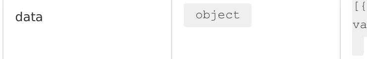


**示例**

**请求示例**

```text
GET /himarket/v1/open-api/v1/catalog/workers/{listingId}/files?version=sample-value HTT
P/1.1
Host: localhost:8080
Authorization: Bearer <accessToken>
```

**响应示例**

```json
{
  "code": "SUCCESS",
  "message": null,
  "data": {
    "files": [
      {
        "path": "sample-value",
        "size": 10
      }
    ]
  },
  "accessDeniedDetail": null,
  "requestId": "req-001"
}
```

<a id="section-3-19-5"></a>

### 3.19.5. listWorkerPackageVersions

**接口信息**

- **接口路径**： `GET /himarket/v1/open-api/v1/catalog/workers/{listingId}/versions`

- **接口说明**：查询已发布 Worker 包版本。

- **认证方式**：该接口属于开发者门户 API。调用前请完成开发者登录，并在请求 Header 中携带  `Authorization: Bearer <accessToken>` 。

- **Header 示例**：需要登录态的接口使用  `Authorization: Bearer <accessToken>` 。

**请求参数**

| 参数名称 | 位置 | 类型 | 是否必选 | 示例 | 说明 |
| --- | --- | --- | --- | --- | --- |
| listingId | path | <code>string</code> | 是 | <code>"listing-</code><br><code>001"</code> | Listing ID。 |

**返回数据**

| 参数名称 | 类型 | 示例 | 说明 |
| --- | --- | --- | --- |
| code | <code>string</code> | <code>SUCCESS</code> | 响应码，取值为<code> SUCCESS </code> 时表示请求成功。 |
| message | <code>string</code> | <code>null</code> | 响应消息。请求成功时通常为空。 |
| data | <code>array</code> | <code>[{"versionId":"ver</code><br><code>sion-</code><br><code>001","version":"samp</code><br><code>le-</code><br><code>value","status":"sam</code><br><code>ple-</code><br><code>value","updateTime":</code><br><code>1,"downloadCount":1,</code><br><code>"isLatest":true}]</code> | 响应数据。具体结构以接口语义为准。 |
| accessDeniedDetail | <code>object</code> | <code>null</code> | 鉴权失败详情。请求成功时通常为空。 |
| requestId | <code>string</code> | <code>req-001</code> | 请求 ID，可用于问题排查和日志检索。 |
| data\[\].versionId | <code>string</code> | <code>"version-001"</code> | 版本 ID。 |
| data\[\].version | <code>string</code> | <code>"sample-value"</code> | 版本号。 |
| data\[\].status | <code>string</code> | <code>"sample-value"</code> | 状态。 |
| data\[\].updateTime | <code>integer&lt;int64&gt;</code> | <code>1</code> | 更新时间。 |
| data\[\].downloadCount | <code>integer&lt;int64&gt;</code> | <code>1</code> | 下载次数。 |
| data\[\].isLatest | <code>boolean</code> | <code>true</code> | 是否为最新版本。 |

**示例**

**请求示例**

```http
GET /himarket/v1/open-api/v1/catalog/workers/{listingId}/versions HTTP/1.1
Host: localhost:8080
Authorization: Bearer <accessToken>
```

**响应示例**

```json
{
  "code": "SUCCESS",
  "message": null,
  "data": [
    {
      "versionId": "version-001",
      "version": "sample-value",
      "status": "sample-value",
      "updateTime": 1,
      "downloadCount": 1,
      "isLatest": true
    }
  ],
  "accessDeniedDetail": null,
  "requestId": "req-001"
}
```

<a id="section-3-20"></a>

## 3.20. oidc-controller

<a id="section-3-20-1"></a>

### 3.20.1. authorize

**接口信息**

- **接口路径**： `GET /himarket/v1/oidc/authorize`

- **接口说明**：发起授权authorize。

- **认证方式**：该接口属于开发者门户开放能力。是否需要登录态以接口实际返回为准；需要登录态时，请在请求 Header 中携带  `Authorization: Bearer <accessToken>` 。

- **Header 示例**：需要登录态的接口使用  `Authorization: Bearer <accessToken>` 。

**请求参数**

| 参数名称 | 位置 | 类型 | 是否必选 | 示例 | 说明 |
| --- | --- | --- | --- | --- | --- |
| provider | query | <code>string</code> | 是 | <code>"sample-</code><br><code>value"</code> | OIDC Provider标识。 |
| apiPrefix | query | <code>string</code> | 否 | <code>"/api/v1"</code> | apiPrefix 字段。 |
| origin | query | <code>string</code> | 否 | <code>"sample-</code><br><code>value"</code> | 来源标识。 |


**返回数据**

| 参数名称 | 类型 | 示例 | 说明 |
| --- | --- | --- | --- |
| code | <code>string</code> | <code>SUCCESS</code> | 响应码，取值为<code> SUCCESS </code> 时表示请求成功。 |
| message | <code>string</code> | <code>null</code> | 响应消息。请求成功时通常为空。 |
| data | <code>object</code> | <code>{"redirectUrl":"ht</code><br><code>tps://api.example.co</code><br><code>m"}</code> | 响应数据。具体结构以接口语义为准。 |
| accessDeniedDetail | <code>object</code> | <code>null</code> | 鉴权失败详情。请求成功时通常为空。 |
| requestId | <code>string</code> | <code>req-001</code> | 请求 ID，可用于问题排查和日志检索。 |
| data.redirectUrl | <code>string</code> | <code>"https://api.examp</code><br><code>le.com"</code> | 重定向地址。 |

**示例**

**请求示例**

```text
GET /himarket/v1/oidc/authorize?provider=sample-
value&apiPrefix=%2Fapi%2Fv1&origin=sample-value HTTP/1.1
Host: localhost:8080
Authorization: Bearer <accessToken>
```

**响应示例**

```json
{
  "code": "SUCCESS",
  "message": null,
  "data": {
    "redirectUrl": "https://api.example.com"
  },
  "accessDeniedDetail": null,
  "requestId": "req-001"
}
```

<a id="section-3-20-2"></a>

### 3.20.2. callback

**接口信息**

- **接口路径**： `GET /himarket/v1/oidc/callback`

- **接口说明**：处理回调callback。

- **认证方式**：该接口属于开发者门户开放能力。是否需要登录态以接口实际返回为准；需要登录态时，请在请求 Header 中携带  `Authorization: Bearer <accessToken>` 。

- **Header 示例**：需要登录态的接口使用  `Authorization: Bearer <accessToken>` 。

**请求参数**

| 参数名称 | 位置 | 类型 | 是否必选 | 示例 | 说明 |
| --- | --- | --- | --- | --- | --- |
| code | query | <code>string</code> | 是 | <code>"auth-</code><br><code>code-001"</code> | OIDC 授权码。 |
| state | query | <code>string</code> | 是 | <code>"sample-</code><br><code>value"</code> | OAuth/OIDC状态参数。 |
| origin | query | <code>string</code> | 否 | <code>"sample-</code><br><code>value"</code> | 来源标识。 |

**返回数据**

| 参数名称 | 类型 | 示例 | 说明 |
| --- | --- | --- | --- |
| code | <code>string</code> | <code>SUCCESS</code> | 响应码，取值为<code> SUCCESS </code> 时表示请求成功。 |
| message | <code>string</code> | <code>null</code> | 响应消息。请求成功时通常为空。 |
| data | <code>object</code> | <code>{"accessToken":"</code><br><code>&lt;token&gt;","tokenType"</code><br><code>:"</code><br><code>&lt;token&gt;","expiresIn"</code><br><code>:1}</code> | 响应数据。具体结构以接口语义为准。 |
| accessDeniedDetail | <code>object</code> | <code>null</code> | 鉴权失败详情。请求成功时通常为空。 |
| requestId | <code>string</code> | <code>req-001</code> | 请求 ID，可用于问题排查和日志检索。 |
| data.accessToken | <code>string</code> | <code>"&lt;token&gt;"</code> | 访问令牌。 |
| data.tokenType | <code>string</code> | <code>"&lt;token&gt;"</code> | Token 类型。 |
| data.expiresIn | <code>integer&lt;int64&gt;</code> | <code>1</code> | Token 有效期，单位为秒。 |

**示例**

**请求示例**

```http
GET /himarket/v1/oidc/callback?code=auth-code-001&state=sample-value&origin=sample-value HTTP/1.1
Host: localhost:8080
Authorization: Bearer <accessToken>
```

**响应示例**

```json
{
  "code": "SUCCESS",
  "message": null,
  "data": {
    "accessToken": "<token>",
    "tokenType": "<token>",
    "expiresIn": 1
  },
  "accessDeniedDetail": null,
  "requestId": "req-001"
}
```

<a id="section-3-20-3"></a>

### 3.20.3. getProviders

**接口信息**

- **接口路径**： `GET /himarket/v1/oidc/providers`

- **接口说明**：查询Provider。

- **认证方式**：该接口属于开发者门户开放能力。是否需要登录态以接口实际返回为准；需要登录态时，请在请求 Header 中携带  `Authorization: Bearer <accessToken>` 。

- **Header 示例**：需要登录态的接口使用  `Authorization: Bearer <accessToken>` 。

**请求参数**

无请求参数。

**返回数据**

| 参数名称 | 类型 | 示例 | 说明 |
| --- | --- | --- | --- |
| code | <code>string</code> | <code>SUCCESS</code> | 响应码，取值为<code> SUCCESS </code> 时表示请求成功。 |
| message | <code>string</code> | <code>null</code> | 响应消息。请求成功时通常为空。 |
| data | <code>array</code> | <code>[{"provider":"samp</code><br><code>le-</code><br><code>value","displayName"</code><code>:"</code>示例资源<code>"}] </code> | 响应数据。具体结构以接口语义为准。 |
| accessDeniedDetail | <code>object</code> | <code>null</code> | 鉴权失败详情。请求成功时通常为空。 |
| requestId | <code>string</code> | <code>req-001</code> | 请求 ID，可用于问题排查和日志检索。 |
| data\[\].provider | <code>string</code> | <code>"sample-value"</code> | OIDC Provider 标识。 |
| data\[\].displayName | <code>string</code> | <code> "</code>示例资源<code>" </code> | 展示名称。 |

**示例**

**请求示例**

```http
GET /himarket/v1/oidc/providers HTTP/1.1
Host: localhost:8080
Authorization: Bearer <accessToken>
```

**响应示例**

```json
{
  "code": "SUCCESS",
  "message": null,
  "data": [
    {
      "provider": "sample-value",
      "displayName": "示例资源"
    }
  ],
  "accessDeniedDetail": null,
  "requestId": "req-001"
}
```

<a id="section-3-21"></a>

## 3.21. 开发者管理

<a id="section-3-21-1"></a>

### 3.21.1. changeDeveloperPassword

**接口信息**

- **接口路径**： `PATCH /himarket/v1/developers/password`

- **接口说明**：开发者修改密码。

- **认证方式**：该接口属于开发者门户 API。调用前请完成开发者登录，并在请求 Header 中携带  `Authorization: Bearer <accessToken>` 。

- **Header 示例**：需要登录态的接口使用  `Authorization: Bearer <accessToken>` 。

**请求参数**

| 参数名称 | 位置 | 类型 | 是否必选 | 示例 | 说明 |
| --- | --- | --- | --- | --- | --- |
| oldPassword | body | <code>string</code> | 是 | <code>"</code><br><code>&lt;password&gt;"</code> | 旧密码。 |
| newPassword | body | <code>string</code> | 是 | <code>"</code><br><code>&lt;password&gt;"</code> | 新密码。 |


**返回数据**

| 参数名称 | 类型 | 示例 | 说明 |
| --- | --- | --- | --- |
| code | <code>string</code> | <code>SUCCESS</code> | 响应码，取值为<code> SUCCESS </code> 时表示请求成功。 |
| message | <code>string</code> | <code>null</code> | 响应消息。请求成功时通常为空。 |
| data | <code>object</code> | <code>null</code> | 响应数据。无返回内容时为 <code> null </code>。 |
| accessDeniedDetail | <code>object</code> | <code>null</code> | 鉴权失败详情。请求成功时通常为空。 |
| requestId | <code>string</code> | <code>req-001</code> | 请求 ID，可用于问题排查和日志检索。 |

**示例**

**请求示例**

```http
PATCH /himarket/v1/developers/password HTTP/1.1
Host: localhost:8080
Authorization: Bearer <accessToken>
Content-Type: application/json

{
  "oldPassword": "<password>",
  "newPassword": "<password>"
}
```

**响应示例**

```json
{
  "code": "SUCCESS",
  "message": null,
  "data": null,
  "accessDeniedDetail": null,
  "requestId": "req-001"
}
```

<a id="section-3-21-2"></a>

### 3.21.2. deleteDeveloper

**接口信息**

- **接口路径**： `DELETE /himarket/v1/developers/{developerId}`

- **接口说明**：删除 Developer 账号。

- **认证方式**：该接口属于开发者门户 API。调用前请完成开发者登录，并在请求 Header 中携带  `Authorization: Bearer <accessToken>` 。

- **Header 示例**：需要登录态的接口使用  `Authorization: Bearer <accessToken>` 。

**请求参数**

| 参数名称 | 位置 | 类型 | 是否必选 | 示例 | 说明 |
| --- | --- | --- | --- | --- | --- |
| developerId | path | <code>string</code> | 是 | <code>"developer</code><br><code>-001"</code> | 开发者ID。 |

**返回数据**

| 参数名称 | 类型 | 示例 | 说明 |
| --- | --- | --- | --- |
| code | <code>string</code> | <code>SUCCESS</code> | 响应码，取值为<code> SUCCESS </code> 时表示请求成功。 |
| message | <code>string</code> | <code>null</code> | 响应消息。请求成功时通常为空。 |
| data | <code>object</code> | <code>null</code> | 响应数据。无返回内容时为 <code> null </code>。 |
| accessDeniedDetail | <code>object</code> | <code>null</code> | 鉴权失败详情。请求成功时通常为空。 |
| requestId | <code>string</code> | <code>req-001</code> | 请求 ID，可用于问题排查和日志检索。 |

**示例**

**请求示例**

```http
DELETE /himarket/v1/developers/{developerId} HTTP/1.1
Host: localhost:8080
Authorization: Bearer <accessToken>
```

**响应示例**

```json
{
  "code": "SUCCESS",
  "message": null,
  "data": null,
  "accessDeniedDetail": null,
  "requestId": "req-001"
}
```

<a id="section-3-21-3"></a>

### 3.21.3. developerLogin

**接口信息**

- **接口路径**： `POST /himarket/v1/developers/login`

- **接口说明**：开发者登录。

- **认证方式**：该接口用于获取开发者访问令牌，调用时无需携带  `Authorization`  Header。

**请求参数**

| 参数名称 | 位置 | 类型 | 是否必选 | 示例 | 说明 |
| --- | --- | --- | --- | --- | --- |
| username | body | <code>string</code> | 是 | <code>"admin"</code> | 用户名。 |
| password | body | <code>string</code> | 是 | <code>"</code><br><code>&lt;password&gt;"</code> | 密码。 |


**返回数据**

| 参数名称 | 类型 | 示例 | 说明 |
| --- | --- | --- | --- |
| code | <code>string</code> | <code>SUCCESS</code> | 响应码，取值为<code> SUCCESS </code> 时表示请求成功。 |
| message | <code>string</code> | <code>null</code> | 响应消息。请求成功时通常为空。 |
| data | <code>object</code> | <code>{"accessToken":"</code><br><code>&lt;token&gt;","tokenType"</code><br><code>:"</code><br><code>&lt;token&gt;","expiresIn"</code><br><code>:1}</code> | 响应数据。具体结构以接口语义为准。 |
| accessDeniedDetail | <code>object</code> | <code>null</code> | 鉴权失败详情。请求成功时通常为空。 |
| requestId | <code>string</code> | <code>req-001</code> | 请求 ID，可用于问题排查和日志检索。 |
| data.accessToken | <code>string</code> | <code>"&lt;token&gt;"</code> | 访问令牌。 |
| data.tokenType | <code>string</code> | <code>"&lt;token&gt;"</code> | Token 类型。 |
| data.expiresIn | <code>integer&lt;int64&gt;</code> | <code>1</code> | Token 有效期，单位为秒。 |

**示例**

**请求示例**

```http
POST /himarket/v1/developers/login HTTP/1.1
Host: localhost:8080
Content-Type: application/json

{
  "username": "admin",
  "password": "<password>"
}
```

**响应示例**

```json
{
  "code": "SUCCESS",
  "message": null,
  "data": {
    "accessToken": "<token>",
    "tokenType": "<token>",
    "expiresIn": 1
  },
  "accessDeniedDetail": null,
  "requestId": "req-001"
}
```

<a id="section-3-21-4"></a>

### 3.21.4. developerLogout

**接口信息**

- **接口路径**： `POST /himarket/v1/developers/logout`

- **接口说明**：开发者登出。

- **认证方式**：该接口属于开发者门户 API。调用前请完成开发者登录，并在请求 Header 中携带  `Authorization: Bearer <accessToken>` 。

- **Header 示例**：需要登录态的接口使用  `Authorization: Bearer <accessToken>` 。

**请求参数**

无请求参数。

**返回数据**

| 参数名称 | 类型 | 示例 | 说明 |
| --- | --- | --- | --- |
| code | <code>string</code> | <code>SUCCESS</code> | 响应码，取值为<code> SUCCESS </code> 时表示请求成功。 |
| message | <code>string</code> | <code>null</code> | 响应消息。请求成功时通常为空。 |
| data | <code>object</code> | <code>null</code> | 响应数据。无返回内容时为 <code> null </code>。 |
| accessDeniedDetail | <code>object</code> | <code>null</code> | 鉴权失败详情。请求成功时通常为空。 |
| requestId | <code>string</code> | <code>req-001</code> | 请求 ID，可用于问题排查和日志检索。 |

**示例请求示例**

```http
POST /himarket/v1/developers/logout HTTP/1.1
Host: localhost:8080
Authorization: Bearer <accessToken>
```

**响应示例**

```json
{
  "code": "SUCCESS",
  "message": null,
  "data": null,
  "accessDeniedDetail": null,
  "requestId": "req-001"
}
```

<a id="section-3-21-5"></a>

### 3.21.5. getCurrentDeveloperInfo

**接口信息**

- **接口路径**： `GET /himarket/v1/developers/profile`

- **接口说明**：获取当前开发者信息。

- **认证方式**：该接口属于开发者门户 API。调用前请完成开发者登录，并在请求 Header 中携带  `Authorization: Bearer <accessToken>` 。

- **Header 示例**：需要登录态的接口使用  `Authorization: Bearer <accessToken>` 。

**请求参数**

无请求参数。

**返回数据**

| 参数名称 | 类型 | 示例 | 说明 |
| --- | --- | --- | --- |
| code | <code>string</code> | <code>SUCCESS</code> | 响应码，取值为<code> SUCCESS </code> 时表示请求成功。 |
| message | <code>string</code> | <code>null</code> | 响应消息。请求成功时通常为空。 |
| data | <code>object</code> | <code>{"developerId":"de</code><br><code>veloper-</code><br><code>001","portalId":"por</code><br><code>tal-</code><br><code>001","username":"adm</code><br><code>in","status":"sample</code><br><code>-</code><br><code>value","avatarUrl":"</code><br><code>https://api.example.</code><br><code>com","createdAt":"20</code><br><code>26-06-</code><br><code>22T12:00:00Z"}</code> | 响应数据。具体结构以接口语义为准。 |
| accessDeniedDetail | <code>object</code> | <code>null</code> | 鉴权失败详情。请求成功时通常为空。 |
| requestId | <code>string</code> | <code>req-001</code> | 请求 ID，可用于问题排查和日志检索。 |
| data.developerId | <code>string</code> | <code>"developer-001"</code> | 开发者ID。 |
| data.portalId | <code>string</code> | <code>"portal-001"</code> | 门户ID。 |
| data.username | <code>string</code> | <code>"admin"</code> | 用户名。 |
| data.status | <code>string</code> | <code>"sample-value"</code> | 状态。 |
| data.avatarUrl | <code>string</code> | <code>"https://api.examp</code><br><code>le.com"</code> | 头像地址。 |
| data.createdAt | <code>string&lt;date-</code><br><code>time&gt;</code> | <code>"2026-06-</code><br><code>22T12:00:00Z"</code> | 创建时间。 |

**示例**

**请求示例**

```http
GET /himarket/v1/developers/profile HTTP/1.1
Host: localhost:8080
Authorization: Bearer <accessToken>
```

**响应示例**

```json
{
  "code": "SUCCESS",
  "message": null,
  "data": {
    "developerId": "developer-001",
    "portalId": "portal-001",
    "username": "admin",
    "status": "sample-value",
    "avatarUrl": "https://api.example.com",
    "createdAt": "2026-06-22T12:00:00Z"
  },
  "accessDeniedDetail": null,
  "requestId": "req-001"
}
```

<a id="section-3-21-6"></a>

### 3.21.6. listDevelopers

**接口信息**

- **接口路径**： `GET /himarket/v1/developers`

- **接口说明**：获取门户的开发者列表。

- **认证方式**：该接口属于开发者门户 API。调用前请完成开发者登录，并在请求 Header 中携带  `Authorization: Bearer <accessToken>` 。

- **Header 示例**：需要登录态的接口使用  `Authorization: Bearer <accessToken>` 。

**请求参数**

| 参数名称 | 位置 | 类型 | 是否必选 | 示例 | 说明 |
| --- | --- | --- | --- | --- | --- |
| portalId | query | <code>string</code> | 否 | <code>"portal-</code><br><code>001"</code> | 门户ID。 |
| username | query | <code>string</code> | 否 | <code>"admin"</code> | 用户名。 |
| status | query | <code>string</code> | 否 | <code>"APPROVED"</code> | 状态。 |
| page | query | <code>integer&lt;in</code><br><code>t32&gt;</code> | 否 | <code>1</code> | 页码。 |
| size | query | <code>integer&lt;in</code><br><code>t32&gt;</code> | 否 | <code>10</code> | 每页记录数。 |


<table>
  <tr>
    <td>sort</td>
    <td>query</td>
    <td><code>array</code></td>
    <td>否</td>
    <td><code>["sample-</code><br><code>value"]</code></td>
    <td>排序条件。</td>
  </tr>
</table>

**返回数据**

| 参数名称 | 类型 | 示例 | 说明 |
| --- | --- | --- | --- |
| code | <code>string</code> | <code>SUCCESS</code> | 响应码，取值为<code> SUCCESS </code> 时表示请求成功。 |
| message | <code>string</code> | <code>null</code> | 响应消息。请求成功时通常为空。 |
| data | <code>object</code> | <code>{"content":</code><br><code>[{}],"pageNumber":1,</code><br><code>"pageSize":10,"total</code><br><code>Count":1}</code> | 响应数据。具体结构以接口语义为准。 |
| accessDeniedDetail | <code>object</code> | <code>null</code> | 鉴权失败详情。请求成功时通常为空。 |
| requestId | <code>string</code> | <code>req-001</code> | 请求 ID，可用于问题排查和日志检索。 |
| data.content | <code>array</code> | <code>[{"developerId":"d</code><br><code>eveloper-</code><br><code>001","portalId":"por</code><br><code>tal-</code><br><code>001","username":"adm</code><br><code>in","status":"sample</code><br><code>-</code><br><code>value","avatarUrl":"</code><br><code>https://api.example.</code><br><code>com","createdAt":"20</code><br><code>26-06-</code><br><code>22T12:00:00Z"}]</code> | 分页结果列表。 |
| data.content\[\].develop erId | <code>string</code> | <code>"developer-001"</code> | 开发者ID。 |
| data.content\[\].portalId | <code>string</code> | <code>"portal-001"</code> | 门户ID。 |
| data.content\[\].userna me | <code>string</code> | <code>"admin"</code> | 用户名。 |
| data.content\[\].status | <code>string</code> | <code>"sample-value"</code> | 状态。 |
| data.content\[\].avatarU rl | <code>string</code> | <code>"https://api.examp</code><br><code>le.com"</code> | 头像地址。 |
| data.content\[\].created At | <code>string&lt;date-</code><br><code>time&gt;</code> | <code>"2026-06-</code><br><code>22T12:00:00Z"</code> | 创建时间。 |
| data.pageNumber | <code>integer&lt;int32&gt;</code> | <code>1</code> | 当前页码。 |
| data.pageSize | <code>integer&lt;int32&gt;</code> | <code>10</code> | 每页大小。 |
| data.totalCount | <code>integer&lt;int64&gt;</code> | <code>1</code> | 总记录数。 |

**示例**

**请求示例**

```text
GET /himarket/v1/developers?portalId=portal-
001&username=admin&status=APPROVED&page=1&size=10&sort=sample-value HTTP/1.1
Host: localhost:8080
Authorization: Bearer <accessToken>
```

**响应示例**

```json
{
  "code": "SUCCESS",
  "message": null,
  "data": {
    "content": [
      {}
    ],
    "pageNumber": 1,
    "pageSize": 10,
    "totalCount": 1
  },
  "accessDeniedDetail": null,
  "requestId": "req-001"
}
```

<a id="section-3-21-7"></a>

### 3.21.7. register

**接口信息**

- **接口路径**： `POST /himarket/v1/developers`

- **接口说明**：开发者注册。

- **认证方式**：该接口用于注册开发者账号，调用时无需携带  `Authorization`  Header。

**请求参数**

| 参数名称 | 位置 | 类型 | 是否必选 | 示例 | 说明 |
| --- | --- | --- | --- | --- | --- |
| username | body | <code>string</code> | 是 | <code>"admin"</code> | 用户名。 |
| password | body | <code>string</code> | 是 | <code>"</code><br><code>&lt;password&gt;"</code> | 密码。 |
| avatarUrl | body | <code>string</code> | 否 | <code>"https://a</code><br><code>pi.example.c</code><br><code>om"</code> | 头像地址。 |


**返回数据**

| 参数名称 | 类型 | 示例 | 说明 |
| --- | --- | --- | --- |
| code | <code>string</code> | <code>SUCCESS</code> | 响应码，取值为<code> SUCCESS </code> 时表示请求成功。 |
| message | <code>string</code> | <code>null</code> | 响应消息。请求成功时通常为空。 |
| data | <code>object</code> | <code>{"developerId":"de</code><br><code>veloper-</code><br><code>001","portalId":"por</code><br><code>tal-</code><br><code>001","username":"adm</code><br><code>in","status":"sample</code><br><code>-</code><br><code>value","avatarUrl":"</code><br><code>https://api.example.</code><br><code>com","createdAt":"20</code><br><code>26-06-</code><br><code>22T12:00:00Z"}</code> | 响应数据。具体结构以接口语义为准。 |
| accessDeniedDetail | <code>object</code> | <code>null</code> | 鉴权失败详情。请求成功时通常为空。 |
| requestId | <code>string</code> | <code>req-001</code> | 请求 ID，可用于问题排查和日志检索。 |
| data.developerId | <code>string</code> | <code>"developer-001"</code> | 开发者ID。 |
| data.portalId | <code>string</code> | <code>"portal-001"</code> | 门户ID。 |
| data.username | <code>string</code> | <code>"admin"</code> | 用户名。 |
| data.status | <code>string</code> | <code>"sample-value"</code> | 状态。 |
| data.avatarUrl | <code>string</code> | <code>"https://api.examp</code><br><code>le.com"</code> | 头像地址。 |
| data.createdAt | <code>string&lt;date-</code><br><code>time&gt;</code> | <code>"2026-06-</code><br><code>22T12:00:00Z"</code> | 创建时间。 |

**示例**

**请求示例**

```http
POST /himarket/v1/developers HTTP/1.1
Host: localhost:8080
Content-Type: application/json

{
  "username": "admin",
  "password": "<password>",
  "avatarUrl": "https://api.example.com"
}
```

**响应示例**

```json
{
  "code": "SUCCESS",
  "message": null,
  "data": {
    "developerId": "developer-001",
    "portalId": "portal-001",
    "username": "admin",
    "status": "sample-value",
    "avatarUrl": "https://api.example.com",
    "createdAt": "2026-06-22T12:00:00Z"
  },
  "accessDeniedDetail": null,
  "requestId": "req-001"
}
```

<a id="section-3-21-8"></a>

### 3.21.8. setDeveloperStatus

**接口信息**

- **接口路径**： `PATCH /himarket/v1/developers/{developerId}/status`

- **接口说明**：设置开发者状态。

- **认证方式**：该接口属于开发者门户 API。调用前请完成开发者登录，并在请求 Header 中携带  `Authorization: Bearer <accessToken>` 。

- **Header 示例**：需要登录态的接口使用  `Authorization: Bearer <accessToken>` 。

**请求参数**

| 参数名称 | 位置 | 类型 | 是否必选 | 示例 | 说明 |
| --- | --- | --- | --- | --- | --- |
| developerId | path | <code>string</code> | 是 | <code>"developer</code><br><code>-001"</code> | 开发者ID。 |
| portalId | body | <code>string</code> | 否 | <code>"portal-</code><br><code>001"</code> | 门户ID。 |
| status | body | <code>string</code> | 是 | <code>"APPROVED"</code> | 状态。 |


**返回数据**

| 参数名称 | 类型 | 示例 | 说明 |
| --- | --- | --- | --- |
| code | <code>string</code> | <code>SUCCESS</code> | 响应码，取值为<code> SUCCESS </code> 时表示请求成功。 |
| message | <code>string</code> | <code>null</code> | 响应消息。请求成功时通常为空。 |
| data | <code>object</code> | <code>null</code> | 响应数据。无返回内容时为 <code> null </code>。 |
| accessDeniedDetail | <code>object</code> | <code>null</code> | 鉴权失败详情。请求成功时通常为空。 |
| requestId | <code>string</code> | <code>req-001</code> | 请求 ID，可用于问题排查和日志检索。 |

**示例**

**请求示例**

```http
PATCH /himarket/v1/developers/{developerId}/status HTTP/1.1
Host: localhost:8080
Authorization: Bearer <accessToken>
Content-Type: application/json

{
  "portalId": "portal-001",
  "status": "APPROVED"
}
```

**响应示例**

```json
{
  "code": "SUCCESS",
  "message": null,
  "data": null,
  "accessDeniedDetail": null,
  "requestId": "req-001"
}
```

<a id="section-3-21-9"></a>

### 3.21.9. updateDeveloperProfile

**接口信息**

- **接口路径**： `PUT /himarket/v1/developers/profile`

- **接口说明**：开发者更新个人信息。

- **认证方式**：该接口属于开发者门户 API。调用前请完成开发者登录，并在请求 Header 中携带  `Authorization: Bearer <accessToken>` 。

- **Header 示例**：需要登录态的接口使用  `Authorization: Bearer <accessToken>` 。

**请求参数**

| 参数名称 | 位置 | 类型 | 是否必选 | 示例 | 说明 |
| --- | --- | --- | --- | --- | --- |
| username | body | <code>string</code> | 否 | <code>"admin"</code> | 用户名。 |
| email | body | <code>string</code> | 否 | <code>"user@exam</code><br><code>ple.com"</code> | 邮箱。 |
| avatarUrl | body | <code>string</code> | 否 | <code>"https://a</code><br><code>pi.example.c</code><br><code>om"</code> | 头像地址。 |

**返回数据**

| 参数名称 | 类型 | 示例 | 说明 |
| --- | --- | --- | --- |
| code | <code>string</code> | <code>SUCCESS</code> | 响应码，取值为<code> SUCCESS </code> 时表示请求成功。 |
| message | <code>string</code> | <code>null</code> | 响应消息。请求成功时通常为空。 |
| data | <code>object</code> | <code>null</code> | 响应数据。无返回内容时为 <code> null </code>。 |
| accessDeniedDetail | <code>object</code> | <code>null</code> | 鉴权失败详情。请求成功时通常为空。 |
| requestId | <code>string</code> | <code>req-001</code> | 请求 ID，可用于问题排查和日志检索。 |

**示例**

**请求示例**

```http
PUT /himarket/v1/developers/profile HTTP/1.1
Host: localhost:8080
Authorization: Bearer <accessToken>
Content-Type: application/json

{
  "username": "admin",
  "email": "user@example.com",
  "avatarUrl": "https://api.example.com"
}
```

**响应示例**

```json
{
  "code": "SUCCESS",
  "message": null,
  "data": null,
  "accessDeniedDetail": null,
  "requestId": "req-001"
}
```

<a id="section-3-22"></a>

## 3.22. 网关资源管理

<a id="section-3-22-1"></a>

### 3.22.1. deleteGateway

**接口信息**

- **接口路径**： `DELETE /himarket/v1/gateways/{gatewayId}`

- **接口说明**：删除 Gateway。

- **认证方式**：该接口属于管理面 OpenAPI。调用前请完成 OpenAPI 凭证配置，并按 Token 模式或AK/SK 签名模式携带认证 Header。

- **Header 示例**：Token 模式使用  `X-HIMARKET-OPENAPI: HIMARKET_OPENAPI`  与  `X-HIMARKET-TOKEN` ；AK/SK 模式使用  `X-HIMARKET-ACCESS-KEY` 、 `X-HIMARKET-TIMESTAMP`  和  `X-HIMARKET-SIGNATURE` 。

**请求参数**

| 参数名称 | 位置 | 类型 | 是否必选 | 示例 | 说明 |
| --- | --- | --- | --- | --- | --- |
| gatewayId | path | <code>string</code> | 是 | <code>"gateway-</code><br><code>001"</code> | Gateway ID。 |

**返回数据**

| 参数名称 | 类型 | 示例 | 说明 |
| --- | --- | --- | --- |
| code | <code>string</code> | <code>SUCCESS</code> | 响应码，取值为<code> SUCCESS </code> 时表示请求成功。 |
| message | <code>string</code> | <code>null</code> | 响应消息。请求成功时通常为空。 |
| data | <code>object</code> | <code>null</code> | 响应数据。无返回内容时为 <code> null </code>。 |
| accessDeniedDetail | <code>object</code> | <code>null</code> | 鉴权失败详情。请求成功时通常为空。 |
| requestId | <code>string</code> | <code>req-001</code> | 请求 ID，可用于问题排查和日志检索。 |

**示例**

**请求示例**

```http
DELETE /himarket/v1/gateways/{gatewayId} HTTP/1.1
Host: localhost:8080
X-HIMARKET-OPENAPI: HIMARKET_OPENAPI
X-HIMARKET-TOKEN: <admin-openapi-token>
```

**响应示例**

```json
{
  "code": "SUCCESS",
  "message": null,
  "data": null,
  "accessDeniedDetail": null,
  "requestId": "req-001"
}
```

<a id="section-3-22-2"></a>

### 3.22.2. fetchAdpGateways

**接口信息**

- **接口路径**： `POST /himarket/v1/gateways/adp`

- **接口说明**：获取ADP AI Gateway 列表。

- **认证方式**：该接口属于管理面 OpenAPI。调用前请完成 OpenAPI 凭证配置，并按 Token 模式或AK/SK 签名模式携带认证 Header。

- **Header 示例**：Token 模式使用  `X-HIMARKET-OPENAPI: HIMARKET_OPENAPI`  与  `X-HIMARKET-TOKEN` ；AK/SK 模式使用  `X-HIMARKET-ACCESS-KEY` 、 `X-HIMARKET-TIMESTAMP`  和  `X-HIMARKET-SIGNATURE` 。

**请求参数**

| 参数名称 | 位置 | 类型 | 是否必选 | 示例 | 说明 |
| --- | --- | --- | --- | --- | --- |
| page | query | <code>integer&lt;in</code><br><code>t32&gt;</code> | 否 | <code>1</code> | 页码。 |
| size | query | <code>integer&lt;in</code><br><code>t32&gt;</code> | 否 | <code>500</code> | 每页记录数。 |
| baseUrl | body | <code>string</code> | 是 | <code>"https://a</code><br><code>pi.example.c</code><br><code>om"</code> | 服务基础地址。 |
| port | body | <code>integer&lt;in</code><br><code>t32&gt;</code> | 是 | <code>8080</code> | 端口号。 |
| authSeed | body | <code>string</code> | 否 | <code>"sample-</code><br><code>value"</code> | 认证种子配置。 |
| authType | body | <code>string</code> | 否 | <code>"sample-</code><br><code>value"</code> | authType 字段。 |
| authHeaders | body | <code>array</code> | 否 | <code>[{"key":"s</code><br><code>ample-</code><br><code>value","valu</code><br><code>e":"sample-</code><br><code>value"}]</code> | authHeaders字段。 |
| authHeaders\[\].key | body | <code>string</code> | 否 | <code>"sample-</code><br><code>value"</code> | 配置键。 |
| authHeaders\[\].value | body | <code>string</code> | 否 | <code>"sample-</code><br><code>value"</code> | value 字段。 |

**返回数据**

| 参数名称 | 类型 | 示例 | 说明 |
| --- | --- | --- | --- |
| code | <code>string</code> | <code>SUCCESS</code> | 响应码，取值为<code> SUCCESS </code> 时表示请求成功。 |
| message | <code>string</code> | <code>null</code> | 响应消息。请求成功时通常为空。 |
| data | <code>object</code> | <code>{"content":</code><br><code>[{}],"pageNumber":1,</code><br><code>"pageSize":10,"total</code><br><code>Count":1}</code> | 响应数据。具体结构以接口语义为准。 |
| accessDeniedDetail | <code>object</code> | <code>null</code> | 鉴权失败详情。请求成功时通常为空。 |
| requestId | <code>string</code> | <code>req-001</code> | 请求 ID，可用于问题排查和日志检索。 |
| data.content | <code>array</code> | <code>[{"gatewayId":"gat</code><br><code>eway-</code><br><code>001","gatewayType":"</code><br><code>APIG_API","gatewayNa</code><br><code>me":"sample-</code><br><code>gateway","apigConfig</code><br><code>":</code><br><code>{},"adpAIGatewayConf</code><br><code>ig":</code><br><code>{},"apsaraGatewayCon</code><br><code>fig":{}}]</code> | 分页结果列表。 |
| data.content\[\].gatewa yId | <code>string</code> | <code>"gateway-001"</code> | Gateway ID。 |
| data.content\[\].gatewa yType | <code>string</code> | <code>"APIG_API"</code> | Gateway 类型。 |
| data.content\[\].gatewa yName | <code>string</code> | <code>"sample-gateway"</code> | Gateway 名称。 |
| data.content\[\].apigCon fig | <code>object</code> | <code>{"region":"sample-</code><br><code>value"}</code> | APIG 配置。 |
| data.content\[\].apigCon fig.region | <code>string</code> | <code>"sample-value"</code> | 地域。 |
| data.content\[\].adpAIG atewayConfig | <code>object</code> | <code>{"baseUrl":"https:</code><br><code>//api.example.com","</code><br><code>port":8080,"authSeed</code><br><code>":"sample-value"}</code> | ADP AI Gateway 配置。 |
| data.content\[\].adpAIG atewayConfig.baseUrl | <code>string</code> | <code>"https://api.examp</code><br><code>le.com"</code> | 服务基础地址。 |
| data.content\[\].adpAIG atewayConfig.port | <code>integer&lt;int32&gt;</code> | <code>8080</code> | 端口号。 |
| data.content\[\].adpAIG atewayConfig.authSee d | <code>string</code> | <code>"sample-value"</code> | 认证种子配置。 |
| data.content\[\].apsara GatewayConfig | <code>object</code> | <code>{"regionId":"regio</code><br><code>n-</code><br><code>001","domain":"api.e</code><br><code>xample.com","product</code><br><code>":"sample-</code><br><code>value","version":"sa</code><br><code>mple-</code><br><code>value","xacsRoleId":</code><br><code>"xacsRole-</code><br><code>001","xacsOrganizati</code><br><code>onId":"xacsOrganizat</code><br><code>ion-001"}</code> | Apsara Gateway 配置。 |
| data.content\[\].apsara GatewayConfig.regionI d | <code>string</code> | <code>"region-001"</code> | 地域 ID。 |
| data.content\[\].apsara GatewayConfig.domai n | <code>string</code> | <code>"api.example.com"</code> | 域名。 |
| data.content\[\].apsara GatewayConfig.produc t | <code>string</code> | <code>"sample-value"</code> | 云产品名称。 |
| data.content\[\].apsara GatewayConfig.version | <code>string</code> | <code>"sample-value"</code> | 版本号。 |

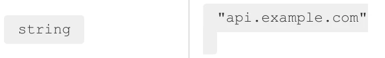

<table>
  <tr>
    <td>data.content[].apsara GatewayConfig.xacsRo leId</td>
    <td><code>string</code></td>
    <td><code>"xacsRole-001"</code></td>
    <td>X-ACS-RoleId 请求头取值。</td>
  </tr>
  <tr>
    <td>data.content[].apsara GatewayConfig.xacsOr ganizationId</td>
    <td><code>string</code></td>
    <td><code>"xacsOrganization-</code><br><code>001"</code></td>
    <td>X-ACS-OrganizationId请求头取值。</td>
  </tr>
  <tr>
    <td>data.content[].apsara GatewayConfig.xacsCa llerSdkSource</td>
    <td><code>string</code></td>
    <td><code>"sample-value"</code></td>
    <td>X-ACS-Caller-Sdk-Source 请求头取值。</td>
  </tr>
  <tr>
    <td>data.content[].apsara GatewayConfig.xacsRe sourceGroupId</td>
    <td><code>string</code></td>
    <td><code>"xacsResourceGroup</code><br><code>-001"</code></td>
    <td>X-ACS-ResourceGroupId 请求头取值。</td>
  </tr>
  <tr>
    <td>data.content[].apsara GatewayConfig.xacsCa llerType</td>
    <td><code>string</code></td>
    <td><code>"sample-value"</code></td>
    <td>X-ACS-Caller-Type 请求头取值。</td>
  </tr>
  <tr>
    <td>data.content[].higress Config</td>
    <td><code>object</code></td>
    <td><code>{"address":"sample</code><br><code>-</code><br><code>value","username":"a</code><br><code>dmin","gatewayAddres</code><br><code>s":"sample-</code><br><code>value"}</code></td>
    <td>Higress 配置。</td>
  </tr>
  <tr>
    <td>data.content[].higress Config.address</td>
    <td><code>string</code></td>
    <td><code>"sample-value"</code></td>
    <td>访问地址。</td>
  </tr>
  <tr>
    <td>data.content[].higress Config.username</td>
    <td><code>string</code></td>
    <td><code>"admin"</code></td>
    <td>用户名。</td>
  </tr>
  <tr>
    <td>data.content[].higress Config.gatewayAddres s</td>
    <td><code>string</code></td>
    <td><code>"sample-value"</code></td>
    <td>Gateway 访问地址。</td>
  </tr>
  <tr>
    <td>data.content[].created At</td>
    <td><code>string&lt;date-</code><br><code>time&gt;</code></td>
    <td><code>"2026-06-</code><br><code>22T12:00:00Z"</code></td>
    <td>创建时间。</td>
  </tr>
  <tr>
    <td>data.pageNumber</td>
    <td><code>integer&lt;int32&gt;</code></td>
    <td><code>1</code></td>
    <td>当前页码。</td>
  </tr>
  <tr>
    <td>data.pageSize</td>
    <td><code>integer&lt;int32&gt;</code></td>
    <td><code>10</code></td>
    <td>每页大小。</td>
  </tr>
  <tr>
    <td>data.totalCount</td>
    <td><code>integer&lt;int64&gt;</code></td>
    <td><code>1</code></td>
    <td>总记录数。</td>
  </tr>
</table>

**示例**

**请求示例**

```http
POST /himarket/v1/gateways/adp?page=1&size=500 HTTP/1.1
Host: localhost:8080
X-HIMARKET-OPENAPI: HIMARKET_OPENAPI
X-HIMARKET-TOKEN: <admin-openapi-token>
Content-Type: application/json

{
  "baseUrl": "https://api.example.com",
  "port": 8080,
  "authSeed": "sample-value",
  "authType": "sample-value",
  "authHeaders": [
    {}
  ]
}
```

**响应示例**

```json
{
  "code": "SUCCESS",
  "message": null,
  "data": {
    "content": [
      {}
    ],
    "pageNumber": 1,
    "pageSize": 10,
    "totalCount": 1
  },
  "accessDeniedDetail": null,
  "requestId": "req-001"
}
```

<a id="section-3-22-3"></a>

### 3.22.3. fetchAgentAPIs

**接口信息**

- **接口路径**： `GET /himarket/v1/gateways/{gatewayId}/agent-apis`

- **接口说明**：获取Agent API 列表。

- **认证方式**：该接口属于管理面 OpenAPI。调用前请完成 OpenAPI 凭证配置，并按 Token 模式或AK/SK 签名模式携带认证 Header。

- **Header 示例**：Token 模式使用  `X-HIMARKET-OPENAPI: HIMARKET_OPENAPI`  与  `X-HIMARKET-TOKEN` ；AK/SK 模式使用  `X-HIMARKET-ACCESS-KEY` 、 `X-HIMARKET-TIMESTAMP`  和  `X-HIMARKET-SIGNATURE` 。

**请求参数**

| 参数名称 | 位置 | 类型 | 是否必选 | 示例 | 说明 |
| --- | --- | --- | --- | --- | --- |
| gatewayId | path | <code>string</code> | 是 | <code>"gateway-</code><br><code>001"</code> | Gateway ID。 |
| page | query | <code>integer&lt;in</code><br><code>t32&gt;</code> | 否 | <code>1</code> | 页码。 |
| size | query | <code>integer&lt;in</code><br><code>t32&gt;</code> | 否 | <code>500</code> | 每页记录数。 |

**返回数据**

| 参数名称 | 类型 | 示例 | 说明 |
| --- | --- | --- | --- |
| code | <code>string</code> | <code>SUCCESS</code> | 响应码，取值为<code> SUCCESS </code> 时表示请求成功。 |
| message | <code>string</code> | <code>null</code> | 响应消息。请求成功时通常为空。 |
| data | <code>object</code> | <code>{"content":</code><br><code>[{}],"pageNumber":1,</code><br><code>"pageSize":10,"total</code><br><code>Count":1}</code> | 响应数据。具体结构以接口语义为准。 |
| accessDeniedDetail | <code>object</code> | <code>null</code> | 鉴权失败详情。请求成功时通常为空。 |
| requestId | <code>string</code> | <code>req-001</code> | 请求 ID，可用于问题排查和日志检索。 |
| data.content | <code>array</code> | <code>[{"agentApiId":"ag</code><br><code>entApi-</code><br><code>001","agentApiName":</code><br><code>"demo-agentapi"}]</code> | 分页结果列表。 |
| data.content\[\].agentA piId | <code>string</code> | <code>"agentApi-001"</code> | Agent API ID。 |
| data.content\[\].agentA piName | <code>string</code> | <code>"demo-agentapi"</code> | Agent API 名称。 |
| data.pageNumber | <code>integer&lt;int32&gt;</code> | <code>1</code> | 当前页码。 |
| data.pageSize | <code>integer&lt;int32&gt;</code> | <code>10</code> | 每页大小。 |
| data.totalCount | <code>integer&lt;int64&gt;</code> | <code>1</code> | 总记录数。 |

**示例**

**请求示例**

```http
GET /himarket/v1/gateways/{gatewayId}/agent-apis?page=1&size=500 HTTP/1.1
Host: localhost:8080
X-HIMARKET-OPENAPI: HIMARKET_OPENAPI
X-HIMARKET-TOKEN: <admin-openapi-token>
```

**响应示例**

```json
{
  "code": "SUCCESS",
  "message": null,
  "data": {
    "content": [
      {}
    ],
    "pageNumber": 1,
    "pageSize": 10,
    "totalCount": 1
  },
  "accessDeniedDetail": null,
  "requestId": "req-001"
}
```

<a id="section-3-22-4"></a>

### 3.22.4. fetchApsaraGateways

**接口信息接口信息**

- **接口路径**： `POST /himarket/v1/gateways/apsara`

- **接口说明**：获取Apsara Gateway 列表。

- **认证方式**：该接口属于管理面 OpenAPI。调用前请完成 OpenAPI 凭证配置，并按 Token 模式或AK/SK 签名模式携带认证 Header。

- **Header 示例**：Token 模式使用  `X-HIMARKET-OPENAPI: HIMARKET_OPENAPI`  与  `X-HIMARKET-TOKEN` ；AK/SK 模式使用  `X-HIMARKET-ACCESS-KEY` 、 `X-HIMARKET-TIMESTAMP`  和  `X-HIMARKET-SIGNATURE` 。

**请求参数**

| 参数名称 | 位置 | 类型 | 是否必选 | 示例 | 说明 |
| --- | --- | --- | --- | --- | --- |
| page | query | <code>integer&lt;in</code><br><code>t32&gt;</code> | 否 | <code>1</code> | 页码。 |
| size | query | <code>integer&lt;in</code><br><code>t32&gt;</code> | 否 | <code>500</code> | 每页记录数。 |
| regionId | body | <code>string</code> | 是 | <code>"region-</code><br><code>001"</code> | 地域 ID。 |
| accessKeyId | body | <code>string</code> | 是 | <code>"accessKey</code><br><code>-001"</code> | AccessKey ID。 |
| accessKeySec ret | body | <code>string</code> | 是 | <code>"sample-</code><br><code>value"</code> | accessKeySec ret 字段。 |
| securityToken | body | <code>string</code> | 否 | <code>"</code><br><code>&lt;token&gt;"</code> | securityToken字段。 |
| domain | body | <code>string</code> | 是 | <code>"api.examp</code><br><code>le.com"</code> | 域名。 |
| product | body | <code>string</code> | 是 | <code>"sample-</code><br><code>value"</code> | 云产品名称。 |
| version | body | <code>string</code> | 是 | <code>"sample-</code><br><code>value"</code> | 版本号。 |
| xAcsOrganiza tionId | body | <code>string</code> | 是 | <code>"xAcsOrgan</code><br><code>ization-</code><br><code>001"</code> | xAcsOrganiza tionId 字段。 |
| xAcsCallerSdk Source | body | <code>string</code> | 否 | <code>"sample-</code><br><code>value"</code> | xAcsCallerSdk Source 字段。 |
| xAcsResource GroupId | body | <code>string</code> | 否 | <code>"xAcsResou</code><br><code>rceGroup-</code><br><code>001"</code> | xAcsResource GroupId 字段。 |
| xAcsCallerTyp e | body | <code>string</code> | 否 | <code>"sample-</code><br><code>value"</code> | xAcsCallerTyp e 字段。 |
| brokerEngine Type | body | <code>string</code> | 否 | <code>"sample-</code><br><code>value"</code> | brokerEngine Type 字段。 |

**返回数据**

| 参数名称 | 类型 | 示例 | 说明 |
| --- | --- | --- | --- |
| code | <code>string</code> | <code>SUCCESS</code> | 响应码，取值为<code> SUCCESS </code> 时表示请求成功。 |
| message | <code>string</code> | <code>null</code> | 响应消息。请求成功时通常为空。 |
| data | <code>object</code> | <code>{"content":</code><br><code>[{}],"pageNumber":1,</code><br><code>"pageSize":10,"total</code><br><code>Count":1}</code> | 响应数据。具体结构以接口语义为准。 |
| accessDeniedDetail | <code>object</code> | <code>null</code> | 鉴权失败详情。请求成功时通常为空。 |
| requestId | <code>string</code> | <code>req-001</code> | 请求 ID，可用于问题排查和日志检索。 |
| data.content | <code>array</code> | <code>[{"gatewayId":"gat</code><br><code>eway-</code><br><code>001","gatewayType":"</code><br><code>APIG_API","gatewayNa</code><br><code>me":"sample-</code><br><code>gateway","apigConfig</code><br><code>":</code><br><code>{},"adpAIGatewayConf</code><br><code>ig":</code><br><code>{},"apsaraGatewayCon</code><br><code>fig":{}}]</code> | 分页结果列表。 |
| data.content\[\].gatewa yId | <code>string</code> | <code>"gateway-001"</code> | Gateway ID。 |
| data.content\[\].gatewa yType | <code>string</code> | <code>"APIG_API"</code> | Gateway 类型。 |
| data.content\[\].gatewa yName | <code>string</code> | <code>"sample-gateway"</code> | Gateway 名称。 |
| data.content\[\].apigCon fig | <code>object</code> | <code>{"region":"sample-</code><br><code>value"}</code> | APIG 配置。 |
| data.content\[\].apigCon fig.region | <code>string</code> | <code>"sample-value"</code> | 地域。 |
| data.content\[\].adpAIG atewayConfig | <code>object</code> | <code>{"baseUrl":"https:</code><br><code>//api.example.com","</code><br><code>port":8080,"authSeed</code><br><code>":"sample-value"}</code> | ADP AI Gateway 配置。 |
| data.content\[\].adpAIG atewayConfig.baseUrl | <code>string</code> | <code>"https://api.examp</code><br><code>le.com"</code> | 服务基础地址。 |
| data.content\[\].adpAIG atewayConfig.port | <code>integer&lt;int32&gt;</code> | <code>8080</code> | 端口号。 |
| data.content\[\].adpAIG atewayConfig.authSee d | <code>string</code> | <code>"sample-value"</code> | 认证种子配置。 |
| data.content\[\].apsara GatewayConfig | <code>object</code> | <code>{"regionId":"regio</code><br><code>n-</code><br><code>001","domain":"api.e</code><br><code>xample.com","product</code><br><code>":"sample-</code><br><code>value","version":"sa</code><br><code>mple-</code><br><code>value","xacsRoleId":</code><br><code>"xacsRole-</code><br><code>001","xacsOrganizati</code><br><code>onId":"xacsOrganizat</code><br><code>ion-001"}</code> | Apsara Gateway 配置。 |
| data.content\[\].apsara GatewayConfig.regionI d | <code>string</code> | <code>"region-001"</code> | 地域 ID。 |
| data.content\[\].apsara GatewayConfig.domai n | <code>string</code> | <code>"api.example.com"</code> | 域名。 |
| data.content\[\].apsara GatewayConfig.produc t | <code>string</code> | <code>"sample-value"</code> | 云产品名称。 |
| data.content\[\].apsara GatewayConfig.version | <code>string</code> | <code>"sample-value"</code> | 版本号。 |
| data.content\[\].apsara GatewayConfig.xacsRo leId | <code>string</code> | <code>"xacsRole-001"</code> | X-ACS-RoleId 请求头取值。 |
| data.content\[\].apsara GatewayConfig.xacsOr ganizationId | <code>string</code> | <code>"xacsOrganization-</code><br><code>001"</code> | X-ACS-OrganizationId请求头取值。 |
| data.content\[\].apsara GatewayConfig.xacsCa llerSdkSource | <code>string</code> | <code>"sample-value"</code> | X-ACS-Caller-Sdk-Source 请求头取值。 |
| data.content\[\].apsara GatewayConfig.xacsRe sourceGroupId | <code>string</code> | <code>"xacsResourceGroup</code><br><code>-001"</code> | X-ACS-ResourceGroupId 请求头取值。 |
| data.content\[\].apsara GatewayConfig.xacsCa llerType | <code>string</code> | <code>"sample-value"</code> | X-ACS-Caller-Type 请求头取值。 |


<table>
  <tr>
    <td>data.content[].higress Config</td>
    <td><code>object</code></td>
    <td><code>{"address":"sample</code><br><code>-</code><br><code>value","username":"a</code><br><code>dmin","gatewayAddres</code><br><code>s":"sample-</code><br><code>value"}</code></td>
    <td>Higress 配置。</td>
  </tr>
  <tr>
    <td>data.content[].higress Config.address</td>
    <td><code>string</code></td>
    <td><code>"sample-value"</code></td>
    <td>访问地址。</td>
  </tr>
  <tr>
    <td>data.content[].higress Config.username</td>
    <td><code>string</code></td>
    <td><code>"admin"</code></td>
    <td>用户名。</td>
  </tr>
  <tr>
    <td>data.content[].higress Config.gatewayAddres s</td>
    <td><code>string</code></td>
    <td><code>"sample-value"</code></td>
    <td>Gateway 访问地址。</td>
  </tr>
  <tr>
    <td>data.content[].created At</td>
    <td><code>string&lt;date-</code><br><code>time&gt;</code></td>
    <td><code>"2026-06-</code><br><code>22T12:00:00Z"</code></td>
    <td>创建时间。</td>
  </tr>
  <tr>
    <td>data.pageNumber</td>
    <td><code>integer&lt;int32&gt;</code></td>
    <td><code>1</code></td>
    <td>当前页码。</td>
  </tr>
  <tr>
    <td>data.pageSize</td>
    <td><code>integer&lt;int32&gt;</code></td>
    <td><code>10</code></td>
    <td>每页大小。</td>
  </tr>
  <tr>
    <td>data.totalCount</td>
    <td><code>integer&lt;int64&gt;</code></td>
    <td><code>1</code></td>
    <td>总记录数。</td>
  </tr>
</table>

**示例**

**请求示例**

```http
POST /himarket/v1/gateways/apsara?page=1&size=500 HTTP/1.1
Host: localhost:8080
X-HIMARKET-OPENAPI: HIMARKET_OPENAPI
X-HIMARKET-TOKEN: <admin-openapi-token>
Content-Type: application/json

{
  "regionId": "region-001",
  "accessKeyId": "accessKey-001",
  "accessKeySecret": "sample-value",
  "securityToken": "<token>",
  "domain": "api.example.com",
  "product": "sample-value",
  "version": "sample-value",
  "xAcsOrganizationId": "xAcsOrganization-001"
}
```

**响应示例**

```json
{
  "code": "SUCCESS",
  "message": null,
  "data": {
    "content": [
      {}
    ],
    "pageNumber": 1,
    "pageSize": 10,
    "totalCount": 1
  },
  "accessDeniedDetail": null,
  "requestId": "req-001"
}
```

<a id="section-3-22-5"></a>

### 3.22.5. fetchGatewayMcpServers

**接口信息**

- **接口路径**： `GET /himarket/v1/gateways/{gatewayId}/mcp-servers`

- **接口说明**：获取 MCP Server列表。

- **认证方式**：该接口属于管理面 OpenAPI。调用前请完成 OpenAPI 凭证配置，并按 Token 模式或AK/SK 签名模式携带认证 Header。

- **Header 示例**：Token 模式使用  `X-HIMARKET-OPENAPI: HIMARKET_OPENAPI`  与  `X-HIMARKET-TOKEN` ；AK/SK 模式使用  `X-HIMARKET-ACCESS-KEY` 、 `X-HIMARKET-TIMESTAMP`  和  `X-HIMARKET-SIGNATURE` 。

**请求参数**

| 参数名称 | 位置 | 类型 | 是否必选 | 示例 | 说明 |
| --- | --- | --- | --- | --- | --- |
| gatewayId | path | <code>string</code> | 是 | <code>"gateway-</code><br><code>001"</code> | Gateway ID。 |
| page | query | <code>integer&lt;in</code><br><code>t32&gt;</code> | 否 | <code>1</code> | 页码。 |
| size | query | <code>integer&lt;in</code><br><code>t32&gt;</code> | 否 | <code>500</code> | 每页记录数。 |

**返回数据**

| 参数名称 | 类型 | 示例 | 说明 |
| --- | --- | --- | --- |
| code | <code>string</code> | <code>SUCCESS</code> | 响应码，取值为<code> SUCCESS </code> 时表示请求成功。 |
| message | <code>string</code> | <code>null</code> | 响应消息。请求成功时通常为空。 |
| data | <code>object</code> | <code>{"content":</code><br><code>[{}],"pageNumber":1,</code><br><code>"pageSize":10,"total</code><br><code>Count":1}</code> | 响应数据。具体结构以接口语义为准。 |
| accessDeniedDetail | <code>object</code> | <code>null</code> | 鉴权失败详情。请求成功时通常为空。 |
| requestId | <code>string</code> | <code>req-001</code> | 请求 ID，可用于问题排查和日志检索。 |

<table>
  <tr>
    <td>data.content</td>
    <td><code>array</code></td>
    <td><code>[{"mcpServerName":</code><br><code>"sample-</code><br><code>mcpserver","mcpServe</code><br><code>rId":"mcpServer-</code><br><code>001","type":"sample-</code><br><code>value","protocol":"s</code><br><code>ample-</code><br><code>value","transportPro</code><br><code>tocols":["sample-</code><br><code>value"],"endpoints":</code><br><code>[{}]}]</code></td>
    <td>分页结果列表。</td>
  </tr>
  <tr>
    <td>data.content[].mcpSer verName</td>
    <td><code>string</code></td>
    <td><code>"sample-</code><br><code>mcpserver"</code></td>
    <td>MCP Server 名称。</td>
  </tr>
  <tr>
    <td>data.content[].mcpSer verId</td>
    <td><code>string</code></td>
    <td><code>"mcpServer-001"</code></td>
    <td>MCP Server ID。</td>
  </tr>
  <tr>
    <td>data.content[].type</td>
    <td><code>string</code></td>
    <td><code>"sample-value"</code></td>
    <td>类型。</td>
  </tr>
  <tr>
    <td>data.content[].protocol</td>
    <td><code>string</code></td>
    <td><code>"sample-value"</code></td>
    <td>协议类型。</td>
  </tr>
  <tr>
    <td>data.content[].transpo rtProtocols</td>
    <td><code>array</code></td>
    <td><code>["sample-value"]</code></td>
    <td>传输协议列表。</td>
  </tr>
  <tr>
    <td>data.content[].endpoin ts</td>
    <td><code>array</code></td>
    <td><code>[{"protocol":"samp</code><br><code>le-</code><br><code>value","url":"https:</code><br><code>//api.example.com"}]</code></td>
    <td>访问端点列表。</td>
  </tr>
  <tr>
    <td>data.content[].endpoin ts[].protocol</td>
    <td><code>string</code></td>
    <td><code>"sample-value"</code></td>
    <td>协议类型。</td>
  </tr>
  <tr>
    <td>data.content[].endpoin ts[].url</td>
    <td><code>string</code></td>
    <td><code>"https://api.examp</code><br><code>le.com"</code></td>
    <td>访问地址。</td>
  </tr>
  <tr>
    <td>data.content[].domain s</td>
    <td><code>array</code></td>
    <td><code>["api.example.com"</code><br><code>]</code></td>
    <td>域名列表。</td>
  </tr>
  <tr>
    <td>data.content[].descript ion</td>
    <td><code>string</code></td>
    <td><code> "</code>用于演示的资源描述<code>" </code></td>
    <td>描述信息。</td>
  </tr>
  <tr>
    <td>data.content[].apiId</td>
    <td><code>string</code></td>
    <td><code>"api-001"</code></td>
    <td>API ID。</td>
  </tr>
  <tr>
    <td>data.content[].mcpRou teId</td>
    <td><code>string</code></td>
    <td><code>"mcpRoute-001"</code></td>
    <td>MCP 路由 ID。</td>
  </tr>
  <tr>
    <td>data.pageNumber</td>
    <td><code>integer&lt;int32&gt;</code></td>
    <td><code>1</code></td>
    <td>当前页码。</td>
  </tr>
  <tr>
    <td>data.pageSize</td>
    <td><code>integer&lt;int32&gt;</code></td>
    <td><code>10</code></td>
    <td>每页大小。</td>
  </tr>
  <tr>
    <td>data.totalCount</td>
    <td><code>integer&lt;int64&gt;</code></td>
    <td><code>1</code></td>
    <td>总记录数。</td>
  </tr>
</table>

**示例**

**请求示例**

```http
GET /himarket/v1/gateways/{gatewayId}/mcp-servers?page=1&size=500 HTTP/1.1
Host: localhost:8080
X-HIMARKET-OPENAPI: HIMARKET_OPENAPI
X-HIMARKET-TOKEN: <admin-openapi-token>
```

**响应示例**

```json
{
  "code": "SUCCESS",
  "message": null,
  "data": {
    "content": [
      {}
    ],
    "pageNumber": 1,
    "pageSize": 10,
    "totalCount": 1
  },
  "accessDeniedDetail": null,
  "requestId": "req-001"
}
```

<a id="section-3-22-6"></a>

### 3.22.6. fetchGateways

**接口信息**

- **接口路径**： `GET /himarket/v1/gateways/apig`

- **接口说明**：获取 APIG Gateway 列表。

- **认证方式**：该接口属于管理面 OpenAPI。调用前请完成 OpenAPI 凭证配置，并按 Token 模式或AK/SK 签名模式携带认证 Header。

- **Header 示例**：Token 模式使用  `X-HIMARKET-OPENAPI: HIMARKET_OPENAPI`  与  `X-HIMARKET-TOKEN` ；AK/SK 模式使用  `X-HIMARKET-ACCESS-KEY` 、 `X-HIMARKET-TIMESTAMP`  和  `X-HIMARKET-SIGNATURE` 。

**请求参数**

| 参数名称 | 位置 | 类型 | 是否必选 | 示例 | 说明 |
| --- | --- | --- | --- | --- | --- |
| region | query | <code>string</code> | 是 | <code>"sample-</code><br><code>value"</code> | 地域。 |
| gatewayType | query | <code>string</code> | 是 | <code>"APIG_API"</code> | Gateway 类型。 |
| accessKey | query | <code>string</code> | 是 | <code>"sample-</code><br><code>value"</code> | 访问凭据的AccessKey。 |
| secretKey | query | <code>string</code> | 是 | <code>"sample-</code><br><code>value"</code> | 访问凭据的SecretKey。仅在创建或重置时返回，请妥善保存。 |
| page | query | <code>integer&lt;in</code><br><code>t32&gt;</code> | 否 | <code>1</code> | 页码。 |
| size | query | <code>integer&lt;in</code><br><code>t32&gt;</code> | 否 | <code>500</code> | 每页大小。 |

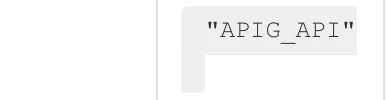

**返回数据**

| 参数名称 | 类型 | 示例 | 说明 |
| --- | --- | --- | --- |
| code | <code>string</code> | <code>SUCCESS</code> | 响应码，取值为<code> SUCCESS </code> 时表示请求成功。 |
| message | <code>string</code> | <code>null</code> | 响应消息。请求成功时通常为空。 |
| data | <code>object</code> | <code>{"content":</code><br><code>[{"gatewayId":"gatew</code><br><code>ay-</code><br><code>001","gatewayType":"</code><br><code>APIG_API","gatewayNa</code><br><code>me":"sample-</code><br><code>gateway","apigConfig</code><br><code>":</code><br><code>{"region":"sample-</code><br><code>value"},"adpAIGatewa</code><br><code>yConfig":</code><br><code>{"baseUrl":"https://</code><br><code>api.example.com","po</code><br><code>rt":8080,"authSeed":</code><br><code>"sample-</code><br><code>value"},"apsaraGatew</code><br><code>ayConfig":</code><br><code>{"regionId":"region-</code><br><code>001","domain":"api.e</code><br><code>xample.com","product</code><br><code>":"sample-</code><br><code>value","version":"sa</code><br><code>mple-</code><br><code>value","xacsRoleId":</code><br><code>"xacsRole-</code><br><code>001","xacsOrganizati</code><br><code>onId":"xacsOrganizat</code><br><code>ion-</code><br><code>001","xacsCallerSdkS</code><br><code>ource":"sample-</code><br><code>value","xacsResource</code><br><code>GroupId":"xacsResour</code><br><code>ceGroup-</code><br><code>001","xacsCallerType</code><br><code>":"sample-</code><br><code>value"},"higressConf</code><br><code>ig":</code><br><code>{"address":"sample-</code><br><code>value","username":"a</code><br><code>dmin","gatewayAddres</code><br><code>s":"sample-</code><br><code>value"},"createdAt":</code><br><code>"2026-06-</code><br><code>22T12:00:00Z"}],"pag</code><br><code>eNumber":1,"pageSize</code><br><code>":10,"totalCount":1}</code> | 响应数据。具体结构以接口语义为准。 |
|  |  |  |  |
| accessDeniedDetail | <code>object</code> | <code>null</code> | 鉴权失败详情。请求成功时通常为空。 |
| requestId | <code>string</code> | <code>req-001</code> | 请求 ID，可用于问题排查和日志检索。 |

<table>
  <tr>
    <td>data.content</td>
    <td><code>array</code></td>
    <td><code>[{"gatewayId":"gat</code><br><code>eway-</code><br><code>001","gatewayType":"</code><br><code>APIG_API","gatewayNa</code><br><code>me":"sample-</code><br><code>gateway","apigConfig</code><br><code>":{"region":"cn-</code><br><code>hangzhou"},"adpAIGat</code><br><code>ewayConfig":</code><br><code>{"baseUrl":"https://</code><br><code>adp-</code><br><code>gateway.example.com"</code><br><code>,"port":443,"authSee</code><br><code>d":"&lt;auth-</code><br><code>seed&gt;"},"apsaraGatew</code><br><code>ayConfig":</code><br><code>{"regionId":"cn-</code><br><code>hangzhou","domain":"</code><br><code>apig-share.cn-</code><br><code>hangzhou.aliyuncs.co</code><br><code>m","product":"apig",</code><br><code>"version":"2023-01-</code><br><code>01","xacsOrganizatio</code><br><code>nId":"organization-</code><br><code>001"}}]</code></td>
    <td>分页结果列表。</td>
  </tr>
  <tr>
    <td>data.content[].gatewa yId</td>
    <td><code>string</code></td>
    <td><code>"gateway-001"</code></td>
    <td>Gateway ID。</td>
  </tr>
  <tr>
    <td>data.content[].gatewa yType</td>
    <td><code>string</code></td>
    <td><code>"APIG_API"</code></td>
    <td>Gateway 类型。</td>
  </tr>
  <tr>
    <td>data.content[].gatewa yName</td>
    <td><code>string</code></td>
    <td><code>"sample-gateway"</code></td>
    <td>Gateway 名称。</td>
  </tr>
  <tr>
    <td>data.content[].apigCon fig</td>
    <td><code>object</code></td>
    <td><code>{"region":"sample-</code><br><code>value"}</code></td>
    <td>APIG 配置。</td>
  </tr>
  <tr>
    <td>data.content[].apigCon fig.region</td>
    <td><code>string</code></td>
    <td><code>"sample-value"</code></td>
    <td>地域。</td>
  </tr>
  <tr>
    <td>data.content[].adpAIG atewayConfig</td>
    <td><code>object</code></td>
    <td><code>{"baseUrl":"https:</code><br><code>//api.example.com","</code><br><code>port":8080,"authSeed</code><br><code>":"sample-value"}</code></td>
    <td>ADP AI Gateway 配置。</td>
  </tr>
  <tr>
    <td>data.content[].adpAIG atewayConfig.baseUrl</td>
    <td><code>string</code></td>
    <td><code>"https://api.examp</code><br><code>le.com"</code></td>
    <td>服务基础地址。</td>
  </tr>
  <tr>
    <td>data.content[].adpAIG atewayConfig.port</td>
    <td><code>integer&lt;int32&gt;</code></td>
    <td><code>8080</code></td>
    <td>端口号。</td>
  </tr>
  <tr>
    <td>data.content[].adpAIG atewayConfig.authSee d</td>
    <td><code>string</code></td>
    <td><code>"sample-value"</code></td>
    <td>认证种子配置。</td>
  </tr>
  <tr>
    <td>data.content[].apsara GatewayConfig</td>
    <td><code>object</code></td>
    <td><code>{"regionId":"regio</code><br><code>n-</code><br><code>001","domain":"api.e</code><br><code>xample.com","product</code><br><code>":"sample-</code><br><code>value","version":"sa</code><br><code>mple-</code><br><code>value","xacsRoleId":</code><br><code>"xacsRole-</code><br><code>001","xacsOrganizati</code><br><code>onId":"xacsOrganizat</code><br><code>ion-001"}</code></td>
    <td>Apsara Gateway 配置。</td>
  </tr>
  <tr>
    <td>data.content[].apsara GatewayConfig.regionI d</td>
    <td><code>string</code></td>
    <td><code>"region-001"</code></td>
    <td>地域 ID。</td>
  </tr>
  <tr>
    <td>data.content[].apsara GatewayConfig.domai n</td>
    <td><code>string</code></td>
    <td><code>"api.example.com"</code></td>
    <td>域名。</td>
  </tr>
  <tr>
    <td>data.content[].apsara GatewayConfig.produc t</td>
    <td><code>string</code></td>
    <td><code>"sample-value"</code></td>
    <td>云产品名称。</td>
  </tr>
  <tr>
    <td>data.content[].apsara GatewayConfig.version</td>
    <td><code>string</code></td>
    <td><code>"sample-value"</code></td>
    <td>版本号。</td>
  </tr>
  <tr>
    <td>data.content[].apsara GatewayConfig.xacsRo leId</td>
    <td><code>string</code></td>
    <td><code>"xacsRole-001"</code></td>
    <td>X-ACS-RoleId 请求头取值。</td>
  </tr>
  <tr>
    <td>data.content[].apsara GatewayConfig.xacsOr ganizationId</td>
    <td><code>string</code></td>
    <td><code>"xacsOrganization-</code><br><code>001"</code></td>
    <td>X-ACS-OrganizationId请求头取值。</td>
  </tr>
  <tr>
    <td>data.content[].apsara GatewayConfig.xacsCa llerSdkSource</td>
    <td><code>string</code></td>
    <td><code>"sample-value"</code></td>
    <td>X-ACS-Caller-Sdk-Source 请求头取值。</td>
  </tr>
  <tr>
    <td>data.content[].apsara GatewayConfig.xacsRe sourceGroupId</td>
    <td><code>string</code></td>
    <td><code>"xacsResourceGroup</code><br><code>-001"</code></td>
    <td>X-ACS-ResourceGroupId 请求头取值。</td>
  </tr>
  <tr>
    <td>data.content[].apsara GatewayConfig.xacsCa llerType</td>
    <td><code>string</code></td>
    <td><code>"sample-value"</code></td>
    <td>X-ACS-Caller-Type 请求头取值。</td>
  </tr>
  <tr>
    <td>data.content[].higress Config</td>
    <td><code>object</code></td>
    <td><code>{"address":"sample</code><br><code>-</code><br><code>value","username":"a</code><br><code>dmin","gatewayAddres</code><br><code>s":"sample-</code><br><code>value"}</code></td>
    <td>Higress 配置。</td>
  </tr>
  <tr>
    <td>data.content[].higress Config.address</td>
    <td><code>string</code></td>
    <td><code>"sample-value"</code></td>
    <td>访问地址。</td>
  </tr>
</table>


<table>
  <tr>
    <td>data.content[].higress Config.username</td>
    <td><code>string</code></td>
    <td><code>"admin"</code></td>
    <td>用户名。</td>
  </tr>
  <tr>
    <td>data.content[].higress Config.gatewayAddres s</td>
    <td><code>string</code></td>
    <td><code>"sample-value"</code></td>
    <td>Gateway 访问地址。</td>
  </tr>
  <tr>
    <td>data.content[].created At</td>
    <td><code>string&lt;date-</code><br><code>time&gt;</code></td>
    <td><code>"2026-06-</code><br><code>22T12:00:00Z"</code></td>
    <td>创建时间。</td>
  </tr>
  <tr>
    <td>data.pageNumber</td>
    <td><code>integer&lt;int32&gt;</code></td>
    <td><code>1</code></td>
    <td>当前页码。</td>
  </tr>
  <tr>
    <td>data.pageSize</td>
    <td><code>integer&lt;int32&gt;</code></td>
    <td><code>10</code></td>
    <td>每页大小。</td>
  </tr>
  <tr>
    <td>data.totalCount</td>
    <td><code>integer&lt;int64&gt;</code></td>
    <td><code>1</code></td>
    <td>总记录数。</td>
  </tr>
</table>

**示例**

**请求示例**

```text
GET /himarket/v1/gateways/apig?region=sample-
value&gatewayType=APIG_API&accessKey=sample-value&secretKey=sample-
value&page=1&size=500 HTTP/1.1
Host: localhost:8080
X-HIMARKET-OPENAPI: HIMARKET_OPENAPI
X-HIMARKET-TOKEN: <admin-openapi-token>
```

**响应示例**

```json
{
  "code": "SUCCESS",
  "message": null,
  "data": {
    "content": [
      {
        "gatewayId": "gateway-001",
        "gatewayType": "APIG_API",
        "gatewayName": "sample-gateway",
        "apigConfig": {
          "region": "sample-value"
        },
        "adpAIGatewayConfig": {
          "baseUrl": "https://api.example.com",
          "port": 8080,
          "authSeed": "sample-value"
        },
        "apsaraGatewayConfig": {
          "regionId": "region-001",
          "domain": "api.example.com",
          "product": "sample-value",
          "version": "sample-value",
          "xacsRoleId": "xacsRole-001",
          "xacsOrganizationId": "xacsOrganization-001",
          "xacsCallerSdkSource": "sample-value",
          "xacsResourceGroupId": "xacsResourceGroup-001",
          "xacsCallerType": "sample-value"
        },
        "higressConfig": {
          "address": "sample-value",
          "username": "admin",
          "gatewayAddress": "sample-value"
        },
        "createdAt": "2026-06-22T12:00:00Z"
      }
    ],
    "pageNumber": 1,
    "pageSize": 10,
    "totalCount": 1
  },
  "accessDeniedDetail": null,
  "requestId": "req-001"
}
```

<a id="section-3-22-7"></a>

### 3.22.7. fetchModelAPIs

**接口信息**

- **接口路径**： `GET /himarket/v1/gateways/{gatewayId}/model-apis`

- **接口说明**：获取Model API 列表。

- **认证方式**：该接口属于管理面 OpenAPI。调用前请完成 OpenAPI 凭证配置，并按 Token 模式或AK/SK 签名模式携带认证 Header。

- **Header 示例**：Token 模式使用  `X-HIMARKET-OPENAPI: HIMARKET_OPENAPI`  与  `X-HIMARKET-TOKEN` ；AK/SK 模式使用  `X-HIMARKET-ACCESS-KEY` 、 `X-HIMARKET-TIMESTAMP`  和  `X-HIMARKET-SIGNATURE` 。

**请求参数**

| 参数名称 | 位置 | 类型 | 是否必选 | 示例 | 说明 |
| --- | --- | --- | --- | --- | --- |
| gatewayId | path | <code>string</code> | 是 | <code>"gateway-</code><br><code>001"</code> | Gateway ID。 |
| page | query | <code>integer&lt;in</code><br><code>t32&gt;</code> | 否 | <code>1</code> | 页码。 |
| size | query | <code>integer&lt;in</code><br><code>t32&gt;</code> | 否 | <code>500</code> | 每页记录数。 |

**返回数据**

| 参数名称 | 类型 | 示例 | 说明 |
| --- | --- | --- | --- |
| code | <code>string</code> | <code>SUCCESS</code> | 响应码，取值为<code> SUCCESS </code> 时表示请求成功。 |
| message | <code>string</code> | <code>null</code> | 响应消息。请求成功时通常为空。 |
| data | <code>object</code> | <code>{"content":</code><br><code>[{}],"pageNumber":1,</code><br><code>"pageSize":10,"total</code><br><code>Count":1}</code> | 响应数据。具体结构以接口语义为准。 |
| accessDeniedDetail | <code>object</code> | <code>null</code> | 鉴权失败详情。请求成功时通常为空。 |
| requestId | <code>string</code> | <code>req-001</code> | 请求 ID，可用于问题排查和日志检索。 |
| data.content | <code>array</code> | <code>[{"description":"</code>用于演示的资源描述<code>","protocol":"samp</code> <code>le-</code><br><code>value","domains":</code><br><code>["api.example.com"],</code><br><code>"addresses":</code><br><code>["sample-</code><br><code>value"],"modelRouteN</code><br><code>ame":"demo-</code><br><code>modelroute","version</code><br><code>":"sample-</code><br><code>value"}]</code> | 分页结果列表。 |
| data.content\[\].descript ion | <code>string</code> | <code> "</code>用于演示的资源描述<code>" </code> | 描述信息。 |
| data.content\[\].protocol | <code>string</code> | <code>"sample-value"</code> | 协议类型。 |
| data.content\[\].domain s | <code>array</code> | <code>["api.example.com"</code><br><code>]</code> | 域名列表。 |
| data.content\[\].address es | <code>array</code> | <code>["sample-value"]</code> | 地址列表。 |
| data.content\[\].modelR outeName | <code>string</code> | <code>"demo-</code><br><code>modelroute"</code> | 模型路由名称。 |
| data.content\[\].version | <code>string</code> | <code>"sample-value"</code> | 版本号。 |
| data.content\[\].aiProtoc ols | <code>array</code> | <code>["sample-value"]</code> | AI 协议列表。 |
| data.content\[\].basePat h | <code>string</code> | <code>"sample-value"</code> | 基础路径。 |
| data.content\[\].upstrea ms | <code>object</code> | <code>{}</code> | 上游服务列表。 |
| data.content\[\].authCo nfig | <code>object</code> | <code>{}</code> | 认证配置。 |
| data.content\[\].authMo de | <code>string</code> | <code>"sample-value"</code> | 认证模式。 |
| data.pageNumber | <code>integer&lt;int32&gt;</code> | <code>1</code> | 当前页码。 |
| data.pageSize | <code>integer&lt;int32&gt;</code> | <code>10</code> | 每页大小。 |
| data.totalCount | <code>integer&lt;int64&gt;</code> | <code>1</code> | 总记录数。 |

**示例**

**请求示例**

```http
GET /himarket/v1/gateways/{gatewayId}/model-apis?page=1&size=500 HTTP/1.1
Host: localhost:8080
X-HIMARKET-OPENAPI: HIMARKET_OPENAPI
X-HIMARKET-TOKEN: <admin-openapi-token>
```

**响应示例**

```json
{
  "code": "SUCCESS",
  "message": null,
  "data": {
    "content": [
      {}
    ],
    "pageNumber": 1,
    "pageSize": 10,
    "totalCount": 1
  },
  "accessDeniedDetail": null,
  "requestId": "req-001"
}
```

<a id="section-3-22-8"></a>

### 3.22.8. fetchRESTAPIs

**接口信息**

- **接口路径**： `GET /himarket/v1/gateways/{gatewayId}/rest-apis`

- **接口说明**：获取REST API 列表。

- **认证方式**：该接口属于管理面 OpenAPI。调用前请完成 OpenAPI 凭证配置，并按 Token 模式或AK/SK 签名模式携带认证 Header。

- **Header 示例**：Token 模式使用  `X-HIMARKET-OPENAPI: HIMARKET_OPENAPI`  与  `X-HIMARKET-TOKEN` ；AK/SK 模式使用  `X-HIMARKET-ACCESS-KEY` 、 `X-HIMARKET-TIMESTAMP`  和  `X-HIMARKET-SIGNATURE` 。

**请求参数**

| 参数名称 | 位置 | 类型 | 是否必选 | 示例 | 说明 |
| --- | --- | --- | --- | --- | --- |
| gatewayId | path | <code>string</code> | 是 | <code>"gateway-</code><br><code>001"</code> | Gateway ID。 |
| page | query | <code>integer&lt;in</code><br><code>t32&gt;</code> | 否 | <code>1</code> | 页码。 |
| size | query | <code>integer&lt;in</code><br><code>t32&gt;</code> | 否 | <code>500</code> | 每页记录数。 |

**返回数据**

| 参数名称 | 类型 | 示例 | 说明 |
| --- | --- | --- | --- |
| code | <code>string</code> | <code>SUCCESS</code> | 响应码，取值为<code> SUCCESS </code> 时表示请求成功。 |
| message | <code>string</code> | <code>null</code> | 响应消息。请求成功时通常为空。 |
| data | <code>object</code> | <code>{"content":</code><br><code>[{}],"pageNumber":1,</code><br><code>"pageSize":10,"total</code><br><code>Count":1}</code> | 响应数据。具体结构以接口语义为准。 |
| accessDeniedDetail | <code>object</code> | <code>null</code> | 鉴权失败详情。请求成功时通常为空。 |
| requestId | <code>string</code> | <code>req-001</code> | 请求 ID，可用于问题排查和日志检索。 |
| data.content | <code>array</code> | <code>[{"apiId":"api-</code><br><code>001","apiName":"samp</code><br><code>le-api"}]</code> | 分页结果列表。 |
| data.content\[\].apiId | <code>string</code> | <code>"api-001"</code> | API ID。 |
| data.content\[\].apiNam e | <code>string</code> | <code>"sample-api"</code> | API 名称。 |
| data.pageNumber | <code>integer&lt;int32&gt;</code> | <code>1</code> | 当前页码。 |
| data.pageSize | <code>integer&lt;int32&gt;</code> | <code>10</code> | 每页大小。 |
| data.totalCount | <code>integer&lt;int64&gt;</code> | <code>1</code> | 总记录数。 |

**示例**

**请求示例**

```http
GET /himarket/v1/gateways/{gatewayId}/rest-apis?page=1&size=500 HTTP/1.1
Host: localhost:8080
X-HIMARKET-OPENAPI: HIMARKET_OPENAPI
X-HIMARKET-TOKEN: <admin-openapi-token>
```

**响应示例**

```json
{
  "code": "SUCCESS",
  "message": null,
  "data": {
    "content": [
      {}
    ],
    "pageNumber": 1,
    "pageSize": 10,
    "totalCount": 1
  },
  "accessDeniedDetail": null,
  "requestId": "req-001"
}
```

<a id="section-3-22-9"></a>

### 3.22.9. importGateway

**接口信息**

- **接口路径**： `POST /himarket/v1/gateways`

- **接口说明**：导入 Gateway。

- **认证方式**：该接口属于管理面 OpenAPI。调用前请完成 OpenAPI 凭证配置，并按 Token 模式或AK/SK 签名模式携带认证 Header。

- **Header 示例**：Token 模式使用  `X-HIMARKET-OPENAPI: HIMARKET_OPENAPI`  与  `X-HIMARKET-TOKEN` ；AK/SK 模式使用  `X-HIMARKET-ACCESS-KEY` 、 `X-HIMARKET-TIMESTAMP`  和  `X-HIMARKET-SIGNATURE` 。

**请求参数**

| 参数名称 | 位置 | 类型 | 是否必选 | 示例 | 说明 |
| --- | --- | --- | --- | --- | --- |
| gatewayNam e | body | <code>string</code> | 是 | <code>"sample-</code><br><code>gateway"</code> | Gateway 名称。 |
| gatewayType | body | <code>string</code> | 是 | <code>"APIG_API"</code> | Gateway 类型。 |
| gatewayId | body | <code>string</code> | 否 | <code>"gateway-</code><br><code>001"</code> | Gateway ID。 |
| apigConfig | body | <code>object</code> | 否 | <code>{"accessKe</code><br><code>y":"sample-</code><br><code>value","secr</code><br><code>etKey":"samp</code><br><code>le-</code><br><code>value","secu</code><br><code>rityToken":"</code><br><code>&lt;token&gt;","re</code><br><code>gion":"sampl</code><br><code>e-value"}</code> | APIG 配置。 |
| apigConfig.ac cessKey | body | <code>string</code> | 否 | <code>"sample-</code><br><code>value"</code> | 访问凭据的AccessKey。 |
| apigConfig.se cretKey | body | <code>string</code> | 否 | <code>"sample-</code><br><code>value"</code> | 访问凭据的SecretKey。仅在创建或重置时返回，请妥善保存。 |
| apigConfig.se curityToken | body | <code>string</code> | 否 | <code>"</code><br><code>&lt;token&gt;"</code> | securityToken字段。 |
| apigConfig.re gion | body | <code>string</code> | 否 | <code>"sample-</code><br><code>value"</code> | 地域。 |


<table>
  <tr>
    <td>adpAIGatewa yConfig</td>
    <td>body</td>
    <td><code>object</code></td>
    <td>否</td>
    <td><code>{"baseUrl"</code><br><code>:"https://ap</code><br><code>i.example.co</code><br><code>m","port":80</code><br><code>80,"authSeed</code><br><code>":"sample-</code><br><code>value","auth</code><br><code>Headers":</code><br><code>[{}]}</code></td>
    <td>ADP AI Gateway 配置。</td>
  </tr>
  <tr>
    <td>adpAIGatewa yConfig.base Url</td>
    <td>body</td>
    <td><code>string</code></td>
    <td>否</td>
    <td><code>"https://a</code><br><code>pi.example.c</code><br><code>om"</code></td>
    <td>服务基础地址。</td>
  </tr>
  <tr>
    <td>adpAIGatewa yConfig.port</td>
    <td>body</td>
    <td><code>integer&lt;in</code><br><code>t32&gt;</code></td>
    <td>否</td>
    <td><code>8080</code></td>
    <td>端口号。</td>
  </tr>
  <tr>
    <td>adpAIGatewa yConfig.authS eed</td>
    <td>body</td>
    <td><code>string</code></td>
    <td>否</td>
    <td><code>"sample-</code><br><code>value"</code></td>
    <td>认证种子配置。</td>
  </tr>
  <tr>
    <td>adpAIGatewa yConfig.auth Headers</td>
    <td>body</td>
    <td><code>array</code></td>
    <td>否</td>
    <td><code>[{"key":"s</code><br><code>ample-</code><br><code>value","valu</code><br><code>e":"sample-</code><br><code>value"}]</code></td>
    <td>authHeaders字段。</td>
  </tr>
  <tr>
    <td>adpAIGatewa yConfig.auth Headers[].key</td>
    <td>body</td>
    <td><code>string</code></td>
    <td>否</td>
    <td><code>"sample-</code><br><code>value"</code></td>
    <td>配置键。</td>
  </tr>
  <tr>
    <td>adpAIGatewa yConfig.auth Headers[].val ue</td>
    <td>body</td>
    <td><code>string</code></td>
    <td>否</td>
    <td><code>"sample-</code><br><code>value"</code></td>
    <td>value 字段。</td>
  </tr>
</table>

<table>
  <tr>
    <td>apsaraGatew ayConfig</td>
    <td>body</td>
    <td><code>object</code></td>
    <td>否</td>
    <td><code>{"regionId</code><br><code>":"region-</code><br><code>001","access</code><br><code>KeyId":"acce</code><br><code>ssKey-</code><br><code>001","access</code><br><code>KeySecret":"</code><br><code>sample-</code><br><code>value","secu</code><br><code>rityToken":"</code><br><code>&lt;token&gt;","do</code><br><code>main":"api.e</code><br><code>xample.com",</code><br><code>"product":"s</code><br><code>ample-</code><br><code>value"}</code></td>
    <td>Apsara Gateway 配置。</td>
  </tr>
  <tr>
    <td>apsaraGatew ayConfig.regi onId</td>
    <td>body</td>
    <td><code>string</code></td>
    <td>否</td>
    <td><code>"region-</code><br><code>001"</code></td>
    <td>地域 ID。</td>
  </tr>
  <tr>
    <td>apsaraGatew ayConfig.acce ssKeyId</td>
    <td>body</td>
    <td><code>string</code></td>
    <td>否</td>
    <td><code>"accessKey</code><br><code>-001"</code></td>
    <td>accessKeyId字段。</td>
  </tr>
  <tr>
    <td>apsaraGatew ayConfig.acce ssKeySecret</td>
    <td>body</td>
    <td><code>string</code></td>
    <td>否</td>
    <td><code>"sample-</code><br><code>value"</code></td>
    <td>accessKeySec ret 字段。</td>
  </tr>
  <tr>
    <td>apsaraGatew ayConfig.secu rityToken</td>
    <td>body</td>
    <td><code>string</code></td>
    <td>否</td>
    <td><code>"</code><br><code>&lt;token&gt;"</code></td>
    <td>securityToken字段。</td>
  </tr>
  <tr>
    <td>apsaraGatew ayConfig.dom ain</td>
    <td>body</td>
    <td><code>string</code></td>
    <td>否</td>
    <td><code>"api.examp</code><br><code>le.com"</code></td>
    <td>域名。</td>
  </tr>
  <tr>
    <td>apsaraGatew ayConfig.prod uct</td>
    <td>body</td>
    <td><code>string</code></td>
    <td>否</td>
    <td><code>"sample-</code><br><code>value"</code></td>
    <td>云产品名称。</td>
  </tr>
  <tr>
    <td>apsaraGatew ayConfig.vers ion</td>
    <td>body</td>
    <td><code>string</code></td>
    <td>否</td>
    <td><code>"sample-</code><br><code>value"</code></td>
    <td>版本号。</td>
  </tr>
  <tr>
    <td>apsaraGatew ayConfig.xAcs OrganizationI d</td>
    <td>body</td>
    <td><code>string</code></td>
    <td>否</td>
    <td><code>"xAcsOrgan</code><br><code>ization-</code><br><code>001"</code></td>
    <td>xAcsOrganiza tionId 字段。</td>
  </tr>
  <tr>
    <td>apsaraGatew ayConfig.xAcs CallerSdkSour ce</td>
    <td>body</td>
    <td><code>string</code></td>
    <td>否</td>
    <td><code>"sample-</code><br><code>value"</code></td>
    <td>xAcsCallerSdk Source 字段。</td>
  </tr>
  <tr>
    <td>apsaraGatew ayConfig.xAcs ResourceGrou pId</td>
    <td>body</td>
    <td><code>string</code></td>
    <td>否</td>
    <td><code>"xAcsResou</code><br><code>rceGroup-</code><br><code>001"</code></td>
    <td>xAcsResource GroupId 字段。</td>
  </tr>
  <tr>
    <td>apsaraGatew ayConfig.xAcs CallerType</td>
    <td>body</td>
    <td><code>string</code></td>
    <td>否</td>
    <td><code>"sample-</code><br><code>value"</code></td>
    <td>xAcsCallerTyp e 字段。</td>
  </tr>
  <tr>
    <td>apsaraGatew ayConfig.xAcs RoleId</td>
    <td>body</td>
    <td><code>string</code></td>
    <td>否</td>
    <td><code>"xAcsRole-</code><br><code>001"</code></td>
    <td>xAcsRoleId 字段。</td>
  </tr>
  <tr>
    <td>higressConfig</td>
    <td>body</td>
    <td><code>object</code></td>
    <td>否</td>
    <td><code>{"address"</code><br><code>:"sample-</code><br><code>value","user</code><br><code>name":"admin</code><br><code>","password"</code><br><code>:"</code><br><code>&lt;password&gt;",</code><br><code>"gatewayAddr</code><br><code>ess":"sample</code><br><code>-value"}</code></td>
    <td>Higress 配置。</td>
  </tr>
  <tr>
    <td>higressConfig.address</td>
    <td>body</td>
    <td><code>string</code></td>
    <td>否</td>
    <td><code>"sample-</code><br><code>value"</code></td>
    <td>访问地址。</td>
  </tr>
  <tr>
    <td>higressConfig.username</td>
    <td>body</td>
    <td><code>string</code></td>
    <td>否</td>
    <td><code>"admin"</code></td>
    <td>用户名。</td>
  </tr>
  <tr>
    <td>higressConfig.password</td>
    <td>body</td>
    <td><code>string</code></td>
    <td>否</td>
    <td><code>"</code><br><code>&lt;password&gt;"</code></td>
    <td>密码。</td>
  </tr>
  <tr>
    <td>higressConfig.gatewayAddr ess</td>
    <td>body</td>
    <td><code>string</code></td>
    <td>否</td>
    <td><code>"sample-</code><br><code>value"</code></td>
    <td>Gateway 访问地址。</td>
  </tr>
</table>


**返回数据**

| 参数名称 | 类型 | 示例 | 说明 |
| --- | --- | --- | --- |
| code | <code>string</code> | <code>SUCCESS</code> | 响应码，取值为<code> SUCCESS </code> 时表示请求成功。 |
| message | <code>string</code> | <code>null</code> | 响应消息。请求成功时通常为空。 |
| data | <code>object</code> | <code>null</code> | 响应数据。无返回内容时为 <code> null </code>。 |
| accessDeniedDetail | <code>object</code> | <code>null</code> | 鉴权失败详情。请求成功时通常为空。 |
| requestId | <code>string</code> | <code>req-001</code> | 请求 ID，可用于问题排查和日志检索。 |

**示例**

**请求示例**

```http
POST /himarket/v1/gateways HTTP/1.1
Host: localhost:8080
X-HIMARKET-OPENAPI: HIMARKET_OPENAPI
X-HIMARKET-TOKEN: <admin-openapi-token>
Content-Type: application/json

{
  "gatewayName": "sample-gateway",
  "gatewayType": "APIG_API",
  "gatewayId": "gateway-001",
  "apigConfig": {
    "accessKey": "sample-value",
    "secretKey": "sample-value",
    "securityToken": "<token>",
    "region": "sample-value"
  },
  "adpAIGatewayConfig": {
    "baseUrl": "https://api.example.com",
    "port": 8080,
    "authSeed": "sample-value",
    "authHeaders": [
      {}
    ]
  },
  "apsaraGatewayConfig": {
    "regionId": "region-001",
    "accessKeyId": "accessKey-001",
    "accessKeySecret": "sample-value",
    "securityToken": "<token>",
    "domain": "api.example.com",
    "product": "sample-value"
  }
}
```

**响应示例**

```json
{
  "code": "SUCCESS",
  "message": null,
  "data": null,
  "accessDeniedDetail": null,
  "requestId": "req-001"
}
```

<a id="section-3-22-10"></a>

### 3.22.10. listGateways

**接口信息**

- **接口路径**： `GET /himarket/v1/gateways`

- **接口说明**：获取导入的 Gateway 列表。

- **认证方式**：该接口属于管理面 OpenAPI。调用前请完成 OpenAPI 凭证配置，并按 Token 模式或AK/SK 签名模式携带认证 Header。

- **Header 示例**：Token 模式使用  `X-HIMARKET-OPENAPI: HIMARKET_OPENAPI`  与  `X-HIMARKET-TOKEN` ；AK/SK 模式使用  `X-HIMARKET-ACCESS-KEY` 、 `X-HIMARKET-TIMESTAMP`  和  `X-HIMARKET-SIGNATURE` 。

**请求参数**

| 参数名称 | 位置 | 类型 | 是否必选 | 示例 | 说明 |
| --- | --- | --- | --- | --- | --- |
| gatewayType | query | <code>string</code> | 否 | <code>"APIG_API"</code> | Gateway 类型。 |
| page | query | <code>integer&lt;in</code><br><code>t32&gt;</code> | 否 | <code>1</code> | 页码。 |
| size | query | <code>integer&lt;in</code><br><code>t32&gt;</code> | 否 | <code>10</code> | 每页记录数。 |
| sort | query | <code>array</code> | 否 | <code>["sample-</code><br><code>value"]</code> | 排序条件。 |


**返回数据**

| 参数名称 | 类型 | 示例 | 说明 |
| --- | --- | --- | --- |
| code | <code>string</code> | <code>SUCCESS</code> | 响应码，取值为<code> SUCCESS </code> 时表示请求成功。 |
| message | <code>string</code> | <code>null</code> | 响应消息。请求成功时通常为空。 |
| data | <code>object</code> | <code>{"content":</code><br><code>[{}],"pageNumber":1,</code><br><code>"pageSize":10,"total</code><br><code>Count":1}</code> | 响应数据。具体结构以接口语义为准。 |
| accessDeniedDetail | <code>object</code> | <code>null</code> | 鉴权失败详情。请求成功时通常为空。 |
| requestId | <code>string</code> | <code>req-001</code> | 请求 ID，可用于问题排查和日志检索。 |
| data.content | <code>array</code> | <code>[{"gatewayId":"gat</code><br><code>eway-</code><br><code>001","gatewayType":"</code><br><code>APIG_API","gatewayNa</code><br><code>me":"sample-</code><br><code>gateway","apigConfig</code><br><code>":</code><br><code>{},"adpAIGatewayConf</code><br><code>ig":</code><br><code>{},"apsaraGatewayCon</code><br><code>fig":{}}]</code> | 分页结果列表。 |
| data.content\[\].gatewa yId | <code>string</code> | <code>"gateway-001"</code> | Gateway ID。 |
| data.content\[\].gatewa yType | <code>string</code> | <code>"APIG_API"</code> | Gateway 类型。 |
| data.content\[\].gatewa yName | <code>string</code> | <code>"sample-gateway"</code> | Gateway 名称。 |
| data.content\[\].apigCon fig | <code>object</code> | <code>{"region":"sample-</code><br><code>value"}</code> | APIG 配置。 |
| data.content\[\].apigCon fig.region | <code>string</code> | <code>"sample-value"</code> | 地域。 |
| data.content\[\].adpAIG atewayConfig | <code>object</code> | <code>{"baseUrl":"https:</code><br><code>//api.example.com","</code><br><code>port":8080,"authSeed</code><br><code>":"sample-value"}</code> | ADP AI Gateway 配置。 |
| data.content\[\].adpAIG atewayConfig.baseUrl | <code>string</code> | <code>"https://api.examp</code><br><code>le.com"</code> | 服务基础地址。 |
| data.content\[\].adpAIG atewayConfig.port | <code>integer&lt;int32&gt;</code> | <code>8080</code> | 端口号。 |
| data.content\[\].adpAIG atewayConfig.authSee d | <code>string</code> | <code>"sample-value"</code> | 认证种子配置。 |
| data.content\[\].apsara GatewayConfig | <code>object</code> | <code>{"regionId":"regio</code><br><code>n-</code><br><code>001","domain":"api.e</code><br><code>xample.com","product</code><br><code>":"sample-</code><br><code>value","version":"sa</code><br><code>mple-</code><br><code>value","xacsRoleId":</code><br><code>"xacsRole-</code><br><code>001","xacsOrganizati</code><br><code>onId":"xacsOrganizat</code><br><code>ion-001"}</code> | Apsara Gateway 配置。 |
| data.content\[\].apsara GatewayConfig.regionI d | <code>string</code> | <code>"region-001"</code> | 地域 ID。 |
| data.content\[\].apsara GatewayConfig.domai n | <code>string</code> | <code>"api.example.com"</code> | 域名。 |
| data.content\[\].apsara GatewayConfig.produc t | <code>string</code> | <code>"sample-value"</code> | 云产品名称。 |
| data.content\[\].apsara GatewayConfig.version | <code>string</code> | <code>"sample-value"</code> | 版本号。 |
| data.content\[\].apsara GatewayConfig.xacsRo leId | <code>string</code> | <code>"xacsRole-001"</code> | X-ACS-RoleId 请求头取值。 |
| data.content\[\].apsara GatewayConfig.xacsOr ganizationId | <code>string</code> | <code>"xacsOrganization-</code><br><code>001"</code> | X-ACS-OrganizationId请求头取值。 |
| data.content\[\].apsara GatewayConfig.xacsCa llerSdkSource | <code>string</code> | <code>"sample-value"</code> | X-ACS-Caller-Sdk-Source 请求头取值。 |
| data.content\[\].apsara GatewayConfig.xacsRe sourceGroupId | <code>string</code> | <code>"xacsResourceGroup</code><br><code>-001"</code> | X-ACS-ResourceGroupId 请求头取值。 |
| data.content\[\].apsara GatewayConfig.xacsCa llerType | <code>string</code> | <code>"sample-value"</code> | X-ACS-Caller-Type 请求头取值。 |


<table>
  <tr>
    <td>data.content[].higress Config</td>
    <td><code>object</code></td>
    <td><code>{"address":"sample</code><br><code>-</code><br><code>value","username":"a</code><br><code>dmin","gatewayAddres</code><br><code>s":"sample-</code><br><code>value"}</code></td>
    <td>Higress 配置。</td>
  </tr>
  <tr>
    <td>data.content[].higress Config.address</td>
    <td><code>string</code></td>
    <td><code>"sample-value"</code></td>
    <td>访问地址。</td>
  </tr>
  <tr>
    <td>data.content[].higress Config.username</td>
    <td><code>string</code></td>
    <td><code>"admin"</code></td>
    <td>用户名。</td>
  </tr>
  <tr>
    <td>data.content[].higress Config.gatewayAddres s</td>
    <td><code>string</code></td>
    <td><code>"sample-value"</code></td>
    <td>Gateway 访问地址。</td>
  </tr>
  <tr>
    <td>data.content[].created At</td>
    <td><code>string&lt;date-</code><br><code>time&gt;</code></td>
    <td><code>"2026-06-</code><br><code>22T12:00:00Z"</code></td>
    <td>创建时间。</td>
  </tr>
  <tr>
    <td>data.pageNumber</td>
    <td><code>integer&lt;int32&gt;</code></td>
    <td><code>1</code></td>
    <td>当前页码。</td>
  </tr>
  <tr>
    <td>data.pageSize</td>
    <td><code>integer&lt;int32&gt;</code></td>
    <td><code>10</code></td>
    <td>每页大小。</td>
  </tr>
  <tr>
    <td>data.totalCount</td>
    <td><code>integer&lt;int64&gt;</code></td>
    <td><code>1</code></td>
    <td>总记录数。</td>
  </tr>
</table>

**示例**

**请求示例**

```http
GET /himarket/v1/gateways?gatewayType=APIG_API&page=1&size=10&sort=sample-value HTTP/1.1
Host: localhost:8080
X-HIMARKET-OPENAPI: HIMARKET_OPENAPI
X-HIMARKET-TOKEN: <admin-openapi-token>
```

**响应示例**

```json
{
  "code": "SUCCESS",
  "message": null,
  "data": {
    "content": [
      {}
    ],
    "pageNumber": 1,
    "pageSize": 10,
    "totalCount": 1
  },
  "accessDeniedDetail": null,
  "requestId": "req-001"
}
```

<a id="section-3-22-11"></a>

### 3.22.11. updateGateway

**接口信息**

- **接口路径**： `PUT /himarket/v1/gateways/{gatewayId}`

- **接口说明**：更新 Gateway。

- **认证方式**：该接口属于管理面 OpenAPI。调用前请完成 OpenAPI 凭证配置，并按 Token 模式或AK/SK 签名模式携带认证 Header。

- **Header 示例**：Token 模式使用  `X-HIMARKET-OPENAPI: HIMARKET_OPENAPI`  与  `X-HIMARKET-TOKEN` ；AK/SK 模式使用  `X-HIMARKET-ACCESS-KEY` 、 `X-HIMARKET-TIMESTAMP`  和  `X-HIMARKET-SIGNATURE` 。

**请求参数**

| 参数名称 | 位置 | 类型 | 是否必选 | 示例 | 说明 |
| --- | --- | --- | --- | --- | --- |
| gatewayId | path | <code>string</code> | 是 | <code>"gateway-</code><br><code>001"</code> | Gateway ID。 |
| gatewayType | body | <code>string</code> | 是 | <code>"APIG_API"</code> | Gateway 类型。 |
| gatewayNam e | body | <code>string</code> | 否 | <code>"sample-</code><br><code>gateway"</code> | Gateway 名称。 |
| description | body | <code>string</code> | 否 | <code> "</code>用于演示的资源描述<code>" </code> | 描述信息。 |

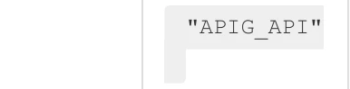

<table>
  <tr>
    <td>apigConfig</td>
    <td>body</td>
    <td><code>object</code></td>
    <td>否</td>
    <td><code>{"accessKe</code><br><code>y":"sample-</code><br><code>value","secr</code><br><code>etKey":"samp</code><br><code>le-</code><br><code>value","secu</code><br><code>rityToken":"</code><br><code>&lt;token&gt;","re</code><br><code>gion":"sampl</code><br><code>e-value"}</code></td>
    <td>APIG 配置。</td>
  </tr>
  <tr>
    <td>apigConfig.ac cessKey</td>
    <td>body</td>
    <td><code>string</code></td>
    <td>否</td>
    <td><code>"sample-</code><br><code>value"</code></td>
    <td>访问凭据的AccessKey。</td>
  </tr>
  <tr>
    <td>apigConfig.se cretKey</td>
    <td>body</td>
    <td><code>string</code></td>
    <td>否</td>
    <td><code>"sample-</code><br><code>value"</code></td>
    <td>访问凭据的SecretKey。仅在创建或重置时返回，请妥善保存。</td>
  </tr>
  <tr>
    <td>apigConfig.se curityToken</td>
    <td>body</td>
    <td><code>string</code></td>
    <td>否</td>
    <td><code>"</code><br><code>&lt;token&gt;"</code></td>
    <td>securityToken字段。</td>
  </tr>
  <tr>
    <td>apigConfig.re gion</td>
    <td>body</td>
    <td><code>string</code></td>
    <td>否</td>
    <td><code>"sample-</code><br><code>value"</code></td>
    <td>地域。</td>
  </tr>
  <tr>
    <td>adpAIGatewa yConfig</td>
    <td>body</td>
    <td><code>object</code></td>
    <td>否</td>
    <td><code>{"baseUrl"</code><br><code>:"https://ap</code><br><code>i.example.co</code><br><code>m","port":80</code><br><code>80,"authSeed</code><br><code>":"sample-</code><br><code>value","auth</code><br><code>Headers":</code><br><code>[{}]}</code></td>
    <td>ADP AI Gateway 配置。</td>
  </tr>
  <tr>
    <td>adpAIGatewa yConfig.base Url</td>
    <td>body</td>
    <td><code>string</code></td>
    <td>否</td>
    <td><code>"https://a</code><br><code>pi.example.c</code><br><code>om"</code></td>
    <td>服务基础地址。</td>
  </tr>
  <tr>
    <td>adpAIGatewa yConfig.port</td>
    <td>body</td>
    <td><code>integer&lt;in</code><br><code>t32&gt;</code></td>
    <td>否</td>
    <td><code>8080</code></td>
    <td>端口号。</td>
  </tr>
  <tr>
    <td>adpAIGatewa yConfig.authS eed</td>
    <td>body</td>
    <td><code>string</code></td>
    <td>否</td>
    <td><code>"sample-</code><br><code>value"</code></td>
    <td>认证种子配置。</td>
  </tr>
  <tr>
    <td>adpAIGatewa yConfig.auth Headers</td>
    <td>body</td>
    <td><code>array</code></td>
    <td>否</td>
    <td><code>[{"key":"s</code><br><code>ample-</code><br><code>value","valu</code><br><code>e":"sample-</code><br><code>value"}]</code></td>
    <td>authHeaders字段。</td>
  </tr>
  <tr>
    <td>adpAIGatewa yConfig.auth Headers[].key</td>
    <td>body</td>
    <td><code>string</code></td>
    <td>否</td>
    <td><code>"sample-</code><br><code>value"</code></td>
    <td>配置键。</td>
  </tr>
  <tr>
    <td>adpAIGatewa yConfig.auth Headers[].val ue</td>
    <td>body</td>
    <td><code>string</code></td>
    <td>否</td>
    <td><code>"sample-</code><br><code>value"</code></td>
    <td>value 字段。</td>
  </tr>
</table>

<table>
  <tr>
    <td>apsaraGatew ayConfig</td>
    <td>body</td>
    <td><code>object</code></td>
    <td>否</td>
    <td><code>{"regionId</code><br><code>":"region-</code><br><code>001","access</code><br><code>KeyId":"acce</code><br><code>ssKey-</code><br><code>001","access</code><br><code>KeySecret":"</code><br><code>sample-</code><br><code>value","secu</code><br><code>rityToken":"</code><br><code>&lt;token&gt;","do</code><br><code>main":"api.e</code><br><code>xample.com",</code><br><code>"product":"s</code><br><code>ample-</code><br><code>value"}</code></td>
    <td>Apsara Gateway 配置。</td>
  </tr>
  <tr>
    <td>apsaraGatew ayConfig.regi onId</td>
    <td>body</td>
    <td><code>string</code></td>
    <td>否</td>
    <td><code>"region-</code><br><code>001"</code></td>
    <td>地域 ID。</td>
  </tr>
  <tr>
    <td>apsaraGatew ayConfig.acce ssKeyId</td>
    <td>body</td>
    <td><code>string</code></td>
    <td>否</td>
    <td><code>"accessKey</code><br><code>-001"</code></td>
    <td>accessKeyId字段。</td>
  </tr>
  <tr>
    <td>apsaraGatew ayConfig.acce ssKeySecret</td>
    <td>body</td>
    <td><code>string</code></td>
    <td>否</td>
    <td><code>"sample-</code><br><code>value"</code></td>
    <td>accessKeySec ret 字段。</td>
  </tr>
  <tr>
    <td>apsaraGatew ayConfig.secu rityToken</td>
    <td>body</td>
    <td><code>string</code></td>
    <td>否</td>
    <td><code>"</code><br><code>&lt;token&gt;"</code></td>
    <td>securityToken字段。</td>
  </tr>
  <tr>
    <td>apsaraGatew ayConfig.dom ain</td>
    <td>body</td>
    <td><code>string</code></td>
    <td>否</td>
    <td><code>"api.examp</code><br><code>le.com"</code></td>
    <td>域名。</td>
  </tr>
  <tr>
    <td>apsaraGatew ayConfig.prod uct</td>
    <td>body</td>
    <td><code>string</code></td>
    <td>否</td>
    <td><code>"sample-</code><br><code>value"</code></td>
    <td>云产品名称。</td>
  </tr>
  <tr>
    <td>apsaraGatew ayConfig.vers ion</td>
    <td>body</td>
    <td><code>string</code></td>
    <td>否</td>
    <td><code>"sample-</code><br><code>value"</code></td>
    <td>版本号。</td>
  </tr>
  <tr>
    <td>apsaraGatew ayConfig.xAcs OrganizationI d</td>
    <td>body</td>
    <td><code>string</code></td>
    <td>否</td>
    <td><code>"xAcsOrgan</code><br><code>ization-</code><br><code>001"</code></td>
    <td>xAcsOrganiza tionId 字段。</td>
  </tr>
  <tr>
    <td>apsaraGatew ayConfig.xAcs CallerSdkSour ce</td>
    <td>body</td>
    <td><code>string</code></td>
    <td>否</td>
    <td><code>"sample-</code><br><code>value"</code></td>
    <td>xAcsCallerSdk Source 字段。</td>
  </tr>
  <tr>
    <td>apsaraGatew ayConfig.xAcs ResourceGrou pId</td>
    <td>body</td>
    <td><code>string</code></td>
    <td>否</td>
    <td><code>"xAcsResou</code><br><code>rceGroup-</code><br><code>001"</code></td>
    <td>xAcsResource GroupId 字段。</td>
  </tr>
  <tr>
    <td>apsaraGatew ayConfig.xAcs CallerType</td>
    <td>body</td>
    <td><code>string</code></td>
    <td>否</td>
    <td><code>"sample-</code><br><code>value"</code></td>
    <td>xAcsCallerTyp e 字段。</td>
  </tr>
  <tr>
    <td>apsaraGatew ayConfig.xAcs RoleId</td>
    <td>body</td>
    <td><code>string</code></td>
    <td>否</td>
    <td><code>"xAcsRole-</code><br><code>001"</code></td>
    <td>xAcsRoleId 字段。</td>
  </tr>
  <tr>
    <td>higressConfig</td>
    <td>body</td>
    <td><code>object</code></td>
    <td>否</td>
    <td><code>{"address"</code><br><code>:"sample-</code><br><code>value","user</code><br><code>name":"admin</code><br><code>","password"</code><br><code>:"</code><br><code>&lt;password&gt;",</code><br><code>"gatewayAddr</code><br><code>ess":"sample</code><br><code>-value"}</code></td>
    <td>Higress 配置。</td>
  </tr>
  <tr>
    <td>higressConfig.address</td>
    <td>body</td>
    <td><code>string</code></td>
    <td>否</td>
    <td><code>"sample-</code><br><code>value"</code></td>
    <td>访问地址。</td>
  </tr>
  <tr>
    <td>higressConfig.username</td>
    <td>body</td>
    <td><code>string</code></td>
    <td>否</td>
    <td><code>"admin"</code></td>
    <td>用户名。</td>
  </tr>
  <tr>
    <td>higressConfig.password</td>
    <td>body</td>
    <td><code>string</code></td>
    <td>否</td>
    <td><code>"</code><br><code>&lt;password&gt;"</code></td>
    <td>密码。</td>
  </tr>
  <tr>
    <td>higressConfig.gatewayAddr ess</td>
    <td>body</td>
    <td><code>string</code></td>
    <td>否</td>
    <td><code>"sample-</code><br><code>value"</code></td>
    <td>Gateway 访问地址。</td>
  </tr>
</table>


**返回数据**

| 参数名称 | 类型 | 示例 | 说明 |
| --- | --- | --- | --- |
| code | <code>string</code> | <code>SUCCESS</code> | 响应码，取值为<code> SUCCESS </code> 时表示请求成功。 |
| message | <code>string</code> | <code>null</code> | 响应消息。请求成功时通常为空。 |
| data | <code>object</code> | <code>null</code> | 响应数据。无返回内容时为 <code> null </code>。 |
| accessDeniedDetail | <code>object</code> | <code>null</code> | 鉴权失败详情。请求成功时通常为空。 |
| requestId | <code>string</code> | <code>req-001</code> | 请求 ID，可用于问题排查和日志检索。 |

**示例**

**请求示例**

```http
PUT /himarket/v1/gateways/{gatewayId} HTTP/1.1
Host: localhost:8080
X-HIMARKET-OPENAPI: HIMARKET_OPENAPI
X-HIMARKET-TOKEN: <admin-openapi-token>
Content-Type: application/json

{
  "gatewayType": "APIG_API",
  "gatewayName": "sample-gateway",
  "description": "⽤于演示的资源描述",
  "apigConfig": {
    "accessKey": "sample-value",
    "secretKey": "sample-value",
    "securityToken": "<token>",
    "region": "sample-value"
  },
  "adpAIGatewayConfig": {
    "baseUrl": "https://api.example.com",
    "port": 8080,
    "authSeed": "sample-value",
    "authHeaders": [
      {}
    ]
  },
  "apsaraGatewayConfig": {
    "regionId": "region-001",
    "accessKeyId": "accessKey-001",
    "accessKeySecret": "sample-value",
    "securityToken": "<token>",
    "domain": "api.example.com",
    "product": "sample-value"
  }
}
```

**响应示例**

```json
{
  "code": "SUCCESS",
  "message": null,
  "data": null,
  "accessDeniedDetail": null,
  "requestId": "req-001"
}
```

<a id="section-3-23"></a>

## 3.23. 门户入口

<a id="section-3-23-1"></a>

### 3.23.1. resolvePortalEntry

**接口信息**

- **接口路径**： `GET /himarket/v1/portal-entry/resolve`

- **接口说明**：解析门户入口。

- **认证方式**：该接口属于开发者门户开放能力。是否需要登录态以接口实际返回为准；需要登录态时，请在请求 Header 中携带  `Authorization: Bearer <accessToken>` 。

- **Header 示例**：需要登录态的接口使用  `Authorization: Bearer <accessToken>` 。

**请求参数**

| 参数名称 | 位置 | 类型 | 是否必选 | 示例 | 说明 |
| --- | --- | --- | --- | --- | --- |
| host | query | <code>string</code> | 否 | <code>"api.examp</code><br><code>le.com"</code> | 主机地址。 |

**返回数据**

| 参数名称 | 类型 | 示例 | 说明 |
| --- | --- | --- | --- |
| code | <code>string</code> | <code>SUCCESS</code> | 响应码，取值为<code> SUCCESS </code> 时表示请求成功。 |
| message | <code>string</code> | <code>null</code> | 响应消息。请求成功时通常为空。 |
| data | <code>object</code> | <code>{"status":"RESOLVE</code><br><code>D","portalId":"porta</code><br><code>l-</code><br><code>001","path":"sample-</code><br><code>value","pathPattern"</code><br><code>:"sample-</code><br><code>value","message":"sa</code><br><code>mple-value"}</code> | 响应数据。具体结构以接口语义为准。 |
| accessDeniedDetail | <code>object</code> | <code>null</code> | 鉴权失败详情。请求成功时通常为空。 |
| requestId | <code>string</code> | <code>req-001</code> | 请求 ID，可用于问题排查和日志检索。 |
| data.status | <code>string</code> | <code>"RESOLVED"</code> | 状态。 |
| data.portalId | <code>string</code> | <code>"portal-001"</code> | 门户ID。 |
| data.path | <code>string</code> | <code>"sample-value"</code> | 路径。 |
| data.pathPattern | <code>string</code> | <code>"sample-value"</code> | 路径匹配规则。 |
| data.message | <code>string</code> | <code>"sample-value"</code> | 响应消息。请求成功时通常为空。 |

**示例**

**请求示例**

```http
GET /himarket/v1/portal-entry/resolve?host=api.example.com HTTP/1.1
Host: localhost:8080
Authorization: Bearer <accessToken>
```

**响应示例**

```json
{
  "code": "SUCCESS",
  "message": null,
  "data": {
    "status": "RESOLVED",
    "portalId": "portal-001",
    "path": "sample-value",
    "pathPattern": "sample-value",
    "message": "sample-value"
  },
  "accessDeniedDetail": null,
  "requestId": "req-001"
}
```
