阿里云  
专有云  
智能体工厂 OpenTrek  
OpenTrek Agent Dev 开发指南  
产品版本：v3.18.6-SP2607  
文档版本：20260729

**目录**

- [1.平台功能类](#section-1)
    - [1.1. 使用手册](#section-1-1)
        - [1.1.1. 快速入门](#section-1-1-1)
            - [1.1.1.1. 开发文档使用说明](#section-1-1-1-1)
            - [1.1.1.2. API调用流程说明](#section-1-1-1-2)
        - [1.1.2. 通过POP网关调用专有云API](#section-1-1-2)
            - [1.1.2.1. 概述](#section-1-1-2-1)
            - [1.1.2.2. 调用前置](#section-1-1-2-2)
            - [1.1.2.3. Java版](#section-1-1-2-3)
        - [1.1.3. 准备工作](#section-1-1-3)
            - [1.1.3.1. 获取API信息及其EndPoint](#section-1-1-3-1)
            - [1.1.3.2. 获取AccessKey](#section-1-1-3-2)
            - [1.1.3.3. 获取公共Header参数](#section-1-1-3-3)
            - [1.1.3.4. 获取STS AccessKey](#section-1-1-3-4)
    - [1.2. 接口文档](#section-1-2)
        - [1.2.1. 智能体](#section-1-2-1)
            - [1.2.1.1. 智能体](#section-1-2-1-1)
                - [1.2.1.1.1. PostAgentOpenapiAgentVersionPagequery](#section-1-2-1-1-1)
                - [1.2.1.1.2. PostAgentOpenapiMemoryLongtermPartitionAdd](#section-1-2-1-1-2)
                - [1.2.1.1.3. PostAgentOpenapiAgentCreate](#section-1-2-1-1-3)
                - [1.2.1.1.4. PostAgentOpenapiAgentVersionCreate](#section-1-2-1-1-4)
                - [1.2.1.1.5. PostAgentOpenapiAgentDelete](#section-1-2-1-1-5)
                - [1.2.1.1.6. PostAgentOpenapiAgentUpdate](#section-1-2-1-1-6)
                - [1.2.1.1.7. PostAgentOpenapiAgentVersionUpdate](#section-1-2-1-1-7)
                - [1.2.1.1.8. PostAgentOpenapiAgentVersionDelete](#section-1-2-1-1-8)
                - [1.2.1.1.9. PostAgentOpenapiAgentPagequery](#section-1-2-1-1-9)
            - [1.2.1.2. 工具](#section-1-2-1-2)
                - [1.2.1.2.1. PostAgentOpenapiToolUpdate](#section-1-2-1-2-1)
                - [1.2.1.2.2. PostAgentOpenapiToolPagequery](#section-1-2-1-2-2)
                - [1.2.1.2.3. PostAgentOpenapiToolCreate](#section-1-2-1-2-3)
                - [1.2.1.2.4. PostAgentOpenapiToolGetone](#section-1-2-1-2-4)
                - [1.2.1.2.5. PostAgentOpenapiToolDelete](#section-1-2-1-2-5)
            - [1.2.1.3. 智能体模板](#section-1-2-1-3)
                - [1.2.1.3.1. PostAgentOpenapiTemplateGetone](#section-1-2-1-3-1)
                - [1.2.1.3.2. PostAgentOpenapiTemplatePagequery](#section-1-2-1-3-2)
            - [1.2.1.4. 提示词模板](#section-1-2-1-4)
                - [1.2.1.4.1. PostAgentOpenapiPromptSave](#section-1-2-1-4-1)
                - [1.2.1.4.2. PostAgentOpenapiPromptDeploy](#section-1-2-1-4-2)
                - [1.2.1.4.3. PostAgentOpenapiPromptQueryprompttypes](#section-1-2-1-4-3)
                - [1.2.1.4.4. PostAgentOpenapiPromptDelete](#section-1-2-1-4-4)
                - [1.2.1.4.5. PostAgentOpenapiPromptPagequery](#section-1-2-1-4-5)
        - [1.2.2. 知识库管理](#section-1-2-2)
            - [1.2.2.1. PostKortexApiKbDocFileDelete](#section-1-2-2-1)
            - [1.2.2.2. PostKortexApiKbUpdateMateData](#section-1-2-2-2)
            - [1.2.2.3. PostKortexApiKbDataConsumebulk](#section-1-2-2-3)
            - [1.2.2.4. GetKortexApiStatisticsTrend](#section-1-2-2-4)
            - [1.2.2.5. PostKortexApiKbDelete](#section-1-2-2-5)
            - [1.2.2.6. PostKortexApiKbMonoDetail](#section-1-2-2-6)
            - [1.2.2.7. PostKortexApiKbCreate](#section-1-2-2-7)
            - [1.2.2.8. PostKortexApiKbFileDataSync](#section-1-2-2-8)
            - [1.2.2.9. PostKortexApiKbEnable](#section-1-2-2-9)
            - [1.2.2.10. PostKortexApiKbList](#section-1-2-2-10)
            - [1.2.2.11. GetKortexApiStatisticsDetails](#section-1-2-2-11)
            - [1.2.2.12. GetKortexApiStatisticsKpi](#section-1-2-2-12)
            - [1.2.2.13. PostKortexApiKbDocChunkList](#section-1-2-2-13)
            - [1.2.2.14. PostKortexApiKbDocFileReprocess](#section-1-2-2-14)
            - [1.2.2.15. PostKortexApiKbDocChunkEdit](#section-1-2-2-15)
            - [1.2.2.16. PostKortexApiKbSubmodelDataList](#section-1-2-2-16)
            - [1.2.2.17. PostKortexApiKbDocFileList](#section-1-2-2-17)
            - [1.2.2.18. PostKortexApiKbDisable](#section-1-2-2-18)
        - [1.2.3. 数据中心](#section-1-2-3)
            - [1.2.3.1. 数据管理](#section-1-2-3-1)
                - [1.2.3.1.1. GetDataEngineApiV2Datasets](#section-1-2-3-1-1)
                - [1.2.3.1.2. PostDataEngineApiV2Datasets](#section-1-2-3-1-2)
                - [1.2.3.1.3. PutDataEngineApiV2Datasets](#section-1-2-3-1-3)
                - [1.2.3.1.4. DeleteDataEngineApiV2DatasetsCode](#section-1-2-3-1-4)
                - [1.2.3.1.5. GetDataEngineApiV2DatasetsCode](#section-1-2-3-1-5)
                - [1.2.3.1.6. PostDataEngineApiV2DatasetsCodeFiles](#section-1-2-3-1-6)
                - [1.2.3.1.7. DeleteDataEngineApiV2DatasetsCodeFiles](#section-1-2-3-1-7)
                - [1.2.3.1.8. GetDataEngineApiV2DatasetsCodeFiles](#section-1-2-3-1-8)
                - [1.2.3.1.9. PostDataEngineApiV2DatasetsCodeSubsets](#section-1-2-3-1-9)
                - [1.2.3.1.10. PutDataEngineApiV2DatasetsCodeSubsets](#section-1-2-3-1-10)
                - [1.2.3.1.11. DeleteDataEngineApiV2DatasetsCodeSubsetsSubsetcode](#section-1-2-3-1-11)
                - [1.2.3.1.12. GetDataEngineApiV2DatasetsCodeSubsets](#section-1-2-3-1-12)
                - [1.2.3.1.13. GetDataEngineApiV2DatasetsCodeSubsetsSearch](#section-1-2-3-1-13)
                - [1.2.3.1.14. GetDataEngineApiV2DatasetsCodeViewer](#section-1-2-3-1-14)
                - [1.2.3.1.15. GetDataEngineApiV2FilesImagePresignedUrl](#section-1-2-3-1-15)
                - [1.2.3.1.16. GetDataEngineApiV2FilesPresignedUrl](#section-1-2-3-1-16)
                - [1.2.3.1.17. DeleteDataEngineApiV2Files](#section-1-2-3-1-17)
                - [1.2.3.1.18. GetDataEngineApiV2FilesUploadCredential](#section-1-2-3-1-18)
                - [1.2.3.1.19. GetDataEngineApiV2FilesDownloadCredential](#section-1-2-3-1-19)
            - [1.2.3.2. 数据加工](#section-1-2-3-2)
                - [1.2.3.2.1. GetDataEngineApiV2ProcessTasksTaskid](#section-1-2-3-2-1)
                - [1.2.3.2.2. GetDataEngineApiV2ProcessTemplates](#section-1-2-3-2-2)
                - [1.2.3.2.3. PostDataEngineApiV2ProcessTasks](#section-1-2-3-2-3)
                - [1.2.3.2.4. DeleteDataEngineApiV2ProcessTasksTaskid](#section-1-2-3-2-4)
                - [1.2.3.2.5. GetDataEngineApiV2ProcessTasks](#section-1-2-3-2-5)
                - [1.2.3.2.6. GetDataEngineApiV2Operators](#section-1-2-3-2-6)
                - [1.2.3.2.7. GetDataEngineApiV2ProcessTasksTaskidInstances](#section-1-2-3-2-7)
                - [1.2.3.2.8. PostDataEngineApiV2ProcessTasksTaskidRun](#section-1-2-3-2-8)
                - [1.2.3.2.9. PostDataEngineApiV2ProcessTasksTaskidPublish](#section-1-2-3-2-9)
                - [1.2.3.2.10. PostDataEngineApiV2ProcessTasksTaskidUnpublish](#section-1-2-3-2-10)
                - [1.2.3.2.11. GetDataEngineApiV2ProcessTemplatesCode](#section-1-2-3-2-11)
                - [1.2.3.2.12. PutDataEngineApiV2ProcessTasks](#section-1-2-3-2-12)
                - [1.2.3.2.13. GetDataEngineApiV2ProcessTasksInstancesInstancecodeLog](#section-1-2-3-2-13)
- [2.应用集成类API介绍](#section-2)
    - [2.1. 使用手册](#section-2-1)
        - [2.1.1. 获取API_Key](#section-2-1-1)
    - [2.2. 接口文档](#section-2-2)
        - [2.2.1. 智能体](#section-2-2-1)
            - [2.2.1.1. 创建session](#section-2-2-1-1)
            - [2.2.1.2. 发起agent调用](#section-2-2-1-2)
            - [2.2.1.3. 终止session](#section-2-2-1-3)
            - [2.2.1.4. 删除session](#section-2-2-1-4)
            - [2.2.1.5. 工具异步回调](#section-2-2-1-5)
            - [2.2.1.6. 调用结果反馈](#section-2-2-1-6)
        - [2.2.2. 知识库检索](#section-2-2-2)
            - [2.2.2.1. 知识库检索](#section-2-2-2-1)
            - [2.2.2.2. 知识库批量检索](#section-2-2-2-2)
            - [2.2.2.3. 文档知识库检索](#section-2-2-2-3)
            - [2.2.2.4. 文档知识库批量检索](#section-2-2-2-4)
            - [2.2.2.5. 数据表知识库检索服务](#section-2-2-2-5)
            - [2.2.2.6. 数据表知识库资源查询-表](#section-2-2-2-6)
            - [2.2.2.7. 数据表知识库资源查询-字段](#section-2-2-2-7)
            - [2.2.2.8. 数据表知识库资源查询-专家知识](#section-2-2-2-8)

<a id="section-1"></a>

# 1.平台功能类

平台管控区相关接口服务

<a id="section-1-1"></a>

## 1.1. 使用手册

<a id="section-1-1-1"></a>

### 1.1.1. 快速入门

<a id="section-1-1-1-1"></a>

#### 1.1.1.1. 开发文档使用说明

本文为您介绍在使用专有云API进行开发工作时，如何查看所需要的产品文档。

**使用流程**

您可以按照以下流程图中步骤，判断自己所需要使用的开发文档。


**前提条件**

通过运维人员或运营管理员已获取专有云的版本。

**操作步骤**

您可以通过阿里云专有云文档中心，获取需要的产品文档。

1. 通过浏览器打开专有云文档中心。

2. 根据专有云的版本，单击**飞天企业版**、**敏捷版&XStack**或**一体机**页签。

3. 在下拉列表中，选择对应的专有云版本。

   

4. 在左侧导航栏中，选择目标产品名称。

5. 在单击目标文档区域的**查看详情**或**下载PDF**。

<a id="section-1-1-1-2"></a>

#### 1.1.1.2. API调用流程说明

本文为您介绍调用流程及可以参考的文档资料。

**流程图**

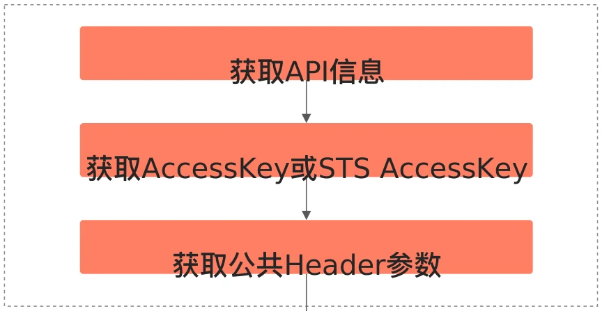


准备工

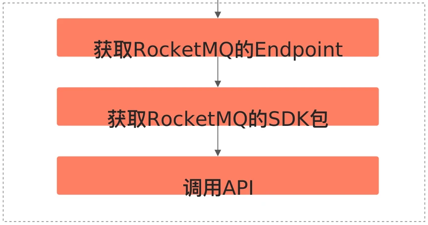


正式调

**调用步骤**

1. 获取AccessKey。

   获取调用时所需要的AccessKey参数，请参见获取AccessKey。

   > **说明**
   >
   > 推荐使用个人AccessKey调用Apsara Uni-manager运营控制台及云产品接口。

2. 获取RegionID。

   获取调用时所需要的RegionID参数，请参见获取公共Header参数。

3. 获取组织ID与资源集ID。

   获取调用时所需要的组织ID和资源集ID参数，请参见获取公共Header参数。

   > **说明**
   >
   > 调用API时，通过Header参数组织ID（&lt;x-acs-organizationid>）和资源集ID（&lt;x-acs-resourcegroupid>）指定组织和资源集，实现实例资源的隔离查询。
   >
   > - 组织ID（&lt;x-acs-organizationid>）不指定则默认获取当前用户所属的组织。
   >
   > - 资源集ID（&lt;x-acs-resourcegroupid>）不指定默认为空，如果指定资源集需要同时指定组织ID。

4. 查找API的开发文档。

   您需要查看目标云产品的开发指南，了解API的功能与使用方式，查找开发指南的方式请参见开发文档使用说明。

5. 获取云产品Endpoint。

6. 获取云产品SDK并调用云产品API。

<a id="section-1-1-2"></a>

### 1.1.2. 通过POP网关调用专有云API

<a id="section-1-1-2-1"></a>

#### 1.1.2.1. 概述

阿里云专有云与公共云一样，可通过POP网关的方式进行API调用。本文为您介绍概述情况。

**背景信息**

通过POP网关调用专有云API，可以实现对管控层资源（如实例、Topic、Group等）的增删改查等操作。平台已封装支持Java语言的SDK，您可以通过在平台中下载该SDK直接调用专有云API。

文档中SDK关于API的示例代码仅供参考，各API的完整使用步骤与参数说明请参见开发者门户SDK示例和 OpenAPI文档。

**环境要求**

- 支持JDK8~JDK19

- Platform支持：Linux、Mac、Windows

**语言**

当前仅支持Java语言。

**发布历史**

**SDK版本**

| 版本号 | 发布时间 | 更新内容 |
| --- | --- | --- |
| 3.16.2-0 | 2024.09 | 全新发布专有云3.16.2对外API的SDK。 |

**API列表**

当前专有云企业版SDK支持的API列表。

| API名称 | 所在版本 |
| --- | --- |
| BindSystemTags | 3.16.2-0 |
| CheckFortestConsumerId | 3.16.2-0 |
| CheckFortestInstance | 3.16.2-0 |
| CheckFortestRamAction | 3.16.2-0 |
| CheckFortestTopic | 3.16.2-0 |
| CreateCloudInfo | 3.16.2-0 |
| CreateCloudRouterTask | 3.16.2-0 |
| CreateDeploymentMqConnector | 3.16.2-0 |
| CreateEmpower | 3.16.2-0 |
| CreateEmpowerBySub | 3.16.2-0 |
| CreateGroup | 3.16.2-0 |
| CreateGroupEmpowerBySub | 3.16.2-0 |
| CreateInstance | 3.16.2-0 |
| CreateTopic | 3.16.2-0 |
| CreateUnitResetTask | 3.16.2-0 |
| CreateVpcTunnelInstanceSingleTunnel | 3.16.2-0 |
| DeleteCloudInfo | 3.16.2-0 |
| DeleteCloudRouterTask | 3.16.2-0 |
| DeleteDeploymentMqConnector | 3.16.2-0 |
| DeleteEmpower | 3.16.2-0 |
| DeleteGroup | 3.16.2-0 |
| DeleteGroupEmpower | 3.16.2-0 |
| DeleteInstance | 3.16.2-0 |
| DeleteTopic | 3.16.2-0 |
| DeleteTraceQueryTask | 3.16.2-0 |
| DeleteVpcTunnelInstanceSingleTunnel | 3.16.2-0 |
| DeployDeploymentMqConnector | 3.16.2-0 |
| DownloadMessage | 3.16.2-0 |
| DownloadMessageAllInDLQ | 3.16.2-0 |
| DownloadMessageBodyInDLQ | 3.16.2-0 |
| PageQueryCloudRouterTask | 3.16.2-0 |
| PageQueryGroupList | 3.16.2-0 |
| PageQueryTopicList | 3.16.2-0 |
| PageQueryTraceListByUserId | 3.16.2-0 |
| PauseMqConnector | 3.16.2-0 |
| PushMessage | 3.16.2-0 |
| QueryAllConsumerAccumulation | 3.16.2-0 |
| QueryCloudInfo | 3.16.2-0 |
| QueryCloudRouterItems | 3.16.2-0 |
| QueryCloudRouterTask | 3.16.2-0 |
| QueryCloudRouterTaskStats | 3.16.2-0 |
| QueryClusterCapacity | 3.16.2-0 |
| QueryClusterList | 3.16.2-0 |
| QueryCommonGenRedirectUrl | 3.16.2-0 |
| QueryCommonRegionData | 3.16.2-0 |
| QueryConsumerAccumulate | 3.16.2-0 |
| QueryConsumerConnection | 3.16.2-0 |
| QueryConsumerJstackInfo | 3.16.2-0 |
| QueryConsumerProgress | 3.16.2-0 |
| QueryConsumerStatus | 3.16.2-0 |
| QueryConsumerTimespan | 3.16.2-0 |
| QueryEmpowerList | 3.16.2-0 |
| QueryGroupEmpowerList | 3.16.2-0 |
| QueryGroupIdList | 3.16.2-0 |
| QueryGroupList | 3.16.2-0 |
| QueryGroupSubDetail | 3.16.2-0 |
| QueryInstanceBaseInfo | 3.16.2-0 |
| QueryInstanceList | 3.16.2-0 |
| QueryInstanceStatistics | 3.16.2-0 |
| QueryMessageById | 3.16.2-0 |
| QueryMessageByIdInDLQ | 3.16.2-0 |
| QueryMessageByKey | 3.16.2-0 |
| QueryMessageByPagedDLQ | 3.16.2-0 |
| QueryMessageByPagedTopic | 3.16.2-0 |
| QueryMetaData | 3.16.2-0 |
| QueryMqConnectorDeploymentList | 3.16.2-0 |
| QueryMqConnectorInfoList | 3.16.2-0 |
| QueryMqConnectorMetricsDetailList | 3.16.2-0 |
| QueryMqConnectorSysResourceName | 3.16.2-0 |
| QueryPubTraceByQueryId | 3.16.2-0 |
| QueryRegionConsoleUrlList | 3.16.2-0 |
| QueryRegionList | 3.16.2-0 |
| QueryRouterInstanceList | 3.16.2-0 |
| QueryRouterTopicList | 3.16.2-0 |
| QuerySubscriptionList | 3.16.2-0 |
| QuerySystemTagList | 3.16.2-0 |
| QueryTopic | 3.16.2-0 |
| QueryTopicList | 3.16.2-0 |
| QueryTopicListByGroupId | 3.16.2-0 |
| QueryTopicNameList | 3.16.2-0 |
| QueryTopicStatus | 3.16.2-0 |
| QueryTopicSubDetail | 3.16.2-0 |
| QueryTraceByMsgId | 3.16.2-0 |
| QueryTraceByMsgKey | 3.16.2-0 |
| QueryTraceByMsgTopic | 3.16.2-0 |
| QueryTraceMapByQueryId | 3.16.2-0 |
| QueryTrendFlowLimit | 3.16.2-0 |
| QueryTrendGroupOutputTps | 3.16.2-0 |
| QueryTrendTopicInputTps | 3.16.2-0 |
| QueryUnitLatestConsumerTime | 3.16.2-0 |
| QueryUnitResetTask | 3.16.2-0 |
| QueryVpcTunnelInstanceSingleTunnelList | 3.16.2-0 |
| QueryVpcTunnelTunnelSwitch | 3.16.2-0 |
| ResendMessageByIdInDLQ | 3.16.2-0 |
| ResetConsumerOffset | 3.16.2-0 |
| ResumeMqConnector | 3.16.2-0 |
| SearchRouterTask | 3.16.2-0 |
| SearchSubscription | 3.16.2-0 |
| SendMessage | 3.16.2-0 |
| StartCloudRouterTask | 3.16.2-0 |
| StopCloudRouterTask | 3.16.2-0 |
| TraceMessage | 3.16.2-0 |
| UnbindSystemTags | 3.16.2-0 |
| UpdateCloudInfo | 3.16.2-0 |
| UpdateCloudRouterTask | 3.16.2-0 |
| UpdateConsumerReadableByTopicAndGroup | 3.16.2-0 |
| UpdateGroupConsumer | 3.16.2-0 |
| UpdateGroupInfo | 3.16.2-0 |
| UpdateInstance | 3.16.2-0 |
| UpdateMqConnectorDeployment | 3.16.2-0 |
| UpdateTopic | 3.16.2-0 |
| UpdateTopicInfo | 3.16.2-0 |

<a id="section-1-1-2-2"></a>

#### 1.1.2.2. 调用前置

阿里云专有云与公共云一样，可通过POP网关的方式进行API调用。本文为您介绍调用前需要进行的准备工作。

**背景信息**

为了使专有云保持与公共云相同的使用方式，使您拥有更方便，更一致的体验，建议通过POP网关调用专有云API。

**获取云产品的Endpoint**

**通过开发者门户获取**

1. 登录Apsara Uni-manager运营控制台。

2. 在顶部菜单栏选择**产品** > **开发工具** > **API与工具** > **开发者门户**。

3. 在**开发者门户**页面，选择**API集成** > **API调试**。

   

4. 在左侧导航栏中选择目标云产品。

5. 在**版本**下拉列表中，选择目标API版本。

6. 在下方API列表中可浏览当前版本的所有API接口。

7. 选中对应接口，在参数名下获取云产品的POP Endpoint信息。

   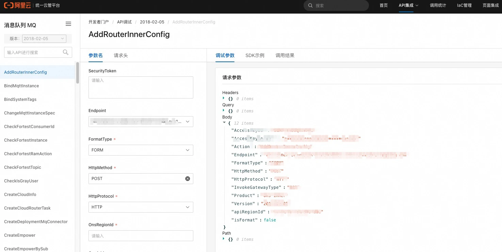

**通过飞天基础运维平台获取**

通过POP网关调用专有云API时需要使用云产品业务域的Endpoint。您可以在阿里云驻场运维工程师处获取。您也可以自行获取Endpoint，本文为您介绍获取云产品业务域Endpoint的方法。

1. 登录Apsara Uni-manager运维控制台。

2. 顶部菜单栏选择**平台运维** > **飞天基础运维平台** > **运维工具**。

3. 在左侧导航栏，选择**运维工具** > **服务注册变量大盘**。

4. 在**服务注册变量大盘**页面，单击**高级筛选**。

5. 在Service Registration文本框中输入 `ons_bizapi_endpoint` ，单击**搜索**。

   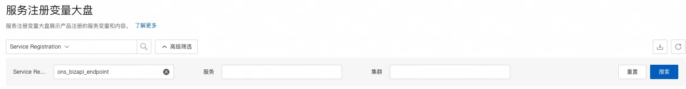

6. 在 `mq-console` 服务的**Service Registration**列中，单击  图标。

7. 单击 `mq-console` 服务**Service Registration**列的文本信息，在弹出的**注册变量**对话框中，查看ons_bizapi_endpoint值，即 `Endpoint` 。

**获取公共参数**

通过POP网关调用专有云API过程中所使用的参数，如组织ID、资源集ID、RegionID和实例ID，获取方式请参见获取公共Header参数。

<a id="section-1-1-2-3"></a>

#### 1.1.2.3. Java版

本文为您介绍通过POP网关的方式进行API调用时，高级SDK的使用示例。

**安装说明**

**开发者门户获取SDK包**

1. 登录Apsara Uni-manager运营控制台。

2. 在顶部菜单栏选择**产品** > **开发工具** > **API与工具** > **开发者门户**。

3. 在**开发者门户**页面，选择**API集成** > **SDK示例**。

   

4. 单击  按钮，选择**中间件** > **消息队列MQ**，**版本**选择**2018-02-05**。

5. 从**SDK类型**下拉列表中选择**高级版**，选择Java语言。

   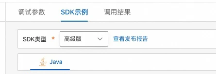

6. 下方可看到示例代码，点击**下载完整工程**以获取示例项目及SDK包。

   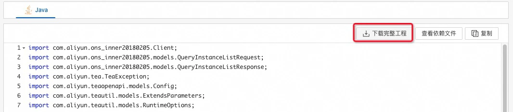

**导入SDK包**

1. 通过以下任一方式创建Maven项目。

   方式一：在IDEA中添加一个Maven项目。

   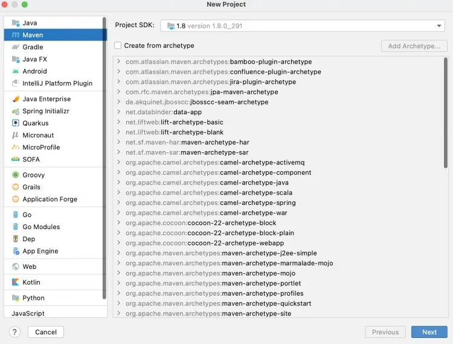

   方式二：将已有的项目转换为Maven项目。

   <ol type="i">

   <li>

   右键单击要转换的项目，并选择**Add Framework Support...**。

   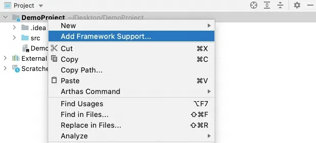

   </li>

   <li>

   选择**Maven**，并单击**OK。**

   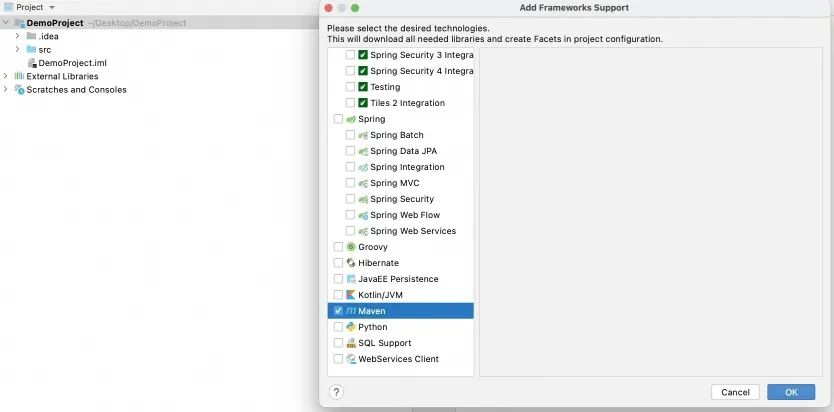

   </li>

   </ol>

2. 在项目根目录下创建lib目录，通过开发者门户获取SDK包后放入到lib目录下，如下图。

   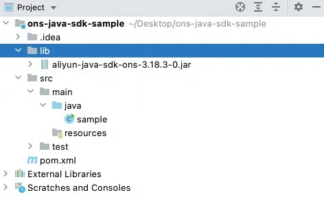

3. 在项目目录下的pom.xml中，添加Java SDK依赖。

   ```xml
   <dependencies>
       <dependency>
           <groupId>com.aliyun.apsarastack</groupId>
           <artifactId>aliyun-java-sdk-ons</artifactId>
           <version>3.18.3-0</version>
           <scope>system</scope>
           <systemPath>${project.basedir}/lib/aliyun-java-sdk-ons-3.18.3-0.jar</systemPath>
       </dependency>
   </dependencies>
   ```

4. 查看IDEA右侧Maven栏。

   如图所示，表示已成功导入依赖。

   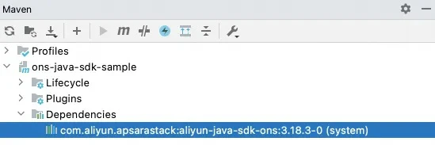

**代码示例**

示例展示了如何调用 `QueryInstanceList` API进行 查询`MQ`实例列表 请求。

```java
import com.aliyun.ons_inner20180205.Client;
import com.aliyun.ons_inner20180205.models.QueryInstanceListRequest;
import com.aliyun.ons_inner20180205.models.QueryInstanceListResponse;
import com.aliyun.tea.TeaException;
import com.aliyun.teaopenapi.models.Config;
import com.aliyun.teautil.models.ExtendsParameters;
import com.aliyun.teautil.models.RuntimeOptions;

import java.util.HashMap;
import java.util.Map;

public class sample {
    public static void main(String[] args) throws Exception {
        // 1.初始化配置对象 com.aliyun.teaopenapi.models.Config
        Config config = new Config()
                // 地域ID
                .setRegionId("<your-regionId>")
                // 您的AccessKey ID
                .setAccessKeyId("<AccessKey ID>")
                // 您的AccessKey Secret
                .setAccessKeySecret("<AccessKey Secret>")
                // ⽀持通过Config在初始化Client阶段设置请求的代理，根据实际情况替换下⾯示例。
                .setHttpProxy("http://127.0.0.1:9898");
        // 访问的域名，可以参考开发者⻔户API调试⻚⾯获取 Endpoint
        config.endpoint = "<your Endpoint>";

        // 2.实例化⼀个客户端，从 com.aliyun.ons_inner20180205.Client 类⽣成对象 client 。 后续 request、resp
onse 从 com.aliyun.ons_inner20180205.models 中获得。
        Client client = new Client(config);

        // 3.运⾏时参数设置
        RuntimeOptions runtime = new RuntimeOptions();
        Map<String, String> headers = new HashMap<>();
        // 组织id
        headers.put("x-acs-organizationid", "<your-organizationId>");
        // 资源组id
        headers.put("x-acs-resourcegroupid", "<your-resourcegroupId>");
        // ⾓⾊id
        headers.put("x-acs-roleId", "<your-roleId>");
        runtime.setExtendsParameters(new ExtendsParameters().setHeaders(headers));
        // ⽀持通过运⾏时参数（RuntimeOptions）配置当前请求的代理，代理配置优先级：RuntimeOption配置 > Client配置
，根据需要选择⼀种即可。
        runtime.setHttpProxy("http://127.0.0.1:9898");
        runtime.ignoreSSL = true;
        runtime.setConnectTimeout(3000);
        runtime.setReadTimeout(30000);

        // 4.设置请求类 request 的参数，类的属性设置必要的信息，即 API 中必须要提供的信息可以参考具体的API⽂档。
        QueryInstanceListRequest request = new QueryInstanceListRequest();
        // 该参数值为假设值，请您根据实际业务情况进⾏填写
        request.setNeedResourceInfo(true);
        // 该参数值为假设值，请您根据实际业务情况进⾏填写
        request.setOnsSessionId("your_value");
        // 该参数值为假设值，请您根据实际业务情况进⾏填写
        request.setOnsRegionId("your_value");
        // 该参数值为假设值，请您根据实际业务情况进⾏填写
        request.setPreventCache(System.currentTimeMillis());
        
        try{
            // 5.通过 client 对象获得对应 request 响应 response 。
            QueryInstanceListResponse response = client.queryInstanceListWithOptions(request, 
runtime);
            // 6.调⽤ response 中对应的属性获得返回的参数值，假设您需要获取 requestId ：
            String requestId = response.body.getRequestId();
            // 打印返回结果仅做示例，请您根据实际业务情况替换
            System.out.println(com.aliyun.teautil.Common.toJSONString(response));
        } catch (TeaException error) {
            // 使⽤ catch() 处理报错。
            // 此处仅做打印展示，请谨慎对待异常处理，在⼯程项⽬中切勿直接忽略异常。
            System.out.println(error.message);
        } catch (Exception _error) {
            // 使⽤ catch() 处理报错。
            TeaException error = new TeaException(_error.getMessage(), _error);
            // 此处仅做打印展示，请谨慎对待异常处理，在⼯程项⽬中切勿直接忽略异常。
            System.out.println(error.getMessage());
        }
    }
}
```

**步骤介绍**

1. 初始化配置对象com.aliyun.teaopenapi.models.Config。Config对象存放AccessKeyId、AccessKeySecret、Endpoint等配置，该配置信息参考获取AccessKey和获取API信息及其EndPoint进行获取。

   ```text
   Config config = new Config()
   // 您的AccessKey ID
   .setAccessKeyId(System.getenv("ALIBABA_CLOUD_ACCESS_KEY_ID"))
   // 您的AccessKey Secret
   .setAccessKeySecret(System.getenv("ALIBABA_CLOUD_ACCESS_KEY_SECRET"));
   // 访问的域名
   config.endpoint = "************";
   ```

2. 实例化一个客户端，从com.aliyun.ons_inner20180205.Client类生成对象client 。 后续request response从com.aliyun.ons_inner20180205.models中获得。

   ```text
   Client client = new Client(config);
   ```

3. 创建对应API的Request 。 类的命名规则为API方法名加上Request。例如：

   ```text
   QueryInstanceListRequest request = new QueryInstanceListRequest();
   ```

4. 设置请求类request的参数。 通过request类的属性设置必要的信息，即API中必须要提供的信息。

   ```text
   request.SourceRegionId = "your_value"; // 该参数值为假设值，请您根据实际情况进⾏填写
   request.RegionId = "your_value"; // 该参数值为假设值，请您根据实际情况进⾏填写
   ```

5. 通过client对象获得对应request响应response 。

   ```java
   QueryInstanceListResponse response = client.queryInstanceListWithOptions(request, runtime);
   System.out.println(new Gson().toJson(response.Body));
   ```

6. 调用response中对应的属性获得返回的参数值。 假设您需要获取requestId，例如：

   ```text
   String requestId = response.Body.requestId;
   ```

7. 使用catch()处理报错。

   ```text
   catch (Exception e) {
       e.printStackTrace();
   }
   ```

<a id="section-1-1-3"></a>

### 1.1.3. 准备工作

<a id="section-1-1-3-1"></a>

#### 1.1.3.1. 获取API信息及其EndPoint

首先，您需要了解产品开放API接口的相关信息，包括产品名称（code）、开放API接口名称、API版本。

**背景信息**

Apsara Uni-manager运营控制台API目录中的API信息仅供调用参考，具体API的使用方式需要参见云产品的开发指南。如果发生不一致情况，以开发指南支持情况为准。

**操作步骤**

1. 登录Apsara Uni-manager运营控制台。

2. 在顶部菜单栏选择**产品** > **开发工具** > **API与工具** > **开发者门户**。

3. 在**开发者门户**页面，选择**API集成** > **API调试**。

   

4. 在左侧导航栏中选择目标云产品。

5. 在**版本**下拉列表中，选择目标API版本。

6. 在下方API列表中可浏览当前版本的所有API接口。

7. 选中对应接口，在参数名下获取云产品的POP Endpoint信息。

   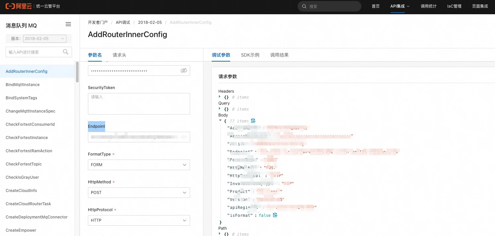

<a id="section-1-1-3-2"></a>

#### 1.1.3.2. 获取AccessKey

AccessKey支持RAM和STS两种授权模式，在发起调用时选择使用其中一种AccessKey即可。本文将为您介绍如何获取通过RAM授权的AccessKey。

**背景信息**

AccessKey通过使用AccessKey ID和AccessKey Secret对称加密，实现验证某个请求发送者的身份的功能。其中AccessKey ID用于标识用户，AccessKey Secret是用户用于加密签名的字符串。

AccessKey的两种授权模式如下：

- 通过RAM授权给第三方请求者的AccessKey ID和AccessKey Secret。

- 通过STS授权给第三方请求者的AccessKey ID、AccessKey Secret和Security Token。获取方式请参见获取STS AccessKey。

Apsara Uni-manager运营控制台提供了个人AccessKey和组织AccessKey（只有运营管理员和一级组织管理员可以获取组织AccessKey），推荐使用个人账号AccessKey调用Apsara Uni-manager运营控制台及云产品相关接口。如果使用个人账号AccessKey，需要在Header中添加以下限制性参数，否则可能提示权限不足：

> **警告**
>
> 个人账号AccessKey是由Apsara Uni-manager运营控制台权限体系管控的受限AccessKey，组织AccessKey相对权限较大，需要管理员确认操作的安全性。

<table>
  <tr>
    <th width="206">参数名称</th>
    <th>描述</th>
  </tr>
  <tr>
    <td>x-acs-regionid</td>
    <td>地域，如：cn-hangzhou-*。</td>
  </tr>
  <tr>
    <td>x-acs-organizationid</td>
    <td>Apsara Uni-manager运营控制台中对应的组织ID。获取方法可参见<strong>《Apsara Uni-manager运营控制台开发指南》</strong>中的<strong>《GetOrganizationList》</strong>文档。</td>
  </tr>
  <tr>
    <td>x-acs-resourcegroupid</td>
    <td>Apsara Uni-manager运营控制台中对应的资源集ID。获取方法可参见<strong>《Apsara Uni-manager运营控制台开发指南》</strong>中的<strong>《ListResourceGroup》</strong>文档。</td>
  </tr>
  <tr>
    <td>x-acs-instanceid</td>
    <td>进行操作的实例ID，例如，ECS的实例ID可以从ECS列表中查询到。</td>
  </tr>
</table>

**获取个人账号AccessKey**

获取个人账号AccessKey的方法如下：

1. 登录Apsara Uni-manager运营控制台。

2. 在系统界面右上角，单击当前登录用户头像，单击**个人信息**。

3. 在**AccessKey**区域，您可以查看个人账户的AccessKey信息。

   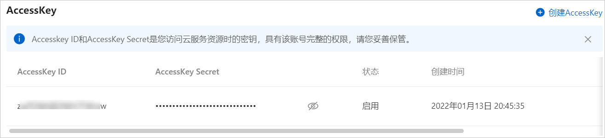

   > **说明**
   >
   > AccessKey ID和AccessKey Secret是您访问云资源时的密钥，具有该账号完整的权限，请您妥善保管。

**获取组织AccessKey**

获取组织AccessKey的方法如下：

1. 管理员登录Apsara Uni-manager运营控制台。

2. 在顶部菜单栏，单击**企业**。

3. 在左侧导航栏中，选择**资源管理 > 组织管理**。

4. 在组织结构中，单击目标一级组织名称。

5. 单击**管理Accesskey**。

6. 在弹出的对话框中，查看组织AccessKey信息。

<a id="section-1-1-3-3"></a>

#### 1.1.3.3. 获取公共Header参数

调用API时需要提供多个Header参数。本文为您介绍如何获取这些参数。并对调用后的一些返回值做出解释。

**获取Region ID**

1. 管理员登录Apsara Uni-manager运营控制台。

2. 在顶部菜单栏中，单击**企业**。

3. 在左侧导航栏中，选择**资源管理**>**地域管理**。

4. 单击目标组织名称。

5. 在右侧**Region列表**中查看**Region名称**，即为Region ID。

**获取组织ID**

组织ID需要通过调用API方式获取，您可以在Apsara Uni-manager运营控制台中通过API在线调试功能快速获取组织ID信息。

1. 管理员登录Apsara Uni-manager运营控制台。

2. 单击顶部菜单栏**产品**，选择**开发工具** > **API与工具** > **开发者门户**。

3. 在**开发者门户**页面，选择**API集成** > **API调试**。

4. 单击  按钮，选择**云平台** > **统一云管平台**，**版本**选择**2019-05-10**。

5. 在文本框内输入 `GetOrganizationList` 进行在线调试，在name参数填写目标组织名称后发起调用，调用成功后查看**调用结果**中**id**的信息，即为组织ID。接口信息详见*Apsara Uni-manager运营控制台开发指南*中的章节*GetOrganizationLis t*。

**获取资源集ID**

资源集ID需要通过调用API方式获取，您可以在Apsara Uni-manager运营控制台中通过API在线调试功能快速获取资源集ID信息。

1. 管理员登录Apsara Uni-manager运营控制台。

2. 单击顶部菜单栏**产品**，选择**开发工具** > **API与工具** > **开发者门户**。

3. 在**开发者门户**页面，选择**API集成** > **API调试**。

4. 单击  按钮，选择**云平台** > **统一云管平台**，**版本**选择**2019-05-10**。

5. 在文本框内输入 `ListResourceGroup` 进行在线调试，调用成功后查看**调用结果**中**id**的信息，即为资源集ID。接口信息详见*Apsara Uni-manager运营控制台开发指南*中的章节*ListResourceGroup*。

**获取实例ID**

实例ID可以通过Apsara Uni-manager运营控制台中的云产品实例列表进行获取，本文中以API网关为例，获取步骤如下：

1. 登录Apsara Uni-manager运营控制台。

2. 在顶部的菜单栏中，选择**产品** > **中间件** > **消息队列** > **消息队列 RocketMQ 版**。

3. 在左侧导航栏中，单击**实例列表**。

4. 在实例列表中查看**实例ID**。

**返回参数**

对于列表类的云产品资源实例接口，调用后会默认增加如下返回值。

| 名称 | 描述 |
| --- | --- |
| ResourceGroupName | 资源集名称。 |
| ResourceGroup | 资源集ID。 |
| DepartmentName | 组织名称。 |
| Department | 组织ID。 |

<a id="section-1-1-3-4"></a>

#### 1.1.3.4. 获取STS AccessKey

本文为您介绍如何利用STS方式，调用专有云的产品API。

**背景信息**

阿里云临时安全令牌STS（Security Token Service）是阿里云提供的一种临时访问权限管理服务。您可以选择利用STS方式，调用专有云的产品API。

**操作步骤**

1. 获取用户角色的 `RAM Role` 。

   <ol type="i">

   <li>

   登录Apsara Uni-manager运营控制台。

   </li>

   <li>

   单击页面右上角的用户头像，选择**个人信息**。

   </li>

   <li>

   单击**查看当前角色策略**。

   在**当前选择角色策略**对话框中查看 `RAM Role` 。

   </li>

   </ol>

2. 使用以下代码，通过角色的 `RAM Role` 获得 `stsAK` 、 `stsSK` 和 `stsToken` 。

   ```java
   public static void main(String[] args) {
        ASClient asClient = new ASClient();
        // 调⽤来源说明
           asClient.setSdkSource("test");
        // 传入Arn
           String assumeRole = AssumeRole(asClient, "<RAM Role>");

           JSONObject assumeRoleJson = JSONObject.parseObject(assumeRole);

           JSONObject credentials = assumeRoleJson.getJSONObject("Credentials");

           // 获取到STS三元组
           String stsAK = credentials.getString("AccessKeyId");
           String stsSK = credentials.getString("AccessKeySecret");
           String stsToken = credentials.getString("SecurityToken");
   }

   public static String AssumeRole(ASClient asClient, String roleArn) {

           Map<String, String> headers = new HashMap<>();

           Map<String, Object> reqParams = new HashMap<>();

           reqParams.put("action", "AssumeRole");

           reqParams.put("Product", "Sts");

           reqParams.put("Version", "2015-04-01");

           reqParams.put("regionId", regionId);

        // 当前登录⽤户的ak
           reqParams.put("AccessKeyId", <当前⽤户的AccessKey ID>);
        // 当前登录⽤户的sk
           reqParams.put("AccessKeySecret", <当前⽤户的AccessKey Secret>);

           reqParams.put("roleSessionName", "StsUser");

           reqParams.put("roleArn", roleArn);

           return asClient.doRequest(endpoint, headers, reqParams);
   }
   ```

3. 通过STS可以调用云产品的接口，示例如下。

   ```java
   import com.aliyun.credentials.Client;
   import com.aliyun.credentials.models.Config;

   // 以下示例演示如何使⽤STS Token初始化凭据客户端（不包含如何获取到STS Token的过程）。
   public class DemoStsTest {
       public static void main(String[] args) {
           Config credentialConfig = new Config();
           credentialConfig.setType("sts");
           // 请替换为前⼀步获取到的STS三元组中AccessKeyI。
           credentialConfig.setAccessKeyId("your_AccessKeyId");
           // 请替换为前⼀步获取到的STS三元组中AccessKeySecret
           credentialConfig.setAccessKeySecret("your__AccessKeySecret");
           // 请替换为前⼀步获取到的STS三元组中SecurityToken
           credentialConfig.setSecurityToken("your__SecurityToken");
           Client credentialClient = new Client(credentialConfig);

           // 继续调⽤API，完整参考的API⽂档
       }
   }
   ```

<a id="section-1-2"></a>

## 1.2. 接口文档

<a id="section-1-2-1"></a>

### 1.2.1. 智能体

<a id="section-1-2-1-1"></a>

#### 1.2.1.1. 智能体

<a id="section-1-2-1-1-1"></a>

##### 1.2.1.1.1. PostAgentOpenapiAgentVersionPagequery

查询智能体版本列表

**请求头**

| 参数名称 | 类型 | 位置 | 是否必选 | 示例 | 说明 |
| --- | --- | --- | --- | --- | --- |
| x-sfm-authorizatio n | String | Header | 否 | Bearer YOUR_APP_KEY | APP_KEY |
| x-sfm-workspaceco de | String | Header | 是 | your_workspace_code | 目标工作空间，该参数必填 |
| Content-Type | String | Header | 是 | application/json | Content-Type，该参数必填 |

**请求参数**

| 参数名称 | 类型 | 位置 | 是否必选 | 示例 | 说明 |
| --- | --- | --- | --- | --- | --- |
| current | Integer | Body | 是 | 1 | 当前页数，该参数必填 |
| pageSize | Integer | Body | 是 | 10 | 每页条数，该参数必填 |
| agentCode | String | Body | 是 | 905a3aaa-5797-47fb-ac71-b8dcd88b9ac0 | 智能体编码，该参数必填 |
| versionNam e | String | Body | 是 | 1.0 | 版本名称模糊搜索，该参数必填 |

**返回参数**

| 字段 | 数据类型 | 描述 | 示例 |
| --- | --- | --- | --- |
| success | Boolean | 是否成功 | true |
| data | Object | 返回数据 | {} |
| total | Integer | 查询到的智能体版本总数 | 1 |
| list | List | 查询到的智能体版本列表 |  |
| agentCode | String | 智能体唯一编码 | a9c81580-8e93-42e1-b331-5cc6506c0093 |
| agentName | String | 智能体名称 | DB 随表召回 |
| agentDefinition | String | 智能体描述 | DB 随表召回 |
| versionName | String | 版本名称 | 知识库检查 |
| agentVersion | String | 版本编码 | 1757388497303 |
| agentStatus | String | 版本状态。DEV=设计中, ONLINE=已上线, OFFLINE=已下线 | DEV |
| gmtCreate | String | 创建时间 | 2025-08-29T11:43:54.722+00:00 |
| gmtModified | String | 修改时间 | 2025-08-29T11:43:54.722+00:00 |
| pageSize | Integer | 每页大小 | 60 |
| current | Integer | 目前所在页数 | 1 |
| errorCode | String | 错误码 | true |
| errorMsg | String | 错误描述 | true |

**示例**

`JSON`  格式

```json
{
  "errorMessages": [],
  "success": true,
  "data": {
    "extInfos": {},
    "total": 1,
    "list": [
      {
        "id": 759,
        "gmtCreate": "2025-11-11T12:19:54.315+00:00",
        "gmtModified": "2025-11-11T12:19:54.315+00:00",
        "tenant": "fmthktsjdb",
        "agentCode": "9456fd9d-1a55-43b0-b383-f1331e81e69d",
        "agentName": "testAgent",
        "agentVersion": "1762863594309",
        "versionName": "版本1",
        "agentDefinition": "testUpdate",
        "developer": {
          "id": null,
          "gmtCreate": null,
          "gmtModified": null,
          "tenant": null,
          "uniqueCode": "7b7d340c8ec04c9db0c8c072e3d5e690",
          "source": null,
          "outerId": null,
          "name": "⽇常管理员"
        },
        "pd": {
          "id": null,
          "gmtCreate": null,
          "gmtModified": null,
          "tenant": null,
          "uniqueCode": "7b7d340c8ec04c9db0c8c072e3d5e690",
          "source": null,
          "outerId": null,
          "name": "⽇常管理员"
        },
        "agentStatus": "DEV",
        "engineConfig": {
          "engineName": "processAgentEngine",
          "considerServiceName": "DefaultConsiderService",
          "protocolParserName": null,
          "supportTaskBuilderName": null,
          "maxCountsOfConsider": null,
          "maxResponseWaitMs": null,
          "enginePolicy": "ReAct",
          "flowType": null
        },
        "modelConfig": null,
        "scriptConfig": {
          "engineName": null,
          "script": null
        },
        "availableToolsConfig": null,
        "createType": null,
        "method": null,
        "configMethod": null,
        "icon": null,
        "jumpUrl": null,
        "flowType": "workflow",
        "templateType": null,
        "canDeployTemplate": false
      }
    ],
    "pageSize": 10,
    "current": 1,
    "totalPages": 1
  },
  "errorCode": null,
  "errorMsg": null,
  "extraData": null,
  "traceId": null,
  "env": null,
  "other": null,
  "firstErrorMessage": null,
  "failure": false
}
```

**文档补充说明**

| Http状态返回码 | 错误描述 | 错误释义 |
| --- | --- | --- |
| 401 | GATEWAY APP_KEY MISSING! | 网关必填参数缺失 |
| 401 | GATEWAY APP_KEY WRONG! | 鉴权失败,无效 APP_KEY |
| 401 | GATEWAY APP_KEY ALREADY EXPIRED! | 鉴权失败,APP_KEY 已过期 |
| 401 | GATEWAY ROLE NOT MATCH! | 鉴权失败,当前 APP_KEY 归属用户对应的角色不匹配 |
| 401 | GATEWAY ROLE HAS EXPIRED! | 鉴权失败,当前 APP_KEY 归属用户对应的角色已过期 |
| 403 | GATEWAY APP_PATH NOT FOUND! | 无效的服务调用路径 |
| 403 | GATEWAY APP_PATH NOT REGISTER! | 当前服务调用路径未注册 |
| 429 | GATEWAY LIMIT ! | 服务触发限流,请稍后再试 |
| 429 | GATEWAY LIMIT CURRENT CALL TYPE! | 服务触发限流,请稍后再试 |
| 403 | GATEWAY HEADER PARAMETER MISSING! | 业务所需必填参数缺失 |
| 403 | GATEWAY PARAMETER WORKSPACE NO MATCH! | 传递的工作空间编码与APP_KEY归属用户关联的工作空间编码不匹配 |
| 401 | GATEWAY AUTH_TYPE WRONG! | 鉴权失败,不支持的鉴权方式 |
| 401 | GATEWAY AUTH_USER NOT MATCH WRONG! | 鉴权失败,AK用户信息不匹配 |
| 401 | GATEWAY AUTH_USER_ROLE WRONG! | 鉴权失败,用户角色不匹配 |

<a id="section-1-2-1-1-2"></a>

##### 1.2.1.1.2. PostAgentOpenapiMemoryLongtermPartitionAdd

写入记忆分区内容

**请求头**

| 参数名称 | 类型 | 位置 | 是否必选 | 示例 | 说明 |
| --- | --- | --- | --- | --- | --- |
| x-sfm-authorizatio n | String | Header | 否 | Bearer YOUR_APP_KEY | APP_KEY |
| x-sfm-workspaceco de | String | Header | 是 | your_workspace_code | 目标工作空间，该参数必填 |
| Content-Type | String | Header | 是 | application/json | Content-Type，该参数必填 |

**请求参数**

| 参数名称 | 类型 | 位置 | 是否必选 | 示例 | 说明 |
| --- | --- | --- | --- | --- | --- |
| partitionCod e | String | Body | 是 | 1111 | 分区编码，该参数必填 |
| storageKey | String | Body | 是 | key | 键值对-KEY，该参数必填 |
| storageValu e | String | Body | 是 | value | 键值对-VALUE，该参数必填 |
|  |  |  |  |  |  |
| 参数名称 | 类型 | 位置 | 是否必选 | 示例 | 说明 |

<table>
  <tr>
    <td>storageCont ent</td>
    <td>String</td>
    <td>Body</td>
    <td>是</td>
    <td>example</td>
    <td>文本，该参数必填</td>
  </tr>
  <tr>
    <td>memoryUser Id</td>
    <td>String</td>
    <td>Body</td>
    <td>是</td>
    <td>1234</td>
    <td>记忆用户ID，该参数必填</td>
  </tr>
  <tr>
    <td>status</td>
    <td>Integer</td>
    <td>Body</td>
    <td>是</td>
    <td>0</td>
    <td>状态 0:正常 1:删除 2:禁用，该参数必填</td>
  </tr>
</table>

**返回参数**

| 字段 | 数据类型 | 描述 | 示例 |
| --- | --- | --- | --- |
| success | Boolean | 是否成功 | true |
| data | Object | 返回数据 | {} |
| memoryCode | String | 记忆编码 | a9c81580-8e93-42e1-b331-5cc6506c0093 |
| errorCode | String | 错误码 | true |
| errorMsg | String | 错误描述 | true |

**示例**

`JSON`  格式

```json
{
  "errorMessages": [],
  "success": false,
  "data": null,
  "errorCode": "-1",
  "errorMsg": "记忆分区不存在",
  "extraData": null,
  "traceId": null,
  "env": null,
  "other": null,
  "firstErrorMessage": null,
  "failure": false
}
```

**文档补充说明**

| Http状态返回码 | 错误描述 | 错误释义 |
| --- | --- | --- |
| 401 | GATEWAY APP_KEY MISSING! | 网关必填参数缺失 |
| 401 | GATEWAY APP_KEY WRONG! | 鉴权失败,无效 APP_KEY |
| 401 | GATEWAY APP_KEY ALREADY EXPIRED! | 鉴权失败,APP_KEY 已过期 |
| 401 | GATEWAY ROLE NOT MATCH! | 鉴权失败,当前 APP_KEY 归属用户对应的角色不匹配 |
| 401 | GATEWAY ROLE HAS EXPIRED! | 鉴权失败,当前 APP_KEY 归属用户对应的角色已过期 |
| 403 | GATEWAY APP_PATH NOT FOUND! | 无效的服务调用路径 |
| 403 | GATEWAY APP_PATH NOT REGISTER! | 当前服务调用路径未注册 |
| 429 | GATEWAY LIMIT ! | 服务触发限流,请稍后再试 |
| 429 | GATEWAY LIMIT CURRENT CALL TYPE! | 服务触发限流,请稍后再试 |
| 403 | GATEWAY HEADER PARAMETER MISSING! | 业务所需必填参数缺失 |
| 403 | GATEWAY PARAMETER WORKSPACE NO MATCH! | 传递的工作空间编码与APP_KEY归属用户关联的工作空间编码不匹配 |
| 401 | GATEWAY AUTH_TYPE WRONG! | 鉴权失败,不支持的鉴权方式 |
| 401 | GATEWAY AUTH_USER NOT MATCH WRONG! | 鉴权失败,AK用户信息不匹配 |
| 401 | GATEWAY AUTH_USER_ROLE WRONG! | 鉴权失败,用户角色不匹配 |

<a id="section-1-2-1-1-3"></a>

##### 1.2.1.1.3. PostAgentOpenapiAgentCreate

创建智能体

**请求头**

| 参数名称 | 类型 | 位置 | 是否必选 | 示例 | 说明 |
| --- | --- | --- | --- | --- | --- |
| x-sfm-authorizatio n | String | Header | 否 | Bearer YOUR_APP_KEY | APP_KEY |
| x-sfm-workspaceco de | String | Header | 是 | your_workspace_code | 目标工作空间，该参数必填 |
| Content-Type | String | Header | 是 | application/json | Content-Type，该参数必填 |

**请求参数**

| 参数名称 | 类型 | 位置 | 是否必选 | 示例 | 说明 |
| --- | --- | --- | --- | --- | --- |
| agentName | String | Body | 是 | DB 随表召回 | 智能体名称，该参数必填 |
| agentDesc | String | Body | 是 | DB 随表召回 | 智能体描述，该参数必填 |

**返回参数**

| 字段 | 数据类型 | 描述 |
| --- | --- | --- |
| success | Boolean | 是否成功 |
| data | Object | 返回数据 |
| agentCode | String | 智能体唯一编码 |
| agentName | String | 智能体名称 |
| agentDesc | String | 智能体描述 |
| workspaceCode | String | 所属工作空间编码 |
| gmtCreate | String | 创建时间 |
| gmtModified | String | 修改时间 |
| errorCode | String | 错误码 |
| errorMsg | String | 错误描述 |

**示例**

`JSON`  格式

```json
{
  "errorMessages": [],
  "success": true,
  "data": {
    "id": 189,
    "gmtCreate": "2025-11-11T12:00:00.308+00:00",
    "gmtModified": "2025-11-11T12:00:00.308+00:00",
    "tenant": "fmthktsjdb",
    "agentCode": "9456fd9d-1a55-43b0-b383-f1331e81e69d",
    "agentName": "testAgent",
    "agentDesc": "test",
    "icon": null,
    "label": null,
    "developer": {
      "id": null,
      "gmtCreate": null,
      "gmtModified": null,
      "tenant": null,
      "uniqueCode": "7b7d340c8ec04c9db0c8c072e3d5e690",
      "source": null,
      "outerId": null,
      "name": "daily_root"
    },
    "pd": {
      "id": null,
      "gmtCreate": null,
      "gmtModified": null,
      "tenant": null,
      "uniqueCode": "7b7d340c8ec04c9db0c8c072e3d5e690",
      "source": null,
      "outerId": null,
      "name": "daily_root"
    },
    "outputVersions": null,
    "workspaceCode": "fmthktsjdb",
    "agentApiLimitConfig": null
  },
  "errorCode": null,
  "errorMsg": null,
  "extraData": null,
  "traceId": null,
  "env": null,
  "other": null,
  "firstErrorMessage": null,
  "failure": false
}
```

**文档补充说明**

| Http状态返回码 | 错误描述 | 错误释义 |
| --- | --- | --- |
| 401 | GATEWAY APP_KEY MISSING! | 网关必填参数缺失 |
| 401 | GATEWAY APP_KEY WRONG! | 鉴权失败,无效 APP_KEY |
| 401 | GATEWAY APP_KEY ALREADY EXPIRED! | 鉴权失败,APP_KEY 已过期 |
| 401 | GATEWAY ROLE NOT MATCH! | 鉴权失败,当前 APP_KEY 归属用户对应的角色不匹配 |
| 401 | GATEWAY ROLE HAS EXPIRED! | 鉴权失败,当前 APP_KEY 归属用户对应的角色已过期 |
| 403 | GATEWAY APP_PATH NOT FOUND! | 无效的服务调用路径 |
| 403 | GATEWAY APP_PATH NOT REGISTER! | 当前服务调用路径未注册 |
| 429 | GATEWAY LIMIT ! | 服务触发限流,请稍后再试 |
| 429 | GATEWAY LIMIT CURRENT CALL TYPE! | 服务触发限流,请稍后再试 |
| 403 | GATEWAY HEADER PARAMETER MISSING! | 业务所需必填参数缺失 |
| 403 | GATEWAY PARAMETER WORKSPACE NO MATCH! | 传递的工作空间编码与APP_KEY归属用户关联的工作空间编码不匹配 |
| 401 | GATEWAY AUTH_TYPE WRONG! | 鉴权失败,不支持的鉴权方式 |
| 401 | GATEWAY AUTH_USER NOT MATCH WRONG! | 鉴权失败,AK用户信息不匹配 |
| 401 | GATEWAY AUTH_USER_ROLE WRONG! | 鉴权失败,用户角色不匹配 |

<a id="section-1-2-1-1-4"></a>

##### 1.2.1.1.4. PostAgentOpenapiAgentVersionCreate

创建智能体版本

**请求头**

| 参数名称 | 类型 | 位置 | 是否必选 | 示例 | 说明 |
| --- | --- | --- | --- | --- | --- |
| x-sfm-authorizatio n | String | Header | 否 | Bearer YOUR_APP_KEY | APP_KEY |
| x-sfm-workspaceco de | String | Header | 是 | your_workspace_code | 目标工作空间，该参数必填 |
| Content-Type | String | Header | 是 | application/json | Content-Type，该参数必填 |

**请求参数**

| 参数名称 | 类型 | 位置 | 是否必选 | 示例 | 说明 |
| --- | --- | --- | --- | --- | --- |
| agentCode | String | Body | 是 | 905a3aaa-5797-47fb-ac71-b8dcd88b9ac0 | 智能体编码，该参数必填 |
| versionNam e | String | Body | 是 | 版本1 | 版本描述，该参数必填 |
| flowType | String | Body | 是 | workflow | 创建模式，workflow=工作流，default=基于模版，该参数必填 |
| templateCod e | String | Body | 是 | 3b7628cc51544996908b6ea 55ae07bc1 | 模版编码，创建模式为基于模版时必填 |

**返回参数**

| 字段 | 数据类型 | 描述 | 示例 |
| --- | --- | --- | --- |
| success | Boolean | 是否成功 | true |
| data | Object | 返回数据 | {} |
| agentCode | String | 智能体唯一编码 | a9c81580-8e93-42e1-b331-5cc6506c0093 |
| agentName | String | 智能体名称 | DB 随表召回 |
| agentVersion | String | 智能体版本 | 1759062292925 |
| versionName | String | 版本描述 | 版本1 |
| agentDesc | String | 智能体描述 | DB 随表召回 |
| workspaceCode | String | 所属工作空间编码 | baseline |
| gmtCreate | String | 创建时间 | 2025-08-29T11:43:54.722+00:00 |
| gmtModified | String | 修改时间 | 2025-08-29T11:43:54.722+00:00 |
| errorCode | String | 错误码 | true |
| errorMsg | String | 错误描述 | true |

**示例**

`JSON`  格式

```json
{
  "errorMessages": [],
  "success": true,
  "data": true,
  "errorCode": null,
  "errorMsg": null,
  "extraData": null,
  "traceId": null,
  "env": null,
  "other": null,
  "firstErrorMessage": null,
  "failure": false
}
```

**文档补充说明**

| Http状态返回码 | 错误描述 | 错误释义 |
| --- | --- | --- |
| 401 | GATEWAY APP_KEY MISSING! | 网关必填参数缺失 |
| 401 | GATEWAY APP_KEY WRONG! | 鉴权失败,无效 APP_KEY |
| 401 | GATEWAY APP_KEY ALREADY EXPIRED! | 鉴权失败,APP_KEY 已过期 |
| 401 | GATEWAY ROLE NOT MATCH! | 鉴权失败,当前 APP_KEY 归属用户对应的角色不匹配 |
| 401 | GATEWAY ROLE HAS EXPIRED! | 鉴权失败,当前 APP_KEY 归属用户对应的角色已过期 |
| 403 | GATEWAY APP_PATH NOT FOUND! | 无效的服务调用路径 |
| 403 | GATEWAY APP_PATH NOT REGISTER! | 当前服务调用路径未注册 |
| 429 | GATEWAY LIMIT ! | 服务触发限流,请稍后再试 |
| 429 | GATEWAY LIMIT CURRENT CALL TYPE! | 服务触发限流,请稍后再试 |
| 403 | GATEWAY HEADER PARAMETER MISSING! | 业务所需必填参数缺失 |
| 403 | GATEWAY PARAMETER WORKSPACE NO MATCH! | 传递的工作空间编码与APP_KEY归属用户关联的工作空间编码不匹配 |
| 401 | GATEWAY AUTH_TYPE WRONG! | 鉴权失败,不支持的鉴权方式 |
| 401 | GATEWAY AUTH_USER NOT MATCH WRONG! | 鉴权失败,AK用户信息不匹配 |
| 401 | GATEWAY AUTH_USER_ROLE WRONG! | 鉴权失败,用户角色不匹配 |

<a id="section-1-2-1-1-5"></a>

##### 1.2.1.1.5. PostAgentOpenapiAgentDelete

删除智能体

**请求头**

| 参数名称 | 类型 | 位置 | 是否必选 | 示例 | 说明 |
| --- | --- | --- | --- | --- | --- |
| x-sfm-authorizatio n | String | Header | 否 | Bearer YOUR_APP_KEY | APP_KEY |
| x-sfm-workspaceco de | String | Header | 是 | your_workspace_code | 目标工作空间，该参数必填 |
| Content-Type | String | Header | 是 | application/json | Content-Type，该参数必填 |

**请求参数**

| 参数名称 | 类型 | 位置 | 是否必选 | 示例 | 说明 |
| --- | --- | --- | --- | --- | --- |
| agentCode | String | Body | 是 | a9c81580-8e93-42e1-b331-5cc6506c0093 | 智能体唯一编码，该参数必填 |

**返回参数**

| 字段 | 数据类型 | 描述 | 示例 |
| --- | --- | --- | --- |
| success | Boolean | 是否成功 | true |
| errorCode | String | 错误码 | true |
| errorMsg | String | 错误描述 | true |

**示例**

`JSON`  格式

```json
{
  "errorMessages": [],
  "success": true,
  "data": true,
  "errorCode": null,
  "errorMsg": null,
  "extraData": null,
  "traceId": null,
  "env": null,
  "other": null,
  "firstErrorMessage": null,
  "failure": false
}
```

**文档补充说明**

| Http状态返回码 | 错误描述 | 错误释义 |
| --- | --- | --- |
| 401 | GATEWAY APP_KEY MISSING! | 网关必填参数缺失 |
| 401 | GATEWAY APP_KEY WRONG! | 鉴权失败,无效 APP_KEY |
| 401 | GATEWAY APP_KEY ALREADY EXPIRED! | 鉴权失败,APP_KEY 已过期 |
| 401 | GATEWAY ROLE NOT MATCH! | 鉴权失败,当前 APP_KEY 归属用户对应的角色不匹配 |
| 401 | GATEWAY ROLE HAS EXPIRED! | 鉴权失败,当前 APP_KEY 归属用户对应的角色已过期 |
| 403 | GATEWAY APP_PATH NOT FOUND! | 无效的服务调用路径 |
| 403 | GATEWAY APP_PATH NOT REGISTER! | 当前服务调用路径未注册 |
| 429 | GATEWAY LIMIT ! | 服务触发限流,请稍后再试 |
| 429 | GATEWAY LIMIT CURRENT CALL TYPE! | 服务触发限流,请稍后再试 |
| 403 | GATEWAY HEADER PARAMETER MISSING! | 业务所需必填参数缺失 |
| 403 | GATEWAY PARAMETER WORKSPACE NO MATCH! | 传递的工作空间编码与APP_KEY归属用户关联的工作空间编码不匹配 |
| 401 | GATEWAY AUTH_TYPE WRONG! | 鉴权失败,不支持的鉴权方式 |
| 401 | GATEWAY AUTH_USER NOT MATCH WRONG! | 鉴权失败,AK用户信息不匹配 |
| 401 | GATEWAY AUTH_USER_ROLE WRONG! | 鉴权失败,用户角色不匹配 |

<a id="section-1-2-1-1-6"></a>

##### 1.2.1.1.6. PostAgentOpenapiAgentUpdate

编辑智能体

**请求头**

| 参数名称 | 类型 | 位置 | 是否必选 | 示例 | 说明 |
| --- | --- | --- | --- | --- | --- |
| x-sfm-authorizatio n | String | Header | 否 | Bearer YOUR_APP_KEY | APP_KEY |
| x-sfm-workspaceco de | String | Header | 是 | your_workspace_code | 目标工作空间，该参数必填 |
| Content-Type | String | Header | 是 | application/json | Content-Type，该参数必填 |

**请求参数**

| 参数名称 | 类型 | 位置 | 是否必选 | 示例 | 说明 |
| --- | --- | --- | --- | --- | --- |
| agentCode | String | Body | 是 | a9c81580-8e93-42e1-b331-5cc6506c0093 | 智能体唯一编码，该参数必填 |
| agentName | String | Body | 是 | DB 随表召回 | 智能体名称，该参数必填 |
| agentDesc | String | Body | 是 | DB 随表召回 | 智能体描述，该参数必填 |

**返回参数**

| 字段 | 数据类型 | 描述 | 示例 |
| --- | --- | --- | --- |
| success | Boolean | 是否成功 | true |
| data | Boolean | 是否成功 | true |
| errorCode | String | 错误码 | true |
| errorMsg | String | 错误描述 | true |

**示例**

`JSON`  格式

```json
{
  "errorMessages": [],
  "success": true,
  "data": true,
  "errorCode": null,
  "errorMsg": null,
  "extraData": null,
  "traceId": null,
  "env": null,
  "other": null,
  "firstErrorMessage": null,
  "failure": false
}
```

**文档补充说明**

| Http状态返回码 | 错误描述 | 错误释义 |
| --- | --- | --- |
| 401 | GATEWAY APP_KEY MISSING! | 网关必填参数缺失 |
| 401 | GATEWAY APP_KEY WRONG! | 鉴权失败,无效 APP_KEY |
| 401 | GATEWAY APP_KEY ALREADY EXPIRED! | 鉴权失败,APP_KEY 已过期 |
| 401 | GATEWAY ROLE NOT MATCH! | 鉴权失败,当前 APP_KEY 归属用户对应的角色不匹配 |
| 401 | GATEWAY ROLE HAS EXPIRED! | 鉴权失败,当前 APP_KEY 归属用户对应的角色已过期 |
| 403 | GATEWAY APP_PATH NOT FOUND! | 无效的服务调用路径 |
| 403 | GATEWAY APP_PATH NOT REGISTER! | 当前服务调用路径未注册 |
| 429 | GATEWAY LIMIT ! | 服务触发限流,请稍后再试 |
| 429 | GATEWAY LIMIT CURRENT CALL TYPE! | 服务触发限流,请稍后再试 |
| 403 | GATEWAY HEADER PARAMETER MISSING! | 业务所需必填参数缺失 |
| 403 | GATEWAY PARAMETER WORKSPACE NO MATCH! | 传递的工作空间编码与APP_KEY归属用户关联的工作空间编码不匹配 |
| 401 | GATEWAY AUTH_TYPE WRONG! | 鉴权失败,不支持的鉴权方式 |
| 401 | GATEWAY AUTH_USER NOT MATCH WRONG! | 鉴权失败,AK用户信息不匹配 |
| 401 | GATEWAY AUTH_USER_ROLE WRONG! | 鉴权失败,用户角色不匹配 |

<a id="section-1-2-1-1-7"></a>

##### 1.2.1.1.7. PostAgentOpenapiAgentVersionUpdate

编辑智能体版本

**请求头**

| 参数名称 | 类型 | 位置 | 是否必选 | 示例 | 说明 |
| --- | --- | --- | --- | --- | --- |
| x-sfm-authorizatio n | String | Header | 否 | Bearer YOUR_APP_KEY | APP_KEY |
| x-sfm-workspaceco de | String | Header | 是 | your_workspace_code | 目标工作空间，该参数必填 |
| Content-Type | String | Header | 是 | application/json | Content-Type，该参数必填 |

**请求参数**

| 参数名称 | 类型 | 位置 | 是否必选 | 示例 | 说明 |
| --- | --- | --- | --- | --- | --- |
| agentCode | String | Body | 是 | a9c81580-8e93-42e1-b331-5cc6506c0093 | 智能体唯一编码，该参数必填 |
| agentVersio n | String | Body | 是 | 1759062292925 | 智能体版本，该参数必填 |
| versionNam e | String | Body | 是 | 版本1 | 版本名称，该参数必填 |

**返回参数**

| 字段 | 数据类型 | 描述 | 示例 |
| --- | --- | --- | --- |
| success | Boolean | 是否成功 | true |
| data | Boolean | 是否成功 | true |
| errorCode | String | 错误码 | true |
| errorMsg | String | 错误描述 | true |

**示例**

`JSON`  格式

```json
{
  "errorMessages": [],
  "success": true,
  "data": true,
  "errorCode": null,
  "errorMsg": null,
  "extraData": null,
  "traceId": null,
  "env": null,
  "other": null,
  "firstErrorMessage": null,
  "failure": false
}
```

**文档补充说明**

| Http状态返回码 | 错误描述 | 错误释义 |
| --- | --- | --- |
| 401 | GATEWAY APP_KEY MISSING! | 网关必填参数缺失 |
| 401 | GATEWAY APP_KEY WRONG! | 鉴权失败,无效 APP_KEY |
| 401 | GATEWAY APP_KEY ALREADY EXPIRED! | 鉴权失败,APP_KEY 已过期 |
| 401 | GATEWAY ROLE NOT MATCH! | 鉴权失败,当前 APP_KEY 归属用户对应的角色不匹配 |
| 401 | GATEWAY ROLE HAS EXPIRED! | 鉴权失败,当前 APP_KEY 归属用户对应的角色已过期 |
| 403 | GATEWAY APP_PATH NOT FOUND! | 无效的服务调用路径 |
| 403 | GATEWAY APP_PATH NOT REGISTER! | 当前服务调用路径未注册 |
| 429 | GATEWAY LIMIT ! | 服务触发限流,请稍后再试 |
| 429 | GATEWAY LIMIT CURRENT CALL TYPE! | 服务触发限流,请稍后再试 |
| 403 | GATEWAY HEADER PARAMETER MISSING! | 业务所需必填参数缺失 |
| 403 | GATEWAY PARAMETER WORKSPACE NO MATCH! | 传递的工作空间编码与APP_KEY归属用户关联的工作空间编码不匹配 |
| 401 | GATEWAY AUTH_TYPE WRONG! | 鉴权失败,不支持的鉴权方式 |
| 401 | GATEWAY AUTH_USER NOT MATCH WRONG! | 鉴权失败,AK用户信息不匹配 |
| 401 | GATEWAY AUTH_USER_ROLE WRONG! | 鉴权失败,用户角色不匹配 |

<a id="section-1-2-1-1-8"></a>

##### 1.2.1.1.8. PostAgentOpenapiAgentVersionDelete

删除智能体版本

**请求头**

| 参数名称 | 类型 | 位置 | 是否必选 | 示例 | 说明 |
| --- | --- | --- | --- | --- | --- |
| x-sfm-authorizatio n | String | Header | 否 | Bearer YOUR_APP_KEY | APP_KEY |
| x-sfm-workspaceco de | String | Header | 是 | your_workspace_code | 目标工作空间，该参数必填 |
| Content-Type | String | Header | 是 | application/json | Content-Type，该参数必填 |

**请求参数**

| 参数名称 | 类型 | 位置 | 是否必选 | 示例 | 说明 |
| --- | --- | --- | --- | --- | --- |
| agentCode | String | Body | 是 | a9c81580-8e93-42e1-b331-5cc6506c0093 | 智能体唯一编码，该参数必填 |
| agentVersio n | String | Body | 是 | 1759062292925 | 智能体版本，该参数必填 |

**返回参数**

| 字段 | 数据类型 | 描述 | 示例 |
| --- | --- | --- | --- |
| success | Boolean | 是否成功 | true |
| errorCode | String | 错误码 | true |
| errorMsg | String | 错误描述 | true |

**示例**

`JSON`  格式

```json
{
  "errorMessages": [],
  "success": true,
  "data": true,
  "errorCode": null,
  "errorMsg": null,
  "extraData": null,
  "traceId": null,
  "env": null,
  "other": null,
  "firstErrorMessage": null,
  "failure": false
}
```

**文档补充说明**

| Http状态返回码 | 错误描述 | 错误释义 |
| --- | --- | --- |
| 401 | GATEWAY APP_KEY MISSING! | 网关必填参数缺失 |
| 401 | GATEWAY APP_KEY WRONG! | 鉴权失败,无效 APP_KEY |
| 401 | GATEWAY APP_KEY ALREADY EXPIRED! | 鉴权失败,APP_KEY 已过期 |
| 401 | GATEWAY ROLE NOT MATCH! | 鉴权失败,当前 APP_KEY 归属用户对应的角色不匹配 |
| 401 | GATEWAY ROLE HAS EXPIRED! | 鉴权失败,当前 APP_KEY 归属用户对应的角色已过期 |
| 403 | GATEWAY APP_PATH NOT FOUND! | 无效的服务调用路径 |
| 403 | GATEWAY APP_PATH NOT REGISTER! | 当前服务调用路径未注册 |
| 429 | GATEWAY LIMIT ! | 服务触发限流,请稍后再试 |
| 429 | GATEWAY LIMIT CURRENT CALL TYPE! | 服务触发限流,请稍后再试 |
| 403 | GATEWAY HEADER PARAMETER MISSING! | 业务所需必填参数缺失 |
| 403 | GATEWAY PARAMETER WORKSPACE NO MATCH! | 传递的工作空间编码与APP_KEY归属用户关联的工作空间编码不匹配 |
| 401 | GATEWAY AUTH_TYPE WRONG! | 鉴权失败,不支持的鉴权方式 |
| 401 | GATEWAY AUTH_USER NOT MATCH WRONG! | 鉴权失败,AK用户信息不匹配 |
| 401 | GATEWAY AUTH_USER_ROLE WRONG! | 鉴权失败,用户角色不匹配 |

<a id="section-1-2-1-1-9"></a>

##### 1.2.1.1.9. PostAgentOpenapiAgentPagequery

查询智能体列表

**请求头**

| 参数名称 | 类型 | 位置 | 是否必选 | 示例 | 说明 |
| --- | --- | --- | --- | --- | --- |
| x-sfm-authorizatio n | String | Header | 否 | Bearer YOUR_APP_KEY | APP_KEY |
| x-sfm-workspaceco de | String | Header | 是 | your_workspace_code | 目标工作空间，该参数必填 |
| Content-Type | String | Header | 是 | application/json | Content-Type，该参数必填 |

**请求参数**

| 参数名称 | 类型 | 位置 | 是否必选 | 示例 | 说明 |
| --- | --- | --- | --- | --- | --- |
| current | Integer | Body | 是 | 1 | 当前页数，该参数必填 |
| pageSize | Integer | Body | 是 | 10 | 每页条数，该参数必填 |
| agentName | String | Body | 是 | 智能体 | 智能体名称模糊搜索，该参数必填 |

**返回参数**

| 字段 | 数据类型 | 描述 | 示例 |
| --- | --- | --- | --- |
| success | Boolean | 是否成功 | true |
| data | Object | 返回数据 | {} |
| total | Integer | 查询到的智能体总数 | 1 |
| list | List | 查询到的智能体列表 |  |
| agentCode | String | 智能体唯一编码 | a9c81580-8e93-42e1-b331-5cc6506c0093 |
| agentName | String | 智能体名称 | DB 随表召回 |
| agentDesc | String | 智能体描述 | DB 随表召回 |
| workspaceCode | String | 所属工作空间编码 | baseline |
| gmtCreate | String | 创建时间 | 2025-08-29T11:43:54.722+00:00 |
| gmtModified | String | 修改时间 | 2025-08-29T11:43:54.722+00:00 |
| pageSize | Integer | 每页大小 | 60 |
| current | Integer | 目前所在页数 | 1 |
| errorCode | String | 错误码 | true |
| errorMsg | String | 错误描述 | true |

**示例**

`JSON`  格式

```json
{
  "errorMessages": [],
  "success": true,
  "data": {
    "extInfos": {},
    "total": 1,
    "list": [
      {
        "id": 188,
        "gmtCreate": "2025-10-23T01:46:02.907+00:00",
        "gmtModified": "2025-10-23T01:46:02.907+00:00",
        "tenant": "fmthktsjdb",
        "agentCode": "52a38b92-88da-48cf-8317-2d22d71beb5c",
        "agentName": "chengmutest",
        "agentDesc": "111",
        "icon": "AGENT_ICON_6",
        "label": null,
        "developer": {
          "id": null,
          "gmtCreate": null,
          "gmtModified": null,
          "tenant": null,
          "uniqueCode": "33ad2daf266d454a9cd1a9469a75c53d",
          "source": null,
          "outerId": null,
          "name": "test"
        },
        "pd": {
          "id": null,
          "gmtCreate": null,
          "gmtModified": null,
          "tenant": null,
          "uniqueCode": "33ad2daf266d454a9cd1a9469a75c53d",
          "source": null,
          "outerId": null,
          "name": "test"
        },
        "outputVersions": null,
        "workspaceCode": "fmthktsjdb",
        "agentApiLimitConfig": null
      }
    ],
    "pageSize": 10,
    "current": 1,
    "totalPages": 1
  },
  "errorCode": null,
  "errorMsg": null,
  "extraData": null,
  "traceId": null,
  "env": null,
  "other": null,
  "firstErrorMessage": null,
  "failure": false
}
```

**文档补充说明**

| Http状态返回码 | 错误描述 | 错误释义 |
| --- | --- | --- |
| 401 | GATEWAY APP_KEY MISSING! | 网关必填参数缺失 |
| 401 | GATEWAY APP_KEY WRONG! | 鉴权失败,无效 APP_KEY |
| 401 | GATEWAY APP_KEY ALREADY EXPIRED! | 鉴权失败,APP_KEY 已过期 |
| 401 | GATEWAY ROLE NOT MATCH! | 鉴权失败,当前 APP_KEY 归属用户对应的角色不匹配 |
| 401 | GATEWAY ROLE HAS EXPIRED! | 鉴权失败,当前 APP_KEY 归属用户对应的角色已过期 |
| 403 | GATEWAY APP_PATH NOT FOUND! | 无效的服务调用路径 |
| 403 | GATEWAY APP_PATH NOT REGISTER! | 当前服务调用路径未注册 |
| 429 | GATEWAY LIMIT ! | 服务触发限流,请稍后再试 |
| 429 | GATEWAY LIMIT CURRENT CALL TYPE! | 服务触发限流,请稍后再试 |
| 403 | GATEWAY HEADER PARAMETER MISSING! | 业务所需必填参数缺失 |
| 403 | GATEWAY PARAMETER WORKSPACE NO MATCH! | 传递的工作空间编码与APP_KEY归属用户关联的工作空间编码不匹配 |
| 401 | GATEWAY AUTH_TYPE WRONG! | 鉴权失败,不支持的鉴权方式 |
| 401 | GATEWAY AUTH_USER NOT MATCH WRONG! | 鉴权失败,AK用户信息不匹配 |
| 401 | GATEWAY AUTH_USER_ROLE WRONG! | 鉴权失败,用户角色不匹配 |

<a id="section-1-2-1-2"></a>

#### 1.2.1.2. 工具

<a id="section-1-2-1-2-1"></a>

##### 1.2.1.2.1. PostAgentOpenapiToolUpdate

编辑工具

**请求头**

| 参数名称 | 类型 | 位置 | 是否必选 | 示例 | 说明 |
| --- | --- | --- | --- | --- | --- |
| x-sfm-authorizatio n | String | Header | 否 | Bearer YOUR_APP_KEY | APP_KEY |
| x-sfm-workspaceco de | String | Header | 是 | your_workspace_code | 目标工作空间，该参数必填 |
| Content-Type | String | Header | 是 | application/json | Content-Type，该参数必填 |

**请求参数**

| 参数名称 | 类型 | 位置 | 是否必选 | 示例 | 说明 |
| --- | --- | --- | --- | --- | --- |
| name | String | Body | 否 | 测试工具 | 工具名称 |
| desc | String | Body | 否 | 测试工具 | 工具描述 |
| serviceConfi g | Json | Body | 否 | {} | 工具配置 |
| toolType | String | Body | 否 | api | 工具类型 |

**返回参数**

| 字段 | 数据类型 | 描述 | 示例 |
| --- | --- | --- | --- |
| success | Boolean | 是否成功 | true |
| data | Object | 返回数据 | {} |
| code | String | 工具编码 | a9c81580-8e93-42e1-b331-5cc6506c0093 |
| name | String | 工具名称 | 测试工具 |
| desc | String | 工具描述 | 测试工具 |
| version | String | 工具版本 | 1759118429269 |
| serviceConfig | Object | 工具配置 | {} |
| workspaceCode | String | 所属工作空间编码 | baseline |
| gmtCreate | String | 创建时间 | 2025-08-29T11:43:54.722+00:00 |
| gmtModified | String | 修改时间 | 2025-08-29T11:43:54.722+00:00 |
| errorCode | String | 错误码 | true |
| errorMsg | String | 错误描述 | true |

**示例**

`JSON`  格式

```json
{
  "errorMessages": [],
  "success": true,
  "data": null,
  "errorCode": null,
  "errorMsg": null,
  "extraData": null,
  "traceId": null,
  "env": null,
  "other": null,
  "firstErrorMessage": null,
  "failure": false
}
```

**文档补充说明**

| Http状态返回码 | 错误描述 | 错误释义 |
| --- | --- | --- |
| 401 | GATEWAY APP_KEY MISSING! | 网关必填参数缺失 |
|  |  |  |
| Http状态返回码 | 错误描述 | 错误释义 |

<table>
  <tr>
    <td>401</td>
    <td>GATEWAY APP_KEY WRONG!</td>
    <td>鉴权失败,无效 APP_KEY</td>
  </tr>
  <tr>
    <td>401</td>
    <td>GATEWAY APP_KEY ALREADY EXPIRED!</td>
    <td>鉴权失败,APP_KEY 已过期</td>
  </tr>
  <tr>
    <td>401</td>
    <td>GATEWAY ROLE NOT MATCH!</td>
    <td>鉴权失败,当前 APP_KEY 归属用户对应的角色不匹配</td>
  </tr>
  <tr>
    <td>401</td>
    <td>GATEWAY ROLE HAS EXPIRED!</td>
    <td>鉴权失败,当前 APP_KEY 归属用户对应的角色已过期</td>
  </tr>
  <tr>
    <td>403</td>
    <td>GATEWAY APP_PATH NOT FOUND!</td>
    <td>无效的服务调用路径</td>
  </tr>
  <tr>
    <td>403</td>
    <td>GATEWAY APP_PATH NOT REGISTER!</td>
    <td>当前服务调用路径未注册</td>
  </tr>
  <tr>
    <td>429</td>
    <td>GATEWAY LIMIT !</td>
    <td>服务触发限流,请稍后再试</td>
  </tr>
  <tr>
    <td>429</td>
    <td>GATEWAY LIMIT CURRENT CALL TYPE!</td>
    <td>服务触发限流,请稍后再试</td>
  </tr>
  <tr>
    <td>403</td>
    <td>GATEWAY HEADER PARAMETER MISSING!</td>
    <td>业务所需必填参数缺失</td>
  </tr>
  <tr>
    <td>403</td>
    <td>GATEWAY PARAMETER WORKSPACE NO MATCH!</td>
    <td>传递的工作空间编码与APP_KEY归属用户关联的工作空间编码不匹配</td>
  </tr>
  <tr>
    <td>401</td>
    <td>GATEWAY AUTH_TYPE WRONG!</td>
    <td>鉴权失败,不支持的鉴权方式</td>
  </tr>
  <tr>
    <td>401</td>
    <td>GATEWAY AUTH_USER NOT MATCH WRONG!</td>
    <td>鉴权失败,AK用户信息不匹配</td>
  </tr>
  <tr>
    <td>401</td>
    <td>GATEWAY AUTH_USER_ROLE WRONG!</td>
    <td>鉴权失败,用户角色不匹配</td>
  </tr>
</table>

<a id="section-1-2-1-2-2"></a>

##### 1.2.1.2.2. PostAgentOpenapiToolPagequery

查询工具列表

**请求头**

| 参数名称 | 类型 | 位置 | 是否必选 | 示例 | 说明 |
| --- | --- | --- | --- | --- | --- |
| x-sfm-authorizatio n | String | Header | 否 | Bearer YOUR_APP_KEY | APP_KEY |
| x-sfm-workspaceco de | String | Header | 是 | your_workspace_code | 目标工作空间，该参数必填 |
| Content-Type | String | Header | 是 | application/json | Content-Type，该参数必填 |

**请求参数**

| 参数名称 | 类型 | 位置 | 是否必选 | 示例 | 说明 |
| --- | --- | --- | --- | --- | --- |
| current | Integer | Body | 是 | 1 | 当前页数，该参数必填 |
| pageSize | Integer | Body | 是 | 10 | 每页条数，该参数必填 |
| toolCategory | String | Body | 是 | my | 分类，my=我的工具，platform=平台工具，该参数必填 |
| toolType | String | Body | 是 | my | 工具类型，api=API，MY_MCP=mcp工具，knowledge=知识库，该参数必填 |

**返回参数**

| 字段 | 数据类型 | 描述 | 示例 |
| --- | --- | --- | --- |
| success | Boolean | 是否成功 | true |
| data | Object | 返回数据 | {} |
| total | Integer | 查询到的智能体总数 | 1 |
| list | List | 查询到的智能体列表 |  |
| code | String | 工具编码 | 10110baseline |
| name | String | 工具名称 | doc-parse |
| desc | String | 工具描述 | 内置文档解析工具 |
| workspaceCode | String | 所属工作空间编码 | baseline |
| gmtCreate | String | 创建时间 | 2025-08-29T11:43:54.722+00:00 |
| gmtModified | String | 修改时间 | 2025-08-29T11:43:54.722+00:00 |
| toolType | String | 工具类型 | MCP |
| toolSubType | String | 工具子类型 | doc-parse |
| serviceConfig | Object | 工具配置 |  |
| pageSize | Integer | 每页大小 | 60 |
| current | Integer | 目前所在页数 | 1 |
| errorCode | String | 错误码 | true |
| errorMsg | String | 错误描述 | true |

**示例**

`JSON`  格式

```json
{
  "errorMessages": [],
  "success": true,
  "data": {
    "marketCode": "system",
    "marketName": "⾃定义模版",
    "itemCode": "3b7628cc51544996808b6ea55ae07bc1",
    "itemName": "AutoBot对话助⼿",
    "itemLabels": [
      "系统内置"
    ],
    "itemType": "agentTemplate",
    "targetCode": "851d5b0b-8393-497c-b909-1d3209efee74",
    "targetName": "v1.0",
    "targetVersion": "1731573095677",
    "status": "online",
    "statusDesc": "已上架",
    "operatorId": null,
    "operatorName": null,
    "showDetail": {
      "skills": [
        "⽀持接入⽤户已有业务api",
        "⽀持OneRag插件联动⽤户业务数据",
        "⽀持接入其他智能体实例"
      ],
      "usage": {
        "attachment": {},
        "configDesc": "无",
        "limitDesc": "无"
      },
      "description": "综合问答能⼒",
      "interfaceInfo": {
        "inputParams": [
          {
            "example": "bd962db7-b1c8-4466-a2cc-41b9b67cd94b 创建session接⼝的返回值uniqueCode",
            "label": "sessionId",
            "name": "sessionId",
            "necessary": true,
            "type": "STRING"
          },
          {
            "example": "true",
            "label": "是否流式",
            "name": "stream",
            "necessary": true,
            "type": "BOOL"
          },
          {
            "example": "true 默认每次输出新内容,不包含前序输出的⽂本",
            "label": "当stream=true,控制是否不追加新⽂本",
            "name": "delta",
            "necessary": true,
            "type": "BOOL"
          },
          {
            "example": "false 默认不返回trace记录",
            "label": "当trace=true,控制是否返回trace记录",
            "name": "trace",
            "necessary": false,
            "type": "BOOL"
          },
          {
            "children": [
              {
                "example": "帮我订⼀张明天从上海去苏黎世的机票",
                "label": "对话输入",
                "name": "text",
                "necessary": true,
                "type": "STRING"
              },
              {
                "example": "{}",
                "label": "扩展信息",
                "name": "metadata",
                "necessary": false,
                "type": "OBJECT"
              },
              {
                "children": [
                  {
                    "example": "{}",
                    "label": "附件地址",
                    "name": "url",
                    "necessary": true,
                    "type": "STRING"
                  },
                  {
                    "example": "{}",
                    "label": "附件名称",
                    "name": "name",
                    "necessary": false,
                    "type": "STRING"
                  }
                ],
                "example": "[]",
                "label": "附件信息",
                "name": "attachments",
                "necessary": false,
                "type": "LIST<Object>"
              }
            ],
            "example": "{\"text\":\"帮我订⼀张明天从上海去苏黎世的机票\",\"metadata\":{}, \"attachments\":[{
\"url\":\"\",\"name\":\"\"}]}",
            "label": "请求消息体",
            "name": "message",
            "necessary": true,
            "type": "OBJECT"
          }
        ],
        "interfaceDesc": "无",
        "outputParams": [
          {
            "example": "message.delta 输出⽂本块  thought.delta 思考过程块     error 错误信息",
            "label": "数据类型",
            "name": "object",
            "necessary": true,
            "type": "STRING"
          },
          {
            "example": "assistant",
            "label": "⾓⾊",
            "name": "role",
            "necessary": true,
            "type": "STRING"
          },
          {
            "example": "object=message.delta场景 : {\"type\":\"text\",\"text\":{\"value\":\"智能体回答内容
增量\"}}object=thought.delta场景 : {\"type\":\"text\",\"data\":\"思考内容增量\"} object=error场景 
{\"errorMsg\": \"错误信息内容\"} ",
            "label": "数据内容",
            "name": "content",
            "necessary": true,
            "type": "OBJECT"
          },
          {
            "example": "{\"key\":\"value\"}",
            "label": "扩展字段",
            "name": "metadata",
            "necessary": false,
            "type": "OBJECT"
          },
          {
            "example": "false|true",
            "label": "流式(object=message.delta)场景 标记⽂本输出是否结束",
            "name": "end",
            "necessary": true,
            "type": "BOOL"
          },
          {
            "example": "-",
            "label": "当前会话ID",
            "name": "sessionId",
            "necessary": true,
            "type": "STRING"
          },
          {
            "example": "-",
            "label": "当前运⾏的请求ID",
            "name": "requestId",
            "necessary": true,
            "type": "STRING"
          },
          {
            "example": "true",
            "label": "非流式-业务是否成功",
            "name": "success",
            "necessary": true,
            "type": "BOOL"
          },
          {
            "children": [
              {
                "children": [
                  {
                    "example": "assistant",
                    "label": "⾓⾊",
                    "name": "role",
                    "necessary": true,
                    "type": "STRING"
                  },
                  {
                    "example": "{\"key\":\"value\"}",
                    "label": "扩展字段",
                    "name": "metadata",
                    "necessary": false,
                    "type": "OBJECT"
                  },
                  {
                    "children": [
                      {
                        "example": "text|image",
                        "label": "输出内容类型",
                        name: type,
                        "necessary": true,
                        "type": "STRING"
                      },
                      {
                        "children": [
                          {
                            "example": "你好！有什么我能帮助你的吗？",
                            "label": "输出⽂本",
                            "name": "value",
                            "necessary": true,
                            "type": "STRING"
                          }
                        ],
                        "example": "{}",
                        "label": "type=text 场景的输出结构",
                        "name": "text",
                        "necessary": true,
                        "type": "OBJECT"
                      },
                      {
                        "children": [
                          {
                            "example": "",
                            "label": "输出图⽚的地址",
                            "name": "url",
                            "necessary": true,
                            "type": "STRING"
                          }
                        ],
                        "example": "{}",
                        "label": "type=image 场景的输出结构",
                        "name": "image",
                        "necessary": true,
                        "type": "OBJECT"
                      }
                    ],
                    "example": "",
                    "label": "输出内容",
                    "name": "content",
                    "necessary": true,
                    "type": "LIST<Object>"
                  }
                ],
                "example": "{}",
                "label": "非流式-输出⽂本响应",
                "name": "message",
                "necessary": false,
                "type": "OBJECT"
              },
              {
                "children": [
                  {
                    "example": "assistant",
                    "label": "⾓⾊",
                    "name": "role",
                    "necessary": true,
                    "type": "STRING"
                  },
                  {
                    "children": [
                      {
                        "example": "",
                        label: 输出⽂本,
                        "name": "data",
                        "necessary": true,
                        "type": "STRING"
                      },
                      {
                        "example": "text",
                        "label": "输出内容类型,⽬前是常量 text",
                        "name": "type",
                        "necessary": true,
                        "type": "STRING"
                      }
                    ],
                    "example": "",
                    "label": "输出内容",
                    "name": "content",
                    "necessary": true,
                    "type": "OBJECT"
                  }
                ],
                "example": "{}",
                "label": "非流式-输出思考响应",
                "name": "thoughts",
                "necessary": false,
                "type": "OBJECT"
              }
            ],
            "example": "{}",
            "label": "非流式-业务响应",
            "name": "data",
            "necessary": false,
            "type": "OBJECT"
          },
          {
            "example": "true",
            "label": "非流式-业务错误码",
            "name": "errorCode",
            "necessary": false,
            "type": "BOOL"
          },
          {
            "example": "true",
            "label": "非流式-业务错误描述",
            "name": "errorMsg",
            "necessary": false,
            "type": "BOOL"
          }
        ]
      },
      "type": "platform"
    },
    "config": null,
    "feature": {
      "templateType": "AutoBot"
    },
    "operateControl": null
  },
  "errorCode": null,
  "errorMsg": null,
  "extraData": null,
  "traceId": null,
  "env": null,
  "other": null,
  firstErrorMessage: null,
  "failure": false
}
```

**文档补充说明**

| Http状态返回码 | 错误描述 | 错误释义 |
| --- | --- | --- |
| 401 | GATEWAY APP_KEY MISSING! | 网关必填参数缺失 |
| 401 | GATEWAY APP_KEY WRONG! | 鉴权失败,无效 APP_KEY |
| 401 | GATEWAY APP_KEY ALREADY EXPIRED! | 鉴权失败,APP_KEY 已过期 |
| 401 | GATEWAY ROLE NOT MATCH! | 鉴权失败,当前 APP_KEY 归属用户对应的角色不匹配 |
| 401 | GATEWAY ROLE HAS EXPIRED! | 鉴权失败,当前 APP_KEY 归属用户对应的角色已过期 |
| 403 | GATEWAY APP_PATH NOT FOUND! | 无效的服务调用路径 |
| 403 | GATEWAY APP_PATH NOT REGISTER! | 当前服务调用路径未注册 |
| 429 | GATEWAY LIMIT ! | 服务触发限流,请稍后再试 |
| 429 | GATEWAY LIMIT CURRENT CALL TYPE! | 服务触发限流,请稍后再试 |
| 403 | GATEWAY HEADER PARAMETER MISSING! | 业务所需必填参数缺失 |
| 403 | GATEWAY PARAMETER WORKSPACE NO MATCH! | 传递的工作空间编码与APP_KEY归属用户关联的工作空间编码不匹配 |
| 401 | GATEWAY AUTH_TYPE WRONG! | 鉴权失败,不支持的鉴权方式 |
| 401 | GATEWAY AUTH_USER NOT MATCH WRONG! | 鉴权失败,AK用户信息不匹配 |
| 401 | GATEWAY AUTH_USER_ROLE WRONG! | 鉴权失败,用户角色不匹配 |

<a id="section-1-2-1-2-3"></a>

##### 1.2.1.2.3. PostAgentOpenapiToolCreate

创建工具

**请求头**

| 参数名称 | 类型 | 位置 | 是否必选 | 示例 | 说明 |
| --- | --- | --- | --- | --- | --- |
| x-sfm-authorizatio n | String | Header | 否 | Bearer YOUR_APP_KEY | APP_KEY |
| x-sfm-workspaceco de | String | Header | 是 | your_workspace_code | 目标工作空间，该参数必填 |
| Content-Type | String | Header | 是 | application/json | Content-Type，该参数必填 |

**请求参数**

| 参数名称 | 类型 | 位置 | 是否必选 | 示例 | 说明 |
| --- | --- | --- | --- | --- | --- |
| name | String | Body | 是 | 测试工具 | 工具名称，该参数必填 |
| desc | String | Body | 是 | 测试工具 | 工具描述，该参数必填 |
| serviceConfi g | Json | Body | 是 | {} | 工具配置，该参数必填 |
| toolType | String | Body | 是 | api | 工具类型，该参数必填 |

**返回参数**

| 字段 | 数据类型 | 描述 | 示例 |
| --- | --- | --- | --- |
| success | Boolean | 是否成功 | true |
| data | Object | 返回数据 | {} |
| code | String | 工具编码 | a9c81580-8e93-42e1-b331-5cc6506c0093 |
| name | String | 工具名称 | 测试工具 |
| desc | String | 工具描述 | 测试工具 |
| version | String | 工具版本 | 1759118429269 |
| serviceConfig | Object | 工具配置 | {} |
| workspaceCode | String | 所属工作空间编码 | baseline |
| gmtCreate | String | 创建时间 | 2025-08-29T11:43:54.722+00:00 |
| gmtModified | String | 修改时间 | 2025-08-29T11:43:54.722+00:00 |
| errorCode | String | 错误码 | true |
| errorMsg | String | 错误描述 | true |

**示例**

`JSON`  格式

```json
{
  "errorMessages": [],
  "success": true,
  "data": {
    "id": 143,
    "gmtCreate": "2025-11-11T13:24:14.501+00:00",
    "gmtModified": "2025-11-11T13:24:14.501+00:00",
    "tenant": "fmthktsjdb",
    "code": "3e8f4bea-298d-40c7-9c41-7adfd4e37940",
    "workspaceCode": "fmthktsjdb",
    "name": "jieyan",
    "version": "1762867454501",
    "desc": "jieyan",
    "toolType": "api",
    "toolSubType": null,
    "owner": {
      "id": null,
      "gmtCreate": null,
      "gmtModified": null,
      "tenant": null,
      "uniqueCode": "7b7d340c8ec04c9db0c8c072e3d5e690",
      "source": null,
      "outerId": null,
      "name": "daily_root"
    },
    "serviceConfig": {
      "executorName": null,
      "result2PromptName": null,
      "serviceInvocationConfig": null,
      "toolCommonConfig": null,
      "llmConfig": null,
      "toolApiConfig": null,
      "toolScriptConfig": null,
      "searchChunkConfig": null,
      "toolUseDetail": null,
      "mcpConfig": null
    },
    "shareWorkspaces": null,
    "allFlag": null
  },
  "errorCode": null,
  "errorMsg": null,
  "extraData": null,
  "traceId": null,
  "env": null,
  "other": null,
  "firstErrorMessage": null,
  "failure": false
}
```

**文档补充说明**

| Http状态返回码 | 错误描述 | 错误释义 |
| --- | --- | --- |
| 401 | GATEWAY APP_KEY MISSING! | 网关必填参数缺失 |
| 401 | GATEWAY APP_KEY WRONG! | 鉴权失败,无效 APP_KEY |
| 401 | GATEWAY APP_KEY ALREADY EXPIRED! | 鉴权失败,APP_KEY 已过期 |
| 401 | GATEWAY ROLE NOT MATCH! | 鉴权失败,当前 APP_KEY 归属用户对应的角色不匹配 |
| 401 | GATEWAY ROLE HAS EXPIRED! | 鉴权失败,当前 APP_KEY 归属用户对应的角色已过期 |
| 403 | GATEWAY APP_PATH NOT FOUND! | 无效的服务调用路径 |
| 403 | GATEWAY APP_PATH NOT REGISTER! | 当前服务调用路径未注册 |
| 429 | GATEWAY LIMIT ! | 服务触发限流,请稍后再试 |
| 429 | GATEWAY LIMIT CURRENT CALL TYPE! | 服务触发限流,请稍后再试 |
| 403 | GATEWAY HEADER PARAMETER MISSING! | 业务所需必填参数缺失 |
| 403 | GATEWAY PARAMETER WORKSPACE NO MATCH! | 传递的工作空间编码与APP_KEY归属用户关联的工作空间编码不匹配 |
| 401 | GATEWAY AUTH_TYPE WRONG! | 鉴权失败,不支持的鉴权方式 |
| 401 | GATEWAY AUTH_USER NOT MATCH WRONG! | 鉴权失败,AK用户信息不匹配 |
| 401 | GATEWAY AUTH_USER_ROLE WRONG! | 鉴权失败,用户角色不匹配 |

<a id="section-1-2-1-2-4"></a>

##### 1.2.1.2.4. PostAgentOpenapiToolGetone

查询工具详情

**请求头**

| 参数名称 | 类型 | 位置 | 是否必选 | 示例 | 说明 |
| --- | --- | --- | --- | --- | --- |
| x-sfm-authorizatio n | String | Header | 否 | Bearer YOUR_APP_KEY | APP_KEY |
| x-sfm-workspaceco de | String | Header | 是 | your_workspace_code | 目标工作空间，该参数必填 |
| Content-Type | String | Header | 是 | application/json | Content-Type，该参数必填 |

**请求参数**

| 参数名称 | 类型 | 位置 | 是否必选 | 示例 | 说明 |
| --- | --- | --- | --- | --- | --- |
| uniqueCode | String | Body | 是 | a9c81580-8e93-42e1-b331-5cc6506c0093 | 工具编码，该参数必填 |
| version | String | Body | 是 | 1759118429269 | 工具版本，该参数必填 |

**返回参数**

| 字段 | 数据类型 | 描述 | 示例 |
| --- | --- | --- | --- |
| success | Boolean | 是否成功 | true |
| data | Object | 返回数据 | {} |
| code | String | 工具编码 | a9c81580-8e93-42e1-b331-5cc6506c0093 |
| name | String | 工具名称 | 测试工具 |
| desc | String | 工具描述 | 测试工具 |
| version | String | 工具版本 | 1759118429269 |
| serviceConfig | Object | 工具配置 | {} |
| workspaceCode | String | 所属工作空间编码 | baseline |
| gmtCreate | String | 创建时间 | 2025-08-29T11:43:54.722+00:00 |
| gmtModified | String | 修改时间 | 2025-08-29T11:43:54.722+00:00 |
| errorCode | String | 错误码 | true |
| errorMsg | String | 错误描述 | true |

**示例**

`JSON`  格式

```json
{
  "errorMessages": [],
  "success": true,
  "data": {
    "id": 141,
    "gmtCreate": "2025-09-18T02:35:40.599+00:00",
    "gmtModified": "2025-09-18T02:35:40.599+00:00",
    "tenant": "fmthktsjdb",
    "code": "3c31d315-43a1-47f7-81ab-12b0d75fd2ab",
    "workspaceCode": "fmthktsjdb",
    "name": "fangyu测试-百度",
    "version": "1757382560369",
    "desc": "fangyu测试",
    "toolType": "api",
    "toolSubType": null,
    "owner": {
      "id": null,
      "gmtCreate": null,
      "gmtModified": null,
      "tenant": null,
      "uniqueCode": "33ad2daf266d454a9cd1a9469a75c53d",
      "source": null,
      "outerId": null,
      "name": "test"
    },
    "serviceConfig": {
      "executorName": "openPlatformSpiToolExecutor",
      "result2PromptName": null,
      "serviceInvocationConfig": null,
      "toolCommonConfig": null,
      "llmConfig": null,
      "toolApiConfig": {
        "apiUrl": "http://www.baidu.com",
        "toolTags": null,
        "apiProtocol": "get",
        "platformTool": null,
        "limitQps": 50,
        "apiHeaderList": [
          {
            "fieldCode": "Content-Type",
            "fieldType": "CONSTANT",
            "fieldValue": "application/json",
            "fieldDesc": "",
            "flowEditable": false,
            "encrypt": false
          }
        ],
        "requestToolApiFieldList": [
          {
            "fieldCode": "a",
            "fieldType": "STRING",
            "parentFieldCode": null,
            "required": false,
            "leaf": null,
            "flowEditable": true,
            "fieldDemo": null,
            "fieldDesc": "",
            "extend": null,
            "refType": null,
            "refValue": "",
            "propertyValue": null,
            "children": null
          }
        ],
        "responseToolApiFieldList": [
          {
            "fieldCode": "b",
            "fieldType": "STRING",
            "parentFieldCode": null,
            "required": false,
            "leaf": null,
            "flowEditable": true,
            "fieldDemo": null,
            "fieldDesc": "",
            "extend": null,
            "refType": null,
            "refValue": "",
            "propertyValue": null,
            "children": null
          }
        ],
        "asyncExecutorFlag": false,
        "mockResponse": null,
        "preHandle": null,
        "reasoningModel": null,
        "promptTemplate": null,
        "preHandlerScript": null,
        "httpMethod": "GET",
        "responseParserName": null,
        "returnByStream": false,
        "toolApiMetaConfigDTO": null,
        "browserExecution": null
      },
      "toolScriptConfig": null,
      "searchChunkConfig": null,
      "toolUseDetail": null,
      "mcpConfig": null
    },
    "shareWorkspaces": null,
    "allFlag": null
  },
  "errorCode": null,
  "errorMsg": null,
  "extraData": null,
  "traceId": null,
  "env": null,
  "other": null,
  "firstErrorMessage": null,
  "failure": false
}
```

**文档补充说明**

| Http状态返回码 | 错误描述 | 错误释义 |
| --- | --- | --- |
| 401 | GATEWAY APP_KEY MISSING! | 网关必填参数缺失 |
| 401 | GATEWAY APP_KEY WRONG! | 鉴权失败,无效 APP_KEY |
| 401 | GATEWAY APP_KEY ALREADY EXPIRED! | 鉴权失败,APP_KEY 已过期 |
| 401 | GATEWAY ROLE NOT MATCH! | 鉴权失败,当前 APP_KEY 归属用户对应的角色不匹配 |
| 401 | GATEWAY ROLE HAS EXPIRED! | 鉴权失败,当前 APP_KEY 归属用户对应的角色已过期 |
| 403 | GATEWAY APP_PATH NOT FOUND! | 无效的服务调用路径 |
| 403 | GATEWAY APP_PATH NOT REGISTER! | 当前服务调用路径未注册 |
| 429 | GATEWAY LIMIT ! | 服务触发限流,请稍后再试 |
| 429 | GATEWAY LIMIT CURRENT CALL TYPE! | 服务触发限流,请稍后再试 |
| 403 | GATEWAY HEADER PARAMETER MISSING! | 业务所需必填参数缺失 |
| 403 | GATEWAY PARAMETER WORKSPACE NO MATCH! | 传递的工作空间编码与APP_KEY归属用户关联的工作空间编码不匹配 |
| 401 | GATEWAY AUTH_TYPE WRONG! | 鉴权失败,不支持的鉴权方式 |
| 401 | GATEWAY AUTH_USER NOT MATCH WRONG! | 鉴权失败,AK用户信息不匹配 |
| 401 | GATEWAY AUTH_USER_ROLE WRONG! | 鉴权失败,用户角色不匹配 |

<a id="section-1-2-1-2-5"></a>

##### 1.2.1.2.5. PostAgentOpenapiToolDelete

删除工具

**请求头**

| 参数名称 | 类型 | 位置 | 是否必选 | 示例 | 说明 |
| --- | --- | --- | --- | --- | --- |
| x-sfm-authorizatio n | String | Header | 否 | Bearer YOUR_APP_KEY | APP_KEY |
| x-sfm-workspaceco de | String | Header | 是 | your_workspace_code | 目标工作空间，该参数必填 |
| Content-Type | String | Header | 是 | application/json | Content-Type，该参数必填 |

**请求参数**

| 参数名称 | 类型 | 位置 | 是否必选 | 示例 | 说明 |
| --- | --- | --- | --- | --- | --- |
| uniqueCode | String | Body | 是 | a9c81580-8e93-42e1-b331-5cc6506c0093 | 工具编码，该参数必填 |
| version | String | Body | 是 | 1759118429269 | 工具版本，该参数必填 |

**返回参数**

| 字段 | 数据类型 | 描述 | 示例 |
| --- | --- | --- | --- |
| success | Boolean | 是否成功 | true |
| errorCode | String | 错误码 | true |
| errorMsg | String | 错误描述 | true |

**示例**

`JSON`  格式

```json
{
  "errorMessages": [],
  "success": true,
  "data": null,
  "errorCode": null,
  "errorMsg": null,
  "extraData": null,
  "traceId": null,
  "env": null,
  "other": null,
  "firstErrorMessage": null,
  "failure": false
}
```

**文档补充说明**

| Http状态返回码 | 错误描述 | 错误释义 |
| --- | --- | --- |
| 401 | GATEWAY APP_KEY MISSING! | 网关必填参数缺失 |
| 401 | GATEWAY APP_KEY WRONG! | 鉴权失败,无效 APP_KEY |
| 401 | GATEWAY APP_KEY ALREADY EXPIRED! | 鉴权失败,APP_KEY 已过期 |
| 401 | GATEWAY ROLE NOT MATCH! | 鉴权失败,当前 APP_KEY 归属用户对应的角色不匹配 |
| 401 | GATEWAY ROLE HAS EXPIRED! | 鉴权失败,当前 APP_KEY 归属用户对应的角色已过期 |
| 403 | GATEWAY APP_PATH NOT FOUND! | 无效的服务调用路径 |
| 403 | GATEWAY APP_PATH NOT REGISTER! | 当前服务调用路径未注册 |
| 429 | GATEWAY LIMIT ! | 服务触发限流,请稍后再试 |
| 429 | GATEWAY LIMIT CURRENT CALL TYPE! | 服务触发限流,请稍后再试 |
| 403 | GATEWAY HEADER PARAMETER MISSING! | 业务所需必填参数缺失 |
| 403 | GATEWAY PARAMETER WORKSPACE NO MATCH! | 传递的工作空间编码与APP_KEY归属用户关联的工作空间编码不匹配 |
| 401 | GATEWAY AUTH_TYPE WRONG! | 鉴权失败,不支持的鉴权方式 |
| 401 | GATEWAY AUTH_USER NOT MATCH WRONG! | 鉴权失败,AK用户信息不匹配 |
| 401 | GATEWAY AUTH_USER_ROLE WRONG! | 鉴权失败,用户角色不匹配 |

<a id="section-1-2-1-3"></a>

#### 1.2.1.3. 智能体模板

<a id="section-1-2-1-3-1"></a>

##### 1.2.1.3.1. PostAgentOpenapiTemplateGetone

查询智能体模版详情

**请求头**

| 参数名称 | 类型 | 位置 | 是否必选 | 示例 | 说明 |
| --- | --- | --- | --- | --- | --- |
| x-sfm-authorizatio n | String | Header | 否 | Bearer YOUR_APP_KEY | APP_KEY |
| x-sfm-workspaceco de | String | Header | 是 | your_workspace_code | 目标工作空间，该参数必填 |
| Content-Type | String | Header | 是 | application/json | Content-Type，该参数必填 |

**请求参数**

| 参数名称 | 类型 | 位置 | 是否必选 | 示例 | 说明 |
| --- | --- | --- | --- | --- | --- |
| itemCode | String | Body | 是 | 3b7628cc51544996908b6ea 55ae07bc1 | 模版编码，该参数必填 |

**返回参数**

| 字段 | 数据类型 | 描述 | 示例 |
| --- | --- | --- | --- |
| success | Boolean | 是否成功 | true |
| data | Object | 返回数据 | {} |
| itemCode | String | 模版编码 | 3b7628cc51544996908b6e a55ae07bc1 |
| itemName | String | 模版名称 | 对话助手 |
| agentDesc | String | 智能体描述 | DB 随表召回 |
| marketCode | String | 模版类型，system=平台模版，common=自定义模版 | system |
| showDetail | Object | 模版详情 |  |
| errorCode | String | 错误码 | true |
| errorMsg | String | 错误描述 | true |

**示例**

`JSON`  格式

```json
{
  "success": true,
  "errorCode": null,
  "errorMsg": null,
  "data": {
    "marketCode": "system",
    "marketName": "⾃定义模版",
    "itemCode": "3b7628cc51544996808b6ea55ae07bc1",
    "itemName": "AutoBot对话助⼿",
    "itemLabels": ["系统内置"],
    "itemType": "agentTemplate",
    "targetCode": "851d5b0b-8393-497c-b909-1d3209efee74",
    "targetName": "v1.0",
    "targetVersion": "1731573095677",
    "status": "online",
    "statusDesc": "已上架",
    "showDetail": {
      "type": "platform",
      "description": "综合问答能⼒",
      "skills": [
        "⽀持接入⽤户已有业务api",
        "⽀持OneRag插件联动⽤户业务数据",
        "⽀持接入其他智能体实例"
      ],
      "usage": {
        "configDesc": "无",
        "limitDesc": "无"
      },
      "interfaceInfo": {
        "interfaceDesc": "无",
        "inputParams": [
          {
            "name": "sessionId",
            "label": "sessionId",
            "type": "STRING",
            "necessary": true,
            "example": "bd962db7-b1c8-4466-a2cc-41b9b67cd94b"
          },
          {
            "name": "stream",
            "label": "是否流式",
            "type": "BOOL",
            "necessary": true,
            "example": "true"
          },
          {
            "name": "message",
            "label": "请求消息体",
            "type": "OBJECT",
            "necessary": true,
            "example": "{\"text\":\"帮我订⼀张明天从上海去苏黎世的机票\"}",
            "children": [
              {
                "name": "text",
                "label": "对话输入",
                "type": "STRING",
                "necessary": true
              }
            ]
          }
        ],
        "outputParams": [
          {
            "name": "object",
            "label": "数据类型",
            "type": "STRING",
            "necessary": true,
            "example": "message.delta"
          },
          {
            "name": "role",
            "label": "⾓⾊",
            "type": "STRING",
            "necessary": true,
            "example": "assistant"
          },
          {
            "name": "sessionId",
            "label": "当前会话ID",
            "type": "STRING",
            "necessary": true
          }
        ]
      }
    },
    "config": null,
    "feature": {
      "templateType": "AutoBot"
    }
  }
}
```

**文档补充说明**

| Http状态返回码 | 错误描述 | 错误释义 |
| --- | --- | --- |
| 401 | GATEWAY APP_KEY MISSING! | 网关必填参数缺失 |
| 401 | GATEWAY APP_KEY WRONG! | 鉴权失败,无效 APP_KEY |
| 401 | GATEWAY APP_KEY ALREADY EXPIRED! | 鉴权失败,APP_KEY 已过期 |
| 401 | GATEWAY ROLE NOT MATCH! | 鉴权失败,当前 APP_KEY 归属用户对应的角色不匹配 |
| 401 | GATEWAY ROLE HAS EXPIRED! | 鉴权失败,当前 APP_KEY 归属用户对应的角色已过期 |
| 403 | GATEWAY APP_PATH NOT FOUND! | 无效的服务调用路径 |
| 403 | GATEWAY APP_PATH NOT REGISTER! | 当前服务调用路径未注册 |
| 429 | GATEWAY LIMIT ! | 服务触发限流,请稍后再试 |
| 429 | GATEWAY LIMIT CURRENT CALL TYPE! | 服务触发限流,请稍后再试 |
| 403 | GATEWAY HEADER PARAMETER MISSING! | 业务所需必填参数缺失 |
| 403 | GATEWAY PARAMETER WORKSPACE NO MATCH! | 传递的工作空间编码与APP_KEY归属用户关联的工作空间编码不匹配 |
| 401 | GATEWAY AUTH_TYPE WRONG! | 鉴权失败,不支持的鉴权方式 |
| 401 | GATEWAY AUTH_USER NOT MATCH WRONG! | 鉴权失败,AK用户信息不匹配 |
| 401 | GATEWAY AUTH_USER_ROLE WRONG! | 鉴权失败,用户角色不匹配 |

<a id="section-1-2-1-3-2"></a>

##### 1.2.1.3.2. PostAgentOpenapiTemplatePagequery

查询智能体模版列表

**请求头**

| 参数名称 | 类型 | 位置 | 是否必选 | 示例 | 说明 |
| --- | --- | --- | --- | --- | --- |
| x-sfm-authorizatio n | String | Header | 否 | Bearer YOUR_APP_KEY | APP_KEY |
| x-sfm-workspaceco de | String | Header | 是 | your_workspace_code | 目标工作空间，该参数必填 |
| Content-Type | String | Header | 是 | application/json | Content-Type，该参数必填 |

**请求参数**

| 参数名称 | 类型 | 位置 | 是否必选 | 示例 | 说明 |
| --- | --- | --- | --- | --- | --- |
| current | Integer | Body | 是 | 1 | 当前页数，该参数必填 |
| pageSize | Integer | Body | 是 | 10 | 每页条数，该参数必填 |
| name | String | Body | 是 | 对话助手 | 模版名称模糊搜索，该参数必填 |

**返回参数**

| 字段 | 数据类型 | 描述 | 示例 |
| --- | --- | --- | --- |
| success | Boolean | 是否成功 | true |
| data | Object | 返回数据 | {} |
| total | Integer | 查询到的模版总数 | 1 |
| list | List | 查询到的模版列表 |  |
| itemCode | String | 模版编码 | 3b7628cc51544996908b6e a55ae07bc1 |
| itemName | String | 模版名称 | 对话助手 |
| agentDesc | String | 智能体描述 | DB 随表召回 |
| marketCode | String | 模版类型，system=平台模版，common=自定义模版 | system |
| showDetail | Object | 模版详情 |  |
| pageSize | Integer | 每页大小 | 60 |
| current | Integer | 目前所在页数 | 1 |
| errorCode | String | 错误码 | true |
| errorMsg | String | 错误描述 | true |

**示例**

`JSON`  格式

```json
{
  "success": true,
  "errorCode": null,
  "errorMsg": null,
  "data": {
    "total": 1,
    "current": 1,
    "pageSize": 10,
    "totalPages": 1,
    "list": [
      {
        "marketCode": "common",
        "marketName": "⾃定义模版",
        "itemCode": "79d39852ceb148b9a0afe674a2e6d38d",
        "itemName": "whatsapp",
        "itemLabels": ["whatsapp"],
        "itemType": "agentTemplate",
        "targetCode": "22bb7850-78b2-4ce7-b29d-682460f6a6ed",
        "targetName": "⼯具",
        "targetVersion": "1740037093657",
        "status": "online",
        "statusDesc": "已上架",
        "showDetail": {
          "icon": "AGENT_ICON_6",
          "description": "whatsapp",
          "type": "custom",
          "usage": {
            "configDesc": "whatsapp",
            "limitDesc": "whatsapp"
          },
          "interfaceInfo": {
            "interfaceDesc": "whatsapp",
            "inputParams": [
              {
                "name": "sessionId",
                "label": "sessionId",
                "type": "STRING",
                "necessary": true,
                "example": "bd962db7-b1c8-4466-a2cc-41b9b67cd94b"
              }
            ],
            "outputParams": [
              {
                "name": "object",
                "label": "数据类型",
                "type": "STRING",
                "necessary": true,
                "example": "message.delta"
              }
            ]
          }
        },
        "config": {
          "agentCode": "22bb7850-78b2-4ce7-b29d-682460f6a6ed",
          "agentName": "lxj智能体查看",
          "versionName": "⼯具",
          "versionCode": "1740037093657"
        }
      }
    ]
  }
}
```

**文档补充说明**

| Http状态返回码 | 错误描述 | 错误释义 |
| --- | --- | --- |
| 401 | GATEWAY APP_KEY MISSING! | 网关必填参数缺失 |
| 401 | GATEWAY APP_KEY WRONG! | 鉴权失败,无效 APP_KEY |
| 401 | GATEWAY APP_KEY ALREADY EXPIRED! | 鉴权失败,APP_KEY 已过期 |
| 401 | GATEWAY ROLE NOT MATCH! | 鉴权失败,当前 APP_KEY 归属用户对应的角色不匹配 |
| 401 | GATEWAY ROLE HAS EXPIRED! | 鉴权失败,当前 APP_KEY 归属用户对应的角色已过期 |
| 403 | GATEWAY APP_PATH NOT FOUND! | 无效的服务调用路径 |
| 403 | GATEWAY APP_PATH NOT REGISTER! | 当前服务调用路径未注册 |
| 429 | GATEWAY LIMIT ! | 服务触发限流,请稍后再试 |
| 429 | GATEWAY LIMIT CURRENT CALL TYPE! | 服务触发限流,请稍后再试 |
| 403 | GATEWAY HEADER PARAMETER MISSING! | 业务所需必填参数缺失 |
| 403 | GATEWAY PARAMETER WORKSPACE NO MATCH! | 传递的工作空间编码与APP_KEY归属用户关联的工作空间编码不匹配 |
| 401 | GATEWAY AUTH_TYPE WRONG! | 鉴权失败,不支持的鉴权方式 |
| 401 | GATEWAY AUTH_USER NOT MATCH WRONG! | 鉴权失败,AK用户信息不匹配 |
| 401 | GATEWAY AUTH_USER_ROLE WRONG! | 鉴权失败,用户角色不匹配 |

<a id="section-1-2-1-4"></a>

#### 1.2.1.4. 提示词模板

<a id="section-1-2-1-4-1"></a>

##### 1.2.1.4.1. PostAgentOpenapiPromptSave

创建/更新提示词模版

**请求头**

| 参数名称 | 类型 | 位置 | 是否必选 | 示例 | 说明 |
| --- | --- | --- | --- | --- | --- |
| x-sfm-authorizatio n | String | Header | 否 | Bearer YOUR_APP_KEY | APP_KEY |
| x-sfm-workspaceco de | String | Header | 是 | your_workspace_code | 目标工作空间，该参数必填 |
| Content-Type | String | Header | 是 | application/json | Content-Type，该参数必填 |

**请求参数**

| 参数名称 | 类型 | 位置 | 是否必选 | 示例 | 说明 |
| --- | --- | --- | --- | --- | --- |
| id | Integer | Body | 是 | 12 | 提示词模版唯一标识（更新场景必填） |
| name | String | Body | 是 | 测试 | 提示词模版名称，该参数必填 |
| labels | Repeat List | Body | 是 | \["职场效率"\] | 分类标签，该参数必填 |
| frame | String | Body | 是 | Custom | 提示词框架类型，Custom\|CRISPE\|Few-shot，该参数必填 |
| promptTemp | String | Body | 是 | 测试内容 | 提示词摘要，该参数必填 |
| prompt | String | Body | 是 | {"prompt":"将此md内容转换为txt格式，只输出txt格式内容\`\`\`markdown {{mdContent}} \`\`\`"} | 提示词模版内容，结构化json格式，该参数必填 |

**返回参数**

| 字段 | 数据类型 | 描述 | 示例 |
| --- | --- | --- | --- |
| success | Boolean | 是否成功 | true |
| errorCode | String | 错误码 | true |
| errorMsg | String | 错误描述 | true |

**示例**

`JSON`  格式

```json
{
    "success": true,
    "errorCode": null,
    "errorMsg": null
}
```

**文档补充说明**

| Http状态返回码 | 错误描述 | 错误释义 |
| --- | --- | --- |
| 401 | GATEWAY APP_KEY MISSING! | 网关必填参数缺失 |
| 401 | GATEWAY APP_KEY WRONG! | 鉴权失败,无效 APP_KEY |
| 401 | GATEWAY APP_KEY ALREADY EXPIRED! | 鉴权失败,APP_KEY 已过期 |
| 401 | GATEWAY ROLE NOT MATCH! | 鉴权失败,当前 APP_KEY 归属用户对应的角色不匹配 |
| 401 | GATEWAY ROLE HAS EXPIRED! | 鉴权失败,当前 APP_KEY 归属用户对应的角色已过期 |
| 403 | GATEWAY APP_PATH NOT FOUND! | 无效的服务调用路径 |
| 403 | GATEWAY APP_PATH NOT REGISTER! | 当前服务调用路径未注册 |
| 429 | GATEWAY LIMIT ! | 服务触发限流,请稍后再试 |
| 429 | GATEWAY LIMIT CURRENT CALL TYPE! | 服务触发限流,请稍后再试 |
| 403 | GATEWAY HEADER PARAMETER MISSING! | 业务所需必填参数缺失 |
| 403 | GATEWAY PARAMETER WORKSPACE NO MATCH! | 传递的工作空间编码与APP_KEY归属用户关联的工作空间编码不匹配 |
| 401 | GATEWAY AUTH_TYPE WRONG! | 鉴权失败,不支持的鉴权方式 |
| 401 | GATEWAY AUTH_USER NOT MATCH WRONG! | 鉴权失败,AK用户信息不匹配 |
| 401 | GATEWAY AUTH_USER_ROLE WRONG! | 鉴权失败,用户角色不匹配 |

<a id="section-1-2-1-4-2"></a>

##### 1.2.1.4.2. PostAgentOpenapiPromptDeploy

发布提示词模版

**请求头**

| 参数名称 | 类型 | 位置 | 是否必选 | 示例 | 说明 |
| --- | --- | --- | --- | --- | --- |
| x-sfm-authorizatio n | String | Header | 否 | Bearer YOUR_APP_KEY | APP_KEY |
| x-sfm-workspaceco de | String | Header | 是 | your_workspace_code | 目标工作空间，该参数必填 |
| Content-Type | String | Header | 是 | application/json | Content-Type，该参数必填 |

**请求参数**

| 参数名称 | 类型 | 位置 | 是否必选 | 示例 | 说明 |
| --- | --- | --- | --- | --- | --- |
| id | Integer | Body | 是 | 1234 | 提示词模版唯一标识，该参数必填 |

**返回参数**

| 字段 | 数据类型 | 描述 | 示例 |
| --- | --- | --- | --- |
| success | Boolean | 是否成功 | true |
| errorCode | String | 错误码 | true |
| errorMsg | String | 错误描述 | true |

**示例**

`JSON`  格式

```json
{
    "success": true,
    "errorCode": null,
    "errorMsg": null
}
```

**文档补充说明**

| Http状态返回码 | 错误描述 | 错误释义 |
| --- | --- | --- |
| 401 | GATEWAY APP_KEY MISSING! | 网关必填参数缺失 |
| 401 | GATEWAY APP_KEY WRONG! | 鉴权失败,无效 APP_KEY |
| 401 | GATEWAY APP_KEY ALREADY EXPIRED! | 鉴权失败,APP_KEY 已过期 |
| 401 | GATEWAY ROLE NOT MATCH! | 鉴权失败,当前 APP_KEY 归属用户对应的角色不匹配 |
| 401 | GATEWAY ROLE HAS EXPIRED! | 鉴权失败,当前 APP_KEY 归属用户对应的角色已过期 |
| 403 | GATEWAY APP_PATH NOT FOUND! | 无效的服务调用路径 |
| 403 | GATEWAY APP_PATH NOT REGISTER! | 当前服务调用路径未注册 |
| 429 | GATEWAY LIMIT ! | 服务触发限流,请稍后再试 |
| 429 | GATEWAY LIMIT CURRENT CALL TYPE! | 服务触发限流,请稍后再试 |
| 403 | GATEWAY HEADER PARAMETER MISSING! | 业务所需必填参数缺失 |
| 403 | GATEWAY PARAMETER WORKSPACE NO MATCH! | 传递的工作空间编码与APP_KEY归属用户关联的工作空间编码不匹配 |
| 401 | GATEWAY AUTH_TYPE WRONG! | 鉴权失败,不支持的鉴权方式 |
| 401 | GATEWAY AUTH_USER NOT MATCH WRONG! | 鉴权失败,AK用户信息不匹配 |
| 401 | GATEWAY AUTH_USER_ROLE WRONG! | 鉴权失败,用户角色不匹配 |

<a id="section-1-2-1-4-3"></a>

##### 1.2.1.4.3. PostAgentOpenapiPromptQueryprompttypes

查询提示词分类

**请求头**

| 参数名称 | 类型 | 位置 | 是否必选 | 示例 | 说明 |
| --- | --- | --- | --- | --- | --- |
| x-sfm-authorizatio n | String | Header | 否 | Bearer YOUR_APP_KEY | APP_KEY |
| x-sfm-workspaceco de | String | Header | 是 | your_workspace_code | 目标工作空间，该参数必填 |
| Content-Type | String | Header | 是 | application/json | Content-Type，该参数必填 |

**请求参数**

| 参数名称 | 类型 | 位置 | 是否必选 | 示例 | 说明 |
| --- | --- | --- | --- | --- | --- |
| current | Integer | Body | 是 | 1 | 当前页数，该参数必填 |
| pageSize | Integer | Body | 是 | 10 | 每页条数，该参数必填 |

**返回参数**

| 字段 | 数据类型 | 描述 | 示例 |
| --- | --- | --- | --- |
| success | Boolean | 是否成功 | true |
| data | Object | 返回数据 | {} |
| total | Integer | 查询到的提示词分类总数 | 1 |
| list | List | 查询到的提示词分类列表 |  |
| code | String | 提示词分类唯一编码 | ZCXL |
| name | String | 提示词分类名称 | 职场效率 |
| pageSize | Integer | 每页大小 | 60 |
| current | Integer | 目前所在页数 | 1 |
| errorCode | String | 错误码 | true |
| errorMsg | String | 错误描述 | true |

**示例**

`JSON`  格式

```json
{
    "success": true,
    "data": {
        "total": 1,
        "list": [
            {
                "id": null,
                "gmtCreate": "2025-06-17T07:20:49.621+00:00",
                "gmtModified": "2025-06-17T07:20:49.621+00:00",
                "code": "ZCXL",
                "name": "职场效率",
                "marketType": "promptTemplate",
                "desc": null,
                "owner": {
                    "userId": "503",
                    "userName": "test"
                },
                "modifiyUser": null,
                "recommendItems": null,
                "feature": null,
                "managers": null
            }
        ],
        "pageSize": 10,
        "current": 1,
        "totalPages": 1
    },
    "errorCode": null,
    "errorMsg": null
}
```

**文档补充说明**

| Http状态返回码 | 错误描述 | 错误释义 |
| --- | --- | --- |
| 401 | GATEWAY APP_KEY MISSING! | 网关必填参数缺失 |
| 401 | GATEWAY APP_KEY WRONG! | 鉴权失败,无效 APP_KEY |
| 401 | GATEWAY APP_KEY ALREADY EXPIRED! | 鉴权失败,APP_KEY 已过期 |
| 401 | GATEWAY ROLE NOT MATCH! | 鉴权失败,当前 APP_KEY 归属用户对应的角色不匹配 |
| 401 | GATEWAY ROLE HAS EXPIRED! | 鉴权失败,当前 APP_KEY 归属用户对应的角色已过期 |
| 403 | GATEWAY APP_PATH NOT FOUND! | 无效的服务调用路径 |
| 403 | GATEWAY APP_PATH NOT REGISTER! | 当前服务调用路径未注册 |
| 429 | GATEWAY LIMIT ! | 服务触发限流,请稍后再试 |
| 429 | GATEWAY LIMIT CURRENT CALL TYPE! | 服务触发限流,请稍后再试 |
| 403 | GATEWAY HEADER PARAMETER MISSING! | 业务所需必填参数缺失 |
| 403 | GATEWAY PARAMETER WORKSPACE NO MATCH! | 传递的工作空间编码与APP_KEY归属用户关联的工作空间编码不匹配 |
| 401 | GATEWAY AUTH_TYPE WRONG! | 鉴权失败,不支持的鉴权方式 |
| 401 | GATEWAY AUTH_USER NOT MATCH WRONG! | 鉴权失败,AK用户信息不匹配 |
| 401 | GATEWAY AUTH_USER_ROLE WRONG! | 鉴权失败,用户角色不匹配 |

<a id="section-1-2-1-4-4"></a>

##### 1.2.1.4.4. PostAgentOpenapiPromptDelete

删除提示词模版

**请求头**

| 参数名称 | 类型 | 位置 | 是否必选 | 示例 | 说明 |
| --- | --- | --- | --- | --- | --- |
| x-sfm-authorizatio n | String | Header | 否 | Bearer YOUR_APP_KEY | APP_KEY |
| x-sfm-workspaceco de | String | Header | 是 | your_workspace_code | 目标工作空间，该参数必填 |
| Content-Type | String | Header | 是 | application/json | Content-Type，该参数必填 |

**请求参数**

| 参数名称 | 类型 | 位置 | 是否必选 | 示例 | 说明 |
| --- | --- | --- | --- | --- | --- |
| id | Integer | Body | 是 | 1234 | 提示词模版唯一标识，该参数必填 |

**返回参数**

| 字段 | 数据类型 | 描述 | 示例 |
| --- | --- | --- | --- |
| success | Boolean | 是否成功 | true |
| errorCode | String | 错误码 | true |
| errorMsg | String | 错误描述 | true |

**示例**

`JSON`  格式

```json
{
    "success": true,
    "errorCode": null,
    "errorMsg": null
}
```

**文档补充说明**

| Http状态返回码 | 错误描述 | 错误释义 |
| --- | --- | --- |
| 401 | GATEWAY APP_KEY MISSING! | 网关必填参数缺失 |
| 401 | GATEWAY APP_KEY WRONG! | 鉴权失败,无效 APP_KEY |
| 401 | GATEWAY APP_KEY ALREADY EXPIRED! | 鉴权失败,APP_KEY 已过期 |
| 401 | GATEWAY ROLE NOT MATCH! | 鉴权失败,当前 APP_KEY 归属用户对应的角色不匹配 |
| 401 | GATEWAY ROLE HAS EXPIRED! | 鉴权失败,当前 APP_KEY 归属用户对应的角色已过期 |
| 403 | GATEWAY APP_PATH NOT FOUND! | 无效的服务调用路径 |
| 403 | GATEWAY APP_PATH NOT REGISTER! | 当前服务调用路径未注册 |
| 429 | GATEWAY LIMIT ! | 服务触发限流,请稍后再试 |
| 429 | GATEWAY LIMIT CURRENT CALL TYPE! | 服务触发限流,请稍后再试 |
| 403 | GATEWAY HEADER PARAMETER MISSING! | 业务所需必填参数缺失 |
| 403 | GATEWAY PARAMETER WORKSPACE NO MATCH! | 传递的工作空间编码与APP_KEY归属用户关联的工作空间编码不匹配 |
| 401 | GATEWAY AUTH_TYPE WRONG! | 鉴权失败,不支持的鉴权方式 |
| 401 | GATEWAY AUTH_USER NOT MATCH WRONG! | 鉴权失败,AK用户信息不匹配 |
| 401 | GATEWAY AUTH_USER_ROLE WRONG! | 鉴权失败,用户角色不匹配 |

<a id="section-1-2-1-4-5"></a>

##### 1.2.1.4.5. PostAgentOpenapiPromptPagequery

查询提示词模版列表

**请求头**

| 参数名称 | 类型 | 位置 | 是否必选 | 示例 | 说明 |
| --- | --- | --- | --- | --- | --- |
| x-sfm-authorizatio n | String | Header | 否 | Bearer YOUR_APP_KEY | APP_KEY |
| x-sfm-workspaceco de | String | Header | 是 | your_workspace_code | 目标工作空间，该参数必填 |
| Content-Type | String | Header | 是 | application/json | Content-Type，该参数必填 |

**请求参数**

| 参数名称 | 类型 | 位置 | 是否必选 | 示例 | 说明 |
| --- | --- | --- | --- | --- | --- |
| current | Integer | Body | 是 | 1 | 当前页数，该参数必填 |
| pageSize | Integer | Body | 是 | 10 | 每页条数，该参数必填 |
| type | String | Body | 是 | custom | 提示词模版类型，custom: 我的提示词，platform: 平台提示词，该参数必填 |
| name | String | Body | 是 | 测试名称 | 提示词名称，模糊搜索，该参数必填 |

**返回参数**

| 字段 | 数据类型 | 描述 | 示例 |
| --- | --- | --- | --- |
| success | Boolean | 是否成功 | true |
| data | Object | 返回数据 | {} |
| total | Integer | 查询到的提示词模版总数 | 1 |
| list | List | 查询到的提示词模版列表 |  |
| id | Integer | 提示词模版唯一编码 | 57 |
| name | String | 提示词模版名称 | md格式转txt |
| type | Integer | 提示词模版类型，custom: 我的提示词，system: 平台提示词 | custom: 我的提示词，system: 平台提示词 |
| labels | String | 分类标签 | \["职场效率"\] |
| projectCode | String | 所属工作空间编码 | baseline |
| frame | String | 提示词框架类型，Custom\|CRISPE\|Few-shot | Custom |
| prompt | String | 提示词模版内容，结构化json格式 | {"prompt":"将此md内容转换为txt格式，只输出txt格式内容\`markdown {{mdContent}} \`\`\`"} |
| pageSize | Integer | 每页大小 | 60 |
| current | Integer | 目前所在页数 | 1 |
| errorCode | String | 错误码 | true |
| errorMsg | String | 错误描述 | true |

**示例**

`JSON`  格式

```json
{
  "errorMessages": [],
  "success": true,
  "data": {
    "extInfos": {},
    "total": 1,
    "list": [
      {
        "id": 5,
        "projectCode": "fmthktsjdb",
        "name": "神阳⾃定义",
        "frame": "Custom",
        "prompt": "{\"prompt\":\"你是⼀个{{学科}}教授，根据⾃⼰的专业知识回答⽤户问题。\"}",
        "promptTemp": "你是⼀个{{学科}}教授，根据⾃⼰的专业知识回答⽤户问题。",
        "debugModel": "rsv-ik4zut8s",
        "debugModelVersion": "OPENTREK_MODEL_DEFAULT_VERSION",
        "debugArgs": "{\"学科\":\"计算机\"}",
        "debugStatus": "success",
        "debugResult": "当然，我会尽⼒帮助你解答关于计算机科学的问题。请问你对哪⽅⾯感兴趣？例如编程语⾔、数据结构、算
法、操作系统、⽹络、数据库等。",
        "creatorId": null,
        "creator": null,
        "modified": null,
        "lastModified": null,
        "gmtCreate": "2025-07-21T07:00:33.013+00:00",
        "gmtModified": "2025-09-05T02:24:45.976+00:00",
        "isDel": false,
        "type": "custom",
        "labels": [
          "营销⽂案",
          "职场效率"
        ],
        "operateControl": null
      }
    ],
    "pageSize": 10,
    "current": 1,
    "totalPages": 1
  },
  "errorCode": null,
  "errorMsg": null,
  "extraData": null,
  "traceId": null,
  "env": null,
  "other": null,
  "firstErrorMessage": null,
  "failure": false
}
```

**文档补充说明**

| Http状态返回码 | 错误描述 | 错误释义 |
| --- | --- | --- |
| 401 | GATEWAY APP_KEY MISSING! | 网关必填参数缺失 |
| 401 | GATEWAY APP_KEY WRONG! | 鉴权失败,无效 APP_KEY |
| 401 | GATEWAY APP_KEY ALREADY EXPIRED! | 鉴权失败,APP_KEY 已过期 |
| 401 | GATEWAY ROLE NOT MATCH! | 鉴权失败,当前 APP_KEY 归属用户对应的角色不匹配 |
| 401 | GATEWAY ROLE HAS EXPIRED! | 鉴权失败,当前 APP_KEY 归属用户对应的角色已过期 |
| 403 | GATEWAY APP_PATH NOT FOUND! | 无效的服务调用路径 |
| 403 | GATEWAY APP_PATH NOT REGISTER! | 当前服务调用路径未注册 |
| 429 | GATEWAY LIMIT ! | 服务触发限流,请稍后再试 |
| 429 | GATEWAY LIMIT CURRENT CALL TYPE! | 服务触发限流,请稍后再试 |
| 403 | GATEWAY HEADER PARAMETER MISSING! | 业务所需必填参数缺失 |
| 403 | GATEWAY PARAMETER WORKSPACE NO MATCH! | 传递的工作空间编码与APP_KEY归属用户关联的工作空间编码不匹配 |
| 401 | GATEWAY AUTH_TYPE WRONG! | 鉴权失败,不支持的鉴权方式 |
| 401 | GATEWAY AUTH_USER NOT MATCH WRONG! | 鉴权失败,AK用户信息不匹配 |
| 401 | GATEWAY AUTH_USER_ROLE WRONG! | 鉴权失败,用户角色不匹配 |

<a id="section-1-2-2"></a>

### 1.2.2. 知识库管理

<a id="section-1-2-2-1"></a>

#### 1.2.2.1. PostKortexApiKbDocFileDelete

文档知识库删除文档

**请求头**

| 参数名称 | 类型 | 位置 | 是否必选 | 示例 | 说明 |
| --- | --- | --- | --- | --- | --- |
| x-sfm-authorizatio n | String | Header | 否 | Bearer YOUR_APP_KEY | APP_KEY |
| x-sfm-workspaceco de | String | Header | 是 | your_workspace_code | 目标工作空间，该参数必填 |
| Content-Type | String | Header | 是 | application/json | Content-Type，该参数必填 |

**请求参数**

| 参数名称 | 类型 | 位置 | 是否必选 | 示例 | 说明 |
| --- | --- | --- | --- | --- | --- |
| kbCode | String | Body | 是 | kk062kg1t4hd | 知识库唯一编码，该参数必填 |
| fileCode | String | Body | 否 | 3fedc04432424c9886b1bbb6 9666b7ed | 文档代码（单个删除时使用，与fileCodes二选一） |
| fileCodes | Repeat List | Body | 否 | \["3fedc04432424c9886b1bb b69666b7ed", "394e8fa103844b3c96d6810 ae5bc6bed"\] | 文档代码列表（批量删除时使用，与fileCode二选一） |

**返回参数**

| 字段 | 数据类型 | 描述 | 示例 |
| --- | --- | --- | --- |
| success | Boolean | 是否成功 | true |
| data | object | 返回数据 | {} |
| affected | Integer | 受影响的数量 | 1 |
| errorCode | String | 错误码 | true |
| errorMsg | String | 错误描述 | true |

**示例**

`JSON`  格式

```json
{
    "success": true,
    "data": {
        "affected": 1
    },
    "errorCode": null,
    "errorMsg": null
}
```

**文档补充说明**

| Http状态返回码 | 错误描述 | 错误释义 |
| --- | --- | --- |
| 401 | GATEWAY APP_KEY MISSING! | 网关必填参数缺失 |
| 401 | GATEWAY APP_KEY WRONG! | 鉴权失败,无效 APP_KEY |
| 401 | GATEWAY APP_KEY ALREADY EXPIRED! | 鉴权失败,APP_KEY 已过期 |
| 401 | GATEWAY ROLE NOT MATCH! | 鉴权失败,当前 APP_KEY 归属用户对应的角色不匹配 |
| 401 | GATEWAY ROLE HAS EXPIRED! | 鉴权失败,当前 APP_KEY 归属用户对应的角色已过期 |
| 403 | GATEWAY APP_PATH NOT FOUND! | 无效的服务调用路径 |
| 403 | GATEWAY APP_PATH NOT REGISTER! | 当前服务调用路径未注册 |
| 429 | GATEWAY LIMIT ! | 服务触发限流,请稍后再试 |
| 429 | GATEWAY LIMIT CURRENT CALL TYPE! | 服务触发限流,请稍后再试 |
| 403 | GATEWAY HEADER PARAMETER MISSING! | 业务所需必填参数缺失 |
| 403 | GATEWAY PARAMETER WORKSPACE NO MATCH! | 传递的工作空间编码与APP_KEY归属用户关联的工作空间编码不匹配 |
| 401 | GATEWAY AUTH_TYPE WRONG! | 鉴权失败,不支持的鉴权方式 |
| 401 | GATEWAY AUTH_USER NOT MATCH WRONG! | 鉴权失败,AK用户信息不匹配 |
| 401 | GATEWAY AUTH_USER_ROLE WRONG! | 鉴权失败,用户角色不匹配 |

<a id="section-1-2-2-2"></a>

#### 1.2.2.2. PostKortexApiKbUpdateMateData

更新知识库元数据信息

**请求头**

该接口使用公共请求头，无特殊请求头。请参见公共请求参数文档。

**请求头参数**

| 字段 | 数据类型 | 是否必填 | 描述 | 示例 |
| --- | --- | --- | --- | --- |
| x-sfm-authorization | String | 否 | APP_KEY | Bearer YOUR_APP_KEY |
| x-sfm-workspacecode | String | 是 | 目标工作空间 | workspace_code |
| Content-Type | String | 是 | Content-Type | application/json |

**请求体参数**

| 字段 | 数据类型 | 是否必填 | 描述 | 示例 |
| --- | --- | --- | --- | --- |
| code | String | 是 | 知识库唯一编码 | z7pn9wbtkpy0 |
| name | String | 否 | 知识库名称 | 测试 |
| description | String | 否 | 知识库描述 | 测试知识库 |

**返回参数**

| 字段 | 数据类型 | 描述 | 示例 |
| --- | --- | --- | --- |
| success | Boolean | 是否成功 | true |
| data | object | 返回数据 | {} |
| updates | Integer | 是否成功更新 | 1 |
| errorCode | String | 错误码 | true |
| errorMsg | String | 错误描述 | true |

**示例**

`JSON`  格式

```json
{
    "success": true,
    "data":{
  "stats":{
   "metaAffects":{
    "updates":1
   }
  }
 },
    "errorCode": null,
    "errorMsg": null
}
```

**文档补充说明**

| Http状态返回码 | 错误描述 | 错误释义 |
| --- | --- | --- |
| 401 | GATEWAY APP_KEY MISSING! | 网关必填参数缺失 |
| 401 | GATEWAY APP_KEY WRONG! | 鉴权失败,无效 APP_KEY |
| 401 | GATEWAY APP_KEY ALREADY EXPIRED! | 鉴权失败,APP_KEY 已过期 |
| 401 | GATEWAY ROLE NOT MATCH! | 鉴权失败,当前 APP_KEY 归属用户对应的角色不匹配 |
| 401 | GATEWAY ROLE HAS EXPIRED! | 鉴权失败,当前 APP_KEY 归属用户对应的角色已过期 |
| 403 | GATEWAY APP_PATH NOT FOUND! | 无效的服务调用路径 |
| 403 | GATEWAY APP_PATH NOT REGISTER! | 当前服务调用路径未注册 |
| 429 | GATEWAY LIMIT ! | 服务触发限流,请稍后再试 |
| 429 | GATEWAY LIMIT CURRENT CALL TYPE! | 服务触发限流,请稍后再试 |
| 403 | GATEWAY HEADER PARAMETER MISSING! | 业务所需必填参数缺失 |
| 403 | GATEWAY PARAMETER WORKSPACE NO MATCH! | 传递的工作空间编码与APP_KEY归属用户关联的工作空间编码不匹配 |
| 401 | GATEWAY AUTH_TYPE WRONG! | 鉴权失败,不支持的鉴权方式 |
| 401 | GATEWAY AUTH_USER NOT MATCH WRONG! | 鉴权失败,AK用户信息不匹配 |
| 401 | GATEWAY AUTH_USER_ROLE WRONG! | 鉴权失败,用户角色不匹配 |

<a id="section-1-2-2-3"></a>

#### 1.2.2.3. PostKortexApiKbDataConsumebulk

按照知识库数据模型定义将数据写入知识库,支持增、删、改

**请求头**

| 参数名称 | 类型 | 位置 | 是否必选 | 示例 | 说明 |
| --- | --- | --- | --- | --- | --- |
| x-sfm-authorizatio n | String | Header | 否 | Bearer YOUR_APP_KEY | APP_KEY |
| x-sfm-workspaceco de | String | Header | 是 | your_workspace_code | 目标工作空间，该参数必填 |
| Content-Type | String | Header | 是 | application/json | Content-Type，该参数必填 |

**请求参数**

| 参数名称 | 类型 | 位置 | 是否必选 | 示例 | 说明 |
| --- | --- | --- | --- | --- | --- |
| kbCode | String | Body | 是 | cozhklqn3omz | 知识库唯一编码，该参数必填 |
| kbSubmodel Code | String | Body | 是 | 1234 | 知识库内容结构唯一编码, 通过知识库详情获取，该参数必填 |
| datasourceN odeId | String | Body | 是 | source_builtin_smod | 数据加工来源 知识库文档由DKE加工chunk的场景传递source_builtin_dke; 其他场景传递 source_builtin_smod; 删除场景传递 kb_submodel，该参数必填 |
| forceReplace | Boolea n | Body | 是 | false | 强制走replace语义，该参数必填 |
| data | Repeat List | Body | 是 | \[\] | 需要变更的数据集合，该参数必填 |
| -key | Repeat List | Body | 否 | \[\] | 数据key标识，该参数必填 |
| -operation | String | Body | 否 | Insert\|Delete\|Update | 操作，注意在一个消息里面, operation需要相同，该参数必填 |
| -after | Json | Body | 否 | {} | 具体数据内容, 按照知识库不同组装的结构也不同, 当Insert\|Update 需要将数据传在after节点, 注意Update不支持增量更新,每次更新需要传递全量数据模型字段定义; 当Delete 可不传, 但要保障key节点有值，该参数必填 |
|  |  |  |  |  |  |
| 参数名称 | 类型 | 位置 | 是否必选 | 示例 | 说明 |

**返回参数**

| 字段 | 数据类型 | 描述 | 示例 |
| --- | --- | --- | --- |
| success | Boolean | 是否成功 | true |
| data | object | 返回数据 | {} |
| errorCode | String | 错误码 | true |
| errorMsg | String | 错误描述 | true |

**示例**

`JSON`  格式

```json
{
    "success": true,
    "data": null,
    "errorCode": null,
    "errorMsg": null
}
```

**文档补充说明**

| Http状态返回码 | 错误描述 | 错误释义 |
| --- | --- | --- |
| 401 | GATEWAY APP_KEY MISSING! | 网关必填参数缺失 |
| 401 | GATEWAY APP_KEY WRONG! | 鉴权失败,无效 APP_KEY |
| 401 | GATEWAY APP_KEY ALREADY EXPIRED! | 鉴权失败,APP_KEY 已过期 |
| 401 | GATEWAY ROLE NOT MATCH! | 鉴权失败,当前 APP_KEY 归属用户对应的角色不匹配 |
| 401 | GATEWAY ROLE HAS EXPIRED! | 鉴权失败,当前 APP_KEY 归属用户对应的角色已过期 |
| 403 | GATEWAY APP_PATH NOT FOUND! | 无效的服务调用路径 |
| 403 | GATEWAY APP_PATH NOT REGISTER! | 当前服务调用路径未注册 |
| 429 | GATEWAY LIMIT ! | 服务触发限流,请稍后再试 |
| 429 | GATEWAY LIMIT CURRENT CALL TYPE! | 服务触发限流,请稍后再试 |
| 403 | GATEWAY HEADER PARAMETER MISSING! | 业务所需必填参数缺失 |
| 403 | GATEWAY PARAMETER WORKSPACE NO MATCH! | 传递的工作空间编码与APP_KEY归属用户关联的工作空间编码不匹配 |
| 401 | GATEWAY AUTH_TYPE WRONG! | 鉴权失败,不支持的鉴权方式 |
| 401 | GATEWAY AUTH_USER NOT MATCH WRONG! | 鉴权失败,AK用户信息不匹配 |
| 401 | GATEWAY AUTH_USER_ROLE WRONG! | 鉴权失败,用户角色不匹配 |

<a id="section-1-2-2-4"></a>

#### 1.2.2.4. GetKortexApiStatisticsTrend

获取趋势图所需的时间序列数据

**请求头**

| 参数名称 | 类型 | 位置 | 是否必选 | 示例 | 说明 |
| --- | --- | --- | --- | --- | --- |
| x-sfm-authorizatio n | String | Header | 否 | Bearer YOUR_APP_KEY | APP_KEY |
| x-sfm-workspaceco de | String | Header | 是 | your_workspace_code | 目标工作空间，该参数必填 |
| Content-Type | String | Header | 是 | application/json | Content-Type，该参数必填 |

**请求参数**

| 参数名称 | 类型 | 位置 | 是否必选 | 示例 | 说明 |
| --- | --- | --- | --- | --- | --- |
| startTime | String | Query | 否 | 2025-08-30 | 筛选的开始时间，格式：YYYY-MM-DD。 |
| endTime | String | Query | 否 | 2025-01-26 | 筛选的结束时间，格式：YYYY-MM-DD。默认是最近七天 |
| dataType | String | Query | 否 | 201 | 目前仅支持文档知识库，可不传 |
| timeRange | String | Query | 否 | last_7_days | 预设时间范围。可选值: last_7_days, last_30_days, last_90_days, last_180_days。提供此参数时会忽略startTime和endTime |

**返回参数**

| 字段 | 数据类型 | 描述 | 示例 |
| --- | --- | --- | --- |
| errorCode | Integer | 错误码 | 200 |
| errorMsg | String | 错误信息 | success |
| success | Boolean | 是否成功 | true |
| data | Object | 趋势数据 | {"dimensions": \[{...},{...}\], "source": \[\[...\], ...\]} |
| dimensions | List | 固定结构返回:维度和指标的名称列表，定义了source数组中每一列的含义。 | \[{"key":"date","label":"时间"}, {"key":"fileCount","label":"文件总数"}, {"key":"fileSize","label":"文件大小"}, {"key":"tokenCount","label ":"token总数"}\] |
| source | List | 数据矩阵。每一行代表一个时间点，每一列的值与dimensions数组中的名称一一对应。 | \[\["2025-08-30", 18000, 1572864, 23943\], \["2025-01-21", 22000, 2097152, 134667\]\] |

**示例**

`JSON`  格式

```json
{
  "success": true,
  "data": {
    "dimensions": [
      {
        "key": "date",
        "label": "时间"
      },
      {
        "key": "fileCount",
        "label": "⽂件总数"
      },
      {
        "key": "fileSize",
        "label": "⽂件⼤⼩"
      },
      {
        "key": "tokenCount",
        "label": "token总数"
      }
    ],
    "source": [
      [
        "2025-08-29",
        1,
        3532962,
        121036
      ],
      [
        "2025-08-30",
        1,
        3532962,
        121036
      ],
      [
        "2025-08-31",
        1,
        3532962,
        121036
      ],
      [
        "2025-09-01",
        1,
        3532962,
        121036
      ]
    ]
  },
  "errorCode": null,
  "errorMsg": null
}
```

**文档补充说明**

| Http状态返回码 | 错误描述 | 错误释义 |
| --- | --- | --- |
| 401 | GATEWAY APP_KEY MISSING! | 网关必填参数缺失 |
| 401 | GATEWAY APP_KEY WRONG! | 鉴权失败,无效 APP_KEY |
| 401 | GATEWAY APP_KEY ALREADY EXPIRED! | 鉴权失败,APP_KEY 已过期 |
| 401 | GATEWAY ROLE NOT MATCH! | 鉴权失败,当前 APP_KEY 归属用户对应的角色不匹配 |
| 401 | GATEWAY ROLE HAS EXPIRED! | 鉴权失败,当前 APP_KEY 归属用户对应的角色已过期 |
| 403 | GATEWAY APP_PATH NOT FOUND! | 无效的服务调用路径 |
| 403 | GATEWAY APP_PATH NOT REGISTER! | 当前服务调用路径未注册 |
| 429 | GATEWAY LIMIT ! | 服务触发限流,请稍后再试 |
| 429 | GATEWAY LIMIT CURRENT CALL TYPE! | 服务触发限流,请稍后再试 |
| 403 | GATEWAY HEADER PARAMETER MISSING! | 业务所需必填参数缺失 |
| 403 | GATEWAY PARAMETER WORKSPACE NO MATCH! | 传递的工作空间编码与APP_KEY归属用户关联的工作空间编码不匹配 |
| 401 | GATEWAY AUTH_TYPE WRONG! | 鉴权失败,不支持的鉴权方式 |
| 401 | GATEWAY AUTH_USER NOT MATCH WRONG! | 鉴权失败,AK用户信息不匹配 |
| 401 | GATEWAY AUTH_USER_ROLE WRONG! | 鉴权失败,用户角色不匹配 |

<a id="section-1-2-2-5"></a>

#### 1.2.2.5. PostKortexApiKbDelete

删除知识库

**请求头**

| 参数名称 | 类型 | 位置 | 是否必选 | 示例 | 说明 |
| --- | --- | --- | --- | --- | --- |
| x-sfm-authorizatio n | String | Header | 否 | Bearer YOUR_APP_KEY | APP_KEY |
| x-sfm-workspaceco de | String | Header | 是 | your_workspace_code | 目标工作空间，该参数必填 |
| Content-Type | String | Header | 是 | application/json | Content-Type，该参数必填 |

**请求参数**

| 参数名称 | 类型 | 位置 | 是否必选 | 示例 | 说明 |
| --- | --- | --- | --- | --- | --- |
| code | String | Body | 是 | rkiviej5rkm2 | 知识库唯一编码，该参数必填 |

**返回参数**

| 字段 | 数据类型 | 描述 | 示例 |
| --- | --- | --- | --- |
| success | Boolean | 是否成功 | true |
| data | object | 返回数据 | {} |
| kb | Object | (自定义旧)知识库维度统计 |  |
| deletes | Integer | 删除数量 | 1 |
| kbSubmodel | Object | (自定义旧)知识库数据模型维度统计 |  |
| deletes | Integer | 删除数量 | 1 |
| kbSubmodelField | Object | (自定义旧)知识库数据模型字段维度统计 |  |
| deletes | Integer | 删除数量 | 1 |
| kbIndex | Object | (自定义旧)知识库索引维度统计 |  |
| deletes | Integer | 删除数量 | 1 |
| kbIndexField | Object | (自定义旧)知识库索引字段维度统计 |  |
| deletes | Integer | 删除数量 | 1 |
| monoDeletes | Object | (文档知识库 | 图文知识库)删除操作统计对象 |
| kb | Object | 知识库 |  |
| deletes | Integer | 删除数量 | 1 |
| kbSubmodel | Object | 知识库数据模型 |  |
| deletes | Integer | 删除数量 | 1 |
| kbSubmodelField | Object | 知识库数据模型字段 |  |
| deletes | Integer | 删除数量 | 1 |
| kbIndex | Object | 知识库索引 |  |
| deletes | Integer | 删除数量 | 1 |
| kbIndexField | Object | 知识库索引字段 |  |
| deletes | Integer | 删除数量 | 1 |
| kbdocFileDeletes | Integer | (文档知识库)删除的文件总数 | 0 |
| kbVisualFileDeletes | Integer | (图文知识库)删除的图片总数 | 0 |
| errorCode | String | 错误码 | true |
| errorMsg | String | 错误描述 | true |

**示例**

`JSON`  格式

```json
{
    "success": true,
    "data": {
        "monoDeletes": {
            "kbIndex": {
                "deletes": 2
            },
            "kb": {
                "deletes": 1
            },
            "kbSubmodelField": {
                "deletes": 9
            },
            "kbSubmodel": {
                "deletes": 1
            },
            "kbIndexField": {
                "deletes": 6
            }
        },
        "kbdocFileDeletes": 0
    },
    "errorCode": null,
    "errorMsg": null
}
```

**文档补充说明**

| Http状态返回码 | 错误描述 | 错误释义 |
| --- | --- | --- |
| 401 | GATEWAY APP_KEY MISSING! | 网关必填参数缺失 |
| 401 | GATEWAY APP_KEY WRONG! | 鉴权失败,无效 APP_KEY |
| 401 | GATEWAY APP_KEY ALREADY EXPIRED! | 鉴权失败,APP_KEY 已过期 |
| 401 | GATEWAY ROLE NOT MATCH! | 鉴权失败,当前 APP_KEY 归属用户对应的角色不匹配 |
| 401 | GATEWAY ROLE HAS EXPIRED! | 鉴权失败,当前 APP_KEY 归属用户对应的角色已过期 |
| 403 | GATEWAY APP_PATH NOT FOUND! | 无效的服务调用路径 |
| 403 | GATEWAY APP_PATH NOT REGISTER! | 当前服务调用路径未注册 |
| 429 | GATEWAY LIMIT ! | 服务触发限流,请稍后再试 |
| 429 | GATEWAY LIMIT CURRENT CALL TYPE! | 服务触发限流,请稍后再试 |
| 403 | GATEWAY HEADER PARAMETER MISSING! | 业务所需必填参数缺失 |
| 403 | GATEWAY PARAMETER WORKSPACE NO MATCH! | 传递的工作空间编码与APP_KEY归属用户关联的工作空间编码不匹配 |
| 401 | GATEWAY AUTH_TYPE WRONG! | 鉴权失败,不支持的鉴权方式 |
| 401 | GATEWAY AUTH_USER NOT MATCH WRONG! | 鉴权失败,AK用户信息不匹配 |
| 401 | GATEWAY AUTH_USER_ROLE WRONG! | 鉴权失败,用户角色不匹配 |

<a id="section-1-2-2-6"></a>

#### 1.2.2.6. PostKortexApiKbMonoDetail

获取知识库的数据模型定义等详情数据

**请求头**

| 参数名称 | 类型 | 位置 | 是否必选 | 示例 | 说明 |
| --- | --- | --- | --- | --- | --- |
| x-sfm-authorizatio n | String | Header | 否 | Bearer YOUR_APP_KEY | APP_KEY |
| x-sfm-workspaceco de | String | Header | 是 | your_workspace_code | 目标工作空间，该参数必填 |
| Content-Type | String | Header | 是 | application/json | Content-Type，该参数必填 |

**请求参数**

| 参数名称 | 类型 | 位置 | 是否必选 | 示例 | 说明 |
| --- | --- | --- | --- | --- | --- |
| code | String | Body | 是 | rkiviej5rkm2 | 知识库唯一编码，该参数必填 |

**返回参数**

| 字段 | 数据类型 | 描述 | 示例 |
| --- | --- | --- | --- |
| success | Boolean | 是否成功 | true |
| data | object | 返回数据 | {} |
| code | String | 知识库唯一编码 | tzf5wnyvkfdg |
| name | String | 知识库名称 | 央久验证 |
| description | String | 知识库描述 | 年报文档 |
| kbType | Integer | 知识库类型 | 100,"自定义知识库", 201,"文档知识库", 202,"BI知识库", 203,"图文知识库" |
| kbProperties | Object | 知识库扩展属性, 见 知识库创建接口相关同名字段释义 |  |
| kbSubmodels | List | 知识库数据模型, 见 知识库创建接口相关同名字段释义 |  |
| kbSubmodelName | String | 自定义 标准知识库名称 |  |
| kbSubmodelCode | String | 自定义 标准知识库数据模型唯一编码 |  |
| kbSubmodelFields | List | 自定义 标准知识库 包含的属性信息 |  |
| fieldName | String | 字段名称, 数据库字段命名语法,驼峰场景以下划线衔接 | matter_name |
| fieldComment | String | 字段释义 | 事项名称 |
| fieldType | String | 字段类型varchar\|varchar_64\|varcha r_256\|varchar_1024\|intege r | varchar_1024 |
| fieldIndexExt | String | 索引相关扩展描述 | filter |
| kbSubmodelCode | String | 归属数据模型 编码 |  |
| kbCode | String | 归属知识库 编码 |  |
| kbIndexes | List | 自定义 标准知识库 包含的索引信息 |  |
| kbIndexCode | String | 索引存储 唯一编码 |  |
| kbSubmodelCode | String | 归属数据模型 编码 |  |
| kbCode | String | 归属知识库 编码 |  |
| kbIndexEngineType | String | 索引类型 builtin_vector:向量索引引擎; builtin_es:全文索引引擎 | builtin_vector |
| kbIndexName | String | 索引定义名称 | 事项名称匹配 |
| kbIndexFields | List | 索引字段定义 |  |
| fieldName | String | 字段名称, 数据库字段命名语法,驼峰场景以下划线衔接 | matter_name |
| fieldIndexType | String | 字段索引 类型 resource用于召回; retrieve用于检索 | resource |
| kbIndexProperties | Object | 文本向量化模型数据封装 |  |
| model | Object | 文本向量化模型配置, 结构同上述 textModel, 必须选择modelType=EMBEDDING 的模型配置 |  |
| indexType | String | 索引 类型 vector\|es | vector |
| refRes | String | 知识库引用资源 |  |
| disableFlag | Integer | 是否启用 | 1 |
| createTime | String | 创建时间 | 2025-07-16T15:00:24.192928 |
| createUser | String | 知识库创建者 | dke |

**示例**

`JSON`  格式

```json
{
    "success": true,
    "data": {
        "code": "z7pn9wbtkpy0",
        "name": "⾃定义知识库",
        "description": "测试⾃定义知识库创建",
        "kbType": 100,
        "kbProperties": null,
        "kbSubmodels": [
            {
                "kbSubmodelCode": "z7pn9wbtkpy0x6l8",
                "kbSubmodelName": "标准知识库",
                "kbSubmodelFields": [
                    {
                        "kbCode": "z7pn9wbtkpy0",
                        "kbSubmodelCode": "z7pn9wbtkpy0x6l8",
                        "fieldName": "matter_code",
                        "fieldType": "varchar_256",
                        "fieldComment": "事项编码",
                        "fieldDefaultValue": null,
                        "fieldIndexExt": null
                    },
                    {
                        "kbCode": "z7pn9wbtkpy0",
                        "kbSubmodelCode": "z7pn9wbtkpy0x6l8",
                        "fieldName": "matter_name",
                        "fieldType": "varchar_256",
                        "fieldComment": "事项名称",
                        "fieldDefaultValue": null,
                        "fieldIndexExt": null
                    }
                ],
                "kbIndexes": [
                    {
                        "kbCode": "z7pn9wbtkpy0",
                        "kbSubmodelCode": "z7pn9wbtkpy0x6l8",
                        "kbIndexCode": "z7pn9wbtkpy0w83n",
                        "kbIndexName": "事项名称匹配",
                        "kbIndexEngineType": "builtin_vector",
                        "kbIndexProperties": {
                            "indexType": "vector",
                            "dimensionSize": 1536,
                            "model": {
                                "abilities": [

                                ],
                                "modelName": "新版⽂本向量",
                                "path": "/api/batch_predict_embeddings",
                                "modelSource": "system",
                                "modelExtParams": [

                                ],
                                "customModelMappings": [

                                ],
                                "modelCode": "rsv-e9modnqp",
                                "invokeUrl": "http://ai-gateway-svc:8090/v1/router/call/rsv-e9modnqp",
                                "modelConfigMode": "normal",
                                "modelType": "EMBEDDING",
                                "source": "system"
                            }
                        },
                        "kbIndexFields": [
                            {
                                "fieldName": "matter_code",
                                "fieldIndexType": "resource"
                            },
                            {
                                "fieldName": "matter_name",
                                "fieldIndexType": "retrieve"
                            }
                        ]
                    }
                ]
            }
        ],
        "refRes": null,
        "disableFlag": 0,
        "createTime": "2025-07-22T22:59:48.073965",
        "updateTime": "2025-07-22T22:59:48.073969",
        "createUser": "gaochai"
    },
    "errorCode": null,
    "errorMsg": null
}
```

**文档补充说明**

| Http状态返回码 | 错误描述 | 错误释义 |
| --- | --- | --- |
| 401 | GATEWAY APP_KEY MISSING! | 网关必填参数缺失 |
| 401 | GATEWAY APP_KEY WRONG! | 鉴权失败,无效 APP_KEY |
| 401 | GATEWAY APP_KEY ALREADY EXPIRED! | 鉴权失败,APP_KEY 已过期 |
| 401 | GATEWAY ROLE NOT MATCH! | 鉴权失败,当前 APP_KEY 归属用户对应的角色不匹配 |
| 401 | GATEWAY ROLE HAS EXPIRED! | 鉴权失败,当前 APP_KEY 归属用户对应的角色已过期 |
| 403 | GATEWAY APP_PATH NOT FOUND! | 无效的服务调用路径 |
| 403 | GATEWAY APP_PATH NOT REGISTER! | 当前服务调用路径未注册 |
| 429 | GATEWAY LIMIT ! | 服务触发限流,请稍后再试 |
| 429 | GATEWAY LIMIT CURRENT CALL TYPE! | 服务触发限流,请稍后再试 |
| 403 | GATEWAY HEADER PARAMETER MISSING! | 业务所需必填参数缺失 |
| 403 | GATEWAY PARAMETER WORKSPACE NO MATCH! | 传递的工作空间编码与APP_KEY归属用户关联的工作空间编码不匹配 |
| 401 | GATEWAY AUTH_TYPE WRONG! | 鉴权失败,不支持的鉴权方式 |
| 401 | GATEWAY AUTH_USER NOT MATCH WRONG! | 鉴权失败,AK用户信息不匹配 |
| 401 | GATEWAY AUTH_USER_ROLE WRONG! | 鉴权失败,用户角色不匹配 |

<a id="section-1-2-2-7"></a>

#### 1.2.2.7. PostKortexApiKbCreate

创建知识库

**请求头**

该接口使用公共请求头，无特殊请求头。请参见公共请求参数文档。

**请求参数**

| 字段 | 数据类型 | 是否必填 | 描述 | 示例 |
| --- | --- | --- | --- | --- |
| name | String | 是 | 知识库名称 | 测试 |
| description | String | 是 | 知识库描述 | 测试 |
| kbType | Integer | 是 | 知识库类型 | 100,"自定义知识库", 201,"文档知识库", 202,"Q知识库", 203,"图文知识库" |
| kbProperties | Object | 是 | 这6属性任何知识类类型,都必须的值需类型,且没定知识库类型填) |  |
| processStrategy | Object | 是 | 文档知识库(属性非组能看) |  |
| chunkStrategyMetho d | String | 是 | 分段策略, 默认传递default | default |
| processStrategyMeth od | String | 是 | 解析策略方式 (simple基础解析只提取文档中文字), deep 深度解析增加图片、表格、公式等解析能力) | deep |
| processDeepConfigs | List | 是 | 解析策略方式 (simple基础解析只提取文档中文字), deep 深度解析增加图片、表格、公式等解析能力) |  |
| key | String | 是 | 深度解析可开启解析能量类型 image_ocr图片OCR, table_parse表格解析, equation_parse公式解析, if_figure_enhance 图片增强 |  |
| enable | String | 是 | 是否开启 | true |
| textModel | Object | 是 | 文档知识库(文本向量化模型)· 模型服务参数可以通过在平台手续描述,通用知识库详情接口详询知识,根据校级服务特性,组织后需以表格形式使的用,搜成号登必要的空间,且一但确认步的可能影响生成,无法更改 |  |
| modelType | String | 是 | 模型类型,该该值暂特值是"EMBEDDING"定型的模型类型 |  |
| invokeUrl | String | 是 | 模型调用的服务地址 |  |
| path | String | 是 | 模型调用的请求地址 |  |
| modelConfigMode | String | 是 | 模型配置类型,可填入代传是 normal | normal |
| modelSource | String | 是 | 模型来源,可填入代传是system | system |
| modelCode | String | 是 | 模型编码 |  |
| modelName | String | 是 | 模型名称 |  |
| visualProcess | Boolean | 是 | 图文知识库(是否开启智能解析) |  |
| visualProcessModel | Object | 是 | 图文知识库(包含5项格模型)·该模型上送textModel, 必须填该modelType=vlm 的模型配置; 模型服务参数可以通过在平台手续描述,通用知识库详情接口详询知识,根据校级服务特性,组织后需以表格形式的用,搜成号登必要的空间 |  |
| visualDescPrompt | String | 是 | 图文知识库(包含5项格Prompt,用于还可有提述描述内容) | 请用简短的语言描述这图,不要带入情感和复数。 |
| visualIndexModel | Object | 是 | 图文知识库(包含5项格化模型)·该模型上送textModel, 必须填该modelType=IM_EMB EDDING 的模型配置;模型服务参数可以通过在平台手续描述,通用知识库详情接口详询知识,根据校级服务特性,组织后需以表格形式使的用,搜成号登必要的空间,且一但确认步的可能影响生成,无法更改 |  |
| indexKTrigger | String | 是 | 图文知识库(图像化触发,默认传递 upload) | upload |
| kbSubmodels | List | 是 | 自定文知识库 必传 包括模型定义 |  |
| kbSubmodelName | Boolean | 是 | 自定文 标准知识类名称 |  |
| kbSubmodelFields | List | 是 | 自定文 标准知识类 自定的属性项信息 |  |
| fieldName | String | 是 | 字段名称, 数据库字段全包含此, 配置接黔占位该租用 | matter_name |
| fieldComment | String | 是 | 字段释义 | 事项名称 |
| fieldType | String | 是 | 字段类型varchar(varchar_64 | varchar_256 |
| kbIndexes | List | 是 | 自定文 标准知识类 自定的索引项信息 |  |
| kbIndexEngineType | String | 是 | 索引类型builtin_vector图像索引引擎, builtin_es 定文索引引擎 | builtin_vector |
| kbIndexName | String | 是 | 索引定文名称 | 事项名称配类 |
| kbIndexFields | List | 是 | 索引字段定义 |  |
| fieldName | String | 是 | 字段名称, 数据库字段全包含此, 配置接黔占位该租用 | matter_name |
| fieldComment | String | 是 | 字段释义 | 事项名称 |
| fieldType | String | 是 | 字段类型varchar(varchar_64 | varchar_256 |
| fieldIndexType | String | 是 | 字段索引 类型resource用于召回, retrieval用于检索 | resource |
| kbIndexProperties | Object | 是 | 文本向量化模型链接键 |  |
| model | Object | 是 | 文本向量化模型配置·结构同上述 textModel,必须填该modelType=EMBEDD ING 的模型配置 |  |

**返回参数**

| 字段 | 数据类型 | 描述 | 示例 |
| --- | --- | --- | --- |
| success | Boolean | 是否成功 | true |
| data | object | 返回数据 | {} |
| stats | Object | 创建详情 |  |
| kbCode | String | 知识库唯一编码 | y4fu5k9w5yI2 |
| errorCode | String | 错误码 | true |
| errorMsg | String | 错误描述 | true |

**示例**

`JSON`  格式

```json
{
    "success": true,
    "data": {
        "stats": {
            "metaAffects": {
                "kbIndex": {
                    "deletes": 0,
                    "inserts": 1
                },
                "kb": {
                    "inserts": 1
                },
                "kbSubmodelField": {
                    "deletes": 0,
                    "inserts": 2
                },
                "kbSubmodel": {
                    "deletes": 0,
                    "inserts": 1
                },
                "kbIndexField": {
                    "deletes": 0,
                    "inserts": 2
                }
            },
            "ddlStats_smod": {
                "deletes": {

                },
                "fieldInserts": {

                },
                "inserts": {
                    "z7pn9wbtkpy0x6l8": {
                        "kbSubmodelEntity": {
                            "id": 458,
                            "kbCode": "z7pn9wbtkpy0",
                            "kbSubmodelCode": "z7pn9wbtkpy0x6l8",
                            "kbSubmodelName": "标准知识库",
                            "projectCode": "17ac7ce4-23ad-413b-95f4-55732b15a4b7",
                            "createTime": "2025-07-22T22:59:48.086900569",
                            "createUser": "gaochai",
                            "updateTime": "2025-07-22T22:59:48.086903719",
                            "updateUser": "gaochai"
                        },
                        "kbSubmodelFieldEntities": [
                            {
                                "id": 3041,
                                "kbCode": "z7pn9wbtkpy0",
                                "kbSubmodelCode": "z7pn9wbtkpy0x6l8",
                                "fieldName": "matter_code",
                                "fieldType": "varchar_256",
                                "fieldComment": "事项编码",
                                "fieldDefaultValue": null,
                                "fieldIndexExt": null,
                                "projectCode": "17ac7ce4-23ad-413b-95f4-55732b15a4b7",
                                "createTime": "2025-07-22T22:59:48.099405932",
                                "createUser": "gaochai",
                                "updateTime": "2025-07-22T22:59:48.099409152",
                                "updateUser": "gaochai"
                            },
                            {
                                "id": 3042,
                                "kbCode": "z7pn9wbtkpy0",
                                "kbSubmodelCode": "z7pn9wbtkpy0x6l8",
                                "fieldName": "matter_name",
                                "fieldType": "varchar_256",
                                "fieldComment": "事项名称",
                                "fieldDefaultValue": null,
                                "fieldIndexExt": null,
                                "projectCode": "17ac7ce4-23ad-413b-95f4-55732b15a4b7",
                                "createTime": "2025-07-22T22:59:48.099419083",
                                "createUser": "gaochai",
                                "updateTime": "2025-07-22T22:59:48.099420433",
                                "updateUser": "gaochai"
                            }
                        ]
                    }
                }
            },
            "ddlStats_kbidx": {
                "deletes": {

                },
                "fieldInserts": {

                },
                "inserts": {
                    "z7pn9wbtkpy0w83n": {
                        "kbIndexEntity": {
                            "id": 721,
                            "kbCode": "z7pn9wbtkpy0",
                            "kbSubmodelCode": "z7pn9wbtkpy0x6l8",
                            "kbIndexCode": "z7pn9wbtkpy0w83n",
                            "kbIndexName": "事项名称匹配",
                            "kbIndexEngineType": "builtin_vector",
                            "kbIndexProperties": "
{\"indexType\":\"vector\",\"dimensionSize\":1536,\"model\":
{\"modelConfigMode\":\"normal\",\"modelCode\":\"rsv-e9modnqp\",\"modelName\":\"新版⽂本向量
\",\"abilities\":[],\"modelExtParams\":
[],\"modelType\":\"EMBEDDING\",\"modelSource\":\"system\",\"source\":\"system\",\"customModelMappings\":
[],\"invokeUrl\":\"http://ai-gateway-svc:8090/v1/router/call/rsv-
e9modnqp\",\"path\":\"/api/batch_predict_embeddings\"}}",
                            "projectCode": "17ac7ce4-23ad-413b-95f4-55732b15a4b7",
                            "createTime": "2025-07-22T22:59:48.11207465",
                            "createUser": "gaochai",
                            "updateTime": "2025-07-22T22:59:48.11207763",
                            "updateUser": "gaochai"
                        },
                        "kbIndexFieldEntities": [
                            {
                                "id": 2305,
                                "kbCode": "z7pn9wbtkpy0",
                                "kbSubmodelCode": "z7pn9wbtkpy0x6l8",
                                "kbIndexCode": "z7pn9wbtkpy0w83n",
                                "fieldName": "matter_code",
                                "fieldType": null,
                                "fieldIndexType": "resource",
                                "fieldIndexDefinition": "
{\"indexType\":\"vector\",\"dimensionSize\":1536,\"model\":
{\"modelConfigMode\":\"normal\",\"modelCode\":\"rsv-e9modnqp\",\"modelName\":\"新版⽂本向量
\",\"abilities\":[],\"modelExtParams\":
[],\"modelType\":\"EMBEDDING\",\"modelSource\":\"system\",\"source\":\"system\",\"customModelMappings\":
[],\"invokeUrl\":\"http://ai-gateway-svc:8090/v1/router/call/rsv-
e9modnqp\",\"path\":\"/api/batch_predict_embeddings\"}}",
                                "projectCode": "17ac7ce4-23ad-413b-95f4-55732b15a4b7",
                                "createTime": "2025-07-22T22:59:48.124616445",
                                "createUser": "gaochai",
                                "updateTime": "2025-07-22T22:59:48.124620155",
                                "updateUser": "gaochai"
                            },
                            {
                                "id": 2306,
                                "kbCode": "z7pn9wbtkpy0",
                                "kbSubmodelCode": "z7pn9wbtkpy0x6l8",
                                "kbIndexCode": "z7pn9wbtkpy0w83n",
                                "fieldName": "matter_name",
                                "fieldType": null,
                                "fieldIndexType": "retrieve",
                                "fieldIndexDefinition": "
{\"indexType\":\"vector\",\"dimensionSize\":1536,\"vectorFieldName\":\"sys_emb_matter_name\",\"model\":
{\"modelConfigMode\":\"normal\",\"modelCode\":\"rsv-e9modnqp\",\"modelName\":\"新版⽂本向量
\",\"abilities\":[],\"modelExtParams\":
[],\"modelType\":\"EMBEDDING\",\"modelSource\":\"system\",\"source\":\"system\",\"customModelMappings\":
[],\"invokeUrl\":\"http://ai-gateway-svc:8090/v1/router/call/rsv-
e9modnqp\",\"path\":\"/api/batch_predict_embeddings\"}}",
                                "projectCode": "17ac7ce4-23ad-413b-95f4-55732b15a4b7",
                                "createTime": "2025-07-22T22:59:48.124630415",
                                "createUser": "gaochai",
                                "updateTime": "2025-07-22T22:59:48.124631745",
                                "updateUser": "gaochai"
                            }
                        ]
                    }
                }
            }
        },
        "kbCode": "z7pn9wbtkpy0"
    },
    "errorCode": null,
    "errorMsg": null
}
```

**文档补充说明**

| Http状态返回码 | 错误描述 | 错误释义 |
| --- | --- | --- |
| 401 | GATEWAY APP_KEY MISSING! | 网关必填参数缺失 |
| 401 | GATEWAY APP_KEY WRONG! | 鉴权失败,无效 APP_KEY |
| 401 | GATEWAY APP_KEY ALREADY EXPIRED! | 鉴权失败,APP_KEY 已过期 |
| 401 | GATEWAY ROLE NOT MATCH! | 鉴权失败,当前 APP_KEY 归属用户对应的角色不匹配 |
| 401 | GATEWAY ROLE HAS EXPIRED! | 鉴权失败,当前 APP_KEY 归属用户对应的角色已过期 |
| 403 | GATEWAY APP_PATH NOT FOUND! | 无效的服务调用路径 |
| 403 | GATEWAY APP_PATH NOT REGISTER! | 当前服务调用路径未注册 |
| 429 | GATEWAY LIMIT ! | 服务触发限流,请稍后再试 |
| 429 | GATEWAY LIMIT CURRENT CALL TYPE! | 服务触发限流,请稍后再试 |
| 403 | GATEWAY HEADER PARAMETER MISSING! | 业务所需必填参数缺失 |
| 403 | GATEWAY PARAMETER WORKSPACE NO MATCH! | 传递的工作空间编码与APP_KEY归属用户关联的工作空间编码不匹配 |
| 401 | GATEWAY AUTH_TYPE WRONG! | 鉴权失败,不支持的鉴权方式 |
| 401 | GATEWAY AUTH_USER NOT MATCH WRONG! | 鉴权失败,AK用户信息不匹配 |
| 401 | GATEWAY AUTH_USER_ROLE WRONG! | 鉴权失败,用户角色不匹配 |

<a id="section-1-2-2-8"></a>

#### 1.2.2.8. PostKortexApiKbFileDataSync

针对文档知识库和图文知识库可以通过该接口实现知识库源文件的写入

**请求头**

| 参数名称 | 类型 | 位置 | 是否必选 | 示例 | 说明 |
| --- | --- | --- | --- | --- | --- |
| x-sfm-authorizatio n | String | Header | 否 | Bearer YOUR_APP_KEY | APP_KEY |
| x-sfm-workspaceco de | String | Header | 是 | your_workspace_code | 目标工作空间，该参数必填 |
| Content-Type | String | Header | 是 | application/json | Content-Type，该参数必填 |

**请求参数**

| 参数名称 | 类型 | 位置 | 是否必选 | 示例 | 说明 |
| --- | --- | --- | --- | --- | --- |
| kbCode | String | Body | 是 | cozhklqn3omz | 知识库唯一编码，该参数必填 |
| kbType | Integer | Body | 是 | 201 | 知识库类型，该参数必填 |
| referer | String | Body | 否 | https://example.com | 文件地址存在防盗链场景可以传递应用来源验证 |
| fileInfo | Repeat List | Body | 是 | \[\] | 批量数据投递，该参数必填 |
| -fileOriginalU rl | String | Body | 否 | https://\*\*\*\*/tmp/pic/8f1af9cb aa9d9aee17a0c0bd944ef662.jpeg | 原始文件全路径URL地址; 平台支持白名单限制能力,受限地址访问会反馈响应"The current file address has been rejected"，该参数必填 |
| -fileOriginalN ame | String | Body | 否 | 风景.jpeg | 文件名称, 默认截取最后一个/之后的文本 |
| -fileOuterCod e | String | Body | 否 | 111111111 | 文件外部唯一标识符,建议传递,用于返回内部fileCode映射以及预处理异常信息 |
| -fileOriginalC ontent | String | Body | 否 | 风景 | 文件描述(图文知识库场景可传) |

**返回参数**

| 字段 | 数据类型 | 描述 | 示例 |
| --- | --- | --- | --- |
| success | Boolean | 是否成功 | true |
| data | object | 返回数据 | {} |
| insert | Integer | 异步待转存数量 | 0 |
| update | Integer | 更新数量 | 0 |
| insertMap | JSONObject | 文件编码映射, key: fileOuterCode, value: fileCode | {} |
| errorCode | String | 错误码 | true |
| errorMsg | String | 错误描述 | true |

**示例**

`JSON`  格式

```json
{
    "success": true,
    "data": {
        "insert": 1
    },
    "errorCode": null,
    "errorMsg": null,
    "traceId": null,
    "env": null,
    "ext": null
}
```

**文档补充说明**

| Http状态返回码 | 错误描述 | 错误释义 |
| --- | --- | --- |
| 401 | GATEWAY APP_KEY MISSING! | 网关必填参数缺失 |
| 401 | GATEWAY APP_KEY WRONG! | 鉴权失败,无效 APP_KEY |
| 401 | GATEWAY APP_KEY ALREADY EXPIRED! | 鉴权失败,APP_KEY 已过期 |
| 401 | GATEWAY ROLE NOT MATCH! | 鉴权失败,当前 APP_KEY 归属用户对应的角色不匹配 |
| 401 | GATEWAY ROLE HAS EXPIRED! | 鉴权失败,当前 APP_KEY 归属用户对应的角色已过期 |
| 403 | GATEWAY APP_PATH NOT FOUND! | 无效的服务调用路径 |
| 403 | GATEWAY APP_PATH NOT REGISTER! | 当前服务调用路径未注册 |
| 429 | GATEWAY LIMIT ! | 服务触发限流,请稍后再试 |
| 429 | GATEWAY LIMIT CURRENT CALL TYPE! | 服务触发限流,请稍后再试 |
| 403 | GATEWAY HEADER PARAMETER MISSING! | 业务所需必填参数缺失 |
| 403 | GATEWAY PARAMETER WORKSPACE NO MATCH! | 传递的工作空间编码与APP_KEY归属用户关联的工作空间编码不匹配 |
| 401 | GATEWAY AUTH_TYPE WRONG! | 鉴权失败,不支持的鉴权方式 |
| 401 | GATEWAY AUTH_USER NOT MATCH WRONG! | 鉴权失败,AK用户信息不匹配 |
| 401 | GATEWAY AUTH_USER_ROLE WRONG! | 鉴权失败,用户角色不匹配 |

<a id="section-1-2-2-9"></a>

#### 1.2.2.9. PostKortexApiKbEnable

启用知识库

**请求头**

| 参数名称 | 类型 | 位置 | 是否必选 | 示例 | 说明 |
| --- | --- | --- | --- | --- | --- |
| x-sfm-authorizatio n | String | Header | 否 | Bearer YOUR_APP_KEY | APP_KEY |
| x-sfm-workspaceco de | String | Header | 是 | your_workspace_code | 目标工作空间，该参数必填 |
| Content-Type | String | Header | 是 | application/json | Content-Type，该参数必填 |

**请求参数**

| 参数名称 | 类型 | 位置 | 是否必选 | 示例 | 说明 |
| --- | --- | --- | --- | --- | --- |
| code | String | Body | 是 | rkiviej5rkm2 | 知识库唯一编码，该参数必填 |

**返回参数**

| 字段 | 数据类型 | 描述 | 示例 |
| --- | --- | --- | --- |
| success | Boolean | 是否成功 | true |
| data | object | 返回数据 | {} |
| kbEnable | Integer | 是否成功启用 | 0 |
| errorCode | String | 错误码 | true |
| errorMsg | String | 错误描述 | true |

**示例**

`JSON`  格式

```json
{
    "success": true,
    "data": {
        "kbEnable": 1
    },
    "errorCode": null,
    "errorMsg": null
}
```

**文档补充说明**

| Http状态返回码 | 错误描述 | 错误释义 |
| --- | --- | --- |
| 401 | GATEWAY APP_KEY MISSING! | 网关必填参数缺失 |
| 401 | GATEWAY APP_KEY WRONG! | 鉴权失败,无效 APP_KEY |
| 401 | GATEWAY APP_KEY ALREADY EXPIRED! | 鉴权失败,APP_KEY 已过期 |
| 401 | GATEWAY ROLE NOT MATCH! | 鉴权失败,当前 APP_KEY 归属用户对应的角色不匹配 |
| 401 | GATEWAY ROLE HAS EXPIRED! | 鉴权失败,当前 APP_KEY 归属用户对应的角色已过期 |
| 403 | GATEWAY APP_PATH NOT FOUND! | 无效的服务调用路径 |
| 403 | GATEWAY APP_PATH NOT REGISTER! | 当前服务调用路径未注册 |
| 429 | GATEWAY LIMIT ! | 服务触发限流,请稍后再试 |
| 429 | GATEWAY LIMIT CURRENT CALL TYPE! | 服务触发限流,请稍后再试 |
| 403 | GATEWAY HEADER PARAMETER MISSING! | 业务所需必填参数缺失 |
| 403 | GATEWAY PARAMETER WORKSPACE NO MATCH! | 传递的工作空间编码与APP_KEY归属用户关联的工作空间编码不匹配 |
| 401 | GATEWAY AUTH_TYPE WRONG! | 鉴权失败,不支持的鉴权方式 |
| 401 | GATEWAY AUTH_USER NOT MATCH WRONG! | 鉴权失败,AK用户信息不匹配 |
| 401 | GATEWAY AUTH_USER_ROLE WRONG! | 鉴权失败,用户角色不匹配 |

<a id="section-1-2-2-10"></a>

#### 1.2.2.10. PostKortexApiKbList

查询知识库列表

**请求头**

| 参数名称 | 类型 | 位置 | 是否必选 | 示例 | 说明 |
| --- | --- | --- | --- | --- | --- |
| x-sfm-authorizatio n | String | Header | 否 | Bearer YOUR_APP_KEY | APP_KEY |
| x-sfm-workspaceco de | String | Header | 是 | your_workspace_code | 目标工作空间，该参数必填 |
| Content-Type | String | Header | 是 | application/json | Content-Type，该参数必填 |

**请求参数**

| 参数名称 | 类型 | 位置 | 是否必选 | 示例 | 说明 |
| --- | --- | --- | --- | --- | --- |
| pageIndex | Integer | Body | 是 | 1 | 当前请求页，该参数必填 |
| pageSize | Integer | Body | 是 | 10 | 每页请求条数，该参数必填 |
| kbCode | String | Body | 否 | qdqsajkhjn6x | 知识库唯一编码 |
| kbName | String | Body | 否 | 测试图文知识库 | 知识库名称 |
| kbType | Integer | Body | 否 | 100 | 知识库类型 |

**返回参数**

| 字段 | 数据类型 | 描述 | 示例 |
| --- | --- | --- | --- |
| success | Boolean | 是否成功 | true |
| data | object | 返回数据 | {} |
| total | Integer | 查询到的知识库总数 | 1 |
| list | List | 查询到的知识库列表 |  |
| code | String | 知识库唯一编码 | qdqsajkhjn6x |
| name | String | 知识库名称 | 高柴测试图文知识库 |
| kbType | Integer | 知识库类型 | 100,"自定义知识库", 201,"文档知识库", 202,"Q知识库", 203,"图文知识库" |
| description | String | 知识库描述 | 高柴测试 |
| projectCode | String | 所属工作空间编码 | baseline |
| createTime | String | 创建时间 | 2025-07-04T21:28:45.03314 |
| createUser | String | 创建者 | gaochai |
| pageSize | Integer | 每页大小 | 60 |
| current | Integer | 目前所在页数 | 1 |
| errorCode | String | 错误码 | true |
| errorMsg | String | 错误描述 | true |

**示例**

`JSON`  格式

```json
{
    "success": true,
    "data": {
        "total": 1,
        "list": [
            {
                "id": 363,
                "code": "z7pn9wbtkpy0",
                "name": "⾃定义知识库",
                "kbType": 100,
                "description": "测试⾃定义知识库创建",
                "sysProperties": null,
                "kbProperties": null,
                "refRes": null,
                "state": null,
                "deleteFlag": null,
                "disableFlag": 0,
                "projectCode": "17ac7ce4-23ad-413b-95f4-55732b15a4b7",
                "createTime": "2025-07-22T22:59:48.073965",
                "createUser": "test",
                "updateTime": "2025-07-22T22:59:48.073969",
                "updateUser": "gaochai"
            }
        ],
        "pageSize": 60,
        "current": 1
    },
    "errorCode": null,
    "errorMsg": null
}
```

**文档补充说明**

| Http状态返回码 | 错误描述 | 错误释义 |
| --- | --- | --- |
| 401 | GATEWAY APP_KEY MISSING! | 网关必填参数缺失 |
| 401 | GATEWAY APP_KEY WRONG! | 鉴权失败,无效 APP_KEY |
| 401 | GATEWAY APP_KEY ALREADY EXPIRED! | 鉴权失败,APP_KEY 已过期 |
| 401 | GATEWAY ROLE NOT MATCH! | 鉴权失败,当前 APP_KEY 归属用户对应的角色不匹配 |
| 401 | GATEWAY ROLE HAS EXPIRED! | 鉴权失败,当前 APP_KEY 归属用户对应的角色已过期 |
| 403 | GATEWAY APP_PATH NOT FOUND! | 无效的服务调用路径 |
| 403 | GATEWAY APP_PATH NOT REGISTER! | 当前服务调用路径未注册 |
| 429 | GATEWAY LIMIT ! | 服务触发限流,请稍后再试 |
| 429 | GATEWAY LIMIT CURRENT CALL TYPE! | 服务触发限流,请稍后再试 |
| 403 | GATEWAY HEADER PARAMETER MISSING! | 业务所需必填参数缺失 |
| 403 | GATEWAY PARAMETER WORKSPACE NO MATCH! | 传递的工作空间编码与APP_KEY归属用户关联的工作空间编码不匹配 |
| 401 | GATEWAY AUTH_TYPE WRONG! | 鉴权失败,不支持的鉴权方式 |
| 401 | GATEWAY AUTH_USER NOT MATCH WRONG! | 鉴权失败,AK用户信息不匹配 |
| 401 | GATEWAY AUTH_USER_ROLE WRONG! | 鉴权失败,用户角色不匹配 |

<a id="section-1-2-2-11"></a>

#### 1.2.2.11. GetKortexApiStatisticsDetails

获取明细数据列表

**请求头**

| 参数名称 | 类型 | 位置 | 是否必选 | 示例 | 说明 |
| --- | --- | --- | --- | --- | --- |
| x-sfm-authorizatio n | String | Header | 否 | Bearer YOUR_APP_KEY | APP_KEY |
| x-sfm-workspaceco de | String | Header | 是 | your_workspace_code | 目标工作空间，该参数必填 |
| Content-Type | String | Header | 是 | application/json | Content-Type，该参数必填 |

**请求参数**

| 参数名称 | 类型 | 位置 | 是否必选 | 示例 | 说明 |
| --- | --- | --- | --- | --- | --- |
| pageNumber | Integer | Query | 是 | 1 | 当前页码，该参数必填 |
| pageSize | Integer | Query | 是 | 10 | 每页显示的条目数，该参数必填 |
| dataType | String | Query | 否 | 1 | 目前仅支持文档知识库，可不传 |
| startTime | String | Query | 否 | 2025-01-20 | 统计时间点，格式：YYYY-MM-DD。该场景与 endTime 保持一致 |
| endTime | String | Query | 否 | 2025-01-26 | 统计时间点，格式：YYYY-MM-DD。该场景与 startTime 保持一致, 结束时间未传则默认是今天 |

**返回参数**

| 字段 | 数据类型 | 描述 | 示例 |
| --- | --- | --- | --- |
| errorCode | Integer | 错误码 | 200 |
| errorMsg | String | 错误信息 | success |
| success | Boolean | 是否成功 | true |
| data | Object | 分页数据对象 | 0 |
| pageNumber | Integer | 当前页码 | 1 |
| pageSize | Integer | 每页显示的条目数 | 10 |
| totalCount | Integer | 总条目数 | 35 |
| columns | List | 列定义元数据 | \[{"label": "数据类型", "value": "dataType"}\] |
| label | String | 列的显示名称 | 数据类型 |
| value | String | 列的字段Key | dataType |
| list | List | 当前页的数据列表 | \[{...}\] |
| kbName | String | 知识库名称 | 海冲测试数据集 |
| fileCount | Integer | 原始文件数 | 15 |
| fileSize | Integer | 原始文件大小(Bytes) | 214748364800 |
| tokenCount | Integer | Token总数 | 100000 |

**示例**

`JSON`  格式

```json
{
  "success": true,
  "data": {
    "columns": [
      {
        "label": "知识库名称",
        "value": "kbName"
      },
      {
        "label": "原始⽂件数",
        "value": "fileCount"
      },
      {
        "label": "原始⽂件⼤⼩",
        "value": "fileSize"
      },
      {
        "label": "Token总数",
        "value": "tokenCount"
      }
    ],
    "pageNumber": 1,
    "pageSize": 10,
    "totalCount": 1,
    "list": [
      {
        "projectCode": "05bb2bad-689b-4518-9a50-53953c65d59a",
        "date": null,
        "fileCount": 1,
        "fileSize": 3532962,
        "fileOtherSizes": null,
        "tokenCount": 121036,
        "kbName": "⾼柴验证",
        "kbCode": "v8ocqajdnb16"
      }
    ]
  },
  "errorCode": null,
  "errorMsg": null
}
```

**文档补充说明**

| Http状态返回码 | 错误描述 | 错误释义 |
| --- | --- | --- |
| 401 | GATEWAY APP_KEY MISSING! | 网关必填参数缺失 |
| 401 | GATEWAY APP_KEY WRONG! | 鉴权失败,无效 APP_KEY |
| 401 | GATEWAY APP_KEY ALREADY EXPIRED! | 鉴权失败,APP_KEY 已过期 |
| 401 | GATEWAY ROLE NOT MATCH! | 鉴权失败,当前 APP_KEY 归属用户对应的角色不匹配 |
| 401 | GATEWAY ROLE HAS EXPIRED! | 鉴权失败,当前 APP_KEY 归属用户对应的角色已过期 |
| 403 | GATEWAY APP_PATH NOT FOUND! | 无效的服务调用路径 |
| 403 | GATEWAY APP_PATH NOT REGISTER! | 当前服务调用路径未注册 |
| 429 | GATEWAY LIMIT ! | 服务触发限流,请稍后再试 |
| 429 | GATEWAY LIMIT CURRENT CALL TYPE! | 服务触发限流,请稍后再试 |
| 403 | GATEWAY HEADER PARAMETER MISSING! | 业务所需必填参数缺失 |
| 403 | GATEWAY PARAMETER WORKSPACE NO MATCH! | 传递的工作空间编码与APP_KEY归属用户关联的工作空间编码不匹配 |
| 401 | GATEWAY AUTH_TYPE WRONG! | 鉴权失败,不支持的鉴权方式 |
| 401 | GATEWAY AUTH_USER NOT MATCH WRONG! | 鉴权失败,AK用户信息不匹配 |
| 401 | GATEWAY AUTH_USER_ROLE WRONG! | 鉴权失败,用户角色不匹配 |

<a id="section-1-2-2-12"></a>

#### 1.2.2.12. GetKortexApiStatisticsKpi

获取三个核心指标数据

**请求头**

| 参数名称 | 类型 | 位置 | 是否必选 | 示例 | 说明 |
| --- | --- | --- | --- | --- | --- |
| x-sfm-authorizatio n | String | Header | 否 | Bearer YOUR_APP_KEY | APP_KEY |
| x-sfm-workspaceco de | String | Header | 是 | your_workspace_code | 目标工作空间，该参数必填 |
| Content-Type | String | Header | 是 | application/json | Content-Type，该参数必填 |

**请求参数**

| 参数名称 | 类型 | 位置 | 是否必选 | 示例 | 说明 |
| --- | --- | --- | --- | --- | --- |
| dataType | String | Query | 否 | 201 | 数据类型 |
| startTime | String | Query | 否 | 2025-01-20 | 统计时间点，格式：YYYY-MM-DD。该场景与 endTime 保持一致 |
| endTime | String | Query | 否 | 2025-01-26 | 统计时间点，格式：YYYY-MM-DD。该场景与 startTime 保持一致, 结束时间未传则默认是今天 |

**返回参数**

| 字段 | 数据类型 | 描述 | 示例 |
| --- | --- | --- | --- |
| errorCode | Integer | 错误码 | 0 |
| errorMsg | String | 错误信息 | success |
| success | Boolean | 是否成功 | true |
| data | List | 核心指标数据列表 | \[{"key": "fileCount", "label": "文件总数", "value": 1262}, ...\] |
| key | String | 指标Key | fileCount\|fileSize\|tokenCou nt |
| label | String | 指标名称 | 原始文件总数 |
| value | Integer | 指标值 | 1262 |

**示例**

`JSON`  格式

```json
{
  "success": true,
  "data": [
    {
      "key": "fileCount",
      "label": "⽂件总数",
      "value": 1
    },
    {
      "key": "fileSize",
      "label": "⽂件⼤⼩",
      "value": 3532962
    },
    {
      "key": "tokenCount",
      "label": "Token总数(仅统计⽂档类型)",
      "value": "121036"
    }
  ],
  "errorCode": null,
  "errorMsg": null
}
```

**文档补充说明**

| Http状态返回码 | 错误描述 | 错误释义 |
| --- | --- | --- |
| 401 | GATEWAY APP_KEY MISSING! | 网关必填参数缺失 |
| 401 | GATEWAY APP_KEY WRONG! | 鉴权失败,无效 APP_KEY |
| 401 | GATEWAY APP_KEY ALREADY EXPIRED! | 鉴权失败,APP_KEY 已过期 |
| 401 | GATEWAY ROLE NOT MATCH! | 鉴权失败,当前 APP_KEY 归属用户对应的角色不匹配 |
| 401 | GATEWAY ROLE HAS EXPIRED! | 鉴权失败,当前 APP_KEY 归属用户对应的角色已过期 |
| 403 | GATEWAY APP_PATH NOT FOUND! | 无效的服务调用路径 |
| 403 | GATEWAY APP_PATH NOT REGISTER! | 当前服务调用路径未注册 |
| 429 | GATEWAY LIMIT ! | 服务触发限流,请稍后再试 |
| 429 | GATEWAY LIMIT CURRENT CALL TYPE! | 服务触发限流,请稍后再试 |
| 403 | GATEWAY HEADER PARAMETER MISSING! | 业务所需必填参数缺失 |
| 403 | GATEWAY PARAMETER WORKSPACE NO MATCH! | 传递的工作空间编码与APP_KEY归属用户关联的工作空间编码不匹配 |
| 401 | GATEWAY AUTH_TYPE WRONG! | 鉴权失败,不支持的鉴权方式 |
| 401 | GATEWAY AUTH_USER NOT MATCH WRONG! | 鉴权失败,AK用户信息不匹配 |
| 401 | GATEWAY AUTH_USER_ROLE WRONG! | 鉴权失败,用户角色不匹配 |

<a id="section-1-2-2-13"></a>

#### 1.2.2.13. PostKortexApiKbDocChunkList

文档知识库chunk明细列表查询

**请求头**

| 参数名称 | 类型 | 位置 | 是否必选 | 示例 | 说明 |
| --- | --- | --- | --- | --- | --- |
| x-sfm-authorizatio n | String | Header | 否 | Bearer YOUR_APP_KEY | APP_KEY |
| x-sfm-workspaceco de | String | Header | 是 | your_workspace_code | 目标工作空间，该参数必填 |
| Content-Type | String | Header | 是 | application/json | Content-Type，该参数必填 |

**请求参数**

| 参数名称 | 类型 | 位置 | 是否必选 | 示例 | 说明 |
| --- | --- | --- | --- | --- | --- |
| pageIndex | Integer | Body | 是 | 1 | 当前页码，该参数必填 |
| pageSize | Integer | Body | 是 | 10 | 每页大小，该参数必填 |
| kbCode | String | Body | 是 | h8qp21tb85pf | 知识库唯一编码，该参数必填 |
| keyword | String | Body | 是 | 1 | 关键字查询，该参数必填 |
| code | String | Body | 是 | 1 | 分段唯一编码，该参数必填 |
| fileCode | String | Body | 是 | 1c1363763d8a44e1a4bf27b5 16f269c9 | 文件编码，该参数必填 |

**返回参数**

| 字段 | 数据类型 | 描述 | 示例 |
| --- | --- | --- | --- |
| success | Boolean | 是否成功 | true |
| data | object | 返回数据 | {} |
| total | Integer | 查询到的列表总数 | 39 |
| list | List | 查询到的列表 |  |
| file_code | String | 文件code | 139ace527fad49d1b60642 d927cf0734 |
| file_name | String | 文档名 | 汇丰香港使用指南2022.5(1).pdf |
| file_path | String | 文档路径 | apsara/kortex/kb/doc/file/fr flNcOUgYp21rtbw3vsaXob OlFspojA/汇丰香港使用指南2022.5(1).pdf |
| create_user | String | 创建者 | gaochai |
| sys_data_id | String | 数据唯一id | 180eeed6-58a1-43da-980a-21d50e65615e |
| sys_create_time | String | 创建时间 | 2025-07-11T20:08:40.140449 |
| chunk_upload_type | Integer | 上传类型 | 1 |
| chunk_content | String | chunk内容 - 召回后送入LLM的prompt文本 |  |
| chunk_representation | String | chunk内容 - 用于向量化的文本, 在retrieve阶段使用 |  |
| show_content | String | chunk内容 - 带有bbox和objects占位符的文本形式 |  |
| chunk_bboxes | List | bbox坐标信息 |  |
| text_bbox | List | 坐标 | \[ 0.3115, 0.0683, 0.0285, 0.372 \] |
| text_type | String | 文本类型 | docTitle |
| text_content | String | 文本内容 | 汇丰香港账户使用指南 |
| page | Integer | 页数 | 1 |
| objects | List | 对象信息 - 表格,图片等 |  |
| start_page | Integer | chunk序号 | 1 |
| chunk_sort_number | Integer | 页码 | 0 |
| title | String | 标题 |  |
| chapter_title | String | 章节标题 |  |
| pageSize | Integer | 每页大小 | 60 |
| current | Integer | 目前所在页数 | 1 |
| errorCode | String | 错误码 | true |
| errorMsg | String | 错误描述 | true |

**示例**

`JSON`  格式

```json
{
    "success": true,
    "data": {
        "total": 1,
        "list": [
            {
                "file_code": "7a3f64a3f22a4f12b2fe2557d3139595",
                "file_name": "《我曾走在崩溃的边缘》_full.pdf",
                "file_path": "kortex/kb/doc/file/kk062kg1t4hd/7a3f64a3f22a4f12b2fe2557d3139595/《我曾走
在崩溃的边缘》_full.pdf",
                "create_user": "gaochai",
                "sys_data_id": "88b3affd-5b56-4819-9ebd-a12e8ce46db1",
                "sys_create_time": "2025-07-22T23:51:58.250412",
                "chunk_upload_type": 1,
                "chunk_content": "我曾走在;崩溃的;边缘;柳传志;徐⼩平;王强;鼎⼒推荐;中信出版集团我曾走在崩溃的边缘——
俞敏洪亲述新东⽅创业发展之路俞敏洪 著中信出版集团",
                "chunk_representation": "我曾走在;崩溃的;边缘;柳传志;徐⼩平;王强;鼎⼒推荐;中信出版集团我曾走在崩溃
的边缘——俞敏洪亲述新东⽅创业发展之路俞敏洪 著中信出版集团",
                "show_content": "{object_1_figure_0}我曾走在崩溃的边缘——俞敏洪亲述新东⽅创业发展之路俞敏洪 著中
信出版集团",
                "chunk_bboxs": [
                    {
                        "text_bbox": [
                            0.2206,
                            0.2898,
                            0.0909,
                            0.5547
                        ],
                        "text_type": "docTitle",
                        "text_content": "我曾走在崩溃的边缘——俞敏洪亲述新东⽅创业发展之路",
                        "page": 2
                    },
                    {
                        "text_bbox": [
                            0.2819,
                            0.2923,
                            0.0372,
                            0.4387
                        ],
                        "text_type": "line",
                        "text_content": "我曾走在崩溃的边缘",
                        "page": 2
                    },
                    {
                        "text_bbox": [
                            0.2247,
                            0.3542,
                            0.0259,
                            0.549
                        ],
                        "text_type": "line",
                        "text_content": "——俞敏洪亲述新东⽅创业发展之路",
                        "page": 2
                    },
                    {
                        "text_bbox": [
                            0.4567,
                            0.404,
                            0.0158,
                            0.0858
                        ],
                        "text_type": "paraText",
                        "text_content": "俞敏洪 著",
                        "page": 2
                    },
                    {
                        "text_bbox": [
                            0.4592,
                            0.4059,
                            0.0139,
                            0.0817
                        ],
                        "text_type": "line",
                        "text_content": "俞敏洪 著",
                        "page": 2
                    },
                    {
                        "text_bbox": [
                            0.442,
                            0.5114,
                            0.0177,
                            0.1152
                        ],
                        "text_type": "paraText",
                        "text_content": "中信出版集团",
                        "page": 2
                    },
                    {
                        "text_bbox": [
                            0.4453,
                            0.5133,
                            0.0152,
                            0.1095
                        ],
                        "text_type": "line",
                        "text_content": "中信出版集团",
                        "page": 2
                    }
                ],
                "objects": [
                    {
                        "object_id": "object_1_figure_0",
                        "object_type": "figure",
                        "object_sub_type": "other",
                        "object_content": "我曾走在;崩溃的;边缘;柳传志;徐⼩平;王强;鼎⼒推荐;中信出版集团",
                        "object_caption": "",
                        "object_bbox": "[0.0335,0.0019,0.9924,0.9346]",
                        "object_representation": "",
                        "object_path": 
"kortex/kb/doc/file/7a3f64a3f22a4f12b2fe2557d3139595/output/chunk/objects/0_0_figure.jpg",
                        "page": 1
                    }
                ],
                "start_page": 1,
                "chunk_sort_number": 0,
                "title": null,
                "chapter_title": null
            }
        ],
        "pageSize": 10,
        "current": 1
    },
    "errorCode": null,
    "errorMsg": null
}
```

**文档补充说明**

| Http状态返回码 | 错误描述 | 错误释义 |
| --- | --- | --- |
| 401 | GATEWAY APP_KEY MISSING! | 网关必填参数缺失 |
| 401 | GATEWAY APP_KEY WRONG! | 鉴权失败,无效 APP_KEY |
| 401 | GATEWAY APP_KEY ALREADY EXPIRED! | 鉴权失败,APP_KEY 已过期 |
| 401 | GATEWAY ROLE NOT MATCH! | 鉴权失败,当前 APP_KEY 归属用户对应的角色不匹配 |
| 401 | GATEWAY ROLE HAS EXPIRED! | 鉴权失败,当前 APP_KEY 归属用户对应的角色已过期 |
| 403 | GATEWAY APP_PATH NOT FOUND! | 无效的服务调用路径 |
| 403 | GATEWAY APP_PATH NOT REGISTER! | 当前服务调用路径未注册 |
| 429 | GATEWAY LIMIT ! | 服务触发限流,请稍后再试 |
| 429 | GATEWAY LIMIT CURRENT CALL TYPE! | 服务触发限流,请稍后再试 |
| 403 | GATEWAY HEADER PARAMETER MISSING! | 业务所需必填参数缺失 |
| 403 | GATEWAY PARAMETER WORKSPACE NO MATCH! | 传递的工作空间编码与APP_KEY归属用户关联的工作空间编码不匹配 |
| 401 | GATEWAY AUTH_TYPE WRONG! | 鉴权失败,不支持的鉴权方式 |
| 401 | GATEWAY AUTH_USER NOT MATCH WRONG! | 鉴权失败,AK用户信息不匹配 |
| 401 | GATEWAY AUTH_USER_ROLE WRONG! | 鉴权失败,用户角色不匹配 |

<a id="section-1-2-2-14"></a>

#### 1.2.2.14. PostKortexApiKbDocFileReprocess

文档知识库重新解析

**请求头**

| 参数名称 | 类型 | 位置 | 是否必选 | 示例 | 说明 |
| --- | --- | --- | --- | --- | --- |
| x-sfm-authorizatio n | String | Header | 否 | Bearer YOUR_APP_KEY | APP_KEY |
| x-sfm-workspaceco de | String | Header | 是 | your_workspace_code | 目标工作空间，该参数必填 |
| Content-Type | String | Header | 是 | application/json | Content-Type，该参数必填 |

**请求参数**

| 参数名称 | 类型 | 位置 | 是否必选 | 示例 | 说明 |
| --- | --- | --- | --- | --- | --- |
| kbCode | String | Body | 是 | kk062kg1t4hd | 知识库唯一编码，该参数必填 |
| fileCode | String | Body | 否 | 3fedc04432424c9886b1bbb6 9666b7ed | 文件编码 |

**返回参数**

| 字段 | 数据类型 | 描述 | 示例 |
| --- | --- | --- | --- |
| success | Boolean | 是否成功 | true |
| data | object | 返回数据 | {} |
| updated | Integer | 受影响的数量 | 1 |
| errorCode | String | 错误码 | true |
| errorMsg | String | 错误描述 | true |

**示例**

`JSON`  格式

```json
{
    "success": true,
    "data": {
        "updated": 1
    },
    "errorCode": null,
    "errorMsg": null
}
```

**文档补充说明**

| Http状态返回码 | 错误描述 | 错误释义 |
| --- | --- | --- |
| 401 | GATEWAY APP_KEY MISSING! | 网关必填参数缺失 |
| 401 | GATEWAY APP_KEY WRONG! | 鉴权失败,无效 APP_KEY |
| 401 | GATEWAY APP_KEY ALREADY EXPIRED! | 鉴权失败,APP_KEY 已过期 |
| 401 | GATEWAY ROLE NOT MATCH! | 鉴权失败,当前 APP_KEY 归属用户对应的角色不匹配 |
| 401 | GATEWAY ROLE HAS EXPIRED! | 鉴权失败,当前 APP_KEY 归属用户对应的角色已过期 |
| 403 | GATEWAY APP_PATH NOT FOUND! | 无效的服务调用路径 |
| 403 | GATEWAY APP_PATH NOT REGISTER! | 当前服务调用路径未注册 |
| 429 | GATEWAY LIMIT ! | 服务触发限流,请稍后再试 |
| 429 | GATEWAY LIMIT CURRENT CALL TYPE! | 服务触发限流,请稍后再试 |
| 403 | GATEWAY HEADER PARAMETER MISSING! | 业务所需必填参数缺失 |
| 403 | GATEWAY PARAMETER WORKSPACE NO MATCH! | 传递的工作空间编码与APP_KEY归属用户关联的工作空间编码不匹配 |
| 401 | GATEWAY AUTH_TYPE WRONG! | 鉴权失败,不支持的鉴权方式 |
| 401 | GATEWAY AUTH_USER NOT MATCH WRONG! | 鉴权失败,AK用户信息不匹配 |
| 401 | GATEWAY AUTH_USER_ROLE WRONG! | 鉴权失败,用户角色不匹配 |

<a id="section-1-2-2-15"></a>

#### 1.2.2.15. PostKortexApiKbDocChunkEdit

文档知识库chunk内容修正

**请求头**

| 参数名称 | 类型 | 位置 | 是否必选 | 示例 | 说明 |
| --- | --- | --- | --- | --- | --- |
| x-sfm-authorizatio n | String | Header | 否 | Bearer YOUR_APP_KEY | APP_KEY |
| x-sfm-workspaceco de | String | Header | 是 | your_workspace_code | 目标工作空间，该参数必填 |
| Content-Type | String | Header | 是 | application/json | Content-Type，该参数必填 |

**请求参数**

| 参数名称 | 类型 | 位置 | 是否必选 | 示例 | 说明 |
| --- | --- | --- | --- | --- | --- |
| kbCode | String | Body | 是 | cozhklqn3omz | 知识库唯一编码，该参数必填 |
| data | Json | Body | 是 | {} | 需要变更的数据集，该参数必填 |
| -chunk_conte nt | String | Body | 否 | 用户购买了一台笔记本电脑 | chunk内容，该参数必填 |
| -sys_data_id | String | Body | 否 | 1234 | 数据唯一ID,文档知识库场景为分段code，该参数必填 |

**返回参数**

| 字段 | 数据类型 | 描述 | 示例 |
| --- | --- | --- | --- |
| success | Boolean | 是否成功 | true |
| data | object | 返回数据 | {} |
| errorCode | String | 错误码 | true |
| errorMsg | String | 错误描述 | true |

**示例**

`JSON`  格式

```json
{
    "success": true,
    "data": null,
    "errorCode": null,
    "errorMsg": null
}
```

**文档补充说明**

| Http状态返回码 | 错误描述 | 错误释义 |
| --- | --- | --- |
| 401 | GATEWAY APP_KEY MISSING! | 网关必填参数缺失 |
| 401 | GATEWAY APP_KEY WRONG! | 鉴权失败,无效 APP_KEY |
| 401 | GATEWAY APP_KEY ALREADY EXPIRED! | 鉴权失败,APP_KEY 已过期 |
| 401 | GATEWAY ROLE NOT MATCH! | 鉴权失败,当前 APP_KEY 归属用户对应的角色不匹配 |
| 401 | GATEWAY ROLE HAS EXPIRED! | 鉴权失败,当前 APP_KEY 归属用户对应的角色已过期 |
| 403 | GATEWAY APP_PATH NOT FOUND! | 无效的服务调用路径 |
| 403 | GATEWAY APP_PATH NOT REGISTER! | 当前服务调用路径未注册 |
| 429 | GATEWAY LIMIT ! | 服务触发限流,请稍后再试 |
| 429 | GATEWAY LIMIT CURRENT CALL TYPE! | 服务触发限流,请稍后再试 |
| 403 | GATEWAY HEADER PARAMETER MISSING! | 业务所需必填参数缺失 |
| 403 | GATEWAY PARAMETER WORKSPACE NO MATCH! | 传递的工作空间编码与APP_KEY归属用户关联的工作空间编码不匹配 |
| 401 | GATEWAY AUTH_TYPE WRONG! | 鉴权失败,不支持的鉴权方式 |
| 401 | GATEWAY AUTH_USER NOT MATCH WRONG! | 鉴权失败,AK用户信息不匹配 |
| 401 | GATEWAY AUTH_USER_ROLE WRONG! | 鉴权失败,用户角色不匹配 |

<a id="section-1-2-2-16"></a>

#### 1.2.2.16. PostKortexApiKbSubmodelDataList

知识库数据查询,例如自定义知识库场景下定义的数据模型录入的业务数据

**请求头**

| 参数名称 | 类型 | 位置 | 是否必选 | 示例 | 说明 |
| --- | --- | --- | --- | --- | --- |
| x-sfm-authorizatio n | String | Header | 否 | Bearer YOUR_APP_KEY | APP_KEY |
| x-sfm-workspaceco de | String | Header | 是 | your_workspace_code | 目标工作空间，该参数必填 |
| Content-Type | String | Header | 是 | application/json | Content-Type，该参数必填 |

**请求参数**

| 参数名称 | 类型 | 位置 | 是否必选 | 示例 | 说明 |
| --- | --- | --- | --- | --- | --- |
| kbSubmodel Code | String | Body | 是 | tttbnz21diense89 | 知识库数据模型编码,见知识库详情返回，该参数必填 |
| kbCode | String | Body | 是 | sadfak2s | 知识库编码，该参数必填 |
| current | Integer | Body | 是 | 1 | 分页页数，该参数必填 |
| pageSize | Integer | Body | 是 | 10 | 每页条数，该参数必填 |

**返回参数**

| 字段 | 数据类型 | 描述 | 示例 |
| --- | --- | --- | --- |
| success | Boolean | 是否成功 | true |
| data | object | 返回数据 | {} |
| total | Integer | 查询到的知识库总数 | 1 |
| list | List | 查询到的知识库列表 |  |
| sys_data_id | String | 数据唯一ID; | true |
| sys_create_time | String | 创建时间 | true |
| sys_source_ids | String | 数据附加信息 | true |
| \*\*\*\* | String | 自定义的数据字段;例如我创建了一个自定义知识库,定义了一个‘标准知识库’,包含两个字段matter_code,matter_name; | 自定义的数据字段对应的值 |
| pageSize | Integer | 每页大小 | 60 |
| current | Integer | 目前所在页数 | 1 |
| errorCode | String | 错误码 | true |
| errorMsg | String | 错误描述 | true |

**示例**

`JSON`  格式

```json
{
    "total": 3,
    "list": [
        {
            "matter_name": "井盖缺损1",
            "sys_source_ids": "{\"kb_submodel\": \"true\", \"kb_submodel.sys_data_id\": \"b724ba0f-
a836-4f5e-88d8-c90dda96e3e6\"}",
            "sys_data_id": "b724ba0f-a836-4f5e-88d8-c90dda96e3e6",
            "matter_code": "CODE0003",
            "sys_create_time": "2025-07-22T15:44:14.592+00:00"
        },
        {
            "matter_name": "噪⾳扰⺠",
            "sys_source_ids": "{\"kb_submodel\": \"true\", \"kb_submodel.sys_data_id\": \"d42ba34b-
553c-4d7f-adc6-ef81ce65255f\"}",
            "sys_data_id": "d42ba34b-553c-4d7f-adc6-ef81ce65255f",
            "matter_code": "CODE0003",
            "sys_create_time": "2025-07-22T15:43:05.304+00:00"
        },
        {
            "matter_name": "私搭乱建",
            "sys_source_ids": "{\"kb_submodel\": \"true\", \"source_builtin_smod\": \"true\", 
\"kb_submodel.sys_data_id\": \"d3a2163b-68de-400f-a2b3-dd312247207d\", \"source_builtin_smod.sys_id\": 
\"1\"}",
            "sys_data_id": "d3a2163b-68de-400f-a2b3-dd312247207d",
            "matter_code": "CODE0002",
            "sys_create_time": "2025-07-22T15:17:58.050+00:00"
        }
    ],
    "pageSize": 10,
    "current": 1
}
```

**文档补充说明**

| Http状态返回码 | 错误描述 | 错误释义 |
| --- | --- | --- |
| 401 | GATEWAY APP_KEY MISSING! | 网关必填参数缺失 |
| 401 | GATEWAY APP_KEY WRONG! | 鉴权失败,无效 APP_KEY |
| 401 | GATEWAY APP_KEY ALREADY EXPIRED! | 鉴权失败,APP_KEY 已过期 |
| 401 | GATEWAY ROLE NOT MATCH! | 鉴权失败,当前 APP_KEY 归属用户对应的角色不匹配 |
| 401 | GATEWAY ROLE HAS EXPIRED! | 鉴权失败,当前 APP_KEY 归属用户对应的角色已过期 |
| 403 | GATEWAY APP_PATH NOT FOUND! | 无效的服务调用路径 |
| 403 | GATEWAY APP_PATH NOT REGISTER! | 当前服务调用路径未注册 |
| 429 | GATEWAY LIMIT ! | 服务触发限流,请稍后再试 |
| 429 | GATEWAY LIMIT CURRENT CALL TYPE! | 服务触发限流,请稍后再试 |
| 403 | GATEWAY HEADER PARAMETER MISSING! | 业务所需必填参数缺失 |
| 403 | GATEWAY PARAMETER WORKSPACE NO MATCH! | 传递的工作空间编码与APP_KEY归属用户关联的工作空间编码不匹配 |
| 401 | GATEWAY AUTH_TYPE WRONG! | 鉴权失败,不支持的鉴权方式 |
| 401 | GATEWAY AUTH_USER NOT MATCH WRONG! | 鉴权失败,AK用户信息不匹配 |
| 401 | GATEWAY AUTH_USER_ROLE WRONG! | 鉴权失败,用户角色不匹配 |

<a id="section-1-2-2-17"></a>

#### 1.2.2.17. PostKortexApiKbDocFileList

文档知识库文件列表查询

**请求头**

| 参数名称 | 类型 | 位置 | 是否必选 | 示例 | 说明 |
| --- | --- | --- | --- | --- | --- |
| x-sfm-authorizatio n | String | Header | 否 | Bearer YOUR_APP_KEY | APP_KEY |
| x-sfm-workspaceco de | String | Header | 是 | your_workspace_code | 目标工作空间，该参数必填 |
| Content-Type | String | Header | 是 | application/json | Content-Type，该参数必填 |

**请求参数**

| 参数名称 | 类型 | 位置 | 是否必选 | 示例 | 说明 |
| --- | --- | --- | --- | --- | --- |
| current | Integer | Body | 是 | 1 | 当前页码，该参数必填 |
| pageSize | Integer | Body | 是 | 10 | 每页大小，该参数必填 |
| kbCode | String | Body | 是 | h8qp21tb85pf | 知识库唯一编码，该参数必填 |
| fileCode | String | Body | 否 | 1866347c49824f62ab061576 b8891806 | 文件代码 |

**返回参数**

| 字段 | 数据类型 | 描述 | 示例 |
| --- | --- | --- | --- |
| success | Boolean | 是否成功 | true |
| data | object | 返回数据 | {} |
| total | Integer | 查询到的文档总数 | 1 |
| list | List | 查询到的文档列表 |  |
| kbCode | String | 知识库code | h8qp21tb85pf |
| fileCode | String | 文档code | 1866347c49824f62ab0615 76b8891806 |
| fileOriginalName | String | 文档原名 | 【情报附件】101330100230176-漏洞验证.docx |
| filePath | String | 文档路径 | apsara/kortex/kb/doc/file/a opf27k2rZieth5u7ce8fhTN2 p6j1DRn/【情报附件】101330100230176-漏洞验证.docx |
| fileType | String | 文档类型 | docx |
| fileSize | String | 文档大小 |  |
| fileChecksum | String | fileChecksum |  |
| ownerId | String | 拥有者id | 48381f1dbff84ad89060517 7585ea7ff |
| fileOutputChunkPath | String | 文档解析出的chunk的路径 | kortex/kb/doc/file/1866347 c49824f62ab061576b8891 806/output/chunk/chunk.js onl |
| state | Integer | 状态 103 待转存;102 转存失败;0 待调度\|转存成功;100 进行中;200 成功;500 失败 | 200 |
| uploadType | Integer | 上传类型 1 - 手动上传, 2 - API上传 | API |
| refRes | String | 关联资源 |  |
| metadata | String | 元数据 |  |
| projectCode | String | 所属工作空间编码 | baseline |
| createTime | String | 创建时间 | 2025-07-09T19:28:46.289265 |
| createUser | String | 创建者 | dke |
| pageSize | Integer | 每页大小 | 60 |
| current | Integer | 目前所在页数 | 1 |
| errorCode | String | 错误码 | true |
| errorMsg | String | 错误描述 | true |

**示例**

`JSON`  格式

```json
{
    "success": true,
    "data": {
        "total": 1,
        "list": [
            {
                "kbCode": "kk062kg1t4hd",
                "fileCode": "7a3f64a3f22a4f12b2fe2557d3139595",
                "fileOriginalUrl": "https://ibp-deliver.oss-cn-
hangzhou.aliyuncs.com/%E3%80%8A%E6%88%91%E6%9B%BE%E8%B5%B0%E5%9C%A8%E5%B4%A9%E6%BA%83%E7%9A%84%E8%BE%B9%
BC%98%E3%80%8B_full.pdf",
                "fileOriginalName": "《我曾走在崩溃的边缘》_full.pdf",
                "filePath": "kortex/kb/doc/file/kk062kg1t4hd/7a3f64a3f22a4f12b2fe2557d3139595/《我曾走在
崩溃的边缘》_full.pdf",
                "fileType": "pdf",
                "fileSize": null,
                "fileChecksum": null,
                "ownerId": "2b6b6d96279a4c7eaf3357dca86a4844",
                "fileOriginalOutputChunkUrl": null,
                "fileOutputChunkPath": null,
                "state": 100,
                "uploadType": 2,
                "refRes": null,
                "metadata": null,
                "projectCode": "17ac7ce4-23ad-413b-95f4-55732b15a4b7",
                "createTime": "2025-07-22T23:49:44.740747",
                "createUser": "gaochai",
                "updateTime": "2025-07-22T23:49:51.550727",
                "updateUser": null,
                "createUserId": "2b6b6d96279a4c7eaf3357dca86a4844",
                "updateUserId": "2b6b6d96279a4c7eaf3357dca86a4844"
            }
        ],
        "pageSize": 10,
        "current": 1
    },
    "errorCode": null,
    "errorMsg": null
}
```

**文档补充说明**

| Http状态返回码 | 错误描述 | 错误释义 |
| --- | --- | --- |
| 401 | GATEWAY APP_KEY MISSING! | 网关必填参数缺失 |
| 401 | GATEWAY APP_KEY WRONG! | 鉴权失败,无效 APP_KEY |
| 401 | GATEWAY APP_KEY ALREADY EXPIRED! | 鉴权失败,APP_KEY 已过期 |
| 401 | GATEWAY ROLE NOT MATCH! | 鉴权失败,当前 APP_KEY 归属用户对应的角色不匹配 |
| 401 | GATEWAY ROLE HAS EXPIRED! | 鉴权失败,当前 APP_KEY 归属用户对应的角色已过期 |
| 403 | GATEWAY APP_PATH NOT FOUND! | 无效的服务调用路径 |
| 403 | GATEWAY APP_PATH NOT REGISTER! | 当前服务调用路径未注册 |
| 429 | GATEWAY LIMIT ! | 服务触发限流,请稍后再试 |
| 429 | GATEWAY LIMIT CURRENT CALL TYPE! | 服务触发限流,请稍后再试 |
| 403 | GATEWAY HEADER PARAMETER MISSING! | 业务所需必填参数缺失 |
| 403 | GATEWAY PARAMETER WORKSPACE NO MATCH! | 传递的工作空间编码与APP_KEY归属用户关联的工作空间编码不匹配 |
| 401 | GATEWAY AUTH_TYPE WRONG! | 鉴权失败,不支持的鉴权方式 |
| 401 | GATEWAY AUTH_USER NOT MATCH WRONG! | 鉴权失败,AK用户信息不匹配 |
| 401 | GATEWAY AUTH_USER_ROLE WRONG! | 鉴权失败,用户角色不匹配 |

<a id="section-1-2-2-18"></a>

#### 1.2.2.18. PostKortexApiKbDisable

停用知识库

**请求头**

| 参数名称 | 类型 | 位置 | 是否必选 | 示例 | 说明 |
| --- | --- | --- | --- | --- | --- |
| x-sfm-authorizatio n | String | Header | 否 | Bearer YOUR_APP_KEY | APP_KEY |
| x-sfm-workspaceco de | String | Header | 是 | your_workspace_code | 目标工作空间，该参数必填 |
| Content-Type | String | Header | 是 | application/json | Content-Type，该参数必填 |

**请求参数**

| 参数名称 | 类型 | 位置 | 是否必选 | 示例 | 说明 |
| --- | --- | --- | --- | --- | --- |
| code | String | Body | 是 | rkiviej5rkm2 | 知识库唯一编码，该参数必填 |

**返回参数**

| 字段 | 数据类型 | 描述 | 示例 |
| --- | --- | --- | --- |
| success | Boolean | 是否成功 | true |
| data | object | 返回数据 | {} |
| kbDisable | Integer | 是否成功停用 | 1 |
| errorCode | String | 错误码 | true |
| errorMsg | String | 错误描述 | true |

**示例**

`JSON`  格式

```json
{
    "success": true,
    "data": {
        "kbDisable": 1
    },
    "errorCode": null,
    "errorMsg": null
}
```

**文档补充说明**

| Http状态返回码 | 错误描述 | 错误释义 |
| --- | --- | --- |
| 401 | GATEWAY APP_KEY MISSING! | 网关必填参数缺失 |
| 401 | GATEWAY APP_KEY WRONG! | 鉴权失败,无效 APP_KEY |
| 401 | GATEWAY APP_KEY ALREADY EXPIRED! | 鉴权失败,APP_KEY 已过期 |
| 401 | GATEWAY ROLE NOT MATCH! | 鉴权失败,当前 APP_KEY 归属用户对应的角色不匹配 |
| 401 | GATEWAY ROLE HAS EXPIRED! | 鉴权失败,当前 APP_KEY 归属用户对应的角色已过期 |
| 403 | GATEWAY APP_PATH NOT FOUND! | 无效的服务调用路径 |
| 403 | GATEWAY APP_PATH NOT REGISTER! | 当前服务调用路径未注册 |
| 429 | GATEWAY LIMIT ! | 服务触发限流,请稍后再试 |
| 429 | GATEWAY LIMIT CURRENT CALL TYPE! | 服务触发限流,请稍后再试 |
| 403 | GATEWAY HEADER PARAMETER MISSING! | 业务所需必填参数缺失 |
| 403 | GATEWAY PARAMETER WORKSPACE NO MATCH! | 传递的工作空间编码与APP_KEY归属用户关联的工作空间编码不匹配 |
| 401 | GATEWAY AUTH_TYPE WRONG! | 鉴权失败,不支持的鉴权方式 |
| 401 | GATEWAY AUTH_USER NOT MATCH WRONG! | 鉴权失败,AK用户信息不匹配 |
| 401 | GATEWAY AUTH_USER_ROLE WRONG! | 鉴权失败,用户角色不匹配 |

<a id="section-1-2-3"></a>

### 1.2.3. 数据中心

数据中心相关API的介绍说明

<a id="section-1-2-3-1"></a>

#### 1.2.3.1. 数据管理

<a id="section-1-2-3-1-1"></a>

##### 1.2.3.1.1. GetDataEngineApiV2Datasets

获取数据集列表

**请求头**

| 参数名称 | 类型 | 位置 | 是否必选 | 示例 | 说明 |
| --- | --- | --- | --- | --- | --- |
| x-sfm-authorizatio n | String | Header | 否 | Bearer YOUR_APP_KEY | APP_KEY |
| x-sfm-workspaceco de | String | Header | 是 | your_workspace_code | 目标工作空间，该参数必填 |
| Content-Type | String | Header | 是 | application/json | Content-Type，该参数必填 |

**请求参数**

| 参数名称 | 类型 | 位置 | 是否必选 | 示例 | 说明 |
| --- | --- | --- | --- | --- | --- |
| keyword | String | Query | 否 | mmlu | 搜索关键字 |
| tags | String | Query | 否 | 1,2,3 | 数据集标签KeyID |
| pageNumber | Integer | Query | 否 | 1 | 列表的页码 |
| pageSize | Integer | Query | 否 | 10 | 每页行数 |
| order | String | Query | 否 | DESC | 排序方式 |
| orderBy | String | Query | 否 | createdAt | 排序字段 |
| brief | Boolea n | Query | 否 | false | 数据集简述 |
| ownerId | String | Query | 否 | 123456 | 用户ID |

**返回参数**

| 字段 | 数据类型 | 描述 | 示例 |
| --- | --- | --- | --- |
| success | Boolean | 是否成功 | true |
| data | Object | 返回数据 |  |
| datasets | List | 数据集列表 |  |
| id | Integer | 数据集ID | 128 |
| code | String | 数据集Code | mmlu_no_train |
| name | String | 数据集名称 | dataset001 |
| description | String | 数据集描述 |  |
| parquetFileSize | Integer | 数据集大小 | 118019 |
| rowCount | Integer | 数据行数 | 36 |
| downloadCount | Integer | 下载次数 | 9 |
| tags | List | 标签列表 |  |
| id | Integer | 标签ID | 7 |
| name | String | 标签名称 | 多标签分类 |
| value | String | 标签值 |  |
| ownerId | String | 数据集所有者ID | 1631044\*\*\*\*3440 |
| ownerName | String | 数据集所有者用户名 | admin |
| tenantCode | String | 租户Code | sfmboost |
| workspaceCode | String | 工作组Code | default_workspace |
| createdAt | String | 创建时间 | 2021-01-30T12:51:33.028Z |
| updatedAt | String | 更新时间 | 2021-01-30T12:51:33.028Z |
| pageSize | Integer | 每页行数 | 20 |
| totalCount | Integer | 总数量 | 79 |
| pageNumber | Integer | 当前页码 | 1 |

**示例**

`JSON`  格式

```json
{
  "datasets": [
    {
      "id": 128,
      "code": "mmlu_no_train",
      "name": "dataset001",
      "description": "",
      "parquetFilesSize": 118019,
      "rowCount": 36,
      "downloadCount": 9,
      "tags": [
        {
          "id": 7,
          "name": "多标签分类",
          "value": ""
        },
        {
          "id": 202,
          "name": "法语",
          "value": "法语标签值"
        }
      ],
      "ownerId": "1631044****3440",
      "ownerName": "admin",
      "tenantCode": "sfmboost",
      "workspaceCode": "default_workspace",
      "createdAt": "2021-01-30T12:51:33.028Z",
      "updatedAt": "2021-01-30T12:51:33.028Z"
    }
  ],
  "pageSize": 20,
  "totalCount": 79,
  "pageNumber": 1
}
```

**文档补充说明**

| Http状态返回码 | 错误描述 | 错误释义 |
| --- | --- | --- |
| 401 | GATEWAY APP_KEY MISSING! | 网关必填参数缺失 |
| 401 | GATEWAY APP_KEY WRONG! | 鉴权失败,无效 APP_KEY |
| 401 | GATEWAY APP_KEY ALREADY EXPIRED! | 鉴权失败,APP_KEY 已过期 |
| 401 | GATEWAY ROLE NOT MATCH! | 鉴权失败,当前 APP_KEY 归属用户对应的角色不匹配 |
| 401 | GATEWAY ROLE HAS EXPIRED! | 鉴权失败,当前 APP_KEY 归属用户对应的角色已过期 |
| 403 | GATEWAY APP_PATH NOT FOUND! | 无效的服务调用路径 |
| 403 | GATEWAY APP_PATH NOT REGISTER! | 当前服务调用路径未注册 |
| 429 | GATEWAY LIMIT ! | 服务触发限流,请稍后再试 |
| 429 | GATEWAY LIMIT CURRENT CALL TYPE! | 服务触发限流,请稍后再试 |
| 403 | GATEWAY HEADER PARAMETER MISSING! | 业务所需必填参数缺失 |
| 403 | GATEWAY PARAMETER WORKSPACE NO MATCH! | 传递的工作空间编码与APP_KEY归属用户关联的工作空间编码不匹配 |
| 401 | GATEWAY AUTH_TYPE WRONG! | 鉴权失败,不支持的鉴权方式 |
| 401 | GATEWAY AUTH_USER NOT MATCH WRONG! | 鉴权失败,AK用户信息不匹配 |
| 401 | GATEWAY AUTH_USER_ROLE WRONG! | 鉴权失败,用户角色不匹配 |

<a id="section-1-2-3-1-2"></a>

##### 1.2.3.1.2. PostDataEngineApiV2Datasets

新建数据集

**请求头**

| 参数名称 | 类型 | 位置 | 是否必选 | 示例 | 说明 |
| --- | --- | --- | --- | --- | --- |
| x-sfm-authorizatio n | String | Header | 否 | Bearer YOUR_APP_KEY | APP_KEY |
| x-sfm-workspaceco de | String | Header | 是 | your_workspace_code | 目标工作空间，该参数必填 |
| Content-Type | String | Header | 是 | application/json | Content-Type，该参数必填 |

**请求参数**

| 参数名称 | 类型 | 位置 | 是否必选 | 示例 | 说明 |
| --- | --- | --- | --- | --- | --- |
| code | String | Body | 是 | mmlu_no_train | 数据集code，该参数必填 |
| name | String | Body | 否 | 数据集 | 数据集名称 |
| subset | String | Body | 否 | default | 子集名称 |
| split | String | Body | 否 | train | 切片名称 |
| description | String | Body | 否 | 测试数据 | 数据集描述 |
| tags | Repeat List | Body | 否 | \[{"id":1234, "value":"1w-10w"}\] | 标签列表 |
| -id | Integer | Body | 否 | 1234 | 标签ID |
| -value | String | Body | 否 | 1w-10w | 标签值 |

**返回参数**

| 字段 | 数据类型 | 描述 | 示例 |
| --- | --- | --- | --- |
| success | Boolean | 是否成功 | true |
| data | Object | 返回数据 | { "id": 99, "code": "mmlu_no_train" } |
| id | Integer | 数据集id | 99 |
| code | String | 数据集code | mmlu_no_train |

**示例**

`JSON`  格式

```json
{
  "success": true,
  "data": {
    "id": 99,
    "code": "mmlu_no_train"
  }
}
```

**文档补充说明**

| Http状态返回码 | 错误描述 | 错误释义 |
| --- | --- | --- |
| 401 | GATEWAY APP_KEY MISSING! | 网关必填参数缺失 |
| 401 | GATEWAY APP_KEY WRONG! | 鉴权失败,无效 APP_KEY |
| 401 | GATEWAY APP_KEY ALREADY EXPIRED! | 鉴权失败,APP_KEY 已过期 |
| 401 | GATEWAY ROLE NOT MATCH! | 鉴权失败,当前 APP_KEY 归属用户对应的角色不匹配 |
| 401 | GATEWAY ROLE HAS EXPIRED! | 鉴权失败,当前 APP_KEY 归属用户对应的角色已过期 |
| 403 | GATEWAY APP_PATH NOT FOUND! | 无效的服务调用路径 |
| 403 | GATEWAY APP_PATH NOT REGISTER! | 当前服务调用路径未注册 |
| 429 | GATEWAY LIMIT ! | 服务触发限流,请稍后再试 |
| 429 | GATEWAY LIMIT CURRENT CALL TYPE! | 服务触发限流,请稍后再试 |
| 403 | GATEWAY HEADER PARAMETER MISSING! | 业务所需必填参数缺失 |
| 403 | GATEWAY PARAMETER WORKSPACE NO MATCH! | 传递的工作空间编码与APP_KEY归属用户关联的工作空间编码不匹配 |
| 401 | GATEWAY AUTH_TYPE WRONG! | 鉴权失败,不支持的鉴权方式 |
| 401 | GATEWAY AUTH_USER NOT MATCH WRONG! | 鉴权失败,AK用户信息不匹配 |
| 401 | GATEWAY AUTH_USER_ROLE WRONG! | 鉴权失败,用户角色不匹配 |

<a id="section-1-2-3-1-3"></a>

##### 1.2.3.1.3. PutDataEngineApiV2Datasets

更新数据集

**请求头**

| 参数名称 | 类型 | 位置 | 是否必选 | 示例 | 说明 |
| --- | --- | --- | --- | --- | --- |
| x-sfm-authorizatio n | String | Header | 否 | Bearer YOUR_APP_KEY | APP_KEY |
| x-sfm-workspaceco de | String | Header | 是 | your_workspace_code | 目标工作空间，该参数必填 |
| Content-Type | String | Header | 是 | application/json | Content-Type，该参数必填 |

**请求参数**

| 参数名称 | 类型 | 位置 | 是否必选 | 示例 | 说明 |
| --- | --- | --- | --- | --- | --- |
| code | String | Body | 是 | mmlu_no_train | 数据集code，该参数必填 |
| name | String | Body | 否 | 张三测试数据集 | 数据集名称 |
| description | String | Body | 否 | testDescription | 数据集描述 |
| tags | Repeat List | Body | 否 | \[{"id":123, "value":"1w-10w"}\] | 标签列表 |
| -id | Integer | Body | 否 | 123 | 标签ID |
| -value | String | Body | 否 | 1w-10w | 标签值 |

**返回参数**

| 字段 | 数据类型 | 描述 | 示例 |
| --- | --- | --- | --- |
| success | Boolean | 是否成功 | true |
| data | Boolean | 返回数据 | true |

**示例**

`JSON`  格式

```json
{
  "success": true,
  "data": true
}
```

**文档补充说明**

| Http状态返回码 | 错误描述 | 错误释义 |
| --- | --- | --- |
| 401 | GATEWAY APP_KEY MISSING! | 网关必填参数缺失 |
| 401 | GATEWAY APP_KEY WRONG! | 鉴权失败,无效 APP_KEY |
| 401 | GATEWAY APP_KEY ALREADY EXPIRED! | 鉴权失败,APP_KEY 已过期 |
| 401 | GATEWAY ROLE NOT MATCH! | 鉴权失败,当前 APP_KEY 归属用户对应的角色不匹配 |
| 401 | GATEWAY ROLE HAS EXPIRED! | 鉴权失败,当前 APP_KEY 归属用户对应的角色已过期 |
| 403 | GATEWAY APP_PATH NOT FOUND! | 无效的服务调用路径 |
| 403 | GATEWAY APP_PATH NOT REGISTER! | 当前服务调用路径未注册 |
| 429 | GATEWAY LIMIT ! | 服务触发限流,请稍后再试 |
| 429 | GATEWAY LIMIT CURRENT CALL TYPE! | 服务触发限流,请稍后再试 |
| 403 | GATEWAY HEADER PARAMETER MISSING! | 业务所需必填参数缺失 |
| 403 | GATEWAY PARAMETER WORKSPACE NO MATCH! | 传递的工作空间编码与APP_KEY归属用户关联的工作空间编码不匹配 |
| 401 | GATEWAY AUTH_TYPE WRONG! | 鉴权失败,不支持的鉴权方式 |
| 401 | GATEWAY AUTH_USER NOT MATCH WRONG! | 鉴权失败,AK用户信息不匹配 |
| 401 | GATEWAY AUTH_USER_ROLE WRONG! | 鉴权失败,用户角色不匹配 |

<a id="section-1-2-3-1-4"></a>

##### 1.2.3.1.4. DeleteDataEngineApiV2DatasetsCode

删除数据集

**请求头**

| 参数名称 | 类型 | 位置 | 是否必选 | 示例 | 说明 |
| --- | --- | --- | --- | --- | --- |
| x-sfm-authorizatio n | String | Header | 否 | Bearer YOUR_APP_KEY | APP_KEY |
| x-sfm-workspaceco de | String | Header | 是 | your_workspace_code | 目标工作空间，该参数必填 |
| Content-Type | String | Header | 是 | application/json | Content-Type，该参数必填 |

**请求参数**

| 参数名称 | 类型 | 位置 | 是否必选 | 示例 | 说明 |
| --- | --- | --- | --- | --- | --- |
| code | String | Path | 是 | mmlu_no_train | 数据集Code，该参数必填 |

**返回参数**

| 字段 | 数据类型 | 描述 | 示例 |
| --- | --- | --- | --- |
| success | Boolean | 是否成功 | true |
| data | Boolean | 返回数据 | true |

**示例**

`JSON`  格式

```json
{
  "success": true,
  "data": true
}
```

**文档补充说明**

| Http状态返回码 | 错误描述 | 错误释义 |
| --- | --- | --- |
| 401 | GATEWAY APP_KEY MISSING! | 网关必填参数缺失 |
| 401 | GATEWAY APP_KEY WRONG! | 鉴权失败,无效 APP_KEY |
| 401 | GATEWAY APP_KEY ALREADY EXPIRED! | 鉴权失败,APP_KEY 已过期 |
| 401 | GATEWAY ROLE NOT MATCH! | 鉴权失败,当前 APP_KEY 归属用户对应的角色不匹配 |
| 401 | GATEWAY ROLE HAS EXPIRED! | 鉴权失败,当前 APP_KEY 归属用户对应的角色已过期 |
| 403 | GATEWAY APP_PATH NOT FOUND! | 无效的服务调用路径 |
| 403 | GATEWAY APP_PATH NOT REGISTER! | 当前服务调用路径未注册 |
| 429 | GATEWAY LIMIT ! | 服务触发限流,请稍后再试 |
| 429 | GATEWAY LIMIT CURRENT CALL TYPE! | 服务触发限流,请稍后再试 |
| 403 | GATEWAY HEADER PARAMETER MISSING! | 业务所需必填参数缺失 |
| 403 | GATEWAY PARAMETER WORKSPACE NO MATCH! | 传递的工作空间编码与APP_KEY归属用户关联的工作空间编码不匹配 |
| 401 | GATEWAY AUTH_TYPE WRONG! | 鉴权失败,不支持的鉴权方式 |
| 401 | GATEWAY AUTH_USER NOT MATCH WRONG! | 鉴权失败,AK用户信息不匹配 |
| 401 | GATEWAY AUTH_USER_ROLE WRONG! | 鉴权失败,用户角色不匹配 |

<a id="section-1-2-3-1-5"></a>

##### 1.2.3.1.5. GetDataEngineApiV2DatasetsCode

获取数据集详情

**请求头**

| 参数名称 | 类型 | 位置 | 是否必选 | 示例 | 说明 |
| --- | --- | --- | --- | --- | --- |
| x-sfm-authorizatio n | String | Header | 否 | Bearer YOUR_APP_KEY | APP_KEY |
| x-sfm-workspaceco de | String | Header | 是 | your_workspace_code | 目标工作空间，该参数必填 |
| Content-Type | String | Header | 是 | application/json | Content-Type，该参数必填 |

**请求参数**

| 参数名称 | 类型 | 位置 | 是否必选 | 示例 | 说明 |
| --- | --- | --- | --- | --- | --- |
| code | String | Path | 是 | mmlu_no_train | 数据集Code |

**返回参数**

| 字段 | 数据类型 | 描述 | 示例 |
| --- | --- | --- | --- |
| success | Boolean | 是否成功 | true |
| data | Object | 返回数据 |  |
| code | String | 数据集Code | mmlu_no_train |
| name | String | 数据集名称 | 剑三测试数据集 |
| description | String | 数据集描述 |  |
| originalFileSize | Integer | 原始资源文件大小, 单位bytes | 118019 |
| parquetFileSize | Integer | 数据集大小, 单位bytes | 118019 |
| rowCount | Integer | 数据行数 | 36 |
| downloadCount | Integer | 下载次数 | 9 |
| tags | List | 标签列表 |  |
| id | Integer | 标签ID | 123 |
| name | String | 标签名称 | size_scale |
| value | String | 标签值 | lw-10w |
| subsets | List | 子集列表 |  |
| code | String | 子集Code | default |
| name | String | 子集名称 | default |
| parquetFileSize | Integer | 子集数据大小, 单位bytes | 0 |
| rowCount | Integer | 子集数据行数 | 19 |
| features | List | 字段列表 |  |
| columnName | String | 字段名称 | __idx |
| columnType | String | 字段类型 | string |
| columnPhysicalType | String | 字段物理类型 | varchar |
| columnComment | String | 字段描述 | 数据项唯一标识 |
| splits | List | 切片列表 |  |
| code | String | 切片Code | train |
| subset | String | 所属子集 | default |
| name | String | 切片名称 | train |
| parquetFileSize | Integer | 切片数据大小, 单位bytes | 0 |
| rowCount | Integer | 切片数据行数 | 19 |
| dataFiles | List | 数据文件列表 | \["cat.jpg", "dog.jpg", "cet.jpg"\] |
| producer | String | 数据来源标识: KN_DATASET, KN_PROCESS, KN_LABEL, UNKNOWN | KN_DATASET |
| ownerId | String | 数据集所有者ID | 1631044\*\*\*\*3440 |
| ownerName | String | 数据集所有者用户名 | admin |
| tenantCode | String | 租户Code | sfmboost |
| workspaceCode | String | 工作组Code | default_workspace |
| createdAt | String | 创建时间 | 2021-01-30T12:51:33.028Z |
| updatedAt | String | 更新时间 | 2021-01-30T12:51:33.028Z |
| repoPath | String | 数据集仓库地址 | sfm/dataset/baseline/mmlu _no_train/main |
| parquetPath | String | 数据集parquet地址 | sfm/dataset/baseline/mmlu _no_train/parquet |
| summaryModified | String | 数据集摘要最后修改时间 | 2021-01-30T12:51:33.028Z |

**示例**

`JSON`  格式

```json
{
  "code": "mmlu_no_train",
  "name": "张三测试数据集",
  "description": "",
  "parquetFilesSize": 118019,
  "rowCount": 36,
  "downloadCount": 9,
  "tags": [
    {
      "id": 123,
      "name": "size_scale",
      "value": "1w-10w"
    }
  ],
  "subsets": [
    {
      "code": "default",
      "name": "default",
      "parquetFilesSize": 0,
      "rowCount": 19,
      "features": [
        {
          "columnName": "__idx",
          "columnType": "string",
          "columnPhysicalType": "varchar",
          "columnComment": ""
        },
        {
          "columnName": "__content",
          "columnType": "string",
          "columnPhysicalType": "varchar",
          "columnComment": ""
        }
      ],
      "splits": [
        {
          "code": "train",
          "subset": "default",
          "name": "train",
          "parquetFilesSize": 0,
          "rowCount": 19
        }
      ]
    }
  ],
  "ownerId": "1631044****3440",
  "ownerName": "admin",
  "tenantCode": "sfmboost",
  "workspaceCode": "default_workspace",
  "createdAt": "2021-01-30T12:51:33.028Z",
  "updatedAt": "2021-01-30T12:51:33.028Z",
  "repoPath": "sfm/dataset/baseline/mmlu_no_train/main",
  "parquetPath": "sfm/dataset/baseline/mmlu_no_train/parquet"
}
```

**文档补充说明**

| Http状态返回码 | 错误描述 | 错误释义 |
| --- | --- | --- |
| 401 | GATEWAY APP_KEY MISSING! | 网关必填参数缺失 |
| 401 | GATEWAY APP_KEY WRONG! | 鉴权失败,无效 APP_KEY |
| 401 | GATEWAY APP_KEY ALREADY EXPIRED! | 鉴权失败,APP_KEY 已过期 |
| 401 | GATEWAY ROLE NOT MATCH! | 鉴权失败,当前 APP_KEY 归属用户对应的角色不匹配 |
| 401 | GATEWAY ROLE HAS EXPIRED! | 鉴权失败,当前 APP_KEY 归属用户对应的角色已过期 |
| 403 | GATEWAY APP_PATH NOT FOUND! | 无效的服务调用路径 |
| 403 | GATEWAY APP_PATH NOT REGISTER! | 当前服务调用路径未注册 |
| 429 | GATEWAY LIMIT ! | 服务触发限流,请稍后再试 |
| 429 | GATEWAY LIMIT CURRENT CALL TYPE! | 服务触发限流,请稍后再试 |
| 403 | GATEWAY HEADER PARAMETER MISSING! | 业务所需必填参数缺失 |
| 403 | GATEWAY PARAMETER WORKSPACE NO MATCH! | 传递的工作空间编码与APP_KEY归属用户关联的工作空间编码不匹配 |
| 401 | GATEWAY AUTH_TYPE WRONG! | 鉴权失败,不支持的鉴权方式 |
| 401 | GATEWAY AUTH_USER NOT MATCH WRONG! | 鉴权失败,AK用户信息不匹配 |
| 401 | GATEWAY AUTH_USER_ROLE WRONG! | 鉴权失败,用户角色不匹配 |

<a id="section-1-2-3-1-6"></a>

##### 1.2.3.1.6. PostDataEngineApiV2DatasetsCodeFiles

通知数据集文件增加

**请求头**

| 参数名称 | 类型 | 位置 | 是否必选 | 示例 | 说明 |
| --- | --- | --- | --- | --- | --- |
| x-sfm-authorizatio n | String | Header | 否 | Bearer YOUR_APP_KEY | APP_KEY |
| x-sfm-workspaceco de | String | Header | 是 | your_workspace_code | 目标工作空间，该参数必填 |
| Content-Type | String | Header | 是 | application/json | Content-Type，该参数必填 |

**请求参数**

| 参数名称 | 类型 | 位置 | 是否必选 | 示例 | 说明 |
| --- | --- | --- | --- | --- | --- |
| code | String | Path | 是 | mmlu_no_train | 数据集Code |
| filePaths | Repeat List | Body | 是 | \["pdfs/1902.10909v1.pdf","R ay -分布式计算框架架构设计详解v2.pdf","pdfs/2406.02543v1.pdf"\] | 文件路径列表，该参数必填 |
| relative | Boolea n | Body | 是 | true | 是否为相对路径，该参数必填 |

**返回参数**

| 字段 | 数据类型 | 描述 | 示例 |
| --- | --- | --- | --- |
| success | Boolean | 是否成功 | true |
| data | Object | 返回数据 |  |
| id | String | 任务ID | 510FF634FCE407EEA1763 854519FD3CE |
| completed | Boolean | 是否完成 | true |
| createTime | String | 创建时间 | 2024-10-08T11:53:23.000Z |
| status | String | 任务状态：Success, Fail, Cancel | Success |
| response | Object | 任务响应数据 | {} |
| error | String | 错误信息 |  |
| progress | Integer | 执行进度 | 100 |

**示例**

`JSON`  格式

```json
{
  "success": true,
  "data": {
    "id": "510FF634FCE407EEA1763854519FD3CE",
    "completed": true,
    "createTime": "2024-10-08T11:53:23.000Z",
    "status": "Success",
    "response": {},
    "error": "",
    "progress": 100
  }
}
```

**文档补充说明**

| Http状态返回码 | 错误描述 | 错误释义 |
| --- | --- | --- |
| 401 | GATEWAY APP_KEY MISSING! | 网关必填参数缺失 |
| 401 | GATEWAY APP_KEY WRONG! | 鉴权失败,无效 APP_KEY |
| 401 | GATEWAY APP_KEY ALREADY EXPIRED! | 鉴权失败,APP_KEY 已过期 |
| 401 | GATEWAY ROLE NOT MATCH! | 鉴权失败,当前 APP_KEY 归属用户对应的角色不匹配 |
| 401 | GATEWAY ROLE HAS EXPIRED! | 鉴权失败,当前 APP_KEY 归属用户对应的角色已过期 |
| 403 | GATEWAY APP_PATH NOT FOUND! | 无效的服务调用路径 |
| 403 | GATEWAY APP_PATH NOT REGISTER! | 当前服务调用路径未注册 |
| 429 | GATEWAY LIMIT ! | 服务触发限流,请稍后再试 |
| 429 | GATEWAY LIMIT CURRENT CALL TYPE! | 服务触发限流,请稍后再试 |
| 403 | GATEWAY HEADER PARAMETER MISSING! | 业务所需必填参数缺失 |
| 403 | GATEWAY PARAMETER WORKSPACE NO MATCH! | 传递的工作空间编码与APP_KEY归属用户关联的工作空间编码不匹配 |
| 401 | GATEWAY AUTH_TYPE WRONG! | 鉴权失败,不支持的鉴权方式 |
| 401 | GATEWAY AUTH_USER NOT MATCH WRONG! | 鉴权失败,AK用户信息不匹配 |
| 401 | GATEWAY AUTH_USER_ROLE WRONG! | 鉴权失败,用户角色不匹配 |

<a id="section-1-2-3-1-7"></a>

##### 1.2.3.1.7. DeleteDataEngineApiV2DatasetsCodeFiles

通知数据集文件删除

**请求头**

| 参数名称 | 类型 | 位置 | 是否必选 | 示例 | 说明 |
| --- | --- | --- | --- | --- | --- |
| x-sfm-authorizatio n | String | Header | 否 | Bearer YOUR_APP_KEY | APP_KEY |
| x-sfm-workspaceco de | String | Header | 是 | your_workspace_code | 目标工作空间，该参数必填 |
| Content-Type | String | Header | 是 | application/json | Content-Type，该参数必填 |

**请求参数**

| 参数名称 | 类型 | 位置 | 是否必选 | 示例 | 说明 |
| --- | --- | --- | --- | --- | --- |
| code | String | Path | 是 | mmlu_no_train | 数据集Code |
| filePaths | Repeat List | Body | 是 | \["pdfs/1902.10909v1.pdf", "Ray -分布式计算框架架构设计详解 v2.pdf", "pdfs/2406.02543v1.pdf"\] | 文件相对路径数组，该参数必填 |
| relative | Boolea n | Body | 是 | true | 是否为相对路径，该参数必填 |

**返回参数**

| 字段 | 数据类型 | 描述 | 示例 |
| --- | --- | --- | --- |
| success | Boolean | 是否成功 | true |
| data | Object | 返回数据 |  |
| id | String | 任务ID | 510FF634FCE407EEA1763 854519FD3CE |
| completed | Boolean | 是否执行完成 | true |
| createTime | String | 任务创建时间 | 2024-10-08T11:53:23.000Z |
| status | String | 任务状态 | Success |
| response | Object | 任务生成的资源信息 | {} |
| error | String | 错误信息 |  |
| progress | Integer | 执行进度 | 100 |

**示例**

`JSON`  格式

```json
{
  "success": true,
  "data": {
    "id": "510FF634FCE407EEA1763854519FD3CE",
    "completed": true,
    "createTime": "2024-10-08T11:53:23.000Z",
    "status": "Success",
    "response": {},
    "error": "",
    "progress": 100
  }
}
```

**文档补充说明**

| Http状态返回码 | 错误描述 | 错误释义 |
| --- | --- | --- |
| 401 | GATEWAY APP_KEY MISSING! | 网关必填参数缺失 |
| 401 | GATEWAY APP_KEY WRONG! | 鉴权失败,无效 APP_KEY |
| 401 | GATEWAY APP_KEY ALREADY EXPIRED! | 鉴权失败,APP_KEY 已过期 |
| 401 | GATEWAY ROLE NOT MATCH! | 鉴权失败,当前 APP_KEY 归属用户对应的角色不匹配 |
| 401 | GATEWAY ROLE HAS EXPIRED! | 鉴权失败,当前 APP_KEY 归属用户对应的角色已过期 |
| 403 | GATEWAY APP_PATH NOT FOUND! | 无效的服务调用路径 |
| 403 | GATEWAY APP_PATH NOT REGISTER! | 当前服务调用路径未注册 |
| 429 | GATEWAY LIMIT ! | 服务触发限流,请稍后再试 |
| 429 | GATEWAY LIMIT CURRENT CALL TYPE! | 服务触发限流,请稍后再试 |
| 403 | GATEWAY HEADER PARAMETER MISSING! | 业务所需必填参数缺失 |
| 403 | GATEWAY PARAMETER WORKSPACE NO MATCH! | 传递的工作空间编码与APP_KEY归属用户关联的工作空间编码不匹配 |
| 401 | GATEWAY AUTH_TYPE WRONG! | 鉴权失败,不支持的鉴权方式 |
| 401 | GATEWAY AUTH_USER NOT MATCH WRONG! | 鉴权失败,AK用户信息不匹配 |
| 401 | GATEWAY AUTH_USER_ROLE WRONG! | 鉴权失败,用户角色不匹配 |

<a id="section-1-2-3-1-8"></a>

##### 1.2.3.1.8. GetDataEngineApiV2DatasetsCodeFiles

分页查询数据集文件列表

**请求头**

| 参数名称 | 类型 | 位置 | 是否必选 | 示例 | 说明 |
| --- | --- | --- | --- | --- | --- |
| x-sfm-authorizatio n | String | Header | 否 | Bearer YOUR_APP_KEY | APP_KEY |
| x-sfm-workspaceco de | String | Header | 是 | your_workspace_code | 目标工作空间，该参数必填 |
| Content-Type | String | Header | 是 | application/json | Content-Type，该参数必填 |

**请求参数**

| 参数名称 | 类型 | 位置 | 是否必选 | 示例 | 说明 |
| --- | --- | --- | --- | --- | --- |
| code | String | Path | 是 | COCO_2017 | 数据集Code |
| filePath | String | Body | 否 | val | 文件路径 |
| relative | Boolea n | Body | 否 | true | 是否为相对路径 |
| pageNumber | Integer | Body | 否 | 1 | 页码 |
| pageSize | Integer | Body | 否 | 10 | 每页数量 |

**返回参数**

| 字段 | 数据类型 | 描述 | 示例 |
| --- | --- | --- | --- |
| success | Boolean | 是否成功 | true |
| data | Object | 返回数据 |  |
| datasetFileInfos | List | 文件信息列表 |  |
| name | String | 文件名 | 000000000139.jpg |
| filepath | String | 文件路径 | sfm/dataset/baseline/opent rek/COCO_2017/main/val/0 00000000139.jpg |
| suffix | String | 文件后缀 | jpg |
| size | Integer | 文件大小 | 161811 |
| lastModified | Integer | 最后修改时间戳 | 1737106513 |
| pageSize | Integer | 每页数量 | 10 |
| totalCount | Integer | 总数 | 5000 |
| pageNumber | Integer | 当前页码 | 1 |

**示例**

`JSON`  格式

```json
{
  "success": true,
  "data": {
    "datasetFileInfos": [
      {
        "name": "000000000139.jpg",
        "filepath": "sfm/dataset/baseline/opentrek/COCO_2017/main/val/000000000139.jpg",
        "suffix": "jpg",
        "size": 161811,
        "lastModified": 1737106513
      },
      {
        "name": "000000000285.jpg",
        "filepath": "sfm/dataset/baseline/opentrek/COCO_2017/main/val/000000000285.jpg",
        "suffix": "jpg",
        "size": 335861,
        "lastModified": 1737106513
      }
    ],
    "pageSize": 10,
    "totalCount": 5000,
    "pageNumber": 1
  }
}
```

**文档补充说明**

| Http状态返回码 | 错误描述 | 错误释义 |
| --- | --- | --- |
| 401 | GATEWAY APP_KEY MISSING! | 网关必填参数缺失 |
| 401 | GATEWAY APP_KEY WRONG! | 鉴权失败,无效 APP_KEY |
| 401 | GATEWAY APP_KEY ALREADY EXPIRED! | 鉴权失败,APP_KEY 已过期 |
| 401 | GATEWAY ROLE NOT MATCH! | 鉴权失败,当前 APP_KEY 归属用户对应的角色不匹配 |
| 401 | GATEWAY ROLE HAS EXPIRED! | 鉴权失败,当前 APP_KEY 归属用户对应的角色已过期 |
| 403 | GATEWAY APP_PATH NOT FOUND! | 无效的服务调用路径 |
| 403 | GATEWAY APP_PATH NOT REGISTER! | 当前服务调用路径未注册 |
| 429 | GATEWAY LIMIT ! | 服务触发限流,请稍后再试 |
| 429 | GATEWAY LIMIT CURRENT CALL TYPE! | 服务触发限流,请稍后再试 |
| 403 | GATEWAY HEADER PARAMETER MISSING! | 业务所需必填参数缺失 |
| 403 | GATEWAY PARAMETER WORKSPACE NO MATCH! | 传递的工作空间编码与APP_KEY归属用户关联的工作空间编码不匹配 |
| 401 | GATEWAY AUTH_TYPE WRONG! | 鉴权失败,不支持的鉴权方式 |
| 401 | GATEWAY AUTH_USER NOT MATCH WRONG! | 鉴权失败,AK用户信息不匹配 |
| 401 | GATEWAY AUTH_USER_ROLE WRONG! | 鉴权失败,用户角色不匹配 |

<a id="section-1-2-3-1-9"></a>

##### 1.2.3.1.9. PostDataEngineApiV2DatasetsCodeSubsets

新建数据子集

**请求头**

| 参数名称 | 类型 | 位置 | 是否必选 | 示例 | 说明 |
| --- | --- | --- | --- | --- | --- |
| x-sfm-authorizatio n | String | Header | 否 | Bearer YOUR_APP_KEY | APP_KEY |
| x-sfm-workspaceco de | String | Header | 是 | your_workspace_code | 目标工作空间，改参数必填 |
| Content-Type | String | Header | 是 | application/json | Content-Type，该参数必填 |

**请求参数**

| 参数名称 | 类型 | 位置 | 是否必选 | 示例 | 说明 |
| --- | --- | --- | --- | --- | --- |
| code | String | Path | 是 | mmlu_no_train | 数据集Code |
| subset | String | Body | 是 | default | 数据子集code，该参数必填 |
| dataFiles | Repeat List | Body | 是 | \["pdfs/1902.10909v1.pdf"\] | 关联数据文件列表，该参数必填 |
| autoUpdate | Boolea n | Body | 是 | false | 是否自动更新视图，该参数必填 |

**返回参数**

| 字段 | 数据类型 | 描述 | 示例 |
| --- | --- | --- | --- |
| success | Boolean | 是否成功 | true |
| data | Object | 返回数据 |  |
| id | Integer | 子集ID | 278 |
| code | String | 子集Code | new_yaml_test |
| createdAt | String | 创建时间 | 2025-03-06T11:41:33.271Z |
| updatedAt | String | 更新时间 | 2025-03-06T11:41:33.271Z |
| workspaceCode | String | 工作组Code | opentrek |
| tenantCode | String | 租户Code | baseline |
| name | String | 子集名称 | 子集配置测试 |
| description | String | 子集描述 | 子集配置测试 |
| originalFileSize | Integer | 原始文件大小 | 0 |
| parquetFileSize | Integer | 数据视图大小 | 0 |
| rowCount | Integer | 数据行数 | 0 |
| downloadCount | Integer | 下载次数 | 0 |
| ownerId | String | 所有者ID | 20240813 |
| ownerName | String | 所有者名称 | admin |
| tags | List | 标签列表 | \[\] |

**示例**

`JSON`  格式

```json
{
  "success": true,
  "data": {
    "id": 278,
    "code": "new_yaml_test",
    "createdAt": "2025-03-06T11:41:33.271Z",
    "updatedAt": "2025-03-06T11:41:33.271Z",
    "workspaceCode": "opentrek",
    "tenantCode": "baseline",
    "name": "⼦集配置测试",
    "description": "⼦集配置测试",
    "originalFilesSize": 0,
    "parquetFilesSize": 0,
    "rowCount": 0,
    "downloadCount": 0,
    "ownerId": "20240813",
    "ownerName": "admin",
    "tags": []
  }
}
```

**文档补充说明**

| Http状态返回码 | 错误描述 | 错误释义 |
| --- | --- | --- |
| 401 | GATEWAY APP_KEY MISSING! | 网关必填参数缺失 |
| 401 | GATEWAY APP_KEY WRONG! | 鉴权失败,无效 APP_KEY |
| 401 | GATEWAY APP_KEY ALREADY EXPIRED! | 鉴权失败,APP_KEY 已过期 |
| 401 | GATEWAY ROLE NOT MATCH! | 鉴权失败,当前 APP_KEY 归属用户对应的角色不匹配 |
| 401 | GATEWAY ROLE HAS EXPIRED! | 鉴权失败,当前 APP_KEY 归属用户对应的角色已过期 |
| 403 | GATEWAY APP_PATH NOT FOUND! | 无效的服务调用路径 |
| 403 | GATEWAY APP_PATH NOT REGISTER! | 当前服务调用路径未注册 |
| 429 | GATEWAY LIMIT ! | 服务触发限流,请稍后再试 |
| 429 | GATEWAY LIMIT CURRENT CALL TYPE! | 服务触发限流,请稍后再试 |
| 403 | GATEWAY HEADER PARAMETER MISSING! | 业务所需必填参数缺失 |
| 403 | GATEWAY PARAMETER WORKSPACE NO MATCH! | 传递的工作空间编码与APP_KEY归属用户关联的工作空间编码不匹配 |
| 401 | GATEWAY AUTH_TYPE WRONG! | 鉴权失败,不支持的鉴权方式 |
| 401 | GATEWAY AUTH_USER NOT MATCH WRONG! | 鉴权失败,AK用户信息不匹配 |
| 401 | GATEWAY AUTH_USER_ROLE WRONG! | 鉴权失败,用户角色不匹配 |

<a id="section-1-2-3-1-10"></a>

##### 1.2.3.1.10. PutDataEngineApiV2DatasetsCodeSubsets

更新数据子集

**请求头**

| 参数名称 | 类型 | 位置 | 是否必选 | 示例 | 说明 |
| --- | --- | --- | --- | --- | --- |
| x-sfm-authorizatio n | String | Header | 否 | Bearer YOUR_APP_KEY | APP_KEY |
| x-sfm-workspaceco de | String | Header | 是 | your_workspace_code | 目标工作空间，该参数必填 |
| Content-Type | String | Header | 是 | application/json | Content-Type，该参数必填 |

**请求参数**

| 参数名称 | 类型 | 位置 | 是否必选 | 示例 | 说明 |
| --- | --- | --- | --- | --- | --- |
| code | String | Path | 是 | mmlu_no_train | 数据集Code |
| subset | String | Body | 是 | default | 数据子集code，该参数必填 |
| dataFiles | Repeat List | Body | 是 | \["pdfs/\*.pdf"\] | 关联数据文件列表，该参数必填 |
| autoUpdate | Boolea n | Body | 是 | true | 是否自动更新视图，该参数必填 |

**返回参数**

| 字段 | 数据类型 | 描述 | 示例 |
| --- | --- | --- | --- |
| success | Boolean | 是否成功 | true |
| data | Object | 返回数据 |  |
| id | Integer | 数据集ID | 278 |
| code | String | 数据集Code | new_yaml_test |
| createdAt | String | 创建时间 | 2025-03-06T11:41:33.271Z |
| updatedAt | String | 更新时间 | 2025-03-06T11:41:33.271Z |
| workspaceCode | String | 工作组Code | opentrek |
| tenantCode | String | 租户Code | baseline |
| name | String | 数据集名称 | 子集配置测试 |
| description | String | 数据集描述 | 子集配置测试 |
| originalFileSize | Integer | 原始资源文件大小 | 0 |
| parquetFileSize | Integer | 数据集大小 | 0 |
| rowCount | Integer | 数据行数 | 0 |
| downloadCount | Integer | 下载次数 | 0 |
| ownerId | String | 所有者ID | 20240813 |
| ownerName | String | 所有者用户名 | admin |
| tags | List | 标签列表 | \[\] |

**示例**

`JSON`  格式

```json
{
  "success": true,
  "data": {
    "id": 278,
    "code": "new_yaml_test",
    "createdAt": "2025-03-06T11:41:33.271Z",
    "updatedAt": "2025-03-06T11:41:33.271Z",
    "workspaceCode": "opentrek",
    "tenantCode": "baseline",
    "name": "⼦集配置测试",
    "description": "⼦集配置测试",
    "originalFilesSize": 0,
    "parquetFilesSize": 0,
    "rowCount": 0,
    "downloadCount": 0,
    "ownerId": "20240813",
    "ownerName": "admin",
    "tags": []
  }
}
```

**文档补充说明**

| Http状态返回码 | 错误描述 | 错误释义 |
| --- | --- | --- |
| 401 | GATEWAY APP_KEY MISSING! | 网关必填参数缺失 |
| 401 | GATEWAY APP_KEY WRONG! | 鉴权失败,无效 APP_KEY |
| 401 | GATEWAY APP_KEY ALREADY EXPIRED! | 鉴权失败,APP_KEY 已过期 |
| 401 | GATEWAY ROLE NOT MATCH! | 鉴权失败,当前 APP_KEY 归属用户对应的角色不匹配 |
| 401 | GATEWAY ROLE HAS EXPIRED! | 鉴权失败,当前 APP_KEY 归属用户对应的角色已过期 |
| 403 | GATEWAY APP_PATH NOT FOUND! | 无效的服务调用路径 |
| 403 | GATEWAY APP_PATH NOT REGISTER! | 当前服务调用路径未注册 |
| 429 | GATEWAY LIMIT ! | 服务触发限流,请稍后再试 |
| 429 | GATEWAY LIMIT CURRENT CALL TYPE! | 服务触发限流,请稍后再试 |
| 403 | GATEWAY HEADER PARAMETER MISSING! | 业务所需必填参数缺失 |
| 403 | GATEWAY PARAMETER WORKSPACE NO MATCH! | 传递的工作空间编码与APP_KEY归属用户关联的工作空间编码不匹配 |
| 401 | GATEWAY AUTH_TYPE WRONG! | 鉴权失败,不支持的鉴权方式 |
| 401 | GATEWAY AUTH_USER NOT MATCH WRONG! | 鉴权失败,AK用户信息不匹配 |
| 401 | GATEWAY AUTH_USER_ROLE WRONG! | 鉴权失败,用户角色不匹配 |

<a id="section-1-2-3-1-11"></a>

##### 1.2.3.1.11. DeleteDataEngineApiV2DatasetsCodeSubsetsSubsetcode

删除数据集子集

**请求头**

| 参数名称 | 类型 | 位置 | 是否必选 | 示例 | 说明 |
| --- | --- | --- | --- | --- | --- |
| x-sfm-authorizatio n | String | Header | 否 | Bearer YOUR_APP_KEY | APP_KEY |
| x-sfm-workspaceco de | String | Header | 是 | your_workspace_code | 目标工作空间，该参数必填 |
| Content-Type | String | Header | 是 | application/json | Content-Type，该参数必填 |

**请求参数**

| 参数名称 | 类型 | 位置 | 是否必选 | 示例 | 说明 |
| --- | --- | --- | --- | --- | --- |
| code | String | Path | 是 | mmlu_no_train | 数据集Code |
| subsetCode | String | Path | 是 | mmlu_no_train | 数据子集Code |

**返回参数**

| 字段 | 数据类型 | 描述 | 示例 |
| --- | --- | --- | --- |
| success | Boolean | 是否成功 | true |
| data | Boolean | 返回数据 | true |

**示例**

`JSON`  格式

```json
{
  "success": true,
  "data": true
}
```

**文档补充说明**

| Http状态返回码 | 错误描述 | 错误释义 |
| --- | --- | --- |
| 401 | GATEWAY APP_KEY MISSING! | 网关必填参数缺失 |
| 401 | GATEWAY APP_KEY WRONG! | 鉴权失败,无效 APP_KEY |
| 401 | GATEWAY APP_KEY ALREADY EXPIRED! | 鉴权失败,APP_KEY 已过期 |
| 401 | GATEWAY ROLE NOT MATCH! | 鉴权失败,当前 APP_KEY 归属用户对应的角色不匹配 |
| 401 | GATEWAY ROLE HAS EXPIRED! | 鉴权失败,当前 APP_KEY 归属用户对应的角色已过期 |
| 403 | GATEWAY APP_PATH NOT FOUND! | 无效的服务调用路径 |
| 403 | GATEWAY APP_PATH NOT REGISTER! | 当前服务调用路径未注册 |
| 429 | GATEWAY LIMIT ! | 服务触发限流,请稍后再试 |
| 429 | GATEWAY LIMIT CURRENT CALL TYPE! | 服务触发限流,请稍后再试 |
| 403 | GATEWAY HEADER PARAMETER MISSING! | 业务所需必填参数缺失 |
| 403 | GATEWAY PARAMETER WORKSPACE NO MATCH! | 传递的工作空间编码与APP_KEY归属用户关联的工作空间编码不匹配 |
| 401 | GATEWAY AUTH_TYPE WRONG! | 鉴权失败,不支持的鉴权方式 |
| 401 | GATEWAY AUTH_USER NOT MATCH WRONG! | 鉴权失败,AK用户信息不匹配 |
| 401 | GATEWAY AUTH_USER_ROLE WRONG! | 鉴权失败,用户角色不匹配 |

<a id="section-1-2-3-1-12"></a>

##### 1.2.3.1.12. GetDataEngineApiV2DatasetsCodeSubsets

数据集子集列表

**请求头**

| 参数名称 | 类型 | 位置 | 是否必选 | 示例 | 说明 |
| --- | --- | --- | --- | --- | --- |
| x-sfm-authorizatio n | String | Header | 否 | Bearer YOUR_APP_KEY | APP_KEY |
| x-sfm-workspaceco de | String | Header | 是 | your_workspace_code | 目标工作空间，该参数必填 |
| Content-Type | String | Header | 是 | application/json | Content-Type，该参数必填 |

**请求参数**

| 参数名称 | 类型 | 位置 | 是否必选 | 示例 | 说明 |
| --- | --- | --- | --- | --- | --- |
| code | String | Path | 是 | mmlu_no_train | 数据集Code |
| built | Boolea n | Query | 否 | true | 是否只获取已构建好的子集 |
| subsets | Repeat List | Query | 否 | \["default"\] | 子集列表 |

**返回参数**

| 字段 | 数据类型 | 描述 | 示例 |
| --- | --- | --- | --- |
| success | Boolean | 是否成功 | true |
| data | Object | 返回数据 |  |
| subsets | List | 子集列表 |  |
| code | String | 子集Code | image_subset |
| name | String | 子集名称 | image_subset |
| parquetFileSize | Integer | 子集数据大小, 单位bytes | 275025 |
| rowCount | Integer | 子集数据行数 | 5000 |
| features | List | 字段列表 |  |
| columnName | String | 字段名称 | __idx |
| columnType | String | 字段类型 | string |
| columnPhysicalType | String | 字段物理类型 | varchar |
| columnComment | String | 字段描述 |  |
| splits | List | 切片列表 |  |
| code | String | 切片Code | train |
| subset | String | 所属子集 | image_subset |
| name | String | 切片名称 | train |
| parquetFileSize | Integer | 切片数据大小, 单位bytes | 275025 |
| rowCount | Integer | 切片数据行数 | 5000 |
| sourceFiles | List | 源文件列表 | \["sfm/dataset/baseline/ope ntrek/COCO_2017/main/\*\*/\*.jpg"\] |
| lastModified | Integer | 最后修改时间 | 1737107658 |
| pageSize | Integer | 每页数量 | 2 |
| totalCount | Integer | 总数 | 2 |
| pageNumber | Integer | 当前页码 | 1 |

**示例**

`JSON`  格式

```json
{
  "success": true,
  "data": {
    "subsets": [
      {
        "code": "image_subset",
        "name": "image_subset",
        "parquetFilesSize": 275025,
        "rowCount": 5000,
        "features": [
          {
            "columnName": "__idx",
            "columnType": "string",
            "columnPhysicalType": "varchar",
            "columnComment": ""
          },
          {
            "columnName": "image",
            "columnType": "Image",
            "columnPhysicalType": "struct(bytes blob, path varchar)",
            "columnComment": ""
          }
        ],
        "splits": [
          {
            "code": "train",
            "subset": "image_subset",
            "name": "train",
            "parquetFilesSize": 275025,
            "rowCount": 5000,
            "sourceFiles": [
              "sfm/dataset/baseline/opentrek/COCO_2017/main/**/*.jpg"
            ]
          }
        ],
        "lastModified": 1737107658
      },
      {
        "code": "image_subset_annotation_dd52841...9d1e7925c5",
        "name": "image_subset_annotation_dd52841...9d1e7925c5",
        "parquetFilesSize": 8898,
        "rowCount": 14,
        "features": [
          {
            "columnName": "image",
            "columnType": "Image",
            "columnPhysicalType": "struct(bytes blob, path varchar)",
            "columnComment": ""
          },
          {
            "columnName": "label",
            "columnType": "string",
            "columnPhysicalType": "varchar",
            "columnComment": ""
          }
        ],
        "splits": [
          {
            "code": "train",
            subset: image_subset_annotation_dd52841...9d1e7925c5,
            "name": "train",
            "parquetFilesSize": 8898,
            "rowCount": 14,
            "sourceFiles": [
              
"sfm/dataset/baseline/opentrek/COCO_2017/parquet/image_subset_annotation_dd528417ad82405f835e969d1e7925c
rain/0000.parquet"
            ]
          }
        ],
        "lastModified": 1737107659
      }
    ],
    "pageSize": 2,
    "totalCount": 2,
    "pageNumber": 1
  }
}
```

**文档补充说明**

| Http状态返回码 | 错误描述 | 错误释义 |
| --- | --- | --- |
| 401 | GATEWAY APP_KEY MISSING! | 网关必填参数缺失 |
| 401 | GATEWAY APP_KEY WRONG! | 鉴权失败,无效 APP_KEY |
| 401 | GATEWAY APP_KEY ALREADY EXPIRED! | 鉴权失败,APP_KEY 已过期 |
| 401 | GATEWAY ROLE NOT MATCH! | 鉴权失败,当前 APP_KEY 归属用户对应的角色不匹配 |
| 401 | GATEWAY ROLE HAS EXPIRED! | 鉴权失败,当前 APP_KEY 归属用户对应的角色已过期 |
| 403 | GATEWAY APP_PATH NOT FOUND! | 无效的服务调用路径 |
| 403 | GATEWAY APP_PATH NOT REGISTER! | 当前服务调用路径未注册 |
| 429 | GATEWAY LIMIT ! | 服务触发限流,请稍后再试 |
| 429 | GATEWAY LIMIT CURRENT CALL TYPE! | 服务触发限流,请稍后再试 |
| 403 | GATEWAY HEADER PARAMETER MISSING! | 业务所需必填参数缺失 |
| 403 | GATEWAY PARAMETER WORKSPACE NO MATCH! | 传递的工作空间编码与APP_KEY归属用户关联的工作空间编码不匹配 |
| 401 | GATEWAY AUTH_TYPE WRONG! | 鉴权失败,不支持的鉴权方式 |
| 401 | GATEWAY AUTH_USER NOT MATCH WRONG! | 鉴权失败,AK用户信息不匹配 |
| 401 | GATEWAY AUTH_USER_ROLE WRONG! | 鉴权失败,用户角色不匹配 |

<a id="section-1-2-3-1-13"></a>

##### 1.2.3.1.13. GetDataEngineApiV2DatasetsCodeSubsetsSearch

搜索数据集子集

**请求头**

该接口使用公共请求头，无特殊请求头。请参见公共请求参数文档。

**请求参数**

| 参数名称 | 类型 | 位置 | 是否必选 | 示例 | 说明 |
| --- | --- | --- | --- | --- | --- |
| code | String | Path | 是 | mmlu_no_train | 数据集Code |

**返回参数**

| 字段 | 数据类型 | 描述 | 示例 |
| --- | --- | --- | --- |
| code | String | 子集Code | image_subset |
| name | String | 子集名称 | image_subset |
| parquetFilesSize | Integer | 子集数据大小，单位bytes | 275025 |
| rowCount | Integer | 子集数据行数 | 5000 |
| features | List | 字段列表 |  |
| columnName | String | 字段名称 | __idx |
| columnType | String | 字段类型 | string |
| columnPhysicalType | String | 字段物理类型 | varchar |
| columnComment | String | 字段描述 |  |
| splits | List | 切片列表 |  |
| code | String | 切片Code | train |
| subset | String | 所属子集 | image_subset |
| name | String | 切片名称 | train |
| parquetFilesSize | Integer | 切片数据大小，单位bytes | 275025 |
| rowCount | Integer | 切片数据行数 | 5000 |
| sourceFiles | List | 源文件列表 | \["sfm/dataset/baseline/ope ntrek/COCO_2017/main/\*\*/<br>\* .jpg"\] |
| lastModified | Integer | 最后修改时间 | 1737107658 |

**示例**

`JSON`  格式

```json
{
        "code": "image_subset",
        "name": "image_subset",
        "parquetFilesSize": 275025,
        "rowCount": 5000,
        "features": [
          {
            "columnName": "__idx",
            "columnType": "string",
            "columnPhysicalType": "varchar",
            "columnComment": ""
          },
          {
            "columnName": "image",
            "columnType": "Image",
            "columnPhysicalType": "struct(bytes blob, path varchar)",
            "columnComment": ""
          }
        ],
        "splits": [
          {
            "code": "train",
            "subset": "image_subset",
            "name": "train",
            "parquetFilesSize": 275025,
            "rowCount": 5000,
            "sourceFiles": [
              "sfm/dataset/baseline/opentrek/COCO_2017/main/**/*.jpg"
            ]
          }
        ],
        "lastModified": 1737107658
      }
```

**文档补充说明**

| Http状态返回码 | 错误描述 | 错误释义 |
| --- | --- | --- |
| 401 | GATEWAY APP_KEY MISSING! | 网关必填参数缺失 |
| 401 | GATEWAY APP_KEY WRONG! | 鉴权失败,无效 APP_KEY |
| 401 | GATEWAY APP_KEY ALREADY EXPIRED! | 鉴权失败,APP_KEY 已过期 |
| 401 | GATEWAY ROLE NOT MATCH! | 鉴权失败,当前 APP_KEY 归属用户对应的角色不匹配 |
| 401 | GATEWAY ROLE HAS EXPIRED! | 鉴权失败,当前 APP_KEY 归属用户对应的角色已过期 |
| 403 | GATEWAY APP_PATH NOT FOUND! | 无效的服务调用路径 |
| 403 | GATEWAY APP_PATH NOT REGISTER! | 当前服务调用路径未注册 |
| 429 | GATEWAY LIMIT ! | 服务触发限流,请稍后再试 |
| 429 | GATEWAY LIMIT CURRENT CALL TYPE! | 服务触发限流,请稍后再试 |
| 403 | GATEWAY HEADER PARAMETER MISSING! | 业务所需必填参数缺失 |
| 403 | GATEWAY PARAMETER WORKSPACE NO MATCH! | 传递的工作空间编码与APP_KEY归属用户关联的工作空间编码不匹配 |
| 401 | GATEWAY AUTH_TYPE WRONG! | 鉴权失败,不支持的鉴权方式 |
| 401 | GATEWAY AUTH_USER NOT MATCH WRONG! | 鉴权失败,AK用户信息不匹配 |
| 401 | GATEWAY AUTH_USER_ROLE WRONG! | 鉴权失败,用户角色不匹配 |

<a id="section-1-2-3-1-14"></a>

##### 1.2.3.1.14. GetDataEngineApiV2DatasetsCodeViewer

获取数据集预览数据

**请求头**

| 参数名称 | 类型 | 位置 | 是否必选 | 示例 | 说明 |
| --- | --- | --- | --- | --- | --- |
| x-sfm-authorizatio n | String | Header | 否 | Bearer YOUR_APP_KEY | APP_KEY |
| x-sfm-workspaceco de | String | Header | 是 | your_workspace_code | 目标工作空间，该参数必填 |
| Content-Type | String | Header | 是 | application/json | Content-Type，该参数必填 |

**请求参数**

| 参数名称 | 类型 | 位置 | 是否必选 | 示例 | 说明 |
| --- | --- | --- | --- | --- | --- |
| code | String | Path | 是 | mmlu_no_train | 数据集Code |
| subset | String | Query | 否 | default | 子集Code |
| split | String | Query | 否 | train | 切片Code |
| pageNumber | Integer | Query | 否 | 1 | 列表的页码 |
| pageSize | Integer | Query | 否 | 10 | 分页查询时设置的每页行数 |

**返回参数**

| 字段 | 数据类型 | 描述 | 示例 |
| --- | --- | --- | --- |
| success | Boolean | 是否成功 | true |
| data | Object | 返回数据 |  |
| schema | List | 字段信息 |  |
| columnName | String | 字段名称 | pdf_url |
| columnType | String | 字段类型 | string |
| columnPhysicalType | String | 字段物理类型 | varchar |
| data | List | 数据内容 | \[\["oss://xxx/tenant/dataset/xxx/tmp/xxx.pdf", {"path": "tmp/xxx.pdf", "bytes": null}, 19849\], ...\] |
| status | String | 视图构建状态：BUILDING, BUILD_FAILED, BUILT | BUILD_FAILED |
| message | String | 错误信息 | ... |
| pageSize | Integer | 每页行数 | 100 |
| totalCount | Integer | 总行数 | 12389 |
| pageNumber | Integer | 当前页码 | 1 |

**示例**

`JSON`  格式

```json
{
  "success": true,
  "data": {
    "schema": [
      {
        "columnName": "pdf_url",
        "columnType": "string",
        "columnPhysicalType": "varchar"
      },
      {
        "columnName": "file",
        "columnType": "Doc",
        "columnPhysicalType": "struct(bytes blob, path varchar)"
      },
      {
        "columnName": "size",
        "columnType": "int64",
        "columnPhysicalType": "int64"
      }
    ],
    "data": [
      [
        "oss://xxx/tenant/dataset/xxx/tmp/xxx.pdf",
        {
          "path": "tmp/xxx.pdf",
          "bytes": null
        },
        19849
      ]
    ],
    "status": "BUILD_FAILED",
    "message": "...",
    "pageSize": 100,
    "totalCount": 12389,
    "pageNumber": 1
  }
}
```

**文档补充说明**

| Http状态返回码 | 错误描述 | 错误释义 |
| --- | --- | --- |
| 401 | GATEWAY APP_KEY MISSING! | 网关必填参数缺失 |
| 401 | GATEWAY APP_KEY WRONG! | 鉴权失败,无效 APP_KEY |
| 401 | GATEWAY APP_KEY ALREADY EXPIRED! | 鉴权失败,APP_KEY 已过期 |
| 401 | GATEWAY ROLE NOT MATCH! | 鉴权失败,当前 APP_KEY 归属用户对应的角色不匹配 |
| 401 | GATEWAY ROLE HAS EXPIRED! | 鉴权失败,当前 APP_KEY 归属用户对应的角色已过期 |
| 403 | GATEWAY APP_PATH NOT FOUND! | 无效的服务调用路径 |
| 403 | GATEWAY APP_PATH NOT REGISTER! | 当前服务调用路径未注册 |
| 429 | GATEWAY LIMIT ! | 服务触发限流,请稍后再试 |
| 429 | GATEWAY LIMIT CURRENT CALL TYPE! | 服务触发限流,请稍后再试 |
| 403 | GATEWAY HEADER PARAMETER MISSING! | 业务所需必填参数缺失 |
| 403 | GATEWAY PARAMETER WORKSPACE NO MATCH! | 传递的工作空间编码与APP_KEY归属用户关联的工作空间编码不匹配 |
| 401 | GATEWAY AUTH_TYPE WRONG! | 鉴权失败,不支持的鉴权方式 |
| 401 | GATEWAY AUTH_USER NOT MATCH WRONG! | 鉴权失败,AK用户信息不匹配 |
| 401 | GATEWAY AUTH_USER_ROLE WRONG! | 鉴权失败,用户角色不匹配 |

<a id="section-1-2-3-1-15"></a>

##### 1.2.3.1.15. GetDataEngineApiV2FilesImagePresignedUrl

获取图片URL

**请求头**

| 参数名称 | 类型 | 位置 | 是否必选 | 示例 | 说明 |
| --- | --- | --- | --- | --- | --- |
| x-sfm-authorizatio n | String | Header | 否 | Bearer YOUR_APP_KEY | APP_KEY |
| x-sfm-workspaceco de | String | Header | 是 | your_workspace_code | 目标工作空间，该参数必填 |
| Content-Type | String | Header | 是 | application/json | Content-Type，该参数必填 |

**请求参数**

| 参数名称 | 类型 | 位置 | 是否必选 | 示例 | 说明 |
| --- | --- | --- | --- | --- | --- |
| datasetCode | String | Query | 是 | mmlu | 数据集Code |
| filePath | String | Query | 是 | train/乌龟谭.jpeg | 文件相对路径 |
| width | Integer | Query | 否 | 100 | 指定图片宽度 |
| height | Integer | Query | 否 | 100 | 指定图片高度 |

**返回参数**

| 字段 | 数据类型 | 描述 | 示例 |
| --- | --- | --- | --- |
| success | Boolean | 是否成功 | true |
| data | Object | 返回数据 |  |
| url | String | 图片URL | https://oss-cn-hangzhou.aliyuncs.com/.../%E4%B9%8C%E9%BE%9F %E9%BE%9F%E6%BD%AD.jpeg?Signature=xxx |
| expiration | Integer | 有效期(秒) | 3600 |
| expireTime | String | 过期时间 | 2024-10-08T11:53:23.000Z |

**示例**

`JSON`  格式

```json
{
  "success": true,
  "data": {
    "url": "https://oss-cn-hangzhou.aliyuncs.com/../%E4%B9%8C%E9%BE%9F%E6%BD%AD.jpeg?Signature=xxx",
    "expiration": 3600,
    "expireTime": "2024-10-08T11:53:23.000Z"
  }
}
```

**文档补充说明**

| Http状态返回码 | 错误描述 | 错误释义 |
| --- | --- | --- |
| 401 | GATEWAY APP_KEY MISSING! | 网关必填参数缺失 |
| 401 | GATEWAY APP_KEY WRONG! | 鉴权失败,无效 APP_KEY |
| 401 | GATEWAY APP_KEY ALREADY EXPIRED! | 鉴权失败,APP_KEY 已过期 |
| 401 | GATEWAY ROLE NOT MATCH! | 鉴权失败,当前 APP_KEY 归属用户对应的角色不匹配 |
| 401 | GATEWAY ROLE HAS EXPIRED! | 鉴权失败,当前 APP_KEY 归属用户对应的角色已过期 |
| 403 | GATEWAY APP_PATH NOT FOUND! | 无效的服务调用路径 |
| 403 | GATEWAY APP_PATH NOT REGISTER! | 当前服务调用路径未注册 |
| 429 | GATEWAY LIMIT ! | 服务触发限流,请稍后再试 |
| 429 | GATEWAY LIMIT CURRENT CALL TYPE! | 服务触发限流,请稍后再试 |
| 403 | GATEWAY HEADER PARAMETER MISSING! | 业务所需必填参数缺失 |
| 403 | GATEWAY PARAMETER WORKSPACE NO MATCH! | 传递的工作空间编码与APP_KEY归属用户关联的工作空间编码不匹配 |
| 401 | GATEWAY AUTH_TYPE WRONG! | 鉴权失败,不支持的鉴权方式 |
| 401 | GATEWAY AUTH_USER NOT MATCH WRONG! | 鉴权失败,AK用户信息不匹配 |
| 401 | GATEWAY AUTH_USER_ROLE WRONG! | 鉴权失败,用户角色不匹配 |

<a id="section-1-2-3-1-16"></a>

##### 1.2.3.1.16. GetDataEngineApiV2FilesPresignedUrl

获取文件下载地址

**请求头**

| 参数名称 | 类型 | 位置 | 是否必选 | 示例 | 说明 |
| --- | --- | --- | --- | --- | --- |
| x-sfm-authorizatio n | String | Header | 否 | Bearer YOUR_APP_KEY | APP_KEY |
| x-sfm-workspaceco de | String | Header | 是 | your_workspace_code | 目标工作空间，该参数必填 |
| Content-Type | String | Header | 是 | application/json | Content-Type，该参数必填 |

**请求参数**

| 参数名称 | 类型 | 位置 | 是否必选 | 示例 | 说明 |
| --- | --- | --- | --- | --- | --- |
| datasetCode | String | Query | 是 | mmlu | 数据集Code |
| filePath | String | Query | 是 | pdfs/1902.10909v1.pdf | 文件相对路径 |
| useShortUrl | Boolea n | Query | 否 | false | 是否返回短地址 默认值：false |

**返回参数**

| 字段 | 数据类型 | 描述 | 示例 |
| --- | --- | --- | --- |
| success | Boolean | 是否成功 | true |
| data | Object | 返回数据 |  |
| url | String | 预签名下载地址 | https://oss-cn-hangzhou.aliyuncs.com/.../1902.10909v1.pdf? Signature=xxx |
| expiration | Integer | 有效期(秒) | 3600 |
| expireTime | String | 过期时间 | 2024-10-08T11:53:23.000Z |

**示例**

`JSON`  格式

```json
{
  "success": true,
  "data": {
    "url": "https://oss-cn-hangzhou.aliyuncs.com/../1902.10909v1.pdf?Signature=xxx",
    "expiration": 3600,
    "expireTime": "2024-10-08T11:53:23.000Z"
  }
}
```

**文档补充说明**

| Http状态返回码 | 错误描述 | 错误释义 |
| --- | --- | --- |
| 401 | GATEWAY APP_KEY MISSING! | 网关必填参数缺失 |
| 401 | GATEWAY APP_KEY WRONG! | 鉴权失败,无效 APP_KEY |
| 401 | GATEWAY APP_KEY ALREADY EXPIRED! | 鉴权失败,APP_KEY 已过期 |
| 401 | GATEWAY ROLE NOT MATCH! | 鉴权失败,当前 APP_KEY 归属用户对应的角色不匹配 |
| 401 | GATEWAY ROLE HAS EXPIRED! | 鉴权失败,当前 APP_KEY 归属用户对应的角色已过期 |
| 403 | GATEWAY APP_PATH NOT FOUND! | 无效的服务调用路径 |
| 403 | GATEWAY APP_PATH NOT REGISTER! | 当前服务调用路径未注册 |
| 429 | GATEWAY LIMIT ! | 服务触发限流,请稍后再试 |
| 429 | GATEWAY LIMIT CURRENT CALL TYPE! | 服务触发限流,请稍后再试 |
| 403 | GATEWAY HEADER PARAMETER MISSING! | 业务所需必填参数缺失 |
| 403 | GATEWAY PARAMETER WORKSPACE NO MATCH! | 传递的工作空间编码与APP_KEY归属用户关联的工作空间编码不匹配 |
| 401 | GATEWAY AUTH_TYPE WRONG! | 鉴权失败,不支持的鉴权方式 |
| 401 | GATEWAY AUTH_USER NOT MATCH WRONG! | 鉴权失败,AK用户信息不匹配 |
| 401 | GATEWAY AUTH_USER_ROLE WRONG! | 鉴权失败,用户角色不匹配 |

<a id="section-1-2-3-1-17"></a>

##### 1.2.3.1.17. DeleteDataEngineApiV2Files

批量删除数据集下的文件

**请求头**

| 参数名称 | 类型 | 位置 | 是否必选 | 示例 | 说明 |
| --- | --- | --- | --- | --- | --- |
| x-sfm-authorizatio n | String | Header | 否 | Bearer YOUR_APP_KEY | APP_KEY |
| x-sfm-workspaceco de | String | Header | 是 | your_workspace_code | 目标工作空间，该参数必填 |
| Content-Type | String | Header | 是 | application/json | Content-Type，该参数必填 |

**请求参数**

| 参数名称 | 类型 | 位置 | 是否必选 | 示例 | 说明 |
| --- | --- | --- | --- | --- | --- |
| datasetCode | String | Query | 是 | mmlu | 数据集Code |
| filePaths | Repeat List | Query | 是 | \["train/乌龟谭.jpeg"\] | 文件路径列表 |
| relative | Boolea n | Query | 否 | true | 是否使用相对路径 |

**返回参数**

| 字段 | 数据类型 | 描述 | 示例 |
| --- | --- | --- | --- |
| success | Boolean | 是否成功 | true |
| data | Object | 返回数据 | { "cnt": 1, "deletedFiles": \["train/乌龟潭.jpeg"\] } |
| cnt | Integer | 删除文件数量 | 1 |
| deletedFiles | List | 已删除文件列表 | \["train/乌龟潭.jpeg"\] |

**示例**

`JSON`  格式

```json
{
  "success": true,
  "data": {
    "cnt": 1,
    "deletedFiles": ["train/乌龟谭.jpeg"]
  }
}
```

**文档补充说明**

| Http状态返回码 | 错误描述 | 错误释义 |
| --- | --- | --- |
| 401 | GATEWAY APP_KEY MISSING! | 网关必填参数缺失 |
| 401 | GATEWAY APP_KEY WRONG! | 鉴权失败,无效 APP_KEY |
| 401 | GATEWAY APP_KEY ALREADY EXPIRED! | 鉴权失败,APP_KEY 已过期 |
| 401 | GATEWAY ROLE NOT MATCH! | 鉴权失败,当前 APP_KEY 归属用户对应的角色不匹配 |
| 401 | GATEWAY ROLE HAS EXPIRED! | 鉴权失败,当前 APP_KEY 归属用户对应的角色已过期 |
| 403 | GATEWAY APP_PATH NOT FOUND! | 无效的服务调用路径 |
| 403 | GATEWAY APP_PATH NOT REGISTER! | 当前服务调用路径未注册 |
| 429 | GATEWAY LIMIT ! | 服务触发限流,请稍后再试 |
| 429 | GATEWAY LIMIT CURRENT CALL TYPE! | 服务触发限流,请稍后再试 |
| 403 | GATEWAY HEADER PARAMETER MISSING! | 业务所需必填参数缺失 |
| 403 | GATEWAY PARAMETER WORKSPACE NO MATCH! | 传递的工作空间编码与APP_KEY归属用户关联的工作空间编码不匹配 |
| 401 | GATEWAY AUTH_TYPE WRONG! | 鉴权失败,不支持的鉴权方式 |
| 401 | GATEWAY AUTH_USER NOT MATCH WRONG! | 鉴权失败,AK用户信息不匹配 |
| 401 | GATEWAY AUTH_USER_ROLE WRONG! | 鉴权失败,用户角色不匹配 |

<a id="section-1-2-3-1-18"></a>

##### 1.2.3.1.18. GetDataEngineApiV2FilesUploadCredential

获取文件上传授权凭证

**请求头**

| 参数名称 | 类型 | 位置 | 是否必选 | 示例 | 说明 |
| --- | --- | --- | --- | --- | --- |
| x-sfm-authorizatio n | String | Header | 否 | Bearer YOUR_APP_KEY | APP_KEY |
| x-sfm-workspaceco de | String | Header | 是 | your_workspace_code | 目标工作空间，该参数必填 |
| Content-Type | String | Header | 是 | application/json | Content-Type，该参数必填 |

**请求参数**

| 参数名称 | 类型 | 位置 | 是否必选 | 示例 | 说明 |
| --- | --- | --- | --- | --- | --- |
| datasetCode | String | Query | 是 | mmlu | 数据集Code |

**返回参数**

| 字段 | 数据类型 | 描述 | 示例 |
| --- | --- | --- | --- |
| success | Boolean | 是否成功 | true |
| data | Object | 返回数据 |  |
| type | String | 存储类型 | oss |
| endpoint | String | 访问端点 | https://oss-cn-hangzhou.aliyuncs.com |
| internalEndpoint | String | 内部访问地址 | xxx |
| externalEndpoint | String | 外部访问地址 | xxx |
| bucket | String | 存储桶名称 | kn-tenant-xxx |
| region | String | 区域 | xxx |
| accessKeyId | String | 访问密钥ID | xxx |
| accessKeySecret | String | 访问密钥 | xxx |
| stsToken | String | STS令牌 | xxx |
| expiration | Integer | 有效期(秒) | 3600 |
| expireTime | String | 过期时间 | 2024-10-08T11:53:23.000Z |

**示例**

`JSON`  格式

```json
{
  "success": true,
  "data": {
    "type": "oss",
    "endpoint": "https://oss-cn-hangzhou.aliyuncs.com",
  "internalEndpoint": "xxx",
    "externalEndpoint": "xxx",
   "bucket": "kn-tenant-xxx",
    "region": "xxx",
    "accessKeyId": "xxx",
    "accessKeySecret": "xxx",
    "stsToken": "xxx",
    "expiration": 3600,
    "expireTime": "2024-10-08T11:53:23.000Z"
  }
}
```

**文档补充说明**

| Http状态返回码 | 错误描述 | 错误释义 |
| --- | --- | --- |
| 401 | GATEWAY APP_KEY MISSING! | 网关必填参数缺失 |
| 401 | GATEWAY APP_KEY WRONG! | 鉴权失败,无效 APP_KEY |
| 401 | GATEWAY APP_KEY ALREADY EXPIRED! | 鉴权失败,APP_KEY 已过期 |
| 401 | GATEWAY ROLE NOT MATCH! | 鉴权失败,当前 APP_KEY 归属用户对应的角色不匹配 |
| 401 | GATEWAY ROLE HAS EXPIRED! | 鉴权失败,当前 APP_KEY 归属用户对应的角色已过期 |
| 403 | GATEWAY APP_PATH NOT FOUND! | 无效的服务调用路径 |
| 403 | GATEWAY APP_PATH NOT REGISTER! | 当前服务调用路径未注册 |
| 429 | GATEWAY LIMIT ! | 服务触发限流,请稍后再试 |
| 429 | GATEWAY LIMIT CURRENT CALL TYPE! | 服务触发限流,请稍后再试 |
| 403 | GATEWAY HEADER PARAMETER MISSING! | 业务所需必填参数缺失 |
| 403 | GATEWAY PARAMETER WORKSPACE NO MATCH! | 传递的工作空间编码与APP_KEY归属用户关联的工作空间编码不匹配 |
| 401 | GATEWAY AUTH_TYPE WRONG! | 鉴权失败,不支持的鉴权方式 |
| 401 | GATEWAY AUTH_USER NOT MATCH WRONG! | 鉴权失败,AK用户信息不匹配 |
| 401 | GATEWAY AUTH_USER_ROLE WRONG! | 鉴权失败,用户角色不匹配 |

<a id="section-1-2-3-1-19"></a>

##### 1.2.3.1.19. GetDataEngineApiV2FilesDownloadCredential

获取文件下载授权凭证

**请求头**

| 参数名称 | 类型 | 位置 | 是否必选 | 示例 | 说明 |
| --- | --- | --- | --- | --- | --- |
| x-sfm-authorizatio n | String | Header | 否 | Bearer YOUR_APP_KEY | APP_KEY |
| x-sfm-workspaceco de | String | Header | 是 | your_workspace_code | 目标工作空间，该参数必填 |
| Content-Type | String | Header | 是 | application/json | Content-Type，该参数必填 |

**请求参数**

| 参数名称 | 类型 | 位置 | 是否必选 | 示例 | 说明 |
| --- | --- | --- | --- | --- | --- |
| datasetCode | String | Query | 是 | mmlu | 数据集Code |

**返回参数**

| 字段 | 数据类型 | 描述 | 示例 |
| --- | --- | --- | --- |
| success | Boolean | 是否成功 | true |
| data | Object | 返回数据 |  |
| type | String | 存储类型 | oss |
| endpoint | String | 访问端点 | https://oss-cn-hangzhou.aliyuncs.com |
| internalEndpoint | String | 内部访问地址 | xxx |
| externalEndpoint | String | 外部访问地址 | xxx |
| bucket | String | 存储桶名称 | kn-tenant-xxx |
| region | String | 区域 | xxx |
| accessKeyId | String | 访问密钥ID | xxx |
| accessKeySecret | String | 访问密钥 | xxx |
| stsToken | String | 安全令牌 | xxx |
| expiration | Integer | 有效期(秒) | 3600 |
| expireTime | String | 过期时间 | 2024-10-08T11:53:23.000Z |

**示例**

`JSON`  格式

```json
{
  "success": true,
  "data": {
    "type": "oss",
    "endpoint": "https://oss-cn-hangzhou.aliyuncs.com",
  "internalEndpoint": "xxx",
    "externalEndpoint": "xxx",
    "bucket": "kn-tenant-xxx",
    "region": "xxx",
    "accessKeyId": "xxx",
    "accessKeySecret": "xxx",
    "stsToken": "xxx",
    "expiration": 3600,
    "expireTime": "2024-10-08T11:53:23.000Z"
  }
}
```

**文档补充说明**

| Http状态返回码 | 错误描述 | 错误释义 |
| --- | --- | --- |
| 401 | GATEWAY APP_KEY MISSING! | 网关必填参数缺失 |
| 401 | GATEWAY APP_KEY WRONG! | 鉴权失败,无效 APP_KEY |
| 401 | GATEWAY APP_KEY ALREADY EXPIRED! | 鉴权失败,APP_KEY 已过期 |
| 401 | GATEWAY ROLE NOT MATCH! | 鉴权失败,当前 APP_KEY 归属用户对应的角色不匹配 |
| 401 | GATEWAY ROLE HAS EXPIRED! | 鉴权失败,当前 APP_KEY 归属用户对应的角色已过期 |
| 403 | GATEWAY APP_PATH NOT FOUND! | 无效的服务调用路径 |
| 403 | GATEWAY APP_PATH NOT REGISTER! | 当前服务调用路径未注册 |
| 429 | GATEWAY LIMIT ! | 服务触发限流,请稍后再试 |
| 429 | GATEWAY LIMIT CURRENT CALL TYPE! | 服务触发限流,请稍后再试 |
| 403 | GATEWAY HEADER PARAMETER MISSING! | 业务所需必填参数缺失 |
| 403 | GATEWAY PARAMETER WORKSPACE NO MATCH! | 传递的工作空间编码与APP_KEY归属用户关联的工作空间编码不匹配 |
| 401 | GATEWAY AUTH_TYPE WRONG! | 鉴权失败,不支持的鉴权方式 |
| 401 | GATEWAY AUTH_USER NOT MATCH WRONG! | 鉴权失败,AK用户信息不匹配 |
| 401 | GATEWAY AUTH_USER_ROLE WRONG! | 鉴权失败,用户角色不匹配 |

<a id="section-1-2-3-2"></a>

#### 1.2.3.2. 数据加工

<a id="section-1-2-3-2-1"></a>

##### 1.2.3.2.1. GetDataEngineApiV2ProcessTasksTaskid

获取加工任务详情

**请求头**

| 参数名称 | 类型 | 位置 | 是否必选 | 示例 | 说明 |
| --- | --- | --- | --- | --- | --- |
| x-sfm-authorizatio n | String | Header | 否 | Bearer YOUR_APP_KEY | APP_KEY |
| x-sfm-workspaceco de | String | Header | 是 | your_workspace_code | 目标工作空间，该参数必填 |
| Content-Type | String | Header | 是 | application/json | Content-Type，该参数必填 |

**请求参数**

| 参数名称 | 类型 | 位置 | 是否必选 | 示例 | 说明 |
| --- | --- | --- | --- | --- | --- |
| taskId | Integer | Path | 是 | 123 | 任务ID |

**返回参数**

| 字段 | 数据类型 | 描述 | 示例 |
| --- | --- | --- | --- |
| id | Integer | 任务ID | 123 |
| name | String | 任务名称 | 自定义蒙牛文本清洗任务 |
| description | String | 任务描述 | 清洗干干净净的蒙牛任务 |
| editState | String | 任务编辑状态 | draft |
| type | String | 任务类型 | pipeline |
| dkeJobId | Integer | DKE作业ID | 231 |
| tplId | Integer | 模版ID | 12 |
| tplName | String | 模版名称 | 数据清洗 |
| tplCode | String | 模版Code | text_clean |
| tplVersion | String | 模版版本 | v1.0.0 |
| operatorIds | List | 使用算子ID列表 | \[12, 13, 14\] |
| operators | List | 算子详情 | \[\] |
| config | Object | 任务配置 | {} |
| creatorId | String | 创建者ID | 1631044\*\*\*\*3440 |
| creatorName | String | 创建者用户名 | admin |
| tenantCode | String | 租户Code | sfmboost |
| workspaceCode | String | 工作组Code | default_workspace |
| createdAt | String | 创建时间 | 2021-01-30T12:51:33.028Z |
| updatedAt | String | 更新时间 | 2021-01-30T12:51:33.028Z |

**示例**

`JSON`  格式

```json
{
  "id": 123,
  "name": "⾃定义蒙⽜⽂本清洗任务",
  "description": "清洗⼲⼲净净的蒙⽜任务",
  "editState": "draft",
  "type": "pipeline",
  "dkeJobId": 231,
  "tplId": 12,
  "tplName": "数据清洗",
  "tplCode": "text_clean",
  "tplVersion": "v1.0.0",
  "operatorIds": [12, 13, 14],
  "operators": [],
  "config": {},
  "creatorId": "1631044****3440",
  "creatorName": "admin",
  "tenantCode": "sfmboost",
  "workspaceCode": "default_workspace",
  "createdAt": "2021-01-30T12:51:33.028Z",
  "updatedAt": "2021-01-30T12:51:33.028Z"
}
```

**文档补充说明**

| Http状态返回码 | 错误描述 | 错误释义 |
| --- | --- | --- |
| 401 | GATEWAY APP_KEY MISSING! | 网关必填参数缺失 |
| 401 | GATEWAY APP_KEY WRONG! | 鉴权失败,无效 APP_KEY |
| 401 | GATEWAY APP_KEY ALREADY EXPIRED! | 鉴权失败,APP_KEY 已过期 |
| 401 | GATEWAY ROLE NOT MATCH! | 鉴权失败,当前 APP_KEY 归属用户对应的角色不匹配 |
| 401 | GATEWAY ROLE HAS EXPIRED! | 鉴权失败,当前 APP_KEY 归属用户对应的角色已过期 |
| 403 | GATEWAY APP_PATH NOT FOUND! | 无效的服务调用路径 |
| 403 | GATEWAY APP_PATH NOT REGISTER! | 当前服务调用路径未注册 |
| 429 | GATEWAY LIMIT ! | 服务触发限流,请稍后再试 |
| 429 | GATEWAY LIMIT CURRENT CALL TYPE! | 服务触发限流,请稍后再试 |
| 403 | GATEWAY HEADER PARAMETER MISSING! | 业务所需必填参数缺失 |
| 403 | GATEWAY PARAMETER WORKSPACE NO MATCH! | 传递的工作空间编码与APP_KEY归属用户关联的工作空间编码不匹配 |
| 401 | GATEWAY AUTH_TYPE WRONG! | 鉴权失败,不支持的鉴权方式 |
| 401 | GATEWAY AUTH_USER NOT MATCH WRONG! | 鉴权失败,AK用户信息不匹配 |
| 401 | GATEWAY AUTH_USER_ROLE WRONG! | 鉴权失败,用户角色不匹配 |

<a id="section-1-2-3-2-2"></a>

##### 1.2.3.2.2. GetDataEngineApiV2ProcessTemplates

获取加工模版列表

**请求头**

| 参数名称 | 类型 | 位置 | 是否必选 | 示例 | 说明 |
| --- | --- | --- | --- | --- | --- |
| x-sfm-authorizatio n | String | Header | 否 | Bearer YOUR_APP_KEY | APP_KEY |
| x-sfm-workspaceco de | String | Header | 是 | your_workspace_code | 目标工作空间，该参数必填 |
| Content-Type | String | Header | 是 | application/json | Content-Type，该参数必填 |

**请求参数**

| 参数名称 | 类型 | 位置 | 是否必选 | 示例 | 说明 |
| --- | --- | --- | --- | --- | --- |
| keyword | String | Query | 否 | 数据清洗 | 搜索关键字 |
| type | String | Query | 否 | pipeline | 模版类型 |
| pageNumber | Integer | Query | 否 | 1 | 列表的页码 |
| pageSize | Integer | Query | 否 | 10 | 每页行数 |

**返回参数**

| 字段 | 数据类型 | 描述 | 示例 |
| --- | --- | --- | --- |
| templates | List | 模版列表 | \[{"id": 128, "code": "text_clean", "name": "数据清洗", "description": "数据清洗干干净净", "type": "pipeline", "icon": "", "tags": \["text", "LLM"\], "version": "v1.0.0", "ownerId": "1631044\*\*\*\*3440", "ownerName": "admin", "tenantCode": "sfmboost", "workspaceCode": "default_workspace", "createdAt": "2021-01-30T12:51:33.028Z", "updatedAt": "2021-01-30T12:51:33.028Z"}\] |
| id | Integer | 模版ID | 128 |
| code | String | 模版Code | text_clean |
| name | String | 模版名称 | 数据清洗 |
| description | String | 模版描述 | 数据清洗干干净净 |
| type | String | 模版类型 | pipeline |
| icon | String | 模版图标 |  |
| tags | List | 模版标签 | \["text", "LLM"\] |
| version | String | 模版版本 | v1.0.0 |
| ownerId | String | 模版所有者ID | 1631044\*\*\*\*3440 |
| ownerName | String | 模版所有者用户名 | admin |
| tenantCode | String | 租户Code | sfmboost |
| workspaceCode | String | 工作组Code | default_workspace |
| createdAt | String | 创建时间 | 2021-01-30T12:51:33.028Z |
| updatedAt | String | 更新时间 | 2021-01-30T12:51:33.028Z |
| pageSize | Integer | 每页行数 | 20 |
| totalCount | Integer | 总数量 | 79 |
| pageNumber | Integer | 当前页码 | 1 |

**示例**

`JSON`  格式

```json
{
  "templates": [
    {
      "id": 128,
      "code": "text_clean",
      "name": "数据清洗",
      "description": "数据清洗⼲⼲净净",
      "type": "pipeline",
      "icon": "",
      "tags": ["text", "LLM"],
      "version": "v1.0.0",
      "ownerId": "1631044****3440",
      "ownerName": "admin",
      "tenantCode": "sfmboost",
      "workspaceCode": "default_workspace",
      "createdAt": "2021-01-30T12:51:33.028Z",
      "updatedAt": "2021-01-30T12:51:33.028Z"
    }
  ],
  "pageSize": 20,
  "totalCount": 79,
  "pageNumber": 1
}
```

**文档补充说明**

| Http状态返回码 | 错误描述 | 错误释义 |
| --- | --- | --- |
| 401 | GATEWAY APP_KEY MISSING! | 网关必填参数缺失 |
| 401 | GATEWAY APP_KEY WRONG! | 鉴权失败,无效 APP_KEY |
| 401 | GATEWAY APP_KEY ALREADY EXPIRED! | 鉴权失败,APP_KEY 已过期 |
| 401 | GATEWAY ROLE NOT MATCH! | 鉴权失败,当前 APP_KEY 归属用户对应的角色不匹配 |
| 401 | GATEWAY ROLE HAS EXPIRED! | 鉴权失败,当前 APP_KEY 归属用户对应的角色已过期 |
| 403 | GATEWAY APP_PATH NOT FOUND! | 无效的服务调用路径 |
| 403 | GATEWAY APP_PATH NOT REGISTER! | 当前服务调用路径未注册 |
| 429 | GATEWAY LIMIT ! | 服务触发限流,请稍后再试 |
| 429 | GATEWAY LIMIT CURRENT CALL TYPE! | 服务触发限流,请稍后再试 |
| 403 | GATEWAY HEADER PARAMETER MISSING! | 业务所需必填参数缺失 |
| 403 | GATEWAY PARAMETER WORKSPACE NO MATCH! | 传递的工作空间编码与APP_KEY归属用户关联的工作空间编码不匹配 |
| 401 | GATEWAY AUTH_TYPE WRONG! | 鉴权失败,不支持的鉴权方式 |
| 401 | GATEWAY AUTH_USER NOT MATCH WRONG! | 鉴权失败,AK用户信息不匹配 |
| 401 | GATEWAY AUTH_USER_ROLE WRONG! | 鉴权失败,用户角色不匹配 |

<a id="section-1-2-3-2-3"></a>

##### 1.2.3.2.3. PostDataEngineApiV2ProcessTasks

新建加工任务

**请求头**

| 参数名称 | 类型 | 位置 | 是否必选 | 示例 | 说明 |
| --- | --- | --- | --- | --- | --- |
| x-sfm-authorizatio n | String | Header | 否 | Bearer YOUR_APP_KEY | APP_KEY |
| x-sfm-workspaceco de | String | Header | 是 | your_workspace_code | 目标工作空间，该参数必填 |
| Content-Type | String | Header | 是 | application/json | Content-Type，该参数必填 |

**请求参数**

| 参数名称 | 类型 | 位置 | 是否必选 | 示例 | 说明 |
| --- | --- | --- | --- | --- | --- |
| name | String | Body | 是 | 自定义清洗任务 | 任务名称，该参数必填 |
| description | String | Body | 否 | 自定义清洗任务 | 任务描述 |
| type | String | Body | 是 | pipeline | 任务类型，该参数必填 |
| tplId | Integer | Body | 是 | 12 | 模版ID，该参数必填 |
| tplName | String | Body | 是 | 数据清洗 | 模版名称，该参数必填 |
| tplCode | String | Body | 是 | text_clean | 模版Code，该参数必填 |
| tplVersion | String | Body | 是 | v1.0.0 | 模版版本，该参数必填 |
| config | Json | Body | 是 | {} | 任务配置，该参数必填 |
| -datasetImpo rt | String | Body | 否 | sfm://dataset_code/subset | 输入数据集，该参数必填 |
| -datasetExpo rt | String | Body | 否 | sfm://dataset_code/subset | 输出数据集，该参数必填 |
| -np | Integer | Body | 否 | 1 | 计算并行度 |
| -process | Repeat List | Body | 否 | \[{"word_parser_offline_mapp er": {"image_ocr": false, "save_file": false, "deep_parse": true, "table_parse": false, "equation_parse": false, "image_filter_size": \[3,3\]}}, {"parser_format_offline_map per": {"persistent": true, "input_feature_key": "word_parser", "input_feature_type": "word_parser"}}\] | pipeline配置，算子执行列表 |

**返回参数**

| 字段 | 数据类型 | 描述 | 示例 |
| --- | --- | --- | --- |
| id | Integer | 任务ID | 123 |

**示例**

`JSON`  格式

```json
{
  "id": 123
}
```

**文档补充说明**

| Http状态返回码 | 错误描述 | 错误释义 |
| --- | --- | --- |
| 401 | GATEWAY APP_KEY MISSING! | 网关必填参数缺失 |
| 401 | GATEWAY APP_KEY WRONG! | 鉴权失败,无效 APP_KEY |
| 401 | GATEWAY APP_KEY ALREADY EXPIRED! | 鉴权失败,APP_KEY 已过期 |
| 401 | GATEWAY ROLE NOT MATCH! | 鉴权失败,当前 APP_KEY 归属用户对应的角色不匹配 |
| 401 | GATEWAY ROLE HAS EXPIRED! | 鉴权失败,当前 APP_KEY 归属用户对应的角色已过期 |
| 403 | GATEWAY APP_PATH NOT FOUND! | 无效的服务调用路径 |
| 403 | GATEWAY APP_PATH NOT REGISTER! | 当前服务调用路径未注册 |
| 429 | GATEWAY LIMIT ! | 服务触发限流,请稍后再试 |
| 429 | GATEWAY LIMIT CURRENT CALL TYPE! | 服务触发限流,请稍后再试 |
| 403 | GATEWAY HEADER PARAMETER MISSING! | 业务所需必填参数缺失 |
| 403 | GATEWAY PARAMETER WORKSPACE NO MATCH! | 传递的工作空间编码与APP_KEY归属用户关联的工作空间编码不匹配 |
| 401 | GATEWAY AUTH_TYPE WRONG! | 鉴权失败,不支持的鉴权方式 |
| 401 | GATEWAY AUTH_USER NOT MATCH WRONG! | 鉴权失败,AK用户信息不匹配 |
| 401 | GATEWAY AUTH_USER_ROLE WRONG! | 鉴权失败,用户角色不匹配 |

<a id="section-1-2-3-2-4"></a>

##### 1.2.3.2.4. DeleteDataEngineApiV2ProcessTasksTaskid

删除加工任务

**请求头**

| 参数名称 | 类型 | 位置 | 是否必选 | 示例 | 说明 |
| --- | --- | --- | --- | --- | --- |
| x-sfm-authorizatio n | String | Header | 否 | Bearer YOUR_APP_KEY | APP_KEY |
| x-sfm-workspaceco de | String | Header | 是 | your_workspace_code | 目标工作空间，该参数必填 |
| Content-Type | String | Header | 是 | application/json | Content-Type，该参数必填 |

**请求参数**

| 参数名称 | 类型 | 位置 | 是否必选 | 示例 | 说明 |
| --- | --- | --- | --- | --- | --- |
| taskId | Integer | Path | 是 | 123 | 任务ID |

**返回参数**

| 字段 | 数据类型 | 描述 | 示例 |
| --- | --- | --- | --- |
| success | Boolean | 是否成功 | true |

**示例**

`JSON`  格式

```json
{"success": true}
```

**文档补充说明**

| Http状态返回码 | 错误描述 | 错误释义 |
| --- | --- | --- |
| 401 | GATEWAY APP_KEY MISSING! | 网关必填参数缺失 |
| 401 | GATEWAY APP_KEY WRONG! | 鉴权失败,无效 APP_KEY |
| 401 | GATEWAY APP_KEY ALREADY EXPIRED! | 鉴权失败,APP_KEY 已过期 |
| 401 | GATEWAY ROLE NOT MATCH! | 鉴权失败,当前 APP_KEY 归属用户对应的角色不匹配 |
| 401 | GATEWAY ROLE HAS EXPIRED! | 鉴权失败,当前 APP_KEY 归属用户对应的角色已过期 |
| 403 | GATEWAY APP_PATH NOT FOUND! | 无效的服务调用路径 |
| 403 | GATEWAY APP_PATH NOT REGISTER! | 当前服务调用路径未注册 |
| 429 | GATEWAY LIMIT ! | 服务触发限流,请稍后再试 |
| 429 | GATEWAY LIMIT CURRENT CALL TYPE! | 服务触发限流,请稍后再试 |
| 403 | GATEWAY HEADER PARAMETER MISSING! | 业务所需必填参数缺失 |
| 403 | GATEWAY PARAMETER WORKSPACE NO MATCH! | 传递的工作空间编码与APP_KEY归属用户关联的工作空间编码不匹配 |
| 401 | GATEWAY AUTH_TYPE WRONG! | 鉴权失败,不支持的鉴权方式 |
| 401 | GATEWAY AUTH_USER NOT MATCH WRONG! | 鉴权失败,AK用户信息不匹配 |
| 401 | GATEWAY AUTH_USER_ROLE WRONG! | 鉴权失败,用户角色不匹配 |

<a id="section-1-2-3-2-5"></a>

##### 1.2.3.2.5. GetDataEngineApiV2ProcessTasks

获取加工任务列表

**请求头**

| 参数名称 | 类型 | 位置 | 是否必选 | 示例 | 说明 |
| --- | --- | --- | --- | --- | --- |
| x-sfm-authorizatio n | String | Header | 否 | Bearer YOUR_APP_KEY | APP_KEY |
| x-sfm-workspaceco de | String | Header | 是 | your_workspace_code | 目标工作空间，该参数必填 |
| Content-Type | String | Header | 是 | application/json | Content-Type，该参数必填 |

**请求参数**

| 参数名称 | 类型 | 位置 | 是否必选 | 示例 | 说明 |
| --- | --- | --- | --- | --- | --- |
| keyword | String | Query | 否 | mmlu | 搜索关键字 |
| editState | String | Query | 否 | draft | 任务编辑状态 |
| type | String | Query | 否 | pipeline | 任务类型 |
| pageNumber | Integer | Query | 否 | 1 | 列表的页码 |
| pageSize | Integer | Query | 否 | 10 | 每页行数 |
| order | String | Query | 否 | DESC | 排序方式 |
| orderBy | String | Query | 否 | createdAt | 排序字段 |

**返回参数**

| 字段 | 数据类型 | 描述 | 示例 |
| --- | --- | --- | --- |
| tasks | List | 任务列表 | \[{"id": 123, "name": "自定义清洗任务", "description": "自定义清洗任务", "editState": "draft", "type": "pipeline", "dkeJobId": 231, "tplId": 12, "tplName": "数据清洗", "tplCode": "text_clean", "tplVersion": "v1.0.0", "creatorId": "1631044\*\*\*\*3440", "creatorName": "admin", "tenantCode": "sfmboost", "workspaceCode": "default_workspace", "createdAt": "2021-01-30T12:51:33.028Z", "updatedAt": "2021-01-30T12:51:33.028Z"}\] |
| id | Integer | 任务ID | 123 |
| name | String | 任务名称 | 自定义清洗任务 |
| description | String | 任务描述 | 自定义清洗任务 |
| editState | String | 任务编辑状态 | draft |
| type | String | 任务类型 | pipeline |
| dkeJobId | Integer | DKE作业ID | 231 |
| tplId | Integer | 模板ID | 12 |
| tplName | String | 模板名称 | 数据清洗 |
| tplCode | String | 模板Code | text_clean |
| tplVersion | String | 模板版本 | v1.0.0 |
| creatorId | String | 创建者ID | 1631044\*\*\*\*3440 |
| creatorName | String | 创建者用户名 | admin |
| tenantCode | String | 租户Code | sfmboost |
| workspaceCode | String | 工作组Code | default_workspace |
| createdAt | String | 创建时间 | 2021-01-30T12:51:33.028Z |
| updatedAt | String | 更新时间 | 2021-01-30T12:51:33.028Z |
| pageSize | Integer | 每页行数 | 20 |
| totalCount | Integer | 总数量 | 79 |
| pageNumber | Integer | 当前页码 | 1 |

**示例**

`JSON`  格式

```json
{
  "tasks": [
    {
      "id": 123,
      "name": "⾃定义清洗任务",
      "description": "⾃定义清洗任务",
      "editState": "draft",
      "type": "pipeline",
      "dkeJobId": 231,
      "tplId": 12,
      "tplName": "数据清洗",
      "tplCode": "text_clean",
      "tplVersion": "v1.0.0",
      "creatorId": "1631044****3440",
      "creatorName": "admin",
      "tenantCode": "sfmboost",
      "workspaceCode": "default_workspace",
      "createdAt": "2021-01-30T12:51:33.028Z",
      "updatedAt": "2021-01-30T12:51:33.028Z"
    }
  ],
  "pageSize": 20,
  "totalCount": 79,
  "pageNumber": 1
}
```

**文档补充说明**

| Http状态返回码 | 错误描述 | 错误释义 |
| --- | --- | --- |
| 401 | GATEWAY APP_KEY MISSING! | 网关必填参数缺失 |
| 401 | GATEWAY APP_KEY WRONG! | 鉴权失败,无效 APP_KEY |
| 401 | GATEWAY APP_KEY ALREADY EXPIRED! | 鉴权失败,APP_KEY 已过期 |
| 401 | GATEWAY ROLE NOT MATCH! | 鉴权失败,当前 APP_KEY 归属用户对应的角色不匹配 |
| 401 | GATEWAY ROLE HAS EXPIRED! | 鉴权失败,当前 APP_KEY 归属用户对应的角色已过期 |
| 403 | GATEWAY APP_PATH NOT FOUND! | 无效的服务调用路径 |
| 403 | GATEWAY APP_PATH NOT REGISTER! | 当前服务调用路径未注册 |
| 429 | GATEWAY LIMIT ! | 服务触发限流,请稍后再试 |
| 429 | GATEWAY LIMIT CURRENT CALL TYPE! | 服务触发限流,请稍后再试 |
| 403 | GATEWAY HEADER PARAMETER MISSING! | 业务所需必填参数缺失 |
| 403 | GATEWAY PARAMETER WORKSPACE NO MATCH! | 传递的工作空间编码与APP_KEY归属用户关联的工作空间编码不匹配 |
| 401 | GATEWAY AUTH_TYPE WRONG! | 鉴权失败,不支持的鉴权方式 |
| 401 | GATEWAY AUTH_USER NOT MATCH WRONG! | 鉴权失败,AK用户信息不匹配 |
| 401 | GATEWAY AUTH_USER_ROLE WRONG! | 鉴权失败,用户角色不匹配 |

<a id="section-1-2-3-2-6"></a>

##### 1.2.3.2.6. GetDataEngineApiV2Operators

获取算子列表

**请求头**

| 参数名称 | 类型 | 位置 | 是否必选 | 示例 | 说明 |
| --- | --- | --- | --- | --- | --- |
| x-sfm-authorizatio n | String | Header | 否 | Bearer YOUR_APP_KEY | APP_KEY |
| x-sfm-workspaceco de | String | Header | 是 | your_workspace_code | 目标工作空间，该参数必填 |
| Content-Type | String | Header | 是 | application/json | Content-Type，该参数必填 |

**请求参数**

| 参数名称 | 类型 | 位置 | 是否必选 | 示例 | 说明 |
| --- | --- | --- | --- | --- | --- |
| keyword | String | Query | 否 | text | 搜索关键字 |
| type | String | Query | 否 | Mapper | 算子类型 |

**返回参数**

| 字段 | 数据类型 | 描述 | 示例 |
| --- | --- | --- | --- |
| operators | List | 算子列表 |  |
| id | Integer | 算子ID | 1203 |
| name | String | 算子名称 | 文本增强 |
| code | String | 算子Code | opentrek_text_enhanceme nt_mapper |
| description | String | 算子描述 | 用来增强文本 |
| type | String | 算子类型 | Mapper |
| modalities | List | 支持的数据类型 | \["text"\] |
| devices | List | 支持的设备类型 | \["CPU", "GPU"\] |
| tags | List | 标签 | \["LLM"\] |
| updateFeatures | List | 算子变更字段 | \[{"columnName": "problem", "columnType": "string", "columnPhysicalType": "varchar", "columnComment": "用户提问"}, {"columnName": "param:solution", "columnType": "string", "columnPhysicalType": "varchar", "columnComment": "LLM回答"}\] |
| columnName | String | 字段名称 | problem |
| columnType | String | 字段类型 | String |
| columnPhysicalType | String | 字段物理类型 | varchar |
| columnComment | String | 字段描述 | 用户提问 |
| params | List | 参数信息 | \[{"type": "literal", "required": true, "key": "model", "defaultValue": "qwen-max", "desc": "Model to use for data generation.", "options": \["qwen-max", "qwen-vl"\]}\] |
| type | String | 参数类型 | literal |
| required | Boolean | 是否必填 | true |
| key | String | 参数Key | model |
| defaultValue | String | 默认值 | qwen-max |
| desc | String | 参数描述 | Model to use for data generation. |
| options | List | 可选值 | \["qwen-max", "qwen-vl"\] |
| components | List | 前端组件配置 | \[{"type": "Select", "required": true, "label": "模型名称", "key": "model", "desc": "对于当前表单项的简单描述", "defaultValue": "qwen-max", "options": \[{"label": "通义千问", "value": "qwen-max",...}\]}\] |
| type | String | 组件类型 | Select |
| required | Boolean | 是否必填 | true |
| label | String | 组件标签 | 模型名称 |
| key | String | 参数Key | model |
| desc | String | 组件描述 | 对于当前表单项的简单描述 |
| defaultValue | String | 默认值 | qwen-max |
| options | List | 选项列表 | \[{"label": "通义千问", "value": "qwen-max", "desc": "通义千问是一个专门响应人类指令的大模型..."}\] |
| label | String | 选项标签 | 通义千问 |
| value | String | 选项值 | qwen-max |
| desc | String | 选项描述 | 通义千问是一个专门响应人类指令的大模型，是一个灵活多变的全能型选手... |
| extra | Object | 扩展配置 | {"min": 0, "max": 10, "step": 1, "mode": "multiple"} |
| min | Integer | 最小值 | 0 |
| max | Integer | 最大值 | 10 |
| step | Integer | 步长 | 1 |
| mode | String | 模式 | multiple |
| pageSize | Integer | 每页行数 | 20 |
| totalCount | Integer | 总数量 | 79 |
| pageNumber | Integer | 当前页码 | 1 |

**示例**

`JSON`  格式

```json
{
  "operators": [
    {
      "id": 1203,
      "name": "⽂本增强",
      "code": "opentrek_text_enhancement_mapper",
      "description": "⽤来增强⽂本",
      "type": "Mapper",
      "modalities": ["text"],
      "devices": ["CPU", "GPU"],
      "tags": ["LLM"],
      "updateFeatures": [
        {
          "columnName": "problem",
          "columnType": "string",
          "columnPhysicalType": "varchar",
          "columnComment": "⽤户提问"
        },
        {
          "columnName": "param:solution",
          "columnType": "string",
          "columnPhysicalType": "varchar",
          "columnComment": "LLM回答"
        }
      ],
      "params": [
        {
          "type": "literal",
          "required": true,
          "key": "model",
          "defaultValue": "qwen-max",
          "desc": "Model to use for data generation.",
          "options": ["qwen-max", "qwen-vl"]
        }
      ],
      "components": [
        {
          "type": "Select",
          "required": true,
          "label": "模型名称",
          "key": "model",
          "desc": "对于当前表单项的简单描述",
          "defaultValue": "qwen-max",
          "options": [
            {
              "label": "通义千问",
              "value": "qwen-max",
              "desc": "通义千问是⼀个专⻔响应⼈类指令的⼤模型，是⼀个灵活多变的全能型选⼿，能够写邮件、周报、提纲，创作
诗歌、⼩说、剧本、coding、制表、甚⾄⾓⾊扮演。"
            },
            {
              "label": "通义千问VL",
              "value": "qwen-vl",
              "desc": "通义千问VL（qwen-vl）是阿⾥云研发的⼤规模视觉语⾔模型，可以以图像、⽂本、检测框作为输入，并以
⽂本和检测框作为输出，⽀持中⽂多模态对话及多图对话。"
            }
          ],
          "extra": {
            "min": 0,
            "max": 10,
            "step": 1,
            "mode": "multiple"
          }
        }
      ]
    }
  ],
  "pageSize": 20,
  "totalCount": 79,
  "pageNumber": 1
}
```

**文档补充说明**

| Http状态返回码 | 错误描述 | 错误释义 |
| --- | --- | --- |
| 401 | GATEWAY APP_KEY MISSING! | 网关必填参数缺失 |
| 401 | GATEWAY APP_KEY WRONG! | 鉴权失败,无效 APP_KEY |
| 401 | GATEWAY APP_KEY ALREADY EXPIRED! | 鉴权失败,APP_KEY 已过期 |
| 401 | GATEWAY ROLE NOT MATCH! | 鉴权失败,当前 APP_KEY 归属用户对应的角色不匹配 |
| 401 | GATEWAY ROLE HAS EXPIRED! | 鉴权失败,当前 APP_KEY 归属用户对应的角色已过期 |
| 403 | GATEWAY APP_PATH NOT FOUND! | 无效的服务调用路径 |
| 403 | GATEWAY APP_PATH NOT REGISTER! | 当前服务调用路径未注册 |
| 429 | GATEWAY LIMIT ! | 服务触发限流,请稍后再试 |
| 429 | GATEWAY LIMIT CURRENT CALL TYPE! | 服务触发限流,请稍后再试 |
| 403 | GATEWAY HEADER PARAMETER MISSING! | 业务所需必填参数缺失 |
| 403 | GATEWAY PARAMETER WORKSPACE NO MATCH! | 传递的工作空间编码与APP_KEY归属用户关联的工作空间编码不匹配 |
| 401 | GATEWAY AUTH_TYPE WRONG! | 鉴权失败,不支持的鉴权方式 |
| 401 | GATEWAY AUTH_USER NOT MATCH WRONG! | 鉴权失败,AK用户信息不匹配 |
| 401 | GATEWAY AUTH_USER_ROLE WRONG! | 鉴权失败,用户角色不匹配 |

<a id="section-1-2-3-2-7"></a>

##### 1.2.3.2.7. GetDataEngineApiV2ProcessTasksTaskidInstances

获取任务运行实例信息

**请求头**

| 参数名称 | 类型 | 位置 | 是否必选 | 示例 | 说明 |
| --- | --- | --- | --- | --- | --- |
| x-sfm-authorizatio n | String | Header | 否 | Bearer YOUR_APP_KEY | APP_KEY |
| x-sfm-workspaceco de | String | Header | 是 | your_workspace_code | 目标工作空间，该参数必填 |
| Content-Type | String | Header | 是 | application/json | Content-Type，该参数必填 |

**请求参数**

| 参数名称 | 类型 | 位置 | 是否必选 | 示例 | 说明 |
| --- | --- | --- | --- | --- | --- |
| taskId | Integer | Path | 是 | 100 | 任务ID |
| runId | Integer | Query | 是 | 1001 | 任务运行ID |

**返回参数**

| 字段 | 数据类型 | 描述 | 示例 |
| --- | --- | --- | --- |
| data | List | 返回数据列表 | \[{"id":667,"tenantCode":"b aseline","flowId":555,"taskI d":556,"taskCode":"job_25 204e0c233c11f0aac656db 6f3d4393","taskName":"【待验证】文本-数据解析-CHUNK 切分"...}\] |
| id | Integer | 实例ID | 667 |
| tenantCode | String | 租户Code | baseline |
| flowId | Integer | 流程ID | 555 |
| taskId | Integer | 任务ID | 556 |
| taskCode | String | 任务Code | job_25204e0c233c11f0aac 656db6f3d4393 |
| taskName | String | 任务名称 | 【待验证】文本-数据解析-CHUNK 切分 |
| instanceCode | String | 实例Code | 556.250427.15:50.W6hwd Gl7j.250427 |
| instanceType | Integer | 实例类型 | 2 |
| duration | String | 执行时长 | 3s |
| taskVersion | String | 任务版本 | 1745740172030 |
| execType | String | 执行类型 | KN_PROC |
| parents | Object | 父实例 | null |
| children | Object | 子实例 | null |
| status | Integer | 实例状态 (1:待执行, 2:执行中, 3:成功, 4:失败, 5:超时, 6:排队中, 7:异常) | 4 |
| substatus | Integer | 子状态 | -1 |
| retry | Integer | 重试次数 | 0 |
| revision | Integer | 修订版本 | 0 |
| bizdate | String | 业务日期 | 2025-04-26 15:50:00 |
| plandate | String | 计划日期 | 2025-04-27 15:50:00 |
| execdate | String | 执行日期 | null |
| gmtCreate | String | 创建时间 | 2025-04-27 15:50:42 |
| gmtStart | String | 开始时间 | 2025-04-27 15:50:43 |
| gmtEnd | String | 结束时间 | 2025-04-27 15:50:46 |
| gmtHeartbeat | String | 心跳时间 | 2025-04-27 15:50:48 |
| createdBy | String | 创建人 | qingfu.zmq |
| rerun | Boolean | 是否重跑 | false |
| retryStrategy | Object | 重试策略 | null |
| priority | Integer | 优先级 | 10 |
| importDataset | Object | 导入数据集 | null |
| exportDataset | Object | 导出数据集 | null |
| pageSize | Integer | 分页大小 | 20 |
| totalCount | Integer | 总条数 | 79 |
| pageNumber | Integer | 当前页码 | 1 |

**示例**

`JSON`  格式

```json
{
  "success": true,
  "data": [
    {
      "id": 667,
      "tenantCode": "baseline",
      "flowId": 555,
      "taskId": 556,
      "taskCode": "job_25204e0c233c11f0aac656db6f3d4393",
      "taskName": "【待验证】⽂本-数据解析-CHUNK 切分",
      "instanceCode": "556.250427.15:50.W6hwdGl7j.250427",
      "instanceType": 2,
      "duration": "3s",
      "taskVersion": "1745740172030",
      "execType": "KN_PROC",
      "parents": null,
      "children": null,
      "status": 4,
      "substatus": -1,
      "retry": 0,
      "revision": 0,
      "bizdate": "2025-04-26 15:50:00",
      "plandate": "2025-04-27 15:50:00",
      "execdate": null,
      "gmtCreate": "2025-04-27 15:50:42",
      "gmtStart": "2025-04-27 15:50:43",
      "gmtEnd": "2025-04-27 15:50:46",
      "gmtHeartbeat": "2025-04-27 15:50:48",
      "createdBy": "qingfu.zmq",
      "rerun": false,
      "retryStrategy": null,
      "priority": 10,
      "importDataset": null,
      "exportDataset": null
    }
  ]
}
```

**文档补充说明**

| Http状态返回码 | 错误描述 | 错误释义 |
| --- | --- | --- |
| 401 | GATEWAY APP_KEY MISSING! | 网关必填参数缺失 |
| 401 | GATEWAY APP_KEY WRONG! | 鉴权失败,无效 APP_KEY |
| 401 | GATEWAY APP_KEY ALREADY EXPIRED! | 鉴权失败,APP_KEY 已过期 |
| 401 | GATEWAY ROLE NOT MATCH! | 鉴权失败,当前 APP_KEY 归属用户对应的角色不匹配 |
| 401 | GATEWAY ROLE HAS EXPIRED! | 鉴权失败,当前 APP_KEY 归属用户对应的角色已过期 |
| 403 | GATEWAY APP_PATH NOT FOUND! | 无效的服务调用路径 |
| 403 | GATEWAY APP_PATH NOT REGISTER! | 当前服务调用路径未注册 |
| 429 | GATEWAY LIMIT ! | 服务触发限流,请稍后再试 |
| 429 | GATEWAY LIMIT CURRENT CALL TYPE! | 服务触发限流,请稍后再试 |
| 403 | GATEWAY HEADER PARAMETER MISSING! | 业务所需必填参数缺失 |
| 403 | GATEWAY PARAMETER WORKSPACE NO MATCH! | 传递的工作空间编码与APP_KEY归属用户关联的工作空间编码不匹配 |
| 401 | GATEWAY AUTH_TYPE WRONG! | 鉴权失败,不支持的鉴权方式 |
| 401 | GATEWAY AUTH_USER NOT MATCH WRONG! | 鉴权失败,AK用户信息不匹配 |
| 401 | GATEWAY AUTH_USER_ROLE WRONG! | 鉴权失败,用户角色不匹配 |

<a id="section-1-2-3-2-8"></a>

##### 1.2.3.2.8. PostDataEngineApiV2ProcessTasksTaskidRun

运行加工任务

**请求头**

| 参数名称 | 类型 | 位置 | 是否必选 | 示例 | 说明 |
| --- | --- | --- | --- | --- | --- |
| x-sfm-authorizatio n | String | Header | 否 | Bearer YOUR_APP_KEY | APP_KEY |
| x-sfm-workspaceco de | String | Header | 是 | your_workspace_code | 目标工作空间，该参数必填 |
| Content-Type | String | Header | 是 | application/json | Content-Type，该参数必填 |

**请求参数**

| 参数名称 | 类型 | 位置 | 是否必选 | 示例 | 说明 |
| --- | --- | --- | --- | --- | --- |
| xlmGroupCo de | String | Body | 是 | xxxx | 资源池Code，该参数必填 |
| specs | Json | Body | 是 | {"name": "CPU", "data": {"vCPU": 1, "Mem": "1GB"}} | 规格配置，该参数必填 |
| -vCPU | Integer | Body | 否 | 1 | vCPU数量，该参数必填 |
| -Mem | String | Body | 否 | 1GB | 内存大小，该参数必填 |
| -np | Integer | Body | 否 | 1 | 并行度，该参数必填 |
| -GPU | Json | Body | 否 | {"NVIDIA-A100-SXM80GB": 1} | GPU规格，该参数必填 |

**返回参数**

| 字段 | 数据类型 | 描述 | 示例 |
| --- | --- | --- | --- |
| success | Boolean | 是否成功 | true |
| data | Object | 返回数据 |  |
| id | Integer | 任务运行ID | 2357 |

**示例**

`JSON`  格式

```json
{
  "success": true,
  "data": {"id": 2357}
}
```

**文档补充说明**

| Http状态返回码 | 错误描述 | 错误释义 |
| --- | --- | --- |
| 401 | GATEWAY APP_KEY MISSING! | 网关必填参数缺失 |
| 401 | GATEWAY APP_KEY WRONG! | 鉴权失败,无效 APP_KEY |
| 401 | GATEWAY APP_KEY ALREADY EXPIRED! | 鉴权失败,APP_KEY 已过期 |
| 401 | GATEWAY ROLE NOT MATCH! | 鉴权失败,当前 APP_KEY 归属用户对应的角色不匹配 |
| 401 | GATEWAY ROLE HAS EXPIRED! | 鉴权失败,当前 APP_KEY 归属用户对应的角色已过期 |
| 403 | GATEWAY APP_PATH NOT FOUND! | 无效的服务调用路径 |
| 403 | GATEWAY APP_PATH NOT REGISTER! | 当前服务调用路径未注册 |
| 429 | GATEWAY LIMIT ! | 服务触发限流,请稍后再试 |
| 429 | GATEWAY LIMIT CURRENT CALL TYPE! | 服务触发限流,请稍后再试 |
| 403 | GATEWAY HEADER PARAMETER MISSING! | 业务所需必填参数缺失 |
| 403 | GATEWAY PARAMETER WORKSPACE NO MATCH! | 传递的工作空间编码与APP_KEY归属用户关联的工作空间编码不匹配 |
| 401 | GATEWAY AUTH_TYPE WRONG! | 鉴权失败,不支持的鉴权方式 |
| 401 | GATEWAY AUTH_USER NOT MATCH WRONG! | 鉴权失败,AK用户信息不匹配 |
| 401 | GATEWAY AUTH_USER_ROLE WRONG! | 鉴权失败,用户角色不匹配 |

<a id="section-1-2-3-2-9"></a>

##### 1.2.3.2.9. PostDataEngineApiV2ProcessTasksTaskidPublish

发布任务

**请求头**

| 参数名称 | 类型 | 位置 | 是否必选 | 示例 | 说明 |
| --- | --- | --- | --- | --- | --- |
| x-sfm-authorizatio n | String | Header | 否 | Bearer YOUR_APP_KEY | APP_KEY |
| x-sfm-workspaceco de | String | Header | 是 | your_workspace_code | 目标工作空间，该参数必填 |
| Content-Type | String | Header | 是 | application/json | Content-Type，改参数必填 |

**请求参数**

| 参数名称 | 类型 | 位置 | 是否必选 | 示例 | 说明 |
| --- | --- | --- | --- | --- | --- |
| taskId | Integer | Path | 是 | 123 | 任务ID |

**返回参数**

| 字段 | 数据类型 | 描述 | 示例 |
| --- | --- | --- | --- |
| success | Boolean | 是否成功 | true |

**示例**

`JSON`  格式

```json
{"success": true}
```

**文档补充说明**

| Http状态返回码 | 错误描述 | 错误释义 |
| --- | --- | --- |
| 401 | GATEWAY APP_KEY MISSING! | 网关必填参数缺失 |
| 401 | GATEWAY APP_KEY WRONG! | 鉴权失败,无效 APP_KEY |
| 401 | GATEWAY APP_KEY ALREADY EXPIRED! | 鉴权失败,APP_KEY 已过期 |
| 401 | GATEWAY ROLE NOT MATCH! | 鉴权失败,当前 APP_KEY 归属用户对应的角色不匹配 |
| 401 | GATEWAY ROLE HAS EXPIRED! | 鉴权失败,当前 APP_KEY 归属用户对应的角色已过期 |
| 403 | GATEWAY APP_PATH NOT FOUND! | 无效的服务调用路径 |
| 403 | GATEWAY APP_PATH NOT REGISTER! | 当前服务调用路径未注册 |
| 429 | GATEWAY LIMIT ! | 服务触发限流,请稍后再试 |
| 429 | GATEWAY LIMIT CURRENT CALL TYPE! | 服务触发限流,请稍后再试 |
| 403 | GATEWAY HEADER PARAMETER MISSING! | 业务所需必填参数缺失 |
| 403 | GATEWAY PARAMETER WORKSPACE NO MATCH! | 传递的工作空间编码与APP_KEY归属用户关联的工作空间编码不匹配 |
| 401 | GATEWAY AUTH_TYPE WRONG! | 鉴权失败,不支持的鉴权方式 |
| 401 | GATEWAY AUTH_USER NOT MATCH WRONG! | 鉴权失败,AK用户信息不匹配 |
| 401 | GATEWAY AUTH_USER_ROLE WRONG! | 鉴权失败,用户角色不匹配 |

<a id="section-1-2-3-2-10"></a>

##### 1.2.3.2.10. PostDataEngineApiV2ProcessTasksTaskidUnpublish

下线任务

**请求头**

| 参数名称 | 类型 | 位置 | 是否必选 | 示例 | 说明 |
| --- | --- | --- | --- | --- | --- |
| x-sfm-authorizatio n | String | Header | 否 | Bearer YOUR_APP_KEY | APP_KEY |
| x-sfm-workspaceco de | String | Header | 是 | your_workspace_code | 目标工作空间，该参数必填 |
| Content-Type | String | Header | 是 | application/json | Content-Type，该参数必填 |

**请求参数**

| 参数名称 | 类型 | 位置 | 是否必选 | 示例 | 说明 |
| --- | --- | --- | --- | --- | --- |
| taskId | Integer | Path | 是 | 123 | 任务ID |

**返回参数**

| 字段 | 数据类型 | 描述 | 示例 |
| --- | --- | --- | --- |
| success | Boolean | 是否成功 | true |

**示例**

`JSON`  格式

```json
{"success": true}
```

**文档补充说明**

| Http状态返回码 | 错误描述 | 错误释义 |
| --- | --- | --- |
| 401 | GATEWAY APP_KEY MISSING! | 网关必填参数缺失 |
| 401 | GATEWAY APP_KEY WRONG! | 鉴权失败,无效 APP_KEY |
| 401 | GATEWAY APP_KEY ALREADY EXPIRED! | 鉴权失败,APP_KEY 已过期 |
| 401 | GATEWAY ROLE NOT MATCH! | 鉴权失败,当前 APP_KEY 归属用户对应的角色不匹配 |
| 401 | GATEWAY ROLE HAS EXPIRED! | 鉴权失败,当前 APP_KEY 归属用户对应的角色已过期 |
| 403 | GATEWAY APP_PATH NOT FOUND! | 无效的服务调用路径 |
| 403 | GATEWAY APP_PATH NOT REGISTER! | 当前服务调用路径未注册 |
| 429 | GATEWAY LIMIT ! | 服务触发限流,请稍后再试 |
| 429 | GATEWAY LIMIT CURRENT CALL TYPE! | 服务触发限流,请稍后再试 |
| 403 | GATEWAY HEADER PARAMETER MISSING! | 业务所需必填参数缺失 |
| 403 | GATEWAY PARAMETER WORKSPACE NO MATCH! | 传递的工作空间编码与APP_KEY归属用户关联的工作空间编码不匹配 |
| 401 | GATEWAY AUTH_TYPE WRONG! | 鉴权失败,不支持的鉴权方式 |
| 401 | GATEWAY AUTH_USER NOT MATCH WRONG! | 鉴权失败,AK用户信息不匹配 |
| 401 | GATEWAY AUTH_USER_ROLE WRONG! | 鉴权失败,用户角色不匹配 |

<a id="section-1-2-3-2-11"></a>

##### 1.2.3.2.11. GetDataEngineApiV2ProcessTemplatesCode

获取加工模版详情

**请求头**

| 参数名称 | 类型 | 位置 | 是否必选 | 示例 | 说明 |
| --- | --- | --- | --- | --- | --- |
| x-sfm-authorizatio n | String | Header | 否 | Bearer YOUR_APP_KEY | APP_KEY |
| x-sfm-workspaceco de | String | Header | 是 | your_workspace_code | 目标工作空间，该参数必填 |
| Content-Type | String | Header | 是 | application/json | Content-Type，该参数必填 |

**请求参数**

| 参数名称 | 类型 | 位置 | 是否必选 | 示例 | 说明 |
| --- | --- | --- | --- | --- | --- |
| code | String | Path | 是 | mmlu_no_train | 模版Code |

**返回参数**

| 字段 | 数据类型 | 描述 | 示例 |
| --- | --- | --- | --- |
| id | Integer | 模版ID | 128 |
| code | String | 模版Code | text_clean |
| name | String | 模版名称 | 数据清洗 |
| description | String | 模版描述 | 数据清洗 |
| type | String | 模版类型 | pipeline |
| icon | String | 模版图标 |  |
| tags | List | 模版标签 | \["text", "LLM"\] |
| version | String | 模版版本 | v1.0.0 |
| operators | List | 算子列表 | \[{}\] |
| config | Object | 模版配置 | {} |
| ownerId | String | 模版所有者ID | 1631044\*\*\*\*3440 |
| ownerName | String | 模版所有者用户名 | admin |
| tenantCode | String | 租户Code | sfmboost |
| workspaceCode | String | 工作组Code | default_workspace |
| createdAt | String | 创建时间 | 2021-01-30T12:51:33.028Z |
| updatedAt | String | 更新时间 | 2021-01-30T12:51:33.028Z |

**示例**

`JSON`  格式

```json
{
  "id": 128,
  "code": "text_clean",
  "name": "数据清洗",
  "description": "数据清洗",
  "type": "pipeline",
  "icon": "",
  "tags": ["text", "LLM"],
  "version": "v1.0.0",
  "operators": [{}],
  "config": {},
  "ownerId": "1631044****3440",
  "ownerName": "admin",
  "tenantCode": "sfmboost",
  "workspaceCode": "default_workspace",
  "createdAt": "2021-01-30T12:51:33.028Z",
  "updatedAt": "2021-01-30T12:51:33.028Z"
}
```

**文档补充说明**

| Http状态返回码 | 错误描述 | 错误释义 |
| --- | --- | --- |
| 401 | GATEWAY APP_KEY MISSING! | 网关必填参数缺失 |
| 401 | GATEWAY APP_KEY WRONG! | 鉴权失败,无效 APP_KEY |
| 401 | GATEWAY APP_KEY ALREADY EXPIRED! | 鉴权失败,APP_KEY 已过期 |
| 401 | GATEWAY ROLE NOT MATCH! | 鉴权失败,当前 APP_KEY 归属用户对应的角色不匹配 |
| 401 | GATEWAY ROLE HAS EXPIRED! | 鉴权失败,当前 APP_KEY 归属用户对应的角色已过期 |
| 403 | GATEWAY APP_PATH NOT FOUND! | 无效的服务调用路径 |
| 403 | GATEWAY APP_PATH NOT REGISTER! | 当前服务调用路径未注册 |
| 429 | GATEWAY LIMIT ! | 服务触发限流,请稍后再试 |
| 429 | GATEWAY LIMIT CURRENT CALL TYPE! | 服务触发限流,请稍后再试 |
| 403 | GATEWAY HEADER PARAMETER MISSING! | 业务所需必填参数缺失 |
| 403 | GATEWAY PARAMETER WORKSPACE NO MATCH! | 传递的工作空间编码与APP_KEY归属用户关联的工作空间编码不匹配 |
| 401 | GATEWAY AUTH_TYPE WRONG! | 鉴权失败,不支持的鉴权方式 |
| 401 | GATEWAY AUTH_USER NOT MATCH WRONG! | 鉴权失败,AK用户信息不匹配 |
| 401 | GATEWAY AUTH_USER_ROLE WRONG! | 鉴权失败,用户角色不匹配 |

<a id="section-1-2-3-2-12"></a>

##### 1.2.3.2.12. PutDataEngineApiV2ProcessTasks

更新加工任务

**请求头**

| 参数名称 | 类型 | 位置 | 是否必选 | 示例 | 说明 |
| --- | --- | --- | --- | --- | --- |
| x-sfm-authorizatio n | String | Header | 否 | Bearer YOUR_APP_KEY | APP_KEY |
| x-sfm-workspaceco de | String | Header | 是 | your_workspace_code | 目标工作空间，该参数必填 |
| Content-Type | String | Header | 是 | application/json | Content-Type，该参数必填 |

**请求参数**

| 参数名称 | 类型 | 位置 | 是否必选 | 示例 | 说明 |
| --- | --- | --- | --- | --- | --- |
| id | Integer | Body | 是 | 123 | 任务ID，该参数必填 |
| name | String | Body | 是 | 自定义清洗任务 | 任务名称，该参数必填 |
| description | String | Body | 否 | 自定义清洗任务 | 任务描述 |
| type | String | Body | 是 | pipeline | 任务类型，该参数必填 |
| tplId | Integer | Body | 是 | 12 | 模版ID，该参数必填 |
| tplName | String | Body | 是 | 数据清洗 | 模版名称，该参数必填 |
| tplCode | String | Body | 是 | text_clean | 模版Code，该参数必填 |
| tplVersion | String | Body | 是 | v1.0.0 | 模版版本，该参数必填 |
| config | Json | Body | 是 | {} | 任务配置，该参数必填 |
| -datasetImpo rt | String | Body | 否 | sfm://dataset_code/subset | 输入数据集，该参数必填 |
| -datasetExpo rt | String | Body | 否 | sfm://dataset_code/subset | 输出数据集，该参数必填 |
| -np | Integer | Body | 否 | 1 | 计算并行度 |
| -process | Repeat List | Body | 否 | \[{"word_parser_offline_mapp er": {"image_ocr": false, "save_file": false, "deep_parse": true, "table_parse": false, "equation_parse": false, "image_filter_size": \[3,3\]}}, {"parser_format_offline_map per": {"persistent": true, "input_feature_key": "word_parser", "input_feature_type": "word_parser"}}\] | pipeline配置，算子执行列表 |

**返回参数**

| 字段 | 数据类型 | 描述 | 示例 |
| --- | --- | --- | --- |
| success | Boolean | 是否成功 | true |

**示例**

`JSON`  格式

```text
{success: true}
```

**文档补充说明**

| Http状态返回码 | 错误描述 | 错误释义 |
| --- | --- | --- |
| 401 | GATEWAY APP_KEY MISSING! | 网关必填参数缺失 |
| 401 | GATEWAY APP_KEY WRONG! | 鉴权失败,无效 APP_KEY |
| 401 | GATEWAY APP_KEY ALREADY EXPIRED! | 鉴权失败,APP_KEY 已过期 |
| 401 | GATEWAY ROLE NOT MATCH! | 鉴权失败,当前 APP_KEY 归属用户对应的角色不匹配 |
| 401 | GATEWAY ROLE HAS EXPIRED! | 鉴权失败,当前 APP_KEY 归属用户对应的角色已过期 |
| 403 | GATEWAY APP_PATH NOT FOUND! | 无效的服务调用路径 |
| 403 | GATEWAY APP_PATH NOT REGISTER! | 当前服务调用路径未注册 |
| 429 | GATEWAY LIMIT ! | 服务触发限流,请稍后再试 |
| 429 | GATEWAY LIMIT CURRENT CALL TYPE! | 服务触发限流,请稍后再试 |
| 403 | GATEWAY HEADER PARAMETER MISSING! | 业务所需必填参数缺失 |
| 403 | GATEWAY PARAMETER WORKSPACE NO MATCH! | 传递的工作空间编码与APP_KEY归属用户关联的工作空间编码不匹配 |
| 401 | GATEWAY AUTH_TYPE WRONG! | 鉴权失败,不支持的鉴权方式 |
| 401 | GATEWAY AUTH_USER NOT MATCH WRONG! | 鉴权失败,AK用户信息不匹配 |
| 401 | GATEWAY AUTH_USER_ROLE WRONG! | 鉴权失败,用户角色不匹配 |

<a id="section-1-2-3-2-13"></a>

##### 1.2.3.2.13. GetDataEngineApiV2ProcessTasksInstancesInstancecodeLog

获取任务实例日志

**请求头**

| 参数名称 | 类型 | 位置 | 是否必选 | 示例 | 说明 |
| --- | --- | --- | --- | --- | --- |
| x-sfm-authorizatio n | String | Header | 否 | Bearer YOUR_APP_KEY | APP_KEY |
| x-sfm-workspaceco de | String | Header | 是 | your_workspace_code | 目标工作空间，该参数必填 |
| Content-Type | String | Header | 是 | application/json | Content-Type，该参数必填 |

**请求参数**

| 参数名称 | 类型 | 位置 | 是否必选 | 示例 | 说明 |
| --- | --- | --- | --- | --- | --- |
| instanceCod e | String | Path | 是 | 1460.250701.17:34.JMR7CCD 57.250701 | 任务实例code |

**返回参数**

| 字段 | 数据类型 | 描述 | 示例 |
| --- | --- | --- | --- |
| log | String | 任务实例日志 | 2025-07-01 17:59:52.301073 +0800 CST ---------------------------------- 2025-07-01 18:05:30.643637 +0800 CST |

**示例**

`JSON`  格式

```json
{"log": "2025-07-01 17:59:52.301073 +0800 CST————————————2025-07-01 18:05:30.643637 +0800 CST"}
```

**文档补充说明**

| Http状态返回码 | 错误描述 | 错误释义 |
| --- | --- | --- |
| 401 | GATEWAY APP_KEY MISSING! | 网关必填参数缺失 |
| 401 | GATEWAY APP_KEY WRONG! | 鉴权失败,无效 APP_KEY |
| 401 | GATEWAY APP_KEY ALREADY EXPIRED! | 鉴权失败,APP_KEY 已过期 |
| 401 | GATEWAY ROLE NOT MATCH! | 鉴权失败,当前 APP_KEY 归属用户对应的角色不匹配 |
| 401 | GATEWAY ROLE HAS EXPIRED! | 鉴权失败,当前 APP_KEY 归属用户对应的角色已过期 |
| 403 | GATEWAY APP_PATH NOT FOUND! | 无效的服务调用路径 |
| 403 | GATEWAY APP_PATH NOT REGISTER! | 当前服务调用路径未注册 |
| 429 | GATEWAY LIMIT ! | 服务触发限流,请稍后再试 |
| 429 | GATEWAY LIMIT CURRENT CALL TYPE! | 服务触发限流,请稍后再试 |
| 403 | GATEWAY HEADER PARAMETER MISSING! | 业务所需必填参数缺失 |
| 403 | GATEWAY PARAMETER WORKSPACE NO MATCH! | 传递的工作空间编码与APP_KEY归属用户关联的工作空间编码不匹配 |
| 401 | GATEWAY AUTH_TYPE WRONG! | 鉴权失败,不支持的鉴权方式 |
| 401 | GATEWAY AUTH_USER NOT MATCH WRONG! | 鉴权失败,AK用户信息不匹配 |
| 401 | GATEWAY AUTH_USER_ROLE WRONG! | 鉴权失败,用户角色不匹配 |

<a id="section-2"></a>

# 2.应用集成类API介绍

平台租户区相关接口服务

<a id="section-2-1"></a>

## 2.1. 使用手册

<a id="section-2-1-1"></a>

### 2.1.1. 获取API_Key

开放接口使用API-Keys鉴权，是一种身份验证机制，用于控制对API的访问权限。在使用API调用前，您需要提供有效的密钥来证明其身份，以获得对API的访问权限。以下为您介绍如何获取应用中心接口的API-Keys。

> **重要**
>
> 仅应用中心接口的API_Keys可在大模型平台直接获取，知识中心接口的API_Keys需联系对应模块接口管理员获取。

**操作步骤**

1. 登录OpenTrek Agent Dev

2. 在左侧导航栏左边集成开放APP_KEY

3. 

   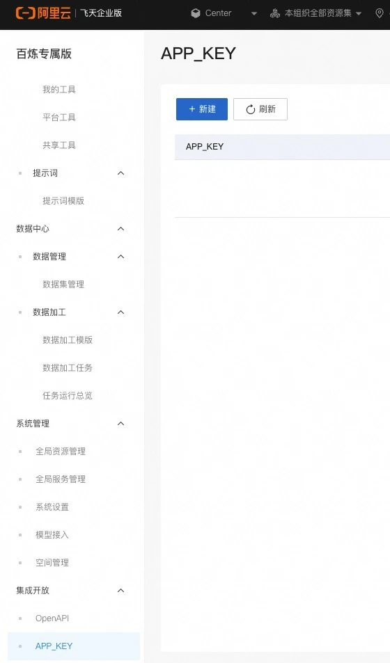

4. 按照要求填对应的数据

   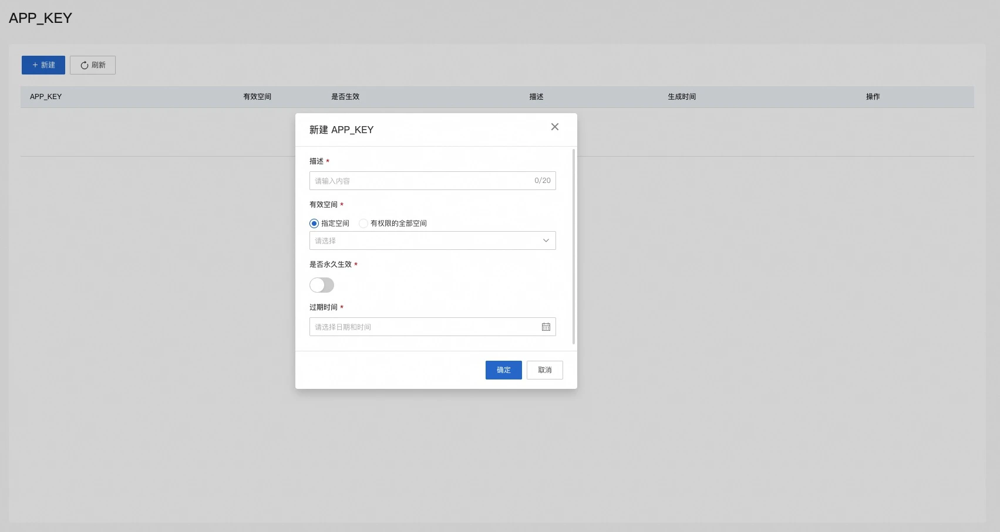

5. 

   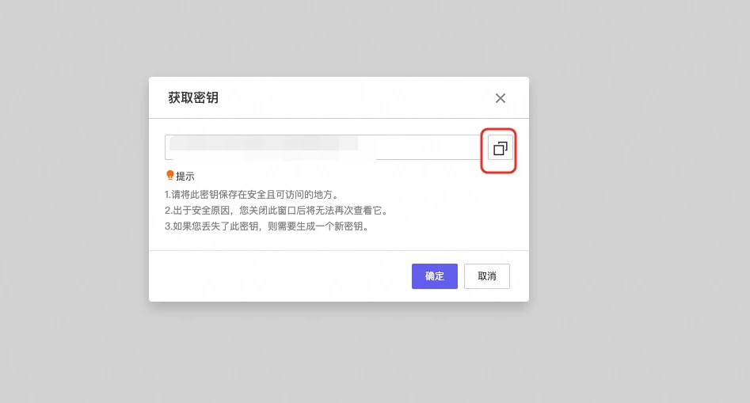

6. 在**获取密钥**页面单击  图标复制密钥后可单击**确定**关闭窗口，生成的API-Key名称会在秘钥列表显示。

   > **重要**
   >
   > - 请将此密钥保存在安全且可访问的地方。
   >
   > - 出于安全原因，密钥只展示一次，您关闭此窗口后将无法再次查看它，请及时复制保存。
   >
   > - 如果您丢失了此密钥，需要重新执行以上并生成一个新的密钥。

7. 在**API-Keys**页面单击**确定**。

<a id="section-2-2"></a>

## 2.2. 接口文档

<a id="section-2-2-1"></a>

### 2.2.1. 智能体

<a id="section-2-2-1-1"></a>

#### 2.2.1.1. 创建session

**接口概述**

您可以通过接口创建一个全新的agent会话，可以通过查看请求示例，点击 curl命令示例 右侧的调试按钮验证业务接口调用效果。

**前提条件（查看APP_KEY）**

先进入菜单[主页->点击头像->APP_KEY]创建APP_KEY;然后进入 智能体页面,完成智能体配置,获取智能体编码和版本编码或者配置输出版本

**接口调用地址**

POSThttp://ibp-studio-daily.aegmp.com/gateway/agent/api/createSession

**入参描述**

Header传参

| 字段 | 数据类型 | 是否必填 | 描述 | 示例 |
| --- | --- | --- | --- | --- |
| Authorization | String | 是 | APP_KEY | Bearer YOUR_APP_KEY |
| Content-Type | String | 是 | Content-Type | application/json |

Body传参

| 字段 | 数据类型 | 是否必填 | 描述 | 示例 |
| --- | --- | --- | --- | --- |
| agentCode | string | 是 | 智能体编码 | e36a0ab1-b673-49d0-9534-1480a147c691 |
| agentVersion | string | 否 | 智能体版本 | 1706863858334 |

**出参描述**

| 字段 | 数据类型 | 描述 | 示例 |
| --- | --- | --- | --- |
| success | boolean | 是否成功 | true |
| data | object | 返回数据 | {"uniqueCode":"4bcaa882-9c54-4b78-9057-54db58591b5b"} |

**请求示例**

```bash
curl -X 'POST' http://ibp-studio-daily.aegmp.com/gateway/agent/api/createSession \
-H 'Authorization: Bearer YOUR_APP_KEY' \
-H 'Content-Type: application/json' \
-d '{
    "agentCode": "",
    "agentVersion": "" 
}'
```

**响应示例**

```json
{
 "success": true,
 "data": {
  "uniqueCode": "4bcaa882-9c54-4b78-9057-54db58591b5b"
 },
 "errorCode": null,
 "errorMsg": null
}
```

**状态码说明**

网关异常状态码说明

| Http状态返回码 | 错误描述 | 错误释义 |
| --- | --- | --- |
| 401 | GATEWAY APP_KEY MISSING! | 网关必填参数缺失 |
| 401 | GATEWAY APP_KEY WRONG! | 鉴权失败,无效 APP_KEY |
| 401 | GATEWAY APP_KEY ALREADY EXPIRE D! | 鉴权失败,APP_KEY 已过期 |
| 403 | GATEWAY APP_PATH NOT FOUND! | 无效的服务调用路径 |
| 403 | GATEWAY APP_PATH NOT REGISTER! | 当前服务调用路径未注册 |
| 429 | GATEWAY LIMIT ! | 服务触发限流,请稍后再试 |
| 403 | GATEWAY HEADER PARAMETER MISSI NG! | 业务所需必填参数缺失 |
| 403 | GATEWAY PARAMETER WORKSPACE NO MATCH! | 传递的工作空间编码与APP_KEY归属用户关联的工作空间编码不匹配 |
| 401 | GATEWAY AUTH_TYPE WRONG! | 鉴权失败,不支持的鉴权方式 |
| 401 | GATEWAY AUTH_USER NOT MATCH W RONG! | 鉴权失败,AK用户信息不匹配 |
| 401 | GATEWAY AUTH_USER_ROLE WRONG! | 鉴权失败,用户角色不匹配 |
| 404 | GATEWAY ROUTE URL NOT FOUND! | 无效的目标服务地址 |
| 401 | GATEWAY LIMIT ! | 服务链接已达上限,请稍后再试 |
| 500 | TARGET_SERVICE_ERROR_CONNECTI ON_REFUSE_EXCEPTION | 目标服务拒绝连接 |
| 500 | TARGET_SERVICE_ERROR_NO_RESPO NSE_EXCEPTION | 目标服务无响应 |

<a id="section-2-2-1-2"></a>

#### 2.2.1.2. 发起agent调用

**接口概述**

您可以通过接口在已有会话的基础上对agent进行提问，可以通过查看请求示例，点击 curl命令示例 右侧的调试按钮验证业务接口调用效果。

**前提条件（查看APP_KEY）**

先进入菜单[主页->点击头像->APP_KEY]创建APP_KEY;然后调用'创建session'接口获取返回值 uniqueCode

**接口调用地址**

POSThttp://ibp-studio-daily.aegmp.com/gateway/agent/api/run

**入参描述**

Header传参

| 字段 | 数据类型 | 是否必填 | 描述 | 示例 |
| --- | --- | --- | --- | --- |
| Authorization | String | 是 | APP_KEY | Bearer YOUR_APP_KEY |
| Content-Type | String | 是 | Content-Type | application/json |

Body传参

| 字段 | 数据类型 | 是否必填 | 描述 | 示例 |
| --- | --- | --- | --- | --- |
| sessionId | String | 是 | sessionId | bd962db7-b1c8-4466-a2cc-41b9b67cd94b 创建session接口的返回值uniqueCode |
| stream | Boolean | 是 | 是否流式 | true |
| delta | Boolean | 是 | 当stream=true,控制是否不追加新文本 | true 默认每次输出新内容,不包含前序输出的文本 |
| trace | Boolean | 否 | 当trace=true,控制是否返回trace记录 | false 默认不返回trace记录 |
| message | object | 是 | 请求消息体 | {"text":"帮我订一张明天从上海去苏黎世的机票","metadata":{}, "attachments": \[{"url":"","name":""}\]} |
| text | string | 是 | 对话输入 | 帮我订一张明天从上海去苏黎世的机票 |
| metadata | Map | 否 | 扩展信息 | {} |
| attachments | List&lt;Object&gt; | 否 | 附件信息 | \[\] |
| url | string | 是 | 附件地址 | {} |
| name | string | 否 | 附件名称 | {} |

**出参描述**

| 字段 | 数据类型 | 描述 | 示例 |
| --- | --- | --- | --- |
| object | string | 数据类型 | message.delta 输出文本块thought.delta 思考过程块error 错误信息 |
| role | string | 角色 | assistant |
| content | object | 数据内容 | object=message.delta场景: {"type":"text","text": {"value":"智能体回答内容增量"}} object=thought.delta场景 : {"type":"text","data":"思考内容增量"} object=error场景{"errorMsg": "错误信息内容"} |
| metadata | object | 扩展字段 | {"key":"value"} |
| end | Boolean | 流式(object=message.delta)场景 标记文本输出是否结束 | false\|true |
| sessionId | string | 当前会话ID | - |
| requestId | string | 当前运行的请求ID | - |
| id | object | 流式消息的业务唯一ID | 思考内容唯一ID\|最终答案信息的唯一ID;思考内容支持在问答结束前输出多个,业务侧有多流输出的场景,可以进一步根据自定义的id前缀来区分呈现 |
| success | Boolean | 非流式-业务是否成功 | true |
| data | object | 非流式-业务响应 | {} |
| message | object | 非流式-输出文本响应 | {} |
| role | string | 角色 | assistant |
| metadata | object | 扩展字段 | {"key":"value"} |
| content | List&lt;Object&gt; | 输出内容 | 包含type、content |
| type | String | 输出内容类型 | text\|image |
| text | JSONObject | type=text 场景的输出结构 | {} |
| value | String | 输出文本 | 你好！有什么我能帮助你的吗？ |
| image | JSONObject | type=image 场景的输出结构 | {} |
| url | String | 输出图片的地址 |  |
| thoughts | object | 非流式-输出思考响应 | {} |
| role | string | 角色 | assistant |
| content | object | 输出内容 |  |
| data | String | 输出文本 |  |
| type | String | 输出内容类型,目前是常量 text | text |
| errorCode | Boolean | 非流式-业务错误码 | true |
| errorMsg | Boolean | 非流式-业务错误描述 | true |

**请求示例**

```bash
curl -X 'POST' http://ibp-studio-daily.aegmp.com/gateway/agent/api/run \
-H 'Authorization: Bearer YOUR_APP_KEY' \
-H 'Content-Type: application/json' \
-d '{
    "stream":true,
    "delta":true,
    "sessionId": "7af650e7-ed57-498d-8081-fe1dea5361fa",
    "message":{
        "text":"帮我订⼀张明天从上海去苏黎世的机票",
        "metadata":{},
        "attachments":[]
    }
}'
```

**响应示例**

**流式输出**

```text
data: {"object": "message.delta","end":false,"role": "assistant","sessionId":"de454297-c547-440f-ae55-057a83a2d121","content": [{"type":"text","text": {"value": "智能体回答内容增量"}}],"metadata": {"key": "value"}}

data: {"object": "thought.delta","role": "assistant","sessionId":"de454297-c547-440f-ae55-
057a83a2d121","content": {"type":"text","data":"思考内容增量"}}

data: {"object": "error","role": "assistant","sessionId":"de454297-c547-440f-ae55-
057a83a2d121","content": {"errorMsg": "错误信息内容"}}

data:{"content":{"data":"您
好","type":"text"},"id":"323ef0f2f57e445fbec343f62441c608","object":"thought.delta"}
data:{"content":
{"data":"！","type":"text"},"id":"323ef0f2f57e445fbec343f62441c608","object":"thought.delta"}
data:{"content":{"data":"请
问","type":"text"},"id":"323ef0f2f57e445fbec343f62441c608","object":"thought.delta"}
data:{"content":{"data":"有什么可以帮助您
的？","type":"text"},"id":"323ef0f2f57e445fbec343f62441c608","object":"thought.delta"}
data:{"content":
{"data":"","type":"text"},"id":"323ef0f2f57e445fbec343f62441c608","object":"thought.delta"}
data:{"content":[{"text":{"value":"您好"},"type":"text"}],"end":false,"gmtCreate":"2024-09-19 11:52:56.012","id":"9b0a21677f4a4512935c0e96977f292b","metadata":{},"requestId":"6d511a54-d95f-419c-9d34-02e86ea050e4","role":"assistant","sessionId":"7af650e7-ed57-498d-8081-fe1dea5361fa","useage":
{"uiTaskId":"23ce3bf3-5248-4293-8326-bdb7f452a092"},"object":"message.delta"}
data:{"content":[{"text":{"value":"！"},"type":"text"}],"end":false,"gmtCreate":"2024-09-19 
11:52:56.012","id":"9b0a21677f4a4512935c0e96977f292b","metadata":{},"requestId":"6d511a54-d95f-419c-9d34-02e86ea050e4","role":"assistant","sessionId":"7af650e7-ed57-498d-8081-fe1dea5361fa","useage":{"uiTaskId":"23ce3bf3-5248-4293-8326-bdb7f452a092"},"object":"message.delta"}
data:{"content":[{"text":{"value":"请问"},"type":"text"}],"end":false,"gmtCreate":"2024-09-19 11:52:56.012","id":"9b0a21677f4a4512935c0e96977f292b","metadata":{},"requestId":"6d511a54-d95f-419c-9d34-02e86ea050e4","role":"assistant","sessionId":"7af650e7-ed57-498d-8081-fe1dea5361fa","useage":
{"uiTaskId":"23ce3bf3-5248-4293-8326-bdb7f452a092"},"object":"message.delta"}
data:{"content":[{"text":{"value":"有什么可以帮助您的？"},"type":"text"}],"end":false,"gmtCreate":"2024-09-19 11:52:56.012","id":"9b0a21677f4a4512935c0e96977f292b","metadata":{},"requestId":"6d511a54-d95f-419c-9d34-02e86ea050e4","role":"assistant","sessionId":"7af650e7-ed57-498d-8081-fe1dea5361fa","useage":{
"uiTaskId":"23ce3bf3-5248-4293-8326-bdb7f452a092"},"object":"message.delta"}
data:{"content":[{"text":{"value":""},"type":"text"}],"end":true,"gmtCreate":"2024-09-19 
11:52:56.012","id":"9b0a21677f4a4512935c0e96977f292b","metadata":{},"requestId":"6d511a54-d95f-419c-9d34-02e86ea050e4","role":"assistant","sessionId":"7af650e7-ed57-498d-8081-fe1dea5361fa","useage":{"uiTaskId":"23ce3bf3-5248-4293-8326-bdb7f452a092"},"object":"message.delta"}
```

**响应示例**

**非流式输出**

```json
{
 "success": true,
 "data": {
  "message": {
   "role": "assistant",
   "content": [{
    "type": "text",
    "text": {
     "value": "你好！有什么我能帮助你的吗？"
    }
   },{
    "type": "image",
    "image": {
     "url": ""
    }
   }],
   "metadata": null
  },
  "thoughts": [{
    "role": "assistant",
    "content": {
     "type": "text",
     "data": ""
    }
   }
  ],
  "error": null
 },
 "errorCode": null,
 "errorMsg": null
}
```

**状态码说明**

网关异常状态码说明

| Http状态返回码 | 错误描述 | 错误释义 |
| --- | --- | --- |
| 401 | GATEWAY APP_KEY MISSING! | 网关必填参数缺失 |
| 401 | GATEWAY APP_KEY WRONG! | 鉴权失败,无效 APP_KEY |
| 401 | GATEWAY APP_KEY ALREADY EXPIRE D! | 鉴权失败,APP_KEY 已过期 |
| 403 | GATEWAY APP_PATH NOT FOUND! | 无效的服务调用路径 |
| 403 | GATEWAY APP_PATH NOT REGISTER! | 当前服务调用路径未注册 |
| 429 | GATEWAY LIMIT ! | 服务触发限流,请稍后再试 |
| 403 | GATEWAY HEADER PARAMETER MISSI NG! | 业务所需必填参数缺失 |
| 403 | GATEWAY PARAMETER WORKSPACE NO MATCH! | 传递的工作空间编码与APP_KEY归属用户关联的工作空间编码不匹配 |
| 401 | GATEWAY AUTH_TYPE WRONG! | 鉴权失败,不支持的鉴权方式 |
| 401 | GATEWAY AUTH_USER NOT MATCH W RONG! | 鉴权失败,AK用户信息不匹配 |
| 401 | GATEWAY AUTH_USER_ROLE WRONG! | 鉴权失败,用户角色不匹配 |
| 404 | GATEWAY ROUTE URL NOT FOUND! | 无效的目标服务地址 |
| 401 | GATEWAY LIMIT ! | 服务链接已达上限,请稍后再试 |
| 500 | TARGET_SERVICE_ERROR_CONNECTI ON_REFUSE_EXCEPTION | 目标服务拒绝连接 |
| 500 | TARGET_SERVICE_ERROR_NO_RESPO NSE_EXCEPTION | 目标服务无响应 |

<a id="section-2-2-1-3"></a>

#### 2.2.1.3. 终止session

**接口概述**

您可以通过调用该接口实现会话中断，可以通过查看请求示例，点击 curl命令示例 右侧的调试按钮验证业务接口调用效果。

**前提条件（查看APP_KEY）**

先进入菜单[主页->点击头像->APP_KEY]创建APP_KEY;然后调用'创建session'接口获取返回值 uniqueCode

**接口调用地址**

POSThttp://ibp-studio-daily.aegmp.com/gateway/agent/api/clearSession

**入参描述**

Header传参

| 字段 | 数据类型 | 是否必填 | 描述 | 示例 |
| --- | --- | --- | --- | --- |
| Authorization | String | 是 | APP_KEY | Bearer YOUR_APP_KEY |
| Content-Type | String | 是 | Content-Type | application/json |

Body传参

| 字段 | 数据类型 | 是否必填 | 描述 | 示例 |
| --- | --- | --- | --- | --- |
| sessionId | string | 是 | 会话ID | de454297-c547-440f-ae55-057a83a2d121 创建session接口的返回值uniqueCode |

**出参描述**

| 字段 | 数据类型 | 描述 | 示例 |
| --- | --- | --- | --- |
| success | boolean | 是否成功 | true |

**请求示例**

```bash
curl -X 'POST' http://ibp-studio-daily.aegmp.com/gateway/agent/api/clearSession \
-H 'Authorization: Bearer YOUR_APP_KEY' \
-H 'Content-Type: application/json' \
-d '{
    "sessionId": "de454297-c547-440f-ae55-057a83a2d121" 
}'
```

**响应示例**

```json
{
  "success": true 
}
```

**状态码说明**

网关异常状态码说明

| Http状态返回码 | 错误描述 | 错误释义 |
| --- | --- | --- |
| 401 | GATEWAY APP_KEY MISSING! | 网关必填参数缺失 |
| 401 | GATEWAY APP_KEY WRONG! | 鉴权失败,无效 APP_KEY |
| 401 | GATEWAY APP_KEY ALREADY EXPIRE D! | 鉴权失败,APP_KEY 已过期 |
| 403 | GATEWAY APP_PATH NOT FOUND! | 无效的服务调用路径 |
| 403 | GATEWAY APP_PATH NOT REGISTER! | 当前服务调用路径未注册 |
| 429 | GATEWAY LIMIT ! | 服务触发限流,请稍后再试 |
| 403 | GATEWAY HEADER PARAMETER MISSI NG! | 业务所需必填参数缺失 |
| 403 | GATEWAY PARAMETER WORKSPACE NO MATCH! | 传递的工作空间编码与APP_KEY归属用户关联的工作空间编码不匹配 |
| 401 | GATEWAY AUTH_TYPE WRONG! | 鉴权失败,不支持的鉴权方式 |
| 401 | GATEWAY AUTH_USER NOT MATCH W RONG! | 鉴权失败,AK用户信息不匹配 |
| 401 | GATEWAY AUTH_USER_ROLE WRONG! | 鉴权失败,用户角色不匹配 |
| 404 | GATEWAY ROUTE URL NOT FOUND! | 无效的目标服务地址 |
| 401 | GATEWAY LIMIT ! | 服务链接已达上限,请稍后再试 |
| 500 | TARGET_SERVICE_ERROR_CONNECTI ON_REFUSE_EXCEPTION | 目标服务拒绝连接 |
| 500 | TARGET_SERVICE_ERROR_NO_RESPO NSE_EXCEPTION | 目标服务无响应 |

<a id="section-2-2-1-4"></a>

#### 2.2.1.4. 删除session

**接口概述**

您可以通过调用该接口实现会话以及相关过程数据永久删除

**前提条件（查看APP_KEY）**

先进入菜单[主页->点击头像->APP_KEY]创建APP_KEY;

**接口调用地址**

POST http://ibp-studio-daily.aegmp.com/gateway/agent/api/deleteSession

**入参描述**

Header传参

| 字段 | 数据类型 | 是否必填 | 描述 | 示例 |
| --- | --- | --- | --- | --- |
| Authorization | String | 是 | APP_KEY | Bearer YOUR_APP_KEY |
| Content-Type | String | 是 | Content-Type | application/json |

Body传参

| 字段 | 数据类型 | 是否必填 | 描述 | 示例 |
| --- | --- | --- | --- | --- |
| sessionId | string | 是 | 会话ID | de454297-c547-440f-ae55-057a83a2d121 创建session接口的返回值uniqueCode |

**出参描述**

| 字段 | 数据类型 | 描述 | 示例 |
| --- | --- | --- | --- |
| success | boolean | 服务是否成功 | true |
| data | boolean | 业务是否成功 | true |

**请求示例**

```bash
curl -X 'POST' http://ibp-studio-daily.aegmp.com/gateway/agent/api/deleteSession \
-H 'Authorization: Bearer YOUR_APP_KEY' \
-H 'Content-Type: application/json' \
-d '{ "sessionId": "de454297-c547-440f-ae55-057a83a2d121" 
}'
```

**响应示例**

```json
{
  "success": true ,"data": true
}
```

**状态码说明**

网关异常状态码说明

| Http状态返回码 | 错误描述 | 错误释义 |
| --- | --- | --- |
| 401 | GATEWAY APP_KEY MISSING! | 网关必填参数缺失 |
| 401 | GATEWAY APP_KEY WRONG! | 鉴权失败,无效 APP_KEY |
| 401 | GATEWAY APP_KEY ALREADY EXPIRE D! | 鉴权失败,APP_KEY 已过期 |
| 403 | GATEWAY APP_PATH NOT FOUND! | 无效的服务调用路径 |
| 403 | GATEWAY APP_PATH NOT REGISTER! | 当前服务调用路径未注册 |
| 429 | GATEWAY LIMIT ! | 服务触发限流,请稍后再试 |
| 403 | GATEWAY HEADER PARAMETER MISSI NG! | 业务所需必填参数缺失 |
| 403 | GATEWAY PARAMETER WORKSPACE NO MATCH! | 传递的工作空间编码与APP_KEY归属用户关联的工作空间编码不匹配 |
| 401 | GATEWAY AUTH_TYPE WRONG! | 鉴权失败,不支持的鉴权方式 |
| 401 | GATEWAY AUTH_USER NOT MATCH W RONG! | 鉴权失败,AK用户信息不匹配 |
| 401 | GATEWAY AUTH_USER_ROLE WRONG! | 鉴权失败,用户角色不匹配 |
| 404 | GATEWAY ROUTE URL NOT FOUND! | 无效的目标服务地址 |
| 401 | GATEWAY LIMIT ! | 服务链接已达上限,请稍后再试 |
| 500 | TARGET_SERVICE_ERROR_CONNECTI ON_REFUSE_EXCEPTION | 目标服务拒绝连接 |
| 500 | TARGET_SERVICE_ERROR_NO_RESPO NSE_EXCEPTION | 目标服务无响应 |

<a id="section-2-2-1-5"></a>

#### 2.2.1.5. 工具异步回调

**接口概述**

您可以通过调用该接口实现在工具箱中注册异步API工具，当智能体执行过程中调用您注册工具时会在header(key=idx-agent-task-id)中下发任务唯一标识，在您执行完成任务后，可以通过这个异步回调的接口完成工具调用

**前提条件（查看APP_KEY）**

先进入菜单[主页->点击头像->APP_KEY]创建APP_KEY;然后调用'创建session'接口获取返回值 uniqueCode

**接口调用地址**

POST http://ibp-studio-daily.aegmp.com/gateway/agent/api/taskFinishNotice

**入参描述**

Header传参

| 字段 | 数据类型 | 是否必填 | 描述 | 示例 |
| --- | --- | --- | --- | --- |
| Authorization | String | 是 | APP_KEY | Bearer YOUR_APP_KEY |
| Content-Type | String | 是 | Content-Type | application/json |

Body传参

| 字段 | 数据类型 | 是否必填 | 描述 | 示例 |
| --- | --- | --- | --- | --- |
| success | boolean | 是 | 是否成功 | true |
| taskId | string | 是 | 任务id | de454297-c547-440f-ae55-057a83a2d121 调用工具header(key=idx-agent-task-id)的值 |
| data | string | 是 | 任务结果 | 必须是json字符串格式,例如：{"reslut":"一步接口调用成功"} |
| errorCode | string | 否 | 错误信息code | 错误信息code |
| errorMsg | string | 否 | 错误信息 | 错误信息 |

**出参描述**

| 字段 | 数据类型 | 描述 | 示例 |
| --- | --- | --- | --- |
| success | boolean | 是否成功 | true |

**请求示例**

```bash
curl -X 'POST' http://ibp-studio-daily.aegmp.com/gateway/agent/api/taskFinishNotice \
-H 'Authorization: Bearer YOUR_APP_KEY' \
-H 'Content-Type: application/json' \
-d '{
    "taskId": "de454297-c547-440f-ae55-057a83a2d121"
  ,"success": true
  ,"data": "{"reslut":"⼀步接⼝调⽤成功"}"
 }'
```

**响应示例**

```json
{
  "success": true 
}
```

**状态码说明**

网关异常状态码说明

| Http状态返回码 | 错误描述 | 错误释义 |
| --- | --- | --- |
| 401 | GATEWAY APP_KEY MISSING! | 网关必填参数缺失 |
| 401 | GATEWAY APP_KEY WRONG! | 鉴权失败,无效 APP_KEY |
| 401 | GATEWAY APP_KEY ALREADY EXPIRE D! | 鉴权失败,APP_KEY 已过期 |
| 403 | GATEWAY APP_PATH NOT FOUND! | 无效的服务调用路径 |
| 403 | GATEWAY APP_PATH NOT REGISTER! | 当前服务调用路径未注册 |
| 429 | GATEWAY LIMIT ! | 服务触发限流,请稍后再试 |
| 403 | GATEWAY HEADER PARAMETER MISSI NG! | 业务所需必填参数缺失 |
| 403 | GATEWAY PARAMETER WORKSPACE NO MATCH! | 传递的工作空间编码与APP_KEY归属用户关联的工作空间编码不匹配 |
| 401 | GATEWAY AUTH_TYPE WRONG! | 鉴权失败,不支持的鉴权方式 |
| 401 | GATEWAY AUTH_USER NOT MATCH W RONG! | 鉴权失败,AK用户信息不匹配 |
| 401 | GATEWAY AUTH_USER_ROLE WRONG! | 鉴权失败,用户角色不匹配 |
| 404 | GATEWAY ROUTE URL NOT FOUND! | 无效的目标服务地址 |
| 401 | GATEWAY LIMIT ! | 服务链接已达上限,请稍后再试 |
| 500 | TARGET_SERVICE_ERROR_CONNECTI ON_REFUSE_EXCEPTION | 目标服务拒绝连接 |
| 500 | TARGET_SERVICE_ERROR_NO_RESPO NSE_EXCEPTION | 目标服务无响应 |

<a id="section-2-2-1-6"></a>

#### 2.2.1.6. 调用结果反馈

**接口概述**

您可以针对Agent单次执行的结果进行反馈, 也可以针对本次执行的某个任务进行反馈

**前提条件（查看APP_KEY）**

发起agnet调用后对本次调用的结果进行反馈（点赞点踩）

**接口调用地址**

POSThttp://ibp-studio-daily.aegmp.com/gateway/agent/api/feedback

**入参描述**

Header传参

| 字段 | 数据类型 | 是否必填 | 描述 | 示例 |
| --- | --- | --- | --- | --- |
| Authorization | String | 是 | APP_KEY | Bearer YOUR_APP_KEY |
| Content-Type | String | 是 | Content-Type | application/json |

Body传参

| 字段 | 数据类型 | 是否必填 | 描述 | 示例 |
| --- | --- | --- | --- | --- |
| sessionId | string | 是 | 会话ID |  |
| requestId | string | 是 | 请求ID |  |
| taskId | string | 是 | 任务ID |  |
| uniqueCode | string | 否 | 唯一ID, 更新反馈信息时传入 |  |
| subject | string | 是 | 反馈对象 | REQUEST-针对单次run的结果输出进行反馈, TASK-针对本次run中执行的某个任务进行反馈 |
| provider | object | 是 | 反馈者 |  |
| source | string | 是 | 反馈者来源 | USER-用户, AUTO_EVALUATION-评测中心 |
| extendInfo | object | 否 | 反馈者扩展信息 |  |
| vote | string | 是 | 反馈结果 | LIKE-点赞, DISLIKE-点踩, NEUTRAL-中立 |
| extCommentsInfo | object | 否 | 反馈结果扩展信息 |  |

**出参描述**

| 字段 | 数据类型 | 描述 | 示例 |
| --- | --- | --- | --- |
| success | boolean | 是否成功 |  |
| data | object | 反馈信息 |  |
| sessionId | string | 会话ID |  |
| requestId | string | 请求ID |  |
| taskId | string | 任务ID |  |
| uniqueCode | string | 唯一ID |  |
| subject | string | 反馈对象 | REQUEST-针对单次run的结果输出进行反馈, TASK-针对本次run中执行的某个任务进行反馈 |
| provider | object | 反馈者 |  |
| source | string | 反馈者来源 | USER-用户, AUTO_EVALUATION-评测中心 |
| extendInfo | object | 反馈者扩展信息 |  |
| vote | string | 反馈结果 | LIKE-点赞, DISLIKE-点踩, NEUTRAL-中立 |
| extCommentsInfo | object | 反馈结果扩展信息 |  |
| errorCode | string | 错误码 |  |
| errorMsg | string | 错误码 |  |

**请求示例**

```bash
curl --location --request POST 'http://ibp-studio-daily.aegmp.com/gateway/agent/api/feedback' \
--header 'Authorization: Bearer YOUR_APP_KEY' \
--header 'Content-Type: application/json' \
-d '{
    "sessionId": "87302f04-7617-41e4-b4c9-9028c3341dcg",
    "requestId": "e359512f-ba3a-46a7-b412-882d7e9f8b32",
    "taskId": "61e60082-690c-4548-a7ef-28d1ff6bb0f9",
    "subject": "TASK",
    "provider": {
        "source": "USER",
        "extendInfo": {}
    },
    "vote": "LIKE",
    "extCommentsInfo": {
        "comment": "123"
    }
}'
```

**响应示例**

```json
{
  "errorMessages": [],
  "success": true,
  "data": {
    "tenant": null,
    "sessionId": "87302f04-7617-41e4-b4c9-9028c3341dcg",
    "requestId": "e359512f-ba3a-46a7-b412-882d7e9f8b32",
    "taskId": "61e60082-690c-4548-a7ef-28d1ff6bb0f9",
    "subject": "TASK",
    "uniqueCode": "b8f5ea27-50f7-4147-88d1-9d02ccbf0061",
    "provider": {
      "source": "USER",
      "extendInfo": {}
    },
    "vote": "LIKE",
    "extCommentsInfo": {
      "comment": "123"
    }
  },
  "errorCode": null,
  "errorMsg": null
}
```

**状态码说明**

网关异常状态码说明

| Http状态返回码 | 错误描述 | 错误释义 |
| --- | --- | --- |
| 401 | GATEWAY APP_KEY MISSING! | 网关必填参数缺失 |
| 401 | GATEWAY APP_KEY WRONG! | 鉴权失败,无效 APP_KEY |
| 401 | GATEWAY APP_KEY ALREADY EXPIRE D! | 鉴权失败,APP_KEY 已过期 |
| 403 | GATEWAY APP_PATH NOT FOUND! | 无效的服务调用路径 |
| 403 | GATEWAY APP_PATH NOT REGISTER! | 当前服务调用路径未注册 |
| 429 | GATEWAY LIMIT ! | 服务触发限流,请稍后再试 |
| 403 | GATEWAY HEADER PARAMETER MISSI NG! | 业务所需必填参数缺失 |
| 403 | GATEWAY PARAMETER WORKSPACE NO MATCH! | 传递的工作空间编码与APP_KEY归属用户关联的工作空间编码不匹配 |
| 401 | GATEWAY AUTH_TYPE WRONG! | 鉴权失败,不支持的鉴权方式 |
| 401 | GATEWAY AUTH_USER NOT MATCH W RONG! | 鉴权失败,AK用户信息不匹配 |
| 401 | GATEWAY AUTH_USER_ROLE WRONG! | 鉴权失败,用户角色不匹配 |
| 404 | GATEWAY ROUTE URL NOT FOUND! | 无效的目标服务地址 |
| 401 | GATEWAY LIMIT ! | 服务链接已达上限,请稍后再试 |
| 500 | TARGET_SERVICE_ERROR_CONNECTI ON_REFUSE_EXCEPTION | 目标服务拒绝连接 |
| 500 | TARGET_SERVICE_ERROR_NO_RESPO NSE_EXCEPTION | 目标服务无响应 |

<a id="section-2-2-2"></a>

### 2.2.2. 知识库检索

<a id="section-2-2-2-1"></a>

#### 2.2.2.1. 知识库检索

知识库通用检索能力,包括文档知识库、自定义知识库、图文知识库。

**前提条件**

按照知识库的kbSubmodels.kbIndexes字段用户可实现针对特定字段的通用检索能力。可以通过查看请求示例，单击curl命令示例右侧的调试按钮验证业务接口调用效果。

**接口调用地址**

```text
 POST http://ibp-studio-daily.aegmp.com/gateway/kortex/api/kb/mono/retrieve 
```

**入参描述**

**Header传参**

| 字段 | 数据类型 | 是否必填 | 描述 | 示例 |
| --- | --- | --- | --- | --- |
| Authorizatio n | String | 是 | APP_KEY | Bearer YOUR_APP_KEY |
| Content-Type | String | 是 | Content-Type | application/json |
| x-sfm-workspaceco de | String | 是 | 目标工作空间。 | your_workspace_code |

**Body传参**

| 字段 | 数据类型 | 是否必填 | 描述 | 示例 |
| --- | --- | --- | --- | --- |
| kbIndexCode | String | 是 | 知识库索引code,见知识库详情返回结构kbSubmodel s\[0\].kbIndex es\[0\].kbInde xCode。 | tttbnz21diense89。 |
| kbIndexRetrieve FieldName | String | 是 | 检索字段。 | chunk_representation 见知识库详情返回结构kbSubmodels部分;文档知识库固定传递 chunk_representation;图文知识库可传递 image_path 或者 text;自定义知识库库 见知识库详情响应体中的kbSubmodels\[0\].kbIndexes 中Retrieve类型字段； |
| query | String | 是 | 查询内容。 | 字符串 |
| filters | JSONObject | 否 | 查询内容。 | 扩展过滤项, 例如文档支持库,支持针对特定文档进行检索,例如 {"file_code": "aaa"} |
| score | Double | 是 | 最小分值。 | 0.01 |
| limit | Integer | 是 | 返回条目。 | 10 |
| advancedRules | Object | 否 | 高级规则配置，支持复杂的AND/OR逻辑组合过滤条件。 | {"operator":"AND","conditions": \[{"type":"simple","simpleRule": {"fileName":"plan_code","ruleTypeEnum":"EQ","file Value":"YCJ2024100"}}, {"type":"nested","advancedRules": {"operator":"AND","conditions": \[{"type":"simple","simpleRule": {"fileName":"plan_name","ruleTypeEnum":"LIKE","fi leValue":"江南区"}},{"type":"simple","simpleRule": {"fileName":"area_name","ruleTypeEnum":"IN","file ValueList":\["江北区","江南区"\]}}\]}}\]} |
| -operator | String | 是 | 逻辑操作符，可选值：AND（与）, OR（或）。 | AND |
| -conditions | Array | 是 | 条件列表，每个条件可以是简单条件（type=sim ple）或嵌套条件（type=nest ed）。 | \[{"type":"simple",...},{"type":"nested",...}\] |
| --type | String | 是 | 条件类型，可选值：simple(简单条件), nested(嵌套条件)。 | simple |
| --simpleRule | Object | 否 | 简单规则定义（type=sim ple时必填）。 | {"fileName":"plan_code","ruleTypeEnum":"EQ","file Value":"YWC34520000"} |
| ---fileName | String | 是 | 匹配的字段名。 | plan_code |
| ---ruleTypeEnum | String | 是 | 规则类型，可选值：EQ(等于), IN(包含), IS_NOT_NUL L(非空), LIKE(模糊匹配)。 | EQ |
| ---fileValue | Object | 否 | 单个匹配值，ruleType Enum为EQ/LIKE时使用。 | YCJ2024520000 |
| ---fileValueList | Array | 否 | 多个匹配值列表，ruleType Enum为IN时使用。 | \["江南区","江北区"\] |
| --advancedRules | Object | 否 | 嵌套的高级检索规则（type=nest ed时必填），支持递归嵌套。 | {"operator":"AND","conditions": \[{"type":"simple",...},{"type":"simple",...}\]} |
| ---operator | String | 是 | 嵌套逻辑操作符，可选值：AND, OR。 | AND |
| ---conditions | Array | 是 | 嵌套条件列表。 | \[...\] |

**请求示例**

```bash
curl -X 'POST' http://ibp-studio-daily.aegmp.com/gateway/kortex/api/kb/mono/retrieve \
-H 'Authorization: Bearer YOUR_APP_KEY' \
-H 'Content-Type: application/json' \
-H 'x-sfm-workspacecode: baseline' \
-d '{ 
    "kbIndexCode":"qdqsajkhjn6xpn7z",
     "kbIndexRetrieveFieldName":"text",
     "query":"草莓",
      "score":0.01,
     "limit":10
}'
```

**出参描述**

| 字段 | 数据类型 | 描述 | 示例 |
| --- | --- | --- | --- |
| success | Boolean | 是否成功。 | true |
| data | List&lt;Object&gt; | 返回数据，按照预先定义的kbSubmodels结构返回。 | \[\] |
| -score | String | 得分。 | true |
| -sys_source_ids | String | 数据附加信息。 | true |
| -sys_data_id | String | 数据唯一ID。 | true |
| -sys_create_time | String | 创建时间。 | true |
| -\*\*\*\* | String | 动态的自定义召回字段;例如图文知识库召回的file_code、image_path、text; 文档知识库召回的 file_code、chunk_bboxs、show_content、chunk_upload_type、chunk_content 、chunk_sort_number、start_page。 |  |
| metrics | Object | 性能指标。 | {} |
| -kbCode | String | 知识库编码。 | xxx |
| -totalTime | Long | 检索总耗时(ms)。 | 150 |
| -chunksCount | Integer | 返回的chunk数量。 | 10 |
| -retrievalDetails | List&lt;Object&gt; | 详细检索指标。 | \[{"kbIndexCode":"yyy","en gineType":"builtin_vector", "embeddingTime":50,"vect orRecallTime":80,"retrieve dChunksCount":10}\] |
| --kbIndexCode | String | 索引编码。 | ozqn95a5936ycwkl |
| --engineType | String | 引擎类型。 | builtin_vector |
| --embeddingTime | Long | 向量嵌入耗时(ms)。 | 50 |
| --vectorRecallTime | Long | 向量召回耗时(ms)。 | 80 |
| --textQueryTime | Long | 全文检索耗时(ms)。 | 60 |
| --retrievedChunksCount | Integer | 该引擎实际召回的chunk数量。 | 10 |
| errorCode | String | 错误码。 | true |
| errorMsg | String | 错误描述。 | true |

**响应示例**

```json
{"success":true,"data":
[{"score":0.529308557510376,"file_code":"adaf2a92995b4e439f68ebe3222de9a1","sys_source_ids":"
{\"kb_submodel\": \"true\", \"kb_submodel.sys_data_id\": \"82aab26d-b1ff-40da-a3fc-
bbadb5b3b439\"}","image_path":"apsara/kortex/kb/visual/file/wjtir7knghhr/SglptjTkqA35r12MoUOVxE91rWSEonT
f1af9cbaa9d9aee17a0c0bd944ef662.jpeg","sys_data_id":"82aab26d-b1ff-40da-a3fc-bbadb5b3b439","text":"这是
⼀张草莓的特写照⽚，草莓表⾯有⽔珠，背景是绿⾊的叶⼦。","sys_create_time":"2025-07-
04T13:28:58.122+00:00"}],"errorCode":null,"errorMsg":null}
```

**状态码说明**

网关异常状态码说明。

| Http状态返回码 | 错误描述 | 错误释义 |
| --- | --- | --- |
| 401 | GATEWAY APP_KEY MISSING! | 网关必填参数缺失。 |
| 401 | GATEWAY APP_KEY WRONG! | 鉴权失败，无效 APP_KEY。 |
| 401 | GATEWAY APP_KEY ALREADY EXPIRED! | 鉴权失败，APP_KEY 已过期。 |
| 401 | GATEWAY ROLE NOT MATCH! | 鉴权失败，当前 APP_KEY 归属用户对应的角色不匹配。 |
| 401 | GATEWAY ROLE HAS EXPIRED! | 鉴权失败，当前 APP_KEY 归属用户对应的角色已过期。 |
| 403 | GATEWAY APP_PATH NOT FOUND! | 无效的服务调用路径。 |
| 403 | GATEWAY APP_PATH NOT REGISTER! | 当前服务调用路径未注册。 |
| 429 | GATEWAY LIMIT ! | 服务触发限流,请稍后再试。 |
| 429 | GATEWAY LIMIT CURRENT CALL TYPE ! | 服务触发限流,请稍后再试。 |
| 403 | GATEWAY HEADER PARAMETER MISSING! | 业务所需必填参数缺失。 |
| 403 | GATEWAY PARAMETER WORKSPACE NO MATC H! | 传递的工作空间编码与APP_KEY归属用户关联的工作空间编码不匹配。 |
| 401 | GATEWAY AUTH_TYPE WRONG! | 鉴权失败，不支持的鉴权方式。 |
| 401 | GATEWAY AUTH_USER NOT MATCH WRONG! | 鉴权失败，AK用户信息不匹配。 |
| 401 | GATEWAY AUTH_USER_ROLE WRONG! | 鉴权失败,用户角色不匹配。 |
| 404 | GATEWAY ROUTE URL NOT FOUND! | 无效的目标服务地址。 |
| 401 | GATEWAY LIMIT ! | 服务链接已达上限，请稍后再试。 |
| 500 | TARGET_SERVICE_ERROR_CONNECTION_REF USE_EXCEPTION | 目标服务拒绝连接。 |
| 500 | TARGET_SERVICE_ERROR_NO_RESPONSE_EX CEPTION | 目标服务无响应。 |

<a id="section-2-2-2-2"></a>

#### 2.2.2.2. 知识库批量检索

支持同时检索多个知识库，每个知识库可配置不同的检索参数，最大支持10个知识库同时检索。

**前提条件**

批量检索接口支持多知识库同时检索，返回每个知识库的独立结果和性能指标。适用于需要同时从多个知识库获取数据的场景。

**接口调用地址**

```text
  POST http://ibp-studio-daily.aegmp.com/sfm-agent-studio/sfm-api-
gateway/gateway/kortex/api/kb/mono/combination/retrieve 
```

**入参描述**

**Header传参**

| 字段 | 数据类型 | 是否必填 | 描述 | 示例 |
| --- | --- | --- | --- | --- |
| Authorization | String | 是 | APP_KEY | Bearer YOUR_APP_KEY |
| x-sfm-workspacecode | String | 是 | 目标工作空间 | your_workspace_cod e |
| Content-Type | String | 是 | Content-Type | application/json |

Body传参

| 字段 | 数据类型 | 是否必填 | 描述 | 示例 |
| --- | --- | --- | --- | --- |
| combinationParams | List&lt;object&gt; | 是 | 检索参数列表 | \[{"kbIndexCode":"xx x","kbIndexRetrieveF ieldName":"name"," query":"测试","score":0.01,"limi t":10}\] |
| -kbIndexCode | String | 是 | 知识库索引code | tttbnz21dien |
| -kbIndexRetrieveField Name | String | 是 | 检索字段 | name |
| -query | String | 是 | 查询内容 | 测试查询 |
| -score | Double | 是 | 最小分值 | 0.01 |
| -limit | Integer | 是 | 返回条目 | 10 |
| -filters | Object | 否 | 查询内容 | 扩展过滤项, 例如图文知识库,支持针对特定文档进行检索, 例如{"file_code": \["8a58578fce264cd3 a648162ea94d2686"\]} |
| -mapBatchKey | String | 否 | 批量检索时的结果映射KEY，用于区分不同请求的结果 | kb1 |

<table>
  <tr>
    <td>-advancedRules</td>
    <td>Object</td>
    <td>否</td>
    <td>高级规则配置，支持复杂的AND/OR逻辑组合过滤条件</td>
    <td>{"operator":"AND","c onditions": [{"type":"simple","si mpleRule": {"fileName":"plan_co de","ruleTypeEnum": "EQ","fileValue":"YCJ 2024100"}}, {"type":"nested","ad vancedRules": {"operator":"AND","c onditions": [{"type":"simple","si mpleRule": {"fileName":"plan_n ame","ruleTypeEnu m":"LIKE","fileValue":"江南区"}}, {"type":"simple","si mpleRule": {"fileName":"area_n ame","ruleTypeEnu m":"IN","fileValueList ":["江北区","江南区"]}}]}}]}</td>
  </tr>
  <tr>
    <td>--operator</td>
    <td>String</td>
    <td>是</td>
    <td>逻辑操作符，可选值: AND(与), OR(或)</td>
    <td>AND</td>
  </tr>
  <tr>
    <td>--conditions</td>
    <td>Array</td>
    <td>是</td>
    <td>条件列表，每个条件可以是简单条件(type=simple)或嵌套条件(type=nested)</td>
    <td>[{"type":"simple",...}, {"type":"nested",...}]</td>
  </tr>
  <tr>
    <td>---type</td>
    <td>String</td>
    <td>是</td>
    <td>条件类型，可选值: simple(简单条件), nested(嵌套条件)</td>
    <td>simple</td>
  </tr>
  <tr>
    <td>---simpleRule</td>
    <td>Object</td>
    <td>否</td>
    <td>简单规则定义(type=simple时必填)</td>
    <td>{"fileName":"plan_co de","ruleTypeEnum": "EQ","fileValue":"YW C34520000"}</td>
  </tr>
  <tr>
    <td>----fileName</td>
    <td>String</td>
    <td>是</td>
    <td>匹配的字段名</td>
    <td>plan_code</td>
  </tr>
  <tr>
    <td>----ruleTypeEnum</td>
    <td>String</td>
    <td>是</td>
    <td>规则类型，可选值: EQ(等于), IN(包含), IS_NOT_NULL(非空), LIKE(模糊匹配)</td>
    <td>EQ</td>
  </tr>
  <tr>
    <td>----fileValue</td>
    <td>Object</td>
    <td>否</td>
    <td>单个匹配值，ruleTypeEnum为EQ/LIKE时使用</td>
    <td>YCJ2024520000</td>
  </tr>
  <tr>
    <td>----fileValueList</td>
    <td>Array</td>
    <td>否</td>
    <td>多个匹配值列表，ruleTypeEnum为IN时使用</td>
    <td>["江南区","江北区"]</td>
  </tr>
  <tr>
    <td>---advancedRules</td>
    <td>Object</td>
    <td>否</td>
    <td>嵌套的高级检索规则(type=nested时必填)，支持递归嵌套</td>
    <td>{"operator":"AND","c onditions": [{"type":"simple",...}, {"type":"simple",...}]}</td>
  </tr>
  <tr>
    <td>----operator</td>
    <td>String</td>
    <td>是</td>
    <td>嵌套逻辑操作符，可选值: AND, OR</td>
    <td>AND</td>
  </tr>
  <tr>
    <td>----conditions</td>
    <td>Array</td>
    <td>是</td>
    <td>嵌套条件列表</td>
    <td>[...]</td>
  </tr>
</table>

**请求示例**

批量检索知识库示例

```bash
curl -X 'POST' http://ibp-studio-daily.aegmp.com/sfm-agent-studio/sfm-api-
gateway/gateway/kortex/api/kb/mono/combination/retrieve \
-H 'Authorization: Bearer YOUR_APP_KEY' \
-H 'Content-Type: application/json' \
-H 'x-sfm-workspacecode: baseline' \
-d '{
    "combinationParams":[
        {
            "kbCode":"kbcode1",
            "kbIndexRetrieveFieldName":"name",
            "query":"测试查询1",
            "score":0.01,
            "limit":5,
            "mapBatchKey":"kb1",
            "kbIndexEngineType":"builtin_vector"
        },
        {
            "kbCode":"kbcode2",
            "kbIndexRetrieveFieldName":"text",
            "query":"测试查询2",
            "score":0.01,
            "limit":5,
            "mapBatchKey":"kb2",
            "kbIndexEngineType":"builtin_es"
        }
    ]
}'
```

**出参描述**

| 字段 | 数据类型 | 描述 | 示例 |
| --- | --- | --- | --- |
| success | Boolean | 是否成功 | true |
| data | List&lt;Object&gt; | 批量检索结果列表 | \[\] |
| -mapBatchKey | String | 结果映射KEY（对应请求中的mapBatchKey） | kb1 |
| -kbCode | String | 知识库编码 | xxx |
| -kbIndexEngineType | String | 索引引擎类型 | builtin_vector |
| -kbIndexCode | String | 索引编码 | yyy |
| -result | List&lt;Map&lt;String,Object&gt;&gt; | 检索结果列表 | \[{"score":0.85,"file_code":" xxx"}\] |
| metrics | Object | 性能指标 | {} |
| -kbCode | String | 知识库编码 | xxx |
| -totalTime | Long | 检索总耗时(ms) | 150 |
| -chunksCount | Integer | 返回的chunk数量 | 10 |
| -retrievalDetails | List&lt;Object&gt; | 详细检索指标 | \[\] |
| --kbIndexCode | String | 索引编码 | ozqn95a5936ycwkl |
| --engineType | String | 引擎类型 | builtin_vector |
| --embeddingTime | Long | 向量嵌入耗时(ms)。 | 50 |
| --vectorRecallTime | Long | 向量召回耗时(ms)。 | 80 |
| --textQueryTime | Long | 全文检索耗时(ms)。 | 60 |
| --retrievedChunksCount | Integer | 该引擎实际召回的chunk数量。 | 10 |
| errorCode | String | 错误码。 | 401 |
| errorMsg | String | 错误描述。 | 请求错误 |

**响应示例**

```json
{"success":true,"data":
[{"mapBatchKey":"kb1","kbCode":"o4jgjrg0997v","kbIndexEngineType":"builtin_vector","kbIndexCode":"o4jgjr
97vr4rd","result":[{"score":1,"sys_source_ids":"{\'kb_submodel\': \'true\', \'source_builtin_smod\': \
'true\', \'kb_submodel.sys_data_id\': \'a8c07518-0f8f-4ff4-b5f4-a91781241cac\'}","name":"⼩明","sys_data_id":"a8c07518-0f8f-4ff4-b5f4-a91781241cac","describe":"学⽣","age":12,"sys_create_time":"2026-03-13T07:16:57.661+00:00"},{"score":0.4903782308101654,"sys_source_ids":"{\'kb_submodel\': \'true\', \'source_builtin_smod\': \'true\', \'kb_submodel.sys_data_id\': \'5a8d1e92-ec8f-4316-aa8b-
7be48379733e\'}","name":"⼩刚","sys_data_id":"5a8d1e92-ec8f-4316-aa8b-7be48379733e","describe":"⼯
⼈","age":25,"sys_create_time":"2026-03-13T07:17:12.418+00:00"}],"metrics":
{"kbCode":"o4jgjrg0997v","totalTime":412,"chunksCount":2,"retrievalDetails":
[{"kbIndexCode":"o4jgjrg0997vr4rd","engineType":"builtin_vector","embeddingTime":279,"vectorRecallTime":
"textQueryTime":null,"retrievedChunksCount":2}]}}],"errorCode":null,"errorMsg":null,"traceId":null,"env"
ll,"ext":null}
```

**状态码说明**

| Http状态返回码 | 错误描述 | 错误释义 |
| --- | --- | --- |
| 401 | GATEWAY APP_KEY MISSING! | 网关必填参数缺失。 |
| 401 | GATEWAY APP_KEY WRONG! | 鉴权失败，无效 APP_KEY。 |
| 401 | GATEWAY APP_KEY ALREADY EXPIRED! | 鉴权失败，APP_KEY 已过期。 |
| 401 | GATEWAY ROLE NOT MATCH! | 鉴权失败，当前 APP_KEY 归属用户对应的角色不匹配。 |
| 401 | GATEWAY ROLE HAS EXPIRED! | 鉴权失败，当前 APP_KEY 归属用户对应的角色已过期。 |
| 403 | GATEWAY APP_PATH NOT FOUND! | 无效的服务调用路径。 |
| 403 | GATEWAY APP_PATH NOT REGISTER! | 当前服务调用路径未注册。 |
| 429 | GATEWAY LIMIT ! | 服务触发限流，请稍后再试。 |
| 429 | GATEWAY LIMIT CURRENT CALL TYPE ! | 服务触发限流，请稍后再试。 |
| 403 | GATEWAY HEADER PARAMETER MISSING! | 业务所需必填参数缺失。 |
| 403 | GATEWAY PARAMETER WORKSPACE NO MATC H! | 传递的工作空间编码与APP_KEY归属用户关联的工作空间编码不匹配。 |
| 401 | GATEWAY AUTH_TYPE WRONG! | 鉴权失败，不支持的鉴权方式。 |
| 401 | GATEWAY AUTH_USER NOT MATCH WRONG! | 鉴权失败，AK用户信息不匹配。 |
| 401 | GATEWAY AUTH_USER_ROLE WRONG! | 鉴权失败，用户角色不匹配。 |
| 404 | GATEWAY ROUTE URL NOT FOUND! | 无效的目标服务地址。 |
| 401 | GATEWAY LIMIT ! | 服务链接已达上限，请稍后再试。 |
| 500 | TARGET_SERVICE_ERROR_CONNECTION_REFU SE_EXCEPTION | 目标服务拒绝连接。 |
| 500 | TARGET_SERVICE_ERROR_NO_RESPONSE_EXC EPTION | 目标服务无响应。 |

<a id="section-2-2-2-3"></a>

#### 2.2.2.3. 文档知识库检索

文档知识库检索，基于文档知识库编码进行检索。

**前提条件**

可以通过查看请求示例，点击 curl 命令示例右侧的调试按钮验证业务接口调用效果。

**接口调用地址**

```text
  POST http://ibp-studio-daily.aegmp.com/sfm-agent-studio/sfm-api-
gateway/gateway/kortex/api/kb/doc/retrieve 
```

**入参描述**

**Header传参**

| 字段 | 数据类型 | 是否必填 | 描述 | 示例 |
| --- | --- | --- | --- | --- |
| Authorization | String | 是 | APP_KEY | Bearer YOUR_APP_KEY |
| x-sfm-workspacecode | String | 是 | 目标工作空间。 | your_workspace_cod e |
| Content-Type | String | 是 | Content-Type | application/json |

**Body传参**

| 字段 | 数据类型 | 是否必填 | 描述 | 示例 |
| --- | --- | --- | --- | --- |
| kbCode | String | 是 | 知识库编码。 | tttbnz21dien |
| kbIndexEngineType | String | 否 | 索引引擎类型，可选值: builtin_vector(向量索引引擎), builtin_es(全文索引引擎)。 | builtin_vector |
| query | String | 是 | 查询内容。 | 字符串 |
| score | Double | 是 | 最小分值。 | 0.01 |
| limit | Integer | 是 | 返回条目。 | 10 |
| filters | Object | 否 | 过滤条件。 | 扩展过滤项, {"fileCodes": \["d110d4f793e347b db8aaf840b3e3d27a ","8a58578fce264cd 3a648162ea94d268 6"\]} |
| chunkConfig | Object | 否 | Chunk扩展配置。 | {"chunkBefore": 2, "chunkAfter": 2, "withNeighborChunk s": true} |
| -chunkBefore | Integer | 否 | 返回前N个相邻chunk数量，最大不超过5。 | 2 |
| -chunkAfter | Integer | 否 | 返回后N个相邻chunk数量，最大不超过5。 | 2 |
| -withNeighborChunks | Boolean | 否 | 是否返回相邻chunk内容列表。 | true |
| fusionType | String | 否 | 融合检索类型，可选值: lws(线性加权), rrf(互惠排名融合)。为空时表示不使用融合检索。 | lws |
| fusionConfig | Object | 否 | 融合检索配置，只有fusionType不为空时才需要设置。 | {"textScore": 0.5, "vectorScore": 0.5, "topKText": 20, "topKVec": 20, "topN": 10, "keywordWeight": 0.5, "rankDiscount": 60} |
| -topKText | Integer | 否 | 全文检索返回条数，默认使用limit。 | 20 |
| -topKVec | Integer | 否 | 向量检索返回条数，默认使用limit. | 20 |
| -topN | Integer | 否 | 融合检索后返回条数，默认使用limit。 | 10 |
| -textScore | Double | 否 | 全文检索分数阈值，融合检索时使用，默认0.5。 | 0.5 |
| -vectorScore | Double | 否 | 向量检索分数阈值，融合检索时使用，默认0.5。 | 0.5 |
| -keywordWeight | Float | 否 | 关键词权重(LWS时使用)，越大越偏向于全文检索-BM25，默认0.5。 | 0.5 |
| -rankDiscount | Integer | 否 | RRF名次衰减系数，越大越不看重头部排名，默认60。 | 60 |
| needFileInfo | Boolean | 否 | 是否需要返回文件信息。 | true |

**请求示例**

```bash
curl -X 'POST' http://ibp-studio-daily.aegmp.com/sfm-agent-studio/sfm-api-
gateway/gateway/kortex/api/kb/doc/retrieve \
-H 'Authorization: Bearer YOUR_APP_KEY' \
-H 'Content-Type: application/json' \
-H 'x-sfm-workspacecode: baseline' \
-d '{ 
    "kbCode":"qdqsajkhjn6x",
     "query":"草莓",
      "score":0.01,
     "limit":10
}'
```

**出参描述**

| 字段 | 数据类型 | 描述 | 示例 |
| --- | --- | --- | --- |
| success | Boolean | 是否成功。 | true |
| data | List&lt;Object&gt; | 返回数据,按照预先定义的kbSubmodels结构返回。 | \[\] |
| -score | String | 检索结果的相关性得分，根据检索类型不同含义不同，单引擎检索保持原始语义，融合检索经归一化处理用于统一评分标准。1）单引擎检索：保持原始引擎的语义，向量检索为余弦相似度(0-1)，全文检索为BM25相关性得分；2）LWS融合：线性加权融合得分，经归一化处理；3）RRF融合：基于排名的互惠排名融合得分。 | 0.5 |
| -sys_data_id | String | 数据唯一ID。 | 59cc2523-8445-4f3a-91f7-5e311f5530b2 |
| -file_name | String | 文件名称(当needFileInfo为true时返回)。 | document.pdf |
| -file_url | String | 文件URL(当needFileInfo为true时返回 带有STS临时认证信息的地址)。 | https://example.com/files/d ocument.pdf |
| -file_type | String | 文件类型(当needFileInfo为true时返回)。 | pdf |
| -sys_create_time | String | 数据创建时间。 | 2023-04-01T12:34:56Z |
| -file_code | String | 文件编码(当needFileInfo为true时返回)。 | 123456 |
| -chunk_upload_type | Integer | 上传类型。 | 1 |
| -chunk_content | String | chunk内容 - 召回后送入LLM的prompt文本。 |  |
| -show_content | String | chunk内容 - 带有bbox和objects占位符的文本形式。 |  |
| -chunk_bboxs | List&lt;Object&gt; | bbox坐标信息。 |  |
| -start_page | Integer | chunk序号。 | 1 |
| -chunk_sort_number | Integer | 页码。 | 0 |
| -beforeChunks | List&lt;KbdocChunkNeighbor &gt; | 前N个相邻chunks(当chunkBefore&gt;0时返回)。 | \[{"sysDataId":"xxx","fileCo de":"yyy","chunkContent":"内容"}\] |
| -afterChunks | List&lt;KbdocChunkNeighbor &gt; | 后N个相邻chunks(当chunkAfter&gt;0时返回)。 | \[{"sysDataId":"xxx","fileCo de":"yyy","chunkContent":"内容"}\] |
| -neighborChunkContents | List&lt;String&gt; | 相邻chunk内容列表(当withNeighborChunks为true时返回)。 | \["前chunk内容","检索chunk内容","后chunk内容"\] |
| ext | Object | 扩展字段。 | {} |
| -metrics | Object | 性能指标。 | {} |
| --kbCode | String | 知识库编码。 | ozqn95a5936y |
| --totalTime | Long | 检索总耗时(ms)。 | 150 |
| --chunksCount | Integer | 返回的chunk数量。 | 10 |
| --fusionType | String | 融合方法类型。 | lws |
| --rrfTime | Long | RRF融合耗时(ms)，仅RRF融合时有值。 | 20 |
| --lwsTime | Long | LWS融合耗时(ms)，仅LWS融合时有值。 | 15 |
| --fillTime | Long | 附加信息填充耗时(ms)。 | 30 |
| --retrievalDetails | List&lt;Object&gt; | 详细检索指标。 | \[{"kbIndexCode":"ozqn95a 5936ycwkl","engineType":" builtin_vector","embedding Time":50,"vectorRecallTim e":80,"retrievedChunksCou nt":10}\] |
| ---kbIndexCode | String | 索引编码。 | ozqn95a5936ycwkl |
| ---engineType | String | 引擎类型。 | builtin_vector |
| ---embeddingTime | Long | 向量嵌入耗时(ms)。 | 50 |
| ---vectorRecallTime | Long | 向量召回耗时(ms)。 | 80 |
| ---textQueryTime | Long | 全文检索耗时(ms)。 | 60 |
| ---retrievedChunksCount | Integer | 该引擎实际召回的chunk数量。 | 10 |
| errorCode | String | 错误码。 | 401 |
| errorMsg | String | 错误描述。 | 错误 |

**响应示例**

```json
{"success":true,"data":[{"sys_data_id":"eda55b8d-93e6-40b7-a6de-
19b49f97b6fd","file_code":"e8f574d28a854f31aa52fda0d18f713e","chunk_content":"xxxxxxxxxxxxx","score":0.5
9527},{"sys_data_id":"aafd75f6-e8cd-4f64-994f-
59cb51a3fe5b","file_code":"e8f574d28a854f31aa52fda0d18f713e","chunk_content":"xxxxxxxxxxxx","score":0.53
395},{"sys_data_id":"2c162691-245b-4a9a-9b22-
ccf401de84b0","file_code":"e8f574d28a854f31aa52fda0d18f713e","chunk_content":"xxxxxxxxxxx","score":0.503
36}],"errorCode":null,"errorMsg":null,"traceId":null,"env":null,"ext":{"metrics":"
{'kbCode':'q82ni07qxpcg','chunksCount':3,'fillTime':0,'retrievalDetails':
[{'embeddingTime':144,'engineType':'builtin_vector','kbIndexCode':'q82ni07qxpcgb765','retrievedChunksCou
:3,'vectorRecallTime':49}],'totalTime':213}"}}
```

**状态码说明**

| Http状态返回码 | 错误描述 | 错误释义 |
| --- | --- | --- |
| 401 | GATEWAY APP_KEY MISSING! | 网关必填参数缺失。 |
| 401 | GATEWAY APP_KEY WRONG! | 鉴权失败，无效 APP_KEY。 |
| 401 | GATEWAY APP_KEY ALREADY EXPIRED! | 鉴权失败，APP_KEY 已过期。 |
| 401 | GATEWAY ROLE NOT MATCH! | 鉴权失败，当前 APP_KEY 归属用户对应的角色不匹配。 |
| 401 | GATEWAY ROLE HAS EXPIRED! | 鉴权失败，当前 APP_KEY 归属用户对应的角色已过期。 |
| 403 | GATEWAY APP_PATH NOT FOUND! | 无效的服务调用路径。 |
| 403 | GATEWAY APP_PATH NOT REGISTER! | 当前服务调用路径未注册。 |
| 429 | GATEWAY LIMIT ! | 服务触发限流，请稍后再试。 |
| 429 | GATEWAY LIMIT CURRENT CALL TYPE ! | 服务触发限流，请稍后再试。 |
| 403 | GATEWAY HEADER PARAMETER MISSING! | 业务所需必填参数缺失。 |
| 403 | GATEWAY PARAMETER WORKSPACE NO MAT CH! | 传递的工作空间编码与APP_KEY归属用户关联的工作空间编码不匹配。 |
| 401 | GATEWAY AUTH_TYPE WRONG! | 鉴权失败，不支持的鉴权方式。 |
| 401 | GATEWAY AUTH_USER NOT MATCH WRONG! | 鉴权失败，AK用户信息不匹配。 |
| 401 | GATEWAY AUTH_USER_ROLE WRONG! | 鉴权失败，用户角色不匹配。 |
| 404 | GATEWAY ROUTE URL NOT FOUND! | 无效的目标服务地址。 |
| 401 | GATEWAY LIMIT ! | 服务链接已达上限，请稍后再试。 |
| 500 | TARGET_SERVICE_ERROR_CONNECTION_REF USE_EXCEPTION | 目标服务拒绝连接。 |
| 500 | TARGET_SERVICE_ERROR_NO_RESPONSE_EX CEPTION | 目标服务无响应。 |

<a id="section-2-2-2-4"></a>

#### 2.2.2.4. 文档知识库批量检索

支持同时检索多个文档知识库，每个知识库可配置不同的检索参数，最大支持10个知识库同时检索。

**前提条件**

批量检索接口支持多文档知识库同时检索，返回每个知识库的独立结果，适用于需要同时从多个文档知识库获取数据的场景。

**接口调用地址**

```text
  POST http://ibp-studio-daily.aegmp.com/sfm-agent-studio/sfm-api-
gateway/gateway/kortex/api/kb/doc/combination/retrieve 
```

**入参描述**

**Header传参**

| 字段 | 数据类型 | 是否必填 | 描述 | 示例 |
| --- | --- | --- | --- | --- |
| Authorization | String | 是 | APP_KEY | Bearer YOUR_APP_KEY |
| x-sfm-workspacecode | String | 是 | 目标工作空间。 | your_workspace_cod e |
| Content-Type | String | 是 | Content-Type | application/json |

**Body传参**

| 字段 | 数据类型 | 是否必填 | 描述 | 示例 |
| --- | --- | --- | --- | --- |
| combinationParams | List&lt;Object&gt; | 是 | 检索参数列表。 | \[{"kbCode":"xxx","qu ery":"测试","score":0.01,"limi t":10}\] |
| -kbCode | String | 是 | 知识库编码。 | tttbnz21dien |
| -query | String | 是 | 查询内容。 | 测试查询 |
| -score | Double | 是 | 最小分值。 | 0.01 |
| -limit | Integer | 是 | 返回条目。 | 10 |
| -mapBatchKey | String | 否 | 批量检索时的结果映射KEY，用于区分不同请求的结果。 | kb1 |
| -kbIndexEngineType | String | 否 | 索引引擎类型，可选值: builtin_vector(向量索引引擎), builtin_es(全文索引引擎)。 | builtin_vector |
| -filters | Object | 否 | 过滤条件。 | 扩展过滤项, {"fileCodes": \["d110d4f793e347b db8aaf840b3e3d27a ","8a58578fce264cd 3a648162ea94d268 6"\]} |
| -chunkConfig | Object | 否 | Chunk扩展配置。 | {"chunkBefore": 2, "chunkAfter": 2, "withNeighborChunk s": true} |
| --chunkBefore | Integer | 否 | 返回前N个相邻chunk数量，最大不超过5. | 2 |
| --chunkAfter | Integer | 否 | 返回后N个相邻chunk数量，最大不超过5。 | 2 |
| --withNeighborChunks | Boolean | 否 | 是否返回相邻chunk内容列表。 | true |
| -fusionType | String | 否 | 融合检索类型，可选值: lws(线性加权), rrf(互惠排名融合)。为空时表示不使用融合检索。 | lws |
| -fusionConfig | Object | 否 | 融合检索配置，只有fusionType不为空时才需要设置。 | {"textScore": 0.5, "vectorScore": 0.5, "topKText": 20, "topKVec": 20, "topN": 10, "keywordWeight": 0.5, "rankDiscount": 60} |
| --topKText | Integer | 否 | 全文检索返回条数，默认使用limit.。 | 20 |
| --topKVec | Integer | 否 | 向量检索返回条数，默认使用limit。 | 20 |
| --topN | Integer | 否 | 融合检索后返回条数，默认使用limit。 | 10 |
| --textScore | Double | 否 | 全文检索分数阈值，融合检索时使用，默认0.5。 | 0.5 |
| --vectorScore | Double | 否 | 向量检索分数阈值，融合检索时使用，默认0.5。 | 0.5 |
| --keywordWeight | Float | 否 | 关键词权重(LWS融合时使用)，越大越偏向于全文检索-BM25，默认0.5。 | 0.5 |
| --rankDiscount | Integer | 否 | RRF名次衰减系数(RRF融合时使用)，越大越不看重头部排名，默认60。 | 60 |
| -needFileInfo | Boolean | 否 | 是否需要返回文件信息。 | true |

**请求示例**

```bash
curl -X 'POST' http://ibp-studio-daily.aegmp.com/sfm-agent-studio/sfm-api-
gateway/gateway/kortex/api/kb/doc/combination/retrieve \
-H 'Authorization: Bearer YOUR_APP_KEY' \
-H 'Content-Type: application/json' \
-H 'x-sfm-workspacecode: baseline' \
-d '{
    "combinationParams":[
        {
            "kbCode":"kbcode1",
            "query":"测试查询1",
            "score":0.01,
            "limit":5,
            "mapBatchKey":"kb1"
        },
        {
            "kbCode":"kbcode2",
            "query":"测试查询2",
            "score":0.01,
            "limit":5,
            "mapBatchKey":"kb2",
            "fusionType":"lws",
            "topKText":20,
            "topKVec":20,
            "topN":5
        }
    ]
}'
```

**出参描述**

| 字段 | 数据类型 | 描述 | 示例 |
| --- | --- | --- | --- |
| success | Boolean | 是否成功。 | true |
| data | List&lt;Object&gt; | 批量检索结果列表。 | \[\] |
| -mapBatchKey | String | 结果映射KEY（对应请求中的mapBatchKey）。 | kb1 |
| -kbCode | String | 知识库编码。 | xxx |
| -result | List&lt;KbdocRetrieveItem&gt; | 检索结果列表。 | \[{"sys_data_id":"xxx","file_code":"yyy","chunk_conten t":"内容","score":0.85}\] |
| --score | String | 检索结果的相关性得分，根据检索类型不同含义不同，单引擎检索保持原始语义，融合检索经归一化处理用于统一评分标准。1）单引擎检索：保持原始引擎的语义，向量检索为余弦相似度(0-1)，全文检索为BM25相关性得分；2）LWS融合：线性加权融合得分，经归一化处理；3）RRF融合：基于排名的互惠排名融合得分。 | 0.5 |
| --sys_data_id | String | 数据唯一ID。 | 59cc2523-8445-4f3a-91f7-5e311f5530b2 |
| --file_name | String | 文件名称(当needFileInfo为true时返回)。 | document.pdf |
| --file_url | String | 文件URL(当needFileInfo为true时返回 带有STS临时认证信息的地址)。 | https://example.com/files/d ocument.pdf |
| --file_type | String | 文件类型(当needFileInfo为true时返回)。 | pdf |
| --sys_create_time | String | 数据创建时间。 | 2023-04-01T12:34:56Z |
| --file_code | String | 文件编码(当needFileInfo为true时返回)。 | 123456 |
| --chunk_upload_type | Integer | 上传类型。 | 1 |
| --chunk_content | String | chunk内容 - 召回后送入LLM的prompt文本。 |  |
| --show_content | String | chunk内容 - 带有bbox和objects占位符的文本形式。 |  |
| --chunk_bboxs | List&lt;Object&gt; | bbox坐标信息。 |  |
| ---text_bbox | List&lt;Double&gt; | 坐标。 | \[0.3115, 0.0683, 0.0285, 0.372\] |
| ---text_type | String | 文本类型。 | docTitle |
| ---text_content | String | 文本内容. | 汇丰香港账户使用指南 |
| ---page | Integer | 页数。 | 1 |
| --start_page | Integer | chunk序号。 | 1 |
| --chunk_sort_number | Integer | 页码。 | 0 |
| --beforeChunks | List&lt;KbdocChunkNeighbor &gt; | 前N个相邻chunks(当chunkBefore&gt;0时返回)。 | \[{"sysDataId":"xxx","fileCo de":"yyy","chunkContent":"内容"}\] |
| --afterChunks | List&lt;KbdocChunkNeighbor &gt; | 后N个相邻chunks(当chunkAfter&gt;0时返回)。 | \[{"sysDataId":"xxx","fileCo de":"yyy","chunkContent":"内容"}\] |
| --neighborChunkContents | List&lt;String&gt; | 相邻chunk内容列表(当withNeighborChunks为true时返回)。 | \["前chunk内容","检索chunk内容","后chunk内容"\] |
| -metrics | Object | 性能指标。 | {} |
| --kbCode | String | 知识库编码。 | xxx |
| --totalTime | Long | 检索总耗时(ms)。 | 150 |
| --chunksCount | Integer | 返回的chunk数量。 | 10 |
| --fusionType | String | 融合方法类型。 | lws |
| --rrfTime | Long | RRF融合耗时(ms)，仅RRF融合时有值。 | 20 |
| --lwsTime | Long | LWS融合耗时(ms)，仅LWS融合时有值。 | 15 |
| --fillTime | Long | 附加信息填充耗时(ms)。 | 30 |
| --retrievalDetails | List&lt;Object&gt; | 详细检索指标。 | \[\] |
| ---kbIndexCode | String | 索引编码。 | ozqn95a5936ycwkl |
| ---engineType | String | 引擎类型。 | builtin_vector |
| ---embeddingTime | Long | 向量嵌入耗时(ms)。 | 50 |
| ---vectorRecallTime | Long | 向量召回耗时(ms)。 | 80 |
| ---textQueryTime | Long | 全文检索耗时(ms)。 | 60 |
| ---retrievedChunksCount | Integer | 该引擎实际召回的chunk数量。 | 10 |
| -success | Boolean | 是否检索成功。 | true |
| -errorMessage | String | 错误信息(检索失败时返回)。 | 知识库不存在 |
| errorCode | String | 错误码。 | 401 |
| errorMsg | String | 错误描述。 | 错误。 |

**响应示例**

```json
{"success":true,"data":[{"mapBatchKey":"ozqn95a5936y","kbCode":"ozqn95a5936y","result":
[{"sys_data_id":"59cc2523-8445-4f3a-91f7-
5e311f5530b2","file_code":"89549201e6e24b0f83a328863701b593","chunk_content":"xxxxxxxxxxxx","score":0.5}
{"sys_data_id":"ab4a788d-889e-4916-bc53-
d09ae943c12d","file_code":"89549201e6e24b0f83a328863701b593","chunk_content":"xxxxxxxxxxxx","score":0.5}
{"sys_data_id":"fe422a14-cecf-4fe8-a8ec-
1ae9c8760a21","file_code":"89549201e6e24b0f83a328863701b593","chunk_content":"xxxxxxxxxxxx","score":0}],
trics":
{"kbCode":"ozqn95a5936y","totalTime":220,"chunksCount":3,"fusionType":"LWS","rrfTime":null,"lwsTime":0,"
lTime":0,"retrievalDetails":
[{"kbIndexCode":"ozqn95a5936ysvdl","engineType":"builtin_es","embeddingTime":null,"vectorRecallTime":nul
textQueryTime":21,"retrievedChunksCount":1},
{"kbIndexCode":"ozqn95a5936ycwkl","engineType":"builtin_vector","embeddingTime":153,"vectorRecallTime":3
textQueryTime":null,"retrievedChunksCount":2}]},"success":true,"errorMessage":null}],"errorCode":null,"e
rMsg":null,"traceId":null,"env":null,"ext":null}
```

**状态码说明**

| Http状态返回码 | 错误描述 | 错误释义 |
| --- | --- | --- |
| 401 | GATEWAY APP_KEY MISSING! | 网关必填参数缺失。 |
| 401 | GATEWAY APP_KEY WRONG! | 鉴权失败，无效 APP_KEY。 |
| 401 | GATEWAY APP_KEY ALREADY EXPIRED! | 鉴权失败，APP_KEY 已过期。 |
| 401 | GATEWAY ROLE NOT MATCH! | 鉴权失败，当前 APP_KEY 归属用户对应的角色不匹配。 |
| 401 | GATEWAY ROLE HAS EXPIRED! | 鉴权失败，当前 APP_KEY 归属用户对应的角色已过期。 |
| 403 | GATEWAY APP_PATH NOT FOUND! | 无效的服务调用路径。 |
| 403 | GATEWAY APP_PATH NOT REGISTER! | 当前服务调用路径未注册。 |
| 429 | GATEWAY LIMIT ! | 服务触发限流，请稍后再试。 |
| 429 | GATEWAY LIMIT CURRENT CALL TYPE ! | 服务触发限流，请稍后再试。 |
| 403 | GATEWAY HEADER PARAMETER MISSING! | 业务所需必填参数缺失。 |
| 403 | GATEWAY PARAMETER WORKSPACE NO MATCH! | 传递的工作空间编码与APP_KEY归属用户关联的工作空间编码不匹配。 |
| 401 | GATEWAY AUTH_TYPE WRONG! | 鉴权失败，不支持的鉴权方式。 |
| 401 | GATEWAY AUTH_USER NOT MATCH WRO NG! | 鉴权失败，AK用户信息不匹配。 |
| 401 | GATEWAY AUTH_USER_ROLE WRONG! | 鉴权失败，用户角色不匹配。 |
| 404 | GATEWAY ROUTE URL NOT FOUND! | 无效的目标服务地址。 |
| 401 | GATEWAY LIMIT ! | 服务链接已达上限,请稍后再试。 |
| 500 | TARGET_SERVICE_ERROR_CONNECTION_REFUSE_EXCEPTION | 目标服务拒绝连接。 |
| 500 | TARGET_SERVICE_ERROR_NO_RESPONSE _EXCEPTION | 目标服务无响应。 |

<a id="section-2-2-2-5"></a>

#### 2.2.2.5. 数据表知识库检索服务

**接口概述**

根据查询文本在已构建好索引的知识库-数据表中进行向量或文本的检索。您可以通过查看请求示例，点击 curl命令示例 右侧的调试按钮验证业务接口调用效果。

**前提条件（查看APP_KEY）**

先进入菜单[主页->点击头像->APP_KEY]创建APP_KEY;然后访问菜单[主页->点击头像->空间管理],获取目标空间编码;空间管理菜单看不到的请联系租户管理员或目标空间管理员.

**接口调用地址**

POST http://ibp-studio-daily.aegmp.com/gateway/dext/api/retrieve/v1/search

**入参描述**

Header传参

| 字段 | 数据类型 | 是否必填 | 描述 | 示例 |
| --- | --- | --- | --- | --- |
| Authorization | String | 是 | APP_KEY | Bearer YOUR_APP_KEY |
| Content-Type | String | 是 | Content-Type | application/json |
| x-sfm-workspacecode | String | 是 | 目标工作空间 | your_workspace_cod e |

Body传参

| 字段 | 数据类型 | 是否必填 | 描述 | 示例 |
| --- | --- | --- | --- | --- |
| dataPortfolioCode | String | 是 | 知识库code | 82168c22b87d494cb 9b5e813e215ae9b |
| domainName | String | 是 | 知识库下domain名称,取值范围: table(表列信息), value(值), knowledge(知识), biSample(样例库/ICL), dimension(维度) | table |
| query | String | 是 | 查询的文本内容 | 西湖区 |
| returnNum | Integer | 是 | 返回数量, 最大不能超过100 | 10 |
| score | Double | 是 | 分数过滤阈值 |  |
| storeEngine | String | 是 | 索引类型, 包括: vector(向量), text(文本) | vector |
| domainFilters | JSONObject | 否 | 特定domain下可以支持的搜索filter参数, 不同domain支持的搜索范围不同, 具体支持范围见示例 | domain - knowledge, storeEngine - vector {"domainFilters":{"scopeOfAllTables":f alse, "category":"术语解释", "tableCodes": \["e5e66de1d72a48b ab699a599dcf78040 "\], "columnCodes": \["e5e66de1d72a48b ab699a599dcf78040 "\]}} domainFilters参数解释: scopeOfAllTables: false - 限定为非全库, true - 限定为全库category: 知识分组tableCodes: 表code,来自知识库-表接口, 为这条知识相关表, 相关字段所在的表columnCodes: 字段code, 来自知识库-字段接口, 为这条知识相关的表domain - value, storeEngine - text {"domainFilters":{"tableCodes": \["66024e2bf01541d a93e3bd04cdf946a5 "\], "columnCodes": \["758f112ee7a84f46 84dd5a893ddf1430"\]}} domainFilters参数解释: tableCodes: 表code,来自知识库-表接口, 为这个值所在的表columnCodes: 字段code, 来自知识库-字段接口, 为这个值所在的字段domain - dimension, storeEngine - text {"domainFilters":{"dimDsCodes": \["3c2e30a6873b471 7890e0adf3c70781c "\]}} domainFilters参数解释: dimDsCodes: 维度表code, 来自字段接口出参, refDims |

**出参描述**

| 字段 | 数据类型 | 描述 | 示例 |
| --- | --- | --- | --- |
| success | boolean | 接口是否调用成功 | true |
| data | Object | 数据节点 |  |
| items | JSONArray | 检索返回数据列表 | true |
| score | Double | 排序得分的浮点数，值越大相似性越高 | 0.334 |
| content | String | 召回的文本内容 | XX工厂第二车间 |
| resources | JSONObject | 召回的文本内容所在的结构化数据, 对于不同的domain结构不同, 见示例 | table(表列信息) {"resources": {"schema": {"tables": \[{"table": {"columns": \[{"columnComment": "团队名称", "columnCode": "083b4109b21a4c58b555e 6885a320667", "columnName": "team_name"}\], "tableCode": "2dda169434a342f6b6233 940e69c883a", "tableName": "llm_dev_inventory"}}\]}}}参数解释: tableCode: 表code tableName: 原始表名columnCode: 字段code columnName: 原始字段名columnComment: 字段注释,优先取页面手工修正的注释, 否则取源数据库中对应的注释value(值) {"resources": {"value": {"columnCode": "eb19cfa9308b467c8fda8b c3ef84380c", "value": {"value": "张三"}, "tableName": "llm_dev_input_inventory", "columnName": "alias"}}}参数解释: columnCode: 字段code value: 源库中实际的value tableName: 原始表名columnName: 原始字段名knowledge(知识) {"resources": {"knowledge": {"code": "ec231f17cfbc40e08afef23 c066c2d37", "name": "张三团队", "refRes": {"schema": {"columnCodes": \[\], "tables": \[\], "allTables": true, "tableCodes": \[\]}}, "content": "研发组，主管为张三"}}}参数解释: code: 该条知识的系统code name: 知识名称content: 知识内容refRes: 该条知识绑定的资源,参考知识库资源查询 - 专家知识部分refRes节点解释biSample(样例库/ICL) {"resources": {"biSample": {"code": "9fa48139fc6043889856a0 6332e64e01", "query": "上周兵力大盘情况?", "sql": "select project_name, sum(actual_input) from llm_dev_inventory where week_start &gt;= DATE_SUB(CURRENT_DATE, INTERVAL 7 day) group by project_name"}}}参数解释: code: 该条样例的系统code query: 样例库-query, 如'查询最高的分数' sql: 样例库-sql, 如'select max(score) from exam;' dimension(维度) {"resources": {"dimension": {"dimDsCode": "9fa48139fc6043889856a0 6332e64e01", "key": "1", "value": "男性"}}}参数解释: dimDsCode: 知识库维度表对应的code key: 对应的维度键, 如'1' value: 对应的维度值, 如'男性' |

**请求示例**

```bash
curl -X 'POST' http://ibp-studio-daily.aegmp.com/gateway/dext/api/retrieve/v1/search \
-H 'Authorization: Bearer YOUR_APP_KEY' \
-H 'x-sfm-workspacecode: test' \
-H 'Content-Type: application/json' \
-d '{
    "dataPortfolioCode":"543eec8256cf40418d18c009ad9b319b",
    "domainName":"dimension",
    "query":"公司",
    "returnNum":10,
    "score":0.52,
    "domainFilters":{
        "dimDsCodes":["3c2e30a6873b4717890e0adf3c70781c"]
    },
    "storeEngine":"text"
}'
```

**响应示例**

```json
{
    "success": true,
    "data": [
        {
            "score": 1.0809742,
            "indexCode": "94bff03a24df40138044a5da0e601cff",
            "dataPortfolioCode": "543eec8256cf40418d18c009ad9b319b",
            "domainName": "dimension",
            "content": "华润置地有限公司",
            "contentIndex": 0,
            "sysTag": null,
            "resources": {
                "dimension": {
                    "dimDsName": "3c2e30a6873b4717890e0adf3c70781c",
                    "dimDsCode": "3c2e30a6873b4717890e0adf3c70781c",
                    "value": "华润置地有限公司",
                    "key": "华润置地有限公司"
                }
            },
            "tag": null,
            "version": null
        },
        {
            "score": 1.0809742,
            "indexCode": "e4d32d35aca84ee18d940a5d411b5453",
            "dataPortfolioCode": "543eec8256cf40418d18c009ad9b319b",
            "domainName": "dimension",
            "content": "碧桂园控股有限公司",
            "contentIndex": 0,
            "sysTag": null,
            "resources": {
                "dimension": {
                    "dimDsName": "3c2e30a6873b4717890e0adf3c70781c",
                    "dimDsCode": "3c2e30a6873b4717890e0adf3c70781c",
                    "value": "碧桂园控股有限公司",
                    "key": "碧桂园控股有限公司"
                }
            },
            "tag": null,
            "version": null
        }
    ],
    "errorCode": null,
    "errorMsg": null,
    "traceId": null,
    "env": null,
    "ext": null
}
```

**状态码说明**

网关异常状态码说明

| Http状态返回码 | 错误描述 | 错误释义 |
| --- | --- | --- |
| 401 | GATEWAY APP_KEY MISSING! | 网关必填参数缺失 |
| 401 | GATEWAY APP_KEY WRONG! | 鉴权失败,无效 APP_KEY |
| 401 | GATEWAY APP_KEY ALREADY EXPIRE D! | 鉴权失败,APP_KEY 已过期 |
| 403 | GATEWAY APP_PATH NOT FOUND! | 无效的服务调用路径 |
| 403 | GATEWAY APP_PATH NOT REGISTER! | 当前服务调用路径未注册 |
| 429 | GATEWAY LIMIT ! | 服务触发限流,请稍后再试 |
| 403 | GATEWAY HEADER PARAMETER MISSI NG! | 业务所需必填参数缺失 |
| 403 | GATEWAY PARAMETER WORKSPACE NO MATCH! | 传递的工作空间编码与APP_KEY归属用户关联的工作空间编码不匹配 |
| 401 | GATEWAY AUTH_TYPE WRONG! | 鉴权失败,不支持的鉴权方式 |
| 401 | GATEWAY AUTH_USER NOT MATCH W RONG! | 鉴权失败,AK用户信息不匹配 |
| 401 | GATEWAY AUTH_USER_ROLE WRONG! | 鉴权失败,用户角色不匹配 |
| 404 | GATEWAY ROUTE URL NOT FOUND! | 无效的目标服务地址 |
| 401 | GATEWAY LIMIT ! | 服务链接已达上限,请稍后再试 |
| 500 | TARGET_SERVICE_ERROR_CONNECTI ON_REFUSE_EXCEPTION | 目标服务拒绝连接 |
| 500 | TARGET_SERVICE_ERROR_NO_RESPO NSE_EXCEPTION | 目标服务无响应 |

<a id="section-2-2-2-6"></a>

#### 2.2.2.6. 数据表知识库资源查询-表

**接口概述**

通过API查询指定知识库下绑定的表的详细信息。您可以通过查看请求示例，点击 curl命令示例 右侧的调试按钮验证业务接口调用效果。

**前提条件（查看APP_KEY）**

先进入菜单[主页->点击头像->APP_KEY]创建APP_KEY;然后访问菜单[主页->点击头像->空间管理],获取目标空间编码;空间管理菜单看不到的请联系租户管理员或目标空间管理员.

**接口调用地址**

POST http://ibp-studio-daily.aegmp.com/gateway/dext/api/dp/refRes/schema/listTablesWithRelatedInfo

**入参描述**

Header传参

| 字段 | 数据类型 | 是否必填 | 描述 | 示例 |
| --- | --- | --- | --- | --- |
| Authorization | String | 是 | APP_KEY | Bearer YOUR_APP_KEY |
| Content-Type | String | 是 | Content-Type | application/json |
| x-sfm-workspacecode | String | 是 | 目标工作空间 | your_workspace_cod e |

Body传参

| 字段 | 数据类型 | 是否必填 | 描述 | 示例 |
| --- | --- | --- | --- | --- |
| dpCode | String | 是 | 知识库code | 82168c22b87d494cb 9b5e813e215ae9b |
| current | Integer | 是 | 当前页数 | 1 |
| pageSize | Integer | 是 | 分页大小, 不能超过1000 | 10 |

**出参描述**

| 字段 | 数据类型 | 描述 | 示例 |
| --- | --- | --- | --- |
| success | boolean | 接口是否调用成功 | true |
| data | JSONObject | 数据节点 |  |
| total | Integer | 总条目数 | 100 |
| list | JSONArray | 检索返回数据列表 | true |
| dpCode | String | 知识库id | 2688caccbe93fdd26b6619 5ebf7c1f2d |
| tableCode | String | 表code, 为数据库中全局唯一code | ca2cbfb7928d59547a3a28 a044467b15 |
| tableName | String | 原始表名 | tbl_student |
| tableCommentExt | String | 表注释, 优先取页面手工修正的注释, 否则取源数据库中对应的注释 | 学生表 |

**请求示例**

```bash
curl -X 'POST' http://ibp-studio-
daily.aegmp.com/gateway/dext/api/dp/refRes/schema/listTablesWithRelatedInfo \
-H 'Authorization: Bearer YOUR_APP_KEY' \
-H 'x-sfm-workspacecode: test' \
-H 'Content-Type: application/json' \
-d '{
    "dpCode": "543eec8256cf40418d18c009ad9b319b",
    "pageSize": 1000,
    "current": 1
}'
```

**响应示例**

```json
{
    "success": true,
    "data": {
        "total": 2,
        "list": [
            {
                "dpCode": "543eec8256cf40418d18c009ad9b319b",
                "tableCode": "66024e2bf01541da93e3bd04cdf946a5",
                "tableName": "dwd_mat_voucher",
                "tableCommentExt": "物料凭证"
            },
            {
                "dpCode": "543eec8256cf40418d18c009ad9b319b",
                "tableCode": "b3856941fbe0462b9b9e3dcb95d79886",
                "tableName": "zfsc_spzz_xs_qg_y",
                "tableCommentExt": "住房市场_商品住宅销售情况_⽉，来源国家统计局"
            }
        ],
        "pageSize": 1000,
        "current": 1
    },
    "errorCode": null,
    "errorMsg": null,
    "traceId": null,
    "env": null,
    "ext": null
}
```

**状态码说明**

网关异常状态码说明

| Http状态返回码 | 错误描述 | 错误释义 |
| --- | --- | --- |
| 401 | GATEWAY APP_KEY MISSING! | 网关必填参数缺失 |
| 401 | GATEWAY APP_KEY WRONG! | 鉴权失败,无效 APP_KEY |
| 401 | GATEWAY APP_KEY ALREADY EXPIRE D! | 鉴权失败,APP_KEY 已过期 |
| 403 | GATEWAY APP_PATH NOT FOUND! | 无效的服务调用路径 |
| 403 | GATEWAY APP_PATH NOT REGISTER! | 当前服务调用路径未注册 |
| 429 | GATEWAY LIMIT ! | 服务触发限流,请稍后再试 |
| 403 | GATEWAY HEADER PARAMETER MISSI NG! | 业务所需必填参数缺失 |
| 403 | GATEWAY PARAMETER WORKSPACE NO MATCH! | 传递的工作空间编码与APP_KEY归属用户关联的工作空间编码不匹配 |
| 401 | GATEWAY AUTH_TYPE WRONG! | 鉴权失败,不支持的鉴权方式 |
| 401 | GATEWAY AUTH_USER NOT MATCH W RONG! | 鉴权失败,AK用户信息不匹配 |
| 401 | GATEWAY AUTH_USER_ROLE WRONG! | 鉴权失败,用户角色不匹配 |
| 404 | GATEWAY ROUTE URL NOT FOUND! | 无效的目标服务地址 |
| 401 | GATEWAY LIMIT ! | 服务链接已达上限,请稍后再试 |
| 500 | TARGET_SERVICE_ERROR_CONNECTI ON_REFUSE_EXCEPTION | 目标服务拒绝连接 |
| 500 | TARGET_SERVICE_ERROR_NO_RESPO NSE_EXCEPTION | 目标服务无响应 |

<a id="section-2-2-2-7"></a>

#### 2.2.2.7. 数据表知识库资源查询-字段

**接口概述**

通过API查询指定知识库下指定表的字段详细信息。您可以通过查看请求示例，点击 curl命令示例 右侧的调试按钮验证业务接口调用效果。

**前提条件（查看APP_KEY）**

先进入菜单[主页->点击头像->APP_KEY]创建APP_KEY;然后访问菜单[主页->点击头像->空间管理],获取目标空间编码;空间管理菜单看不到的请联系租户管理员或目标空间管理员.

**接口调用地址**

POST http://ibp-studio-daily.aegmp.com/gateway/dext/api/dp/refRes/schema/listColumnsWithRelatedInfo

**入参描述**

Header传参

| 字段 | 数据类型 | 是否必填 | 描述 | 示例 |
| --- | --- | --- | --- | --- |
| Authorization | String | 是 | APP_KEY | Bearer YOUR_APP_KEY |
| Content-Type | String | 是 | Content-Type | application/json |
| x-sfm-workspacecode | String | 是 | 目标工作空间 | your_workspace_cod e |

Body传参

| 字段 | 数据类型 | 是否必填 | 描述 | 示例 |
| --- | --- | --- | --- | --- |
| dpCode | String | 是 | 知识库code | 82168c22b87d494cb 9b5e813e215ae9b |
| tableCode | String | 是 | 表code | 6174366442861c02 3cba74c26321cd8a |
| current | Integer | 是 | 当前页数 | 1 |
| pageSize | Integer | 是 | 分页大小, 不能超过1000 | 10 |

**出参描述**

| 字段 | 数据类型 | 描述 | 示例 |
| --- | --- | --- | --- |
| success | boolean | 接口是否调用成功 | true |
| data | JSONObject | 数据节点 |  |
| total | Integer | 总条目数 | 100 |
| list | JSONArray | 检索返回数据列表 | true |
| dpCode | String | 知识库id | 2688caccbe93fdd26b6619 5ebf7c1f2d |
| tableCode | String | 表code | ca2cbfb7928d59547a3a28 a044467b15 |
| columnCode | String | 字段code | ca2cbfb7928d59547a3a28 a044467b15 |
| columnName | String | 原始字段名 | col_student_name |
| columnCommentExt | String | 字段注释, 优先取页面手工修正的注释, 否则取源数据库中对应的注释 | 学生姓名 |
| tags | JSONObject | 知识库中维护的扩展配置, 格式为key: value | {"随表召回":"是"} |
| refDims.dims\[\*\] | JSONArray | 相关维度, 为一个深层jsonpath路径 |  |
| code | String | 维度表code |  |
| name | String | 维度表名称 |  |
| refDimType | Integer | 相关维度 |  |

**请求示例**

```bash
curl -X 'POST' http://ibp-studio-
daily.aegmp.com/gateway/dext/api/dp/refRes/schema/listColumnsWithRelatedInfo \
-H 'Authorization: Bearer YOUR_APP_KEY' \
-H 'x-sfm-workspacecode: test' \
-H 'Content-Type: application/json' \
-d '{
    "dpCode":"094107a115f64f5c8770aa1c3a0d0c3c",
    "tableCode":"08dc4cbfef7c477e8ab9f50417678fd4"
}'
```

**响应示例**

```json
{
    "success": true,
    "data": {
        "total": 20,
        "list": [
            {
                "dpCode": "094107a115f64f5c8770aa1c3a0d0c3c",
                "tableCode": "08dc4cbfef7c477e8ab9f50417678fd4",
                "columnCode": "e5e66de1d72a48bab699a599dcf78040",
                "columnName": "student_name",
                "columnCommentExt": "学⽣姓名",
                "tags": {
                    "随表召回": "是"
                },
                "includeValue": 0,
                "refDims": {
                    "dims": [
                        {
                            "code": "0d57e22c692a4c83a4de24fb1bb064b9",
                            "name": "学⽣名单表",
                            "refDimType": 1
                        }
                    ]
                }
            },
            {
                "dpCode": "094107a115f64f5c8770aa1c3a0d0c3c",
                "tableCode": "08dc4cbfef7c477e8ab9f50417678fd4",
                "columnCode": "e911596b0c8648378b41c22fcdabe7e8",
                "columnName": "score",
                "columnCommentExt": "考试成绩",
                "tags": null,
                "includeValue": 0,
                "refDims": null
            }
        ],
        "pageSize": 10,
        "current": 1
    },
    "errorCode": null,
    "errorMsg": null,
    "traceId": null,
    "env": null,
    "ext": null
}
```

**状态码说明**

网关异常状态码说明

| Http状态返回码 | 错误描述 | 错误释义 |
| --- | --- | --- |
| 401 | GATEWAY APP_KEY MISSING! | 网关必填参数缺失 |
| 401 | GATEWAY APP_KEY WRONG! | 鉴权失败,无效 APP_KEY |
| 401 | GATEWAY APP_KEY ALREADY EXPIRE D! | 鉴权失败,APP_KEY 已过期 |
| 403 | GATEWAY APP_PATH NOT FOUND! | 无效的服务调用路径 |
| 403 | GATEWAY APP_PATH NOT REGISTER! | 当前服务调用路径未注册 |
| 429 | GATEWAY LIMIT ! | 服务触发限流,请稍后再试 |
| 403 | GATEWAY HEADER PARAMETER MISSI NG! | 业务所需必填参数缺失 |
| 403 | GATEWAY PARAMETER WORKSPACE NO MATCH! | 传递的工作空间编码与APP_KEY归属用户关联的工作空间编码不匹配 |
| 401 | GATEWAY AUTH_TYPE WRONG! | 鉴权失败,不支持的鉴权方式 |
| 401 | GATEWAY AUTH_USER NOT MATCH W RONG! | 鉴权失败,AK用户信息不匹配 |
| 401 | GATEWAY AUTH_USER_ROLE WRONG! | 鉴权失败,用户角色不匹配 |
| 404 | GATEWAY ROUTE URL NOT FOUND! | 无效的目标服务地址 |
| 401 | GATEWAY LIMIT ! | 服务链接已达上限,请稍后再试 |
| 500 | TARGET_SERVICE_ERROR_CONNECTI ON_REFUSE_EXCEPTION | 目标服务拒绝连接 |
| 500 | TARGET_SERVICE_ERROR_NO_RESPO NSE_EXCEPTION | 目标服务无响应 |

<a id="section-2-2-2-8"></a>

#### 2.2.2.8. 数据表知识库资源查询-专家知识

**接口概述**

通过API查询指定知识库下绑定的专家知识信息。您可以通过查看请求示例，点击 curl命令示例 右侧的调试按钮验证业务接口调用效果。

**前提条件（查看APP_KEY）**

先进入菜单[主页->点击头像->APP_KEY]创建APP_KEY;然后访问菜单[主页->点击头像->空间管理],获取目标空间编码;空间管理菜单看不到的请联系租户管理员或目标空间管理员.

**接口调用地址**

POST http://ibp-studio-daily.aegmp.com/gateway/dext/api/dp/refRes/flexExt/list

**入参描述**

Header传参

| 字段 | 数据类型 | 是否必填 | 描述 | 示例 |
| --- | --- | --- | --- | --- |
| Authorization | String | 是 | APP_KEY | Bearer YOUR_APP_KEY |
| Content-Type | String | 是 | Content-Type | application/json |
| x-sfm-workspacecode | String | 是 | 目标工作空间 | your_workspace_cod e |

Body传参

| 字段 | 数据类型 | 是否必填 | 描述 | 示例 |
| --- | --- | --- | --- | --- |
| dpCode | String | 是 | 知识库code | 82168c22b87d494cb 9b5e813e215ae9b |
| current | Integer | 是 | 当前页数 | 1 |
| pageSize | Integer | 是 | 分页大小, 不能超过1000 | 10 |
| scopeOfAllTables | Boolean | 否 | 是否整库过滤项: null -&gt; 不限制; true -&gt; 整库级别; false -&gt; 非整库级别 | true |
| tableCodes | String\[\] | 否 | 过滤项: 表级知识和列级知识所在的tableCodes |  |
| columnCodes | String\[\] | 否 | 过滤项: 列级知识所在的columnCodes |  |
| categories | String\[\] | 否 | 过滤项: 知识分组 |  |

**出参描述**

| 字段 | 数据类型 | 描述 | 示例 |
| --- | --- | --- | --- |
| success | boolean | 接口是否调用成功 | true |
| data | JSONObject | 数据节点 |  |
| total | Integer | 总条目数 | 100 |
| list | JSONArray | 检索返回数据列表 | true |
| code | String | 知识code | 2688caccbe93fdd26b6619 5ebf7c1f2d |
| name | String | 知识名称 | 本院 |
| content | String | 知识内容 | 本院指的是用户所属的院区 |
| refRes | JSONObject | 该条知识绑定的资源 |  |
| schema | JSONObject | 绑定资源 - 表 |  |
| allTables | Boolean | 是否是整库级别, 为true时, 标明为全库级别 |  |
| tableCodes | String\[\] | tables下所有表级知识和列级知识所在的tableCodes |  |
| columnCodes | String\[\] | tables下所有列级知识所在的columnCodes |  |
| tables | JSONObject | 绑定的表级和列级适用范围, 与domain=table时, resources.schema.tables一致 |  |

**请求示例**

```bash
curl -X 'POST' http://ibp-studio-daily.aegmp.com/gateway/dext/api/dp/refRes/flexExt/list \
-H 'Authorization: Bearer YOUR_APP_KEY' \
-H 'x-sfm-workspacecode: test' \
-H 'Content-Type: application/json' \
-d '{
    "current":1,
    "pageSize":10,
    "dpCode":"094107a115f64f5c8770aa1c3a0d0c3c",
    "scopeOfAllTables":true,
    "tableCodes":["08dc4cbfef7c477e8ab9f50417678fd4"],
    "columnCodes":["e5e66de1d72a48bab699a599dcf78040"],
    "categories":["计算⼝径"]
}'
```

**响应示例**

```json
{
    "success": true,
    "data": {
        "total": 1,
        "list": [
            {
                "code": "263a188399a24bb282c7325b40d4a231",
                "name": "本院",
                "content": "本院指的是⽤户所属的院区",
                "datasourceCode": "5ca9ab2356b8419094983535587e5d03",
                "tags": null,
                "refRes": {
                    "schema": {
                        "allTables": false,
                        "tables": [
                            {
                                "tableCode": "08dc4cbfef7c477e8ab9f50417678fd4",
                                "tableName": "院区字典表",
                                "allColumns": false,
                                "columns": [
                                    {
                                        "columnCode": "e5e66de1d72a48bab699a599dcf78040",
                                        "columnName": "院区名称"
                                    }
                                ]
                            }
                        ],
                        "tableCodes": [
                            "08dc4cbfef7c477e8ab9f50417678fd4"
                        ],
                        "columnCodes": [
                            "e5e66de1d72a48bab699a599dcf78040"
                        ]
                    }
                }
            }
        ],
        "pageSize": 10,
        "current": 1
    },
    "errorCode": null,
    "errorMsg": null,
    "traceId": null,
    "env": null,
    "ext": null
}
```

**状态码说明**

网关异常状态码说明

| Http状态返回码 | 错误描述 | 错误释义 |
| --- | --- | --- |
| 401 | GATEWAY APP_KEY MISSING! | 网关必填参数缺失 |
| 401 | GATEWAY APP_KEY WRONG! | 鉴权失败,无效 APP_KEY |
| 401 | GATEWAY APP_KEY ALREADY EXPIRE D! | 鉴权失败,APP_KEY 已过期 |
| 403 | GATEWAY APP_PATH NOT FOUND! | 无效的服务调用路径 |
| 403 | GATEWAY APP_PATH NOT REGISTER! | 当前服务调用路径未注册 |
| 429 | GATEWAY LIMIT ! | 服务触发限流,请稍后再试 |
| 403 | GATEWAY HEADER PARAMETER MISSI NG! | 业务所需必填参数缺失 |
| 403 | GATEWAY PARAMETER WORKSPACE NO MATCH! | 传递的工作空间编码与APP_KEY归属用户关联的工作空间编码不匹配 |
| 401 | GATEWAY AUTH_TYPE WRONG! | 鉴权失败,不支持的鉴权方式 |
| 401 | GATEWAY AUTH_USER NOT MATCH W RONG! | 鉴权失败,AK用户信息不匹配 |
| 401 | GATEWAY AUTH_USER_ROLE WRONG! | 鉴权失败,用户角色不匹配 |
| 404 | GATEWAY ROUTE URL NOT FOUND! | 无效的目标服务地址 |
| 401 | GATEWAY LIMIT ! | 服务链接已达上限,请稍后再试 |
| 500 | TARGET_SERVICE_ERROR_CONNECTI ON_REFUSE_EXCEPTION | 目标服务拒绝连接 |
| 500 | TARGET_SERVICE_ERROR_NO_RESPO NSE_EXCEPTION | 目标服务无响应 |
