阿里云  
专有云  
智能体工厂 OpenTrek  
OpenTrek-Ops用户指南  
产品版本：v3.18.6-SP2607  
文档版本：20260729

**目录**

- [1.概述](#section-1)
- [2.登录OpenTrek-Ops平台](#section-2)
- [3.运行概览](#section-3)
- [4.智能助手](#section-4)
- [5.运维中心](#section-5)
    - [5.1. Agent 列表](#section-5-1)
    - [5.2. 项目管理](#section-5-2)
    - [5.3. 能力与插件](#section-5-3)
- [6.变更历史](#section-6)
- [7.基础设施](#section-7)
- [8.安全中心](#section-8)
    - [8.1. 安全设置](#section-8-1)
    - [8.2. 审计日志](#section-8-2)
- [9.会话分析](#section-9)
- [10.UModel探索](#section-10)
- [11.运营分析](#section-11)
    - [11.1. 成本分析](#section-11-1)
- [12.系统设置](#section-12)
    - [12.1. 租户管理](#section-12-1)
    - [12.2. 配置管理](#section-12-2)
- [13.配置运维管理员](#section-13)
- [14.常见问题](#section-14)

# 1.概述

本文介绍OpenTrek-Ops平台的功能和使用方法。

OpenTrek-Ops 是基于 xClaw 范式的多智能体运维与治理平台，提供企业级 AI 智能体的全生命周期管理能力。平台围绕 Agent 的创建、部署、监控、协作和治理，为运维团队提供一站式解决方案。

**产品架构**

OpenTrek-Ops 将运维管理分为三个层次，即智能体运维、技能资产运维以及基础设施运维。通过对三个层次运维经验的积累和数据的收集，平台将运维数据汇聚到统一的治理中心中，由 OpenTrek-Ops 平台对数据进行整合分析和综合处理。

OpenTrek-Ops 平台为用户提供统一的运维 Portal，通过统一的运维入口，为用户提供一致化的运维体验。平台支持与多种基础设施服务的对接，包括 LLM Service、Redis、OSS、PostgreSQL 等，可以将运维系统中的数据通过 API 的形式提供给第三方系统。

**适用场景**

OpenTrek-Ops 适用于以下场景：

- **智能运维自动化**：通过 Agent 实现运维任务的自动化执行，降低人工操作成本。

- **多智能体协作**：构建 Agent 项目实现复杂运维场景的多角色协同。

- **技能资产管理**：统一管理、审核和分发 Agent 技能，实现能力复用。

- **运维治理**：对 Agent 运行状态、Token 消耗、错误率等进行全方位监控。

**前提条件**

- 已从管理员处获取 OpenTrek-Ops 平台的访问地址、用户名和密码。

- 推荐使用 Chrome 浏览器。

**用户角色**

用户角色针对不同的用户提供不同的操作权限，系统在初始化的时候默认创建了智能体运维OPENTREKOPS应用权限。其权限如下所示：

<table>
  <tr>
    <th width="138">角色</th>
    <th>权限说明</th>
  </tr>
  <tr>
    <td>平台管理员</td>
    <td>只拥有平台管理的权限，仅可查看和操作平台管理相关功能。</td>
  </tr>
  <tr>
    <td>运营管理员</td>
    <td>只拥有运营管理的权限，可查看和操作运行概览、智能助手、运维中心、资产中心和运营分析菜单的页面和功能。</td>
  </tr>
  <tr>
    <td>项目管理员</td>
    <td>只拥有项目管理的权限，可查看和操作智能助手和运维中心菜单的页面和功能。</td>
  </tr>
  <tr>
    <td>租户管理员</td>
    <td>只拥有租户管理的权限，仅可查看和操作组织管理菜单的页面和功能。</td>
  </tr>
  <tr>
    <td>租户运营管理员</td>
    <td>只拥有租户运营的权限，可查看和操作运行概览、智能助手、运维中心、资产中心、安全中心、运营分析菜单的页面和操作。可创建、管理Agent、项目、技能等。</td>
  </tr>
</table>

**导航结构**

V1.1.1 版本的平台导航采用五组分类布局，帮助用户快速定位功能模块：

| 导航分组 | 包含模块 |
| --- | --- |
| 工作台 | 运行概览、智能助手 |
| 管理 | 运维中心（Agent 列表、项目管理、能力与插件）、变更历史、基础设施 |
| 安全 | 安全中心（安全设置、审计日志） |
| 分析 | 运营分析（成本分析） |
| 系统 | 系统设置（组织管理、平台管理） |

# 2.登录OpenTrek-Ops平台

**登录与退出**

介绍用户如何登录和退出 OpenTrek-Ops 平台。

**使用场景**

登录与退出是使用 OpenTrek-Ops 平台的基础操作，适用于以下场景：

- 运维人员日常访问平台进行运维操作。

- 管理员进行系统配置和管理。

- 用户完成操作后安全退出系统。

**前提条件**

- 已从管理员处获取 OpenTrek-Ops 平台的访问地址、用户名和密码。

- OpenTrek-Ops 平台访问地址由管理员提供。

- 推荐使用 Chrome 浏览器。

**操作步骤**

1. 打开浏览器。

2. 在地址栏中，输入 OpenTrek-Ops 平台的访问地址，按回车键。

3. 输入正确的用户名及密码。

   > **说明**
   >
   > - 登录 OpenTrek-Ops 平台的用户名和密码请从管理员处获取。
   >
   > - 若连续输入密码错误多次，系统将启动验证码登录功能；若连续输入错误达到上限，账户将被锁定，请联系管理员进行激活。
   >
   > - 首次登录 OpenTrek-Ops 平台时，可能需要修改初始密码，请按照提示完成密码修改。为提高安全性，密码必须满足以下要求：
   >
   >   - 必须包含英文大小写字母。
   >
   >   - 必须包含阿拉伯数字（0~9）。
   >
   >   - 必须包含特殊符号。
   >
   >   - 密码长度为 10~20 个字符。

4. 单击**登录**。

**退出系统**

1. 在页面左下角单击当前登录用户右侧的  。

2. 在弹框中单击 **退出登录** 。

   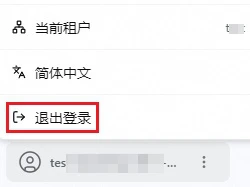

# 3.运行概览

本文介绍 OpenTrek-Ops 平台运行概览页面的功能和指标说明。

**使用场景**

运行概览是平台的首页仪表盘，适用于以下场景：

- 日常运维巡检，快速了解平台整体健康状态。

- 监控 Agent 运行趋势和 Token 消耗情况，评估资源使用效率。

- 查看模型性能指标，分析不同模型的响应时间和处理能力。

- 监控基础设施状态，及时发现和排查服务异常。

**前提条件**

已使用租户运营管理员登录 OpenTrek-Ops 平台。

**操作步骤**

1. 登录OpenTrek-Ops平台。

   登录成功后，默认进入**运行概览**页面。

   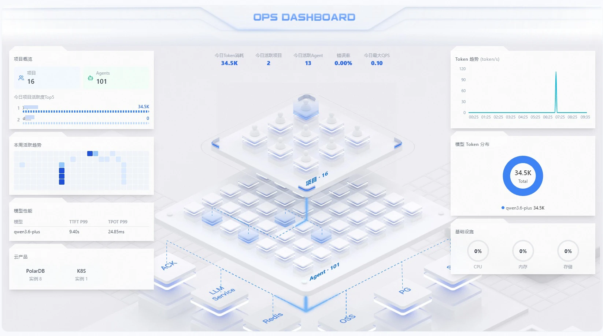

2. 进入**运行概览**页面后，可以看到以下核心模块：

   <table>
     <tr>
       <th width="149">模块名称</th>
       <th>说明</th>
     </tr>
     <tr>
       <td>项目概览</td>
       <td>• 展示项目和 Agents 的数量统计。 • 今日项目活跃度 Top5展示活跃度排名前五的项目列表。</td>
     </tr>
     <tr>
       <td>本周活跃趋势</td>
       <td>展示最近七天的活跃度变化趋势。</td>
     </tr>
     <tr>
       <td>模型性能</td>
       <td>展示各模型的 TTFT P99 和 TPOT P99 性能指标。</td>
     </tr>
     <tr>
       <td>云产品</td>
       <td>展示API网关、OSS、PolarDB、K8s的实例个数。</td>
     </tr>
     <tr>
       <td>Token 趋势</td>
       <td>以折线图形式展示 Token 消耗的时间趋势。将鼠标悬停在折线图上时，系统会显示对应时间点的 Token 总数据。</td>
     </tr>
     <tr>
       <td>模型 Token 分布</td>
       <td>展示不同模型的 Token 使用分布情况。</td>
     </tr>
     <tr>
       <td>基础设施</td>
       <td>展示CPU、内存、存储的使用率。</td>
     </tr>
     <tr>
       <td>中间大屏</td>
       <td>• 展示 ACK、LLM Service、Redis、OSS、PG 等基础设施的运行状态。蓝色表示服务正常。 • 今日 Token 消耗展示当日 Token 消耗总量。 • 今日活跃项目展示当日活跃的项目数量。 • 今日活跃 Agent展示当日活跃的 Agent 数量。 • 错误率展示当前请求的错误率指标。 • 今日最大QPS展示今日最大QPS。</td>
     </tr>
   </table>

**后续操作**

按照需求获取运行概览信息后，可通过 Agent 管理进一步查看和管理 Agent 的详细信息。

# 4.智能助手

通过智能运维助手实现自动化运维管理，本文为您介绍智能助手的使用。

**操作步骤**

1. 登录OpenTrek-Ops平台。

2. 在左侧菜单栏选择**智能助手**，唤起智能运维助手。

3. 在智能助手输入框输入需要咨询的问题，单击  。

   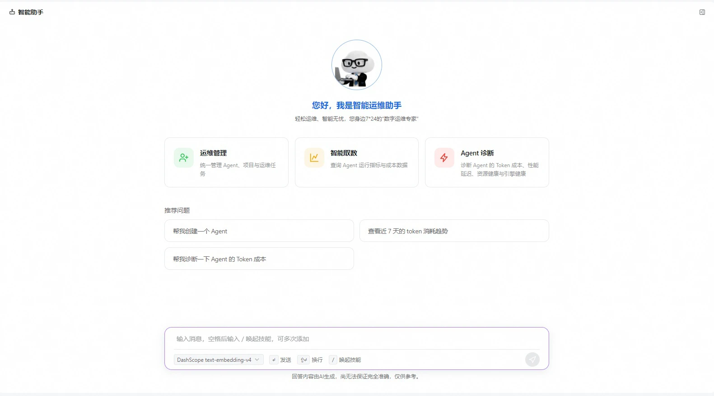

   - 单击卡片上的快捷问答， 可快速发起会话。

     - 运维管理

       支持对Agent进行集中创建、配置、启停等生命周期管理，可快速下发和管理各类运维任务（如部署、重启、更新配置等），实现自动化操作。

     - 智能取数

       查询Agent各个运行指标及成本数据，对性能、成本、流量等关键数据进行多维度拆解与趋势预测，识别资源浪费、低效使用场景，提供降本增效方案。

     - Agent诊断

       诊断Agent的Token成本、性能延迟、资源健康与引擎健康等，并给出合理的诊断处置建议，可快速排查Agent的异常等。

   - 新建任务：单击页面左上角的**新建任务**，可新开对话。

   - 历史任务：在对话任务记录搜索框搜索历史任务，可查看历史任务记录。

   - 删除任务：鼠标悬浮在目标对话任务上，单击任务后的  ，选择**删除**，可删除历史任务记录。

   - 重命名任务：鼠标悬浮在目标对话任务上，单击任务后的  ，选择**重命名**，重新编辑任务名称，然后单

     击  。

   - 置顶任务：鼠标悬浮在目标对话任务上，单击任务后的  ，选择**置顶**，可置顶该任务。

4. 在**智能助手**界面左上角单击**定时任务**。

   <ol type="i">

   <li>

   查看定时任务。

   在**定时任务**页面，可查看**任务总数**、**运行中**、**平均成功率**、**今日执行**的定时任务数量。

   

   </li>

   <li>

   新建任务。

   在**定时任务**页面，单击**新建任务**，填写任务名称、设置计划时间、选择执行模型、对任务进行描述后，单击**保存**。

   </li>

   <li>

   手动执行。

   在**定时任务**页面，单击目标任务**操作**列的**手动执行**，系统即会出发任务，可在左侧定时任务下选择该任务，查看执行详情。

   </li>

   <li>

   编辑定时任务。

   在**定时任务**页面，单击目标任务**操作**列的**编辑**，编辑任务名称、计划时间、执行模型、描述后，单击**保存修改**。

   </li>

   <li>

   禁用或启用定时任务。

   在**定时任务**页面，单击目标任务**操作**列的**禁用**或**启用**，可管理该任务的状态。

   </li>

   <li>

   查看定时任务详情。

   在**定时任务**页面，单击目标任务**操作**列的**查看**，查看任务详情。

   </li>

   <li>

   删除定时任务。

   在**定时任务**页面，单击目标任务**操作**列的**删除**，然后单击弹框中的**删除**。

   </li>

   <li>

   过滤、搜索定时任务。

   在**定时任务**页面，可按照全部、启用、禁用过滤任务；搜索任务名称或描述可查找任务。

   </li>

   </ol>

5. 在**智能助手**界面左上角单击**知识库**。

   <ol type="i">

   <li>

   查看系统内置知识库。

   在**知识库**页面，单击**全部知识库**，可查看系统内置的OpenTrek-Ops的产品文档，单击操作列的**详情**，可查看具体的文档、索引状态、设置等详细信息。

   </li>

   <li>

   创建知识库。

   <ol type="a">

   <li>

   在**知识库**页面，选择**我创建的**页签，单击**创建知识库**，输入知识库名称、描述、选择可见范围等，然后单击**创建知识库**。

   </li>

   <li>

   上传文档。

   单击创建的知识库**操作**列的**详情**，在**文档管理**页签单击**上传文档**，上传本地的文档。

   </li>

   </ol>

   <ol type="i" start="100">

   <li>

   索引状态

   在**知识库**详情页，选择**索引状态**，可查看知识库的索引详情。

   </li>

   <li value="500">

   检索测试

   在**知识库**详情页，选择**检索测试**，输入文档中的关键词，单击**检索**，界面展示检索结果。

   </li>

   </ol>

   <ol type="a" start="5">

   <li>

   设置

   在**知识库**详情页，选择**设置**，查看知识库的基础信息、个人空间配额、检索模型等。

   </li>

   </ol>

   </li>

   <li>

   查看知识库详情。

   单击创建的知识库**操作**列的**详情**，可查看具体的文档、索引状态、设置等详细信息。

   </li>

   <li>

   重建索引。

   单击创建的知识库**操作**列的**重建索引**，系统会重建知识库的全部文档索引，旧版本会持续服务到新版本就绪。

   </li>

   <li>

   删除知识库。

   单击创建的知识库**操作**列的**删除**，确认后文档和索引也会清除。

   </li>

   </ol>

# 5.运维中心

## 5.1. Agent 列表

本文介绍如何在 OpenTrek-Ops 平台中管理 Agent，包括托管、查看、编辑、启动、停止、扩缩容和删除Agent 等操作。

**使用场景**

Agent 管理是平台的核心功能，适用于以下场景：

- 创建新的运维 Agent 实现特定运维任务的自动化执行。

- 管理已有 Agent 的配置和运行状态，确保 Agent 正常运行。

- 为不同项目分配和管理 Agent 资源，实现资源的合理分配。

- 查看 Agent 执行记录，分析 Agent 运行效果和问题排查。

**前提条件**

- 已登录 OpenTrek-Ops 平台。

- 已获得租户运营管理员或具有 Agent 创建权限的角色。

**操作步骤**

1. 登录OpenTrek-Ops平台。

2. 在左侧导航栏，选择 **运维中心** > **Agent 列表** 。

   进入 **Agent管理**页面，在当前页面可以获取如下信息：

   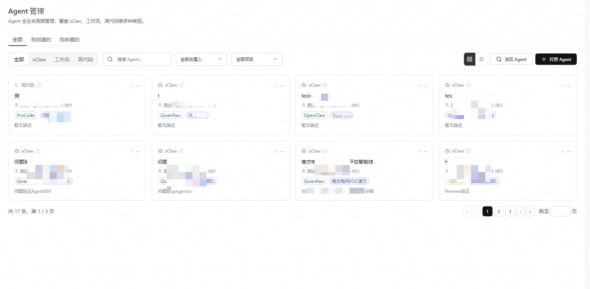

   - 使用搜索框按 Agent 名称搜索目标 Agent。

   - 使用**全部创建人**下拉框，按创建人过滤 Agent 列表。

   - 使用**全部项目**下拉框，按所属项目过滤 Agent 列表。

   - 单击视图切换按钮，在网格视图和列表视图之间切换。

   - 查看我创建的、我收藏的Agent，并且可按照**全部**、**xClaw**、**工作流**、**高代码**类型分类查看。

   - 查看 Agent 卡片，展示 Agent 图标、名称、类型标签、所属项目、创建人、运行状态等信息。

3. 托管Agent。

   在 Agent 管理页面，单击**托管Agent**，支持**xClaw**、**工作流**、**高代码**三种类型。

   - **xClaw**

     默认选择**xClaw**页签，在表单中填写以下信息：

     <table>
       <tr>
         <th>模块</th>
         <th>参数名称</th>
         <th>是否必填</th>
         <th>说明</th>
       </tr>
       <tr>
         <td rowspan="5">基本信息</td>
         <td>名称</td>
         <td>是</td>
         <td>Agent 的显示名称，建议使用有意义的命名。</td>
       </tr>
       <tr>
         <td>描述</td>
         <td>否</td>
         <td>Agent 的功能描述。</td>
       </tr>
       <tr>
         <td>类型</td>
         <td>是</td>
         <td>选择 Agent 类型，支持<strong>QwenPaw</strong>、<strong>OpenClaw</strong>和<strong>Hermes</strong>三种类型。</td>
       </tr>
       <tr>
         <td>所属项目</td>
         <td>是</td>
         <td>选择 Agent 归属的项目。</td>
       </tr>
       <tr>
         <td>版本</td>
         <td>是</td>
         <td>可选专业版或者标准版。 • 专业级能力全面，包括强大的记忆服务、弹性伸缩以及全景观测等能力。 • 标准版能力有限，支持基础的运维能力，无高可用保障。</td>
       </tr>
       <tr>
         <td rowspan="2">人格设定</td>
         <td>人格设定</td>
         <td>否</td>
         <td>描述人格特征。</td>
       </tr>
       <tr>
         <td>行为边界</td>
         <td>否</td>
         <td>定义行为边界。</td>
       </tr>
       <tr>
         <td>技能配置</td>
         <td>/</td>
         <td>否</td>
         <td>单击添加技能，选择技能后单击<strong>确认</strong>。 说明在添加技能前，请确保已在<strong>能力与插件</strong>&gt;<strong>技能</strong>页签已经创建技能。</td>
       </tr>
       <tr>
         <td>插件配置</td>
         <td>/</td>
         <td>否</td>
         <td>单击添加插件，选择插件后单击<strong>确认</strong>。 说明在添加插件前，请确保已在<strong>能力与插件</strong>&gt;<strong>插件</strong>页签已经上传插件。</td>
       </tr>
       <tr>
         <td>渠道设置</td>
         <td>/</td>
         <td>否</td>
         <td>可开启钉钉、微信、企业微信。 说明在设置频道前，请确保已在<strong>系统设置</strong>&gt;<strong>配置管理</strong>&gt;<strong>渠</strong><strong>道管理</strong>中开启频道。</td>
       </tr>
       <tr>
         <td>可见范围</td>
         <td>/</td>
         <td>是</td>
         <td>控制此 Agent 对哪些用户可见。 • 仅自己 • 所属项目全员 • 指定成员</td>
       </tr>
     </table>

     填写完成后，单击**创建**按钮完成创建，创建成功后，新 Agent 将出现在 Agent 列表中。

   - **工作流**

     选择工作流页签，在表单中填写以下信息：

     <table>
       <tr>
         <th>模块</th>
         <th>参数名称</th>
         <th>是否必填</th>
         <th>说明</th>
       </tr>
       <tr>
         <td rowspan="3">基本信息</td>
         <td>Agent名称</td>
         <td>是</td>
         <td>工作流应用的显示名称，建议使用有意义的命名。</td>
       </tr>
       <tr>
         <td>功能描述</td>
         <td>否</td>
         <td>简要描述工作流功能。</td>
       </tr>
       <tr>
         <td>所属项目</td>
         <td>是</td>
         <td>选择 Agent 归属的项目。</td>
       </tr>
       <tr>
         <td rowspan="3">工作流编排</td>
         <td>DSL类型</td>
         <td>是</td>
         <td>默认Dify DSL。</td>
       </tr>
       <tr>
         <td>Dify平台</td>
         <td>是</td>
         <td>选择Dify平台。</td>
       </tr>
       <tr>
         <td>上传 DSL文件</td>
         <td>是</td>
         <td>点击上传或拖拽文件至上传处，支持.json、.yaml、.yml格式。</td>
       </tr>
       <tr>
         <td>可见范围</td>
         <td>/</td>
         <td>是</td>
         <td>控制此 Agent 对哪些用户可见。 • 仅自己 • 所属项目全员 • 指定成员</td>
       </tr>
     </table>

     填写完成后，单击**创建Agent**按钮完成创建，创建成功后，新 Agent 将出现在 Agent 列表中。

   - **高代码**

     选择**高代码**页签，在表单中填写以下信息：

     <table>
       <tr>
         <th>模块</th>
         <th>参数名称</th>
         <th>是否必填</th>
         <th>说明</th>
       </tr>
       <tr>
         <td rowspan="5">基本信息</td>
         <td>应用名称</td>
         <td>是</td>
         <td>高代码 Agent 的显示名称，建议使用有意义的命名。</td>
       </tr>
       <tr>
         <td>功能描述</td>
         <td>否</td>
         <td>简要描述应用功能。</td>
       </tr>
       <tr>
         <td>所属项目</td>
         <td>是</td>
         <td>选择 Agent 归属的项目。</td>
       </tr>
       <tr>
         <td>Agent框架</td>
         <td>是</td>
         <td>选择系统内置的 Agent 的框架。</td>
       </tr>
       <tr>
         <td>运行时</td>
         <td>是</td>
         <td>请选择运行时，可选择具体的版本或者其他。</td>
       </tr>
       <tr>
         <td rowspan="6">部署配置</td>
         <td>发布平台</td>
         <td>是</td>
         <td>支持自发布平台，部署到自有平台。</td>
       </tr>
       <tr>
         <td>资源配置</td>
         <td>是</td>
         <td>设置副本数、CPU、内存。</td>
       </tr>
       <tr>
         <td>镜像配置</td>
         <td>是</td>
         <td>• 镜像来源支持<strong>自定义仓库</strong>。 • 镜像地址填写完整的镜像拉取地址，包含 registry、命名空间、镜像名和 tag。 • 镜像拉取策略支持<strong>优先使用本地镜像</strong>、<strong>总是拉取镜像</strong>、<strong>仅使用本地镜</strong><strong>像</strong>。 • 镜像认证选择已有密钥或者新创建一个密钥。</td>
       </tr>
       <tr>
         <td>启动配置</td>
         <td>否</td>
         <td>输入启动命令和端口。</td>
       </tr>
       <tr>
         <td>健康检查</td>
         <td>否</td>
         <td>填写检查路径、检查端口、检查间隔、超时时间。</td>
       </tr>
       <tr>
         <td>环境变量</td>
         <td>否</td>
         <td>设置环境变量，支持<strong>表单模式</strong>和<strong>JSON模式</strong>。</td>
       </tr>
       <tr>
         <td>可见权限</td>
         <td>/</td>
         <td>是</td>
         <td>控制此 Agent 对哪些用户可见。 • 仅自己 • 所属项目全员 • 指定成员</td>
       </tr>
     </table>

     填写完成后，单击**创建应用**完成创建，创建成功后，新 Agent 将出现在 Agent 列表中。

4. 发现Agent

   > **说明**
   >
   > 从百炼平台或Dify发现并接入已有Agent。

   - OpenTrek Dev

     在 Agent 管理页面，单击**发现 Agent**，在OpenTrek Dev页签，填入以下参数：

     <table>
       <tr>
         <th width="106">参数名称</th>
         <th>说明</th>
       </tr>
       <tr>
         <td>平台</td>
         <td>选择一个已经对接的百炼平台。</td>
       </tr>
       <tr>
         <td>类型</td>
         <td>选择要接入的智能体，该智能体的所有已上线版本将作为独立Agent导入。支持<strong>自主智能体</strong>、<strong>工作流</strong>两种类型。</td>
       </tr>
       <tr>
         <td>选择智能体</td>
         <td>搜索智能体名称选择智能体，支持选择多个智能体。</td>
       </tr>
       <tr>
         <td>所属项目</td>
         <td>选择一个项目。</td>
       </tr>
       <tr>
         <td>可见权限</td>
         <td>控制此 Agent 对哪些用户可见。 • 仅自己 • 所属项目全员 • 指定成员</td>
       </tr>
     </table>

     单击**导入Agent**。创建成功后，新 Agent 将出现在 Agent 列表中。

   - Dify

     在 Agent 管理页面，单击**发现 Agent**，在OpenTrek Dev页签，填入以下参数：

     <table>
       <tr>
         <th width="106">参数名称</th>
         <th>说明</th>
       </tr>
       <tr>
         <td>平台</td>
         <td>选择一个已经对接的百炼平台。</td>
       </tr>
       <tr>
         <td>应用类型</td>
         <td>选择要接入的智能体，该智能体的所有已上线版本将作为独立Agent导入。支持<strong>工作流</strong>、<strong>Chatflow</strong>、<strong>聊天助手</strong>、<strong>Agent</strong>、<strong>文本生成</strong>五种类型。</td>
       </tr>
       <tr>
         <td>选择智能体</td>
         <td>搜索智能体名称选择智能体，支持选择多个智能体。</td>
       </tr>
       <tr>
         <td>所属项目</td>
         <td>选择一个项目。</td>
       </tr>
       <tr>
         <td>可见权限</td>
         <td>控制此 Agent 对哪些用户可见。 • 仅自己 • 所属项目全员 • 指定成员</td>
       </tr>
     </table>

     单击**导入Agent**。创建成功后，新 Agent 将出现在 Agent 列表中。

5. 查看 Agent 详情。

   - 在 **Agent管理**页面找到目标 Agent，单击 Agent 卡片进入 Agent 详情页面。

   - 在 Agent 详情页面，您可以查看：

     - 基本信息：名称、类型、描述、创建时间、所属项目、主模型等。

     - 运行状态：运行中、变更中、已停止、异常。

     - 配置信息：Agent 的运行配置参数，如概览、心智、技能与工具、频道、云资源、版本历史、安全设置、指标分析、链路分析、拓扑等。

       > **说明**
       >
       > - 高代码类型的Agent可查看实例与弹性、备份与版本、指标分析、链路分析的详细信息。
       >
       > - 工作流类型的Agent可查看概览、渠道、版本管理的详细信息。

     - 运行日志：Agent 的历史执行记录，可查看历史任务及日志。

**相关操作**

<table>
  <tr>
    <th>操作类型</th>
    <th>Agent类型</th>
    <th>操作步骤</th>
  </tr>
  <tr>
    <td>编辑 Agent</td>
    <td>xClaw</td>
    <td>1. 在 Agent 列表中找到目标 Agent。 2. 单击 Agent 卡片进入Agent详情。 3. 在基础信息模块，可编辑<strong>主模型</strong>。 4. 单击页面右上角的<strong>更多</strong>&gt;<strong>编辑</strong>，可编辑Agent名称、描述及可见权限。 5. 在详情页下方，分别选择<strong>心智</strong>、<strong>技能与工具</strong>、<strong>渠道</strong>、<strong>云资源</strong>、<strong>版本历史</strong>、<strong>安全</strong><strong>设置</strong>六个页签，可编辑相关信息。 i. 心智编辑<strong>身份标识</strong>、<strong>人格设定</strong>、<strong>行为边界</strong>，然后单击<strong>保存</strong>。ii. 技能与工具 • 技能 • 添加技能单击<strong>添加技能</strong>，然后选择技能，可选择多个技能，单击<strong>确认</strong>。 说明Agent添加技能之前，需要先在Agent所属的项目下添加技能。 • 回滚技能当添加的技能存在多个版本时，单击技能名称，在技能详情页右上角可切换版本，即可回退技能版本。 • 删除技能单击已添加技能后的删除图标，可移除不需要的技能。 • 更新技能状态 单击已添加技能后的，可启用或禁用该技能。 • 插件 • 添加插件单击<strong>添加插件</strong>，选择目标插件后，单击<strong>确认</strong>。 • 删除插件单击插件卡片上的删除图标，可移除该插件。 • MCP • 添加MCP单击<strong>添加MCP</strong>，在添加MCP Server弹框搜索MCP服务器，选择后单击<strong>绑定到Agent</strong>。 • 删除MCP单击已添加MCP后的删除图标，可移除不需要的MCP服务器。 • 更新MCP的状态 单击已添加MCP后的，可启用或禁用MCP。 iii. 渠道配置渠道的相关信息，单击<strong>保存配置</strong>。iv. 云资源单击目标模型服务后的删除图标，可移除模型，移除后将同步更新到Agent。 v. 版本历史在<strong>版本历史</strong>页签，单击历史版本<strong>操作</strong>列的<strong>发布</strong>，可将Agent的版本回退到目标历史版本。</td>
  </tr>
  <tr>
    <td rowspan="3"></td>
    <td></td>
    <td>vi. 安全设置 • 全局继承继承全局的规则，可通过操作列禁用或启用规则。 • Agent自有 • 添加规则单击<strong>添加规则</strong>，设置规则ID、选择工具，填写正则模式和排除模式等参数，单击<strong>添加</strong>。添加完成后，状态为<strong>同步成功</strong>，更多详情可参见安全设置。 • 启用/禁用规则 单击目标规则操作列的，可启用或禁用规则。 • 编辑规则 单击目标规则操作列的，可编辑Agent规则相关信息。</td>
  </tr>
  <tr>
    <td>高代码</td>
    <td>• 删除规则 1. 单击 Agent 卡片进入Agent详情。 2. 在Agent详情页，单击界面右上角的<strong>更多</strong>，选择<strong>编辑</strong>。单击目标规则操作列的，可删除该规则。 3. 可编辑Agent名称、描述及可见权限。 4. 单击<strong>保存</strong>。</td>
  </tr>
  <tr>
    <td>工作流</td>
    <td>1. 单击 Agent 卡片进入Agent详情。 2. 在Agent详情页，单击界面右上角的<strong>更多</strong>，选择<strong>编辑</strong>。 3. 可编辑Agent名称、描述及可见权限，单击<strong>保存</strong>。 4. 在详情页下方： i. 选择<strong>渠道</strong>，配置钉钉、微信等渠道。ii. 选择<strong>版本管理</strong>，可预览历史版本或发布历史版本。</td>
  </tr>
  <tr>
    <td rowspan="2">启动或停止Agent</td>
    <td>xClaw</td>
    <td>1. 在 Agent 列表中找到目标 Agent，单击Agent卡片进入详情页。 2. 在详情页右上角，单击<strong>更多</strong>，选择 <strong>启动</strong> 或 <strong>停止</strong>。 3. 确认后 Agent 状态将更新。</td>
  </tr>
  <tr>
    <td>高代码</td>
    <td>1. 在 Agent 列表中找到目标 Agent，单击Agent卡片进入详情页。 2. 在详情页右上角，单击<strong>更多</strong>，选择 <strong>下线</strong> 或 <strong>启动</strong>。 3. 确认后 Agent 状态将更新。</td>
  </tr>
  <tr>
    <td>重启Agent</td>
    <td>xClaw/高代码</td>
    <td>1. 在 Agent 列表中找到目标 Agent，单击Agent卡片进入详情页。 2. 在详情页右上角，单击<strong>重启</strong> 。 3. 确认后 Agent 状态将更新。</td>
  </tr>
  <tr>
    <td>删除 Agent</td>
    <td>xClaw/高代码/工作流</td>
    <td>说明删除 Agent 前，请确保 Agent 处于停止状态。 1. 在 Agent 列表中找到目标 Agent，单击Agent卡片进入详情页。 2. 在详情页右上角，单击<strong>更多</strong>，选择 <strong>删除</strong> 。 3. 在弹出的确认对话框中单击 <strong>确定删除</strong> 。 4. 删除成功后该 Agent 将从列表中移除。</td>
  </tr>
  <tr>
    <td>扩缩容</td>
    <td>xClaw/高代码</td>
    <td>1. 在 Agent 列表中找到目标 Agent，单击Agent卡片进入详情页。 2. 在详情页右上角，单击<strong>扩缩容</strong>。 3. 在<strong>调整规格</strong>弹框中，预览当前的配置信息，然后设置CPU和内存。 4. 单击<strong>确定应用</strong>，扩缩容过程中，Agent状态变为<strong>变更中</strong>，可在<strong>变更历史</strong>页面查看扩缩容任务详情。</td>
  </tr>
  <tr>
    <td rowspan="3">更新Agent</td>
    <td>xClaw</td>
    <td>1. 在 Agent 列表中找到目标 Agent，单击Agent卡片进入详情页。 2. 在详情页右上角，单击<strong>更新</strong>，系统默认显示可升级的版本。 3. 单击<strong>确认升级</strong>，可升级Agent。 说明当Agent镜像版本为最新版本时，更新按钮不可点击。</td>
  </tr>
  <tr>
    <td>高代码</td>
    <td>1. 在 Agent 列表中找到目标 Agent，单击Agent卡片进入详情页。 2. 在详情页右上角，单击<strong>更新</strong>。 3. 根据实际需要，更新Agent的基本信息、部署配置、高级设置等详情。 4. 单击<strong>确认更新</strong>。</td>
  </tr>
  <tr>
    <td>工作流</td>
    <td>1. 在 Agent 列表中找到目标 Agent，单击Agent卡片进入详情页。 2. 在详情页右上角，单击<strong>更新</strong>，重新上传DSL文件。 3. 单击<strong>更新</strong>。</td>
  </tr>
  <tr>
    <td>解绑Agent</td>
    <td>工作流</td>
    <td>1. 在 Agent 列表中找到目标 Agent，单击Agent卡片进入详情页。 2. 在详情页右上角，单击<strong>更多</strong>，选择<strong>解绑</strong>。 3. 解绑后将清理本平台的工作流Agent数据，确认无误后，单击<strong>确认解绑</strong>。</td>
  </tr>
  <tr>
    <td>收藏Agent</td>
    <td>xClaw/高代码</td>
    <td>单击目标Agent卡片上的收藏图标，可收藏Agent，同时可在<strong>我收藏的</strong>中查看。</td>
  </tr>
  <tr>
    <td>对话Agent</td>
    <td>xClaw/工作流</td>
    <td>1. 在 Agent 列表中找到目标 Agent，单击Agent卡片进入详情页。 2. 在详情页右上角，单击<strong>对话</strong>，跳转至交互页面，即可开始会话。 说明只能查看本人发起的会话。</td>
  </tr>
</table>

**后续操作**

完成 Agent 创建后，可将 Agent 添加到项目中参与协作。

## 5.2. 项目管理

本文介绍如何在 OpenTrek-Ops 平台中管理项目，包括创建项目和管理项目成员等操作。

**使用场景**

项目管理功能适用于以下场景：

- 构建多角色协作的运维团队，实现复杂运维任务的分工协作。

- 管理团队的成员 Agent 和权限，确保团队成员的有效管理。

- 协调团队内 Agent 的任务分配，提高团队协作效率。

- 为特定项目或业务场景组建专属运维团队。

**前提条件**

- 已登录 OpenTrek-Ops 平台。

- 已获得租户运营管理员或具有项目创建权限的角色。

**操作步骤**

1. 登录OpenTrek-Ops平台。

2. 在左侧导航栏，选择**运维中心**>**项目管理**。

   进入项目管理页面，在当前页面可以获取如下信息：

   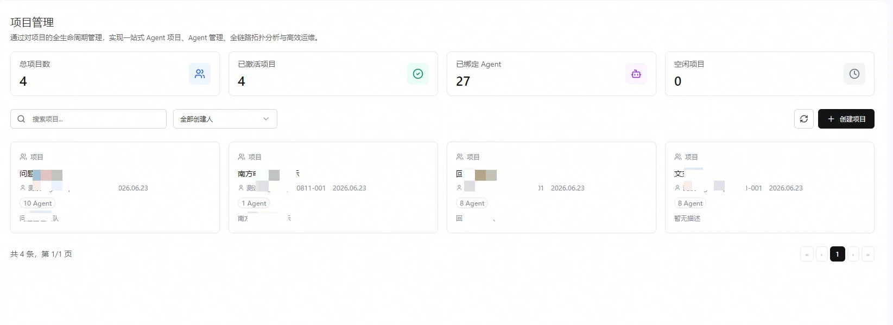

   - 查看总项目数、已激活项目数、已绑定Agent的数量、空闲项目数。

   - 使用搜索框按项目名称搜索目标项目。

   - 按照创建人过滤项目。

   - 单击**创建项目**按钮创建新的项目。

   - 查看项目卡片，展示项目名称、Agent数量、创建人、描述等信息。

   - 单击卡片进入项目详情页面，查看Agent列表。

3. 创建项目。

   <ol type="i">

   <li>

   在**项目管理**页面，单击**创建项目**按钮。

   </li>

   <li>

   在弹出的创建表单中填写以下信息：

   | 参数名称 | 是否必填 | 说明 |
   | --- | --- | --- |
   | 项目名称 | 是 | 团队的显示名称，建议输入一个有意义的名称。 |
   | 描述 | 否 | 描述该项目的职责和目标。 |
   | K8s集群 | 否 | 选择一个K8s集群。 |
   | 模型服务 | 是 | 请选择至少一个文本生成类型的模型。 |
   | 运行时存储 | 是 | 默认开启。 |
   | 记忆服务 | 否 | 默认关闭，开始时，选择至少一个文本向量化类型的模型。 |
   | 权限 | 否 | 设置<strong>项目管理员</strong>和<strong>项目成员</strong>。 • 项目管理员：拥有该项目的完整管理权限，可管理成员、资源和配置。 • 项目成员：可使用该项目下的Agent、技能和工具等资源。 |

   </li>

   <li>

   单击**创建项目**按钮完成创建.

   </li>

   </ol>

4. 添加项目成员。

   <ol type="i">

   <li>

   单击目标项目卡片， 进入详情页面。

   </li>

   <li>

   在Agent页签，单击**创建Agent**，可参考Agent 列表添加Agent。

   </li>

   <li>

   单击**创建**完成添加。

   </li>

   </ol>

5. 添加技能。

   在项目详情页，选择**技能**页签，单击**添加技能**，选择技能后单击**确认**，为该项目添加技能。

6. 添加插件。

   在项目详情页，选择**插件**页签，单击**添加插件**，选择插件后单击**确认**，为该项目添加插件。

7. 添加MCP服务器。

   在项目详情页，选择**MCP**页签，单击**添加MCP**，选择MCP后单击**添加到项目**，为该项目添加MCP服务器。

8. 管理云资源。

   - 添加云资源

     在项目详情页，选择**云资源**页签，在模型服务页签单击**添加资源**，选择模型后单击**保存**，为该项目绑定模型。

   - 删除云资源

     在项目详情页，选择**云资源**页签，在模型服务页签，单击目标云资源操作列的删除图标  ，可删除该云

     资源。

9. 链路分析。

   在项目详情页，选择**链路分析**页签，可查看该项目下所有的Trace记录，单击Trace ID，可查看详情。

**相关操作**

**编辑项目**

1. 在项目管理页面，选择目标项目，单击项目卡片。

2. 单击页面右上角的**编辑**，编辑**项目名称**、**描述**、**项目管理员**、**项目成员**。

3. 单击**保存**。

**删除项目**

> **说明**
>
> 删除项目前，请确保该项目下的Agent已清理完成。

1. 在**项目管理**页面，选择目标项目，单击项目卡片。

2. 单击页面右上角的**删除**，然后单击**确认删除**。

   > **警告**
   >
   > 删除操作不可逆，请谨慎执行！

**批量操作**

1. 在**项目管理**页面，选择目标项目，单击项目卡片。

2. 单击页面右上角的**批量运维**。

   - Agent运维

     在批量操作弹框选择**Agent运维**，然后选择具体操作。

     <table>
       <tr>
         <th width="90">操作类型</th>
         <th>详细步骤</th>
       </tr>
       <tr>
         <td>更新</td>
         <td>选择操作与范围 a. Agent运维操作选择<strong>更新</strong>； b. 选择Agent类型，xClaw、工作流或高代码。 c. 选择Agent，单击<strong>下一步</strong>。配置参数选择运行时及版本，单击<strong>下一步</strong>。执行方式选择执行策略，<strong>全量执行</strong>或<strong>分批执行</strong>，单击<strong>下一步</strong>。预览预览详情，确认无误后单击<strong>确认执行</strong>。</td>
       </tr>
       <tr>
         <td>扩缩规格</td>
         <td>选择操作与范围 a. Agent运维操作选择<strong>扩缩规格</strong>； b. 选择Agent类型，xClaw或高代码。 c. 选择Agent，单击<strong>下一步</strong>。配置参数选择目标规格或自定义规格，单击<strong>下一步</strong>。执行方式选择执行策略，<strong>全量执行</strong>或<strong>分批执行</strong>，单击<strong>下一步</strong>。预览预览详情，确认无误后单击<strong>确认执行</strong>。</td>
       </tr>
       <tr>
         <td>重启</td>
         <td>选择操作与范围 a. Agent运维操作选择<strong>重启</strong>； b. 选择Agent类型，xClaw或高代码。 c. 选择Agent，单击<strong>下一步</strong>。配置参数无需设置，单击<strong>下一步</strong>。执行方式选择执行策略，<strong>全量执行</strong>或<strong>分批执行</strong>，单击<strong>下一步</strong>。预览预览详情，确认无误后单击<strong>确认执行</strong>。</td>
       </tr>
     </table>

     <table>
       <tr>
         <td>启动</td>
         <td>选择操作与范围 a. Agent运维操作选择<strong>启动</strong>； b. 选择Agent类型，xClaw或高代码。 c. 选择Agent，单击<strong>下一步</strong>。配置参数无需设置，单击<strong>下一步</strong>。执行方式选择执行策略，<strong>全量执行</strong>或<strong>分批执行</strong>，单击<strong>下一步</strong>。预览预览详情，确认无误后单击<strong>确认执行</strong>。</td>
       </tr>
       <tr>
         <td>停止</td>
         <td>选择操作与范围 a. Agent运维操作选择<strong>停止</strong>； b. 选择Agent类型，xClaw或高代码。 c. 选择Agent，单击<strong>下一步</strong>。配置参数无需设置，单击<strong>下一步</strong>。执行方式选择执行策略，<strong>全量执行</strong>或<strong>分批执行</strong>，单击<strong>下一步</strong>。预览预览详情，确认无误后单击<strong>确认执行</strong>。</td>
       </tr>
       <tr>
         <td>下线</td>
         <td>选择操作与范围 a. Agent运维操作选择<strong>下线</strong>； b. 选择Agent类型，xClaw或高代码。 c. 选择Agent，单击<strong>下一步</strong>。配置参数无需设置，单击<strong>下一步</strong>。执行方式选择执行策略，<strong>全量执行</strong>或<strong>分批执行</strong>，单击<strong>下一步</strong>。预览预览详情，确认无误后单击<strong>确认执行</strong>。</td>
       </tr>
     </table>

   - 技能运维

     <ol type="a">

     <li>

     **选择操作与范围**

     <ol type="a">

     <li>

     操作选择**技能运维**；

     </li>

     <li>

     技能运维选择**技能同步**、**技能升级**、**技能禁用**、**技能移除**。

     </li>

     </ol>

     <ol type="i" start="100">

     <li>

     选择Agent，单击**下一步**。

     </li>

     </ol>

     </li>

     <li>

     **配置参数**

     选择技能，单击**下一步**。

     </li>

     </ol>

     <ol type="i" start="100">

     <li>

     **执行方式**

     选择执行策略，**全量执行**或**分批执行**，单击**下一步**。

     </li>

     <li value="500">

     **预览**

     预览详情，确认无误后单击**确认执行**。

     </li>

     </ol>

   - 插件运维

     <ol type="a">

     <li>

     **选择操作与范围**

     <ol type="a">

     <li>

     操作选择**插件运维**；

     </li>

     <li>

     插件运维选择**批量安装插件**、**批量卸载插件**。

     </li>

     </ol>

     <ol type="i" start="100">

     <li>

     选择Agent，单击**下一步**。

     </li>

     </ol>

     </li>

     <li>

     **配置参数**

     选择插件，单击**下一步**。

     </li>

     </ol>

     <ol type="i" start="100">

     <li>

     **执行方式**

     选择执行策略，**全量执行**或**分批执行**，单击**下一步**。

     </li>

     <li value="500">

     **预览**

     预览详情，确认无误后单击**确认执行**。

     </li>

     </ol>

   - 配置更新

     <table>
       <tr>
         <th width="93">操作类型</th>
         <th>详细步骤</th>
       </tr>
       <tr>
         <td>同步模型</td>
         <td>选择操作与范围 a. 操作选择<strong>同步模型</strong>； b. 选择Agent，单击<strong>下一步</strong>。配置参数选择目标模型，单击<strong>下一步</strong>。执行方式选择执行策略，<strong>全量执行</strong>或<strong>分批执行</strong>，单击<strong>下一步</strong>。预览预览详情，确认无误后单击<strong>确认执行</strong>。</td>
       </tr>
       <tr>
         <td>同步MCP</td>
         <td>选择操作与范围 a. 操作选择<strong>同步MCP</strong>； b. 选择Agent，单击<strong>下一步</strong>。配置参数无需配置，单击<strong>下一步</strong>。执行方式选择执行策略，<strong>全量执行</strong>或<strong>分批执行</strong>，单击<strong>下一步</strong>。预览预览详情，确认无误后单击<strong>确认执行</strong>。</td>
       </tr>
     </table>

**后续操作**

完成项目创建后，可为项目分配技能以实现团队协作。

## 5.3. 能力与插件

本文介绍如何在平台中管理技能、MCP 和插件，包括创建、启用/禁用、版本管理和安装配置等操作。

**前提条件**

- 已登录 OpenTrek-Ops 平台。

- 已获得租户运营管理员或具有创建能力与插件权限的角色。

**技能**

1. 登录OpenTrek-Ops平台。

2. 在左侧导航栏，选择**运维中心**>**能力与插件**。

   进入**技能**管理页面，在当前页面可以获取如下信息：

   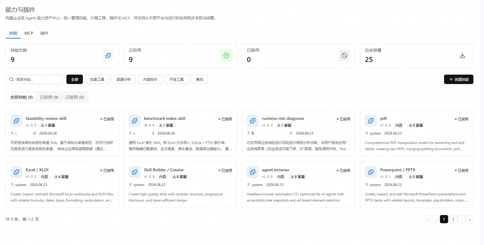

   - 查看技能总数、已启用技能数量、已禁用技能数量以及总安装量。

   - 使用搜索框按技能名称搜索目标技能。

   - 使用分类筛选，按全部、效率工具、数据分析、内容创作、开发工具、其他分类筛选技能。

   - 单击 **创建技能** 按钮创建新的技能。

   - 查看技能卡片，展示技能图标、名称、描述、版本号、更新时间、启用状态等信息。

3. 创建技能。

   > **说明**
   >
   > 系统内置部分技能，具体已实际数据为准。

   <ol type="i">

   <li>

   在**技能**管理页面，单击 **创建技能** 按钮。

   </li>

   <li>

   在创建表单中填写以下信息：

   | 参数名称 | 是否必填 | 说明 |
   | --- | --- | --- |
   | 上传技能包 | 是 | 上传已准备好的技能包，要求目录包含skill.md的.zip文件，skill.md需要包含yaml格式的名称和描述信息。 重要单个Skill文件体积不得超过10MB，超出请压缩或拆分为多个Skill。 |
   | 技能名称 | 否 | 默认使用skill.md中的名称；可修改。 |
   | 技能描述 | 否 | 默认使用skill.md中的描述；可修改。 |
   | 标签分类 | 否 | 选择技能所属分类，支持效率工具、数据分析、内容创作、开发工具、其他。 |

   </li>

   <li>

   技能包上传完成后，单击**创建技能**。

   技能添加成功后，默认启用。

   </li>

   </ol>

4. 启用或禁用技能。

   > **说明**
   >
   > 禁用技能后，已安装该技能的 Agent 将无法继续调用该技能。

   <ol type="i">

   <li>

   在技能列表中找到目标技能，单击卡片进入技能详情页面。

   </li>

   <li>

   单击详情页右上角的**启用**或者**禁用**。

   </li>

   <li>

   确认操作后状态将更新。

   </li>

   </ol>

5. 删除技能。

   > **说明**
   >
   > 系统内置技能不允许删除。

   在技能列表中找到目标技能，单击卡片进入技能详情页面，单击**删除**，再弹框中单击**确认删除**。

6. 更新版本。

   <ol type="i">

   <li>

   在技能列表中单击目标技能卡片。

   </li>

   <li>

   单击技能详情页右上角的**更新版本**。

   </li>

   <li>

   在更新版本弹框上传新版本文件，系统将自动进行安全扫描后完成更新。

   </li>

   <li>

   单击**开始更新**。

   </li>

   </ol>

7. 查看技能详情。

   <ol type="i">

   <li>

   在技能列表中单击目标技能卡片。

   </li>

   <li>

   进入技能详情页面查看：

   - 基本信息：名称、分类、描述、版本、来源等。

   - 概述：技能的详细配置参数。

   - 文件：技能详细的文件目录。

   - 安全：技能的安全风险评估详情。

   - 版本历史：坂本的升级演进详情。

   - 已安装：已安装该技能的项目，单击项目可查看关联的Agent。

   </li>

   </ol>

**MCP**

1. 登录OpenTrek-Ops平台。

2. 在左侧导航栏，选择**运维中心**>**能力与插件**，选择**MCP**页签。

   进入**MCP**页面，在当前页面可以获取如下信息：

   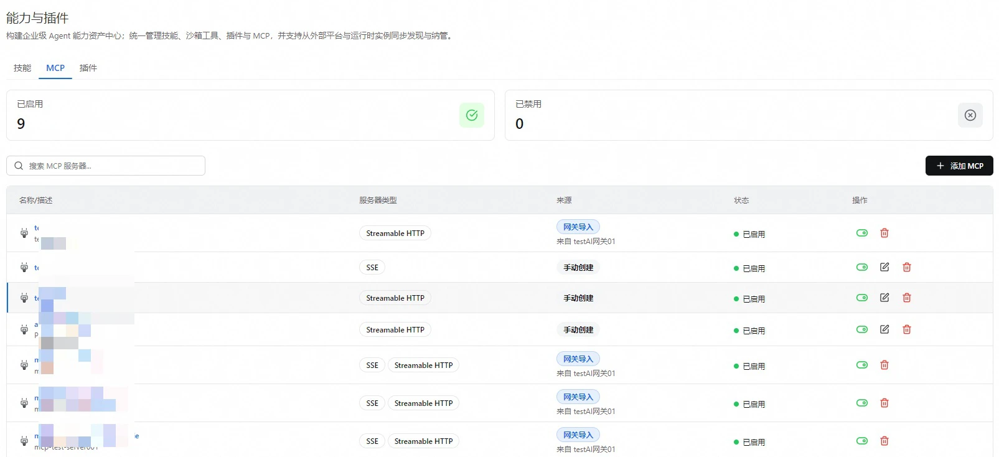

   - 查看MCP启用数和关闭数。

   - 使用搜索框精准查找目标MCP服务器。

   - 查看MCP列表，包含名称/描述、服务器类型、来源、状态等。

3. 添加MCP。

   MCP有手动配置、JSON导入、AI网关自动同步三种添加方式。

   - **方式一：手动配置**

     <ol type="a">

     <li>

     在**MCP**页面单击**添加MCP**。

     </li>

     <li>

     在**手动配置**页签，填写如下参数：

     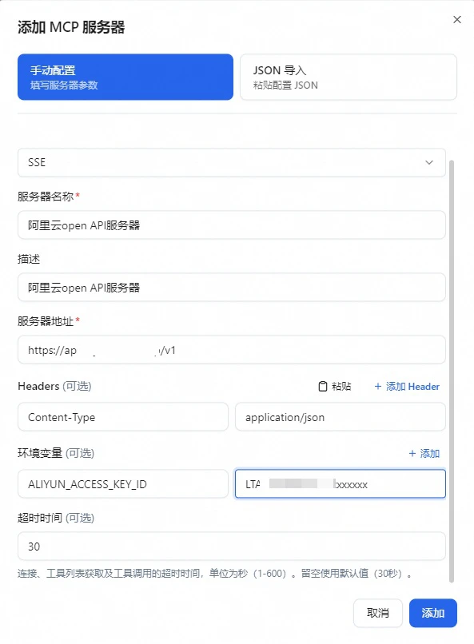

     | 参数 | 是否必填 | 说明 |
     | --- | --- | --- |
     | 服务器类型 | 是 | 选择服务器类型： • SSE • Streamable HTTP • STDIO |
     | 服务器名称 | 是 | 输入服务器名称。 |
     | 描述 | 否 | 添加描述信息，可选。 |
     | 服务器地址 | 是 | 输入服务器地址，如http://localhost:8080/sse |
     | Headers | 否 | • 直接添加Headers，可添加多个。 • 单击<strong>粘贴</strong>，按照Header:Value或Header=Value的格式粘贴Headers，每行一个，然后单击<strong>解析</strong>。 |
     | 环境变量 | 否 | 添加环境变量。 |
     | 超时时间 | 否 | 连接、工具列表获取及工具调用的超时时间，范围1-600秒，默认30秒。 |

     </li>

     </ol>

     <ol type="i" start="100">

     <li>

     单击**添加**，添加成功的服务器状态为**启用**。

     </li>

     </ol>

   - **方式二：JSON导入**

     <ol type="a">

     <li>

     在**MCP**页面单击**添加MCP**。

     </li>

     <li>

     在添加MCP服务器弹框，单击**JSON导入**。

     </li>

     </ol>

     <ol type="i" start="100">

     <li>

     在输入框粘贴MCP服务器配置JSON。

     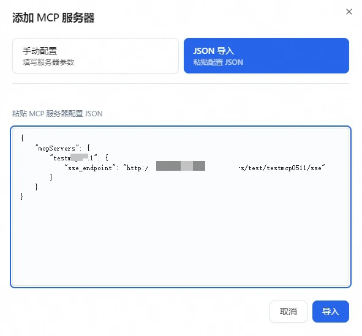

     </li>

     <li value="500">

     单击**导入**，导入成功的服务器状态为**启用**。

     </li>

     </ol>

   - **方式三：网关导入**

     导入AI网关后，可通过**同步网关**操作，系统自动导入AI网关关联的<strong>MCP配置。</strong>可参考同步网关。

4. 查看MCP详情。

   在服务器列表，单击服务器名称，查看服务器基本信息、连接配置、及工具列表：

   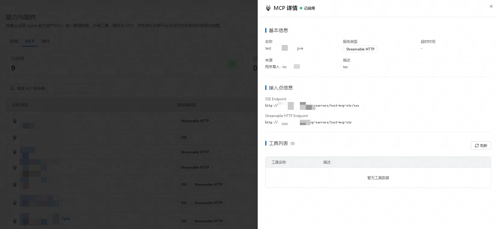

   - 基本信息

     查看服务器的名称、描述、服务器类型、状态、来源、超时时间。

   - 接入点信息

     查看服务器Endpoint详情。

   - 工具列表

     查看详细的工具名称以及描述信息。

5. 禁用/启用MCP服务器。

   - 状态为**启用**的服务器，单击目标服务器**操作**列的禁用图标  。

   - 状态为**禁用**的服务器，单击目标服务器**操作**列的启用图标  。

6. 编辑MCP服务器。

   > **说明**
   >
   > 网关导入的服务器不支持编辑。

   <ol type="i">

   <li>

   单击目标服务器操作列的编辑图标  ，编辑MCP服务器的**描述**、**服务器地址**、**Headers**及**超时时间**。

   </li>

   <li>

   单击**下一步：影响面确认**。

   </li>

   <li>

   确认响应面，然后单击**确认保存并下发**。

   </li>

   </ol>

7. 删除MCP服务器。

   单击目标服务器**操作**列的删除图标  ，在**确认删除**弹框中单击**删除**。

   > **重要**
   >
   > 此操作不可逆，请谨慎操作。

**插件**

1. 登录OpenTrek-Ops平台。

2. 在左侧导航栏，选择**运维中心**>**能力与插件**，选择**插件**页签。

   进入**插件**页面，在当前页面可以获取如下信息：

   - 查看插件总数、已启用插件数量、已禁用和总安装插件数量。

   - 使用搜索框按插件名称搜索目标插件。

   - 查看插件卡片，展示插件图标、名称、描述、版本号、状态等信息。

3. 上传插件。

   <ol type="i">

   <li>

   在**插件**页面，单击**上传插件**。

   </li>

   <li>

   在弹框中上传插件包，填写插件名称、描述、版本等信息，上传插件包后，系统将自动解析并注册插件。

   </li>

   <li>

   单击**上传**，上传成功后插件将出现在插件列表中。

   </li>

   </ol>

4. 管理插件版本。

   单击目标插件卡片进入插件详情页，单击**更新版本**，上传新版本插件包，单击**开始更新**，系统将自动完成安全扫描后更新。

5. 在 Agent 上安装或卸载插件。

   在 Agent 详情页的**技能与工具**页签中，选择**插件**子页签：

   - **安装插件**：单击**添加插件**，选择目标插件后单击**确认**。

   - **卸载插件**：单击已安装插件后的删除图标，确认后即可卸载。

6. 启用或禁用插件。

   在插件列表中，单击目标插件卡片进入插件详情页，单击**禁用**或**启用**，可启用或禁用插件。禁用后已安装该插件的 Agent 将无法使用该插件功能。

7. 删除插件。

   在插件列表中，单击目标插件卡片进入插件详情页，单击**删除**，单击弹框中的**确认删除**。

# 6.变更历史

本文介绍如何查看所有Agent、技能、安全规则和MCP等资源的运维变更历史，包括批量变更、单个变更以及如何管理变更。

**使用场景**

当您执行了运维操作（如重启、升级、扩缩容、技能同步等）后，需要查看操作的执行情况和结果时，可通过变更历史页面进行查看，所有会对Agent运行时（POD）及其运行时依赖（比如云资源、k8s资源）产生影响或者变更的，都会产生变更历史。

**前提条件**

- 已登录 OpenTrek-Ops 平台。

- 已获得租户运营管理员角色。

**操作步骤**

1. 登录OpenTrek-Ops平台。

2. 在左侧导航栏选择 **变更历史**，在**变更历史**页面，您可以查看以下信息：

   - 统计卡片：页面顶部显示**总变更数**、**成功**数、**失败/部分失败**数、**执行中**数、**待执行**数五个统计指标。

     

   - 变更记录列表：以表格形式展示所有变更记录。

     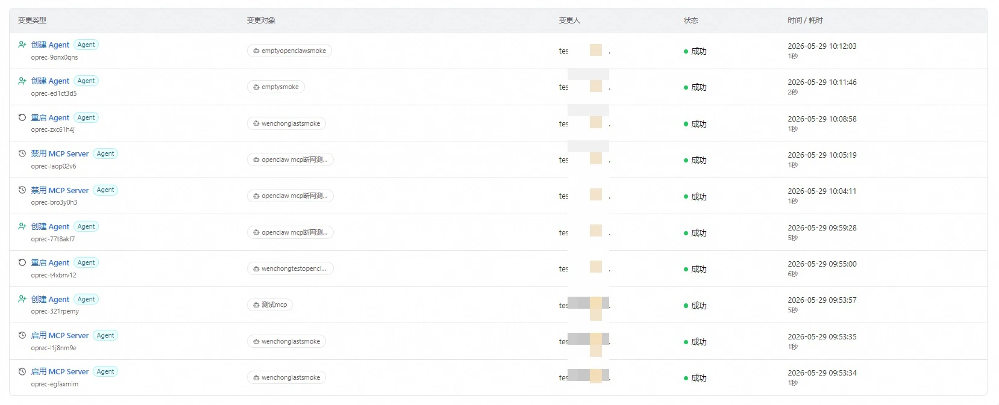

3. 查看操作详情。

   在变更记录列表中，单击目标变更类型，可查看该变更的详细历史记录。

   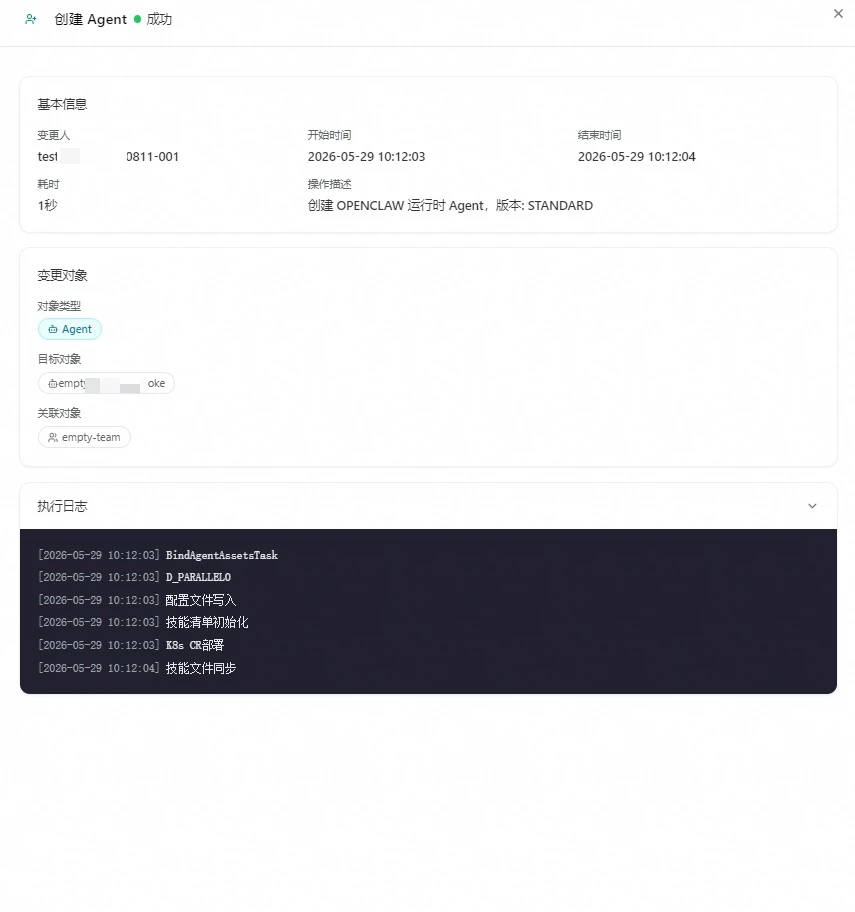

   可查看**基本信息**、**变更对象**、**执行日志**等详细信息。

4. 查看批量操作的 Agent 执行结果。

   对于批量操作，单击目标变更类型，可在操作详情抽屉中可查看**执行策略**及全量的Agent数。

   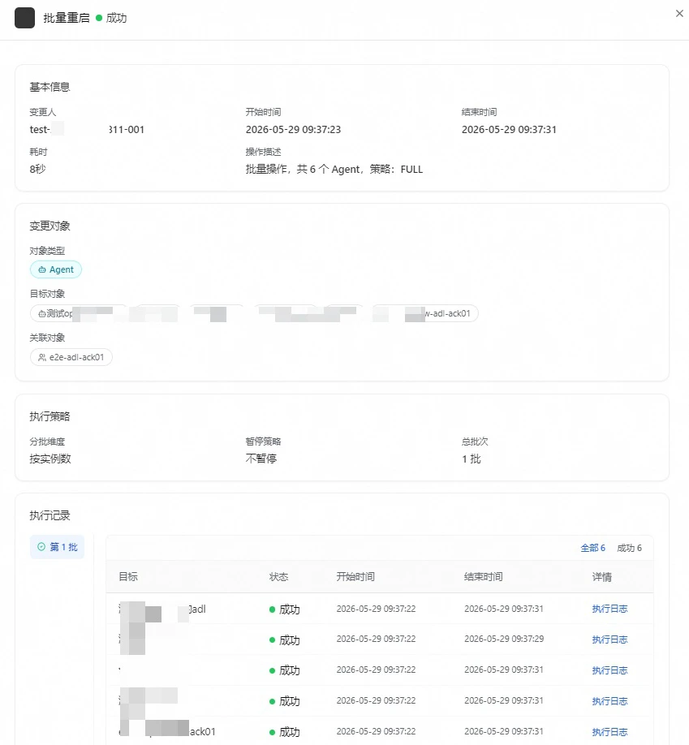

5. 搜索和筛选操作记录。

   - 在搜索框直接按照操作人、操作类型、操作详情直接搜索。

   - 在筛选框按照Agent、状态、操作类型、项目有条件的进行筛选。

     - 使用**全部 Agent** 下拉框，按Agent过滤变更记录。

     - 使用**全部状态**下拉框，按状态类型过滤变更记录。

     - 使用**全部类型**下拉框，按变更类型过滤变更记录。

     - 使用**全部项目**下拉框，按所属项目过滤变更记录。

6. 刷新数据。

   单击 **刷新** 按钮手动触发数据刷新。

**参数说明**

操作记录列表包含以下字段：

| 模块 | 说明 |
| --- | --- |
| 基本信息 | 基本信息包含：变更人、开始时间、结束时间、耗时、操作描述的详细信息。 |
| 变更对象 | 包含对象类型、关联对象、目标对象的详细信息。 |
| 执行策略 | 包含策略的分批维度、暂停策略、总批次的详细信息。 |
| 执行日志 | 包含该变更的详细执行步骤。 |

# 7.基础设施

本文介绍 OpenTrek-Ops 平台基础设施模块的功能和配置说明。

**使用场景**

基础设施功能适用于以下场景：

- 管理 Agent 依赖的基础设施服务，确保 Agent 运行环境的稳定性。

- 监控基础设施的运行状态，及时发现和排查服务故障。

- 配置基础设施的连接参数，优化服务性能和资源利用率。

- 管理 LLM Service、Redis、OSS、PostgreSQL 等底层服务的接入和配置。

**前提条件**

已使用租户运营管理员登录 OpenTrek-Ops 平台。

**操作步骤**

1. 登录OpenTrek-Ops平台。

2. 在左侧导航栏，选择**基础设施**。

   进入**基础设施**页面，在当前页面可以获取如下信息：

   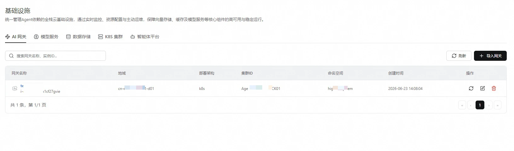

   查看模型服务、K8s集群、AI网关、智能体平台、数据存储基础设施的名称、类型等信息。

3. AI网关

   - 导入网关

     <ol type="a">

     <li>

     在**AI网关**页签，单击**导入网关**，填写以下参数：

     | 参数名称 | 是否必填 | 说明 |
     | --- | --- | --- |
     | AI网关名称 | 是 | 选择要导入的网关实例。 |
     | API Key | 是 | 请联系阿里云技术支持获取。 |

     </li>

     <li>

     单击**导入**。

     > **说明**
     >
     > 如果导入ASCM AI网关，单击**导入**后，系统会自动导入AI网关关联的**MCP配置**以及**AI模型配置**，可分别通过**MCP**页面和**基础设施**>**模型服务**页面查看。

     </li>

     </ol>

   - 查看详情

     单击目标网关名称，可查看网关**基本信息**、**接入点**、**模型API**、**MCP**等详细信息。

   - 编辑网关

     <ol type="a">

     <li>

     单击目标网关**操作**列的编辑图标  ，在**编辑Higress网关**弹框编辑**API Key**。

     </li>

     <li>

     单击**下一步：影响面确认**。

     </li>

     </ol>

     <ol type="i" start="100">

     <li>

     确认影响面无误后，单击**确认下发**；否则单击**返回修改**重新编辑。

     </li>

     </ol>

   - 同步网关

     <ol type="a">

     <li>

     单击目标网关**操作**列的同步图标  ，然后单击**同步**。

     </li>

     <li>

     确认本次同步的影响，然后单击**确认同步**，系统将从云端拉取最新的模型和 MCP 配置，覆盖本地数据，并自动推送到关联的数字员工。

     </li>

     </ol>

   - 移除网关

     单击目标网关**操作**列的移除图标  ，然后单击弹框中的**移除**。

4. 模型服务

   - 添加模型

     <ol type="a">

     <li>

     在**服务模型**页签单击**添加模型**，填写以下参数：

     | 参数名称 | 是否必填 | 说明 |
     | --- | --- | --- |
     | 模型标识 | 是 | 填写模型API调用时使用的标识符，如gpt-4-turbo。 |
     | 显示名称 | 是 | 填写显示的模型名称，如GPT-4 Turbo。 |
     | 提供商 | 是 | 选择提供商，目前支持阿里云。 |
     | 协议 | 是 | 选择协议。 |
     | 推理类型 | 是 | 选择<strong>文本生成（Text Generation）</strong>或者<strong>文本向量化</strong><strong>(Text Embedding)</strong>。 |
     | API Key | 是 | 请联系阿里云技术支持获取。 |
     | API Endpoint | 是 | 请联系阿里云技术支持获取。 |

     </li>

     <li>

     单击**确认添加**。

     </li>

     </ol>

   - 查看模型详情。

     - 在**模型服务**页签，可查看全量模型的**提供商**、**推理类型**、**协议**、**来源**等信息。

     - 在模型列表单击目标模型名称，客户查看模型的**基本信息**、来源以及**访问端点**的详细信息。

       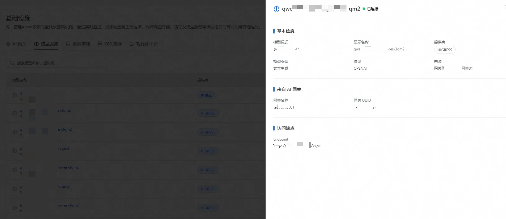

   - 编辑模型

     > **说明**
     >
     > 修改基础设施配置前，请确认修改不会影响正在运行的 Agent 任务。

     <ol type="a">

     <li>

     单击目标模型**操作**列的编辑图标  。

     </li>

     <li>

     编辑相关参数，单击**下一步：影响面确认**。

     </li>

     </ol>

     <ol type="i" start="100">

     <li>

     确认影响面无误后，单击**确认下发**；否则单击**返回修改**重新编辑。

     </li>

     </ol>

   - 移除模型

     <ol type="a">

     <li>

     单击目标模型**操作**列的移除图标  。

     </li>

     <li>

     在弹出的对话框中单击**确认删除**。

     </li>

     </ol>

5. 数据存储

   在**数据存储**页签，单击实例名称，可查看实例的**基本信息**和**访问域名**的详细信息。

   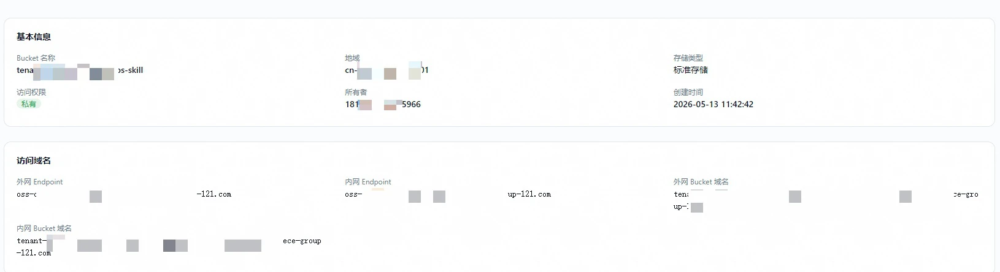

6. K8s集群

   - 导入集群

     <ol type="a">

     <li>

     在K8s集群页签，单击**导入集群**，填写以下参数

     | 参数名称 | 是否必填 | 说明 |
     | --- | --- | --- |
     | 集群名称 | 是 | 自定义集群名称。 |
     | KubeConfig配置 | 是 | 填写YAML格式的集群相关配置。 |
     | storageClassName | 是 | 选择集群的 StorageClass，用于持久化存储。 |
     | ingressClassName | 是 | 选择Ingress的类型，用于Agent的域名路由。 |
     | 是否支持泛域名解析 | 是 | 默认是，更改泛域名解析方式后，已运行的Agent需要重启后生效。 |
     | Agent服务入口 | 是 | 此Endpoint用于生成agent链接的根域名，请事前在DNS控制台完成泛域名解析记录。 |

     </li>

     <li>

     单击**导入**。

     </li>

     </ol>

   - 编辑集群

     单击目标集群**操作**列的编辑图标  ，可编辑集群的**Agent服务入口**、**访问**

     **IP**、**ingressClassName**、**storageClassName**、**KubeConfig**配置等参数，编辑完成后单击**保存**。

   - 移除集群

     单击目标集群**操作**列的移除图标  ，然后单击弹框中的**移除**。

7. 智能体平台

   - 添加平台

     <ol type="a">

     <li>

     在智能体平台单击添加平台，填写以下参数：

     <table>
       <tr>
         <th>参数名称</th>
         <th>是否必填</th>
         <th>说明</th>
       </tr>
       <tr>
         <td>名称</td>
         <td>是</td>
         <td>自定义平台名称，如百炼企业版。</td>
       </tr>
       <tr>
         <td>类型</td>
         <td>是</td>
         <td>支持OpenTrek Dev和Dify。</td>
       </tr>
       <tr>
         <td>AppKey</td>
         <td>是</td>
         <td rowspan="2">a. 登录百炼平台，在左侧菜单栏选择<strong>集成开</strong><strong>放</strong>&gt;<strong>APP_KEY</strong>，可获取AppKey的值。 b. 界面顶部地域右侧即为WorkSpace标识。 说明类型选择OpenTrek Dev时，设置该参数。</td>
       </tr>
       <tr>
         <td>工作空间</td>
         <td>是</td>
       </tr>
       <tr>
         <td>Endpoint</td>
         <td>是</td>
         <td rowspan="3">请输入Dify的Endpoint、Workspace ID和Admin API Key。 说明类型选择Dify时，设置该参数。</td>
       </tr>
       <tr>
         <td>Workspace ID</td>
         <td>是</td>
       </tr>
       <tr>
         <td>Admin API Key</td>
         <td>是</td>
       </tr>
       <tr>
         <td>ApiDomain</td>
         <td>是</td>
         <td>百炼平台需要输入业务网关地址，用于与Agent对话。 说明类型选择OpenTrek Dev时，设置该参数。</td>
       </tr>
     </table>

     </li>

     <li>

     单击**确认添加**。

     </li>

     </ol>

   - 编辑平台

     单击目标平台操作列的编辑图标  ，可编辑平台名称等信息，AppKey留空则默认不修改，修改完成后

     单击**保存**。

   - 删除平台

     单击目标平台操作列的删除图标  ，然后单击**确定**。

     > **警告**
     >
     > 此操作不可逆，请谨慎执行！

# 8.安全中心

## 8.1. 安全设置

本文介绍如何在平台中配置安全设置，包括安全总览、工具防护规则和文件防护策略。

**前提条件**

- 已登录OpenTrek-Ops平台。

- 已获得系统管理员或具有安全设置权限的角色。

**安全总览**

1. 登录OpenTrek-Ops平台。

2. 在左侧导航栏，选择**安全中心 > 安全设置**，默认显示**安全总览**页面。

3. 在安全总览页面查看以下信息：

   - 今日拦截：展示当日被拦截的工具调用次数。

   - 活跃规则：展示当前处于启用状态的安全规则数量。

   - 拦截趋势：展示近期拦截数量的时间趋势图，默认显示近7天的数据。

   - 风险等级分布：按CRITICAL、HIGH、MEDIUM、LOW、INFO等级分布的拦截统计。

   - 规则命中Top5：显示命中次数最多的前5条安全规则。

**工具防护**

**查看规则**

1. 登录OpenTrek-Ops平台。

2. 在左侧导航栏，选择**安全中心 > 安全设置**，选择**工具防护**。

3. 在页面上方支持配置工具调用的安全扫描，危险操作将在执行前需要你的明确批准。

   - 启用：将启用租户范围内全部安全规则，开启后危险工具调用将会被拦截。

   - 禁用：将停用租户范围内全部安全规则，关闭后危险工具调用不会被拦截。

4. 在页面下方获取**全局规则**或**Agent规则**列表，并支持根据规则ID、描述、级别、Agent组合筛选获取目标规则。

   **分类**

   **参数**

   **参数说明**

   规则

   安全规则ID

   安全规则的级别

   - CRITICAL：严重

   - HIGH：高

   级别

   - MEDIUM：中

   - LOW：低

   - INFO：提示

   全局规则

   安全规则的类型

   类型

   - 内置

   - 自定义

   描述

   安全规则的相关描述

   匹配模式

   安全规则的匹配模式

   同步状态

   安全规则的同步状态

   操作

   支持安全规则的启用或禁用

   规则

   Agent规则ID

   级别

   Agent规则的级别

   描述

   Agent规则的相关描述

   Agent规则

   匹配模式

   Agent规则的匹配模式

   Agent

   Agent

   所属项目

   Agent规则所属项目

   同步状态

   Agent规则的同步状态

5. 单击目标规则名称，进入规则详情页，获取规则的详细信息，包括基本信息、威胁类别、匹配模式、命中统计。

**添加规则**

> **说明**
>
> Agent规则的添加请参考Agent 列表。

1. 单击**添加规则**。

2. 配置如下参数后单击**添加**。

   <table>
     <tr>
       <th width="90">参数</th>
       <th>参数说明</th>
     </tr>
     <tr>
       <td>规则ID</td>
       <td>输入安全规则ID。</td>
     </tr>
     <tr>
       <td>工具列表</td>
       <td>选择工具类别。 • Shell Execution • File Read • File Write/Edit • Code Search • Web Access • Browser • Image View • Screen Capture • File Transfer • All Tools</td>
     </tr>
     <tr>
       <td>参数列表</td>
       <td>选择工具类别后自动填充参数，若留空则匹配所有参数。</td>
     </tr>
     <tr>
       <td>类别</td>
       <td>选择安全规则的类别。 • 命令注入 • 数据窃取 • 路径遍历 • 敏感文件访问 • 网络滥用 • 凭据暴露 • 资源滥用 • 提示注入 • 代码执行 • 权限提升</td>
     </tr>
     <tr>
       <td>严重级别</td>
       <td>选择安全规则的严重级别。 • CRITICAL：严重 • HIGH：高 • MEDIUM：中 • LOW：低 • INFO：提示</td>
     </tr>
     <tr>
       <td>正则模式</td>
       <td>输入安全规则的正则模式。</td>
     </tr>
     <tr>
       <td>排除模式</td>
       <td>输入安全规则的排除模式。</td>
     </tr>
     <tr>
       <td>描述</td>
       <td>输入安全规则的相关描述信息。</td>
     </tr>
     <tr>
       <td>修复建议</td>
       <td>输入安全规则的相关修复建议。</td>
     </tr>
   </table>

   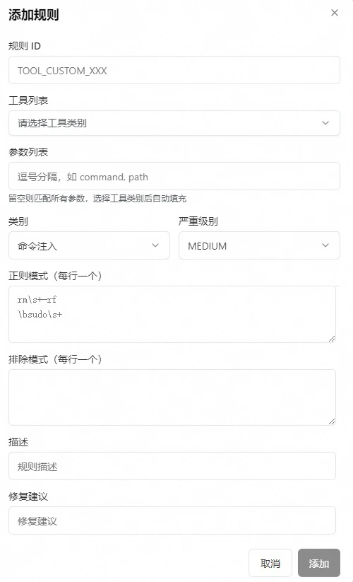

**启用规则**

1. 单击目标安全规则对应**操作**列的开关按钮。

2. 在弹出的对话框中单击**确定**。

   > **说明**
   >
   > 启用后该规则将参与工具调用拦截。

**禁用规则**

1. 单击目标安全规则对应**操作**列的开关按钮。

2. 在弹出的对话框中单击**确定**。

   > **说明**
   >
   > 禁用后该规则不再拦截任何工具调用。

**文件防护**

**添加路径**

1. 登录OpenTrek-Ops平台。

2. 在左侧导航栏，选择**安全中心 > 安全设置**，选择**文件防护**。

3. 单击**添加路径**，设置以下参数然后单击**添加**。

   <table>
     <tr>
       <th width="90">参数</th>
       <th>参数说明</th>
     </tr>
     <tr>
       <td>路径</td>
       <td>配置文件路径。</td>
     </tr>
     <tr>
       <td>规则类型</td>
       <td>配置文件路径访问控制策略，支持以下两种策略类型： • 额外授权，对指定文件路径授予访问权限。 • 永久禁止，对指定文件路径禁止访问。</td>
     </tr>
     <tr>
       <td>描述</td>
       <td>简要说明该路径的访问策略。</td>
     </tr>
   </table>

**编辑路径**

1. 单击目标防护路径对应**操作**列的编辑图标。

2. 编防护路径的**路径**、**规则类型**和**描述**。

3. 单击**保存**。

**删除路径**

单击目标防护路径对应**操作**列的删除图标，可删除该路径。

**启用路径**

1. 单击目标防护路径对应**操作**列的开关按钮。

2. 在弹出的对话框中单击**确定**。

**禁用路径**

1. 单击目标防护路径对应**操作**列的开关按钮。

2. 在弹出的对话框中单击**确定**。

## 8.2. 审计日志

实时跟踪关键操作行为，聚焦高风险事件与合规处置进展。

**前提条件**

- 已登录OpenTrek-Ops平台。

- 已获得系统管理员或具有审计日志权限的角色。

- 已在**安全设置**中启用工具防护功能。

**操作步骤**

1. 登录OpenTrek-Ops平台。

2. 在左侧导航栏，选择**安全中心 > 审计日志**。

3. 在列表上方支持根据关键字、级别、决策以及项目组合筛选获取目标审计日志。

4. 查看审计日志列表，部分参数含义如下。

   <table>
     <tr>
       <th width="90">参数</th>
       <th>参数说明</th>
     </tr>
     <tr>
       <td>事件ID</td>
       <td>事件ID。</td>
     </tr>
     <tr>
       <td>项目</td>
       <td>Agent所属项目。</td>
     </tr>
     <tr>
       <td>Agent</td>
       <td>Agent名称。</td>
     </tr>
     <tr>
       <td>工具名称</td>
       <td>安全规则的工具类别。</td>
     </tr>
     <tr>
       <td>工具参数</td>
       <td>安全规则的工具参数。</td>
     </tr>
     <tr>
       <td>规则ID</td>
       <td>安全规则ID，单击规则名称，支持获取规则详情。</td>
     </tr>
     <tr>
       <td>严重级别</td>
       <td>安全规则的严重级别 • CRITICAL：严重 • HIGH：高 • MEDIUM：中 • LOW：低 • INFO：提示</td>
     </tr>
     <tr>
       <td>决策</td>
       <td>安全规则的决策结果 • ALLOW：允许 • DENY：拒绝 • TIMEOUT：超时</td>
     </tr>
     <tr>
       <td>决策方</td>
       <td>安全规则的决策方 • USER：用户 • SYSTEM：系统</td>
     </tr>
     <tr>
       <td>时间</td>
       <td>审计日志的时间。</td>
     </tr>
     <tr>
       <td>操作</td>
       <td>单击<strong>详情</strong>，支持获取审计日志详情。</td>
     </tr>
   </table>

5. 单击审计日志列表右上角的**导出**，支持将审计日志下载至本地进行查看。

# 9.会话分析

**前提条件**

- 已登录OpenTrek-Ops平台。

- 已获得系统管理员或具有会话分析权限的角色。

**操作步骤**

1. 登录OpenTrek-Ops平台。

2. 在左侧导航栏，在左侧导航栏选择**会话分析**。

3. 在**会话分析**界面，可以获取以下信息：

   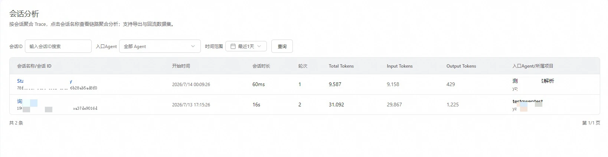

   - 通过会话ID搜索会话。

   - 通过Agent过滤会话。

   - 通过筛选时间或自定义时间范围查询会话。

4. 单击会话名称/会话ID，可查看会话名称、会话ID、开始时间、入口Agent、所属项目、会话时长、轮次、Total Tokens、Input Tokens、Output Tokens、链路列表、会话消息的详细信息。

   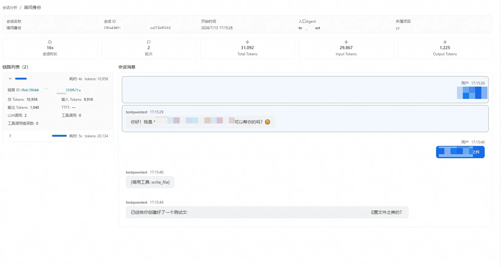

   在链路列表单击链路ID，可查看Trace详情。

   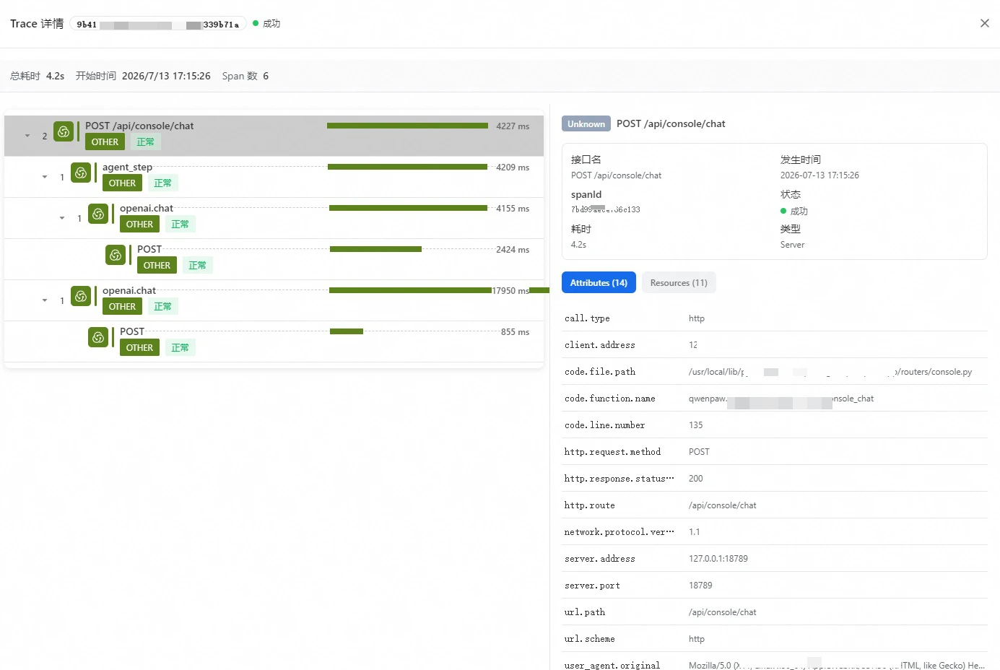

# 10.UModel探索

UModel 探索面向模型治理与数据资产管理场景的可视化探索工具，用于统一呈现系统中的模型实体及其关联关系，将分散、抽象的模型元数据转化为可交互的可视化图谱，帮助用户快速理解系统架构、数据资产分布与实体间依赖关系。

**前提条件**

- 已登录OpenTrek-Ops平台。

- 已获得系统管理员或具有UModel探索权限的角色。

**操作步骤**

1. 登录OpenTrek-Ops平台。

2. 在左侧导航栏，选择**UModel探索**。

3. 在UModel探索界面可以获取以下信息：

   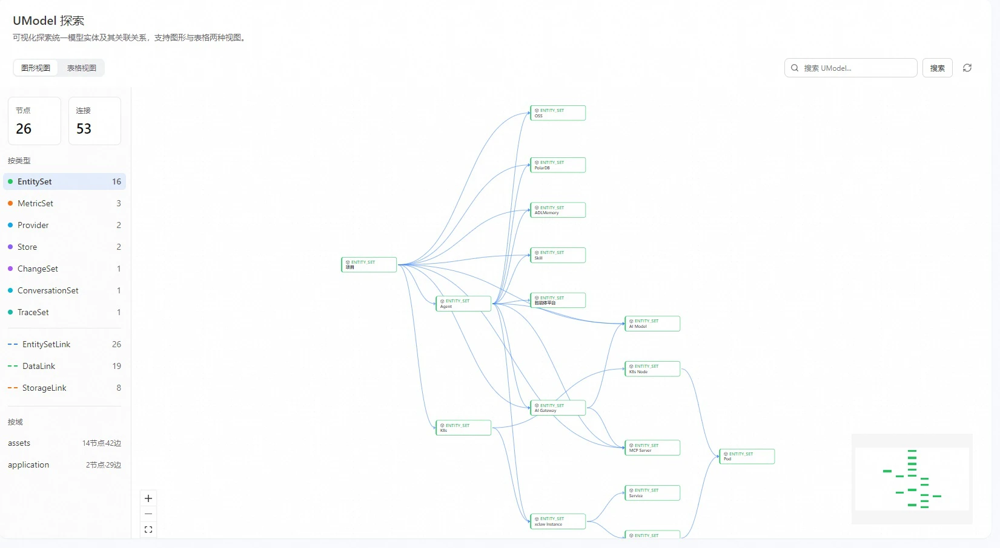

   - 节点数和连接总数。

   - 按照类型或者区域进行分类并统计数量。

   - 通过左上角可切换**图形视图**或**表格视图**。

   - 拓扑图左下角可缩放或全屏展示。

4. 单击拓扑图中的任意节点，弹框通过表单或者JSON的形式显示该节点的详细信息。

# 11.运营分析

## 11.1. 成本分析

本文介绍如何在平台中查看Token消耗的多维度统计信息，实现算力成本的透明化管理。

**前提条件**

- 已登录OpenTrek-Ops平台。

- 已获得系统管理员或具有运营分析权限的角色。

- 平台已有Agent运行并产生Token消耗数据。

**操作步骤**

1. 登录OpenTrek-Ops平台。

2. 在左侧导航栏，选择**运营分析 > 成本分析**。

3. 在右上角选择目标时间范围。

   - 最近24小时（默认）

   - 最近7天

   - 本月

   - 自定义

4. 在页面上方获取如下内容。

   | 区域 | 说明 |
   | --- | --- |
   | 总Tokens | 展示目标时间范围内的总Tokens、输入、输出的消耗量。 |
   | 调用次数 | 展示目标时间范围内的模型调用次数。 |
   | Token趋势 | 展示目标时间范围内Token消耗的趋势图，包含合计、输入、输出三项数据。将鼠标悬停于节点上，查看对应时间节点的数据。 |
   | 按模型分布的Token总量 | 展示目标时间范围内总Token数以及各模型分布的消耗占比。 |

   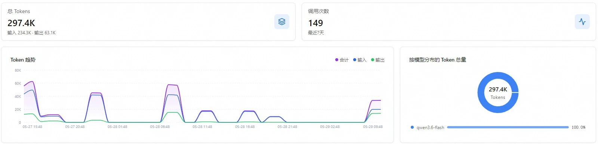

5. 在页面下方支持通过如下维度查看详细数据。

   <table>
     <tr>
       <th width="106">维度</th>
       <th>说明</th>
     </tr>
     <tr>
       <td>模型维度</td>
       <td>按照模型维度统计Token消耗数据，支持根<strong>据模型名称</strong>进行过滤。单击<strong>模型名称</strong>，支持查看对应模型下的总Tokens、输入Tokens、输出Tokens、调用次数以及Token趋势图数据。</td>
     </tr>
     <tr>
       <td>项目维度</td>
       <td>按照项目维度统计Token消耗数据，支持根据<strong>项目名称</strong>进行过滤。单击<strong>项目名称</strong>，支持查看对应项目下的总Tokens、输入Tokens、输出Tokens、调用次数、Token趋势图、模型分布以及Agent分布数据。</td>
     </tr>
     <tr>
       <td>Agent维度</td>
       <td>按照Agent维度统计Token消耗数据，支持根据<strong>项目名称</strong>、<strong>Agent名称</strong>进行过滤。单击<strong>Agent名称</strong>，支持查看对应Agent下的总Tokens、输入Tokens、输出Tokens、调用次数、Token趋势图以及模型分布数据。</td>
     </tr>
     <tr>
       <td>用户维度</td>
       <td>按照用户维度统计Token消耗数据，支持根据<strong>用户名称</strong>进行过滤。单击<strong>用户名称</strong>，支持查看对应用户下的总Tokens、输入Tokens、输出Tokens、调用次数、Token趋势图、模型分布以及Agent分布数据。</td>
     </tr>
   </table>

# 12.系统设置

本文介绍 OpenTrek-Ops 平台系统设置模块的功能和配置方法，包含组织管理和平台管理两个模块。

> **重要**
>
> 请使用系统管理员登录进行系统设置。

## 12.1. 租户管理

本文介绍如何在 OpenTrek-Ops 平台中管理租户。

**使用场景**

租户管理功能适用于以下场景：

- 多租户环境下的资源隔离和权限管理，实现不同租户间的独立性。

- 为不同部门或业务单元创建专属租户，实现分级管理。

- 管理租户的生命周期，包括创建、启用、停用和删除操作。

- 配置租户与云平台的对接关系，实现资源的统一调度。

**前提条件**

- 已登录 OpenTrek-Ops 平台。

- 已获得系统管理员权限。

**操作步骤**

1. 登录OpenTrek-Ops平台。

2. 在左侧菜单栏选择**系统设置**>**租户管理**，在**租户管理**页面，可以查看租户列表，包含以下字段：

   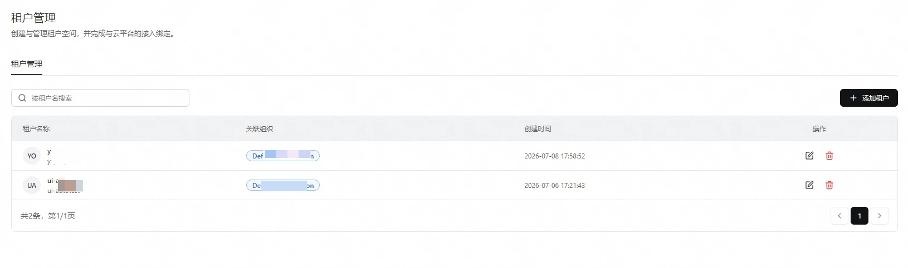

   | 字段 | 说明 |
   | --- | --- |
   | 租户名称 | 租户的显示名称和标识。 |
   | 关联组织 | 租户关联的组织名称。 |
   | 创建时间 | 租户创建日期。 |
   | 操作 | 提供编辑、删除操作。 |

3. 添加租户。

   <ol type="i">

   <li>

   在**组织管理**页面，单击**添加租户**按钮。

   </li>

   <li>

   在弹出的表单中填写以下信息：

   | 参数名称 | 是否必填 | 说明 |
   | --- | --- | --- |
   | 租户名称 | 是 | 租户的显示名称。 |
   | 租户编码 | 是 | 租户的唯一标识符，仅支持字母、数字和连字符。 |
   | 描述 | 否 | 输入租户的描述信息。 |
   | 选择组织 | 是 | 选择关联的组织，可在同一个一级组织下选择任意二级组织，不支持跨一级组织。 |
   | 指定管理员 | 是 | 选择管理员。 |

   </li>

   <li>

   单击**确认创建**完成创建。

   </li>

   </ol>

4. 编辑租户。

   <ol type="i">

   <li>

   在租户列表中找到目标租户。

   </li>

   <li>

   单击**操作**列的编辑图标  ，可修改租户名称、描述、组织等配置信息。

   </li>

   <li>

   单击**保存修改**完成租户的更新。

   </li>

   </ol>

5. 删除租户。

   > **警告**
   >
   > 删除租户为高危操作，请谨慎执行。删除后该租户下的所有数据将无法恢复。

   <ol type="i">

   <li>

   在租户列表中找到目标租户。

   </li>

   <li>

   单击**操作**列的删除图标  。

   </li>

   <li>

   在弹出的确认对话框中单击**确认删除**，删除成功后该租户将从列表中移除。

   </li>

   </ol>

**后续操作**

使用创建好的租户管理员登录，进行租户初始化配置，即录入模型服务、导入K8s集群，可参考基础设施。

> **说明**
>
> 首次登录，系统提示初始化密码，按照提示设置新的密码并谨慎保存。

## 12.2. 配置管理

本文介绍如何在 OpenTrek-Ops 平台中管理渠道、系统配置、数据订阅。

**使用场景**

云平台管理功能适用于以下场景：

- 配置和管理 OpenTrek-Ops 平台对接的云平台资源以及通知频道，配置 Agent 运行状态和告警消息的推送目标。

- 实现多云平台环境下的统一管理和资源调度。

- 实现运维消息的实时推送，确保运维人员及时获取关键信息。

- 配置多种通知渠道，如钉钉、微信等，满足不同场景的通知需求。

- 管理云平台连接信息和认证凭证，确保数据互通的稳定性。

**前提条件**

- 已登录 OpenTrek-Ops 平台。

- 登录用户已获得平台管理权限。

**渠道管理**

1. 登录OpenTrek-Ops平台。

2. 在左侧导航栏，选择**系统设置**>**配置管理**。

3. 在配置**管理**页面选择**渠道管理**。

   进入渠道管理页面，可以查看已配置的渠道列表。

4. 启用渠道。

   单击目标渠道卡片右上角的开启开关，以启用渠道，开关打开后，状态变为**已启用**。

**系统配置**

1. 登录OpenTrek-Ops平台。

2. 在左侧导航栏，选择**系统设置**>**配置管理**。

3. 在配置管理页面选择**系统配置**，可修改系统预制的配置项。

   - 高代码运行时配置

     单击**操作**列的编辑图标，修改高代码Agent可用运行时，然后单击**保存**。

   - 技能包体积限制

     单击**操作**列的编辑图标，修改配置值，然后单击**保存**。

     > **说明**
     >
     > 修改后将对所有租户立即生效，请谨慎调整，技能包体积防止过大，影响加载性能。

   - 隐藏Agent控制台侧边栏

     单击**操作**列的编辑图标，修改配置值，然后单击**保存**。

   - 部署形态配置

     单击**操作**列的编辑图标，修改平台部署形态的全局参数，然后单击**保存并生效**。

     > **说明**
     >
     > 修改部署形态配置后将触发热更新，所有变更即时生效、零重启。

   - 智能助手模型配置

     > **说明**
     >
     > 模型配置影响所有智能助手实例，修改后将在下一个同步周期内生效。

     <ol type="a">

     <li>

     单击**操作**列的编辑图标。

     </li>

     <li>

     单击**添加LLM配置**，配置参数然后单击**保存**。

     </li>

     </ol>

   - 默认集群配置

     单击**操作**列的编辑图标，输入集群相关配置，如果启用默认集群后，新建租户时将自动导入此集群，编辑完成后单击**保存**。

**数据订阅**

1. 登录OpenTrek-Ops平台。

2. 在左侧导航栏，选择**系统设置**>**配置管理**。

3. 在配置管理页面选择**数据订阅**，单击**新增订阅**，进入 SLS 数据配置页面，设置以下参数。

   数据订阅功能支持将平台运行数据导出到阿里云日志服务（SLS），用于后续的数据分析和监控。

   <table>
     <tr>
       <th width="132">参数</th>
       <th>参数说明</th>
     </tr>
     <tr>
       <td>订阅名称</td>
       <td>自定义订阅名称。</td>
     </tr>
     <tr>
       <td>SLS类型</td>
       <td>选择专有云 SLS。</td>
     </tr>
     <tr>
       <td>SLS Project</td>
       <td>登录日志服务 SLS 控制台，查看要配置的 Project 名称。</td>
     </tr>
     <tr>
       <td>SLS LogStore</td>
       <td>登录日志服务 SLS 控制台，单击Project名称进入详情页，查看LogStore名称。</td>
     </tr>
   </table>

4. 单击**创建**。

# 13.配置运维管理员

本文介绍如何配置运维管理员。

**前提条件**

已使用租户管理员登录 OpenTrek-Ops 平台。

**操作步骤**

1. 登录OpenTrek-Ops平台。

2. 在左侧菜单栏下方单击当前登录账号右侧的  ，选择当前租户，可切换租户，不同的租户进行资源隔离，

   实现不同租户间的独立性。

3. 租户设置。

   在切换租户框，单击目标租户的设置按钮  ，在输入框输入指定管理员，授权为当前租户的运维管理员。

   > **说明**
   >
   > 确保所选用户的所属组织已经被租户管理员添加至本平台中。

   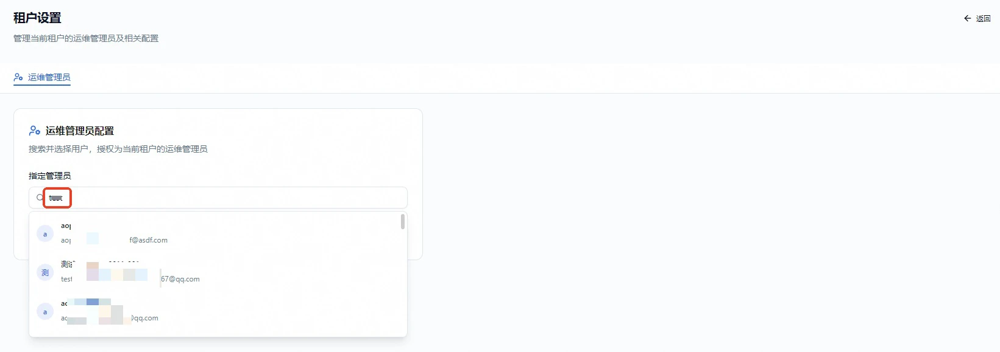

   单击**确认授权**，然后单击界面右上角的**返回**。

# 14.常见问题

**登录问题**

**Q：忘记密码怎么办？**

A：请联系系统管理员重置密码。

**Q：登录后页面显示异常？**

A：请清除浏览器缓存后重新登录，或尝试使用 Chrome 浏览器。

**Agent 相关问题**

**Q：创建 Agent 时找不到所需类型？**

A：请联系管理员确认是否已安装对应的 Agent 类型插件。

**Q：Agent 无法启动？**

A：请检查 Agent 的配置是否完整，以及依赖的基础设施服务是否正常运行。

**技能相关问题**

**Q：技能创建后无法被 Agent 使用？**

A：请确认技能已启用，且 Agent 已安装该技能。
