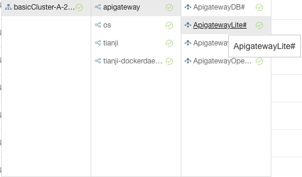
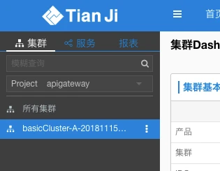
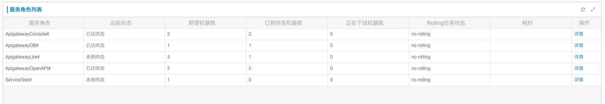
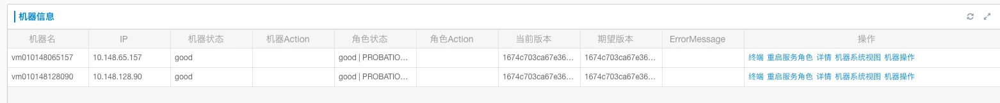
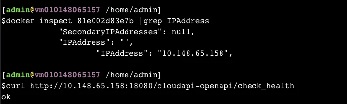
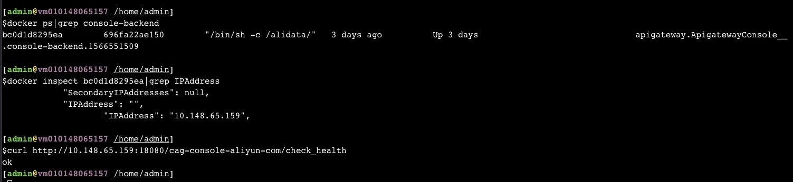
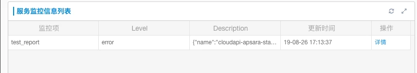

阿里云  
专有云  
API 网关  
运维指南（旧）  
产品版本：v3.18.6-SP2607  
文档版本：20260729

**目录**

- [1.API网关系统介绍](#section-1)
- [2.例行维护](#section-2)
    - [2.1. 查看运行日志](#section-2-1)
    - [2.2. 服务启停](#section-2-2)
- [3.API网关运维](#section-3)
    - [3.1. 系统运维](#section-3-1)
        - [3.1.1. 检查API网关管控系统终态](#section-3-1-1)
        - [3.1.2. 检查OpenAPI的服务状态](#section-3-1-2)
        - [3.1.3. 检查Console的服务状态](#section-3-1-3)
        - [3.1.4. 检查Gateway的服务状态](#section-3-1-4)
        - [3.1.5. 查看自动化用例结果](#section-3-1-5)
    - [3.2. 异常定位与判断](#section-3-2)
- [4.日志分析](#section-4)

# 1.API网关系统介绍

本章节主要介绍阿里云专有云API网关系统的组成及各组成模块的功能职责。

**API网关控制台**

API网关控制台用于配置和管理用户的API及相关策略。通过API管理系统，可以完成API查询，更新，编辑及删除操作。同时，可以完成API管控策略的创建及关联，解除关联和删除等操作。除此之外，API网关管理系统提供 API 定义、测试、发布、下线等全生命周期管理，提升API的管理和迭代效率。用户的所有数据将最终形成API原数据，供API网关使用。

**API网关**

API 网关为提供完整的 API 托管服务，辅助用户将能力、服务、数据以 API 的形式开放给合作伙伴。它通过拉取API管理系统生成的API元数据来初始化网关，最终实现API的请求代理，并提供防攻击、防重放、请求加密、身份认证、权限管理、流量控制等多重手段保证 API 安全，降低 API 开放风险。

# 2.例行维护

## 2.1. 查看运行日志

在运维过程中，如果因排查故障需要对日志进行查看，可根据不同系统的对应路径下的日志文件进行相应的查询操作。

API网关openAPI管控接口日志：运行日志文件路径主要在/apsara/alidata/www/logs/java/cloudapi-openapi/ 下，可以根据实际需要对该文件进行查询。

API网关日志：运行日志存储在/apsara/alidata/logs/的路径下，日志按天进行轮转。 可以根据实际需要对该文件 进行查询。

## 2.2. 服务启停

通过飞天基础运维平台进行服务启停。

通过飞天基础运维平台找到apigateway服务，然后找到对应的SR，直接通过Tianji页面 重启服务角色 ，或者登录到终端，通过宿主机操作docker 服务启停

# 3.API网关运维

## 3.1. 系统运维

### 3.1.1. 检查API网关管控系统终态

API网关运维主要通过飞天基础运维平台进行运维。可在天基平台上通过机器运维快速登录到控制台所在的机器。

**操作步骤**

1. 登录飞天基础运维平台Portal。

2. 选择**任务 > 部署概况**，进入部署概况页面。

3. 单击**部署详情**。

4. 在**部署详情**页面，找到APIgateway的Project。

5. 将鼠标悬停在**部署进度**栏的角色后，然后单击**详情**，查看ApigatwayLite#的服务角色是否到达终态。

   如果对应项后显示为绿色的钩，则表示对应的ServerRole已经到达终态。

   

### 3.1.2. 检查OpenAPI的服务状态

**操作步骤**

1. 获取ApigatewayOpenAPI#的机器列表。

   <ol type="i">

   <li>

   登录天基Portal。

   </li>

   <li>

   选择**集群**。

   <ol type="i" start="3">

   <li>

   Project选择apigateway。

   </li>

   </ol>

   

   </li>

   <li value="4">

   找到筛选出的项目，将鼠标放在

   图标上，选择**Dashboard**。

   

   </li>

   <li>

   在该页面的**服务实例列表**项，单击apigateway对应的详情链接。

   </li>

   <li>

   在新页面找到**服务角色列表**，可以查看每个角色的部署状态。

   

   </li>

   <li>

   单击对应角色的详情，可以进入到该角色的机器信息，查看该角色部署的**机器信息**列表。

   

   </li>

   </ol>

2. 单击对应的**终端**，登录到机器。

3. 输入如下命令找到容器。**docker ps|grep cloudapi-openapi**

4. 输入如下命令找到容器IP。**docker inspect [容器ID] |grep IPAddress**

5. 使用如下命令，查看是否返回OK。**curl -i http://localhost:18080/cloudapi-openapi/check_health**

   

   返回OK，表示成功。

### 3.1.3. 检查Console的服务状态

**操作步骤操作步骤**

1. 获取ApigatewayOpenAPI#的机器列表。

   <ol type="i">

   <li>

   登录飞天基础运维平台Portal。

   </li>

   <li>

   选择**集群**。

   <ol type="i" start="3">

   <li>

   Project选择apigateway。

   </li>

   </ol>

   

   </li>

   <li value="4">

   找到筛选出的项目，将鼠标放在

   图标上，选择**Dashboard**。

   

   </li>

   <li>

   在该页面的**服务实例列表**项，单击apigateway对应的详情链接。

   </li>

   <li>

   在新页面找到**服务角色列表**，可以查看每个角色的部署状态。

   

   </li>

   <li>

   单击对应角色的详情，可以进入到该角色的机器信息，查看该角色部署的**机器信息**列表。

   

   </li>

   </ol>

2. 单击对应的**终端**，登录到机器。

3. 输入如下命令找到容器。

   **docker ps|grep cloudapi-openapi**

4. 输入如下命令找到容器IP。

   **docker inspect [容器ID] |grep IPAddress**

5. 使用如下命令，查看是否返回OK。

   **curl -i http://localhost:18080/cag-console-aliyun-com/check_health**

   

   返回OK，表示成功。

### 3.1.4. 检查Gateway的服务状态

**操作步骤**

1. 获取ApigatewayOpenAPI#的机器列表。

   <ol type="i">

   <li>

   登录飞天基础运维平台Portal。

   </li>

   <li>

   选择**集群**。

   <ol type="i" start="3">

   <li>

   Project选择apigateway。

   </li>

   </ol>

   

   </li>

   <li value="4">

   找到筛选出的项目，将鼠标放在

   图标上，选择**Dashboard**。

   

   </li>

   <li>

   在该页面的**服务实例列表**项，单击apigateway对应的详情链接。

   </li>

   <li>

   在新页面找到**服务角色列表**，可以查看每个角色的部署状态。

   

   </li>

   <li>

   单击对应角色的详情，可以进入到该角色的机器信息，查看该角色部署的**机器信息**列表。

   

   </li>

   </ol>

2. 单击对应的**终端**，登录到机器。

3. 使用如下命令，查看是否返回I'm fine, thank you, and you?

   **curl -i http://localhost/status -H Host:status.taobao.com**

### 3.1.5. 查看自动化用例结果

**操作步骤**

1. 登录飞天基础运维平台Portal。

2. 选择**集群**。

3. **Project**选择**apigateway**。

4. 找到筛选出的项目，将鼠标放在

   图标上，选择**Dashboard**。

   

5. 在该页面的**服务实例列表**项，单击apigateway对应的**详情**链接。

6. 在新页面找到**服务监控信息**列表，单击**详情**，即可查看自动化用例测试报告。

   

## 3.2. 异常定位与判断

**背景信息**

> **说明**
>
> - /alidata/logs/system.log：gateway的日志。
>
> - /usr/share/jetty/logs/stderrout.log：console 和openAPI的日志。

**操作步骤**

启动应用并查看是否报错，确认系统是否正常运行。

- 如果正常运行，但是功能不正常，需要查看日志定位具体问题。

- 如果没有正常运行，即启动很快退出，需要查看日志定位具体问题。

# 4.日志分析

可以根据RequestID进行日志分析。

前端调用者发过来的请求之后，会收到API网关返回信息，返回信息中会包括RequestId。

RequestId的使用方式如下：

- API网关的所有日志都会上传到sls服务中，可以查询到RequestId。

- 在API系统的日志中同样可以通过RequestId查询日志中关于当前请求的执行结果或者异常信息。
