阿里云  
专有云  
消息队列  
RabbitMQ 用户指南  
产品版本：v3.18.6-SP2607  
文档版本：20260729

**目录**

- [1.什么是消息队列RabbitMQ版](#section-1)
- [2.快速入门](#section-2)
    - [2.1. 登录消息队列RabbitMQ版控制台](#section-2-1)
    - [2.2. 快速入门概述](#section-2-2)
    - [2.3. 创建资源](#section-2-3)
    - [2.4. 调用SDK收发消息](#section-2-4)
- [3.操作指南](#section-3)
    - [3.1. 实例管理](#section-3-1)
        - [3.1.1. 创建实例](#section-3-1-1)
        - [3.1.2. 管理实例](#section-3-1-2)
    - [3.2. VHost管理](#section-3-2)
        - [3.2.1. 创建虚拟主机](#section-3-2-1)
        - [3.2.2. 管理虚拟主机](#section-3-2-2)
    - [3.3. Exchange管理](#section-3-3)
        - [3.3.1. 创建交换机](#section-3-3-1)
        - [3.3.2. 管理交换机](#section-3-3-2)
    - [3.4. Queue管理](#section-3-4)
        - [3.4.1. 创建Queue](#section-3-4-1)
        - [3.4.2. 管理Queue](#section-3-4-2)
    - [3.5. 用户权限管理](#section-3-5)
        - [3.5.1. 创建用户和权限](#section-3-5-1)
        - [3.5.2. 管理用户和权限](#section-3-5-2)
    - [3.6. 消息查询](#section-3-6)
- [4.SDK 参考](#section-4)
    - [4.1. SDK概述](#section-4-1)
    - [4.2. RabbitMQ开源客户端](#section-4-2)
        - [4.2.1. SDK列表及示例代码](#section-4-2-1)
        - [4.2.2. SDK使用注意事项](#section-4-2-2)
    - [4.3. Spring集成](#section-4-3)
    - [4.4. 错误码说明](#section-4-4)
    - [4.5. SDK FAQ](#section-4-5)
- [5.高级特性](#section-5)
    - [5.1. 基本概念](#section-5-1)
        - [5.1.1. Connection和Channel](#section-5-1-1)
        - [5.1.2. Exchange](#section-5-1-2)
    - [5.2. 消费重试策略](#section-5-2)
    - [5.3. 延时消息](#section-5-3)
    - [5.4. 死信Exchange](#section-5-4)
    - [5.5. 消息存活时间](#section-5-5)

<a id="section-1"></a>

# 1.什么是消息队列RabbitMQ版

消息队列RabbitMQ版是阿里云专有云提供的一款基于高可用分布式存储架构实现的 AMQP 0-9-1 协议的消息中间件。产品兼容开源 RabbitMQ 的客户端、协议语义与核心组件（包括 Producer、Consumer、Exchange、Queue、Vhost），可无缝承接现有基于开源 RabbitMQ 构建的业务系统，显著缓解开源版本在消息堆积、集群脑裂、单点故障、运维复杂度高等方面的稳定性痛点。

<a id="section-2"></a>

# 2.快速入门

<a id="section-2-1"></a>

## 2.1. 登录消息队列RabbitMQ版控制台

本文介绍登录消息队列RabbitMQ版控制台的步骤。

**前提条件**

- 登录Apsara Uni-manager运营控制台前，确认您已从部署人员处获取Apsara Uni-manager运营控制台的服务域名地址。

- 推荐使用Chrome浏览器。

**操作步骤**

1. 在浏览器地址栏中，输入Apsara Uni-manager运营控制台的服务域名地址，按回车键。

   

   > **说明**
   >
   > - 单击页面右上角的当前语言可以切换其它语言。
   >
   > - 由于浏览器证书过期或环境开启HTTPS认证等出现多次单击继续访问或无Apsara Uni-manager运营控制台地址入口等现象，此时需要安装证书才能正常访问。单击页面右上角的**浏览器证书安装**，可打开浏览器证书安装指南。

2. 输入正确的用户名及密码。

   > **说明**
   >
   > - 请向运营管理员获取登录控制台的用户名和密码。
   >
   > - 首次登录Apsara Uni-manager运营控制台时，需要修改登录用户名的密码，请按照提示完成密码修改。为提高安全性，密码长度必须为10~32位，且包含英文字母大小写、阿拉伯数字和特殊符号（感叹号（!）、at（@）、井号（#）、美元符号（$）、百分号（%）等）。

3. 勾选**我已阅读并同意产品服务协议、隐私协议、用户协议**。

   > **说明**
   >
   > - 登录页展示的链接文字为文档标题，单击链接文字，可查看协议的详细内容。
   >
   > - **产品服务协议**、**隐私协议**和**用户协议**仅在已发布时才会显示。如果三种类型协议都没有发布，则不需要执行该操作。

4. 单击**账号登录**/**授权登录**。

   > **说明**
   >
   > “授权登录”仅第三方认证的全局IdP设置启用时才会显示，且该显示名称可自定义，默认显示名称为“授权登录”。

5. 如果账号已激活MFA多因素认证，请根据以下两种情况进行操作：

   > **说明**
   >
   > 公网场景下，登录入口默认强制开启多因素认证。

   - **开启MFA后的首次登录**

     <ol type="a">

     <li>

     输入账号密码登录后，展示绑定虚拟MFA设备页面。

     </li>

     <li>

     在绑定虚拟MFA设备页面中，按页面提示步骤绑定虚拟MFA设备。

     </li>

     </ol>

     <ol type="i" start="100">

     <li>

     登录成功，进入控制台。

     </li>

     </ol>

   - **已开启并绑定MFA**

     输入6位MFA码后单击**认证**。

6. 在顶部菜单栏选择**产品 > 中间件 > 云消息队列 > 消息队列RabbitMQ版**，进入消息队列RabbitMQ版控制台。

<a id="section-2-2"></a>

## 2.2. 快速入门概述

本文为您介绍快速使用消息队列RabbitMQ版进行消息收发的操作流程。

**操作流程**

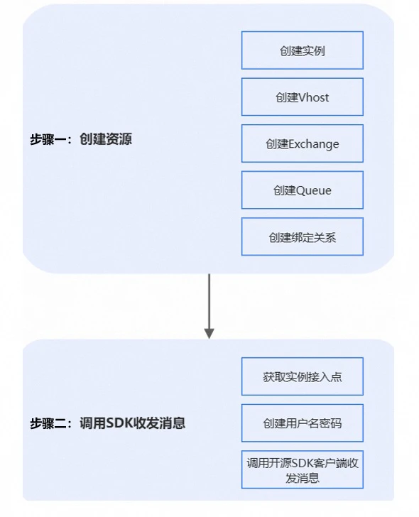

1. 创建资源。

2. 调用SDK收发消息。

<a id="section-2-3"></a>

## 2.3. 创建资源

一个新的应用接入消息队列RabbitMQ版服务端，您需要提前创建消息队列RabbitMQ版的相关资源，包括创建消息队列RabbitMQ版实例、创建Vhost、创建Exchange、创建Queue、绑定Exchange和Queue、创建用户名密码以及获取实例接入点。调用消息收发SDK时，您需要将这些资源信息填写到SDK参数中。

**步骤一：创建实例**

实例是一个独立的消息队列RabbitMQ版资源实体，包含Vhost、Exchange、Queue等基本的资源要素。

具体操作请参考创建实例。

**步骤二：创建Vhost**

Vhost是指虚拟主机，用作逻辑隔离，分别管理各自的Exchange、Queue和Binding，使得应用安全地运行在不同的Vhost上，相互之间不会干扰。一个实例下可以有多个Vhost，一个Vhost里面可以有若干个Exchange和Queue。Producer和Consumer连接消息队列RabbitMQ版需要指定一个Vhost。

具体操作请参考创建虚拟主机。

**步骤三：创建Exchange**

Producer将消息发送到Exchange，由Exchange将消息路由到一个或多个Queue中（或者丢弃）。Exchange根据Routing Key将消息路由到Queue。不同类型的Exchange的路由规则不同。更多信息，请参见Exchange。

具体操作请参考创建交换机。

**步骤四：创建Queue**

Queue是指队列，消息队列RabbitMQ版的消息都会被投入到一个或多个Queue中。

具体操作请参考创建Queue。

**步骤五：创建绑定关系**

将Queue被Exchange绑定，以便Exchange能将消息路由至Queue。

具体操作请参考被Exchange绑定。

<a id="section-2-4"></a>

## 2.4. 调用SDK收发消息

本文以Java SDK为例，说明如何将开源SDK客户端接入消息队列RabbitMQ版服务端，并完成消息收发。

**前提条件**

- 创建资源

- 安装IDEA

  您可以使用IntelliJ IDEA或者Eclipse，本文以IntelliJ IDEA Ultimate为例。

- 安装JDK

- 安装Maven

**步骤一：获取实例ID和实例接入点**

在收发消息时，您需要为发布端和订阅端配置该接入点，客户端通过接入点接入消息队列RabbitMQ版实例。

1. 登录消息队列RabbitMQ版控制台。

2. 在**实例列表**页面，单击目标实例ID或右侧**操作**列的**查看详情**。

3. 在**实例详情**页面的**基础信息**页签，获取**基本信息**模块的**实例ID**和**连接信息**模块的**TCP内网接入点**对应的信息。

   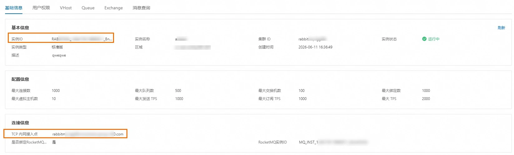

**步骤二：安装Java依赖库**

1. 在IDEA中创建一个Java工程。

2. 在pom.xml文件中添加以下依赖引入Java依赖库。

   ```xml
   <dependency>
       <groupId>com.rabbitmq</groupId>
       <artifactId>amqp-client</artifactId>
       <version>5.5.0</version> <!-- ⽀持开源所有版本 -->
   </dependency>
   ```

**步骤三：创建用户名密码**


开源RabbitMQ客户端接入云上服务时，创建用户名密码，将 用户名`|`实例`ID` 和 密码 设置到开源客户端


SDK的**userName**和**passWord**参数中。消息队列RabbitMQ版会通过 用户名`|`实例`ID` 和 密码 进行权限认证。

具体操作请参考创建用户和权限。

**步骤四：创建客户端连接**

创建连接管理工厂 `ConnectionFactory.java` ，用于启动开源客户端和消息队列RabbitMQ版服务端的连接。

```java
import com.rabbitmq.client.Channel;
import com.rabbitmq.client.Connection;
import java.io.IOException;
import java.security.KeyManagementException;
import java.security.KeyStore;
import java.security.KeyStoreException;
import java.security.NoSuchAlgorithmException;
import java.util.concurrent.TimeoutException;
import javax.net.ssl.SSLContext;
import javax.net.ssl.TrustManagerFactory;

public class ConnectionFactory {
    private final String hostName;
    private final int port;
    private final String userName;
    private final String password;
    private final String virtualHost;
    private final boolean enableSSL;

    public ConnectionFactory(String hostName, int port, String userName,
                            String password, String virtualHost, boolean enableSSL) {
        this.hostName = hostName;
        this.port = port;
        this.userName = userName;
        this.password = password;
        this.virtualHost = virtualHost;
        this.enableSSL = enableSSL;
    }

    public Channel createChannel() throws IOException, TimeoutException, 
NoSuchAlgorithmException, KeyStoreException, KeyManagementException {
        //create a new con
        Connection con = createCon();

        //create a new channel
        return con.createChannel();
    }

    private Connection createCon() throws IOException, TimeoutException, 
NoSuchAlgorithmException, KeyStoreException, KeyManagementException {
        com.rabbitmq.client.ConnectionFactory factory = new 
com.rabbitmq.client.ConnectionFactory();

        factory.setHost(hostName);
        factory.setUsername(userName);
        factory.setPassword(password);

        //设置为true，开启Connection⾃动恢复功能；设置为false，关闭Connection⾃动恢复功能。
        factory.setAutomaticRecoveryEnabled(true);
        factory.setNetworkRecoveryInterval(5000);
        factory.setVirtualHost(virtualHost);
        // 默认端⼝。
        factory.setPort(port);

        if (enableSSL) {
            setSSL(factory);
        }

        // 基于⽹络环境合理设置超时时间。
        factory.setConnectionTimeout(30 * 1000);
        factory.setHandshakeTimeout(30 * 1000);
        factory.setShutdownTimeout(0);

        return factory.newConnection();
    }

    private void setSSL(com.rabbitmq.client.ConnectionFactory factory) throws NoSuchAlgorithmException, KeyStoreException, KeyManagementException {
        SSLContext sslContext = SSLContext.getInstance("TLSv1.2");
        TrustManagerFactory trustManagerFactory = 
TrustManagerFactory.getInstance(TrustManagerFactory.getDefaultAlgorithm());
        trustManagerFactory.init((KeyStore) null);
        sslContext.init(null, trustManagerFactory.getTrustManagers(), null);
        factory.useSslProtocol(sslContext);
    }

    public void closeCon(Channel channel) {
        if (channel != null && channel.getConnection() != null) {
            try {
                channel.getConnection().close();
            } catch (Throwable t) {
            }
        }
    }
}
```

**步骤五：生产消息**

在已创建的Java工程中，创建消息发送程序 `Producer.java` ，按照SDK参数填写说明配置相关参数并运行。有关发送消息的注意事项，请参见生产消息时需要注意什么。

示例代码如下：

```java
import com.rabbitmq.client.AMQP;
import com.rabbitmq.client.AlreadyClosedException;
import com.rabbitmq.client.Channel;
import com.rabbitmq.client.ConfirmCallback;
import java.io.IOException;
import java.nio.charset.StandardCharsets;
import java.security.KeyManagementException;
import java.security.KeyStoreException;
import java.security.NoSuchAlgorithmException;
import java.util.UUID;
import java.util.concurrent.ConcurrentNavigableMap;
import java.util.concurrent.ConcurrentSkipListMap;
import java.util.concurrent.TimeoutException;

public class Producer {
    //设置为云消息队列 RabbitMQ 版实例的接入点。
    public static final String hostName = "******.net.mq.amqp.aliyuncs.com";
    //设置为云消息队列 RabbitMQ 版实例的静态⽤户名和实例ID。
    public static final String userName = "MjoxODgwNzcwODY5MD****|RABBITMQ_131206****";
    //设置为云消息队列 RabbitMQ 版实例的静态⽤户名密码。
    public static final String password = "NDAxREVDQzI2MjA0OT****";
    //设置为云消息队列 RabbitMQ 版实例的Vhost名称。
    public static final String virtualHost = "vhost_test";

    //如果使⽤5671端⼝，需要enableSSL设置为true。
    public static final int port = 5672;
    public static final boolean enableSSL = false;

    private Channel channel;
    private final ConcurrentNavigableMap<Long/*deliveryTag*/, String/*msgId*/> 
outstandingConfirms;
    private final ConnectionFactory factory;
    private final String exchangeName;
    private final String queueName;
    private final String routingKey;

    public Producer(ConnectionFactory factory, String exchangeName, String queueName, String routingKey) throws IOException, TimeoutException, NoSuchAlgorithmException, KeyStoreException, KeyManagementException {
        this.factory = factory;
        this.outstandingConfirms = new ConcurrentSkipListMap<>();
        this.channel = factory.createChannel();
        this.exchangeName = exchangeName;
        this.queueName = queueName;
        this.routingKey = routingKey;
    }

    public static void main(String[] args) throws IOException, TimeoutException, NoSuch
AlgorithmException, KeyStoreException, KeyManagementException {
        //构建连接⼯⼚。
        ConnectionFactory factory = new ConnectionFactory(hostName, port, userName, password, virtualHost, enableSSL);

        //初始化⽣产者。
        Producer producer = new Producer(factory, "ExchangeTest", "QueueTest", 
"RoutingKeyTest");

        //declare。
        producer.declare();

        producer.initChannel();

        //发送消息。
        producer.doSend("hello,amqp");
    }

    private void initChannel() throws IOException {
        channel.confirmSelect();

        ConfirmCallback cleanOutstandingConfirms = (deliveryTag, multiple) -> {
            if (multiple) {
                ConcurrentNavigableMap<Long, String> confirmed = 
outstandingConfirms.headMap(deliveryTag, true);

                for (Long tag : confirmed.keySet()) {
                    String msgId = confirmed.get(tag);
                    System.out.format("Message with msgId %s has been ack-ed. deliveryTa
g: %d, multiple: %b%n", msgId, tag, true);
                }

                confirmed.clear();
            } else {
                String msgId = outstandingConfirms.remove(deliveryTag);
                System.out.format("Message with msgId %s has been ack-ed. deliveryTag: %
d, multiple: %b%n", msgId, deliveryTag, false);
            }
        };
        channel.addConfirmListener(cleanOutstandingConfirms, (deliveryTag, multiple) ->
{
            String msgId = outstandingConfirms.get(deliveryTag);
            System.err.format("Message with msgId %s has been nack-ed. deliveryTag: %d, 
multiple: %b%n", msgId, deliveryTag, multiple);
            // send msg failed, re-publish
        });


        channel.addReturnListener(returnMessage -> System.out.println("return msgId=" +returnMessage.getProperties().getMessageId()));
    }

    private void declare() throws IOException {
        channel.exchangeDeclare(exchangeName, "direct", true);
        channel.queueDeclare(queueName, true, false, false, null);
        channel.queueBind(queueName, exchangeName, routingKey);
    }
    

    private void doSend(String content) throws IOException, TimeoutException, 
NoSuchAlgorithmException, KeyStoreException, KeyManagementException {
        try {
            String msgId = UUID.randomUUID().toString();
            AMQP.BasicProperties props = new 
AMQP.BasicProperties.Builder().messageId(msgId).build();

            channel.basicPublish(exchangeName, routingKey, true, props, 
content.getBytes(StandardCharsets.UTF_8));

            outstandingConfirms.put(channel.getNextPublishSeqNo(), msgId);
        } catch (AlreadyClosedException e) {
            //need reconnect if channel is closed.
            String message = e.getMessage();

            System.out.println(message);

            if (channelClosedByServer(message)) {
                factory.closeCon(channel);
                channel = factory.createChannel();
                this.initChannel();
                doSend(content);
            } else {
                throw e;
            }
        }
    }

    private boolean channelClosedByServer(String errorMsg) {
        if (errorMsg != null
            && errorMsg.contains("channel.close")
            && errorMsg.contains("reply-code=541")
            && errorMsg.contains("reply-text=InternalError")) {
            return true;
        } else {
            return false;
        }
    }
}
```

**步骤六：订阅消息**

在已创建的Java工程中，创建消息订阅程序 `Consumer.java` ，按照SDK参数填写说明配置相关参数并运行。

示例代码如下：

```java
import com.rabbitmq.client.AMQP;
import com.rabbitmq.client.Channel;
import com.rabbitmq.client.DefaultConsumer;
import com.rabbitmq.client.Envelope;
import java.io.IOException;
import java.security.KeyManagementException;
import java.security.KeyStoreException;
import java.security.NoSuchAlgorithmException;
import java.util.concurrent.CountDownLatch;
import java.util.concurrent.TimeoutException;

public class Consumer {
    //设置为云消息队列 RabbitMQ 版实例的接入点。
    public static final String hostName = "******.net.mq.amqp.aliyuncs.com";
    //设置为云消息队列 RabbitMQ 版实例的静态⽤户名和实例ID。
    public static final String userName = "MjoxODgwNzcwODY5MD****|RABBITMQ_131206****";
    //设置为云消息队列 RabbitMQ 版实例的静态⽤户名密码。
    public static final String password = "NDAxREVDQzI2MjA0OT****";
    //设置为云消息队列 RabbitMQ 版实例的Vhost名称。
    public static final String virtualHost = "vhost_test";
    
    //如果使⽤5671端⼝，需要enableSSL设置为true。
    public static final int port = 5672;
    public static final boolean enableSSL = false;

    private final Channel channel;
    private final String queue;

    public Consumer(Channel channel, String queue) {
        this.channel = channel;
        this.queue = queue;
    }

    public static void main(String[] args) throws IOException, TimeoutException, InterruptedException, NoSuchAlgorithmException, KeyStoreException, KeyManagementException {
        ConnectionFactory factory = new ConnectionFactory(hostName, port, userName, password, virtualHost, enableSSL);
        Channel channel = factory.createChannel();
        channel.basicQos(50);
         
        //设置为云消息队列 RabbitMQ 版实例的Queue名称。需要和⽣产者中设置的Queue名称⼀致。
        Consumer consumer = new Consumer(channel, "queue-1");

        consumer.consume();
    }

    public void consume() throws IOException, InterruptedException {
        channel.basicConsume(queue, false, new DefaultConsumer(channel) {
            @Override public void handleDelivery(String consumerTag, Envelope envelope, 
AMQP.BasicProperties properties,
                byte[] body) throws IOException {

                //业务处理。
                System.out.println("receive: msgId=" + properties.getMessageId());

                //消费者需要在有效时间内提交ack，否则消息会重新推送，最多推送16次。
                //若推送16次还未成功，则消息被丢弃或者进入死信Exchange。
                //专业版实例的有效时间为1分钟，企业版和Serverless实例为5分钟，铂⾦版实例为30分钟。
                channel.basicAck(envelope.getDeliveryTag(), false);
            }
        });

        CountDownLatch latch = new CountDownLatch(1);
        Runtime.getRuntime().addShutdownHook(new Thread(() -> {
            try {
                channel.getConnection().close();
            } catch (IOException e) {
                System.out.println("close connection error." + e);
            }
            latch.countDown();
        }));
        latch.await();
    }
}
```

**SDK参数填写说明**

| 参数 | 示例值 | 描述 |
| --- | --- | --- |
| hostName | \*\*\*\*\*\*.net.mq.amqp.aliyu ncs.com | 消息队列RabbitMQ版实例接入点。获取方式，请参见获取实例接入点。 |
| Port | 5672 | 默认端口。非加密端口为5672，加密端口为5671。 |
| userName | "MjoxODgwNzcwODY5MD \*\*\*\*\|RABBITMQ_131206\*\* \*\*" | 客户端接入消息队列RabbitMQ版服务端用于权限认证的<code> </code>静态用户名<code>&#124;</code>实例<code>ID </code>。<br>需要提前在消息队列RabbitMQ版控制台创建。具体操作，请参见创建实例和创建用户和权限。 |
| passWord | NDAxREVDQzI2MjA0OT\*\* \*\* | 客户端接入消息队列RabbitMQ版服务端用于权限认证的静态用户密码。在消息队列RabbitMQ版控制台创建。具体操作，请参见创建用户和权限。 |
| virtualHost | amqp_vhost | 消息队列RabbitMQ版实例的Vhost。需要提前在消息队列RabbitMQ版控制台创建。具体操作，请参见创建资源。 |
| exchangeName | ExchangeTest | 消息队列RabbitMQ版的Exchange。需要提前在消息队列RabbitMQ版控制台创建。具体操作，请参见创建资源。 |
| queueName | QueueTest | 消息队列RabbitMQ版的Queue。需要提前在消息队列RabbitMQ版控制台创建。具体操作，请参见创建资源。 |
| routingKey | RoutingKeyTest | 消息队列RabbitMQ版Exchange与Queue绑定的Routing Key。需要提前在消息队列RabbitMQ版控制台绑定关系。具体操作，请参见创建资源。 |
| exchangeType | topic | Exchange的类型。消息队列RabbitMQ版支持的类型如下，更多信息，请参见Exchange。<br>• direct<br>• topic<br>• fanout<br>• headers<br>• x-delayed-message<br>重要请确保填写的Exchange类型和您创建Exchange时选择的类型一致。 |

<a id="section-3"></a>

# 3.操作指南

<a id="section-3-1"></a>

## 3.1. 实例管理

<a id="section-3-1-1"></a>

### 3.1.1. 创建实例

实例是一个独立的消息队列RabbitMQ版资源实体，可以被视为一个隔离的服务器或服务环境，执行消息的接收、存储和转发操作。实例包含Vhost、Exchange、Queue等基本的资源要素。本文介绍如何在消息队列RabbitMQ版控制台创建实例。

**前提条件**

已创建RocketMQ实例，具体请参考<strong>《RocketMQ用户指南》 > 实例管理</strong>章节。

**操作步骤**

1. 登录消息队列RabbitMQ版控制台。

2. 在左侧导航栏，单击**实例列表**。

3. 在**实例列表**页面，单击**创建实例**。

4. 在**创建实例**对话框中，配置以下参数后，单击**确定**。

   <table>
     <tr>
       <th width="166">参数</th>
       <th>说明</th>
     </tr>
     <tr>
       <td>关联 MQ 实例</td>
       <td>选择要绑定的RocketMQ实例。</td>
     </tr>
     <tr>
       <td>实例名称</td>
       <td>长度限制为 3 ~ 64 个字符，可以是中文、英文、数字、短横线（-）以及下划线（_）。</td>
     </tr>
     <tr>
       <td>描述</td>
       <td>长度限制为2-128个字符，以字母或中文开头，支持数字和“_”、“-”、“:”特殊字符，不能以http:// 或https://开头。</td>
     </tr>
     <tr>
       <td>server数量</td>
       <td>部署该实例所使用的服务器节点数。取值范围：2~10。默认值：2。</td>
     </tr>
     <tr>
       <td>连接数上限</td>
       <td>表示可同时连接到该实例的最大客户端数量（生产者 +消费者）。取值范围：1000~10000。默认值：1000。<br>重要超出限制将导致新连接被拒绝。</td>
     </tr>
     <tr>
       <td>Queue 数上限</td>
       <td>表示该实例内可创建的队列总数的上限值。取值范围：500~6000。默认值：500。</td>
     </tr>
     <tr>
       <td>Exchange 数上限</td>
       <td>表示该实例可创建的交换机（Exchange）数量的上限值。取值范围：100~2000。默认值：100。</td>
     </tr>
     <tr>
       <td>Binding 数上限</td>
       <td>表示该实例的 Exchange 与 Queue 之间的绑定关系总数的上限值。取值范围：1000~20000。默认值：1000。</td>
     </tr>
     <tr>
       <td>Vhost 数上限</td>
       <td>表示该实例可创建的虚拟主机（Virtual Host）数量的上限值。取值范围：10~200。默认值：10。</td>
     </tr>
   </table>

5. 实例创建完成后，您可以在**实例列表**页面查看已创建的实例。

**后续操作**

RabbitMQ实例创建完成后，您可以进行查看实例详情、更新实例配置、删除实例等操作，具体请参考管理实例。

<a id="section-3-1-2"></a>

### 3.1.2. 管理实例

本文介绍如何查看实例详情、更新实例配置、重新绑定RocketMQ实例以及删除实例。

**前提条件**

已创建实例。

**查看实例详情**

1. 登录消息队列RabbitMQ版控制台。

2. 在左侧导航栏，单击**实例列表**。

3. （可选）在**实例列表**页面，您可以通过**实例名称**或**实例ID**快速搜索目标实例。

4. 在**实例列表**页面，您可以查看实例的**实例ID/名称**、**集群ID**、**实例状态**、**实例类型**、**创建时间**、**地域**以及**组织/资源集**信息。

5. 单击目标实例ID或右侧**操作**列的**查看详情**，即可跳转至**实例详情**页面，查看目标实例的详细信息：

   - **基础信息**：展示实例的**基本信息**、**配置信息**和**连接信息**。

     - **基本信息**：展示该实例的**实例ID**、**实例名称**、**集群ID**、**实例状态**、**实例类型**、**区域**、**创建时间**以及**描述**信息。

     - **配置信息**：展示该实例的**最大连接数**、**最大队列数**、**最大交换机数**、**最大绑定数**、**最大虚拟主机数**信息。

     - **连接信息**：展示该实例的**TCP 内网接入点**、**RocketMQ实例ID**和**是否绑定RocketMQ实例**信息。

   - **用户权限**：可管理实例的用户信息，详情请参见用户权限管理。

   - **VHost**：可管理实例的虚拟主机，详情请参见VHost管理。

   - **Queue**：可管理实例的Queue信息，详情请参见Queue管理。

   - **Exchange**：可管理实例的交换机，详情请参见Exchange管理。

   - **消息查询**：可查询实例的消息，详情请参见消息查询。

**更新实例配置**

您可以升级或降级当前实例的配置。

1. 在**实例列表**页面选择目标实例，单击**操作**列的**变配**。

2. 在**变配**页面，修改实例的基本配置信息，然后单击**确定**。

   可修改的基本配置信息包括**连接数上限**、**Queue 数上限**、**Exchange 数上限、Binding 数上限**和**Vhost 数上限**。

**扩容实例**

1. 在**实例列表**页面找到需要扩容的目标实例，单击**操作**列的**扩容**。

2. 在弹出的对话框中，输入**节点数**，单击**确定**。

**删除实例**

1. 在**实例列表**页面找到需要删除的目标实例，单击**操作**列的**删除**。

2. 在弹出的对话框中，单击**确定**。

<a id="section-3-2"></a>

## 3.2. VHost管理

<a id="section-3-2-1"></a>

### 3.2.1. 创建虚拟主机

本文介绍如何创建虚拟主机。

**前提条件**

已创建实例。

**背景信息**

虚拟主机（Virtual Host）用于实现逻辑隔离，能够分别管理各自的Exchange、Queue和Binding，从而确保应用能够安全地运行在不同的VHost实例上，彼此之间不会造成干扰。在一个实例中，可以配置多个VHost，而每个VHost内部则可以包含多个Exchange和Queue。生产者和消费者在连接消息队列RabbitMQ版时，需指定一个VHost。

**操作步骤**

1. 登录消息队列RabbitMQ版控制台。

2. 在左侧导航栏，单击**实例列表**。

3. 在**实例列表**页面，单击目标实例ID或右侧**操作**列的**查看详情**。

4. 在**实例详情**页面，单击**VHost**页签。

5. 在**VHost**页签，单击**创建虚拟主机**。

6. 在**创建虚拟主机**对话框，输入**虚拟主机名称**后，单击**确定**。

**后续操作**

虚拟主机创建完成后，您可以进行查看、删除虚拟主机等操作，具体请参考管理虚拟主机。

<a id="section-3-2-2"></a>

### 3.2.2. 管理虚拟主机

本文介绍如何查看、删除虚拟主机。

**前提条件**

已创建虚拟主机。

**查看虚拟主机**

1. 登录消息队列RabbitMQ版控制台。

2. 在左侧导航栏，单击**实例列表**。

3. 在**实例列表**页面，单击目标实例ID或右侧**操作**列的**查看详情**。

4. 在**实例详情**页面，单击**VHost**页签。

5. （可选）在**VHost**页签，您可以通过**虚拟主机名称**快速搜索虚拟主机。

6. 在虚拟主机列表中，可查看**虚拟主机名称**、**创建时间**和**更新时间**等信息。

**删除虚拟主机**

> **重要**
>
> 删除VHost前，请先删除VHost下的Queue和Exchange。

> **警告**
>
> 删除VHost会删除该VHost内所有数据且不可恢复，请谨慎操作。

1. 在**VHost**页签，单击虚拟主机**操作**列的**删除**。

2. 单击**确定**。

<a id="section-3-3"></a>

## 3.3. Exchange管理

<a id="section-3-3-1"></a>

### 3.3.1. 创建交换机

Producer将消息发送到Exchange，由Exchange将消息路由到一个或多个Queue中（或者丢弃）。Exchange根据Routing Key将消息路由到Queue。不同类型的Exchange的路由规则不同。本文介绍如何创建交换机。

**前提条件**

- 已创建实例。

- 已创建VHost。

**操作步骤**

1. 登录消息队列RabbitMQ版控制台。

2. 在左侧导航栏，单击**实例列表**。

3. 在**实例列表**页面，单击目标实例ID或右侧**操作**列的**查看详情**。

4. 在**实例详情**页面，单击**Exchange**页签。

5. 在**Exchange页签**，单击**创建交换机**。

6. 在**创建交换机**对话框，配置以下参数后，单击**确定**。

   <table>
     <tr>
       <th width="162">参数</th>
       <th>说明</th>
     </tr>
     <tr>
       <td>交换机名称</td>
       <td>• Exchange名称只能包含字母、数字、短划线（-）、下划线（_）、英文句号（.）、井号（#）、斜线（/）、at符号（@），长度限制1~255字符。<br>• Exchange一旦创建，名称无法再修改，只能删除后重建。<br>• 以amq.开头的为保留字段，因此不能使用。例如：amq.test。</td>
     </tr>
     <tr>
       <td>交换机类型</td>
       <td>Exchange类型。取值：<br>• <strong>direct</strong>：该类型的路由规则会将消息路由到Routing Key完全匹配的Queue中。<br>• <strong>topic</strong>：该类型与direct类型相似。Topic Exchange路由规则没有Direct Exchange那么严格，支持模糊匹配和多条件匹配，即该类型Exchange使用Routing Key模式匹配和字符串比较的方式将消息路由至绑定的Queue中。<br>• <strong>fanout</strong>：该类型的路由规则非常简单，会把所有发送到该Exchange的消息路由到所有与它绑定的Queue中，相当于广播功能。<br>• <strong>headers</strong>：该类型与direct类型相似。Headers Exchange使用Headers属性代替Routing Key进行路由匹配，在绑定Headers Exchange和Queue时，设置绑定属性的键值对；在向Headers Exchange发送消息时，设置消息的Headers属性键值对，使用消息Headers属性键值对和绑定属性键值对比较的方式将消息路由至绑定的Queue。<br>• <strong>x-delayed-message</strong>：通过声明该类Exchange，您可以自定义消息的Header属性<strong>x-</strong><strong>delay</strong>来指定消息延时投递的时间段，单位为毫秒。消息将在<strong>x-delay</strong>中定义的时间段后，根据路由规则被投递到对应的Queue。路由规则取决于<strong>x-</strong><strong>delayed-type</strong>中指定的Exchange路由类型。</td>
     </tr>
     <tr>
       <td>x-delayed-type</td>
       <td>当<strong>交换机类型</strong>为<strong>x-delayed-message</strong>时，需要配置此参数，以指定Exchange的路由类型。</td>
     </tr>
     <tr>
       <td>Internal</td>
       <td>是否为Internal类型，默认值为关闭。<br>• 开启：内建类型，用于Exchange和Exchange之间的绑定。<br>• 关闭：非内建类型，用于Exchange和Queue之间的绑定。</td>
     </tr>
   </table>

**后续操作**

交换机创建完成后，您可以进行查看Exchange详情、绑定Queue、绑定Exchange、被Exchange绑定以及删除Exchange等操作，具体请参考管理交换机。

<a id="section-3-3-2"></a>

### 3.3.2. 管理交换机

本文介绍如何查看Exchange详情、绑定Queue、绑定Exchange、被Exchange绑定以及删除Exchange等操作。

**前提条件**

- 已创建交换机。

- 已创建Queue。

**查看Exchange详情**

1. 登录消息队列RabbitMQ版控制台。

2. 在左侧导航栏，单击**实例列表**。

3. 在**实例列表**页面，单击目标实例ID或右侧**操作**列的**查看详情**。

4. 在**实例详情**页面，单击**Exchange**页签。

5. （可选）在Exchange列表上方，您可以通过**交换机名称**快速搜索Exchange。

6. 在Exchange列表中，可查看**交换机名称**、**类型**、**Internal**、**参数**以及**创建时间**等信息。

7. 单击目标Exchange**操作**列的**查看详情**，进入**Exchange 详情**页面，可查看Exchange的详细信息。

   - **基本信息**：展示**Exchange**、**创建时间**、**所属Vhost**、**类型**、**区域**、**Internal**以及**所属实例**等信息。

   - **绑定关系**：您可以为当前Exchange绑定Queue或Exchange，具体请参考绑定Queue和绑定Exchange。

   - **被绑定关系**：您可以使该Exchange被另一个Exchange绑定，从而使消息根据路由规则从该Exchange转发到该另一个Exchange。具体请参考被Exchange绑定。

**绑定Queue**

为Exchange绑定Queue，以指示Exchange消息应路由到哪些Queue中。

1. 在**Exchange 详情**页面的**绑定关系**页签，单击**添加绑定**。

2. 在**添加绑定**面板，选择**绑定目标类型**为**Queue**，选择**绑定目标**，设置**Routing Key**，然后单击**确定**。

   > **说明**
   >
   > - **Routing Key**只能包含字母、数字、短划线（-）、下划线（_）、英文句号（.）、斜线（/）、at符号（@），长度限制0~255字符。
   >
   > - 当存在重复绑定时，只有第一个符合要求的绑定关系生效。
   >
   > - 您可以单击**操作**列的**删除**，解除绑定关系。

**绑定Exchange**

将当前Exchange绑定到另一个Exchange 2，从而使当前Exchange的消息被路由到Exchange 2。

1. 在**Exchange 详情**页面的**绑定关系**页签，单击**添加绑定**。

2. 在**添加绑定**面板，选择**绑定目标类型**为**Exchange**，选择**绑定目标**，设置**Routing Key**，单击**确定**。

   > **说明**
   >
   > - **Routing Key**只能包含字母、数字、短划线（-）、下划线（_）、英文句号（.）、斜线（/）、at符号（@），长度限制0~255字符。
   >
   > - 当存在重复绑定时，只有第一个符合要求的绑定关系生效。
   >
   > - 您可以单击**操作**列的**删除**，解除绑定关系。

**被Exchange绑定**

使该Exchange被另一个Exchange绑定，从而使消息根据路由规则从另一个Exchange转发到该Exchange。

1. **Exchange 详情**页面，单击**被绑定关系**页签。

2. 在**被绑定关系**页签，单击**添加被绑定**。

3. 在**添加被绑定**面板，选择**源Exchange**，在**Routing Key**文本框输入Routing Key，**绑定目标类型**默认为Exchange，**目标Exchange**默认为此Exchange，单击**确定**。

   > **说明**
   >
   > - **Routing Key**只能包含字母、数字、短划线（-）、下划线（_）、英文句号（.）、斜线（/）、at符号（@），长度限制0~255字符。
   >
   > - 当存在重复绑定时，只有第一个符合要求的绑定关系生效。
   >
   > - 您可以单击**操作**列的**删除**，解除绑定关系。

**删除Exchange**

> **警告**
>
> - 删除指定Exchange后，生产者将无法将消息发送到该Exchange，也无法由当前Exchange路由到一个或多个Queue中，请您谨慎执行。
>
> - Vhost下的6个内置Exchange（amq.direct、amq.headers、amq.default、amq.topic、amq.match和amq.fanout）不支持删除。

1. 在**Exchange**页签，单击目标Exchange**操作**列的**删除**。

2. 单击**确定**。

<a id="section-3-4"></a>

## 3.4. Queue管理

<a id="section-3-4-1"></a>

### 3.4.1. 创建Queue

消息队列是存储消息的缓冲区，每个消息都会被投入到一个或多个Queue里。本文介绍如何创建队列。

**前提条件**

- 已创建实例。

- 已创建虚拟主机。

**操作步骤**

1. 登录消息队列RabbitMQ版控制台。

2. 在左侧导航栏，单击**实例列表**。

3. 在**实例列表**页面，单击目标实例ID或右侧**操作**列的**查看详情**。

4. 在**实例详情**页面，单击**Queue**页签。

5. 在**Queue**页签，单击**虚拟主机**右侧的下拉列表，选择虚拟主机，然后单击**创建 Queue**。

6. 在**创建 Queue**面板，配置以下参数后，单击**确定**。

   <table>
     <tr>
       <td>参数</td>
       <td></td>
       <td>说明</td>
     </tr>
     <tr>
       <td colspan="2">Queue 名称</td>
       <td>• Queue名称只能包含字母、数字、短划线（-）、下划线（_）、英文句号（.）、井号（#）、斜线（/）、at符号（@），长度限制1~255字符。<br>• Queue一旦创建，名称无法再修改，只能删除后重建。<br>• 以amq.开头的为保留字段，因此不能使用。例如：amq.test。</td>
     </tr>
     <tr>
       <td colspan="2">Auto Delete</td>
       <td>• <strong>是</strong>：在订阅该Queue消息的最后一个Consumer取消订阅该Queue的消息后，自动删除该Queue。<br>• <strong>否</strong>：在订阅该Queue消息的最后一个Consumer取消订阅该Queue的消息后，不自动删除该Queue。</td>
     </tr>
     <tr>
       <td rowspan="2">重试策略</td>
       <td>最大投递次数</td>
       <td>系统允许特定消息被投递给消费者尝试的最大次数。最大投递次数 = x-delivery-limit +1。</td>
     </tr>
     <tr>
       <td>消费超时时间</td>
       <td>指消费者在接收和处理消息时允许的最大时间限制，单位：秒（s）。</td>
     </tr>
     <tr>
       <td rowspan="3">死信策略</td>
       <td>DeadLetterExch ange</td>
       <td>指定死信消息发往的Exchange。</td>
     </tr>
     <tr>
       <td>DeadLetterRouti ngKey</td>
       <td>指定死信消息的Routing Key，即死信Exchange会将消息发往至匹配该死信Routing Key所对应的Queue。</td>
     </tr>
     <tr>
       <td>MessageTTL</td>
       <td>消息存活时间，单位：毫秒（ms）。超过指定时间段内还未被消费的消息是死信消息，该消息将会被发往死信Exchange。更多信息，请参见消息存活时间。</td>
     </tr>
   </table>

**后续操作**

Queue创建完成后，您可以进行查看Queue详情、设置绑定关系、查询消息、查看Consumer Tag以及删除Queue等操作，具体请参考管理Queue。

<a id="section-3-4-2"></a>

### 3.4.2. 管理Queue

本文介绍如何查看Queue详情、为Queue设置绑定关系、查询消息、查看Consumer Tag以及删除Queue。

**前提条件**

- 已创建交换机。

- 已创建Queue。

**查看Queue详情**

1. 登录消息队列RabbitMQ版控制台。

2. 在左侧导航栏，单击**实例列表**。

3. 在**实例列表**页面，单击目标实例ID或右侧**操作**列的**查看详情**。

4. 在**实例详情**页面，单击**Queue**页签。

5. （可选）在Queue列表上方，您可以通过**队列名称**快速搜索Queue。

6. 在Queue列表中，可查看**Queue 名称**、**Auto Delete**、**堆积消息数**和**创建时间**。

7. 单击目标Queue**操作**列的**详情**，进入**队列详情**页面，可查看Queue的详细信息。

   - **基本信息**：展示**Queue**、**创建时间**、**所属Vhost**、**死信交换机**、**死信路由键**、**区域**、**持久化**、**Auto Delete**、**MessageTTL**、**所属实例**、**最大投递次数**以及**消费超时时间**等信息。

   - **被绑定信息**：您可以使Queue被Exchange绑定，以便Exchange能将消息路由至Queue。具体请参考被Exchange绑定。

   - **消息查询**：您可以按Queue查询和按Message ID查询两种方式查询消息，具体请参考查询消息。

   - **Consumer Tag 列表**：您可以查看Consumer Tag信息，具体请参考查看Consumer Tag。

**被Exchange绑定**

1. 在**队列详情**页面，单击**被绑定信息**页签，单击**添加被绑定**。

2. 在**添加被绑定**面板，选择**源Exchange**，在**Routing Key**文本框输入Routing Key，然后单击**确定**。

   > **说明**
   >
   > **Routing Key**只能包含字母、数字、短划线 （-）、下划线（_）、英文句号（.）、斜线（/）、at符号（@），长度限制0~255字符。

**查询消息**

在**队列详情**页面，单击**消息查询**页签，您可以按Queue查询和按Message ID查询两种查询消息，更多信息可参考消息查询。

**查看Consumer Tag**

Consumer Tag是Consumer客户端的标识符。您可以在消息队列RabbitMQ版的Consumer客户端设置Consumer Tag。如果您没有在消息队列RabbitMQ版的Consumer客户端设置Consumer Tag，消息队列RabbitMQ版服务端会为您自动生成一个唯一的Consumer Tag。建议使用系统默认Consumer Tag，不自定义设置Consumer Tag。

> **重要**
>
> - Consumer Tag必须保持唯一，即已被某个Consumer使用的Consumer Tag不可同时被另一个Consumer使用。
>
> - 客户端使用的SDK在记录连接上有哪些消费者时，采用Map&lt;String, Consumer>进行记录，其中Key为Consumer Tag。如果一个连接上存在多个消费者具有相同的Consumer Tag，在连接自动重连后，该连接下的相同Consumer Tag仅会有一个消费者恢复消费，其他消费者将不会自动恢复。

1. 在**队列详情**页面，单击**Consumer Tag 列表**页签。

2. **Consumer Tag 列表**页签，可查看**Consumer Tag**、**客户端地址**、**连接名称**、**通道号**以及**是否需要确认**等信息。

   > **重要**
   >
   > 消息队列RabbitMQ版仅支持查看在线Consumer客户端的Consumer Tag，不支持查看离线Consumer客户端的Consumer Tag，您需要确保要查看Consumer Tag的Consumer客户端处于在线状态。

**删除Queue**

> **警告**
>
> 删除Queue时，Queue中未被消费的消息会被同时删除，且不可恢复。请您谨慎操作。

1. 在**Queue**页签，找到要删除的Queue，在其右侧**操作**列，单击**删除**。

2. 在**确认**对话框，单击**确定**。

<a id="section-3-5"></a>

## 3.5. 用户权限管理

<a id="section-3-5-1"></a>

### 3.5.1. 创建用户和权限

开源客户端访问消息队列RabbitMQ版服务端时，通过传入用户名和密码进行权限认证，认证通过才允许访问服务端。本文介绍如何创建用户并为用户添加权限。

**前提条件**

- 已创建实例。

- 已创建虚拟主机。

**操作步骤**

1. 登录消息队列RabbitMQ版控制台。

2. 在左侧导航栏，单击**实例列表**。

3. 在**实例列表**页面，单击目标实例ID或右侧**操作**列的**查看详情**。

4. 在**实例详情**页面，单击**用户权限**页签。

5. 在**用户权限**页签，单击**创建用户**。

6. 在**创建用户**对话框中，配置以下参数后，单击**确定**。

   | 参数 | 说明 |
   | --- | --- |
   | 用户名 | 用户名只能包含字母、数字、下划线，长度限制为3~64字符。 |
   | 密码 | 密码长度为8~32位，需包含数字、字母及特殊字符（!@#$%^&amp;\*_+=-）。 |
   | 状态 | • <strong>启用</strong>：用户可正常登录和使用。<br>• <strong>未启用</strong>：用户被禁用，无法登录。 |

7. 为用户添加权限。

   > **说明**
   >
   > 消息队列RabbitMQ版的权限管理方式以Vhost为维度进行授权，用户权限仅在其所属的Vhost内生效。

   <ol type="i">

   <li>

   在**用户权限**页签，单击用户名称或**操作**列的**查看详情**。

   </li>

   <li>

   在**用户权限详情**页面，单击**创建权限**。

   </li>

   <li>

   在**创建用户**对话框中，配置以下参数后，单击**确定**。

   <table>
     <tr>
       <th width="89">参数</th>
       <th>说明</th>
     </tr>
     <tr>
       <td>vhost</td>
       <td>选择该权限规则适用的虚拟主机。</td>
     </tr>
     <tr>
       <td>资源类型</td>
       <td>定义本条权限规则作用于哪种类型的资源。可选择：<br>• EXCHANGE<br>• QUEUE</td>
     </tr>
     <tr>
       <td>匹配模式</td>
       <td>定义<strong>资源名称</strong>的匹配方式，决定权限覆盖范围。<br>• <strong>精确匹配</strong>：仅作用于指定名称的资源。<br>• <strong>前缀匹配</strong>：作用于以指定前缀开头的所有资源。<br>• <strong>任意匹配</strong>：作用于该 Vhost 下所有同类资源。</td>
     </tr>
     <tr>
       <td>资源名称</td>
       <td>根据所选的<strong>匹配模式</strong>，输入具体的资源名称或前缀。</td>
     </tr>
     <tr>
       <td>操作类型</td>
       <td>选择用户对该资源可执行的操作集合。<br>• <strong>ALL</strong>：允许所有操作（配置 + 读写）。<br>• <strong>CONFIG</strong>：仅允许配置操作。<br>• <strong>WRITE</strong>：仅允许写入操作。<br>• <strong>READ</strong>：仅允许读取操作。</td>
     </tr>
     <tr>
       <td>决策结果</td>
       <td>• <strong>允许</strong>：用户拥有此权限。<br>• <strong>拒绝</strong>：明确禁止用户此操作。</td>
     </tr>
   </table>

   </li>

   </ol>

**后续操作**

用户和权限创建完成后，您可以查看用户权限详情、删除用户权限、修改用户信息以及删除用户，具体请参考管理用户和权限。

<a id="section-3-5-2"></a>

### 3.5.2. 管理用户和权限

本文介绍如何查看用户权限、删除用户权限、修改用户信息以及删除用户。

**前提条件**

已创建用户和权限。

**查看用户权限详情**

1. 登录消息队列RabbitMQ版控制台。

2. 在左侧导航栏，单击**实例列表**。

3. 在**实例列表**页面，单击目标实例ID或右侧**操作**列的**查看详情**。

4. 在**实例详情**页面，单击**用户权限**页签。

5. 在**用户权限**页签，单击用户名称或**操作**列的**查看详情**。

6. （可选）在**用户权限详情**页面，您可以通过**VHOST**、**资源类型**、**资源名**、**匹配模式**和**操作类型**快速搜索用户权限。

7. 在用户权限列表，可查看当前用户的权限详情，包括**用户名**、**vhost**、**资源类型**、**资源名**、**匹配模式**、**操作类型**以及**决策**信息<strong>。</strong>

**删除权限**

> **警告**
>
> 如果用户的VHost权限被删除，客户端使用该用户名密码连接该VHost时会被拒绝。

1. 在**用户权限详情**页面，单击目标权限**操作**列的**删除**。

2. 单击**确定**。

**修改用户信息**

1. 在**用户权限**页签，单击目标用户**操作**列的**修改**。

2. 在**修改用户**对话框中，修改用户**密码**和**状态**后，单击**确定**。

**删除用户**

> **警告**
>
> 如果用户被删除，客户端使用该用户名密码连接消息队列RabbitMQ版时会被拒绝。

1. 在**用户权限**页签，单击目标用户**操作**列的**删除**。

2. 单击**确定**。

<a id="section-3-6"></a>

## 3.6. 消息查询

如果您对发送到消息队列RabbitMQ版的消息有问题，您可以在控制台查询消息。消息队列RabbitMQ版支持按Queue查询和按Message ID查询两种方式，前者适用于只知道消息发送到的Queue，不知道发送消息时设置的Message ID的模糊查询场景。后者适用于知道发送消息时设置的Message ID的精确查询场景。本文介绍如何查询消息。

**前提条件**

您已向消息队列RabbitMQ版发送消息，或已从消息队列RabbitMQ版中消费消息。

**使用限制**

消息队列RabbitMQ版的查询时间限制在三天之内。

**操作步骤**

1. 登录消息队列RabbitMQ版控制台。

2. 在左侧导航栏，单击**实例列表**。

3. 在**实例列表**页面，单击目标实例ID或右侧**操作**列的**查看详情**。

4. 在**实例详情**页面，单击**消息查询**页签。

5. 在**消息查询**页签，单击**虚拟主机**右侧的下拉列表，选择虚拟主机。

**按Queue查询**

1. 在**消息查询**页面，单击**按 Queue 查询**页签。

2. 在**队列名称**下拉列表中，选择要查询消息的Queue，设置查询**时间范围**，页面展示查询结果。

   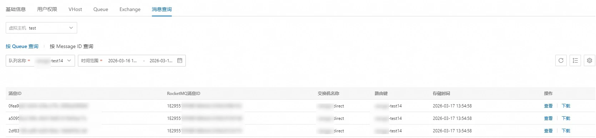

**按Message ID查询**

1. 在**消息查询**页面，单击**按 Message ID 查询**页签。

2. 在**队列名称**下拉列表中，选择要查询消息的Queue，在**消息ID**文本框输入发送消息时设置的消息ID，设置查询**时间范围**，页面展示查询结果。

   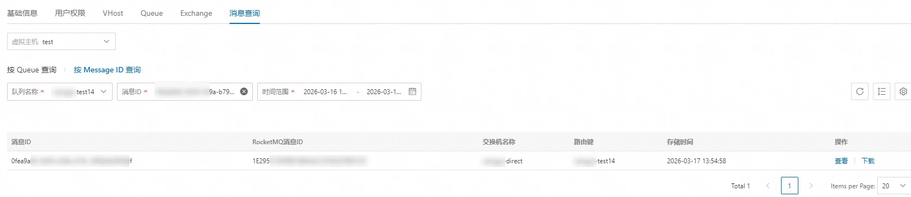

**查看消息详情**

在消息列表中，单击目标消息**操作**列的**查看**，在消息详情面板可查看消息的**基本信息**、**消息属性**、**Header**以及**Body**信息。

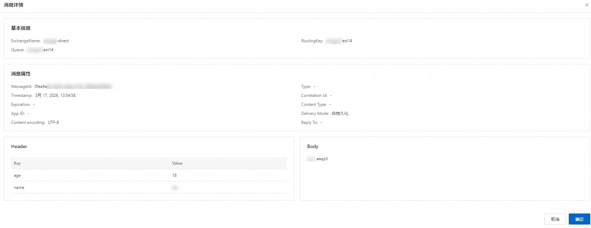

**下载消息**

1. 在消息列表中，单击目标消息**操作**列的**下载**。

2. 在弹出的对话框中，单击**下载**。

**相关文档**

Message ID的设置方法，请参见如何设置Message ID。

<a id="section-4"></a>

# 4.SDK 参考

<a id="section-4-1"></a>

## 4.1. SDK概述

消息队列RabbitMQ版支持通过AMQP 0-9-1协议收发消息。AMQP 0-9-1协议支持多语言SDK。

**RabbitMQ开源客户端**

- SDK列表及示例代码

- SDK使用注意事项

- Spring集成

- 错误码说明

**FAQ**

SDK FAQ

<a id="section-4-2"></a>

## 4.2. RabbitMQ开源客户端

<a id="section-4-2-1"></a>

### 4.2.1. SDK列表及示例代码

本文列出了消息队列RabbitMQ版在账号授权场景所支持的多语言SDK列表及代码示例。

**开源RabbitMQ SDK**

消息队列RabbitMQ版基于AMQP 0-9-1协议传递消息，支持开源所有语言SDK，如下表所示。如果在消息队列RabbitMQ版控制台生成用户名密码后，可以直接使用开源RabbitMQ SDK进行消息收发。

表 1. 开源RabbitMQ AMQP协议支持的多语言或框架SDK

| 语言或框架 | SDK |
| --- | --- |
| Java | RabbitMQ Java Client Library |
| Spring Framework | Spring AMQP project for Java |
| .NET | .NET SDK |
| Python | Python SDK |
| PHP | PHP SDK |
| Rust | Rust SDK |
| C and C++ | C and C++ SDK |
| Go | Go SDK |
| JavaScript and Node | JavaScript and Node SDK |
| Objective-C and Swift | Objective-C and Swift SDK |
| 其他 | 更多信息，请参见Clients Libraries and Developer Tools。 |

**消息队列RabbitMQ版SDK 示例代码**

消息队列RabbitMQ版支持的多语言或框架SDK 示例代码如下表所示：

表 2. 消息队列RabbitMQ版支持的多语言或框架SDK，专有云在使用过程中，username需要设置为 `username|rabbitmqInstanceId` 格式。

<table>
  <tr>
    <th width="105">语言或框架</th>
    <th>SDK</th>
  </tr>
  <tr>
    <td>Java</td>
    <td>amqp-java-demo</td>
  </tr>
  <tr>
    <td>Spring</td>
    <td>• amqp-springboot-demo<br>• amqp-spring-demo<br>• amqp-springcloud-stream-demo<br>• amqp-springcloudbus-demo</td>
  </tr>
  <tr>
    <td>.NET</td>
    <td>amqp-dotnet-demo</td>
  </tr>
  <tr>
    <td>Python</td>
    <td>• amqp-python-celery-demo<br>• amqp-python-demo</td>
  </tr>
  <tr>
    <td>PHP</td>
    <td>amqp-php-demo</td>
  </tr>
  <tr>
    <td>Ruby</td>
    <td>amqp-ruby-demo</td>
  </tr>
  <tr>
    <td>C++</td>
    <td>amqp-cpp-demo</td>
  </tr>
  <tr>
    <td>Go</td>
    <td>amqp-go-utils</td>
  </tr>
  <tr>
    <td>Node.js</td>
    <td>amqp-node-demo</td>
  </tr>
</table>

<a id="section-4-2-2"></a>

### 4.2.2. SDK使用注意事项

本文介绍使用开源的客户端SDK接入消息队列RabbitMQ版服务端时的注意事项。

**使用客户端时需要设置自动重连功能吗？**

设置 `com.rabbitmq.client.ConnectionFactory` 接口时，必须开启连接自动恢复功能，保证服务端升级时，客户端断开连接可自动重新连接，否则会导致消息读写中断。

```text
//设置为true，开启Connection⾃动恢复功能；设置为false，关闭Connection⾃动恢复功能。
factory.setAutomaticRecoveryEnabled(true);
//设置⾃动恢复间隔时间，单位：毫秒。
factory.setNetworkRecoveryInterval(5000);
```

**生产消息时需要注意什么？**

- 在生产或消费过程中，请勿频繁开启或关闭连接。请尽可能使用长期存活的Connection，以免每次收发消息时都需要创建新的Connection，消耗大量的网络资源和服务端资源，甚至引起服务端SYN Flood防护。更多信息，请参见Connection。

- 生产消息前根据实际情况选择是否打开发送确认接口。开启发送确认，服务端收到消息后，会调用本地方法确认消息收到。请注意，当且仅当客户端收到服务端的publishAck，才能够确认消息发送成功。若消息发送失败或没有收到publishAck，请在客户端实现消息发送重试机制，避免消息丢失。

  > **说明**
  >
  > 如果开启发送确认，可能会导致消息发送延迟的增加，因为发送模式由异步转为同步。服务端需要在确保消息成功落盘后，才会返回发送成功的响应。

  开启发布确认的过程由两个步骤实现，以Java语言为例：

  <ol type="i">

  <li>

  创建channel时开启发布确认。

  ```text
  // 创建connection以及channel
  Connection connection = createConnection(hostName, userName, passWord, virtualHost)
  ;
  Channel channel = connection.createChannel();
  // 在channel维度启⽤发布确认模式
  channel.confirmSelect();
  ```

  </li>

  <li>

  在 `basicPublish` 时等待服务端的返回，并执行对应逻辑：

  ```text
  // 发送消息，注意：该过程中建议复⽤已有channel
  channel.basicPublish(exchangeName, bindingKey, true, props,
                  ("example body").getBytes(StandardCharsets.UTF_8));

  // 等待confirm返回成功信息，3秒内确认完成
  if (channel.waitForConfirms(3000)) {
      // 消息落盘时的逻辑
  } else {
      // 消息重发逻辑
  }
  ```

  </li>

  </ol>

- `mandatory` 设置为true时，如果消息因为路由原因，未到达Queue，客户端添加的 `ReturnListener` 接口将会被调用。

  ```java
  // channel添加路由失败回调
  channel.addReturnListener(returnMessage -> System.out.println("return msgId=" + returnMessage.getProperties().getMessageId()));
  // 发送消息，第三个参数为true
  channel.basicPublish(exchangeName, routingKey, true, props, 
  content.getBytes(StandardCharsets.UTF_8));
  ```

- 发送消息时，强烈建议自定义msgId，即消息的唯一标识。可用于消息查询、轨迹查询、以及故障排查时后台信息定位。

- 消息发送时，需要根据 `basicPublish` 接口返回的错误类型决定是否抛出异常。

  - 如果是业务自身问题，例如 `ExchangeNotExist` （Exchange不存在）则需要抛出异常。

  - 如果是发送消息被限流，建议关闭旧的连接，重新创建并初始化Channel，这样可以保证业务的连续性。

  部分逻辑代码示例如下所示。完整的发送代码示例，请参见生产消息。

  ```java
  private void doSend(String content) throws Exception {
      try {
          // 设置msg id
          String msgId = UUID.randomUUID().toString();
          AMQP.BasicProperties props = new 
  AMQP.BasicProperties.Builder().messageId(msgId).build();

          channel.basicPublish(exchangeName, routingKey, true, props, 
  content.getBytes(StandardCharsets.UTF_8));
          // 等待confirm返回成功信息，3秒内确认完成
          if (channel.waitForConfirms(3000)) {
              // 消息落盘时的逻辑
          } else {
              // 消息重发逻辑
          }

      } catch (Exception e) {
          // 获取报错信息
          String message = e.getMessage();
          System.out.println(message);

          // 判断该通道是否已经关闭
          if (channelClosedByServer(message)) {
              // 关闭已有channel，并重开channel
              factory.closeCon(channel);
              channel = factory.createChannel();
              // 初始化，例如启⽤confirm等
              this.initChannel();
              // 重发消息
              doSend(content);
          } else {
              // 如果不是服务端有问题，则抛出异常，或者定制后续处理逻辑。
              throw e;
          }
      }
  }

  private boolean channelClosedByServer(String errorMsg) {
      if (errorMsg != null
          && errorMsg.contains("channel.close")) {
          return true;
      } else {
          return false;
      }
  }
  ```

**消费消息时需要注意什么？**

- 消费数据时，需要防止消费倾斜。具体做法，请参见Connection和Channel的使用建议。

- 客户端不建议设置Consumer Tag，使用服务端自动生成的全局唯一Consumer Tag。如果要设置，需要保证Consumer Tag唯一性。

- 消费数据时，使用

  务端允许缓存未

  消息的数量，当到达设置值时，服务端

- 消费数据时，使用 `basic.basicQos` 设置服务端允许缓存未ack消息的数量，当到达设置值时，服务端将不再推送消息到客户端。当客户端提交ack后，服务端将再次推送等同ack数量的消息，保持服务端缓存最大未ack消息数量小于等于QoS设置值。QoS可以设置在Channel上，也可以设置在单个Consumer上。 `channel.basicQos(100, true)` 表示同一Channel上创建的所有Consumer共享100的额度限制。 `channel.basicQos(100, false)` 或者 `channel.basicQos(100)` 表示不同Consumer之间额度不共享，不同Consumer额度都是100。如果客户端不设置，默认使用服务端配置，服务端默认针对每个消费者限制100，也即等同于客户端 `channel.basicQos(100, false)` 。自定义设置值不能超过100，否则设置不生效，仍然使用默认值。如果消费能力较弱，建议将QoS值降低。如果服务端堆积消息量达到设置的QoS，则不会再推送消息给客户端。这种情况下客户端看到的现象是服务端间歇性推送消息，并且重启消费者后消息恢复，建议通过增强消费者的消费能力解决。如果使用autoACK消费模式， `basicQos` 将不生效。

- 消费者提交的ack如果不在指定时间内，则触发消费重试。消息将会被重新投递，最多重试16次。若重试16次还未成功，则消息将被丢弃或发送至死信Exchange。消费超时时间如下：

  **实例重试策略参数说明**

  | 参数 | 说明 |
  | --- | --- |
  | 消费超时时间 | 最大值：3小时默认值：5分钟 |
  | 最大投递次数 | 最大值：16默认值：16 |

- `basicGet` 拉取消息效率较低，能达到的上限TPS没有 `basicConsume` 高。生产环境大规模消费消息推荐使用 `basicConsume` ，而不是 `basicGet` 。

- `queueDeclare` 和 `exchangeDeclare` 等元数据接口有限流设置，建议在控制台上创建，不建议在发送数据时调用，否则可能触发限流导致连接关闭。

<a id="section-4-3"></a>

## 4.3. Spring集成

消息队列RabbitMQ版支持Spring框架的SDK，本文介绍如何集成Spring框架的SDK客户端收发消息。

**前提条件**

- 您已在消息队列RabbitMQ版控制台创建实例、Vhost、Exchange、Queue等相关资源，具体操作，请参见创建资源。

- 安装IDEA

- 安装JDK 1.8或以上版本

- 安装Maven 2.5或以上版本

- 安装Spring Boot 2.1.2.RELEASE或以上版本

**Demo工程示例**

单击SpringBootDemo.zip下载Demo工程示例。

**步骤一：参数配置**

在 `application.properties` 或 `application.yml` 文件中填写配置参数，以application.properties为例。

```text
# 设置接入点，在云消息队列 RabbitMQ 版控制台实例详情⻚⾯获取。 
spring.rabbitmq.host=XXXXXX.amqp.aliyuncs.com
# 云消息队列RabbitMQ连接端⼝。
spring.rabbitmq.port=5672
# 指定实例的静态⽤户名，在云消息队列 RabbitMQ 版控制台静态⽤户名密码管理⻚⾯查看。 
spring.rabbitmq.username=******
# 指定实例的静态⽤户密码，在云消息队列 RabbitMQ 版控制台静态⽤户名密码管理⻚⾯查看。 
spring.rabbitmq.password=******
# 虚拟主机，提供逻辑隔离，在云消息队列 RabbitMQ 版控制台Vhost列表⻚⾯查看。 
spring.rabbitmq.virtual-host=test_vhost
# 消息确认（Ack）模式。
# 1. none：消费者接收消息后，无论消费成功与否，服务端均认为消息已成功处理，即RabbitMQ中的autoAck模式
。
# 2. auto：客户端在消费成功后主动回复ack（处理失败则回复nack或抛出异常），不需要客户端显式调⽤Channel.basicAck()。
# 3. manual: ⼿动回复Ack，需要客户端在消费成功后显式调⽤Channel.basicAck()主动回复。
spring.rabbitmq.listener.simple.acknowledge-mode=manual

#推荐设置为CONNECTION模式，云消息队列 RabbitMQ 版是集群分布式架构，在CONNECTION模式下，客户端能够
更均衡地连接到集群中的多个服务节点。这种⽅法可以有效避免出现负载热点问题，从⽽提⾼消息的发送和消费效率。spring.rabbitmq.cache.connection.mode=connection
#根据情况增减
spring.rabbitmq.cache.connection.size=50
#根据情况增减
spring.rabbitmq.cache.channel.size=1

# ⼀个消费者最多可处理的未被确认（Ack）消息数量（QoS），RabbitMQ服务端取min{prefetch, 100}作为QoS
。如果消费者处理能⼒弱，减⼩设置
spring.rabbitmq.listener.simple.prefetch=100
# RabbitMQ监听器（Listener）的最⼩并发消费者数量，根据实际增减
spring.rabbitmq.listener.simple.concurrency=10
# RabbitMQ监听器（Listener）的最⼤并发消费者数量，当消费速率⾜够快时，客户端会启动max-concurrency
个消费者进⾏消费。
spring.rabbitmq.listener.simple.max-concurrency=20
```

以下其他配置您可以根据需要选择添加：

**可选配置**

| 属性 | 说明 |
| --- | --- |
| spring.rabbitmq.addresses | 指定客户端连接到的服务端地址，多个地址之间使用英文逗号（,）分隔。若<strong>spring.rabbitmq.host</strong>和<strong>spring.rabbitmq.addresses</strong>同时设置，则优先以<strong>spring.rabbitmq.addresses</strong>为准<strong>。</strong> |
| spring.rabbitmq.dynamic | 是否创建AmqpAdmin bean，默认值为true。 |
| spring.rabbitmq.connection-timeout | 连接超时时间，单位毫秒，0表示不超时。 |
| spring.rabbitmq.requested-heartbeat | 指定心跳超时时间，单位：秒，默认值为60。 |
| spring.rabbitmq.publisher-confirms | 是否启用发布确认机制。 |
| spring.rabbitmq.publisher-returns | 是否启用发布返回机制。 |
| spring.rabbitmq.ssl.enabled | 是否启用SSL证书认证。 |
| spring.rabbitmq.ssl.key-store | 持有SSL证书的key store路径。 |
| spring.rabbitmq.ssl.key-store-password | 访问key store的密码。 |
| spring.rabbitmq.ssl.trust-store | 持有SSL证书的可信地址。 |
| spring.rabbitmq.ssl.trust-store-password | 访问SSL的可信地址的密码。 |
| spring.rabbitmq.ssl.algorithm | SSL使用的算法，例如：TLSv1.2。 |
| spring.rabbitmq.ssl.validate-server-certificate | 是否启用服务端证书验证。 |
| spring.rabbitmq.ssl.verify-hostname | 是否启用主机校验。 |
| spring.rabbitmq.cache.channel.s ize | 缓存中保持的channel数量。 |
| spring.rabbitmq.cache.channel.c heckout-timeout | 当缓存数量被设置时，从缓存中获取一个channel的超时时间。单位：毫秒，取值为0表示总是创建一个新channel。 |
| spring.rabbitmq.cache.connectio n.size | 缓存的连接数，只在<strong>CONNECTION</strong>模式下生效。 |
| spring.rabbitmq.cache.connectio n.mode | 连接缓存模式。取值如下：<br>• CHANNEL<br>• CONNECTION<br>推荐使用CONNECTION模式。 |
| spring.rabbitmq.listener.type | Listener容器类型。取值如下：<br>• simple<br>• direct<br>默认值为simple。 |
| spring.rabbitmq.listener.simple.auto-startup | 是否应用启动时自动启动容器，默认为true。 |
| spring.rabbitmq.listener.simple.acknowledge-mode | 消息确认方式。取值如下：<br>• <strong>none</strong>：消费者接收消息后，无论消费成功与否，服务端均认为消息已成功处理，即RabbitMQ中的autoAck模式。<br>• <strong>manual</strong>：手动回复Ack，需要客户端在消费成功后显式调用Basic.ack主动回复。<br>• <strong>auto</strong>：客户端在消费成功后主动回复ack（处理失败则回复nack或抛出异常），不需要客户端显式调用Basic.ack。默认值为auto。 |
| spring.rabbitmq.listener.simple.concurrency | 最小消费者的数量。 |
| spring.rabbitmq.listener.simple.max-concurrency | 最大消费者的数量。 |
| spring.rabbitmq.listener.simple.prefetch | 一个消费者最多可处理的未被确认（Ack）的消息数量（等同于客户端调用<strong>Basic.qos</strong>设置QoS值），如果有事务的话，必须大于等于transaction数量。 |
| spring.rabbitmq.listener.simple.transaction-size | 事务处理的消息数量。 |
| spring.rabbitmq.listener.simple.default-requeue-rejected | 被拒绝的消息是否重新进入队列，默认值为true。 |
| spring.rabbitmq.listener.simple.missing-queues-fatal | 如果容器声明的队列在代理上不可用，是否失败；或者如果在运行时删除一个或多个队列，是否停止容器。默认值为true。 |
| spring.rabbitmq.listener.simple.idle-event-interval | 发布空闲容器事件的时间间隔，单位：毫秒。 |
| spring.rabbitmq.template.mand atory | 是否启用强制信息，默认值为false。 |
| spring.rabbitmq.template.receiv e-timeout | receive()操作的超时时间。 |
| spring.rabbitmq.template.reply-timeout | sendAndReceive()操作的超时时间。 |

**步骤二：调用SDK收发消息**

**消息生产**

在RabbitMQService中通过依赖注入的方式获取RabbitTemplate，并调用其提供的send接口发送消息。

```java
import org.springframework.amqp.core.Message;
import org.springframework.amqp.core.MessageProperties;
import org.springframework.amqp.core.Queue;
import org.springframework.amqp.rabbit.core.RabbitTemplate;
import org.springframework.beans.factory.annotation.Autowired;
import org.springframework.stereotype.Service;

import java.nio.charset.StandardCharsets;
import java.util.UUID;

@Service
public class RabbitMQService {
    
    @Autowired
    private RabbitTemplate rabbitTemplate;

    public void sendMessage(String exchange, String routingKey, String content) {
        // 设置MessageId。
        String msgId = UUID.randomUUID().toString();
        MessageProperties messageProperties = new MessageProperties();
        messageProperties.setMessageId(msgId);
        // 创建Message。
        Message message = new Message(content.getBytes(StandardCharsets.UTF_8), 
messageProperties);
        /*
         * 发送消息send()接⼝；
         * exchange：交换机名称；
         * routingKey：路由键；
         * message：消息内容；
         * correlationData⽤于关联发布者确认；
         */
        rabbitTemplate.send(exchange, routingKey, message, null);
    }
}
```

**消息消费**

使用 `@RabbitListener` 注解消费消息：

```java
import com.rabbitmq.client.Channel;
import org.springframework.amqp.core.Message;
import org.springframework.amqp.rabbit.annotation.RabbitHandler;
import org.springframework.amqp.rabbit.annotation.RabbitListener;
import org.springframework.stereotype.Component;

import java.util.Arrays;

@Component
public class MessageListener {

     /**
     * 消息接收；
     * @param message消息；
     * @param channel通道；
     * @throws IOException
     *queues需要替换为您提前创建好的队列的名称；
     */
    @RabbitListener(queues = "myQueue")
    public void receiveFromMyQueue(Message message, Channel channel) throws IOException
{
        // 进入消息消费业务逻辑。
        ...
        // 须在Ack有效期（消费超时时间）内返回Ack，否则为无效确认，消息还会被重复投递。
        channel.basicAck(message.getMessageProperties().getDeliveryTag(), false);
    }
}
```

`RabbitListener` 常见可选配置如下：

**可选配置**

<table>
  <tr>
    <th width="182">属性</th>
    <th>说明</th>
  </tr>
  <tr>
    <td>ackMode</td>
    <td>自定义消息确认模式，覆盖<code> spring.rabbitmq.listener.simple.acknowledge-</code><code>mode </code>设置。</td>
  </tr>
  <tr>
    <td>admin</td>
    <td>引用AmqpAdmin用于AMQP资源管理。</td>
  </tr>
  <tr>
    <td>autoStartup</td>
    <td>是否在应用启动时自动启动容器，覆盖<code> spring.rabbitmq.listener.simple.auto-</code><code>startup </code>设置。</td>
  </tr>
  <tr>
    <td>bindings</td>
    <td>配置队列与交换机绑定的数组，包含绑定信息。</td>
  </tr>
  <tr>
    <td>concurrency</td>
    <td>设置监听器容器（Listener）的并发线程数。</td>
  </tr>
  <tr>
    <td>errorHandler</td>
    <td>为监听方法抛出的异常配置错误处理器。</td>
  </tr>
  <tr>
    <td>exclusive</td>
    <td>启用队列的独占模式，指消费者独占队列，其他消费者无法从该队列接收消息，暂不支持。</td>
  </tr>
  <tr>
    <td>queues</td>
    <td>声明此监听器所监听的队列。</td>
  </tr>
  <tr>
    <td>queuesToDeclare</td>
    <td>指定要显示声明的队列。</td>
  </tr>
</table>

<a id="section-4-4"></a>

## 4.4. 错误码说明

本文说明消息队列RabbitMQ版客户端调用AMQP 0-9-1协议时的返回码，您可以根据返回信息与解决方案自助排查错误。

**返回码列表**

<table>
  <tr>
    <th>返回码（reply-code）</th>
    <th>返回信息（reply-text）</th>
    <th>描述</th>
    <th>解决方案</th>
  </tr>
  <tr>
    <td>200</td>
    <td>no route has mandatory</td>
    <td>调用<code> basicPublish </code>方法发送消息且设置mandatory=true时，如果Exchange根据自身类型和消息的RoutingKey无法匹配到合适的Queue存储消息，Broker会调用<code> basic.return </code>方法将消息返回给生产者。</td>
    <td>请检查Exchange下的Binding是否设置正确。</td>
  </tr>
  <tr>
    <td>311</td>
    <td>MessageBodyLengthEx ceeded</td>
    <td>消息大小超过限制。</td>
    <td>确保您发送的消息的大小在不超过消息队列RabbitMQ版的限制值。具体限制值，请参见<strong>《RabbitMQ 产品简介》 &gt; 使</strong><strong>用限制</strong>。</td>
  </tr>
  <tr>
    <td>320</td>
    <td>ProtocolVersionMismat ch</td>
    <td>协议版本不正确，当前只支持AMQP 0-9-1协议。</td>
    <td>确保您使用的协议版本为AMQP 0-9-1。</td>
  </tr>
  <tr>
    <td rowspan="2">404</td>
    <td>ExchangeNotExist</td>
    <td>Exchange不存在。</td>
    <td>• 确保指定的Exchange已被创建。<br>• 确保您输入的Exchange拼写正确。</td>
  </tr>
  <tr>
    <td>QueueNotExist</td>
    <td>Queue不存在。</td>
    <td>• 确保指定的Queue已被创建。<br>• 确保您输入的Queue拼写正确。</td>
  </tr>
  <tr>
    <td>405</td>
    <td>QueueExclusive</td>
    <td>当前队列是排他队列。</td>
    <td>该队列仅对首次连接的Connection可见，不支持通过其他Connection访问。</td>
  </tr>
  <tr>
    <td rowspan="7">406</td>
    <td>QueueConsumerName Invalid</td>
    <td>队列消费者名称不符合规范。</td>
    <td>确保您输入的消费者名称拼写正确且符合规范。具体限制值，请参见<strong>《RabbitMQ 产品简介》 &gt; 使用限</strong><strong>制</strong>。</td>
  </tr>
  <tr>
    <td>ExchangeNameEmpty</td>
    <td>Exchange名称为空。</td>
    <td>请输入Exchange名称，并确保您输入的Exchange已创建。具体限制值，请参见<strong>《RabbitMQ 产品简介》 &gt; 使用限</strong><strong>制</strong>。</td>
  </tr>
  <tr>
    <td>QueueHasDiffField</td>
    <td>本地声明中Queue的属性与要调用的目标Queue属性不同。</td>
    <td>修改本地声明中Queue的参数值，使其与要调用的目标Queue属性保持一致。</td>
  </tr>
  <tr>
    <td>BindingNameInvalid</td>
    <td>Routing Key名称不符合规范。</td>
    <td>确保您输入的Routing Key拼写正确且符合规范。具体限制值，请参见<strong>《RabbitMQ 产品简介》 &gt; 使用限</strong><strong>制</strong>。</td>
  </tr>
  <tr>
    <td>ExchangeInBuilt</td>
    <td>内置Exchange，不允许创建。</td>
    <td>请您修改Exchange名称。以amp.开头的Exchange为系统内置Exchange，不允许您创建。</td>
  </tr>
  <tr>
    <td>QueueNameInvalid</td>
    <td>Queue名称不符合规范。</td>
    <td>确保您输入的Queue名称拼写正确且符合规范。具体限制值，请参见<strong>《RabbitMQ 产品简介》 &gt; 使用限</strong><strong>制</strong>。</td>
  </tr>
  <tr>
    <td>MessageBodyEmpty</td>
    <td>消息体内容为空。</td>
    <td>请输入消息内容。</td>
  </tr>
  <tr>
    <td>503</td>
    <td>ExchangeTypeNotSup port[x-delayed-message]</td>
    <td>使用代码方式创建x-delayed-message类型的Exchange时，参数设置错误。</td>
    <td>重点检查Exchange类型和x-delay-type参数值设置是否正确。正确示例如下：<br><code>• arguments.put("x-delayed-</code><code>type", "</code>只能取值<code>direct</code>、<code>topic</code>、<code>fanout</code>、<code>headers</code>其中一种<code>"); </code><br><code>• channel.exchangeDeclare("${e</code> <code>xchangeName}", "</code>只能取值<code>x-</code><code>delayed-message", true,</code><br><code>false, arguments);</code></td>
  </tr>
</table>

多个进程共享Connection且频繁建立和关闭连接会返回该错误码。

如果您使用的SpringBoot集成方式且连

传输信息到服务端

接工厂为CONNECTION模式，您可以适

时，Channel已经被清

当调

504

ChannelNotFind

理。

整 `spring.rabbitmq.cache.connec tion.size` （Connection的缓存数量），使客户端不会频繁建立和关闭连接。

本地声明中Exchange的

修改本地声明中Exchange的参数值，使

属性与要调用的目标

其与要调用的目标Exchange属性保持一

ExchangeHasDiffFields

Exchange属性不同。

致。

- 进行流量控制，确保消息收发TPS不超过规格限制。

消息收发TPS峰值超过规

denied for too many

- 升级实例规格，提高TPS流量峰值。具

格限制，请求被限流。

requests

体限制值，请参见<strong>《RabbitMQ 产品简介》 > 使用限制</strong>。

- 删除不再使用的Vhost。

- 升级实例规格，提高Vhost数量上

单实例的Vhost数量超过

VhostNumExceeded

限。具体限制值，请参

限制。

见<strong>《RabbitMQ 产品简介》 > 使用限制</strong>。

- 删除不再使用的Vhost。

- 升级实例规格，提高Exchange数量上

单Vhost的Exchange数

ExchangeNumExceede

限。具体限制值，请参

量超过限制。

d

见<strong>《RabbitMQ 产品简介》 > 使用限制</strong>。

- 删除不再使用的Queue。

- 更新实例配置，提高Queue数量上限。具体限制值，请参

单实例的Queue数量超过

见<strong>《RabbitMQ 产品简介》 > 使用</strong>

QueueNumExceeded

限制。

**限制**。

- 删除不再使用的Binding。

- 更新实例配置，提高Binding数量上

单Vhost的Binding数量

VHostTotalBindingNum

限。具体限制值，请参

超过限制。

Exceeded

见<strong>《RabbitMQ 产品简介》 > 使用限制</strong>。

530

单Exchange绑定的Queue数量超过限制。

ExchangeBindingNum

解除不再使用的Queue的绑定关系。

Exceeded

- 删除不再使用的订阅关系。

- 更新实例配置，提高Consumer数量上

单Queue的Consumer数

QueueConsumerNumE

限。具体限制值，请参

量超过限制。

xceeded

见<strong>《RabbitMQ 产品简介》 > 使用限制</strong>。

单Connection的

关闭不再使用的Producer或Consumer

ChannelNumExceeded

Channel数量超过限制。

进程。

QueueConsumerAlrea

单Queue上已经存在相同

相同的Channel上进行BasicConsume

dyExist

消费者。

时指定不同的ConsumerTag值。

- 请检查静态用户名密码是否填写正确。

- 请检查静态用户名密码是否归属于当前实例。

AccessAccountDataErr

用户名密码验证错误。

or

- 请检查创建静态用户名密码的AccessKey ID、AccessKey Secret是否正确。

- 连接复用，避免为每次发送的请求都创建Connection。

单实例创建的连接

ConnectionNumExcee

- 升级实例规格，提高Connection数量

（Connection）数量超

ded

上限。具体限制值，请参

过限制。

见<strong>《RabbitMQ 产品简介》 > 使用限制</strong>。

根据返回信息的错误原因定位问题后，联

服务端内部错误。

系消息队列RabbitMQ版技术人员获取帮

541

InternalError

助。

**返回信息示例**

```text
Caused by: com.rabbitmq.client.ShutdownSignalException: channel error; protocol method:
#method<channel.close>
(reply-code=404, reply-text=ExchangeNotExist, ReqId:5FB4C999314635F952FCBFF6, ErrorHelp
[dstQueue=XXX_test_queue,
srcExchange=Producer.ExchangeName,routingKey=XXX_test_bk, http://mrw.so/6rNqO8], class-id=50, method-id=20)
    at com.rabbitmq.client.impl.ChannelN.asyncShutdown(ChannelN.java:516)
    at com.rabbitmq.client.impl.ChannelN.processAsync(ChannelN.java:346)
    at 
com.rabbitmq.client.impl.AMQChannel.handleCompleteInboundCommand(AMQChannel.java:182)
    at com.rabbitmq.client.impl.AMQChannel.handleFrame(AMQChannel.java:114)
    at com.rabbitmq.client.impl.AMQConnection.readFrame(AMQConnection.java:672)
    at com.rabbitmq.client.impl.AMQConnection.access$300(AMQConnection.java:48)
    at com.rabbitmq.client.impl.AMQConnection$MainLoop.run(AMQConnection.java:599)
    at java.lang.Thread.run(Thread.java:748)
```

**返回信息说明**

| 参数 | 描述 | 示例值 |
| --- | --- | --- |
| reply-code | 返回码。 | 404 |
| reply-text | 返回信息。 | ExchangeNotExist |
| ReqId | 请求ID。 | 5FB4C999314635F952FC\*\*\*\* |
| ErrorHelp | 错误辅助排查信息。包括：<br>• 发生错误时的相关元数据信息。<br>• AMQP协议方法返回信息参考文档链接。<br>说明为提高性能并减少内存开销，BasicPublish接口发生错误时，ErrorHelp只提供msgId，而不提供kv结构的错误辅助排查信息，您可以根据msgId来排查。 | \[dstQueue=XXX_test_queue,srcExchan ge=Producer.ExchangeName,routingK ey=XXX_test_bk,http://mrw.so/6rNqO8\] |
| class-id | 类ID（与开源RabbitMQ相同）。 | 50 |
| method-id | 方法ID（与开源RabbitMQ相同）。 | 20 |

<a id="section-4-5"></a>

## 4.5. SDK FAQ

本文记录通过SDK收发消息时常见的问题。

**开源客户端是否可以直接访问云上服务？**

消息队列RabbitMQ版完全兼容开源RabbitMQ。开源RabbitMQ可以直接访问云上服务。您需要创建用户名密码并进行授权，通过创建好的用户名和密码直接访问云上服务。详情请参见创建用户和权限。

**支持哪些语言的开源SDK？**

开源RabbitMQ提供的多语言或框架SDK消息队列RabbitMQ版全部都支持。具体信息，请参见开源RabbitMQ AMQP协议支持的多语言或框架SDK。

**是否可以直接使用开源RabbitMQ JMS Client？**

消息队列RabbitMQ版暂不支持使用开源RabbitMQ JMS Client。

**如果是自动ACK，是否支持通过Reject来触发消息重新入队列？**

不可以。您可以使用basicReject方法否定应答单条消息，或者使用basicNack方法否定应答一条或多条消息，并使消息重新入队列。

- 使用basicReject方法否定应答消息并使消息重入队列

  <table>
    <tr>
      <th width="120">参数</th>
      <th>说明</th>
    </tr>
    <tr>
      <td>deliveryTag</td>
      <td>Channel的消息投递的唯一标识符。</td>
    </tr>
    <tr>
      <td>requeue</td>
      <td>被否定应答的消息是否重入队列。如果设置为true，则消息重入队列；如果设置为false，则消息被丢弃或发送到死信Exchange。更多信息，请参见死信Exchange。</td>
    </tr>
  </table>

- 使用basicNack方法否定应答多条消息并使消息重入队列

  <table>
    <tr>
      <th width="120">参数</th>
      <th>说明</th>
    </tr>
    <tr>
      <td>deliveryTag</td>
      <td>Channel的消息投递的唯一标识符。</td>
    </tr>
    <tr>
      <td>multiple</td>
      <td>是否否定应答多条消息。如果设置为true，则否定应答带指定deliveryTag的消息及该deliveryTag之前的多条消息；如果设置为false，则仅否定应答带指定deliveryTag的单条消息。</td>
    </tr>
    <tr>
      <td>requeue</td>
      <td>被否定应答的消息是否重入队列。如果设置为true，则消息重入队列；如果设置为false，则消息被丢弃或发送到死信Exchange。更多信息，请参见死信Exchange。</td>
    </tr>
  </table>

  示例代码

  ```java
  channel.basicConsume("test", false, new DefaultConsumer(channel) {
     @Override
      public void handleDelivery(String consumerTag, Envelope envelope,
                        AMQP.BasicProperties properties, byte[] body)
              throws IOException {
          System.out.println("Rejected: " + new String(body, "UTF-8") + ", deliveryTag: 
  " + envelope.getDeliveryTag() + ", messageId: " + properties.getMessageId());
          channel.basicNack(envelope.getDeliveryTag(), true, true);
      }
  });
  ```

**如何设置Message ID？**

如果您需追踪和识别消息，可以在消息队列RabbitMQ版的Producer客户端设置Message ID属性，为每条消息设置唯一标识符。

在消息队列RabbitMQ版的Producer客户端设置 `Basic.Properties` 的 `message-id` 属性。示例代码如下：

> **说明**
>
> Message ID最大长度不能超过255个字符。

**Java**

```text
AMQP.BasicProperties props = new 
AMQP.BasicProperties.Builder().messageId("messageid").build(); 
channel.basicPublish("${ExchangeName}", "RoutingKey", true, props, ("消息发送
Body").getBytes(StandardCharsets.UTF_8));
```

**Python**

```text
properties = pika.BasicProperties(app_id='example-publisher', 
content_type='application/json', message_id='messageid')
```

**PHP**

```text
$msg = new AMQPMessage($msgBody, ['application_headers'=>$amqpTable,'content_type' => 'text/plain', 'delivery_mode' => 2,'message_id' => 'messageid',]);
```

**Go**

```text
err = ch.Publish( "helloExchange", "hello", false, false, amqp.Publishing { ContentType: "text/plain", Body: []byte(body), MessageId: "messageId", })
```

**Node.js**

```text
channel.BasicPublish(exchange: "", routingKey: "hello", basicProperties: null, body: body);
```

**如何删除队列消息？**

您可以使用Java客户端库中 `queuePurge` 方法删除某个队列的所有消息。示例代码如下：

```text
channel.queuePurge("queue-name");
```

**消费者消费到的数据量不相同，导致不同消费者的内存/CPU使用率产生较大差异怎么办？**

消息队列RabbitMQ版使用分布式部署，后台部署有多个服务节点，同时，网关使用轮询机制与后台服务节点建立连接。如果客户端连接在服务节点上分布不均衡，可能导致每个消费者拉取到的消息数量不同。例如，有5个客户端，3个服务端节点A、B、C，每个客户端建立一个连接，即A、B服务节点上有2个连接，C服务节点上有1个连接。那么C节点上的这一个连接将会消费到C节点上拉取到的所有数据（后端存算分离两层架构，3个后端服务节点拉取到的数据一样多），则该连接对应的客户端消费到的数据量就会明显增加。

解决方式：每个客户端建立多个连接，例如每个客户端节点建立50个连接，将连接数量均衡分布到后端各个节点上，均衡每个客户端拉取到的数据。如果客户端使用springboot，则可配置 `connection` 模式进行消费。

<a id="section-5"></a>

# 5.高级特性

<a id="section-5-1"></a>

## 5.1. 基本概念

<a id="section-5-1-1"></a>

### 5.1.1. Connection和Channel

本文介绍消息队列RabbitMQ版中Connection和Channel的概念及其使用建议。

**Connection**

Connection是物理TCP连接。Connection将应用与消息队列RabbitMQ版连接在一起。Connection会执行认证、IP解析、路由等底层网络任务。应用与消息队列RabbitMQ版完成Connection建立大约需要15个TCP报文交互，因而会消耗大量的网络资源和消息队列RabbitMQ版资源。大量的Connection会对消息队列RabbitMQ版造成巨大压力，甚至触发消息队列RabbitMQ版SYN洪水攻击防护，导致消息队列RabbitMQ版无响应，进而影响您的业务。

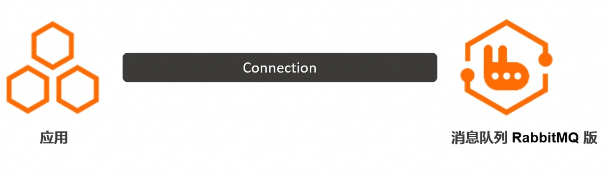

**Channel**

Channel是物理TCP连接中的虚拟连接。当应用通过Connection与消息队列RabbitMQ版建立连接后，所有的AMQP协议操作（例如创建队列、发送消息、接收消息等）都会通过Connection中的Channel完成。Channel可以复用Connection，即一个Connection下可以建立多个Channel。Channel不能脱离Connection独立存在，而必须存活在Connection中。当某个Connection断开时，该Connection下的所有Channel都会断开。如果客户端应用程序需要与消息队列RabbitMQ版进行大量的消息发送和接收，那么可以根据业务需要建立适当数量的Connection，并通过在每个Connection中复用多个Channel以减少系统资源的占用。


**使用建议**

- 保持Connection长连接，请勿频繁开启或关闭Connection。如果确实需要频繁开启或关闭连接，请在保持适当数量Connection的情况下，复用多个Channel。

- Connection数量较少而消费的数据量较大时，可能会出现消费倾斜问题，您可以在保证每个消费者Connection数一致的同时，增加每个消费者的Connection数或增加消费者数量。建议所有消费者的Connection之和大于30。

- 多个线程可以共享同一个Connection，共享时请不要频繁建立和关闭Connection，否则可能会出现 `ChannelNotFind` 错误。

- Producer和Consumer分别使用不同的Connection进行消息发送和消费。

<a id="section-5-1-2"></a>

### 5.1.2. Exchange

本文介绍消息队列RabbitMQ版的Exchange的概念和类型，帮助您理解和选择Exchange。

**什么是Exchange**

Exchange是消息队列RabbitMQ版的消息路由代理。生产者向消息队列RabbitMQ版发送消息时，不会直接将消息发送到Queue，而是先将消息发送到Exchange，由Exchange将消息路由到一个或多个Queue。Exchange根据Routing Key和Headers属性路由消息。

**Direct Exchange**

- 路由规则

  Direct Exchange根据Routing Key完全匹配的规则路由消息。

- 使用场景

  Direct Exchange适用于通过简单字符标识符区分消息的场景。Direct Exchange常用于单播路由。

- 匹配示例

  Direct Exchange根据Routing Key完全匹配的规则路由消息的示例如下：

  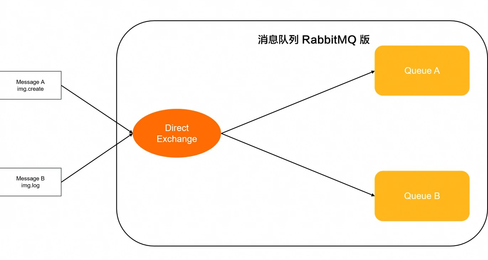

  | Message | Routing Key | 绑定关系中的Routing Key | Queue |
  | --- | --- | --- | --- |
  | Message A | <code>img.create</code> | <code>img.create</code> | Queue A |
  | Message B | <code>img.log</code> | <code>img.log</code> | Queue B |

**Topic Exchange**

- 路由规则

  Topic Exchange根据Routing Key通配符匹配的规则路由消息。Topic Exchange支持的通配符包括星号（\*）和井号（#）。星号（\*）代表一个英文单词（例如cn）。井号（#）代表零个、一个或多个英文单词，英文单词间通过英文句号（.）分隔，例如cn.zj.hz。

- 使用场景

  Topic Exchange适用于通过通配符区分消息的场景。Topic Exchange常用于多播路由。例如，使用Topic Exchange分发有关于特定地理位置的数据。

- 路由示例

  Topic Exchange根据Routing Key通配符匹配的规则路由消息的示例如下：

  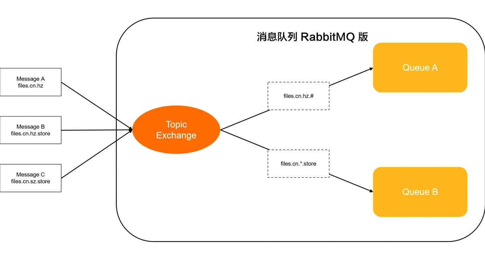

  | Message | Routing Key | 绑定关系中的Routing Key | Queue |
  | --- | --- | --- | --- |
  | Message A | <code>files.cn.hz</code> | <code>files.cn.hz.#</code> | Queue A |
  | Message B | <code>files.cn.hz.store</code> | <code>• files.cn.hz.#</code><br><code>• files.cn.*.store</code> | • Queue A<br>• Queue B |
  | Message C | <code>files.cn.sz.store</code> | <code>files.cn.*.store</code> | Queue B |

  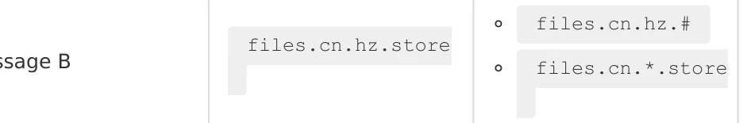

  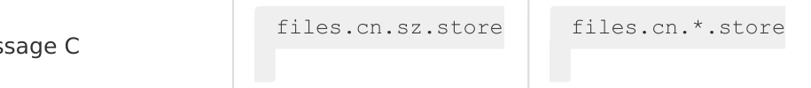

**Fanout Exchange**

- 路由规则

  Fanout Exchange忽略Routing Key的匹配规则将消息路由到所有绑定的Queue。

- 使用场景Fanout Exchange适用于广播消息的场景。例如，分发系统使用Fanout Exchange来广播各种状态和配置更新。

- 路由示例

  Fanout Exchange忽略Routing Key的匹配规则将消息路由到所有绑定的Queue的示例如下：

  

  | Message | Routing Key | 绑定关系中的Routing Key | Queue |
  | --- | --- | --- | --- |
  | Message A | <code>img.create</code> | <code>• files.cn.hz.#</code><br><code>• queue.msgText</code> | • Queue A<br>• Queue B |
  | Message B | <code>queue.msgMap</code> | <code>• files.cn.hz.#</code><br><code>• queue.msgText</code> | • Queue A<br>• Queue B |
  | Message C | <code>cn.hz.topic.alarm</code> | <code>• files.cn.hz.#</code><br><code>• queue.msgText</code> | • Queue A<br>• Queue B |

  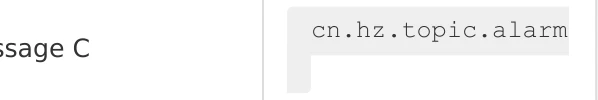

**Headers Exchange**

- 路由规则

  Headers Exchange可以被视为Direct Exchange的另一种表现形式。Headers Exchange可以像Direct Exchange一样工作，不同之处在于Headers Exchange使用Headers属性代替Routing Key进行路由匹配。您在绑定Headers Exchange和Queue时，可以设置绑定属性的键值对。然后，在向Headers Exchange发送消息时，设置消息的Headers属性键值对。Headers Exchange将根据消息Headers属性键值对和绑定属性键值对的匹配情况路由消息。

  匹配算法由一个特殊的绑定属性键值对控制。该属性为**x-match**，只有以下两种取值：

  - all：所有除**x-match**以外的绑定属性键值对必须和消息Headers属性键值对匹配才会路由消息。

  - any：只要有一组除**x-match**以外的绑定属性键值对和消息Headers属性键值对匹配就会路由消息。

  以下两种情况下，认为消息Headers属性键值对和绑定属性键值对匹配：

  - 消息Headers属性的键和值与绑定属性的键和值完全相同。

  - 消息Headers属性的键和绑定属性的键完全相同，但绑定属性的值为空。

- 使用场景

  Headers Exchange适用于通过多组Headers属性区分消息的场景。Headers Exchange常用于多播路由。例如，涉及到分类或者标签的新闻更新。

- 使用示例

  Headers Exchange根据消息Headers属性和Binding Headers属性的匹配规则路由消息的示例如下：

  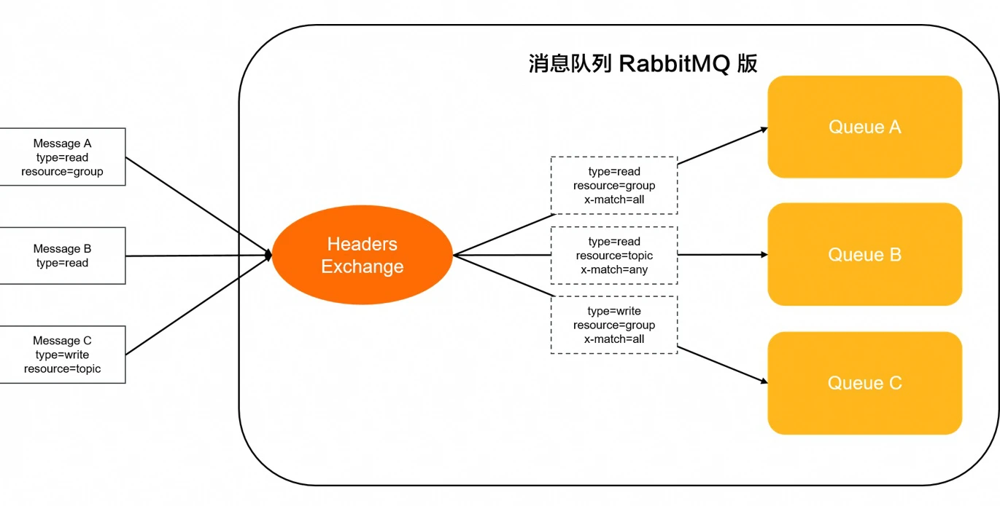

  | Message | 消息Headers属性 | Binding Headers属性 | Queue |
  | --- | --- | --- | --- |
  | Message A | <code>type=read</code><br><code>resource=group</code> | <code>type=read</code><br><code>resource=group</code><br><code>x-match=all</code><br><code>type=read</code><br><code>resource=topic</code><br><code>x-match=any</code> | • Queue A<br>• Queue B |
  | Message B | <code>type=read</code> | <code>type=read</code><br><code>resource=topic</code><br><code>x-match=any</code> | Queue B |

  | Message C | <code>type=write</code><br><code>resource=topic</code> | <code>type=read</code><br><code>resource=topic</code><br><code>x-match=any</code> | Queue B |
  | --- | --- | --- | --- |

**x-delayed-message Exchange**

云消息队列 RabbitMQ 版还兼容开源RabbitMQ以插件形式支持的x-delayed-message Exchange。您无需安装该插件，只需声明该类Exchange，并自定义消息的Header属性**x-delay**来指定消息延时投递的时间段，单位为毫秒。消息将在**x-delay**定义的时间段后被投递到对应的Queue。

- 路由规则

  x-delayed-message Exchange根据扩展字段**x-delayed-type**指定的Exchange类型确定路由规则。支持x-delayed-message的Exchange类型如下：

  - Direct Exchange

  - Topic Exchange

  - Fanout Exchange

  - Headers Exchange

- 使用场景

  x-delayed-message Exchange适用于需要延时投递消息的场景。更多信息，请参见延时消息。

- 使用示例

  x-delayed-message Exchange根据**x-delayed-type**指定的Exchange类型的路由规则路由消息。以**x-delayed-type**指定为Direct类型为例，Direct Exchange根据Routing Key完全匹配的规则路由消息的示例如下：

  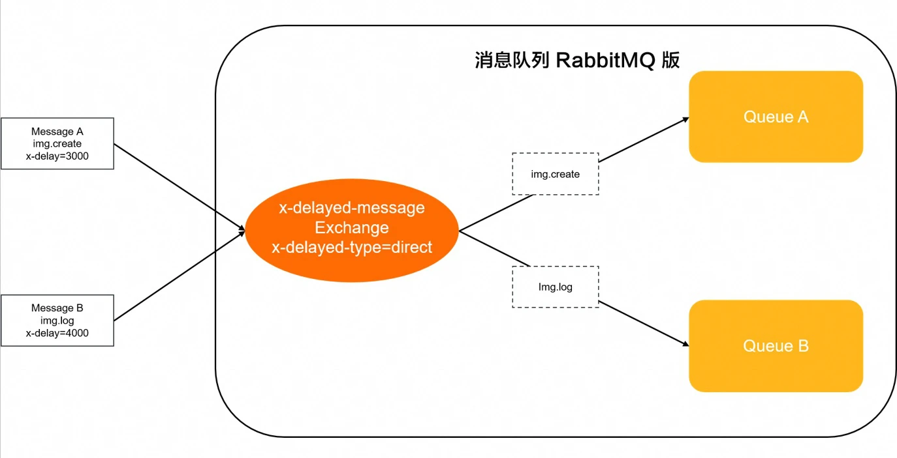

  | Message | x-delay | Routing Key | 绑定关系中的Routing Key | Queue |
  | --- | --- | --- | --- | --- |
  | Message A | 3000 | <code>img.create</code> | <code>img.create</code> | Queue A |
  | Message B | 4000 | <code>img.log</code> | <code>img.log</code> | Queue B |

  消息路由说明如下：

  - Message A到达Exchange后，x-delayed-message Exchange会在3000毫秒后将Message A投递至Queue A。

  - Message B到达Exchange后，x-delayed-message Exchange会在4000毫秒后将Message B投递至Queue B。

<a id="section-5-2"></a>

## 5.2. 消费重试策略

本文介绍消息队列RabbitMQ版服务端默认的消费重试策略，帮助您理解消费失败后的消息处理逻辑，并选择合适的消息处理策略。

**消费重试流程**

消费重试机制通过在临时性故障发生时自动重新尝试发送或处理消息，提升系统的可靠性和数据一致性。

- Ready：已在队列中等待被消费的消息。

- Unack：消费者已取走消息但未确认处理，表示消息已接收但处理未完成。

  Ready

  2.3 消费超时

  1. 客户端获取消息

     未达到最大投

  2.1 消费成功

  提交

  Unack

  2.2 消费超时/失败次数

  已达到最大投递次数

  

  是

  否

  存储到死信队列

  丢弃

**重试策略属性**

消费重试策略由两个关键属性构成：消费超时时间和最大重试次数。

消费超时时间

消费超时时间

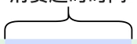


Ready

Unack

Ready

Unack

DLQ

**消费超时时间**

指消费者在接收和处理消息时允许的最大时间限制。如果消费者未能在这个时间内完成当前消息的消费，这条消息会重新变为 Ready 状态，可被其他消费者获取处理。设置合理的消费超时时间优点：

- **避免长时间挂起**：合理的消费超时时间可以防止消费者在处理消息时长时间挂起，导致其他消息堆积，影响系统的整体性能。

- **确保消息处理的可靠性**：如果一个消费者长时间无法处理某条消息，消息队列RabbitMQ版会将消息重新投递给其他消费者，确保消息能够被及时处理。

**最大投递次数**

最大投递次数（Maximum Delivery Attempt）是指系统将一条消息尝试投递给消费者的最大次数限制。设置合理的最大投递次数优点：

- **避免无限重试**：通过设置最大投递次数，避免消息无限重复投递，防止系统资源浪费。

- **故障转移**：当达到最大投递次数后，系统可以将消息转发到死信队列，后续开发人员可进行分析并处理。

> **说明**
>
> 队列的 `x-delivery-limit` 属性表示最大重投次数，最大投递次数= `x-delivery-limit+1` 。

**实例重试策略参数说明**

| 参数 | 说明 |
| --- | --- |
| 消费超时时间 | 最大值：3小时默认值：5分钟 |
| 最大投递次数 | 最大值：16默认值：16 |

<a id="section-5-3"></a>

## 5.3. 延时消息

如果您希望消息被投递后延迟一段时间被消费者消费，您可以使用消息队列RabbitMQ版的延时消息。消息队列RabbitMQ版原生支持延时消息，使用方式比开源RabbitMQ更简单。

**什么是延时消息**

延时消息是指在指定时间段之后才被消费者消费的消息。

**应用场景**

延时消息适用于以下场景：

- 对消息生产和消费有时间窗口要求的场景。例如，在电商交易中超时未支付关闭订单的场景，在订单创建时会发送一条延时消息。这条消息将会在30分钟以后投递给消费者，消费者收到此消息后需要判断对应的订单是否已完成支付。如支付未完成，则关闭订单。如已完成支付则忽略。

- 通过消息触发延时任务的场景。例如，在指定时间段之后向用户发送提醒消息。

**延时时间设置规则**

- 延时时间的值必须为非负整数。单位为毫秒。

- 若延时时间超过延时消息最大延时时间，则当作普通消息处理，即消息发送后被立即投递给消费者消费。

  

- 若您为延时消息设置了消息存活时间，则 延时消息的实际存活时间＝`min{`消息级存活时间`, Queue`级别存活时间`}`＋延时时间 。消息存活时间的具体信息，请参见消息存活时间。

**方案对比**

消息队列RabbitMQ版无需进行代码改造，即可实现开源RabbitMQ的所有延时消息方案，详情请参见下表：

| 项目 | 开源RabbitMQ | 消息队列RabbitMQ版 |
| --- | --- | --- |
| 死信Exchange+Queue的消息存活时间 | 支持 | 支持 |
| 死信Exchange+消息的消息存活时间 | 支持 | 支持 |
| 开源延时消息插件方案 | 支持 | 支持 |
| 原生延时消息方案 | 不支持 | 支持 |

**开源延时消息插件方案**

为了减少与开源RabbitMQ的差别，消息队列RabbitMQ版也基于原生的延时消息支持使用开源插件式的方式来使用延时消息，并免去插件的安装。具体使用流程如下：

1. 声明 `x-delayed-message` 类型的Exchange，并填写该Exchange的扩展参数**x-delayed-type**以指定Exchange的路由类型。示例如下：

   ```text
   Map<String, Object> args = new HashMap<String, Object>();
   args.put("x-delayed-type", "direct");
   channel.exchangeDeclare("ExchangeName", "x-delayed-message", true, false, args);
   ```

   参数说明如下：

   <table>
     <tr>
       <th width="183">参数</th>
       <th>说明</th>
     </tr>
     <tr>
       <td>x-delayed-type</td>
       <td>Exchange的类型，指定路由规则。取值说明如下：<br>• direct<br>• fanout<br>• topic<br>• headers<br>• x-jms-topic</td>
     </tr>
     <tr>
       <td>ExchangeName</td>
       <td>Exchange的名称。<br>说明请确保声明的Exchange在消息队列RabbitMQ版控制台已创建。具体步骤，请参见创建交换机。</td>
     </tr>
     <tr>
       <td>x-delayed-message</td>
       <td>指定Exchange类型，以支持投递延时消息。</td>
     </tr>
   </table>

2. 发送延时消息。在消息的**Header**属性中增加一个键为**x-delay**，值为毫秒数的键值对，并且指定发送的目标Exchange为上一步已声明的Exchange。示例如下：

   ```text
   byte[] messageBodyBytes = "delayed payload".getBytes("UTF-8");
   Map<String, Object> headers = new HashMap<String, Object>();
   headers.put("x-delay", 5000);//表示消息延时5000毫秒。
   AMQP.BasicProperties.Builder props = new 
   AMQP.BasicProperties.Builder().headers(headers);
   channel.basicPublish("ExchangeName", "", props.build(), messageBodyBytes);
   ```

**原生延时消息方案**

消息队列RabbitMQ版通过对消息设置**delay**来实现延时效果。消息队列RabbitMQ版原生延时消息的流转过程如下：

1. 生产者向Exchange发布设置了**delay**属性的消息。

2. Exchange将消息路由至Queue。

3. 在设置的**delay**时间到期后，消费者才能从Queue消费消息。

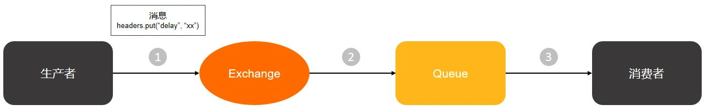

**原生延时消息最佳实践**

- 生产者客户端

  消息队列RabbitMQ版原生延时消息的使用方式非常简单。您只需要在生产者客户端发布消息时，通过**delay**为消息设置一个延时时间。

  发布延时消息的Java示例代码如下：

  ```text
  Map<String, Object> headers = new HashMap<>();
  headers.put("delay", "5000");//表示消息延时5000毫秒。
  AMQP.BasicProperties props = new 
  AMQP.BasicProperties.Builder().messageId(UUID.randomUUID().toString()).headers(headers)
  uild();
  ```

  更多语言示例代码，请参见AMQP Demos。

- 消费者客户端

  为保证延时消息时效性，建议您在消费消息时使用push模式的 `basic.consume` 方法，而不要使用pull模式的 `basic.get` 方法。因为消息队列RabbitMQ版的消息是分布式存储的，如果您使用pull模式的 `basic.get` 方法获取消息，并不能保证正好从存储的节点获取消息。

**常见问题**

**为什么实际的延时时间大于设置的延时时间？**

因为客户端使用了pull模式的basic.get方法消费消息。消息队列RabbitMQ版的消息是集群存储的，使用pull模式的basic.get方法路由到一台Broker时，可能无法及时拉取存储在其他Broker上的消息。

<a id="section-5-4"></a>

## 5.4. 死信Exchange

消息队列RabbitMQ版的死信Exchange适用于处理被消费者否定应答或重试失败的消息。本文介绍死信Exchange的核心概念、路由流程、配置方式、注意事项和更多信息。

**核心概念**

- ***死信Exchange***

  - 用于路由死信消息的Exchange。死信Exchange会根据Binding Key、死信Routing Key、Header属性将死信消息投递至死信Queue。死信Exchange可以是任何一种常见类型的Exchange，例如Direct Exchange。

- ***死信Routing Key***

  - 死信消息的路由规则。如果不设置死信消息的Routing Key，则死信消息的Routing Key默认为消息本身的Routing Key。

- ***死信消息***

  - 被重新发送到死信Exchange的消息。消息变成死信消息的可能原因如下：

    - **requeue**参数被设置为 false，消费者使用 `basic.reject` 或 `basic.nack` 否定应答（NACK）消息。

    - 消息重试次数超过16次，消息重试失败。具体信息，请参见消费重试策略。

    - 消息过期，即消息在Queue中存在的时间超过了设置的消息存活时间。具体信息，请参见消息存活时间。

- ***死信Queue***

  - 死信Exchange绑定的Queue，用于存储死信消息。

**路由流程**

死信Exchange路由死信消息的流程如下：

1. 生产者将消息发送到Exchange。

2. Exchange将消息路由到Queue。

3. 消费者从Queue拉取消息。

4. 消费者消费失败后消息重试次数超过16次依然没有成功，或者消费者没有消费消息而直接否定应答，消息变成死信消息。

5. Queue根据**x-dead-letter-exchange**将死信消息发送到死信Exchange，并根据**x-dead-letter-routing-key**为死信消息设置死信Routing Key。

6. 死信Exchange将死信消息路由到死信Queue。

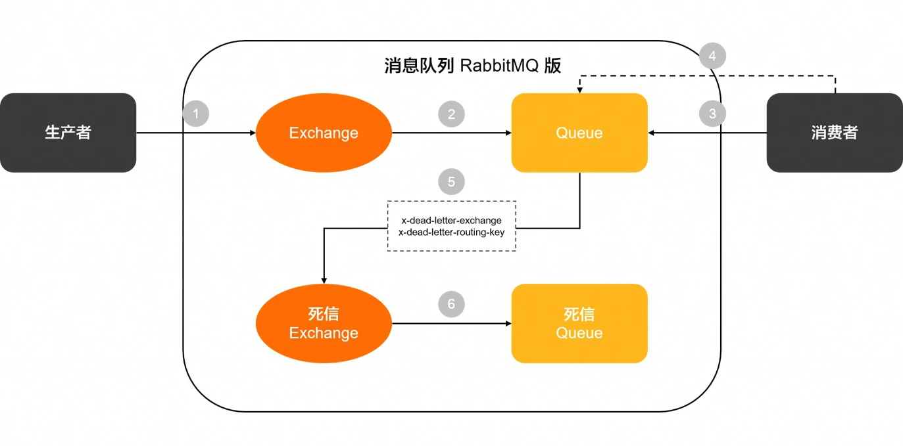

**注意事项**

- 消息队列RabbitMQ版不支持跨Vhost路由死信消息，即Queue被指定的死信Exchange必须和该Queue在同一个Vhost内。

- 消息队列RabbitMQ版不支持修改Queue的死信Exchange。如果您需要修改某个Queue的死信Exchange，您需要删除该Queue后，在重新创建时设置死信Exchange。

**配置方式**

消息队列RabbitMQ版支持以下方式配置死信Exchange：

**控制台**

您可以在云消息队列 RabbitMQ 版控制台创建Queue时，为其配置死信Exchange。具体操作请参考创建Queue。

**API**

您可以在通过API创建Queue时，为其配置死信Exchange。更多信息，请参见<strong>《RabbitMQ 开发指南》> CreateQueue</strong>。

**客户端**

您可以在消息队列RabbitMQ版客户端声明Queue时，为其配置死信Exchange。

通过**x-dead-letter-exchange**和**x-dead-letter-routing-key**设置死信消息要发送的Exchange以及死信消息的Routing Key。

例如，声明一个名称为 `some.exchange.name` 、类型为 `direct` 的Exchange，使用 **x-dead-letter-exchange**将该Exchange设置为死信Exchange，使用**x-dead-letter-routing-key**将死信消息的Routing Key设置为 `demo-routing-key` 。

Java示例代码如下：

```text
channel.exchangeDeclare("some.exchange.name", "direct");
Map<String, Object> args = new HashMap<String, Object>();
arguments.put("x-dead-letter-exchange", "some.exchange.name");
arguments.put("x-dead-letter-routing-key", "demo-routing-key");
channel.queueDeclare("MyQueue", false, false, false, arguments);
```

**死信Header**

死信消息Header中包含以下信息：

| Header | 说明 |
| --- | --- |
| x-first-death-exchange | 消息第一次成为死信时的交换机。 |
| x-first-death-queue | 消息第一次成为死信时的队列。 |
| x-first-death-reason | 消息第一次成为死信时的原因。 |
| x-death-total | 消息成为死信的次数。 |
| x-death | 包含更多关于死信的详细信息的数组。<br>• reason: 成为死信时的原因。<br>• queue: 成为死信时的队列。<br>• exchange: 成为死信时的交换机。<br>• routing-keys: 成为死信时的路由键。<br>• count: 在queue上因为reason成为死信的次数。<br>• time: 成为死信的时间。 |

消息成为死信消息的可能原因如下：

- expired：消息过期。

- nack：消息nack且requeue为false。

- reject：消息被拒绝且requeue为false。

- exceed consumer times：消费次数超限。

**更多信息**

关于如何删除死信Exchange和为死信Exchange绑定死信Queue，请参见管理交换机。

<a id="section-5-5"></a>

## 5.5. 消息存活时间

本文介绍消息队列RabbitMQ版消息存活时间的核心概念、应用场景、注意事项和设置方式。

**什么是消息存活时间**

在消息队列RabbitMQ版中，消息存活时间用于限制消息在Queue中可以存在的时间，如果消息在Queue中存在的时间超过了设置的消息存活时间，消息将会被进行如下处理：

- 若您未给Queue设置死信Exchange，消息将被Queue直接丢弃。

- 若您为Queue设置了死信Exchange，则消息被丢弃后会被转发到死信Exchange，由死信Exchange将其路由到目标Queue。您可以在目标Queue获取该消息。更多信息，请参见死信Exchange。

**应用场景**

消息存活时间可用于保障消息流通性。例如，某应用的消息在某些特定时间会剧烈增加，如果您的业务可以接受消息丢失，您可以通过设置消息存活时间丢弃堆积的消息，从而保障消息流通性。

**消息存活时间设置规则**

- 消息队列RabbitMQ版支持通过**x-message-ttl**或**expiration**设置消息存活时间，不支持通过rabbitmqctl工具的**policy**进行设置。

- 消息队列RabbitMQ版支持在创建Queue时为Queue设置消息存活时间，同时支持在消息发送时为消息设置存活时间。

  如果两个同时设置，则取最小的时间作为消息的存活时间。

  

- 延时消息的实际存活时间＝`min{`消息级存活时间`, Queue`级别存活时间`}`＋延时时间 。延时消息的具体信息，请参见延时消息。

- 消息存活时间的取值上限和实例的定时时长一致；且取值必须为非负整型数，单位为毫秒。

- 如果消息存活时间被设置为0，则消息到达Queue时，除非立即被消费者消费，否则会被立即丢弃或转发到死信Exchange。

**设置方式**

消息队列RabbitMQ版支持您通过以下方式设置消息存活时间：

- 消息队列RabbitMQ版控制台

  您可以通过消息队列RabbitMQ版控制台为指定Queue设置消息存活时间。具体操作，请参见创建Queue。

- OpenAPI Explorer

  您可以通过OpenAPI Explorer调用CreateQueue接口，为指定Queue设置消息存活时间。

- 开源RabbitMQ SDK

  您可以通过开源RabbitMQ SDK为指定Queue或某条消息设置消息存活时间。更多信息，请参见SDK列表及示例代码。示例代码如下：

  - 通过**x-message-ttl**设置队列级别的消息存活时间

    ```text
    Map<String, Object> props = new HashMap<String, Object>();
    props.put("x-message-ttl", 1000);
    channel.queueDeclare("myqueue", false, false, false, props);
    ```

  - 通过**expiration**设置消息级别的消息存活时间

    ```text
    byte[] messageBodyBytes = "test".getBytes();
    AMQP.BasicProperties properties = new AMQP.BasicProperties.Builder()
            .expiration("1000")
            .build();
    channel.basicPublish("myqueue", peoperties, messageBodyBytes);
    ```
