阿里云  
专有云  
消息队列  
RocketMQ v5.0开发指南  
产品版本：v3.18.6-SP2607  
文档版本：20260729

**目录**

- [1.快速入门](#section-1)
    - [1.1. 开发文档使用说明](#section-1-1)
    - [1.2. API调用流程说明](#section-1-2)
- [2.准备工作](#section-2)
    - [2.1. 获取API信息及其EndPoint](#section-2-1)
    - [2.2. 获取AccessKey](#section-2-2)
    - [2.3. 获取公共Header参数](#section-2-3)
    - [2.4. 获取STS AccessKey](#section-2-4)
- [3.通过POP网关调用专有云API](#section-3)
    - [3.1. 概述](#section-3-1)
    - [3.2. 调用前置](#section-3-2)
    - [3.3. Java版](#section-3-3)
- [4.API参考](#section-4)
    - [4.1. RocketMQ v5.0_API](#section-4-1)
        - [4.1.1. RocketMQ v5.0 Open API简介](#section-4-1-1)
            - [4.1.1.1. 面向用户和场景](#section-4-1-1-1)
            - [4.1.1.2. 适用场景和局限性](#section-4-1-1-2)
            - [4.1.1.3. Open API基本原理](#section-4-1-1-3)
        - [4.1.2. RocketMQ v5.0 Open API接入指南](#section-4-1-2)
            - [4.1.2.1. 公共参数设置](#section-4-1-2-1)
            - [4.1.2.2. 公共返回值解析](#section-4-1-2-2)
        - [4.1.3. RocketMQ v5.0 Open API公共术语](#section-4-1-3)
            - [4.1.3.1. 账号安全类](#section-4-1-3-1)
                - [4.1.3.1.1. AccessKey](#section-4-1-3-1-1)
                - [4.1.3.1.2. SecretKey](#section-4-1-3-1-2)
            - [4.1.3.2. RocketMQ v5.0资源管控类](#section-4-1-3-2)
                - [4.1.3.2.1. Topic](#section-4-1-3-2-1)
                - [4.1.3.2.2. Group ID（GID）](#section-4-1-3-2-2)
        - [4.1.4. RocketMQ v5.0 Open API错误码列表](#section-4-1-4)
        - [4.1.5. API详细说明](#section-4-1-5)
            - [4.1.5.1. 实例管理](#section-4-1-5-1)
                - [4.1.5.1.1. ConsoleInstanceList](#section-4-1-5-1-1)
                - [4.1.5.1.2. ConsoleClusterCreate](#section-4-1-5-1-2)
                - [4.1.5.1.3. ConsoleClusterSpecList](#section-4-1-5-1-3)
                - [4.1.5.1.4. ConsoleClusterStatus](#section-4-1-5-1-4)
                - [4.1.5.1.5. ConsoleInstanceStatistics](#section-4-1-5-1-5)
                - [4.1.5.1.6. ConsoleInstanceUpdate](#section-4-1-5-1-6)
                - [4.1.5.1.7. ConsoleInstanceBaseInfo](#section-4-1-5-1-7)
            - [4.1.5.2. Topic管理](#section-4-1-5-2)
                - [4.1.5.2.1. ConsoleTopicDelete](#section-4-1-5-2-1)
                - [4.1.5.2.2. ConsoleTopicListInPage](#section-4-1-5-2-2)
                - [4.1.5.2.3. ConsoleTopicStatus](#section-4-1-5-2-3)
                - [4.1.5.2.4. ConsoleTopicUpdateInfo](#section-4-1-5-2-4)
                - [4.1.5.2.5. ConsoleTopicUpdate](#section-4-1-5-2-5)
                - [4.1.5.2.6. ConsoleTopicSubDetail](#section-4-1-5-2-6)
                - [4.1.5.2.7. ConsoleTopicListNames](#section-4-1-5-2-7)
                - [4.1.5.2.8. ConsoleTopicList](#section-4-1-5-2-8)
                - [4.1.5.2.9. ConsoleTopicGet](#section-4-1-5-2-9)
                - [4.1.5.2.10. ConsoleTopicCreate](#section-4-1-5-2-10)
                - [4.1.5.2.11. ConsoleGroupListTopicsByGroupId](#section-4-1-5-2-11)
            - [4.1.5.3. Group管理](#section-4-1-5-3)
                - [4.1.5.3.1. ConsoleGroupListInPage](#section-4-1-5-3-1)
                - [4.1.5.3.2. ConsoleGroupUpdateInfo](#section-4-1-5-3-2)
                - [4.1.5.3.3. ConsoleGroupListGroupIds](#section-4-1-5-3-3)
                - [4.1.5.3.4. ConsoleGroupList](#section-4-1-5-3-4)
                - [4.1.5.3.5. ConsoleGroupDelete](#section-4-1-5-3-5)
                - [4.1.5.3.6. ConsoleGroupCreate](#section-4-1-5-3-6)
            - [4.1.5.4. Message管理](#section-4-1-5-4)
                - [4.1.5.4.1. ConsoleMessageGetByPagedDLQ](#section-4-1-5-4-1)
                - [4.1.5.4.2. ConsoleMessageResendByIdInDLQ](#section-4-1-5-4-2)
                - [4.1.5.4.3. ConsoleMessageDownload](#section-4-1-5-4-3)
                - [4.1.5.4.4. ConsoleMessageDownloadAllInDLQ](#section-4-1-5-4-4)
                - [4.1.5.4.5. ConsoleMessageSend](#section-4-1-5-4-5)
                - [4.1.5.4.6. ConsoleMessageTrace](#section-4-1-5-4-6)
                - [4.1.5.4.7. ConsoleMessagePush](#section-4-1-5-4-7)
                - [4.1.5.4.8. ConsoleMessageGetByPagedTopic](#section-4-1-5-4-8)
                - [4.1.5.4.9. ConsoleMessageGetByKey](#section-4-1-5-4-9)
                - [4.1.5.4.10. ConsoleMessageGetByIdInDLQ](#section-4-1-5-4-10)
                - [4.1.5.4.11. ConsoleMessageGetById](#section-4-1-5-4-11)
                - [4.1.5.4.12. ConsoleMessageDownloadBodyInDLQ](#section-4-1-5-4-12)
            - [4.1.5.5. Trace管理](#section-4-1-5-5)
                - [4.1.5.5.1. ConsoleTraceDeleteTraceQueryTask](#section-4-1-5-5-1)
                - [4.1.5.5.2. ConsoleTraceGetPubTraceByQueryId](#section-4-1-5-5-2)
                - [4.1.5.5.3. ConsoleTraceQueryByMsgId](#section-4-1-5-5-3)
                - [4.1.5.5.4. ConsoleTraceQueryByMsgTopic](#section-4-1-5-5-4)
                - [4.1.5.5.5. ConsoleTraceQueryByMsgKey](#section-4-1-5-5-5)
                - [4.1.5.5.6. ConsoleTraceListByUserIdInPage](#section-4-1-5-5-6)
                - [4.1.5.5.7. ConsoleTraceGetTraceMapByQueryId](#section-4-1-5-5-7)
            - [4.1.5.6. Consumer管理](#section-4-1-5-6)
                - [4.1.5.6.1. ConsoleConsumerGetConnection](#section-4-1-5-6-1)
                - [4.1.5.6.2. ConsoleConsumerProgress](#section-4-1-5-6-2)
                - [4.1.5.6.3. ConsoleGroupConsumerUpdate](#section-4-1-5-6-3)
                - [4.1.5.6.4. ConsoleConsumerAccumulate](#section-4-1-5-6-4)
                - [4.1.5.6.5. ConsoleConsumerTimespan](#section-4-1-5-6-5)
                - [4.1.5.6.6. ConsoleGroupSubDetail](#section-4-1-5-6-6)
                - [4.1.5.6.7. ConsoleConsumerStatus](#section-4-1-5-6-7)
                - [4.1.5.6.8. ConsoleConsumerResetOffset](#section-4-1-5-6-8)
                - [4.1.5.6.9. ConsoleConsumerJstackInfo](#section-4-1-5-6-9)
            - [4.1.5.7. Cluster管理](#section-4-1-5-7)
                - [4.1.5.7.1. ConsoleClusterGetCapacity](#section-4-1-5-7-1)
                - [4.1.5.7.2. ConsoleClusterList](#section-4-1-5-7-2)
            - [4.1.5.8. Region管理](#section-4-1-5-8)
                - [4.1.5.8.1. ConsoleRegionList](#section-4-1-5-8-1)
                - [4.1.5.8.2. ConsoleMetaData](#section-4-1-5-8-2)
                - [4.1.5.8.3. ConsoleCommonRegionData](#section-4-1-5-8-3)
            - [4.1.5.9. Connect管理](#section-4-1-5-9)
                - [4.1.5.9.1. ConsoleConnectCreate](#section-4-1-5-9-1)
                - [4.1.5.9.2. ConsoleConnectList](#section-4-1-5-9-2)
            - [4.1.5.10. Router Task管理](#section-4-1-5-10)
                - [4.1.5.10.1. ConsoleStopCloudRouterTask](#section-4-1-5-10-1)
                - [4.1.5.10.2. ConsoleStartCloudRouterTask](#section-4-1-5-10-2)
                - [4.1.5.10.3. ConsoleQueryCloudRouterTask](#section-4-1-5-10-3)
                - [4.1.5.10.4. ConsoleQueryStatsCloudRouterTask](#section-4-1-5-10-4)
                - [4.1.5.10.5. ConsoleQueryItemsCloudRouterTask](#section-4-1-5-10-5)
                - [4.1.5.10.6. ConsoleListInPageCloudRouterTask](#section-4-1-5-10-6)
                - [4.1.5.10.7. ConsoleDeleteCloudRouterTask](#section-4-1-5-10-7)
                - [4.1.5.10.8. ConsoleCreateCloudRouterTask](#section-4-1-5-10-8)
            - [4.1.5.11. CloudInfo管理](#section-4-1-5-11)
                - [4.1.5.11.1. ConsoleUpdateCloudInfo](#section-4-1-5-11-1)
                - [4.1.5.11.2. ConsoleQueryCloudInfo](#section-4-1-5-11-2)
                - [4.1.5.11.3. ConsoleDeleteCloudInfo](#section-4-1-5-11-3)
                - [4.1.5.11.4. ConsoleCreateCloudInfo](#section-4-1-5-11-4)
- [5.SDK参考](#section-5)
    - [5.1. RocketMQ v5.0_SDK](#section-5-1)
        - [5.1.1. 概述](#section-5-1-1)
        - [5.1.2. 消息模型](#section-5-1-2)
        - [5.1.3. 传输协议与字符编码](#section-5-1-3)
        - [5.1.4. 常用类及其方法](#section-5-1-4)
            - [5.1.4.1. 常量类PropertyKeyConst](#section-5-1-4-1)
            - [5.1.4.2. 工厂类ONSFactory](#section-5-1-4-2)
                - [5.1.4.2.1. createConsumer](#section-5-1-4-2-1)
                - [5.1.4.2.2. createBatchConsumer](#section-5-1-4-2-2)
                - [5.1.4.2.3. createOrderedConsumer](#section-5-1-4-2-3)
                - [5.1.4.2.4. createOrderProducer](#section-5-1-4-2-4)
                - [5.1.4.2.5. createProducer](#section-5-1-4-2-5)
                - [5.1.4.2.6. createTransactionProducer](#section-5-1-4-2-6)
            - [5.1.4.3. 消息类Message](#section-5-1-4-3)
                - [5.1.4.3.1. 消息类Message概述](#section-5-1-4-3-1)
                - [5.1.4.3.2. Message默认构造方法](#section-5-1-4-3-2)
                - [5.1.4.3.3. Message有参构造方法（一）](#section-5-1-4-3-3)
                - [5.1.4.3.4. Message有参构造方法（二）](#section-5-1-4-3-4)
                - [5.1.4.3.5. putUserProperties](#section-5-1-4-3-5)
                - [5.1.4.3.6. getUserProperties](#section-5-1-4-3-6)
                - [5.1.4.3.7. getTopic](#section-5-1-4-3-7)
                - [5.1.4.3.8. setTopic](#section-5-1-4-3-8)
                - [5.1.4.3.9. getTag](#section-5-1-4-3-9)
                - [5.1.4.3.10. setTag](#section-5-1-4-3-10)
                - [5.1.4.3.11. getKey](#section-5-1-4-3-11)
                - [5.1.4.3.12. setKey](#section-5-1-4-3-12)
                - [5.1.4.3.13. getMsgID](#section-5-1-4-3-13)
                - [5.1.4.3.14. setMsgID](#section-5-1-4-3-14)
                - [5.1.4.3.15. getReconsumeTimes](#section-5-1-4-3-15)
                - [5.1.4.3.16. setReconsumeTimes](#section-5-1-4-3-16)
                - [5.1.4.3.17. getBornTimestamp](#section-5-1-4-3-17)
                - [5.1.4.3.18. setBornTimestamp](#section-5-1-4-3-18)
                - [5.1.4.3.19. getBornHost](#section-5-1-4-3-19)
                - [5.1.4.3.20. setBornHost](#section-5-1-4-3-20)
                - [5.1.4.3.21. getStartDeliverTime](#section-5-1-4-3-21)
                - [5.1.4.3.22. setStartDeliverTime](#section-5-1-4-3-22)
                - [5.1.4.3.23. getShardingKey](#section-5-1-4-3-23)
                - [5.1.4.3.24. setShardingKey](#section-5-1-4-3-24)
            - [5.1.4.4. 异常类ONSClientException](#section-5-1-4-4)
                - [5.1.4.4.1. ONSClientException默认构造方法](#section-5-1-4-4-1)
                - [5.1.4.4.2. ONSClientException有参构造方法（一）](#section-5-1-4-4-2)
                - [5.1.4.4.3. ONSClientException有参构造方法（二）](#section-5-1-4-4-3)
                - [5.1.4.4.4. ONSClientException有参构造方法（三）](#section-5-1-4-4-4)
            - [5.1.4.5. 发送消息接口](#section-5-1-4-5)
                - [5.1.4.5.1. 发送消息接口概述](#section-5-1-4-5-1)
                - [5.1.4.5.2. 发送结果SendResult](#section-5-1-4-5-2)
                    - [5.1.4.5.2.1. SendResult默认构造方法](#section-5-1-4-5-2-1)
                    - [5.1.4.5.2.2. getMessageId](#section-5-1-4-5-2-2)
                    - [5.1.4.5.2.3. getTopic](#section-5-1-4-5-2-3)
                    - [5.1.4.5.2.4. toString](#section-5-1-4-5-2-4)
                - [5.1.4.5.3. 生产者实例Producer](#section-5-1-4-5-3)
                    - [5.1.4.5.3.1. 生产者实例Producer概述](#section-5-1-4-5-3-1)
                    - [5.1.4.5.3.2. send](#section-5-1-4-5-3-2)
                    - [5.1.4.5.3.3. sendOneway](#section-5-1-4-5-3-3)
                    - [5.1.4.5.3.4. sendAsync](#section-5-1-4-5-3-4)
                    - [5.1.4.5.3.5. isStarted](#section-5-1-4-5-3-5)
                    - [5.1.4.5.3.6. isClosed](#section-5-1-4-5-3-6)
                    - [5.1.4.5.3.7. start](#section-5-1-4-5-3-7)
                    - [5.1.4.5.3.8. shutdown](#section-5-1-4-5-3-8)
                - [5.1.4.5.4. 分布式事务消息生产者实例 TransactionProducer](#section-5-1-4-5-4)
                    - [5.1.4.5.4.1. send](#section-5-1-4-5-4-1)
                    - [5.1.4.5.4.2. isStarted](#section-5-1-4-5-4-2)
                    - [5.1.4.5.4.3. isClosed](#section-5-1-4-5-4-3)
                    - [5.1.4.5.4.4. start](#section-5-1-4-5-4-4)
                    - [5.1.4.5.4.5. shutdown](#section-5-1-4-5-4-5)
                    - [5.1.4.5.4.6. 本地事务执行器LocalTransactionExecuter](#section-5-1-4-5-4-6)
                    - [5.1.4.5.4.7. 分布式事务消息状态TransactionStatus](#section-5-1-4-5-4-7)
                - [5.1.4.5.5. 顺序消息生产者实例OrderProducer](#section-5-1-4-5-5)
                    - [5.1.4.5.5.1. send](#section-5-1-4-5-5-1)
                    - [5.1.4.5.5.2. isStarted](#section-5-1-4-5-5-2)
                    - [5.1.4.5.5.3. isClosed](#section-5-1-4-5-5-3)
                    - [5.1.4.5.5.4. start](#section-5-1-4-5-5-4)
                    - [5.1.4.5.5.5. shutdown](#section-5-1-4-5-5-5)
            - [5.1.4.6. 订阅消息接口](#section-5-1-4-6)
                - [5.1.4.6.1. 订阅消息接口概述](#section-5-1-4-6-1)
                - [5.1.4.6.2. 消费者实例Consumer](#section-5-1-4-6-2)
                    - [5.1.4.6.2.1. 消费者实例Consumer概述](#section-5-1-4-6-2-1)
                    - [5.1.4.6.2.2. subscribe](#section-5-1-4-6-2-2)
                    - [5.1.4.6.2.3. unsubscribe](#section-5-1-4-6-2-3)
                    - [5.1.4.6.2.4. isStarted](#section-5-1-4-6-2-4)
                    - [5.1.4.6.2.5. isClosed](#section-5-1-4-6-2-5)
                    - [5.1.4.6.2.6. start](#section-5-1-4-6-2-6)
                    - [5.1.4.6.2.7. shutdown](#section-5-1-4-6-2-7)
                - [5.1.4.6.3. 消息监听器MessageListener](#section-5-1-4-6-3)
                    - [5.1.4.6.3.1. 消费监听器MessageListener概述](#section-5-1-4-6-3-1)
                    - [5.1.4.6.3.2. consume](#section-5-1-4-6-3-2)
                - [5.1.4.6.4. 消息消费结果Action](#section-5-1-4-6-4)
                    - [5.1.4.6.4.1. 消息消费结果Action概述](#section-5-1-4-6-4-1)
                    - [5.1.4.6.4.2. valueOf](#section-5-1-4-6-4-2)
                    - [5.1.4.6.4.3. values](#section-5-1-4-6-4-3)
                - [5.1.4.6.5. 消费模式PropertyValueConst](#section-5-1-4-6-5)
                - [5.1.4.6.6. 顺序消费者实例OrderConsumer](#section-5-1-4-6-6)
                    - [5.1.4.6.6.1. 顺序消费者实例OrderConsumer概述](#section-5-1-4-6-6-1)
                    - [5.1.4.6.6.2. subscribe](#section-5-1-4-6-6-2)
                    - [5.1.4.6.6.3. unsubscribe](#section-5-1-4-6-6-3)
                    - [5.1.4.6.6.4. isStarted](#section-5-1-4-6-6-4)
                    - [5.1.4.6.6.5. isClosed](#section-5-1-4-6-6-5)
                    - [5.1.4.6.6.6. start](#section-5-1-4-6-6-6)
                    - [5.1.4.6.6.7. shutdown](#section-5-1-4-6-6-7)
                - [5.1.4.6.7. 消息监听器MessageOrderListener](#section-5-1-4-6-7)
                    - [5.1.4.6.7.1. 消息监听器MessageOrderListener概述](#section-5-1-4-6-7-1)
                    - [5.1.4.6.7.2. consume](#section-5-1-4-6-7-2)
                - [5.1.4.6.8. 顺序消息消费结果OrderAction](#section-5-1-4-6-8)
                    - [5.1.4.6.8.1. 顺序消息消费结果OrderAction概述](#section-5-1-4-6-8-1)
                    - [5.1.4.6.8.2. valueOf](#section-5-1-4-6-8-2)
                    - [5.1.4.6.8.3. values](#section-5-1-4-6-8-3)
                - [5.1.4.6.9. 批量消费者实例BatchConsumer](#section-5-1-4-6-9)
                    - [5.1.4.6.9.1. 批量消费者实例BatchConsumer概述](#section-5-1-4-6-9-1)
                    - [5.1.4.6.9.2. subscribe](#section-5-1-4-6-9-2)
                    - [5.1.4.6.9.3. unsubscribe](#section-5-1-4-6-9-3)
                    - [5.1.4.6.9.4. isStarted](#section-5-1-4-6-9-4)
                    - [5.1.4.6.9.5. isClosed](#section-5-1-4-6-9-5)
                    - [5.1.4.6.9.6. start](#section-5-1-4-6-9-6)
                    - [5.1.4.6.9.7. shutdown](#section-5-1-4-6-9-7)
                - [5.1.4.6.10. 批量消费消息监听器BatchMessageListener](#section-5-1-4-6-10)
                    - [5.1.4.6.10.1. 批量消费消息监听器BatchMessageListener概述](#section-5-1-4-6-10-1)
                    - [5.1.4.6.10.2. consume](#section-5-1-4-6-10-2)

<a id="section-1"></a>

# 1.快速入门

<a id="section-1-1"></a>

## 1.1. 开发文档使用说明

本文为您介绍在使用专有云API进行开发工作时，如何查看所需要的产品文档。

**使用流程**

您可以按照以下流程图中步骤，判断自己所需要使用的开发文档。


**前提条件**

通过运维人员或运营管理员已获取专有云的版本。

**操作步骤**

您可以通过阿里云专有云文档中心，获取需要的产品文档。

1. 通过浏览器打开专有云文档中心。

2. 根据专有云的版本，单击**飞天企业版**、**敏捷版&XStack**或**一体机**页签。

3. 在下拉列表中，选择对应的专有云版本。

   

4. 在左侧导航栏中，选择目标产品名称。

5. 在单击目标文档区域的**查看详情**或**下载PDF**。

<a id="section-1-2"></a>

## 1.2. API调用流程说明

本文为您介绍调用流程及可以参考的文档资料。

**流程图**

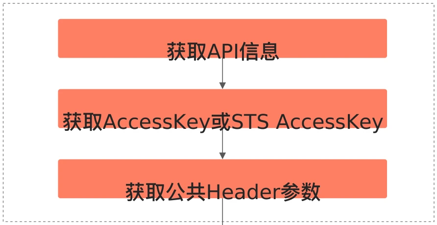


准备工

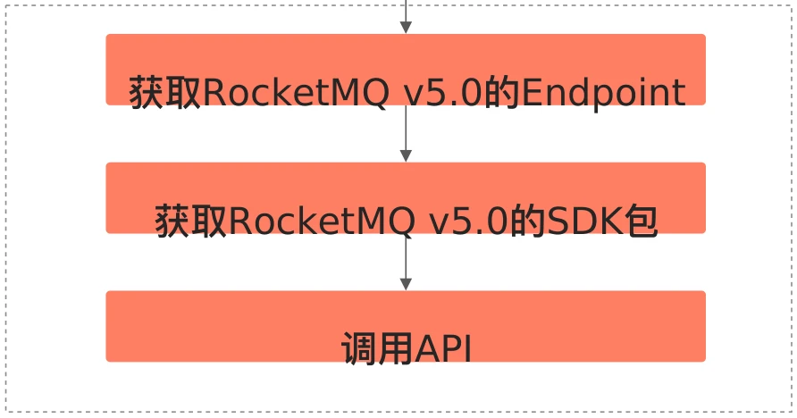


正式调

**调用步骤**

1. 获取AccessKey。

   获取调用时所需要的AccessKey参数，请参见获取AccessKey。

   > **说明**
   >
   > 推荐使用个人AccessKey调用Apsara Uni-manager运营控制台及云产品接口。

2. 获取RegionID。

   获取调用时所需要的RegionID参数，请参见获取公共Header参数。

3. 获取组织ID与资源集ID。

   获取调用时所需要的组织ID和资源集ID参数，请参见获取公共Header参数。

   > **说明**
   >
   > 调用API时，通过Header参数组织ID（&lt;x-acs-organizationid>）和资源集ID（&lt;x-acs-resourcegroupid>）指定组织和资源集，实现实例资源的隔离查询。
   >
   > - 组织ID（&lt;x-acs-organizationid>）不指定则默认获取当前用户所属的组织。
   >
   > - 资源集ID（&lt;x-acs-resourcegroupid>）不指定默认为空，如果指定资源集需要同时指定组织ID。

4. 查找API的开发文档。

   您需要查看目标云产品的开发指南，了解API的功能与使用方式，查找开发指南的方式请参见开发文档使用说明。

5. 获取云产品Endpoint。

6. 获取云产品SDK并调用云产品API。

<a id="section-2"></a>

# 2.准备工作

<a id="section-2-1"></a>

## 2.1. 获取API信息及其EndPoint

首先，您需要了解产品开放API接口的相关信息，包括产品名称（code）、开放API接口名称、API版本。

**背景信息**

Apsara Uni-manager运营控制台API目录中的API信息仅供调用参考，具体API的使用方式需要参见云产品的开发指南。如果发生不一致情况，以开发指南支持情况为准。

**操作步骤**

1. 登录Apsara Uni-manager运营控制台。

2. 在顶部菜单栏选择**产品** > **开发工具** > **API与工具** > **开发者门户**。

3. 在**开发者门户**页面，选择**API集成** > **API调试**。

   

4. 在左侧导航栏中选择目标云产品。

5. 在**版本**下拉列表中，选择目标API版本。

6. 在下方API列表中可浏览当前版本的所有API接口。

7. 选中对应接口，在参数名下获取云产品的POP Endpoint信息。

   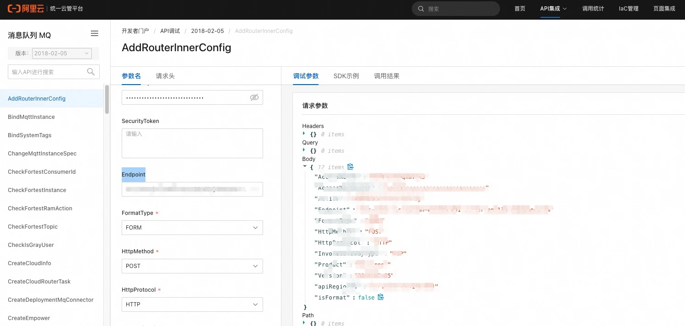

<a id="section-2-2"></a>

## 2.2. 获取AccessKey

AccessKey支持RAM和STS两种授权模式，在发起调用时选择使用其中一种AccessKey即可。本文将为您介绍如何获取通过RAM授权的AccessKey。

**背景信息**

AccessKey通过使用AccessKey ID和AccessKey Secret对称加密，实现验证某个请求发送者的身份的功能。其中AccessKey ID用于标识用户，AccessKey Secret是用户用于加密签名的字符串。

AccessKey的两种授权模式如下：

- 通过RAM授权给第三方请求者的AccessKey ID和AccessKey Secret。

- 通过STS授权给第三方请求者的AccessKey ID、AccessKey Secret和Security Token。获取方式请参见获取STS AccessKey。

Apsara Uni-manager运营控制台提供了个人AccessKey和组织AccessKey（只有运营管理员和一级组织管理员可以获取组织AccessKey），推荐使用个人账号AccessKey调用Apsara Uni-manager运营控制台及云产品相关接口。如果使用个人账号AccessKey，需要在Header中添加以下限制性参数，否则可能提示权限不足：

> **警告**
>
> 个人账号AccessKey是由Apsara Uni-manager运营控制台权限体系管控的受限AccessKey，组织AccessKey相对权限较大，需要管理员确认操作的安全性。

<table>
  <tr>
    <th width="206">参数名称</th>
    <th>描述</th>
  </tr>
  <tr>
    <td>x-acs-regionid</td>
    <td>地域，如：cn-hangzhou-*。</td>
  </tr>
  <tr>
    <td>x-acs-organizationid</td>
    <td>Apsara Uni-manager运营控制台中对应的组织ID。获取方法可参见<strong>《Apsara Uni-manager运营控制台开</strong><strong>发指南》</strong>中的<strong>《GetOrganizationList》</strong>文档。</td>
  </tr>
  <tr>
    <td>x-acs-resourcegroupid</td>
    <td>Apsara Uni-manager运营控制台中对应的资源集ID。获取方法可参见<strong>《Apsara Uni-manager运营控制台</strong><strong>开发指南》</strong>中的<strong>《ListResourceGroup》</strong>文档。</td>
  </tr>
  <tr>
    <td>x-acs-instanceid</td>
    <td>进行操作的实例ID，例如，ECS的实例ID可以从ECS列表中查询到。</td>
  </tr>
</table>

**获取个人账号AccessKey**

获取个人账号AccessKey的方法如下：

1. 登录Apsara Uni-manager运营控制台。

2. 在系统界面右上角，单击当前登录用户头像，单击**个人信息**。

3. 在**AccessKey**区域，您可以查看个人账户的AccessKey信息。

   

   > **说明**
   >
   > AccessKey ID和AccessKey Secret是您访问云资源时的密钥，具有该账号完整的权限，请您妥善保管。

**获取组织AccessKey**

获取组织AccessKey的方法如下：

1. 管理员登录Apsara Uni-manager运营控制台。

2. 在顶部菜单栏，单击**企业**。

3. 在左侧导航栏中，选择**资源管理 > 组织管理**。

4. 在组织结构中，单击目标一级组织名称。

5. 单击**管理Accesskey**。

6. 在弹出的对话框中，查看组织AccessKey信息。

<a id="section-2-3"></a>

## 2.3. 获取公共Header参数

调用API时需要提供多个Header参数。本文为您介绍如何获取这些参数。并对调用后的一些返回值做出解释。

**获取Region ID**

1. 管理员登录Apsara Uni-manager运营控制台。

2. 在顶部菜单栏中，单击**企业**。

3. 在左侧导航栏中，选择**资源管理**>**地域管理**。

4. 单击目标组织名称。

5. 在右侧**Region列表**中查看**Region名称**，即为Region ID。

**获取组织ID**

组织ID需要通过调用API方式获取，您可以在Apsara Uni-manager运营控制台中通过API在线调试功能快速获取组织ID信息。

1. 管理员登录Apsara Uni-manager运营控制台。

2. 单击顶部菜单栏**产品**，选择**开发工具** > **API与工具** > **开发者门户**。

3. 在**开发者门户**页面，选择**API集成** > **API调试**。

4. 单击  按钮，选择**云平台** > **统一云管平台**，**版本**选择**2019-05-10**。

5. 在文本框内输入 `GetOrganizationList` 进行在线调试，在name参数填写目标组织名称后发起调用，调用成功后查看**调用结果**中**id**的信息，即为组织ID。接口信息详见*Apsara Uni-manager运营控制台开发指南*中的章节*GetOrganizationList*。

**获取资源集ID**

资源集ID需要通过调用API方式获取，您可以在Apsara Uni-manager运营控制台中通过API在线调试功能快速获取资源集ID信息。

1. 管理员登录Apsara Uni-manager运营控制台。

2. 单击顶部菜单栏**产品**，选择**开发工具** > **API与工具** > **开发者门户**。

3. 在**开发者门户**页面，选择**API集成** > **API调试**。

4. 单击  按钮，选择**云平台** > **统一云管平台**，**版本**选择**2019-05-10**。

5. 在文本框内输入 `ListResourceGroup` 进行在线调试，调用成功后查看**调用结果**中**id**的信息，即为资源集ID。接口信息详见<strong>《Apsara Uni-manager运营控制台开发指南</strong><em><strong>》</strong></em>中的章节**ListResourceGroup**。

**获取实例ID**

实例ID可以通过Apsara Uni-manager运营控制台中的云产品实例列表进行获取，本文中以API网关为例，获取步骤如下：

1. 登录Apsara Uni-manager运营控制台。

2. 在顶部的菜单栏中，选择**产品** > **中间件** > **消息队列** > **消息队列 RocketMQ 版**。

3. 在左侧导航栏中，单击**v4.0**右侧的**切换**，然后在弹框中单击**确定**，将环境切换为**v5.0**。

4. 在左侧导航栏中，单击**实例列表**。

5. 在实例列表中查看**实例ID**。

**返回参数**

对于列表类的云产品资源实例接口，调用后会默认增加如下返回值。

| 名称 | 描述 |
| --- | --- |
| ResourceGroupName | 资源集名称。 |
| ResourceGroup | 资源集ID。 |
| DepartmentName | 组织名称。 |
| Department | 组织ID。 |

<a id="section-2-4"></a>

## 2.4. 获取STS AccessKey

本文为您介绍如何利用STS方式，调用专有云的产品API。

**背景信息**

阿里云临时安全令牌STS（Security Token Service）是阿里云提供的一种临时访问权限管理服务。您可以选择利用STS方式，调用专有云的产品API。

**操作步骤**

1. 获取用户角色的 `RAM Role` 。

   <ol type="i">

   <li>

   登录Apsara Uni-manager运营控制台。

   </li>

   <li>

   单击页面右上角的用户头像，选择**个人信息**。

   </li>

   <li>

   单击**查看当前角色策略**。

   在**当前选择角色策略**对话框中查看 `RAM Role` 。

   </li>

   </ol>

2. 使用以下代码，通过角色的 `RAM Role` 获得 `stsAK` 、 `stsSK` 和 `stsToken` 。

   ```java
   public static void main(String[] args) {
        ASClient asClient = new ASClient();
        // 调⽤来源说明
           asClient.setSdkSource("test");
        // 传入Arn
           String assumeRole = AssumeRole(asClient, "<RAM Role>");

           JSONObject assumeRoleJson = JSONObject.parseObject(assumeRole);

           JSONObject credentials = assumeRoleJson.getJSONObject("Credentials");

           // 获取到STS三元组
           String stsAK = credentials.getString("AccessKeyId");
           String stsSK = credentials.getString("AccessKeySecret");
           String stsToken = credentials.getString("SecurityToken");
   }

   public static String AssumeRole(ASClient asClient, String roleArn) {

           Map<String, String> headers = new HashMap<>();

           Map<String, Object> reqParams = new HashMap<>();

           reqParams.put("action", "AssumeRole");

           reqParams.put("Product", "Sts");

           reqParams.put("Version", "2015-04-01");

           reqParams.put("regionId", regionId);

        // 当前登录⽤户的ak
           reqParams.put("AccessKeyId", <当前⽤户的AccessKey ID>);
        // 当前登录⽤户的sk
           reqParams.put("AccessKeySecret", <当前⽤户的AccessKey Secret>);

           reqParams.put("roleSessionName", "StsUser");

           reqParams.put("roleArn", roleArn);

           return asClient.doRequest(endpoint, headers, reqParams);
   }
   ```

3. 通过STS可以调用云产品的接口，示例如下。

   ```java
   import com.aliyun.credentials.Client;
   import com.aliyun.credentials.models.Config;

   // 以下示例演示如何使⽤STS Token初始化凭据客户端（不包含如何获取到STS Token的过程）。
   public class DemoStsTest {
       public static void main(String[] args) {
           Config credentialConfig = new Config();
           credentialConfig.setType("sts");
           // 请替换为前⼀步获取到的STS三元组中AccessKeyI。
           credentialConfig.setAccessKeyId("your_AccessKeyId");
           // 请替换为前⼀步获取到的STS三元组中AccessKeySecret
           credentialConfig.setAccessKeySecret("your__AccessKeySecret");
           // 请替换为前⼀步获取到的STS三元组中SecurityToken
           credentialConfig.setSecurityToken("your__SecurityToken");
           Client credentialClient = new Client(credentialConfig);

           // 继续调⽤API，完整参考的API⽂档
       }
   }
   ```

<a id="section-3"></a>

# 3.通过POP网关调用专有云API

<a id="section-3-1"></a>

## 3.1. 概述

阿里云专有云与公共云一样，可通过POP网关的方式进行API调用。本文为您介绍概述情况。

**背景信息**

通过POP网关调用专有云API，可以实现对管控层资源（如实例、Topic、Group等）的增删改查等操作。平台已封装支持Java语言的SDK，您可以通过在平台中下载该SDK直接调用专有云API。

文档中SDK关于API的示例代码仅供参考，各API的完整使用步骤与参数说明请参见开发者门户SDK示例和OpenAPI文档。

**环境要求**

- 支持JDK8~JDK19

- Platform支持：Linux、Mac、Windows

**语言**

当前仅支持Java语言。

**发布历史**

**SDK版本**

| 版本号 | 发布时间 | 更新内容 |
| --- | --- | --- |
| 3.18.6 | 2026.5 | 专有云3.18.6对外API的SDK。 |

**API列表**

当前专有云企业版SDK支持的API列表。

| API名称 | 所在版本 |
| --- | --- |
| ConsoleCreateCloudInfo | 3.18.6 |
| ConsoleCreateCloudRouterTask | 3.18.6 |
| ConsoleGroupCreate | 3.18.6 |
| ConsoleClusterCreate | 3.18.6 |
| ConsoleTopicCreate | 3.18.6 |
| ConsoleDeleteCloudInfo | 3.18.6 |
| ConsoleDeleteCloudRouterTask | 3.18.6 |
| ConsoleGroupDelete | 3.18.6 |
| ConsoleTopicDelete | 3.18.6 |
| ConsoleTraceDeleteTraceQueryTask | 3.18.6 |
| ConsoleMessageDownload | 3.18.6 |
| ConsoleMessageDownloadAllInDLQ | 3.18.6 |
| ConsoleMessageDownloadBodyInDLQ | 3.18.6 |
| ConsoleListInPageCloudRouterTask | 3.18.6 |
| ConsoleGroupList | 3.18.6 |
| ConsoleTopicListInPage | 3.18.6 |
| ConsoleTraceListByUserIdInPage | 3.18.6 |
| ConsoleMessagePush | 3.18.6 |
| ConsoleConsumerAccumulate | 3.18.6 |
| ConsoleQueryCloudInfo | 3.18.6 |
| ConsoleQueryItemsCloudRouterTask | 3.18.6 |
| ConsoleQueryCloudRouterTask | 3.18.6 |
| ConsoleQueryStatsCloudRouterTask | 3.18.6 |
| ConsoleClusterGetCapacity | 3.18.6 |
| ConsoleClusterList | 3.18.6 |
| ConsoleCommonRegionData | 3.18.6 |
| ConsoleConsumerAccumulate | 3.18.6 |
| ConsoleConsumerGetConnection | 3.18.6 |
| ConsoleConsumerJstackInfo | 3.18.6 |
| ConsoleConsumerProgress | 3.18.6 |
| ConsoleConsumerStatus | 3.18.6 |
| ConsoleConsumerTimespan | 3.18.6 |
| ConsoleGroupListGroupIds | 3.18.6 |
| ConsoleGroupList | 3.18.6 |
| ConsoleGroupSubDetail | 3.18.6 |
| ConsoleInstanceBaseInfo | 3.18.6 |
| ConsoleInstanceList | 3.18.6 |
| ConsoleInstanceStatistics | 3.18.6 |
| ConsoleMessageGetById | 3.18.6 |
| ConsoleMessageGetByIdInDLQ | 3.18.6 |
| ConsoleMessageGetByKey | 3.18.6 |
| ConsoleMessageGetByPagedDLQ | 3.18.6 |
| ConsoleMessageGetByPagedTopic | 3.18.6 |
| ConsoleMetaData | 3.18.6 |
| ConsoleTraceGetPubTraceByQueryId | 3.18.6 |
| ConsoleRegionList | 3.18.6 |
| ConsoleTopicGet | 3.18.6 |
| ConsoleTopicList | 3.18.6 |
| ConsoleGroupListTopicsByGroupId | 3.18.6 |
| ConsoleTopicListNames | 3.18.6 |
| ConsoleTopicStatus | 3.18.6 |
| ConsoleTopicSubDetail | 3.18.6 |
| ConsoleTraceQueryByMsgId | 3.18.6 |
| ConsoleTraceQueryByMsgKey | 3.18.6 |
| ConsoleTraceQueryByMsgTopic | 3.18.6 |
| ConsoleTraceGetTraceMapByQueryId | 3.18.6 |
| ConsoleMessageResendByIdInDLQ | 3.18.6 |
| ConsoleConsumerResetOffset | 3.18.6 |
| ConsoleMessageSend | 3.18.6 |
| ConsoleStartCloudRouterTask | 3.18.6 |
| ConsoleStopCloudRouterTask | 3.18.6 |
| ConsoleMessageTrace | 3.18.6 |
| ConsoleUpdateCloudInfo | 3.18.6 |
| ConsoleGroupConsumerUpdate | 3.18.6 |
| ConsoleGroupUpdateInfo | 3.18.6 |
| ConsoleInstanceUpdate | 3.18.6 |
| ConsoleTopicUpdate | 3.18.6 |
| ConsoleTopicUpdateInfo | 3.18.6 |

<a id="section-3-2"></a>

## 3.2. 调用前置

阿里云专有云与公共云一样，可通过POP网关的方式进行API调用。本文为您介绍调用前需要进行的准备工作。

**背景信息**

为了使专有云保持与公共云相同的使用方式，使您拥有更方便，更一致的体验，建议通过POP网关调用专有云API。

**获取云产品的Endpoint**

**通过开发者门户获取**

1. 登录Apsara Uni-manager运营控制台。

2. 在顶部菜单栏选择**产品** > **开发工具** > **API与工具** > **开发者门户**。

3. 在**开发者门户**页面，选择**API集成** > **API调试**。

   

4. 在左侧导航栏中选择目标云产品。

5. 在**版本**下拉列表中，选择目标API版本。

6. 在下方API列表中可浏览当前版本的所有API接口。

7. 选中对应接口，在参数名下获取云产品的POP Endpoint信息。

   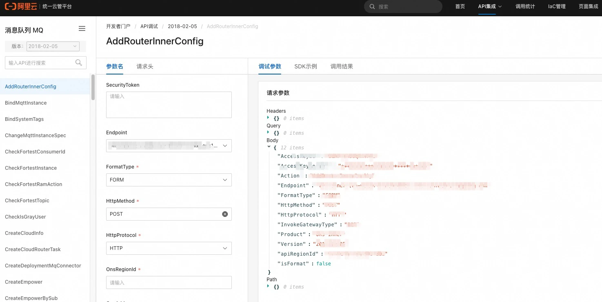

**通过飞天基础运维平台获取**

通过POP网关调用专有云API时需要使用云产品业务域的Endpoint。您可以在阿里云驻场运维工程师处获取。您也可以自行获取Endpoint，本文为您介绍获取云产品业务域Endpoint的方法。

1. 登录Apsara Uni-manager运维控制台。

2. 顶部菜单栏选择**平台运维** > **飞天基础运维平台** > **运维工具**。

3. 在左侧导航栏，选择**运维工具** > **服务注册变量大盘**。

4. 在**服务注册变量大盘**页面，单击**高级筛选**。

5. 在Service Registration文本框中输入 `ons_bizapi_endpoint` ，单击**搜索**。

   

6. 在 `mq-console` 服务的**Service Registration**列中，单击  图标。

7. 单击 `mq-console` 服务**Service Registration**列的文本信息，在弹出的**注册变量**对话框中，查看ons_bizapi_endpoint值，即 `Endpoint` 。

**获取公共参数**

通过POP网关调用专有云API过程中所使用的参数，如组织ID、资源集ID、RegionID和实例ID，获取方式请参见获取公共Header参数。

<a id="section-3-3"></a>

## 3.3. Java版

本文为您介绍通过POP网关的方式进行API调用时，高级SDK的使用示例。

**安装说明**

**开发者门户获取SDK包**

1. 登录Apsara Uni-manager运营控制台。

2. 在顶部菜单栏选择**产品** > **开发工具** > **API与工具** > **开发者门户**。

3. 在**开发者门户**页面，选择**API集成** > **SDK示例**。

   

4. 单击  按钮，选择**中间件** > **消息队列MQ**，**版本**选择**2018-02-05**。

5. 从**SDK类型**下拉列表中选择**高级版**，选择Java语言。

   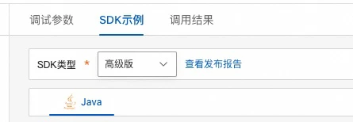

6. 下方可看到示例代码，点击**下载完整工程**以获取示例项目及SDK包。

   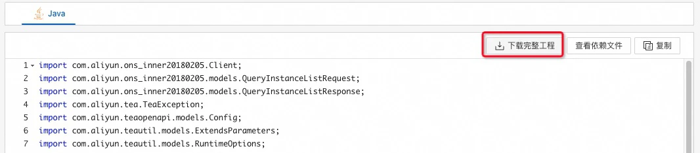

**导入SDK包**

1. 通过以下任一方式创建Maven项目。

   方式一：在IDEA中添加一个Maven项目。

   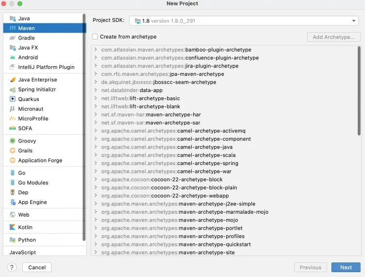

   方式二：将已有的项目转换为Maven项目。

   <ol type="i">

   <li>

   右键单击要转换的项目，并选择**Add Framework Support...**。

   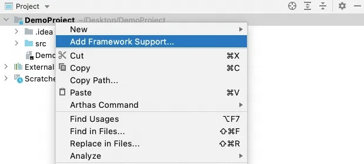

   </li>

   <li>

   选择**Maven**，并单击**OK。**

   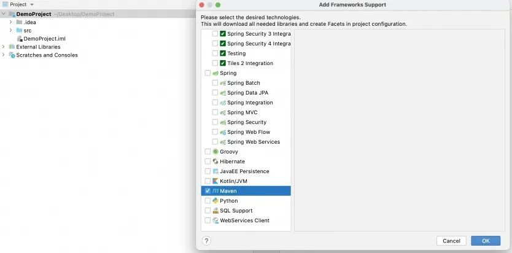

   </li>

   </ol>

2. 在项目根目录下创建lib目录，通过开发者门户获取SDK包后放入到lib目录下，如下图。

   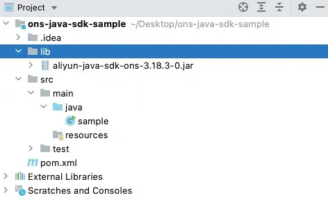

3. 在项目目录下的pom.xml中，添加Java SDK依赖。

   ```xml
   <dependencies>
       <dependency>
           <groupId>com.aliyun.apsarastack</groupId>
           <artifactId>aliyun-java-sdk-ons</artifactId>
           <version>3.18.3-0</version>
           <scope>system</scope>
           <systemPath>${project.basedir}/lib/aliyun-java-sdk-ons-3.18.3-
   0.jar</systemPath>
       </dependency>
   </dependencies>
   ```

4. 查看IDEA右侧Maven栏。

   如图所示，表示已成功导入依赖。

   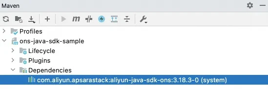

**代码示例**


示例展示了如何调用 `QueryInstanceList` API进行 查询`MQ`实例列表 请求。

```java
import com.aliyun.ons_inner20180205.Client;
import com.aliyun.ons_inner20180205.models.QueryInstanceListRequest;
import com.aliyun.ons_inner20180205.models.QueryInstanceListResponse;
import com.aliyun.tea.TeaException;
import com.aliyun.teaopenapi.models.Config;
import com.aliyun.teautil.models.ExtendsParameters;
import com.aliyun.teautil.models.RuntimeOptions;

import java.util.HashMap;
import java.util.Map;

public class sample {
    public static void main(String[] args) throws Exception {
        // 1.初始化配置对象 com.aliyun.teaopenapi.models.Config
        Config config = new Config()
                // 地域ID
                .setRegionId("<your-regionId>")
                // 您的AccessKey ID
                .setAccessKeyId("<AccessKey ID>")
                // 您的AccessKey Secret
                .setAccessKeySecret("<AccessKey Secret>")
                // ⽀持通过Config在初始化Client阶段设置请求的代理，根据实际情况替换下⾯示例。
                .setHttpProxy("http://127.0.0.1:9898");
        // 访问的域名，可以参考开发者⻔户API调试⻚⾯获取 Endpoint
        config.endpoint = "<your Endpoint>";

        // 2.实例化⼀个客户端，从 com.aliyun.ons_inner20180205.Client 类⽣成对象 client 。 后
续 request、response 从 com.aliyun.ons_inner20180205.models 中获得。
        Client client = new Client(config);

        // 3.运⾏时参数设置
        RuntimeOptions runtime = new RuntimeOptions();
        Map<String, String> headers = new HashMap<>();
        // 组织id
        headers.put("x-acs-organizationid", "<your-organizationId>");
        // 资源组id
        headers.put("x-acs-resourcegroupid", "<your-resourcegroupId>");
        // ⾓⾊id
        headers.put("x-acs-roleId", "<your-roleId>");
        runtime.setExtendsParameters(new ExtendsParameters().setHeaders(headers));
        // ⽀持通过运⾏时参数（RuntimeOptions）配置当前请求的代理，代理配置优先级：RuntimeOption
配置 > Client配置，根据需要选择⼀种即可。
        runtime.setHttpProxy("http://127.0.0.1:9898");
        runtime.ignoreSSL = true;
        runtime.setConnectTimeout(3000);
        runtime.setReadTimeout(30000);

        // 4.设置请求类 request 的参数，类的属性设置必要的信息，即 API 中必须要提供的信息可以参考具
体的API⽂档。
        QueryInstanceListRequest request = new QueryInstanceListRequest();
        // 该参数值为假设值，请您根据实际业务情况进⾏填写
        request.setNeedResourceInfo(true);
        // 该参数值为假设值，请您根据实际业务情况进⾏填写
        request.setOnsSessionId("your_value");
        // 该参数值为假设值，请您根据实际业务情况进⾏填写
        request.setOnsRegionId("your_value");
        // 该参数值为假设值，请您根据实际业务情况进⾏填写
        request.setPreventCache(System.currentTimeMillis());
        
        try{
            // 5.通过 client 对象获得对应 request 响应 response 。
            QueryInstanceListResponse response = 
client.queryInstanceListWithOptions(request, runtime);
            // 6.调⽤ response 中对应的属性获得返回的参数值，假设您需要获取 requestId ：
            String requestId = response.body.getRequestId();
            // 打印返回结果仅做示例，请您根据实际业务情况替换
            System.out.println(com.aliyun.teautil.Common.toJSONString(response));
        } catch (TeaException error) {
            // 使⽤ catch() 处理报错。
            // 此处仅做打印展示，请谨慎对待异常处理，在⼯程项⽬中切勿直接忽略异常。
            System.out.println(error.message);
        } catch (Exception _error) {
            // 使⽤ catch() 处理报错。
            TeaException error = new TeaException(_error.getMessage(), _error);
            // 此处仅做打印展示，请谨慎对待异常处理，在⼯程项⽬中切勿直接忽略异常。
            System.out.println(error.getMessage());
        }
    }
}
```

**步骤介绍**

1. 初始化配置对象com.aliyun.teaopenapi.models.Config。Config对象存放AccessKeyId、AccessKeySecret、Endpoint等配置，该配置信息参考获取AccessKey和获取API信息及其EndPoint进行获取。

   ```text
   Config config = new Config()
   // 您的AccessKey ID
   .setAccessKeyId(System.getenv("ALIBABA_CLOUD_ACCESS_KEY_ID"))
   // 您的AccessKey Secret
   .setAccessKeySecret(System.getenv("ALIBABA_CLOUD_ACCESS_KEY_SECRET"));
   // 访问的域名
   config.endpoint = "************";
   ```

2. 实例化一个客户端，从com.aliyun.ons_inner20180205.Client类生成对象client 。 后续request response从com.aliyun.ons_inner20180205.models中获得。

   ```text
   Client client = new Client(config);
   ```

3. 创建对应API的Request 。 类的命名规则为API方法名加上Request。例如：

   ```text
   QueryInstanceListRequest request = new QueryInstanceListRequest();
   ```

4. 设置请求类request的参数。 通过request类的属性设置必要的信息，即API中必须要提供的信息。

   ```text
   request.SourceRegionId = "your_value"; // 该参数值为假设值，请您根据实际情况进⾏填写
   request.RegionId = "your_value"; // 该参数值为假设值，请您根据实际情况进⾏填写
   ```

5. 通过client对象获得对应request响应response 。

   ```java
   QueryInstanceListResponse response = client.queryInstanceListWithOptions(request, runtime);
   System.out.println(new Gson().toJson(response.Body));
   ```

6. 调用response中对应的属性获得返回的参数值。 假设您需要获取requestId，例如：

   ```text
   String requestId = response.Body.requestId;
   ```

7. 使用catch()处理报错。

   ```text
   catch (Exception e) {
       e.printStackTrace();
   }
   ```

<a id="section-4"></a>

# 4.API参考

<a id="section-4-1"></a>

## 4.1. RocketMQ v5.0_API

<a id="section-4-1-1"></a>

### 4.1.1. RocketMQ v5.0 Open API简介

<a id="section-4-1-1-1"></a>

#### 4.1.1.1. 面向用户和场景

Open API是RocketMQ v5.0提供给用户的管控手段，用于实现一系列资源管理和运维功能。同生产用SDK不同，Open API主要用于管理RocketMQ v5.0相关的资源，例如Topic、Group ID等。

Open API的主要用户：

- 已经熟悉RocketMQ v5.0控制台的主要功能。

- 需要实现类似控制台的管控，存在自定义管控功能等需求。

<a id="section-4-1-1-2"></a>

#### 4.1.1.2. 适用场景和局限性

1. Open API由于其实现原理，调用端必须具备访问RocketMQ v5.0控制台域名的能力，否则无法调通。

2. Open API底层基于HTTP协议实现，性能和效率不高，仅适用于管控场景，请勿用于大批量高并发的生产场景。

<a id="section-4-1-1-3"></a>

#### 4.1.1.3. Open API基本原理

Open API底层通过HTTP接口提供服务，用户调用HTTP客户端，发出HTTP请求到RocketMQ的后端服务去执行。

用户将参数封装到每个请求中，每个请求即对应一个接口，执行的结果放在response中，请求和响应的字符编码都是采用UTF-8编码。

其中，HTTP请求的服务端地址即为控制台的域名地址。

<a id="section-4-1-2"></a>

### 4.1.2. RocketMQ v5.0 Open API接入指南

<a id="section-4-1-2-1"></a>

#### 4.1.2.1. 公共参数设置

客户端基于HTTPS方式调用RocketMQ v5.0 Open API，所有API请求都需要传入一部分公共参数，供服务端进行权限校验。

公共参数列表如下：

| 参数名称 | 类型 | 是否必须 | 说明 |
| --- | --- | --- | --- |
| _accesskey | String | 是 | 用户账号AK。 |
| __preventCache | Long | 是 | 用于CSRF校验，设置为系统当前时间即可，单位毫秒（ms）。 |
| _regionId | String | 是（获取regionId列表接口除外） | 当前Region。 |
| _signature | String | 是 | 请求的签名。 |

**_regionId**参数需要填写当前请求操作的Region，专有域和专有云情况下，默认值为mq-private。

**_signature**参数是对HTTPS请求中其他参数字段做排序后得到待签名字符串，然后使用账号的SecretKey进行签名计算得到。

**签名计算示例**

例如原始请求的HTTPS方法是：

```text
https://mq.console.${global:internet-domain}/json/topic/create
```

> **说明**
>
> 在单region部署的情况下或接入多region部署中的中心region，使用${global:internet-domain}作为访问域名；接入多region部署下的普通region，使用${global:region}.${global:internet-domain}作为访问域名

参数列表有（参数包含公共参数和每个接口自定义的参数）：

**Key_2=Value_2&Key_1=Value_1&Key_3=Value_3**

那么原始请求URL是：

```text
https://mq.console.${global:internet-domain}/json/topic/create?
Key_2=Value_2&Key_1=Value_1&Key_3=Value_3
```

将**Key_2，Key_1，Key_3**这3对参数的key按字典序排序，然后将对应的value按字符串连接。Key的排序结果为：Key_1、Key_2、Key_3，排序后其对应值的连接结果为Value1Value2Value3。此时待签名字符串就是Value1Value2Value3。

然后使用您的secretKey作为密钥，使用 HmacSHA1方法对上面的待签名字符串做签名，得到签名字符串。Hmac的算法实现，各个语言都有现成的函数库，请自行搜索。

Linux命令行的方式可以参考：

```bash
echo -n 'Value1Value2Value3' | openssl dgst -hmac '⽤户的SecretKey' -sha1 -binary | base64
```

假设最终得到的结果为：**eqweq+adwe23\*\*\*\*=**

最后，整个HTTPS请求就是（注意通过curl的方式需要将“+”替换成“%2B”，“=”替换成“%3D”，“/”替换成“%2F”，否则自动转义后会报鉴权失败）：

```text
https://mq.console.${global:internet-domain}/json/topic/create?
Key_2=Value_2&Key_1=Value_1&Key_3=Value_3&_signature= eqweq%2Badwe23****%3D
```

<a id="section-4-1-2-2"></a>

#### 4.1.2.2. 公共返回值解析

客户端发起HTTP请求到服务端，服务端处理完成后同样以HTTP响应形式返回结果，正常情况下返回结果HTTP状态码都是200，返回的内容放在Body中，为JSON字符串，需要客户端自己做JSON解析，判断是否调用成功。

JSON格式如下：

```json
 { 
    "code": 200, 
    "currentPage": 0, 
    "data": { }, 
    "dynamicCode": "", 
    "dynamicMessage": "",  
    "message": "operation success", 
    "pageSize": 0, 
    "requestId": "", 
    "status": "SUCCESS", 
    "success": true, 
    "total": 0
}     
   
```

返回值说明：

- code：状态码，200代表成功，其他都是处理失败。

- currentPage：当前请求如果是分页查询的请求，此变量代表结果所处的当前页。

- dynamicMessage：错误异常信息字符串。

- message：处理结果信息。

- pageSize：当前请求如果是分页查询的请求，此变量代表结果所处的当前页大小。

- success：是否成功。

- data：业务信息返回，String类型，也是JSON，如果当前请求的返回结果中带有业务数据，则此处需要反解JSON内容。

- RequestId：每个请求的唯一ID，String类型。

<a id="section-4-1-3"></a>

### 4.1.3. RocketMQ v5.0 Open API公共术语

<a id="section-4-1-3-1"></a>

#### 4.1.3.1. 账号安全类

<a id="section-4-1-3-1-1"></a>

##### 4.1.3.1.1. AccessKey

访问阿里云产品使用的账号的AccessKeyId，在控制台获得。调用时传入给RocketMQ v5.0后台用于身份验证，调用RocketMQ v5.0 Open API只能操作对应账号下的资源。

<a id="section-4-1-3-1-2"></a>

##### 4.1.3.1.2. SecretKey

访问阿里云产品使用的账号的AccessKeySecret，在控制台获得，调用时传入，用于计算访问请求的签名。RocketMQ v5.0后端根据对应账号比对签名实现鉴权。

<a id="section-4-1-3-2"></a>

#### 4.1.3.2. RocketMQ v5.0资源管控类

<a id="section-4-1-3-2-1"></a>

##### 4.1.3.2.1. Topic

RocketMQ v5.0产品中消息按照Topic进行分类存储，因此Topic是RocketMQ v5.0中最重要的资源之一。RocketMQ v5.0中Topic全局唯一。

<a id="section-4-1-3-2-2"></a>

##### 4.1.3.2.2. Group ID（GID）

一类Producer或Consumer，这类Producer或Consumer通常生产或消费同一类消息，且消息发布或订阅的逻辑一致。

- 对于子账号创建的消费者Group ID或存量CID，该子账号及其主账号都有使用权限。

- 对于主账号创建的消费者Group ID或存量CID，仅该主账号有使用权限，其子账号无使用权限。

<a id="section-4-1-4"></a>

### 4.1.4. RocketMQ v5.0 Open API错误码列表

RocketMQ v5.0 Open API调用成功时返回给客户端的ResponseCode=200，当出现调用失败时，会返回对应的异常错误码以及描述信息。您可以根据以下异常信息对照表查找对应的解决方法。

| 错误码 | 现象&amp;原因 | 解决方法 |
| --- | --- | --- |
| ONS_SYSTEM_ERROR | RocketMQ v5.0后端异常。 | 通过阿里云工单联系RocketMQ v5.0技术人员。 |
| ONS_SERVICE_UNSUPPORTED | 当前调用在对应的区域不支持。 | 请找RocketMQ v5.0技术支持确认该接口的开通情况。 |
| ONS_INVOKE_ERROR | Open API接口调用失败。 | 联系RocketMQ v5.0技术人员处理。 |
| BIZ_FIELD_CHECK_INVALID | 参数检验失败。 | 请参考API手册检查各个参数传入是否合法。 |
| BIZ_TOPIC_NOT_FOUND | Topic没有找到。 | 请检查Topic输入是否合法，或者是否创建过。 |
| BIZ_SUBSCRIPTION_NOT_FOUND | 目标订阅关系GID找不到。 | 请检查GID是否创建过，或者查询条件错误。 |
| BIZ_PUBLISHER_EXISTED | 指定GID已经存在。 | 更换GID的名称重试请求。 |
| BIZ_SUBSCRIPTION_EXISTED | 指定GID已经存在。 | 更换GID的名称重试请求。 |
| BIZ_CONSUMER_NOT_ONLINE | 指定GID的客户端不在线。 | 请确保消费端在线，然后重试请求。 |
| BIZ_NO_MESSAGE | 当前查询条件没有匹配消息。 | 请检查查询条件，并确认查询范围内是否发过消息。 |
| BIZ_REGION_NOT_FOUND | 请求的region找不到。 | 确认请求的Region参数是否合法。 |
| BIZ_TOPIC_EXISTED | 指定Topic已经存在。 | 更改Topic名称重试请求。 |
| BIZ_PRODUCER_ID_BELONG_TO_OTHER_US ER | 当前GID已经被其他用户占用。 | 更换GID重试请求。 |
| BIZ_CONSUMER_ID_BELONG_TO_OTHER_US ER | 当前GID已经被其他用户占用。 | 更换GID重试请求。 |
| BIZ_PUBLISH_INFO_NOT_FOUND | 请求的GID没有找到。 | 确认GID是否存在，或者请求条件错误。 |
| EMPOWER_EXIST_ERROR | 当前授权关系已经存在。 | 核实请求参数，重试或者先查询。 |
| EMPOWER_OWNER_CHECK_ERROR | 当前用户不是授权Topic的Owner。 | 确认资源所属关系。 |

<a id="section-4-1-5"></a>

### 4.1.5. API详细说明

<a id="section-4-1-5-1"></a>

#### 4.1.5.1. 实例管理

<a id="section-4-1-5-1-1"></a>

##### 4.1.5.1.1. ConsoleInstanceList

获取实例列表。

**请求头**

该接口使用公共请求头，无特殊请求头。请参见公共请求参数文档。

**请求参数**

| 参数名称 | 类型 | 位置 | 是否必选 | 示例 | 说明 |
| --- | --- | --- | --- | --- | --- |
| RegionId | Strin g | Host | 否 | cn-hangzhou | 地域ID。 |
| OnsRegio nId | Strin g | Query | 是 | region123 | Ons服务的区域标识符，用于指定资源所在的地理区域。 |
| PreventCa che | Long | Query | 是 | xxxxx | 启用防止缓存功能，确保每次请求都从服务器获取最新数据，避免使用本地缓存 |
| OnsSessio nId | Strin g | Query | 否 | abc123xyz | 表示在消息队列ONS服务中标识一次客户端会话的唯一ID，用于维护生产者或消费者的连接状态。 |
| NeedReso urceInfo | Boole an | Query | 否 | true | 是否需要资源统计信息。即实例下Topic的数量和Group的数量。 默认值：false |

**返回数据**

| 参数名称 | 类型 | 示例 | 说明 |
| --- | --- | --- | --- |
| RequestId | String | AF9A8B10-C426-530F-A0DD-96320B39\*\*\*\* | 请求ID。 |
| Success | Boolean | true | 是否成功。 |
| Code | Integer | 200 | 响应码。 |
| Message | String | success | 返回信息。 |
| Data | String | {} | 返回数据。 |

**示例**

请求示例

```text
http(s)://[Endpoint]/?Action=ConsoleInstanceList
&OnsRegionId=region123
&PreventCache=xxxxx
&公共请求参数
```

正常返回示例

`JSON`  格式

```json
{
 "RequestId":"AF9A8B10-C426-530F-A0DD-96320B39****",
 "Message":"success",
 "Data":"{}",
 "Code":200,
 "Success":true
}
```

<a id="section-4-1-5-1-2"></a>

##### 4.1.5.1.2. ConsoleClusterCreate

创建MQ实例接口。

**请求头**

该接口使用公共请求头，无特殊请求头。请参见公共请求参数文档。

**请求参数**

| 参数名称 | 类型 | 位置 | 是否必选 | 示例 | 说明 |
| --- | --- | --- | --- | --- | --- |
| RegionId | Strin g | Host | 否 | cn-wulan-env\*\*\*-d01 | 实例所属的地域ID。 |
| InstanceN ame | Strin g | Query | 是 | test_instance | 待创建的实例名称。 不填写则以实例ID作为实例名称。 |
| ResourceT ype | Strin g | Query | 是 | rmq.1xunit | 资源类型。 |
| Replicas | Strin g | Query | 是 | 4 | 实例副本数。 |
| Remark | Strin g | Query | 否 | This is the remark for test. | 实例的备注信息。 |
| TopicCapa city | Integ er | Query | 否 | 50 | 该实例下允许创建的Topic数量上限。 |
| MaxSendT ps | Long | Query | 否 | 1000 | 表示系统每秒最多可以处理1000个发送请求。 |
| MaxRecei veTps | Long | Query | 否 | 1000 | 表示系统每秒最多接收1000个事务请求 |
| Independe ntNaming | Boole an | Query | 否 | true | 实例是否有命名空间。取值说明如下：<br>• true：拥有独立命名空间，资源命名确保实例内唯一，跨实例之间可重名。：无独立命名空<br>• false间，实例内或者跨实例之间，资源命名必须全局唯一。 默认值：true |
| OnsRegio nId | Strin g | Query | 是 | region123 | Ons服务的区域标识符，用于指定资源所在的地理区域。 |
| PreventCa che | Long | Query | 否 | 1000 | 指示客户端和中间代理服务器不要缓存响应内容，强制每次请求都从服务器获取最新数据。 |

**返回数据**

| 参数名称 | 类型 | 示例 | 说明 |
| --- | --- | --- | --- |
| RequestId | String | AF9A8B10-C426-530F-A0DD-96320B39\*\*\*\* | 请求ID，每个请求的ID都是唯一的，可用于排查和定位问题。 |
| Success | Boolean | true | 执行结果是否成功。 |
| Message | String | success | 返回信息。 |
| Data | String | {} | 返回数据。 |
| Total | Long | 1 | 总数。 |
| Code | Integer | 200 | HTTP状态码或接口错误码。 |

**示例**

请求示例

```text
http(s)://[Endpoint]/?Action=ConsoleClusterCreate
&InstanceName=test_instance
&ResourceType=rmq.1xunit
&Replicas=4
&OnsRegionId=region123
&公共请求参数
```

正常返回示例

`JSON`  格式

```json
{
 "RequestId":"AF9A8B10-C426-530F-A0DD-96320B39****",
 "Message":"success",
 "Total":1,
 "Data":"{}",
 "Code":200,
 "Success":true
}
```

<a id="section-4-1-5-1-3"></a>

##### 4.1.5.1.3. ConsoleClusterSpecList

查询集群规格信息接口。

**请求头**

该接口使用公共请求头，无特殊请求头。请参见公共请求参数文档。

**请求参数**

| 参数名称 | 类型 | 位置 | 是否必选 | 示例 | 说明 |
| --- | --- | --- | --- | --- | --- |
| RegionId | Strin g | Host | 否 | cn-hangzhou | 实例所属的地域ID。 |
| OnsRegio nId | Strin g | Query | 是 | region123 | Ons服务的区域标识符，用于指定资源所在的地理区域。 |
| PreventCa che | Long | Query | 否 | 100000 | 指示客户端和中间代理服务器不要缓存响应内容，强制每次请求都从服务器获取最新数据。 |

**返回数据**

| 参数名称 | 类型 | 示例 | 说明 |
| --- | --- | --- | --- |
| RequestId | String | AF9A8B10-C426-530F-A0DD-96320B39\*\*\*\* | 请求ID，每个请求的ID都是唯一的，可用于排查和定位问题。 |
| Success | Boolean | true | 执行结果是否成功。 |
| Code | Integer | 200 | 接口状态或POP错误码。 |
| Message | String | success | 附加信息。 |
| Data | String | {} | 返回数据。 |
| Total | Long | 1 | 总数。 |

**示例**

请求示例

```text
http(s)://[Endpoint]/?Action=ConsoleClusterSpecList
&OnsRegionId=region123
&公共请求参数
```

正常返回示例

`JSON`  格式

```json
{
 "RequestId":"AF9A8B10-C426-530F-A0DD-96320B39****",
 "Message":"success",
 "Total":1,
 "Data":"{}",
 "Code":200,
 "Success":true
}
```

<a id="section-4-1-5-1-4"></a>

##### 4.1.5.1.4. ConsoleClusterStatus

查询RocketMQ v5.0实例Pod状态。

**请求头**

该接口使用公共请求头，无特殊请求头。请参见公共请求参数文档。

**请求参数**

| 参数名称 | 类型 | 位置 | 是否必选 | 示例 | 说明 |
| --- | --- | --- | --- | --- | --- |
| RegionId | Strin g | Host | 否 | cn-hangzhou | 地域ID。 |
| OnsRegio nId | Strin g | Query | 是 | region123 | Ons服务的区域标识符，用于指定消息服务的地域节点。 |
| PreventCa che | Long | Query | 否 | 10000 | 指示客户端和代理服务器不应缓存响应内容，强制每次请求都从服务器获取最新数据。 |
| InstanceId | Strin g | Query | 是 | MQ_INST_1\*\*\*\*mioMmJ0 | 待查询实例的ID。 |

**返回数据**

| 参数名称 | 类型 | 示例 | 说明 |
| --- | --- | --- | --- |
| RequestId | String | AF9A8B10-C426-530F-A0DD-96320B39\*\*\*\* | 请求ID，每个请求的ID都是唯一的，可用于排查和定位问题。 |
| Success | Boolean | true | 执行结果是否成功。 |
| Code | Integer | 200 | 接口状态或POP错误码。 |
| Message | String | success | 返回信息。 |
| Data | String | {} | 返回数据。 |
| Total | Long | 1 | 总数。 |

**示例**

请求示例

```text
http(s)://[Endpoint]/?Action=ConsoleClusterStatus
&OnsRegionId=region123
&InstanceId=MQ_INST_1****mioMmJ0
&公共请求参数
```

正常返回示例

`JSON`  格式

```json
{
 "RequestId":"AF9A8B10-C426-530F-A0DD-96320B39****",
 "Message":"success",
 "Total":1,
 "Data":"{}",
 "Code":200,
 "Success":true
}
```

<a id="section-4-1-5-1-5"></a>

##### 4.1.5.1.5. ConsoleInstanceStatistics

实例统计数据接口。

**请求头**

该接口使用公共请求头，无特殊请求头。请参见公共请求参数文档。

**请求参数**

| 参数名称 | 类型 | 位置 | 是否必选 | 示例 | 说明 |
| --- | --- | --- | --- | --- | --- |
| PreventCa che | Long | Query | 是 | 1000 | 指示客户端和中间代理服务器不要缓存响应内容，强制每次请求都从服务器获取最新数据。 |
| InstanceId | Strin g | Query | 是 | MQ_INST_13674448591 5\*\*\*_B\*\*\* | 实例的ID。 |
| EndTime | Long | Query | 否 | 1706668721 | 查询结束时间。 |
| OnsSessio nId | Strin g | Query | 否 | abc123\*\*\* | 表示在消息队列ONS服务中标识一次客户端会话的唯一ID，用于维护生产者或消费者的连接状态。 |

**返回数据**

| 参数名称 | 类型 | 示例 | 说明 |
| --- | --- | --- | --- |
| RequestId | String | AF9A8B10-C426-530F-A0DD-96320B39\*\*\*\* | 请求ID，每个请求的ID都是唯一的，可用于排查和定位问题。 |
| Success | Boolean | true | 执行结果是否成功。 |
| Code | Integer | 200 | 接口状态或POP错误码。 |
| Message | String | success | 返回信息。 |
| Data | String | {} | 返回数据。 |

**示例**

请求示例

```text
http(s)://[Endpoint]/?Action=ConsoleInstanceStatistics
&PreventCache=1000
&InstanceId=MQ_INST_136744485915***_B***
&公共请求参数
```

正常返回示例

`JSON`  格式

```json
{
 "RequestId":"AF9A8B10-C426-530F-A0DD-96320B39****",
 "Message":"success",
 "Data":"{}",
 "Code":200,
 "Success":true
}
```

<a id="section-4-1-5-1-6"></a>

##### 4.1.5.1.6. ConsoleInstanceUpdate

更新实例信息。

**请求头**

该接口使用公共请求头，无特殊请求头。请参见公共请求参数文档。

**请求参数**

| 参数名称 | 类型 | 位置 | 是否必选 | 示例 | 说明 |
| --- | --- | --- | --- | --- | --- |
| RegionId | Strin g | Host | 否 | cn-hangzhou | 地域ID。 |
| OnsRegio nId | Strin g | Query | 是 | region123 | Ons服务的区域标识符，用于指定资源所在的地理区域。 |
| PreventCa che | Long | Query | 是 | xxxx | 启用防止缓存功能，确保每次请求都从服务器获取最新数据而非使用本地缓存。 |
| InstanceId | Strin g | Query | 是 | MQ_INST_13674448591 5\*\*\*_B\*\*\* | 实例的ID。 |
| InstanceN ame | Strin g | Query | 否 | test_instance | 实例名称。 |
| Remark | Strin g | Query | 否 | This is the remark for test. | 备注。 |
| TopicCapa city | Integ er | Query | 否 | 50 | 该实例下允许创建的Topic数量上限。 |
| MaxSendT ps | Long | Query | 否 | 1000 | 表示系统每秒最多可以处理1000个发送请求。 |
| MaxRecei veTps | Long | Query | 否 | 1000 | 表示系统每秒最多接收1000个事务请求 |

**返回数据**

| 参数名称 | 类型 | 示例 | 说明 |
| --- | --- | --- | --- |
| RequestId | String | AF9A8B10-C426-530F-A0DD-96320B39\*\*\*\* | 请求ID，每个请求的ID都是唯一的，可用于排查和定位问题。 |
| Success | Boolean | true | 执行结果是否成功。 |
| Code | Integer | 200 | 响应码。 |
| Message | String | success | 返回信息。 |
| Data | String | {} | 返回数据。 |

**示例**

请求示例

```text
http(s)://[Endpoint]/?Action=ConsoleInstanceUpdate
&OnsRegionId=region123
&PreventCache=xxxx
&InstanceId=MQ_INST_136744485915***_B***
&公共请求参数
```

正常返回示例

`JSON`  格式

```json
{
 "RequestId":"AF9A8B10-C426-530F-A0DD-96320B39****",
 "Message":"success",
 "Data":"{}",
 "Code":200,
 "Success":true
}
```

<a id="section-4-1-5-1-7"></a>

##### 4.1.5.1.7. ConsoleInstanceBaseInfo

查询实例详情。

**请求头**

该接口使用公共请求头，无特殊请求头。请参见公共请求参数文档。

**请求参数**

| 参数名称 | 类型 | 位置 | 是否必选 | 示例 | 说明 |
| --- | --- | --- | --- | --- | --- |
| RegionId | Strin g | Host | 否 | cn-hangzhou | 地域ID。 |
| OnsRegio nId | Strin g | Query | 是 | region123 | Ons服务的区域标识符，用于指定资源所在的地理区域。 |
| PreventCa che | Long | Query | 是 | xxxx | 启用防止缓存功能，确保每次请求都从服务器获取最新数据，避免使用本地缓存。 |
| InstanceId | Strin g | Query | 是 | MQ_INST_13674448591 5\*\*\*_B\*\*\* | 实例的ID。 |
| OnsSessio nId | Strin g | Query | 否 | abc123xyz | 表示在消息队列ONS服务中标识一次客户端会话的唯一ID，用于维护生产者或消费者的连接状态。 |

**返回数据**

| 参数名称 | 类型 | 示例 | 说明 |
| --- | --- | --- | --- |
| RequestId | String | AF9A8B10-C426-530F-A0DD-96320B39\*\*\*\* | 请求ID，每个请求的ID都是唯一的，可用于排查和定位问题。 |
| Success | Boolean | true | 执行结果是否成功。 |
| Code | Integer | 200 | 响应码。 |
| Message | String | success | 返回信息。 |
| Data | String | {} | 返回数据。 |

**示例**

请求示例

```text
http(s)://[Endpoint]/?Action=ConsoleInstanceBaseInfo
&OnsRegionId=region123
&PreventCache=xxxx
&InstanceId=MQ_INST_136744485915***_B***
&公共请求参数
```

正常返回示例

`JSON`  格式

```json
{
 "RequestId":"AF9A8B10-C426-530F-A0DD-96320B39****",
 "Message":"success",
 "Data":"{}",
 "Code":200,
 "Success":true
}
```

<a id="section-4-1-5-2"></a>

#### 4.1.5.2. Topic管理

<a id="section-4-1-5-2-1"></a>

##### 4.1.5.2.1. ConsoleTopicDelete

删除Topic。

**请求头**

该接口使用公共请求头，无特殊请求头。请参见公共请求参数文档。

**请求参数**

| 参数名称 | 类型 | 位置 | 是否必选 | 示例 | 说明 |
| --- | --- | --- | --- | --- | --- |
| RegionId | Strin g | Host | 否 | cn-hangzhou | 地域ID。 |
| OnsRegio nId | Strin g | Query | 是 | region123 | Ons服务的区域标识符，用于指定资源所在的地理区域。 |
| PreventCa che | Long | Query | 是 | xxx | 启用防止缓存功能，确保每次请求都从服务器获取最新数据，避免使用本地缓存。 |
| InstanceId | Strin g | Query | 否 | MQ_INST_13674448591 5\*\*\*_B\*\*\* | 实例的ID。 |
| Topic | Strin g | Query | 是 | test | Topic名称。 |

**返回数据**

| 参数名称 | 类型 | 示例 | 说明 |
| --- | --- | --- | --- |
| RequestId | String | AF9A8B10-C426-530F-A0DD-96320B39\*\*\*\* | 请求ID。 |
| Success | Boolean | true | 是否成功 |
| Code | Integer | 200 | 响应码。 |
| Message | String | success | 返回信息。 |
| Data | String | {} | 返回数据。 |

**示例**

请求示例

```text
http(s)://[Endpoint]/?Action=ConsoleTopicDelete
&OnsRegionId=region123
&PreventCache=xxx
&Topic=test
&公共请求参数
```

正常返回示例

`JSON`  格式

```json
{
 "RequestId":"AF9A8B10-C426-530F-A0DD-96320B39****",
 "Message":"success",
 "Data":"{}",
 "Code":200,
 "Success":true
}
```

<a id="section-4-1-5-2-2"></a>

##### 4.1.5.2.2. ConsoleTopicListInPage

分页获取Topic信息列表。

**请求头**

该接口使用公共请求头，无特殊请求头。请参见公共请求参数文档。

**请求参数**

| 参数名称 | 类型 | 位置 | 是否必选 | 示例 | 说明 |
| --- | --- | --- | --- | --- | --- |
| RegionId | Strin g | Host | 否 | cn-hangzhou | 地域ID。 |
| OnsRegio nId | Strin g | Query | 是 | region123 | Ons服务的区域标识符，用于指定资源所在的地理区域。 |
| PreventCa che | Long | Query | 是 | xxxx | 启用防止缓存功能，确保每次请求都从服务器获取最新数据，避免使用本地缓存。 |
| InstanceId | Strin g | Query | 否 | MQ_INST_15243\*\*\*\*\*\*3_BmioMmJ0 | 实例的ID。 |
| CurrentPa ge | Integ er | Query | 否 | 1 | 当前页的页码。 |
| PageSize | Integ er | Query | 否 | 10 | 分页大小，每页最多显示的返回结果数量。 取值范围：10~200。 若您设置的参数值小于10，则系统默认按照参数值为10处理；若您设置的参数值大于200，则系统默认按照参数值为200处理。 |
| Search | Strin g | Query | 否 | test | 搜索关键字。 |
| OnsSessio nId | Strin g | Query | 否 | abc123xyz | 表示在消息队列ONS服务中标识一次客户端会话的唯一ID，用于维护生产者或消费者的连接状态。 |

**返回数据**

| 参数名称 | 类型 | 示例 | 说明 |
| --- | --- | --- | --- |
| RequestId | String | AF9A8B10-C426-530F-A0DD-96320B39\*\*\*\* | 请求ID。 |
| Success | Boolean | true | 执行结果是否成功。 |
| Code | Integer | 200 | 响应码。 |
| Message | String | success | 返回信息。 |
| Data | String | {} | 返回数据。 |
| Total | Long | 1 | 总数。 |

**示例**

请求示例

```text
http(s)://[Endpoint]/?Action=ConsoleTopicListInPage
&OnsRegionId=cn-wulan-env188-d01
&PreventCache=xxxx
&公共请求参数
```

正常返回示例

`JSON`  格式

```json
{
 "RequestId":"AF9A8B10-C426-530F-A0DD-96320B39****",
 "Message":"success",
 "Total":1,
 "Data":"{}",
 "Code":200,
 "Success":true
}
```

<a id="section-4-1-5-2-3"></a>

##### 4.1.5.2.3. ConsoleTopicStatus

查询指定 Topic 的队列级别统计信息。

**请求头**

该接口使用公共请求头，无特殊请求头。请参见公共请求参数文档。

**请求参数**

| 参数名称 | 类型 | 位置 | 是否必选 | 示例 | 说明 |
| --- | --- | --- | --- | --- | --- |
| RegionId | Strin g | Host | 否 | cn-hangzhou | 地域ID。 |
| OnsRegio nId | Strin g | Query | 是 | region123 | Ons服务的区域标识符，用于指定资源所在的地理区域。 |
| PreventCa che | Long | Query | 是 | xxxx | 启用防止缓存功能，确保每次请求都从服务器获取最新数据，避免使用本地缓存。 |
| InstanceId | Strin g | Query | 否 | MQ_INST_13674448591 5\*\*\*_B\*\*\* | 实例的ID。 |
| Topic | Strin g | Query | 是 | test-mq_topic | Topic名称。 |

**返回数据**

| 参数名称 | 类型 | 示例 | 说明 |
| --- | --- | --- | --- |
| RequestId | String | AF9A8B10-C426-530F-A0DD-96320B39\*\*\*\* | 请求ID。 |
| Success | Boolean | true | 执行结果是否成功。 |
| Code | Integer | 200 | 响应码。 |
| Message | String | success | 返回信息。 |
| Data | String | {} | 返回数据。 |
| Total | Long | 1 | 总数。 |

**示例**

请求示例

```text
http(s)://[Endpoint]/?Action=ConsoleTopicStatus
&OnsRegionId=region123
&PreventCache=xxxx
&Topic=test-mq_topic
&公共请求参数
```

正常返回示例

`JSON`  格式

```json
{
 "RequestId":"AF9A8B10-C426-530F-A0DD-96320B39****",
 "Message":"success",
 "Total":1,
 "Data":"{}",
 "Code":200,
 "Success":true
}
```

<a id="section-4-1-5-2-4"></a>

##### 4.1.5.2.4. ConsoleTopicUpdateInfo

更新Topic信息。

**请求头**

该接口使用公共请求头，无特殊请求头。请参见公共请求参数文档。

**请求参数**

| 参数名称 | 类型 | 位置 | 是否必选 | 示例 | 说明 |
| --- | --- | --- | --- | --- | --- |
| RegionId | Strin g | Host | 否 | cn-hangzhou | 地域ID。 |
| OnsRegio nId | Strin g | Query | 是 | region123 | Ons服务的区域标识符，用于指定资源所在的地理区域。 |
| PreventCa che | Long | Query | 是 | xxx | 启用防止缓存功能，确保每次请求都从服务器获取最新数据，避免使用本地缓存。 |
| InstanceId | Strin g | Query | 是 | MQ_INST_13\*\*\*\*\*3_Bmio MmJ0 | 实例的ID。 |
| Topic | Strin g | Query | 是 | test-mq_topic | Topic名称。 |
| Remark | Strin g | Query | 是 | xxxx | 备注。 |

**返回数据**

| 参数名称 | 类型 | 示例 | 说明 |
| --- | --- | --- | --- |
| RequestId | String | AF9A8B10-C426-530F-A0DD-96320B39\*\*\*\* | 请求ID，每个请求的ID都是唯一的，可用于排查和定位问题。 |
| Success | Boolean | true | 执行结果是否成功。 |
| Code | Integer | 200 | 响应码。 |
| Message | String | success | 返回信息。 |
| Data | String | {} | 返回数据。 |
| Total | Long | 1 | 总数。 |

**示例**

请求示例

```text
http(s)://[Endpoint]/?Action=ConsoleTopicUpdateInfo
&OnsRegionId=region123
&PreventCache=xxx
&InstanceId=MQ_INST_13*****3_BmioMmJ0
&Topic=test-mq_topic
&Remark=xxxx
&公共请求参数
```

正常返回示例

`JSON`  格式

```json
{
 "RequestId":"AF9A8B10-C426-530F-A0DD-96320B39****",
 "Message":"success",
 "Total":1,
 "Data":"{}",
 "Code":200,
 "Success":true
}
```

<a id="section-4-1-5-2-5"></a>

##### 4.1.5.2.5. ConsoleTopicUpdate

更新Topic信息。

**请求头**

该接口使用公共请求头，无特殊请求头。请参见公共请求参数文档。

**请求参数**

| 参数名称 | 类型 | 位置 | 是否必选 | 示例 | 说明 |
| --- | --- | --- | --- | --- | --- |
| RegionId | Strin g | Host | 否 | cn-hangzhou | 地域ID。 |
| OnsRegio nId | Strin g | Query | 是 | region123 | Ons服务的区域标识符，用于指定资源所在的地理区域。 |
| PreventCa che | Long | Query | 是 | xxxxxx | 启用防止缓存功能，确保每次请求都从服务器获取最新数据，避免使用本地缓存。 |
| InstanceId | Strin g | Query | 否 | MQ_INST_13\*\*\*\*\*BmioM mJ0 | 实例的ID。 |
| Topic | Strin g | Query | 是 | test-topic | Topic名称。 |
| Perm | Integ er | Query | 否 | 6 | 设置该 Topic 的读写模式。取值说明：<br>• 6：同时支持读写。<br>• 4：禁写。<br>• 2：禁读。 |
| UnitFlag | Boole an | Query | 否 | unitA | 单元隔离开关。 |

**返回数据**

| 参数名称 | 类型 | 示例 | 说明 |
| --- | --- | --- | --- |
| RequestId | String | AF9A8B10-C426-530F-A0DD-96320B39\*\*\*\* | 请求ID，每个请求的ID都是唯一的，可用于排查和定位问题。 |
| Success | Boolean | true | 执行结果是否成功。 |
| Code | Integer | 200 | 响应码。 |
| Message | String | success | 返回信息。 |
| Data | String | {} | 返回数据。 |
| Total | Long | 1 | 总数。 |

**示例**

请求示例

```text
http(s)://[Endpoint]/?Action=ConsoleTopicUpdate
&OnsRegionId=region123
&PreventCache=xxxxxx
&Topic=test-topic  
&公共请求参数
```

正常返回示例

`JSON`  格式

```json
{
 "RequestId":"AF9A8B10-C426-530F-A0DD-96320B39****",
 "Message":"success",
 "Total":1,
 "Data":"{}",
 "Code":200,
 "Success":true
}
```

<a id="section-4-1-5-2-6"></a>

##### 4.1.5.2.6. ConsoleTopicSubDetail

获取Topic下的订阅者信息。

**请求头**

该接口使用公共请求头，无特殊请求头。请参见公共请求参数文档。

**请求参数**

| 参数名称 | 类型 | 位置 | 是否必选 | 示例 | 说明 |
| --- | --- | --- | --- | --- | --- |
| RegionId | Strin g | Host | 否 | cn-hangzhou | 地域ID。 |
| OnsRegio nId | Strin g | Query | 是 | region123 | Ons服务的区域标识符，用于指定资源所在的地理区域。 |
| PreventCa che | Long | Query | 是 | xxxx | 启用防止缓存功能，确保每次请求都从服务器获取最新数据，避免使用本地缓存的旧资源。 |
| InstanceId | Strin g | Query | 是 | MQ_INST_136\*\*\*\*\*33_B mioMmJ0 | 实例的ID。 |
| Topic | Strin g | Query | 是 | test-topic | Topic名称。 |
| OnsSessio nId | Strin g | Query | 否 | abc123xyz | 表示在消息队列ONS服务中标识一次客户端会话的唯一ID，用于维护生产者或消费者的连接状态。 |

**返回数据**

| 参数名称 | 类型 | 示例 | 说明 |
| --- | --- | --- | --- |
| RequestId | String | AF9A8B10-C426-530F-A0DD-96320B39\*\*\*\* | 请求ID，每个请求的ID都是唯一的，可用于排查和定位问题。 |
| Success | Boolean | true | 执行结果是否成功。 |
| Code | Integer | 200 | 响应码。 |
| Message | String | success | 返回信息。 |
| Data | String | {} | 返回数据。 |

**示例**

请求示例

```text
http(s)://[Endpoint]/?Action=ConsoleTopicSubDetail
&OnsRegionId=region123
&PreventCache=xxxx
&InstanceId=MQ_INST_136*****33_BmioMmJ0
&Topic=test-topic  
&公共请求参数
```

正常返回示例

`JSON`  格式

```json
{
 "RequestId":"AF9A8B10-C426-530F-A0DD-96320B39****",
 "Message":"success",
 "Data":"{}",
 "Code":200,
 "Success":true
}
```

<a id="section-4-1-5-2-7"></a>

##### 4.1.5.2.7. ConsoleTopicListNames

获取Topic名称集合。

**请求头**

该接口使用公共请求头，无特殊请求头。请参见公共请求参数文档。

**请求参数**

| 参数名称 | 类型 | 位置 | 是否必选 | 示例 | 说明 |
| --- | --- | --- | --- | --- | --- |
| RegionId | Strin g | Host | 否 | cn-hangzhou | 地域ID。 |
| OnsRegio nId | Strin g | Query | 是 | region123 | Ons服务的区域标识符，用于指定资源所在的地理区域。 |
| PreventCa che | Long | Query | 是 | xxxx | 启用防止缓存功能，确保每次请求都从服务器获取最新数据，避免使用本地缓存的旧资源。 |
| InstanceId | Strin g | Query | 否 | MQ_INST_1\*\*\*\*_BmioMm J0 | 实例的ID。 |
| OnsSessio nId | Strin g | Query | 否 | abc123xyz | 表示在消息队列ONS服务中标识一次客户端会话的唯一ID，用于维护生产者或消费者的连接状态。 |

**返回数据**

| 参数名称 | 类型 | 示例 | 说明 |
| --- | --- | --- | --- |
| RequestId | String | AF9A8B10-C426-530F-A0DD-96320B39\*\*\*\* | 请求ID，每个请求的ID都是唯一的，可用于排查和定位问题。 |
| Success | Boolean | true | 执行结果是否成功。 |
| Code | Integer | 200 | 响应码。 |
| Message | String | success | 返回信息。 |
| Data | String | {} | 返回数据。 |

**示例**

请求示例

```text
http(s)://[Endpoint]/?Action=ConsoleTopicListNames
&OnsRegionId=region123
&PreventCache=xxxx
&公共请求参数
```

正常返回示例

`JSON`  格式

```json
{
 "RequestId":"AF9A8B10-C426-530F-A0DD-96320B39****",
 "Message":"success",
 "Data":"{}",
 "Code":200,
 "Success":true
}
```

<a id="section-4-1-5-2-8"></a>

##### 4.1.5.2.8. ConsoleTopicList

获取Topic列表。

**请求头**

该接口使用公共请求头，无特殊请求头。请参见公共请求参数文档。

**请求参数**

| 参数名称 | 类型 | 位置 | 是否必选 | 示例 | 说明 |
| --- | --- | --- | --- | --- | --- |
| RegionId | Strin g | Host | 否 | cn-hangzhou | 地域ID。 |
| OnsRegio nId | Strin g | Query | 是 | region123 | Ons服务的区域标识符，用于指定资源所在的地理区域。 |
| PreventCa che | Long | Query | 是 | xxxx | 启用防止缓存功能，确保每次请求都从服务器获取最新数据，避免使用本地缓存。 |
| InstanceId | Strin g | Query | 否 | MQ_INST_13674448591 5\*\*\*_B\*\*\* | 实例的ID。 |
| Topic | Strin g | Query | 否 | test-topic | Topic名称。 |

**返回数据**

| 参数名称 | 类型 | 示例 | 说明 |
| --- | --- | --- | --- |
| RequestId | String | AF9A8B10-C426-530F-A0DD-96320B39\*\*\*\* | 请求ID。 |
| Success | Boolean | true | 执行结果是否成功。 |
| Code | Integer | 200 | 响应码。 |
| Message | String | success | 返回信息。 |
| Data | String | {} | 返回数据。 |
| Total | Long | 1 | 总数。 |

**示例**

请求示例

```text
http(s)://[Endpoint]/?Action=ConsoleTopicList
&OnsRegionId=region123
&PreventCache=xxxx
&公共请求参数
```

正常返回示例

`JSON`  格式

```json
{
 "RequestId":"AF9A8B10-C426-530F-A0DD-96320B39****",
 "Message":"success",
 "Total":1,
 "Data":"{}",
 "Code":200,
 "Success":true
}
```

<a id="section-4-1-5-2-9"></a>

##### 4.1.5.2.9. ConsoleTopicGet

查询Topic信息列表。

**请求头**

该接口使用公共请求头，无特殊请求头。请参见公共请求参数文档。

**请求参数**

| 参数名称 | 类型 | 位置 | 是否必选 | 示例 | 说明 |
| --- | --- | --- | --- | --- | --- |
| RegionId | Strin g | Host | 否 | cn-hangzhou | 地域ID。 |
| OnsRegio nId | Strin g | Query | 是 | region123 | Ons服务的区域标识符，用于指定资源所在的地理区域。 |
| PreventCa che | Long | Query | 是 | xxxxx | 启用防止缓存功能，确保每次请求都从服务器获取最新数据，避免使用本地缓存。 |
| InstanceId | Strin g | Query | 否 | MQ_INST_13674448591 5\*\*\*_B\*\*\* | 实例的ID。 |
| Topic | Strin g | Query | 否 | test-topic | Topic名称。 |

**返回数据**

| 参数名称 | 类型 | 示例 | 说明 |
| --- | --- | --- | --- |
| RequestId | String | AF9A8B10-C426-530F-A0DD-96320B39\*\*\*\* | 请求ID，每个请求的ID都是唯一的，可用于排查和定位问题。 |
| Success | Boolean | true | 执行结果是否成功。 |
| Code | Integer | 200 | 响应码。 |
| Message | String | success | 返回信息。 |
| Data | String | {} | 返回数据。 |
| Total | Long | 1 | 总数。 |

**示例**

请求示例

```text
http(s)://[Endpoint]/?Action=ConsoleTopicGet
&OnsRegionId=region123
&PreventCache=xxxxx
&公共请求参数
```

正常返回示例

`JSON`  格式

```json
{
 "RequestId":"AF9A8B10-C426-530F-A0DD-96320B39****",
 "Message":"success",
 "Total":1,
 "Data":"{}",
 "Code":200,
 "Success":true
}
```

<a id="section-4-1-5-2-10"></a>

##### 4.1.5.2.10. ConsoleTopicCreate

创建Topic。

**请求头**

该接口使用公共请求头，无特殊请求头。请参见公共请求参数文档。

**请求参数**

| 参数名称 | 类型 | 位置 | 是否必选 | 示例 | 说明 |
| --- | --- | --- | --- | --- | --- |
| RegionId | Strin g | Host | 否 | cn-hangzhou | 地域ID。 |
| OnsRegio nId | Strin g | Query | 是 | region123 | Ons服务的区域标识符，用于指定资源所在的地理区域。 |
| PreventCa che | Long | Query | 是 | xxxxx | 启用防止缓存功能，确保每次请求都从服务器获取最新数据，避免使用本地缓存。 |
| InstanceId | Strin g | Query | 否 | MQ_INST_13674448591 5\*\*\*_B\*\*\* | 实例的ID。 |
| Topic | Strin g | Query | 是 | test-topic | Topic名称。 |
| OrderType | Integ er | Query | 否 | 0 | 消息类型。<br>• 0：普通消息。<br>• 1：分区顺序消息。<br>• 4：事务消息。<br>• 5：定时/延时消息。 |
| Remark | Strin g | Query | 否 | xxxxx | 备注。 |

**返回数据**

| 参数名称 | 类型 | 示例 | 说明 |
| --- | --- | --- | --- |
| RequestId | String | AF9A8B10-C426-530F-A0DD-96320B39\*\*\*\* | 请求ID，每个请求的ID都是唯一的，可用于排查和定位问题。 |
| Success | Boolean | true | 执行结果是否成功。 |
| Code | Integer | 200 | 响应码。 |
| Message | String | success | 返回信息。 |
| Data | String | {} | 返回数据。 |

**示例**

请求示例

```text
http(s)://[Endpoint]/?Action=ConsoleTopicCreate
&OnsRegionId=region123
&PreventCache=xxxxx
&Topic=test-topic  
&公共请求参数
```

正常返回示例

`JSON`  格式

```json
{
 "RequestId":"AF9A8B10-C426-530F-A0DD-96320B39****",
 "Message":"success",
 "Data":"{}",
 "Code":200,
 "Success":true
}
```

<a id="section-4-1-5-2-11"></a>

##### 4.1.5.2.11. ConsoleGroupListTopicsByGroupId

查询消费者组订阅的Topic列表。

**请求头**

该接口使用公共请求头，无特殊请求头。请参见公共请求参数文档。

**请求参数**

| 参数名称 | 类型 | 位置 | 是否必选 | 示例 | 说明 |
| --- | --- | --- | --- | --- | --- |
| RegionId | Strin g | Host | 否 | cn-hangzhou | 地域ID。 |
| OnsRegio nId | Strin g | Query | 是 | region123 | Ons服务的区域标识符，用于指定资源所在的地理区域。 |
| PreventCa che | Long | Query | 是 | xxxx | 启用防止缓存功能，确保每次请求都从服务器获取最新数据，避免使用本地缓存。 |
| InstanceId | Strin g | Query | 是 | MQ_INST_13674448591 5\*\*\*_B\*\*\* | 实例的ID。 |
| GroupId | Strin g | Query | 是 | GID_test | 消息组ID。 |
| OnsSessio nId | Strin g | Query | 否 | abc123xyz | 表示在消息队列ONS服务中标识一次客户端会话的唯一ID，用于维护生产者或消费者的连接状态。 |

**返回数据**

| 参数名称 | 类型 | 示例 | 说明 |
| --- | --- | --- | --- |
| RequestId | String | AF9A8B10-C426-530F-A0DD-96320B39\*\*\*\* | 请求ID，每个请求的ID都是唯一的，可用于排查和定位问题。 |
| Success | Boolean | true | 执行结果是否成功。 |
| Code | Integer | 200 | 响应码。 |
| Message | String | success | 返回信息。 |
| Data | String | {} | 返回数据。 |
| Total | Long | 1 | 总数。 |

**示例**

请求示例

```text
http(s)://[Endpoint]/?Action=ConsoleGroupListTopicsByGroupId
&OnsRegionId=region123
&PreventCache=xxxx
&InstanceId=MQ_INST_136744485915***_B***
&GroupId=GID_test
&公共请求参数
```

正常返回示例

`JSON`  格式

```json
{
 "RequestId":"AF9A8B10-C426-530F-A0DD-96320B39****",
 "Message":"success",
 "Total":1,
 "Data":"{}",
 "Code":200,
 "Success":true
}
```

<a id="section-4-1-5-3"></a>

#### 4.1.5.3. Group管理

<a id="section-4-1-5-3-1"></a>

##### 4.1.5.3.1. ConsoleGroupListInPage

分页查询订阅组信息。

**请求头**

该接口使用公共请求头，无特殊请求头。请参见公共请求参数文档。

**请求参数**

| 参数名称 | 类型 | 位置 | 是否必选 | 示例 | 说明 |
| --- | --- | --- | --- | --- | --- |
| RegionId | Strin g | Host | 否 | cn-hangzhou | 地域ID。 |
| OnsRegio nId | Strin g | Query | 是 | region123 | Ons服务的区域标识符，用于指定资源所在的地理区域。 |
| PreventCa che | Long | Query | 是 | xxxx | 启用防止缓存功能，确保每次请求都从服务器获取最新数据，避免使用本地缓存。 |
| InstanceId | Strin g | Query | 是 | MQ_INST_13674448591 5\*\*\*_B\*\*\* | 实例的ID。 |
| CurrentPa ge | Integ er | Query | 否 | 1 | 当前页的页码。 |
| PageSize | Integ er | Query | 否 | 10 | 分页大小，每页最多显示的返回结果数量。取值范围：10~200。若您设置的参数值小于10，则系统默认按照参数值为10处理；若您设置的参数值大于200，则系统默认按照参数值为200处理。 |
| GroupTyp e | Strin g | Query | 否 | 0 | Group类型。 |
| Search | Strin g | Query | 否 | test | 搜索关键字。 |
| OnsSessio nId | Strin g | Query | 否 | abc123xyz | 表示在消息队列ONS服务中标识一次客户端会话的唯一ID，用于维护生产者或消费者的连接状态。 |

**返回数据**

| 参数名称 | 类型 | 示例 | 说明 |
| --- | --- | --- | --- |
| RequestId | String | AF9A8B10-C426-530F-A0DD-96320B39\*\*\*\* | 请求ID，每个请求的ID都是唯一的，可用于排查和定位问题。 |
| Success | Boolean | true | 执行结果是否成功。 |
| Code | Integer | 200 | 响应码。 |
| Message | String | success | 返回信息。 |
| Data | String | {} | 返回数据。 |
| Total | Long | 1 | 总数。 |

**示例**

请求示例

```text
http(s)://[Endpoint]/?Action=ConsoleGroupListInPage
&OnsRegionId=cn-wulan-env188-d01
&PreventCache=xxxx
&InstanceId=MQ_INST_1367444859152433_BmioMmJ0
&公共请求参数
```

正常返回示例

`JSON`  格式

```json
{
 "RequestId":"AF9A8B10-C426-530F-A0DD-96320B39****",
 "Message":"success",
 "Total":1,
 "Data":"{}",
 "Code":200,
 "Success":true
}
```

<a id="section-4-1-5-3-2"></a>

##### 4.1.5.3.2. ConsoleGroupUpdateInfo

更新订阅组信息。

**请求头**

该接口使用公共请求头，无特殊请求头。请参见公共请求参数文档。

**请求参数**

| 参数名称 | 类型 | 位置 | 是否必选 | 示例 | 说明 |
| --- | --- | --- | --- | --- | --- |
| RegionId | Strin g | Host | 否 | cn-hangzhou | 地域ID。 |
| OnsRegio nId | Strin g | Query | 是 | region123 | Ons服务的区域标识符，用于指定资源所在的地理区域。 |
| PreventCa che | Long | Query | 是 | xxxx | 启用防止缓存功能，确保每次请求都从服务器获取最新数据，避免使用本地缓存。 |
| InstanceId | Strin g | Query | 否 | MQ_INST_13674448591 5\*\*\*_B\*\*\* | 实例的ID。 |
| GroupId | Strin g | Query | 是 | GID_test | 消息组ID。 |
| Remark | Strin g | Query | 是 | This is the remark for test. | 备注。 |

**返回数据**

| 参数名称 | 类型 | 示例 | 说明 |
| --- | --- | --- | --- |
| RequestId | String | AF9A8B10-C426-530F-A0DD-96320B39\*\*\*\* | 请求ID，每个请求的ID都是唯一的，可用于排查和定位问题。 |
| Success | Boolean | true | 执行结果是否成功。 |
| Code | Integer | 200 | 响应码。 |
| Message | String | success | 返回信息。 |
| Data | String | {} | 返回数据。 |
| Total | Long | 1 | 总数。 |

**示例**

请求示例

```text
http(s)://[Endpoint]/?Action=ConsoleGroupUpdateInfo
&OnsRegionId=region123
&PreventCache=xxxx
&GroupId=GID_test
&Remark=This is the remark for test.
&公共请求参数
```

正常返回示例

`JSON`  格式

```json
{
 "RequestId":"AF9A8B10-C426-530F-A0DD-96320B39****",
 "Message":"success",
 "Total":1,
 "Data":"{}",
 "Code":200,
 "Success":true
}
```

<a id="section-4-1-5-3-3"></a>

##### 4.1.5.3.3. ConsoleGroupListGroupIds

获取GroupIds。

**请求头**

该接口使用公共请求头，无特殊请求头。请参见公共请求参数文档。

**请求参数**

| 参数名称 | 类型 | 位置 | 是否必选 | 示例 | 说明 |
| --- | --- | --- | --- | --- | --- |
| RegionId | Strin g | Host | 否 | cn-hangzhou | 地域ID。 |
| OnsRegio nId | Strin g | Query | 是 | region123 | Ons服务的区域标识符，用于指定资源所在的地理区域。 |
| PreventCa che | Long | Query | 是 | xxxx | 启用防止缓存功能，确保每次请求都从服务器获取最新数据，避免使用本地缓存。 |
| InstanceId | Strin g | Query | 是 | MQ_INST_13674448591 5\*\*\*_B\*\*\* | 实例的ID。 |
| OnsSessio nId | Strin g | Query | 否 | abc123xyz | 表示在消息队列ONS服务中标识一次客户端会话的唯一ID，用于维护生产者或消费者的连接状态。 |

**返回数据**

| 参数名称 | 类型 | 示例 | 说明 |
| --- | --- | --- | --- |
| RequestId | String | AF9A8B10-C426-530F-A0DD-96320B39\*\*\*\* | 请求ID，每个请求的ID都是唯一的，可用于排查和定位问题。 |
| Success | Boolean | true | 执行结果是否成功。 |
| Code | Integer | 200 | 响应码。 |
| Message | String | success | 返回信息。 |
| Data | String | {} | 返回数据。 |
| Total | Long | 1 | 总数。 |

**示例**

请求示例

```text
http(s)://[Endpoint]/?Action=ConsoleGroupListGroupIds
&OnsRegionId=region123
&PreventCache=xxxx
&InstanceId=MQ_INST_136744485915***_B***
&公共请求参数
```

正常返回示例

`JSON`  格式

```json
{
 "RequestId":"AF9A8B10-C426-530F-A0DD-96320B39****",
 "Message":"success",
 "Total":1,
 "Data":"{}",
 "Code":200,
 "Success":true
}
```

<a id="section-4-1-5-3-4"></a>

##### 4.1.5.3.4. ConsoleGroupList

查询消费组列表

**请求头**

该接口使用公共请求头，无特殊请求头。请参见公共请求参数文档。

**请求参数**

| 参数名称 | 类型 | 位置 | 是否必选 | 示例 | 说明 |
| --- | --- | --- | --- | --- | --- |
| RegionId | Strin g | Host | 否 | cn-hangzhou | 地域ID。 |
| OnsRegio nId | Strin g | Query | 是 | region123 | Ons服务的区域标识符，用于指定资源所在的地理区域。 |
| PreventCa che | Long | Query | 是 | xxxx | 启用防止缓存功能，确保每次请求都从服务器获取最新数据，避免使用本地缓存。 |
| InstanceId | Strin g | Query | 否 | MQ_INST_13674448591 5\*\*\*_B\*\*\* | 实例的ID。 |
| GroupId | Strin g | Query | 否 | GID_test | 消息组ID。 |
| GroupTyp e | Strin g | Query | 否 | 0 | Group类型。 |

**返回数据**

| 参数名称 | 类型 | 示例 | 说明 |
| --- | --- | --- | --- |
| RequestId | String | AF9A8B10-C426-530F-A0DD-96320B39\*\*\*\* | 请求ID，每个请求的ID都是唯一的，可用于排查和定位问题。 |
| Success | Boolean | true | 执行结果是否成功。 |
| Code | Integer | 200 | 响应码。 |
| Message | String | success | 返回信息。 |
| Data | String | {} | 返回数据。 |
| Total | Long | 1 | 总数。 |

**示例**

请求示例

```text
http(s)://[Endpoint]/?Action=ConsoleGroupList
&OnsRegionId=region123
&PreventCache=xxxx
&公共请求参数
```

正常返回示例

`JSON`  格式

```json
{
 "RequestId":"AF9A8B10-C426-530F-A0DD-96320B39****",
 "Message":"success",
 "Total":1,
 "Data":"{}",
 "Code":200,
 "Success":true
}
```

<a id="section-4-1-5-3-5"></a>

##### 4.1.5.3.5. ConsoleGroupDelete

删除消费者组。

**请求头**

该接口使用公共请求头，无特殊请求头。请参见公共请求参数文档。

**请求参数**

| 参数名称 | 类型 | 位置 | 是否必选 | 示例 | 说明 |
| --- | --- | --- | --- | --- | --- |
| RegionId | Strin g | Host | 否 | cn-hangzhou | 地域ID。 |
| OnsRegio nId | Strin g | Query | 是 | region123 | Ons服务的区域标识符，用于指定资源所在的地理区域。 |
| PreventCa che | Long | Query | 是 | xxxxx | 启用防止缓存功能，确保每次请求都从服务器获取最新数据，避免使用本地缓存。 |
| InstanceId | Strin g | Query | 是 | MQ_INST_13674448591 5\*\*\*_B\*\*\* | 实例的ID。 |
| GroupId | Strin g | Query | 是 | GID_test | 消息组ID。 |

**返回数据**

| 参数名称 | 类型 | 示例 | 说明 |
| --- | --- | --- | --- |
| RequestId | String | AF9A8B10-C426-530F-A0DD-96320B39\*\*\*\* | 请求ID。 |
| Success | Boolean | true | 执行结果是否成功。 |
| Code | Integer | 200 | 响应码。 |
| Message | String | success | 返回信息。 |
| Data | String | {} | 返回数据。 |
| Total | Long | 1 | 总数。 |

**示例**

请求示例

```text
http(s)://[Endpoint]/?Action=ConsoleGroupDelete
&OnsRegionId=region123
&PreventCache=xxxxx
&InstanceId=MQ_INST_136744485915***_B***
&GroupId=GID_test
&公共请求参数
```

正常返回示例

`JSON`  格式

```json
{
 "RequestId":"AF9A8B10-C426-530F-A0DD-96320B39****",
 "Message":"success",
 "Total":1,
 "Data":"{}",
 "Code":200,
 "Success":true
}
```

<a id="section-4-1-5-3-6"></a>

##### 4.1.5.3.6. ConsoleGroupCreate

创建消费者组。

**请求头**

该接口使用公共请求头，无特殊请求头。请参见公共请求参数文档。

**请求参数**

| 参数名称 | 类型 | 位置 | 是否必选 | 示例 | 说明 |
| --- | --- | --- | --- | --- | --- |
| RegionId | Strin g | Host | 否 | cn-hangzhou | 地域ID。 |
| OnsRegio nId | Strin g | Query | 是 | region123 | Ons服务的区域标识符，用于指定资源所在的地理区域。 |
| PreventCa che | Long | Query | 是 | xxxx | 启用防止缓存功能，确保每次请求都从服务器获取最新数据，避免使用本地缓存。 |
| InstanceId | Strin g | Query | 否 | MQ_INST_13674448591 5\*\*\*_B\*\*\* | 实例的ID。 |
| GroupId | Strin g | Query | 是 | GID_test | 消息组ID。 |
| GroupTyp e | Strin g | Query | 否 | 0 | Group类型。 |
| Remark | Strin g | Query | 否 | This is the remark for test. | 备注。 |

**返回数据**

| 参数名称 | 类型 | 示例 | 说明 |
| --- | --- | --- | --- |
| RequestId | String | AF9A8B10-C426-530F-A0DD-96320B39\*\*\*\* | 请求ID，每个请求的ID都是唯一的，可用于排查和定位问题。 |
| Success | Boolean | true | 执行结果是否成功。 |
| Code | Integer | 200 | 响应码。 |
| Message | String | success | 返回信息。 |
| Data | String | {} | 返回数据。 |
| Total | Long | 1 | 总数。 |

**示例**

请求示例

```text
http(s)://[Endpoint]/?Action=ConsoleGroupCreate
&OnsRegionId=region123
&PreventCache=xxxx
&GroupId=GID_test
&公共请求参数
```

正常返回示例

`JSON`  格式

```json
{
 "RequestId":"AF9A8B10-C426-530F-A0DD-96320B39****",
 "Message":"success",
 "Total":1,
 "Data":"{}",
 "Code":200,
 "Success":true
}
```

<a id="section-4-1-5-4"></a>

#### 4.1.5.4. Message管理

<a id="section-4-1-5-4-1"></a>

##### 4.1.5.4.1. ConsoleMessageGetByPagedDLQ

分页查询死信消息接口。

**请求头**

该接口使用公共请求头，无特殊请求头。请参见公共请求参数文档。

**请求参数**

| 参数名称 | 类型 | 位置 | 是否必选 | 示例 | 说明 |
| --- | --- | --- | --- | --- | --- |
| RegionId | Strin g | Host | 否 | cn-hangzhou | 实例所属的地域ID。 |
| OnsRegio nId | Strin g | Query | 是 | cn-hangzhou-01 | Ons服务的区域标识符，用于指定消息服务的地域节点。 |
| PreventCa che | Long | Query | 是 | 1000 | 指示客户端和中间代理服务器不要缓存响应内容，强制每次请求都从服务器获取最新数据。 |
| InstanceId | Strin g | Query | 是 | MQ_INST_13674448591 5\*\*\*_B\*\*\* | 实例的ID。 |
| GroupId | Strin g | Query | 是 | GID_test | 消费者组ID。 |
| TaskId | Strin g | Query | 否 | ev-c5566dc90a718042e40a cfa07e29e\*\*\*\* | 任务ID。 |
| CurrentPa ge | Integ er | Query | 否 | 1 | 当前页的页码。 |
| PageSize | Integ er | Query | 否 | 10 | 分页大小，每页最多显示的返回结果数量。取值范围：10~200。若您设置的参数值小于10，则系统默认按照参数值为10处理；若您设置的参数值大于200，则系统默认按照参数值为200处理。 |
| BeginTime | Long | Query | 否 | 1570852800000 | 开始时间。 |
| EndTime | Long | Query | 否 | 1703575552000 | 结束时间。 |
| OnsSessio nId | Strin g | Query | 否 | abc123xyz | 表示在消息队列ONS服务中标识一次客户端会话的唯一ID，用于维护生产者或消费者的连接状态。 |

**返回数据**

| 参数名称 | 类型 | 示例 | 说明 |
| --- | --- | --- | --- |
| RequestId | String | AF9A8B10-C426-530F-A0DD-96320B39\*\*\*\* | 请求ID，每个请求的ID都是唯一的，可用于排查和定位问题。 |
| Success | Boolean | true | 执行结果是否成功。 |
| Code | Integer | 200 | 接口状态或POP错误码。 |
| Message | String | success | 返回信息。 |
| Data | String | {} | 返回数据。 |
| Total | Long | 1 | 返回数据总数 |

<a id="section-4-1-5-4-2"></a>

##### 4.1.5.4.2. ConsoleMessageResendByIdInDLQ

死信消息重推接口。

**请求头**

该接口使用公共请求头，无特殊请求头。请参见公共请求参数文档。

**请求参数**

| 参数名称 | 类型 | 位置 | 是否必选 | 示例 | 说明 |
| --- | --- | --- | --- | --- | --- |
| RegionId | Strin g | Host | 否 | cn-hangzhou | 地域ID。 |
| OnsRegio nId | Strin g | Query | 是 | cn-hangzhou-01 | Ons服务的区域标识符，用于指定消息服务的地域节点。 |
| PreventCa che | Long | Query | 是 | 1000 | 指示客户端和代理服务器不要缓存响应内容，强制每次请求都从服务器获取最新数据 |
| InstanceId | Strin g | Query | 是 | MQ_INST_13674448591 5\*\*\*_B\*\*\* | 实例的ID。 |
| GroupId | Strin g | Query | 是 | GID_test | 消费者组ID。 |
| MsgId | Strin g | Query | 是 | 0BC16699165C03B925D B8A404E2D\*\*\*\* | 消息ID。 |

**返回数据**

| 参数名称 | 类型 | 示例 | 说明 |
| --- | --- | --- | --- |
| RequestId | String | C7F94090-3358-506A-97DC-34BC803C\*\*\*\* | 请求ID，每个请求的ID都是唯一的，可用于排查和定位问题。 |
| Success | Boolean | true | 执行结果是否成功。 |
| Code | Integer | 200 | 接口状态或POP错误码。 |
| Message | String | success | 返回信息。 |
| Data | String | {} | 返回数据。 |
| Total | Long | 1 | 总数。 |

<a id="section-4-1-5-4-3"></a>

##### 4.1.5.4.3. ConsoleMessageDownload

下载消息。

**请求头**

该接口使用公共请求头，无特殊请求头。请参见公共请求参数文档。

**请求参数**

| 参数名称 | 类型 | 位置 | 是否必选 | 示例 | 说明 |
| --- | --- | --- | --- | --- | --- |
| RegionId | Strin g | Host | 否 | cn-hangzhou | 地域ID。 |
| OnsRegio nId | Strin g | Query | 是 | region123 | Ons服务的区域标识符，用于指定资源所在的地理区域。 |
| PreventCa che | Long | Query | 是 | xxxxx | 启用防止缓存功能，确保每次请求都从服务器获取最新数据而非使用本地缓存。 |
| InstanceId | Strin g | Query | 是 | MQ_INST_13674448591 5\*\*\*_B\*\*\* | 实例的ID。 |
| Topic | Strin g | Query | 是 | test-topic | Topic名称。 |
| MsgId | Strin g | Query | 是 | 0BC16699165C03B925D B8A404E2D\*\*\*\* | 消息ID。 |
| OnsSessio nId | Strin g | Query | 否 | abc123xyz | 表示在消息队列ONS服务中标识一次客户端会话的唯一ID，用于维护生产者或消费者的连接状态。 |

**返回数据**

| 参数名称 | 类型 | 示例 | 说明 |
| --- | --- | --- | --- |
| RequestId | String | AF9A8B10-C426-530F-A0DD-96320B39\*\*\*\* | 请求ID，每个请求的ID都是唯一的，可用于排查和定位问题。 |
| Success | Boolean | true | 执行结果是否成功。 |
| Code | Integer | 200 | 响应码。 |
| Message | String | success | 返回信息。 |
| Data | String | {} | 返回数据。 |

**示例**

`JSON`  格式

```json
{
 "RequestId":"AF9A8B10-C426-530F-A0DD-96320B39****",
 "Message":"success",
 "Data":"{}",
 "Code":200,
 "Success":true
}
```

<a id="section-4-1-5-4-4"></a>

##### 4.1.5.4.4. ConsoleMessageDownloadAllInDLQ

下载死信队列中的消息。

**请求头**

该接口使用公共请求头，无特殊请求头。请参见公共请求参数文档。

**请求参数**

| 参数名称 | 类型 | 位置 | 是否必选 | 示例 | 说明 |
| --- | --- | --- | --- | --- | --- |
| RegionId | Strin g | Host | 否 | cn-hangzhou | 地域ID。 |
| OnsRegio nId | Strin g | Query | 是 | region123 | Ons服务的区域标识符，用于指定资源所在的地理区域。 |
| PreventCa che | Long | Query | 是 | xxxxx | 启用防止缓存功能，确保每次请求都从服务器获取最新数据而非使用本地缓存。 |
| InstanceId | Strin g | Query | 是 | MQ_INST_13674448591 5\*\*\*_B\*\*\* | 实例ID。 |
| GroupId | Strin g | Query | 是 | GID_test | 消息组ID。 |
| MsgId | Strin g | Query | 是 | 1E0578FE110F18B4AAC 235C05F2\*\*\*\*\* | 消息ID。 |
| OnsSessio nId | Strin g | Query | 否 | abc123xyz | 表示在消息队列ONS服务中标识一次客户端会话的唯一ID，用于维护生产者或消费者的连接状态。 |

**返回数据**

| 参数名称 | 类型 | 示例 | 说明 |
| --- | --- | --- | --- |
| RequestId | String | AF9A8B10-C426-530F-A0DD-96320B39\*\*\*\* | 请求ID，每个请求的ID都是唯一的，可用于排查和定位问题。 |
| Success | Boolean | true | 执行结果是否成功。 |
| Code | Integer | 200 | 接口状态或POP错误码。 |
| Message | String | success | 返回信息。 |
| Data | String | {} | 返回数据。 |
| Total | Long | 1 | 返回数据总数 |

**示例**

请求示例

```text
http(s)://[Endpoint]/?Action=ConsoleMessageDownloadAllInDLQ
&OnsRegionId=region123
&PreventCache=xxxxx
&InstanceId=MQ_INST_136744485915***_B***
&GroupId=GID_test
&MsgId=1E0578FE110F18B4AAC235C05F2*****
&公共请求参数
```

正常返回示例

`JSON`  格式

```json
{
 "RequestId":"AF9A8B10-C426-530F-A0DD-96320B39****",
 "Message":"success",
 "Total":1,
 "Data":"{}",
 "Code":200,
 "Success":true
}
```

<a id="section-4-1-5-4-5"></a>

##### 4.1.5.4.5. ConsoleMessageSend

消息发送。

**请求头**

该接口使用公共请求头，无特殊请求头。请参见公共请求参数文档。

**请求参数**

| 参数名称 | 类型 | 位置 | 是否必选 | 示例 | 说明 |
| --- | --- | --- | --- | --- | --- |
| RegionId | Strin g | Host | 否 | cn-hangzhou | 地域ID。 |
| OnsRegio nId | Strin g | Query | 是 | region123 | Ons服务的区域标识符，用于指定资源所在的地理区域。 |
| PreventCa che | Long | Query | 是 | xxxx | 启用防止缓存功能，确保每次请求都从服务器获取最新数据，避免使用本地缓存。 |
| InstanceId | Strin g | Query | 否 | MQ_INST_13674448591 5\*\*\*_B\*\*\* | 实例的ID。 |
| Topic | Strin g | Query | 是 | test-topic | Topic名称。 |
| Tag | Strin g | Query | 否 | 标签1 | 标签。 |
| Key | Strin g | Query | 否 | TestKey | 消息key |
| Message | Strin g | Query | 是 | xxxx | 消息内容。 |

**返回数据**

| 参数名称 | 类型 | 示例 | 说明 |
| --- | --- | --- | --- |
| RequestId | String | AF9A8B10-C426-530F-A0DD-96320B39\*\*\*\* | 请求ID，每个请求的ID都是唯一的，可用于排查和定位问题。 |
| Success | Boolean | true | 执行结果是否成功。 |
| Code | Integer | 200 | 响应码。 |
| Message | String | success | 返回信息。 |
| Data | String | {} | 返回数据。 |

**示例**

请求示例

```text
http(s)://[Endpoint]/?Action=ConsoleMessageSend
&OnsRegionId=region123
&PreventCache=xxxx
&Topic=test-topic  
&Message=xxxx
&公共请求参数
```

正常返回示例

`JSON`  格式

```json
{
 "RequestId":"AF9A8B10-C426-530F-A0DD-96320B39****",
 "Message":"success",
 "Data":"{}",
 "Code":200,
 "Success":true
}
```

<a id="section-4-1-5-4-6"></a>

##### 4.1.5.4.6. ConsoleMessageTrace

查询消息轨迹。

**请求头**

该接口使用公共请求头，无特殊请求头。请参见公共请求参数文档。

**请求参数**

| 参数名称 | 类型 | 位置 | 是否必选 | 示例 | 说明 |
| --- | --- | --- | --- | --- | --- |
| RegionId | Strin g | Host | 否 | cn-hangzhou | 地域ID。 |
| OnsRegio nId | Strin g | Query | 是 | region123 | Ons服务的区域标识符，用于指定资源所在的地理区域。 |
| PreventCa che | Long | Query | 是 | xxxx | 启用防止缓存功能，确保每次请求都从服务器获取最新数据，避免使用本地缓存。 |
| InstanceId | Strin g | Query | 否 | MQ_INST_13674448591 5\*\*\*_B\*\*\* | 实例的ID。 |
| Topic | Strin g | Query | 是 | test-topic | Topic名称。 |
| MsgId | Strin g | Query | 是 | 0BC16699165C03B925D B8A404E2D\*\*\*\* | 消息ID。 |
| OnsSessio nId | Strin g | Query | 否 | abc123xyz | 表示在消息队列ONS服务中标识一次客户端会话的唯一ID，用于维护生产者或消费者的连接状态。 |
| NeedDeliv eryResult | Boole an | Query | 否 | false | 表示需要交付结果，通常用于标识某个流程或任务需要返回最终执行结果给调用方或系统。 |

**返回数据**

| 参数名称 | 类型 | 示例 | 说明 |
| --- | --- | --- | --- |
| RequestId | String | AF9A8B10-C426-530F-A0DD-96320B39\*\*\*\* | 请求ID。 |
| Success | Boolean | true | 执行结果是否成功。 |
| Code | Integer | 200 | 响应码。 |
| Message | String | success | 返回信息。 |
| Data | String | {} | 返回数据。 |
| Total | Long | 1 | 总数。 |

**示例**

请求示例

```text
http(s)://[Endpoint]/?Action=ConsoleMessageTrace
&OnsRegionId=cn-wulan-env188-d01
&PreventCache=xxxx
&Topic=test-topic  
&MsgId=0BC16699165C03B925DB8A404E2D****
&公共请求参数
```

正常返回示例

`JSON`  格式

```json
{
 "RequestId":"AF9A8B10-C426-530F-A0DD-96320B39****",
 "Message":"success",
 "Total":1,
 "Data":"{}",
 "Code":200,
 "Success":true
}
```

<a id="section-4-1-5-4-7"></a>

##### 4.1.5.4.7. ConsoleMessagePush

推送消息。

**请求头**

该接口使用公共请求头，无特殊请求头。请参见公共请求参数文档。

**请求参数**

| 参数名称 | 类型 | 位置 | 是否必选 | 示例 | 说明 |
| --- | --- | --- | --- | --- | --- |
| RegionId | Strin g | Host | 否 | cn-hangzhou | 地域ID。 |
| OnsRegio nId | Strin g | Query | 是 | region123 | Ons服务的区域标识符，用于指定资源所在的地理区域。 |
| PreventCa che | Long | Query | 是 | xxxx | 启用防止缓存功能，确保每次请求都从服务器获取最新数据，避免使用本地缓存。 |
| InstanceId | Strin g | Query | 否 | MQ_INST_13674448591 5\*\*\*_B\*\*\* | 实例的ID。 |
| GroupId | Strin g | Query | 是 | GID_test | 消息组ID。 |
| Topic | Strin g | Query | 是 | test-topic | Topic名称。 |
| ClientId | Strin g | Query | 是 | c-\*\*\*\*\*\*\*\*\*\*\*\*\*\*\*\*\*\*\*\*\* | 客户端ID。 |
| MsgId | Strin g | Query | 是 | 0BC16699165C03B925D B8A404E2D\*\*\*\* | 消息ID。 |

**返回数据**

| 参数名称 | 类型 | 示例 | 说明 |
| --- | --- | --- | --- |
| RequestId | String | AF9A8B10-C426-530F-A0DD-96320B39\*\*\*\* | 请求ID，每个请求的ID都是唯一的，可用于排查和定位问题。 |
| Success | Boolean | true | 执行结果是否成功。 |
| Code | Integer | 200 | 响应码。 |
| Message | String | success | 返回信息。 |
| Data | String | {} | 返回数据。 |
| Total | Long | 1 | 总数。 |

**示例**

请求示例

```text
http(s)://[Endpoint]/?Action=ConsoleMessagePush
&OnsRegionId=region123
&PreventCache=xxxx
&GroupId=GID_test
&Topic=test-topic  
&ClientId=c-*********************
&MsgId=0BC16699165C03B925DB8A404E2D****
&公共请求参数
```

正常返回示例

`JSON`  格式

```json
{
 "RequestId":"AF9A8B10-C426-530F-A0DD-96320B39****",
 "Message":"success",
 "Total":1,
 "Data":"{}",
 "Code":200,
 "Success":true
}
```

<a id="section-4-1-5-4-8"></a>

##### 4.1.5.4.8. ConsoleMessageGetByPagedTopic

分页查询消息。

**请求头**

该接口使用公共请求头，无特殊请求头。请参见公共请求参数文档。

**请求参数**

| 参数名称 | 类型 | 位置 | 是否必选 | 示例 | 说明 |
| --- | --- | --- | --- | --- | --- |
| RegionId | Strin g | Host | 否 | cn-hangzhou | 地域ID。 |
| OnsRegio nId | Strin g | Query | 是 | region123 | Ons服务的区域标识符，用于指定资源所在的地理区域。 |
| InstanceId | Strin g | Query | 否 | MQ_INST_13674448591 5\*\*\*_B\*\*\* | 实例的ID。 |
| Topic | Strin g | Query | 是 | test-topic | Topic名称。 |
| TaskId | Strin g | Query | 否 | 123456 | 任务ID。 |
| BeginTime | Long | Query | 是 | 1570852800000 | 开始时间。 |
| EndTime | Long | Query | 是 | 1703575552000 | 结束时间。 |
| CurrentPa ge | Integ er | Query | 否 | 1 | 分页查询时，当前页的页码。 |
| PageSize | Integ er | Query | 是 | 10 | 分页大小，每页最多显示的返回结果数量。取值范围：10~200。若您设置的参数值小于10，则系统默认按照参数值为10处理；若您设置的参数值大于200，则系统默认按照参数值为200处理。 |
| OnsSessio nId | Strin g | Query | 否 | abc123xyz | 表示在消息队列ONS服务中标识一次客户端会话的唯一ID，用于维护生产者或消费者的连接状态。 |

**返回数据**

| 参数名称 | 类型 | 示例 | 说明 |
| --- | --- | --- | --- |
| RequestId | String | AF9A8B10-C426-530F-A0DD-96320B39\*\*\*\* | 请求ID，每个请求的ID都是唯一的，可用于排查和定位问题。 |
| Success | Boolean | true | 执行结果是否成功。 |
| Code | Integer | 200 | 响应码。 |
| Message | String | success | 返回信息。 |
| Data | String | {} | 返回数据。 |
| Total | Long | 1 | 总数。 |

**示例**

请求示例

```text
http(s)://[Endpoint]/?Action=ConsoleMessageGetByPagedTopic
&OnsRegionId=region123
&Topic=test-topic  
&BeginTime=1570852800000
&EndTime=1703575552000
&PageSize=10
&公共请求参数
```

正常返回示例

`JSON`  格式

```json
{
 "RequestId":"AF9A8B10-C426-530F-A0DD-96320B39****",
 "Message":"success",
 "Total":1,
 "Data":"{}",
 "Code":200,
 "Success":true
}
```

<a id="section-4-1-5-4-9"></a>

##### 4.1.5.4.9. ConsoleMessageGetByKey

根据消息Key查询消息。

**请求头**

该接口使用公共请求头，无特殊请求头。请参见公共请求参数文档。

**请求参数**

| 参数名称 | 类型 | 位置 | 是否必选 | 示例 | 说明 |
| --- | --- | --- | --- | --- | --- |
| RegionId | Strin g | Host | 否 | cn-hangzhou | 地域ID。 |
| OnsRegio nId | Strin g | Query | 是 | region123 | Ons服务的区域标识符，用于指定资源所在的地理区域。 |
| PreventCa che | Long | Query | 是 | xxxx | 启用防止缓存功能，确保每次请求都从服务器获取最新数据，避免使用本地缓存。 |
| InstanceId | Strin g | Query | 否 | MQ_INST_13674448591 5\*\*\*_B\*\*\* | 实例的ID。 |
| Topic | Strin g | Query | 是 | test | Topic名称。 |
| Key | Strin g | Query | 是 | key1 | 消息key值。 |
| OnsSessio nId | Strin g | Query | 否 | abc123xyz | 表示在消息队列ONS服务中标识一次客户端会话的唯一ID，用于维护生产者或消费者的连接状态。 |

**返回数据**

| 参数名称 | 类型 | 示例 | 说明 |
| --- | --- | --- | --- |
| RequestId | String | AF9A8B10-C426-530F-A0DD-96320B39\*\*\*\* | 请求ID，每个请求的ID都是唯一的，可用于排查和定位问题。 |
| Success | Boolean | true | 执行结果是否成功。 |
| Code | Integer | 200 | 响应码。 |
| Message | String | success | 返回信息。 |
| Data | String | {} | 返回数据。 |
| Total | Long | 1 | 总数。 |

**示例**

请求示例

```text
http(s)://[Endpoint]/?Action=ConsoleMessageGetByKey
&OnsRegionId=region123
&PreventCache=xxxx
&Topic=test
&Key=key1
&公共请求参数
```

正常返回示例

`JSON`  格式

```json
{
 "RequestId":"AF9A8B10-C426-530F-A0DD-96320B39****",
 "Message":"success",
 "Total":1,
 "Data":"{}",
 "Code":200,
 "Success":true
}
```

<a id="section-4-1-5-4-10"></a>

##### 4.1.5.4.10. ConsoleMessageGetByIdInDLQ

根据消息ID获取死信队列中的消息。

**请求头**

该接口使用公共请求头，无特殊请求头。请参见公共请求参数文档。

**请求参数**

| 参数名称 | 类型 | 位置 | 是否必选 | 示例 | 说明 |
| --- | --- | --- | --- | --- | --- |
| RegionId | Strin g | Host | 否 | cn-hangzhou | 地域ID。 |
| OnsRegio nId | Strin g | Query | 是 | region123 | Ons服务的区域标识符，用于指定资源所在的地理区域。 |
| PreventCa che | Long | Query | 是 | xxxx | 启用防止缓存功能，确保每次请求都从服务器获取最新数据，避免使用本地缓存。 |
| InstanceId | Strin g | Query | 是 | MQ_INST_13674448591 5\*\*\*_B\*\*\* | 实例的ID。 |
| GroupId | Strin g | Query | 是 | GID_test | 消息组ID。 |
| MsgId | Strin g | Query | 是 | 0BC16699165C03B925D B8A404E2D\*\*\*\* | 消息ID。 |
| OnsSessio nId | Strin g | Query | 否 | abc123xyz | 表示在消息队列ONS服务中标识一次客户端会话的唯一ID，用于维护生产者或消费者的连接状态。 |

**返回数据**

| 参数名称 | 类型 | 示例 | 说明 |
| --- | --- | --- | --- |
| RequestId | String | AF9A8B10-C426-530F-A0DD-96320B39\*\*\*\* | 请求ID，每个请求的ID都是唯一的，可用于排查和定位问题。 |
| Success | Boolean | true | 执行结果是否成功。 |
| Code | Integer | 200 | 响应码。 |
| Message | String | success | 返回信息。 |
| Data | String | {} | 返回数据。 |
| Total | Long | 1 | 总数。 |

**示例**

请求示例

```text
http(s)://[Endpoint]/?Action=ConsoleMessageGetByIdInDLQ
&OnsRegionId=region123
&PreventCache=xxxx
&InstanceId=MQ_INST_136744485915***_B***
&GroupId=GID_test
&MsgId=0BC16699165C03B925DB8A404E2D****
&公共请求参数
```

正常返回示例

`JSON`  格式

```json
{
 "RequestId":"AF9A8B10-C426-530F-A0DD-96320B39****",
 "Message":"success",
 "Total":1,
 "Data":"{}",
 "Code":200,
 "Success":true
}
```

<a id="section-4-1-5-4-11"></a>

##### 4.1.5.4.11. ConsoleMessageGetById

查询消息。

**请求头**

该接口使用公共请求头，无特殊请求头。请参见公共请求参数文档。

**请求参数**

| 参数名称 | 类型 | 位置 | 是否必选 | 示例 | 说明 |
| --- | --- | --- | --- | --- | --- |
| RegionId | Strin g | Host | 否 | cn-hangzhou | 地域ID。 |
| OnsRegio nId | Strin g | Query | 是 | region123 | Ons服务的区域标识符，用于指定资源所在的地理区域。 |
| PreventCa che | Long | Query | 是 | xxx | 启用防止缓存功能，确保每次请求都从服务器获取最新数据，避免使用本地缓存。 |
| InstanceId | Strin g | Query | 是 | MQ_INST_13674448591 5\*\*\*_B\*\*\* | 实例的ID。 |
| Topic | Strin g | Query | 是 | test-topic | Topic名称。 |
| MsgId | Strin g | Query | 是 | 0BC16699165C03B925D B8A404E2D\*\*\*\* | 消息ID。 |
| OnsSessio nId | Strin g | Query | 否 | abc123xyz | 表示在消息队列ONS服务中标识一次客户端会话的唯一ID，用于维护生产者或消费者的连接状态。 |

**返回数据**

| 参数名称 | 类型 | 示例 | 说明 |
| --- | --- | --- | --- |
| RequestId | String | AF9A8B10-C426-530F-A0DD-96320B39\*\*\*\* | 请求ID，每个请求的ID都是唯一的，可用于排查和定位问题。 |
| Success | Boolean | true | 执行结果是否成功。 |
| Code | Integer | 200 | 响应码。 |
| Message | String | success | 返回信息。 |
| Data | String | {} | 返回数据。 |

**示例**

请求示例

```text
http(s)://[Endpoint]/?Action=ConsoleMessageGetById
&OnsRegionId=region123
&PreventCache=xxx
&InstanceId=MQ_INST_136744485915***_B***
&Topic=test-topic  
&MsgId=0BC16699165C03B925DB8A404E2D****
&公共请求参数
```

正常返回示例

`JSON`  格式

```json
{
 "RequestId":"AF9A8B10-C426-530F-A0DD-96320B39****",
 "Message":"success",
 "Data":"{}",
 "Code":200,
 "Success":true
}
```

<a id="section-4-1-5-4-12"></a>

##### 4.1.5.4.12. ConsoleMessageDownloadBodyInDLQ

下载死信队列中的消息。

**请求头**

该接口使用公共请求头，无特殊请求头。请参见公共请求参数文档。

**请求参数**

| 参数名称 | 类型 | 位置 | 是否必选 | 示例 | 说明 |
| --- | --- | --- | --- | --- | --- |
| RegionId | Strin g | Host | 否 | cn-hangzhou | 地域ID。 |
| OnsRegio nId | Strin g | Query | 是 | region123 | Ons服务的区域标识符，用于指定资源所在的地理区域。 |
| PreventCa che | Long | Query | 是 | xxxxx | 启用防止缓存功能，确保每次请求都从服务器获取最新数据，避免使用本地缓存 |
| InstanceId | Strin g | Query | 是 | MQ_INST_13674448591 5\*\*\*_B\*\*\* | 实例的ID。 |
| GroupId | Strin g | Query | 是 | GID_test | 消息组ID。 |
| MsgId | Strin g | Query | 是 | 0BC16699165C03B925D B8A404E2D\*\*\*\* | 消息ID。 |
| OnsSessio nId | Strin g | Query | 否 | abc123xyz | 表示在消息队列ONS服务中标识一次客户端会话的唯一ID，用于维护生产者或消费者的连接状态。 |

**返回数据**

| 参数名称 | 类型 | 示例 | 说明 |
| --- | --- | --- | --- |
| RequestId | String | AF9A8B10-C426-530F-A0DD-96320B39\*\*\*\* | 请求ID，每个请求的ID都是唯一的，可用于排查和定位问题。 |
| Success | Boolean | true | 执行结果是否成功。 |
| Code | Integer | 200 | 响应码。 |
| Message | String | success | 返回信息。 |
| Data | String | {} | 返回数据。 |
| Total | Long | 1 | 总数。 |

**示例**

请求示例

```text
http(s)://[Endpoint]/?Action=ConsoleMessageDownloadBodyInDLQ
&OnsRegionId=region123
&PreventCache=xxxxx
&InstanceId=MQ_INST_136744485915***_B***
&GroupId=GID_test
&MsgId=0BC16699165C03B925DB8A404E2D****
&公共请求参数
```

正常返回示例

`JSON`  格式

```json
{
 "RequestId":"AF9A8B10-C426-530F-A0DD-96320B39****",
 "Message":"success",
 "Total":1,
 "Data":"{}",
 "Code":200,
 "Success":true
}
```

<a id="section-4-1-5-5"></a>

#### 4.1.5.5. Trace管理

<a id="section-4-1-5-5-1"></a>

##### 4.1.5.5.1. ConsoleTraceDeleteTraceQueryTask

删除轨迹查询任务。

**请求头**

该接口使用公共请求头，无特殊请求头。请参见公共请求参数文档。

**请求参数**

| 参数名称 | 类型 | 位置 | 是否必选 | 示例 | 说明 |
| --- | --- | --- | --- | --- | --- |
| RegionId | Strin g | Host | 否 | cn-hangzhou | 地域ID。 |
| OnsRegio nId | Strin g | Query | 是 | cn-hangzhou-01 | Ons服务的区域标识符，用于指定消息服务的地域节点。 |
| PreventCa che | Long | Query | 是 | 1000 | 指示客户端和中间代理服务器不要缓存响应内容，强制每次请求都从服务器获取最新数据。 |
| InstanceId | Strin g | Query | 是 | MQ_INST_13674448591 5\*\*\*_B\*\*\* | 实例的ID。 |
| QueryId | Strin g | Query | 是 | 2729675626528836491 57096685\*\*\*\* | 查询ID，即查询的唯一标识。 |

**返回数据**

| 参数名称 | 类型 | 示例 | 说明 |
| --- | --- | --- | --- |
| RequestId | String | AF9A8B10-C426-530F-A0DD-96320B39\*\*\*\* | 请求ID，每个请求的ID都是唯一的，可用于排查和定位问题。 |
| Success | Boolean | true | 执行结果是否成功。 |
| Code | Integer | 200 | 响应码。 |
| Message | String | success | 返回信息。 |
| Data | String | {} | 返回数据。 |

<a id="section-4-1-5-5-2"></a>

##### 4.1.5.5.2. ConsoleTraceGetPubTraceByQueryId

查询消息发送轨迹接口。

**请求头**

该接口使用公共请求头，无特殊请求头。请参见公共请求参数文档。

**请求参数**

| 参数名称 | 类型 | 位置 | 是否必选 | 示例 | 说明 |
| --- | --- | --- | --- | --- | --- |
| RegionId | Strin g | Host | 否 | cn-hangzhou | 实例所属的地域ID。 |
| OnsRegio nId | Strin g | Query | 是 | cn-hangzhou-01 | Ons服务的区域标识符，用于指定消息服务的地域节点。 |
| PreventCa che | Long | Query | 是 | 1000 | 指示客户端和中间代理服务器不要缓存响应内容，强制每次请求都从服务器获取最新数据。 |
| InstanceId | Strin g | Query | 是 | MQ_INST_13674448591 5\*\*\*_B\*\*\* | 实例的ID。 |
| QueryId | Strin g | Query | 是 | 2729675626528836491 57096685\*\*\*\* | 查询ID，即查询的唯一标识。 |
| CurrentPa ge | Integ er | Query | 否 | 1 | 分页查询时，当前页的页码。 |
| OnsSessio nId | Strin g | Query | 否 | abc123xyz | 表示在消息队列ONS服务中标识一次客户端会话的唯一ID，用于维护生产者或消费者的连接状态。 |

**返回数据**

| 参数名称 | 类型 | 示例 | 说明 |
| --- | --- | --- | --- |
| RequestId | String | AF9A8B10-C426-530F-A0DD-96320B39\*\*\*\* | 请求ID，每个请求的ID都是唯一的，可用于排查和定位问题。 |
| Success | Boolean | true | 执行结果是否成功。 |
| Code | Integer | 200 | 响应码。 |
| Message | String | success | 返回信息。 |
| Data | String | {} | 返回数据。 |

<a id="section-4-1-5-5-3"></a>

##### 4.1.5.5.3. ConsoleTraceQueryByMsgId

查询消息轨迹。

**请求头**

该接口使用公共请求头，无特殊请求头。请参见公共请求参数文档。

**请求参数**

| 参数名称 | 类型 | 位置 | 是否必选 | 示例 | 说明 |
| --- | --- | --- | --- | --- | --- |
| RegionId | Strin g | Host | 否 | cn-hangzhou | 地域ID。 |
| OnsRegio nId | Strin g | Query | 是 | region123 | Ons服务的区域标识符，用于指定资源所在的地理区域。 |
| PreventCa che | Long | Query | 是 | xxxx | 启用防止缓存功能，确保每次请求都从服务器获取最新数据，避免使用本地缓存。 |
| InstanceId | Strin g | Query | 是 | MQ_INST_1\*\*\*\*\*\*33_Bmi oMmJ0 | 实例的ID。 |
| Topic | Strin g | Query | 是 | test-topic | Topic名称。 |
| MsgId | Strin g | Query | 是 | 0BC16699165C03B925D B8A404E2D\*\*\*\* | 消息ID。 |
| OnsSessio nId | Strin g | Query | 否 | abc123xyz | 表示在消息队列ONS服务中标识一次客户端会话的唯一ID，用于维护生产者或消费者的连接状态。 |

**返回数据**

| 参数名称 | 类型 | 示例 | 说明 |
| --- | --- | --- | --- |
| RequestId | String | AF9A8B10-C426-530F-A0DD-96320B39\*\*\*\* | 请求ID，每个请求的ID都是唯一的，可用于排查和定位问题。 |
| Success | Boolean | true | 执行结果是否成功。 |
| Code | Integer | 200 | 响应码。 |
| Message | String | success | 返回信息。 |
| Data | String | {} | 返回数据。 |

**示例**

请求示例

```text
http(s)://[Endpoint]/?Action=ConsoleTraceQueryByMsgId
&OnsRegionId=region123
&PreventCache=xxxx
&InstanceId=MQ_INST_1******33_BmioMmJ0
&Topic=test-topic  
&MsgId=0BC16699165C03B925DB8A404E2D****
&公共请求参数
```

正常返回示例

`JSON`  格式

```json
{
 "RequestId":"AF9A8B10-C426-530F-A0DD-96320B39****",
 "Message":"success",
 "Data":"{}",
 "Code":200,
 "Success":true
}
```

<a id="section-4-1-5-5-4"></a>

##### 4.1.5.5.4. ConsoleTraceQueryByMsgTopic

根据主题名称查询消息轨迹。

**请求头**

该接口使用公共请求头，无特殊请求头。请参见公共请求参数文档。

**请求参数**

| 参数名称 | 类型 | 位置 | 是否必选 | 示例 | 说明 |
| --- | --- | --- | --- | --- | --- |
| RegionId | Strin g | Host | 否 | cn-hangzhou | 地域ID。 |
| OnsRegio nId | Strin g | Query | 是 | region123 | Ons服务的区域标识符，用于指定资源所在的地理区域。 |
| PreventCa che | Long | Query | 是 | xxxx | 启用防止缓存功能，确保每次请求都从服务器获取最新数据，避免使用本地缓存。 |
| InstanceId | Strin g | Query | 是 | MQ_INST_1\*\*\*\*\*\*_BmioM mJ0 | 实例的ID。 |
| Topic | Strin g | Query | 是 | test | topic名称。 |
| BeginTime | Long | Query | 否 | 1570852800000 | 开始时间。 |
| EndTime | Long | Query | 是 | 1703575552000 | 结束时间。 |
| OnsSessio nId | Strin g | Query | 否 | abc123xyz | 表示在消息队列ONS服务中标识一次客户端会话的唯一ID，用于维护生产者或消费者的连接状态。 |

**返回数据**

| 参数名称 | 类型 | 示例 | 说明 |
| --- | --- | --- | --- |
| RequestId | String | AF9A8B10-C426-530F-A0DD-96320B39\*\*\*\* | 请求ID，每个请求的ID都是唯一的，可用于排查和定位问题。 |
| Success | Boolean | true | 执行结果是否成功。 |
| Code | Integer | 200 | 响应码。 |
| Message | String | success | 返回信息。 |
| Data | String | {} | 返回数据。 |
| Total | Long | 1 | 总数。 |

**示例**

请求示例

```text
http(s)://[Endpoint]/?Action=ConsoleTraceQueryByMsgTopic
&OnsRegionId=region123
&PreventCache=xxxx
&InstanceId=MQ_INST_1******_BmioMmJ0
&Topic=test
&EndTime=1703575552000
&公共请求参数
```

正常返回示例

`JSON`  格式

```json
{
 "RequestId":"AF9A8B10-C426-530F-A0DD-96320B39****",
 "Message":"success",
 "Total":1,
 "Data":"{}",
 "Code":200,
 "Success":true
}
```

<a id="section-4-1-5-5-5"></a>

##### 4.1.5.5.5. ConsoleTraceQueryByMsgKey

根据消息Key查询消息轨迹。

**请求头**

该接口使用公共请求头，无特殊请求头。请参见公共请求参数文档。

**请求参数**

| 参数名称 | 类型 | 位置 | 是否必选 | 示例 | 说明 |
| --- | --- | --- | --- | --- | --- |
| RegionId | Strin g | Host | 否 | cn-hangzhou | 地域ID。 |
| OnsRegio nId | Strin g | Query | 是 | region123 | Ons服务的区域标识符，用于指定资源所在的地理区域。 |
| PreventCa che | Long | Query | 是 | xxxxx | 启用防止缓存功能，确保每次请求都从服务器获取最新数据而非使用本地缓存 |
| InstanceId | Strin g | Query | 是 | MQ_INST_136\*\*\*\*\*\*\*\*3_BmioMmJ0 | 实例的ID。 |
| Topic | Strin g | Query | 是 | test | Topic名称。 |
| MsgKey | Strin g | Query | 是 | keyA | 需查询的消息的Message Key。 |
| BeginTime | Long | Query | 否 | 1570852800000 | 开始时间。 |
| EndTime | Long | Query | 是 | 1703575552000 | 结束时间。 |
| OnsSessio nId | Strin g | Query | 否 | abc123xyz | 表示在消息队列ONS服务中标识一次客户端会话的唯一ID，用于维护生产者或消费者的连接状态。 |

**返回数据**

| 参数名称 | 类型 | 示例 | 说明 |
| --- | --- | --- | --- |
| RequestId | String | AF9A8B10-C426-530F-A0DD-96320B39\*\*\*\* | 请求ID，每个请求的ID都是唯一的，可用于排查和定位问题。 |
| Success | Boolean | true | 执行结果是否成功。 |
| Code | Integer | 200 | 响应码。 |
| Message | String | success | 返回信息。 |
| Data | String | {} | 返回数据。 |
| Total | Long | 1 | 总数。 |

**示例**

请求示例

```text
http(s)://[Endpoint]/?Action=ConsoleTraceQueryByMsgKey
&OnsRegionId=region123
&PreventCache=xxxxx
&InstanceId=MQ_INST_136********3_BmioMmJ0
&Topic=test
&MsgKey=keyA
&EndTime=1703575552000
&公共请求参数
```

正常返回示例

`JSON`  格式

```json
{
 "RequestId":"AF9A8B10-C426-530F-A0DD-96320B39****",
 "Message":"success",
 "Total":1,
 "Data":"{}",
 "Code":200,
 "Success":true
}
```

<a id="section-4-1-5-5-6"></a>

##### 4.1.5.5.6. ConsoleTraceListByUserIdInPage

查询用户权限内的轨迹信息。

**请求头**

该接口使用公共请求头，无特殊请求头。请参见公共请求参数文档。

**请求参数**

| 参数名称 | 类型 | 位置 | 是否必选 | 示例 | 说明 |
| --- | --- | --- | --- | --- | --- |
| RegionId | Strin g | Host | 否 | cn-hangzhou | 地域ID。 |
| OnsRegio nId | Strin g | Query | 是 | region123 | Ons服务的区域标识符，用于指定资源所在的地理区域。 |
| PreventCa che | Long | Query | 是 | xxxx | 启用防止缓存功能，确保每次请求都从服务器获取最新数据，避免使用本地缓存。 |
| InstanceId | Strin g | Query | 是 | MQ_INST_1367\*\*\*\*\*3_B mioMmJ0 | 实例的ID。 |
| PageSize | Integ er | Query | 否 | 10 | 分页大小，每页最多显示的返回结果数量。 取值范围：10~200。 若您设置的参数值小于10，则系统默认按照参数值为10处理；若您设置的参数值大于200，则系统默认按照参数值为200处理。 |
| CurrentPa ge | Integ er | Query | 否 | 1 | 当前页的页码。 |
| OnsSessio nId | Strin g | Query | 否 | abc123xyz | 表示在消息队列ONS服务中标识一次客户端会话的唯一ID，用于维护生产者或消费者的连接状态。 |

**返回数据**

| 参数名称 | 类型 | 示例 | 说明 |
| --- | --- | --- | --- |
| RequestId | String | AF9A8B10-C426-530F-A0DD-96320B39\*\*\*\* | 请求ID，每个请求的ID都是唯一的，可用于排查和定位问题。 |
| Success | Boolean | true | 执行结果是否成功。 |
| Code | Integer | 200 | 响应码。 |
| Message | String | success | 返回信息。 |
| Data | String | {} | 返回数据。 |
| Total | Long | 1 | 总数。 |

**示例**

请求示例

```text
http(s)://[Endpoint]/?Action=ConsoleTraceListByUserIdInPage
&OnsRegionId=region123
&PreventCache=xxxx
&InstanceId=MQ_INST_1367*****3_BmioMmJ0
&公共请求参数
```

正常返回示例

`JSON`  格式

```json
{
 "RequestId":"AF9A8B10-C426-530F-A0DD-96320B39****",
 "Message":"success",
 "Total":1,
 "Data":"{}",
 "Code":200,
 "Success":true
}
```

<a id="section-4-1-5-5-7"></a>

##### 4.1.5.5.7. ConsoleTraceGetTraceMapByQueryId

根据单一的QueryID获取完整轨迹链路图。

**请求头**

该接口使用公共请求头，无特殊请求头。请参见公共请求参数文档。

**请求参数**

| 参数名称 | 类型 | 位置 | 是否必选 | 示例 | 说明 |
| --- | --- | --- | --- | --- | --- |
| RegionId | Strin g | Host | 否 | cn-hangzhou | 地域ID。 |
| OnsRegio nId | Strin g | Query | 是 | region123 | Ons服务的区域标识符，用于指定资源所在的地理区域。 |
| PreventCa che | Long | Query | 是 | xxxxx | 启用防止缓存功能，确保每次请求都从服务器获取最新数据，避免使用本地缓存。 |
| InstanceId | Strin g | Query | 是 | MQ_INST_13\*\*\*\*\*33_Bmi oMmJ0 | 实例的ID。 |
| QueryId | Strin g | Query | 是 | 2729675626528836491 57096685\*\*\*\* | 查询ID，即查询的唯一标识。 |
| OnsSessio nId | Strin g | Query | 否 | abc123xyz | 表示在消息队列ONS服务中标识一次客户端会话的唯一ID，用于维护生产者或消费者的连接状态。 |

**返回数据**

| 参数名称 | 类型 | 示例 | 说明 |
| --- | --- | --- | --- |
| RequestId | String | AF9A8B10-C426-530F-A0DD-96320B39\*\*\*\* | 请求ID，每个请求的ID都是唯一的，可用于排查和定位问题。 |
| Success | Boolean | true | 执行结果是否成功。 |
| Code | Integer | 200 | 响应码。 |
| Message | String | success | 返回信息。 |
| Data | String | {} | 返回数据。 |

**示例**

请求示例

```text
http(s)://[Endpoint]/?Action=ConsoleTraceGetTraceMapByQueryId
&OnsRegionId=region123
&PreventCache=xxxxx
&InstanceId=MQ_INST_13*****33_BmioMmJ0
&QueryId=272967562652883649157096685****
&公共请求参数
```

正常返回示例

`JSON`  格式

```json
{
 "RequestId":"AF9A8B10-C426-530F-A0DD-96320B39****",
 "Message":"success",
 "Data":"{}",
 "Code":200,
 "Success":true
}
```

<a id="section-4-1-5-6"></a>

#### 4.1.5.6. Consumer管理

<a id="section-4-1-5-6-1"></a>

##### 4.1.5.6.1. ConsoleConsumerGetConnection

获取在线消费者信息。

**请求头**

该接口使用公共请求头，无特殊请求头。请参见公共请求参数文档。

**请求参数**

| 参数名称 | 类型 | 位置 | 是否必选 | 示例 | 说明 |
| --- | --- | --- | --- | --- | --- |
| RegionId | Strin g | Host | 否 | cn-hangzhou | 地域ID。 |
| OnsRegio nId | Strin g | Query | 是 | region123 | Ons服务的区域标识符，用于指定资源所在的地理区域。 |
| PreventCa che | Long | Query | 是 | xxxxx | 启用防止缓存功能，确保每次请求都从服务器获取最新数据，避免使用本地缓存。 |
| GroupId | Strin g | Query | 是 | GID_test | 消息组ID。 |
| InstanceId | Strin g | Query | 否 | MQ_INST_13674448591 5\*\*\*_B\*\*\* | 实例ID。 |

**返回数据**

| 参数名称 | 类型 | 示例 | 说明 |
| --- | --- | --- | --- |
| RequestId | String | AF9A8B10-C426-530F-A0DD-96320B39\*\*\*\* | 请求ID，每个请求的ID都是唯一的，可用于排查和定位问题。 |
| Success | Boolean | true | 执行结果是否成功。 |
| Code | Integer | 200 | 返回码。 |
| Message | String | success | 返回信息。 |
| Data | String | {} | 返回数据。 |
| Total | Long | 1 | 总数。 |

**示例**

请求示例

```text
http(s)://[Endpoint]/?Action=ConsoleConsumerGetConnection
&OnsRegionId=region123
&PreventCache=xxxxx
&GroupId=GID_test
&公共请求参数
```

正常返回示例

`JSON`  格式

```json
{
 "RequestId":"AF9A8B10-C426-530F-A0DD-96320B39****",
 "Message":"success",
 "Total":1,
 "Data":"{}",
 "Code":200,
 "Success":true
}
```

<a id="section-4-1-5-6-2"></a>

##### 4.1.5.6.2. ConsoleConsumerProgress

查看消费者消费进度。

**请求头**

该接口使用公共请求头，无特殊请求头。请参见公共请求参数文档。

**请求参数**

| 参数名称 | 类型 | 位置 | 是否必选 | 示例 | 说明 |
| --- | --- | --- | --- | --- | --- |
| RegionId | Strin g | Host | 否 | cn-hangzhou | 地域ID。 |
| OnsRegio nId | Strin g | Query | 是 | region123 | Ons服务的区域标识符，用于指定资源所在的地理区域。 |
| PreventCa che | Long | Query | 是 | xxxxx | 启用防止缓存功能，确保每次请求都从服务器获取最新数据，避免使用本地缓存。 |
| GroupId | Strin g | Query | 否 | GID_test | 消息组ID。 |
| InstanceId | Strin g | Query | 否 | MQ_INST_13674448591 5\*\*\*_B\*\*\* | 实例的ID。 |
| Consumer Id | Strin g | Query | 否 | consumer-123 | 消费者ID。 |
| OnsSessio nId | Strin g | Query | 否 | abc123xyz | 表示在消息队列ONS服务中标识一次客户端会话的唯一ID，用于维护生产者或消费者的连接状态。 |

**返回数据**

| 参数名称 | 类型 | 示例 | 说明 |
| --- | --- | --- | --- |
| RequestId | String | AF9A8B10-C426-530F-A0DD-96320B39\*\*\*\* | 请求ID，每个请求的ID都是唯一的，可用于排查和定位问题。 |
| Success | Boolean | true | 执行结果是否成功。 |
| Code | Integer | 200 | 响应码。 |
| Message | String | success | 返回信息。 |
| Data | String | {} | 返回数据。 |
| Total | Long | 1 | 总数。 |

**示例**

请求示例

```text
http(s)://[Endpoint]/?Action=ConsoleConsumerProgress
&OnsRegionId=region123
&PreventCache=xxxxx
&公共请求参数
```

正常返回示例

`JSON`  格式

```json
{
 "RequestId":"AF9A8B10-C426-530F-A0DD-96320B39****",
 "Message":"success",
 "Total":1,
 "Data":"{}",
 "Code":200,
 "Success":true
}
```

<a id="section-4-1-5-6-3"></a>

##### 4.1.5.6.3. ConsoleGroupConsumerUpdate

更新订阅组消费者信息。

**请求头**

该接口使用公共请求头，无特殊请求头。请参见公共请求参数文档。

**请求参数**

| 参数名称 | 类型 | 位置 | 是否必选 | 示例 | 说明 |
| --- | --- | --- | --- | --- | --- |
| RegionId | Strin g | Host | 否 | cn-hangzhou | 地域ID。 |
| OnsRegio nId | Strin g | Query | 是 | region123 | Ons服务的区域标识符，用于指定资源所在的地理区域。 |
| InstanceId | Strin g | Query | 否 | MQ_INST_13674448591 5\*\*\*_B\*\*\* | 实例的ID。 |
| GroupId | Strin g | Query | 是 | GID_test | 消息组ID。 |
| ReadEnab le | Boole an | Query | 否 | true | 读权限。 |
| UnitFlag | Boole an | Query | 否 | unitA | 单元隔离开关。 |

**返回数据**

| 参数名称 | 类型 | 示例 | 说明 |
| --- | --- | --- | --- |
| RequestId | String | AF9A8B10-C426-530F-A0DD-96320B39\*\*\*\* | 请求ID，每个请求的ID都是唯一的，可用于排查和定位问题。 |
| Success | Boolean | true | 执行结果是否成功。 |
| Code | Integer | 200 | 请求返回代码，如为200则请求成功。 |
| Message | String | success | 返回信息。 |
| Data | String | {} | 返回数据。 |
| Total | Long | 1 | 总数。 |

**示例**

请求示例

```text
http(s)://[Endpoint]/?Action=ConsoleGroupConsumerUpdate
&OnsRegionId=region123
&GroupId=GID_test
&公共请求参数
```

正常返回示例

`JSON`  格式

```json
{
 "RequestId":"AF9A8B10-C426-530F-A0DD-96320B39****",
 "Message":"success",
 "Total":1,
 "Data":"{}",
 "Code":200,
 "Success":true
}
```

<a id="section-4-1-5-6-4"></a>

##### 4.1.5.6.4. ConsoleConsumerAccumulate

查看消费进度接口。

**请求头**

该接口使用公共请求头，无特殊请求头。请参见公共请求参数文档。

**请求参数**

| 参数名称 | 类型 | 位置 | 是否必选 | 示例 | 说明 |
| --- | --- | --- | --- | --- | --- |
| RegionId | Strin g | Host | 否 | cn-hangzhou | 地域ID。 |
| OnsRegio nId | Strin g | Query | 是 | cn-hangzhou-01 | Ons服务的区域标识符，用于指定消息服务的地域节点。 |
| PreventCa che | Long | Query | 是 | 1000 | 指示客户端和中间代理服务器不要缓存响应内容，强制每次请求都从服务器获取最新数据 |
| InstanceId | Strin g | Query | 否 | MQ_INST_13674448591 5\*\*\*_B\*\*\* | 实例的ID。 |
| GroupId | Strin g | Query | 是 | GID_test | 消费者组ID。 |
| Detail | Boole an | Query | 否 | true | 明细。 |

**返回数据**

| 参数名称 | 类型 | 示例 | 说明 |
| --- | --- | --- | --- |
| RequestId | String | AF9A8B10-C426-530F-A0DD-96320B39\*\*\*\* | 请求ID，每个请求的ID都是唯一的，可用于排查和定位问题。 |
| Success | Boolean | true | 执行结果是否成功。 |
| Code | Integer | 200 | 接口状态或POP错误码。 |
| Message | String | success | 返回信息。 |
| Data | String | {} | 返回数据。 |
| Total | Long | 1 | 总数。 |

<a id="section-4-1-5-6-5"></a>

##### 4.1.5.6.5. ConsoleConsumerTimespan

查看消费进度。

**请求头**

该接口使用公共请求头，无特殊请求头。请参见公共请求参数文档。

**请求参数**

| 参数名称 | 类型 | 位置 | 是否必选 | 示例 | 说明 |
| --- | --- | --- | --- | --- | --- |
| RegionId | Strin g | Host | 否 | cn-hangzhou | 地域ID。 |
| OnsRegio nId | Strin g | Query | 是 | region123 | Ons服务的区域标识符，用于指定资源所在的地理区域。 |
| PreventCa che | Long | Query | 是 | xxxx | 启用防止缓存功能，确保每次请求都从服务器获取最新数据，避免使用本地缓存 |
| InstanceId | Strin g | Query | 是 | MQ_INST_13674448591 5\*\*\*_B\*\*\* | 实例的ID。 |
| GroupId | Strin g | Query | 是 | GID_test | 消息组ID。 |
| Topic | Strin g | Query | 是 | test-topic | Topic名称。 |
| OnsSessio nId | Strin g | Query | 否 | abc123xyz | 表示在消息队列ONS服务中标识一次客户端会话的唯一ID，用于维护生产者或消费者的连接状态。 |

**返回数据**

| 参数名称 | 类型 | 示例 | 说明 |
| --- | --- | --- | --- |
| RequestId | String | AF9A8B10-C426-530F-A0DD-96320B39\*\*\*\* | 请求ID。 |
| Success | Boolean | true | 执行结果是否成功。 |
| Code | Integer | 200 | 响应码。 |
| Message | String | success | 返回信息。 |
| Data | String | {} | 返回数据。 |
| Total | Long | 1 | 总数。 |

**示例**

请求示例

```text
http(s)://[Endpoint]/?Action=ConsoleConsumerTimespan
&OnsRegionId=region123
&PreventCache=xxxx
&InstanceId=MQ_INST_136744485915***_B***
&GroupId=GID_test
&Topic=test-topic  
&公共请求参数
```

正常返回示例

`JSON`  格式

```json
{
 "RequestId":"AF9A8B10-C426-530F-A0DD-96320B39****",
 "Message":"success",
 "Total":1,
 "Data":"{}",
 "Code":200,
 "Success":true
}
```

<a id="section-4-1-5-6-6"></a>

##### 4.1.5.6.6. ConsoleGroupSubDetail

查询消费者订阅的详细信息。

**请求头**

该接口使用公共请求头，无特殊请求头。请参见公共请求参数文档。

**请求参数**

| 参数名称 | 类型 | 位置 | 是否必选 | 示例 | 说明 |
| --- | --- | --- | --- | --- | --- |
| RegionId | Strin g | Host | 否 | cn-hangzhou | 地域ID。 |
| OnsRegio nId | Strin g | Query | 是 | region123 | 表示某一特定区域（如华东、华北等）的唯一标识，用于消息服务中区分不同地理区域的部署和管理。 |
| PreventCa che | Long | Query | 是 | xxxx | 启用防止缓存功能，确保每次请求都从服务器获取最新数据，避免使用本地缓存副本。 |
| InstanceId | Strin g | Query | 是 | MQ_INST_136\*\*\*\*\*\*\*3_B mioMmJ0 | 实例的ID。 |
| GroupId | Strin g | Query | 是 | GID_test | 消息组ID。 |
| OnsSessio nId | Strin g | Query | 否 | abc123\*\*\* | 表示在消息队列ONS服务中标识一次客户端会话的唯一ID，用于维护生产者或消费者的连接状态。 |

**返回数据**

| 参数名称 | 类型 | 示例 | 说明 |
| --- | --- | --- | --- |
| RequestId | String | AF9A8B10-C426-530F-A0DD-96320B39\*\*\*\* | 请求ID，每个请求的ID都是唯一的，可用于排查和定位问题。 |
| Success | Boolean | true | 执行结果是否成功。 |
| Code | Integer | 200 | 响应码。 |
| Message | String | success | 返回信息。 |
| Data | String | {} | 返回数据。 |
| Total | Long | 1 | 总数。 |

**示例**

请求示例

```text
http(s)://[Endpoint]/?Action=ConsoleGroupSubDetail
&OnsRegionId=region123
&PreventCache=xxxx
&InstanceId=MQ_INST_136*******3_BmioMmJ0
&GroupId=GID_test
&公共请求参数
```

正常返回示例

`JSON`  格式

```json
{
 "RequestId":"AF9A8B10-C426-530F-A0DD-96320B39****",
 "Message":"success",
 "Total":1,
 "Data":"{}",
 "Code":200,
 "Success":true
}
```

<a id="section-4-1-5-6-7"></a>

##### 4.1.5.6.7. ConsoleConsumerStatus

查询消费者消费状态。

**请求头**

该接口使用公共请求头，无特殊请求头。请参见公共请求参数文档。

**请求参数**

| 参数名称 | 类型 | 位置 | 是否必选 | 示例 | 说明 |
| --- | --- | --- | --- | --- | --- |
| RegionId | Strin g | Host | 否 | cn-hangzhou | 地域ID。 |
| OnsRegio nId | Strin g | Query | 是 | region123 | Ons服务的区域标识符，用于指定资源所在的地理区域。 |
| PreventCa che | Long | Query | 是 | xxxx | 启用防止缓存功能，确保每次请求都从服务器获取最新数据，避免使用本地缓存 |
| InstanceId | Strin g | Query | 是 | MQ_INST_13674448591 5\*\*\*_B\*\*\* | 实例的ID。 |
| GroupId | Strin g | Query | 是 | GID_test | 消息组ID。 |
| Detail | Boole an | Query | 否 | true | 明细。 |
| NeedJstac k | Boole an | Query | 否 | true | 是否打印 Jstack 信息。 |
| OnsSessio nId | Strin g | Query | 否 | abc123xyz | 表示在消息队列ONS服务中标识一次客户端会话的唯一ID，用于维护生产者或消费者的连接状态。 |

**返回数据**

| 参数名称 | 类型 | 示例 | 说明 |
| --- | --- | --- | --- |
| RequestId | String | AF9A8B10-C426-530F-A0DD-96320B39\*\*\*\* | 请求ID，每个请求的ID都是唯一的，可用于排查和定位问题。 |
| Success | Boolean | true | 执行结果是否成功。 |
| Code | Integer | 200 | 响应码。 |
| Message | String | success | 返回信息。 |
| Data | String | {} | 返回数据。 |
| Total | Long | 1 | 总数。 |

**示例**

请求示例

```text
http(s)://[Endpoint]/?Action=ConsoleConsumerStatus
&OnsRegionId=region123
&PreventCache=xxxx
&InstanceId=MQ_INST_136744485915***_B***
&GroupId=GID_test
&公共请求参数
```

正常返回示例

`JSON`  格式

```json
{
 "RequestId":"AF9A8B10-C426-530F-A0DD-96320B39****",
 "Message":"success",
 "Total":1,
 "Data":"{}",
 "Code":200,
 "Success":true
}
```

<a id="section-4-1-5-6-8"></a>

##### 4.1.5.6.8. ConsoleConsumerResetOffset

重置消费位点。

**请求头**

该接口使用公共请求头，无特殊请求头。请参见公共请求参数文档。

**请求参数**

| 参数名称 | 类型 | 位置 | 是否必选 | 示例 | 说明 |
| --- | --- | --- | --- | --- | --- |
| RegionId | Strin g | Host | 否 | cn-hangzhou | 地域ID。 |
| OnsRegio nId | Strin g | Query | 是 | region123 | Ons服务的区域标识符，用于指定资源所在的地理区域。 |
| PreventCa che | Long | Query | 是 | xxxxx | 启用防止缓存功能，确保每次请求都从服务器获取最新数据而非使用本地缓存 |
| InstanceId | Strin g | Query | 是 | MQ_INST_13674448591 5\*\*\*_B\*\*\* | 实例的ID。 |
| GroupId | Strin g | Query | 是 | GID_test | 消息组ID。 |
| Topic | Strin g | Query | 是 | test | Topic名称。 |
| Type | Integ er | Query | 否 | 1 | 类型。<br>• 0：从最新位点开始消费，<br>• 1：按时间点重置。 |
| ResetTime | Long | Query | 否 | 2022-10-29 01:06:24 | 重置时间，从xxxx时间点开始消费。 |

**返回数据**

| 参数名称 | 类型 | 示例 | 说明 |
| --- | --- | --- | --- |
| RequestId | String | AF9A8B10-C426-530F-A0DD-96320B39\*\*\*\* | 请求ID，每个请求的ID都是唯一的，可用于排查和定位问题。 |
| Success | Boolean | true | 执行结果是否成功。 |
| Code | Integer | 200 | 响应码。 |
| Message | String | success | 返回信息。 |
| Data | String | {} | 返回数据。 |
| Total | Long | 1 | 总数。 |

**示例**

请求示例

```text
http(s)://[Endpoint]/?Action=ConsoleConsumerResetOffset
&OnsRegionId=region123
&PreventCache=xxxxx
&InstanceId=MQ_INST_136744485915***_B***
&GroupId=GID_test
&Topic=test
&公共请求参数
```

正常返回示例

`JSON`  格式

```json
{
 "RequestId":"AF9A8B10-C426-530F-A0DD-96320B39****",
 "Message":"success",
 "Total":1,
 "Data":"{}",
 "Code":200,
 "Success":true
}
```

<a id="section-4-1-5-6-9"></a>

##### 4.1.5.6.9. ConsoleConsumerJstackInfo

查询消费者堆栈信息。

**请求头**

该接口使用公共请求头，无特殊请求头。请参见公共请求参数文档。

**请求参数**

| 参数名称 | 类型 | 位置 | 是否必选 | 示例 | 说明 |
| --- | --- | --- | --- | --- | --- |
| RegionId | Strin g | Host | 否 | cn-hangzhou | 地域ID。 |
| OnsRegio nId | Strin g | Query | 是 | region123 | Ons服务的区域标识符，用于指定资源所在的地理区域。 |
| PreventCa che | Long | Query | 是 | xxxx | 启用防止缓存功能，确保每次请求都从服务器获取最新数据，避免使用本地缓存。 |
| Consumer Id | Strin g | Query | 否 | consumer-123 | 消费者ID。 |
| GroupId | Strin g | Query | 否 | GID_test | 消息组ID。 |
| ClientId | Strin g | Query | 是 | GID_test@@@test | 客户端ID。 |
| InstanceId | Strin g | Query | 否 | MQ_INST_13674448591 5\*\*\*_B\*\*\* | 实例的ID。 |
| OnsSessio nId | Strin g | Query | 否 | abc123xyz | 表示在消息队列ONS服务中标识一次客户端会话的唯一ID，用于维护生产者或消费者的连接状态。 |

**返回数据**

| 参数名称 | 类型 | 示例 | 说明 |
| --- | --- | --- | --- |
| RequestId | String | AF9A8B10-C426-530F-A0DD-96320B39\*\*\*\* | 请求ID，每个请求的ID都是唯一的，可用于排查和定位问题。 |
| Success | Boolean | true | 执行结果是否成功。 |
| Code | Integer | 200 | 响应码。 |
| Message | String | success | 返回信息。 |
| Data | String | {} | 返回数据。 |
| Total | Long | 1 | 总数。 |

**示例**

请求示例

```text
http(s)://[Endpoint]/?Action=ConsoleConsumerJstackInfo
&OnsRegionId=region123
&PreventCache=xxxx
&ClientId=GID_test@@@test
&公共请求参数
```

正常返回示例

`JSON`  格式

```json
{
 "RequestId":"AF9A8B10-C426-530F-A0DD-96320B39****",
 "Message":"success",
 "Total":1,
 "Data":"{}",
 "Code":200,
 "Success":true
}
```

<a id="section-4-1-5-7"></a>

#### 4.1.5.7. Cluster管理

<a id="section-4-1-5-7-1"></a>

##### 4.1.5.7.1. ConsoleClusterGetCapacity

获取集群容量接口。

**请求头**

该接口使用公共请求头，无特殊请求头。请参见公共请求参数文档。

**请求参数**

| 参数名称 | 类型 | 位置 | 是否必选 | 示例 | 说明 |
| --- | --- | --- | --- | --- | --- |
| RegionId | Strin g | Host | 否 | cn-hangzhou | 实例所属的地域ID。 |
| OnsRegio nId | Strin g | Query | 是 | cn-hangzhou-01 | Ons服务的区域标识符，用于指定消息服务的地域节点。 |
| PreventCa che | Long | Query | 否 | 1000 | 指示客户端和中间代理服务器不要缓存响应内容，强制每次请求都从服务器获取最新数据。 |
| ResourceT ype | Strin g | Query | 否 | rmq.1xunit | 资源类型。 |
| Replicas | Strin g | Query | 否 | 4 | 副本数。 |

**返回数据**

| 参数名称 | 类型 | 示例 | 说明 |
| --- | --- | --- | --- |
| RequestId | String | AF9A8B10-C426-530F-A0DD-96320B39\*\*\*\* | 请求ID，每个请求的ID都是唯一的，可用于排查和定位问题。 |
| Success | Boolean | true | 执行结果是否成功。 |
| Code | Integer | 200 | 接口状态或POP错误码。 |
| Message | String | success | 返回信息。 |
| Data | String | {} | 返回数据。 |
| Total | Long | 1 | 总数。 |

<a id="section-4-1-5-7-2"></a>

##### 4.1.5.7.2. ConsoleClusterList

查询集群列表。

**请求头**

该接口使用公共请求头，无特殊请求头。请参见公共请求参数文档。

**请求参数**

| 参数名称 | 类型 | 位置 | 是否必选 | 示例 | 说明 |
| --- | --- | --- | --- | --- | --- |
| RegionId | Strin g | Host | 否 | cn-hangzhou | 地域ID。 |
| OnsRegio nId | Strin g | Query | 是 | region123 | Ons服务的区域标识符，用于指定资源所在的地理区域。 |
| PreventCa che | Long | Query | 否 | xxx | 启用防止缓存功能，确保每次请求都从服务器获取最新数据，避免使用本地缓存。 |

**返回数据**

| 参数名称 | 类型 | 示例 | 说明 |
| --- | --- | --- | --- |
| RequestId | String | AF9A8B10-C426-530F-A0DD-96320B39\*\*\*\* | 请求ID，每个请求的ID都是唯一的，可用于排查和定位问题。 |
| Success | Boolean | true | 执行结果是否成功。 |
| Code | Integer | 200 | 响应码。 |
| Message | String | success | 返回信息。 |
| Data | String | {} | 返回数据。 |
| Total | Long | 1 | 总数。 |

**示例**

请求示例

```text
http(s)://[Endpoint]/?Action=ConsoleClusterList
&OnsRegionId=region123
&公共请求参数
```

正常返回示例

`JSON`  格式

```json
{
 "RequestId":"AF9A8B10-C426-530F-A0DD-96320B39****",
 "Message":"success",
 "Total":1,
 "Data":"{}",
 "Code":200,
 "Success":true
}
```

<a id="section-4-1-5-8"></a>

#### 4.1.5.8. Region管理

<a id="section-4-1-5-8-1"></a>

##### 4.1.5.8.1. ConsoleRegionList

查询区域。

**请求头**

该接口使用公共请求头，无特殊请求头。请参见公共请求参数文档。

**请求参数**

| 参数名称 | 类型 | 位置 | 是否必选 | 示例 | 说明 |
| --- | --- | --- | --- | --- | --- |
| PreventCa che | Long | Query | 是 | 1000 | 指示客户端和代理服务器不应缓存响应内容，强制每次请求都从服务器获取最新数据。 |
| OnsSessio nId | Strin g | Query | 否 | abc123\*\*\* | 表示在消息队列ONS服务中标识一次客户端会话的唯一ID，用于维护生产者或消费者的连接状态。 |

**返回数据**

| 参数名称 | 类型 | 示例 | 说明 |
| --- | --- | --- | --- |
| RequestId | String | AF9A8B10-C426-530F-A0DD-96320B39\*\*\*\* | 请求ID，每个请求的ID都是唯一的，可用于排查和定位问题。 |
| Success | Boolean | true | 执行结果是否成功。 |
| Code | Integer | 200 | 接口状态或POP错误码。 |
| Message | String | success | 返回信息。 |
| Data | String | {} | 返回数据。 |

**示例**

请求示例

```text
http(s)://[Endpoint]/?Action=ConsoleRegionList
&PreventCache=1000
&公共请求参数
```

正常返回示例

`JSON`  格式

```json
{
 "RequestId":"AF9A8B10-C426-530F-A0DD-96320B39****",
 "Message":"success",
 "Data":"{}",
 "Code":200,
 "Success":true
}
```

<a id="section-4-1-5-8-2"></a>

##### 4.1.5.8.2. ConsoleMetaData

查询元数据信息。

**请求头**

该接口使用公共请求头，无特殊请求头。请参见公共请求参数文档。

**请求参数**

| 参数名称 | 类型 | 位置 | 是否必选 | 示例 | 说明 |
| --- | --- | --- | --- | --- | --- |
| OnsRegio nId | Strin g | Query | 是 | region123 | Ons服务的区域标识符，用于指定消息服务的地域节点。 |
| OnsSessio nId | Strin g | Query | 否 | abc123\*\*\* | 表示在消息队列ONS服务中标识一次客户端会话的唯一ID，用于维护生产者或消费者的连接状态。 |
| RegionId | Strin g | Host | 否 | cn-hangzhou | 实例所属的地域ID，用于指定服务的地理区域。 |

**返回数据**

| 参数名称 | 类型 | 示例 | 说明 |
| --- | --- | --- | --- |
| RequestId | String | AF9A8B10-C426-530F-A0DD-96320B39\*\*\*\* | 请求ID，每个请求的ID都是唯一的，可用于排查和定位问题。 |
| Success | Boolean | true | 执行结果是否成功。 |
| Code | Integer | 200 | 接口状态或POP错误码。 |
| Message | String | success | 返回信息。 |
| Data | String | {} | 返回数据。 |

**示例**

请求示例

```text
http(s)://[Endpoint]/?Action=ConsoleMetaData
&OnsRegionId=region123
&公共请求参数
```

正常返回示例 `JSON`  格式

```json
{
 "RequestId":"AF9A8B10-C426-530F-A0DD-96320B39****",
 "Message":"success",
 "Data":"{}",
 "Code":200,
 "Success":true
}
```

<a id="section-4-1-5-8-3"></a>

##### 4.1.5.8.3. ConsoleCommonRegionData

查询区域参数接口。

**请求头**

该接口使用公共请求头，无特殊请求头。请参见公共请求参数文档。

**请求参数**

| 参数名称 | 类型 | 位置 | 是否必选 | 示例 | 说明 |
| --- | --- | --- | --- | --- | --- |
| PreventCa che | Long | Query | 是 | 10000 | 指示客户端和中间代理服务器不要缓存响应内容，强制每次请求都从服务器获取最新数据。 |
| OnsSessio nId | Strin g | Query | 否 | abc123\*\*\* | 表示在消息队列ONS服务中标识一次客户端会话的唯一ID，用于维护生产者或消费者的连接状态。 |

**返回数据**

| 参数名称 | 类型 | 示例 | 说明 |
| --- | --- | --- | --- |
| RequestId | String | AF9A8B10-C426-530F-A0DD-96320B39\*\*\*\* | 请求ID，每个请求的ID都是唯一的，可用于排查和定位问题。 |
| Success | Boolean | true | 执行结果是否成功。 |
| Code | Integer | 200 | 接口状态或POP错误码。 |
| Message | String | success | 返回信息。 |
| Data | String | {} | 返回数据。 |

**示例**

请求示例

```text
http(s)://[Endpoint]/?Action=ConsoleCommonRegionData
&PreventCache=10000
&公共请求参数
```

正常返回示例

`JSON`  格式

```json
{
 "RequestId":"AF9A8B10-C426-530F-A0DD-96320B39****",
 "Message":"success",
 "Data":"{}",
 "Code":200,
 "Success":true
}
```

<a id="section-4-1-5-9"></a>

#### 4.1.5.9. Connect管理

<a id="section-4-1-5-9-1"></a>

##### 4.1.5.9.1. ConsoleConnectCreate

Connect实例创建接口。

**请求头**

该接口使用公共请求头，无特殊请求头。请参见公共请求参数文档。

**请求参数**

| 参数名称 | 类型 | 位置 | 是否必选 | 示例 | 说明 |
| --- | --- | --- | --- | --- | --- |
| RegionId | Strin g | Host | 否 | cn-hangzhou | 地域ID。 |
| OnsRegio nId | Strin g | Query | 是 | region123 | Ons服务的区域标识符，用于指定消息服务的地域节点。 |
| PreventCa che | Long | Query | 否 | 10000 | 指示客户端和代理服务器不应缓存响应内容，强制每次请求都从服务器获取最新数据。 |
| ClusterNa me | Strin g | Query | 是 | testCluster\*\*\*\* | RocketMQ v5.0集群名称。 |
| InstanceId | Strin g | Query | 是 | MQ_INST_13674\*\*\*\*\*\*_B mioMmJ0 | RocketMQ v5.0实例ID。 |

**返回数据**

| 参数名称 | 类型 | 示例 | 说明 |
| --- | --- | --- | --- |
| RequestId | String | AF9A8B10-C426-530F-A0DD-96320B39\*\*\*\* | 请求ID，每个请求的ID都是唯一的，可用于排查和定位问题。 |
| Success | Boolean | True | 执行结果是否成功。 |
| Code | Integer | 200 | 接口状态或POP错误码。 |
| Message | String | success | 返回信息。 |
| Data | String | {} | 返回数据。 |

**示例**

请求示例

```text
http(s)://[Endpoint]/?Action=ConsoleConnectCreate
&OnsRegionId=region123
&ClusterName=testCluster****
&InstanceId=MQ_INST_13674******_BmioMmJ0
&公共请求参数
```

正常返回示例

`JSON`  格式

```json
{
 "RequestId":"AF9A8B10-C426-530F-A0DD-96320B39****",
 "Message":"success",
 "Data":"{}",
 "Code":200,
 "Success":true
}
```

<a id="section-4-1-5-9-2"></a>

##### 4.1.5.9.2. ConsoleConnectList

Connect实例列表查询接口。

**请求头**

该接口使用公共请求头，无特殊请求头。请参见公共请求参数文档。

**请求参数**

| 参数名称 | 类型 | 位置 | 是否必选 | 示例 | 说明 |
| --- | --- | --- | --- | --- | --- |
| RegionId | Strin g | Host | 否 | cn-hangzhou | 实例所属的地域ID。 |
| OnsRegio nId | Strin g | Query | 是 | region123 | Ons服务的区域标识符，用于指定消息服务的地域节点。 |
| PreventCa che | Long | Query | 否 | 1000 | 指示客户端和代理服务器不应缓存响应内容，强制每次请求都从服务器获取最新数据。 |

**返回数据**

| 参数名称 | 类型 | 示例 | 说明 |
| --- | --- | --- | --- |
| RequestId | String | AF9A8B10-C426-530F-A0DD-96320B39\*\*\*\* | 请求ID，每个请求的ID都是唯一的，可用于排查和定位问题。 |
| Success | Boolean | true | 执行结果是否成功。 |
| Code | Integer | 200 | 接口状态或POP错误码。 |
| Message | String | success | 返回信息。 |
| Data | String | {} | 返回数据。 |

**示例**

请求示例

```text
http(s)://[Endpoint]/?Action=ConsoleConnectList
&OnsRegionId=region123
&公共请求参数
```

正常返回示例

`JSON`  格式

```json
{
 "RequestId":"AF9A8B10-C426-530F-A0DD-96320B39****",
 "Message":"success",
 "Data":"{}",
 "Code":200,
 "Success":true
}
```

<a id="section-4-1-5-10"></a>

#### 4.1.5.10. Router Task管理

<a id="section-4-1-5-10-1"></a>

##### 4.1.5.10.1. ConsoleStopCloudRouterTask

停止云路由器任务的控制台操作

**请求头**

该接口使用公共请求头，无特殊请求头。请参见公共请求参数文档。

**请求参数**

| 参数名称 | 类型 | 位置 | 是否必选 | 示例 | 说明 |
| --- | --- | --- | --- | --- | --- |
| RegionId | Strin g | Host | 否 | cn-hangzhou | 地域ID。 |
| OnsRegio nId | Strin g | Query | 是 | cn-hangzhou-01 | Ons服务的区域标识符，用于指定消息服务的地域节点。 |
| PreventCa che | Long | Query | 是 | 1000 | 指示客户端和代理服务器不应缓存响应内容，强制每次请求都从服务器获取最新数据 |
| CloudRout erTaskId | Strin g | Query | 否 | ONS_xxx_23424we | 任务id |

**返回数据**

| 参数名称 | 类型 | 示例 | 说明 |
| --- | --- | --- | --- |
| RequestId | String | AF9A8B10-C426-530F-A0DD-96320B39\*\*\*\* | 请求ID，每个请求的ID都是唯一的，可用于排查和定位问题。 |
| Success | Boolean | true | 请求是否成功。 |
| Code | Integer | 200 | 响应码。 |
| Message | String | success | 返回信息。 |
| Data | String | {} | 返回数据。 |
| Total | Long | 1 | 总数。 |

<a id="section-4-1-5-10-2"></a>

##### 4.1.5.10.2. ConsoleStartCloudRouterTask

启动云路由器任务的控制台操作

**请求头**

该接口使用公共请求头，无特殊请求头。请参见公共请求参数文档。

**请求参数**

| 参数名称 | 类型 | 位置 | 是否必选 | 示例 | 说明 |
| --- | --- | --- | --- | --- | --- |
| RegionId | Strin g | Host | 否 | cn-hangzhou | 地域ID。 |
| OnsRegio nId | Strin g | Query | 是 | cn-hangzhou-01 | Ons服务的区域标识符，用于指定消息服务的地域节点。 |
| PreventCa che | Long | Query | 是 | 1000 | 指示客户端和代理服务器不应缓存响应内容，强制每次请求都从服务器获取最新数据 |
| CloudRout erTaskId | Strin g | Query | 否 | ONS_xxx_ewwr3423 | 任务id |

**返回数据**

| 参数名称 | 类型 | 示例 | 说明 |
| --- | --- | --- | --- |
| RequestId | String | AF9A8B10-C426-530F-A0DD-96320B39\*\*\*\* | 请求ID，每个请求的ID都是唯一的，可用于排查和定位问题。 |
| Success | Boolean | true | 请求是否成功。 |
| Code | Integer | 200 | 响应码。 |
| Message | String | success | 返回信息。 |
| Data | String | {} | 返回数据。 |
| Total | Long | 1 | 总数。 |

<a id="section-4-1-5-10-3"></a>

##### 4.1.5.10.3. ConsoleQueryCloudRouterTask

查询云路由器任务的控制台操作

**请求头**

该接口使用公共请求头，无特殊请求头。请参见公共请求参数文档。

**请求参数**

| 参数名称 | 类型 | 位置 | 是否必选 | 示例 | 说明 |
| --- | --- | --- | --- | --- | --- |
| RegionId | Strin g | Host | 否 | cn-hangzhou | 地域ID。 |
| OnsRegio nId | Strin g | Query | 是 | cn-hangzhou-01 | Ons服务的区域标识符，用于指定消息服务的地域节点。 |
| PreventCa che | Long | Query | 是 | 1000 | 指示客户端和代理服务器不应缓存响应内容，强制每次请求都从服务器获取最新数据 |
| CloudRout erTaskId | Strin g | Query | 否 | 任务id | 路由任务id |
| OnsSessio nId | Strin g | Query | 否 | abc123xyz | 表示在消息队列ONS服务中标识一次客户端会话的唯一ID，用于维护生产者或消费者的连接状态。 |

**返回数据**

| 参数名称 | 类型 | 示例 | 说明 |
| --- | --- | --- | --- |
| RequestId | String | AF9A8B10-C426-530F-A0DD-96320B39\*\*\*\* | 请求ID，每个请求的ID都是唯一的，可用于排查和定位问题。 |
| Success | Boolean | true | 执行结果是否成功。 |
| Code | Integer | 200 | 响应码。 |
| Message | String | success | 返回信息。 |
| Data | String | {} | 返回数据。 |
| Total | Long | 1 | 总数。 |

<a id="section-4-1-5-10-4"></a>

##### 4.1.5.10.4. ConsoleQueryStatsCloudRouterTask

查询云路由器统计信息的任务

**请求头**

该接口使用公共请求头，无特殊请求头。请参见公共请求参数文档。

**请求参数**

| 参数名称 | 类型 | 位置 | 是否必选 | 示例 | 说明 |
| --- | --- | --- | --- | --- | --- |
| RegionId | Strin g | Host | 否 | cn-hangzhou | 地域ID。 |
| OnsRegio nId | Strin g | Query | 是 | cn-hangzhou-01 | Ons服务的区域标识符，用于指定消息服务的地域节点。 |
| PreventCa che | Long | Query | 是 | 1000 | 指示客户端和代理服务器不应缓存响应内容，强制每次请求都从服务器获取最新数据 |
| CloudRout erTaskId | Strin g | Query | 否 | ONS_xxxxx_qd34322 | 任务id |
| FromDate | Long | Query | 是 | 1560134212326 | 开始时间。 |
| ToDate | Long | Query | 是 | 1560134212326 | 结束时间。 |
| OnsSessio nId | Strin g | Query | 否 | abc123xyz | 表示在消息队列ONS服务中标识一次客户端会话的唯一ID，用于维护生产者或消费者的连接状态。 |

**返回数据**

| 参数名称 | 类型 | 示例 | 说明 |
| --- | --- | --- | --- |
| RequestId | String | AF9A8B10-C426-530F-A0DD-96320B39\*\*\*\* | 请求ID。 |
| Success | Boolean | true | 执行结果是否成功。 |
| Code | Integer | 200 | 响应码。 |
| Message | String | success | 返回信息。 |
| Data | String | {} | 返回数据。 |
| Total | Long | 1 | 总数。 |

<a id="section-4-1-5-10-5"></a>

##### 4.1.5.10.5. ConsoleQueryItemsCloudRouterTask

查询云路由器相关配置项的任务

**请求头**

该接口使用公共请求头，无特殊请求头。请参见公共请求参数文档。

**请求参数**

| 参数名称 | 类型 | 位置 | 是否必选 | 示例 | 说明 |
| --- | --- | --- | --- | --- | --- |
| RegionId | Strin g | Host | 否 | cn-hangzhou | 地域ID。 |
| OnsRegio nId | Strin g | Query | 是 | cn-hangzhou-01 | Ons服务的区域标识符，用于指定消息服务的地域节点。 |
| PreventCa che | Long | Query | 是 | 1000 | 指示客户端和代理服务器不应缓存响应内容，强制每次请求都从服务器获取最新数据 |
| CloudId | Strin g | Query | 否 | 1 | 云实例ID。 |
| QueryRegi onId | Strin g | Query | 否 | cn-hangzhou-01 | 查询的路由区域id |
| InstanceId | Strin g | Query | 否 | MQ_INST_13674448591 52433_\*\*\*\* | 实例的ID。 |
| OnsSessio nId | Strin g | Query | 否 | abc123xyz | 表示在消息队列ONS服务中标识一次客户端会话的唯一ID，用于维护生产者或消费者的连接状态。 |

**返回数据**

| 参数名称 | 类型 | 示例 | 说明 |
| --- | --- | --- | --- |
| RequestId | String | AF9A8B10-C426-530F-A0DD-96320B39\*\*\*\* | 请求ID，每个请求的ID都是唯一的，可用于排查和定位问题。 |
| Success | Boolean | true | 返回状态。<br>• 成功：true。<br>• 失败：false。 |
| Code | Integer | 200 | 响应码。 |
| Message | String | success | 返回信息。 |
| Data | String | {} | 返回数据。 |
| Total | Long | 1 | 总数。 |

<a id="section-4-1-5-10-6"></a>

##### 4.1.5.10.6. ConsoleListInPageCloudRouterTask

分页查询云路由器列表的任务

**请求头**

该接口使用公共请求头，无特殊请求头。请参见公共请求参数文档。

**请求参数**

| 参数名称 | 类型 | 位置 | 是否必选 | 示例 | 说明 |
| --- | --- | --- | --- | --- | --- |
| RegionId | Strin g | Host | 否 | cn-hangzhou | 地域ID。 |
| OnsRegio nId | Strin g | Query | 是 | cn-hangzhou-01 | Ons服务的区域标识符，用于指定消息服务的地域节点。 |
| PreventCa che | Long | Query | 是 | 1000 | 指示客户端和代理服务器不应缓存响应内容，强制每次请求都从服务器获取最新数据 |
| CurrentPa ge | Integ er | Query | 是 | 1 | 当前页的页码。 |
| PageSize | Integ er | Query | 是 | 10 | 分页大小，每页最多显示的返回结果数量。取值范围：10~200。若您设置的参数值小于10，则系统默认按照参数值为10处理；若您设置的参数值大于200，则系统默认按照参数值为200处理。 |
| TaskKey | Strin g | Query | 否 | taskKey | taskKey。 |
| OnsSessio nId | Strin g | Query | 否 | abc123xyz | 表示在消息队列ONS服务中标识一次客户端会话的唯一ID，用于维护生产者或消费者的连接状态。 |

**返回数据**

| 参数名称 | 类型 | 示例 | 说明 |
| --- | --- | --- | --- |
| RequestId | String | AF9A8B10-C426-530F-A0DD-96320B39\*\*\*\* | 请求ID，每个请求的ID都是唯一的，可用于排查和定位问题。 |
| Success | Boolean | true | 执行结果是否成功。 |
| Code | Integer | 200 | 响应码。 |
| Message | String | success | 返回信息。 |
| Data | String | {} | 返回数据。 |
| Total | Long | 1 | 总数。 |

<a id="section-4-1-5-10-7"></a>

##### 4.1.5.10.7. ConsoleDeleteCloudRouterTask

删除云路由器的控制台任务

**请求头**

该接口使用公共请求头，无特殊请求头。请参见公共请求参数文档。

**请求参数**

| 参数名称 | 类型 | 位置 | 是否必选 | 示例 | 说明 |
| --- | --- | --- | --- | --- | --- |
| RegionId | Strin g | Host | 否 | cn-hangzhou | 地域ID。 |
| OnsRegio nId | Strin g | Query | 是 | cn-hangzhou-01 | Ons服务的区域标识符，用于指定消息服务的地域节点。 |
| PreventCa che | Long | Query | 是 | 1000 | 指示客户端和代理服务器不应缓存响应内容，强制每次请求都从服务器获取最新数据 |
| CloudRout erTaskId | Strin g | Query | 否 | 111 | 消息路由id |

**返回数据**

| 参数名称 | 类型 | 示例 | 说明 |
| --- | --- | --- | --- |
| RequestId | String | AF9A8B10-C426-530F-A0DD-96320B39\*\*\*\* | 请求ID，每个请求的ID都是唯一的，可用于排查和定位问题。 |
| Success | Boolean | true | 请求状态。 |
| Code | Integer | 200 | 返回码 |
| Message | String | success | 返回信息。 |
| Data | String | {} | 返回数据。 |
| Total | Long | 1 | 总数。 |

<a id="section-4-1-5-10-8"></a>

##### 4.1.5.10.8. ConsoleCreateCloudRouterTask

创建云路由器的控制台异步任务

**请求头**

该接口使用公共请求头，无特殊请求头。请参见公共请求参数文档。

**请求参数**

| 参数名称 | 类型 | 位置 | 是否必选 | 示例 | 说明 |
| --- | --- | --- | --- | --- | --- |
| SrcCloudI d | Strin g | Host | 是 | 1 | 表示源端云平台的唯一标识符，用于区分不同的云服务提供商或云实例。 |
| DesCloudI d | Strin g | Host | 是 | 2 | 目标云平台的唯一标识符，用于区分不同的云服务提供商或云环境。 |
| RegionId | Strin g | Host | 否 | cn-hangzhou | 地域ID。 |
| OnsRegio nId | Strin g | Query | 是 | cn-hangzhou-01 | Ons服务的区域标识符，用于指定消息服务的地域节点。 |
| PreventCa che | Long | Query | 是 | 1000 | 指示客户端和代理服务器不应缓存响应内容，强制每次请求都从服务器获取最新数据 |
| TaskDesc | Strin g | Query | 否 | task-desc | 任务描述。 |
| TaskKey | Strin g | Query | 否 | taskKey | taskKey。 |
| FilterType | Strin g | Query | 否 | Tag | 消息过滤类型。 |
| FilterRule | Strin g | Query | 否 | {"field":"status","operat or":"=","value":"active"} | 用于筛选。 |
| FilterProp erty | Strin g | Query | 否 | Date | 用于过滤字段的条件。 |
| SrcTopic | Strin g | Query | 是 | test | 源Topic，即被订阅的Topic。如，<code> SrcTopic.1=/x7aW</code> <code>KW9****/testDataToDat</code> <code>aHub/user/update </code>。 |
| SrcRegion | Strin g | Query | 是 | cn-beijing | 实例所在地域。 |
| SrcInstanc eId | Strin g | Query | 否 | rm-2ze1jdv45i7l6\*\*\*\* | 源项目ID。 |
| DesTopic | Strin g | Query | 是 | des-topic | topic名称。 |
| DesRegio n | Strin g | Query | 是 | SG | 地域。 |
| DesInstan ceId | Strin g | Query | 否 | inst123456 | 目标实例的唯一标识符，用于指定操作的具体实例。 |
| OffsetFro mType | Strin g | Query | 是 | 256 | 表示从基准位置偏移500个单位的类型标识。 |
| OffsetFro mGroupId | Strin g | Query | 否 | 1001 | 表示从组ID为1001的元素开始计算偏移量。 |
| OffsetFro mTimesta mp | Long | Query | 否 | 1630425600000 | 表示从该时间戳开始的偏移量，通常用于标记某个时间点的起始位置。 |
| ConnectCl usterId | Strin g | Query | 是 | cluster-xxx | connect集群id |

**返回数据**

| 参数名称 | 类型 | 示例 | 说明 |
| --- | --- | --- | --- |
| RequestId | String | AF9A8B10-C426-530F-A0DD-96320B39\*\*\*\* | 请求ID，每个请求的ID都是唯一的，可用于排查和定位问题。 |
| Success | Boolean | true | 请求状态。 |
| Code | Integer | 200 | 返回码 |
| Message | String | success | 返回信息。 |
| Data | String | {} | 返回数据。 |
| Total | Long | 1 | 总数。 |

<a id="section-4-1-5-11"></a>

#### 4.1.5.11. CloudInfo管理

<a id="section-4-1-5-11-1"></a>

##### 4.1.5.11.1. ConsoleUpdateCloudInfo

更新控制台中的云服务配置或状态信息

**请求头**

该接口使用公共请求头，无特殊请求头。请参见公共请求参数文档。

**请求参数**

| 参数名称 | 类型 | 位置 | 是否必选 | 示例 | 说明 |
| --- | --- | --- | --- | --- | --- |
| RegionId | Strin g | Host | 否 | cn-hangzhou | 地域ID。 |
| OnsRegio nId | Strin g | Query | 是 | cn-hangzhou-01 | Ons服务的区域标识符，用于指定消息服务的地域节点。 |
| PreventCa che | Long | Query | 是 | 1000 | 指示客户端和代理服务器不应缓存响应内容，强制每次请求都从服务器获取最新数据 |
| CloudNam e | Strin g | Query | 否 | 212e | 云实例名称。 |
| AddRegio nId | Strin g | Query | 否 | 1001 | 表示新增的区域ID，用于标识新加入的地理区域或服务范围。 |
| CloudId | Strin g | Query | 是 | ffe1\*\*\*\*\*\*\*\*6d6d | 云实例ID。 |
| Ak | Strin g | Query | 否 | LTAIpY33\*\*\*\*\*\*\*\* | AccessKeyId。 |
| Sk | Strin g | Query | 否 | 123456 | SecretKeyId。 |
| MqEndPoi nt | Strin g | Query | 否 | http://nameserverAddr | 表示本地主机上的消息队列服务端点，常用于开发环境中的消息通信。 |
| ConsoleEn dPoint | Strin g | Query | 否 | http://consoleAddr/pop | 控制台服务的终端接入点地址。 |
| Remark | Strin g | Query | 否 | xxxx | 更新后的消费者分组的备注信息。 |

**返回数据**

| 参数名称 | 类型 | 示例 | 说明 |
| --- | --- | --- | --- |
| RequestId | String | AF9A8B10-C426-530F-A0DD-96320B39\*\*\*\* | 请求ID，每个请求的ID都是唯一的，可用于排查和定位问题。 |
| Success | Boolean | true | 执行结果是否成功。 |
| Code | Integer | 200 | 返回码 |
| Message | String | success | 附加信息。 |
| Data | String | {} | 返回数据。 |

<a id="section-4-1-5-11-2"></a>

##### 4.1.5.11.2. ConsoleQueryCloudInfo

查询云平台相关信息的控制台操作指令

**请求头**

该接口使用公共请求头，无特殊请求头。请参见公共请求参数文档。

**请求参数**

| 参数名称 | 类型 | 位置 | 是否必选 | 示例 | 说明 |
| --- | --- | --- | --- | --- | --- |
| RegionId | Strin g | Host | 否 | cn-hangzhou | 地域ID。 |
| OnsRegio nId | Strin g | Query | 是 | cn-hangzhou-01 | Ons服务的区域标识符，用于指定消息服务的地域节点。 |
| PreventCa che | Long | Query | 是 | 1000 | 指示客户端和代理服务器不应缓存响应内容，强制每次请求都从服务器获取最新数据 |
| CurrentPa ge | Integ er | Query | 是 | 1 | 当前页的页码。 |
| PageSize | Integ er | Query | 是 | 10 | 分页大小，每页最多显示的返回结果数量。取值范围：10~200。若您设置的参数值小于10，则系统默认按照参数值为10处理；若您设置的参数值大于200，则系统默认按照参数值为200处理。 |
| CloudInfo Key | Strin g | Query | 否 | 111 | 唯一标识符。 |
| OnsSessio nId | Strin g | Query | 否 | abc123xyz | 表示在消息队列ONS服务中标识一次客户端会话的唯一ID，用于维护生产者或消费者的连接状态。 |

**返回数据**

| 参数名称 | 类型 | 示例 | 说明 |
| --- | --- | --- | --- |
| RequestId | String | AF9A8B10-C426-530F-A0DD-96320B39\*\*\*\* | 请求ID，每个请求的ID都是唯一的，可用于排查和定位问题。 |
| Success | Boolean | true | 执行结果是否成功。 |
| Code | Integer | 200 | 响应码。 |
| Message | String | success | 返回信息。 |
| Data | String | {} | 返回数据。 |
| Total | Long | 1 | 总数。 |

<a id="section-4-1-5-11-3"></a>

##### 4.1.5.11.3. ConsoleDeleteCloudInfo

删除云平台相关信息的操作指令

**请求头**

该接口使用公共请求头，无特殊请求头。请参见公共请求参数文档。

**请求参数**

| 参数名称 | 类型 | 位置 | 是否必选 | 示例 | 说明 |
| --- | --- | --- | --- | --- | --- |
| RegionId | Strin g | Host | 否 | cn-hangzhou | 地域ID。 |
| OnsRegio nId | Strin g | Query | 是 | cn-hangzhou-01 | Ons服务的区域标识符，用于指定消息服务的地域节点。 |
| PreventCa che | Long | Query | 是 | 1000 | 指示客户端和代理服务器不应缓存响应内容，强制每次请求都从服务器获取最新数据 |
| CloudId | Strin g | Query | 是 | 1 | 云实例ID。 |

**返回数据**

| 参数名称 | 类型 | 示例 | 说明 |
| --- | --- | --- | --- |
| RequestId | String | AF9A8B10-C426-530F-A0DD-96320B39\*\*\*\* | 请求ID，每个请求的ID都是唯一的，可用于排查和定位问题。 |
| Success | Boolean | true | 执行结果是否成功。 |
| Code | Integer | 200 | 返回码 |
| Message | String | success | 附加信息。 |
| Data | String | {} | 返回数据。 |

<a id="section-4-1-5-11-4"></a>

##### 4.1.5.11.4. ConsoleCreateCloudInfo

创建云资源时在控制台中填写的云服务配置信息

**请求头**

该接口使用公共请求头，无特殊请求头。请参见公共请求参数文档。

**请求参数**

| 参数名称 | 类型 | 位置 | 是否必选 | 示例 | 说明 |
| --- | --- | --- | --- | --- | --- |
| RegionId | Strin g | Host | 否 | cn-hangzhou | 地域ID。 |
| OnsRegio nId | Strin g | Query | 是 | cn-hangzhou-01 | Ons服务的区域标识符，用于指定消息服务的地域节点。 |
| PreventCa che | Long | Query | 否 | 1000 | 指示客户端和代理服务器不应缓存响应内容，强制每次请求都从服务器获取最新数据 |
| CloudNam e | Strin g | Query | 是 | cloud-test | 云实例名称。 |
| AddRegio nId | Strin g | Query | 是 | cn-hangzhou-01 | 表示新增的区域ID，用于标识新加入的地理区域或服务范围。 |
| Ak | Strin g | Query | 是 | LTAIpY33\*\*\*\*\*\*\*\* | AccessKeyId。 |
| Sk | Strin g | Query | 是 | 123456 | SecretKeyId。 |
| MqEndPoi nt | Strin g | Query | 是 | http://nameserv | 表示本地主机上的消息队列服务端点，常用于开发环境中的消息通信。 |
| ConsoleEn dPoint | Strin g | Query | 是 | http://consoleAddr/pop | 控制台服务的终端接入点地址。 |
| Remark | Strin g | Query | 是 | xxxx | 备注。 |

**返回数据**

| 参数名称 | 类型 | 示例 | 说明 |
| --- | --- | --- | --- |
| RequestId | String | AF9A8B10-C426-530F-A0DD-96320B39\*\*\*\* | 请求ID，每个请求的ID都是唯一的，可用于排查和定位问题。 |
| Success | Boolean | true | 执行结果是否成功。 |
| Code | Integer | 200 | 返回码 |
| Message | String | success | 返回信息。 |
| Data | String | {} | 返回数据。 |

<a id="section-5"></a>

# 5.SDK参考

<a id="section-5-1"></a>

## 5.1. RocketMQ v5.0_SDK

<a id="section-5-1-1"></a>

### 5.1.1. 概述

消息队列 RocketMQ v5.0 版（简称RocketMQ v5.0）是分布式系统中重要的组件，主要解决系统解耦、异步消息、削峰填谷等问题，实现高性能、高可用、可伸缩和最终一致性架构。

本参考规定RocketMQ v5.0应用节点与消息队列服务中心间数据传输服务管理方法，包括服务遵循的规范，以及服务管理相关的公共API。

本参考适用于使用RocketMQ v5.0 Java SDK，基于TCP协议进行消息传输的场景。

<a id="section-5-1-2"></a>

### 5.1.2. 消息模型

RocketMQ v5.0支持发布/订阅模型，发布者可以将一条消息发送至消息服务端，多个接收方进行订阅。如下图：

图 1. Pub-Sub模型

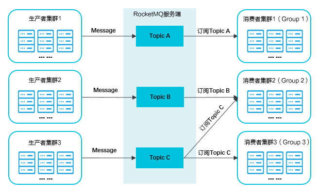

<a id="section-5-1-3"></a>

### 5.1.3. 传输协议与字符编码

RocketMQ v5.0 SDK底层通过TCP协议提供服务，用户请求和响应的字符编码都是采用UTF-8编码。

**传输层加密**

RocketMQ v5.0实例支持TLS v1.2及以上版本的传输层安全性协议，您可以通过SDK的配置来决定是否使用加密的传输层链接。

<strong>配置方式：</strong>在启动客户端程序时，设置JVM属性来决定是否使用加密的传输层链接。启动命令为**java -Dtls.enable=true**。默认情况下，TLS链接不开启，设置为true将启用加密的传输层链接。

<a id="section-5-1-4"></a>

### 5.1.4. 常用类及其方法

<a id="section-5-1-4-1"></a>

#### 5.1.4.1. 常量类PropertyKeyConst

该类字段主要包括以下内容。

| 名称 | 类型 | 默认值 | 描述 |
| --- | --- | --- | --- |
| AccessKey | String | - | 您在阿里云账号管理控制台中创建的AccessKey ID，用于身份认证。 |
| SecretKey | String | - | 您在阿里云账号管理控制台中创建的AccessKey Secret，用于身份认证。 |
| OnsChannel | String | ALIYUN | 用户渠道，阿里云：ALIYUN，聚石塔用户：CLOUD。 |
| NAMESRV_ADDR | String | - | 设置RocketMQ v5.0 TCP协议接入点。 |
| GROUP_ID | String | - | 标识一类Producer或Consumer，您在RocketMQ v5.0控制台创建的Group ID。 |
| MessageModel | String | CLUSTERING | 设置Consumer实例的消费模式，集群消费：CLUSTERING，广播消费：BROADCASTING。 |
| ConsumeThreadNums | String | 64 | 消费线程数量。 |
| MaxReconsumeTimes | String | 16 | 设置消息消费失败的最大重试次数。 |
| ConsumeTimeout | String | 15 | 设置每条消息消费的最大超时时间，超过设置时间则被视为消费失败，等下次重新投递再次消费。每个业务需要设置一个合理的值，单位（分钟）。 |
| ConsumeMessageBatc hMaxSize | String | 1 | BatchConsumer每次批量消费的最大消息数量，默认值为1，允许自定义范围为\[1, 32\]，实际消费数量可能小于该值。 |
| CheckImmunityTimeIn Seconds | String | 30 | 设置事务消息第一次回查的最快时间，单位（秒）。 |
| shardingKey | String | - | 顺序消息中用来计算不同分区的值。 |
| suspendTimeMillis | String | 3000 | 只适用于顺序消息，设置消息消费失败的重试间隔时间，单位（毫秒）。 |

<a id="section-5-1-4-2"></a>

#### 5.1.4.2. 工厂类ONSFactory

<a id="section-5-1-4-2-1"></a>

##### 5.1.4.2.1. createConsumer

- 语法：static Consumer createConsumer(Properties properties)

- 描述：创建RocketMQ v5.0普通消息、定时和延时消息、分布式事务消息等消息类型的消费者实例。

- 参数：

  | 名称 | 类型 | 描述 |
  | --- | --- | --- |
  | properties | Properties | 详情参考PropertyKeyConst说明。必填属性：PropertyKeyConst.NAMESRV_ADDR、PropertyKeyConst.ConsumerId、PropertyKeyConst.AccessKey、PropertyKeyConst.SecretKey。可选属性：PropertyKeyConst.ConsumeThreadNums、PropertyKeyConst.ConsumeTimeout。 |

- 返回值

  <table>
    <tr>
      <th width="108">类型</th>
      <th>描述</th>
    </tr>
    <tr>
      <td>Consumer</td>
      <td>RocketMQ v5.0普通消息、定时和延时消息、分布式事务消息等消息类型的消费者实例。</td>
    </tr>
  </table>

<a id="section-5-1-4-2-2"></a>

##### 5.1.4.2.2. createBatchConsumer

- 语法：static BatchConsumer createBatchConsumer(Properties properties)

- 描述：创建RocketMQ v5.0批量消费者实例。

- 参数：

  | 名称 | 类型 | 描述 |
  | --- | --- | --- |
  | properties | Properties | 详情参考PropertyKeyConst说明;必填属性：PropertyKeyConst.NAMESRV_ADDR、PropertyKeyConst.GROUP_ID、PropertyKeyConst.AccessKey、PropertyKeyConst.SecretKey；可选属性：PropertyKeyConst.ConsumeThreadNums、PropertyKeyConst.ConsumeTimeout、PropertyKeyConst.ConsumeMessageBatchMaxSize。 |

- 返回值：

  | 类型 | 描述 |
  | --- | --- |
  | BatchConsumer | BatchConsumer |

<a id="section-5-1-4-2-3"></a>

##### 5.1.4.2.3. createOrderedConsumer

- 语法：static OrderConsumer createOrderedConsumer(Properties properties)

- 描述：创建RocketMQ v5.0顺序消息消费者。

- 参数：

  | 名称 | 类型 | 描述 |
  | --- | --- | --- |
  | properties | properties | 详情参考PropertyKeyConst说明；必填属性：PropertyKeyConst.NAMESRV_ADDR、PropertyKeyConst.GROUP_ID、PropertyKeyConst.AccessKey、PropertyKeyConst.SecretKey；可选属性：PropertyKeyConst.ConsumeThreadNums、PropertyKeyConst.ConsumeTimeout。 |

- 返回值：

  | 类型 | 描述 |
  | --- | --- |
  | OrderConsumer | RocketMQ v5.0顺序消息消费者实例 |

<a id="section-5-1-4-2-4"></a>

##### 5.1.4.2.4. createOrderProducer

- 语法：static OrderProducer createOrderProducer(Properties properties)

- 描述：创建RocketMQ v5.0顺序消息发布者。

- 参数：

  | 名称 | 类型 | 描述 |
  | --- | --- | --- |
  | properties | Properties | 详情参考PropertyKeyConst说明;必填属性：PropertyKeyConst.NAMESRV_ADDR、PropertyKeyConst.GROUP_ID、PropertyKeyConst.AccessKey、PropertyKeyConst.SecretKey、PropertyKeyConst.ShardingKey；可选属性：PropertyKeyConst.SendMsgTimeoutMillis |

- 返回值：

  | 类型 | 描述 |
  | --- | --- |
  | OrderProducer | RocketMQ v5.0顺序消息发布者实例 |

<a id="section-5-1-4-2-5"></a>

##### 5.1.4.2.5. createProducer

- 语法：static Producer createProducer(Properties properties)

- 描述：创建RocketMQ v5.0普通消息、定时和延时消息发布者。

- 参数：

  | 名称 | 类型 | 描述 |
  | --- | --- | --- |
  | properties | Properties | 详情参考PropertyKeyConst说明。必填属性：PropertyKeyConst.NAMESRV_ADDR、PropertyKeyConst.GROUP_ID、PropertyKeyConst.AccessKey、PropertyKeyConst.SecretKey。可选属性：PropertyKeyConst.SendMsgTimeoutMillis。 |

- 返回值：

  | 类型 | 描述 |
  | --- | --- |
  | Producer | RocketMQ v5.0普通消息、定时和延时消息发布者实例。 |

<a id="section-5-1-4-2-6"></a>

##### 5.1.4.2.6. createTransactionProducer

- 语法：static TransactionProducer createTransactionProducer(Properties properties, LocalTransactionChecker checker)

- 描述：创建RocketMQ v5.0分布式事务消息发布者。

- 参数：

  | 名称 | 类型 | 描述 |
  | --- | --- | --- |
  | properties | Properties | 详情参考PropertyKeyConst说明;必填属性：PropertyKeyConst.NAMESRV_ADDR、PropertyKeyConst.GROUP_ID、PropertyKeyConst.AccessKey、PropertyKeyConst.SecretKey；可选属性：PropertyKeyConst.SendMsgTimeoutMillis、PropertyKeyConst.CheckImmunityTimeInSeconds。 |
  | checker | LocalTransactionC hecker | 详情参考LocalTransactionChecker说明。 |

- 返回值：

  | 类型 | 描述 |
  | --- | --- |
  | TransactionProducer | RocketMQ v5.0分布式事务消息发布者实例 |

<a id="section-5-1-4-3"></a>

#### 5.1.4.3. 消息类Message

<a id="section-5-1-4-3-1"></a>

##### 5.1.4.3.1. 消息类Message概述

消息类，表示要发送的消息。一条合法的消息，应包含主题(Topic)，消息体以及可选的标签和业务标识。

注意：我们对每条消息的自定义键值对的长度没有限制，但所有的自定义键值对，系统键值对序列化后，所占空间不能超过32767字节。

<a id="section-5-1-4-3-2"></a>

##### 5.1.4.3.2. Message默认构造方法

- 语法：Message()

- 描述：默认构造函数，创建消息对象。

- 参数：无

<a id="section-5-1-4-3-3"></a>

##### 5.1.4.3.3. Message有参构造方法（一）

- 语法：public Message(String topic, String tag, String key, byte body)

- 描述：有参构造函数，创建消息对象。

- 参数：

  | 名称 | 类型 | 描述 |
  | --- | --- | --- |
  | topic | String | 消息主题，最长不超过255个字符；由a-z, A-Z, 0-9，以及中划线"-"和下划线"_"构成。 |
  | tag | String | 消息标签，请使用合法标识符，尽量简短且见名知意。 |
  | key | String | 业务标识。 |
  | body | byte | 消息体，消息体长度默认不超过4 MB（包含消息属性，其中消息属性不超过8 KB），具体请参阅集群部署文档描述。 |

<a id="section-5-1-4-3-4"></a>

##### 5.1.4.3.4. Message有参构造方法（二）

- 语法：public Message(String topic, String tags, byte body)

- 描述：有参构造函数，创建消息对象。

- 参数：

  | 名称 | 类型 | 描述 |
  | --- | --- | --- |
  | topic | String | 消息主题，最长不超过255个字符；由a-z, A-Z, 0-9，以及中划线"-"和下划线"_"构成。 |
  | tags | String | 消息标签，请使用合法标识符，尽量简短且见名知意。 |
  | body | byte | 消息体，消息体长度默认不超过4 MB（包含消息属性，其中消息属性不超过8 KB），具体请参阅集群部署文档描述。 |

<a id="section-5-1-4-3-5"></a>

##### 5.1.4.3.5. putUserProperties

- 语法：public void putUserProperties(String key, String value)

- 描述：添加用户自定义属性键值对; 该键值对在消费消息时可被获取。

- 参数：

  | 名称 | 类型 | 描述 |
  | --- | --- | --- |
  | key | String | 自定义属性键。 |
  | value | String | 自定义属性值。 |

- 返回值：无

<a id="section-5-1-4-3-6"></a>

##### 5.1.4.3.6. getUserProperties

- 语法：public String getUserProperties(String key)

- 描述：获取用户自定义属性的值。

- 参数：

  | 名称 | 类型 | 描述 |
  | --- | --- | --- |
  | key | String | 自定义属性键。 |

- 返回值：

  | 类型 | 描述 |
  | --- | --- |
  | String | 用户自定义属性值 |

<a id="section-5-1-4-3-7"></a>

##### 5.1.4.3.7. getTopic

- 语法：public String getTopic()

- 描述：获取消息的主题。

- 参数：无

- 返回值：

  | 类型 | 描述 |
  | --- | --- |
  | String | 消息主题 |

<a id="section-5-1-4-3-8"></a>

##### 5.1.4.3.8. setTopic

- 语法：public void setTopic(String topic)

- 描述：设置消息主题。

- 参数：

  | 名称 | 类型 | 描述 |
  | --- | --- | --- |
  | topic | String | 消息主题 |

- 返回值：无

<a id="section-5-1-4-3-9"></a>

##### 5.1.4.3.9. getTag

- 语法：public String getTag()

- 描述：获取消息标签。

- 参数：无

- 返回值：

  | 类型 | 描述 |
  | --- | --- |
  | String | 消息标签 |

<a id="section-5-1-4-3-10"></a>

##### 5.1.4.3.10. setTag

- 语法：public void setTag(String tag)

- 描述：设置消息标签。

- 参数：

  | 名称 | 类型 | 描述 |
  | --- | --- | --- |
  | tag | String | 消息标签 |

- 返回值：无

<a id="section-5-1-4-3-11"></a>

##### 5.1.4.3.11. getKey

- 描述：获取业务标识。

- 语法：public String getKey()

- 参数：无

- 返回值：

  | 类型 | 描述 |
  | --- | --- |
  | String | 业务标识 |

<a id="section-5-1-4-3-12"></a>

##### 5.1.4.3.12. setKey

- 语法：public void setKey(String key)

- 描述：设置业务标签。

- 参数：

  | 名称 | 类型 | 描述 |
  | --- | --- | --- |
  | key | String | 业务标识 |

- 返回值：无

<a id="section-5-1-4-3-13"></a>

##### 5.1.4.3.13. getMsgID

- 语法：public String getMsgID()

- 描述：获取消息ID。

- 参数：无

- 返回值：

  | 类型 | 描述 |
  | --- | --- |
  | String | 消息ID |

<a id="section-5-1-4-3-14"></a>

##### 5.1.4.3.14. setMsgID

- 语法：public void setMsgID(String msgid)

- 描述：设置消息ID

- 参数：

  | 名称 | 类型 | 描述 |
  | --- | --- | --- |
  | msgid | String | 消息ID |

- 返回值：无

<a id="section-5-1-4-3-15"></a>

##### 5.1.4.3.15. getReconsumeTimes

- 语法：public int getReconsumeTimes()

- 描述：消息消费时，获取消息已经被重试消费的次数。

- 参数：无

- 返回值：

  | 类型 | 描述 |
  | --- | --- |
  | String | 重试消费次数 |

<a id="section-5-1-4-3-16"></a>

##### 5.1.4.3.16. setReconsumeTimes

- 语法：public void setReconsumeTimes(int value)

- 描述：设置消息重试消费次数。

- 参数：

  | 名称 | 类型 | 描述 |
  | --- | --- | --- |
  | value | int | 重试消费次数 |

- 返回值：无

<a id="section-5-1-4-3-17"></a>

##### 5.1.4.3.17. getBornTimestamp

- 语法：public long getBornTimestamp()

- 描述：获取消息的生产时间。

- 参数：无

- 返回值：

  | 类型 | 描述 |
  | --- | --- |
  | String | 消息的生产时间 |

<a id="section-5-1-4-3-18"></a>

##### 5.1.4.3.18. setBornTimestamp

- 语法：public void setBornTimestamp(long value)

- 描述：设置消息的产生时间。

- 参数：

  | 名称 | 类型 | 描述 |
  | --- | --- | --- |
  | value | long | 消息生产时间。 |

- 返回值：无

<a id="section-5-1-4-3-19"></a>

##### 5.1.4.3.19. getBornHost

- 语法：public String getBornHost()

- 描述：获取产生消息的主机。

- 参数：无

- 返回值：

  | 类型 | 描述 |
  | --- | --- |
  | String | 产生消息的主机 |

<a id="section-5-1-4-3-20"></a>

##### 5.1.4.3.20. setBornHost

- 语法：public void setBornHost(String value)

- 描述：设置生产消息的主机。

- 参数：

  | 名称 | 类型 | 描述 |
  | --- | --- | --- |
  | value | long | 生产消息的主机。 |

- 返回值：无

<a id="section-5-1-4-3-21"></a>

##### 5.1.4.3.21. getStartDeliverTime

- 语法：public long getStartDeliverTime()

- 描述：获取定时消息开始投递时间。

- 参数：无

- 返回值：

  | 类型 | 描述 |
  | --- | --- |
  | String | 定时消息开始投递时间 |

<a id="section-5-1-4-3-22"></a>

##### 5.1.4.3.22. setStartDeliverTime

- 语法：public void setStartDeliverTime(long value)

- 描述：设置消息的定时投递时间（绝对时间)，最大延迟时间为40天。

- 参数：

  | 名称 | 类型 | 描述 |
  | --- | --- | --- |
  | value | long | 定时消息的开始投递时间。 |

- 返回值：无

<a id="section-5-1-4-3-23"></a>

##### 5.1.4.3.23. getShardingKey

- 语法：public long getShardingKey()

- 描述：获取顺序消息中用来计算不同分区的值。

- 参数：无

- 返回值：

  | 类型 | 描述 |
  | --- | --- |
  | String | 顺序消息中用来计算不同分区的值 |

<a id="section-5-1-4-3-24"></a>

##### 5.1.4.3.24. setShardingKey

- 语法：public void setShardingKey(String value)

- 描述：设置顺序消息中用来计算不同分区的值。

- 参数：

  | 名称 | 类型 | 描述 |
  | --- | --- | --- |
  | String | long | 顺序消息中用来计算不同分区的值。 |

- 返回值：无

<a id="section-5-1-4-4"></a>

#### 5.1.4.4. 异常类ONSClientException

<a id="section-5-1-4-4-1"></a>

##### 5.1.4.4.1. ONSClientException默认构造方法

- 语法：public ONSClientException()

- 描述：默认异常构造函数。

- 参数：无

<a id="section-5-1-4-4-2"></a>

##### 5.1.4.4.2. ONSClientException有参构造方法（一）

- 语法：public ONSClientException(String message)

- 描述：异常接口构造函数。

- 参数：

  | 名称 | 类型 | 描述 |
  | --- | --- | --- |
  | message | String | 需要向外传递的异常信息 |

<a id="section-5-1-4-4-3"></a>

##### 5.1.4.4.3. ONSClientException有参构造方法（二）

- 语法：public ONSClientException(Throwable cause)

- 描述：异常接口构造函数。

- 参数：

  | 名称 | 类型 | 描述 |
  | --- | --- | --- |
  | message | String | 需要向外传递的异常信息 |

<a id="section-5-1-4-4-4"></a>

##### 5.1.4.4.4. ONSClientException有参构造方法（三）

- 语法：public ONSClientException(String message, Throwable cause)

- 描述：异常接口构造函数。

- 参数：

  | 名称 | 类型 | 描述 |
  | --- | --- | --- |
  | message | String | 需要向外传递的异常信息 |
  | cause | Throwable | 需要向外传递的异常信息 |

<a id="section-5-1-4-5"></a>

#### 5.1.4.5. 发送消息接口

<a id="section-5-1-4-5-1"></a>

##### 5.1.4.5.1. 发送消息接口概述

本单元主要详述RocketMQ发送各种类消息的接口规范。不同消息类型与各个接口、参数的对应关系如下图所示。

图 1. 发布消息相关接口参数说明

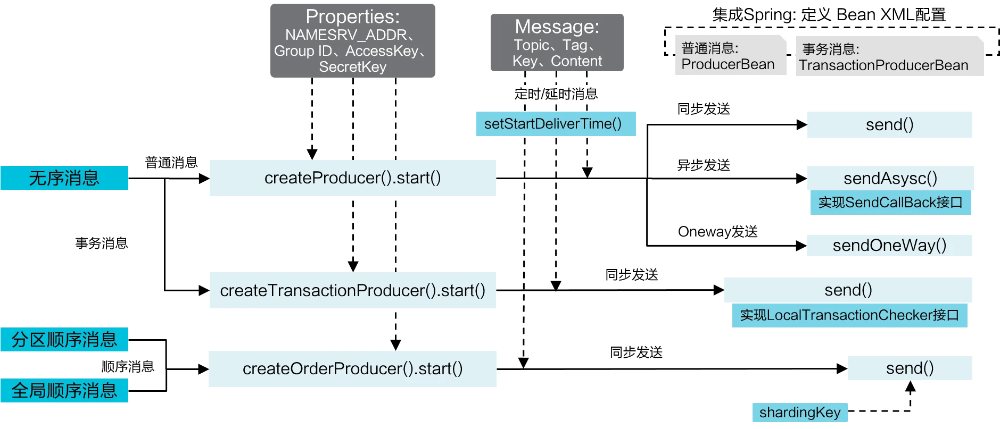

<a id="section-5-1-4-5-2"></a>

##### 5.1.4.5.2. 发送结果SendResult

<a id="section-5-1-4-5-2-1"></a>

###### 5.1.4.5.2.1. SendResult默认构造方法

- 语法：public SendResult()

- 描述：默认构造函数，创建消息发送结果对象。

- 参数：无

<a id="section-5-1-4-5-2-2"></a>

###### 5.1.4.5.2.2. getMessageId

- 语法：public long getMessageId()

- 描述：获取被发送消息的消息 ID。

- 参数：无

- 返回值：

  | 类型 | 描述 |
  | --- | --- |
  | String | 被发送消息的消息 ID |

<a id="section-5-1-4-5-2-3"></a>

###### 5.1.4.5.2.3. getTopic

- 语法：public String getTopic()

- 描述：获取被发送消息的消息主题。

- 参数：无

- 返回值：

  | 类型 | 描述 |
  | --- | --- |
  | String | 被发送消息的消息主题 |

<a id="section-5-1-4-5-2-4"></a>

###### 5.1.4.5.2.4. toString

- 语法：public String toString()

- 描述：序列化发送结果。

- 参数：无

- 返回值：

  | 类型 | 描述 |
  | --- | --- |
  | String | 发送结果的String表示 |

<a id="section-5-1-4-5-3"></a>

##### 5.1.4.5.3. 生产者实例Producer

<a id="section-5-1-4-5-3-1"></a>

###### 5.1.4.5.3.1. 生产者实例Producer概述

发布者对象，可以通过该对象接口发送普通消息，发送定时/延时消息。

- 线程安全性: 本接口的实现类都是线程安全的，可以多线并发发送消息。

- 一个实例可以发送多个主题的消息。

- 正常情况下，一个实例足够高效完成本模块的发送任务，无需创建多个实例

RocketMQ普通消息支持3种发送方式：可靠同步发送、可靠异步发送、单向（Oneway）发送。

<a id="section-5-1-4-5-3-2"></a>

###### 5.1.4.5.3.2. send

- 语法：public SendResult send(Message message)

- 描述：同步发送消息，只要不抛异常就表示成功；支持普通消息，发送定时/延时消息。

- 参数：

  | 名称 | 类型 | 描述 |
  | --- | --- | --- |
  | message | Message | 要发送的消息对象 |

- 返回值：

  | 类型 | 描述 |
  | --- | --- |
  | SendResult | 发送结果，含消息Id，消息主题等 |

<a id="section-5-1-4-5-3-3"></a>

###### 5.1.4.5.3.3. sendOneway

- 语法：public void sendOneway(Message message)

- 描述：发送消息，Oneway形式，服务器不应答，无法保证消息是否成功到达服务器；支持普通消息，发送定时/延时消息。

- 参数：

  | 名称 | 类型 | 描述 |
  | --- | --- | --- |
  | message | Message | 要发送的消息对象 |

- 返回值：无

<a id="section-5-1-4-5-3-4"></a>

###### 5.1.4.5.3.4. sendAsync

- 语法：public void sendAsync(Message message, SendCallback sendCallback)

- 描述：发送消息，异步Callback形式；支持普通消息，发送定时/延时消息。

- 参数：

  | 名称 | 类型 | 描述 |
  | --- | --- | --- |
  | message | Message | 要发送的消息对象 |
  | sendCallback | SendCallback | 发送完成要执行的回调函数 |

- 返回值：无

<a id="section-5-1-4-5-3-5"></a>

###### 5.1.4.5.3.5. isStarted

- 语法：public boolean isStarted()

- 描述：检查服务是否已经启动。

- 参数：无

- 返回值：

  | 类型 | 描述 |
  | --- | --- |
  | boolean | 如果检查服务已经启动返回 true; 其它情况返回 false |

<a id="section-5-1-4-5-3-6"></a>

###### 5.1.4.5.3.6. isClosed

- 语法：public boolean isClosed()

- 描述：检查服务是否已经关闭。

- 参数：无

- 返回值：

  | 类型 | 描述 |
  | --- | --- |
  | boolean | 如果服务已关闭返回 true; 其它情况返回 false |

<a id="section-5-1-4-5-3-7"></a>

###### 5.1.4.5.3.7. start

- 语法：public void start()

- 描述：启动消息发送 Producer 服务。

- 参数：无

- 返回：无

<a id="section-5-1-4-5-3-8"></a>

###### 5.1.4.5.3.8. shutdown

- 语法：public void shutdown()

- 描述：关闭消息发送 Producer 服务。

- 参数：无

- 返回：无

<a id="section-5-1-4-5-4"></a>

##### 5.1.4.5.4. 分布式事务消息生产者实例 TransactionProducer

<a id="section-5-1-4-5-4-1"></a>

###### 5.1.4.5.4.1. send

- 语法：SendResult send(Message message, LocalTransactionExecuter executer, Object arg)

- 描述：该方法用来发送一条事务型消息。事务型消息发送分为三个步骤：

  - 本服务实现类首先发送一条半事务消息到消息服务器;

  - 通过executer执行本地事务;

  - 根据上一步骤执行结果, 决定发送提交或者回滚第一步发送的半事务消息;

- 参数：

  | 名称 | 类型 | 描述 |
  | --- | --- | --- |
  | message | Message | 要发送的事务型消息 |
  | executer | LocalTransactionExecuter | 本地事务执行器，详情请参考LocalTransactionExecuter类说明 |
  | arg | Object | 应用自定义参数，该参数可以传入本地事务执行器 |

- 返回值：

  | 类型 | 描述 |
  | --- | --- |
  | SendResult | 返回发送结果，含消息Id, 消息主题等 |

<a id="section-5-1-4-5-4-2"></a>

###### 5.1.4.5.4.2. isStarted

- 语法：public boolean isStarted()

- 描述：检查服务是否已经启动。

- 参数：无

- 返回值：

  | 类型 | 描述 |
  | --- | --- |
  | boolean | 如果检查服务已经启动返回 true; 其它情况返回 false |

<a id="section-5-1-4-5-4-3"></a>

###### 5.1.4.5.4.3. isClosed

- 语法：public boolean isClosed()

- 描述：检查服务是否已经关闭。

- 参数：无

- 返回值：

  | 类型 | 描述 |
  | --- | --- |
  | boolean | 如果服务已关闭返回 true; 其它情况返回 false |

<a id="section-5-1-4-5-4-4"></a>

###### 5.1.4.5.4.4. start

- 语法：public void start()

- 描述：启动事务消息发送 Producer 服务。

- 参数：无

- 返回值：无

<a id="section-5-1-4-5-4-5"></a>

###### 5.1.4.5.4.5. shutdown

- 语法：public void shutdown()

- 描述：关闭事务消息发送 Producer 服务。

- 参数：无

- 返回值：无

<a id="section-5-1-4-5-4-6"></a>

###### 5.1.4.5.4.6. 本地事务执行器LocalTransactionExecuter

execute

- 语法：TransactionStatus execute(Message msg, Object arg)

- 描述：执行本地事务，由应用来重写；

- 参数：

  | 名称 | 类型 | 描述 |
  | --- | --- | --- |
  | message | Message | 要发送的事务型消息 |
  | arg | Object | 应用自定义参数，由send方法传入并回调 |

- 返回值：

  | 类型 | 描述 |
  | --- | --- |
  | TransactionStatus | 返回事务执行结果，包括提交事务、回滚事务、未知状态 |

<a id="section-5-1-4-5-4-7"></a>

###### 5.1.4.5.4.7. 分布式事务消息状态TransactionStatus

分布式事务半消息的状态，包括提交事务、回滚事务、未知状态。

枚举：

| 取值 | 描述 |
| --- | --- |
| CommitTransaction | 提交事务，对应的事务消息将投递给消费者 |
| RollbackTransaction | 回滚事务，对应的事务消息会被删除，不会投递给消费者 |
| Unknow | 未知状态，一般在用户无法确定事务是成功还是失败时使用，对于未知状态的事务，服务端会定期进行事务回查 |

<a id="section-5-1-4-5-5"></a>

##### 5.1.4.5.5. 顺序消息生产者实例OrderProducer

<a id="section-5-1-4-5-5-1"></a>

###### 5.1.4.5.5.1. send

- 语法：SendResult send(Message message, String shardingKey)

- 描述：发送顺序消息。

- 参数：

  | 名称 | 类型 | 描述 |
  | --- | --- | --- |
  | message | Message | 要发送的顺序消息对象。 |
  | shardingKey | String | 顺序消息选择因子，发送方法基于 shardingKey 选择具体的消息队列。 |

- 返回值：

  | 类型 | 描述 |
  | --- | --- |
  | SendResult | 发送结果。含消息ID、消息主题等。 |

<a id="section-5-1-4-5-5-2"></a>

###### 5.1.4.5.5.2. isStarted

- 语法：public boolean isStarted()

- 描述：检查服务是否已经启动。

- 参数：无

- 返回值：

  | 类型 | 描述 |
  | --- | --- |
  | boolean | 如果检查服务已经启动返回 true; 其它情况返回 false |

<a id="section-5-1-4-5-5-3"></a>

###### 5.1.4.5.5.3. isClosed

- 语法：public boolean isClosed()

- 描述：检查服务是否已经关闭。

- 参数：无

- 返回值：

  | 类型 | 描述 |
  | --- | --- |
  | boolean | 如果服务已关闭返回 true; 其它情况返回 false |

<a id="section-5-1-4-5-5-4"></a>

###### 5.1.4.5.5.4. start

- 语法：public void start()

- 描述：启动顺序消息消息发送Producer服务。

- 参数：无

- 返回：无

<a id="section-5-1-4-5-5-5"></a>

###### 5.1.4.5.5.5. shutdown

- 语法：public void shutdown()

- 描述：关闭顺序消息发送Producer服务。

- 参数：无

- 返回：无

<a id="section-5-1-4-6"></a>

#### 5.1.4.6. 订阅消息接口

<a id="section-5-1-4-6-1"></a>

##### 5.1.4.6.1. 订阅消息接口概述

本节详述RocketMQ订阅各种类消息的接口规范。不同消息类型与各个接口、参数的对应关系如下图所示。

图 1. 订阅消息接口相关参数说明

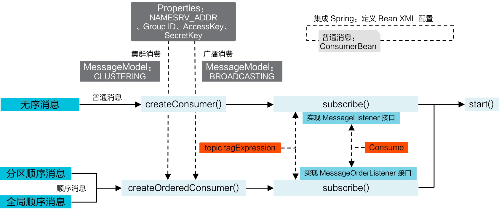

<a id="section-5-1-4-6-2"></a>

##### 5.1.4.6.2. 消费者实例Consumer

<a id="section-5-1-4-6-2-1"></a>

###### 5.1.4.6.2.1. 消费者实例Consumer概述

消息消费者实例，用来订阅消息，支持普通消息、事务消息、定时消息/延时消息。

<a id="section-5-1-4-6-2-2"></a>

###### 5.1.4.6.2.2. subscribe

- 语法：public void subscribe(String topic, String subExpression, MessageListener listener)

- 描述：订阅消息，包括普通消息、事务消息、定时消息/延时消息。

- 参数：

  | 名称 | 类型 | 描述 |
  | --- | --- | --- |
  | topic | String | 消息主题 |
  | subExpression | String | 订阅过滤表达式字符串，RocketMQ服务器依据此表达式进行过滤，只支持或 (\|\|) 运算；示例1："tag1 \|\| tag2 \|\| tag3"；示例2：subExpression 等于 null 或者 \* ，则表示全部订阅； |
  | listener | MessageListener | 消息回调监听器 |

- 返回值：无

<a id="section-5-1-4-6-2-3"></a>

###### 5.1.4.6.2.3. unsubscribe

- 语法：void unsubscribe(String topic)

- 描述：取消某个topic订阅。

- 参数：

  | 名称 | 类型 | 描述 |
  | --- | --- | --- |
  | topic | String | 消息主题 |

- 返回值：无

<a id="section-5-1-4-6-2-4"></a>

###### 5.1.4.6.2.4. isStarted

- 语法：public boolean isStarted()

- 描述：检查服务是否已经启动。

- 参数：无

- 返回值：

  | 类型 | 描述 |
  | --- | --- |
  | boolean | 如果检查服务已经启动返回 true; 其它情况返回 false |

<a id="section-5-1-4-6-2-5"></a>

###### 5.1.4.6.2.5. isClosed

- 语法：public boolean isClosed()

- 描述：检查服务是否已经关闭。

- 参数：无

- 返回值：

  | 类型 | 描述 |
  | --- | --- |
  | boolean | 如果服务已关闭返回 true; 其它情况返回 false |

<a id="section-5-1-4-6-2-6"></a>

###### 5.1.4.6.2.6. start

- 语法：public void start()

- 描述：启动消费者实例 Consumer 服务。

- 参数：无

- 返回值：无

<a id="section-5-1-4-6-2-7"></a>

###### 5.1.4.6.2.7. shutdown

- 语法：public void shutdown()

- 描述：关闭消费者实例 Consumer 服务。

- 参数：无

- 返回值：无

<a id="section-5-1-4-6-3"></a>

##### 5.1.4.6.3. 消息监听器MessageListener

<a id="section-5-1-4-6-3-1"></a>

###### 5.1.4.6.3.1. 消费监听器MessageListener概述

消息监听器，Consumer注册消息监听器来订阅消息。

线程安全性要求：该接口会被Consumer的多个线程并发调用, 用户需要保证并发安全性

<a id="section-5-1-4-6-3-2"></a>

###### 5.1.4.6.3.2. consume

- 语法：Action consume(Message message, ConsumeContext context)

- 描述：消费消息接口，由应用来实现；网络抖动等不稳定的情形可能会带来消息重复，对重复消息敏感的业务可对消息做幂等处理。

- 参数：

  | 名称 | 类型 | 描述 |
  | --- | --- | --- |
  | message | Message | 消息对象 |
  | context | ConsumeContext | 消费上下文，具体参考 ConsumeContext 说明 |

- 返回值：

  <table>
    <tr>
      <th width="77">类型</th>
      <th>描述</th>
    </tr>
    <tr>
      <td>Action</td>
      <td>消费结果。消费失败：如果应用抛出异常或者返回Null等价于返回Action.ReconsumeLater；消费成功：返回 Action.CommitMessage。</td>
    </tr>
  </table>

<a id="section-5-1-4-6-4"></a>

##### 5.1.4.6.4. 消息消费结果Action

<a id="section-5-1-4-6-4-1"></a>

###### 5.1.4.6.4.1. 消息消费结果Action概述

消费消息的返回结果。

枚举：

| 名称 | 类型 | 描述 |
| --- | --- | --- |
| CommitMessage | String | 消费成功，继续消费下一条消息 |
| ReconsumeLater | String | 消费失败，告知服务器稍后再投递这条消息，继续消费其他消息 |

<a id="section-5-1-4-6-4-2"></a>

###### 5.1.4.6.4.2. valueOf

- 语法：public static Action valueOf(String name)

- 描述：返回带有指定名称的该类型的枚举常量，字符串必须与用于声明该类型的枚举常量的标识符完全匹配；（不允许有多余 的空格字符）。

- 参数：

  | 名称 | 类型 | 描述 |
  | --- | --- | --- |
  | name | String | 要返回的枚举常量的名称 |

- 返回值：

  | 类型 | 描述 |
  | --- | --- |
  | Action | 返回带有指定名称的枚举常量 |

- 异常：

  | 类型 | 描述 |
  | --- | --- |
  | IllegalArgumentException | 如果该枚举类型没有带有指定名称的常量 |
  | NullPointerException | 如果参数为空值 |

<a id="section-5-1-4-6-4-3"></a>

###### 5.1.4.6.4.3. values

- 语法：public static Action[] values()

- 描述：按照声明该枚举类型常量的顺序, 返回包含这些常量的数组。

- 参数：无

- 返回值：

  | 类型 | 描述 |
  | --- | --- |
  | Action\[\] | 按照声明该枚举类型的常量的顺序返回的包含这些常量的数组 |

<a id="section-5-1-4-6-5"></a>

##### 5.1.4.6.5. 消费模式PropertyValueConst

消费模式常量类。

枚举：

| 名称 | 类型 | 描述 |
| --- | --- | --- |
| BROADCASTING | String | 广播消费模式 |
| CLUSTERING | String | 集群消费模式 |

<a id="section-5-1-4-6-6"></a>

##### 5.1.4.6.6. 顺序消费者实例OrderConsumer

<a id="section-5-1-4-6-6-1"></a>

###### 5.1.4.6.6.1. 顺序消费者实例OrderConsumer概述

顺序消息消费者实例，通过改对象的接口可以先进先出的方式进行顺序订阅。

<a id="section-5-1-4-6-6-2"></a>

###### 5.1.4.6.6.2. subscribe

- 语法：void subscribe(String topic, String subExpression, MessageOrderListener listener)

- 描述：订阅顺序消息。

- 参数：

  | 名称 | 类型 | 描述 |
  | --- | --- | --- |
  | topic | String | 消息主题 |
  | subExpression | String | 订阅过滤表达式字符串，RocketMQ服务器依据此表达式进行过滤，只支持或 (\|\|) 运算；示例1: "tag1 \|\| tag2 \|\| tag3"；示例2：subExpression 等于null或者\*，则表示全部订阅； |
  | listener | MessageOrd erListener | 消息回调监听器 |

- 返回值：无

<a id="section-5-1-4-6-6-3"></a>

###### 5.1.4.6.6.3. unsubscribe

- 语法：void unsubscribe(String topic)

- 描述：取消某个topic订阅。

- 参数：

  | 名称 | 类型 | 描述 |
  | --- | --- | --- |
  | topic | String | 消息主题 |

- 返回值：无

<a id="section-5-1-4-6-6-4"></a>

###### 5.1.4.6.6.4. isStarted

- 语法：public boolean isStarted()

- 描述：检查服务是否已经启动。

- 参数：无

- 返回值：

  | 类型 | 描述 |
  | --- | --- |
  | boolean | 如果检查服务已经启动返回 true; 其它情况返回 false |

<a id="section-5-1-4-6-6-5"></a>

###### 5.1.4.6.6.5. isClosed

- 语法：public boolean isClosed()

- 描述：检查服务是否已经关闭。

- 参数：无

- 返回值：

  | 类型 | 描述 |
  | --- | --- |
  | boolean | 如果服务已关闭返回 true; 其它情况返回 false |

<a id="section-5-1-4-6-6-6"></a>

###### 5.1.4.6.6.6. start

- 语法：public void start()

- 描述：启动消费者实例 Consumer 服务。

- 参数：无

- 返回值：无

<a id="section-5-1-4-6-6-7"></a>

###### 5.1.4.6.6.7. shutdown

- 语法：public void shutdown()

- 描述：关闭消费者实例 Consumer 服务。

- 参数：无

- 返回：无

<a id="section-5-1-4-6-7"></a>

##### 5.1.4.6.7. 消息监听器MessageOrderListener

<a id="section-5-1-4-6-7-1"></a>

###### 5.1.4.6.7.1. 消息监听器MessageOrderListener概述

顺序消息监听器，Consumer注册消息监听器来订阅消息。

线程安全性要求：该接口会被Consumer的多个线程并发调用, 用户需要保证并发安全性

<a id="section-5-1-4-6-7-2"></a>

###### 5.1.4.6.7.2. consume

- 语法：OrderAction consume(Message message, ConsumeOrderContext context)

- 描述：消费消息接口，由应用来实现；网络抖动等不稳定的情形可能会带来消息重复，对重复消息敏感的业务可对消息做幂等处理。

- 参数：

  | 名称 | 类型 | 描述 |
  | --- | --- | --- |
  | message | Message | 消息对象 |
  | context | ConsumeOrderContext | 消费上下文，具体参考 ConsumeOrderContext说明； |

- 返回值：

  <table>
    <tr>
      <th width="122">类型</th>
      <th>描述</th>
    </tr>
    <tr>
      <td>OrderAction</td>
      <td>消费结果。消费失败：如果应用抛出异常或者返回Null等价于返回 Action.Suspend；消费成功：返回Action.Success。</td>
    </tr>
  </table>

<a id="section-5-1-4-6-8"></a>

##### 5.1.4.6.8. 顺序消息消费结果OrderAction

<a id="section-5-1-4-6-8-1"></a>

###### 5.1.4.6.8.1. 顺序消息消费结果OrderAction概述

顺序消息消费消息的返回结果。

枚举：

| 名称 | 类型 | 描述 |
| --- | --- | --- |
| Success | String | 消费成功，继续消费下一条消息 |
| Suspend | String | 消费失败，挂起当前队列 |

<a id="section-5-1-4-6-8-2"></a>

###### 5.1.4.6.8.2. valueOf

- 语法：public static OrderAction valueOf(String name)

- 描述：返回带有指定名称的该类型的枚举常量，字符串必须与用于声明该类型的枚举常量的标识符完全匹配；（不允许有多余的空格字符）。

- 参数：

  | 名称 | 类型 | 描述 |
  | --- | --- | --- |
  | name | String | 要返回的枚举常量的名称 |

- 返回值：

  | 类型 | 描述 |
  | --- | --- |
  | OrderAction | 返回带有指定名称的枚举常量 |

- 异常：

  | 类型 | 描述 |
  | --- | --- |
  | IllegalArgumentException | 如果该枚举类型没有带有指定名称的常量 |
  | NullPointerException | 如果参数为空值 |

<a id="section-5-1-4-6-8-3"></a>

###### 5.1.4.6.8.3. values

- 语法：public static OrderAction[] values()

- 描述：按照声明该枚举类型常量的顺序, 返回包含这些常量的数组。

- 参数：无

- 返回值：

  | 类型 | 描述 |
  | --- | --- |
  | OrderAction\[\] | 按照声明该枚举类型的常量的顺序返回的包含这些常量的数组 |

<a id="section-5-1-4-6-9"></a>

##### 5.1.4.6.9. 批量消费者实例BatchConsumer

<a id="section-5-1-4-6-9-1"></a>

###### 5.1.4.6.9.1. 批量消费者实例BatchConsumer概述

批量消息消费者，用来通过批量的方式订阅消息。

<a id="section-5-1-4-6-9-2"></a>

###### 5.1.4.6.9.2. subscribe

- 语法：void subscribe(String topic, String subExpression, BatchMessageListener listener)

- 描述：订阅消息，包括普通消息、事务消息、定时消息/延时消息。

- 参数：

  | 名称 | 类型 | 描述 |
  | --- | --- | --- |
  | topic | String | 消息主题 |
  | subExpression | String | 订阅过滤表达式字符串，RocketMQ服务器依据此表达式进行过滤，只支持或 (\|\|) 运算；示例1: "tag1 \|\| tag2 \|\| tag3"；示例2：subExpression等于null或者\*，则表示全部订阅； |
  | listener | BatchMess ageListener | 消息回调监听器 |

- 返回值：无

<a id="section-5-1-4-6-9-3"></a>

###### 5.1.4.6.9.3. unsubscribe

- 语法：void unsubscribe(String topic)

- 描述：取消某个topic订阅。

- 参数：

  | 名称 | 类型 | 描述 |
  | --- | --- | --- |
  | topic | String | 消息主题 |

- 返回值：无

<a id="section-5-1-4-6-9-4"></a>

###### 5.1.4.6.9.4. isStarted

- 语法：public boolean isStarted()

- 描述：检查服务是否已经启动。

- 参数：无

- 返回值：

  | 类型 | 描述 |
  | --- | --- |
  | boolean | 如果检查服务已经启动返回 true; 其它情况返回 false |

<a id="section-5-1-4-6-9-5"></a>

###### 5.1.4.6.9.5. isClosed

- 语法：public boolean isClosed()

- 描述：检查服务是否已经关闭。

- 参数：无

- 返回值：

  | 类型 | 描述 |
  | --- | --- |
  | boolean | 如果服务已关闭返回 true; 其它情况返回 false |

<a id="section-5-1-4-6-9-6"></a>

###### 5.1.4.6.9.6. start

- 语法：public void start()

- 描述：启动消费者实例 Consumer 服务。

- 参数：无

- 返回：无

<a id="section-5-1-4-6-9-7"></a>

###### 5.1.4.6.9.7. shutdown

- 语法：public void shutdown()

- 描述：关闭消费者实例 Consumer 服务。

- 参数：无

- 返回：无

<a id="section-5-1-4-6-10"></a>

##### 5.1.4.6.10. 批量消费消息监听器BatchMessageListener

<a id="section-5-1-4-6-10-1"></a>

###### 5.1.4.6.10.1. 批量消费消息监听器BatchMessageListener概述

批量消息监听器，BatchConsumer注册消息监听器来批量地消费消息。

线程安全性要求：该接口会被Consumer的多个线程并发调用, 用户需要保证并发安全性。

<a id="section-5-1-4-6-10-2"></a>

###### 5.1.4.6.10.2. consume

- 语法：Action consume(Message message, ConsumeContext context)

- 描述：批量消费消息接口，由应用来实现需要注意网络抖动等不稳定的情形可能会带来消息重复，对重复消息敏感的业务可对消息做幂等处理。

- 参数：

  | 名称 | 类型 | 描述 |
  | --- | --- | --- |
  | message | Message | 消息对象 |
  | context | ConsumeContext | 消费上下文，具体参考 ConsumeContext 说明 |

- 返回值：

  <table>
    <tr>
      <th width="77">类型</th>
      <th>描述</th>
    </tr>
    <tr>
      <td>Action</td>
      <td>消费结果。消费失败：如果应用抛出异常或者返回Null等价于返回Action.ReconsumeLater；消费成功：返回 Action.CommitMessage；</td>
    </tr>
  </table>
