阿里云  
专有云  
统一云管平台  
FAQ  
产品版本：v3.18.6-SP2607  
文档版本：20260729

**目录**

- [1.如何配置只查看某个资源集资源的角色](#section-1)
- [2.如何查询ASCM组织的AK信息](#section-2)
- [3.如何创建能查看所有组织AK的账号](#section-3)
- [4.RAM角色授权咨询](#section-4)
- [5.查询ASCM组织相关信息](#section-5)
- [6.如何查看ASCM规格](#section-6)
- [7.ASCM如何授权子账号产品权限](#section-7)
- [8.如何查询apsara平台调用接口的日志](#section-8)
- [9.ASCM如何创建只读权限角色](#section-9)
- [10.如何修改、删除资源集](#section-10)
- [11.日志转存中心和日志转存设置有什么本质区别？](#section-11)
- [12.如何创建仅能访问quickbi产品的用户](#section-12)
- [13.如何在新创建的资源集上面，单独添加已有的ECS资源？](#section-13)
- [14.如何使用AK查询用户名称](#section-14)
- [15.数据库代理界面异常](#section-15)
- [16.能否通过aliyun cli获取实例列表信息](#section-16)
- [17.自定义角色已授权，创建实例时仍提示没有权限](#section-17)
- [18.超时自动登出功能咨询](#section-18)
- [19.管理员授权访问咨询](#section-19)
- [20.如何创建安全类角色](#section-20)
- [21.如何统计成员列表和对应的资源集](#section-21)
- [22.如何通过接口获取实例的磁盘详情](#section-22)
- [23.如何将super，admin账号的权限赋予客户账号](#section-23)
- [24.ASCM开启双因素的方案](#section-24)
- [25.如何把某个ECS分配给指定用户](#section-25)
- [26.资源变更归属能否跨组织变更](#section-26)

# 1.如何配置只查看某个资源集资源的角色

本文介绍配置只查看某个资源集资源的角色的方法。

**适用版本**

- 专有云版本：所有版本。

- 产品：ASCM。

- 文档公开性：对外。

**问题描述**

如何配置角色，可以只查看某个资源集的资源。

**问题原因**

功能咨询问题。

**解决方案**

1. 创建自定义角色，管理权限选择资源集，然后勾选对应的产品权限；

   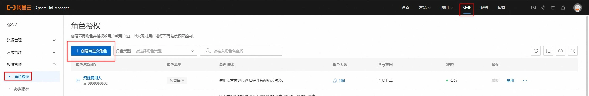

   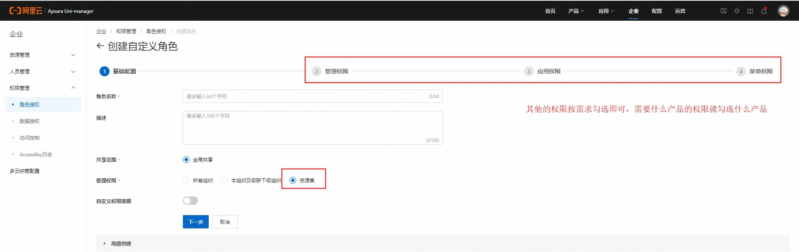

2. 将角色授权给账号后，在**企业** > **资源集管理**里找到需要看到的资源集，在操作栏单击**成员授权**，授权给需要的账号，该账号才能看到对应的资源集的资源。

   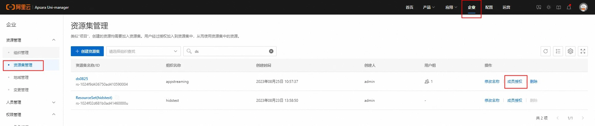

# 2.如何查询ASCM组织的AK信息

本文介绍查询ASCM组织的AK信息的方法。

**如何查询ASCM组织的AK信息？**

**操作步骤（适用v3.12及以后版本）**

1. 登录Apsara Uni-manager运营控制台。

2. 具体操作方法参照以下步骤，以v.3.18.2版本为示例：

其他版本可在专有云帮助中心切换对应版本，找到《Apsara Uni-manager运营控制台 用户指南》，在 企业中心 > 资源管理 > 组织管理 > 管理组织，企业中心 > 资源管理 > 组织管理 > 管理组织AccessKey，企业中心 > 资源管理 > 组织管理 > 获取组织AccessKey，企业中心 > 组织管理 > 获取组织AccessKey，便可查看对应版本的操作方法。

# 3.如何创建能查看所有组织AK的账号

本文介绍创建能查看所有组织AK的账号的方法。

**如何创建能查看所有组织AK的账号？**

首先，创建个全局组织权限的角色；然后给角色授权查看组织及ak的权限。适用于v3.12及以后版本。

详细操作步骤如下：

1. 使用管理员账号登录ascm，在**企业** > **角色授权**页面查看是否有满足要求的角色（ascm的预置角色有对应的权限描述），如果有的话将角色授权给用户（用户组）即可。

   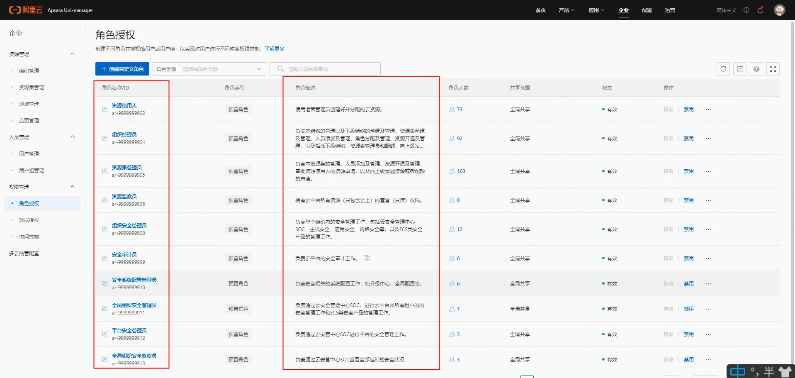

   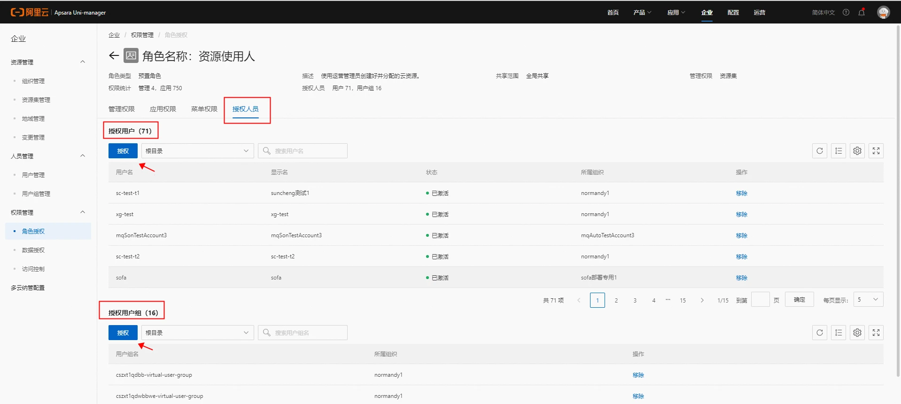

2. 如果没有能满足要求的角色可以创建自定义的角色，按自己的需求一步一步操作即可。

   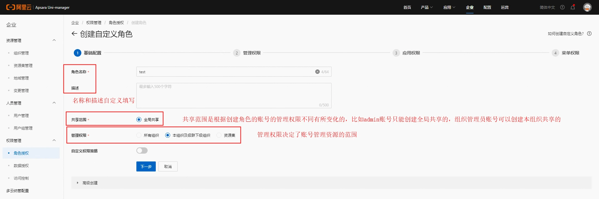

   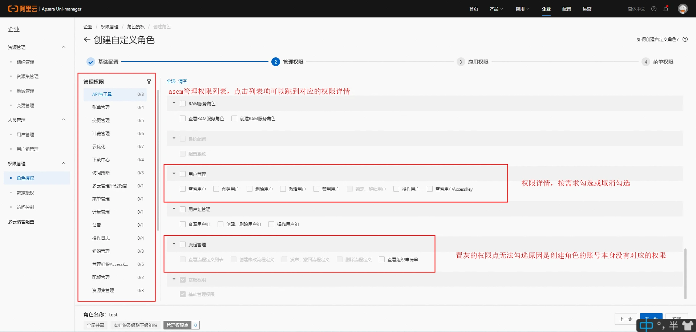

   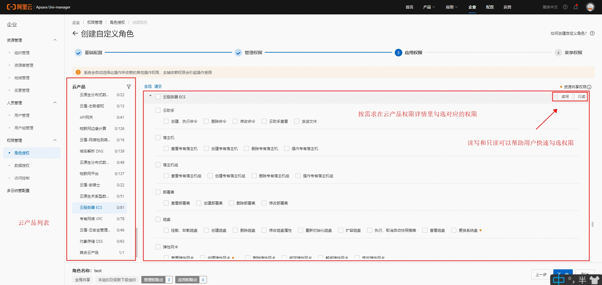

   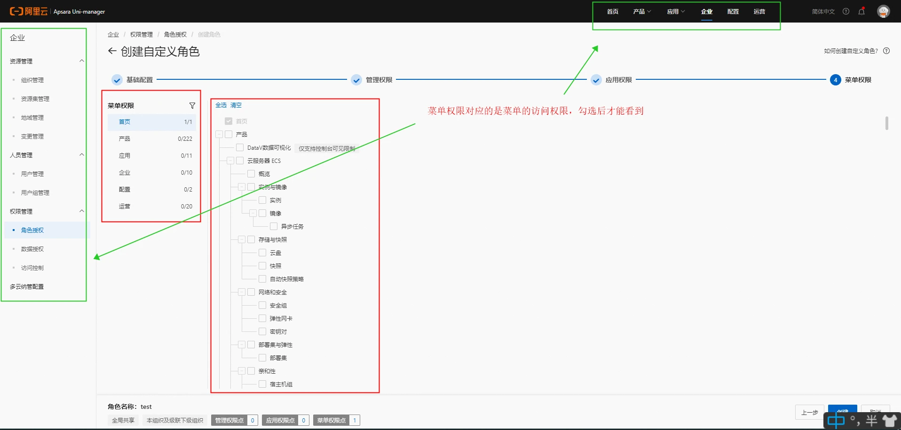

也可访问官网专有云帮助中心，切换对应的版本，产品选择“统一云管中心”找到《Apsara Uni-manager运营控制台 用户指南》，在企业中心 > 权限管理 > 角色授权中查看“创建角色”章节。

# 4.RAM角色授权咨询

本文介绍RAM角色授权咨询。

**适用版本**

- 专有云版本：v3.12及以后版本。

- 产品：ASCM。

- 文档公开性：对外。

- **如何给用户绑定RAM授权？**

  可以查看《如何在ASCM控制台进行RAM授权》，（备注：如果该文档无法访问，请联系阿里云技术支持获取。）

- **RAM角色授权和RAM授权的区别。**

  RAM角色授权是创建RAM实体供组织内用户、云服务扮演，RAM授权是直接给用户（子账号）授权。

- **已经取消掉自定义角色的授权规则，并且RAM也没生效，为什么还有权限？**

  通过以下方式排查用户权限是否成功移除：

  - **ram portal 访问**

    <ol type="a">

    <li>

    登录飞天基础运维平台 >  资源申请报表 > 资源表状态，筛选。

    筛选条件：

    - 服务角色：ram-ramService.\*\*\*\*\*\*\*\*Service#

    - Type：dns

    </li>

    <li>

    按照ak查询即可得用户信息。

    </li>

    </ol>

# 5.查询ASCM组织相关信息

本文介绍查询ASCM组织相关信息的方法。

**如何查询ASCM组织相关信息？**

参见以下步骤（以v3.18.2版本为示例）：

**查看组织信息**

查看组织的层级架构、基本信息、资源集、用户和用户组。

1. 登录Apsara Uni-manager运营控制台。

2. 在页面顶部菜单栏上，单击**企业**。

3. 在左侧导航栏中选择**资源管理** > **组织管理**。

4. （可选）在**组织管理**页面左侧**组织架构**上方的文本框中，填写组织名称进行模糊查找。

5. 在左侧**组织架构**查看组织层级关系和名称。

   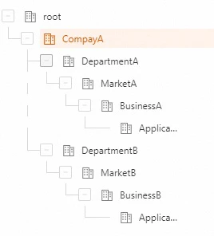

6. 左侧单击组织名称后，在右侧查看组织信息。

   <table>
     <tr>
       <th width="89">区域</th>
       <th>说明</th>
     </tr>
     <tr>
       <td>基本信息</td>
       <td>展示<strong>组织名称</strong>、<strong>组织ID</strong>、<strong>组织层级</strong>、<strong>描述</strong>、<strong>第三方认证</strong>、<strong>创建人</strong>、<strong>创建时间</strong>等。 说明只有一级组织才会展示<strong>第三方认证</strong>，如果有绑定会展示具体的IdP服务名称。</td>
     </tr>
   </table>

   <table>
     <tr>
       <th width="105">资源集列表</th>
       <th>展示该组织下的资源集信息，包括<strong>资源集名称/ID</strong>、<strong>组织名称</strong>、<strong>用户组</strong>、<strong>创建人</strong>、<strong>创建时间</strong>等。 说明 • 单击资源集名称，跳转到<strong>资源集详情</strong>页面的资源列表页签。 • 单击列表上方的<strong>创建资源集</strong>，可新增资源集。</th>
     </tr>
     <tr>
       <td>用户列表</td>
       <td>展示该组织下的用户信息，包括<strong>用户名</strong>、<strong>显示名</strong>、<strong>组织</strong>、<strong>状态</strong>、<strong>角色</strong>等。 说明 • 单击用户名，可跳转至<strong>用户详情</strong>页面。 • 单击列表上方的<strong>创建用户</strong>，可新增用户。 • 单击<strong>操作</strong>列的<strong>禁用</strong>/<strong>启用</strong>，可以禁用或启用用户账号。 • 单击<strong>操作</strong>列的<strong>删除</strong>，可以删除用户。</td>
     </tr>
     <tr>
       <td>用户组列表</td>
       <td>展示该组织下的用户组信息，包括<strong>用户组名称/ID</strong>、<strong>组织</strong>、<strong>角色</strong>、<strong>用户</strong>、<strong>绑定资源集</strong>、<strong>创建时</strong><strong>间</strong>等。 说明 • 单击列表上方的<strong>创建用户组</strong>，可新增用户组。 • <strong>用户</strong>列上的数字，表示已加入该用户组的用户数量。鼠标悬浮在数字上，可查看具体的用户。</td>
     </tr>
   </table>

其他版本可在专有云帮助中心切换对应版本号，找到《Apsara Uni-manager运营控制台 用户指南》中企业中心 > 资源管理 > 组织管理 > 管理组织企业中心 > 资源管理 > 组织管理 > 查看组织信息企业中心 >组织管理 > 查看组织信息。

# 6.如何查看ASCM规格

本文主要介绍查询ASCM集群规格的操作方法。

**适用版本**

- 专有云版本：v3.12、v3.13、v3.14、v3.15、v3.16、v3.17、v3.18。

- 产品：ASCM。

- 文档公开性：对外。

**问题描述**

如何查询ASCM集群规格。

**问题原因**

功能咨询问题。

**解决方案**

- **v3.12、v3.13、v3.14、v3.15、v3.16、v3.17版本：**

  <ol type="i">

  <li>

  登录飞天基础运维平台。

  </li>

  <li>

  集群搜索ASCM > 集群配置文件。

  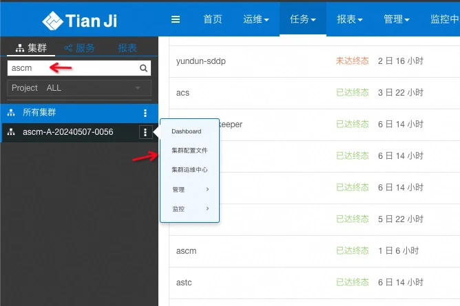

  </li>

  <li>

  查看kv.conf，ClusterScaleFlag值为当前集群规格。

  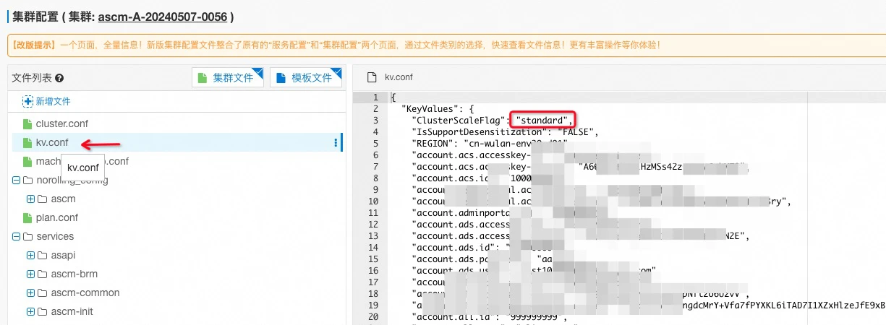

  </li>

  </ol>

- **v3.18版本及以后：**

  <ol type="i">

  <li>

  登录飞天基础运维平台。

  </li>

  <li>

  左侧菜单栏选择资源管理 > 产品集群运维 > 搜索ASCM > 选择集群详情。

  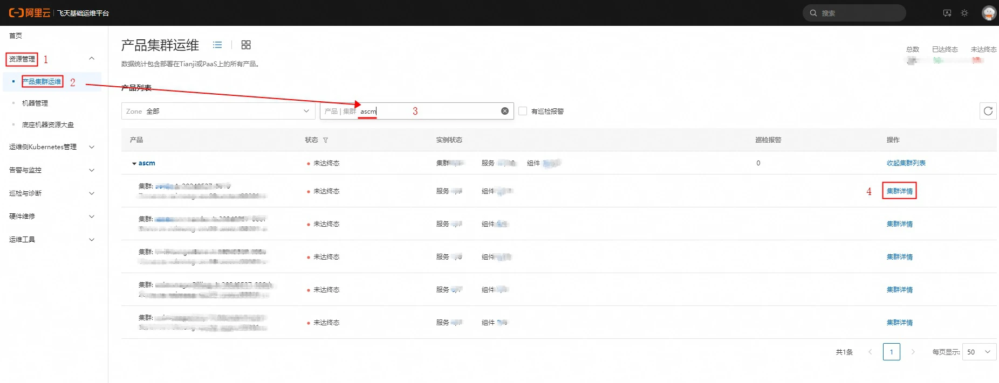

  </li>

  <li>

  进入集群详情页 > 选择终态配置，找到kv.conf文件查看，ClusterScaleFlag值为当前集群规格。

  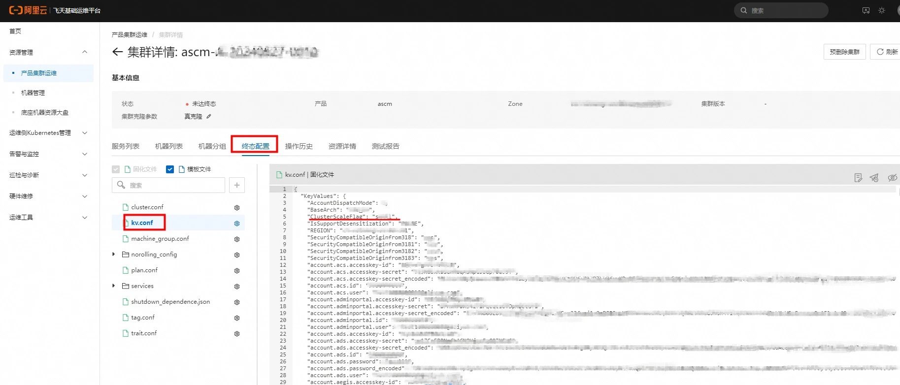

  </li>

  </ol>

# 7.ASCM如何授权子账号产品权限

本文提供自定义角色授权方法的文档查看方法，解决授权子账号产品权限问题。

**ASCM如何授权子账号产品权限？**

通过自定义角色授权方式。参考如下操作方法：

- 创建自定义的角色，按自己的需求一步一步操作。

  

  

  

  

也可访问官网专有云帮助中心，切换对应的版本，产品选择“统一云管中心”找到《Apsara Uni-manager运营控制台 用户指南》，在企业中心 > 权限管理 > 角色授权中查看“创建角色”和“管理角色”章节。适用于所有版本。

# 8.如何查询apsara平台调用接口的日志

本文介绍如何查询apsara平台调用接口的日志。

**适用版本**

- 专有云版本：适用所有版本。

- 产品：ASCM。

- 文档公开性：对外。

**问题描述**

怎么查询apsara平台调用接口的日志？

**问题原因**

功能咨询问题。

**解决方案**

1. 登录Apsara Uni-manager运维控制台。

2. 在顶部导航栏，选择**平台运维** > **管控服务运维** > **专有云诊断系统·ASD**。

3. 在左侧导航栏，选择**链路诊断** > **调用链分析**，根据TraceId，在调用链分析中查看问题链路。

   > **说明**
   >
   > 可以通过设置TraceId、时间范围快速查询。

   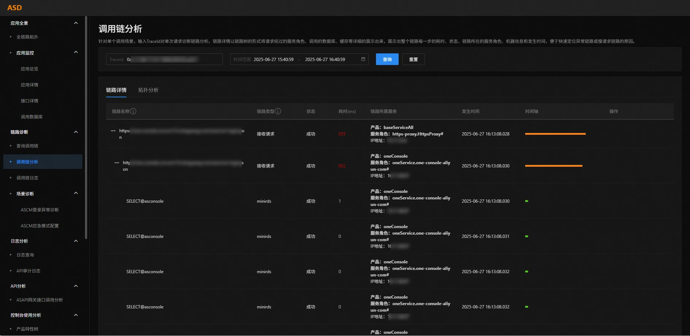

4. 在左侧导航栏，选择**链路诊断** > **调用链日志**，查询当前TraceId经过的管控服务日志。

   > **说明**
   >
   > 可以通过设置TraceId、时间范围和关键词快速查询。

   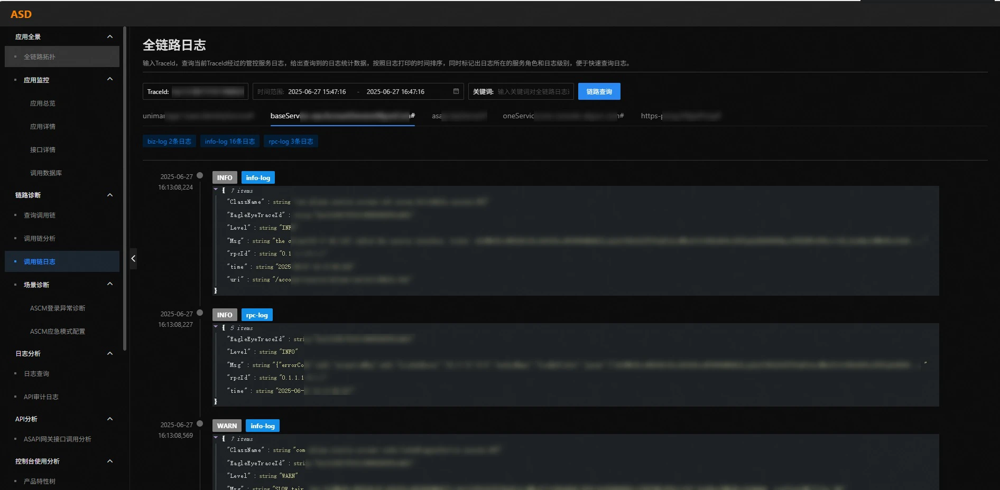

5. 在左侧导航栏，选择**日志分析** > **日志查询**，根据TraceId可快速并发查询多产品、服务角色下的各类型日志，帮助快速排查解决问题。

   > **说明**
   >
   > 可以通过设置产品、链路TraceId、查询参数、时间范围条件以及仅显示异常日志进行查询。

   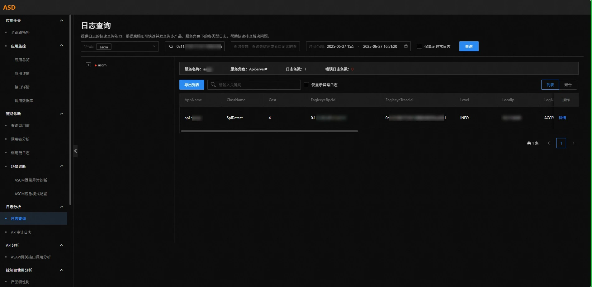

6. （可选）在左侧导航栏，选择**日志分析** > **API审计日志**，查看ASAPI网关记录的接口调用日志，可快速查询接口请求的输入和输出，便于排查异常请求和原因。

   > **说明**
   >
   > 可以通过设置TraceId、RpcId、Region、产品名、接口名、用户名、错误码、ak、来源IP、时间范围、状态、耗时大于、来源服务、关键词条件进行审计日志查询。

   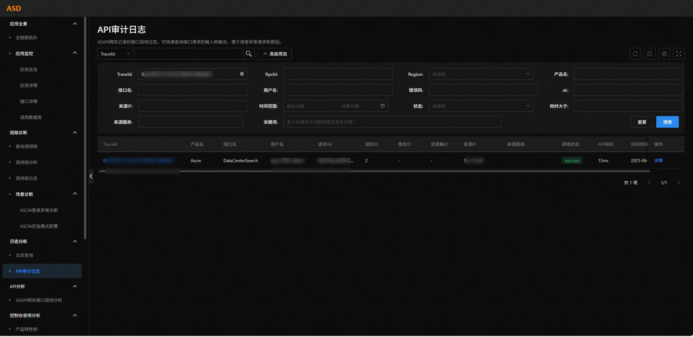

# 9.ASCM如何创建只读权限角色

本文介绍ASCM如何创建只读权限角色？

**适用版本**

- 专有云版本：v3.12及以后版本。

- 产品：ASCM。

- 文档公开性：对外。

**问题描述**

ASCM如何创建只读权限角色。

**问题原因**

咨询问题。

**解决方案**

1、使用管理员账号登录ascm，在企业 > 角色授权页面查看是否有满足要求的角色（ascm的预置角色有对应的权限描述），如果有的话将角色授权给用户（用户组）即可。

2、如果没有能满足要求的角色可以创建自定义的角色，按自己的需求一步一步操作即可。

详细内容参见官网文档：《创建角色》、《管理角色》、《管理系统用户》。

# 10.如何修改、删除资源集

本文主要介绍如何修改、删除资源集的操作方法。

**如何修改、删除资源集？**

修改/删除资源集操作步骤（以v3.18.2版本示例）：

1. 登录Apsara Uni-manager运营控制台。

2. 在顶部菜单栏，单击**企业**。

3. 在左侧导航栏，选择**资源管理** > **资源集管理**。

4. 通过列表上方的组织下拉列表、标签筛选或在文本框输入资源集名称，可快速查找资源集。

5. 单击资源集**操作**列的  ，选择**删除**。

6. 在**删除提示**对话框，单击**确定**。

其他版本登录官网专有云帮助中心，切换对应的版本，找到《Apsara Uni-manager运营控制台 用户指南》中企业中心 > 资源管理 > 资源集管理 > 管理资源集 章节查看。适用于v3.12及以后版本。

# 11.日志转存中心和日志转存设置有什么本质区别？

本文主要解释日志转存中心和日志转存设置的区别。

**日志转存中心和日志转存设置有什么本质区别？**

在日志转存中心进行日志转存设置，也就是设定需要导出的操作日志的范围。具体可参见《Apsara Uni-manager运营控制台 用户指南》中安全中心 > 事件查询管理操作日志 查看操作日志 章节。适用于v3.16.2版本及以后。

# 12.如何创建仅能访问quickbi产品的用户

本文主要介绍如何创建只能访问quickbi产品的用户的解决方法。

**适用版本**

- 专有云版本：v3.12、v3.13、v3.14、v3.15、v3.16、v3.17、v3.18。

- 产品：ASCM。

- 文档公开性：对外。

**问题描述**

如何给账号配置权限。

**问题原因**

咨询问题。

**解决方案**

1、使用管理员账号登录ascm，在企业 > 角色授权页面查看是否有满足要求的角色（ascm的预置角色有对应的权限描述），如果有的话将角色授权给用户（用户组）即可。

2、如果没有能满足要求的角色可以创建自定义的角色，按自己的需求一步一步操作即可。

3、详细内容参见官网文档：《创建角色》、《管理角色》、《管理系统用户》。

# 13.如何在新创建的资源集上面，单独添加已有的ECS资源？

本文主要介绍在新创建的资源集上面，单独添加已有的ECS资源的解决方法。

**如何在新创建的资源集上面，单独添加已有的ECS资源？**

只需要将ECS实例变更归属到新的资源集里就可以了。

变更归属资源的操作步骤参照以下内容，以v3.18.2版本示例：

1. 登录Apsara Uni-manager运营控制台。

2. 在顶部菜单栏上，单击**企业**。

3. 在左侧导航栏中，选择**资源管理 > 变更管理**。

4. （可选）在组织结构上方的文本框中，填写组织名称进行模糊查找。

5. 变更资源。

   <ol type="i">

   <li>

   单击目标组织前的  图标，选择资源集。

   </li>

   <li>

   在页面右侧，选择**产品类型**、**资源类型**。

   </li>

   <li>

   变更资源实例。

   - 单个资源实例变更：在资源实例列表中，单击目标资源实例所在行的**变更归属**。

   - 批量资源实例变更：在资源实例列表中，勾选需要多个目标资源实例，单击列表下方的**批量变更归属**。

   </li>

   <li>

   在**变更资源集到**下拉列表中，选择目标资源集。

   </li>

   <li>

   单击**确定**。

   </li>

   </ol>

   > **说明**
   >
   > 资源变更不会影响原组织和人员信息的变更，仅资源实例转到目标组织中。

也可自行在专有云帮助中心切换对应版本后，找到《Apsara Uni-manager运营控制台 用户指南》中企业中心 > 资源管理 > 变更管理章节，依照变更资源内容进行操作。适用于所有版本。

# 14.如何使用AK查询用户名称

本文介绍如何使用AK查询用户名称。

**适用版本**

- 专有云版本：v3.12及之后版本。

- 产品：ASCM。

- 文档公开性：对外。

**问题描述**

如何使用AK查询用户名称？

**问题原因**

功能咨询问题。

**解决方案**

- **ram portal 访问**

  <ol type="i">

  <li>

  登录飞天基础运维平台 >  资源申请报表 > 资源表状态，筛选。

  筛选条件：

  - 服务角色：ram-ramService.\*\*\*\*\*\*\*\*Service#

  - Type：dns

  </li>

  <li>

  按照ak查询即可得用户信息。

  </li>

  </ol>

# 15.数据库代理界面异常

本文介绍数据库代理界面异常的解决方法。

**适用版本**

- 专有云版本：v3.12及以后版本。

- 产品：ASCM。

- 文档公开性：对外。

**问题描述**

数据库代理界面异常。

**问题原因**

创建的自定义角色有问题，有的权限点没添加。

**解决方案**

- 指导创建自定义角色，并添加读写权限。

- 创建自定义角色操作步骤（以v3.18.2版本为例）：

  <ol type="i">

  <li>

  登录Apsara Uni-manager运营控制台。

  </li>

  <li>

  在顶部菜单栏上，单击**企业**。

  </li>

  <li>

  在左侧导航栏中，选择**权限管理> 角色授权**。

  </li>

  <li>

  单击<strong>创建自定义角色，</strong>进入**创建自定义角色**页面，

  </li>

  <li>

  设置**基础配置**，单击**下一步**。

  **运营管理员创建自定义角色**

  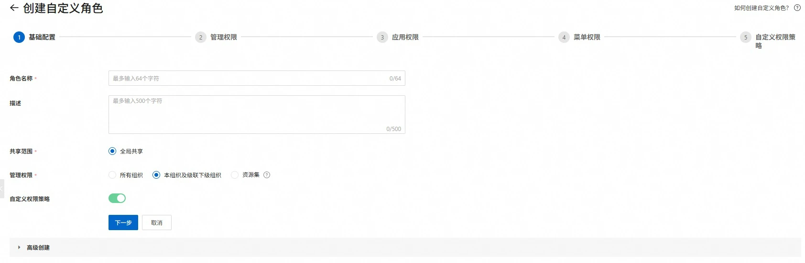

  **组织管理员创建自定义角色**

  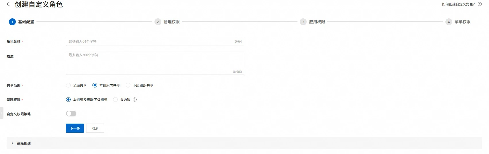

  <table>
    <tr>
      <th width="137">参数</th>
      <th>说明</th>
    </tr>
    <tr>
      <td>角色名称</td>
      <td>角色的名称。</td>
    </tr>
    <tr>
      <td>描述</td>
      <td>（可选）角色描述信息。</td>
    </tr>
    <tr>
      <td>共享范围</td>
      <td>代表用户进行角色授权时，该角色的可见性范围。运营管理员创建自定义角色时仅支持选择<strong>全局共享</strong>。 • <strong>全局共享</strong>：表示角色的共享范围为所有组织。 • <strong>本组织内共享</strong>：表示角色的共享范围为本级组织。 • <strong>下级组织共享</strong>：表示角色的共享范围为本级及下级组织使用。</td>
    </tr>
    <tr>
      <td>管理权限</td>
      <td>代表该角色能管理的资源范围，结合被授权给的用户所在组织，可管理对应范围的资源。组织管理员创建自定义角色时，仅支持选择<strong>本组织及级联下级组织</strong>和<strong>资源集</strong>。 • <strong>所有组织</strong>：表示此角色可以管理所有组织内的云产品资源。 • <strong>本组织及级联下级组织</strong>：表示此角色可以管理本组织及级联下级组织下的云资源。 • <strong>资源集</strong>：表示此角色只能管理某资源集下的云资源。关于资源集的约束限制可参见《资源集管理范围的约束限制》。</td>
    </tr>
    <tr>
      <td>自定义权限策略</td>
      <td>可启用或关闭自定义权限策略。 ：表示关闭。关闭后不支持定义权限策略。 ：表示启用。启用后支持自定义权限策略。</td>
    </tr>
  </table>

  </li>

  <li>

  设置**管理权限**，单击**下一步**。

  管理权限是为角色设置控制台相关维度的操作权限，如对组织、用户、资源集等操作进行授权。

  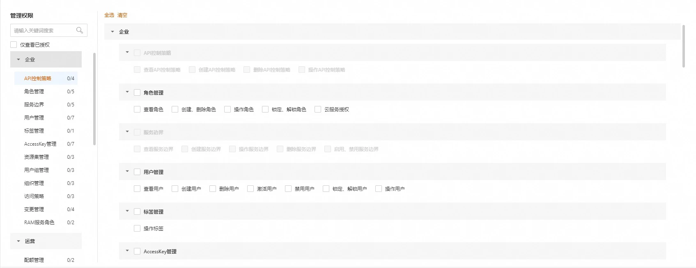

  </li>

  <li>

  设置**应用权限**，单击**下一步**。

  应用权限是为角色设置云产品相关权限点，主要用于决定用户需要哪些云产品的哪些操作权限。如只需要为用户设置云服务器ECS实例的查看权限，则只需要在界面上勾选云服务器ECS实例下的查看实例权限即可。

  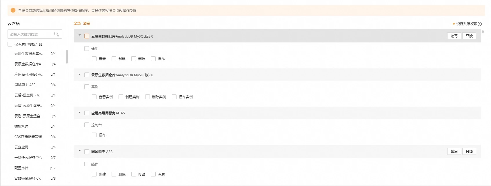

  </li>

  <li>

  设置**菜单权限**，单击**下一步**或**创建**。

  菜单权限是为角色设置菜单项来控制角色可查看到的菜单，用来实现入口的屏蔽。

  > **重要**
  >
  > 如果是控制台用户，在管理权限和应用权限中如果勾选了对应的平台操作权限和云产品权限，则需要同样赋予菜单权限，避免用户无法查看对应入口。

  

  </li>

  <li>

  （可选）设置**自定义权限策略**，单击**创建**。

  > **重要**
  >
  > 在基础配置时启用自定义权限策略后，才可设置自定义权限策略。

  自定义权限策略是通过设置应用RAM Action来精确地描述授权的资源以及对具体资源的操作。应用RAM Action的设置包括Allow和Deny，Allow表示允许操作，Deny表示拒绝操作。权限策略中既有Allow又有Deny时，遵循Deny优先原则。

  RAM Action的格式为&lt;ram-code>:&lt;action-name>，如果有多个Action则需要用逗号（,）进行分割。

  - &lt;ram-code>表示的是云产品的RAM代码，一般为云产品的编码code。

  - &lt;action-name>表示的是云产品的开放API操作接口名称。

  如在Allow中设置了 `oss:ListBuckets,ecs:Describe*,rds:Describe*` ，表示该角色可以列举对象存储服务OSS所有存储桶（Bucket）的操作权限、对云服务器ECS所有以Describe开头的API操作以及对云数据库RDS所有以Describe开头的API操作。

  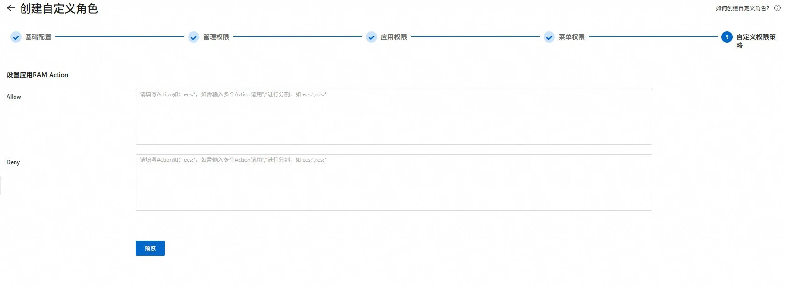

  </li>

  <li>

  创建成功，在**创建自定义角色**弹框单击**完成**。

  也可以单击弹框中的**立即授权**，立即进入**授权人员**页面，将角色授权给用户或用户组。

  </li>

  </ol>

其他版本通过专有云帮助中心，切换对应版本，在《Apsara Uni-manager运营控制台 用户指南》中 企业中心 > 权限管理 > 角色授权 > 创建角色 企业中心 > 权限管理 > 角色管理 > 创建自定义角色 企业中心> 权限管理 > 角色管理 > 创建角色企业中心 > 角色管理 > 创建自定义角色 去查看具体的操作详情。

# 16.能否通过aliyun cli获取实例列表信息

本文介绍能否通过aliyun cli获取实例列表信息，及在ascm平台应该如何获取实例列表信息。

**适用版本**

- 专有云版本：所有版本。

- 产品：ASCM。

- 文档公开性：对外。

**问题描述**

如何通过aliyun cli获取ECS列表信息。

**问题原因**

功能咨询问题。

**解决方案**

专有云不支持cli工具，可在Apsara Uni-manager运营控制台的报表下载中获取，具体操作步骤如下：

1. 登录Apsara Uni-manager运营控制台。

2. 在顶部菜单栏，选择**运营** > **数据分析**。

3. 在左侧导航栏，选择**自定义分析** > **产品数据分析**。

4. 在云产品下拉列表选择云服务器ECS。

5. 在**资源报表**下选择ECS实例，查看ECS实例信息。

   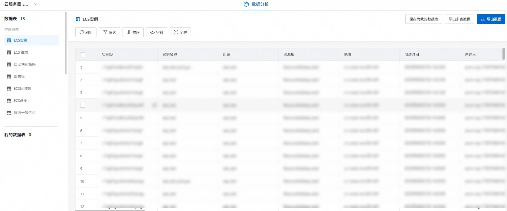

6. 导出ECS实例信息。

   - 方式一：单击页面上方的**导出数据**，设置导出的**任务名称**，但是**确定**。

     > **说明**
     >
     > 如果只导出部分实例，可以在列表中勾选需要导出的实例，再单击导出数据，**导出范围**选择**所选**即可。

     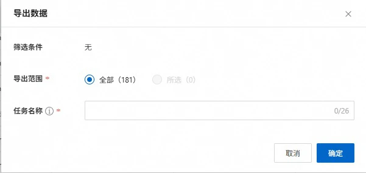

   - 方式二：单击页面上方的**导出多表数据**，设置导出的**任务名称**，**报表类型**选择**资源报表**，**报表**选择**ECS实例**，单击**确定**。

     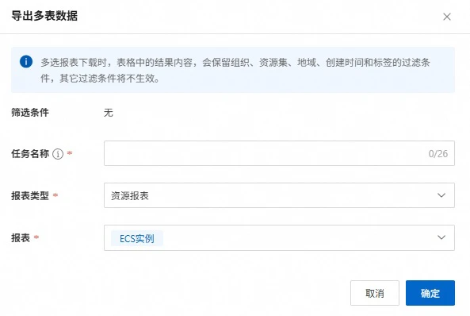

7. 在**报表管理** > **报表下载**页面，找到创建的报表下载任务，等待任务已完成，即可单击**操作**列的**下载报表**，将报表下载至本地进行保存。

   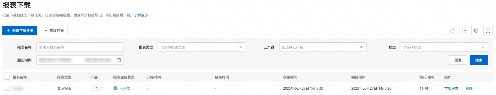

其他版本在官网专有云帮助中心，切换对应版本后，参见《Apsara Uni-manager 运营控制台 用户指南》进行操作。

# 17.自定义角色已授权，创建实例时仍提示没有权限

本文介绍自定义角色授权之后，创建实例时还提示没有权限的解决方法。

**适用版本**

- 专有云版本：全部版本。

- 产品：ASCM。

- 文档公开性：对外。

**问题描述**

自定义角色已经授权，创建实例时还提示没有权限。

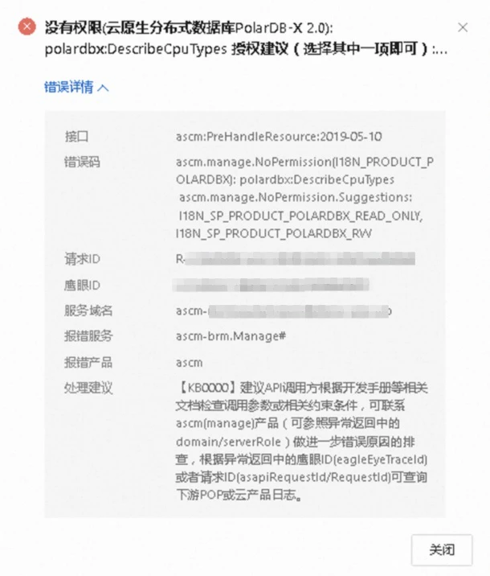

**问题原因**

功能咨询问题。

**解决方案**

- 查看错误弹窗的处理建议，如果没有，可根据请求ID或者鹰眼ID在api审计里查询。

  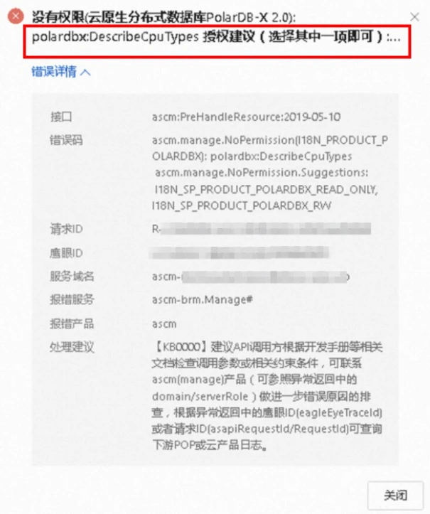

- 或者也可以通过F12查询接口的错误详情。例如，该错误提示的授权建议为：开启“读写/只读”其中一项即可。

  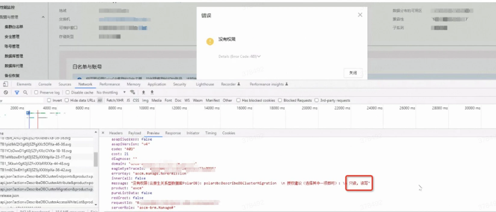

# 18.超时自动登出功能咨询

本文解释超时自动登出最小时间问题。

**适用版本**

- 专有云版本：v3.16.2（SP022及以后）版本、3.18.3SP01及以后版本。

- 产品：ASCM。

- 文档公开性：对外。

**问题描述**

超时自动登出最小是否能改成10分钟？

**问题原因**

功能咨询问题。

**解决方案**

可以。无操作退出时长范围为5分钟-24小时，支持设置成10分钟。

1. 平台管理员登录Apsara Uni-manager运营控制台。

2. 在顶部菜单栏，选择**配置**。

3. 在左侧导航栏，选择**安全策略**。

4. 在**安全策略**页面，单击**登录控制**页签。

5. 在**登录控制**页签下，设置**无操作退出时长**为10分钟。

   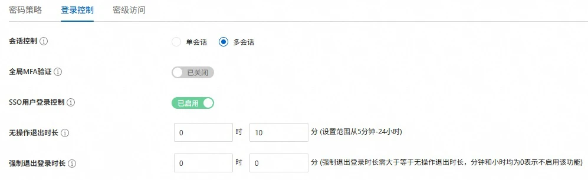

6. 单击**保存**。

# 19.管理员授权访问咨询

本文介绍管理员授权访问的咨询问题。

**为什么一级组织成员有管理员授权登录，二级组织成员没有？如何给二级组织成员设置管理员授权登录？**

管理角色授权访问只能是一级组织管理员角色或者全局角色，不支持设置二级组织成员为管理员授权访问。因为跳转逻辑不同：有按照一级组织管理员来的，有按照组织管理员来的。适用于v3.12及以后版本。

# 20.如何创建安全类角色

本文介绍创建安全类角色的方法。

**如何创建安全类角色？**

需要登录**全局组织安全管理员**账号，在企业 > 角色授权里可以创建安全相关的角色。详细信息，请参见《Apsara Uni-manager运营控制台 用户指南》中创建角色章节。适用于v3.12及以后版本。

# 21.如何统计成员列表和对应的资源集

本文介绍统计成员列表和对应资源集的方法。

**如何将成员列表和对应的资源集统计出来？**

调用ListAscmUsersInsideResourceGroup接口来获取资源集下的用户列表。适用v3.12及以后版本。

ListAscmUsersInsideResourceGroup接口文档访问专有云帮助中心 ，在《Apsara Uni-manager运营控制台 开发指南》中API列表 > 企业中心 > 资源集管理，可找到ListAscmUsersInsideResourceGroup的接口文档；ASAPI调用，方法参照《Apsara Uni-manager运营控制台 开发指南》中HTTP调用方式章节查看请求结构及签名机制内容；POP网关调用，方法参照《Apsara Uni-manager运营控制台 开发指南》中通过POP网关调用专有云API 章节内容。

# 22.如何通过接口获取实例的磁盘详情

本文介绍获取ecs实例的磁盘详情的方法。

**适用版本**

- 专有云版本：v3.16.2及以后版本。

- 产品：ASCM。

- 文档公开性：对外。

**问题描述**

如何通过接口获取实例的磁盘详情。

**问题原因**

功能咨询问题。

**解决方案**

不需要通过接口获取，在Apsara Uni-manager运营控制台的报表下载里可以导出磁盘报表。具体操作步骤如下（以v3.18.2版本为示例）：

1. 登录Apsara Uni-manager运营控制台。

2. 在菜单中选择**运营** > **数据分析**。

3. 在页面左侧导航栏中选择**报表管理** > **报表下载**。

4. （可选）输入目标**报表名称**，选择**报表类型**、**云产品**、**状态**、**起止时间**，单击**搜索**进行筛选。

5. 在**报表下载**页面，执行相关操作。

   | 操作任务 | 操作步骤 |
   | --- | --- |

   <table>
     <tr>
       <td>创建下载任务</td>
       <td>i. 单击<strong>创建下载任务</strong>。ii. 在<strong>创建下载任务</strong>对话框中，填入相应信息。 • <strong>报表名称</strong>：填入当前报表的名称。 • <strong>报表类型</strong>：选择报表类型。 说明当报表类型为<strong>组织报表</strong>、<strong>资源集报表</strong>、<strong>访问策略报表</strong>、<strong>用户报表</strong>、<strong>用户组报</strong><strong>表</strong>、<strong>角色报表</strong>时，仅需填写报表名称，即可创建下载任务。 • <strong>产品</strong>：选择目标云产品。 说明可在产品列表中单击<strong>全选</strong>，选择当前报表支持的全部云产品。 • <strong>起止时间</strong>：选择报表数据的起止时间。 说明仅当报表类型为<strong>计量统计报表</strong>或<strong>账单详情报表</strong>时，配置此项。 • <strong>组织资源集</strong>：选择目标组织资源集。 • <strong>区域</strong>：选择目标地域。 • <strong>账期</strong>：选择目标账期时间。 说明仅当报表类型为<strong>账单详情报表</strong>时，配置此项。 • <strong>发送用户</strong>：勾选<strong>完成后发送邮件</strong>后，选择需要发送的用户，可选择多个。iii. 单击<strong>确定</strong>。</td>
     </tr>
     <tr>
       <td>下载报表</td>
       <td>单击目标报表<strong>操作</strong>列的<strong>下载报表</strong>。 说明若报表状态为<strong>已失败</strong>或<strong>已取消</strong>，可单击<strong>重试</strong>，进行重试任务。当报表状态转为<strong>已完</strong><strong>成</strong>时，即可单击<strong>下载报表</strong>进行下载。</td>
     </tr>
     <tr>
       <td>删除报表</td>
       <td>• 单个删除 a. 单击目标报表<strong>操作</strong>列的<strong>删除</strong>。 b. 在<strong>删除任务</strong>对话框中，单击<strong>确定</strong>。 • 批量删除 a. 选中目标报表名称前的复选框。 b. 在列表左下方单击<strong>删除</strong>，单击<strong>确定</strong>。</td>
     </tr>
   </table>

其他版本在官网专有云帮助中心，切换对应版本后，找到《Apsara Uni-manager 运营控制台 用户指南》中 运营中心 > 数据分析 > 报表管理 > 报表下载 运营中心 > 统计分析 > 下载中心运营中心 > 统计分析> 报表下载，在报表类型选择“资源列表”，再选“ECS磁盘”即可。

# 23.如何将super，admin账号的权限赋予客户账号

本文介绍如何将super，admin账号的权限赋予客户账号。

**如何将super，admin账号的权限赋予客户账号？**

super和admin都是预置用户。super的角色为平台管理员，此用户及角色有唯一性，不可复制；admin的角色为运营管理员，可以使用super登录ASCM，在企业 > 用户管理 > 系统用户下，创建角色为运营管理员的新用户。适用于所有版本。

# 24.ASCM开启双因素的方案

本文介绍ASCM开启双因素的方案。

**ASCM开启双因素的方案**

**绑定虚拟MFA设备**

1. 登录Apsara Uni-manager运营控制台。

2. 在系统页面右上角，单击当前登录用户的头像，单击**个人信息**。

3. 单击<strong>多因素认证设备（MFA）</strong>区域右侧的**绑定虚拟MFA设备**。

4. 在**绑定虚拟MFA设备**页面中，按页面提示步骤绑定MFA设备。绑定成功后，MFA认证状态为已开启，设备状态为已绑定。

   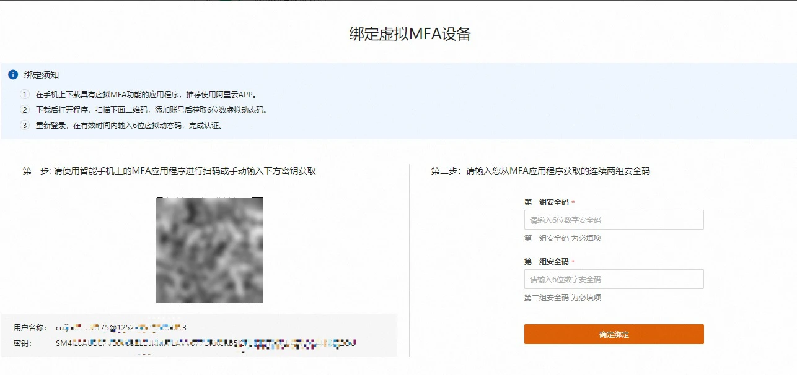

   > **说明**
   >
   > 绑定虚拟MFA设备成功后，下次登录Apsara Uni-manager运营控制台，输入完用户名和密码之后，您还需要再输入MFA码（6位数字），验证正确后才能成功登录。

**强制开启MFA**

管理员侧（平台管理员、运营管理员和组织管理员等角色）可以查看其所有管理的用户是否开启了MFA认证，如果没开启，可以替用户强制开启MFA。

1. 登录Apsara Uni-manager运营控制台。

2. 在顶部菜单栏中单击**企业**。

3. 在左侧导航栏中单击**人员管理** > **用户管理**。

4. 单击**系统用户**页签。

5. 在目标用户**操作**列中单击  ，选择**MFA认证设置**。

6. 在MFA认证设置对话框中，开启**MFA认证设置**，单击**确定**。

   > **说明**
   >
   > 只能替用户强制开启，不允许强制关闭。
   >
   > - 在未开启之前，MFA认证状态为**未启用未绑定**。
   >
   > - 开启后对应的MFA状态为**已启用但未绑定**。强制开启后，用户登录时需要跳转到MFA页面进行绑定操作，成功后才能进入系统。

其他版本及详细信息通过专有云帮助中心，切换对应版本，在《Apsara Uni-manager运营控制台 用户指南》中安全中心 > 多因素认证 ；个人信息管理 > MFA多因子认证 > 绑定并开启虚拟MFA设备 ，适用于v3.14及以上版本。

# 25.如何把某个ECS分配给指定用户

本文说明是否可以将某个ECS分配给指定用户。

**如何把某个ECS分配给指定用户？**

ASCM资源归属于资源集，资源管理权限也是根据资源集划分的。如果想管理资源集里所有的实例，可以授予用户资源集或资源集所属组织的权限；不支持管理资源集中部分ECS实例。适用于所有版本。

# 26.资源变更归属能否跨组织变更

本文解释资源变更归属能否跨组织变更。

**资源变更归属能否跨组织变更？**

资源变更可以变更到同一一级组织的资源集下，无法跨一级组织变更。适用于v3.14及以后版本。
