阿里云  
专有云  
飞天助理 用户指南  
产品版本：v3.18.6-SP2607  
文档版本：20260729

**目录**

- [1.飞天助理访问控制](#section-1)
- [2.飞天助理配置](#section-2)
    - [2.1. 个性化配置](#section-2-1)
    - [2.2. 准确性评测](#section-2-2)
        - [2.2.1. 评测用例管理](#section-2-2-1)
            - [2.2.1.1. 添加用例](#section-2-2-1-1)
            - [2.2.1.2. 管理用例](#section-2-2-1-2)
        - [2.2.2. 评测集管理](#section-2-2-2)
            - [2.2.2.1. 创建评测集](#section-2-2-2-1)
            - [2.2.2.2. 管理评测集](#section-2-2-2-2)
        - [2.2.3. 评测任务管理](#section-2-2-3)
            - [2.2.3.1. 创建评测任务](#section-2-2-3-1)
            - [2.2.3.2. 管理评测任务](#section-2-2-3-2)
        - [2.2.4. 准确率分析](#section-2-2-4)
    - [2.3. 模型配置](#section-2-3)
    - [2.4. 知识库管理](#section-2-4)
        - [2.4.1. 创建知识库](#section-2-4-1)
        - [2.4.2. 编辑知识库](#section-2-4-2)
        - [2.4.3. 配置分块策略](#section-2-4-3)
        - [2.4.4. 删除知识库](#section-2-4-4)
        - [2.4.5. 导入文件](#section-2-4-5)
        - [2.4.6. 查看文件详情](#section-2-4-6)
        - [2.4.7. 入库文件](#section-2-4-7)
        - [2.4.8. 删除文件](#section-2-4-8)
        - [2.4.9. 查看知识图谱](#section-2-4-9)
        - [2.4.10. 查看思维导图](#section-2-4-10)
        - [2.4.11. 检索配置和检索测试](#section-2-4-11)
    - [2.5. 辅助云资源管理](#section-2-5)
        - [2.5.1. 辅助创建](#section-2-5-1)
        - [2.5.2. 辅助变配](#section-2-5-2)
- [3.飞天助理应用](#section-3)
    - [3.1. 飞天助理对话](#section-3-1)
    - [3.2. 技能管理](#section-3-2)
    - [3.3. 专家管理](#section-3-3)
    - [3.4. 记忆管理](#section-3-4)
    - [3.5. 定时任务管理](#section-3-5)
    - [3.6. 划词问答](#section-3-6)
    - [3.7. AI智能分析](#section-3-7)
    - [3.8. AI账单分析](#section-3-8)
    - [3.9. AI计费规则分析](#section-3-9)
    - [3.10. 统一资源检索](#section-3-10)
- [4.飞天助理运营分析](#section-4)
- [5.操作审计](#section-5)
- [6.附录](#section-6)
    - [6.1. 登录Apsara Uni-manager运营控制台](#section-6-1)

# 1.飞天助理访问控制

飞天助理支持通过角色的权限点管理实现用户访问控制及功能点权限分配。

**操作步骤**

1. 管理员登录Apsara Uni-manager运营控制台。

2. 在顶部菜单栏，选择**企业**。

3. 在左侧导航栏，选择**权限管理** > **角色授权**。

4. 单击**创建自定义角色**。

5. 依次完成角色基础配置、管理权限、应用权限、菜单权限和自定义权限策略。

   - 基础配置、管理权限、菜单权限和自定义权限策略的详细说明请参见《统一云管平台 用户指南》中的“管理自定义角色”章节。

   - 在**应用权限**中，找到飞天助理产品，根据业务需要，进行角色权限勾选。

     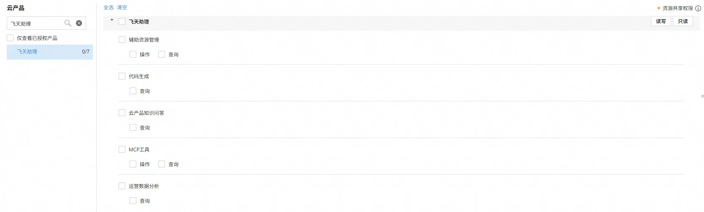

6. 角色创建完成后，将角色授权给用户。

# 2.飞天助理配置

## 2.1. 个性化配置

对智能助手进行启用控制以及AI助手内容的个性化设置。

**前提条件**

操作用户默认为运营管理员用户。

**操作步骤**

1. 登录Apsara Uni-manager运营控制台。

2. 在顶部菜单栏选择**配置**。

3. 在左侧导航栏选择**飞天助理** > **个性化配置**。

4. 在**个性化配置**页面，根据需要对智能助手配置进行更新。当配置需要恢复出厂设置时，可单击页面下方的**恢复出厂设置**，重新登录后生效。

   配置项

   说明

   用于控制飞天助理是否在控制台展示，开启后会展示在悬浮层和顶部导航栏。

    ：表示关闭。

   **是否在平台开启**

    ：表示开启。

   用于控制飞天助理对话框中是否展示内网搜索开关。

    ：表示关闭，对话框中不展示内网搜索开关。

    ：表示开启，对话框中展示内网搜索开关。开启后，需要配置本地

   知识库信息。

   **显示控制**

   > **说明**
   >
   > 内网搜索开关在飞天助理展示后，用户可在对话框中选择是否开启内

   **内网搜索**

   > 网搜索。

   - **知识来源**：默认为**百炼专属版**。

   - **URL**：输入百炼知识中心检索API，可检索到指定空间和知识库下的相关文件。

   - **APP_KEY**：输入生效中的APP_KEY。

   - **工作空间编码**：输入空间管理中的空间编码。

   - **知识库CODE**：输入知识服务中的知识库code。

   <table>
     <tr>
       <td>划词设置</td>
       <td>是否开启划词</td>
       <td>设置划词是否开启。  ：表示关闭。  ：表示开启。</td>
     </tr>
     <tr>
       <td rowspan="9">AI助理设置</td>
       <td>请设置AI 助理语言</td>
       <td>支持<strong>简体中文</strong>、<strong>English</strong>和<strong>繁體中文</strong>。</td>
     </tr>
     <tr>
       <td>助理名称</td>
       <td>建议不超过20个中文汉字或40个字符。默认 AI 助理名称为“飞天助理”。</td>
     </tr>
     <tr>
       <td>欢迎词</td>
       <td>设置进入智能助手的欢迎词。</td>
     </tr>
     <tr>
       <td>首页推荐问题</td>
       <td>设置智能助手首页的推荐问题。单击<strong>添加问题</strong>，可增加首页推荐的问题。单 击问题所在行的，可删除添加的问题。</td>
     </tr>
     <tr>
       <td>免责声明</td>
       <td>设置智能助手的免责声明内容。默认免责声明为“回答内容由AI生成，尚无法保证完全准确，仅供参考。”</td>
     </tr>
     <tr>
       <td>官方备用回答</td>
       <td>设置智能助手的官方备用回答。</td>
     </tr>
     <tr>
       <td>入口图标</td>
       <td>设置智能助手入口的展示图标。建议图片长宽比为1：1（如100像素 x 100像素），格式为gif、png、jpg或jpeg。</td>
     </tr>
     <tr>
       <td>欢迎页图标</td>
       <td>设置智能助手欢迎页的展示图标。建议图片长宽比为1：1（如100像素 x 100像素），格式为gif、png、jpg或jpeg。</td>
     </tr>
     <tr>
       <td>对话图标</td>
       <td>设置智能助手的对话图标。建议图片长宽比为1：1（如100像素 x 100像素），格式为gif、png、jpg或jpeg。</td>
     </tr>
     <tr>
       <td>偏好风格</td>
       <td>回答风格</td>
       <td>支持<strong>专家型</strong>、<strong>简洁性</strong>和<strong>服务型</strong>风格。 • <strong>专家型</strong>：风格严谨、结构清晰、术语规范。适合满足技术人员的深度答疑、架构设计与最佳实践需求。 • <strong>简洁性</strong>：风格言简意赅，信息密度高，无冗余表达。适合快速响应、操作指引与问题排查等场景。 • <strong>服务型</strong>：风格耐心、亲切、积极引导。适合提升员工满意度、服务信任感。</td>
     </tr>
   </table>

   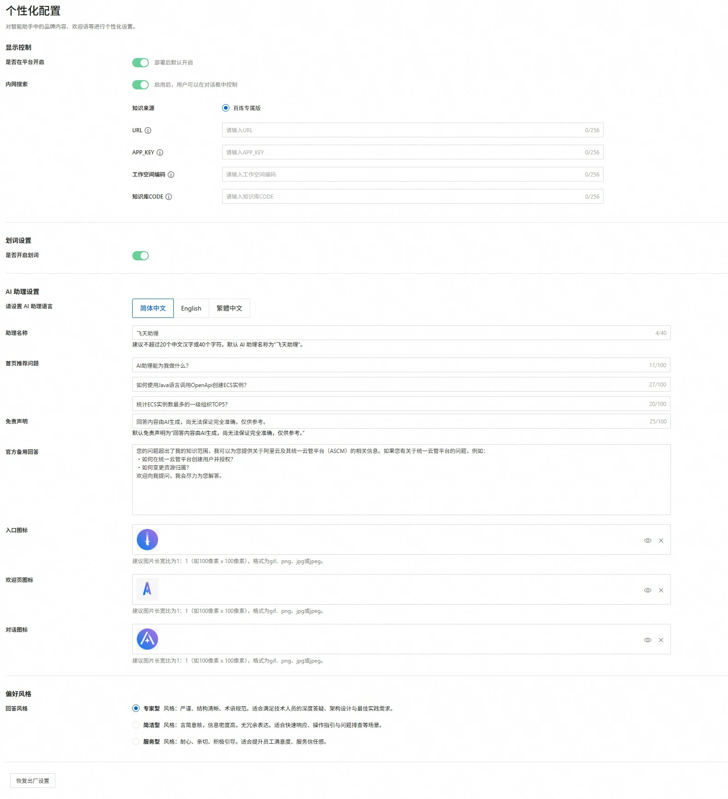

## 2.2. 准确性评测

准确性评测支持对飞天助理进行准确性评估。通过评测用例、评测集和评测任务三级结构完成自动化评估流程，并支持导出详细评测报告。

### 2.2.1. 评测用例管理

#### 2.2.1.1. 添加用例

本文介绍如何添加用例。

**前提条件**

操作用户默认为运营管理员用户。

**操作步骤**

1. 登录Apsara Uni-manager运营控制台。

2. 在顶部菜单栏选择**配置**。

3. 在左侧导航栏选择**飞天助理** > **准确性评测**。

4. 单击**评测用例管理**卡片。

5. 在**评测用例管理**页面，单击**添加用例**。

6. 设置评测用例，支持**单评测用例生成**、**自动生成评测用例**和**获取用户问答用例**。

   - **单评侧用例生成**

     <ol type="a">

     <li>

     在**单评测用例生成**页签，输入用例信息。

     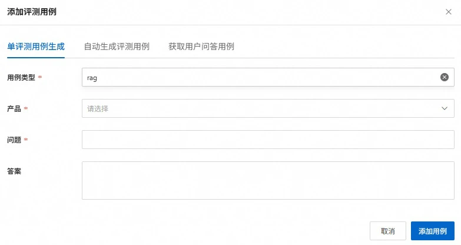

     | 配置项 | 说明 |
     | --- | --- |
     | 用例类型 | 选择用例类型，当前版本仅支持rag类型。 |
     | 产品 | 选择用例对应的产品，仅支持单选。 |
     | 问题 | 输入用例的问题。 |
     | 答案 | 输入用例问题对应的答案。 |

     </li>

     <li>

     单击**添加用例**。

     </li>

     </ol>

   - **自动生成评测用例**

     <ol type="a">

     <li>

     在**自动生成评测用例**页签，设置用例对应的产品的数量。

     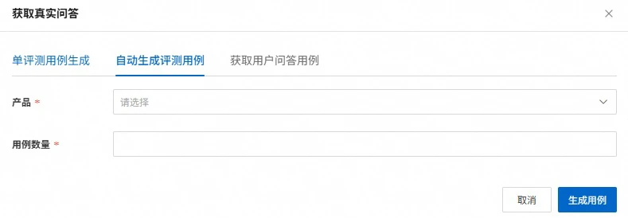

     | 配置项 | 说明 |
     | --- | --- |
     | 产品 | 选择用例对应的产品，支持多选。 |
     | 用例数量 | 输入用例生成的数量。 |

     </li>

     <li>

     单击**生成用例**。

     </li>

     </ol>

   - **获取用户问答用例**

     <ol type="a">

     <li>

     在**获取用户问答用例**页签，选择用户的起止时间。

     

     | 配置项 | 说明 |
     | --- | --- |
     | 目标时间 | 选择获取用例的目标时间。 |

     </li>

     <li>

     单击**确定**。

     </li>

     </ol>

#### 2.2.1.2. 管理用例

用例添加完成后，支持查看、编辑、精筛和删除。

**前提条件**

- 操作用户默认为运营管理员用户。

- 已完成评测用例创建。

**操作步骤**

1. 登录Apsara Uni-manager运营控制台。

2. 在顶部菜单栏选择**配置**。

3. 在左侧导航栏选择**飞天助理** > **准确性评测**。

4. 单击**评测用例管理**卡片。

5. 管理评测用例。

   <table>
     <tr>
       <th width="90">操作</th>
       <th>说明</th>
     </tr>
     <tr>
       <td>查看用例</td>
       <td>在用例列表，单击操作列的<strong>查看</strong>，即可查看测评用例的详情，包括关联的评测集。 说明 • 基础信息中的用例编码支持一键复制，鼠标悬停在用例右侧，单击即可复制。  • 在评测用例详情页面的关联评测集操作列，可单击<strong>取消关联</strong>，将当前用例从评测集中移除。</td>
     </tr>
     <tr>
       <td>编辑用例</td>
       <td>i. 在用例列表，单击操作列的<strong>编辑</strong>。用例关联评测集时不支持编辑。ii. 在<strong>编辑评测用例</strong>对话框，更新评测用例信息。 说明仅评审通过的用例支持更改是否可选。评审中和不通过的评测用例是否可选默认为不可选。 iii. 单击<strong>确定</strong>。</td>
     </tr>
     <tr>
       <td>精筛用例</td>
       <td>i. 在用例列表，单击操作列的<strong>精筛</strong>。仅<strong>评审中</strong>的用例支持精筛。ii. 在评测用例详情页面，查看用例详细信息后，在<strong>人工精筛</strong>区域选择评审是否通过，以及输入相关备注信息。 说明不通过的评测用例默认为不可选，不可被添加到评测集中。  iii. 单击<strong>提交</strong>。</td>
     </tr>
     <tr>
       <td>删除用例</td>
       <td>i. 在用例列表，单击操作列的<strong>删除</strong>。用例关联评测集时不支持删除。ii. 在弹出的对话框单击<strong>确定</strong>，即可删除该测评用例。</td>
     </tr>
   </table>

### 2.2.2. 评测集管理

#### 2.2.2.1. 创建评测集

本文介绍如何创建评测集。

**前提条件**

- 操作用户默认为运营管理员用户。

- 已完成评测用例的创建。

**操作步骤**

1. 登录Apsara Uni-manager运营控制台。

2. 在顶部菜单栏选择**配置**。

3. 在左侧导航栏选择**飞天助理** > **准确性评测**。

4. 单击**评测集管理**卡片。

5. 在**评测集管理**页面，单击**创建评测集**。

6. 在**创建评测集**对话框，设置评测集信息。

   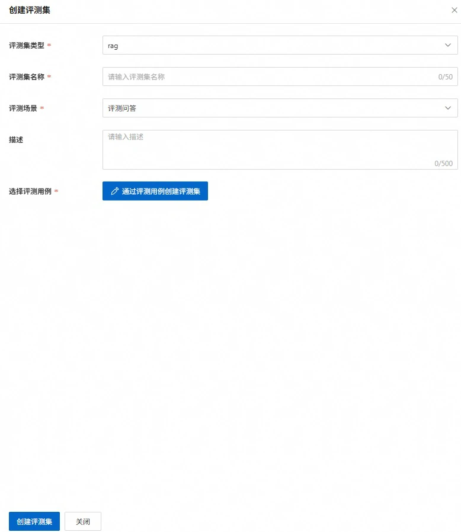

   <table>
     <tr>
       <th width="121">配置项</th>
       <th>说明</th>
     </tr>
     <tr>
       <td>评测集类型</td>
       <td>选择评测集类型，当前版本仅支持rag类型。</td>
     </tr>
     <tr>
       <td>评测集名称</td>
       <td>设置对应评测集的名称。</td>
     </tr>
     <tr>
       <td>评测场景</td>
       <td>选择评测场景，支持<strong>评测问答</strong>和<strong>用户问答</strong>。</td>
     </tr>
     <tr>
       <td>描述</td>
       <td>可选，输入评测集的描述。</td>
     </tr>
     <tr>
       <td>选择评测用例</td>
       <td>i. 单击<strong>通过评测用例创建评测集</strong>。ii. 选择用例。支持通过<strong>用例编码</strong>、<strong>问题</strong>、<strong>所属产品</strong>和<strong>参考答案</strong>进行筛选，筛选完成后需要单击<strong>搜索</strong>，筛选条件方可生效。iii. 单击<strong>确定</strong>。也可单击<strong>全部添加</strong>，将全部用例添加至评测集。</td>
     </tr>
   </table>

7. 单击**创建评测集**。

#### 2.2.2.2. 管理评测集

评测集创建完成后，支持查看、编辑和删除。

**前提条件**

- 操作用户默认为运营管理员用户。

- 已完成评测集创建。

**操作步骤**

1. 登录Apsara Uni-manager运营控制台。

2. 在顶部菜单栏选择**配置**。

3. 在左侧导航栏选择**飞天助理** > **准确性评测**。

4. 单击**评测集管理**卡片。

5. 管理评测集。

   <table>
     <tr>
       <th width="106">操作</th>
       <th>说明</th>
     </tr>
     <tr>
       <td>查看评测集</td>
       <td>在操作列单击<strong>查看</strong>，即可进入<strong>评测集用例管理</strong>界面，可以对评测集里的用例进行管理。</td>
     </tr>
     <tr>
       <td>编辑评测集</td>
       <td>i. 在操作列单击<strong>编辑</strong>。ii. 在<strong>编辑评测集</strong>页面，修改<strong>评测集名称</strong>和<strong>描述</strong>。iii. 单击<strong>确定</strong>。</td>
     </tr>
     <tr>
       <td>删除评测集</td>
       <td>i. 在操作列单击<strong>删除</strong>。ii. 在弹出的对话框单击<strong>确定</strong>，即可删除该测评集。</td>
     </tr>
   </table>

### 2.2.3. 评测任务管理

#### 2.2.3.1. 创建评测任务

本文介绍如何创建评测任务。

**前提条件**

- 操作用户默认为运营管理员用户。

- 已完成评测集的创建。

**操作步骤**

1. 登录Apsara Uni-manager运营控制台。

2. 在顶部菜单栏选择**配置**。

3. 在左侧导航栏选择**飞天助理** > **准确性评测**。

4. 单击**评测任务管理**卡片。

5. 在**评测任务管理**页面，单击**创建评测任务**。

6. 在**创建评测任务**对话框，设置评测集信息。

   <table>
     <tr>
       <th width="121">配置项</th>
       <th>说明</th>
     </tr>
     <tr>
       <td>任务名称</td>
       <td>输入评测任务的名称。</td>
     </tr>
     <tr>
       <td>评测任务类型</td>
       <td>选择评测任务类型，当前版本仅支持rag类型。</td>
     </tr>
     <tr>
       <td>评测集</td>
       <td>下拉选择需要进行评测的评测集。</td>
     </tr>
     <tr>
       <td>评测类型</td>
       <td>可选择<strong>人工</strong>或<strong>自动</strong>。</td>
     </tr>
     <tr>
       <td>评测人</td>
       <td><strong>评测类型</strong>选择<strong>人工</strong>时，需要指定评测人。评测人最多可指定三人，当评测人指定多个人时，需要所有指定人完成评测。任意一人评测时，若评测结果选择完全错误，则评测不通过。</td>
     </tr>
     <tr>
       <td>评测方式</td>
       <td><strong>评测类型</strong>选择<strong>自动</strong>时，需要选择评测方式。<strong>评测方式</strong>可选择<strong>有参考答案</strong>或<strong>无参考答案</strong>。</td>
     </tr>
   </table>

   **人工评测任务**

   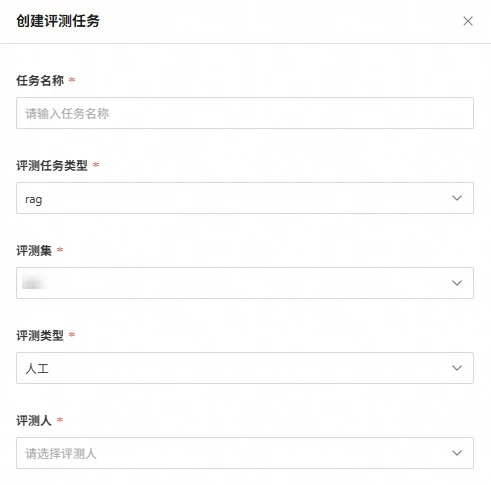

   **自动评测任务**

   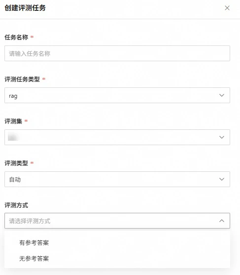

7. 单击**创建评测任务**。

   > **说明**
   >
   > 评测任务完成后不会自动执行，需在操作列单击**开始评测**启动评测任务。

#### 2.2.3.2. 管理评测任务

本文介绍对评测任务的管理。

**前提条件**

- 操作用户默认为运营管理员用户。

- 已完成评测任务创建。

**操作步骤**

1. 登录Apsara Uni-manager运营控制台。

2. 在顶部菜单栏选择**配置**。

3. 在左侧导航栏选择**飞天助理** > **准确性测评**。

4. 单击**评测任务管理**卡片。

5. 查看评测任务。通过列表上方的**任务ID**、**评测集**、**评测类型**和**状态**，可快速查找评测任务。

   

6. 管理评测任务。

   | 操作 | 说明 |
   | --- | --- |
   | 用例入库 | i. 单击评测任务ID。ii. 在<strong>评测结果</strong>页面下，单击用例操作列的<strong>入库</strong>。 说明 • 仅自动类型评测任务下的用例支持入库操作。 • 单击用例操作列的<strong>查看</strong>，可查看评测结果详情。 iii. 在<strong>入库详情</strong>面板，单击<strong>确定</strong>或<strong>拒绝</strong>。选择<strong>确定</strong>，即表示用例入库。选择<strong>拒绝</strong>，即表示用例不入库。 说明仅<strong>未入库</strong>状态的用例支持选择确定或拒绝。<strong>已入库</strong>或<strong>不入库</strong>状态的用例仅支持查看入库详情。 |
   | 人工评测 | i. 在评测任务<strong>操作</strong>列单击<strong>人工评测</strong>。 说明<strong>评测类型</strong>为<strong>人工</strong>的任务才能执行人工评测，并且任务状态为<strong>待人工评测</strong>或<strong>评测</strong><strong>中</strong>。ii. 在<strong>人工评测</strong>页面，单击用例<strong>操作</strong>列的<strong>评测</strong>。 说明单击<strong>操作</strong>列的<strong>查看</strong>，可查看评测结果详情。  iii. 在<strong>评测结果详情</strong>面板，查看需要评测的信息后，在<strong>人工评测</strong>区域，设置<strong>评测结果</strong>和<strong>备</strong><strong>注</strong>。 说明<strong>评测结果</strong>支持选择<strong>完全准确</strong>、<strong>部分准确</strong>、<strong>完全错误</strong>或<strong>未评测</strong>。选择<strong>完全错误</strong>，则表示评测结果不通过，需要在下方<strong>不通过原因</strong>中选择具体原因，可选择<strong>问题不清</strong><strong>晰</strong>、<strong>参考答案不完整</strong>、<strong>内容不完整</strong>、<strong>重复用例</strong>或<strong>其他</strong>。 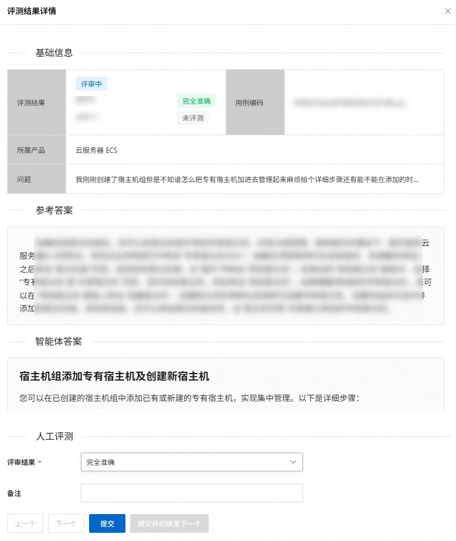 iv. 单击<strong>提交</strong>。有多个评测用例时，完成该用例评测后，可单击<strong>提交并切换至下一个</strong>。 |
   |  |  |
   | 查看任务 | i. 在评测任务<strong>操作</strong>列单击<strong>查看任务</strong>。ii. 在<strong>任务详情</strong>面板，查看任务的基本信息和执行进展。 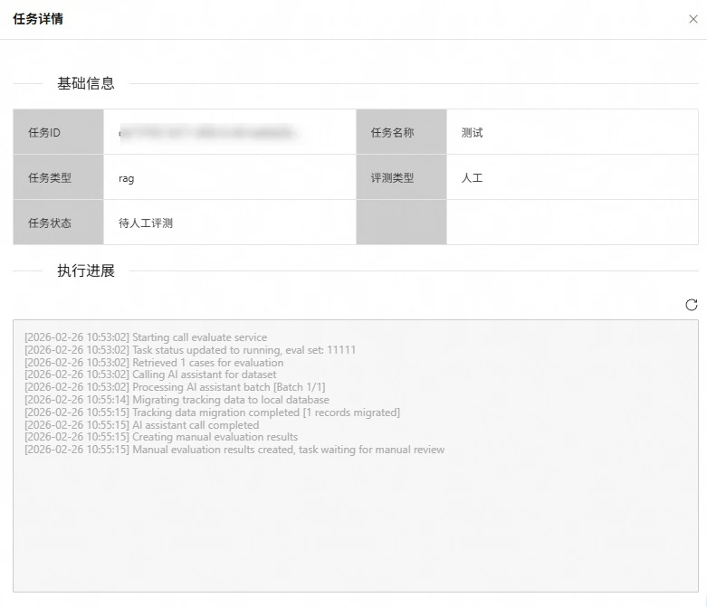 |

   <table>
     <tr>
       <td>查看结果</td>
       <td>i. 在评测任务<strong>操作</strong>列单击<strong>查看结果</strong>。 说明评测任务状态为<strong>已完成</strong>时，支持查看结果。 ii. 在<strong>评测结果</strong>页面，查看用例的评测结果。  iii. 单击用例<strong>操作</strong>列的<strong>查看</strong>，展开评测结果详情。</td>
     </tr>
     <tr>
       <td>查看报告</td>
       <td>i. 单击评测任务<strong>操作</strong>列，选择<strong>查看报告</strong>。 说明评测任务状态为<strong>已完成</strong>时，支持查看报告。 ii. 在任务的<strong>评测报告</strong>页面，查看详细的评测分析报告。</td>
     </tr>
     <tr>
       <td>删除评测任务</td>
       <td>i. 单击操作列，选择<strong>删除</strong>。 ii. 在弹出的对话框单击<strong>确定</strong>，即可删除评测任务。</td>
     </tr>
     <tr>
       <td>重新评测</td>
       <td>i. 评测任务执行失败时，单击<strong>重新评测</strong>。ii. 在弹出的对话框单击<strong>确定</strong>，可重新执行评测任务。</td>
     </tr>
   </table>

### 2.2.4. 准确率分析

查看飞天助理的准确率情况。

**前提条件**

操作用户默认为运营管理员用户。

**操作步骤**

1. 登录Apsara Uni-manager运营控制台。

2. 在顶部菜单栏选择**配置**。

3. 在左侧导航栏选择**飞天助理** > **准确性评测**。

4. 单击**准确率分析**卡片。

5. 在**准确率分析**页面，查看**准确率趋势分析**、**问题分类统计**和**数据明细**。

   <table>
     <tr>
       <th width="137">配置项</th>
       <th>说明</th>
     </tr>
     <tr>
       <td>准确率趋势分析</td>
       <td>以折线图展示准确率分析情况，支持切换<strong>日维度</strong>或<strong>月维度</strong>。</td>
     </tr>
     <tr>
       <td>问题分类统计</td>
       <td>以柱状图展示问题分类统计情况，支持切换<strong>日维度</strong>或<strong>月维度</strong>。</td>
     </tr>
     <tr>
       <td>数据明细</td>
       <td>输入查询的起始日期和结束日期，查看时间范围内的数据明细，支持切换<strong>日维度</strong>或<strong>月维</strong><strong>度</strong>。 • 单击明细<strong>操作</strong>列的<strong>查看报告</strong>，跳转到评测报告详情页面。 • 单击列表上方的，可将明细数据下载到本地。</td>
     </tr>
   </table>

   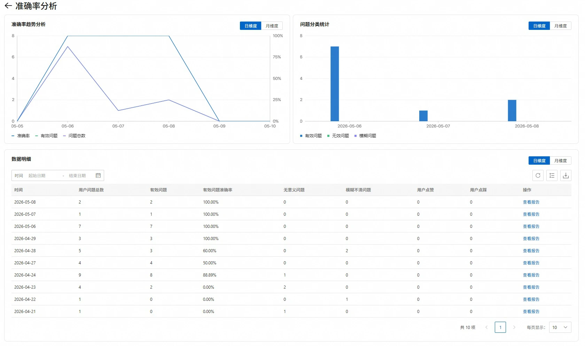

## 2.3. 模型配置

管理和配置您的AI模型，包括大语言模型、向量模型和重排序模型。

**前提条件**

操作用户默认为运营管理员用户。

**操作步骤**

1. 登录Apsara Uni-manager运营控制台。

2. 在顶部菜单栏选择**配置**。

3. 在左侧导航栏选择**飞天助理** > **模型配置**。

4. 在**大语言模型（LLM）**/**向量模型（Embedding）**/<strong>重排序模型（Rerank）</strong>区域，单击**添加模型**。

5. 在**添加模型配置**对话框，进行模型配置。

   <table>
     <tr>
       <th width="121">配置项</th>
       <th>说明</th>
     </tr>
     <tr>
       <td>模型名称</td>
       <td>填写模型的显示名称。</td>
     </tr>
     <tr>
       <td>模型Code</td>
       <td>填写模型的Code，表示模型的唯一标识。</td>
     </tr>
     <tr>
       <td>API Key</td>
       <td>填写该模型的API Key。</td>
     </tr>
     <tr>
       <td>请求地址</td>
       <td>填写该模型的API请求地址。</td>
     </tr>
     <tr>
       <td>模型提供方</td>
       <td>选择模型的提供方，支持<strong>百炼专属模型</strong>、<strong>百炼公共云</strong>、<strong>aibase</strong>和<strong>openai</strong>。</td>
     </tr>
     <tr>
       <td>设为默认模型</td>
       <td>设置该模型是否为默认模型。</td>
     </tr>
   </table>

   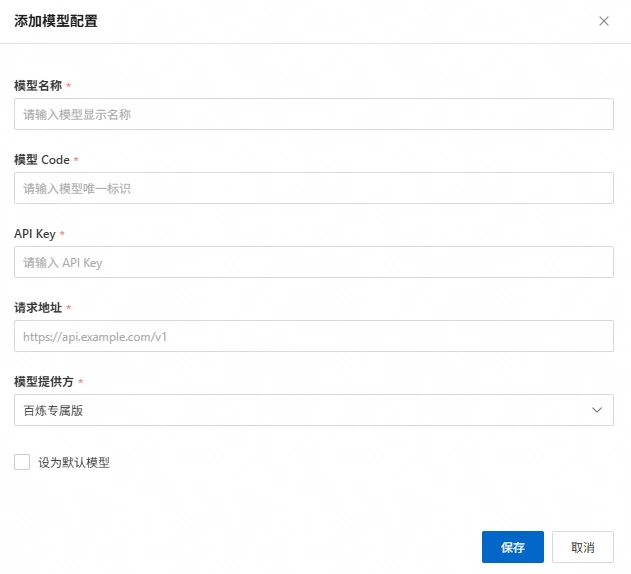

6. 单击**保存**。

7. 其他相关操作。

   <table>
     <tr>
       <th width="122">操作</th>
       <th>说明</th>
     </tr>
     <tr>
       <td>编辑模型</td>
       <td>i. 在模型卡片区域，单击右上方的<strong>编辑</strong>。ii. 在<strong>编辑模型配置</strong>对话框，更新模型配置。 说明模型名称和模型Code不允许修改。 iii. 单击<strong>保存</strong>。</td>
     </tr>
     <tr>
       <td>删除模型</td>
       <td>i. 在模型卡片区域，单击右上方的<strong>删除</strong>。ii. 单击<strong>确定</strong>。</td>
     </tr>
     <tr>
       <td>修改默认模型</td>
       <td>在模型卡片区域，单击下方的<strong>设为默认模型</strong>，根据业务需要修改默认模型。</td>
     </tr>
   </table>

## 2.4. 知识库管理

### 2.4.1. 创建知识库

在知识库管理页面创建向量知识库和图谱知识库。

**前提条件**

操作用户默认为运营管理员用户。

**操作步骤**

1. 登录Apsara Uni-manager运营控制台。

2. 在顶部菜单栏选择**配置**。

3. 在左侧导航栏选择**飞天助理** > **知识库管理**。

4. 单击**创建知识库**。

5. 在**新建知识库**对话框，进行知识库配置。

   <table>
     <tr>
       <th width="195">配置项</th>
       <th>说明</th>
     </tr>
     <tr>
       <td>知识库类型</td>
       <td>选择知识库的类型，支持<strong>向量知识库</strong>和<strong>图谱知识库</strong>。 • <strong>向量知识库</strong>：基于Milvus的生产级向量库。 • <strong>图谱知识库</strong>：基于LightRAG的知识库实现。</td>
     </tr>
     <tr>
       <td>知识库名称</td>
       <td>填写知识库的名称。</td>
     </tr>
     <tr>
       <td>嵌入模型</td>
       <td>选择用于将文本转换为向量的嵌入模型。不同模型的向量维度和语义精度有差异，创建后不可更改。</td>
     </tr>
     <tr>
       <td>默认分块策略</td>
       <td>选择文档分块策略。 • General：通用分块，适合大多数场景。 • QA：问答分块，适合FAQ类文档。 • Structure：结构化分块，适合长篇结构化内容。 • Custom：自定义分隔符分块，适用于法律法规等有固定格式的文档。</td>
     </tr>
     <tr>
       <td>Chunk Size</td>
       <td>文档分块策略选择General、Structure和Custom时设置此项。Chunk Size指的是将原始长文本切割时，每一个独立片段（Chunk）所包含的单元数量。</td>
     </tr>
     <tr>
       <td>Chunk Overlap</td>
       <td>文档分块策略选择General、Structure和Custom时设置此项。Chunk Overlap指的是相邻两个文本片段之间重复包含的内容长度。也就是说，前一个Chunk的末尾部分和后一个Chunk的开头部分是相同的。</td>
     </tr>
     <tr>
       <td>分隔符（Separator）</td>
       <td>文档分块策略选择Custom时设置此项。通过定义一系列优先级规则，引导系统在保持语义完整性的前提下，将长文本拆解为合适大小的片段。 说明支持\n（换行）、\t（制表符）、\r（回车）等转义字符，多个分隔符以英文逗号“,”分隔（如：\n,\t），留空则不启用预分割。</td>
     </tr>
     <tr>
       <td>任务描述</td>
       <td>填写知识库的任务描述，描述的越详细，知识库越容易被精确获取。</td>
     </tr>
   </table>

   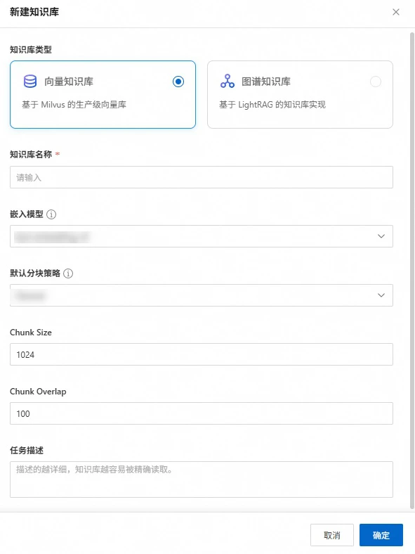

6. 单击**确定**。

### 2.4.2. 编辑知识库

知识库配置有更新时支持修改。

**前提条件**

操作用户默认为运营管理员用户。

**操作步骤**

1. 登录Apsara Uni-manager运营控制台。

2. 在顶部菜单栏选择**配置**。

3. 在左侧导航栏选择**飞天助理** > **知识库管理**。

4. 单击知识库卡片右上方的  ，选择**编辑知识库**。

5. 在**编辑知识库**对话框，更新知识库配置，配置项详细说明请参见创建知识库。

   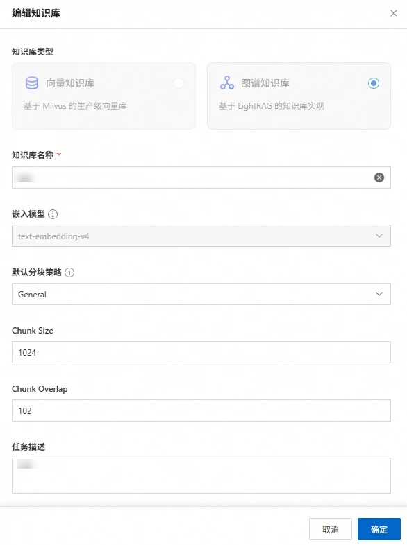

6. 单击**确定**。

### 2.4.3. 配置分块策略

调整分块参数可以控制文本的切分方式，影响检索质量和文档加载效率。

**前提条件**

操作用户默认为运营管理员用户。

**操作步骤**

1. 登录Apsara Uni-manager运营控制台。

2. 在顶部菜单栏选择**配置**。

3. 在左侧导航栏选择**飞天助理** > **知识库管理**。

4. 单击知识库卡片右上方的  ，选择**配置分块策略**。

5. 在**分块策略**对话框，调整知识库里的分块策略。分块策略的详细说明请参见创建知识库。

   > **说明**
   >
   > 预设策略对齐RAGFlow General、QA、Book、Laws，留空时沿用知识库默认策略。

   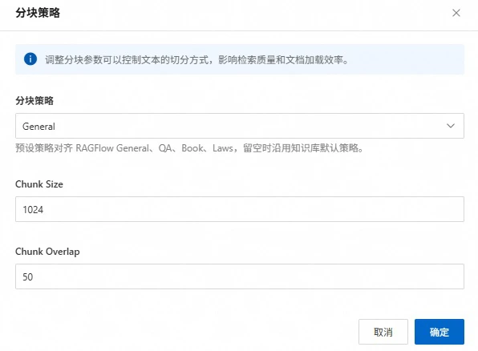

6. 单击**确定**。

### 2.4.4. 删除知识库

删除不需要的知识库。

**前提条件**

操作用户默认为运营管理员用户。

**操作步骤**

1. 登录Apsara Uni-manager运营控制台。

2. 在顶部菜单栏选择**配置**。

3. 在左侧导航栏选择**飞天助理** > **知识库管理**。

4. 单击知识库卡片右上方的  ，选择**删除**。

5. 在删除知识库对话框，输入知识库名称进行确认。

   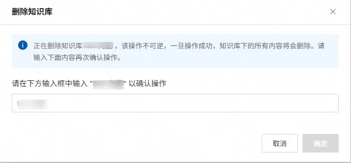

6. 单击**确定**。

### 2.4.5. 导入文件

在知识库中导入文件。

**前提条件**

操作用户默认为运营管理员用户。

**操作步骤**

1. 登录Apsara Uni-manager运营控制台。

2. 在顶部菜单栏选择**配置**。

3. 在左侧导航栏选择**飞天助理** > **知识库管理**。

4. 单击知识库的名称，进入知识库详情。

5. 在**知识库详情**页面，单击**导入文件**。

6. 在**导入文件**对话框，单击或者拖拽文件到虚线框内上传。

   > **说明**
   >
   > 文件支持txt、md、doc、docx、pdf、pptx、csv、xlsx、html类型的文件。

   

7. 单击**确定**。

### 2.4.6. 查看文件详情

文件详情展示文件预览和Chunks切分信息。

**前提条件**

操作用户默认为运营管理员用户。

**操作步骤**

1. 登录Apsara Uni-manager运营控制台。

2. 在顶部菜单栏选择**配置**。

3. 在左侧导航栏选择**飞天助理** > **知识库管理**。

4. 单击知识库的名称，进入知识库详情。

5. 在**知识库详情**页面，单击文件名称，查看文件详情。

   

### 2.4.7. 入库文件

文件导入成功后，支持入库文件。

**前提条件**

- 操作用户默认为运营管理员用户。

- 文件状态为**已解析**。

**操作步骤**

1. 登录Apsara Uni-manager运营控制台。

2. 在顶部菜单栏选择**配置**。

3. 在左侧导航栏选择**飞天助理** > **知识库管理**。

4. 单击知识库的名称，进入知识库详情。

5. 在**知识库详情**页面，执行入库文件。

   <table>
     <tr>
       <th width="122">操作</th>
       <th>说明</th>
     </tr>
     <tr>
       <td>入库单个文件</td>
       <td>单击文件<strong>操作</strong>列的<strong>入库</strong>。</td>
     </tr>
     <tr>
       <td>批量入库文件</td>
       <td>i. 勾选需要入库的多个文件。ii. 单击列表下方的<strong>批量入库</strong>。iii. 在<strong>批量入库分块策略</strong>对话框，确认或修改入库分块策略。iv. 单击<strong>确定</strong>。</td>
     </tr>
   </table>

6. （可选）其他相关操作。

   - 文件入库成功后，状态更新为**已索引**，支持下载文件。

   - 文件入库失败，状态更新为**索引错误**，支持重试操作。

### 2.4.8. 删除文件

**前提条件**

操作用户默认为运营管理员用户。

**操作步骤**

1. 登录Apsara Uni-manager运营控制台。

2. 在顶部菜单栏选择**配置**。

3. 在左侧导航栏选择**飞天助理** > **知识库管理**。

4. 单击知识库的名称，进入知识库详情。

5. 在**知识库详情**页面，单击文件**操作**列的**删除**。

6. 单击**确定**。

### 2.4.9. 查看知识图谱

在图谱知识库类型中查看生成的知识图谱。

**前提条件**

- 操作用户默认为运营管理员用户。

- 知识库类型为图谱知识库。

**操作步骤**

1. 登录Apsara Uni-manager运营控制台。

2. 在顶部菜单栏选择**配置**。

3. 在左侧导航栏选择**飞天助理** > **知识库管理**。

4. 单击知识库的名称，进入知识库详情。

5. 在**知识库详情**页面，单击列表右上方的  。

6. 在**知识图谱**页签下，查看生成的知识图谱。暂无知识图谱时，可单击立即生成。

   > **说明**
   >
   > - 知识图谱中展示各节点及之间的关系。
   >
   >   - 在上方的下拉框中可输入节点，选择节点进行查看。
   >
   >   - 单击图谱中的节点，可展示节点描述、网络指标、标签和关联等信息。
   >
   > - 知识图谱展示控制。
   >
   >   - 单击知识图谱右上方的
   >
   >     ，可放大图谱。
   >
   >     
   >
   >   - 单击知识图谱右上方的
   >
   >     ，可缩小图谱。
   >
   >     
   >
   >   - 单击知识图谱右上方的
   >
   >     ，可进入全屏模式。
   >
   >     
   >
   >   - 单击知识图谱右上方的
   >
   >     ，可恢复默认。
   >
   >     

   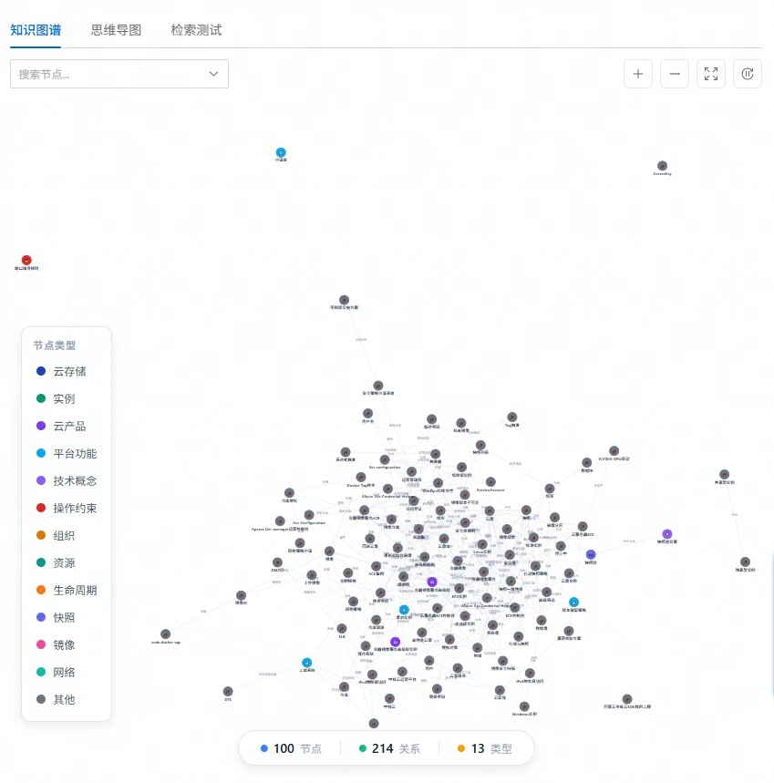

### 2.4.10. 查看思维导图

查看生成的思维导图。

**前提条件**

操作用户默认为运营管理员用户。

**操作步骤**

1. 登录Apsara Uni-manager运营控制台。

2. 在顶部菜单栏选择**配置**。

3. 在左侧导航栏选择**飞天助理** > **知识库管理**。

4. 单击知识库的名称，进入知识库详情。

5. 在**知识库详情**页面，单击列表右上方的  。

6. 在**思维导图**页签下，查看生成的思维导图。

   > **说明**
   >
   > - 在思维导图上方，单击**重新生成**，可重新生成思维导图。
   >
   > - 在思维导图上方，输入节点，可按节点进行搜索。
   >
   > - 思维导图展示控制。
   >
   >   - 在思维导图右上方输入展示比例后，可按设置的比例展示。
   >
   >   - 单击思维导图右上方的
   >
   >     ，可放大图谱。
   >
   >     
   >
   >   - 单击思维导图右上方的
   >
   >     ，可缩小图谱。
   >
   >     
   >
   >   - 单击思维导图右上方的
   >
   >     ，可进入全屏模式。
   >
   >     
   >
   >   - 单击思维导图右上方的
   >
   >     ，可恢复默认。
   >
   >     

   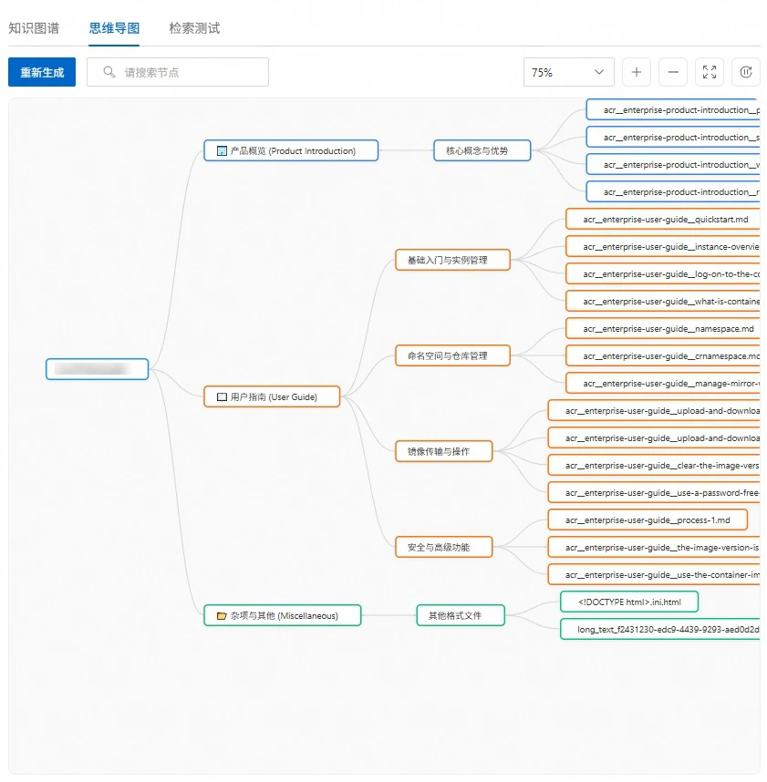

### 2.4.11. 检索配置和检索测试

在检索测试页签下支持检索配置和检索测试。

**前提条件**

操作用户默认为运营管理员用户。

**操作步骤**

1. 登录Apsara Uni-manager运营控制台。

2. 在顶部菜单栏选择**配置**。

3. 在左侧导航栏选择**飞天助理** > **知识库管理**。

4. 单击知识库的名称，进入知识库详情。

5. 在**知识库详情**页面，单击列表右上方的  。

6. 检索配置。

   <ol type="i">

   <li>

   单击**检索配置**。

   </li>

   <li>

   在**检索配置**对话框，设置**查询模式（query_mode）**、**实体关系检索数量（top_k）**、<strong>文本块检索数量（chunk_top_k）</strong>和**启用重排（enable_rerank）**。

   > **说明**
   >
   > 查询模式支持**hybrid**或**mix**。

   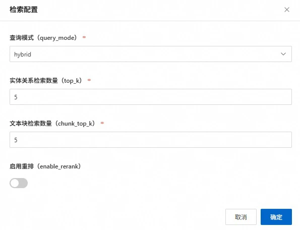

   </li>

   <li>

   单击**确定**。

   </li>

   </ol>

7. 检索测试。在文本框中输入搜索内容后，单击**搜索**。

   > **说明**
   >
   > - 查询模式：
   >
   >   - 右侧展示当前配置的查询模式。
   >
   >   - 高级关键词：根据搜索内容抽取的高级关键词。
   >
   >   - 低级关键词：根据搜索内容抽取的低级关键词。
   >
   > - 下方展示检索到的信息。

   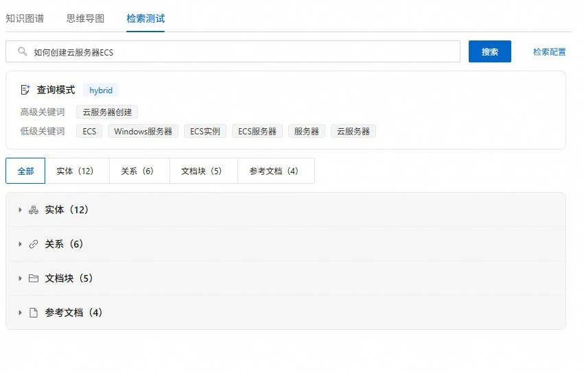

## 2.5. 辅助云资源管理

可通过自定义配置，更好地使用AI辅助管理云资源。

### 2.5.1. 辅助创建

为云产品配置辅助创建的个性化场景。

**前提条件**

操作用户默认为运营管理员用户。

**操作步骤**

1. 登录Apsara Uni-manager运营控制台。

2. 在顶部菜单栏选择**配置**。

3. 在左侧导航栏选择**飞天助理** > **辅助云资源管理**。

4. 单击**辅助创建**页签。

5. 完成辅助创建配置。

   | 配置项 | 说明 |
   | --- | --- |
   | 云产品 | 选择辅助创建的云产品。当前仅支持云服务器ECS和专有网络VPC。 |
   | 个性化场景 | 根据实际的业务情况，配置个性化场景，在辅助创建资源时使用。 • <strong>添加场景</strong>：单击<strong>添加场景</strong>，自定义场景，支持选择<strong>场景枚举</strong>、<strong>场景描述</strong>或<strong>无</strong>。 • <strong>删除场景</strong>：单击场景后面的。 • <strong>调整场景顺序</strong>：拖拽场景前的，调整场景的展示顺序。 • <strong>恢复预设场景</strong>：单击<strong>恢复预设场景</strong>，系统将自动加载默认布局与场景配置。 |

   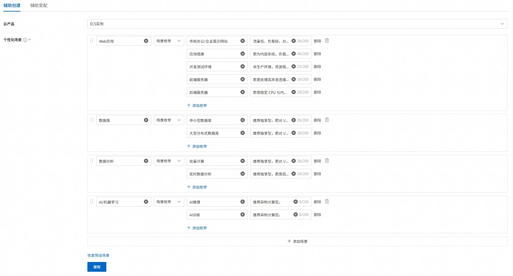

6. 单击**保存**。

**结果展示**

为云产品设置辅助创建配置后，用户在创建云产品时，飞天助理根据个性化场景智能规划并辅助完成创建。

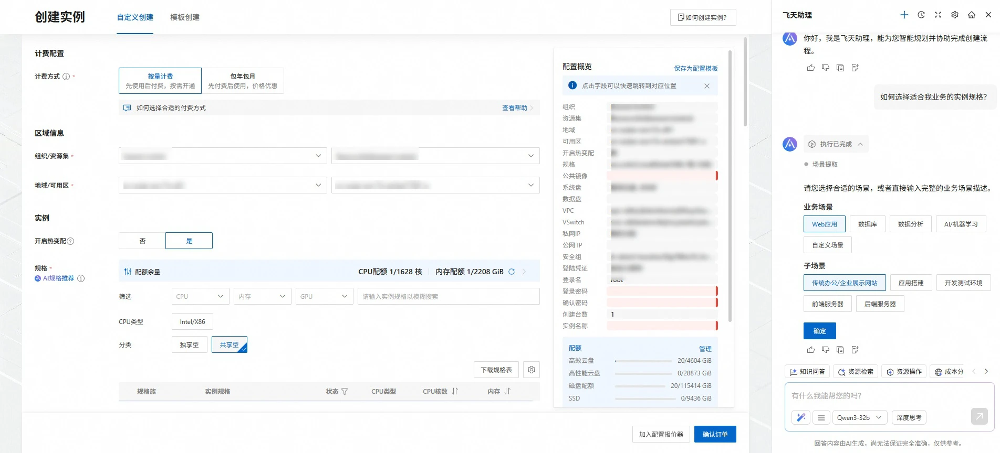

### 2.5.2. 辅助变配

为云产品配置辅助变配的规则，以便在云产品变配时依据当前应用的规则进行变配推荐分析。

**前提条件**

操作用户默认为运营管理员用户。

**操作步骤**

1. 登录Apsara Uni-manager运营控制台。

2. 在顶部菜单栏选择**配置**。

3. 在左侧导航栏选择**飞天助理** > **辅助云资源管理**。

4. 单击**辅助变配**页签。

5. 完成辅助变配的配置。

   | 配置项 | 说明 |
   | --- | --- |
   | 变配产品 | 选择变配的云产品。当前仅支持云服务器ECS和负载均衡SLB。 |
   | 规则模板 | 选择规则模板。预置的规则模板不满足需求时，自定义规则模板。 |
   | 规则描述 | 展示选择的规则模板的规则详情。 |

   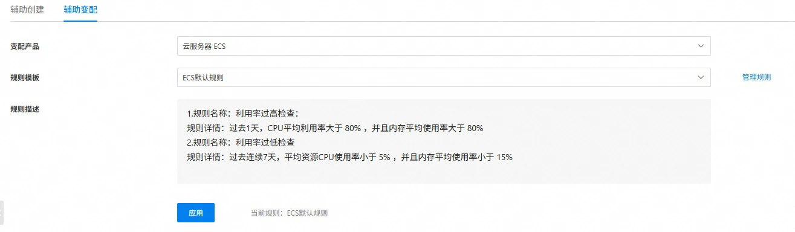

6. 单击**应用**。

**自定义规则模板**

1. 在**辅助变配**页签，单击**规则模板**右侧的**管理规则**。

2. 在**管理规则**面板，单击  。

3. 进行规则配置。

   <table>
     <tr>
       <th width="89">配置项</th>
       <th>说明</th>
     </tr>
     <tr>
       <td>规则名称</td>
       <td>输入规则名称，不能与已有规则名称重复。</td>
     </tr>
     <tr>
       <td>监控指标</td>
       <td>展示当前云产品支持的监控指标，用于监控分析，在规则描述时使用。</td>
     </tr>
     <tr>
       <td>规则描述</td>
       <td>创建云资源的分析规则，在辅助资源变配时使用。可在<strong>AI编写规则</strong>中输入规则描述，生成结果后填入。</td>
     </tr>
   </table>

   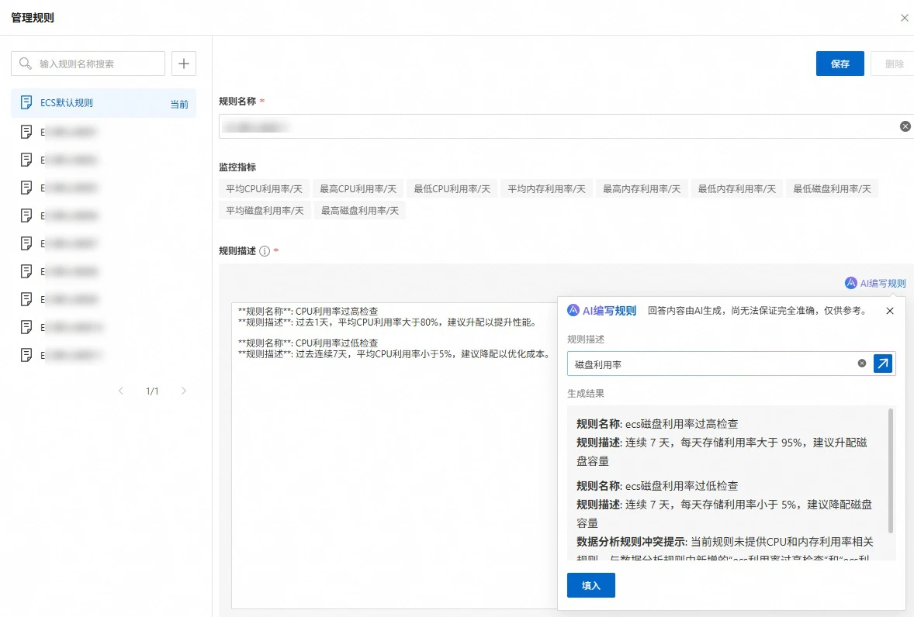

4. 单击**保存**。

5. 规则模板其他相关操作。

   | 操作 | 说明 |
   | --- | --- |
   | 编辑规则模板 | i. 在<strong>管理规则</strong>面板，选中规则，单击<strong>编辑</strong>。 说明预置的规则模板不支持编辑。 ii. 更新规则名称和规则描述。iii. 单击<strong>保存</strong>。 |
   | 删除规则模板 | 在<strong>管理规则</strong>面板，选中规则，单击<strong>删除</strong>。 说明预置的规则模板不支持删除。 |

**结果展示**

为云产品设置辅助变配的配置后，用户在云产品变配时，飞天助理根据应用的规则进行变配推荐分析。

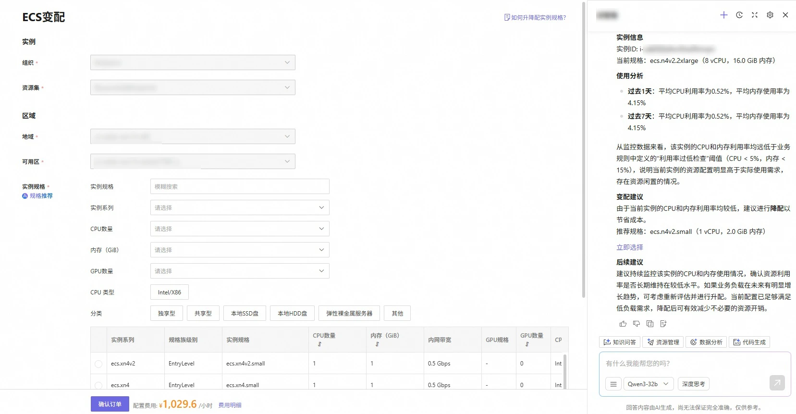

# 3.飞天助理应用

## 3.1. 飞天助理对话

飞天助理支持用户用自然语言提问平台与云产品相关的问题，向AI咨询信息，与AI进行智能对话。

**前提条件**

运营管理员用户已在Apsara Uni-manager运营控制台的**配置** > **飞天助理** > **个性化配置**中开启智能助手的显示。

**操作步骤**

1. 登录Apsara Uni-manager运营控制台。

2. 在控制台顶部导航栏或悬浮菜单单击  ，进入飞天助理。

   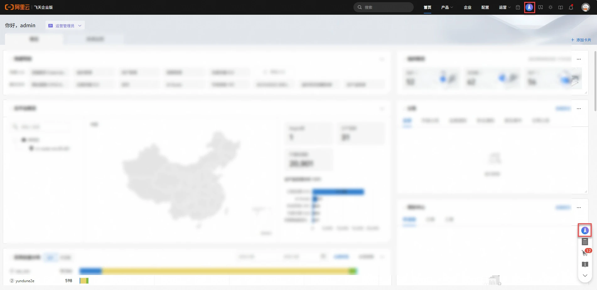

3. 在**Apsara Copilot**对话框或页面，描述任务，单击  。

   > **说明**
   >
   > - 从控制台顶部导航栏进入，默认进入全屏模式。从悬浮菜单进入，默认进入窗口模式。
   >
   >   - 窗口模式：上方依次显示新任务、历史任务、窗口全屏和关闭图标。
   >
   >   - 全屏模式：左侧依次显示新任务、技能、专家、记忆、定时任务等导航栏，以及任务列表等。
   >
   > - 飞天助理支持多种模型，您可以切换不同模型进行提问。
   >
   > - 单击
   >
   >   图标，可上传附件。
   >
   >   
   >
   > - 在输入框中输入“/”，可快捷调用专家和技能。

   <table>
     <tr>
       <th width="90">能力域</th>
       <th>说明</th>
     </tr>
     <tr>
       <td>智能管理</td>
       <td>面向企业管理与云资源生命周期操作的管控能力，包括组织、权限、云资源等。</td>
     </tr>
     <tr>
       <td>深度洞察</td>
       <td>面向结构化数据的数值型多维分析能力，聚焦资源用量、成本、健康度等运营指标，进行数据分析或报告生成。 说明深度洞察支持报告大纲的编辑。</td>
     </tr>
     <tr>
       <td>智能运营</td>
       <td>面向运营域的配置管理与业务规则操作能力，包括流程、费用、云服务等。</td>
     </tr>
   </table>

   **窗口模式**

   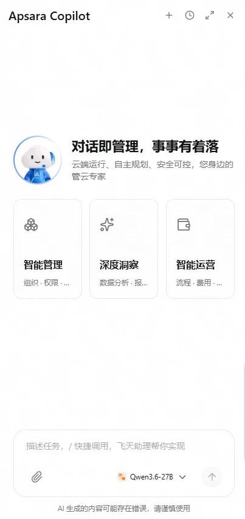

   **全屏模式**

   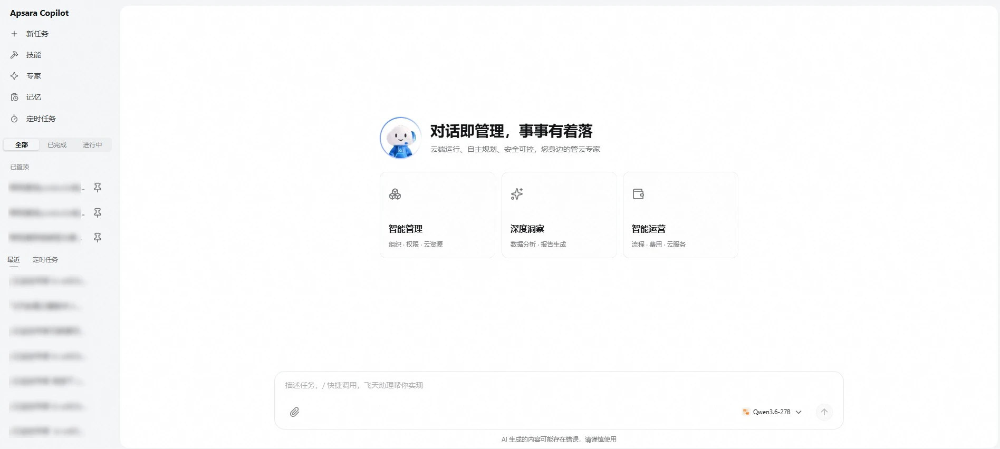

## 3.2. 技能管理

安装与管理技能，在对话中扩展飞天助理的能力。

**操作步骤**

1. 登录Apsara Uni-manager运营控制台。

2. 在控制台顶部导航栏或悬浮菜单单击  ，进入飞天助理。

   

3. 在**Apsara Copilot**全屏页面，单击左侧导航栏的**技能**。

   > **说明**
   >
   > - 从控制台顶部导航栏进入，默认进入全屏模式。
   >
   > - 从悬浮菜单进入，默认进入窗口模式。在窗口模式上方单击窗口全屏后，也可进入全屏模式。

   

4. 在**技能**页面，按**全部**、**官方技能**和**自定义**分类查看和管理技能。

   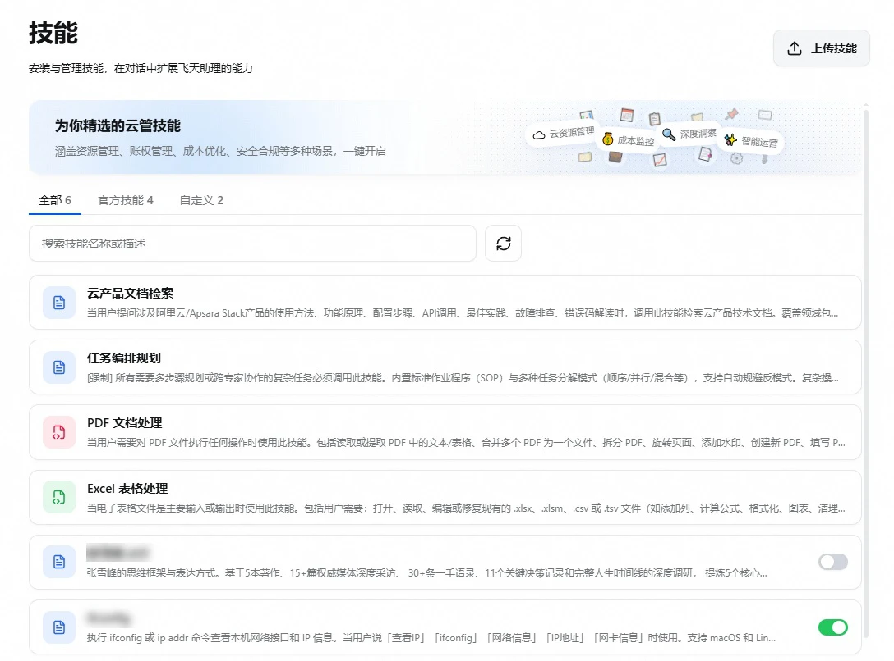

   <table>
     <tr>
       <td>操作</td>
       <td>说明</td>
     </tr>
     <tr>
       <td>查看技能</td>
       <td>i. 在技能列表上方，通过技能名称或描述可快速查找技能。 说明单击文本框右侧的，可刷新技能列表。  ii. 单击技能卡片。iii. 在<strong>查看技能</strong>面板，可查看技能内容的详细信息。 说明 • 支持开启或关闭预览。 • 支持复制技能内容。</td>
     </tr>
     <tr>
       <td>上传技能</td>
       <td>i. 单击页面上方的<strong>上传技能</strong>。ii. 在<strong>上传技能</strong>对话框，单击<strong>上传技能</strong>，选择技能文件。iii. 检测通过后，单击<strong>确认</strong>。</td>
     </tr>
     <tr>
       <td>启用/禁用技能</td>
       <td>单击技能卡片右侧的启用/禁用按钮。  ：表示技能已禁用。  ：表示技能已启用。 说明仅自定义技能支持启用/禁用操作。</td>
     </tr>
     <tr>
       <td>删除技能</td>
       <td>i. 鼠标悬浮在技能卡片，单击右侧。 说明 • 仅自定义技能支持删除操作。 • 删除后改技能不可用且无法恢复，请谨慎操作。 ii. 在对话框，单击<strong>删除</strong>。</td>
     </tr>
   </table>

## 3.3. 专家管理

专家即平台预置的专业领域Agent，各司其职协同工作，为你提供全方位的智能云管理能力。

**操作步骤**

1. 登录Apsara Uni-manager运营控制台。

2. 在控制台顶部导航栏或悬浮菜单单击  ，进入飞天助理。

   

3. 在**Apsara Copilot**全屏页面，单击左侧导航栏的**专家**。

   > **说明**
   >
   > - 从控制台顶部导航栏进入，默认进入全屏模式。
   >
   > - 从悬浮菜单进入，默认进入窗口模式。在窗口模式上方单击窗口全屏后，也可进入全屏模式。

   

4. 在**专家**页面，您可以查看专家的能力，并支持启用或禁用专家。

   

   <table>
     <tr>
       <th width="160">操作</th>
       <th>说明</th>
     </tr>
     <tr>
       <td>查看专家能力</td>
       <td>鼠标悬浮在专家卡片上，查看专家的能力介绍。</td>
     </tr>
     <tr>
       <td>启用/禁用专家能力</td>
       <td>单击专家卡片右侧的启用/禁用按钮。  ：表示专家已禁用。  ：表示专家已启用。 说明未购买对应专家时，不能对其进行启用/禁用操作，也不能使用对应专家的能力。</td>
     </tr>
   </table>

## 3.4. 记忆管理

记忆即系统自动学习并沉淀您的使用偏好，也支持手动创建自定义记忆。

**操作步骤**

1. 登录Apsara Uni-manager运营控制台。

2. 在控制台顶部导航栏或悬浮菜单单击  ，进入飞天助理。

   

3. 在**Apsara Copilot**全屏页面，单击左侧导航栏的**记忆**。

   > **说明**
   >
   > - 从控制台顶部导航栏进入，默认进入全屏模式。
   >
   > - 从悬浮菜单进入，默认进入窗口模式。在窗口模式上方单击窗口全屏后，也可进入全屏模式。

   

4. 在**记忆**页面，您可以查看和管理记忆。

   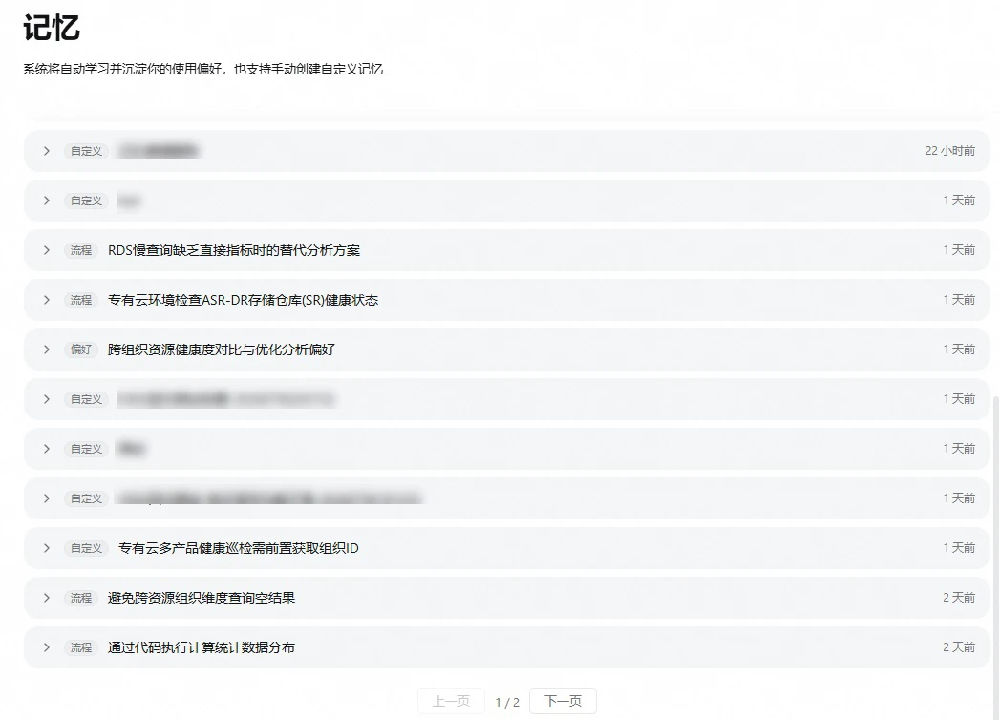

   <table>
     <tr>
       <th width="122">操作</th>
       <th>说明</th>
     </tr>
     <tr>
       <td>查看记忆内容</td>
       <td>i. 在记忆列表上方，可通过文本框快速搜索记忆。 ii. 单击记忆标题前的，展开记忆，查看记忆内容的详细信息。</td>
     </tr>
     <tr>
       <td>新建记忆</td>
       <td>i. 在记忆列表上方，单击<strong>新建</strong>。ii. 在<strong>新建自定义记忆</strong>对话框，填写记忆的<strong>标题</strong>和<strong>内容</strong>。 说明支持Markdown格式。 iii. 单击<strong>保存</strong>。</td>
     </tr>
     <tr>
       <td>修改记忆</td>
       <td>i. 鼠标悬浮在记忆标题，单击。 ii. 在展开的标题和内容文本框，更新记忆的信息。iii. 单击<strong>保存</strong>。</td>
     </tr>
     <tr>
       <td>删除记忆</td>
       <td>i. 鼠标悬浮在记忆标题，单击。 ii. 在对话框，单击<strong>确认删除</strong>。</td>
     </tr>
   </table>

## 3.5. 定时任务管理

定时任务即按计划自动执行的任务，也可随时手动触发。

**操作步骤**

1. 登录Apsara Uni-manager运营控制台。

2. 在控制台顶部导航栏或悬浮菜单单击  ，进入飞天助理。

   

3. 在**Apsara Copilot**全屏页面，单击左侧导航栏的**定时任务**。

   > **说明**
   >
   > - 从控制台顶部导航栏进入，默认进入全屏模式。
   >
   > - 从悬浮菜单进入，默认进入窗口模式。在窗口模式上方单击窗口全屏后，也可进入全屏模式。

   

4. 在**定时任务**页面，您可以查看和管理定时任务。

   

   <table>
     <tr>
       <th width="160">操作</th>
       <th>说明</th>
     </tr>
     <tr>
       <td>查看定时任务</td>
       <td>i. 在定时任务卡片，查看定时任务的标题、内容、状态以及执行时间等。 说明：表示定时任务已禁用。  ：表示定时任务已启用。  ii. 定时任务启用后，你可以在左侧导航栏下方区域的<strong>定时任务</strong>页签，查看定时执行的记录列表。</td>
     </tr>
     <tr>
       <td>新建定时任务</td>
       <td>i. 单击<strong>新建定时任务</strong>。 说明您也可以直接通过飞天助理对话创建定时任务。例如，在对话框输入“帮我创建一个每天晚上8点今日工作进展要点的定时任务“。 ii. 在<strong>新建定时任务</strong>对话框，填写任务名称、计划时间以及让Apsara Copilot帮你做什么的具体内容。 说明计划时间支持按每小时、每天、每周或自定义时间设置。 iii. 单击<strong>保存</strong>或<strong>立即执行</strong>。</td>
     </tr>
     <tr>
       <td>修改定时任务</td>
       <td>i. 鼠标悬浮在定时任务卡片，单击<strong>编辑任务</strong>。ii. 在<strong>编辑任务</strong>对话框，更新定时任务配置。iii. 单击<strong>立即执行</strong>或<strong>保存</strong>。</td>
     </tr>
     <tr>
       <td>启用/禁用定时任务</td>
       <td>单击定时任务卡片右侧的启用/禁用按钮。  ：表示定时任务已禁用。  ：表示定时任务已启用。</td>
     </tr>
     <tr>
       <td>删除定时任务</td>
       <td>i. 鼠标悬浮在定时任务卡片，单击<strong>删除</strong>。ii. 在对话框，单击<strong>删除</strong>。</td>
     </tr>
   </table>

## 3.6. 划词问答

通过对控制台页面的划词选择，自动触发对所选内容的问答能力。

**前提条件**

运营管理员已在**配置** > **飞天助理** > **个性化配置**中开启划词。

**操作步骤**

1. 登录Apsara Uni-manager运营控制台。

2. 鼠标左键在控制台页面划取内容，单击提示的“咨询飞天助理”。

   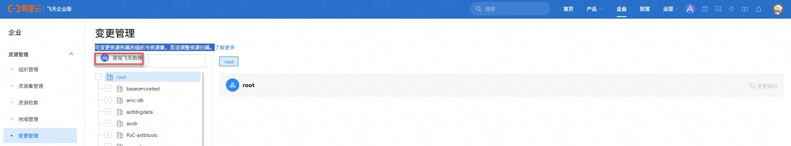

3. 飞天助理自动触发对所选内容的问答能力。

   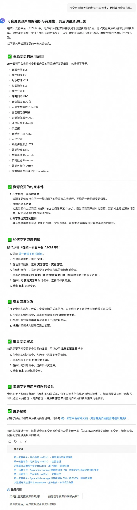

## 3.7. AI智能分析

飞天助理提供基于AI智能分析场景下的数据分析能力。

AI智能分析详细操作请参见《统一云管平台 用户指南》中**数据分析** > **自定义分析** > **智能分析**章节。

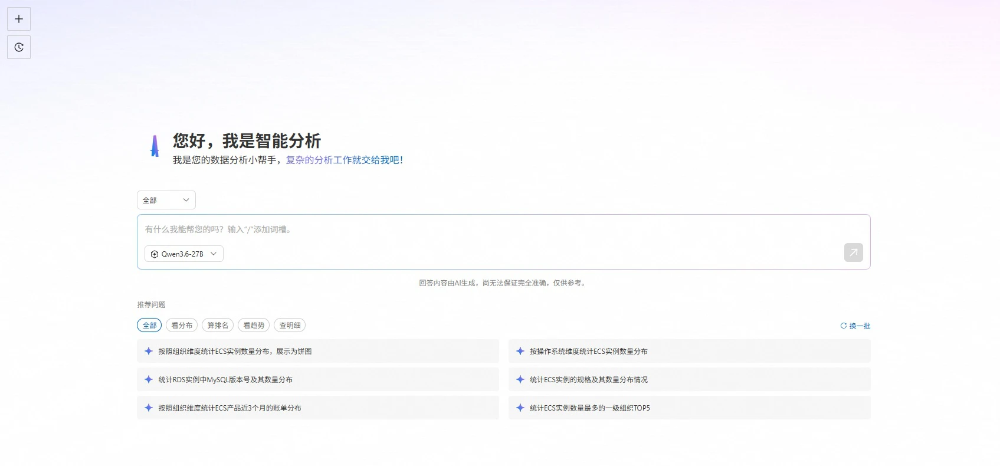

## 3.8. AI账单分析

账单数据繁多，用户难以从数字中发现背后趋势和可能存在的问题，飞天助理提供基于AI的账单分析能力，为平台用户提供账单的多维度洞察，帮助用户更方便快速地了解资源用量及费用情况，合理控制使用成本，同时也为平台运营提供账单的异常波动分析、趋势预测等智能分析，帮助平台保障账单的准确性，并优化运营策略提升收入。

**产品账单AI分析**

产品账单AI分析详细操作请参见《统一云管平台 用户指南》中“账单管理”下的“产品账单AI分析”章节。

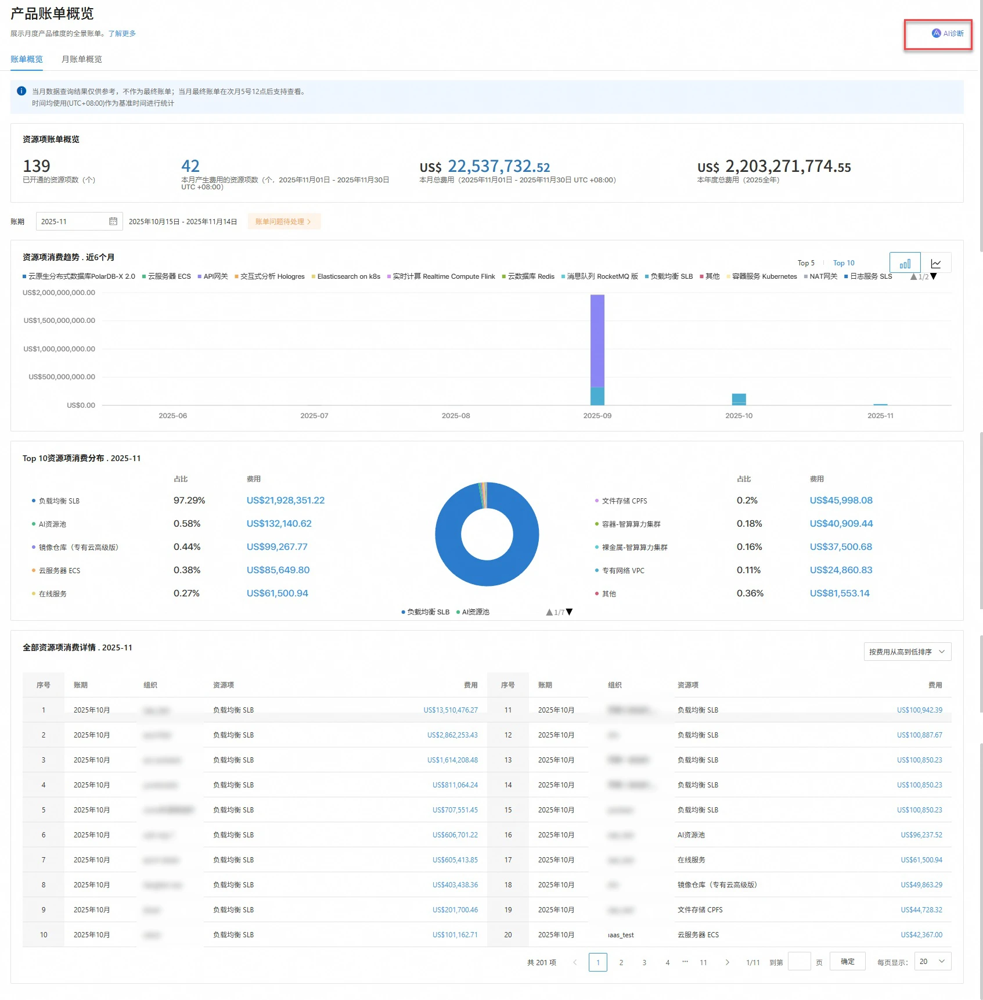

**组织账单AI分析**

组织账单AI分析详细操作请参见《统一云管平台 用户指南》中“账单管理”下的“组织账单AI分析”章节。

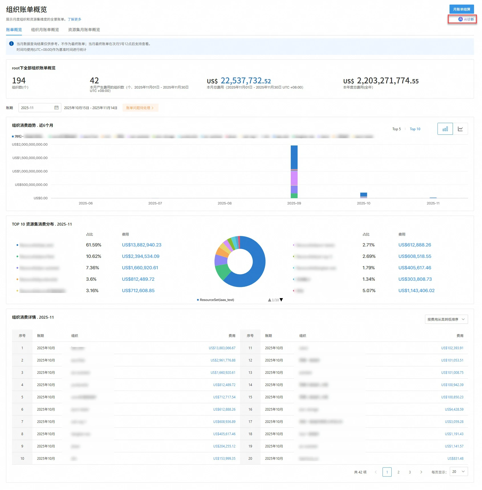

**账单明细AI分析**

账单明细AI分析支持按天明细和小时明细的AI解析，详细操作请参见《统一云管平台 用户指南》中“账单明细”下的“账单明细AI分析”章节。

**按天明细**

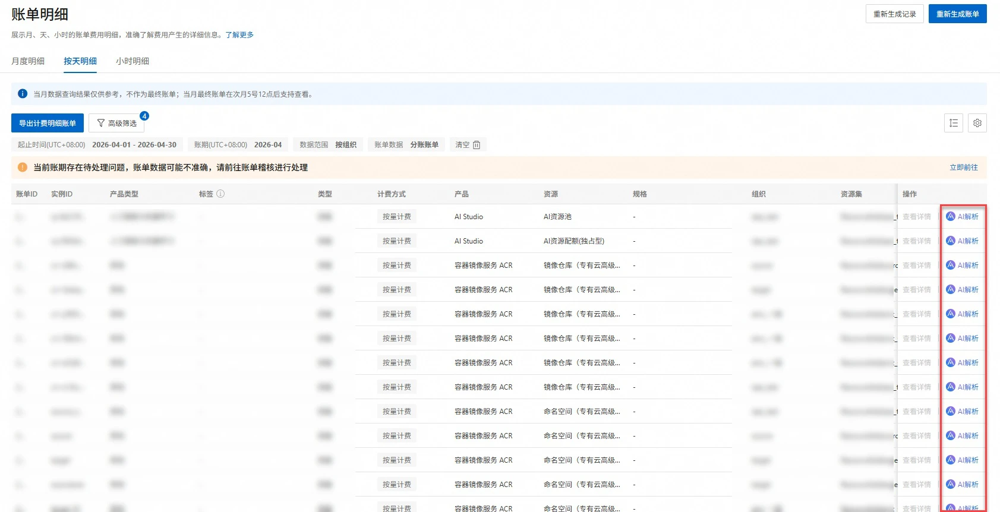

**小时明细**

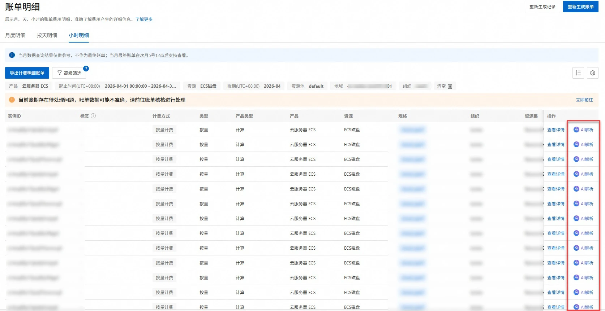

## 3.9. AI计费规则分析

飞天助理基于计费规则场景提供智能的AI分析。

AI计费规则分析详细操作请参见《统一云管平台 用户指南》中“服务定价”下的“计费规则AI分析”章节。

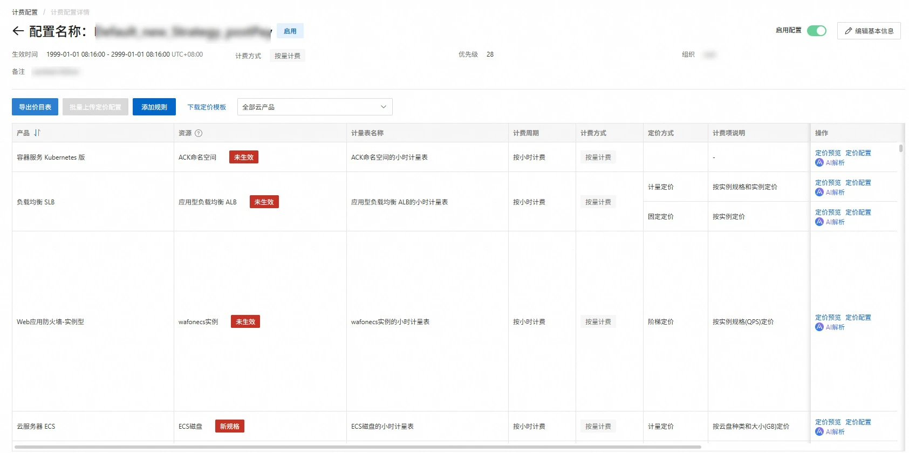

## 3.10. 统一资源检索

统一资源检索是Apsara Copilot（飞天助理）智能管理数字人的核心能力之一。您可以通过自然语言对话，跨产品、跨地域快速检索云资源，支持按组织、地域、状态、标签等多维度条件筛选，帮助您高效定位和管理云上资源。

**支持的资源类型**

统一资源检索支持以下云产品资源类型的检索：

<table>
  <tr>
    <th width="105">资源类型</th>
    <th>说明</th>
  </tr>
  <tr>
    <td>ECS实例</td>
    <td>云服务器ECS（Elastic Compute Service）实例，支持按规格、计费方式、运行状态等维度检索。</td>
  </tr>
  <tr>
    <td>磁盘</td>
    <td>云盘资源，支持按磁盘类型（系统盘/数据盘）、磁盘种类、状态等维度检索。</td>
  </tr>
  <tr>
    <td>弹性网卡</td>
    <td>弹性网卡（ENI），支持按VPC、关联实例等维度检索。</td>
  </tr>
  <tr>
    <td>快照</td>
    <td>云盘快照，支持按快照类型（手动/自动）、磁盘类型、状态等维度检索。</td>
  </tr>
  <tr>
    <td>安全组</td>
    <td>安全组资源，支持按安全组类型、VPC、名称等维度检索。</td>
  </tr>
  <tr>
    <td>密钥对</td>
    <td>SSH密钥对，支持按名称、标签等维度检索。</td>
  </tr>
  <tr>
    <td>部署集</td>
    <td>部署集资源，支持按名称、标签等维度检索。</td>
  </tr>
  <tr>
    <td>VPC</td>
    <td>专有网络VPC（Virtual Private Cloud），支持按地域、状态、网段等维度检索。</td>
  </tr>
  <tr>
    <td>交换机</td>
    <td>VPC交换机（VSwitch），支持按地域、VPC实例等维度检索。</td>
  </tr>
  <tr>
    <td>路由表</td>
    <td>VPC路由表，支持按路由表类型、VPC实例等维度检索。</td>
  </tr>
  <tr>
    <td>网络ACL</td>
    <td>VPC网络访问控制列表（ACL），支持按VPC、名称、标签等维度检索。</td>
  </tr>
  <tr>
    <td>NAT网关</td>
    <td>NAT网关实例，支持按规格、状态、网络类型等维度检索。</td>
  </tr>
  <tr>
    <td>弹性公网IP</td>
    <td>弹性公网IP（EIP），支持按绑定状态、关联实例类型、带宽等维度检索。</td>
  </tr>
  <tr>
    <td>SLB</td>
    <td>负载均衡SLB（Server Load Balancer）实例，支持按地域、状态、网络类型等维度检索。</td>
  </tr>
  <tr>
    <td>RDS</td>
    <td>云数据库RDS实例，支持按数据库引擎、实例类型、网络类型等维度检索。</td>
  </tr>
</table>

**使用方法**

您可以通过飞天助理对话框，使用自然语言描述检索需求，智能管理数字人将自动解析您的意图并返回匹配的资源列表。

**操作步骤**

1. 打开飞天助理对话框。在控制台顶部导航栏或悬浮菜单单击飞天助理图标，进入飞天助理。

2. 在对话框中输入自然语言检索指令。例如，输入<strong>"帮我查询yundun2e下在cn-neimeng-50e-d01地域的，状态为运行中的所有ECS实例"</strong>。

3. 发送指令后，智能管理数字人将自动解析检索条件，查询匹配的资源并以列表形式展示结果。

**自然语言检索示例**

以下是各资源类型的检索示例，您可以在对话框中直接输入类似的自然语言指令：

<table>
  <tr>
    <th width="105">资源类型</th>
    <th>检索示例</th>
  </tr>
  <tr>
    <td>ECS实例</td>
    <td>帮我查询yundun2e下在cn-neimeng-50e-d01地域的，状态为运行中的，标签为EnableHotUpgrade:true的所有ECS实例。</td>
  </tr>
  <tr>
    <td>ECS实例</td>
    <td>帮我查计费方式为按量付费的，规格为ecs.s5-kp-k-c1m1.large的ECS实例。</td>
  </tr>
  <tr>
    <td>磁盘</td>
    <td>帮我查询ResourceSet(yundune2e)资源集下的所有状态为待挂载的数据盘。</td>
  </tr>
  <tr>
    <td>弹性网卡</td>
    <td>帮我查VPC vpc-o4a7ex382zfzl1fy93grg下的所有弹性网卡，标签EnableHotUpgrade:true。</td>
  </tr>
  <tr>
    <td>快照</td>
    <td>帮我查询astbbigdata下状态为创建成功的所有手动快照。</td>
  </tr>
  <tr>
    <td>安全组</td>
    <td>帮我查询acs-autotest下类型为企业级的安全组。</td>
  </tr>
  <tr>
    <td>VPC</td>
    <td>帮我查询yundun2e下在cn-neimeng-50e-d01地域的所有VPC，状态为可用的。</td>
  </tr>
  <tr>
    <td>交换机</td>
    <td>帮我查VPC实例vpc-o4a3a218r4y3pt5wx60ap下面的所有交换机，显示可用IP数量。</td>
  </tr>
  <tr>
    <td>NAT网关</td>
    <td>帮我查询yundun2e组织下状态为可用的规格为中型的NAT网关。</td>
  </tr>
  <tr>
    <td>弹性公网IP</td>
    <td>帮我查关联实例类型为ECS实例的带宽为5Mbps的EIP。</td>
  </tr>
  <tr>
    <td>SLB</td>
    <td>帮我查询yundun2e组织下cn-neimeng-50e-d01地域的状态为运行中的所有SLB。</td>
  </tr>
  <tr>
    <td>RDS</td>
    <td>帮我查询yundun2e组织下所有RDS实例，引擎为MySQL 8.0，标签EnableHotUpgrade:true。</td>
  </tr>
</table>

**筛选维度说明**

在自然语言检索中，您可以组合使用以下筛选维度来精确定位资源：

| 筛选维度 | 说明 | 示例 |
| --- | --- | --- |
| 组织/资源集 | 按资源所属的组织或资源集筛选。 | yundun2e、astbbigdata、iaas_test |
| 地域 | 按资源所在地域筛选。 | cn-neimeng-50e-d01 |
| 状态 | 按资源的运行状态筛选。 | 运行中、已绑定、可用、创建成功、待挂载 |
| 标签 | 按资源的标签键值对筛选。 | EnableHotUpgrade:true、HBR InstanceId:i-xxx |
| VPC实例 | 按资源所属的VPC实例筛选。 | vpc-o4a7ex382zfzl1fy93grg |
| 规格/类型 | 按资源的规格型号或类型筛选。 | ecs.s5-kp-k-c1m1.large、中型、企业级 |
| 计费方式 | 按资源的计费方式筛选。 | 按量付费、包年包月 |
| 名称 | 按资源名称的关键词筛选。 | 名字含test |
| 网络类型 | 按资源的网络类型筛选。 | 专有网络、经典网络、公网 |

**使用须知**

- 统一资源检索依赖智能管理数字人（智能管理Agent）。请确保在专家管理页面中已启用**智能管理Agent**。

- 检索结果受当前用户权限限制，仅展示您有权限查看的资源。

- 支持在一条指令中组合多个筛选条件，智能管理数字人将自动解析并返回同时满足所有条件的资源。

- 如需查看更多资源详情，您可以在检索结果中单击资源名称，跳转到对应云产品控制台的资源详情页。

# 4.飞天助理运营分析

提供飞天助理的运营数据分析看板，帮助客户更好地掌握飞天助理的使用情况，以及业务效果。

**前提条件**

操作用户默认为运营管理员用户。

**操作步骤**

1. 登录Apsara Uni-manager运营控制台。

2. 在顶部菜单栏选择**首页**。

3. 单击**AI+运营**页签，查看**近一周**和**近一个月**的各指标数据。

   | 展示项 | 说明 |
   | --- | --- |
   | AI助理核心指标 | 展示<strong>综合评分</strong>、<strong>日活跃用户数</strong>以及<strong>对话量</strong>等AI助理核心数据。 说明综合评分是衡量飞天助理整体服务质量的一个综合性指标，通过用户满意度、性能响应、请求成功率三个维度计算得出，反映系统在实际使用中的质量与用户体验水平。 |
   | AI助理功能使用 | 展示<strong>智能问答</strong>、<strong>知识覆盖率</strong>、<strong>智能分析</strong>、<strong>辅助操作</strong>、<strong>代码生成</strong>、<strong>MPC调用</strong>等场景化功能使用数据。 |
   | AI助理性能响应 | 展示<strong>首次Token响应时间</strong>和<strong>平均生成速度</strong>等AI助理核心性能数据。 |
   | AI助理资源消耗 | 展示<strong>Tokens消耗量</strong>和<strong>模型推理延迟</strong>等AI助理资源消耗数据。 |
   | AI助理License使用情况 | 展示AI助理License的使用情况，包括<strong>标准版Agent</strong>、<strong>资源管理Agent</strong>、<strong>运营管理</strong><strong>Agent</strong>和<strong>数据洞察Agent</strong>。 |

   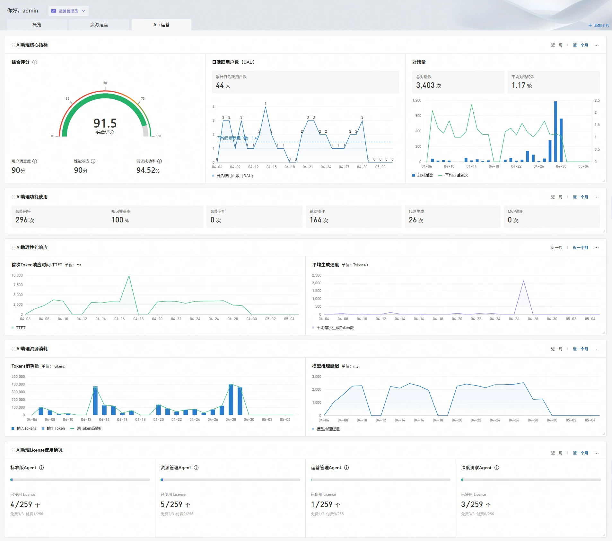

# 5.操作审计

飞天助理支持操作审计日志记录功能。

**操作步骤**

1. 登录Apsara Uni-manager运营控制台。

2. 在菜单中选择**企业**。

3. 在左侧导航栏中选择**操作审计** > **个人操作日志**。

4. 在**个人操作日志**页面，选择组织、产品类型、资源类型、事件类型、资源ID、源IP、事件ID、起止时间等筛选条件后，单击**搜索**。

   > **说明**
   >
   > 产品类型选择**统一云管平台**，资源类型选择**飞天助理**。

5. 在列表查看飞天助理的操作日志记录。

   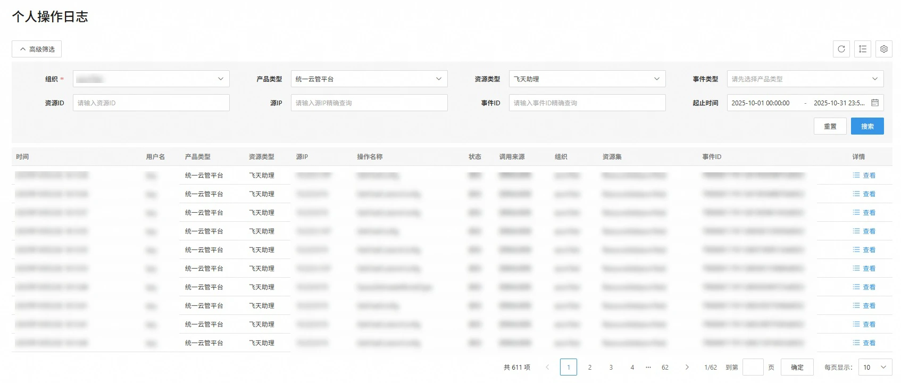

6. 单击列表操作列的**查看**，跳转到**操作详情**面板。

   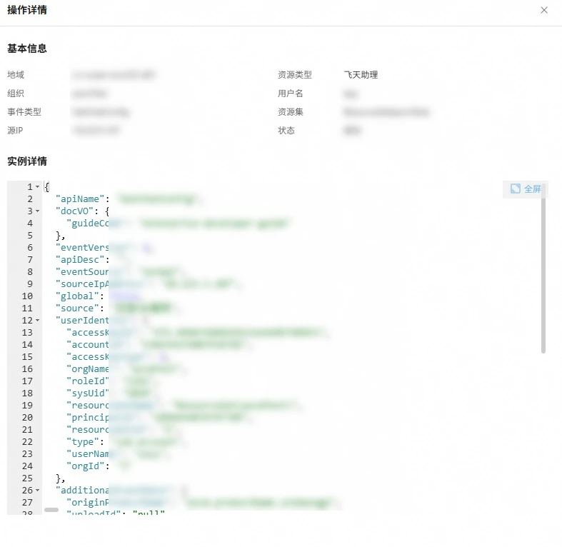

# 6.附录

## 6.1. 登录Apsara Uni-manager运营控制台

本文主要向您介绍如何登录Apsara Uni-manager运营控制台。

**前提条件**

- 登录Apsara Uni-manager运营控制台前，确认您已从部署人员处获取Apsara Uni-manager运营控制台的服务域名地址。

- 推荐使用Chrome浏览器。

**操作步骤**

1. 在浏览器地址栏中，输入Apsara Uni-manager运营控制台的服务域名地址，按回车键。

   

   > **说明**
   >
   > - 单击页面右上角的当前语言可以切换其它语言。
   >
   > - 由于浏览器证书过期或环境开启HTTPS认证等出现多次单击继续访问或无Apsara Uni-manager运营控制台地址入口等现象，此时需要安装证书才能正常访问。单击页面右上角的**浏览器证书安装**，可打开浏览器证书安装指南。

2. 输入正确的用户名及密码。

   > **说明**
   >
   > - 请向运营管理员获取登录控制台的用户名和密码。
   >
   > - 首次登录Apsara Uni-manager运营控制台时，需要修改登录用户名的密码，请按照提示完成密码修改。为提高安全性，密码长度必须为10~32位，且包含英文字母大小写、阿拉伯数字和特殊符号（感叹号（!）、at（@）、井号（#）、美元符号（$）、百分号（%）等）。

3. 勾选**我已阅读并同意产品服务协议、隐私协议、用户协议**。

   > **说明**
   >
   > - 登录页展示的链接文字为文档标题，单击链接文字，可查看协议的详细内容。
   >
   > - **产品服务协议**、**隐私协议**和**用户协议**仅在已发布时才会显示。如果三种类型协议都没有发布，则不需要执行该操作。

4. 单击**账号登录**/**授权登录**。

   > **说明**
   >
   > “授权登录”仅第三方认证的全局IdP设置启用时才会显示，且该显示名称可自定义，默认显示名称为“授权登录”。

5. 如果账号已激活MFA多因素认证，请根据以下两种情况进行操作：

   > **说明**
   >
   > 公网场景下，登录入口默认强制开启多因素认证。

   - **开启MFA后的首次登录**

     <ol type="a">

     <li>

     输入账号密码登录后，展示绑定虚拟MFA设备页面。

     </li>

     <li>

     在绑定虚拟MFA设备页面中，按页面提示步骤绑定虚拟MFA设备。

     </li>

     </ol>

     <ol type="i" start="100">

     <li>

     登录成功，进入控制台。

     </li>

     </ol>

   - **已开启并绑定MFA**

     输入6位MFA码后单击**认证**。

**相关操作**

**忘记密码**

1. 用户忘记登录密码时，单击密码输入框下方的**忘记密码**。

2. 在忘记密码页面，输入**账户名**、**邮箱**和验证码后，单击**确认**。

   

   > **说明**
   >
   > - 账户名请输入当前账号的用户名，邮箱请输入注册账号的Email地址。
   >
   > - 重置密码的链接将发至邮箱，进入链接后用户可输入新密码。
