阿里云  
专有云  
实时数仓 Hologres  
运维指南  
产品版本：v3.18.6-SP2607  
文档版本：20260729

**目录**

- [1.运维命令工具](#section-1)
    - [1.1. 盘古运维命令](#section-1-1)
    - [1.2. 伏羲运维命令](#section-1-2)
    - [1.3. 女娲运维命令](#section-1-3)
    - [1.4. K8s运维命令](#section-1-4)
- [2.日常运维](#section-2)
- [3.Hologres服务角色运维](#section-3)
- [4.查看审计日志（3.2内核）](#section-4)
- [5.基于大数据管家的运维](#section-5)
    - [5.1. 登录大数据管家](#section-5-1)
    - [5.2. 通用操作](#section-5-2)
    - [5.3. 监控](#section-5-3)
        - [5.3.1. 健康度](#section-5-3-1)
        - [5.3.2. 报表](#section-5-3-2)
    - [5.4. 运维](#section-5-4)
        - [5.4.1. Hologres运维功能和入口](#section-5-4-1)
        - [5.4.2. Hologres服务运维](#section-5-4-2)
            - [5.4.2.1. 伏羲服务运维](#section-5-4-2-1)
                - [5.4.2.1.1. 伏羲服务概览](#section-5-4-2-1-1)
                - [5.4.2.1.2. 伏羲服务角色](#section-5-4-2-1-2)
                - [5.4.2.1.3. 伏羲服务计算节点](#section-5-4-2-1-3)
            - [5.4.2.2. 盘古服务运维](#section-5-4-2-2)
                - [5.4.2.2.1. 盘古服务概览](#section-5-4-2-2-1)
                - [5.4.2.2.2. 盘古服务角色](#section-5-4-2-2-2)
                - [5.4.2.2.3. 盘古服务存储节点](#section-5-4-2-2-3)
                - [5.4.2.2.4. 清理盘古的回收站](#section-5-4-2-2-4)
                - [5.4.2.2.5. 开启和关闭盘古的数据自动均衡](#section-5-4-2-2-5)
                - [5.4.2.2.6. 在盘古Master上执行Checkpoint](#section-5-4-2-2-6)
                - [5.4.2.2.7. 切换盘古的Master](#section-5-4-2-2-7)
        - [5.4.3. Hologres集群运维](#section-5-4-3)
            - [5.4.3.1. 集群概览](#section-5-4-3-1)
            - [5.4.3.2. 集群健康](#section-5-4-3-2)
            - [5.4.3.3. 集群机器列表](#section-5-4-3-3)
        - [5.4.4. Hologres主机运维](#section-5-4-4)
            - [5.4.4.1. 主机概览](#section-5-4-4-1)
            - [5.4.4.2. 主机服务角色](#section-5-4-4-2)
    - [5.5. 管理](#section-5-5)
        - [5.5.1. 管理概述](#section-5-5-1)
        - [5.5.2. 作业服务](#section-5-5-2)
            - [5.5.2.1. 概述](#section-5-5-2-1)
            - [5.5.2.2. 手动执行作业](#section-5-5-2-2)
            - [5.5.2.3. 操作定时作业](#section-5-5-2-3)
            - [5.5.2.4. 查看作业执行历史](#section-5-5-2-4)
        - [5.5.3. 健康管理](#section-5-5-3)
            - [5.5.3.1. 监控配置](#section-5-5-3-1)
            - [5.5.3.2. 巡检管理](#section-5-5-3-2)
        - [5.5.4. 操作审计](#section-5-5-4)
- [6.Hologres深度巡检](#section-6)

<a id="section-1"></a>

# 1.运维命令工具

本小节将会为您介绍实时数仓Hologres常见的运维命令工具。

**statefulset**

```text
# 查看statefulset
$ /apsara/kube_tools/kubectl get statefulset
NAME                        READY   AGE
stress-28-fe-statefulsets   2/2     7h47m
test-27-fe-statefulsets     2/2     8h

# 查看statefulset的详细信息
$ /apsara/kube_tools/kubectl describe statefulset test-27-fe-statefulsets

# 删除某个statefulset
$ /apsara/kube_tools/kubectl delete statefulset test-27-fe-statefulsets
```

创建statefulset，填写 `test_state.yaml`

```yaml
apiVersion: apps/v1beta1
kind: StatefulSet
metadata:
  name: holo-frontend
  namespace: default
spec:
  serviceName: "holo-frontend"
  replicas: 3
  template:
    metadata:
      labels:
        app: holo-frontend
    spec:
      containers:
      - name: holo-frontend
        image: reg.docker.alibaba-inc.com/hologram/frontend:master-v20190802181048-1246476
        command: ["/usr/local/gpdb/shell/setup.sh 13337"]
        resources:
          limits:
            cpu: 300m
            memory: 2000Mi
          requests:
            cpu: 200m
            memory: 1500Mi
        args:
        - "100000"
        imagePullPolicy: IfNotPresent
        volumeMounts:
        - mountPath: /usr/local/holo-frontend
          name: fe-dir
        env:
        - name: frontend_id
          valueFrom:
            fieldRef:
              fieldPath: metadata.name
        - name: holo_fe_seahawks_serive_host
          value: "##SEAHAWKS_HOST##"
        - name: holo_fe_seahawks_serive_port
          value: "##SEAHAWKS_PORT##"
        - name: holo_fe_seahawks_serive_db
          value: "交互式分析"
        - name: holo_fe_worker_pool_size
          value: "1"
        - name: holo_fe_start_query_timeout
          value: "60000"
        - name: holo_fe_query_next_timeout
          value: "300000"
        - name: holo_fe_query_memory_in_MB_limit
          value: "4096"
        - name: holo_fe_meta_proxy_rpc_queue_size
          value: "5000"
      volumes:
      - name: fe-dir
        hostPath:
          path: /tmp/
```

然后调用以下命令。

```text
$ /apsara/kube_tools/kubectl apply -f test_state.yaml
```

**deployment**

```text
# 查看deployment
$ /apsara/kube_tools/kubectl get deployment
NAME                               READY   UP-TO-DATE   AVAILABLE   AGE
stress-28-holo-master-deployment   1/1     1            1           8h
test-27-holo-master-deployment     1/1     1            1           8h

# 查看statefulset的详细信息
$ /apsara/kube_tools/kubectl describe deployment test-27-holo-master-deployment

# 删除某个statefulset
$ /apsara/kube_tools/kubectl delete deployment test-27-holo-master-deployment
```

创建deployment，编写 `test_dep.yaml` 如下。

```yaml
apiVersion: extensions/v1beta1
kind: Deployment
metadata:
  name: holo-master-deployment
spec:
  replicas: 1
  template:
    metadata:
      labels:
        app: master
    spec:
      containers:
      - command:
        - bash -c '/usr/local/bin/holo-master -u "{\"master_options\":
{\"session_name\":\"交互式分析_master\"},\"storage_options\":{\"etcd_storage_options\":{\
"server_list\":[##ETCD_SERVER_LIST##],\"use_cert\":true}},\"controller_options\":{\"k8s_controller_options\":{\"namespace\":\"default\"}}}" -c /etc/holo_master.yaml -l /etc/holo_master_log.json'
        image: reg.docker.alibaba-inc.com/hologram/holomaster:master-v20190802181048-1246476
        imagePullPolicy: IfNotPresent
        name: holo-master
        ports:
        - containerPort: xxxx
          protocol: TCP
```

然后调用以下命令

```text
$ /apsara/kube_tools/kubectl apply -f test_dep.yaml
```

**service**

```text
# 查看service
$ /apsara/kube_tools/kubectl get service
NAME                            TYPE        CLUSTER-IP   EXTERNAL-IP   PORT(S)           
AGE
kubernetes                      ClusterIP   10.68.xx.xx    <none>        xxx/TCP         
8d
seahawks-test-1                 ClusterIP   None         <none>        
xxxx/TCP,xxxx/UDP,xxxx/TCP,xxxx/UDP   3h8m
stress-28-holo-master-service   ClusterIP   None         <none>        xxxxx/TCP        
8h
test-27-holo-master-service     ClusterIP   None         <none>        xxxxx/TCP        
5h5m

# 查看statefulset的详细信息
$ /apsara/kube_tools/kubectl describe service stress-28-holo-master-service

# 删除某个statefulset
$ /apsara/kube_tools/kubectl delete service stress-28-holo-master-service
```

创建service：填写 `test_service.yaml` 文件如下。

```yaml
kind: Service
apiVersion: v1
metadata:
  name: service-demo
spec:
  clusterIP: None
  selector:
    app: foo
  ports:
    - protocol: TCP
      port: xx
      targetPort: xxxx
```

然后调用以下命令。

```text
$ /apsara/kube_tools/kubectl apply -f test_service.yaml
```

<a id="section-1-1"></a>

## 1.1. 盘古运维命令

本小节将会为您介绍基于实时数仓Hologres的盘古运维命令。

**进入执行命令窗口**

运维工程师可通过命令行进行运维操作。在执行具体命令前，需先进入AG机器的命令行界面，具体操作如下。

1. 进入飞天基础运维平台，选择**资源管理 > 产品集群运维**后，在**产品 | 集群**搜索框中输入Hologres，搜索出相关集群。

2. 单击目标集群**操作**列的**集群详情**，在**服务列表**页签中通过**服务**搜索框查找 `pangu` 服务。

3. 单击该**服务**名称，进入**服务 pangu**页面。

4. 选择**PanguTools#**。

5. 单击**实例列表**页签下对应机器的**操作**栏中的**Terminal**，开启TerminalService窗口，后续的命令行操作均在此窗口进行。

**查询当前集群盘古Master的状态（puadmin gems）**

- **命令功能**

  `puadmin gems` 命令用来查询当前集群盘古Master的状态。

- **命令格式**

  ```text
  puadmin gems
  ```

- **参数说明**

  无

- **使用示例**

  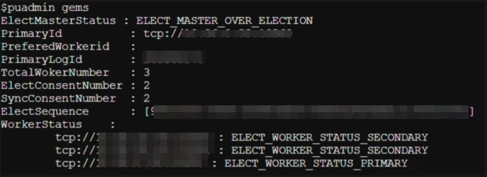

- **输出示例说明**

  | 输出信息 | 信息解释 |
  | --- | --- |
  | ElectMasterStatus | 集群盘古Master的状态 |
  | PrimaryId | 主Master ID |
  | PrimaryLogId | 主Master日志ID，当查看到logID无限增大，说明状态正常。 |
  | TotalWokerNumber | Master总数 |
  | ElectConsentNumber | 选举通过的集群盘古Master数量 |
  | SyncConsentNumber | Sync集群盘古Master数量 |
  | ElectSequence | 选举序列 |
  | WorkerStatus | 服务状态 |

**查询当前集群盘古Master日志的同步状态（puadmin gss）**

- **命令功能**

  `puadmin gss` 命令用来查询当前集群盘古Master日志的同步状态。

- **命令格式**

  ```text
  puadmin gss
  ```

- **参数说明**

  无

- **使用示例**

  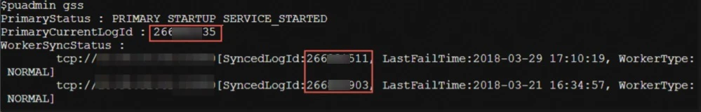

- **输出信息说明**

  | 输出信息 | 信息解释 |
  | --- | --- |
  | PrimaryStatus | 主集群盘古Master的状态 |
  | PrimaryCurrentLogId | 主集群盘古Master当前日志ID |
  | SyncedLogId | Sync日志ID |
  | WorkerSyncStatus | Sync集群盘古Master状态 |

**查询当前集群盘古所有ChunkServer的状态（puadmin lscs）**

- **命令功能**

  `puadmin lscs` 命令用来查询当前集群盘古所有ChunkServer的状态。

- **命令格式**

  ```text
  puadmin lscs
  ```

- **参数说明**

  无

- **使用示例**

  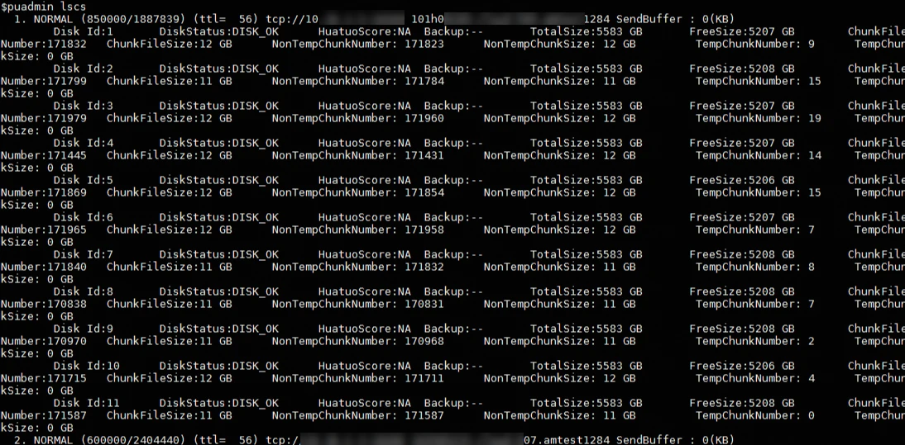

- **输出信息说明**

  | 输出信息 | 信息解释 |
  | --- | --- |
  | NORMAL | 表示ChunkServer的状态：<br>• <strong>NORMAL</strong>：健康状态<br>• <strong>SHUTDOWN</strong>：关闭状态<br>• <strong>DISCONNECT</strong>：非连接状态 |
  | <code>tcp://xxxx</code> | 表示当前ChunkServer的IP地址和进程端口号。 |
  | Disk Id：1 | 1为这一台chunkserver上/apsarapangu/disk1这个目录所在磁盘。ID:x对应disk:x |
  | DiskStatus | 表示磁盘状态：<br>• <strong>DISK_OK</strong>：磁盘健康<br>• <strong>DISK_ERROR</strong>：磁盘错误<br>• <strong>DISK_HANG</strong>：磁盘挂起 |
  | Backup | 当前这块磁盘的备份状态：<br>• --：表示正常<br>• <strong>Doing</strong>：正在做备份<br>• <strong>Done</strong>：备份完毕 |
  | TotalSize | 磁盘总空间 |
  | FreeSize | 磁盘剩余空间 |
  | ChunkFileNumber | chunk文件数量 |
  | ChunkFileSize | chunk文件大小 |
  | NonTempChunkNumber | 非临时chunk文件数量 |
  | NonTempChunkSize | 非临时chunk文件大小 |
  | TempChunkNumber | 临时chunk文件数量 |
  | TempChunkSize | 临时chunk文件大小 |
  | Total Disk Size | 物理空间大小（每个文件存3份，逻辑存储为物理空间的1/3） |
  | Total Free Disk Size | 当前剩余空间大小（不包含chunkserver上的回收站） |
  | Total File Size | 真实Pangu数据物理空间大小（包含/deleted/） |

**清空集群盘古回收站（puadmin fs）**

- **命令功能**

  `puadmin fs` 命令用来集群清空盘古回收站。

- **命令格式**

  ```text
  puadmin fs -crb
  ```

- **参数说明**

  | 参数名称 | 参数说明 | 取值范围 |
  | --- | --- | --- |
  | -crb | 清空盘古回收站 | 无 |

- **使用示例**

  执行命令后，根据提示，选择Y确认清空盘古回收站。

  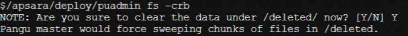

  清空完毕后可以执行 `pu ls -l` 命令查看回收站空间大小，比清空前变小。

  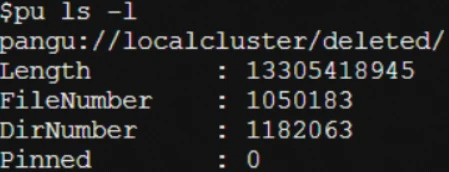

- **输出信息说明**

  | 输出信息 | 信息解释 |
  | --- | --- |
  | Length | 占用空间大小，单位：Byte |
  | FileNumber | 文件数量 |
  | DirNumber | 目录数量 |

**设置集群盘古磁盘状态（puadmin cs）**

- **命令功能**

  `puadmin cs` 命令用来设置集群盘古磁盘状态。

- **命令格式**

  ```text
  puadmin cs -stat tcp://ip:10260 -d 磁盘编号 --set=OK|ERROR
  ```

  > **说明**
  >
  > 当该命令无法设置成功时，对应机器的pangu_chunkserver进程可能发生故障。

- **参数说明**

  | 参数名称 | 参数说明 | 取值范围 |
  | --- | --- | --- |
  | -stat tcp://ip:10260 | 指定机器的IP地址 | 必须为pangu_chunkserver的机器 |
  | -d | 磁盘编号 | 必须为指定ip机器中的磁盘编号 |
  | --set | 指定盘古磁盘状态 | OK\|ERROR |

- **使用示例**

  设置磁盘状态为ERROR。

  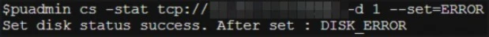

  执行 `puadmin lscs` 命令查询磁盘状态，可以看到磁盘状态为DISK_ERROR。

  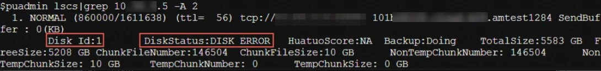

  设置磁盘状态为OK。

  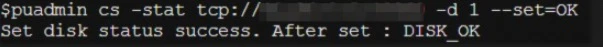

  执行 `puadmin lscs` 命令查询磁盘状态，可以看到磁盘状态为DISK_OK。

  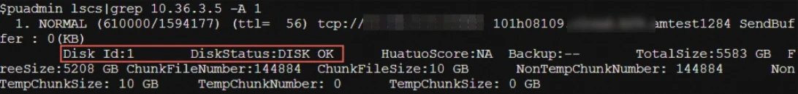

- **输出信息说明**

  <table>
    <tr>
      <th width="112">输出信息</th>
      <th>信息解释</th>
    </tr>
    <tr>
      <td>Disk Id</td>
      <td>磁盘ID</td>
    </tr>
    <tr>
      <td>DiskStatus</td>
      <td>磁盘状态：<strong>DISK_OK</strong>：磁盘健康<strong>DISK_ERROR</strong>：磁盘错误<strong>DISK_HANG</strong>：磁盘挂起</td>
    </tr>
  </table>

**设置集群盘古的机器状态（puadmin cs）**

- **命令功能**

  `puadmin cs` 命令用来设置集群盘古的机器状态。

- **命令格式**

  ```text
  puadmin cs -stat tcp://ip:10260 --set=SHUTDOWN|NORMALip:10260 -d 磁盘编号 --
  set=OK|ERROR
  ```

  > **说明**
  >
  > 当机器状态变为异常时，会触发盘古Backup，当doing变成done表示这台机器上面的盘古数据备份完成。

- **参数说明**

  | 参数名称 | 参数说明 | 取值范围 |
  | --- | --- | --- |
  | -stat tcp://ip:10260 | 指定机器的IP地址 | 必须为pangu_chunkserver的机器 |
  | --set | 指定盘古的机器状态 | 无 |

- **使用示例**

  设置盘古状态为SHUTDOWN。

  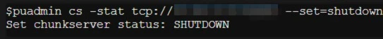

  执行 `puadmin lscs` 命令查询状态已经置为SHUTDOWN。

  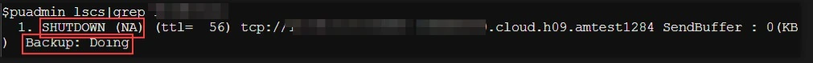

  设置盘古状态为 `NORMAL` 。

  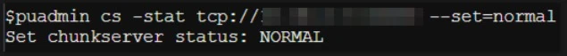

  执行 `puadmin lscs` 命令查询状态已经置为NORMAL。

  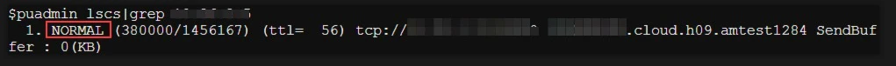

**查询集群盘古数据完整性（puadmin fs）**

- **命令功能**

  `puadmin fs` 命令用来查询集群盘古数据完整性。

- **命令格式**

  ```text
  puadmin fs -abnchunk -t none
  puadmin fs -abnchunk -t onecopy
  puadmin fs -abnchunk -t lessmin
  ```

- **参数说明**

  | 参数名称 | 参数说明 | 取值范围 |
  | --- | --- | --- |
  | -t none | 查询是否有丢失文件的数据 | 无 |
  | -t onecopy | 查询是否有正在备份的数据 | 无 |
  | -t lessmin | 查询是否有少于正常的副本数量。 | 无 |

- **使用示例**

  携带不同的参数，查询对应的数据完整性。如果显示为空，说明数据完整性不存在问题。如果出现类似第三条命令中的显示，即罗列相关chunk信息，则说明发生对应的数据完整性问题，需要进行对应的故障处理。

  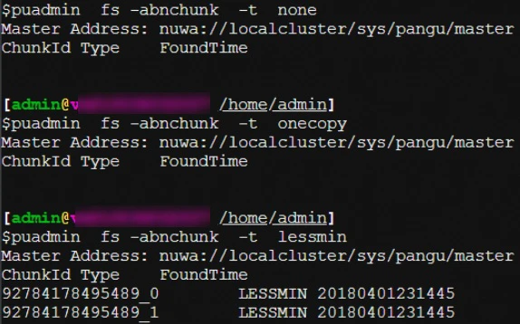

- **输出信息说明**

  | 输出信息 | 信息解释 |
  | --- | --- |
  | Master Address | Master地址 |
  | ChunkId | Chunk ID |
  | ChunkId Type | Chunk类型 |
  | FoundTime | 数据完整性发生故障时的时间 |

**查询某份数据的盘古路径（puadmin whois）**

- **命令功能**

  `puadmin whois` 命令用来查询某份数据的盘古路径。

- **命令格式**

  ```text
  puadmin whois
  ```

- **参数说明**

  无

- **使用示例**

  以上述 `lessmin` 的命令输出为例，这意味着数据有副本丢失，如何去定位这个问题，首先使用 `puadmin whois` 命令找到这份数据的盘古路径。

  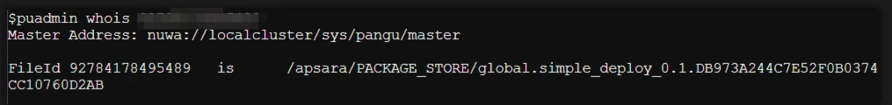

**查询某份数据副本的具体情况（puadmin gfi）**

- **命令功能**

  `puadmin gfi` 命令用来查看某份数据副本的具体情况。

- **命令格式**

  ```text
  puadmin gfi
  ```

- **参数说明**

  无

- **使用示例**

  使用 `puadmin whois` 命令找到这份数据的盘古路径后，再执行 `puadmin gfi` 命令来看具体的副本情况，可以看到有2份副本的状态是UnknownDiskStatus，再用对应运维手段去处理即可。

  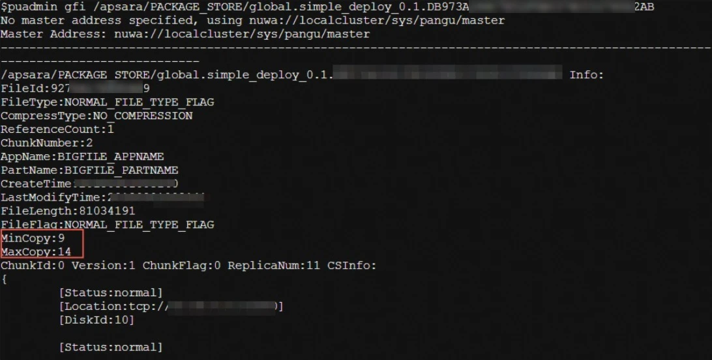

  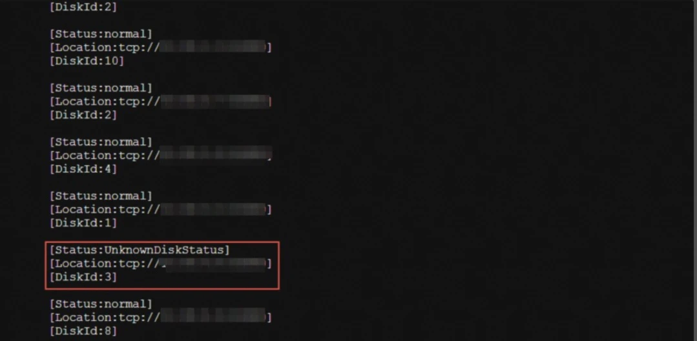

  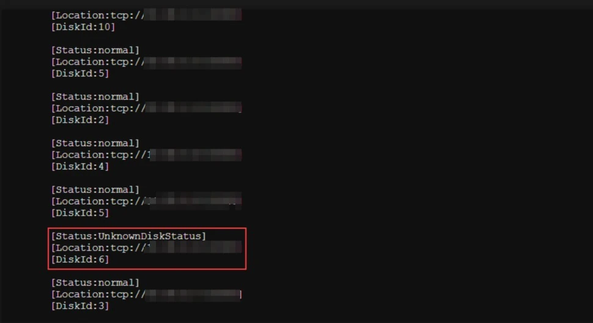

- **输出信息说明**

  | 输出信息 | 信息解释 |
  | --- | --- |
  | Master Address | pangu master在nuwa地址中的注册地址 |
  | FileId | 文件ID，唯一值 |
  | FileType | 文件类型 |
  | ChunkNumber | Chunk号 |
  | CreateTime | 文件创建时间 |
  | LastModifyTime | 文件最后更新时间 |
  | FileLength | 文件长度 |
  | FileFlag | 文件状态 |
  | Mincopy | 最小备份数量 |
  | Maxcopy | 最大备份数量 |
  | ChunkId | Chunk号ID |
  | Status | 状态 |
  | Location | 位置 |
  | DiskId | 磁盘ID |

**设置盘古数据平衡（puadmin rebalance）**

- **命令功能**

  `puadmin rebalance` 命令用来设置盘古数据平衡。

- **命令格式**

  ```text
  puadmin rebalance -expand
  puadmin rebalance -start
  puadmin rebalance -stat
  puadmin rebalance -stop
  ```

- **参数说明**

  | 参数名称 | 参数说明 | 取值范围 |
  | --- | --- | --- |
  | -expand | 重新计算数据分布 | 无 |
  | -start | 启动数据平衡 | 无 |
  | -stat | 查看数据平衡已经完成的数据迁移状况 | 无 |
  | -stop | 停止数据平衡 | 无 |

**显示帮助列表**

- **命令功能**

  `puadmin --help`或`puadmin $cmd --help` 命令用来显示帮助列表。

- **命令格式**

  ```text
  puadmin --help
  puadmin $cmd --help
  ```

- **参数说明**

  | 参数名称 | 参数说明 | 取值范围 |
  | --- | --- | --- |
  | --help | 查看命令帮助说明 | 无 |

- **使用示例**

  `puadmin --help` 直接打出帮助列表。

  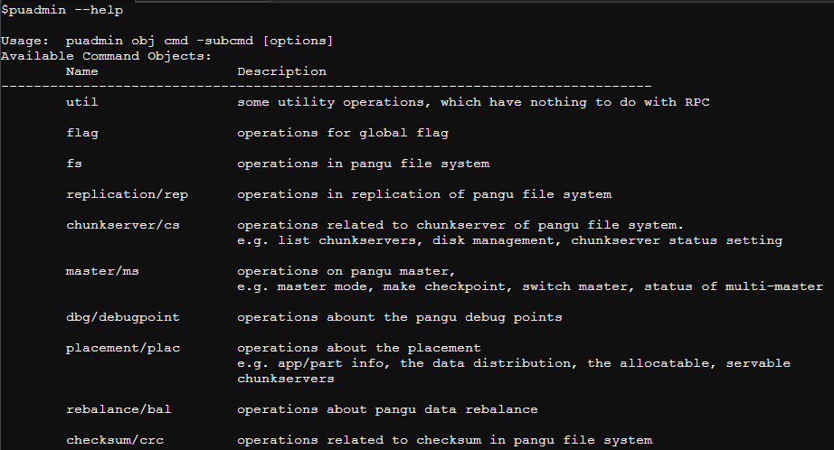

  盘古 `puadmin` 命令支持在具体的命令后面加上 `--help` 来看具体命令的作用如下 `whois` 和 `lscs` 。

  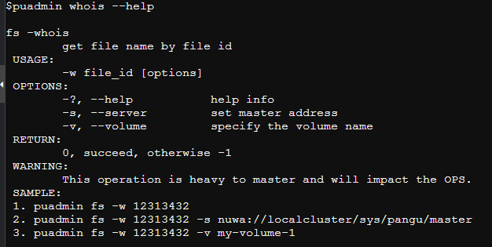

  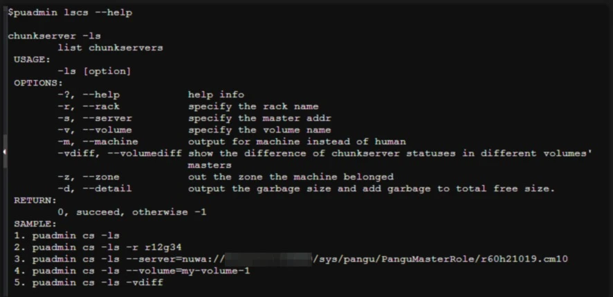

**查询盘古文件的元数据信息（pu meta）**

- **命令功能**

  `pu meta` 命令用来查询盘古文件的元数据信息。

  > **说明**
  >
  > pu meta命令只对文件可用，对目录不可用。

- **命令格式**

  ```text
  pu meta
  ```

- **参数说明**

  无

- **使用示例**

  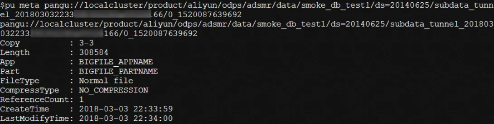

- **输出信息说明**

  | 输出信息 | 信息解释 |
  | --- | --- |
  | Copy | 文件拷贝数 |
  | Length | 文件长度 |
  | FileType | 文件类型 |
  | CreateTime | 文件创建时间 |
  | LastModifyTime | 文件最后更新时间 |

**查询当前盘古目录下的文件信息（pu ls）**

- **命令功能**

  `pu ls` 命令用来查询当前盘古目录下的文件信息。

- **命令格式**

  ```text
  pu ls -l
  pu ls -r
  ```

- **参数说明**

  | 参数名称 | 参数说明 | 取值范围 |
  | --- | --- | --- |
  | -l | 可以得到详细信息 | 无 |
  | -r | 递归列出所有子目录 | 无 |

- **使用示例**

  执行 `pu ls -l` 命令查看文件详细信息。

  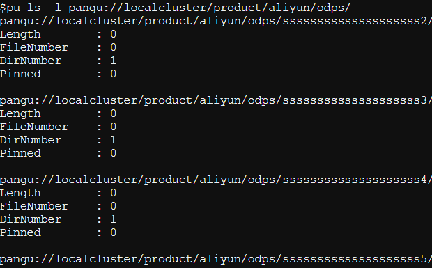

  执行 `pu ls -r` 命令查看文件递归子目录。

  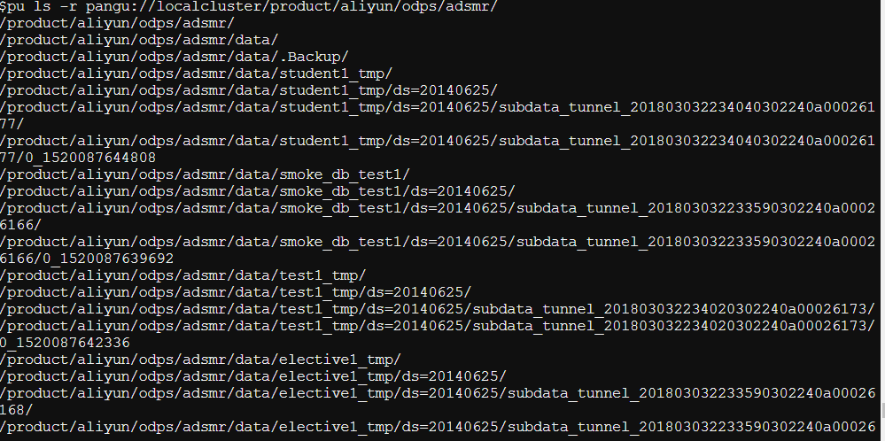

- **输出信息说明**

  | 输出信息 | 信息解释 |
  | --- | --- |
  | Length | 占空间大小（单位：Byte） |
  | FileNumber | 文件数 |
  | DirNumber | 目录数 |

**将指定文件上传到盘古上（pu put）**

- **命令功能** `pu put` 命令用来将指定文件上传到盘古上。

- **命令格式**

  ```text
  pu put
  ```

- **参数说明**

  无

- **使用示例**

  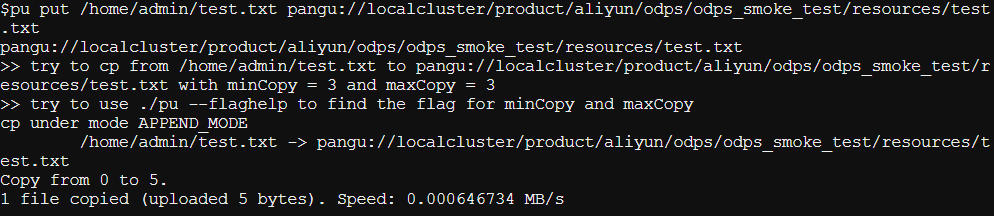

**查询盘古文件信息（pu cat）**

- **命令功能**

  `pu cat` 命令用来查询盘古文件信息。

- **命令格式**

  ```text
  pu cat
  ```

- **参数说明**

  无

- **使用示例**

  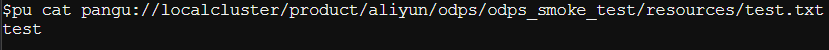

**将盘古文件下载到本地（pu get）**

- **命令功能**

  `pu get` 命令用来将盘古文件下载到本地。

- **命令格式**

  ```text
  pu get
  ```

- **参数说明**

  无

- **使用示例**

  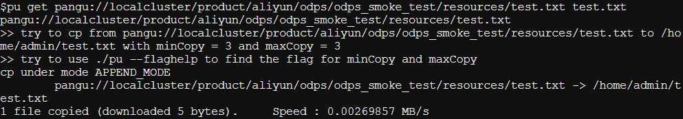

**查询当前盘古路径Quota信息（pu quota）**

- **命令功能**

  `pu quota` 命令用来查询当前盘古路径quota信息。

- **命令格式**

  ```text
  pu quota
  ```

- **参数说明**

  无

- **使用示例**

  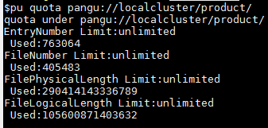

- **输出信息说明**

  | 输出信息 | 信息解释 |
  | --- | --- |
  | quota under pangu | 盘古路径 |
  | EntryNumber Limit | 目录条数统计 |
  | Used | 已使用的数量 |
  | FileNumber Limit | 文件数统计 |
  | FilePhysicalLength Limit | 磁盘物理使用量 |
  | FileLogicalLength Limit | 磁盘逻辑使用量 |

**修改盘古副本数（pu setreplica）**

- **命令功能**

  `pu setreplica` 命令用来修改盘古副本数。

- **命令格式**

  ```text
   pu setreplica ⽂件盘古路径 最⼩拷⻉份数 最⼤拷⻉份数
  ```

- **参数说明**

  | 参数名称 | 参数说明 | 取值范围 |
  | --- | --- | --- |
  | 文件盘古路径 | 执行修改文件盘古路径 | 无 |
  | 最小拷贝份数 | 指定最小拷贝份数 | 无 |
  | 最大拷贝份数 | 指定最大拷贝份数 | 无 |

- **使用示例**

  使用命令修改盘古副本数，最小拷贝份数为2，最大拷贝份数为5。

  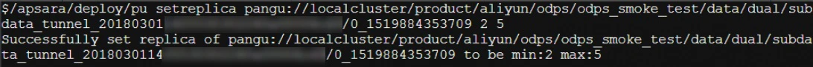

  使用 `puadmin gfi` 命令查询修改结果，可以看到红框中的数据已经按照修改的结果显示。

  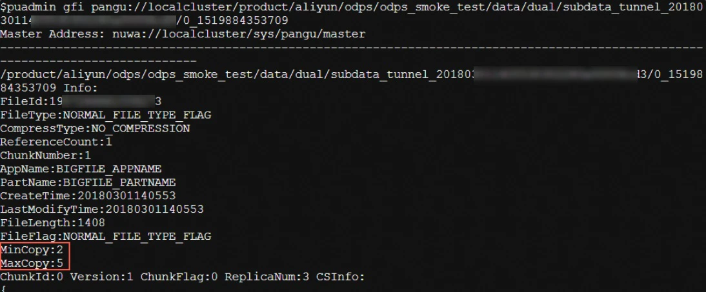

**盘古pu命令显示帮助信息**

- **命令功能**

  `pu --help` 命令用来显示帮助信息。

- **命令格式**

  ```text
  pu --help
  ```

- **参数说明**

  无

- **使用示例**

  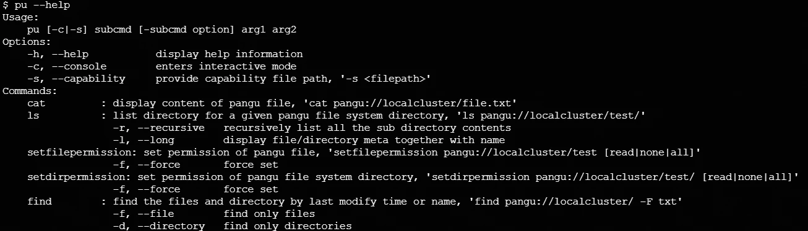

<a id="section-1-2"></a>

## 1.2. 伏羲运维命令

本小节将会为您介绍基于实时数仓Hologres的伏羲运维命令。

**进入执行命令窗口**

运维工程师可通过命令行进行运维操作。在执行具体命令前，需先进入AG机器的命令行界面，具体操作如下。

1. 进入飞天基础运维平台，选择**资源管理 > 产品集群运维**后，在**产品 | 集群**搜索框中输入Hologres，搜索出相关集群。

2. 单击目标集群**操作**列的**集群详情**，在**服务列表**页签中通过**服务**搜索框查找 `fuxi` 服务。

3. 单击该**服务**名称，进入**服务 fuxi**页面。

4. 选择**FuxiTools#**。

5. 单击**实例列表**页签下对应机器的**操作**栏中的**Terminal**，开启TerminalService窗口，后续的命令行操作均在此窗口进行。

**设置指令别名（alias）**

- **命令功能**

  `alias` 命令用来设置指令的别名。

- **命令格式**

  ```text
  alias r=
  alias sql=
  alias pssh=
  alias pscp=
  ```

- **参数说明**

  | 参数名称 | 参数说明 | 取值范围 |
  | --- | --- | --- |
  | r | 指代伏羲命令 | 无 |
  | sql | 使用 SQL，可以为列名称和表名称指定别名（Alias），用于访问和处理数据库标准计算机语言。 | 无 |
  | pssh | 批量执行命令 | 无 |
  | pscp | 批量执行下载或上传 | 无 |

- **使用示例**

  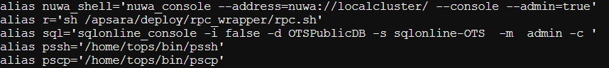

- **输出信息说明**

  | 输出信息 | 信息解释 |
  | --- | --- |
  | alisa nuwa_shell | 快速查找NuWa注册链接。 |

**查询所有运行中的任务（r al）**

- **命令功能**

  `r al` 命令用来查询实时数仓Hologres中所有运行中的任务。

- **命令格式**

  ```text
  r al
  ```

- **参数说明**

  无

- **使用示例**

  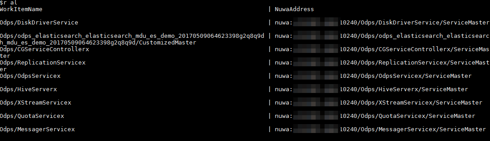

- **输出信息说明**

  | 输出信息 | 信息解释 |
  | --- | --- |
  | WorkItemName | 工作项名称 |
  | NuwaAddress | 工作项在NuWa中的注册地址 |

**查询所有运行中的任务占用的资源信息（r cru）**

- **命令功能**

  `r cru` 命令查询实时数仓Hologres中所有运行中的任务占用的资源信息。

- **命令格式**

  ```text
  r cru 
  ```

- **参数说明**

  无

- **使用示例**

  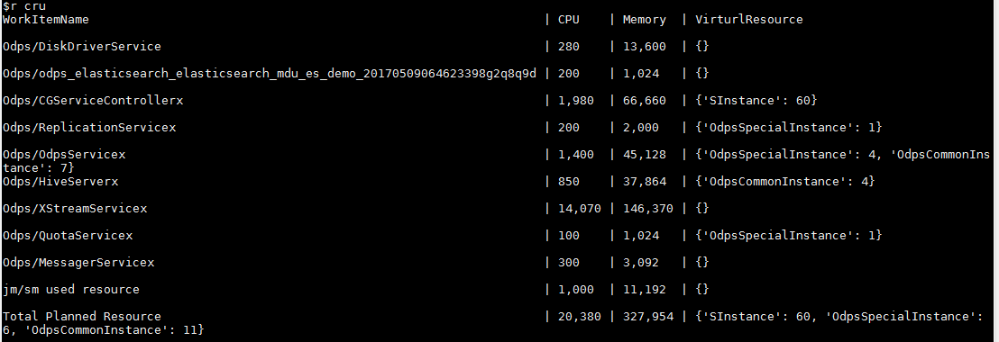

- **输出信息说明**

  | 输出信息 | 信息解释 |
  | --- | --- |
  | WorkItemName | 工作项名称 |
  | CPU | Job占用总的CPU资源（单位为u，100u=1个核） |
  | Memory | Job占用的Memory资源（单位为M） |
  | VirturlResource | 当前Job在伏羲对应的Role中建立的伏羲instance实例个数 |

**查询Job在机器中占用的资源（r cri）**

- **命令功能**

  `r cri` 命令用来查看实时数仓Hologres中所有Job和对应每个Job的Worker在机器中占用的资源。

- **命令格式**

  ```text
  r cri 
  ```

- **参数说明**

  无

- **使用示例**

  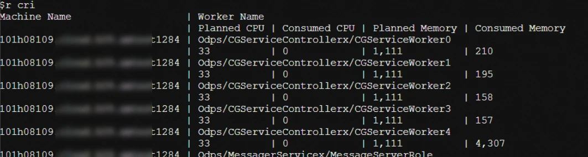

- **输出信息说明**

  | 输出信息 | 信息解释 |
  | --- | --- |
  | Machine Name | 机器名称 |
  | Worker Name | Worker名称 |

**查询集群全部资源（r ttrl）和可用资源（r tfrl）**

- **命令功能**

  `r ttrl/tfrl` 命令用来查询集群全部资源和可用资源。

- **命令格式**

  ```text
  r ttrl
  r tfrl
  ```

- **参数说明**

  | 参数名称 | 参数说明 | 取值范围 |
  | --- | --- | --- |
  | ttrl | 查询集群全部资源 | 无 |
  | tfrl | 查询可用资源 | 无 |

- **使用示例**

  执行 `r ttrl` 命令查询集群全部资源。

  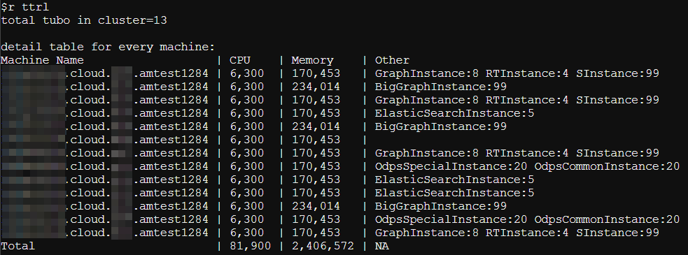

  执行 `r tfrl` 命令查询集群可用资源。

  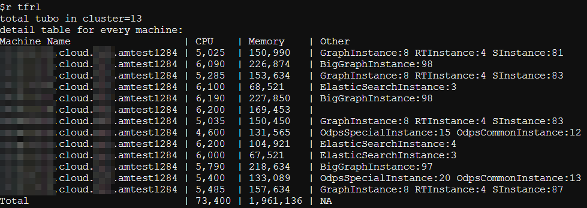

- **输出信息说明**

  | 输出信息 | 信息解释 |
  | --- | --- |
  | Machine Name | tubo机器的域名 |
  | CPU | 机器的全部CPU和剩余CPU（单位为u，100u=1个核） |
  | Memory | 机器的全部Memory和剩余Memory（单位为M） |
  | Other | tubo机器在伏羲中的标签（role） |

**查询核心服务信息（r swl/wwl）**

- **命令功能**

  `r swl/wwl` 命令用来查询实时数仓Hologres核心服务信息。

- **命令格式**

  ```text
  r swl
  r wwl
  ```

- **参数说明**

  | 参数名称 | 参数说明 | 取值范围 |
  | --- | --- | --- |
  | swl | 查看作业或服务信息 | 无 |
  | wwl | 查看作业或服务的详细信息 | 无 |

- **使用示例**

  执行 `r swl` 命令查询作业或服务信息。

  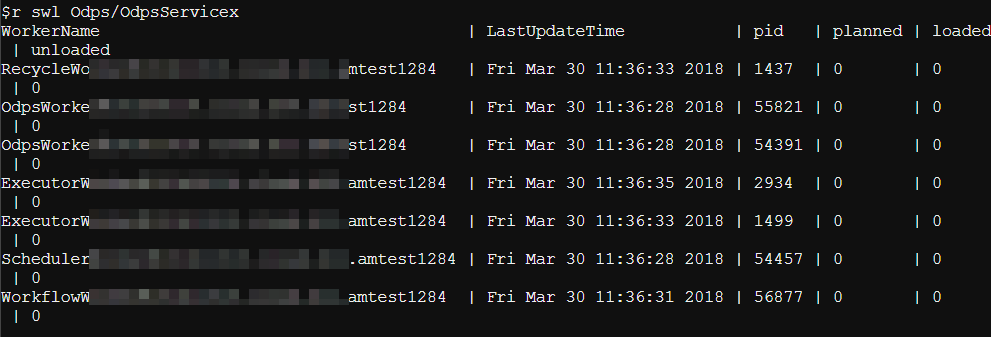

  执行 `r wwl` 命令查询作业或服务详细信息。

  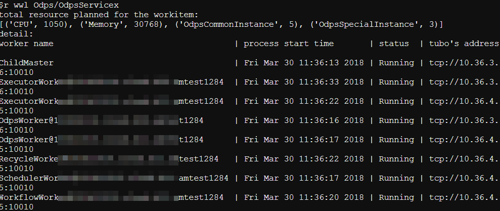

- **输出信息说明**

  | 输出信息 | 信息解释 |
  | --- | --- |
  | WorkerName | Worker名称和机器的域名 |
  | LastUpdateTime | pid的最后更新时间 |
  | pid | Worker在对应机器上面的pid号 |
  | planned | 申请的Worker个数 |
  | loaded | 实际在对应机器上面加载Worker的个数 |
  | process start time | 进程开始时间 |
  | status | 当前Worker在对应机器上的运行状态 |
  | tubo’s address | 该机器的tubo IP地址 |

**服务Plan相关操作**

- **命令功能**

  `r plan` 命令用来复制一个服务的Plan。 `r sstop` 命令用来停止一个服务。 `r start` 命令用来用复制的 `plan` 重新启动一个服务。

- **命令格式**

  ```text
  r plan
  r sstop
  r start
  ```

- **参数说明**

  无

- **使用示例**

  执行 `r plan` 命令复制一个服务plan后，执行 `r sstop` 命令停止该服务，然后执行 `r start` 命令重启。

  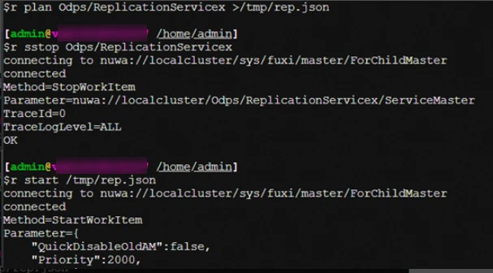

- **输出信息说明**

  | 输出信息 | 信息解释 |
  | --- | --- |
  | Method | 当前对plan的操作方式 |
  | Parameter | 相关参数值 |
  | TraceId | 跟踪ID |
  | TraceLogLevel | 跟踪日志等级 |

**将某个集群的机器加入黑名单（r blacklist）**

- **命令功能**

  `r blacklist` 命令用来将某个集群的机器加入黑名单。

- **命令格式**

  ```text
  r blacklist
  ```

- **参数说明**

  无

- **使用示例**

  <ol type="i">

  <li>

  打开伏羲黑名单（每个集群只需要操作一次）。

  ```text
  /apsara/deploy/rpc_caller --Server=nuwa://localcluster/sys/fuxi/master/ForClient --
  Method=/fuxi/SetGlobalFlag --Parameter={\"fuxi_Enable_BadNodeManager\":false}
  ```

  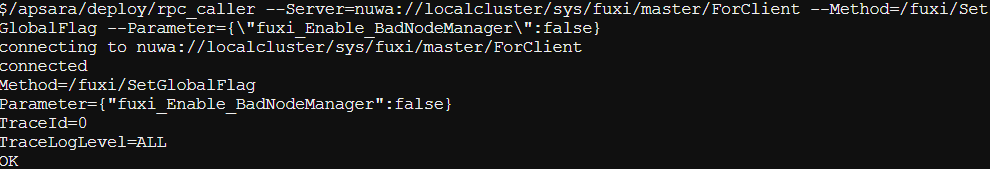

  </li>

  <li>

  查询当前集群黑名单列表。

  ```text
  r blacklist cluster get
  ```

  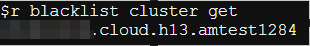

  </li>

  <li>

  增加黑名单机器。

  ```text
  r blacklist cluster add $hostname
  ```

  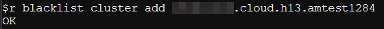

  </li>

  <li>

  删除黑名单机器。

  ```text
  r blacklist cluster remove $hostname
  ```

  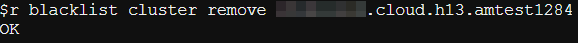

  </li>

  </ol>

**查询集群Quota信息（r quota）**

- **命令功能**

  `r quota` 命令用来查询实时数仓Hologres集群Quota信息。

- **命令格式**

  ```text
  r quota
  ```

- **参数说明**

  无

- **使用示例**

  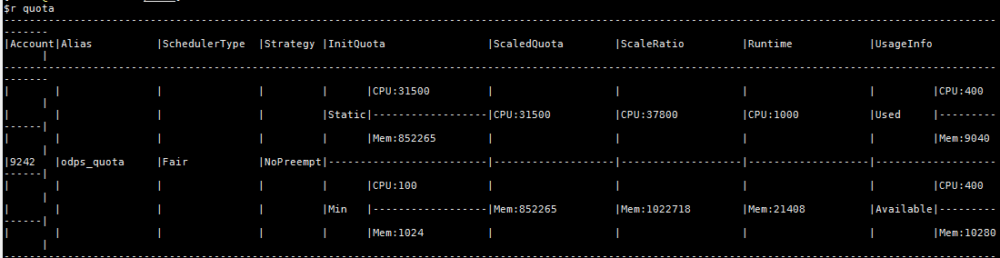

- **输出信息说明**

  <table>
    <tr>
      <th width="146">输出信息</th>
      <th>信息解释</th>
    </tr>
    <tr>
      <td>Account</td>
      <td>说明</td>
    </tr>
    <tr>
      <td>Alias</td>
      <td>Quota组</td>
    </tr>
    <tr>
      <td>SchedulerType</td>
      <td>调度类型</td>
    </tr>
    <tr>
      <td>Strategy</td>
      <td>策略</td>
    </tr>
    <tr>
      <td>InitQuota</td>
      <td>Quota组CPU和内存</td>
    </tr>
    <tr>
      <td>ScaledQuota</td>
      <td>资源最大值</td>
    </tr>
    <tr>
      <td>Runtime</td>
      <td>当前任务占用的资源CPU&amp;Quota</td>
    </tr>
    <tr>
      <td>UsageInfo</td>
      <td>已使用资源</td>
    </tr>
    <tr>
      <td>Static</td>
      <td>Static中的CPU和Mem为该Quota在集群中最多可使用的CPU和内存资源，CPU单位是u，100u=1核，Mem单位是M。</td>
    </tr>
    <tr>
      <td>Min</td>
      <td>Min中的CPU和Mem为该Quota在集群中最少可分配的资源，在集群资源紧张，各Quota资源抢占模式，而Quota又没有获得设置的最小资源时，会提高当前Quota中任务的优先级，保障获得Min中设置的资源量。</td>
    </tr>
    <tr>
      <td>Use</td>
      <td>Use中的CPU和Mem为当前Quota实际使用的资源量，单位同上。</td>
    </tr>
  </table>

  实际应用场景为 `r tfrl` 查看集群有剩余资源，当用户新提交的任务又无法获取资源时，可通过use中的更新来判断是否为Quota资源用满。而Min的应用场景为在集群高峰期时可以把一些Quota的Min资源设置得很大，以保障一些高优先级的任务。

**查询伏羲任务在build（构建索引）阶段的Task状态（r jsummary）**

- **命令功能**

  `r jsummary` 命令用来查询伏羲任务中每个Task状态。

- **命令格式**

  ```text
  r jsummary jobname
  ```

- **参数说明**

  | 参数名称 | 参数说明 | 取值范围 |
  | --- | --- | --- |
  | jobname | NuWa地址数据信息 | 无 |

- **使用示例**

  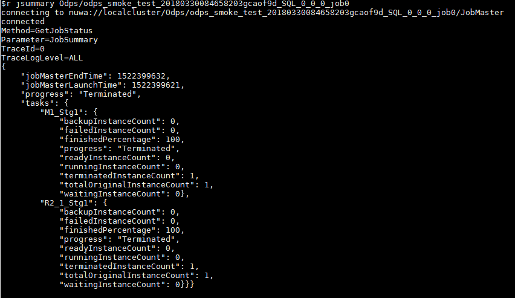

- **输出信息说明**

  | 输出信息 | 信息解释 |
  | --- | --- |
  | connecting to nuwa | NuWa地址数据信息 |
  | Method | 操作方式 |
  | Parameter | 相关参数信息 |
  | TraceId | 跟踪ID |
  | TraceLogLevel | 跟踪日志级别 |
  | failedInstanceCount | 失败的Task数 |
  | readyInstanceCount | 等待资源的Task数 |
  | progress | 任务状态 |
  | terminatedInstanceCount | 完成的Task数 |
  | totalOriginalInstanceCount | 总Task数 |

**查询FuXi任务每个的task中具体instance工作的状态（r jstatus）**

- **命令功能**

  `r jstatus` 命令用来查看FuXi任务每个的task中具体instance工作的状态

- **命令格式**

  ```text
  r jstatus merge_instance_id
  ```

- **参数格式**

  | 参数名称 | 参数说明 | 取值范围 |
  | --- | --- | --- |
  | merge_instance_id | NuWa地址数据信息 | ads/jobxxxxxx |

- **使用示例**

  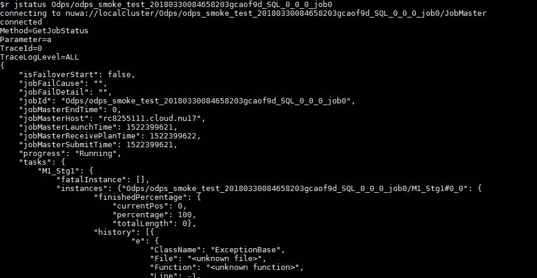

- **输出信息说明**

  | 输出信息 | 信息解释 |
  | --- | --- |
  | connecting to nuwa | NuWa注册job明细 |
  | Method | 方法 |
  | Parameter | &lt;物&gt;&lt;数&gt;参量 |
  | TraceId | 跟踪ID |
  | TraceLogLevel | 查找级别 |
  | tcp | task任务所对应的ip和端口号 |
  | localDir | task任务所在的工作目录 |
  | instances | task任务的id和执行状态 |
  | pid | task任务的进程号 |

**查询fuxi_master（r primary fm）和package_manager（r primary pm）的机器IP地址**

- **命令功能**

  `r primary fm/pm` 命令用来查询fuxi_master和package_manager的机器IP地址。

- **命令格式**

  ```text
  r primary fm
  r primary pm
  ```

- **参数说明**

  | 参数名称 | 参数说明 | 取值范围 |
  | --- | --- | --- |
  | fm | role_fuxi_master | 无 |
  | pm | role_package_manager | 无 |

- **使用示例**

  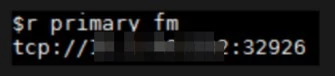

  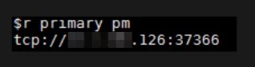

**r命令显示帮助信息**

- **命令功能**

  `r --help` 命令用来显示帮助信息

- **命令格式**

  ```text
  r --help
  ```

- **参数说明**

  无

- **使用示例**

  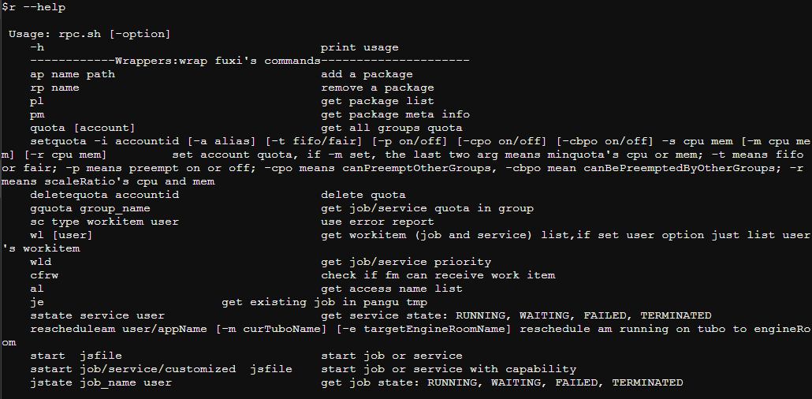

  

  

  

<a id="section-1-3"></a>

## 1.3. 女娲运维命令

本小节将会为您介绍基于实时数仓Hologres的女娲运维命令。

**进入执行命令窗口**

运维工程师可通过命令行进行运维操作。在执行具体命令前，需先进入AG机器的命令行界面，具体操作如下。

1. 进入飞天基础运维平台，选择**资源管理 > 产品集群运维**后，在**产品 | 集群**搜索框中输入Hologres，搜索出相关集群。

2. 单击目标集群**操作**列的**集群详情**，在**服务列表**页签中通过**服务**搜索框查找 `nuwa` 服务。

3. 单击该**服务**名称，进入**服务 nuwa**页面。

4. 选择**NuwaTools#**。

5. 单击**实例列表**页签下对应机器的**操作**栏中的**Terminal**，开启TerminalService窗口，后续的命令行操作均在此窗口进行。

**女娲运维命令**

NuWa命令全路径在/apsara/deploy/目录中。

查看女娲进程状态命令：

```bash
echo srvr | nc localhost 10240 | grep Mode
```

```text
tj_show -r nuwa.NuwaZK# >/tmp/nuwa
```

找到三台nuwa机器并保存，用 `pssh` 命令在每台机器上面打印NuWa进程的状态。

```text
pssh -h /tmp/nuwa -i "echo srvr | nc localhost 10240 | grep Mode"
```


**nuwa_console工具**

```text
/apsara/deploy/nuwa_console --address=nuwa地址
```


**nuwa_console --help**

`nuwa_console`  命令在大数据运维中使用频率较低，相关示例较少；感兴趣的同学可通过  `--help`  命令进一步了解其功能与用法。


<a id="section-1-4"></a>

## 1.4. K8s运维命令

本小节为您介绍基于Hologres的K8s运维命令。

**进入执行命令窗口**

运维工程师可通过命令行进行运维操作。在执行具体命令前，需先进入AG机器的命令行界面，具体操作如下。

1. 进入飞天基础运维平台，选择**资源管理 > 产品集群运维**后，在**产品 | 集群**搜索框中输入Hologres，搜索出相关集群。

2. 单击目标集群**操作**列的**集群详情**，在**服务列表**页签中通过**服务**搜索框查找 `hologres-init` 服务。

3. 单击该**服务**名称，进入**服务 hologres-init**页面。

4. 选择**HologresSrController#**。

5. 单击**实例列表**页签下对应机器的**操作**栏中的**Terminal**，开启TerminalService窗口，后续的命令行操作均在此窗口进行。

**kubectl**

**kubectl介绍**

- **简介**

  K8s主要通过kubectl来进行运维。kubectl通过调用K8s的API，可以展示pods、deployment等信息，并可以提交、删除这些资源。

- **位置**

  在飞天基础运维平台环境中，kubectl一般安装在AG的/apsara/kube_tools/kubectl。

- **初始化**

  运行kubectl，请切换到Admin用户，执行前需要先调用/apsara/kube_tools/init-kubeclt.sh脚本进行初始化。初始化脚本可重复调用。不过一般Hologres-init的holo-manager在执行前已经调用过该脚本。

- **命令介绍**

  命令的格式如下：

  ```text
  /apsara/kube_tools/kubectl get $resource_type
  /apsara/kube_tools/kubectl describe $resource_type $resource_name
  /apsara/kube_tools/kubectl delete $resource_type $resource_name
  /apsara/kube_tools/kubectl apply
  ```

**kubectl示例命令pod管理**

- **查看所有pods**

  ```text
  /apsara/kube_tools/kubectl get pods -o wide
  ```

  

- **查看pod详情**

  可看到使用的镜像、申请的CPU、Memory、启动参数、环境变量等信息。

  ```text
  /apsara/kube_tools/kubectl describe pod test1-master-xxx-sfck7
  ```

  > **说明**
  >
  > 查询时，需将参数 `test1-master-xxx-sfck7` 替换为目标pod的名字。

- **删除pod**

  ```text
  /apsara/kube_tools/kubectl delete pod test1-master-xxx-sfck7
  ```

  > **说明**
  >
  > 删除时，需将参数 `test1-master-xxx-sfck7` 替换为目标pod的名字。

**statefulset管理**

- **查看所有statefulset**

  ```text
  /apsara/kube_tools/kubectl get statefulset
  ```

  

- **查看statefulset详情**

  ```text
  /apsara/kube_tools/kubectl describe statefulset test-xxx-statefulsets
  ```

  > **说明**
  >
  > 查询时，需将参数 `test-xxx-statefulsets` 替换为目标statefulset的名字。

- **删除statefulset**

  ```text
  /apsara/kube_tools/kubectl delete statefulset test-xxx-statefulsets
  ```

  > **说明**
  >
  > 删除时，需将参数 `test-xxx-statefulsets` 替换为目标statefulset的名字。

- **创建statefulset**

  <ol type="i">

  <li>

  编写 `test_state.yaml` 文件。

  ```yaml
  apiVersion: apps/v1beta1
  kind: StatefulSet
  metadata:
    name: holo-frontend
    namespace: default
  spec:
    serviceName: "holo-frontend"
    replicas: 3
    template:
      metadata:
        labels:
          app: holo-frontend
      spec:
        containers:
        - name: holo-frontend
          image: reg.docker.alibaba-inc.com/hologram/frontend:master-v20190802181048-1246476
          command: ["/usr/local/gpdb/shell/setup.sh 13337"]
          resources:
            limits:
              cpu: 300m
              memory: 2000Mi
            requests:
              cpu: 200m
              memory: 1500Mi
          args:
          - "100000"
          imagePullPolicy: IfNotPresent
          volumeMounts:
          - mountPath: /usr/local/holo-frontend
            name: fe-dir
          env:
          - name: frontend_id
            valueFrom:
              fieldRef:
                fieldPath: metadata.name
          - name: holo_fe_seahawks_serive_host
            value: "##SEAHAWKS_HOST##"
          - name: holo_fe_seahawks_serive_port
            value: "##SEAHAWKS_PORT##"
          - name: holo_fe_seahawks_serive_db
            value: "交互式分析"
          - name: holo_fe_worker_pool_size
            value: "1"
          - name: holo_fe_start_query_timeout
            value: "60000"
          - name: holo_fe_query_next_timeout
            value: "300000"
          - name: holo_fe_query_memory_in_MB_limit
            value: "4096"
          - name: holo_fe_meta_proxy_rpc_queue_size
            value: "5000"
        volumes:
        - name: fe-dir
          hostPath:
            path: /tmp/
  ```

  </li>

  <li>

  执行创建命令。

  ```text
  $ /apsara/kube_tools/kubectl apply -f test_state.yaml
  ```

  </li>

  </ol>

**deployment管理**

- **查看所有deployment**

  ```text
  /apsara/kube_tools/kubectl get deployment
  ```

  

- **查看deployment详情**

  ```text
  /apsara/kube_tools/kubectl describe deployment test-xxx-deployment
  ```

  > **说明**
  >
  > 查询时，需将参数 `test-xxx-deployment` 替换为目标deployment的名字。

- **删除deployment**

  ```text
  /apsara/kube_tools/kubectl delete deployment test-xxx-deployment
  ```

  > **说明**
  >
  > 删除时，需将参数 `test-xxx-deployment` 替换为目标deployment的名字。

- **创建deployment**

  <ol type="i">

  <li>

  编写 `test_dep.yaml` 文件。

  ```yaml
  apiVersion: extensions/v1beta1
  kind: Deployment
  metadata:
    name: holo-master-deployment
  spec:
    replicas: 1
    template:
      metadata:
        labels:
          app: master
      spec:
        containers:
        - command:
          - bash -c '/usr/local/bin/holo-master -u "{\"master_options\":
  {\"session_name\":\"交互式分析_master\"},\"storage_options\":
  {\"etcd_storage_options\":{\"server_list\":
  [##ETCD_SERVER_LIST##],\"use_cert\":true}},\"controller_options\":
  {\"k8s_controller_options\":{\"namespace\":\"default\"}}}" -c /etc/holo_master.yaml 
  -l /etc/holo_master_log.json'
          image: reg.docker.alibaba-inc.com/hologram/holomaster:master-
  v20190802181048-1246476
          imagePullPolicy: IfNotPresent
          name: holo-master
          ports:
          - containerPort: xxxx
            protocol: TCP
  ```

  </li>

  <li>

  执行创建命令。

  ```text
  /apsara/kube_tools/kubectl apply -f test_dep.yaml
  ```

  </li>

  </ol>

**service管理**

- **查看所有service**

  ```text
  /apsara/kube_tools/kubectl get service
  ```

  

- **查看service详情**

  ```text
  /apsara/kube_tools/kubectl describe service stress-xxx-service
  ```

  > **说明**
  >
  > 查询时，需将参数 `stress-xxx-service` 替换为目标service的名字。

- **删除service**

  ```text
  /apsara/kube_tools/kubectl delete service stress-xxx-service
  ```

  > **说明**
  >
  > 删除时，需将参数 `stress-xxx-service` 替换为目标service的名字。

- **创建service**

  <ol type="i">

  <li>

  编写 `test_service.yaml` 文件。

  ```yaml
  kind: Service
  apiVersion: v1
  metadata:
    name: service-demo
  spec:
    clusterIP: None
    selector:
      app: foo
    ports:
      - protocol: TCP
        port: xx
        targetPort: xxxx
  ```

  </li>

  <li>

  执行创建命令。

  ```text
  /apsara/kube_tools/kubectl apply -f test_service.yaml
  ```

  </li>

  </ol>

**etcdctl**

- **简介**

  K8s通过etcd来存储集群信息，通过 `etcdctl` 可以查看etcd里的内容。

- **位置**

  在飞天基础运维平台环境中，etcdctl一般安装在AG的/apsara/kube_tools/etcdctl。

- **初始化**

  运行etcdctl，请切换到admin用户，执行前需要先调用/apsara/kube_tools/init-kubeclt.sh脚本进行初始化。初始化脚本可重复调用。输出如下内容：

  

  > **说明**
  >
  > 命令输出的 `ENDPOINT` ，后面执行etcdctl时需要用到。

- **常用命令**

  - **列出所有key**

    加上 `--prefix=true` 可以找到该key开头的所有key，加上 `--keys-only` 则不显示value。

    ```text
    ETCDCTL_API=3 /apsara/kube_tools/etcdctl --cert /apsara/kube_tools/conf/ca/etcd-ca/etcd-client.pem --key /apsara/kube_tools/conf/ca/etcd-ca/etcd-client-key.pem --cacert /apsara/kube_tools/conf/ca/etcd-ca/etcd-root-ca.pem --
    endpoints=https://11.160.224.xxx:xxxx,https://11.160.225.xxx:xxxx,https://11.162.179.
    :xxxx get --prefix=true /交互式分析Session/demo --keys-only
    ```

  - **查看某个key的value**

    ```text
    ETCDCTL_API=3 /apsara/kube_tools/etcdctl --cert /apsara/kube_tools/conf/ca/etcd-ca/etcd-client.pem --key /apsara/kube_tools/conf/ca/etcd-ca/etcd-client-key.pem --cacert /apsara/kube_tools/conf/ca/etcd-ca/etcd-root-ca.pem --
    endpoints=https://11.160.224.xxx:xxxx,https://11.160.225.xxx:xxxx,https://11.162.179.
    :xxxx get /交互式分析Session/demo
    ```

  - **删除某个key**

    ```text
    ETCDCTL_API=3 /apsara/kube_tools/etcdctl --cert /apsara/kube_tools/conf/ca/etcd-ca/etcd-client.pem --key /apsara/kube_tools/conf/ca/etcd-ca/etcd-client-key.pem --cacert /apsara/kube_tools/conf/ca/etcd-ca/etcd-root-ca.pem --
    endpoints=https://11.160.224.xxx:xxxx,https://11.160.225.xxx:xxxx,https://11.162.179.
    :xxxx del /交互式分析Session/demo
    ```

    > **说明**
    >
    > 注意不要使用前缀匹配删除，可能引发所有数据都被删除的严重后果。

<a id="section-2"></a>

# 2.日常运维

本小节将会为您介绍对实时数仓Hologres的日常运维操作步骤。

**查看服务终态**

您可在数据中心管理框架的集群运维中心查看所有机器是否已达终态。

1. 进入飞天基础运维平台，选择**资源管理 > 产品集群运维**，在**产品 | 集群**搜索框中输入Hologres，搜索出相关集群。

2. 单击Hologres相关集群**操作**列的**集群详情**，进入**服务列表**页签。

3. 在服务列表您可查看相关服务**状态**是否**已达终态**。

   

4. 如果有服务**未达终态**，可单击目标服务**操作**列的**详情**。

5. 可在相关服务页查看组件实例的状态及诊断信息。

   

**查看实例状态**

您可在AG机器上通过命令行查看实例状态。

1. 登录AG所在机器。

   <ol type="i">

   <li>

   进入飞天基础运维平台，选择**资源管理 > 产品集群运维**后，在**产品 | 集群**搜索框中输入Hologres，搜索出相关集群。

   </li>

   <li>

   单击目标集群**操作**列的**集群详情**，在**服务列表**页签中通过**服务**搜索框查找 `hologres-init` 服务。

   </li>

   <li>

   单击该**服务**名称，进入**服务 hologres-init**页面。

   </li>

   <li>

   选择**HologresSrController#**。

   </li>

   <li>

   单击**实例列表**页签下对应机器的**操作**栏中的**Terminal**，开启TerminalService窗口，后续的命令行操作均在此窗口进行。

   </li>

   </ol>

2. 查看所有Pods状态。

   ```text
   sh ~/ssh_pods
   ```

   

3. 如果有Pending的Pod，查看是否有分配机器，如果没有的话，可进行以下操作。

   - 查看资源是否用完了，输入以下命令语句。

     ```text
     r tfrl
     ```

   - 再查看该Pod需要多少资源，输入以下命令语句。

     ```text
     /apsara/kube_tools/kubectl describe pods xxx
     ```

     > **说明**
     >
     > 查询时，需将参数 `xxx` 替换为目标Pod的名字。

   - 查看pod相关日志。

     <ol type="a">

     <li>

     登录pod所在机器。

     ```bash
     ssh 10.xxx.xxx.xxx
     ```

     > **说明**
     >
     > 查询时，需将参数 `10.xxx.xxx.xxx` 替换为目标Pod对应的IP信息。

     </li>

     <li>

     查看日志。

     ```bash
     cd /apsara/TempRoot/k8s/default_K8S/default_xxxx-69-holo-worker-
     cec68dafc6_62b86a73@xxx.cloud.et117/
     ```

     > **说明**
     >
     > `default_K8S/`  后的文件路径以 `default_` 加上Pod名称作为前缀拼接而成。

     </li>

     </ol>

4. 如果没有Pending，但是实例状态还不是运行状态，则查看holo-manager日志，查看更多详情。

   <ol type="i">

   <li>

   登录pod实例。

   ```text
   ~/ssh_pods holo-instance-controller-xxx
   ```

   > **说明**
   >
   > 需将 `holo-instance-controller-xxx` 替换为目标Pod的名字。

   </li>

   <li>

   切换至日志目录。

   ```bash
   cd /home/admin/holo-manager/log
   ```

   </li>

   <li>

   查看日志。

   ```text
   tailf holo_manager.log
   ```

   </li>

   </ol>

<a id="section-3"></a>

# 3.Hologres服务角色运维

本文介绍Hologres控制服务角色运维相关内容。

**背景信息**

Hologres控制服务共包含如下三个服务角色。

| 服务角色 | 概述 | 数量范围 | 形态 | 是否高可用 |
| --- | --- | --- | --- | --- |
| HoloRecover | 集群的容灾服务。 | 1 | 容器 | 是 |
| HologresSrController | Hologres集群的AG机器。 | 1 | 天基SR | 不涉及 |
| Tools | 自动预热镜像，将镜像下载到本地。 | Hologres机器数量 | 程序 | 不涉及 |

**查看服务角色**

1. 进入飞天基础运维平台，选择**资源管理 > 产品集群运维**后，在**产品 | 集群**搜索框中输入Hologres，搜索出相关集群。

2. 单击目标集群**操作**列的**集群详情**，在**服务列表**页签中通过**服务**搜索框查找 `hologres-init` 服务。

3. 单击该**服务**名称，进入**服务 hologres-init**页面，可查看服务角色及相关信息。

**HoloRecover#**

- **服务角色说明**

  同城容灾、异地容灾管控服务，是一个Docker容器。

- **RMA/重启说明**

  无。

- **Reclone说明**

  所在物理机可以进行Reclone。

- **日志说明**

  日志位于 `/home/admin/` 目录下，由容器化部署的进程生成。

- **监控说明**

  查看飞天基础平台是否到达终态状态，详情请参见查看服务角色。

**HologresSrController#**

- **服务角色说明**

  是Hologres集群的AG节点，其内部多个功能模块通过K8s Deployment/DaemonSet 部署，聚合为统一的天基SR服务。

- **RMA/重启说明**

  无。

- **Reclone说明**

  所在物理机可以进行Reclone。

- **日志说明**

  日志路径为：

  ```text
    /cloud/app/hologres-
  init/HologresSrController#/hologres_sr_controller/current/log/tianji 

    /cloud/app/hologres-
  init/HologresSrController#/hologres_sr_controller_post_check/current/log/ 
  ```

- **监控说明**

  查看飞天基础平台是否到达终态状态，详情请参见查看服务角色。

**Tools#**

- **服务角色说明**

  用于自动预热镜像，即将服务需要的镜像下载到本地机器上，同时清理一些不再使用的镜像。

- RMA/重启说明

  无。

- **Reclone说明**

  所在物理机可以进行Reclone。

- **日志说明**

  日志路径为：

  ```text
   /cloud/app/hologres-init/Tools#/image_init/current/log 

   /cloud/app/hologres-init/Tools#/image_init_post_check_app/current/log 
  ```

- **监控说明**

  查看飞天基础平台是否到达终态状态，详情请参见查看服务角色。

<a id="section-4"></a>

# 4.查看审计日志（3.2内核）

本文介绍如何通过日志中心或SLS Inner查看Hologres审计日志，便于您对相关日志信息进行查看分析。

**背景信息**

Hologres审计日志（Audit Log）支持对接SLS的Inner功能，可以将Hologres数据库操作的审计日志自动投递到用户账号下同地域的SLS日志库中，且通过内网通道（Inner Network） 传输，实现高效、安全、低成本的日志采集与分析。

Hologres提供审计日志启停API，支持您灵活控制日志采集状态，以防止SLS存储溢出并降低采集成本。详情可参见《**Hologres开发指南**》中<strong>API参考 > API（3.2内核）</strong>章节中的以下API：

- EnableInstanceAudit-启用实例审计日志。

- DisableInstanceAudit-禁用数据库审计日志。

**通过日志中心查看**

1. 登录Apsara Uni-manager运维控制台。

2. 在顶部菜单栏中，选择**平台运维** > **日志中心** > **日志查询**。

3. 在**平台日志**页签下，填写以下筛选条件以定位目标日志：

   - **产品**： `Hologres` 。

   - **日志类型**：**操作日志**。

   - **日志名称**： `hologres-audit-logger` 。

   - **时间范围**：选择您需要查看审计日志的时间区间。

4. 单击**搜索**，系统将返回匹配的审计日志列表。

5. 如需查看某条日志的详细内容，在对应日志行的**操作**栏中单击**详情**进行查看。

   > **说明**
   >
   > 更多操作可参见**专有云运维平台 用户指南 > 平台运维 > 日志中心 > 日志查询**章节。

   

**通过SLS Inner查看**

**获取登录SLS Inner信息**

1. 获取登录地址信息。

   <ol type="i">

   <li>

   登录Apsara Uni-manager运维控制台。

   </li>

   <li>

   在顶部菜单栏中，选择**平台运维 > 运维工具**，进入飞天基础运维平台。

   </li>

   <li>

   选择左侧导航栏中的**运维工具 > 服务注册变量大盘**，进入服务注册变量大盘页面。

   </li>

   <li>

   切换搜索条件为**服务**后，单击查看**sls-common**服务对应的**Service Registration**信息。

   

   </li>

   <li>

   在**Service Registration**信息中获取变量 `sls_portal.endpoint` 对应的参数值。

   </li>

   </ol>

   > **说明**
   >
   > 将链接 `https://sls_portal.endpoint/auth/?in_url=%2F` 中的 `sls_portal.endpoint` 参数替换为您所获取的参数值，即可得到SLS inner登录地址。

2. 获取登录AK信息。

   <ol type="i">

   <li>

   选择左侧导航栏中的**资源管理 > 产品集群运维**后，在**产品 | 集群**搜索框中输入 `tianji` ，搜索出相关集群。

   </li>

   <li>

   单击目标集群**操作**列的**集群详情**，进入集群详情页。

   </li>

   <li>

   单击切换至**终态配置**页签，找到下方的 `kv.conf` 文件。

   </li>

   <li>

   单击右侧的**显示内容**后，查看文件中参数 `account.sls.accesskey-id` 和 `account.sls.accesskey-secret` 对应的参数值。

   </li>

   </ol>

   > **说明**
   >
   > - 参数 `account.sls.accesskey-id` 和 `account.sls.accesskey-secret` 对应的参数值即是登录SLS Inner的AK信息。
   >
   > - 若登录时提示**AccessKey已禁用**，说明当前AK可能正在轮转。您可创建临时派生AK用于登录并查看Hologres审计日志。

3. 创建派生AK。

   <ol type="i">

   <li>

   在顶部菜单栏中，选择**安全管理 > 账号安全 > 平台凭据管理PCM**。

   </li>

   <li>

   选择左侧导航栏中的**AK托管**，在**派生AK管理**页签中**创建临时AK**，用于登录访问SLS Inner。具体参数配置如下：

   | 参数 | 说明 |
   | --- | --- |
   | initAKID | 填写获取登录AK信息步骤中获取的<code> account.sls.accesskey-id </code>参数对应的值。 |
   | AK类型 | 选择临时。 |
   | 有效天数 | 可根据自身情况进行设置。 |
   | 申请者类型 | 可自行选择。 |
   | 申请者ID | 可自定义申请者ID，用于标识使用者身份。<br>重要<br>申请者ID必须在当前账号内唯一，否则创建时将报<code> IAMID is exist! </code>错误。 |
   | 申请派生AK原因 | 可自定义申请原因。 |

   </li>

   <li>

   单击**确定**后，在弹出窗口中复制生成的AK信息。后续可使用该AK登录SLS Inner，查看Hologres审计日志。

   > **重要**
   >
   > 创建临时AK后，系统未提供任何查看或管理入口，请务必在第一时间保存所获取的AK信息——该信息仅显示一次，关闭页面或刷新浏览器后将无法再次查看。

   </li>

   </ol>

**在SLS Inner查看审计日志**

1. 获取登录SLS Inner信息后，您可使用对应账号登录 SLS Inner环境。

2. 在**我的Project**页签下，于搜索框中输入  `Hologres-log` ，查找目标日志项目。

3. 单击项目**名称** `Hologres-log` ，进入**LogStore管理 > LogStore列表**页面。

4. 在列表中找到名为 `k8s-hologres-audit-log` 的LogStore，单击**预览日志**。

   

5. 在日志预览页面，可通过调整时间范围，筛选并查看所需时间段内的Hologres审计日志。

   

<a id="section-5"></a>

# 5.基于大数据管家的运维

<a id="section-5-1"></a>

## 5.1. 登录大数据管家

本节介绍如何登录到大数据管家。

**前提条件**

- 已从部署人员或管理员处获取Apsara Uni-manager运维控制台的访问地址、用户名和密码。

  Apsara Uni-manager运维控制台访问地址格式为*region-id*.ops.console.*intranet-domain-id*。

- 推荐使用Chrome浏览器。

**操作步骤**

1. 打开浏览器。

2. 在地址栏中，输入Apsara Uni-manager运维控制台的访问地址，按回车键。

   

   > **说明**
   >
   > 您可以单击右上角的当前语言切换其它语言。当前支持简体中文、English语言切换。

3. 输入正确的用户名及密码。

   > **说明**
   >
   > - 登录Apsara Uni-manager运维控制台的用户名和密码请从部署人员或管理员处获取。
   >
   > - 若连续输入密码错误三次，系统将启动图片验证码登录功能；若连续输入错误五次，账户将被锁定，请联系管理员进行激活。

   首次登录Apsara Uni-manager运维控制台时，需要修改登录用户名的密码，请按照提示完成密码修改。

   为提高安全性，密码必须满足以下要求：

   - 必须包含英文大小写字母。

   - 必须包含阿拉伯数字（0~9）。

   - 必须包含特殊符号，包括感叹号（!）、at（@）、井号（#）、美元符号（$）、百分号（%）等。

   - 密码长度为10~20个字符。

4. 已阅读并勾选隐私协议后，单击**同意协议并登录**。

5. 进入Apsara Uni-manager运维控制台后，在顶部菜单栏单击**产品运维**。

6. 选择**大数据运维 > 大数据通用运维·大数据管家**，系统默认进入大数据管家的**仪表盘**页面。

<a id="section-5-2"></a>

## 5.2. 通用操作

大数据管家中的数据列表与图例提供了便捷的查看功能，本节以Hologres相关操作为例进行说明。

**搜索**

支持依次按列来搜索列表中的信息条目，与过滤功能相似，操作示例如下：

1. 登录大数据管家。

2. 在左上方单击  图标，然后选择**大数据计算 > Hologres**。

3. 在Hologres页面中，单击上方的**运维**，然后再单击**集群运维**页签。

4. 在**集群运维**页面选择集群，然后单击切换至**机器列表**页签，进入**机器列表**页面。

5. 在列表中，单击某列的筛选图标，然后在搜索框中输入该列包含的关键字。

   

6. 单击**搜索**，即可在列表中查询出符合条件的条目。

7. 如果搜索结果中的条目依然不完全符合要求，您可在此基础上继续按其他列进行搜索。

**按列排序**

支持按列进行升序或降序排序。

1. 登录大数据管家。

2. 在左上方单击  图标，然后选择**大数据计算 > Hologres**。

3. 在Hologres页面中，单击上方的**运维**，然后再单击**集群运维**页签。

4. 在**集群运维**页面选择集群，然后单击切换至**机器列表**页签，进入**机器列表**页面。

5. 在列表中，单击某列的表头或排序箭头，即可按该列对列表信息进行升序或降序排序。

   

   排序的上箭头高亮表示按升序排序，下箭头高亮表示按降序排序。

**指标趋势图**

1. 登录大数据管家。

2. 在左上方单击  图标，然后选择**大数据计算 > Hologres**。

3. 在Hologres页面中，单击上方的**运维**，然后再单击**集群运维**页签。

4. 在**集群运维**页面左侧选择集群，默认进入集群的**概览**页面。

查看集群的CPU、内存等相关指标。


以CPU为例，指标图按时间以不同颜色的曲线展示集群的CPU使用率（支持指定时间段），包括CPU的总使用率（cpu）、系统对CPU的使用率（sys）和用户对CPU的使用率（user）。

单击图右上角的  图标，放大 CPU 使用趋势图。


在放大图中，您可以在右上方指定时间段来查看集群的CPU使用率。

<a id="section-5-3"></a>

## 5.3. 监控

<a id="section-5-3-1"></a>

### 5.3.1. 健康度

健康度支持查看各个大数据产品的监控项以及不同紧急程度的报警，并提供详情查看和修复后的再次检查。

**操作步骤**

1. 登录大数据管家。

   默认进入**ABM**的**仪表盘**页面，您可以单击左上角的  图标，选择**大数据计算 > Hologres**进入。

2. 进入目标产品后，单击顶部菜单栏的**监控**。

3. 单击**健康度**页签，查看健康度检查信息。

   健康度检查页面向您展示了监控项、监控来源、严重等级和监控详情等，您可以按需进行过滤。

   > **说明**
   >
   > 可单击监控项左侧的
   >
   > 图标，了解宿主的状态和检查上报时间等信息。
   >
   > 

<a id="section-5-3-2"></a>

### 5.3.2. 报表

您可以通过报表查看大数据产品的巡检结果。

**操作步骤**

1. 登录大数据管家。

   默认进入**ABM**的**仪表盘**页面，您可以单击左上角的  图标，选择**大数据计算 > Hologres**进入。

2. 进入目标产品后，单击顶部菜单栏的**监控**。

3. 单击**报表**页签，查看报表相关信息。

   报表页面向您展示了报表ID、报表名称、产品名称、模板名称、实例类型、创建信息等，支持查看详情。

<a id="section-5-4"></a>

## 5.4. 运维

<a id="section-5-4-1"></a>

### 5.4.1. Hologres运维功能和入口

本节介绍大数据管家支持的Hologres运维功能和页面入口。

**Hologres运维功能**

大数据管家支持从服务、集群和主机三个维度对Hologres产品进行运维管理，详细说明如下：

**运维功**

**子功能**

**说明**

**能**

汇总了伏羲服务的关键运行指标，包括服务汇总、服务状态、运行健康、运行健

服务概

康历史记录、饱和度-资源分配、CPU使用趋势图、内存使用趋势图以及计算节点

览

概览。

服务角

展示伏羲服务的服务角色信息，包括名称、主机、IP、服务角色状态和主机状

色

态。

伏羲服务运维

展示伏羲服务下的计算节点，包括计算节点的加黑状态、活跃状态、总CPU、空闲CPU、总内存、空闲内存。同时计算节点页面还支持对计算节点进行加黑名

计算节

单、去黑名单、加只读和去只读操作。

点

服务运维

汇总了盘古服务的关键运行指标，包括服务汇总、服务状态、运行健康、运行健

服务概

康历史记录、饱和度-存储水位、存储变化趋势图、文件变化趋势图以及存储节点

览

概览。

盘古服

服务角

展示盘古服务的服务角色信息，包括名称、主机、IP、服务角色状态和主机状

务运维

色

态。

存储节

展示盘古服务下的存储节点，包括存储节点的总空间、剩余空间、状态、TTL和

点

sendBuffer。同时存储节点页面还支持设置存储节点和数据盘的状态。

汇总了集群的总体运行信息，包括机器状态、服务状态、CPU、DISK、

集群概览

MEMORY、LOAD、PACKAGE和运行健康。

集群运

支持查看集群的所有检查项、检查项的详情（提供检查项报警的解决方案）、各

维

集群健康

检查项在宿主上的检查状态，同时还支持直接登录宿主以及手动对宿主执行检查项检查。

集群机器列表

展示集群中所有主机的相关信息，包括Hostname、IP、角色、类型。

汇总了Hologres集群中每个主机的总体运行信息，包括该主机当前的机器信息、

主机概览

机器服务角色状态，以及CPU、DISK、MEMORY、LOAD和PACKAGE的使用趋势图。

主机运维

主机角色

展示主机上的服务实例及服务实例的角色。

**Hologres运维入口**

1. 登录大数据管家。

2. 默认进入**ABM**的**仪表盘**页面，您可以单击左上角的  图标，选择**大数据计算 > Hologres**进入。

3. 在Hologres页面中，单击上方的**运维**，默认进入**服务运维**页面。

   **运维**页面包括**服务运维**、**集群运维**和**主机运维**三大模块。

<a id="section-5-4-2"></a>

### 5.4.2. Hologres服务运维

<a id="section-5-4-2-1"></a>

#### 5.4.2.1. 伏羲服务运维

<a id="section-5-4-2-1-1"></a>

##### 5.4.2.1.1. 伏羲服务概览

本节介绍如何查看伏羲服务的概览页面，以及概览页面支持查看哪些信息。

**伏羲服务概览页面入口**

1. 登录大数据管家。

2. 在左上方单击  图标，然后选择**大数据计算 > Hologres**。

3. 进入Hologres页面，单击上方的**运维**，然后选择**服务运维**。

4. 在**服务运维**页面左侧的导航栏中单击**伏羲服务**，然后在右侧选择集群，进入该集群伏羲服务的**概览**页面。

   **概览**页面汇总了伏羲服务的关键运行指标，包括服务汇总、服务状态、运行健康、运行健康历史记录、饱和度-资源分配、CPU使用趋势图、内存使用趋势图以及计算节点概览。

**服务汇总**

服务汇总包含可用状态、不可用状态和升级状态的角色数量。


**服务状态**

展示所有的伏羲服务的服务角色及其状态，并且统计每个服务角色的最终数和终态数。


单击**角色**名称，可跳转至**飞天基础运维平台**查看更详细的信息。

**运行健康**

统计伏羲服务当前的健康检查结果，包括巡检项数量，以及具有CRITICAL、WARNING和EXCEPTION报警的机器数量。


**运行健康历史记录**

展示伏羲服务的健康检查历史记录，并统计出具有CRITICAL、WARNING和EXCEPTION报警的机器总数量。

单击每次检查的**事件内容**，查看此次检查的异常项。

**饱和度-资源分配**

展示CPU和内存资源的分配情况：

- **CPU分配**：展示CPU的使用率，以及CPU的总Core数、剩余数和SQL加速使用数。

- **内存分配**：展示内存使用率，以及内存的总量、剩余量和SQL加速使用量。


**CPU和内存使用趋势**

按时间以不同颜色的曲线展示伏羲服务的CPU和内存使用趋势，包括**已使用**、**未使用**、**总资源**，支持手动刷新和自动刷新。同时还支持查看指定时间段的CPU和内存使用趋势图。


**计算节点资源概览**

汇总了伏羲服务的计算节点资源信息，包括**节点在线率**、计算**计算节点总数**、**在线节点数量**和**黑名单数量**。


<a id="section-5-4-2-1-2"></a>

##### 5.4.2.1.2. 伏羲服务角色

本节介绍如何查看伏羲服务的服务角色信息。

**操作步骤**

1. 登录大数据管家。

2. 在左上方单击  图标，然后选择**大数据计算 > Hologres**。

3. 进入Hologres页面，单击上方的**运维**，然后选择**服务运维**。

4. 在**服务运维**页面左侧的导航栏中，单击**伏羲服务**。

5. 在右侧选择集群，然后切换至**服务角色**页签，进入伏羲服务的**服务角色**页面。

   **服务角色**页面展示了伏羲服务的服务角色信息，包括服务角色的名称、主机、IP地址、服务角色状态和主机状态。

<a id="section-5-4-2-1-3"></a>

##### 5.4.2.1.3. 伏羲服务计算节点

本节介绍如何查看Hologres伏羲服务的计算节点信息，以及如何对计算节点进行加黑名单、去加黑名单、加只读和去只读操作。

**计算节点入口**

1. 登录大数据管家。

2. 在左上方单击  图标，然后选择**大数据计算 > Hologres**。

3. 进入Hologres页面，单击上方的**运维**，然后选择**服务运维**。

4. 在**服务运维**页面左侧的导航栏中，单击**伏羲服务**。

5. 在右侧选择集群，然后切换至**计算节点**页签，进入伏羲服务的**计算节点**页面。

   > **说明**
   >
   > **计算节点**页面列出了伏羲服务下所有的计算节点信息，包括计算节点的加黑状态、活跃状态、总CPU、空闲CPU、总内存和空闲内存。同时该页面还支持对计算节点进行加黑名单、去黑名单、加只读和去只读操作。

**黑名单和只读操作**

支持对计算节点进行**加黑名单**、**去黑名单**、**加只读**和**去只读**操作，下面以加黑名单为例进行介绍，其他操作与此相同。

1. 在**计算节点**列表页，单击目标计算节点后面的**操作 > 加黑名单**。

2. 在弹出的对话框中单击**执行**，系统提示操作已提交。

   

   > **说明**
   >
   > **Hostname**参数会自动填充为待操作的计算节点，无需手动填写。

   操作完成后，可在**计算节点**列表中查看已操作的计算节点的**加黑状态**。

<a id="section-5-4-2-2"></a>

#### 5.4.2.2. 盘古服务运维

<a id="section-5-4-2-2-1"></a>

##### 5.4.2.2.1. 盘古服务概览

概览汇总了盘古服务的关键运行指标，包括服务汇总、服务状态、饱和度-存储水位、存储变化趋势图、文件变化趋势图以及存储节点概览。

**概览入口**

1. 登录大数据管家。

2. 在左上方单击  图标，然后选择**大数据计算 > Hologres**。

3. 在Hologres页面中，单击上方的**运维**，然后选择**服务运维**。

4. 在**服务运维**页面左侧的导航栏中单击**盘古服务**，然后在右侧选择集群，进入该集群盘古服务的**概览**页面。

**服务汇总**

支持查看盘古服务的**状态**以及**角色数量**。

**服务状态**

展示所有的盘古服务的服务**角色**及其**状态**，并且统计每个服务角色的**最终数**和**终态数**。

**运行健康**

统计盘古服务当前的健康检查结果，包括巡检项数量，以及具有CRITICAL、WARNING和EXCEPTION报警的机器数量。


**运行健康历史记录**

展示盘古服务的健康检查历史记录，并统计出具有CRITICAL、WARNING和EXCEPTION报警的机器总数量。

单击每次检查的**事件内容**，查看此次检查的异常项。

**饱和度-存储水位**

支持查看盘古的空间水位和文件数水位：

- **空间水位**：展示存储空间的使用率，以及存储空间的总大小、剩余大小和回收站大小。

- **文件数水位**：展示文件数的使用率，以及文件数的上限、已用数和回收站的文件数。


**存储和文件变化趋势**

按时间以不同颜色的曲线展示盘古的物理存储容量和文件的变化趋势，物理存储容量变化趋势指标包括总存储、已用存储和存储使用率，文件变化趋势指标包括文件数。


您可参考以下操作，查看指定时间段内的**文件变化趋势**（集群**存储变化趋势**的查看方式类似）。

1. 单击图右上角的  图标，可放大使用趋势图。

   

2. 在放大图中，您可在左上方指定时间段来查看集群的文件变化趋势。

**存储节点概览**

汇总了盘古服务的存储节点资源信息，包括数据节点总数、正常节点数量、数据盘总数、正常盘数量、坏节点比例、坏盘比例。


<a id="section-5-4-2-2-2"></a>

##### 5.4.2.2.2. 盘古服务角色

盘古服务角色展示盘古服务的服务角色信息，包括服务角色的名称、主机、IP地址和状态，以及角色的主机状态。

**实例入口**

1. 登录大数据管家。

2. 在左上方单击  图标，然后选择**大数据计算 > Hologres**。

3. 在Hologres页面中，单击上方的**运维**，然后选择**服务运维**。

4. 在**服务运维**页面的左侧导航栏，单击**盘古服务**。

5. 在右侧选择集群，然后单击切换至**服务角色**页签，进入服务角色页面。

**实例页面支持的操作**

支持按列过滤与排序，便于快速查看服务角色、主机、IP地址、服务角色状态及主机状态信息。具体操作请参考通用操作。

<a id="section-5-4-2-2-3"></a>

##### 5.4.2.2.3. 盘古服务存储节点

存储节点页面列出了盘古服务下的存储节点，包括存储节点的总空间、剩余空间、状态、TTL和sendBuffer。同时存储节点页面还支持设置存储节点和数据盘的状态。

**存储节点入口**

1. 登录大数据管家。

2. 在左上方单击  图标，然后选择**大数据计算 > Hologres**。

3. 在Hologres页面中，单击上方的**运维**，然后单击**服务运维**。

4. 在**服务运维**页面左侧的导航栏中单击**盘古服务**。

5. 在右侧选择集群，然后单击切换至**存储节点**页签，进入**存储节点**页面。

**设置存储节点状态**

支持设置存储节点的状态为**关闭**和**正常**，下面以设置存储节点为关闭状态为例进行介绍，设置为正常状态的操作与此相似。

1. 在**存储节点**页面，单击目标存储节点后面的**操作 > 设置存储节点为关闭状态**。

2. 在**设置存储节点为关闭状态**面板中，单击**执行**，系统提示操作已提交。

   

   > **说明**
   >
   > **Volume**和**Hostname**会根据您选择的目标存储节点自动加载，无需手动填写。

   操作完成后，可在存储节点列表中查看已操作的存储节点的状态。

**设置数据盘状态**

支持设置数据盘的状态为**错误**和**正常**，下面以设置数据盘为错误状态为例进行介绍，设置为正常状态的操作与此相似。

1. 在**存储节点**页面，单击目标存储节点后面的**操作 > 设置数据盘为错误状态**。

2. 在**设置数据盘为错误状态**面板中填写**diskid**信息。

   

   > **说明**
   >
   > **Volume**和**Hostname**会根据您选择的待操作存储节点自动加载，无需手动填写。

3. 完成上述参数配置后，单击**执行**，系统提示操作已提交。

**定位设置失败原因**

以**设置存储节点为关闭状态**失败为例，您可通过以下步骤查看任务执行详情，并分析失败原因。

1. 在**存储节点**页面，单击右上角的**操作历史**。

2. 在**执行历史**页面，单击目标任务的**详情**。

   > **说明**
   >
   > 状态为**RUNNING**表示执行中，状态为**FAILED**表示执行失败，状态为**SUCCESS**表示执行成功。

3. 若任务失败，可在**设置存储节点为关闭状态**页面，单击失败步骤中的**设置存储节点为关闭状态 > 机器详情 > 查看详情**，定位操作步骤的失败原因。

<a id="section-5-4-2-2-4"></a>

##### 5.4.2.2.4. 清理盘古的回收站

大数据管家支持清理飞天分布式文件系统的回收站，以释放存储空间。

**前提条件**

已获取具有Hologres管理权限的大数据管家账号。

**进入清理系统回收站**

1. 登录大数据管家。

2. 在左上方单击  图标，然后选择**大数据计算 > Hologres**。

3. 在Hologres页面中，单击上方的**运维**，然后单击**服务运维**。

4. 在**服务运维**页面左侧的导航栏中，单击**盘古服务**，然后在右侧选择集群，进入该集群盘古服务的**概览**页面。

5. 在页面右上角，选择**操作 > 清理系统回收站**。

**清理系统回收站**

1. 在弹出的对话框中设置**volume**（默认为**PanguDefaultVolume**）。

   

2. 完成上述参数配置后，单击**执行**，页面提示提交成功。

**查看清理系统回收站的历史记录**

执行清理系统回收站后，您也可通过执行历史记录来查看当前操作是否执行成功。清理系统回收站操作执行后，系统会以作业的形式进行执行，并且提供历史执行记录和每次执行的日志，以便您定位作业执行过程中遇到的故障。

1. 单击右上方的**操作**，然后再单击**清理系统回收站**后面的**历史**。

2. 在弹出的**执行历史**面板中查看清理系统回收站的执行历史。

   - 执行历史中记录了每一次操作的当前状态、提交时间、执行时间、结束时间、执行人等信息。

   - 状态为**RUNNING**表示执行中，状态为**SUCCESS**表示执行成功，状态为**FAILED**表示执行失败。

3. 若任务失败，可单击目标任务后面的**详情**，在**清理系统回收站**页面，单击失败步骤中的**清理系统回收站 >机器详情 > 查看详情**，定位操作步骤的失败原因。

   > **说明**
   >
   > 可结合**参数配置**、**机器详情**和**执行参数**综合分析任务失败原因。

<a id="section-5-4-2-2-5"></a>

##### 5.4.2.2.5. 开启和关闭盘古的数据自动均衡

大数据管家支持开启和关闭飞天分布式文件系统的数据自动平衡功能。

**前提条件**

已获取具有Hologres运维权限的大数据管家账号。

**功能入口**

1. 登录大数据管家。

2. 在左上方单击  图标，然后选择**大数据计算 > Hologres**。

3. 在Hologres页面中，单击上方的**运维**，然后选择**服务运维**。

4. 在**服务运维**页面左侧的导航栏中单击**盘古服务**，然后在右侧选择集群，进入该集群盘古服务的**概览**页面。

**关闭数据自动平衡**

1. 进入**概览**页面，单击页面右上角的**操作 > 关闭数据自动均衡**。

2. 在弹出的对话框中设置**volume**（默认为**PanguDefaultVolume**）。

   

3. 完成上述参数配置后，单击**执行**，系统提示提交成功。

4. 查看关闭数据自动平衡任务的执行状态。

   单击**操作 > 关闭数据自动平衡**后面的**历史**，查看关闭数据自动平衡的执行历史。

   > **说明**
   >
   > 状态为**RUNNING**表示执行中，状态为**SUCCESS**表示执行成功，状态为**FAILED**表示执行失败。

5. 如果任务执行失败，您可单击执行记录后面的**详情**，定位任务失败的原因，详情请参见定位开启和关闭数据自动平衡失败的原因。

**开启数据自动平衡**

1. 进入**概览**页面，单击页面右上角的**操作 > 开启数据自动均衡**。

2. 在弹出的对话框中设置**volume**（默认为**PanguDefaultVolume**）。

   

3. 完成上述参数配置后，单击**执行**，系统提示提交成功。

4. 查看开启数据自动平衡任务的执行状态。

   单击**操作 > 开启数据自动平衡**后面的**历史**，查看开启数据自动平衡的执行历史。

   > **说明**
   >
   > 状态为**RUNNING**表示执行中，状态为**SUCCESS**表示执行成功，状态为**FAILED**表示执行失败。

5. 如果任务执行失败，您可单击执行记录后面的**详情**，定位任务失败的原因，详情请参见定位开启和关闭数据自动平衡失败的原因。

**定位开启和关闭数据自动平衡失败的原因**

以定位开启数据自动平衡的失败原因为例进行介绍。

1. 在**执行历史**对话框中，单击执行失败操作后面的**详情**，查看作业执行的详细信息。

2. 在作业执行详情页面，单击失败步骤中的**开启数据自动均衡 > 机器详情 > 查看详情**，定位操作步骤的失败原因。

   可结合**参数配置**、**执行参数**来定位操作步骤的失败原因。

<a id="section-5-4-2-2-6"></a>

##### 5.4.2.2.6. 在盘古Master上执行Checkpoint

大数据管家支持对飞天分布式文件系统执行Checkpoint（检查点）操作，该操作可将当前内存中的数据写入到磁盘中。当飞天分布式文件系统出现故障时，可通过检查点将数据快速恢复到故障前的状态，保证数据的一致性。

**前提条件**

已获取具有Hologres运维权限的大数据管家账号。

**功能入口**

1. 登录大数据管家。

2. 在左上方单击  图标，然后选择**大数据计算 > Hologres**。

3. 在Hologres页面中，单击上方的**运维**，然后选择**服务运维**。

4. 在**服务运维**页面左侧的导航栏中单击**盘古服务**，然后在右侧选择集群，进入该集群盘古服务的**概览**页面。

**Master执行Checkpoint**

1. 进入**概览**页面，单击页面右上角的**操作 > Master执行Checkpoint**。

2. 在弹出的对话框中设置**volume**（默认为**PanguDefaultVolume**）。

   

3. 完成上述参数配置后，单击**执行**，界面提示提交成功。

4. 查看任务的执行状态。

   单击**操作 > Master执行Checkpoint**后面的**历史**，查看任务的**执行历史**。

   > **说明**
   >
   > 状态为**RUNNING**表示执行中，状态为**SUCCESS**表示执行成功，状态为**FAILED**表示执行失败。

**定位任务执行失败原因**

如果任务执行失败，您可通过以下步骤查看失败原因及任务详情。

1. 在**执行历史**对话框中，单击执行失败操作后面的**详情**，查看作业执行的详细信息。

2. 在作业执行详情页面，单击失败步骤中的**Master执行Checkpoint > 机器详情 > 查看详情**，定位操作步骤的失败原因。

   可结合**参数配置**、**执行参数**来定位操作步骤的失败原因。

<a id="section-5-4-2-2-7"></a>

##### 5.4.2.2.7. 切换盘古的Master

大数据管家支持对飞天分布式文件系统的Master组中的机器执行主备切换（Primary和Secondary）。主备切换后，原Primary机器变为Secondary，目标Secondary机器变为Primary。

**前提条件**

- 已获取具有Hologres管理权限的大数据管家账号。

- 已获取Volume中Master组中各机器的工作状态（Primary 或 Secondary）。查询机器工作状态的方法：通过飞天基础运维平台登录Hologres集群中的 **PanguTools#** 服务所在的机器，然后执行**puadmin gems** 命令。

- 已获取目标机器的Hostname，目标机器是一个待切换为Primary的Secondary机器。查看目标机器Hostname的方法：在大数据管家的 **Hologres > 服务运维 > 盘古服务 > 实例**页面中查看**PanguMaster#** 的主机。

**背景信息**

在飞天分布式文件系统中，Volume相当于Namespace概念，默认的Volume为PanguDefaultVolume，如果集群中机器数量巨大，则可能会有多个Volume。每个Volume中均有一组Master机器，其中一个为Primary，两个为Secondary。

**功能入口**

1. 登录大数据管家。

2. 在左上方单击  图标，然后选择**大数据计算 > Hologres**。

3. 在Hologres页面中，单击上方的**运维**，然后选择**服务运维**。

4. 在**服务运维**页面左侧的导航栏中单击**盘古服务**，然后在右侧选择集群，进入该集群盘古服务的**概览**页面。

**切换盘古Master**

1. 进入**概览**页面，单击页面右上角的**操作 > Master执行切换**，然后在弹出的对话框中设置各参数。

   

   关键参数说明如下：

   - **volume**：默认为**PanguDefaultVolume**。在有多个Volume的集群中，如果需要对其他Volume进行主备切换，请根据实际需要填写。

   - **hostname**：目标机器的Hostname，目标机器是一个待切换为Primary的Secondary机器。

   - **log_gap**：切换时，系统会检查Primary和Secondary之间的日志交易数量差，如果差值小于设定值（默认为**100000**），则允许执行该切换操作，否则不允许执行。

2. 完成上述参数配置后，单击**执行**，系统提示提交成功。

3. 查看任务的执行状态。

   单击**操作 > Master执行切换**后面的**历史**，查看任务的执行历史。

   > **说明**
   >
   > 状态为**RUNNING**表示执行中，状态为**SUCCESS**表示执行成功，状态为**FAILED**表示执行失败。

**定位任务执行失败原因**

如果任务执行失败，您可通过以下步骤查看失败原因及任务详情。

1. 在**执行历史**对话框中，单击执行失败操作后面的**详情**，查看作业执行的详细信息。

2. 在作业执行详情页面，单击失败步骤中的**Master执行切换 > 机器详情 > 查看详情**，定位操作步骤的失败原因。

   可结合**参数配置**、**执行参数**来定位操作步骤的失败原因。

<a id="section-5-4-3"></a>

### 5.4.3. Hologres集群运维

<a id="section-5-4-3-1"></a>

#### 5.4.3.1. 集群概览

集群概览汇总了集群的主要运行指标以及健康检查结果，包括机器状态、服务状态、运行健康、运行健康历史记录、CPU、DISK、MEMORY、LOAD和PACKAGE。

**概览入口**

1. 登录大数据管家。

2. 在左上方单击  图标，然后选择**大数据计算 > Hologres**。

3. 在Hologres页面中，单击上方的**运维**，然后再单击**集群运维**页签。

4. 在**集群运维**页面左侧选择集群，默认进入集群的**概览**页面。

**机器状态**

统计出了集群中各种运行状态的机器数量，运行状态包括**good**和**bad**。

**服务状态**

汇总了集群中所有服务，并统计出了每个服务的正常运行（**good**）数量和异常运行（**bad**）数量。

**运行健康**

统计集群当前的巡检项总数量，以及集群中的 CRITICAL、WARNING 和 EXCEPTION 的报警数量。


**CPU**

按时间以不同颜色的曲线展示集群的CPU使用率（支持指定时间段），包括CPU的总使用率（cpu）、系统对CPU的使用率（sys）和用户对CPU的使用率（user）。

单击图右上角的  图标，放大CPU使用趋势图。


在放大图中，您可在左上方指定时间段来查看集群的 CPU 使用率。

**DISK**

按时间展示集群的存储空间使用率。

单击图右上角的  图标，放大DISK使用趋势图。


在放大图中，您可在左上方指定时间段来查看集群的存储空间使用率。

**LOAD**

按时间以不同颜色的曲线展示集群的一分钟 、五分钟和十五分钟系统平均负载。

单击图右上角的  图标，放大LOAD使用趋势图。


在放大图中，您可在左上方指定时间段来查看集群的一分钟 、五分钟和十五分钟系统平均负载。

**MEMORY**

按时间以不同颜色的曲线展示集群的内存使用量，包括内存使用率 （mem）、总内存大小（total）、已使用的内存大小（used）、buff使用的内存大小（buff）、Cache使用的内存大小（cach）和空闲内存大小（free）。

单击图右上角的  图标，放大MEMORY使用趋势图。


在放大图中，您可在左上方指定时间段来查看集群的内存使用量。

**PACKAGE**

按时间以不同颜色的曲线展示集群的数据传输情况，包括丢包数量（drop）、错误包数量（error）、接收包数量（in）和发送包数量（out）。

单击图右上角的  图标，放大PACKAGE趋势图。


在放大图中，您可在左上方指定时间段来查看集群的数据传输情况。

<a id="section-5-4-3-2"></a>

#### 5.4.3.2. 集群健康

集群健康页面展示集群的所有检查项、检查项的详情（提供检查项报警的解决方案）、各检查项在宿主上的检查状态，同时还支持直接登录宿主以及手动对宿主执行检查项检查。

**健康入口**

1. 登录大数据管家。

2. 在左上方单击  图标，然后选择**大数据计算 > Hologres**。

3. 在Hologres页面中，单击上方的**运维**，然后再单击**集群运维**页签。

4. 在**集群运维**页面左侧选择集群，然后单击切换至**健康**页签，进入**健康**页面。

**查看监控项详情**

1. 在集群**健康**页签，单击目标监控项**操作**栏中的**详情**，在弹出的对话框中查看监控项详情。

   监控项详情包括**名称**、**来源**、**别名**、**所属应用**、**类型**、**调度是否开启**、**系统默认参数列表**、**用户自定义参数列表**和**描述**，其中描述中附有检查项报警的解决方案。

2. 单击下方的**显示更多**，查看监控项的更多信息。

   监控项更多信息包括**执行脚本**、**执行目标**、**系统默认阈值判定**和**用户自定义阈值判定**。

**查看报警的宿主以及报警原因**

通过监控项的宿主，您可查看该监控项是对宿主的历史检查记录以及检查结果。

1. 在集群**健康**页签，单击存在报警的监控项前面的  图标，查看该监控项所有的**宿主**信息。

2. 单击**宿主**名，然后在弹出的对话框中单击某个报警后面的**详情**，可在右侧查看报警原因。

   

**处理监控项报警**

在集群**健康**页签，单击存在报警的监控项后面的**详情**，在**详情**弹窗中查看监控项报警的处理方法。

**再次检查**

处理完某个报警后，您可在集群**健康**页签，单击目标宿主后面的**操作 > 再次检查**，对该宿主进行一次该检查项的实时检查，以确定该宿主的报警是否恢复。

<a id="section-5-4-3-3"></a>

#### 5.4.3.3. 集群机器列表

机器列表页面展示当前集群中所有机器的相关信息，包括主机名、IP地址、角色和类型信息。

**查看集群机器信息**

1. 登录大数据管家。

2. 在左上方单击  图标，然后选择**大数据计算 > Hologres**。

3. 在Hologres页面中，单击上方的**运维**，然后再单击**集群运维**页签。

4. 在**集群运维**页面选择集群，然后单击切换至**机器列表**页签，进入**机器列表**页面。

   - 可筛选查看集群机器的Hostname、IP地址、角色和类型信息。

   - 如需查看更详细的机器信息，可单击机器的**Hostname**列下的目标机器名称，即可跳转至机器的主机概览页面。

<a id="section-5-4-4"></a>

### 5.4.4. Hologres主机运维

<a id="section-5-4-4-1"></a>

#### 5.4.4.1. 主机概览

主机概览汇总了Hologres集群中每个主机的总体运行信息，包括该主机当前的机器信息、机器服务角色状态，以及CPU、DISK、MEMORY、LOAD和PACKAGE的使用趋势图。

**概览入口**

1. 登录大数据管家。

2. 在左上方单击  图标，然后选择**大数据计算 > Hologres**。

3. 在Hologres页面中，单击上方的**运维**，然后再单击**主机运维**页签。

4. 在**主机运维**页面左侧的**主机列表**中选择目标主机，然后在右侧单击**概览**页签，进入**概览**页面。

**主机列表**

单击主机列表中主机名称后的  图标，可快速登录对应的Hologres集群运维主机。

**机器信息**

展示物理机器的相关信息，包括所在区域、所在集群、主机名、主机IP地址、主机状态、所在IDC和所在机房。

**机器服务角色状态**

展示机器上服务的相关信息，包括服务的角色、状态和数量。

**CPU**

按时间以不同颜色的曲线展示该主机的CPU使用率（支持指定时间段），包括CPU的总使用率（cpu）、系统对CPU的使用率（sys）和用户对CPU的使用率（user）。

单击图右上角的  图标，放大CPU使用趋势图。


在放大图中，您可在左上方指定时间段来查看该主机的CPU使用率。

**DISK**

按时间展示该主机的存储空间使用率，包括/目录下存储空间使用率。

单击图右上角的  图标，放大DISK使用趋势图。


在放大图中，您可在左上方指定时间段来查看该主机的存储空间使用率。

**LOAD**

按时间以不同颜色的曲线展示该主机的一分钟 、五分钟和十五分钟系统平均负载。

单击图右上角的  图标，放大LOAD使用趋势图。


在放大图中，您可在左上方指定时间段来查看该主机的一分钟 、五分钟和十五分钟系统平均负载。

**MEMORY**

按时间以不同颜色的曲线展示该主机的内存使用量，包括内存使用率（mem）、总内存大小（total）、已使用的内存大小（used）、buff使用的内存大小（buff）、Cache使用的内存大小（cach）和空闲内存大小（free）。

单击图右上角的  图标，放大MEMORY使用趋势图。


在放大图中，您可在左上方指定时间段来查看该主机的内存使用量。

**PACKAGE**

按时间以不同颜色的曲线展示该主机的数据传输情况，包括丢包数量（drop）、错误包数量（error）、接收包数量（in）和发送包数量（out）。

单击图右上角的  图标，放大PACKAGE趋势图。


在放大图中，您可在左上方指定时间段来查看该主机的数据传输情况。

<a id="section-5-4-4-2"></a>

#### 5.4.4.2. 主机服务角色

服务角色页面展示了主机所在集群、主机上运行的服务实例以及服务实例的角色。

1. 登录大数据管家。

2. 在左上方单击  图标，然后选择**大数据计算 > Hologres**。

3. 在Hologres页面中，单击上方的**运维**，然后再单击**主机运维**页签。

4. 在**主机运维**页面左侧的**主机列表**中选择目标主机，然后在右侧单击切换至**服务**页签，进入**服务**页面。

   您可查看主机运维服务角色相关信息（包含主机所在集群、主机上运行的服务实例以及服务实例的角色）。

   

<a id="section-5-5"></a>

## 5.5. 管理

<a id="section-5-5-1"></a>

### 5.5.1. 管理概述

Hologres管理模块支持作业服务、回收管理、健康管理及操作审计等功能。

| 功能 | 描述 |
| --- | --- |
| 作业服务 | 支持通过执行作业来对Hologres进行运维操作。 |
| 回收管理 | 支持对Hologres的图表数据进行回收设置。 |
| 健康管理 | 支持创建健康检查项，同时还支持将健康检查项应用到产品的主机上。 |
| 操作审计 | 支持查看Hologres中作业执行和运维操作的记录。 |

<a id="section-5-5-2"></a>

### 5.5.2. 作业服务

<a id="section-5-5-2-1"></a>

#### 5.5.2.1. 概述

本文主要介绍Hologres中作业相关的概念，以及作业界面。

**相关概念**

Hologres通过执行作业来进行产品运维。作业即产品运维任务，是对集群中的物理设备进行的运维操作。作业服务界面主要指**执行**页面。

- **普通作业**：需要用户手动执行的作业，未设置定时器。

- **定时作业**：设置了定时器，按设定时间自动执行作业。

**执行页面功能介绍**


**执行**页面主要包括以下功能模块：

- **作业列表**：

  支持查看、执行、复制、导出及删除普通作业，同时还支持查看普通作业的执行历史。

  支持搜索。

- **定时作业**：

  支持开启或关闭、查看、执行、复制、导出及删除定时作业，同时还支持查看定时作业的执行历史。

  支持搜索。

- **执行历史**：

  支持查看普通作业、定时作业等历史执行记录。

  支持多条件搜索。

<a id="section-5-5-2-2"></a>

#### 5.5.2.2. 手动执行作业

创建普通作业后，您必须手动执行作业来完成对产品的运维操作。当然，您也可以手动执行定时作业。

**前提条件**

已获取大数据管家管理员账号。

**操作步骤**

1. 登录大数据管家。

2. 在左上方单击  图标，然后选择**大数据计算 > Hologres**。

3. 在Hologres页面中，单击上方的**管理**，在左侧导航栏选择**作业服务**，进入**执行**页面。

4. 在**执行**页面，单击**作业列表**页签。

   > **说明**
   >
   > 如果需要手动执行定时作业，请单击**定时作业**页签。手动执行定时作业的流程与普通作业完全相同，本节以普通作业为例进行介绍。

5. 在**作业列表**页面，单击目标作业后面的**操作 > 执行**。

6. 在弹出的对话框中，完成**配置目标组与参数**操作，单击**下一步**。

7. 完成**确认作业风险**后，单击**确认执行**。

   > **说明**
   >
   > 确认执行后，在**执行历史**页面中自动生成一条执行记录，详情请参见查看作业执行历史。

8. 在作业执行界面，单击上方的**开始**，开始执行作业。

   如果您未进行任何操作而退出了作业执行界面，则后续可在**执行历史**页面中查找到该执行记录，然后单击**操作 > 详情**即可再次进入该作业执行界面。

<a id="section-5-5-2-3"></a>

#### 5.5.2.3. 操作定时作业

本文将为您介绍定时作业的相关操作。

**前提条件**

已获取大数据管家管理员账号。

**操作步骤**

1. 登录大数据管家。

2. 在左上方单击  图标，然后选择**大数据计算 > Hologres**。

3. 在Hologres页面中，单击上方的**管理**，在左侧导航栏选择**作业服务**，进入**执行**页面。

4. 在**执行**页面，单击切换至**定时作业**页签。

5. 在**定时作业**页面，可对定时作业进行以下操作：

   <table>
     <tr>
       <th width="122">操作</th>
       <th>描述</th>
     </tr>
     <tr>
       <td>开启</td>
       <td>单击目标定时作业后面的<strong>操作 &gt; 开启</strong>，即可启用该<strong>状态</strong>为<strong>未生效</strong>的定时作业。<br>说明生成定时作业后，定时作业默认为关闭（不生效）状态，您需要手动开启定时作业。</td>
     </tr>
     <tr>
       <td>查看详情</td>
       <td>单击目标定时作业后面的<strong>操作 &gt; 查看</strong>，即可在<strong>作业详情</strong>页面查看该定时作业的详情（<strong>作业属</strong><strong>性</strong>和<strong>步骤列表</strong>）信息。</td>
     </tr>
     <tr>
       <td>查看执行历史</td>
       <td>单击目标定时作业后面的<strong>操作 &gt; 历史</strong>，即可在<strong>执行历史</strong>页签查看该定时作业的执行历史信息。</td>
     </tr>
     <tr>
       <td>执行</td>
       <td>单击目标定时作业后面的<strong>操作 &gt; 更多 &gt; 执行</strong>，即可手动执行该定时作业。</td>
     </tr>
     <tr>
       <td>复制</td>
       <td>单击目标定时作业后面的<strong>操作 &gt; 更多 &gt; 复制</strong>，系统将基于当前定时作业创建一个新的定时作业。</td>
     </tr>
     <tr>
       <td>导出</td>
       <td>单击目标定时作业后面的<strong>操作 &gt; 更多 &gt; 导出</strong>，即可将当前定时作业导出为一个<code> json </code>文件。</td>
     </tr>
     <tr>
       <td>删除</td>
       <td>单击目标定时作业后面的<strong>操作 &gt; 更多 &gt; 删除</strong>，确认删除后，即可删除该定时作业。</td>
     </tr>
   </table>

<a id="section-5-5-2-4"></a>

#### 5.5.2.4. 查看作业执行历史

Hologres支持查看指定作业或所有作业的执行历史，以便您了解作业的历史执行情况。

**前提条件**

已获取大数据管家管理员账号。

**背景信息**

确认执行作业后，Hologres会对每个作业的执行情况进行记录，以便用户后续了解作业的执行情况。

**执行历史**页面支持的功能如下：

- 支持查看作业历史执行的触发方式、状态、开始时间、结束时间等信息。

- 支持查看作业执行过程、参数配置，同时还支持下载作业执行的详细信息。

- 支持对不同状态的历史执行记录进行不同的操作，例如：支持对**未开始**状态的记录执行**开始**操作，支持对**异常**状态的记录执行**重试**操作等。

普通作业与定时作业的执行历史信息完全相同，本节以普通作业为例进行介绍。

**查看某个作业的执行历史**

1. 登录大数据管家。

2. 在左上方单击  图标，然后选择**大数据计算 > Hologres**。

3. 在Hologres页面中，单击上方的**管理**，在左侧导航栏选择**作业服务**，进入**执行**页面。

4. 在**执行**页面，单击**作业列表**页签。

5. 在**作业列表**页面，单击待查看的普通作业后面的**历史**，进入**执行历史**页面。

   在**执行历史**页面可查看该作业的执行历史，详情请参见查看执行历史。

**查看执行历史**

1. 进入**执行历史**页面，如果历史记录数量多，可以对实例名称、时间范围和执行状态进行过滤，然后单击**搜索**，查询符合条件的历史记录。

2. 单击某个历史记录后面的**操作 > 详情**，可查看该历史记录的详细信息。

   对于不同状态的历史记录，您可进行的操作如下：

   **任务执行**

   **支持功能**

   **操作步骤**

   **记录状态**

   查看参数配

   单击上方的**参数配置**，选择**上下文参数**或**全局参数**，查看该任务的上下文参数或全

   置

   局参数。

   单击上方的**下载执行详情**，下载作业执行详情到本地，保存格式为txt。

   下载执行详情

   执行详情中记录了作业执行的JSON和原始数据等信息。

   所有状态

   - 在某个步骤中的**机器详情**页面，单击某个机器后面的**查看详情**，在右侧查看该步骤在该机器上的执行详情，包括执行输出。

   查看步骤执

   - 如果是脚本步骤，则显示**脚本内容**和**执行参数**页面，可查看脚本内容和脚本执行

   行详情

   参数。

   - 如果是命令步骤，则显示**命令内容**和**执行参数**页面，可查看命令内容和命令执行参数。

   刷新界面

   如果任务正在执行中，您可单击上方的**刷新**，查看最新的执行状态。

   单击上方的**开始**，开始此次执行。

   开始执行

   未开始

   取消执行

   单击上方的**取消**，取消此次执行。

   重试异常步

   在异常步骤上，单击**重试**，重新执行该步骤。

   骤

   跳过异常步

   在异常步骤上，单击**跳过**，跳过此步骤继续执行后续步骤。

   骤

   回滚到上一步骤执行完

   在异常步骤上，单击**回滚**，回滚到上一步骤执行完的状态。

   的状态

   异常

   在异常步骤上，单击**重置**，重置该步骤为**未开始**状态。

   重置异常步骤为未开始

   异常步骤重置为未开始状态时，该次执行状态变为**暂停**。此时您可单击上方的**继**

   状态

   **续**，重新执行当前步骤。

   - 在某个步骤中的**机器详情**页面，单击某个机器后面的**查看详情**，在右侧查看该步骤在该机器上的执行详情，包括执行输出和错误信息。

     对于执行异常的机器，查看详情后，您可单击**跳过**此机器，也可单击**重试**执行。

   查看异常步

   - 如果是脚本步骤，则显示**脚本内容**和**执行参数**页面，可查看脚本内容和脚本执行

   骤执行详情

   参数。

   - 如果是命令步骤，则显示**命令内容**和**执行参数**页面，可查看命令内容和命令执行参数。

   完成人工操

   在待操作的人工步骤上，根据提示进行相关操作，然后单击**确认**，进入下一个步

   作并确认

   骤。

   回滚到上一步骤执行完

   在待操作的人工步骤上，单击**回滚**，回滚到上一步骤执行完的状态。

   待人工确

   的状态

   认

   取消执行

   单击**取消**，取消此次执行。

   <table>
     <tr>
       <td rowspan="6">失败</td>
       <td>重试失败步骤</td>
       <td>在失败步骤上，单击<strong>重试</strong>，重新执行该步骤。</td>
     </tr>
     <tr>
       <td>跳过失败步骤</td>
       <td>在失败步骤上，单击<strong>跳过</strong>，跳过此步骤继续执行后续步骤。</td>
     </tr>
     <tr>
       <td>回滚到上一步骤执行完的状态</td>
       <td>在失败步骤上，单击<strong>回滚</strong>，回滚到上一步骤执行完的状态。</td>
     </tr>
     <tr>
       <td>重置失败步骤为未开始状态</td>
       <td>在失败步骤上，单击<strong>重置</strong>，重置该步骤为<strong>未开始</strong>状态。失败步骤为未开始状态时，该次执行状态变为<strong>暂停</strong>。此时您可单击上方的<strong>继续</strong>，重新开始执行当前步骤。</td>
     </tr>
     <tr>
       <td>查看失败步骤执行详情</td>
       <td>• 在某个步骤中的<strong>机器详情</strong>页面，单击某个机器后面的<strong>查看详情</strong>，在右侧查看该步骤在该机器上的执行详情，包括执行输出和错误信息。对于执行异常的机器，查看详情后，您可单击<strong>跳过</strong>来跳过此机器，也可单击<strong>重</strong><strong>试</strong>执行。<br>• 如果是脚本步骤，则显示<strong>脚本内容</strong>和<strong>执行参数</strong>页面，可查看脚本内容和脚本执行参数。<br>• 如果是命令步骤，则显示<strong>命令内容</strong>和<strong>执行参数</strong>页面，可查看命令内容和命令执行参数。</td>
     </tr>
     <tr>
       <td>取消执行</td>
       <td>单击上方的<strong>取消</strong>，取消此次执行。</td>
     </tr>
   </table>

<a id="section-5-5-3"></a>

### 5.5.3. 健康管理

<a id="section-5-5-3-1"></a>

#### 5.5.3.1. 监控配置

大数据管家为每个产品均内置了丰富的调度项和监控项，用于检查产品的故障并产生报警，以便您及时发现产品故障并修复。

**前提条件**

- 已获取具有相应产品运维权限的大数据管家账号。

- 已获取监控项的报警源和检查项。

**背景信息**

> **说明**
>
> 产品不同，其调度项和监控项也不同，但其配置和操作方法完全相同。

**调度项**：调度项在指定 `tianji` 角色对应的全量机器列表中运行调度脚本，以产生报警的原始数据（什么调度项在什么机器上产生了什么级别的报警，报警结果数据是什么），原始数据会上报到 ABM 的数据库中进行存储。

**监控项**：监控项会将调度项产生的报警原始数据挂载到 ABM 中相应产品的页面中。挂载到产品页面时，支持设置不同的过滤策略，以在指定页面上过滤出自己所关注的监控项的报警结果。

调度项和监控项均是内置，不可增加，但您可修改调度项和监控项的部分参数，例如：是否启用、运行参数、描述等。除此以外，监控项还支持配置挂载点，也支持删除操作。

**进入管理页面**

1. 登录大数据管家。

2. 在左上方单击  图标，然后选择**大数据计算 > Hologres**。

3. 在顶部菜单栏，单击**管理**，进入管理页面。

**查看调度项详情和调度项挂载点**

调度项挂载点是内置的，不可添加、修改和删除。调度项的挂载点对应运行调度脚本的 `tianji` 角色对应的全量机器列表。

1. 在左侧导航栏单击**健康管理**，默认进入**监控配置 > 调度**页面。

   **调度**页面展示了当前产品的所有调度项。

2. 在**调度**页面，单击某个调度项后面的**查看**，查看该调度项的详情。

   > **说明**
   >
   > 调度项详情包括**检查项名称**、**检查项别名**和**描述**。

3. 单击某个调度项前面的  图标，可查看调度项的挂载点。

**修改调度项**

支持设置调度项的调度间隔、运行参数等，同时还支持设置是否启用调度项。

1. 在左侧导航栏单击**健康管理**，默认进入**监控配置 > 调度**页面。

2. 在**调度**界面，单击某个调度项后面的**编辑**，在弹出的对话框中设置各参数。

   > **说明**
   >
   > - **类型**：**系统默认**表示**调度间隔**、**参数列表**等参数均使用系统默认配置；**自定义**表示可自定义这些参数。
   >
   > - **调度间隔**是基于**crontab**命令配置的。

3. 完成上述参数配置后，单击**确定**，界面提示修改成功。

**查看故障机列表**

支持查看当前集群中所有的故障机器。

1. 在左侧导航栏单击**健康管理**，默认进入**监控配置 > 调度**页面。

2. 单击右上方的**故障机器列表**，可查看集群中的故障机器。

   > **说明**
   >
   > 故障机器列表中列出了当前集群中所有的故障机器，以及每台机器在飞天基础运维平台中的所属角色。

**修改监控项**

支持修改监控项的名称、描述，以及设置是否启用监控项。监控项的报警源和检查项是内置的，请勿修改。

1. 在左侧导航栏单击**健康管理**，默认进入**监控配置 > 调度**页面。

2. 单击**监控**页签，进入监控界面。

   **监控**界面展示当前产品的所有的监控项。

3. 单击某个监控项后面的**编辑**，修改监控项的配置（报警源、检查项、名称、描述）信息。

4. 完成上述参数配置后，单击**确定**，界面提示修改成功。

**给监控项添加挂载点**

监控项通过添加挂载点将报警原始数据挂载到ABM中各产品的运维界面中。

1. 在左侧导航栏单击**健康管理**，默认进入**监控配置 > 调度**页面。

2. 单击**监控**页签，进入监控界面。

3. 单击某个监控项前面的  图标，查看监控项的挂载点。

4. 单击挂载点列表下方的**添加挂载点**，在弹出的对话框中设置各个参数。

   关键参数说明如下：

   <table>
     <tr>
       <th width="89">配置项</th>
       <th>说明</th>
     </tr>
     <tr>
       <td>挂载点</td>
       <td>从下拉列表中选择该监控项要的检查结果要挂载在哪个产品的哪个运维界面，例如：<strong>odps/host</strong>表示挂载到 MaxCompute 的主机运维界面。</td>
     </tr>
     <tr>
       <td>过滤策略</td>
       <td>可选值如下：<br>• <strong>全量</strong>：该监控项产生的报警记录全部显示。<br>• <strong>产品树自定义过滤器</strong>：根据产品树节点中配置的过滤器对该监控项产生的报警进行过滤。<br>• <strong>产品树节点名称匹配</strong>：从报警记录中匹配出和当前节点名称相同的记录。</td>
     </tr>
     <tr>
       <td>是否生效</td>
       <td>设置该挂载点是否生效。</td>
     </tr>
   </table>

5. 完成上述参数配置后，单击**确定**，界面提示修改成功。

**删除监控项的挂载点**

1. 进入管理页面，在左侧导航栏单击**健康管理**，默认进入**监控配置 > 调度**页面。

2. 单击**监控**页签，进入监控界面。

3. 单击某个监控项前面的  图标，查看监控项的挂载点。

4. 单击目标挂载点后面的**删除**，在弹出的对话框中单击**确定**，界面提示删除成功。

**删除监控项**

1. 进入管理页面，在左侧导航栏单击**健康管理**，默认进入**监控配置 > 调度**页面。

2. 单击**监控**页签，进入监控界面。

3. 单击目标监控项后面的**删除**，然后在弹出的对话框中单击**确定**，界面提示删除成功。

<a id="section-5-5-3-2"></a>

#### 5.5.3.2. 巡检管理

大数据管家的巡检管理功能支持按需配置巡检场景、巡检项和场景组合。

**前提条件**

已获取具有相应产品运维权限的大数据管家账号。

**进入巡检管理**

1. 登录大数据管家。

2. 在左上方单击  图标，然后选择**大数据计算 > Hologres**。

3. 在**Hologres**界面中，单击上方的**管理**，然后在**管理**界面左侧选择**健康管理**，默认进入**调度**界面。

4. 单击切换至**巡检管理**页签，默认进入**场景**页面。

**新建场景**

1. 单击**场景**界面右上角的**新建场景**，在对话框中按需配置各参数（场景名称、场景说明、触发方式、是否共享、状态设置和标签）信息。

2. 单击**提交**。

   场景创建成功后，您还可以对该场景进行**编辑**、**立即巡检**、**场景管理**和查看**运行历史**等相关操作。

**新建巡检项**

1. 切换至**巡检项**页签，单击右上角的**新增巡检项**。

2. 在**新建巡检项**对话框中，按需配置各参数。

   

3. 单击**提交**。

   巡检项创建成功后，您还可以对该场景进行**编辑**和**删除**操作。

**新建场景组合**

1. 切换至**场景组合**页签，单击右上角的**新建场景**。

2. 在**新建场景**对话框中，按需配置各参数。

   

3. 单击**提交**。

   场景组合创建成功后，您还可以对该场景进行**编辑**、**场景管理**和查看**运行历史**操作。

<a id="section-5-5-4"></a>

### 5.5.4. 操作审计

操作审计列出了Hologres**运维**界面的运维操作历史记录，支持查看每个操作的详细信息，方便您后续查看和故障定位。

**前提条件**

已获取具有相应产品运维权限的大数据管家账号。

**操作步骤**

1. 登录大数据管家。

2. 在左上方单击  图标，然后选择**大数据计算 > Hologres**。

3. 在Hologres界面中，单击上方的**管理**，然后在**管理**界面左侧导航栏选择**操作审计**。

   **操作审计**界面显示MaxCompute产品的**运维**界面中的运维操作历史记录，包括操作名称、操作标识、风险等级、当前状态、提交时间、执行时间、结束时间、执行人、实现方式、执行参数及详情。

   > **说明**
   >
   > 操作审计列出的是产品**运维**界面中的运维操作历史记录，不包含作业服务的运维操作。

4. 单击某个操作后面的**详情**，可查看该运维操作的详情。

   如果运维操作运行失败，您也可查看失败原因。

5. 当运维任务处于失败状态时，您可根据实际情况进行以下操作。

   - 单击**重试**，重新执行该步骤。

   - 单击**跳过**，跳过此步骤继续执行后续步骤。

   - 单击**回滚**，回滚到上一步骤执行完的状态。

   - 单击**参数配置**，查看该任务的参数配置。

   - 单击**取消**，取消该任务。

6. 如果需要下载运维操作的执行日志，单击上方的**下载执行详情**，保存日志到本地。

<a id="section-6"></a>

# 6.Hologres深度巡检

本文为您介绍Hologres运维巡检相关内容。

**概述**

深度巡检覆盖并汇聚Hologres的监控告警、资源水位与关键指标，可视化掌握平台运行健康状况，在发生重大问题甚至故障前规避非预期的风险问题，保障稳定性。

- **目的**

  本手册主要指导维护人员对Hologres集群进行日常巡检、监控、维护等操作，确保系统稳定运行。

  维护人员可以根据本手册的指导，处理维护过程中发现的系统问题。如果根据本手册无法解决系统问题，请寻求Hologres的工程师进行技术支持。

- **适用场景**

  本手册适用于在以下场景中验证集群是否处于正常可用状态。

  - 新集群部署完毕。

  - 集群扩缩容。

  - 机器上下线。

  - 集群或部分机器掉电、重启。

  - 集群升级或Hotfix/HotFeature。

- **要求**

  - 维护人员必须拥有 IT 行业技能，包括计算机网络知识、计算机操作知识、问题分析排查能力。

  - 维护人员学习必要的Hologres产品的特性、功能以及使用方式，对基本的维护工具能够熟练使用。

  - 维护人员务必遵守操作规章，确保人身安全和系统安全。对于用户数据，严格保密，未经用户书面许可，禁止复制、传播用户数据。

- **风险说明**

  大数据管家不会进行巡检报告的回收，但是会收集所有巡检报告中产生的风险和相应阈值。

**集群巡检**

如果环境中没有创建元仓实例，并且ABM没有进行升级，则只能使用简单的方式进行巡检，步骤如下。

**服务终态检查**

1. 登录大数据管家。

2. 在左上方单击  图标，然后选择**站点导航 > TIANJI**。

3. 在**飞天基础运维平台**页面的左侧导航栏，单击**资源管理 > 产品集群运维**。

4. 在**产品集群运维**页面的**产品 | 集群**搜索框中，输入 `Hologres` 。

   

   通过查看**状态**、**实例状态**、**状态详情**，查看目标集群中机器终态。如果产品**状态详情**显示**NotReady**，请您提交工单，联系阿里云工程师处理。

**查看盘古集群的水位状况**

1. 登录大数据管家。

2. 在左上方单击  图标，然后选择**大数据计算 > Hologres**。

3. 在Hologres页面中，单击上方的**运维**，然后选择**服务运维**。

4. 在**服务运维**页面左侧的导航栏中单击**盘古服务**，然后在右侧选择集群，进入该集群盘古服务的**概览**页面。

   查看盘古集群的水位状况，盘古集群的存储水位不要超过80%， 存储变化趋势不要过快。如果水位过高，请联系Hologres运维人员，对业务写入进行相应的调整。

   

**剩余伏羲资源检查**

检查伏羲资源是否符合预期，下面的操作均在AG（即Hologres-intl.HologresSrController#所在机器）上以Admin用户身份执行。

1. 进入AG机器命令行界面。

2. 执行以下命令。

   - **检查集群节点信息**

     ```text
     /apsara/deploy/rpc_wrapper/rpc.sh ttrl
     ```

     

     > **说明**
     >
     > 该命令列出集群中所有可用的计算节点，应该与集群的实际机器情况相符。每个节点上的CPU资源、内存资源与机器规格相匹配（每个节点的可用CPU资源应该比硬件逻辑Core数小1，内存资源略小于物理内存大小）。

   - **检查拉黑节点**

     ```text
     /apsara/deploy/rpc_wrapper/rpc.sh blacklist cluster get
     ```

     

     返回结果应该为空，不应该有预期以外的拉黑节点。

**K8s节点状态检查**

1. 进入AG机器命令行界面。

2. 执行以下命令，检查K8s节点状态。

   ```text
   /apsara/kube_tools/kubectl get nodes
   ```

   

   列出的节点应该与剩余伏羲资源检查列出的集群节点一致，节点状态为 `Ready` ，无预期外的SchedulingDisabled节点。

**Kubernetes DaemonSet资源状态检查**

1. 进入AG机器命令行界面。

2. 执行以下命令，检查Kubernetes DaemonSet资源状态。

   ```text
   /apsara/kube_tools/kubectl get ds
   ```

   

   

   可能会看到 `dadi` 和 `docker-metrics` 两个DaemonSet资源，其中 `DESIRED  CURRENT  READY  UP-TO-DATE` 和 `AVAILABLE` 的数量都应该相等，且与伏羲资源检查列出的集群节点数量一致。

   > **说明**
   >
   > HologresSSDClusters没有 `dadi` 资源，旧版本中可能没有 `docker-metrics` 。

**实例状况巡检**

1. 检查Hologres自带实例的状态。

   进入AG机器命令行界面，使用如下命令检查Hologres自带实例的状态。

   ```text
   /apsara/kube_tools/kubectl get holoinstance
   ```

   如下图所示结果中至少应该有一个名称以 `smoke-test` 开头的实例，3.14及以上版本中，还应当有名称以 `meta-warehouse` 开头的实例。

   

2. 检查既有实例状态。

   在ABM中检查所有实例的状态：在ABM中手动执行定时任务。

   <ol type="i">

   <li>

   登录大数据管家。

   </li>

   <li>

   在左上方单击  图标，然后选择**大数据计算 > Hologres**。

   </li>

   <li>

   在Hologres页面中，单击上方的**管理**，在左侧导航栏选择**作业服务**，进入**执行**页面。

   </li>

   <li>

   在**执行**页面，单击切换至**定时作业**页签，单击目标定时作业后面的**操作 > 更多 > 执行**。

   </li>

   <li>

   在对话框中单击**确认执行**。

   

   </li>

   <li>

   页面跳转后，单击上方的**开始**按钮，并确认执行。

   </li>

   <li>

   执行结果确认。

   出现如下页面说明执行成功。

   

   </li>

   </ol>

**新版本ABM（3.17及以上）巡检方案**

除了上述的巡检内容外，新版本ABM的巡检项还包括如下内容。

- **集群盘古资源检查**

  - 集群盘古存储水位增量检查。

  - 集群盘古文件容量增量检查。

  - 集群盘古存储水位检查。

- **实例盘古资源使用检查**

  - 实例盘古水位检查。

  - 实例盘古水位增长数巡检。

- **巡检示例**

  <ol type="i">

  <li>

  登录大数据管家。

  </li>

  <li>

  在左上方单击  图标，然后选择**大数据计算 > Hologres**。

  </li>

  <li>

  在**Hologres**界面中，单击上方的**管理**，然后在**管理**界面左侧选择**健康管理**，默认进入**调度**界面。

  </li>

  <li>

  单击切换至**巡检管理**页签，默认进入**场景**页面。

  </li>

  <li>

  在场景页签，单击场景**操作**列的**立刻巡检**，开始巡检。

  </li>

  <li>

  单击**操作**列的**运行历史**，查看巡检结果。

  如下图所示，表示巡检成功。

  

  </li>

  </ol>

**附录：进入AG机器命令行界面**

1. 进入飞天基础运维平台，选择**资源管理 > 产品集群运维**后，在**产品 | 集群**搜索框中输入Hologres，搜索出相关集群。

2. 单击目标集群**操作**列的**集群详情**，在**服务列表**页签中通过**服务**搜索框查找 `hologres-init` 服务。

3. 单击该**服务**名称，进入**服务 hologres-init**页面。

4. 选择**HologresSrController#**。

5. 单击**实例列表**页签下对应机器的**操作**栏中的**Terminal**，开启TerminalService窗口，后续的命令行操作均在此窗口进行。
