阿里云  
专有云  
人工智能平台PAI  
用户指南  
产品版本：v3.18.6-SP2607  
文档版本：20260729

**目录**

- [1.什么是机器学习PAI](#section-1)
- [2.使用须知](#section-2)
    - [2.1. 海光服务器和Intel服务器支持的功能列表](#section-2-1)
- [3.登录机器学习控制台](#section-3)
- [4.工作空间管理](#section-4)
    - [4.1. 创建工作空间](#section-4-1)
    - [4.2. 管理工作空间](#section-4-2)
    - [4.3. 管理成员](#section-4-3)
- [5.资源管理](#section-5)
    - [5.1. 资源管理概述](#section-5-1)
    - [5.2. 创建及管理通用资源](#section-5-2)
    - [5.3. 创建及管理智算资源](#section-5-3)
    - [5.4. 创建及管理MaxCompute资源](#section-5-4)
- [6.AI开发](#section-6)
    - [6.1. 开发流程](#section-6-1)
    - [6.2. 可视化建模（PAI-Designer）](#section-6-2)
        - [6.2.1. PAI-Designer概述](#section-6-2-1)
        - [6.2.2. 界面功能介绍](#section-6-2-2)
            - [6.2.2.1. 基础功能](#section-6-2-2-1)
            - [6.2.2.2. 高级功能：全局变量](#section-6-2-2-2)
            - [6.2.2.3. 高级功能：Alink组件成组执行](#section-6-2-2-3)
        - [6.2.3. 快速入门](#section-6-2-3)
            - [6.2.3.1. 入门概述](#section-6-2-3-1)
            - [6.2.3.2. 新建自定义工作流](#section-6-2-3-2)
            - [6.2.3.3. 数据准备与预处理](#section-6-2-3-3)
            - [6.2.3.4. 数据可视化](#section-6-2-3-4)
            - [6.2.3.5. 算法建模](#section-6-2-3-5)
            - [6.2.3.6. 评估模型](#section-6-2-3-6)
        - [6.2.4. 创建及管理工作流](#section-6-2-4)
            - [6.2.4.1. 工作流概述](#section-6-2-4-1)
            - [6.2.4.2. 创建工作流：空白工作流](#section-6-2-4-2)
            - [6.2.4.3. 创建工作流：预置模板](#section-6-2-4-3)
            - [6.2.4.4. 创建工作流：自定义模板](#section-6-2-4-4)
            - [6.2.4.5. 导出与导入工作流](#section-6-2-4-5)
            - [6.2.4.6. 管理工作流](#section-6-2-4-6)
            - [6.2.4.7. 迁移Studio实验至Designer](#section-6-2-4-7)
        - [6.2.5. 模型训练](#section-6-2-5)
        - [6.2.6. 模型预测](#section-6-2-6)
            - [6.2.6.1. 模型预测概述](#section-6-2-6-1)
            - [6.2.6.2. 单模型部署在线服务](#section-6-2-6-2)
            - [6.2.6.3. 离线批量预测](#section-6-2-6-3)
        - [6.2.7. 可视化分析](#section-6-2-7)
            - [6.2.7.1. 使用可视化大屏查看分析报告](#section-6-2-7-1)
        - [6.2.8. 组件参考：所有组件汇总](#section-6-2-8)
        - [6.2.9. 组件参考：源/目标](#section-6-2-9)
            - [6.2.9.1. 读数据表](#section-6-2-9-1)
            - [6.2.9.2. 写数据表](#section-6-2-9-2)
            - [6.2.9.3. 读OSS数据](#section-6-2-9-3)
        - [6.2.10. 组件参考：数据预处理](#section-6-2-10)
            - [6.2.10.1. 采样与过滤](#section-6-2-10-1)
                - [6.2.10.1.1. 随机采样](#section-6-2-10-1-1)
                - [6.2.10.1.2. 加权采样](#section-6-2-10-1-2)
                - [6.2.10.1.3. 过滤与映射](#section-6-2-10-1-3)
                - [6.2.10.1.4. 分层采样](#section-6-2-10-1-4)
            - [6.2.10.2. 数据合并](#section-6-2-10-2)
                - [6.2.10.2.1. JOIN](#section-6-2-10-2-1)
                - [6.2.10.2.2. 合并列](#section-6-2-10-2-2)
                - [6.2.10.2.3. 合并行（UNION）](#section-6-2-10-2-3)
            - [6.2.10.3. 类型转换](#section-6-2-10-3)
            - [6.2.10.4. 增加序号列](#section-6-2-10-4)
            - [6.2.10.5. 拆分](#section-6-2-10-5)
            - [6.2.10.6. 缺失值填充](#section-6-2-10-6)
            - [6.2.10.7. 归一化](#section-6-2-10-7)
            - [6.2.10.8. 标准化](#section-6-2-10-8)
            - [6.2.10.9. KV2Table](#section-6-2-10-9)
            - [6.2.10.10. Table2KV](#section-6-2-10-10)
        - [6.2.11. 组件参考：特征工程](#section-6-2-11)
            - [6.2.11.1. 特征变换](#section-6-2-11-1)
                - [6.2.11.1.1. 主成分分析](#section-6-2-11-1-1)
                - [6.2.11.1.2. 特征尺度变换](#section-6-2-11-1-2)
                - [6.2.11.1.3. 特征离散](#section-6-2-11-1-3)
                - [6.2.11.1.4. 特征异常平滑](#section-6-2-11-1-4)
                - [6.2.11.1.5. 奇异值分解](#section-6-2-11-1-5)
                - [6.2.11.1.6. 异常检测](#section-6-2-11-1-6)
            - [6.2.11.2. 特征重要性评估](#section-6-2-11-2)
                - [6.2.11.2.1. 线性模型特征重要性](#section-6-2-11-2-1)
                - [6.2.11.2.2. 随机森林特征重要性](#section-6-2-11-2-2)
            - [6.2.11.3. 特征选择](#section-6-2-11-3)
                - [6.2.11.3.1. 过滤式特征选择](#section-6-2-11-3-1)
            - [6.2.11.4. 特征生成](#section-6-2-11-4)
                - [6.2.11.4.1. 特征编码](#section-6-2-11-4-1)
                - [6.2.11.4.2. one-hot编码](#section-6-2-11-4-2)
        - [6.2.12. 组件参考：统计分析](#section-6-2-12)
            - [6.2.12.1. 数据视图](#section-6-2-12-1)
            - [6.2.12.2. 协方差](#section-6-2-12-2)
            - [6.2.12.3. 经验概率密度图](#section-6-2-12-3)
            - [6.2.12.4. 全表统计](#section-6-2-12-4)
            - [6.2.12.5. 卡方拟合性检验](#section-6-2-12-5)
            - [6.2.12.6. 箱线图](#section-6-2-12-6)
            - [6.2.12.7. 散点图](#section-6-2-12-7)
            - [6.2.12.8. 相关系数矩阵](#section-6-2-12-8)
            - [6.2.12.9. 双样本T检验](#section-6-2-12-9)
            - [6.2.12.10. 单样本T检验](#section-6-2-12-10)
            - [6.2.12.11. 正态检验](#section-6-2-12-11)
            - [6.2.12.12. 洛伦兹曲线](#section-6-2-12-12)
            - [6.2.12.13. 百分位](#section-6-2-12-13)
            - [6.2.12.14. 皮尔森系数](#section-6-2-12-14)
            - [6.2.12.15. 直方图](#section-6-2-12-15)
        - [6.2.13. 组件参考：机器学习](#section-6-2-13)
            - [6.2.13.1. 二分类](#section-6-2-13-1)
                - [6.2.13.1.1. 线性支持向量机](#section-6-2-13-1-1)
                - [6.2.13.1.2. 逻辑回归二分类](#section-6-2-13-1-2)
                - [6.2.13.1.3. GBDT二分类](#section-6-2-13-1-3)
                - [6.2.13.1.4. PS-SMART二分类](#section-6-2-13-1-4)
            - [6.2.13.2. 多分类](#section-6-2-13-2)
                - [6.2.13.2.1. PS-SMART多分类](#section-6-2-13-2-1)
                - [6.2.13.2.2. K近邻](#section-6-2-13-2-2)
                - [6.2.13.2.3. 逻辑回归多分类](#section-6-2-13-2-3)
                - [6.2.13.2.4. 随机森林](#section-6-2-13-2-4)
                - [6.2.13.2.5. 朴素贝叶斯](#section-6-2-13-2-5)
            - [6.2.13.3. 聚类](#section-6-2-13-3)
                - [6.2.13.3.1. K均值聚类](#section-6-2-13-3-1)
                - [6.2.13.3.2. DBSCAN](#section-6-2-13-3-2)
            - [6.2.13.4. 回归](#section-6-2-13-4)
                - [6.2.13.4.1. GBDT回归](#section-6-2-13-4-1)
                - [6.2.13.4.2. 线性回归](#section-6-2-13-4-2)
                - [6.2.13.4.3. PS-SMART回归](#section-6-2-13-4-3)
                - [6.2.13.4.4. PS线性回归](#section-6-2-13-4-4)
            - [6.2.13.5. 评估](#section-6-2-13-5)
                - [6.2.13.5.1. 二分类评估](#section-6-2-13-5-1)
                - [6.2.13.5.2. 回归模型评估](#section-6-2-13-5-2)
                - [6.2.13.5.3. 聚类模型评估](#section-6-2-13-5-3)
                - [6.2.13.5.4. 混淆矩阵](#section-6-2-13-5-4)
                - [6.2.13.5.5. 多分类评估](#section-6-2-13-5-5)
            - [6.2.13.6. 预测](#section-6-2-13-6)
        - [6.2.14. 组件参考：深度学习框架组件](#section-6-2-14)
            - [6.2.14.1. PyTorch使用指南](#section-6-2-14-1)
        - [6.2.15. 组件参考：时间序列](#section-6-2-15)
            - [6.2.15.1. x13_arima](#section-6-2-15-1)
            - [6.2.15.2. x13_auto_arima](#section-6-2-15-2)
        - [6.2.16. 组件参考：推荐算法](#section-6-2-16)
            - [6.2.16.1. 协同过滤etrec](#section-6-2-16-1)
            - [6.2.16.2. FM算法](#section-6-2-16-2)
            - [6.2.16.3. swing训练](#section-6-2-16-3)
            - [6.2.16.4. swing推荐](#section-6-2-16-4)
        - [6.2.17. 组件参考：异常检测](#section-6-2-17)
            - [6.2.17.1. IForest异常检测](#section-6-2-17-1)
            - [6.2.17.2. 局部异常因子异常检测](#section-6-2-17-2)
            - [6.2.17.3. One-Class SVM异常检测](#section-6-2-17-3)
        - [6.2.18. 组件参考：自然语言处理](#section-6-2-18)
            - [6.2.18.1. 离线模型训练](#section-6-2-18-1)
                - [6.2.18.1.1. 文本分类训练（MaxCompute）](#section-6-2-18-1-1)
                - [6.2.18.1.2. 文本匹配训练（MaxCompute）](#section-6-2-18-1-2)
                - [6.2.18.1.3. 序列标注训练（MaxCompute）](#section-6-2-18-1-3)
                - [6.2.18.1.4. 文本摘要训练](#section-6-2-18-1-4)
            - [6.2.18.2. 离线模型预测](#section-6-2-18-2)
                - [6.2.18.2.1. BERT文本向量化（MaxCompute）](#section-6-2-18-2-1)
                - [6.2.18.2.2. 通用NLP预测](#section-6-2-18-2-2)
                - [6.2.18.2.3. 文本打标预测（MaxCompute）](#section-6-2-18-2-3)
            - [6.2.18.3. 基础NLP](#section-6-2-18-3)
                - [6.2.18.3.1. Split Word](#section-6-2-18-3-1)
                - [6.2.18.3.2. 三元组转kv](#section-6-2-18-3-2)
                - [6.2.18.3.3. 字符串相似度](#section-6-2-18-3-3)
                - [6.2.18.3.4. 字符串相似度-topN](#section-6-2-18-3-4)
                - [6.2.18.3.5. 停用词过滤](#section-6-2-18-3-5)
                - [6.2.18.3.6. ngram-count](#section-6-2-18-3-6)
                - [6.2.18.3.7. 文本摘要](#section-6-2-18-3-7)
                - [6.2.18.3.8. 关键词抽取](#section-6-2-18-3-8)
                - [6.2.18.3.9. 句子拆分](#section-6-2-18-3-9)
                - [6.2.18.3.10. 语义向量距离](#section-6-2-18-3-10)
                - [6.2.18.3.11. Doc2Vec](#section-6-2-18-3-11)
                - [6.2.18.3.12. 条件随机场](#section-6-2-18-3-12)
                - [6.2.18.3.13. 文章相似度](#section-6-2-18-3-13)
                - [6.2.18.3.14. PMI](#section-6-2-18-3-14)
                - [6.2.18.3.15. 条件随机场预测](#section-6-2-18-3-15)
                - [6.2.18.3.16. 词频统计](#section-6-2-18-3-16)
                - [6.2.18.3.17. TF-IDF](#section-6-2-18-3-17)
                - [6.2.18.3.18. PLDA](#section-6-2-18-3-18)
                - [6.2.18.3.19. Word2Vec](#section-6-2-18-3-19)
                - [6.2.18.3.20. 语义向量距离](#section-6-2-18-3-20)
        - [6.2.19. 组件参考：网络分析](#section-6-2-19)
            - [6.2.19.1. 树深度](#section-6-2-19-1)
            - [6.2.19.2. k-Core](#section-6-2-19-2)
            - [6.2.19.3. 单源最短路径](#section-6-2-19-3)
            - [6.2.19.4. PageRank](#section-6-2-19-4)
            - [6.2.19.5. 标签传播聚类](#section-6-2-19-5)
            - [6.2.19.6. 标签传播分类](#section-6-2-19-6)
            - [6.2.19.7. Modularity](#section-6-2-19-7)
            - [6.2.19.8. 最大连通子图](#section-6-2-19-8)
            - [6.2.19.9. 点聚类系数](#section-6-2-19-9)
            - [6.2.19.10. 边聚类系数](#section-6-2-19-10)
            - [6.2.19.11. 计数三角形](#section-6-2-19-11)
        - [6.2.20. 组件参考：金融板块](#section-6-2-20)
            - [6.2.20.1. 分箱](#section-6-2-20-1)
            - [6.2.20.2. 数据转换模块](#section-6-2-20-2)
            - [6.2.20.3. 评分卡训练](#section-6-2-20-3)
            - [6.2.20.4. 评分卡预测](#section-6-2-20-4)
            - [6.2.20.5. 样本稳定指数（PSI）](#section-6-2-20-5)
        - [6.2.21. 组件参考：工具](#section-6-2-21)
            - [6.2.21.1. 通用模型导出](#section-6-2-21-1)
        - [6.2.22. 组件参考：自定义算法组件](#section-6-2-22)
            - [6.2.22.1. SQL脚本](#section-6-2-22-1)
            - [6.2.22.2. Python脚本V2](#section-6-2-22-2)
    - [6.3. 交互式建模（PAI-DSW）](#section-6-3)
        - [6.3.1. PAI-DSW概述](#section-6-3-1)
        - [6.3.2. 创建及管理DSW实例](#section-6-3-2)
        - [6.3.3. 读写数据与文件传输](#section-6-3-3)
            - [6.3.3.1. 读写数据集数据](#section-6-3-3-1)
            - [6.3.3.2. 读写OSS数据](#section-6-3-3-2)
            - [6.3.3.3. 读MaxCompute表](#section-6-3-3-3)
            - [6.3.3.4. 上传下载数据文件](#section-6-3-3-4)
            - [6.3.3.5. 导出Notebook文件](#section-6-3-3-5)
    - [6.4. 容器训练（DLC）](#section-6-4)
        - [6.4.1. 准备工作](#section-6-4-1)
        - [6.4.2. 训练任务提交：使用公共/专有DLC资源组](#section-6-4-2)
            - [6.4.2.1. 提交任务（通过控制台）](#section-6-4-2-1)
            - [6.4.2.2. 公共镜像列表](#section-6-4-2-2)
    - [6.5. EAS用户指南](#section-6-5)
        - [6.5.1. EAS概述](#section-6-5-1)
        - [6.5.2. 客户端工具](#section-6-5-2)
        - [6.5.3. 用户认证](#section-6-5-3)
        - [6.5.4. 文件上传](#section-6-5-4)
        - [6.5.5. 创建服务](#section-6-5-5)
        - [6.5.6. 本地调试](#section-6-5-6)
        - [6.5.7. 修改配置](#section-6-5-7)
        - [6.5.8. 修改服务](#section-6-5-8)
        - [6.5.9. 删除服务](#section-6-5-9)
        - [6.5.10. 切换版本](#section-6-5-10)
        - [6.5.11. 开启HTTPS服务](#section-6-5-11)
        - [6.5.12. 查看服务列表](#section-6-5-12)
        - [6.5.13. 查看服务信息](#section-6-5-13)
        - [6.5.14. 查看服务进程](#section-6-5-14)
        - [6.5.15. 预测使用](#section-6-5-15)
        - [6.5.16. 使用Java/C++开发模型服务](#section-6-5-16)
            - [6.5.16.1. 什么是Processor](#section-6-5-16-1)
            - [6.5.16.2. C/C++ Processor](#section-6-5-16-2)
            - [6.5.16.3. Java Processor](#section-6-5-16-3)
- [7.AI资产管理](#section-7)
    - [7.1. 数据集管理](#section-7-1)
        - [7.1.1. 创建及管理数据集](#section-7-1-1)
    - [7.2. 模型管理](#section-7-2)
        - [7.2.1. 注册及管理模型](#section-7-2-1)
    - [7.3. 镜像管理](#section-7-3)
        - [7.3.1. 查看并添加镜像](#section-7-3-1)
    - [7.4. 任务管理](#section-7-4)
        - [7.4.1. 创建及管理任务](#section-7-4-1)
- [8.术语与缩略语](#section-8)
    - [8.1. 基本术语](#section-8-1)
    - [8.2. 缩略词](#section-8-2)

<a id="section-1"></a>

# 1.什么是机器学习PAI

人工智能平台 PAI（原机器学习平台PAI）（Platform for AI）是阿里云人工智能平台，提供一站式的机器学习解决方案。本文为您介绍什么是机器学习PAI。

**什么是机器学习**

机器学习是指机器通过统计学算法，对大量历史数据进行学习，进而利用生成的经验模型指导业务。目前机器学习主要应用在以下场景：

- 营销类场景：商品推荐、用户群体画像或广告精准投放。

- 金融类场景：贷款发放预测、金融风险控制、股票走势预测或黄金价格预测。

- 社交网络服务关系挖掘场景：微博粉丝领袖分析或社交关系链分析。

- 文本类场景：新闻分类、关键词提取、文章摘要或文本内容分析。

- 非结构化数据处理场景：图片分类或图片文本内容提取。

- 其它各类预测场景：降雨预测或足球比赛结果预测。

**什么是机器学习平台PAI**

PAI起初是服务于阿里巴巴集团内部（例如淘宝、支付宝和高德）的机器学习平台，致力于让公司内部开发者更高效、简洁、标准地使用人工智能AI（Artificial Intelligence）技术。随着PAI的不断发展，2018年PAI平台正式商业化，目前已经积累了数万的企业客户和个人开发者，是中国云端机器学习平台之一。

PAI底层支持多种计算框架：

- 基于开源版本深度优化的深度学习框架TensorFlow、PyTorch。

- 千亿特征样本的大规模并行计算框架Parameter Server。

PAI提供的服务：

- 可视化建模和分布式训练PAI-Designer，详情请参见可视化建模（PAI-Designer）。

- Notebook交互式AI研发PAI-DSW（Data Science Workshop），详情请参见交互式建模（PAI-DSW）。

- 云原生AI基础平台PAI-DLC（Deep Learning Containers），详情请参见训练任务提交（Training）。

- 在线预测PAI-EAS（Elastic Algorithm Service），详情请参见模型在线服务（PAI-EAS）。

PAI的优势：

- 服务支持单独或组合使用。支持一站式机器学习，您只要准备好训练数据（存放到OSS或MaxCompute中），所有建模工作（包括数据上传、数据预处理、特征工程、模型训练、模型评估和模型发布至离线或在线环境）都可以通过PAI实现。

- 对接DataWorks，支持SQL、UDF、UDAF、MR等多种数据处理方式，灵活性高。

- 生成训练模型的实验流程支持DataWorks周期性调度，且调度任务区分生产环境和开发环境，进而实现数据安全隔离。

<a id="section-2"></a>

# 2.使用须知

<a id="section-2-1"></a>

## 2.1. 海光服务器和Intel服务器支持的功能列表

本文介绍海光服务器和Intel服务器分别支持的功能模块。

<table>
  <tr>
    <th colspan="2">功能</th>
    <th>海光服务器</th>
    <th>Intel服务器</th>
  </tr>
  <tr>
    <td rowspan="4">Designer</td>
    <td>常规算法组件</td>
    <td>支持</td>
    <td>支持</td>
  </tr>
  <tr>
    <td>深度学习组件</td>
    <td>不支持</td>
    <td>支持</td>
  </tr>
  <tr>
    <td>视频智能算法VIP</td>
    <td>不支持</td>
    <td>支持</td>
  </tr>
  <tr>
    <td>算法市场</td>
    <td>不支持</td>
    <td>支持</td>
  </tr>
  <tr>
    <td colspan="2">DLC</td>
    <td>支持</td>
    <td>支持</td>
  </tr>
  <tr>
    <td colspan="2">DSW</td>
    <td>支持</td>
    <td>支持</td>
  </tr>
  <tr>
    <td colspan="2">EAS</td>
    <td>支持</td>
    <td>支持</td>
  </tr>
</table>

<a id="section-3"></a>

# 3.登录机器学习控制台

本文为您介绍如何登录人工智能平台 PAI（原机器学习平台PAI）控制台。

**前提条件**

- 登录Apsara Uni-manager运营控制台前，确认您已从部署人员处获取Apsara Uni-manager运营控制台的服务域名地址。

- 推荐使用Chrome浏览器。

**操作步骤**

1. 在浏览器地址栏中，输入Apsara Uni-manager运营控制台的服务域名地址，按回车键。

   

   > **说明**
   >
   > - 单击页面右上角的当前语言可以切换其它语言。
   >
   > - 授权登录是第三方认证中配置了全局IdP设置才会显示，且“授权登录”名称用户可按需自定义。
   >
   > - 由于浏览器证书过期或环境开启HTTPS认证等出现多次单击继续访问或无Apsara Uni-manager运营控制台地址入口等现象，此时需要安装证书才能正常访问。单击页面右上角的**浏览器证书安装**，可打开浏览器证书安装指南。

2. 输入正确的用户名及密码。

   请向运营管理员获取登录控制台的用户名和密码。

   > **说明**
   >
   > - **首次登录**
   >
   >   首次Apsara Uni-manager运营控制台时，需要修改登录用户名的密码，请按照提示完成密码修改。为提高安全性，密码长度必须为10~32位，且包含英文字母大小写、阿拉伯数字和特殊符号（感叹号（!）、at（@）、井号（#）、美元符号（$）、百分号（%）等）。
   >
   > - **忘记密码**
   >
   >   用户忘记登录密码时，单击忘记密码，输入账户名（当前账号的用户名）、邮箱（当前用户创建时所录入的邮箱）和验证码后，重置密码的链接将发至邮箱，进入链接后用户可输入新密码。

3. 单击**账号登录**。

4. 如果账号已激活MFA多因素认证，请根据以下两种情况进行操作：

   - 管理员强制开启MFA后的首次登录：

     <ol type="a">

     <li>

     在绑定虚拟MFA设备页面中，按页面提示步骤绑定MFA设备。

     </li>

     <li>

     按照步骤2重新输入账号和密码，单击**账号登录**。

     </li>

     </ol>

     <ol type="i" start="100">

     <li>

     输入6位MFA码后单击**认证**。

     </li>

     </ol>

   - 您已开启并绑定MFA：

     输入6位MFA码后单击**认证**。

     > **说明**
     >
     > 绑定并开启MFA的操作请参见《Apsara Uni-manager运营控制台用户指南》中**安全中心** > **多因素认证** > **管理多因素认证**章节。

5. 在顶部菜单栏，单击**产品 > 人工智能与机器学习 > 机器学习平台 PAI**，进入机器学习PAI控制台入口。

6. 选择**组织**和**地域**，单击**角色授权访问**，跳转至机器学习PAI控制台。

<a id="section-4"></a>

# 4.工作空间管理

<a id="section-4-1"></a>

## 4.1. 创建工作空间

工作空间是人工智能平台 PAI（原机器学习平台PAI）的顶层概念，为企业和团队提供统一的计算资源管理及人员权限管理能力，为AI开发者提供支持团队协作的全流程开发工具以及AI资产管理能力。本文介绍如何创建工作空间。

**操作步骤**

1. 登录机器学习控制台。

2. 进入**新建工作空间**页面。

   <ol type="i">

   <li>

   在左侧导航栏，单击**工作空间列表**。

   </li>

   <li>

   在**工作空间列表**页面，单击**新建AI工作空间**。

   </li>

   </ol>

3. 在**新建工作空间**的**基础信息**配置向导页面，配置各项参数，单击**下一步**。

   <table>
     <tr>
       <th width="152">参数</th>
       <th>描述</th>
     </tr>
     <tr>
       <td>工作空间名称</td>
       <td>工作空间名称的长度需要在3~23个字符，以字母开头，且只能包含字母、下划线（_）和数字。<br>说明如果界面提示工作空间名称已存在，但是在PAI的工作空间列表中没有同名工作空间，则可能是因为在DataWorks的工作空间中存在同名工作空间。由于PAI和DataWorks的工作空间在底层是打通的，因此您需要修改名称，以保障不会有同名工作空间。</td>
     </tr>
     <tr>
       <td>工作空间描述</td>
       <td>对创建的工作空间进行简单描述，以区分不同的工作空间。</td>
     </tr>
     <tr>
       <td>组织</td>
       <td>选择组织。</td>
     </tr>
     <tr>
       <td>资源集</td>
       <td>选择资源集。</td>
     </tr>
     <tr>
       <td>工作空间成员</td>
       <td>单击<strong>添加成员</strong>，您可以为该工作空间添加相关成员及配置角色，详情请参见管理成员。在左侧导航栏，您可以单击<strong>角色与权限列表</strong>，查看各角色与权限点的映射关系，从而为成员添加合适的角色。</td>
     </tr>
     <tr>
       <td>工作空间默认存储</td>
       <td>建议配置默认存储路径，用于存储训练等任务过程中产生的临时数据和模型，方便统一管理。</td>
     </tr>
   </table>

4. 在**新建工作空间**的**关联资源**配置向导页面，配置各项参数，单击**创建**。

   

   <table>
     <tr>
       <th width="121">参数</th>
       <th>描述</th>
     </tr>
     <tr>
       <td>关联资源组</td>
       <td>选择为工作空间关联的计算资源，目前支持MaxCompute资源、通用资源和智算资源。您可以在<strong>资源管理 &gt; 资源仪表</strong>页面，查看可关联的资源组。<br>说明如果需要使用的资源组类型在资源仪表中未列出，请联系资源管理员进行添加。</td>
     </tr>
     <tr>
       <td>相关模块介绍</td>
       <td>在该区域，您可以了解资源组可使用的PAI相关模块功能。MaxCompute资源、通用资源和智算资源组均可在PAI各个功能模块中使用。此外，您也可以在训练任务提交模块中，直接提交分布式训练任务代码和镜像到通用资源或智算资源中。</td>
     </tr>
   </table>

5. 在**新建工作空间**的**确认信息**配置向导页面，单击**进入工作空间**即可进入工作空间。

**后续步骤**

进入工作空间后，在左侧导航栏可以看到PAI全部子产品模块，您需要根据实际开发场景进行机器学习全生命周期的开发及管理。例如，在云原生开发场景下，您可以按照如下开发流程引导，使用子产品模块。

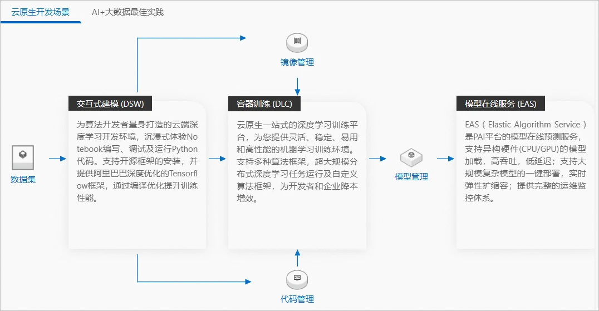

<a id="section-4-2"></a>

## 4.2. 管理工作空间

创建工作空间之后，您可以管理工作空间的详情，包括工作空间的描述、计算资源、存储设置和工作空间成员等。本文为您介绍如何管理工作空间。

**使用限制**

仅工作空间管理员和负责人能够修改工作空间配置信息。

**查看工作空间详情**

1. 登录机器学习控制台。

2. 在左侧导航栏单击**工作空间列表**，在工作空间列表页面中单击待操作的工作空间名称，进入对应工作空间内。

3. 在**工作空间详情**页面右侧，查看工作空间详情。

   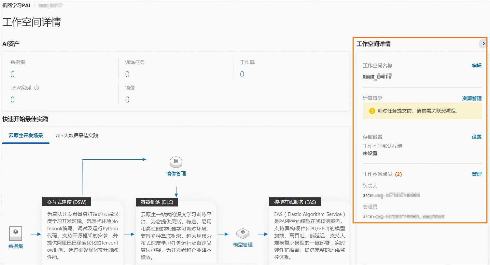

**编辑工作空间名称**

1. 在**工作空间详情**区域，单击**工作空间名称**后的**编辑**。

2. 在**工作空间基础信息配置**面板，修改**工作空间描述**，并单击**确定**。

   > **说明**
   >
   > 工作空间创建完成后，工作空间名称不能修改，仅能修改工作空间描述。

   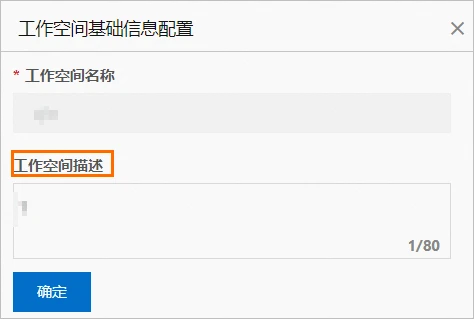

**管理工作空间计算资源**

- 查看计算资源

  <ol type="i">

  <li>

  在**工作空间详情**区域，单击**计算资源**后的**资源管理**。

  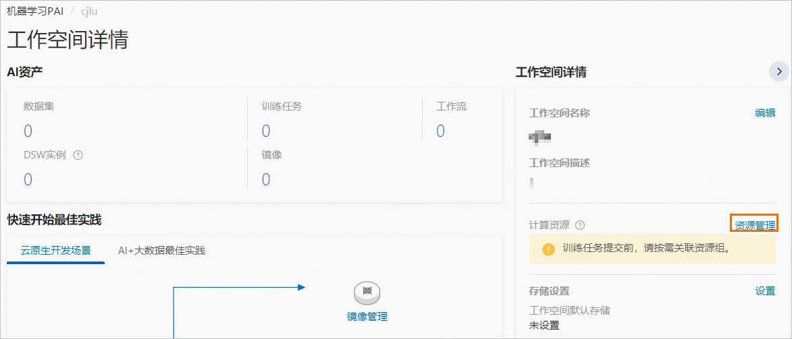

  </li>

  <li>

  在**工作空间资源配置**面板的**已关联资源组**区域，您可以查看已关联的资源组，包括**MaxCompute资源**、**通用资源**和**智算资源**。

  </li>

  </ol>

  > **说明**
  >
  > 如果该工作空间未关联计算资源，您在Designer、容器训练任务提交页面进行模型训练时可能会报错。

- 关联计算资源

  在**工作空间资源配置**面板的**已关联资源组**区域，以**通用资源**为例，按照下图操作指引，关联当前主账号已有的资源组。

  > **重要**
  >
  > 关联后的计算资源目前不支持解关联，如果您需要解关联计算资源，请联系您的商务经理来处理。

  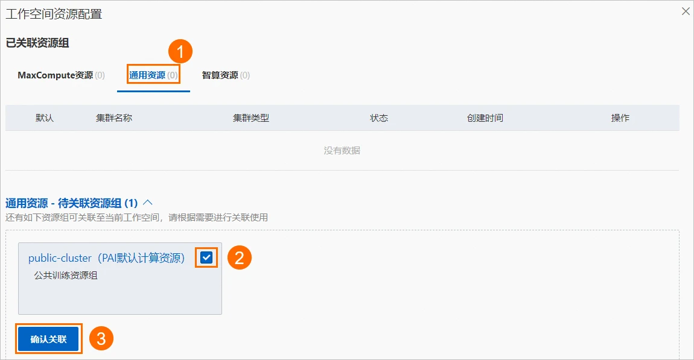

**设置工作空间存储路径**

1. 在**工作空间详情**区域，单击**存储设置**后的**设置**。

2. 在**存储设置**面板，配置**工作空间默认存储**参数，并单击**确定**。

   

   > **重要**
   >
   > 请确保当前工作空间的算法开发具有该OSS路径的读写权限。

> **说明**
>
> 如果您在工作空间设置了该存储路径，在Designer工作流中可以使用该存储路径。如果您在Designer工作流中也配置了临时存储路径，则工作空间存储路径会被覆盖。

**管理工作空间成员**

在**工作空间详情**区域的**工作空间成员**区域，您可以查看该工作空间的成员和角色，您也可以为该工作空间添加成员、删除成员或修改成员角色，具体操作请参见管理成员。

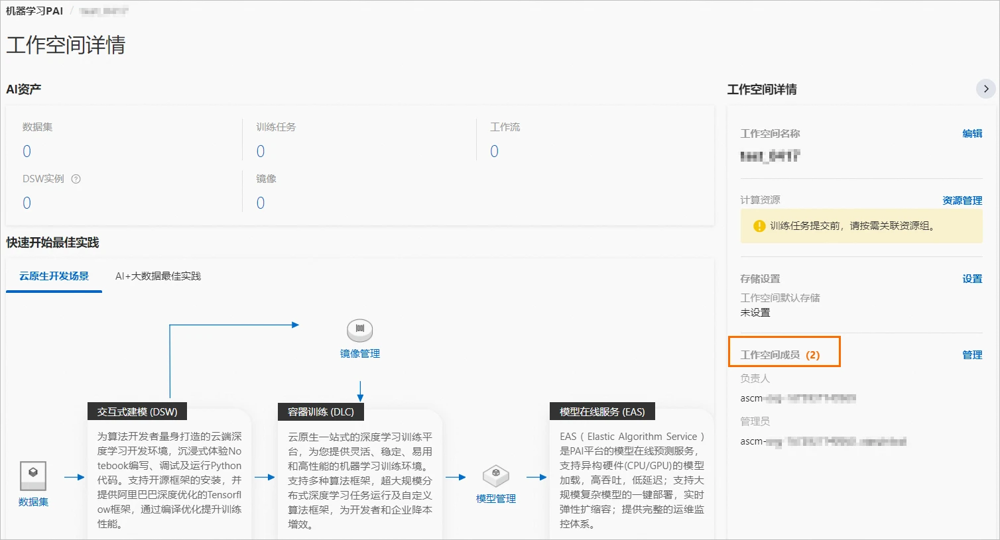

<a id="section-4-3"></a>

## 4.3. 管理成员

同一个工作空间可以添加多个成员，您可以为其授予特定的角色，从而使各个成员拥有不同的执行权限。本文为您介绍如何将RAM用户添加为工作空间的成员并为其配置角色权限。

**背景信息**

当多个成员共同使用一个工作空间时，如果成员权限过大，使用不当会影响数据安全。反义，如果权限过小，则可能无法使用所需的功能。为了解决该问题，PAI的工作空间为您提供了多种角色身份，您可以根据不同RAM用户对工作空间的使用需求授予其相应的角色。在左侧导航栏，单击**角色与权限列表**，您可以查看各角色与权限点的映射关系。

本文介绍与工作成员相关的如下操作：

- 添加成员

- 修改成员角色

- 删除成员

**使用限制**

仅工作空间管理员和负责人能够进行工作空间成员管理。

**进入成员管理面板**

1. 登录机器学习控制台。

2. 在左侧导航栏单击**工作空间列表**，在工作空间列表页面中单击待操作的工作空间名称，进入对应工作空间内。

3. 在工作空间详情页面，单击**工作空间成员**后的**管理**，即可进入**成员管理**面板。

   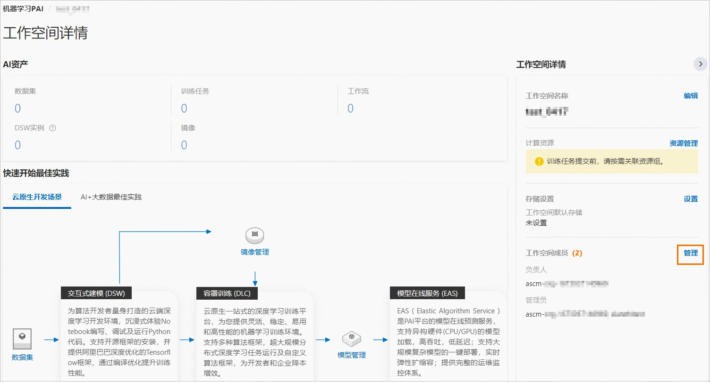

**添加成员**

1. 进入成员管理面板。

2. 在**成员管理**面板，单击**添加成员**。

3. 在**添加成员**对话框，配置如下参数。

   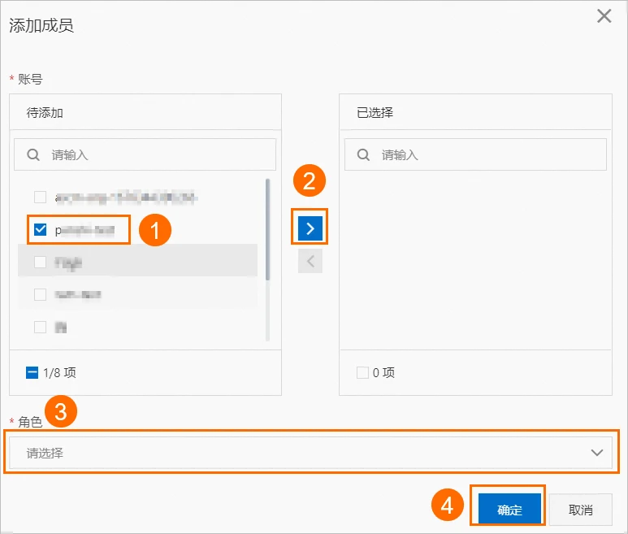

   | 参数 | 描述 |
   | --- | --- |
   | 账号 | 左侧<strong>RAM用户（子账号）</strong>区域显示可添加的所有RAM用户。选中某RAM用户前面的复选框，再单击图标，该RAM用户就会显示在右侧的<strong>已选RAM用户（子账号）</strong>区域。如果您需要移除已选择的RAM用户，则在右侧的<strong>已选RAM用户（子账号）</strong>区域选中RAM用户前面的复选框，再单击图标，该RAM用户即会从右侧的<strong>已选RAM用户</strong><strong>（子账号）</strong>区域移除，显示在左侧<strong>RAM用户（子账号）</strong>区域。 |

   <table>
     <tr>
       <td>角色</td>
       <td>系统支持以下角色，您需要根据实际需要进行选择：<br>• <strong>管理员</strong>：拥有编辑工作空间成员、管理资源组及管理工作空间内全部资产的权限。<br>• <strong>算法开发</strong>：拥有在所属工作空间中进行开发和模型训练的权限。<br>• <strong>算法运维</strong>：拥有任务优先级管理、模型发布及线上服务监控等权限。<br>• <strong>访客</strong>：拥有工作空间中各种资产的只读权限。<br>• <strong>MaxCompute开发</strong>：DataWorks中的开发角色，拥有MaxCompute数据开发相关权限。您可以为从PAI提交任务至MaxCompute执行的RAM用户添加该角色。<br>说明您可以为同一个RAM用户添加多个角色，以满足实际需求。<br>您可以在左侧导航栏，单击<strong>角色与权限列表</strong>，查看各角色与权限点的映射关系。</td>
     </tr>
   </table>

4. 单击**确定**。

**修改成员角色**

1. 进入成员管理面板。

2. 在**成员管理**面板，单击目标成员**角色**列下的列表。

3. 在角色列表中，单击某角色，如果该成员已经拥有了这个角色权限，则会为成员删除该角色。如果该成员没有这个角色权限，则会为成员添加该角色。

   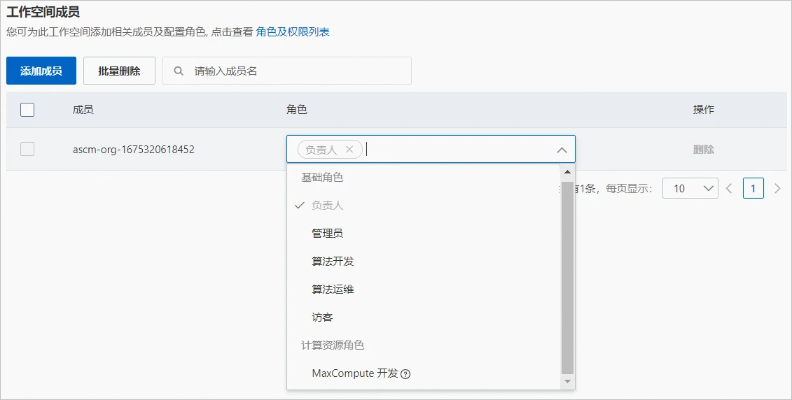

   您也可以直接单击角色名后的  图标，即可为成员删除该角色。

   > **说明**
   >
   > - 每个成员至少要拥有一个角色，即您不能删除一个成员的所有角色。
   >
   > - 不能删除**负责人**角色。创建工作空间的阿里云账号或RAM用户自动成为该工作空间的**负责人**，他拥有为编辑工作空间成员、引用和管理资源组、管理工作空间内全部资产的权限。

**删除成员**

您可以分别通过如下方式每次删除单个或多个成员：

- 删除单个成员

  <ol type="i">

  <li>

  进入成员管理面板。

  </li>

  <li>

  在**成员管理**面板，单击目标成员**操作**列下的**删除**。

  </li>

  <li>

  在**删除**对话框，单击**确定**。

  </li>

  </ol>

- 批量删除成员

  <ol type="i">

  <li>

  进入成员管理面板。

  </li>

  <li>

  在**成员管理**面板，单击目标成员前面的复选框。

  </li>

  <li>

  单击**批量删除**。

  </li>

  <li>

  在删除确认对话框，单击**确定**。

  </li>

  </ol>

> **说明**
>
> 无法删除角色为**负责人**的成员。

<a id="section-5"></a>

# 5.资源管理

**背景信息**

<a id="section-5-1"></a>

## 5.1. 资源管理概述

推荐您在使用PAI功能之前创建用于训练的通用资源、MaxCompute资源和智算资源。本文介绍三种资源详情。

您可以在**资源管理 > 资源仪表**中查看您对通用资源、MaxCompute资源及智算资源的持有情况。以下详细介绍三种资源：

- 通用资源

  人工智能平台 PAI（原机器学习平台PAI）支持使用底座Paas资源的AI场景和功能，您可以在**资源仪表**页面创建并管理通用资源专有训练资源组，并关联到工作空间，用于PAI的模型训练，详情请参见创建及管理底座资源。

  系统默认会为您创建基于PaaS底座的公共训练资源组，创建工作空间时默认关联该资源组。

- MaxCompute计算资源

  MaxCompute是适用于数据分析场景的企业级SaaS（Software as a Service）模式云数据仓库，以Serverless架构提供快速、全托管的在线数据仓库服务，消除了传统数据平台在资源扩展性和弹性方面的限制，最小化运维投入，使您可以经济并高效地分析处理海量数据。

  您可以创建MaxCompute资源组，然后从PAI进行模型开发，再提交至MaxCompute进行大规模分布式训练，详情请参见创建及管理MaxCompute资源。

- 智算资源

  智算资源即使用PAI-Eflops集群创建的资源，机器学习PAI支持通过智算资源组进行资源的分组管理。您可以在**资源仪表**页面创建并管理智算资源组，并绑定到工作空间，用于PAI的模型训练，详情请参见创建及管理智算资源。

<a id="section-5-2"></a>

## 5.2. 创建及管理通用资源

您可以使用PAI默认创建的公共训练资源组，也可以创建通用资源专有训练资源组，并关联到工作空间，用于PAI的模型训练。本文为您介绍如何创建及管理通用资源。

**创建通用资源**

具体操作步骤如下：

1. 登录机器学习控制台。

2. 在左侧导航栏，单击**资源管理>资源仪表**。

3. 在**资源仪表**页面的**通用资源**页签，单击**新建集群**。

4. 在**新建资源组-通用资源**对话框，配置以下参数。

   <table>
     <tr>
       <th width="121">参数</th>
       <th>描述</th>
     </tr>
     <tr>
       <td>资源组名称</td>
       <td>通用资源集群名称，参考界面提示信息配置。</td>
     </tr>
     <tr>
       <td>描述</td>
       <td>集群信息，便于区分不同的集群。</td>
     </tr>
     <tr>
       <td>组织</td>
       <td>选择组织。</td>
     </tr>
     <tr>
       <td>资源集</td>
       <td>选择资源集。</td>
     </tr>
     <tr>
       <td>节点</td>
       <td>选择计算节点。<br>说明<br>• 如果您未配置配额管理，则可以在所有节点中进行选择。<br>• 如果您使用了配额管理功能，则只能选择分配给对应组织的计算节点。</td>
     </tr>
     <tr>
       <td>所属工作空间</td>
       <td>选择所属的工作空间。</td>
     </tr>
   </table>

5. 单击**确定**。

   您可以单击右侧的刷新按钮  ，刷新创建的资源组的状态。智算资源的创建时间不超过10分钟。

**使用与管理通用资源**

已创建的通用资源可关联到某个工作空间中，便于工作空间内的任务使用。您也可以在资源仪表页面管理通用资源。

- 绑定工作空间

  新建工作空间时，默认关联PAI默认计算资源（即通用资源公共训练资源组），也可以直接选择已创建的专有训练资源组。后续此工作空间内创建的训练任务便会使用关联的通用资源。关于如何创建工作空间，详情请参见创建工作空间。

  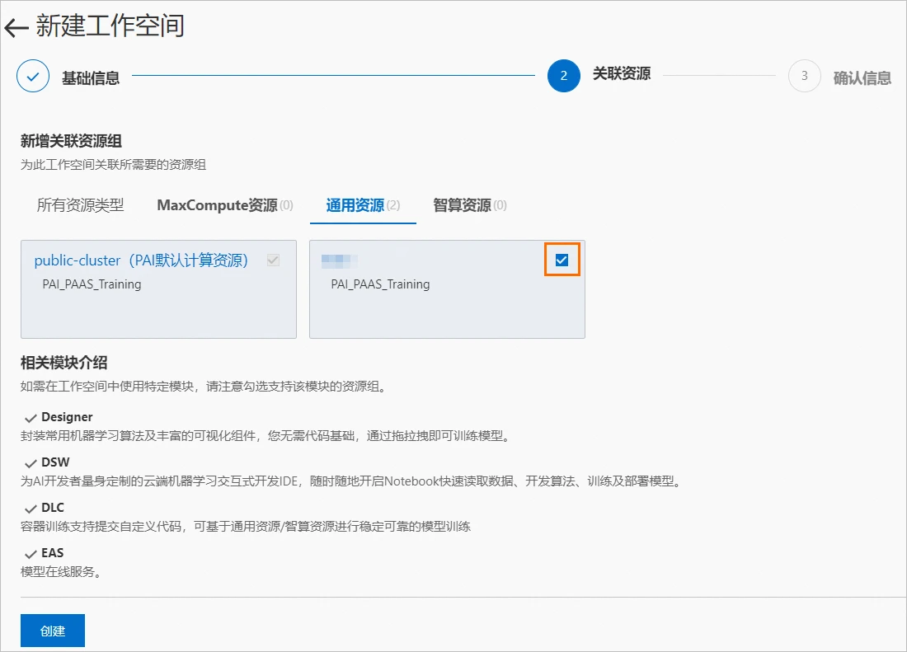

  您也可以在工作空间创建完成后，关联通用资源，详情请参见管理工作空间。

- 管理通用资源

  - 管理资源组的资源详情

    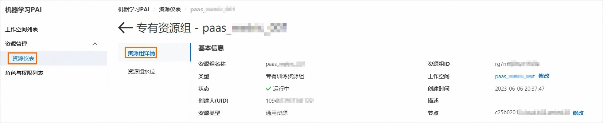

    您可以查看资源组的基本信息，如绑定的工作空间、状态等。在该页面中，您还可以修改绑定的工作空间。

  - 查看资源组水位

    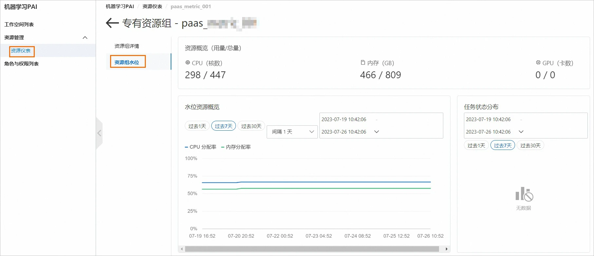

<a id="section-5-3"></a>

## 5.3. 创建及管理智算资源

您可以使用PAI-Eflops集群创建智算资源，并关联到工作空间，用于PAI的模型训练。文本为您介绍如何创建及管理智算资源。

**前提条件**

已创建专有网络和2个交换机。

- 如何创建专有网络，详情请参见*专有网络VPC用户指南*手册中**专有网络和交换机**下的**创建专有网络**章节。

- 如何创建交换机，详情请参见*专有网络VPC用户指南*手册中**专有网络和交换机**下的**创建交换机**章节。

**创建智算资源**

具体操作步骤如下：

1. 登录机器学习控制台。

2. 在左侧导航栏，单击**资源管理>资源仪表**。

3. 在**资源仪表**页面的**智算资源**页签，单击**新建集群**。

4. 在**新建资源组-智算资源**对话框，配置以下参数。

   | 参数 | 描述 |
   | --- | --- |
   | 资源组名称 | 智算资源集群名称，参考界面提示信息配置。 |
   | 描述 | 集群信息，便于区分不同的集群。 |
   | 组织 | 选择组织。 |
   | 资源集 | 选择资源集。 |
   | 节点 | 选择计算节点。<br>说明<br>• 如果您未配置配额管理，则可以在所有节点中进行选择。<br>• 如果您使用了配额管理功能，则只能选择分配给对应组织的计算节点。 |
   | 所属工作空间 | 选择所属的工作空间。 |
   | 专有网络 | 选择已创建的VPC网络，或单击<strong>创建专有网络</strong>进行创建。 |
   | 虚拟交换机 | 选择已创建的交换机，或单击<strong>创建交换机</strong>进行创建。 |
   | 虚拟交换机（裸机专用） | 选择已创建的交换机，或单击<strong>创建交换机</strong>进行创建。<br>说明裸机专用的VSwitch与创建的Pod数量相关，它代表了资源组创建Pod的上限。例如，当CIDR为24时，最多可以创建256个Pod。 |

5. 单击**确定**。

   您可以单击右侧的刷新按钮  ，刷新创建的资源组的状态。智算资源的创建时间不超过10分钟。

**使用与管理智算资源**

已创建的智算资源可关联到某个工作空间中，便于工作空间内的任务使用。您也可以在资源仪表页面中管理智算资源。

- 绑定工作空间

  新建工作空间时，可以直接选择关联智算资源。后续此工作空间内创建的训练任务便会使用关联的智算资源。关于如何创建工作空间，详情请参见创建工作空间。

  

  您也可以在工作空间创建完成后，关联智算资源，详情请参见管理工作空间。

- 管理智算资源

  - 管理资源组的资源详情

    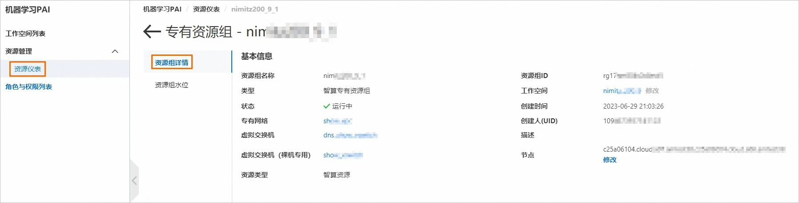

    您可以查看资源组的基本信息，如绑定的工作空间、状态等。在该页面中，您还可以修改绑定的工作空间。

  - 查看资源组水位

    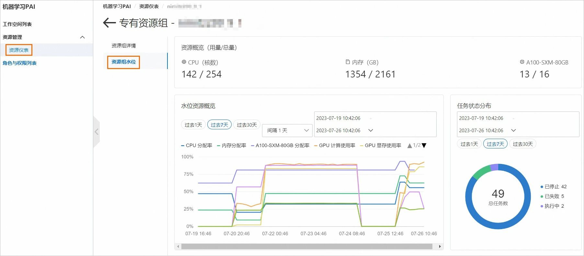

<a id="section-5-4"></a>

## 5.4. 创建及管理MaxCompute资源

您可以创建MaxCompute资源组，然后从PAI进行模型开发，再提交至MaxCompute进行大规模分布式训练。本文为您介绍如何创建及使用MaxCompute资源。

**创建MaxCompute资源**

如何创建MaxCompute资源，详情请参见*大数据计算服务用户指南*手册中**准备工作**下的**创建项目**章节。

**使用与管理MaxCompute资源**

已创建的MaxCompute资源可关联到某个工作空间中，便于工作空间内的任务使用。您也可以在MaxCompute的项目管理页面中管理MaxCompute资源。

- 绑定工作空间

  新建工作空间时，可直接选择关联MaxCompute资源。后续此工作空间内创建的训练任务便会使用此关联的MaxCompute资源。关于如何创建工作空间，详情请参见创建工作空间。

  

  > **说明**
  >
  > 一个工作空间仅能关联一个MaxCompute资源。

  您也可以在工作空间创建完成后，关联MaxCompute资源，详情请参见管理工作空间。

- 管理MaxCompute资源

  您可以在**资源仪表**页面的**MaxCompute**页签，查看当前可用的MaxCompute资源概况。

  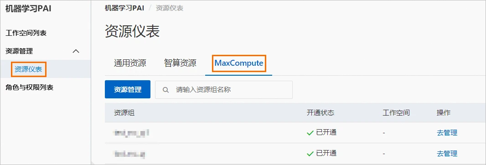

  单击目标资源组**操作**列下的**去管理**，进入**大数据计算MaxCompte**的**Project管理**页面。您可以在该页面对MaxCompute资源进行管理。

<a id="section-6"></a>

# 6.AI开发

<a id="section-6-1"></a>

## 6.1. 开发流程

进入工作空间后，您可以使用PAI子产品进行AI开发。本文介绍常用的AI开发流程，您可以结合实际情况选择。

进入工作空间后，在左侧导航栏可以看到PAI全部子产品模块，您需要根据实际开发场景进行机器学习全生命周期的开发及管理。常见的使用场景如下所示，您可以按照流程引导，使用子产品模块：

- 云原生开发场景

  

  | 区域 | 描述 | 相关文档 |
  | --- | --- | --- |
  | ① | 高质量的数据集是高精度模型的基础，也是数据准备的核心目标。您可以通过数据集管理模块将本地数据、阿里云存储中的数据进行注册，从而统一管理PAI的相关数据，为模型训练环节做准备。 | 创建及管理数据集 |
  | ② | 交互式建模（DSW）是为AI开发者量身定制的云端机器学习交互式开发IDE，随时随地开启Notebook快速读取数据、开发算法、训练及部署模型。 | PAI-DSW概述 |
  | ③ | 镜像管理模块为您展示PAI提供的官方公开镜像以及自定义镜像关联功能，从而在PAI中统一管理应用的镜像。 | 查看并添加镜像 |
  | ④ | 云原生一站式的深度学习训练平台，提供灵活、稳定、易用和高性能的机器学习训练环境。支持多种算法框架，超大规模分布式深度学习任务运行及自定义算法框架。 | 容器训练（DLC） |
  | ⑤ | 模型管理模块统一管理训练完成的模型，直接对接模型在线服务（EAS），您可以直接将模型部署为在线服务。 | 注册及管理模型 |
  | ⑥ | PAI平台的模型在线预测服务，支持异构硬件（CPU和GPU）模型加载，高吞吐低延迟，大规模复杂模型一键部署及实时弹性扩缩容。 | EAS概述 |

- AI加大数据最佳实践

  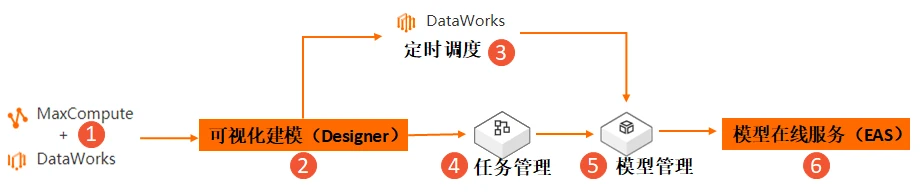

  | 区域 | 描述 | 相关文档 |
  | --- | --- | --- |
  | ① | 使用MaxCompute存储数据，首先在DataWorks中对数据进行预处理，然后PAI引用MaxCompute表作为数据源进行模型训练。 | • <em>大数据计算服务用户指</em><em>南</em>手册中<strong>快速入门</strong>下的<strong>创建表</strong>章节。<br>• <em>大数据计算服务用户指</em><em>南</em>手册中<strong>快速入门</strong>下的<strong>导入导出数据</strong>章节。 |
  | ② | 可视化建模（Designer）支持大规模分布式的传统机器学习、深度学习、强化学习训练，支持流批一体训练，该子模块封装了上百种机器学习算法，您可以拖拽式建模，从而无编程玩转人工智能。 | PAI-Designer概述 |
  | ③ | DataWorks根据配置的调度和时间属性等参数，周期调度任务。 | <em>DataWorks用户指南</em>手册中<strong>数据开发</strong>下的<strong>配置及使</strong><strong>用调度参数</strong>章节。 |
  | ④ | 任务管理支持将Designer的实验数据或自定义任务的执行信息记录到PAI提供的任务管理服务中，从而便于进行任务间的实验比较。 | EAS概述 |
  | ⑤ | 模型管理模块统一管理训练完成的模型，直接对接模型在线服务（EAS），您可以直接将模型部署为在线服务。 | 注册及管理模型 |
  | ⑥ | PAI平台的模型在线预测服务，支持异构硬件（CPU和GPU）模型加载，高吞吐低延迟，大规模复杂模型一键部署及实时弹性扩缩容。 | EAS概述 |

<a id="section-6-2"></a>

## 6.2. 可视化建模（PAI-Designer）

<a id="section-6-2-1"></a>

### 6.2.1. PAI-Designer概述

**PAI Designer**是基于云原生架构Pipeline Service -- **PAIFlow**的可视化建模工具，提供端到端的机器学习全链路开发环境，帮助您实现端到端的机器学习开发流程。同时，Designer中内置了丰富且成熟的机器学习算法，覆盖商品推荐、金融风控及广告预测等场景，支持基于MaxCompute等计算资源进行大规模分布式运算，可以快速满足不同方向的业务需求。

**PAI-Designer&PAIFlow产品架构**

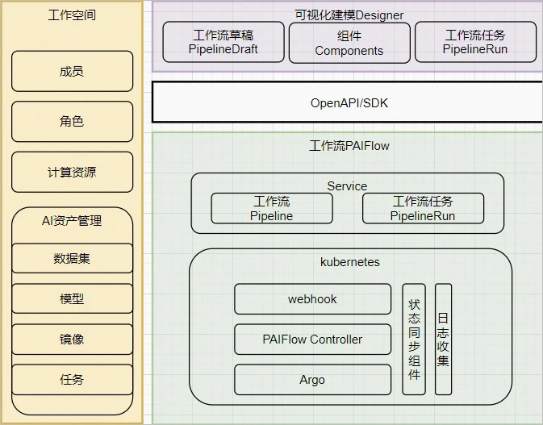

**PAI-Designer功能特性**

- PAI-Designer支持使用模板或手动创建工作流。通过模板可以快速创建工作流，运行成功后，直接进行模型部署。关于如何创建及管理工作流，详情请参见参考工作流概述。

- 系统提供百余种AI开发流程组件，支持接入MaxCompute表数据或OSS数据等多种数据源，通过自带阿里最佳实践的算法进行模型构建，并将模型部署至EAS。

- 提供当前工作流相关任务的管理、工作流版本管理及回滚，详情请参见模型训练。

- 进行模型训练时，PAI-Designer提供使用可视化大屏查看分析报告，对过程中的数据、模型、评测指标进行可视化分析，辅助您获得最佳模型。

- PAI-Designer支持工作空间内的工作流协作共享，同时支持将运行成功的工作流发布为创建工作流：自定义模板。

- 在Designer工作流中开发测试完成的模型支持注册至模型管理，一键部署模型服务或是打包成复合模型进行部署，详情请参见模型预测概述。

**PAI-Designer提供的工作流组件**

PAI-Designer为您提供百余种组件，满足多种场景的使用，组件详情请参见组件参考：所有组件汇总。

- **深度学习框架组件**

  包括基于PAI-Easy系列的自然语言处理算法，及TensorFlow、PyTorch等深度学习框架。

- **自定义算法组件**

  包括SQL脚本、Python脚本V2等自定义算法组件，可以满足您更加定制化的算法工作流串联需求。

从实现框架及支持的计算资源来区分，包括Alink框架及PAICommand框架，两种框架的算法组件各自有一些独特的功能特性：

- Alink框架算法组件（组件上有紫色圆点标记），支持运行在**MaxCompute**计算资源上。

  Alink框架算法支持成组运行，详情请参见高级功能：Alink组件成组执行。

- PAICommand框架算法组件，仅支持运行在**MaxCompute计算资源**上。

  PAICommand框架算法组件除了支持直接使用组件，还支持PAI命令的调用方式。您可以在Designer的SQL组件、DataWorks数据开发、MaxCompute命令行工具中进行调用。

**PAI-Designer的使用流程**

Designer的使用流程图如下所示。

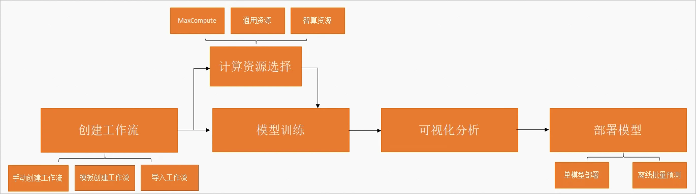

1. 创建工作流：空白工作流

   使用Designer建模前，您需要新建一个工作流。工作流支持多种创建方式，您可以结合自身业务情况，选择合适的方式来创建工作流。

2. 模型训练

   在Designer工作流页面，使用Designer提供的组件构建模型，并选择所需的计算资源（包括MaxCompute等）运行工作流来调试模型，最终完成模型训练。

3. （可选）使用可视化大屏查看分析报告

   模型训练完成后，您可以使用可视化大屏快速查看分析报告，来评估模型是否满足预期要求。

4. 部署模型

   模型训练完成后，您可以生产化部署模型对新数据进行预测。

**工作流调度引擎：PAIFlow**

- PAIFlow是Designer底层的工作流调度引擎，您可以从Designer提交工作流任务到PAIFlow执行，也可以通过PAIFlow SDK或OpenAPI直接构建工作流并在PAIFlow执行。

  > **说明**
  >
  > 通过PAIFlow SDK或OpenAPI构建的工作流不会在Designer中展示，SDK和Designer可以理解为两个独立的实现构建并提交PAIFlow任务的客户端，面向不同需求。

- PAIFlow任务管理页包含了全部通过SDK、Designer手动执行的Pipeline任务。

<a id="section-6-2-2"></a>

### 6.2.2. 界面功能介绍

<a id="section-6-2-2-1"></a>

#### 6.2.2.1. 基础功能

本文介绍可视化建模（Designer）界面各按钮的功能。

**Designer开发页面**

进入Designer工作流后，即进入Designer开发页面。

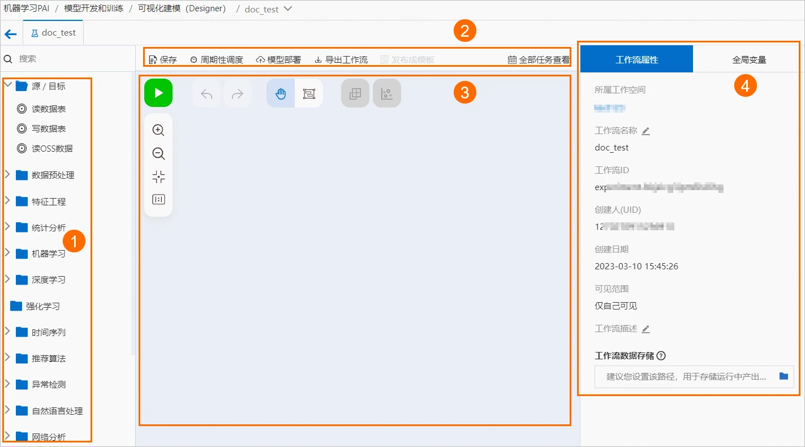

| 区域 | 描述 |
| --- | --- |
| ① | 组件目录树。您可以在此查看Designer提供的所有组件。 |
| ② | 菜单栏。 |
| ③ | 画布区域。您可以将组件目录树中的组件拖拽至画布，构建工作流。 |
| ④ | 右侧表单。展示工作流属性、变量或节点参数。 |

**工具栏**

画布左上方的工具栏功能如下表所示。

| 图标 | 描述 |
| --- | --- |
|  | 运行画布中的工作流。 |
|  | 放大画布中的所有组件或工作流。 |
|  | 缩小画布中的所有组件或工作流。 |
|  | 调整画布中的组件或工作流到画布中央。 |
|  | 画布如果进行了放大或缩小后，恢复至画布实际尺寸大小。 |
|  | 撤销上一步操作。 |
|  | 恢复撤销的操作。 |
|  | 移动画布。 |
|  | 框选画布中的多个组件。 |
|  | Alink智能聚合按钮，单击后Designer将自动检测画布中可以成组运行的Alink节点，并将其成组，以减少中间数据传输开销，提升资源利用效率。 |
|  | 可视化按钮，单击可快速进入可视化大屏页面。 |

**节点菜单**

在画布区域，鼠标右键单击节点出现节点菜单，如下图所示。


| 菜单名称 | 说明 |
| --- | --- |
| 重命名 | 对选中的节点进行重命名。 |
| 删除 | 删除选中的节点。 |
| 克隆 | 复制选中的节点。 |
| 执行到此处 | 工作流运行至该节点。 |
| 执行该节点 | 仅运行选中的节点。 |
| 从此处开始运行 | 从选中的节点开始运行工作流。 |
| 从根节点执行到此处 | 从根节点运行到选中的节点。 |
| 执行该节点的下游节点 | 从选中节点的下一个节点开始运行工作流。 |
| 查看数据 | 查看节点运行后产生的结果数据。 |
| 模型选项 | • <strong>模型描述</strong>：查看模型详情。<br>• <strong>导出PMML</strong>：将组件生成的模型导出到本地。<br>• <strong>注册新模型</strong>：将组件生成的模型注册到模型管理模块，在模型管理模块统一管理训练获得的模型。<br>• <strong>部署至EAS</strong>：将组件生成的模型部署为PAI EAS模型在线服务，进行在线推理。 |
| 查看日志 | 查看节点运行的日志。 |

<a id="section-6-2-2-2"></a>

#### 6.2.2.2. 高级功能：全局变量

全局变量可以减轻您在使用人工智能平台 PAI（原机器学习平台PAI）配置组件时，重复配置参数的工作量。支持创建和删除全局变量，并通过复制功能获取全局变量的引用方式。本文介绍如何配置与使用全局变量。

**应用场景**

工作流内多个组件使用相同的参数，详情请参见示例1：工作流内组件公用参数。

**前提条件**

已创建工作流，具体操作，请参见新建自定义工作流。

**进入全局变量配置页面**

1. 进入PAI-Designer页面。

   <ol type="i">

   <li>

   登录机器学习控制台。

   </li>

   <li>

   在左侧导航栏单击**工作空间列表**，在工作空间列表页面中单击待操作的工作空间名称，进入对应工作空间内。

   </li>

   <li>

   在工作空间页面的左侧导航栏选择**模型开发和训练 > 可视化建模（Designer）**，进入Designer页面。

   </li>

   </ol>

2. 在**工作流列表**页签，双击已创建的工作流，进入工作流页面。

3. 在画布右侧配置面板，单击**全局变量**页签后，单击**新增全局变量**，设置变量名与变量取值，依次添加全局变量。

   

**示例1：工作流内组件公用参数**

以心脏病预测模板工作流为例，选取参数时直接使用全局变量替换，其他使用相同参数的地方均可使用该变量。

1. 配置全局变量。

   <ol type="i">

   <li>

   进入全局变量配置页面。

   </li>

   <li>

   填写**变量名**和**变量值**。

   本示例填写**变量名**为**param**、**变量值**填写**sex,cp,fbs**等。填写完成后，系统会自动生成**引用方式**：${param}，在使用变量处直接输入${param}，即可引用该变量。

   

   </li>

   </ol>

2. 使用全局变量。

   在使用变量处，输入该变量的**引用方式**。

   

3. 运行工作流，验证变量是否自动替换为填写的变量值。

   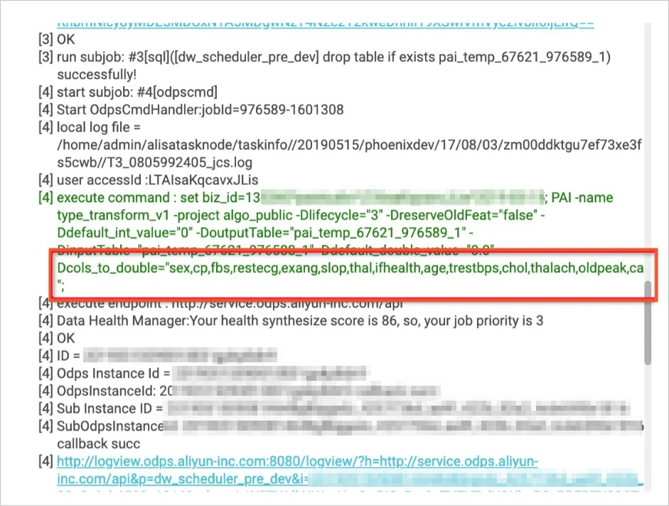

<a id="section-6-2-2-3"></a>

#### 6.2.2.3. 高级功能：Alink组件成组执行

为了提升实验运行效率，PAI-Designer支持将画布中的多个Alink节点合并为组，进行批量执行。同时，PAI-Designer提供Alink智能聚合工具，可以自动检测画布中可以成组运行的Alink节点。

**背景信息**

Alink是阿里云人工智能平台 PAI（原机器学习平台PAI）团队基于实时计算Flink研发的新一代机器学习算法框架及组件库。在PAI-Designer中会上线Alink流式和批式算法组件，从而支持开发者基于Flink引擎进行数据预处理、特征工程、模型训练、模型预测的机器学习全流程。

在PAI-Designer操作界面，您可以在组件列表看到带有紫色点标的算法组件（如下图所示），即Alink框架的算法组件。

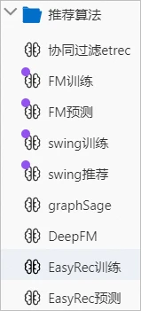

系统支持将画布中的Alink节点成组，进行批量执行，以提升执行效率及资源利用率，详情请参见Alink组件成组。此外，系统也支持自动检测画布中可以成组的Alink节点，详情请参见Alink智能聚合。

**Alink组件成组**

Alink组件与其他框架的组件在基础使用上没有差别。此外，基于Flink在内存中进行数据交换的高性能执行方式，PAI-Designer提供了Alink节点组合的批量执行方式，即Alink组件成组执行。

您可以通过Group概念自由组织已经拖入画布中的Alink组件，具体操作方式如下：

- 在PAI-Designer的画布上选择多个Alink节点。

  您可以通过shift+鼠标左键，或画布上方的框选  工具选择多个Alink节点。

- 单击鼠标右键，在弹出的快捷菜单中，单击**选中节点Alink成组**。

  画布中成组的Alink节点会通过虚线圆角矩形框显示为一组，如下图所示。

  

对于Alink组，您可以单击右上方的  图标，为其设置运行的**Worker数量**和**每个Worker占用的内存**。

Alink组的配置优先级高于Alink组中每个Alink节点的单独配置。成组后的Alink节点会批量执行，中间数据不落盘，从而提升执行效率及资源利用率。

**Alink智能聚合**

Alink智能聚合是指系统自动检测画布中可以成组运行的Alink节点，并将其成组，以减少中间数据传输开销，提升资源利用效率，帮助您在实验运行时提升执行效率。

PAI-Designer画布上方的工具栏中，提供Alink智能聚合工具  ，您可以快速开启Alink智能聚合功能。

<a id="section-6-2-3"></a>

### 6.2.3. 快速入门

<a id="section-6-2-3-1"></a>

#### 6.2.3.1. 入门概述

本文指引您快速地构建一个完整的PAI工作流。

PAI-Designer支持模板工作流、自定义工作流两种方式构建工作流。本文以自定义工作流为例，为您介绍使用自定义工作流从创建到运行成功的完整案例。

使用自定义工作流方式创建实验时，Designer为您提供百余种算法组件，并支持接入MaxCompute表数据或OSS数据等多种数据源，提高建模效率，demo流程如下。

1. 新建自定义工作流

   将原始数据上传至MaxCompute或OSS中，并配置工作流数据源。

2. 数据准备与预处理

   对原始数据进行预处理，生成模型训练集和模型预测集。

3. 数据可视化

   对源数据或中间结果数据进行可视化处理，获取数据分析结果。

4. 算法建模

   使用符合业务场景的算法组件加上预处理后的数据训练集进行算法建模。

5. 评估模型

   使用训练好的模型对预测数据集进行结果预测，并结合预测集中的“正确答案”评估模型效果。

<a id="section-6-2-3-2"></a>

#### 6.2.3.2. 新建自定义工作流

Designer通过工作流的方式来实现建模与模型调试，您需要先创建一个工作流，再根据建模需求在工作流中排布不同组件的处理调度逻辑。文本为您介绍如何新建工作流。

**前提条件**

已创建工作空间，详情请参见创建工作空间。

**背景信息**

Designer为您提供多种工作流模板，您可以根据业务需求直接套用工作流模板，也可以结合自身业务全新新建一个空白工作流。本示例以新建一个空白工作流为例，为您介绍新建工作流的操作步骤。

**操作步骤**

1. 进入PAI-Designer页面。

   <ol type="i">

   <li>

   登录机器学习控制台。

   </li>

   <li>

   在左侧导航栏单击**工作空间列表**，在工作空间列表页面中单击待操作的工作空间名称，进入对应工作空间内。

   </li>

   <li>

   在工作空间页面的左侧导航栏选择**模型开发和训练 > 可视化建模（Designer）**，进入Designer页面。

   </li>

   </ol>

2. 新建工作流。

   <ol type="i">

   <li>

   在**工作流列表**，单击**新建工作流 > 新建**。

   </li>

   <li>

   在弹出的**新建工作流**对话框中配置工作流参数，完成后单击**确定**，完成工作流新建。

   

   本示例中，您必须填写新建的**工作流名称**，其他参数保存默认状态即可。

   </li>

   </ol>

3. 在工作流列表页面，选中刚刚新建的工作流后，单击**进入工作流**即可进入工作流页面。

**后续步骤**

完成新建工作流后，需要进行数据准备与预处理，详情请参见数据准备与预处理。

<a id="section-6-2-3-3"></a>

#### 6.2.3.3. 数据准备与预处理

通常情况下，构建一个模型时，您需要将模型构建调试所需要使用的数据准备好并完成数据的预处理，便于后续根据业务需求进行模型开发所需的进一步加工。本示例使用PAI为您提供的公开数据为例，为您示例数据准备与预处理的操作步骤。

**前提条件**

已新建一个工作流，详情请参见新建自定义工作流。

**step1：进入工作流页面**

1. 登录机器学习控制台。

2. 在左侧导航栏单击**工作空间列表**，单击待操作的工作空间名称，进入对应工作空间内。

3. 在工作空间页面的左侧导航栏选择**模型开发和训练 > 可视化建模（Designer）**，进入Designer页面。

4. 在工作流列表页面，选中对应工作流后，单击**进入工作流**即可进入工作流页面。

**step2：准备数据**

本示例使用PAI为您提供的心脏病案例的公开数据，您无需新建表、写入表数据，可直使用接**读数据表**来读取此公开数据，作为数据准备。

> **说明**
>
> 通常情况下，您需要准备一个MaxCompute表或OSS表，并通过**源/目标**组件下的**读数据表**、**写数据表**、**读OSS数据**等组件来查询或写入数据到表中，操作详情可参见源/目标对应组件文档。


1. 在左侧组件列表的搜索框中，搜索**读数据表**，找到**读数据表**组件。

2. 将**读数据表**组件拖入右侧画布中，画布中自动生成一个名称为**读数据表-1**的工作流节点。

3. 在画布中选中**读数据表-1**节点，在右侧节点配置页面中的**表名**中输入 `pai_online_project.heart_disease_prediction` ，读取公开的心脏病案例的数据表。

   您也可以将右侧的节点配置页面切换到**字段信息**页签，查看此公开数据的字段详情。

**step3：数据预处理**

本示例使用的原始数据为公开的心脏病案例的数据，数据预处理已将所有字段取值归一化为例，为您示例数据预处理的步骤。本示例的数据预处理主要包括三个处理流程：

1. 将原始数据表中，取值为非数值类型的字段，通过SQL替换为数值类型的取值，以保障此预处理后，表中所有字段的取值都是数值类型的取值。

2. 将表中字段换为double类型，以保障此预处理后，表中字段均满足后续归一化处理的字段属性要求。

3. 将表中字段的取值均归一化。

详细操作如下。

1. 数据预处理：转换非数值类型字段。

   <ol type="i">

   <li>

   在左侧组件列表的搜索框中，搜索**SQL脚本**，找到**SQL脚本**组件。

   </li>

   <li>

   将**SQL脚本**组件拖入右侧画布中，画布中自动生成一个名称为**SQL脚本-1**的工作流节点。

   </li>

   <li>

   通过连线，将**SQL脚本-1**节点的**t1**输入源作为**读数据表-1**节点的下游节点。

   </li>

   <li>

   在画布中选中**SQL脚本-1**节点（此时在画布右侧**参数设置**页面的**输入源**为t1），在右侧节点配置页面中的SQL脚本输入框中输入下面的SQL代码。

   ```text
   select age,
   (case sex when 'male' then 1 else 0 end) as sex,
   (case cp when 'angina' then 0  when 'notang' then 1 else 2 end) as cp,
   trestbps,
   chol,
   (case fbs when 'true' then 1 else 0 end) as fbs,
   (case restecg when 'norm' then 0  when 'abn' then 1 else 2 end) as restecg,
   thalach,
   (case exang when 'true' then 1 else 0 end) as exang,
   oldpeak,
   (case slop when 'up' then 0  when 'flat' then 1 else 2 end) as slop,
   ca,
   (case thal when 'norm' then 0  when 'fix' then 1 else 2 end) as thal,
   (case status  when 'sick' then 1 else 0 end) as ifHealth
   from  ${t1};
   ```

   > **说明**
   >
   > **SQL脚本-1**节点有t1、t2、t3和t4四个输入源，SQL代码示例中，${*t1*}表示输入源为t1。如果您从**读数据表-1**到**SQL脚本-1**连线的节点是t2或其他（在**SQL脚本-1**的**参数设置**页面的**输入源**会显示对应节点），需要修改SQL语句为对应节点。

   </li>

   <li>

   单击画布上方**运行**  按钮，实验将根据工作流顺序依次运行**读数据表-1**、**SQL脚本-1**节点。

   </li>

   </ol>

2. 数据预处理：转换所有字段为double。

   <ol type="i">

   <li>

   在左侧组件列表的搜索框中，搜索**类型转换**，找到**类型转换**组件。

   </li>

   <li>

   将**类型转换**组件拖入右侧画布中，画布中自动生成一个名称为**类型转换-1**的工作流节点。

   </li>

   <li>

   通过连线，将**类型转换-1**节点作为**SQL脚本-1**节点的下游节点。

   </li>

   <li>

   在画布中选中**类型转换-1**节点，在右侧节点配置页面中**字段设置**页签，单击**转换为double类型的列**下的**选择字段**，将除 `status` 和 `style` 外的其他字段转换为**double**类型。

   </li>

   </ol>

3. 数据预处理：归一化。

   <ol type="i">

   <li>

   在左侧组件列表的搜索框中，搜索**归一化**，找到**归一化**组件。

   </li>

   <li>

   将**归一化**组件拖入右侧画布中，画布中自动生成一个名称为**归一化-1**的工作流节点。

   </li>

   <li>

   通过连线，将**归一化-1**节点作为**类型转换-1**节点的下游节点。

   </li>

   <li>

   在画布中选中**归一化-1**节点，在右侧节点配置页面中的**字段设置**页签，选择除 `status` 和 `style` 外的其他字段。

   </li>

   </ol>

4. 在左侧组件列表的搜索框中，搜索**拆分**，找到**拆分**组件后拖入画布，并通过连线作为**归一化-1**节点的下游节点。

   **拆分**组件默认将原始数据按4:1拆分为模型训练集和模型预测集。您也可以单击**拆分**组件，在右侧**参数设置**页签，设置**切分比例**。

5. 单击画布上方的**保存**，保存工作流配置。

**调试运行工作流**

单击画布上方**运行**  按钮，调试运行本工作流。单击**运行**按钮后，实验将根据工作流顺序依次运行各节点，

当节点成功运行完成后，节点的右上角会出现成功提示  。运行成功后，您可以右键各节点，选择**查看数**

**据**，进一步查看当前节点的输出数据是否正确。

> **说明**
>
> 当工作流比较复杂时，您可以每拖入一个组件配置完成一个节点后，就单击保存和运行，进行调试。如果运行失败可右键节点查看日志，进行失败原因的排查处理。

**后续步骤**

完成数据预处理后，需要进行数据可视化，详情请参见数据可视化。

<a id="section-6-2-3-4"></a>

#### 6.2.3.4. 数据可视化

本文以统计全表信息为例，为您介绍如何进行数据可视化。

**前提条件**

完成数据准备与预处理，详情请参见数据准备与预处理。

**操作步骤**

1. 登录机器学习控制台，进入工作流页面。

   操作详情请参见step1：进入工作流页面。

2. 构建全表统计节点并运行。

   <ol type="i">

   <li>

   在组件列表中搜索**全表统计**组件，找到后将其拖入画布，并将生成的节点作为数据准备与预处理中的**类型转换-1**节点的下游节点。

   </li>

   <li>

   右键单击画布中的**全表统计-1**节点，在快捷菜单，单击**执行该节点**。

   </li>

   </ol>

3. 任务运行结束后，右键单击画布中的**全表统计**组件，在快捷菜单，单击**查看数据**，可以查看数据的全表统计信息。

   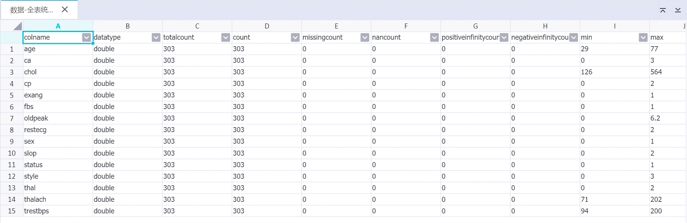

**后续步骤**

完成数据可视化后，可以进行算法建模，详情请参见算法建模。

<a id="section-6-2-3-5"></a>

#### 6.2.3.5. 算法建模

本文以逻辑回归二分类算法为例，为您介绍如何使用PAI Designer训练模型。

**前提条件**

完成数据可视化，详情请参见数据可视化。

**操作步骤**

1. 登录机器学习控制台，进入工作流页面。

   操作详情请参见step1：进入工作流页面。

2. 构建逻辑回归二分类节点并运行。

   <ol type="i">

   <li>

   在组件列表中搜索**逻辑回归二分类**组件，找到后将其拖入画布，并将生成的节点作为数据准备与预处理中的**拆分-1**节点的下游节点。

   </li>

   <li>

   单击画布中的**逻辑回归二分类-1**节点，在右侧**字段设置**页签，将**目标列**设置为**status**，将**训练特征列**设置为除**目标列**以外的所有列。

   </li>

   <li>

   右键单击画布中的**逻辑回归二分类-1**节点，在快捷菜单，单击**执行该节点**。

   </li>

   </ol>

**后续步骤**

完成算法建模后，可以对训练模型进行评估，详情请参见评估模型。

<a id="section-6-2-3-6"></a>

#### 6.2.3.6. 评估模型

本文以评估二分类训练模型为例，为您介绍如何进行模型评估。

**前提条件**

完成建模，详情请参见算法建模。

**操作步骤**

1. 登录机器学习控制台，进入工作流页面。

   操作详情请参见step1：进入工作流页面。

2. 构建预测节点。

   <ol type="i">

   <li>

   在组件列表中分别搜索**预测**组件，找到后将其拖入画布，并将生成的节点作为**拆分-1**、**逻辑回归二分类-1**节点的下游节点，拼接为实验。

   </li>

   <li>

   单击画布中的**预测-1**节点，在右侧节点配置中**字段设置**页签，分别单击**特征列**、**原样输出列**下的**选择字段**，在**已选**模块切换至**编辑**状态进行如下配置。

   - 特征列字段：在编辑框中输入除 `ifhealth` 外的其他所有字段： `age,sex,cp,trestbps,chol,fbs,restecg,thalach,exang,oldpeak,slop,ca,thal` 。

   - 原样输出列字段：在编辑框中输入 `ifhealth` 字段。

   </li>

   </ol>

3. 构建二分类评估节点。

   <ol type="i">

   <li>

   在组件列表中分别搜索**二分类评估**组件，找到后将其拖入画布，并将生成的节点作为**预测-1**节点的下游节点，拼接为实验。

   </li>

   <li>

   单击画布中的**二分类评估-1**节点，在右侧**字段设置**页签，将**原始标签列列名**设置为**ifhealth**。

   </li>

   </ol>

4. 单击画布上方的**运行**。

5. 查看模型评估结果。

   <ol type="i">

   <li>

   实验运行结束后，右键单击画布中的**二分类评估**组件，在快捷菜单，单击**可视化分析**。

   </li>

   <li>

   单击**评估图表**页签，查看不同参数情况下，二分类训练模型的ROC（接受者操作特性）曲线。

   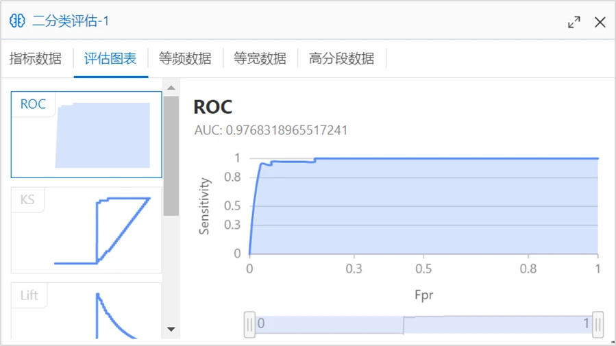

   </li>

   </ol>

<a id="section-6-2-4"></a>

### 6.2.4. 创建及管理工作流

<a id="section-6-2-4-1"></a>

#### 6.2.4.1. 工作流概述

Designer通过工作流的方式来实现建模与模型调试，您需要先规划并创建一个工作流，再根据建模需求在工作流中排布不同组件的处理调度逻辑。

**规划工作流分类文件夹**

在创建工作流前，建议您结合自身业务情况，先规划好工作流的分类文件夹，便于后续高效查找、应用及管理工作流。通常情况下，一个工作流承载一个模型试验的构建，同类的工作流建议归档存放至同一个文件夹中。

PAI-Designer默认为您提供两个工作流文件夹：**我的工作流**和**工作空间公开工作流**，分别用于分类存储**仅自己可见**的工作流和**工作空间内公开可见**的工作流，同时您也可以在这两个文件夹下再新建文件夹，根据业务分类需要进一步做文件夹分类，提高工作流管理效率。

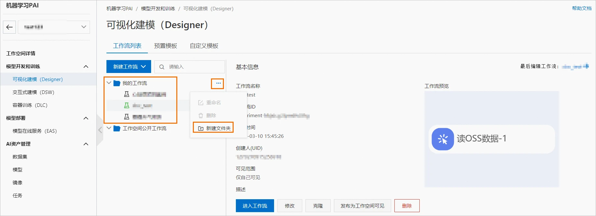

在文件夹下单击对应的工作流后，您可以在右侧**基本信息**页面查看对应工作流的基本信息，例如**工作流名称**、**可见范围**、预览工作流内容等。

**创建工作流**

Designer支持以下几种方式创建工作流。

- 创建工作流：空白工作流如果您希望根据业务情况完全自定义一个工作流，您可以创建一个空白工作流，在工作流上从零开始构建工作流模型。

- 创建工作流：预置模板

  PAI-Designer为您提供了大量预置模板，便于您直接套用模板快速构建工作流模型，如果您的应用场景与已有的模板工作流相似，建议您直接基于模板来创建工作流，后续在工作流的基础上简单编辑配置工作流，即可完成模型构建。

- 创建工作流：自定义模板

  您可以将运行成功的工作流生成自定义模板，分享给工作空间内其他算法开发成员使用。

- 导出与导入工作流

  对于已经创建完成的工作流，您可以将其导出后，再通过导入的方式快速创建一个一样的工作流。

<a id="section-6-2-4-2"></a>

#### 6.2.4.2. 创建工作流：空白工作流

PAI-Designer为您提供了预置模板，便于您快速创建与模板类似的工作流。如果您需要创建的工作流与预置模板差别很大，您也可以创建空白工作流，在空白工作流中从零开始添加组件构建模型。文本为您介绍如何创建空白工作流。

**前提条件**

已创建工作空间，详情请参见创建工作空间。

**操作步骤**

1. 进入PAI-Designer页面。

   <ol type="i">

   <li>

   登录机器学习控制台。

   </li>

   <li>

   在左侧导航栏单击**工作空间列表**，在工作空间列表页面中单击待操作的工作空间名称，进入对应工作空间内。

   </li>

   <li>

   在工作空间页面的左侧导航栏选择**模型开发和训练 > 可视化建模（Designer）**，进入Designer页面。

   </li>

   </ol>

2. 在**工作流列表**页签，单击**新建工作流 > 新建**。

3. 在**新建工作流**对话框，配置以下参数，并单击**确定**。

   | 参数 | 描述 |
   | --- | --- |
   | 工作流名称 | 参考界面提示，配置工作流的名称。 |
   | 工作流数据存储 | 强烈建议您配置该参数，配置为OSS Bucket存储路径，用于存储运行中产出的临时数据和模型。<br>系统会在每次运行时，自动为您创建<code> </code>工作流存储路径<code>/</code>任务<code>ID/</code>节点<code>ID </code>的临时文件夹。可以简化您在工作流中，为每个组件进行OSS存储路径配置的工作，且更便于数据统一管理。 |
   | 描述 | 对创建的工作流进行简单描述，以区分不同的工作流。 |
   | 可见范围 | 工作流的可见性，支持以下取值：<br>• <strong>仅自己可见</strong>：工作流创建到<strong>我的工作流</strong>文件夹下。在工作空间中，仅对您和管理员可见。<br>• <strong>工作空间内公开可见</strong>：工作流创建到<strong>工作空间公开工作流</strong>文件夹下，在工作空间中，对所有人可见。 |

**后续步骤**

创建完成工作流后，您即可进入工作流页面，像搭积木一样实现模型开发构建，详情请参见模型训练。

<a id="section-6-2-4-3"></a>

#### 6.2.4.3. 创建工作流：预置模板

PAI-Designer为您提供了预置模板，便于您快速创建与模板类似的工作流。您可以在此基础上对组件或组件配置进行修改，来构建模型。本文为您介绍如何通过PAI提供的预置模板创建工作流，快速实践AI业务场景。

**前提条件**

已创建工作空间，详情请参见创建工作空间。

**操作步骤**

1. 进入PAI-Designer页面。

   <ol type="i">

   <li>

   登录机器学习控制台。

   </li>

   <li>

   在左侧导航栏单击**工作空间列表**，在工作空间列表页面中单击待操作的工作空间名称，进入对应工作空间内。

   </li>

   <li>

   在工作空间页面的左侧导航栏选择**模型开发和训练 > 可视化建模（Designer）**，进入Designer页面。

   </li>

   </ol>

2. 在<strong>可视化建模（Designer）</strong>页面单击**预置模板**，切换至预置模板页签。

   

   Designer里已经内置了数十个基于不同框架、满足不同行业场景需求的模板，具体分类如下。

   - 按照行业类型分为：互联网、工业、金融、教育和医疗类型。

   - 按照算法类别和框架分为：分类、回归、聚类、TF框架和PyTorch框架。

   - 按照业务领域分为：推荐、风控、用户增长、CV、NLP、模型优化、ASR和视频领域。

3. 查看并选择合适的工作流模板，单击工作流模板区域的**创建**。

4. 在**新建工作流**对话框，配置以下参数（可以全部使用默认参数）。

   | 参数 | 描述 |
   | --- | --- |
   | 工作流名称 | 您可以使用默认的工作流名称，也可以根据业务需要自定义名称。 |
   | 工作流数据存储 | 强烈建议您配置该参数，配置为OSS Bucket存储路径，用于存储运行中产出的临时数据和模型。<br>系统会在每次运行时，自动为您创建<code> </code>工作流存储路径<code>/</code>任务<code>ID/</code>节点<code>ID </code>的临时文件夹。可以简化您在工作流中，为每个组件进行OSS存储路径配置的工作，且更便于数据统一管理。 |
   | 描述 | 对创建的工作流进行简单描述，以区分不同的工作流。 |
   | 可见范围 | 工作流的可见性，支持以下取值：<br>• <strong>仅自己可见</strong>：工作流创建到<strong>我的工作流</strong>文件夹下。在工作空间中，仅对您和管理员可见。<br>• <strong>工作空间内公开可见</strong>：工作流创建到<strong>工作空间公开工作流</strong>文件夹下，在工作空间中，对所有人可见。 |

5. 单击**确定**。

   您需要等待大约十秒钟，工作流可以创建成功。

**后续步骤**

创建完成工作流后，您即可进入工作流页面，在工作流的基础上简单编辑配置工作流，详情请参见模型训练。

<a id="section-6-2-4-4"></a>

#### 6.2.4.4. 创建工作流：自定义模板

本文为您介绍如何将工作流保存成自定义模板，供工作空间内其他成员使用。

**背景信息**

Designer首页提供了几十个预置模板，帮助不同行业的新用户快速上手。在正式使用的企业客户中，算法专家来开发算法流程，将稳定的工作流制作成模板分享给业务专家使用。业务专家基于模板快速进行建模、部署、上线验证。基于此需求，Designer提供了自定义模板功能：

- 支持将一个运行成功状态的工作流创建为自定义模板。

- 自定义模板可被工作空间内其他算法开发成员查看、拷贝。

- 自定义模板可被创建者、工作空间管理员编辑、删除。

- 自定义模板使用范围在工作空间内。

**前提条件**

已创建工作流且运行成功，详情请参见数据准备与预处理。

**创建自定义模板**

1. 进入PAI-Designer页面。

   <ol type="i">

   <li>

   登录机器学习控制台。

   </li>

   <li>

   在左侧导航栏单击**工作空间列表**，在工作空间列表页面中单击待操作的工作空间名称，进入对应工作空间内。

   </li>

   <li>

   在工作空间页面的左侧导航栏选择**模型开发和训练 > 可视化建模（Designer）**，进入Designer页面。

   </li>

   </ol>

2. 双击已运行成功的工作流名称，进入工作流详情页面。

3. 单击画布上方的**发布成模板**。

4. 在**发布成工作空间模板**对话框，配置**模板名称**、**模板描述**和**模板文档链接**（可选），并单击发布。

   其中：**模板文档链接**可以填写一个支持访问的HTTP地址，用来介绍自定义模板内容。

5. 模板发布成功后，单击**确定**，会自动跳转到**自定义模板**页签，您可以查看已创建的模板。

   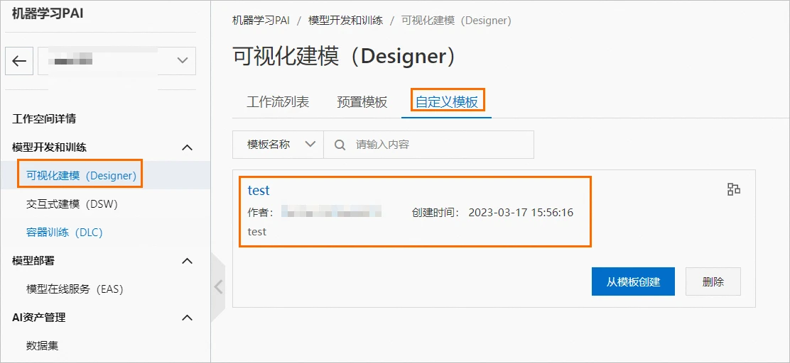

后续您可以直接使用该模板进行建模，详情请参见使用自定义模板。

**使用自定义模板**

- 拥有工作空间内**算法开发**角色的成员，可以按照下图操作指引，来克隆一份模板中的工作流，继续进行开发。

  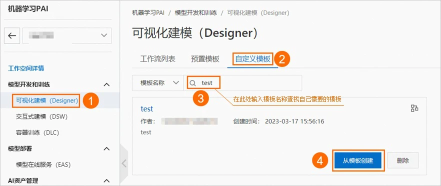

- 工作空间管理员或自定义模板创建者可以删除已创建的自定义模板。

<a id="section-6-2-4-5"></a>

#### 6.2.4.5. 导出与导入工作流

您可以将自己或他人导出的JSON格式的工作流文件导入到您的工作空间内，来创建新的工作流。原来工作流中的组件及组件的配置会一起导入到新的工作流中。您可以在此基础上修改组件或组件配置，进行模型构建。本文为您介绍如何导出及导入工作流。

**前提条件**

已创建自定义工作流并构建模型，详情请参见数据准备与预处理。

**导出工作流**

1. 进入PAI-Designer页面。

   <ol type="i">

   <li>

   登录机器学习控制台。

   </li>

   <li>

   在左侧导航栏单击**工作空间列表**，在工作空间列表页面中单击待操作的工作空间名称，进入对应工作空间内。

   </li>

   <li>

   在工作空间页面的左侧导航栏选择**模型开发和训练 > 可视化建模（Designer）**，进入Designer页面。

   </li>

   </ol>

2. 在**工作流列表**页面，双击目标工作流，进入工作流页面。

3. 在Designer画布上方，单击**导出工作流**，即可将工作流导出到本地。

后续，您可以将导出到本地的工作流模板，重新导入到工作空间内，详情请参见导入工作流。

**导入工作流**

1. 进入PAI-Designer页面。

   <ol type="i">

   <li>

   登录机器学习控制台。

   </li>

   <li>

   在左侧导航栏单击**工作空间列表**，在工作空间列表页面中单击待操作的工作空间名称，进入对应工作空间内。

   </li>

   <li>

   在工作空间页面的左侧导航栏选择**模型开发和训练 > 可视化建模（Designer）**，进入Designer页面。

   </li>

   </ol>

2. 在**工作流列表**页签，单击**新建工作流**>**导入**。

3. 在**导入工作流**对话框，配置以下参数。

   | 参数 | 描述 |
   | --- | --- |
   | 工作流文件 | 单击<strong>上传文件</strong>，上传已导出的工作流模板文件。 |
   | 工作流数据存储 | 您可以使用工作流模板默认配置的OSS Bucket路径，也可以将该参数配置为您自己的OSS Bucket路径。<br>重要如果您使用工作流模板配置的OSS路径，请确认您有读写该OSS路径的操作权限，否则工作流会执行失败，详情请参见<em>对象存储用户指南</em>手册中<strong>存储空间</strong>下的<strong>修改读写权限</strong>章节。 |
   | 描述 | 对创建的工作流进行简单描述，以区分不同的工作流。 |
   | 可见范围 | 工作流的可见性，支持以下取值：<br>• <strong>仅自己可见</strong>：工作流创建到<strong>我的工作流</strong>文件夹下。在工作空间中，仅对您和管理员可见。<br>• <strong>工作空间内公开可见</strong>：工作流创建到<strong>工作空间公开工作流</strong>文件夹下，在工作空间中，对所有人可见。 |

4. 单击**确定**。

**后续步骤**

工作流导入成功后，您即可进入工作流页面，在工作流的基础上简单编辑配置工作流，详情请参见模型训练。

<a id="section-6-2-4-6"></a>

#### 6.2.4.6. 管理工作流

本文为您介绍如何管理工作流。

工作流创建完成后，您可以在**工作流列表**页签单击目标工作流，在右侧查看工作流详情，并对工作流进行修改、克隆、删除等操作。

> **警告**
>
> 工作流删除后无法恢复，请谨慎操作。

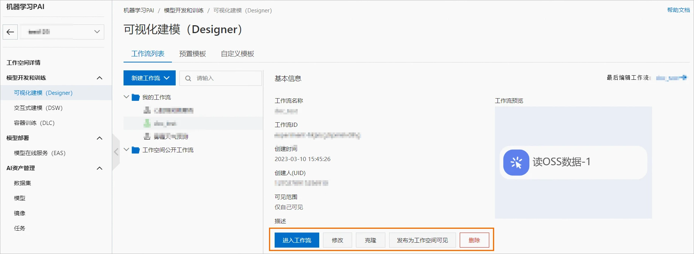

- **进入工作流**

  您可以在右侧**基本信息**页面，单击**进入工作流**，进入工作流页面查看工作流内部的节点详情。

- **发布为工作空间可见**

  您可以在**基本信息**页面，单击**发布为工作空间可见**，将已创建的仅自己可见的工作流发布至工作空间范围。使工作空间内的其他成员根据自己的角色，拥有该工作流的查看或编辑权限。

  > **重要**
  >
  > 一旦将工作流发布为工作空间可见，该工作流后续不能再转为仅自己可见的工作流，请谨慎操作。

<a id="section-6-2-4-7"></a>

#### 6.2.4.7. 迁移Studio实验至Designer

为了给您提供更便捷优质的操作体验，阿里云PAI对操作控制台进行优化升级，可视化建模平台从PAI-Studio升级为PAI-Designer。如果您希望后续使用更优的Designer（推荐），可以将旧版控制台Studio中的实验一键迁移至新版Designer中进行管理维护。 本文介绍如何将Studio中积累的实验一键迁移到Designer。

**背景信息**

全新的云原生可视化建模平台Designer，是未来会代替Studio的新一代可视化建模工具平台。提供阿里自研百余种传统机器学习和深度学习算法，支持跨计算资源的工作流串联，并支持您通过更灵活的方式进行建模。

您可以使用Designer组件一键迁移Studio平台的实验，通过试运行迁移、增量迁移和多次覆盖迁移将PAI Studio 1.0中最新的实验迁移到Designer中。迁移结果会保存在迁移实验ID映射表和迁移错误表两个结果表中，您可以通过查看两个结果表了解迁移成功和迁移失败的实验信息。

**注意事项**

以下几种实验不支持迁移操作，如果Studio平台包含以下几种实验，迁移过程会跳过该实验，不影响其他实验的迁移操作。

- 使用了流式组件的实验。

- 使用了自定义算法组件的实验。

- 使用了Designer暂不计划支持的算法的实验，比如OSS数据同步、MySQL数据同步等。

**使用Designer组件迁移实验**

Designer提供了一个名为PAI Studio 1.0实验同步助手的组件，支持用户将已有的Studio实验迁移至Designer中。具体操作步骤如下。

1. 进入空白工作流。

   <ol type="i">

   <li>

   新建空白电子流，具体操作请参见创建工作流：空白工作流。

   </li>

   <li>

   在工作流列表，选择已创建的空白工作流，单击**进入工作流**。

   </li>

   </ol>

2. 运行实验，执行一键迁移。

   <ol type="i">

   <li>

   在左侧组件列表的搜索框中，搜索**PAI Studio 1.0实验同步助手**，找到**PAI Studio 1.0实验同步助手**组件。

   </li>

   <li>

   将**PAI Studio 1.0实验同步助手**组件拖入右侧画布中，画布中自动生成一个名称为**PAI Studio 1.0实验同步助手-1**的工作流节点。

   </li>

   <li>

   在画布中选中**PAI Studio 1.0实验同步助手-1**节点，在右侧节点**参数设置**页面配置相关参数，具体参数设置如下表所示。

   <table>
     <tr>
       <th width="217">参数</th>
       <th>描述</th>
     </tr>
     <tr>
       <td>同步类型</td>
       <td>支持以下同步类型。<br>• <strong>复制我创建的实验</strong>：迁移您自己创建的实验。<br>• <strong>复制我管理的MC项目下的实验</strong>：迁移您作为owner的MaxCompute项目下所有的实验。<br>说明迁移后的工作流的创建人会继承原实验的创建人，与同步任务的执行者无关。</td>
     </tr>
     <tr>
       <td>实验可见度</td>
       <td>实验迁移到Designer后的可见范围。<br>• <strong>私有</strong>：仅您自己可见。迁移后的实验会放在我的工作流目录，Migrate From Pai Studio 1.0子目录下，只有自己和工作空间的管理员可以看到。<br>• <strong>公开</strong>：工作空间内公开可见。迁移后的实验会放在工作空间公开工作流目录，Migrate From Pai Studio 1.0子目录下，并按创建实验的账号（账号ID）进行区分。<br>重要如果实验已经迁移过一次，后续以覆盖的方式重新执行迁移，迁移时修改了配置参数中的可见范围，结果不会影响已经迁移过的实验，以第一次迁移结果为准。</td>
     </tr>
     <tr>
       <td>需要复制的工作空间Id列表</td>
       <td>需要迁移的工作空间ID列表，多个工作空间ID以半角逗号（,）隔开。<br>• 默认为空，如果设置为空。<br>• 如果迁移类型是<strong>复制我创建的实验</strong>，会同步自己所有有权限的项目下的实验。<br>• 如果迁移类型是<strong>复制我管理的MC项目下的实验</strong>，会同步自己作为owner的所有项目下的实验。<br>• 如果不为空，您必须有这些项目的权限，如果没有权限迁移任务会运行失败。</td>
     </tr>
     <tr>
       <td>试运行</td>
       <td>选中试运行，运行时会检查所有需要迁移的实验，判断是否支持迁移，不会实际执行迁移，迁移检查结果会写在实验迁移结果表中。</td>
     </tr>
     <tr>
       <td>是否覆盖已经同步的实验</td>
       <td>• 不选中为不覆盖，会忽略已经迁移过的实验，不会将PAI Studio 1.0中修改过的实验迁移到Designer。<br>• 选中为覆盖，会将PAI Studio 1.0中最新的实验迁移到PAI Designer。<br>重要如果PAI Designer中的对应的工作流已经发生了修改（可能只是单击保存或运行按钮），则PAI Studio 1.0中对应的实验会迁移失败，需要您手动删除PAI Designer中的实验后重新迁移。</td>
     </tr>
   </table>

   </li>

   <li>

   按照下图指引，执行迁移操作。

   

   </li>

   </ol>

3. 查看迁移结果。任务运行结束后，右键单击画布中的**PAI Studio 1.0实验同步助手-1**组件，在快捷菜单，单击**查看数据**。选择**迁移实验ID映射表**或**迁移错误表**， 可以直接预览结果表数据。结果表具体表字段详情，请参见附录：迁移结果表字段详情。

   

   > 在此处预览有条数限制，完整表内容可以复制表名后在MaxCompute或DataWorks中
   >
   > **重要**
   >
   > 进行查询和下载，具体操作请参见<strong>《DataWorks用户指南》</strong>手册中**数据地图**下的**查找表和API**章节。

**附录：迁移结果表字段详情**

迁移任务会生成两个结果表，分别是迁移实验ID映射表和迁移错误表。

- 迁移实验ID映射表该表中保存了迁移前后Studio和Designer的实验ID的映射关系，其结构如下所示。

  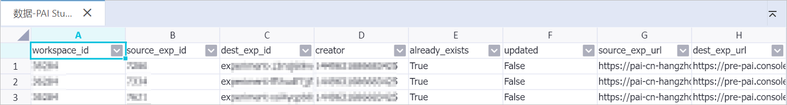

  | 列名 | 描述 |
  | --- | --- |
  | workspace_id | 工作空间ID。 |
  | source_exp_id | 迁移前Studio中的实验ID。 |
  | dest_exp_id | 迁移后Designer中的工作流ID。 |
  | creator | Studio中实验的创建人。 |
  | already_exists | 本次迁移时Designer中实验对应的工作流是否已经存在（不是第一次同步）。 |
  | updated | 是否更新了实验。假如实验之前已经迁移过，且没有选择覆盖，则为False。 |
  | source_exp_url | 迁移前Studio中的实验URL。 |
  | dest_exp_url | 迁移后Designer中的工作流URL。 |

- 迁移错误表该表中保存了迁移失败的实验记录，其结构如下所示。

  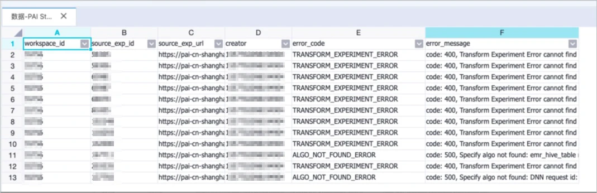

  | 列名 | 描述 |
  | --- | --- |
  | workspace_id | 工作空间ID。 |
  | source_exp_id | 迁移前Studio中的实验ID。 |
  | source_exp_url | 迁移前Studio中的实验URL。 |
  | creator | Studio中实验的创建人。 |
  | error_code | 迁移错误码。 |
  | error_message | 迁移错误信息。 |

<a id="section-6-2-5"></a>

### 6.2.5. 模型训练

创建完成工作流后，您可以进入工作流，根据创建工作流方式的不同，灵活的进行构建模型，然后调试模型，最终完成模型训练。本文为您介绍模型训练的具体操作步骤。

**前提条件**

已创建工作流。您可以根据业务需要创建空白工作流或模板工作流，详情请参见工作流概述。

**背景信息**

模型训练的操作步骤如下：

- 步骤一：构建模型

PAI-Designer为您提供可视化建模操作界面，如下图所示。

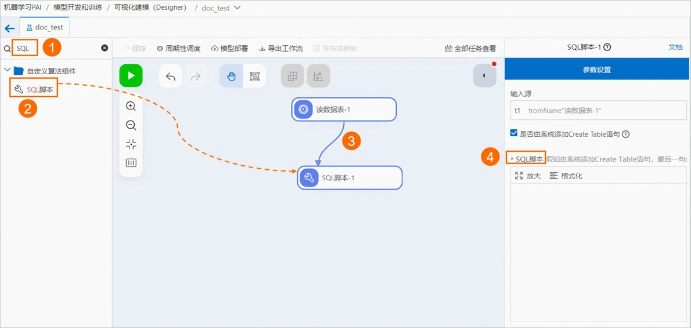

- Designer为您提供了百余种建模所需组件，您只需根据建模需求查找选择合适的组件，将其拖入建模画布中作为一个节点。

- Designer支持通过连线的方式，将各个节点组织构建成为一个有上下游关系的模型工作流。

- Designer支持界面化的节点参数配置，为您降低建模技术门槛。

- 步骤二：调试模型

  Designer画布上方有运行、全部任务查看等按钮，便于您在建模过程中或构建模型后进行模型调试。各界面按钮的详细介绍请参见基础功能。

- 后续步骤

  模型调试并运行成功后，您可以使用模型对新数据进行预测，详情请参见模型预测概述。

**步骤一：构建模型**

**空白工作流构建模型**

使用空白工作流进行建模时，建议您参考以下流程规划构建模型，您也可以前往快速入门，快速体验建模的流程、熟悉操作界面。

1. 规划模型节点。

   通常一个模型可以拆分为多个细分的节点任务，通过节点任务的前后编排来最终实现模型预期效果。因此建模前，建议您先拆分模型规划好细分的节点任务，通常建议一个节点完成一个最简的任务。

2. 根据规划，拖入并配置对应的组件。

   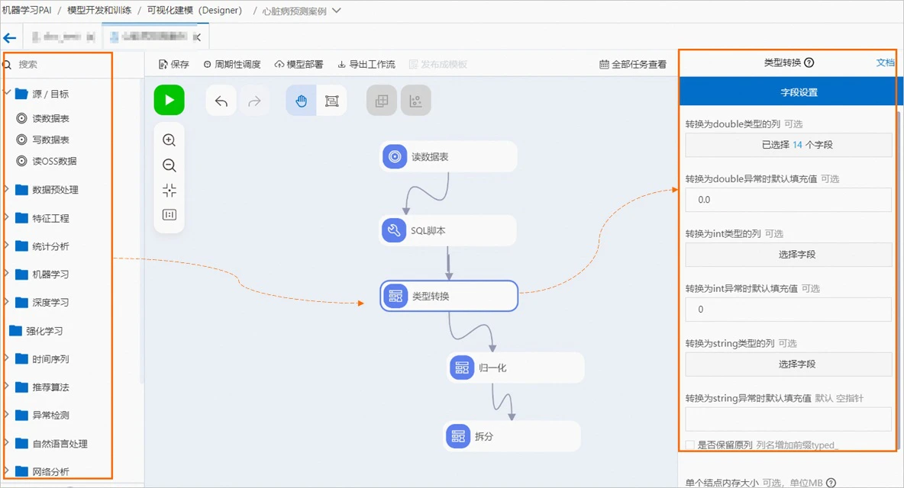

   在左侧的组件库中，您可以根据规划找到合适的组件，将其拖入画布中作为一个节点，通过单击节点，在右侧的配置框中配置节点所需的参数，即可完成一个节点的配置。

   - Designer为您提供百余种组件，满足读取数据、统计分析、文本分析等多种场景的使用，组件详情请参见组件参考：所有组件汇总。

   - 在节点配置过程中，如果有多个节点均需使用的一些全局参数，您可以使用全局变量来提供节点配置效率，详情请参见高级功能：全局变量。

3. 通过连线将节点组织构建为模型工作流。

   拖入多个组件后，画布中即有多个节点。您可以根据规划通过连线将各个节点组织成有上下游关系的工作流。后续模型实际运行时，上游节点会先运行，所有上游节点均运行完成后，下游节点会被触发运行。

**模板工作流构建模型**

使用模板工作流进行建模时，支持使用以下几类模板：

- Designer预置模板

  Designer里已经内置了数十个基于不同框架、满足不同行业场景需求的模板，具体分类如下，您可以根据业务需求，自行选择工作流模板。

  

  - 按照行业类型分为：互联网、工业、金融、教育和医疗类型。

  - 按照算法类别和框架分为：分类、回归、聚类、TF框架和PyTorch框架。

  - 按照业务领域分为：推荐、风控、用户增长、CV、NLP、模型优化、ASR和视频领域。

- Designer自定义模板

- 导出的JSON格式的模板文件

根据业务场景，新增或修改工作流节点、修改组件参数。

- 从左侧组件库中拖入新的组件到右侧画布中，您可以替换工作流中的节点，也可以将组件连接到已有组件的下游。

- 使用组件默认参数或单击组件，在右侧的配置框中配置组件所需的参数。

  

**步骤二：调试模型**

建模完成后，您可以对工作流节点进行调试。

- 调试模型整体

  所有节点均配置完成、连线完成后，您可以在画布中单击**运行**按钮，对整个模型进行试运行。

  

- 调试单个节点

  调试过程中，您也可以直接右键单击某个节点，选择是直接**从此处开始执行**、**执行该节点**等运行调试范围，提高调试效率。

  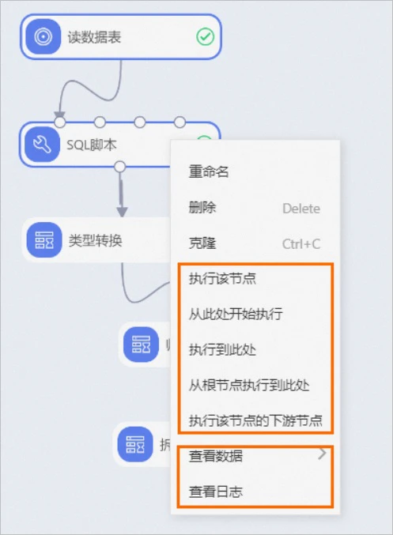

- 运行失败定位

  如果有节点运行失败，您可以右键单击节点查看日志等信息进行排查处理。

- 查看运行结果

  运行成功后您可以右键单击节点查看产出数据。

- 查看历史任务建模过程中，您的每次运行都会被记录为一次历史任务。每次运行涉及的节点范围、节点的配置情况、产出结果均会保留在历史任务中。您可以单击工具栏右侧的**全部任务查看**，来查看所有历史任务的调试详情。

  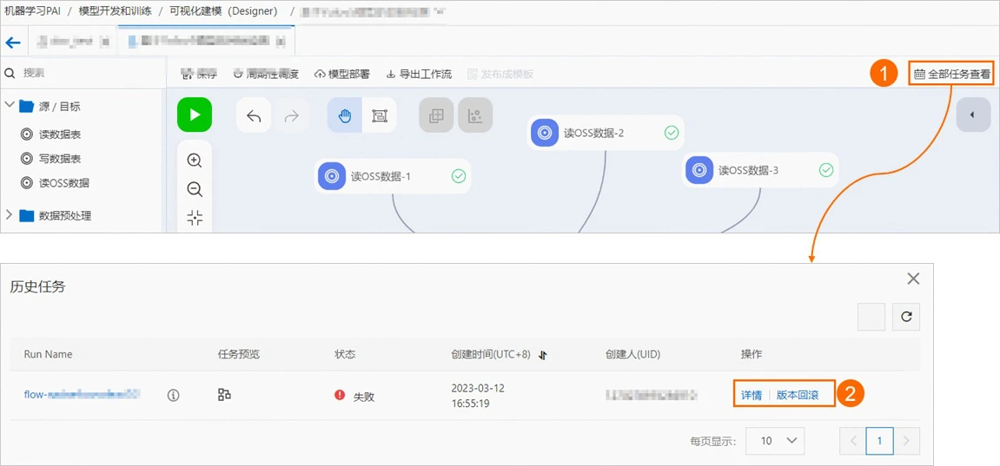

  在**历史任务**对话框，单击某个历史任务**操作**列下的**详情**，页面跳转至任务管理中对应历史任务的详情页面。

  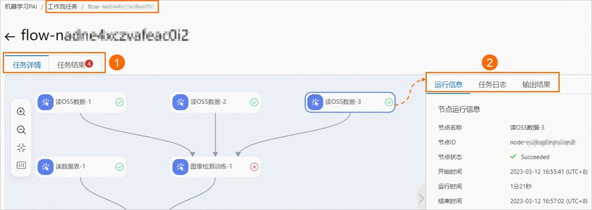

  - 您可以在顶部单击**任务详情**和**任务结果**切换查看对应的详细信息。

  - 在**任务详情**页面中，画布中展示当前历史任务参与运行的节点和运行详细信息。单击某个节点后，您可以在右侧详情中查看本次运行中，此节点的**运行信息**、**任务日志**、**输出结果**。

  单击某个历史任务操作列的**版本回滚**后，您可以根据界面提示，将模型工作流回滚恢复至历史运行时的状态。

  > **说明**
  >
  > 建议回滚前，查看历史任务的详情，确认回滚的版本正确。同时，回滚前建议将最新的任务保存并运行一次，如果回滚后出错，您可以再次回滚至最新的任务状态。

**后续步骤**

模型调试完成后，您可以使用模型进行新数据的预测。在Designer工作流页面，您可以使用预测组件对模型进行离线批量预测，也可以将模型部署为EAS在线模型服务，进行在线推理，具体操作，请参见模型预测概述。

<a id="section-6-2-6"></a>

### 6.2.6. 模型预测

<a id="section-6-2-6-1"></a>

#### 6.2.6.1. 模型预测概述

本文为您介绍在Designer训练得到模型后，如何做生产化部署对新数据进行预测。

部署模型主要是为了使用模型来进行新数据的预测。按照新数据预测时效要求，预测任务分为两类：在线预测和离线预测。对于两类需求，在Designer中都提供了对应的操作流程支持。

- 在线预测

  Designer工作流运行成功后，您可以将训练获得的PMML、AlinkModel格式的模型文件，一键快速部署为EAS在线服务，每次只支持部署单个模型文件。您也可以手动导出训练获得的PMML模型文件，跨平台部署为EAS在线服务。部分PS格式的模型，需要经过模型导出处理后再跨平台手动部署为EAS在线服务。具体操作，详情请参见单模型部署在线服务。

- 离线预测

  在Designer中，将训练获得的模型和测试数据集接入预测组件进行批量预测，详情请参见离线批量预测。

<a id="section-6-2-6-2"></a>

#### 6.2.6.2. 单模型部署在线服务

Designer和EAS在使用链路上进行了无缝对接，您可以在离线训练预测评估流程完成之后，将单个模型部署至EAS，来创建一个在线模型服务。

**前提条件**

已完成模型训练，并验证了模型的准确性，详情请参见模型训练。

**单模型一键部署**

**支持一键部署的算法**

| 组件名称 | 产出可部署模型格式 | 匹配的EAS Processor | 备注 |
| --- | --- | --- | --- |
| 逻辑回归二分类 | PMML | PMML | 训练前需要在组件的<strong>字段设置</strong>页签，选中<strong>是否生成</strong><strong>PMML</strong>。 |
| GBDT二分类 | PMML | PMML | 训练前需要在组件的<strong>字段设置</strong>页签，选中<strong>是否生成</strong><strong>PMML</strong>。 |
| 线性支持向量机 | PMML | PMML | 训练前需要在组件的<strong>字段设置</strong>页签，选中<strong>是否生成</strong><strong>PMML</strong>。 |
| 逻辑回归多分类 | PMML | PMML | 训练前需要在组件的<strong>字段设置</strong>页签，选中<strong>是否生成</strong><strong>PMML</strong>。 |
| 随机森林 | PMML | PMML | 训练前需要在组件的<strong>字段设置</strong>页签，选中<strong>是否生成</strong><strong>PMML</strong>。 |
| 朴素贝叶斯 | PMML | PMML | 训练前需要在组件的<strong>字段设置</strong>页签，选中<strong>是否生成</strong><strong>PMML</strong>。 |
| K均值聚类 | PMML | PMML | 训练前需要在组件的<strong>字段设置</strong>页签，选中<strong>是否生成</strong><strong>PMML</strong>。 |
| GBDT回归 | PMML | PMML | 训练前需要在组件的<strong>字段设置</strong>页签，选中<strong>是否生成</strong><strong>PMML</strong>。 |
| 线性回归 | PMML | PMML | 训练前需要在组件的<strong>字段设置</strong>页签，选中<strong>是否生成</strong><strong>PMML</strong>。 |
| 评分卡训练 | PMML | PMML | 训练前需要在组件的<strong>字段设置</strong>页签，选中<strong>是否生成</strong><strong>PMML</strong>。 |

对于要部署PMML模型的算法组件，您需要参照下图操作指引，在**字段设置**页签，选中**是否生成PMML**，并重新执行该节点。

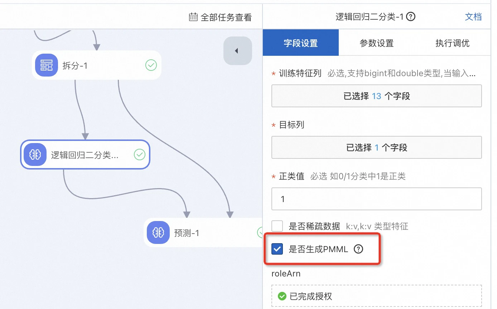

**操作步骤**

1. 进入PAI-Designer页面。

   <ol type="i">

   <li>

   登录机器学习控制台。

   </li>

   <li>

   在左侧导航栏单击**工作空间列表**，在工作空间列表页面中单击待操作的工作空间名称，进入对应工作空间内。

   </li>

   <li>

   在工作空间页面的左侧导航栏选择**模型开发和训练 > 可视化建模（Designer）**，进入Designer页面。

   </li>

   </ol>

2. 在工作流列表页面，双击目标工作流，进入工作流页面。

3. 在Designer画布上方，单击**模型部署**>**单模型部署**。

   系统会自动检测当前画布中训练得到的可部署模型，并自动匹配对应的部署Processor，引导您跳转到EAS完成模型服务的部署。

**单模型手动部署**

下表算法组件在模型训练完成后，需要使用**通用模型导出**组件将模型拼装并导出至OSS目录后，再手动部署。不支持前述章节所说的一键部署。

| 组件名称 | 产出可部署模型格式 | 匹配的EAS Processor | 手动部署流程 |
| --- | --- | --- | --- |
| PS-SMART二分类或多分类或回归 | PS格式 | PS算法 | 需要在组件下游连接通用模型导出组件。 |

导出模型到OSS Bucket后，关于如何手动部署模型，详情请参见通过控制台上传模型的方式创建服务。

**常见问题**

执行一键部署后，看到有些节点可以部署，但是置灰的不支持选择，如何解决？


您需要在指定的组件右侧**字段设置**页签，选中**是否生成PMML**，并重新执行对应节点即可，详情请参见支持一键部署的算法。

<a id="section-6-2-6-3"></a>

#### 6.2.6.3. 离线批量预测

对实时性要求不高的业务场景，通常会使用模型对数据集进行周期性的批量离线预测。在Designer中提供了支持离线预测的完整功能。

**在开发环境进行批量预测**

Designer中提供了多种预测组件，分别对应不同的算法和场景，在画布中可直接使用。

- 对于在左侧组件树中成对出现的训练和预测组件，训练完成后直接使用对应的预测组件进行数据的批量预测。

  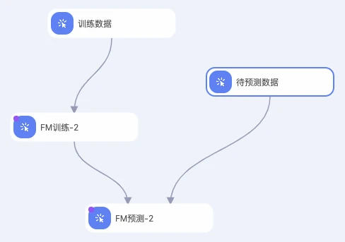

- 对于没有独立预测组件的算法，训练完后可以使用通用的预测组件进行数据的批量预测。

  

  > **重要**
  >
  > 通用的预测组件可接收的模型格式是**OfflineModel**，而不是PMML。

- 在已有模型的情况下，也可以使用组件导入模型和预测数据，并在组件下游连接预测组件进行预测和部署。

<a id="section-6-2-7"></a>

### 6.2.7. 可视化分析

<a id="section-6-2-7-1"></a>

#### 6.2.7.1. 使用可视化大屏查看分析报告

在PAI-Designer页面，模型工作流运行成功后，您可以通过可视化大屏快速查看分析报告。本文为您介绍支持使用可视化大屏的组件列表及查看可视化结果的操作步骤。

**使用限制**

目前支持使用可视化大屏的组件列表如下。

数据可视化分析：

- 相关系数矩阵

- 直方图

- 散点图

特征工程：

- 线性模型特征重要性

- 随机森林特征重要性

模型评估：

- 混淆矩阵

- 多分类评估

- 二分类评估

模型可视化：

- GBDT二分类

- GBDT回归

**操作步骤**

1. 进入PAI-Designer页面。

   <ol type="i">

   <li>

   登录机器学习控制台。

   </li>

   <li>

   在左侧导航栏单击**工作空间列表**，在工作空间列表页面中单击待操作的工作空间名称，进入对应工作空间内。

   </li>

   <li>

   在工作空间页面的左侧导航栏选择**模型开发和训练 > 可视化建模（Designer）**，进入Designer页面。

   </li>

   </ol>

2. 在**预置模板**页签，单击**心脏病预测案例**区域的**创建**。

3. 在**工作流列表**页签，双击已创建的工作流，进入工作流页面。

4. 进入可视化大屏页面。

   您可以使用以下任意一种方式，进入可视化大屏页面。

   - 方式一：工作流运行成功后，单击  ，查看当前工作流中支持可视化大屏的所有组件的可视化结果。

     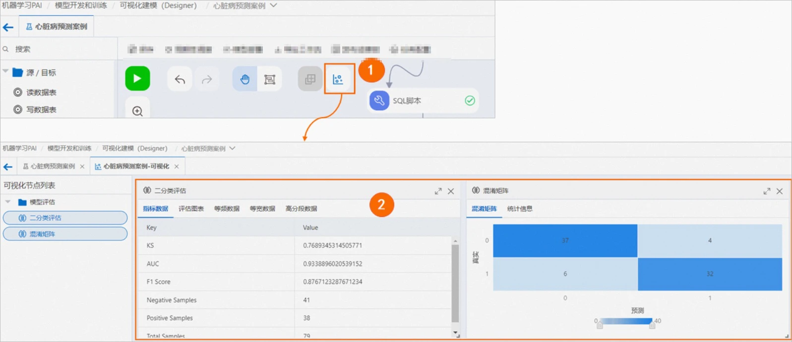

   - 方式二：右键单击支持可视化大屏且运行成功的组件，在快捷菜单，单击**可视化分析**，查看单个节点的可视化结果。

     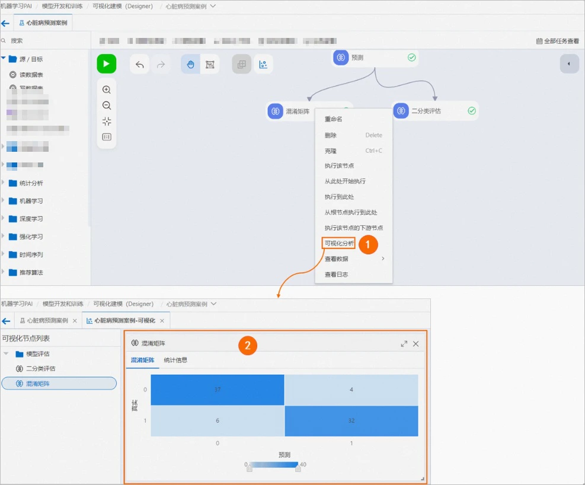

5. 查看可视化结果。

   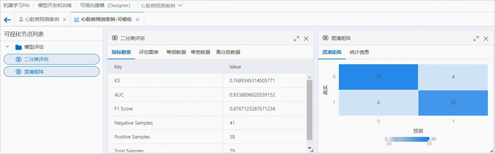

   - 左侧的**可视化节点列表**，按照类型分组，可视化节点名称即为Designer画布中的节点名称。

   - 右侧大屏中展示每个节点的可视化结果，支持拖动调整每个节点模块的大小或位置，方便进行对比和参照。您也可以关闭节点模块，再从左侧节点列表中重新拖入。

<a id="section-6-2-8"></a>

### 6.2.8. 组件参考：所有组件汇总

本文为您介绍PAI-Designer支持的组件列表。

**组件类型**

**组件**

**描述**

读OSS数据

该组件用来读取对象存储OSS Bucket路径下的文件或文件夹。

源/目标

读数据表

该组件用于读取MaxCompute表数据，默认读取本项目的表数据。

写数据表

该组件支持将上游数据写入MaxCompute中。

随机采样

该组件按照给定的比例或者数目，对输入进行随机独立采样。

加权采样

以加权方式生成采样数据。

过滤与映射

该组件可以对数据按照过滤表达式进行筛选，并且您可以修改输出字段名称。

给定一个分组列，该组件按照这些列的不同值，将输入数据分成不同的组，并在

分层采样

每组中分别进行随机采样。

该组件将两张表通过关联信息，合成一张表，并确定输出的字段，与SQL的JOIN

JOIN

语句功能类似。

该组件将两张表的数据按列合并，需要表的行数保持一致，否则报错。如果两张

合并列

表只有一张存在分区，则分区表需要连接第二个输入端口。

合并行

该组件是将两张表的数据按行合并，左表及右表选择输出的字段个数以及类型应

（UNION）

保持一致。整合了UNION和UNION ALL的功能。

数据预处理

该组件是可以将任意类型特征转成STRING、DOUBLE和INT特征，并支持转换

类型转换

异常时的缺失值填充。

增加序号列

该组件是提供的增加序号列组件，您可以在数据表的第一列追加ID列。

拆分

该组件是对数据进行随机拆分，用于生成训练和测试集。

缺失值填充

您可以通过可视化或PAI命令的方式，配置该组件参数。

归一化

该组件支持将稠密数据或稀疏数据进行归一化处理。

标准化

该组件分为可分化方式和PAI命令方式生成标准化实例。

该组件可以将KV（Key:Value）格式的表为普通表格式。

KV2Table

该组件分为可分化方式和PAI命令方式，可以转化普通表为KV（Key:Value）格

Table2KV

式的表。

该组件是研究如何通过少数主成分揭示多个变量间的内部结构，考察多个变量间

主成分分析

相关性的一种多元统计方法。

特征尺度变换

您可以通过该组件对稠密或稀疏的数值类特征进行常见的尺度变换。

特征离散

该组件是将连续特征按照一定的规则进行离散化。

该组件可以将输入特征中包含异常的数据平滑到一定区间，支持稀疏和稠密数据

特征异常平滑

格式。

该组件是线性代数中一种重要的矩阵分解，是矩阵分析中正规矩阵求对角化的推

奇异值分解

广。

异常检测

该组件用于检测连续值和枚举值类特征的数据，帮助您挖掘数据中的异常点。

特征工程

线性模型特征重

该组件包括线性回归和二分类逻辑回归，支持稀疏和稠密数据格式。

要性

随机森林特征重

您可以通过该组件进行计算特征重要性。

要性

该组件将根据您使用的不同特征选择方法，从所有稀疏或稠密格式的特征数据中

过滤式特征选择

选择并过滤出TopN的特征数据。

特征编码

该组件是将非线性特征通过GBDT编码成线性特征。

one-hot编码

您可以通过该组件后数据会变成稀疏，输出结果也是KV的稀疏结构。

通过数据视图组件，您可以可视化地了解特征与标签列的分布情况及特征的特

数据视图

点，以便后续进行数据分析。

协方差

该组件用于衡量两个变量的总体误差。

经验概率密度图

该组件是采用经验分布和内核分布两种算法。

全表统计

该组件用于统计全表，或某些选中的列。

该组件用于变量为类别型变量的场景，旨在检验单个多项分类型变量在各分类间

卡方拟合性检验

的实际观测次数与理论次数是否一致，其零假设为观测次数与理论次数无差异。

箱形图是一种用作显示一组数据分散情况的统计图。它主要用于反映原始数据分

箱线图

布的特征，还可以进行多组数据分布特征的比较。

散点图

散点图是指在回归分析中，数据点在直角坐标系平面上的分布图。

相关系数算法用于计算一个矩阵中每列之间的相关系数，取值范围为<strong>[-1,1]</strong>。系

相关系数矩阵

统计算时，count数按两列间同时非空的元素个数计算，两两列之间可能不同。

统计分析

双样本T检验

该组件基于统计学原理用来检验两个样本的均值是否有显著差异。

该组件旨在检验某个变量的总体均值与某个指定值之间是否存在显著差异，其检

单样本T检验

验的样本必须总体服从正态分布。

该组件通过观测值判断总体是否服从正态分布，是统计判决中重要的一种特殊的

正态检验

拟合优度假设检验。

洛伦兹曲线

通过该组件，您可以直观地看到一个国家或地区收入分配状况。

百分位

该组件是统计学术语，用于计算数据表列数据的百分位。

皮尔森系数

该组件是一种线性相关系数，用于反映两个变量线性相关程度的统计量。

该组件（Histogram）又称质量分布图，是一种统计报告图，由一系列高度不等

直方图

的纵向条纹或线段表示数据分布的情况。

该组件的输入为训练模型和预测数据，输出为预测结果。

预测

该组件是基于统计学习理论的一种机器学习方法，通过寻求结构风险最小化，提

线性支持向量机

高学习机泛化能力，从而实现经验风险和置信范围最小化。

逻辑回归二分类

该组件是一个二分类算法，支持稀疏及稠密数据格式。

GBDT二分类

该组件的原理是设置阈值，如果特征值大于阈值，则为正例，反之为负例。

参数服务器PS（Parameter Server）致力于解决大规模的离线及在线训练任

PS-SMART二分

务，SMART（Scalable Multiple Additive Regression Tree）是

类

GBDT（Gradient Boosting Decesion Tree）基于PS实现的迭代算法。

参数服务器PS（Parameter Server）致力于解决大规模的离线及在线训练任

PS-SMART多分

务，SMART（Scalable Multiple Additive Regression Tree）是

类

GBDT（Gradient Boosting Decesion Tree）基于PS实现的迭代算法。

该组件进行分类的原理是针对预测表的每行数据，从训练表中选择与其距离最近

K近邻

的K条记录，将这K条记录中类别数量最多的类，作为该行的类别。

该组件是一个二分类算法，PAI提供的逻辑回归可以支持多分类，且支持稀疏及

逻辑回归多分类

稠密数据格式。

该组件是一个包括多决策树的分类器，其分类结果由单棵树输出类别的众数决

随机森林

定。

朴素贝叶斯

该组件是一种基于独立假设的贝叶斯定理的概率分类算法。

该组件会首先随机选择K个对象作为每个簇的初始聚类中心，然后计算剩余对象

K均值聚类

与各簇中心的距离，将其分配至距离最近的簇，再重新计算每个簇的聚类中心。

机器学习

您可以使用DBSCAN组件构建聚类模型。

DBSCAN

GBDT回归

该组件是一种迭代决策树算法，适用于线性及非线性回归场景。

线性回归

该组件是分析因变量和多个自变量之间的线性关系模型。

该组件致力于解决大规模的离线及在线训练任务，SMART（Scalable Multiple

PS-SMART回归

Additive Regression Tree）是GBDT（Gradient Boosting Decesion Tree）基于PS实现的迭代算法。

该组件是分析因变量和多个自变量之间的线性关系模型，参数服务器

PS线性回归

PS（Parameter Server）致力于解决大规模的离线及在线训练任务。

该组件是通过计算AUC、KS及F1 Score指标，输出KS曲线、PR曲线、ROC曲线、LIFT Chart及Gain Chart。

二分类评估

该组件是指基于预测结果和原始结果，评估回归算法模型的优劣性，从而输出评

回归模型评估

估指标及残差直方图。

该组件是基于原始数据和聚类结果，评估聚类模型的优劣性，从而输出评估指

聚类模型评估

标。

混淆矩阵

该组件适用于监督学习，与无监督学习中的匹配矩阵对应。

该组件是指基于分类模型的预测结果和原始结果，评估多分类算法模型的优劣

多分类评估

性，从而输出评估指标（例如Accuracy、Kappa及F1-Score）。

深度学习框

PyTorch使用指

在深度学习组件列表中找到PyTorch组件，同时找到**读OSS数据**组件，PyTorch

架组件

南

只支持读取OSS数据。

该组件是基于开源X-13ARIMA-SEATS封装的针对季节性调整的Arima算法。

x13_arima

时间序列

该组件包括自动ARIMA模型选择程序，主要基于TRMO（1996）及后续修订中

x13_auto_arim

实施的Gomez和Maravall（1998）的程序。

a

FM（Factorization Machine）算法兼顾特征之间的相互作用，是一种非线性

FM算法

模型，适用于电商、广告及直播的推荐场景。

该组件是一种Item召回算法，您可以使用swing训练组件基于User-Item-User

swing训练

原理衡量Item的相似性。

推荐方法

该组件是swing的批处理预测组件，您可以使用该组件基于swing训练模型和预

swing推荐

测数据进行离线预测。

etrec是基于**item**的协同过滤算法，输入为两列，输出为**item**之间的相似度

协同过滤etrec

TopN。

局部异常因子异

该组件是根据数据样本的局部异常因子值（Local Outlier Factor, LOF）判断样

常检测

本是否异常。本文为您介绍局部异常因子异常检测的参数配置。

该组件使用sub-sampling算法，降低了算法的计算复杂度，可以识别数据中的

IForest异常检测

异常点，在异常检测领域有显著的应用效果。

异常检测

该组件与传统SVM不同，是一种非监督的学习算法。您可以使用One-Class

One-Class SVM异常检测

SVM异常检测通过学习边界对异常点进行预测。

BERT文本向量化

该组件是以原始文本作为输入，系统提取特征后输出一个向量序列。

（MaxComput e）

文本打标预测

该组件可以快速抽取文本中蕴含的标签，对理解文本语义、精确建模有重要作

（MaxComput

用。

e）

文本分类训练

该算法组件集成了基于BERT的文本分类模型、传统深度文本分类（例如

（MaxComput

TextCNN）模型及PAI自研的DGCNN模型。

e）

文本匹配训练（MaxComput

该组件的输入为两个句子，输出它们是否匹配。

e）

序列标注训练

该组件是将输入序列的每个TOKEN做为一个多分类问题，采用Google原论文中

（MaxComput

的序列标注方法，实现对输入序列TOKEN进行分类，通常用于分词、词性标注

e）

和命名实体识别等。

该组件旨在从冗长、重复的文本序列中抽取、精炼或总结出其中的要点信息。新

文本摘要训练

闻标题摘要是文本摘要的一个特例。您可以使用文本摘要训练组件进行模型训练，生成新闻标题，用来概括新闻的中心思想和重点信息。

该组件基于AliWS（Alibaba Word Segmenter）词法分析系统，对指定列的

Split Word

内容进行分词，分词后的各个词语之间以空格分隔。

该组件用于将三元组表<strong>（row,col,value）</strong>转换为kv表<strong>（row,</strong>

三元组转kv

**[col_id:value]）**。

该组件是机器学习领域的一个基本操作，主要用于信息检索、自然语言处理和生

字符串相似度

物信息学等领域。

字符串相似度-

该组件用于计算字符串相似度并筛选出最相似的Top N个数据。

topN

该组件是文本分析中的一个预处理方法，用于过滤分词结果中的噪声（例如的、

停用词过滤

是或啊）。

该组件是语言模型训练其中一个步骤。在词的基础上生成n-gram，并统计在全

ngram-count

部语料集上，对应n-gram的个数。

自然语言处

该组件是文献中简单连贯的短文，能够全面准确地反映该文献的中心思想。自动

文本摘要

理

文摘利用计算机自动从原始文献中提取摘要内容。

该组件是自然语言处理中的重要技术之一，具体是指从文本中将与这篇文章意义

关键词抽取

相关性较强的一些词抽取出来。

将一段文本按标点进行句子拆分。该组件主要用于文本摘要前的预处理，将一段

句子拆分

文本拆分成一句一行的形式。

基于算法语义向量结果（如Word2Vec生成的词向量），计算给定的词（或者句子）的扩展词（或者扩展句），即计算其中某一向量距离最近的向量集合。其中

语义向量距离

一个用法是，基于Word2Vec生成的词向量结果，根据输入的词返回最为相似的词列表。

您可以通过Doc2Vec算法组件将文章映射为向量。输入为词汇表，输出为文档

Doc2Vec

向量表、词向量表或词汇表。

条件随机场CRF（conditional random field）是给定一组输入随机变量条件

条件随机场

下，另一组输出随机变量条件的概率分布模型，其特点是假设输出随机变量构成马尔可夫随机场。

文章相似度是在字符串相似度的基础上，基于词，计算两两文章或者句子之间的

文章相似度

相似度。

该组件算法统计若干文章中所有词的共现情况，计算两两之间的PMI（point

PMI

mutual information）。

该组件是基于linearCRF在线预测模型的算法组件，主要应用于处理序列标注问

条件随机场预测

题。

该组件基于AliWS（Alibaba Word Segmenter）词法分析系统，根据参数和

Split Word

自定义词典生成分词模型。

该组件是指输入一些字符串（手动输入或者从指定的文件读取），用程序来统计

词频统计

这些字符串中总共有多少个单词，每个单词出现的次数。

该组件是一种用于资讯检索与文本挖掘的常用加权技术。通常在搜索引擎中应

TF-IDF

用，可以作为文件与用户查询之间相关程度的度量或评级。

在人工智能平台 PAI（原机器学习平台PAI）平台，您可以通过给PLDA组件设置

PLDA

topic参数值，从而让每篇文档抽象出不同主题。

Word2Vec算法组件利用神经网络，通过训练，将词映射为K维度空间向量，且支持对表示词的向量进行操作并和语义相对应。输入为单词列或词汇表，输出为

Word2Vec

词向量表和词汇表。

树深度

该组件能够输出每个节点的所处深度和树ID。

该组件用于在图中找出符合指定核心度的紧密关联的子图结构，节点核数的最大

k-Core

值被称为图的核数。

单源最短路径

该组件使用Dijkstra算法，给定起点，输出该点和其他所有节点的最短路径。

该组件起源于网页的搜索排序，即使用网页的链接结构计算每个网页的等级排

PageRank

名。

该组件LPA（Label Propagation Algorithm）是基于图的半监督学习方法，其

标签传播聚类

基本思路是节点的标签（community）依赖其相邻节点的标签信息，影响程度由节点相似度决定，并通过传播迭代更新达到稳定。

该组件为半监督的分类算法，原理为用已标记节点的标签信息去预测未标记节点

标签传播分类

网络分析

的标签信息。

该组件是一种评估社区网络结构的指标，用来评估网络结构中划分出来社区的紧

Modularity

密程度，通常0.3以上是比较明显的社区结构。

在无向图G中，若从顶点A到顶点B有路径相连，则称A和B是连通的。在图G中存在若干子图，如果其中每个子图中所有顶点之间都是连通的，但在不同子图间

最大连通子图

不存在顶点连通，那么称图G的这些子图为最大连通子图。

该组件是在无向图G中，计算每一个节点周围的稠密度，星状网络稠密度为0，

点聚类系数

全联通网络稠密度为1。

边聚类系数

该组件算法是指在无向图G中，计算每一条边周围的稠密度。

计数三角形

该组件是指在无向图G中，输出所有三角形。

数据转换模块

通过该组件您可以对数据进行归一化、离散化、Index化或WOE转换。

该组件信用风险评估领域常用的建模工具，其原理是通过分箱输入将原始变量离

评分卡训练

散化后再使用线性模型（逻辑回归或线性回归等）进行模型训练，其中包含特征选择及分数转换等功能。

评分卡预测

该组件是对原始数据根据评分卡训练组件产出的模型结果进行预测打分。

金融板块

该组件可以进行特征离散化，即将连续的数据进行分段，使其变为多个离散化区

分箱

间。分箱组件支持等频分箱、等宽分箱及自动分箱。

样本稳定指数

该组件是衡量样本变化所产生的偏移量的一种重要指标，通常用于衡量样本的稳

（PSI）

定程度。

您可以使用通用模型导出组件，将在MaxCompute中训练得到的模型导出到指

工具

通用模型导出

定的OSS路径。

该组件是自定义SQL组件，您可以通过SQL脚本编辑器编写SQL语句，并提交至

SQL脚本

MaxCompute执行。

自定义算法组件

Python脚本V2

该组件定义安装依赖包及运行自定义的Python函数。

<a id="section-6-2-9"></a>

### 6.2.9. 组件参考：源/目标

<a id="section-6-2-9-1"></a>

#### 6.2.9.1. 读数据表

读数据表组件用于读取MaxCompute表数据，默认读取本项目的表数据。如果跨项目读取表数据，则需要在表名前添加项目名。

> **说明**
>
> 目前PAI-Designer（原PAI-Studio）算法组件支持读取的数据类型为DOUBLE、BIGINT、STRING、BOOLEAN、DATETIME。读数据表组件支持读取所有类型数据，为了避免在后续算法组件中报错，您可以在读数据表下游连接类型转换组件进行数据转换。

PAI-Designer（原PAI-Studio）仅支持通过可视化方式，配置读数据表组件参数，参数详情如下表所示。

页签

参数

描述

读取的MaxCompute表名称。如果跨项目读取表数据，则表名需要使用**项目名.表名**格式，例如**tianchi_project.weibo_data**。

**表名**

> **重要**
>
> 如果MaxCompute表字段被修改，PAI-Designer（原PAI-Studio）算法平台不能自动同步，您需要手动重新配置MaxCompute源。

如果输入表为分区表，您可以选中**分区**复选框，并配置**参数**，按分区来查询数据。

> **说明**

**分区**

> 如果该组件下游接入SQL脚本组件，则该分区过滤条件不生效，你需要在SQL脚本组件中配置过滤条件。

**表选择**

分区参数，通过该参数来过滤分区表数据。同时筛选多个分区使用半角逗号（,）分隔。如果未配置该参数，则表示输入全表。例如：

- 动态分区表，输入格式为<strong>dt=${yyyyMMdd}，</strong>其中<strong>${yyyyMMdd}</strong>是系统参数，表示当前日期，<strong>${yyyyMMdd-1d}</strong>表示当前日期的前一天。

**参数**

- 普通分区表，输入分区条件即可。例如：**ds=1,ds=2**。

- 多级分区表，通过/分隔多级分区，例如**ds=1/name=cat,ds=2/name=dog。**

- 和全局变量配合使用，例如：**ds=${a}/name=${b}/tag=${c}**，其中a,b,c在工作流全局变量中配置。

输入**表名**后，系统自动读取表的结构数据。

**字段信息**

**源表字段信息**

<a id="section-6-2-9-2"></a>

#### 6.2.9.2. 写数据表

写数据表组件将数据写入MaxCompute表。本文为您介绍写数据表的参数配置。

**前提条件**

如果您需要写入分区表，则需要先创建待写入的分区表，再使用该组件写入数据，关于如何创建分区表，详情请参见<em><strong>《大数据计算服务用户指南》</strong></em>手册中**快速入门**下的**创建表**章节。

**可视化配置组件参数**

PAI-Designer（原PAI-Studio）仅支持通过可视化方式，配置该组件参数，参数详情如下表所示。

| 参数 | 描述 |
| --- | --- |
| 新表名 | 写入数据的MaxCompute表名称。 |
| 分区 | 写入表是否为分区表的开关。 |
| 设置生命周期 | 取值范围为整数。如果该参数值为空，则表示无生命周期。 |

<a id="section-6-2-9-3"></a>

#### 6.2.9.3. 读OSS数据

读OSS数据组件用来读取对象存储OSS Bucket路径下的文件或文件夹。本文为您介绍读OSS数据组件的参数配置。

**参数配置**

您只需在画布右侧的**字段设置**页签，配置**OSS数据路径**参数，支持以下两种配置方式：

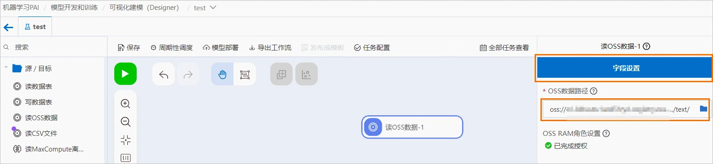

- 在输入框中填写模型训练需要的OSS路径。

- 单击  ，选择具有使用权限的OSS路径。

<a id="section-6-2-10"></a>

### 6.2.10. 组件参考：数据预处理

<a id="section-6-2-10-1"></a>

#### 6.2.10.1. 采样与过滤

<a id="section-6-2-10-1-1"></a>

##### 6.2.10.1.1. 随机采样

随机采样算法组件按照给定的比例或者数目，对输入进行随机采样，每次采样是各自独立的。

**组件配置**

您可以使用以下任意一种方式，配置随机采样组件参数。

**方式一：可视化方式**

在随机采样工作流页面配置组件参数。

<table>
  <tr>
    <th>页签</th>
    <th>参数</th>
    <th>描述</th>
  </tr>
  <tr>
    <td rowspan="4">参数设置</td>
    <td>采样个数</td>
    <td>取值为正整数。</td>
  </tr>
  <tr>
    <td>采样比例</td>
    <td>取值为浮点数，范围<strong>(0,1)</strong>。</td>
  </tr>
  <tr>
    <td>放回采样</td>
    <td>默认为不放回，勾选后变为放回。</td>
  </tr>
  <tr>
    <td>随机数种子</td>
    <td>默认系统自动生成。</td>
  </tr>
  <tr>
    <td rowspan="2">执行调优</td>
    <td>核心数</td>
    <td>取值为正整数，默认系统自动分配。</td>
  </tr>
  <tr>
    <td>核内存分配</td>
    <td>取值为正整数，单位为MB，范围<strong>(1, 65536)</strong>，默认系统自动分配。</td>
  </tr>
</table>

**方式二：PAI命令方式**

使用PAI命令方式，配置该组件参数。您可以使用SQL脚本组件进行PAI命令调用，详情请参见SQL脚本。

```text
PAI -name RandomSample \
    -project algo_public \
    -Dlifecycle="28" \
    -DoutputTableName="test2" \
    -Dreplace="false" \
    -DsampleSize="500" \
    -DinputPartitions="pt=20150501" \
    -DinputTableName="bank_data_partition";
```

| 参数名称 | 是否必选 | 参数描述 | 默认值 |
| --- | --- | --- | --- |
| inputTableName | 是 | 输入表的名称 | 无 |
| inputTablePartitio ns | 否 | 输入表中，参与训练的分区。支持以下格式：<br>• Partition_name=value<br>• <strong>name1=value1/name2=value2</strong>：多级格式<br>说明如果指定多个分区，则使用半角逗号（,）分隔。 | 无 |
| outputTableNam e | 是 | 输出结果表 | 无 |
| sampleSize | 否 | 采样个数<br>说明<br>• 当sampleSize与sampleRatio都为空时，系统会报错。<br>• 当sampleSize与sampleRatio都不为空时，以sampleSize为准。 | 无 |
| sampleRatio | 否 | 采样比例，浮点数，范围<strong>(0,1)</strong>。 | 无 |
| replace | 否 | 是否放回，BOOLEAN类型。 | false |
| randomSeed | 否 | 随机数种子，取值范围为正整数。 | 系统自动分配 |
| lifecycle | 否 | 输出表的生命周期，取值范围为<strong>\[1,3650\]</strong>。 | 无 |
| coreNum | 否 | 计算的核心数目，取值范围为正整数。 | 系统自动分配 |
| memSizePerCore | 否 | 每个核心的内存（单位是MB），取值范围为<strong>(1, 65536)</strong>。 | 系统自动分配 |

<a id="section-6-2-10-1-2"></a>

##### 6.2.10.1.2. 加权采样

以加权方式生成采样数据。权重列必须为DOUBLE或BIGINT类型，按照该列值的大小采样。比如所选权重列的值是1.2和1.0，则值为1.2所属样本的被采样的概率就大一些。

**组件配置**

您可以使用以下任意一种方式，配置加权采样组件参数。

**方式一：可视化方式**

在PAI-Designer（原PAI-Studio）工作流页面配置组件参数。

<table>
  <tr>
    <th>页签</th>
    <th>参数</th>
    <th>描述</th>
  </tr>
  <tr>
    <td rowspan="5">参数设置</td>
    <td>采样个数</td>
    <td>取值为正整数。</td>
  </tr>
  <tr>
    <td>采样比例</td>
    <td>取值为浮点数，范围<strong>(0,1)</strong>。</td>
  </tr>
  <tr>
    <td>放回采样</td>
    <td>默认为不放回，勾选后变为放回。</td>
  </tr>
  <tr>
    <td>权重列</td>
    <td>下拉框选择加权列，加权列支持DOUBLE型和BIGINT型。每个值代表所在记录出现的权重，不需要归一化。</td>
  </tr>
  <tr>
    <td>随机数种子</td>
    <td>默认系统自动生成。</td>
  </tr>
  <tr>
    <td rowspan="2">执行调优</td>
    <td>核心数</td>
    <td>取值为正整数，默认系统自动分配。</td>
  </tr>
  <tr>
    <td>核内存分配</td>
    <td>取值为正整数，范围<strong>(1, 65536)</strong>，默认系统自动分配。</td>
  </tr>
</table>

**方式二：PAI命令方式**

使用PAI命令方式，配置该组件参数。您可以使用SQL脚本组件进行PAI命令调用，详情请参见SQL脚本。

```text
PAI -name WeightedSample
    -project algo_public \
    -Dlifecycle="28" \
    -DoutputTableName="test2" \
    -DprobCol="previous" \
    -Dreplace="false" \
    -DsampleSize="500" \
    -DinputPartitions="pt=20150501" \
    -DinputTableName="bank_data_partition";
```

| 参数名称 | 是否必选 | 参数描述 | 默认值 |
| --- | --- | --- | --- |
| inputTableName | 是 | 输入表的名称 | 无 |
| inputTablePartitio ns | 否 | 输入表中，参与训练的分区。支持以下格式：<br>• Partition_name=value<br>• <strong>name1=value1/name2=value2</strong>：多级格式<br>说明如果指定多个分区，则使用半角逗号（,）分隔。 | 所有分区 |
| outputTableNam e | 是 | 输出结果表 | 无 |
| sampleSize | 否 | 采样个数<br>说明<br>• 当sampleSize与sampleRatio都为空时，系统会报错。<br>• 当sampleSize与sampleRatio都不为空时，以sampleSize为准。 | 无 |
| sampleRatio | 否 | 采样比例，浮点数，范围(0,1)。 | 无 |
| probCol | 是 | 要加权的列，每个值代表所在记录出现的权重，不需要归一化，支持DOUBLE型和BIGINT型。 | 无 |
| replace | 否 | 是否放回，BOOLEAN类型。 | false（默认不放回） |
| randomSeed | 否 | 随机数种子，取值范围为正整数。 | 系统自动分配 |
| lifecycle | 否 | 输出表的生命周期，取值范围为<strong>\[1,3650\]</strong>。 | 无 |
| coreNum | 否 | 计算的核心数目，取值范围为正整数。 | 系统自动分配 |
| memSizePerCore | 否 | 每个核心的内存（单位是MB），取值范围为<strong>(1, 65536)</strong>。 | 系统自动分配 |

<a id="section-6-2-10-1-3"></a>

##### 6.2.10.1.3. 过滤与映射

过滤与映射组件可以对数据按照过滤表达式进行筛选，并且您可以修改输出字段名称。

**组件配置**

您可以使用以下任意一种方式，配置过滤与映射组件参数。

**方式一：可视化方式**

在PAI-Designer（原PAI-Studio）工作流页面配置组件参数。

<table>
  <tr>
    <th width="89">参数</th>
    <th>描述</th>
  </tr>
  <tr>
    <td>选择字段</td>
    <td>选择要筛选的列，默认选择全部列。也可以修改输出字段名称。</td>
  </tr>
  <tr>
    <td>过滤条件</td>
    <td>通过where条件实现数据过滤，与SQL类似，例如<strong>age&gt;40</strong>。<br>说明仅支持以下操作符：<br>• =<br>• !=<br>• &gt;<br>• &lt;<br>• &gt;=<br>• &lt;=<br>• like<br>• rlike</td>
  </tr>
</table>

**方式二：PAI命令方式**

使用PAI命令方式，配置该组件参数。您可以使用SQL脚本组件进行PAI命令调用，详情请参见SQL脚本。

```text
PAI -name Filter
    -project algo_public \
    -DoutTableName="test_9" \
    -DinputPartitions="pt=20150501" \
    -DinputTableName="bank_data_partition" \
    -Dfilter="age>=40";
```

| 参数名称 | 是否必选 | 参数描述 |
| --- | --- | --- |
| outputTableName | 是 | 输出表的名称 |
| inputPartitions | 否 | 训练输入表分区。输入表对应的输入分区，选中全表则为None。 |
| inputTableName | 是 | 输入表的名称 |
| filter | 否 | 通过where条件实现数据过滤，与SQL类似，例如<strong>age&gt;40</strong>。<br>说明仅支持以下操作符：<br>• =<br>• !=<br>• &gt;<br>• &lt;<br>• &gt;=<br>• &lt;=<br>• like<br>• rlike |

<a id="section-6-2-10-1-4"></a>

##### 6.2.10.1.4. 分层采样

给定一个分组列，分层采样算法组件按照些列的不同值，将输入数据分成不同的组，并在每组中分别进行随机采样。

**组件配置**

您可以使用以下任意一种方式，配置分层采样组件参数。

**方式一：可视化方式**

在PAI-Designer（原PAI-Studio）工作流页面配置组件参数。

<table>
  <tr>
    <th>页签</th>
    <th>参数</th>
    <th>描述</th>
  </tr>
  <tr>
    <td>字段设置</td>
    <td>分组列</td>
    <td>选择分组列字段，分层按照此列划分。</td>
  </tr>
  <tr>
    <td rowspan="3">参数设置</td>
    <td>采样个数</td>
    <td>取值为正整数。</td>
  </tr>
  <tr>
    <td>采样比例</td>
    <td>取值为浮点数，范围<strong>(0,1)</strong>。</td>
  </tr>
  <tr>
    <td>随机数种子值</td>
    <td>系统自动生成，默认值为1234567。</td>
  </tr>
  <tr>
    <td rowspan="2">执行调优</td>
    <td>核心数</td>
    <td>取值为正在数，默认系统自动分配。</td>
  </tr>
  <tr>
    <td>每个核内存大小</td>
    <td>取值为正整数，范围<strong>(1, 65536)</strong>，默认系统自动分配。</td>
  </tr>
</table>

**方式二：PAI命令方式**

使用PAI命令方式，配置该组件参数。您可以使用SQL脚本组件进行PAI命令调用，详情请参见SQL脚本。

```text
PAI -name StratifiedSample
    -project algo_public \
    -DinputTableName="test_input" \
    -DoutputTableName="test_output" \
    -DstrataColName="label" \
    -DsampleSize="A:200,B:300,C:500" \
    -DrandomSeed=1007 \
    -Dlifecycle=30;
```

| 参数名称 | 是否必选 | 参数描述 | 默认值 |
| --- | --- | --- | --- |
| inputTableName | 是 | 输入表的名称 | 无 |
| inputTablePartitio ns | 否 | 输入表中，参与训练的分区。支持以下格式：<br>• Partition_name=value<br>• <strong>name1=value1/name2=value2</strong>：多级格式<br>说明如果指定多个分区，则使用半角逗号（,）分隔。 | 所有分区 |
| outputTableNam e | 是 | 输出结果表 | 无 |
| strataColName | 是 | 层次列，即按照此列作为key分层。 | 无 |
| sampleSize | 否 | 采样个数<br>• 正整数：表示每个层的采样个数。<br>• 字符串：格式为strata0:n0，strata1:n1，表示每个层分别配置的采样个数。<br>说明<br>• 当sampleSize与sampleRatio都为空时，系统会报错。<br>• 当sampleSize与sampleRatio都不为空时，以sampleSize为准。 | 无 |
| sampleRatio | 否 | 采样比例<br>• 数字：范围(0,1)，表示每个stratum的采样比例。<br>• 字符串：格式为strata0:r0,strata1:r1，表示每个层分别配置采样比例。 | 无 |
| randomSeed | 否 | 随机数种子，取值范围为正整数。 | 123456 |
| lifecycle | 否 | 输出表的生命周期，取值范围为<strong>\[1,3650\]</strong>。 | 无 |
| coreNum | 否 | 计算的核心数目，取值范围为正整数。 | 系统自动分配 |
| memSizePerCore | 否 | 每个核心的内存（单位是MB），取值范围为<strong>(1, 65536)</strong>。 | 系统自动分配 |

<a id="section-6-2-10-2"></a>

#### 6.2.10.2. 数据合并

<a id="section-6-2-10-2-1"></a>

##### 6.2.10.2.1. JOIN

两张表通过关联信息，合成一张表，并确定输出的字段，与SQL的JOIN语句功能类似。

PAI-Designer（原PAI-Studio）仅支持通过可视化方式进行数据合并。

| 参数 | 描述 |
| --- | --- |
| 连接类型 | 支持左连接、内连接、右连接和全连接。 |
| 关联条件 | 仅支持等式。可手动添加或删除关联条件。 |
| 选择左表输出字段列 | 左表输出字段列 |
| 选择右表输出字段列 | 右表输出字段列 |

<a id="section-6-2-10-2-2"></a>

##### 6.2.10.2.2. 合并列

合并列算法组件是将两张表的数据按列合并，需要表的行数保持一致，否则报错。如果两张表只有一张存在分区，则分区表需要连接第二个输入端口。

**组件配置**

您可以使用以下任意一种方式，配置合并列组件参数。

**方式一：可视化方式**

选取左表待合并的字段列，生成结果保存到右输入表的指定列。

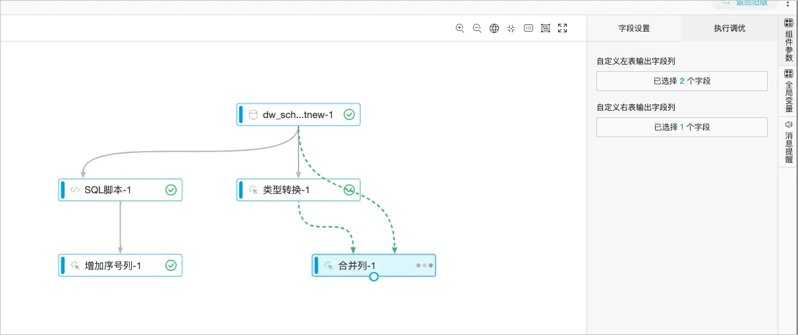

**方式二：PAI命令方式**

使用PAI命令方式，配置该组件参数。您可以使用SQL脚本组件进行PAI命令调用，详情请参见SQL脚本。

```text
PAI -name appendColumns
    -project algo_public
    -
DinputTableNames=maple_test_appendcol_basic_input1,maple_test_appendcol_basic_input2
    -DoutputTableName=maple_test_appendcol_setOutCol_output
    -DoutputTableColNames=x0,x1,x2,x3,x4,x5,x6,x7,x8,x9;
```

| 参数名称 | 是否必选 | 参数描述 | 默认值 |
| --- | --- | --- | --- |
| inputTableNam es | 是 | 输入表的表名，两个表以逗号（,）分隔。 | 无 |
| outputTableNa me | 是 | 输出表的名称 | 无 |
| selectedColNa mesList | 否 | 与输入表对应的已选中的列名列表：<br>• 同一个表的各列按半角逗号（,）分隔。<br>• 不同表的各列按照半角分号（;）分隔。<br>说明如果选择两张表所有的列，整个参数内容需用半角引号（""）括起来，否则半角分号（;）会被系统作为结束标志。如果某张表全选，可以省略所有列名，但必须保留相应的半角分号（;）。 | 无 |
| inputPartitionsI nfoList | 否 | 与输入表对应的已选择的partition列表：<br>• 同一个表的各partition按照正斜线（/）分隔。<br>• 不同表的partition按照半角分号（;）分隔。<br>说明如果选中所有partition，整个参数内容需要使用半角引号（""）括起来，否则半角分号（;）会被系统当做结束标志。如果某张表不用按照partition分割，则可省略所有partition名，但相应半角分号（;）必须保留。 | 无 |
| autoRenameCol | 否 | 输出表各列是否自动命名。 | false |
| outputTableCol Names | 否 | 输出表中各列的新列名，不填则输出原表中选择列的列名。<br>重要如果autoRenameCol为True时，则该参数无意义。 | 无 |
| lifecycle | 否 | 输出表的生命周期，取值范围为正整数。 | 无 |
| coreNum | 否 | 节点个数，与参数memSizePerCore配对使用，正整数，取值范围<strong>\[1, 9999\]</strong>。 | 默认系统自动计算 |
| memSizePerCor e | 否 | 单个节点内存大小，单位MB，正整数，取值范围<strong>\[1024, 64\*1024</strong>\]。 | 默认系统自动计算 |

**示例**

将以下两张源表进行合并列操作：

- 源表1

  表 1. maple_test_appendcol_basic_input1

  | col0:bigint | col1:double | col2:string | col3:Datetime | col4:Boolean |
  | --- | --- | --- | --- | --- |
  | 10 | 0.0 | aaaa | 2015-10-01 00:00:00 | TRUE |
  | 11 | 1.0 | aaaa | 2015-10-01 00:00:00 | FALSE |
  | 12 | 2.0 | aaaa | 2015-10-01 00:00:00 | TRUE |
  | 13 | 3.0 | aaaa | 2015-10-01 00:00:00 | TRUE |
  | 14 | 4.0 | aaaa | 2015-10-01 00:00:00 | TRUE |

- 源表2

  表 2. maple_test_appendcol_basic_input2

  | col10:bigint | col11:double | col12:string | col13:Datetime | col14:Boolean |
  | --- | --- | --- | --- | --- |
  | 110 | 10.0 | 2aaaa | 2015-10-01 00:00:00 | TRUE |
  | 111 | 11.0 | 2aaaa | 2015-10-01 00:00:00 | FALSE |
  | 112 | 12.0 | 2aaaa | 2015-10-01 00:00:00 | TRUE |
  | 113 | 13.0 | 2aaaa | 2015-10-01 00:00:00 | TRUE |
  | 114 | 14.0 | 2aaaa | 2015-10-01 00:00:00 | FALSE |

使用如下PAI命令行将上述两张源表进行合并列。

```text
PAI -name appendColumns
    -project algo_public
    -
DinputTableNames=maple_test_appendcol_basic_input1,maple_test_appendcol_basic_input2
    -DoutputTableName=maple_test_appendcol_setOutCol_output
    -DoutputTableColNames=x0,x1,x2,x3,x4,x5,x6,x7,x8,x9;
```

最终的输出表如下所示。

表 3. maple_test_appendcol_setOutCol_output

| x0 | x1 | x2 | x3 | x4 | x5 | x6 | x7 | x8 | x9 |
| --- | --- | --- | --- | --- | --- | --- | --- | --- | --- |
| 10 | 0 | aaaa | 2015-10-01 00:00: 00 | true | 110 | 10 | 2aaaa | 2015-10-01 00:00: 00 | true |
| 11 | 1 | aaaa | 2015-10-01 00:00: 00 | false | 111 | 11 | 2aaaa | 2015-10-01 00:00: 00 | false |
| 12 | 2 | aaaa | 2015-10-01 00:00: 00 | true | 112 | 12 | 2aaaa | 2015-10-01 00:00: 00 | true |
| 13 | 3 | aaaa | 2015-10-01 00:00: 00 | true | 113 | 13 | 2aaaa | 2015-10-01 00:00: 00 | true |
| 14 | 4 | aaaa | 2015-10-01 00:00: 00 | true | 114 | 14 | 2aaaa | 2015-10-01 00:00: 00 | false |

<a id="section-6-2-10-2-3"></a>

##### 6.2.10.2.3. 合并行（UNION）

合并行（UNION）算法组件是将两张表的数据按行合并，左表及右表选择输出的字段个数以及类型应保持一致。整合了UNION和UNION ALL的功能。

PAI-Designer（原PAI-Studio）仅支持通过可视化方式进行数据合并。

<table>
  <tr>
    <th width="208">参数</th>
    <th>描述</th>
  </tr>
  <tr>
    <td>选择左表联合列</td>
    <td>进行联合操作时，左右表选择的列数需相同，对应列的类型需保证一致。</td>
  </tr>
  <tr>
    <td>输入左边表的where条件</td>
    <td>通过where条件实现数据过滤，与SQL类似，例如<strong>age&gt;40</strong>。<br>说明仅支持以下操作符：<br>• =<br>• !=<br>• &gt;<br>• &lt;<br>• &gt;=<br>• &lt;=<br>• like<br>• rlike</td>
  </tr>
  <tr>
    <td>选择右表联合列</td>
    <td>进行联合操作时，左右表选择的列数需相同，对应列的类型需保证一致。</td>
  </tr>
  <tr>
    <td>输入右表的where条件</td>
    <td>通过where条件实现数据过滤，与SQL类似，例如<strong>age&gt;40</strong>。<br>说明仅支持以下操作符：<br>• =<br>• !=<br>• &gt;<br>• &lt;<br>• &gt;=<br>• &lt;=<br>• like<br>• rlike</td>
  </tr>
  <tr>
    <td>去重</td>
    <td>去重生成的数据表的重复行，系统默认勾选去重。</td>
  </tr>
</table>

<a id="section-6-2-10-3"></a>

#### 6.2.10.3. 类型转换

本文为您介绍PAI-Designer（原PAI-Studio）提供的类型转换组件。您可以将任意类型特征转成STRING、DOUBLE和INT特征，并支持转换异常时的缺失值填充。

**背景信息**

- 支持将表的字段类型转成另一个类型。

- 支持多个字段同时转换成不同的类型。

- 支持ODPS2.0数值类型字段的转换，例如decimal，float，int。

  > **说明**
  >
  > 该功能仅支持在华北2（北京）、华东2（上海）、华东1（杭州）、华南1（深圳）、华北3（张家口）和西南1（成都）使用。

- 可以选择是否保持原来的转换前的数据列。

**组件配置**

您可以使用以下任意一种方式，配置类型转换组件参数。

**方式一：可视化方式**

在PAI-Designer（原PAI-Studio）工作流页面配置组件参数。

<table>
  <tr>
    <th>页签</th>
    <th>参数</th>
    <th>描述</th>
  </tr>
  <tr>
    <td rowspan="9">字段设置</td>
    <td>转换为double类型的列</td>
    <td>转换所选字段为DOUBLE类型。</td>
  </tr>
  <tr>
    <td>转换为double异常时默认填充值</td>
    <td>转换为DOUBLE类型异常时的默认填充值。</td>
  </tr>
  <tr>
    <td>转换为int类型的列</td>
    <td>转换所选字段为INT类型。</td>
  </tr>
  <tr>
    <td>转换为int异常时默认填充值</td>
    <td>转换为INT类型异常时的默认填充值。</td>
  </tr>
  <tr>
    <td>转换为string类型的列</td>
    <td>转换所选字段为STRING类型。</td>
  </tr>
  <tr>
    <td>转换为string异常时默认填充值</td>
    <td>转换为STRING类型异常时的默认填充值。</td>
  </tr>
  <tr>
    <td>是否保留原列</td>
    <td>列名增加前缀“typed_”。</td>
  </tr>
  <tr>
    <td>单个节点内存大小</td>
    <td>取值范围为1024 MB~64*1024 MB。</td>
  </tr>
  <tr>
    <td>节点个数</td>
    <td>与参数<strong>单个节点内存大小</strong>搭配使用，取值范围为[1, 9999]。</td>
  </tr>
</table>

**方式二：PAI命令方式**

使用PAI命令方式，配置该组件参数。您可以使用SQL脚本组件进行PAI命令调用，详情请参见SQL脚本。

```text
pai -project algo_public
    -name type_transform_v1
    -DinputTable=type_test
    -Dcols_to_string="f0"
    -Ddefault_double_value=0.0
    -DoutputTable=type_test_output;
```

| 参数名称 | 是否必选 | 参数描述 | 默认值 |
| --- | --- | --- | --- |
| inputTable | 是 | 输入表的表名。 | 无 |
| inputTablePartitions | 否 | 输入表中，参与训练的分区。支持以下格式：<br>• Partition_name=v alue<br>• name1=value1/na <strong>me2=value2</strong>：多级格式<br>说明如果指定多个分区，则使用英文逗号（,）分隔。 | 所有分区 |
| outputTable | 是 | 类型转换的结果表。 | 无 |
| reserveOldFeat | 否 | 是否保持原来变换前的数据列。 | 无 |
| cols_to_double | 否 | 需要类型转换到DOUBLE的特征列。 | 无 |
| cols_to_string | 否 | 需要类型转换到STRING的特征列。 | 无 |
| cols_to_int | 否 | 需要类型转换到INT的特征列。 | 无 |
| default_int_value | 否 | 当特征字段为空时的值。 | 0 |
| default_double_valu e | 否 | 当特征字段为空时的值。 | 0.0 |
| default_string_value | 否 | 当特征字段为空时的值。 | “” |
| coreNum | 否 | 节点数量。与<strong>memSizePerCore</strong>搭配使用，取值范围为\[1, 9999\]。 | 默认自动计算 |
| memSizePerCore | 否 | 单个结点内存大小，单位M，取值范围为\[1024, 64 \*1024\]。 | 默认自动计算 |
| lifecycle | 否 | 输出表生命周期。 | 7 |

**示例**

- 测试数据生成

  ```sql
  create table transform_test as
  select * from
  (
  select true as f0,2.0 as f1,1 as f2 from dual union all
  select false as f0,3.0 as f1,1 as f2 from dual union all
  select false as f0,4.0 as f1,1 as f2 from dual union all
  select true as f0,3.0 as f1,1 as f2 from dual union all
  select false as f0,3.0 as f1,1 as f2 from dual union all
  select false as f0,4.0 as f1,1 as f2 from dual union all
  select true as f0,3.0 as f1,1 as f2 from dual union all
  select false as f0,5.0 as f1,1 as f2 from dual union all
  select false as f0,3.0 as f1,1 as f2 from dual union all
  select true as f0,4.0 as f1,1 as f2 from dual union all
  select false as f0,3.0 as f1,1 as f2 from dual union all
  select true as f0,4.0 as f1,1 as f2 from dual
  )tmp;
  ```

- 训练数据展示

  | f0 | f1 | f2 |
  | --- | --- | --- |
  | false | 3.0 | 1 |
  | false | 3.0 | 1 |
  | true | 2.0 | 1 |
  | true | 4.0 | 1 |
  | false | 4.0 | 1 |
  | false | 3.0 | 1 |
  | false | 3.0 | 1 |
  | true | 3.0 | 1 |
  | false | 4.0 | 1 |
  | true | 4.0 | 1 |
  | false | 5.0 | 1 |
  | true | 3.0 | 1 |

- 训练PAI命令

  ```text
  pai -project projectxlib4
      -name type_transform_v1
      -DinputTable=transform_test
      -Dcols_to_double=f0
      -Dcols_to_int=f1
      -Dcols_to_string=f2
      -DoutputTable=trans_test_output;
  ```

- 输出说明

  结果表

  | f0 | f1 | f2 |
  | --- | --- | --- |
  | 0.0 | 3 | 1 |
  | 0.0 | 3 | 1 |
  | 1.0 | 2 | 1 |
  | 1.0 | 4 | 1 |
  | 0.0 | 4 | 1 |
  | 0.0 | 3 | 1 |
  | 1.0 | 3 | 1 |
  | 0.0 | 4 | 1 |
  | 0.0 | 3 | 1 |
  | 0.0 | 5 | 1 |
  | 1.0 | 3 | 1 |
  | 1.0 | 4 | 1 |

<a id="section-6-2-10-4"></a>

#### 6.2.10.4. 增加序号列

本文为您介绍PAI-Designer（原PAI-Studio）提供的增加序号列组件。您可以在数据表的第一列追加ID列。

**背景信息**

支持1000000000\*1023的算法规模。

**组件配置**

您可以使用以下任意一种方式，配置增加序号列组件参数。

**方式一：可视化方式**

在PAI-Designer（原PAI-Studio）工作流页面配置组件参数。

<table>
  <tr>
    <th>页签</th>
    <th>参数</th>
    <th>描述</th>
  </tr>
  <tr>
    <td rowspan="2">参数设置</td>
    <td>默认全选</td>
    <td>默认全选，多余列不影响预测结果。</td>
  </tr>
  <tr>
    <td>序列号</td>
    <td>默认为append_id。</td>
  </tr>
  <tr>
    <td rowspan="2">执行调优</td>
    <td>计算核心数</td>
    <td>核心数量。</td>
  </tr>
  <tr>
    <td>每个核内存数</td>
    <td>单个核心使用的内存数，单位为MB，取值范围为<strong>(1,</strong> <strong>65536)</strong>。</td>
  </tr>
</table>

**方式二：PAI命令方式**

使用PAI命令方式，配置该组件参数。您可以使用SQL脚本组件进行PAI命令调用，详情请参见SQL脚本。

```text
PAI -name AppendId
    -project algo_public
    -DinputTableName=maple_test_appendid_basic_input
    -DoutputTableName=maple_test_appendid_basic_output;
```

| 参数名称 | 是否必选 | 参数描述 | 默认值 |
| --- | --- | --- | --- |
| inputTableName | 是 | 输入表的表名。 | 无 |
| selectedColNames | 否 | 输入表中，参与训练的列。列名以英文逗号（,）分隔，支持INT和DOUBLE类型。如果输入为稀疏格式，则支持STRING类型的列。 | 所有列 |
| inputTablePartitions | 否 | 输入表中，参与训练的分区。支持以下格式：<br>• Partition_name=v alue<br>• name1=value1/na <strong>me2=value2</strong>：多级格式<br>说明如果指定多个分区，则使用英文逗号（,）分隔。 | 所有分区 |
| outputTableName | 是 | 输出结果表。 | 无 |
| IDColName | 否 | ID列列名。 | append_id |
| lifecycle | 否 | 输出表生命周期。 | 无 |
| coreNum | 否 | 核心数量。 | 系统自动分配 |
| memSizePerCore | 否 | 单个核心使用的内存数，单位为MB，取值范围为<strong>(1, 65536)</strong>。 | 系统自动分配 |

**示例**

```text
PAI -name AppendId
    -project algo_public
    -DinputTableName=maple_test_appendid_basic_input
    -DoutputTableName=maple_test_appendid_basic_output;
```

- 数据生成

  | col0 | col1 | col2 | col3 | col4 |
  | --- | --- | --- | --- | --- |
  | 10 | 0.0 | aaaa | Thu Oct 01 00:00:00 CST 2015 | true |
  | 11 | 1.0 | aaaa | Thu Oct 01 00:00:00 CST 2015 | false |
  | 12 | 2.0 | aaaa | Thu Oct 01 00:00:00 CST 2015 | true |
  | 13 | 3.0 | aaaa | Thu Oct 01 00:00:00 CST 2015 | true |
  | 14 | 4.0 | aaaa | Thu Oct 01 00:00:00 CST 2015 | true |

- 输出表

  | append_id | col0 | col1 | col2 | col3 | col4 |
  | --- | --- | --- | --- | --- | --- |
  | 0 | 10 | 0.0 | aaaa | Thu Oct 01 00:00:00 CST 2015 | true |
  | 1 | 11 | 1.0 | aaaa | Thu Oct 01 00:00:00 CST 2015 | false |
  | 2 | 12 | 2.0 | aaaa | Thu Oct 01 00:00:00 CST 2015 | true |
  | 3 | 13 | 3.0 | aaaa | Thu Oct 01 00:00:00 CST 2015 | true |
  | 4 | 14 | 4.0 | aaaa | Thu Oct 01 00:00:00 CST 2015 | true |

<a id="section-6-2-10-5"></a>

#### 6.2.10.5. 拆分

本文为您介绍PAI-Designer（原PAI-Studio）提供的拆分算法。拆分是对数据进行随机拆分，用于生成训练和测试集。

**组件配置**

您可以使用以下任意一种方式，配置拆分组件参数。

**方式一：可视化方式**

在PAI-Designer（原PAI-Studio）工作流页面配置组件参数。

<table>
  <tr>
    <th>页签</th>
    <th>参数</th>
    <th>描述</th>
  </tr>
  <tr>
    <td rowspan="6">参数设置</td>
    <td>拆分方式</td>
    <td>• 按比例拆分<br>• 按阈值拆分</td>
  </tr>
  <tr>
    <td>切分比例</td>
    <td>取值范围为<strong>(0,1)</strong>。</td>
  </tr>
  <tr>
    <td>随机数种子</td>
    <td>系统默认生成。</td>
  </tr>
  <tr>
    <td>ID列（ID列相同的不会被拆分）</td>
    <td>ID列中，内容相同的行数据不会被拆分，会被全量随机分配到<strong>输出表1</strong>或<strong>输出表2</strong>中。<br>说明勾选<strong>高级选项</strong>时展示，仅支持选择单列。</td>
  </tr>
  <tr>
    <td>阈值列</td>
    <td>选择某个列名，对该列内容按阈值拆分，不支持String列。</td>
  </tr>
  <tr>
    <td>阈值</td>
    <td>参考<strong>阈值列</strong>内容，配置拆分阈值。<strong>输出表1</strong>中的数据均小于阈值。<strong>输出表2</strong>中的数据均大于或等于阈值。<br>重要您在使用按阈值拆分方式时，请先清空<strong>按比例拆</strong><strong>分</strong>方式配置的<strong>切分比例</strong>字段内容。</td>
  </tr>
  <tr>
    <td rowspan="2">执行调优</td>
    <td>计算核心数</td>
    <td>系统根据输入数据量，自动分配训练的实例数量。</td>
  </tr>
  <tr>
    <td>每个核内存数</td>
    <td>系统根据输入数据量，自动分配内存。单位为MB。</td>
  </tr>
</table>

**方式二：PAI命令方式**

使用PAI命令方式，配置该组件参数。您可以使用SQL脚本组件进行PAI命令调用，详情请参见SQL脚本。

```text
PAI -name split -project algo_public
    -DinputTableName=wbpc
    -Doutput1TableName=wpbc_split1
    -Doutput2TableName=wpbc_split2
    -Dfraction=0.25;
```

| 参数名称 | 是否必选 | 参数描述 | 默认值 |
| --- | --- | --- | --- |
| inputTableName | 是 | 输入表的表名。 | 无 |
| inputTablePartitions | 否 | 输入表中，参与训练的分区。支持以下格式：<br>• Partition_name=v alue<br>• name1=value1/na <strong>me2=value2</strong>：多级格式<br>说明如果指定多个分区，则使用英文逗号（,）分隔。 | 所有分区 |
| output1TableName | 是 | 输出结果表1。 | 无 |
| output1TablePartiti on | 否 | 输出结果表1分区名。 | 输出表1为非分区表 |
| output2TableName | 是 | 输出结果表2。 | 无 |
| output2TablePartiti on | 否 | 输出结果表2分区名。 | 输出表2为非分区表 |
| fraction | 否 | 切分至输出表1的数据比例，取值范围为<strong>(0,1)</strong>。 | 无 |
| randomSeed | 否 | 随机数种子，取值范围为正整数。 | 系统自动分配 |
| idColName | 否 | ID列（ID相同的数据不会被拆分） | 无 |
| thresholdColName | 否 | 阈值所在列名，不支持String列。 | 无 |
| threshold | 否 | 阈值。 | 无 |
| lifecycle | 否 | 输出表的生命周期，取值范围为<strong>\[1,3650\]</strong>。 | 无 |
| coreNum | 否 | 核心数量。 | 系统自动分配 |
| memSizePerCore | 否 | 每个核心的内存（单位是兆），取值范围为<strong>(1,</strong> <strong>65536)</strong>。 | 系统自动分配 |

<a id="section-6-2-10-6"></a>

#### 6.2.10.6. 缺失值填充

您可以通过给定一个缺失值的配置列表，来实现将输入表的缺失值用指定的值来填充。

**背景信息**

- 将数值型的空值替换为最大值，最小值，均值或者一个自定义的值。

- 将字符型的空值，空字符串，空值和空字符串，指定值替换为一个自定义的值。

- 待填充的缺失值可以选择空值或空字符，也可以自定义。

  缺失值如果选择空字符串，则填充的目标列应是STRING型。

- 数值型替换可以自定义，也可以直接选择替换成数值最大值，最小值或者均值。

**组件配置**

您可以使用以下任意一种方式，配置缺失值填充组件参数。

**方式一：可视化方式**

在PAI-Designer（原PAI-Studio）工作流页面配置组件参数。

**页签**

**参数**

**描述**

默认全选，多余列不影响预测结果。

**填充的字段**

- Null（数值和string）

- 空字符串（string）

**原值**

- Null和空字符串（string）

- 自定义（string）

- Min（数值型）

- Max（数值型）

**替换为**

- Mean（数值型）

- 自定义（数值型和string）

**参数设置**

ID列。

> **说明**

**configs**

> 勾选**高级选项**时展示。

**计算核心数**

**执行调优**

**每个核内存数**

**方式二：PAI命令方式**

使用PAI命令方式，配置该组件参数。您可以使用SQL脚本组件进行PAI命令调用，详情请参见SQL脚本。

```text
PAI -name FillMissingValues
    -project algo_public
    -Dconfigs="poutcome,null-empty,testing" \
    -DoutputParaTableName="test_input_model_output"
    -DoutputTableName="test_3"
    -DinputTablePartitions="pt=20150501"
    -DinputTableName="bank_data_partition";
```

| 参数名称 | 是否必选 | 参数描述 | 默认值 |
| --- | --- | --- | --- |
| inputTableName | 是 | 输入表的表名。 | 无 |
| inputTablePartitions | 否 | 输入表中，参与训练的分区。支持以下格式：<br>• Partition_name=v alue<br>• name1=value1/na <strong>me2=value2</strong>：多级格式<br>说明如果指定多个分区，则使用英文逗号（,）分隔。 | 所有分区 |
| outputTableName | 是 | 输出结果表。 | 无 |
| configs | 是 | 缺失值填充的配置。<br>例如格式<code> col1, null, </code> <code>3.14; col2, empty,</code><br><code>hello; col3, empty-</code><code>null, world </code>，其中<code> null </code>表示空值，<code> empty </code>表示空字符。<br>• 如果选择空字符，则填充的目标列应是STRING型。<br>• 如果采用最大值、最小值、均值，可以采用变量，其命名规范形如：min, max, mean。<br>• 如果用户自定义替换值，则使用user-defined，格式例如<code> col4,user-</code><code>defined,str,str123</code><code> </code>。 | 无 |
| outputParaTableNa me | 是 | 配置输出表。 | 输出表1为非分区表 |
| inputParaTableNam e | 否 | 配置输入表。 | 无 |
| lifecycle | 否 | 输出表的生命周期，取值范围为<strong>\[1,3650\]</strong>。 | 无 |
| coreNum | 否 | 计算的核心数目，取值为正整数。 | 系统自动分配 |
| memSizePerCore | 否 | 每个核心的内存（单位是兆），取值范围为<strong>(1,</strong> <strong>65536)</strong>。 | 系统自动分配 |


**示例**

1. 使用SQL语句，生成测试数据。

   ```sql
   drop table if exists fill_missing_values_test_input;
   create table fill_missing_values_test_input(
       col_string string,
       col_bigint bigint,
       col_double double,
       col_boolean boolean,
       col_datetime datetime);
   insert overwrite table fill_missing_values_test_input
   select
       *
   from
   (
       select
           '01' as col_string,
           10 as col_bigint,
           10.1 as col_double,
           True as col_boolean,
           cast('2016-07-01 10:00:00' as datetime) as col_datetime
       from dual
       union all
           select
               cast(null as string) as col_string,
               11 as col_bigint,
               10.2 as col_double,
               False as col_boolean,
               cast('2016-07-02 10:00:00' as datetime) as col_datetime
           from dual
       union all
           select
               '02' as col_string,
               cast(null as bigint) as col_bigint,
               10.3 as col_double,
               True as col_boolean,
               cast('2016-07-03 10:00:00' as datetime) as col_datetime
           from dual
       union all
           select
               '03' as col_string,
               12 as col_bigint,
               cast(null as double) as col_double,
               False as col_boolean,
               cast('2016-07-04 10:00:00' as datetime) as col_datetime
           from dual
       union all
           select
               '04' as col_string,
               13 as col_bigint,
               10.4 as col_double,
               cast(null as boolean) as col_boolean,
               cast('2016-07-05 10:00:00' as datetime) as col_datetime
           from dual
       union all
           select
               '05' as col_string,
               14 as col_bigint,
               10.5 as col_double,
               True as col_boolean,
               cast(null as datetime) as col_datetime
           from dual
   ) tmp;
   ```

   输入数据说明。

   ```text
   +------------+------------+------------+-------------+--------------+
   | col_string | col_bigint | col_double | col_boolean | col_datetime |
   +------------+------------+------------+-------------+--------------+
   | 04         | 13         | 10.4       | NULL        | 2016-07-05 10:00:00 |
   | 02         | NULL       | 10.3       | true        | 2016-07-03 10:00:00 |
   | 03         | 12         | NULL       | false       | 2016-07-04 10:00:00 |
   | NULL       | 11         | 10.2       | false       | 2016-07-02 10:00:00 |
   | 01         | 10         | 10.1       | true        | 2016-07-01 10:00:00 |
   | 05         | 14         | 10.5       | true        | NULL         |
   +------------+------------+------------+-------------+--------------+
   ```

2. 运行命令。

   ```text
   drop table if exists fill_missing_values_test_input_output;
   drop table if exists fill_missing_values_test_input_model_output;
   PAI -name FillMissingValues
   -project algo_public
   -Dconfigs="col_double,null,mean;col_string,null-
   empty,str_type_empty;col_bigint,null,max;col_boolean,null,true;col_datetime,null,2016-
   07-06 10:00:00"
   -DoutputParaTableName="fill_missing_values_test_input_model_output"
   -Dlifecycle="28"
   -DoutputTableName="fill_missing_values_test_input_output"
   -DinputTableName="fill_missing_values_test_input";
   drop table if exists fill_missing_values_test_input_output_using_model;
   drop table if exists fill_missing_values_test_input_output_using_model_model_output;
   PAI -name FillMissingValues
   -project algo_public
   -
   DoutputParaTableName="fill_missing_values_test_input_output_using_model_model_output"-DinputParaTableName="fill_missing_values_test_input_model_output"
   -Dlifecycle="28"
   -DoutputTableName="fill_missing_values_test_input_output_using_model"
   -DinputTableName="fill_missing_values_test_input";
   ```

3. 运行结果。

   - fill_missing_values_test_input_output

     ```text
     +------------+------------+------------+-------------+--------------+
     | col_string | col_bigint | col_double | col_boolean | col_datetime |
     +------------+------------+------------+-------------+--------------+
     | 04         | 13         | 10.4       | true        | 2016-07-05 10:00:00 |
     | 02         | 14         | 10.3       | true        | 2016-07-03 10:00:00 |
     | 03         | 12         | 10.3       | false       | 2016-07-04 10:00:00 |
     | str_type_empty | 11         | 10.2       | false       | 2016-07-02 10:00:00 |
     | 01         | 10         | 10.1       | true        | 2016-07-01 10:00:00 |
     | 05         | 14         | 10.5       | true        | 2016-07-06 10:00:00 |
     +------------+------------+------------+-------------+--------------+
     ```

   - fill_missing_values_test_input_model_output

     ```text
     +------------+------------+
     | feature    | json       |
     +------------+------------+
     | col_string | {"name": "fillMissingValues", "type": "string", "paras":{"missing_value_type": "null-empty",  "replaced_value": "str_type_empty"}} |
     | col_bigint | {"name": "fillMissingValues", "type": "bigint", "paras":{"missing_value_type": "null",  "replaced_value": 14}} |
     | col_double | {"name": "fillMissingValues", "type": "double", "paras":{"missing_value_type": "null",  "replaced_value": 10.3}} |
     | col_boolean | {"name": "fillMissingValues", "type": "boolean", "paras":{"missing_value_type": "null",  "replaced_value": 1}} |
     | col_datetime | {"name": "fillMissingValues", "type": "datetime", "paras":{"missing_value_type": "null",  "replaced_value": 1467770400000}} |
     +------------+------------+
     ```

   - fill_missing_values_test_input_output_using_model

     ```text
     +------------+------------+------------+-------------+--------------+
     | col_string | col_bigint | col_double | col_boolean | col_datetime |
     +------------+------------+------------+-------------+--------------+
     | 04         | 13         | 10.4       | true        | 2016-07-05 10:00:00 |
     | 02         | 14         | 10.3       | true        | 2016-07-03 10:00:00 |
     | 03         | 12         | 10.3       | false       | 2016-07-04 10:00:00 |
     | str_type_empty | 11         | 10.2       | false       | 2016-07-02 10:00:00 |
     | 01         | 10         | 10.1       | true        | 2016-07-01 10:00:00 |
     | 05         | 14         | 10.5       | true        | 2016-07-06 10:00:00 |
     +------------+------------+------------+-------------+--------------+
     ```

   - fill_missing_values_test_input_output_using_model_model_output

     ```text
     +------------+------------+
     | feature    | json       |
     +------------+------------+
     | col_string | {"name": "fillMissingValues", "type": "string", "paras":{"missing_value_type": "null-empty",  "replaced_value": "str_type_empty"}} |
     | col_bigint | {"name": "fillMissingValues", "type": "bigint", "paras":{"missing_value_type": "null",  "replaced_value": 14}} |
     | col_double | {"name": "fillMissingValues", "type": "double", "paras":{"missing_value_type": "null",  "replaced_value": 10.3}} |
     | col_boolean | {"name": "fillMissingValues", "type": "boolean", "paras":{"missing_value_type": "null",  "replaced_value": 1}} |
     | col_datetime | {"name": "fillMissingValues", "type": "datetime", "paras":{"missing_value_type": "null",  "replaced_value": 1467770400000}} |
     +------------+------------+
     ```

<a id="section-6-2-10-7"></a>

#### 6.2.10.7. 归一化

本文为您介绍PAI-Designer（原PAI-Studio）提供的归一化组件。

**组件配置**

您可以使用以下任意一种方式，配置归一化组件参数。

**方式一：可视化方式**

在PAI-Designer（原PAI-Studio）工作流页面配置组件参数。

<table>
  <tr>
    <th>页签</th>
    <th>参数</th>
    <th>描述</th>
  </tr>
  <tr>
    <td rowspan="2">字段设置</td>
    <td>默认全选</td>
    <td>默认全选，多余列不影响预测结果。</td>
  </tr>
  <tr>
    <td>保留原始列</td>
    <td>处理过的列增加“stdized_”前缀。支持DOUBLE类型与BIGINT类型。</td>
  </tr>
  <tr>
    <td rowspan="2">执行调优</td>
    <td>计算核心数</td>
    <td>系统根据输入数据量，自动分配训练的实例数量。</td>
  </tr>
  <tr>
    <td>每个核内存</td>
    <td>系统根据输入数据量，自动分配内存。单位为MB。</td>
  </tr>
</table>

**方式二：PAI命令方式**

使用PAI命令方式，配置该组件参数。您可以使用SQL脚本组件进行PAI命令调用，详情请参见SQL脚本。

- 稠密数据的命令

  ```text
  PAI -name Normalize
      -project algo_public
      -DkeepOriginal="true"
      -DoutputTableName="test_4"
      -DinputTablePartitions="pt=20150501"
      -DinputTableName="bank_data_partition"
      -DselectedColNames="emp_var_rate,euribor3m"
  ```

- 稀疏数据的命令

  ```text
  PAI -name Normalize
      -project projectxlib4
      -DkeepOriginal="true"
      -DoutputTableName="kv_norm_output"
      -DinputTableName=kv_norm_test
      -DselectedColNames="f0,f1,f2"
      -DenableSparse=true
      -DoutputParaTableName=kv_norm_model
      -DkvIndices=1,2,8,6
      -DitemDelimiter=",";
  ```

| 参数名称 | 是否必选 | 参数描述 | 默认值 |
| --- | --- | --- | --- |
| inputTableName | 是 | 输入表的表名。 | 无 |
| selectedColNames | 否 | 输入表中，参与训练的列。列名以英文逗号（,）分隔，支持INT和DOUBLE类型。如果输入为稀疏格式，则支持STRING类型的列。 | 所有列 |
| inputTablePartitions | 否 | 输入表中，参与训练的分区。支持以下格式：<br>• Partition_name=v alue<br>• name1=value1/na <strong>me2=value2</strong>：多级格式<br>说明如果指定多个分区，则使用英文逗号（,）分隔。 | 所有分区 |
| outputTableName | 是 | 输出结果表。 | 无 |
| outputParaTableName | 否 | 配置输出表。 | 输出表1为非分区表 |
| inputParaTableName | 是 | 配置输入表。 | 无 |
| keepOriginal | 否 | 是否保留原始列：<br>• true：处理过的列重命名（”normalized_”前缀），原始列保留。<br>• false：全部列保留且不重命名。 | false |
| lifecycle | 否 | 输出表的生命周期，取值范围为<strong>\[1,3650\]</strong>。 | 无 |
| coreNum | 否 | 计算的核心数目，取值为正整数。 | 系统自动分配 |
| memSizePerCore | 否 | 每个核心的内存（单位是兆），取值范围为<strong>(1,</strong> <strong>65536)</strong>。 | 系统自动分配 |
| enableSparse | 否 | 是否打开稀疏支持：<br>• true<br>• false | false |
| itemDelimiter | 否 | KV对之间分隔符。 | 默认”,” |
| kvDelimiter | 否 | Key和Value之间分隔符。 | 默认”:” |
| kvIndices | 否 | KV表中需要归一化的特征索引。 | 无 |

**示例**

- 数据生成

  ```sql
  drop table if exists normalize_test_input;
  create table normalize_test_input(
      col_string string,
      col_bigint bigint,
      col_double double,
      col_boolean boolean,
      col_datetime datetime);
  insert overwrite table normalize_test_input
  select
      *
  from
  (
      select
          '01' as col_string,
          10 as col_bigint,
          10.1 as col_double,
          True as col_boolean,
          cast('2016-07-01 10:00:00' as datetime) as col_datetime
      from dual
      union all
          select
              cast(null as string) as col_string,
              11 as col_bigint,
              10.2 as col_double,
              False as col_boolean,
              cast('2016-07-02 10:00:00' as datetime) as col_datetime
          from dual
      union all
          select
              '02' as col_string,
              cast(null as bigint) as col_bigint,
              10.3 as col_double,
              True as col_boolean,
              cast('2016-07-03 10:00:00' as datetime) as col_datetime
          from dual
      union all
          select
              '03' as col_string,
              12 as col_bigint,
              cast(null as double) as col_double,
              False as col_boolean,
              cast('2016-07-04 10:00:00' as datetime) as col_datetime
          from dual
      union all
          select
              '04' as col_string,
              13 as col_bigint,
              10.4 as col_double,
              cast(null as boolean) as col_boolean,
              cast('2016-07-05 10:00:00' as datetime) as col_datetime
          from dual
      union all
          select
              '05' as col_string,
              14 as col_bigint,
              10.5 as col_double,
              True as col_boolean,
              cast(null as datetime) as col_datetime
          from dual
  ) tmp;
  ```

- PAI命令行

  ```text
  drop table if exists normalize_test_input_output;
  drop table if exists normalize_test_input_model_output;
  PAI -name Normalize
      -project algo_public
      -DoutputParaTableName="normalize_test_input_model_output"
      -Dlifecycle="28"
      -DoutputTableName="normalize_test_input_output"
      -DinputTableName="normalize_test_input"
      -DselectedColNames="col_double,col_bigint"
      -DkeepOriginal="true";
  drop table if exists normalize_test_input_output_using_model;
  drop table if exists normalize_test_input_output_using_model_model_output;
  PAI -name Normalize
      -project algo_public
      -DoutputParaTableName="normalize_test_input_output_using_model_model_output"
      -DinputParaTableName="normalize_test_input_model_output"
      -Dlifecycle="28"
      -DoutputTableName="normalize_test_input_output_using_model"
      -DinputTableName="normalize_test_input";
  ```

- 输入说明

  normalize_test_input

  | col_string | col_bigint | col_double | col_boolean | col_datetime |
  | --- | --- | --- | --- | --- |
  | 01 | 10 | 10.1 | true | 2016-07-01 10:00:00 |
  | NULL | 11 | 10.2 | false | 2016-07-02 10:00:00 |
  | 02 | NULL | 10.3 | true | 2016-07-03 10:00:00 |
  | 03 | 12 | NULL | false | 2016-07-04 10:00:00 |
  | 04 | 13 | 10.4 | NULL | 2016-07-05 10:00:00 |
  | 05 | 14 | 10.5 | true | NULL |

- 输出说明

  - normalize_test_input_output

    | col_string | col_bigint | col_doubl e | col_boole an | col_datet ime | normaliz ed_col_bi gint | normaliz ed_col_do uble |
    | --- | --- | --- | --- | --- | --- | --- |
    | 01 | 10 | 10.1 | true | 2016-07-01 10:00:00 | 0.0 | 0.0 |
    | NULL | 11 | 10.2 | false | 2016-07-02 10:00:00 | 0.25 | 0.2499999 99999998 9 |
    | 02 | NULL | 10.3 | true | 2016-07-03 10:00:00 | NULL | 0.5000000 00000002 2 |
    | 03 | 12 | NULL | false | 2016-07-04 10:00:00 | 0.5 | NULL |
    | 04 | 13 | 10.4 | NULL | 2016-07-05 10:00:00 | 0.75 | 0.7500000 00000001 1 |
    | 05 | 14 | 10.5 | true | NULL | 1.0 | 1.0 |

  - normalize_test_input_model_output

    | feature | json |
    | --- | --- |
    | col_bigint | {“name”: “normalize”, “type”:”bigint”, “paras”:{“min”:10, “max”: 14}} |
    | col_double | {“name”: “normalize”, “type”:”double”, “paras”:{“min”:10.1, “max”: 10.5}} |

  - normalize_test_input_output_using_model

    | col_string | col_bigint | col_double | col_boolean | col_datetime |
    | --- | --- | --- | --- | --- |
    | 01 | 0.0 | 0.0 | true | 2016-07-01 10:00:00 |
    | NULL | 0.25 | 0.24999999999 99989 | false | 2016-07-02 10:00:00 |
    | 02 | NULL | 0.50000000000 00022 | true | 2016-07-03 10:00:00 |
    | 03 | 0.5 | NULL | false | 2016-07-04 10:00:00 |
    | 04 | 0.75 | 0.75000000000 00011 | NULL | 2016-07-05 10:00:00 |
    | 05 | 1.0 | 1.0 | true | NULL |

  - normalize_test_input_output_using_model_model_output

    | feature | json |
    | --- | --- |
    | col_bigint | {“name”: “normalize”, “type”:”bigint”, “paras”:{“min”:10, “max”: 14}} |
    | col_double | {“name”: “normalize”, “type”:”double”, “paras”:{“min”:10.1, “max”: 10.5}} |

<a id="section-6-2-10-8"></a>

#### 6.2.10.8. 标准化

本文为您介绍PAI-Designer（原PAI-Studio）提供的标准化组件。

**背景信息**

- 对一个表的某一列或多列，进行标准化处理，将产生的数据存入新表中。

- 标准化所使用的公式 :（X - Mean）/（standard deviation）。

  - Mean：样本平均值。

  - standard deviation：样本标准偏差，针对从总体抽样，利用样本来计算总体偏差，为了使算出的值

    

    与总体水平更接近，就必须将算出的标准偏差的值适度放大，即

    。

    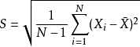

  - 样本标准偏差公式：

    。

    其中  代表所采用的样本X1，X2，…，Xn的均值。

**组件配置**

您可以使用以下任意一种方式，配置标准化组件参数。

**方式一：可视化方式**

在PAI-Designer（原PAI-Studio）工作流页面配置组件参数。

<table>
  <tr>
    <th>页签</th>
    <th>参数</th>
    <th>描述</th>
  </tr>
  <tr>
    <td rowspan="2">字段设置</td>
    <td>默认全选</td>
    <td>默认全选，多余列不影响预测结果。</td>
  </tr>
  <tr>
    <td>保留原始列</td>
    <td>处理过的列增加“stdized_”前缀。支持DOUBLE类型与BIGINT类型。</td>
  </tr>
  <tr>
    <td rowspan="2">执行调优</td>
    <td>计算核心数</td>
    <td>系统根据输入数据量，自动分配训练的实例数量。</td>
  </tr>
  <tr>
    <td>每个核内存数</td>
    <td>系统根据输入数据量，自动分配内存。单位为MB。</td>
  </tr>
</table>

**方式二：PAI命令方式**

使用PAI命令方式，配置该组件参数。您可以使用SQL脚本组件进行PAI命令调用，详情请参见SQL脚本。

- 稠密数据的命令

  ```text
  PAI -name Standardize
      -project algo_public 
      -DkeepOriginal="false"    
      -DoutputTableName="test_5"
      -DinputTablePartitions="pt=20150501"  
      -DinputTableName="bank_data_partition" 
      -DselectedColNames="euribor3m,pdays"
  ```

- 稀疏数据的命令

  ```text
  PAI -name Standardize    
      -project projectxlib4
      -DkeepOriginal="true"
      -DoutputTableName="kv_standard_output"
      -DinputTableName=kv_standard_test
      -DselectedColNames="f0,f1,f2"
      -DenableSparse=true
      -DoutputParaTableName=kv_standard_model    
      -DkvIndices=1,2,8,6
      -DitemDelimiter=",";
  ```

| 参数名称 | 是否必选 | 参数描述 | 默认值 |
| --- | --- | --- | --- |
| inputTableName | 是 | 输入表的表名。 | 无 |
| selectedColNames | 否 | 输入表中，参与训练的列。列名以英文逗号（,）分隔，支持INT和DOUBLE类型。如果输入为稀疏格式，则支持STRING类型的列。 | 所有列 |
| inputTablePartitions | 否 | 输入表中，参与训练的分区。支持以下格式：<br>• Partition_name=v alue<br>• name1=value1/na <strong>me2=value2</strong>：多级格式<br>说明如果指定多个分区，则使用英文逗号（,）分隔。 | 所有分区 |
| outputTableName | 是 | 输出结果表。 | 无 |
| outputParaTableName | 是 | 配置输出表。 | 无 |
| inputParaTableName | 否 | 配置输入表。 | 无 |
| keepOriginal | 否 | 是否保留原始列：<br>• true：处理过的列重命名（“stdized_”前缀），原始列保留。<br>• false：全部列保留且不重命名。 | false |
| lifecycle | 否 | 输出表生命周期。 | 无 |
| coreNum | 否 | 核心数量。 | 系统自动分配 |
| memSizePerCore | 否 | 单个核心使用的内存数。 | 系统自动分配 |
| enableSparse | 否 | 是否打开稀疏支持：<br>• true<br>• false | false |
| itemDelimiter | 否 | KV对之间分隔符。 | 默认”,” |
| kvDelimiter | 否 | Key和Value之间分隔符。 | 默认”:” |
| kvIndices | 否 | KV表中需要归一化的特征索引。 | 无 |

**示例**

详细示例

```sql
drop table if exists standardize_test_input;
create table standardize_test_input(
    col_string string,
    col_bigint bigint,
    col_double double,
    col_boolean boolean,
    col_datetime datetime);
insert overwrite table standardize_test_input
select
    *
from
(
    select
        '01' as col_string,
        10 as col_bigint,
        10.1 as col_double,
        True as col_boolean,
        cast('2016-07-01 10:00:00' as datetime) as col_datetime
    from dual
    union all
        select
            cast(null as string) as col_string,
            11 as col_bigint,
            10.2 as col_double,
            False as col_boolean,
            cast('2016-07-02 10:00:00' as datetime) as col_datetime
        from dual
    union all
        select
            '02' as col_string,
            cast(null as bigint) as col_bigint,
            10.3 as col_double,
            True as col_boolean,
            cast('2016-07-03 10:00:00' as datetime) as col_datetime
        from dual
    union all
        select
            '03' as col_string,
            12 as col_bigint,
            cast(null as double) as col_double,
            False as col_boolean,
            cast('2016-07-04 10:00:00' as datetime) as col_datetime
        from dual
    union all
        select
            '04' as col_string,
            13 as col_bigint,
            10.4 as col_double,
            cast(null as boolean) as col_boolean,
            cast('2016-07-05 10:00:00' as datetime) as col_datetime
        from dual
    union all
        select
            '05' as col_string,
            14 as col_bigint,
            10.5 as col_double,
            True as col_boolean,
            cast(null as datetime) as col_datetime
        from dual
) tmp;
```

- PAI命令行

  ```text
  drop table if exists standardize_test_input_output;
  drop table if exists standardize_test_input_model_output;
  PAI -name Standardize
      -project algo_public
      -DoutputParaTableName="standardize_test_input_model_output"
      -Dlifecycle="28"
      -DoutputTableName="standardize_test_input_output"
      -DinputTableName="standardize_test_input"
      -DselectedColNames="col_double,col_bigint"
      -DkeepOriginal="true";
  drop table if exists standardize_test_input_output_using_model;
  drop table if exists standardize_test_input_output_using_model_model_output;
  PAI -name Standardize
      -project algo_public
      -DoutputParaTableName="standardize_test_input_output_using_model_model_output"
      -DinputParaTableName="standardize_test_input_model_output"
      -Dlifecycle="28"
      -DoutputTableName="standardize_test_input_output_using_model"
      -DinputTableName="standardize_test_input";
  ```

- 输入说明

  standardize_test_input

  | col_string | col_bigint | col_double | col_boolean | col_datetime |
  | --- | --- | --- | --- | --- |
  | 01 | 10 | 10.1 | true | 2016-07-01 10:00:00 |
  | NULL | 11 | 10.2 | false | 2016-07-02 10:00:00 |
  | 02 | NULL | 10.3 | true | 2016-07-03 10:00:00 |
  | 03 | 12 | NULL | false | 2016-07-04 10:00:00 |
  | 04 | 13 | 10.4 | NULL | 2016-07-05 10:00:00 |
  | 05 | 14 | 10.5 | true | NULL |

- 输出说明

  - standardize_test_input_output

    | col_string | col_bigint | col_doubl e | col_boole an | col_datet ime | stdized_c ol_bigint | stdized_c ol_double |
    | --- | --- | --- | --- | --- | --- | --- |
    | 01 | 10 | 10.1 | true | 2016-07-01 10:00:00 | -1.2649110 64067351 8 | -1.2649110 64068383 2 |
    | NULL | 11 | 10.2 | false | 2016-07-02 10:00:00 | -0.6324555 32033675 9 | -0.6324555 32034197 2 |
    | 02 | NULL | 10.3 | true | 2016-07-03 10:00:00 | NULL | 0.0 |
    | 03 | 12 | NULL | false | 2016-07-04 10:00:00 | 0.0 | NULL |
    | 04 | 13 | 10.4 | NULL | 2016-07-05 10:00:00 | 0.6324555 32033675 9 | 0.6324555 32034185 9 |
    | 05 | 14 | 10.5 | true | NULL | 1.2649110 64067351 8 | 1.2649110 64068371 8 |

  - standardize_test_input_model_output

    | feature | json |
    | --- | --- |
    | col_bigint | {“name”: “standardize”, “type”:”bigint”, “paras”:{“mean”:12, “std”: 1.58113883008419}} |
    | col_double | {“name”: “standardize”, “type”:”double”, “paras”:{“mean”:10.3, “std”: 0.1581138830082909}} |

  - standardize_test_input_output_using_model

    | col_string | col_bigint | col_double | col_boolean | col_datetime |
    | --- | --- | --- | --- | --- |
    | 01 | -1.26491106406 73515 | -1.26491106406 8383 | true | 2016-07-01 10:00:00 |
    | NULL | -0.63245553203 36758 | -0.63245553203 41971 | false | 2016-07-02 10:00:00 |
    | 02 | NULL | 0.0 | true | 2016-07-03 10:00:00 |
    | 03 | 0.0 | NULL | false | 2016-07-04 10:00:00 |
    | 04 | 0.63245553203 36758 | 0.63245553203 41858 | NULL | 2016-07-05 10:00:00 |
    | 05 | 1.26491106406 73515 | 1.26491106406 83716 | true | NULL |

  - standardize_test_input_output_using_model_model_output

    | feature | json |
    | --- | --- |
    | col_bigint | {“name”: “standardize”, “type”:”bigint”, “paras”:{“mean”:12, “std”: 1.58113883008419}} |
    | col_double | {“name”: “standardize”, “type”:”double”, “paras”:{“mean”:10.3, “std”: 0.1581138830082909}} |

<a id="section-6-2-10-9"></a>

#### 6.2.10.9. KV2Table

您可以使用KV2Table转化KV（Key:Value）格式的表为普通表格式。Key转换成表的某列名，Value转成该列在对应行的值。

**背景信息**

KV表格式定义：Key是列名的index，Value支持BIGINT，DOUBLE和STRING类型。在该组件中可以输入用户定义的key_map表，是列名和Key的映射，但无论是否输入key_map表，该组件都会输出key_map表记录转化后的列名和Key的映射。例如1:10，2:20和3:30。

key_map表格式定义：包含列名和index的映射以及类型信息的**col_name**，**col_index**和**col_datatype**，这三列类型要求是STRING，当**col_datatype**缺失时，默认值为**double**类型。

| col_name | col_index | col_datatype |
| --- | --- | --- |
| col1 | 1 | bigint |
| col2 | 2 | double |

**组件配置**

您可以使用以下任意一种方式，配置KV2Table组件参数。

**方式一：可视化方式**

在PAI-Designer（原PAI-Studio）工作流页面配置组件参数。

<table>
  <tr>
    <th>页签</th>
    <th>参数</th>
    <th>描述</th>
  </tr>
  <tr>
    <td rowspan="4">字段设置</td>
    <td>KV列名</td>
    <td>KV列名。</td>
  </tr>
  <tr>
    <td>附加列名</td>
    <td>附加列名。</td>
  </tr>
  <tr>
    <td>key和value之间分隔符</td>
    <td>Key和Value之间分隔符。默认”:”。</td>
  </tr>
  <tr>
    <td>kv对之间分隔符</td>
    <td>KV对之间分隔符。默认”,”</td>
  </tr>
  <tr>
    <td>参数设置</td>
    <td>是否只截取前1200列</td>
    <td>如果转化后列数超过表最大列数1200列后，是否只截取前1200列。</td>
  </tr>
  <tr>
    <td rowspan="2">执行调优</td>
    <td>计算核心数</td>
    <td>系统根据输入数据量，自动分配训练的实例数量。</td>
  </tr>
  <tr>
    <td>每个核内存大小</td>
    <td>系统根据输入数据量，自动分配内存。单位为MB。</td>
  </tr>
</table>

**方式二：PAI命令方式**

使用PAI命令方式，配置该组件参数。您可以使用SQL脚本组件进行PAI命令调用，详情请参见SQL脚本。

```text
PAI -name KVToTable
    -project algo_public
    -DinputTableName=test
    -DoutputTableName=test_out
    -DoutputKeyMapTableName=test_keymap_out
    -DkvColName=kv;
```

| 参数名称 | 是否必选 | 参数描述 | 默认值 |
| --- | --- | --- | --- |
| inputTableName | 是 | 输入表的表名。 | 无 |
| kvColName | 是 | KV列名。 | 无 |
| outputTableName | 是 | 输出结果表。 | 无 |
| outputKeyMapTable Name | 是 | 输出索引表名。 | 无 |
| inputKeyMapTableN ame | 否 | 输入索引表名。 | 无 |
| appendColName | 否 | 附加列名。 | 无 |
| inputTablePartitions | 否 | 输入表中，参与训练的分区。支持以下格式：<br>• Partition_name=v alue<br>• name1=value1/na <strong>me2=value2</strong>：多级格式<br>说明如果指定多个分区，则使用英文逗号（,）分隔。 | 所有分区 |
| kvDelimiter | 否 | Key和Value之间分隔符。 | 默认”:” |
| itemDelimiter | 否 | KV对之间分隔符。 | 默认”,” |
| top1200 | 否 | 是否只截取前1200列：<br>• true<br>• false | true |
| lifecycle | 否 | 输出表的生命周期，取值范围为\[1, 3650\]。 | 无 |
| coreNum | 否 | 计算的核心数目，取值为正整数。 | 系统自动分配 |
| memSizePerCore | 否 | 每个核心的内存（单位是兆），取值范围为<strong>(100,64\*1024)</strong>。 | 系统自动分配 |

**示例**

- 数据生成

  ```sql
  drop table if exists test;
  create table test as
  select * from
      (
          select '1:1,2:2,3:-3.3' as kv from dual union all
          select '1:10,2:20,3:-33.3' as kv from dual
      ) tmp;
  ```

- PAI命令行

  ```text
   PAI -name KVToTable
      -project algo_public
      -DinputTableName=test
      -DoutputTableName=test_out
      -DoutputKeyMapTableName=test_keymap_out
      -DkvColName=kv;
  ```

- 输出说明

  - 输出表

    ```text
    +------------+------------+------------+
    | kv_1       | kv_2       | kv_3       |
    +------------+------------+------------+
    | 1.0        | 2.0        | -3.3       |
    | 10.0       | 20.0       | -33.3      |
    +------------+------------+------------+
    ```

  - 输出映射表

    ```text
    +------------+------------+------------+
    | col_name   | col_index  | col_type   |
    +------------+------------+------------+
    | kv_1       | 1          | double     |
    | kv_2       | 2          | double     |
    | kv_3       | 3          | double     |
    +------------+------------+------------+
    ```

**算法规模**

转化后的列包含Append列和KV转化的列，先输出KV列再输出Append列。当总列数超过最大列数限制，且输出top1200选项为True时，则输出最大列数，否则报错，目前输出表的最大列数为1200列。

数据量不超过1亿条记录。

**常见问题**

- Q：如果有输入key_map表，则转化的列内容是什么？

  A：转化的列是key_map表中的Key和KV表中的Key的交集。

- Q：如果有输入key_map表，则转化后的Key列类型是什么？

  A：转化后key列类型和key_map表中一致。如果key_map表无类型，则转化后key列类型为DOUBLE。

- Q：如果有输入key_map表，则转化后key列名称的命名规则是什么？

  A：命名规则为**kv列的列名+“”+key**。

  不支持以下字符：

  %&()\*+-./;<>=?

- Q：列名冲突原因是什么？

  A：如果指定了Append列，且Append列名和转化后Key列名相同，则会报错。

- Q：转化的列支持什么类型？

  A：只支持数值类型。

- Q：列名长度超过128个字符时怎么办？

  A：列名会被截断成128个字符。

- Q：同一行有重复Key时，如何处理？

  A：需要将Value值相加。

<a id="section-6-2-10-10"></a>

#### 6.2.10.10. Table2KV

本文为您介绍如何使用Table2KV转化普通表为KV（Key:Value）格式的表。

**使用限制**

- 转换后的结果表不会显示原表中的空值。您可以在结果表中指定需要保留的列，并且输出的列与原表的列一致。

- 如果存在输入Key_map表，则转化的列为Key_map表与KV表中Key的交集。

- 如果存在的输入Key_map表与输入表类型冲突，则输出的Key_map表使用您指定的类型。

- 输入表中需要转换为KV的列只能为BIGINT或DOUBLE类型。

**组件配置**

您可以使用以下任意一种方式，配置Table2KV组件参数。

**方式一：可视化方式**

在PAI-Designer（原PAI-Studio）工作流页面配置组件参数。

**页签**

**参数**

**描述**

需要转换的列名称。

**转换列**

不需要转换的列名称。

**保持原样列**

**字段设置**

Key和Value之间的分割符。默认为半角冒号（:）。

**key和value的分割符**

KV对之间的分割符。默认为半角逗号（,）。

**kv间的分割符**

指定是否将列转换为编号，取值如下：

- 转换

**参数设置**

**指定是否将列转换为编号**

- 不转换

系统根据输入数据量，自动分配训练的实例数量。

**核心数**

**执行调优**

系统根据输入数据量，自动分配内存。单位为MB。

**内存数**

**方式二：PAI命令方式**

使用PAI命令方式，配置该组件参数。您可以使用SQL脚本组件进行PAI命令调用，详情请参见SQL脚本。

```text
PAI -name TableToKV
    -project algo_public
    -DinputTableName=maple_tabletokv_basic_input
    -DoutputTableName=maple_tabletokv_basic_output
    -DselectedColNames=col0,col1,col2
    -DappendColNames=rowid;
```

| 参数名称 | 是否必选 | 参数描述 | 默认值 |
| --- | --- | --- | --- |
| inputTableName | 是 | 输入表的表名称。 | 无 |
| inputTablePartitions | 否 | 输入表中指定参与训练的分区，格式为<code> Partition_name=v</code> <code>alue </code>。<br>如果是多级分区，格式为<code> name1=value1/nam</code> <code>e2=value2; </code>。<br>如果指定多个分区，则需要使用半角逗号（,）分隔。 | 默认选择所有分区。 |
| selectedColNames | 否 | 选择的列名称，只能为BIGINT或DOUBLE类型。 | 默认选择整张表。 |
| appendColNames | 否 | 需要保留的列名称，该列会被原样写入至输出表中。 | 无 |
| outputTableName | 是 | 输出的KV表名称。 | 无 |
| kvDelimiter | 否 | Key和Value的分割符。 | 半角冒号（:） |
| itemDelimiter | 否 | KV间的分割符。默认为半角逗号（,）。 | 半角逗号（,） |
| convertColToIndexI d | 否 | 指定是否将列转换为编号。取值如下：<br>• 1为转换。<br>• 0为不转换。 | 0 |
| inputKeyMapTableN ame | 否 | 输入的索引表名称。该参数仅当<code> convertColToInde</code> <code>xId=1 </code>时有效。如果未指定该参数，则程序自动计算一套编号。 | 半角引号（“”） |
| outputKeyMapTable Name | 由<strong>convertColToIndex</strong> <strong>Id</strong>决定。 | 输出的索引表名称。当且仅当<strong>convertColToIndex</strong> <strong>Id=1</strong>时该参数必选。 | 无 |
| lifecycle | 否 | 输出表的生命周期。取值为正整数。 | 无 |
| coreNum | 否 | 节点个数。取值范围为\[1, 9999\]的正整数。与<strong>memSizePerCore</strong>参数配对使用。 | 系统自动分配。 |
| memSizePerCore | 否 | 单个节点的内存大小，单位为兆。取值范围为\[1024, 64\*1024\]的正整数。 | 系统自动分配。 |

**示例**

- 数据生成

  ```sql
  drop table if exists test;
  create table test as
  select * from
      (
          select 0 as rowid, 1 as col0, 1.1 as col1, 2 as col2  from dual union all
          select 1 as rowid, 0 as col0, 1.2 as col1, 3 as col2 from dual union all
          select 2 as rowid, 1 as col0, 2.3 as col1, 4 as col2 from dual union all
          select 3 as rowid, 1 as col0, 0.0 as col1, 5 as col2 from dual
      ) tmp;
  ```

- PAI命令行

  ```text
  PAI -name TableToKV
      -project algo_public
      -DinputTableName=test
      -DoutputTableName=test_output
      -DselectedColNames=col0,col1,col2
      -DconvertColToIndexId=1
      -DoutputKeyMapTableName=test_key_map
      -DappendColNames=rowid;
  ```

- 输出说明

  输出表test_output

  | rowid | kv |
  | --- | --- |
  | 0 | 0:1,1:1.1,2:2 |
  | 1 | 0:0,1:1.2,2:3 |
  | 2 | 0:1,1:2.3,2:4 |
  | 3 | 0:1,1:0,2:5 |

  输出表test_key_map

  | col_name | col_index | col_datatype |
  | --- | --- | --- |
  | col0 | 0 | bigint |
  | col1 | 1 | double |
  | col2 | 2 | bigint |

<a id="section-6-2-11"></a>

### 6.2.11. 组件参考：特征工程

<a id="section-6-2-11-1"></a>

#### 6.2.11.1. 特征变换

<a id="section-6-2-11-1-1"></a>

##### 6.2.11.1.1. 主成分分析

主成分分析（PCA）是研究如何通过少数主成分揭示多个变量间的内部结构，考察多个变量间相关性的一种多元统计方法。PCA从原始变量中导出少数主成分，使它们尽可能多地保留原始变量的信息，并且彼此间互不相关，作为新的综合指标。

**使用限制**

主成分分析算法实现了降维和降噪的功能，仅支持稠密数据格式。

**组件配置**

您可以使用以下任意一种方式，配置主成分分析组件参数。

**方式一：可视化方式**

在PAI-Designer（原PAI-Studio）工作流页面配置组件参数。

**页签**

**参数**

**描述**

输入表中用于分析的列名称。

**选择特征列**

**字段设置**

附加在降维数据表后的列。

**附加列**

降维后数据信息占原来的比例。

**信息量比例**

分解特征的方式，取值如下：

- CORR

**特征分解方式**

- COVAR_SAMP

- COVAR_POP

**参数设置**

转换为新数据的处理方式，取值如下：

- Simple

**数据转换方式**

- Sub-Mean

- Normalization

指定输出表的生命周期，取值为正整

**生命周期**

数。

与**单个节点内存大小**参数配对使用。

**节点个数**

取值为[1, 9999]的正整数。

**执行调优**

单位为兆。取值范围为[1024,

**单个节点内存大小**

64\*1024]的正整数。

**方式二：PAI命令方式**

使用PAI命令方式，配置该组件参数。您可以使用SQL脚本组件进行PAI命令调用，详情请参见SQL脚本。

```text
PAI -name PrinCompAnalysis
    -project algo_public
    -DinputTableName=bank_data
    -DeigOutputTableName=pai_temp_2032_17900_2
    -DprincompOutputTableName=pai_temp_2032_17900_1
    -
DselectedColNames=pdays,previous,emp_var_rate,cons_price_idx,cons_conf_idx,euribor3m,nr_e
loyed
    -DtransType=Simple
    -DcalcuType=CORR
    -DcontriRate=0.9;
```

| 参数名称 | 是否必选 | 参数描述 | 默认值 |
| --- | --- | --- | --- |
| inputTableName | 是 | 进行主成分分析的输入表。 | 无 |
| selectedColNames | 是 | 输入表中用于分析的列名称。使用逗号分隔，支持INT和DOUBLE类型。 | 无 |
| eigOutputTableNam e | 是 | 特征向量与特征值的输出表。 | 无 |
| princompOutputTab leName | 是 | 进行主成分降维降噪后的结果输出表。 | 无 |
| transType | 否 | 转换原表为主成分分析表的方式，取值如下：<br>• Simple<br>• Sub-Mean<br>• Normalization | Simple |
| calcuType | 否 | 对原表进行特征分解的方式，取值如下：<br>• CORR<br>• COVAR_SAMP<br>• COVAR_POP | CORR |
| contriRate | 否 | 数据信息降维后保留的百分比。取值范围为(0,1)。 | 0.9 |
| remainColumns | 否 | 降维表保留原表的字段。 | 无 |
| coreNum | 否 | 节点个数，与<strong>memSizePerCore</strong>参数配对使用。取值范围为\[1, 9999\]的正整数。 | 系统自动分配。 |
| memSizePerCore | 否 | 单个节点的内存大小，单位为兆。取值范围为\[1024, 64\*1024\]的正整数。 | 系统自动分配。 |
| lifecycle | 否 | 指定输出表的生命周期，取值为正整数。 | 无 |

**示例**

PCA输出示例

- 降维后的数据表

  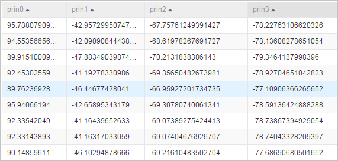

- 特征值和特征向量表

  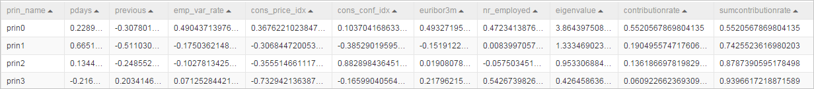

<a id="section-6-2-11-1-2"></a>

##### 6.2.11.1.2. 特征尺度变换

特征尺度变换算法组件支持对稠密或稀疏的数值类特征进行常见的尺度变换。

**功能介绍**

特征尺度变换的功能如下：

- 支持常见的log2、log10、ln、abs及sqrt等尺度变化函数。

- 支持稠密及稀疏数据格式。

**组件配置**

您可以使用以下任意一种方式，配置特征尺度变换组件参数。

**方式一：可视化方式**

在PAI-Designer（原PAI-Studio）工作流页面配置组件参数。

<table>
  <tr>
    <th>页签</th>
    <th>参数</th>
    <th>描述</th>
  </tr>
  <tr>
    <td rowspan="4">字段设置</td>
    <td>尺度变换特征</td>
    <td>需要缩放的特征。</td>
  </tr>
  <tr>
    <td>选择标签列</td>
    <td>如果您设置了该字段，则可以通过可视化方式查看特征到目标变量的x-y分布直方图。</td>
  </tr>
  <tr>
    <td>是否K:V,K:V稀疏特征</td>
    <td>训练数据是否为稀疏格式。当数据以稀疏格式存储时，通常所有数据存储在一个字段里，而不是每个数据单独存储在一个字段里。</td>
  </tr>
  <tr>
    <td>保留原变换的特征</td>
    <td>新特征加前缀<strong>scale_</strong>。</td>
  </tr>
  <tr>
    <td>参数设置</td>
    <td>尺度变化函数</td>
    <td><strong>特征尺度变换</strong>组件支持如下尺度变化函数：<br>• log2<br>• log10<br>• ln<br>• abs<br>• sqrt</td>
  </tr>
</table>

**方式二：PAI命令方式**

使用PAI命令方式，配置该组件参数。您可以使用SQL脚本组件进行PAI命令调用，详情请参见SQL脚本。

```text
PAI -name fe_scale_runner -project algo_public
    -Dlifecycle=28
    -DscaleMethod=log2
    -DscaleCols=nr_employed
    -DinputTable=pai_dense_10_1
    -DoutputTable=pai_temp_2262_20380_1;
```

| 参数名称 | 是否必选 | 参数描述 | 默认值 |
| --- | --- | --- | --- |
| inputTable | 是 | 输入表的表名称。 | 无 |
| inputTablePartitions | 否 | 输入表中指定参与训练的分区，格式为<code> Partition_name=v</code> <code>alue </code>。<br>如果是多级分区，格式为<code> name1=value1/nam</code> <code>e2=value2; </code>。<br>如果指定多个分区，则需要使用,隔开。 | 输入表的所有分区。 |
| outputTable | 是 | 缩放尺度后的结果表。 | 无 |
| scaleCols | 是 | 勾选需要缩放的特征。系统会自动筛选稀疏特征。您只能勾选数值类特征。 | 无 |
| labelCol | 否 | 标签字段。如果您设置了该字段，则可以通过可视化方式查看特征到目标变量的x-y分布直方图。 | 无 |
| categoryCols | 否 | 将勾选的字段作为枚举特征处理，并且不支持缩放。 | “” |
| scaleMethod | 否 | 缩放方法，取值如下：<br>• log2<br>• log10<br>• ln<br>• abs<br>• sqrt | log2 |
| scaleTopN | 否 | 当未勾选<strong>scaleCols</strong>参数时，系统自动挑选TopN个需要缩放的特征。 | 10 |
| isSparse | 否 | 是否为k:v的稀疏特征。 | 稠密数据 |
| itemSpliter | 否 | 稀疏特征item的分隔符。 | , |
| kvSpliter | 否 | 稀疏特征item的分隔符。 | : |
| lifecycle | 否 | 结果表的生命周期。 | 7 |
| coreNum | 否 | 节点个数。取值范围为\[1, 9999\]的正整数。与<strong>memSizePerCore</strong>参数配对使用。 | 系统自动分配。 |
| memSizePerCore | 否 | 单个节点的内存大小，单位为兆。取值范围为\[2048, 64 \* 1024\]的正整数。 | 系统自动分配。 |

**示例**

- 输入数据

  使用如下SQL生成输入数据。

  ```sql
  create table if not exists pai_dense_10_1 as
  select
      nr_employed
  from bank_data limit 10;
  ```

- 参数配置

  勾选**nr_employed**作为尺度变化特征，并且仅支持数值类特征。**尺度变化函数**选择log2，如下图所示。

  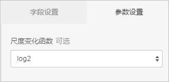

- 运行结果

  **nr_employed** 12.352071021075528

  12.34313018339218

  12.285286613666395

  12.316026916036957

  12.309533196497519

  12.352071021075528

  12.316026916036957

  12.316026916036957

  12.309533196497519

  12.316026916036957

<a id="section-6-2-11-1-3"></a>

##### 6.2.11.1.3. 特征离散

特征离散算法组件是将连续特征按照一定的规则进行离散化。

**功能介绍**

离散模块的功能如下：

- 支持稠密数值类特征离散。

- 支持等频离散和等距离离散等无监督离散。

  > **说明**
  >
  > 无监督离散的特征离散默认为等距离离散。

- 支持基于Gini增益离散和基于熵增益离散等有监督离散。

  > **说明**
  >
  > 标签类特征离散必须是枚举类型STRING或BIGINT类型。

- 有监督离散是根据熵增益不断遍历寻找切分断点，运行时间可能比较久。切分得到的分区数不受指定的maxBins参数限制。

**参数配置**

您可以使用以下任意一种方式，配置特征离散组件参数。

**方式一：可视化方式**

在PAI-Designer（原PAI-Studio）工作流页面配置组件参数。

<table>
  <tr>
    <th>页签</th>
    <th>参数</th>
    <th>描述</th>
  </tr>
  <tr>
    <td rowspan="2">字段设置</td>
    <td>离散的特征</td>
    <td>选择需要离散的特征。</td>
  </tr>
  <tr>
    <td>标签列</td>
    <td>如果您设置了该字段，则可以通过可视化方式查看特征到目标变量的<em>x-y</em>分布直方图。</td>
  </tr>
  <tr>
    <td rowspan="2">参数设置</td>
    <td>离散方法</td>
    <td>离散方法。取值如下：<br>• Isometric Discretization（等距离散）<br>• Isofrequecy Discretization（等频离散）<br>• Gini-gain-based Discretization（基于Gini增益离散）<br>• Entropy-gain-based Discretization（基于熵增益离散）</td>
  </tr>
  <tr>
    <td>离散区间个数</td>
    <td>离散区间的个数。取值为大于1的正整数。</td>
  </tr>
  <tr>
    <td rowspan="2">执行调优</td>
    <td>计算核心数</td>
    <td>计算的核心数目，取值为正整数。</td>
  </tr>
  <tr>
    <td>每个核心内存</td>
    <td>每个CPU分配的内存大小。</td>
  </tr>
</table>

**方式二：PAI命令方式**

使用PAI命令方式，配置该组件参数。您可以使用SQL脚本组件进行PAI命令调用，详情请参见SQL脚本。

```text
PAI -name fe_discrete_runner_1 -project algo_public
   -DdiscreteMethod=SameFrequecy
   -Dlifecycle=28
   -DmaxBins=5
   -DinputTable=pai_dense_10_1
   -DdiscreteCols=nr_employed
   -DoutputTable=pai_temp_2262_20382_1
   -DmodelTable=pai_temp_2262_20382_2;
```

| 参数名称 | 是否必选 | 参数描述 | 默认值 |
| --- | --- | --- | --- |
| inputTable | 是 | 输入表的表名称。 | 无 |
| inputTablePartitions | 否 | 输入表中指定参与训练的分区，格式为<code> Partition_name=value </code>。<br>如果是多级分区，格式为<code> name1=value1/name2=value2; </code>。<br>如果指定多个分区，则需要使用<em>,</em>隔开。 | 输入表的所有分区。 |
| outputTable | 是 | 离散后的结果表。 | 无 |
| discreteCols | 是 | 选择需要离散的特征。如果选择的是稀疏特征，则系统会自动筛选。 | <em>“”</em> |
| labelCol | 否 | 标签字段。如果您设置了该字段，则可以通过可视化方式查看特征到目标变量的<em>x-y</em>分布直方图。 | 无 |
| discreteMethod | 否 | 离散方法。取值如下：<br>• Isometric Discretization（等距离散）<br>• Isofrequecy Discretization（等频离散）<br>• Gini-gain-based Discretization（基于Gini增益离散）<br>• Entropy-gain-based Discretization（基于熵增益离散） | Isometric Discretization |
| maxBins | 否 | 离散区间个数。取值为大于1的正整数。 | 100 |
| lifecycle | 否 | 结果表生命周期。取值为正整数。 | 7 |
| coreNum | 否 | 节点个数。与<strong>memSizePerCore</strong>参数配对使用，取值为正整数。 | 系统自动分配。 |
| memSizePerCore | 否 | 单个节点内存大小，单位为兆。取值为正整数。 | 系统自动分配。 |

**示例**

- 输入数据

  使用 SQL生成输入数据。

  ```sql
  create table if not exists pai_dense_10_1 as
  select
      nr_employed
  from bank_data limit 10;
  ```

- 参数配置输入数据为*pai_dense_10_1*。离散特征选择*nr_employed*，离散方法选择*等距离散*，离散区间个数配置为*5*。

- 运行结果

  **nr_employed**

  4.0

  3.0

  1.0

  3.0

  2.0

  4.0

  3.0

  3.0

  2.0

  3.0

<a id="section-6-2-11-1-4"></a>

##### 6.2.11.1.4. 特征异常平滑

特征平滑组件可以将输入特征中包含异常的数据平滑到一定区间，支持稀疏和稠密数据格式。

**背景信息**

平滑方法如下：

- ZScore平滑

  如果特征分布遵循正态分布，则噪音一般集中在-3×alpha和3×alpha之外，ZScore是将该范围的数据平滑到[-3×alpha,3×alpha]之间。

  例如，某个特征遵循正态分布，均值为0，标准差为3。因此，-10的特征值会被识别为异常而修正为-3×3+0，即为-9。同理10会被修正为3×3+0，即为9，如下图所示。

  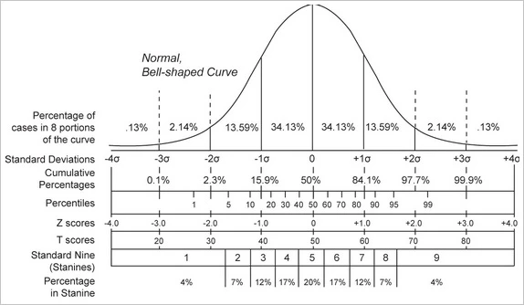

- 百分位平滑

  用于将分布不在[minPer, maxPer]的数据平滑到**minPer**和**maxPer**这两个分位点。

  例如，**age**特征取值0～200，设置**minPer**为0，**maxPer**为50%，则不在0～100的特征取值都会被修正成0或100。

- 阈值平滑

  用于将分布不在[minThresh, maxThresh]的数据平滑到**minThresh**和**maxThresh**这两个数据点。

  例如，**age**特征取值0～200，设置**minThresh**为10，**maxThresh**为80，则不在0～80的特征取值都会被修正成0或80。

- 箱线图平滑

  通过数据的4分位线构造光滑的上下界阈值，构造方式为：**minThresh=q1-1.5(q3-q1)**，**maxThresh=q3+1.5(q3-q1)**。

> **说明**
>
> 特征平滑算法组件只是将异常取值的特征值修正为正常值，本身不过滤或删除任何记录，输入数据维度和条数均不变。

**组件配置**

您可以使用以下任意一种方式，配置特征异常平滑组件参数。

**方式一：可视化方式**

在PAI-Designer（原PAI-Studio）工作流页面配置组件参数。

**页签**

**参数**

**描述**

需要平滑处理的特征列。

**选择平滑特征列**

**字段设置**

如果您设置了该字段，则可以通过可视化方式查看特征到目标变量的x-

**标签列**

y分布直方图。

平滑方法如下：

- ZScore平滑

- 百分位平滑

**平滑方法**

- 阈值平滑

- 箱线图平滑

置信水平。当平滑方法为**ZScore平**

**置信范围**

**滑**时需要配置该参数。

阈值最小值，默认为-9999，表示不设置。

**阈值下限**

当平滑方法为**阈值平滑**时需要配置该参数。

**参数设置**

阈值最大值，默认为-9999，表示不设置。

**阈值上限**

当平滑方法为**阈值平滑**时需要配置该参数。

最低百分位。

**百分位下限**

当平滑方法为**百分位平滑**或**箱线图平滑**时需要配置该参数。

最高百分位。

**百分位上限**

当平滑方法为**百分位平滑**或**箱线图平滑**时需要配置该参数。

**方式二：PAI命令方式**

使用PAI命令方式，配置该组件参数。您可以使用SQL脚本组件进行PAI命令调用，详情请参见SQL脚本。

```text
PAI -name fe_soften_runner -project algo_public
    -DminThresh=5000
    -Dlifecycle=28
    -DsoftenMethod=min-max-thresh
    -DsoftenCols=nr_employed
    -DmaxThresh=6000
    -DinputTable=pai_dense_10_1
    -DoutputTable=pai_temp_2262_20381_1;
```

| 参数名称 | 是否必选 | 参数描述 | 默认值 |
| --- | --- | --- | --- |
| inputTable | 是 | 输入表的表名 | 无 |
| inputTablePartitions | 否 | 输入表中指定参与训练的分区，格式为<code> Partition_name=v</code> <code>alue </code>。<br>如果是多级分区，格式为<code> name1=value1/nam</code> <code>e2=value2; </code>。<br>如果指定多个分区，则需要使用,隔开。 | 输入表的所有分区。 |
| outputTable | 是 | 平滑后的结果表。 | 无 |
| labelCol | 否 | 标签字段。如果您设置了该字段，则可以通过可视化方式查看特征到目标变量的x-y分布直方图。 | 默认为空 |
| categoryCols | 否 | 将勾选的字段作为枚举特征处理。 | 默认为空 |
| softenCols | 是 | 选择需要平滑的特征。如果特征为稀疏特征时，系统会自动化筛选。 | 无 |
| softenMethod | 否 | 平滑方法如下：<br>• <strong>ZScore</strong>：ZScore平滑<br>• <strong>min-max-per</strong>：百分位平滑<br>• <strong>min-max-thresh</strong>：阈值平滑<br>• <strong>boxplot</strong>：箱线图平滑 | ZScore |
| softenTopN | 否 | 当未勾选<strong>softenCols</strong>参数时，系统自动挑选TopN个需要平滑的特征。取值为正整数。 | 10 |
| cl | 否 | 置信水平。当平滑方法为<strong>ZScore平滑</strong>时需要配置该参数。 | 10 |
| minPer | 否 | 最低百分位。当平滑方法为<strong>百分位平滑</strong>或<strong>箱线图平</strong><strong>滑</strong>时需要配置该参数。 | 0.0 |
| maxPer | 否 | 最高百分位。当平滑方法为<strong>百分位平滑</strong>或<strong>箱线图平</strong><strong>滑</strong>时需要配置该参数。 | 1.0 |
| minThresh | 否 | 阈值最小值。当平滑方法为<strong>阈值平滑</strong>时需要配置该参数。 | -9999 |
| maxThresh | 否 | 阈值最大值。当平滑方法为<strong>阈值平滑</strong>时需要配置该参数。 | -9999 |
| isSparse | 否 | 是否为k:v的稀疏特征，取值如下：<br>• true<br>• false<br>默认为稠密数据。 | false |
| itemSpliter | 否 | 稀疏特征item的分隔符。 | , |
| kvSpliter | 否 | 稀疏特征item的分隔符。 | ： |
| lifecycle | 否 | 结果表生命周期。取值为正整数。 | 7 |
| coreNum | 否 | 节点个数。与<strong>memSizePerCore</strong>参数配对使用，取值为\[1, 9999\]的正整数。 | 系统自动分配。 |
| memSizePerCore | 否 | 单个节点内存大小，单位为兆。取值为\[2048, 64 \*1024\]的正整数。 | 系统自动分配。 |

**示例**

- 输入数据

  ```sql
  create table if not exists pai_dense_10_1 as
  select
      nr_employed
  from bank_data limit 10;
  ```

  **nr_employed**

  5228.1 5195.8

  4991.6

  5099.1

  5076.2

  5228.1

  5099.1

  5099.1

  5076.2

  5099.1

- 参数配置

  **平滑特征**选择nr_employed，**参数设置**中**平滑方法**选择阈值平滑，**阈值下限**为5000，**阈值上限**为6000，如下图所示。

  

- 运行结果

  **nr_employed**

  5228.1

  5195.8 5000.0

  5099.1

  5076.2

  5228.1

  5099.1

  5099.1

  5076.2

  5099.1

<a id="section-6-2-11-1-5"></a>

##### 6.2.11.1.5. 奇异值分解

奇异值分解（Singular Value Decomposition）是线性代数中一种重要的矩阵分解，是矩阵分析中正规矩阵求对角化的推广。在信号处理、统计学等领域有重要应用。

**背景信息**

奇异值分解的公式为 `X = U S V’` 。

**参数配置**

您可以使用以下任意一种方式，配置奇异值分解组件参数。

**方式一：可视化方式**

在PAI-Designer（原PAI-Studio）工作流页面配置组件参数。

**页签**

**参数**

**描述**

存放k:v，k:v格式的列。

**字段设置**

**选择特征列**

期望求解的top奇异组个数。默认求

**保留奇异值个数**

解全部奇异组。

**参数设置**

允许的期望的误差精度。

**精度误差**

单位为兆，与**节点个数**参数配对使用，取值为[1024, 64\*1024]的正

**单个节点内存大小**

整数。

**执行调优**

取值为[1, 9999]的正整数。

**节点个数**

指定输出表的生命周期。

**生命周期**

**方式二：PAI命令方式**

使用PAI命令方式，配置该组件参数。您可以使用SQL脚本组件进行PAI命令调用，详情请参见SQL脚本。

```text
PAI -name svd
    -project algo_public
    -DinputTableName=bank_data
    -DselectedColNames=col0
    -DenableSparse=true
    -Dk=5
    -DoutputUTableName=u_table
    -DoutputVTableName=v_table
    -DoutputSTableName=s_table;
```

| 参数名称 | 是否必选 | 参数描述 | 默认值 |
| --- | --- | --- | --- |
| inputTableName | 是 | 进行主成分分析的输入表。 | 无 |
| selectedColNames | 否 | 输入表中用于分析的列名称，使用逗号分隔。如果是稀疏矩阵，支持STRING类型。如果是表，支持INT和DOUBLE类型。 | 默认选择所有列。 |
| inputTablePartitions | 否 | 输入表中指定参与分析的分区，格式为<code> Partition_name=v</code> <code>alue </code>。<br>如果是多级分区，格式为<code> name1=value1/nam</code> <code>e2=value2</code>，<code> </code>。<br>如果指定多个分区，则需要使用,隔开。 | 默认选择所有分区。 |
| outputUTableName | 是 | U矩阵的输出表，维度是<code> m * sgNum </code>。其中，m为数据表的行数，sgNum为计算出的奇异值个数。 | 无 |


<table>
  <tr>
    <td>outputSTableName</td>
    <td>是</td>
    <td>S矩阵的输出表，维度是<code> sgNum * </code> <code>sgNum </code>。其中，sgNum为计算出的奇异值个数。</td>
    <td>无</td>
  </tr>
  <tr>
    <td>outputVTableName</td>
    <td>是</td>
    <td>V矩阵的输出表，维度是<code> n * sgNum </code>。其中，n是矩阵的列数，sgNum是计算出的奇异值个数。</td>
    <td>无</td>
  </tr>
  <tr>
    <td>k</td>
    <td>是</td>
    <td>期望的奇异值个数。输出的结果为可能比K值小的正整数。</td>
    <td>无</td>
  </tr>
  <tr>
    <td>tol</td>
    <td>否</td>
    <td>收敛误差</td>
    <td>1.0e~06</td>
  </tr>
  <tr>
    <td>enableSparse</td>
    <td>否</td>
    <td>输入数据是否为稀疏格式：<br>• true<br>• false</td>
    <td>false</td>
  </tr>
  <tr>
    <td>itemDelimiter</td>
    <td>否</td>
    <td>指当输入表数据为稀疏格式时，kv间的分隔符。</td>
    <td>空格</td>
  </tr>
  <tr>
    <td>kvDelimiter</td>
    <td>否</td>
    <td>指当输入表数据为稀疏格式时，key和value的分隔符。</td>
    <td>冒号</td>
  </tr>
  <tr>
    <td>coreNum</td>
    <td>否</td>
    <td>节点个数。与<strong>memSizePerCore</strong>参数配对使用，取值为[1, 9999]的正整数。</td>
    <td>系统自动分配。</td>
  </tr>
  <tr>
    <td>memSizePerCore</td>
    <td>否</td>
    <td>单个节点内存大小，单位为兆。取值为[1024, 64*1024]的正整数。</td>
    <td>系统自动分配。</td>
  </tr>
  <tr>
    <td>lifecycle</td>
    <td>否</td>
    <td>指定输出表的生命周期。取值为正整数。</td>
    <td>无</td>
  </tr>
</table>

**示例**

- 数据生成

  ```sql
  drop table if exists svd_test_input;
  create table svd_test_input
  as
  select
      *
  from
  (
    select
          '0:3.9079 2:0.0009 3:0.0416 4:0.17664 6:0.36460 8:0.091330' as col0
      from dual
      union all
    select
          '0:0.09229 2:0.4872172 5:0.5267 8:0.4544 9:0.23317' as col0
      from dual
      union all
      select
      '1:0.8312 3:0.9317 5:0.5680 7:0.5560 9:0.0508' as col0
      from dual
      union all
      select
      '2:0.767 5:0.01891 8:0.25235 ' as col0
      from dual
      union all
      select
      '0:0.29819 2:0.87598086 6:0.5315568 ' as col0
      from dual
      union all
      select
      '0:0.920260 2:0.5154311513 4:0.8104 5:0.188420 8:0.88' as col0
      from dual
  ) a;
  ```

- PAI命令

  ```text
  PAI -name svd
      -project algo_public
      -DinputTableName=svd_test_input
      -DselectedColNames=col0
      -DenableSparse=true
      -Dk=5
      -DoutputUTableName=u_table
      -DoutputVTableName=v_table
      -DoutputSTableName=s_table;
  ```

- 算法规模：10万列。

<a id="section-6-2-11-1-6"></a>

##### 6.2.11.1.6. 异常检测

异常检测用于检测连续值和枚举值类特征的数据，帮助您挖掘数据中的异常点。

**背景信息**

异常检测的方法包括箱型图（Box-plot）和AVF（Attribute Value Frequency）：

- 箱型图用于检测连续值类特征的数据，根据箱线图最大值和最小值检测异常特征。

- AVF用于检测枚举值类特征的数据，根据枚举特征的取值频率及阈值检测异常特征。

**组件配置**

您可以使用以下任意一种方式，配置异常检测组件参数。

**方式一：可视化方式**

在PAI-Designer（原PAI-Studio）工作流页面配置组件参数。

<table>
  <tr>
    <th>页签</th>
    <th>参数</th>
    <th>描述</th>
  </tr>
  <tr>
    <td rowspan="2">字段设置</td>
    <td>特征列</td>
    <td>选择需要分析的字段。</td>
  </tr>
  <tr>
    <td>异常检测方法</td>
    <td>选择检测的方法。箱型图用于检测连续类特征。AVF用于检测枚举类特征。</td>
  </tr>
</table>

**方式二：PAI命令方式**

使用PAI命令方式，配置该组件参数。您可以使用SQL脚本组件进行PAI命令调用，详情请参见SQL脚本。

```text
PAI -name fe_detect_runner -project algo_public
     -DselectedCols="emp_var_rate,cons_price_rate,cons_conf_idx,euribor3m,nr_employed" 
\
     -Dlifecycle="28"
     -DdetectStrategy="boxPlot"
     -DmodelTable="pai_temp_2458_23565_2"
     -DinputTable="pai_bank_data"
     -DoutputTable="pai_temp_2458_23565_1";
```

| 参数名称 | 参数描述 | 是否必选 |
| --- | --- | --- |
| inputTable | 输入表的表名。 | 是 |

<table>
  <tr>
    <td>inputTablePartitions</td>
    <td>系统默认选择所有分区。指定输入表的分区：<br>• 指定单个分区，格式为<code> partition_name=value </code>。<br>• 指定多个分区，格式为<code> name1=value1,name2=val</code> <code>ue2 </code>。<br>说明多个分区之间用英文逗号（,）分隔。<br>• 指定多级分区，格式为<code> name1=value1/name2=val</code> <code>ue2 </code>。</td>
    <td>否</td>
  </tr>
  <tr>
    <td>selectedCols</td>
    <td>输入特征，字段类型没有限制。</td>
    <td>是</td>
  </tr>
  <tr>
    <td>detectStrategy</td>
    <td>系统支持Box-plot和AVF选项。Box-plot用于检测连续值类特征。AVF用于检测枚举值类特征。</td>
    <td>是</td>
  </tr>
  <tr>
    <td>outputTable</td>
    <td>异常检测结果数据集，即检测到异常特征的数据集。</td>
    <td>是</td>
  </tr>
  <tr>
    <td>modelTable</td>
    <td>异常检测模型。</td>
    <td>是</td>
  </tr>
  <tr>
    <td>lifecycle</td>
    <td>输出表的生命周期，系统默认为7。</td>
    <td>否</td>
  </tr>
  <tr>
    <td>coreNum</td>
    <td>节点个数，与参数memSizePerCore配对使用，取值范围[1,9999]。<br>说明仅支持配置正整数。</td>
    <td>否</td>
  </tr>
  <tr>
    <td>memSizePerCore</td>
    <td>单个结点内存大小，取值范围[2048,64 *1024]，单位MB。</td>
    <td>否</td>
  </tr>
</table>

<a id="section-6-2-11-2"></a>

#### 6.2.11.2. 特征重要性评估

<a id="section-6-2-11-2-1"></a>

##### 6.2.11.2.1. 线性模型特征重要性

计算线性模型的特征重要性，包括线性回归和二分类逻辑回归，支持稀疏和稠密数据格式。

**组件配置**

您可以使用以下任意一种方式，配置线性模型特征重要性组件参数。

**方式一：可视化方式**

在PAI-Designer（原PAI-Studio）工作流页面配置组件参数。

<table>
  <tr>
    <th>页签</th>
    <th>参数</th>
    <th>描述</th>
  </tr>
  <tr>
    <td rowspan="3">字段设置</td>
    <td>选择特征列</td>
    <td>输入表中，用于训练的特征列。默认选中除Label外的所有列，为可选项。</td>
  </tr>
  <tr>
    <td>选择目标列</td>
    <td>该参数为必选项。<br>单击图标，在<strong>选择字段</strong>对话框中，输入关键字搜索列，选中后单击<strong>确</strong><strong>定</strong>。</td>
  </tr>
  <tr>
    <td>输入表数据是否为稀疏格式</td>
    <td>可选项。</td>
  </tr>
  <tr>
    <td rowspan="2">执行调优</td>
    <td>计算核心数</td>
    <td>计算的核心数，可选。</td>
  </tr>
  <tr>
    <td>每个核内存大小</td>
    <td>每个核的内存大小，单位为MB，可选。</td>
  </tr>
</table>

**方式二：PAI命令方式**

使用PAI命令方式，配置该组件参数。您可以使用SQL脚本组件进行PAI命令调用，详情请参见SQL脚本。

```text
PAI -name regression_feature_importance -project algo_public
    -DmodelName=xlab_m_logisticregressi_20317_v0
    -DoutputTableName=pai_temp_2252_20321_1
    -DlabelColName=y
    -
DfeatureColNames=pdays,previous,emp_var_rate,cons_price_idx,cons_conf_idx,euribor3m,nr_em
oyed,age,campaign
    -DenableSparse=false -DinputTableName=pai_dense_10_9;
```

| 参数 | 是否必选 | 描述 | 默认值 |
| --- | --- | --- | --- |
| inputTable Name | 是 | 输入表的表名。 | 无 |
| outputTabl eName | 是 | 输出表的表名。 | 无 |
| labelColNa me | 是 | 输入表的标签列名。 | 无 |
| modelNam e | 是 | 输入的模型名称。 | 无 |
| featureCol Names | 否 | 输入表选择的特征列。 | 除Label外的所有列 |
| inputTable Partitions | 否 | 输入表选择的分区名称。 | 选择全表 |
| enableSpar se | 否 | 输入表是否为稀疏格式。 | false |
| itemDelimi ter | 否 | 当输入表数据为稀疏格式时，KV对之间的分隔符。 | 空格 |
| kvDelimite r | 否 | 当输入表数据为稀疏格式时，Key和Value之间的分隔符。 | 英文冒号（:） |
| lifecycle | 否 | 输出表的生命周期。 | 不设置 |
| coreNum | 否 | 核心数。 | 自动计算 |
| memSizePe rCore | 否 | 内存数。 | 自动计算 |

**示例**

1. 使用SQL语句，生成训练数据。

   ```sql
   create table if not exists pai_dense_10_9 as
   select
       age,campaign,pdays, previous, emp_var_rate, cons_price_idx, cons_conf_idx, euribor3m, nr_employed, y
   from  bank_data limit 10;
   ```

2. 构建如下实验，详情请参见算法建模。

   **y**为逻辑回归多分类组件的标签列，其它字段为特征列，其它参数使用默认值。

   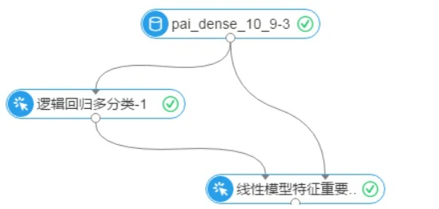

3. 运行实验，查看预测结果。

   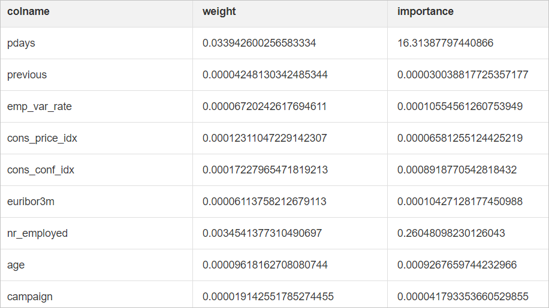

   指标计算公式如下。

   <table>
     <tr>
       <th width="118">列名</th>
       <th>公式</th>
     </tr>
     <tr>
       <td>weight</td>
       <td>abs(w_)</td>
     </tr>
     <tr>
       <td>importance</td>
       <td>abs(w_j) * STD(f_i)<br>说明表示特征系数的绝对值 * 训练数据的标准差。</td>
     </tr>
   </table>

4. 运行完成后，右键单击线性模型特征重要性组件，选择**查看分析报告**，查看结果。

   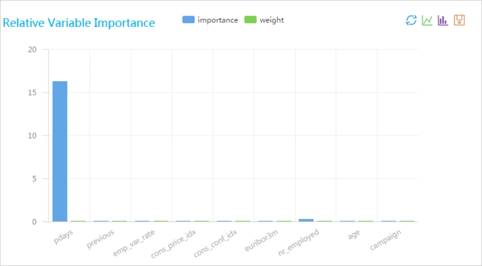

<a id="section-6-2-11-2-2"></a>

##### 6.2.11.2.2. 随机森林特征重要性

您可以使用原始数据和随机森林模型，计算特征重要性。

**组件配置**

您可以使用以下任意一种方式，配置随机森林特征重要性组件参数。

**方式一：可视化方式**

在PAI-Designer（原PAI-Studio）工作流页面配置组件参数。

<table>
  <tr>
    <th>页签</th>
    <th>参数</th>
    <th>描述</th>
  </tr>
  <tr>
    <td rowspan="2">字段设置</td>
    <td>选择特征列</td>
    <td>输入表中，用于训练的特征列。默认选中除Label外的所有列，为可选项。</td>
  </tr>
  <tr>
    <td>选择目标列</td>
    <td>该参数为必选项。<br>单击图标，在<strong>选择字段</strong>对话框中，输入关键字搜索列，选中后单击<strong>确定</strong>。</td>
  </tr>
  <tr>
    <td rowspan="2">参数设置</td>
    <td>并行计算核数</td>
    <td>并行计算的核心数，可选。</td>
  </tr>
  <tr>
    <td>每个核内存大小</td>
    <td>每个核的内存大小，单位为MB，可选。</td>
  </tr>
</table>

**方式二：PAI命令方式**

使用PAI命令方式，配置该组件参数。您可以使用SQL脚本组件进行PAI命令调用，详情请参见SQL脚本。

```text
pai -name feature_importance -project algo_public
    -DinputTableName=pai_dense_10_10
    -DmodelName=xlab_m_random_forests_1_20318_v0
    -DoutputTableName=erkang_test_dev.pai_temp_2252_20319_1
    -DlabelColName=y
    -
DfeatureColNames="pdays,previous,emp_var_rate,cons_price_idx,cons_conf_idx,euribor3m,nr_e
loyed,age,campaign,poutcome"
    -Dlifecycle=28 ;
```

| 参数名称 | 是否必选 | 描述 | 默认值 |
| --- | --- | --- | --- |
| inputTableName | 是 | 输入表的名称 | 无 |
| outputTableName | 是 | 输出表的名称 | 无 |
| labelColName | 是 | 输入表的标签列名 | 无 |
| modelName | 是 | 输入的模型名称 | 无 |
| featureColNames | 否 | 输入表选择的特征列 | 除Label外的所有列 |
| inputTablePartitions | 否 | 输入表选择的分区名称 | 选择全表 |
| lifecycle | 否 | 输出表的生命周期 | 不设置 |
| coreNum | 否 | 核心数 | 自动计算 |
| memSizePerCore | 否 | 内存数 | 自动计算 |

**示例**

1. 使用SQL语句，生成训练数据。

   ```sql
   drop table if exists pai_dense_10_10;
   create table if not exists pai_dense_10_10 as
   select
       age,campaign,pdays, previous, poutcome, emp_var_rate, cons_price_idx, 
   cons_conf_idx, euribor3m, nr_employed, y
   from  bank_data limit 10;
   ```

2. 构建如下实验，详情请参见算法建模。

   数据源为**pai_dense_10_10**，**y**为随机森林的标签列，其它列为特征列。**强制转换列**选择**age**和**campaign**，表示将这两列作为枚举特征处理，其它使用默认参数。

   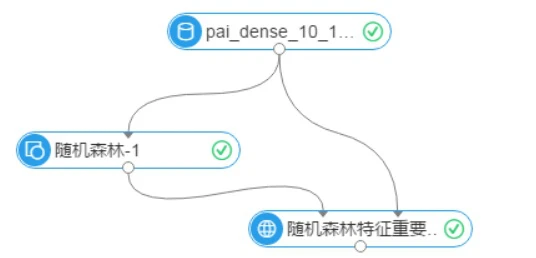

3. 运行实验，查看预测结果。

   

4. 运行完成后，右键单击随机森林特征重要性组件，选择**查看分析报告**，查看结果。

   

<a id="section-6-2-11-3"></a>

#### 6.2.11.3. 特征选择

<a id="section-6-2-11-3-1"></a>

##### 6.2.11.3.1. 过滤式特征选择

根据您使用的不同特征选择方法，从所有稀疏或稠密格式的特征数据中选择并过滤出TopN的特征数据，同时保存为特征重要性表，实现了降低模型训练的难度和提高训练模型的精确度。本文为您介绍PAI-Designer（原PAI-Studio）提供的过滤式特征选择组件的参数配置和使用示例。

**使用限制**

过滤式特征选择不支持过滤libsvm和kv数据格式。

**组件配置**

您可以使用以下任意一种方式，配置过滤式特征选择组件参数。

**方式一：可视化方式**

在PAI-Designer（原PAI-Studio）工作流页面配置组件参数。

**页签**

**参数**

**描述**

输入表中用于训练的特征列。

**选择特征列**

输入表中选择的目标列名称。

**选择目标列**

**字段设置**

选中的特征将被视做枚举特征处理，支持INT或DOUBLE

**枚举类特征**

类型。

是否是K:V的稀疏特征。

**是否K:V,K:V稀疏特征**

<table>
  <tr>
    <td rowspan="4">参数设置</td>
    <td>特征选择方法</td>
    <td>特征选择的方法，取值如下：<br>• IV：用来衡量特征预测能力的指标。<br>• Gini增益：主要用于单特征重要性评估。<br>• 信息增益：用于度量多特征之间的差异。<br>• Lasso：用于超大规模特征的降维筛选。</td>
  </tr>
  <tr>
    <td>挑选TopN特征</td>
    <td>挑选的TopN个特征，如果TopN大于输入特征数，则输出所有特征。</td>
  </tr>
  <tr>
    <td>连续特征分区方式</td>
    <td>连续特征分区的方式，取值如下：<br>• 自动化分区<br>• 等距离分区</td>
  </tr>
  <tr>
    <td>连续特征离散区间数</td>
    <td>仅<strong>连续特征分区方式</strong>选择<strong>等距离分区</strong>时，才需要配置该参数。</td>
  </tr>
</table>

**方式二：PAI命令方式**

使用PAI命令方式，配置该组件参数。您可以使用SQL脚本组件进行PAI命令调用，详情请参见SQL脚本。

```text
PAI -name fe_select_runner -project algo_public 
     -DfeatImportanceTable=pai_temp_2260_22603_2 
     -DselectMethod=iv 
     -
DselectedCols=pdays,previous,emp_var_rate,cons_price_idx,cons_conf_idx,euribor3m,nr_emplo
d,age,campaign 
     -DtopN=5 
     -DlabelCol=y 
     -DmaxBins=100 
     -DinputTable=pai_dense_10_9 
     -DoutputTable=pai_temp_2260_22603_1;
```

| 参数名称 | 是否必选 | 描述 | 默认值 |
| --- | --- | --- | --- |
| inputTable | 是 | 输入的表名称。 | 无 |
| inputTablePartitio ns | 否 | 输入表中参与训练的分区。系统支持以下格式：<br>• Partition_name=value<br>• <strong>name1=value1/name2=value2</strong>：多级分区<br>说明指定多个分区时，分区之间使用英文逗号（,）分隔。 | 所有分区 |
| outputTable | 是 | 过滤后的特征结果表。 | 无 |
| featImportanceTab le | 是 | 存放所有输入特征的重要性权重值。 | 无 |
| selectedCols | 是 | 用于训练的特征列。 | 无 |
| labelCol | 是 | 输入表中选中的目标列。 | 无 |
| categoryCols | 否 | 枚举类特征，只能为INT或DOUBLE类型。 | 无 |
| maxBins | 否 | 连续类特征划分的最大区间数。 | 100 |
| selectMethod | 否 | 特征选择的方法，取值包括：iv、GiniGain、InfoGain和Lasso。 | iv |
| topN | 否 | 挑选的TopN个特征，如果TopN大于输入特征数，则输出所有特征。 | 10 |
| isSparse | 否 | 是否是k:v的稀疏特征，false为稠密特征。 | false |

**示例**

- 输入数据

  使用SQL语句生成测试数据。

  ```sql
  create table if not exists pai_dense_10_9 as 
  select  
      
  age,campaign,pdays,previous,emp_var_rate,cons_price_idx,cons_conf_idx,euribor3m,nr_empl
  ed,y
  from bank_data limit 10;
  ```

- 参数配置

  输入数据为pai_dense_10_9。**选择目标列**选择y列，**选择特征列**选择除y列之外的其他所有列，详细参数配置如下图所示。

  图 1. 字段设置

  

  图 2. 参数设置

  

- 运行结果

  左输出为过滤后的数据，如下表所示。

  | pdays | nr_employe d | emp_var_rat e | cons_conf_i dx | cons_price_i dx | y |
  | --- | --- | --- | --- | --- | --- |
  | 999.0 | 5228.1 | 1.4 | -36.1 | 93.444 | 0.0 |
  | 999.0 | 5195.8 | -0.1 | -42.0 | 93.2 | 0.0 |
  | 6.0 | 4991.6 | -1.7 | -39.8 | 94.055 | 1.0 |
  | 999.0 | 5099.1 | -1.8 | -47.1 | 93.075 | 0.0 |
  | 3.0 | 5076.2 | -2.9 | -31.4 | 92.201 | 1.0 |
  | 999.0 | 5228.1 | 1.4 | -42.7 | 93.918 | 0.0 |
  | 999.0 | 5099.1 | -1.8 | -46.2 | 92.893 | 0.0 |
  | 999.0 | 5099.1 | -1.8 | -46.2 | 92.893 | 0.0 |
  | 3.0 | 5076.2 | -2.9 | -40.8 | 92.963 | 1.0 |
  | 999.0 | 5099.1 | -1.8 | -47.1 | 93.075 | 0.0 |

  右输出为特征重要性表，**featname**存放特征名称，**weight**表示特征选择方法计算出来的权重。具体表结构如下所示。

  | featname | weight |
  | --- | --- |
  | pdays | 30.675544191232486 |
  | nr_employed | 29.08332850085075 |
  | emp_var_rate | 29.08332850085075 |
  | cons_conf_idx | 28.02710269740324 |
  | cons_price_idx | 28.02710269740324 |
  | euribor3m | 27.829058450563718 |
  | age | 27.829058450563714 |
  | previous | 14.319325030742775 |
  | campaign | 10.658129656314467 |

<a id="section-6-2-11-4"></a>

#### 6.2.11.4. 特征生成

<a id="section-6-2-11-4-1"></a>

##### 6.2.11.4.1. 特征编码

特征编码是将非线性特征通过GBDT编码成线性特征。

**功能介绍**

特征编码由决策树和Ensemble算法挖掘新特征的一种策略，特征来自一个或多个特征组成的决策树叶子结点的one-hot结果。

例如，下图有三棵树，共有12个叶子结点。根据树的顺序依次编码为0~11号特征，其中第一棵树的叶子结点占据0~3号特征，第二棵树占据4~7号特征，第三棵树占据8~11号特征。该编码策略可以有效转换GBDT非线性特征为线性特征。


**组件配置**

您可以使用以下任意一种方式，配置特征编码组件参数。

**方式一：可视化方式**

在PAI-Designer（原PAI-Studio）工作流页面配置组件参数。

**页签**

**参数**

**描述**

输入表中，用于训练的特征列。

**特征列**

该参数为必选项。

单击  图标，在**选择字段**对话框

**标签列**

**字段设置**

中，输入关键字搜索列，选中后单击**确定**。

可选，保留原特征至输出结果表。

**附加输出列**

计算的核心数，格式为正整数。

**计算核心数**

**参数设置**

每个核心的内存数量，格式为正整

**每个核心内存数**

数。

**方式二：PAI命令方式**

使用PAI命令方式，配置该组件参数。您可以使用SQL脚本组件进行PAI命令调用，详情请参见SQL脚本。

```text
PAI -name fe_encode_runner -project algo_public
    -DinputTable="pai_temp_2159_19087_1"
    -DencodeModel="xlab_m_GBDT_LR_1_19064"
    -
DselectedCols="pdays,previous,emp_var_rate,cons_price_idx,cons_conf_idx,euribor3m,nr_empl
ed,age,campaign"
    -DlabelCol="y"
    -DoutputTable="pai_temp_2159_19061_1";
   -DcoreNum=10
   -DmemSizePerCore=1024
```

| 参数名称 | 是否必选 | 描述 | 默认值 |
| --- | --- | --- | --- |
| inputTable | 是 | 输入表的名称。 | 无 |
| inputTablePartitions | 否 | 输入表中指定参与训练的分区，格式为<strong>partition_name=v</strong> <strong>alue</strong>。如果是多级，格式为<strong>name1=value1/na</strong> <strong>me2=value2</strong>。如果指定多个分区，使用英文逗号（,）分隔。 | 输入表的所有分区 |
| encodeModel | 是 | 编码的输入GBDT二分类的模型。 | 无 |
| outputTable | 是 | 缩放尺度后的结果表。 | 无 |
| selectedCols | 是 | 勾选GBDT参与编码的特征，通常是GBDT组件的训练特征。 | 无 |
| labelCol | 是 | 标签字段。 | 无 |
| lifecycle | 否 | 结果表的生命周期。 | 7 |
| coreNum | 否 | 指定Instance的总数，支持BIGINT类型。 | -1，会根据输入数据量计算需要的Instance的数量。 |
| memSizePerCore | 否 | 指定memory大小。 | -1，会根据输入数据量计算需要的内存大小。 |

**示例**

1. 使用SQL语句，生成训练数据。

   ```sql
   CREATE TABLE IF NOT EXISTS tdl_pai_bank_test1
   (
       age            BIGINT COMMENT '',
       campaign       BIGINT COMMENT '',
       pdays          BIGINT COMMENT '',
       previous       BIGINT COMMENT '',
       emp_var_rate   DOUBLE COMMENT '',
       cons_price_idx DOUBLE COMMENT '',
       cons_conf_idx  DOUBLE COMMENT '',
       euribor3m      DOUBLE COMMENT '',
       nr_employed    DOUBLE COMMENT '',
       y              BIGINT COMMENT ''
   )
   LIFECYCLE 7;
   insert overwrite table tdl_pai_bank_test1
   select * from
   (select 53 as age,1 as campaign,999 as pdays,0 as previous,-0.1 as emp_var_rate,
          93.2 as cons_price_idx,-42.0 as cons_conf_idx, 4.021 as euribor3m,5195.8 as nr_employed,0 as y
   from dual
   union all
   select 28 as age,3 as campaign,6 as pdays,2 as previous,-1.7 as emp_var_rate,
          94.055 as cons_price_idx,-39.8 as cons_conf_idx, 0.729 as euribor3m,4991.6 as nr_employed,1 as y
   from dual
   union all
   select 39 as age,2 as campaign,999 as pdays,0 as previous,-1.8 as emp_var_rate,
          93.075 as cons_price_idx,-47.1 as cons_conf_idx, 1.405 as euribor3m,5099.8 as nr_employed,0 as y
   from dual
   union all
   select 55 as age,1 as campaign,3 as pdays,1 as previous,-2.9 as emp_var_rate,
          92.201 as cons_price_idx,-31.4 as cons_conf_idx, 0.869 as euribor3m,5076.2 as nr_employed,1 as y
   from dual
   union all
   select 30 as age,8 as campaign,999 as pdays,0 as previous,1.4 as emp_var_rate,
          93.918 as cons_price_idx,-42.7 as cons_conf_idx, 4.961 as euribor3m,5228.2 as nr_employed,0 as y
   from dual
   union all
   select 37 as age,1 as campaign,999 as pdays,0 as previous,-1.8 as emp_var_rate,
          92.893 as cons_price_idx,-46.2 as cons_conf_idx, 1.327 as euribor3m,5099.1 as nr_employed,0 as y
   from dual
   union all
   select 39 as age,1 as campaign,999 as pdays,0 as previous,-1.8 as emp_var_rate,
          92.893 as cons_price_idx,-46.2 as cons_conf_idx, 1.313 as euribor3m,5099.1 as nr_employed,0 as y
   from dual
   union all
   select 36 as age,1 as campaign,3 as pdays,1 as previous,-2.9 as emp_var_rate,
          92.963 as cons_price_idx,-40.8 as cons_conf_idx, 1.266 as euribor3m,5076.2 as nr_employed,1 as y
   from dual
   union all
   select 27 as age,2 as campaign,999 as pdays,1 as previous,-1.8 as emp_var_rate,
          93.075 as cons_price_idx,-47.1 as cons_conf_idx, 1.41 as euribor3m,5099.1 as nr_employed,0 as y
   from dual
   ) a
   ```

2. 构建如下实验，通常与GBDT二分类组件配合使用。详情请参见算法建模。

   设置GBDT二分类组件的参数，树的数目为5，树的最大深度为3，**y**为标签列，其它字段为特征列。

   

3. 运行实验，查看预测结果。

   | kv | y |
   | --- | --- |
   | 2:1,5:1,8:1,12:1,15:1,18:1,28:1,34:1,41:1,50:1,5 3:1,63:1,72:1 | 0.0 |
   | 2:1,5:1,6:1,12:1,15:1,16:1,28:1,34:1,41:1,50:1,5 1:1,63:1,72:1 | 0.0 |
   | 2:1,3:1,12:1,13:1,28:1,34:1,36:1,39:1,55:1,61:1 | 1.0 |
   | 2:1,3:1,12:1,13:1,20:1,21:1,22:1,42:1,43:1,46:1, 63:1,64:1,67:1,68:1 | 0.0 |
   | 0:1,10:1,28:1,29:1,32:1,36:1,37:1,55:1,56:1,59: 1 | 1.0 |

   输出的效果可以直接输入至逻辑回归二分类或多分类组件，通常效果会比单独使用LR或GDBT的效果好，且不易拟合。

<a id="section-6-2-11-4-2"></a>

##### 6.2.11.4.2. one-hot编码

one-hot编码，也称独热编码，对于每一个特征，如果它有m个可能值，那么经过独热编码后，就变成了m个二元特征。此外，这些特征互斥，每次只有一个激活。因此，经过独热编码后数据会变成稀疏的，输出结果也是KV的稀疏结构。

**功能介绍**

one-hot编码组件包括训练和预测功能：

- one-hot编码组件训练功能：

  - 输入节点：该组件第一个输入节点（左）是训练数据的输入，训练时无需设置输入节点（右）。

  - 输出节点：该组件有两个输出节点，一个是编码后的结果数据表（左），另一个是模型表（右），该模型表用于对同类型的新数据进行one-hot编码。

- one-hot编码组件预测功能

  one-hot组件的第二个输入节点（右）是one-hot的模型输入，可以利用已有的one-hot模型对新数据进行one-hot编码。

**组件配置**

您可以使用以下任意一种方式，配置one-hot编码组件参数。

**方式一：可视化方式**

在PAI-Designer（原PAI-Studio）工作流页面配置组件参数。

**页签**

**参数**

**描述**

选择二值化的字段，必选项。

**选择二值化列**

勾选特征保留输出在KV对。勾选的字段当作特征（不进行one-hot编

**其他保留特征**

码）输出至KV字段中，保留的特征会从0开始编码，该字段必须为

**字段设置**

DOUBLE类型。

附加在输出表的列，可选项。

**附加列**

<table>
  <tr>
    <td rowspan="6">参数设置</td>
    <td>生命周期</td>
    <td>表的生命周期，默认值为7。</td>
  </tr>
  <tr>
    <td>输出表的类型</td>
    <td>包括<strong>kv</strong>和<strong>table</strong>。当离散特征较多时，建议输出kv格式，table仅支持1024列，超出将报错。</td>
  </tr>
  <tr>
    <td>节点个数</td>
    <td>节点的个数。</td>
  </tr>
  <tr>
    <td>单个结点内存大小</td>
    <td>单个结点的内存大小，单位为MB。</td>
  </tr>
  <tr>
    <td>删除最后一个枚举量的编码</td>
    <td>该参数为<strong>true</strong>时，可以保证编码后数据的线性无关性。</td>
  </tr>
  <tr>
    <td>忽略待编码数据中的空元素</td>
    <td>该参数为<strong>true</strong>时，表示不对空元素编码。</td>
  </tr>
</table>

**方式二：PAI命令方式**

使用PAI命令方式，配置该组件参数。您可以使用SQL脚本组件进行PAI命令调用，详情请参见SQL脚本。

```text
PAI -name one_hot
  -project algo_public
    -DinputTable=one_hot_test
    -DbinaryCols=f0,f1,f2
    -DmodelTable=one_hot_model
    -DoutputTable=one_hot_output
    -Dlifecycle=28;
```

| 参数名称 | 是否必选 | 描述 | 默认值 |
| --- | --- | --- | --- |
| inputTable | 是 | 输入表的名称 | 无 |
| inputTablePartitions | 否 | 输入表选择的分区名称 | 输入表的所有分区 |
| binaryCols | 是 | one-hot编码字段，必须是枚举类特征，字段可以是任意类型。 | 无 |
| reserveCols | 否 | 勾选的字段当作特征（不进行one-hot编码）输出至KV字段中，保留的特征会从0开始编码，该字段必须为DOUBLE类型。 | 空字符串 |
| appendCols | 否 | 勾选的字段原封不动地输出输入表的字段至输出表中。 | 无 |
| outputTable | 是 | one-hot后的结果表，编码结果保存在KV字段中。 | 无 |
| inputModelTable | 否 | one-hot编码的输入模型表。<br>说明<br>inputModelTabl <strong>e</strong>和<strong>outputModel</strong> <strong>Table</strong>中必须有一个为非空字符串。 | 空字符串 |
| outputModelTable | 否 | one-hot编码的输出模型表。<br>说明<br>inputModelTabl <strong>e</strong>和<strong>outputModel</strong> <strong>Table</strong>中必须有一个为非空字符串。 | 空字符串 |
| lifecycle | 否 | 输出表的生命周期 | 7 |
| dropLast | 是 | 是否删除最后一个枚举量的编码。该参数为<strong>true</strong>时，可以保证编码后数据的线性无关性。 | false |
| outputTableType | 是 | 输出表的类型，包括稀疏表和稠密表。当离散特征较多时，建议输出<strong>kv</strong>格式.<strong>table</strong>仅支持1024列，超出将报错。 | kv |
| ignoreNull | 是 | 是否忽略待编码数据中的空元素。该参数为true时，表示不对空元素编码。 | false |
| coreNum | 否 | 节点的个数。 | 自动计算 |
| memSizePerCore | 否 | 单个结点的内存大小，单位为MB，范围为\[2048, 64\*1024\]。 | 自动计算 |

> **说明**
>
> - **inputModelTable**、**outputModelTable**至少一个参数非空。当**inputModelTable**非空时，其对应的表应该为非空的模型表。
>
> - 编码字段列中，离散值个数可以支持至千万量级。
>
> - 当训练的模型作为下次编码使用的模型时，由于**dropLast**、**ignoreNull**和**reserveCols**编码参数的效果已封装到模型中，无法进行调整。如果您需要调整，则必须重新训练。
>
> - 建议输出表使用kv格式。当使用表时，列数最多为1024列。当超出该值则会报错，无法完成编码任务。
>
> - one-hot编码生成的kv表默认从0开始编号。
>
> - 当使用模型编码新数据时，如果在模型映射表中无法找到数据中的离散量，则忽略该离散量，即不对该离散量编码。如果需要对其进行编码，请重新训练模型映射表。

**示例**

1. 使用SQL语句，生成训练数据。

   ```text
   PAI -project projectxlib4
     -name one_hot
     -DinputTable=one_hot_yh
     -DbinaryCols=f0,f2,f4
     -DoutputModelTable=one_hot_model_8
     -DoutputTable=one_hot_in_table_1_output_8
     -DdropLast=false
     -DappendCols=f0,f2,f4
     -DignoreNull=false
     -DoutputTableType=table
     -DreserveCols=f3
     -DcoreNum=4
     -DmemSizePerCore=2048;
   ```

2. 测试输入表如下。

   | f0 | f1 | f2 | f3 | f4 |
   | --- | --- | --- | --- | --- |
   | 12 | prefix1 | 1970-09-15 12:50:22 | 0.1 | true |
   | 12 | prefix3 | 1971-01-22 03:15:33 | 0.4 | false |
   | NULL | prefix3 | 1970-01-01 08:00:00 | 0.2 | NULL |
   | 3 | NULL | 1970-01-01 08:00:00 | 0.3 | false |
   | 34 | NULL | 1970-09-15 12:50:22 | 0.4 | NULL |
   | 3 | prefix1 | 1970-09-15 12:50:22 | 0.2 | true |
   | 3 | prefix1 | 1970-09-15 12:50:22 | 0.3 | false |
   | 3 | prefix3 | 1970-01-01 08:00:00 | 0.2 | true |
   | 3 | prefix3 | 1971-01-22 03:15:33 | 0.1 | false |
   | NULL | prefix3 | 1970-01-01 08:00:00 | 0.3 | false |

   该输入表中，f0为BIGINT类型、f1为STRING类型、f2为DATATIME类型、f3为DOUBLE类型、f4为BOOL类型。

3. 测试结果为映射模型表。

   | col_name | col_value | mapping |
   | --- | --- | --- |
   | _reserve_ | f3 | 0 |
   | f0 | 12 | 1 |
   | f0 | 3 | 2 |
   | f0 | 34 | 3 |
   | f0 | null | 4 |
   | f2 | 22222222222 | 5 |
   | f2 | 33333333333 | 6 |
   | f2 | 4 | 7 |
   | f4 | 0 | 8 |
   | f4 | 1 | 9 |
   | f4 | null | 10 |

   结果表中最上面一行为**reserve**行，列名值固定为**reserve**，保存**reserve**信息。其余行对应的是编码映射信息：

   - 编码后的表（table）

     | f0 | f1 | f3 | f4 | _r es er ve __f 3_0 | f0 _1 2_1 | f0 _3 _2 | f0 _3 4_3 | f0 _n ull _4 | f2 _2 22 22 22 2_5 | f2 _3 33 33 33 3_6 | f2 _4 _7 | f4 _0 _8 | f4 _1 _9 | f4 _n ull _1 0 |
     | --- | --- | --- | --- | --- | --- | --- | --- | --- | --- | --- | --- | --- | --- | --- |
     | 12 | pr efi x1 | 0.1 | tru e | 0.1 | 1.0 | 0.0 | 0.0 | 0.0 | 1.0 | 0.0 | 0.0 | 0.0 | 1.0 | 0.0 |
     | 12 | pr efi x3 | 0.4 | fal se | 0.4 | 1.0 | 0.0 | 0.0 | 0.0 | 0.0 | 1.0 | 0.0 | 1.0 | 0.0 | 0.0 |
     | NU LL | pr efi x3 | 0.2 | NU LL | 0.2 | 0.0 | 0.0 | 0.0 | 1.0 | 0.0 | 0.0 | 1.0 | 0.0 | 0.0 | 1.0 |
     | 3 | NU LL | 0.3 | fal se | 0.3 | 0.0 | 1.0 | 0.0 | 0.0 | 0.0 | 0.0 | 1.0 | 1.0 | 0.0 | 0.0 |
     | 34 | NU LL | 0.4 | NU LL | 0.4 | 0.0 | 0.0 | 1.0 | 0.0 | 1.0 | 0.0 | 0.0 | 0.0 | 0.0 | 1.0 |
     | 3 | pr efi x1 | 0.2 | tru e | 0.2 | 0.0 | 1.0 | 0.0 | 0.0 | 1.0 | 0.0 | 0.0 | 0.0 | 1.0 | 0.0 |
     | 3 | pr efi x1 | 0.3 | fal se | 0.3 | 0.0 | 1.0 | 0.0 | 0.0 | 1.0 | 0.0 | 0.0 | 1.0 | 0.0 | 0.0 |
     | 3 | pr efi x3 | 0.2 | tru e | 0.2 | 0.0 | 1.0 | 0.0 | 0.0 | 0.0 | 0.0 | 1.0 | 0.0 | 1.0 | 0.0 |
     | 3 | pr efi x3 | 0.1 | fal se | 0.1 | 0.0 | 1.0 | 0.0 | 0.0 | 0.0 | 1.0 | 0.0 | 1.0 | 0.0 | 0.0 |
     | NU LL | pr efi x3 | 0.3 | fal se | 0.3 | 0.0 | 0.0 | 0.0 | 1.0 | 0.0 | 0.0 | 1.0 | 1.0 | 0.0 | 0.0 |

   - 编码后的表（kv）

     | f0 | f1 | f3 | f4 | kv |
     | --- | --- | --- | --- | --- |
     | 12 | prefix1 | 0.1 | true | 0:0.1,1:1,5:1,9:1 |
     | 12 | prefix3 | 0.4 | false | 0:0.4,1:1,6:1,8:1 |
     | NULL | prefix3 | 0.2 | NULL | 0:0.2,4:1,7:1,10: 1 |
     | 3 | NULL | 0.3 | false | 0:0.3,2:1,7:1,8:1 |
     | 34 | NULL | 0.4 | NULL | 0:0.4,3:1,5:1,10: 1 |
     | 3 | prefix1 | 0.2 | true | 0:0.2,2:1,5:1,9:1 |
     | 3 | prefix1 | 0.3 | false | 0:0.3,2:1,5:1,8:1 |
     | 3 | prefix3 | 0.2 | true | 0:0.2,2:1,7:1,9:1 |
     | 3 | prefix3 | 0.1 | false | 0:0.1,2:1,6:1,8:1 |
     | NULL | prefix3 | 0.3 | false | 0:0.3,4:1,7:1,8:1 |

**扩展性测试**

测试数据：样本数为2亿，枚举量为10万。测试数据表如下。

| f0 | f1 |
| --- | --- |
| 94 | prefix3689 |
| 9664 | prefix5682 |
| 2062 | prefix5530 |
| 9075 | prefix9854 |
| 9836 | prefix1764 |
| 5140 | prefix1149 |
| 3455 | prefix7272 |
| 2508 | prefix7139 |
| 7993 | prefix1551 |
| 5602 | prefix4606 |
| 3132 | prefix5767 |

测试结果如下。

| core num | train time | predict time | 加速比 |
| --- | --- | --- | --- |
| 5 | 84s | 181s | 1/1 |
| 10 | 60s | 93s | 1.4/1.95 |
| 20 | 46s | 56s | 1.8/3.23 |

Web端的使用说明：

- 直接使用该组件进行编码，实验流程如下。

  

- 使用该组件的训练模型，再通过模型对数据进行编码，实验流程如下。

  

<a id="section-6-2-12"></a>

### 6.2.12. 组件参考：统计分析

<a id="section-6-2-12-1"></a>

#### 6.2.12.1. 数据视图

通过数据视图组件，您可以可视化地了解特征与标签列的分布情况及特征的特点，以便后续进行数据分析。该组件支持稀疏和稠密数据格式。本文为您介绍PAI-Designer（原PAI-Studio）提供的数据视图算法的参数配置方式及使用示例。

**组件配置**

您可以使用以下任意一种方式，配置数据视图组件参数。

**方式一：可视化方式**

在PAI-Designer（原PAI-Studio）工作流页面配置组件参数。

<table>
  <tr>
    <th>页签</th>
    <th>参数</th>
    <th>描述</th>
  </tr>
  <tr>
    <td rowspan="4">字段设置</td>
    <td>选择特征列</td>
    <td>用来表现训练样本数据特征的列。</td>
  </tr>
  <tr>
    <td>选择目标列</td>
    <td>用来进行训练样本数据的目标列。</td>
  </tr>
  <tr>
    <td>枚举特征</td>
    <td>勾选的特征将被视作枚举特征处理。</td>
  </tr>
  <tr>
    <td>k:v，k:v稀疏数据格式</td>
    <td>是否采用KV格式的稀疏数据。</td>
  </tr>
  <tr>
    <td>参数设置</td>
    <td>连续特征离散区间数</td>
    <td>连续性特征等距离划分最大区间数。</td>
  </tr>
  <tr>
    <td rowspan="2">执行调优</td>
    <td>计算核心数</td>
    <td>计算的核心数，取值范围为正整数。</td>
  </tr>
  <tr>
    <td>每个核心内存</td>
    <td>每个核心的内存，取值范围为1 MB~65536 MB。</td>
  </tr>
</table>

**方式二：PAI命令方式**

使用PAI命令方式，配置该组件参数。您可以使用SQL脚本组件进行PAI命令调用，详情请参见SQL脚本。

```text
PAI
-name fe_meta_runner
-project algo_public
-DinputTable="pai_dense_10_10"
-DoutputTable="pai_temp_2263_20384_1"
-DmapTable="pai_temp_2263_20384_2"
-
DselectedCols="pdays,previous,emp_var_rate,cons_price_idx,cons_conf_idx,euribor3m,nr_empl
ed,age,campaign,poutcome"
-DlabelCol="y"
-DcategoryCols="previous"
-Dlifecycle="28"-DmaxBins="5" ;
```

| 参数名称 | 是否必选 | 描述 | 默认值 |
| --- | --- | --- | --- |
| inputTable | 是 | 输入表的名称。 | 无 |
| inputTableParti tions | 否 | 输入表中，参与训练的分区。系统支持以下格式：<br>• Partition_name=value<br>• <strong>name1=value1/name2=value2</strong>：多级分区<br>说明指定多个分区时，分区之间使用英文逗号（,）分隔。 | 无 |
| outputTable | 是 | 输出表名称。 | 无 |
| mapTable | 是 | 输出映射表，数据视图对String类字符串会做一个统计，映射成数字（转换成Int方便机器学习识别和训练） | 无 |
| selectedCols | 是 | 输入表选择列名类型。 | 无 |
| labelCol | 否 | 标签列。 | 无 |
| categoryCols | 否 | 把Int或者Double字段当做枚举特征。 | 无 |
| maxBins | 否 | 连续性特征等距离划分最大区间数。 | 100 |
| isSparse | 否 | 输入数据是否为稀疏格式，取值范围为<strong>{true,false}</strong>。 | false |
| itemSpliter | 否 | 当输入表数据为稀疏格式时，<strong>KV</strong>对之间的分隔符。 | 英文逗号（,） |
| kvSpliter | 否 | 当输入表数据为稀疏格式时，<strong>key</strong>和<strong>value</strong>之间的分隔符。 | 英文冒号（:） |
| lifecycle | 否 | 表的生命周期。 | 28 |
| coreNum | 否 | 计算的核心数，取值范围为正整数。取值范围\[1, 9999\]。 | 系统自动分配 |
| memSizePerCor e | 否 | 每个核心的内存，取值范围为1 MB~65536 MB。 | 系统自动分配 |

**示例**

- 输入数据

  | ag e | wo rk cla ss | fw lg ht | ed u | ed u_nu m | m ar rie d | c | fa mi ly | ra ce | se x | ga il | lo ss | w or k_ye ar | co un tr y | in co m e |
  | --- | --- | --- | --- | --- | --- | --- | --- | --- | --- | --- | --- | --- | --- | --- |
  | 39 | Sta te-go v | 77 51 6 | Ba ch elo rs | 13 | Ne ve r-ma rri ed | Ad m-cle ric al | No t-in-fa mil y | W hit e | Ma le | 21 74.0 | 0.0 | 40.0 | Un ite d-St at es | &lt; =5 0K |
  | 50 | Sel f-em p-not -inc | 83 31 1 | Ba ch elo rs | 13 | Ma rri ed -civ -sp ou se | Ex ec-ma na ge rial | Hu sb an d | W hit e | Ma le | 0.0 | 0.0 | 13.0 | Un ite d-St at es | &lt; =5 0K |
  | 38 | Pri vat e | 21 56 46 | HS -gra d | 9 | Di vo rce d | Ha ndl ers -cle an ers | No t-in-fa mil y | W hit e | Ma le | 0.0 | 0.0 | 40.0 | Un ite d-St at es | &lt; =5 0K |
  | 53 | Pri vat e | 23 47 21 | 11t h | 7 | Ma rri ed -civ -sp ou se | Ha ndl ers -cle an ers | Hu sb an d | Bla ck | Ma le | 0.0 | 0.0 | 40.0 | Un ite d-St at es | &lt; =5 0K |
  | 28 | Pri vat e | 33 84 09 | Ba ch elo rs | 13 | Ma rri ed -civ -sp ou se | Pr of-sp eci alt y | Wi fe | Bla ck | Fe ma le | 0.0 | 0.0 | 40.0 | Ot he r | &lt; =5 0K |
  | 37 | Pri vat e | 28 45 82 | Ma ste rs | 14 | Ma rri ed -civ -sp ou se | Ex ec-ma na ge rial | Wi fe | W hit e | Fe ma le | 0.0 | 0.0 | 40.0 | Un ite d-St at es | &lt; =5 0K |
  | 49 | Pri vat e | 16 01 87 | 9th | 5 | Ma rri ed -sp ou se-ab se nt | Ot he r-ser vic e | No t-in-fa mil y | Bla ck | Fe ma le | 0.0 | 0.0 | 16.0 | Ja ma ica | &lt; =5 0K |
  | 52 | Sel f-em p-not -inc | 20 96 42 | HS -gra d | 9 | Ma rri ed -civ -sp ou se | Ex ec-ma na ge rial | Hu sb an d | W hit e | Ma le | 0.0 | 0.0 | 45.0 | Un ite d-St at es | &gt;5 0K |
  | 31 | Pri vat e | 45 78 1 | Ma ste rs | 14 | Ne ve r-ma rri ed | Pr of-sp eci alt y | No t-in-fa mil y | W hit e | Fe ma le | 14 08 4.0 | 0.0 | 50.0 | Un ite d-St at es | &gt;5 0K |
  | 42 | Pri vat e | 15 94 49 | Ba ch elo rs | 13 | Ma rri ed -civ -sp ou se | Ex ec-ma na ge rial | Hu sb an d | W hit e | Ma le | 51 78.0 | 0.0 | 40.0 | Un ite d-St at es | &gt;5 0K |

- 建模DAG

  

  在**数据视图**的**字段设置**页签，选择**income**为目标列，其他14个字段为特征列，其中BIGINT类型的**edu_num**字段作为枚举值处理。

  

- 建模效果

  - 右键单击**数据视图**，选择**查看数据 > 输出**，为了方便数据被机器学习算法训练，将STRING字段的**family**、**race**、**sex**及**income**等映射成数值（某种程度有数据格式转换的功能）。

    

  - 右键单击**数据视图**，选择**查看数据 > String字段特征值映射表**。

    > **说明**
    >
    > 如果没有选择STRING类型的特征列，则输出结果中**String字段特征值映射表**内容为空。

    

  - 右键单击**数据视图**，选择**查看数据 > 输出Meta表**。

    

    其中：**distribute_info**表示将最大值和最小值区间等距划分，然后统计每个区间里的数据条数。

<a id="section-6-2-12-2"></a>

#### 6.2.12.2. 协方差

本文为您介绍PAI-Designer（原PAI-Studio）提供的协方差。

在概率论和统计学中，协方差用于衡量两个变量的总体误差。方差是协方差的一种特殊情况，即当两个变量是相同的情况。期望值分别为E(X) =μ与E(Y)=ν的两个实数，其随机变量X与Y之间的协方差定义为：cov(X, Y)=E((X - μ) (Y - ν))。

**组件配置**

您可以使用以下任意一种方式，配置协方差组件参数。

**方式一：可视化方式**

在PAI-Designer（原PAI-Studio）工作流页面配置组件参数。

<table>
  <tr>
    <th>页签</th>
    <th>参数</th>
    <th>描述</th>
  </tr>
  <tr>
    <td>字段设置</td>
    <td>输入列</td>
    <td>选择输入列，只支持bigint与double类型。</td>
  </tr>
  <tr>
    <td rowspan="2">进行调优</td>
    <td>核心数</td>
    <td>计算的核心数，如果未配置，则系统自动分配。</td>
  </tr>
  <tr>
    <td>内存数</td>
    <td>每个核心的内存，如果未配置，则系统自动分配。单位为MB。</td>
  </tr>
</table>

**方式二：PAI命令方式**

使用PAI命令方式，配置该组件参数。您可以使用SQL脚本组件进行PAI命令调用，详情请参见SQL脚本。

```text
PAI -name cov
    -project algo_public
    -DinputTableName=maple_test_cov_basic12x10_input
    -DoutputTableName=maple_test_cov_basic12x10_output
    -DcoreNum=6
    -DmemSizePerCore=110;
```

| 参数名称 | 是否必须 | 描述 | 默认值 |
| --- | --- | --- | --- |
| inputTableNam e | 是 | 输入表的名称。 | 无 |
| inputTableParti tions | 否 | 输入表中，参与训练的分区。系统支持以下格式：<br>• Partition_name=value<br>• <strong>name1=value1/name2=value2</strong>：多级分区<br>说明指定多个分区时，分区之间使用英文逗号（,）分隔。 | 输入表的所有分区 |
| outputTableNa me | 是 | 输出表名称。 | 无 |
| selectedColNa mes | 否 | 输入表选择列名类型。 | 选择全部列 |
| lifecycle | 否 | 指定输出表的生命周期。 | 无 |
| coreNum | 否 | 计算的核心数，取值范围为正整数。取值范围\[1, 9999\]。 | 默认自动计算 |
| memSizePerCor e | 否 | 每个核心的内存，取值范围为1 MB~65536 MB。 | 默认自动计算 |

<a id="section-6-2-12-3"></a>

#### 6.2.12.3. 经验概率密度图

本文为您介绍PAI-Designer（原PAI-Studio）提供的经验概率密度图。

经验概率密度图采用经验分布和内核分布两种算法：

- 经验分布

  当无法得到精确的参数分布时，需要从数据中估计概率分布从而得到非参数分布。

- 内核分布

  插值算法采用内核分布估计样本数据的概率密度，与直方图类似，都是代表样本数据的分布情况。区别是内核分布通过叠加各部分数据而产生连续平滑的分布曲线，而直方图呈现的是离散地数据分布。采用内核分布时，非样本数据点的概率密度并非0，而是各样本抽样点在内核分布下的概率密度的加权叠加。当前算法的内核分布采用高斯分布。

**配置组件**

您可以使用以下任意一种方式，配置经验概率密度图组件参数。

**方式一：可视化方式**

在PAI-Designer（原PAI-Studio）工作流页面配置组件参数。

**页签**

**参数**

**描述**

输入列

选择输入列，只支持bigint与double类型。

标签字段。

**字段设置**

如果选择了该字段，会把输入列按照标签列所有的值进行

标签列

分组计算。例如：标签列有0和1两个值，最终会输出两个结果，0出一个结果，1出一个结果。

值越大精度越高，会根据各列数据的取值范围进行区间划

计算频次区间数

**参数设置**

分计算区间数。

核数目

计算的核心数，取值范围为正整数。

**执行调优**

内存数

每个核心的内存，取值范围为1 MB~65536 MB。

**方式二：PAI命令方式**

使用PAI命令方式，配置该组件参数。您可以使用SQL脚本组件进行PAI命令调用，详情请参见SQL脚本。

```text
PAI -name empirical_pdf
-project algo_public
-DinputTableName="test_data"
-DoutputTableName="test_epdf_out"
-DfeatureColNames="col0,col1,col2"
-DinputTablePartitions="ds='20160101'"
-Dlifecycle=1
-DintervalNum=100
```

| 参数名称 | 是否必选 | 描述 | 默认值 |
| --- | --- | --- | --- |
| inputTableNam e | 是 | 输入表的名称。 | 无 |
| outputTableNa me | 是 | 输出表名。 | 无 |
| featureColNam es | 是 | 输入表中，用于训练的特征列名。 | 无 |
| labelColName | 否 | 输入表中，标签列的名称。 | 无 |
| inputTableParti tions | 否 | 输入表中，参与训练的分区。系统支持以下格式：<br>• Partition_name=value<br>• <strong>name1=value1/name2=value2</strong>：多级分区<br>说明指定多个分区时，分区之间使用英文逗号（,）分隔。 | 无 |
| intervalNum | 否 | 计算频次区间数，越大精度越高。取值范围\[1,1E14)。 | 无 |
| lifecycle | 否 | 表的生命周期。 | 无 |
| coreNum | 否 | 计算的核心数，取值范围为正整数。 | 系统自动分配 |
| memSizePerCor e | 否 | 每个核心的内存，取值范围为1 MB~65536 MB。 | 系统自动分配 |

**示例**

使用如下SQL语句，生成输入数据。

```text
    drop table if exists epdf_test;
    create table epdf_test as
    select
      *
    from
    (
      select 1.0 as col1 from dual
        union all
      select 2.0 as col1 from dual
        union all
      select 3.0 as col1 from dual
        union all
      select 4.0 as col1 from dual
        union all
      select 5.0 as col1 from dual
    ) tmp;
```

执行如下PAI命令。

```text
PAI -name empirical_pdf
-project algo_public
-DinputTableName=epdf_test
-DoutputTableName=epdf_test_out
-DfeatureColNames=col1;
```

- 输入说明

  选择需要计算的列，可选择多列。同时可选择label列，按照每个label值把这些列切分成多组。例如label列中包含的值为0和1，需要计算的列会被分成label=0和label=1两组，分别画出概率密度。

  > **说明**
  >
  > 选择的label列不能超过100个。

- 输出说明

  图和结果表，结果表的字段如下。不设置label列时，label字段输出NULL。

  | 列名 | 数据类型 | 描述 |
  | --- | --- | --- |
  | colName | string | 表示输入列。 |
  | label | string | 表示标签列。 |
  | x | double | 表示图像里x轴的值，是使用插值算法插入的值，而非实际值。 |
  | pdf | double | 表示概率密度。 |

  输出表

  ```text
      +------------+------------+------------+------------+
      | colname    | label      | x          | pdf        |
      +------------+------------+------------+------------+
      | col1       | NULL       | 1.0        | 0.12775155176809325 |
      | col1       | NULL       | 1.0404050505050506 | 0.1304256933829622 |
      | col1       | NULL       | 1.0808101010101012 | 0.13306325897429525 |
      | col1       | NULL       | 1.1212151515151518 | 0.1356613897616418 |
      | col1       | NULL       | 1.1616202020202024 | 0.1382173796574596 |
      | col1       | NULL       | 1.202025252525253 | 0.1407286844875733 |
      | col1       | NULL       | 1.2424303030303037 | 0.14319293014274642 |
      | col1       | NULL       | 1.2828353535353543 | 0.14560791960033242 |
      | col1       | NULL       | 1.3232404040404049 | 0.14797163876379316 |
      | col1       | NULL       | 1.3636454545454555 | 0.1502822610772349 |
      | col1       | NULL       | 1.404050505050506 | 0.1525381508819247 |
      | col1       | NULL       | 1.4444555555555567 | 0.1547378654919243 |
      | col1       | NULL       | 1.4848606060606073 | 0.1568801559764068 |
      | col1       | NULL       | 1.525265656565658 | 0.15896396664681753 |
      | col1       | NULL       | 1.5656707070707085 | 0.16098843325768245 |
      | col1       | NULL       | 1.6060757575757592 | 0.1629528799404685 |
      | col1       | NULL       | 1.6464808080808098 | 0.16485681490034038 |
      | col1       | NULL       | 1.6868858585858604 | 0.16669992491584543 |
      | col1       | NULL       | 1.727290909090911 | 0.16848206869138338 |
      | col1       | NULL       | 1.7676959595959616 | 0.17020326912168932 |
      | col1       | NULL       | 1.8081010101010122 | 0.17186370453638117 |
      | col1       | NULL       | 1.8485060606060628 | 0.17346369900080946 |
      | col1       | NULL       | 1.8889111111111134 | 0.17500371175692428 |
      | col1       | NULL       | 1.929316161616164 | 0.17648432589456017 |
      | col1       | NULL       | 1.9697212121212146 | 0.17790623634938396 |
      | col1       | NULL       | 2.0101262626262653 | 0.1792702373286898 |
      | col1       | NULL       | 2.050531313131316 | 0.18057720927022053 |
      | col1       | NULL       | 2.0909363636363665 | 0.18182810544221673 |
      | col1       | NULL       | 2.131341414141417 | 0.18302393829491406 |
      | col1       | NULL       | 2.1717464646464677 | 0.18416576567472337 |
      | col1       | NULL       | 2.2121515151515183 | 0.1852546770123305 |
      | col1       | NULL       | 2.252556565656569 | 0.18629177959496213 |
      | col1       | NULL       | 2.2929616161616195 | 0.18727818503109434 |
      | col1       | NULL       | 2.33336666666667 | 0.18821499601297229 |
      | col1       | NULL       | 2.3737717171717208 | 0.18910329347850022 |
      | col1       | NULL       | 2.4141767676767714 | 0.18994412426940221 |
      | col1       | NULL       | 2.454581818181822 | 0.19073848937711185 |
      | col1       | NULL       | 2.4949868686868726 | 0.19148733286168018 |
      | col1       | NULL       | 2.535391919191923 | 0.1921915315221827 |
      | col1       | NULL       | 2.575796969696974 | 0.19285188538972659 |
      | col1       | NULL       | 2.6162020202020244 | 0.19346910910630113 |
      | col1       | NULL       | 2.656607070707075 | 0.19404382424446043 |
      | col1       | NULL       | 2.6970121212121256 | 0.1945765526142701 |
      | col1       | NULL       | 2.7374171717171762 | 0.19506771059517916 |
      | col1       | NULL       | 2.777822222222227 | 0.19551760452158667 |
      | col1       | NULL       | 2.8182272727272775 | 0.19592642714194602 |
      | col1       | NULL       | 2.858632323232328 | 0.1962942551623821 |
      | col1       | NULL       | 2.8990373737373787 | 0.1966210478770638 |
      | col1       | NULL       | 2.9394424242424293 | 0.1969066468790639 |
      | col1       | NULL       | 2.97984747474748 | 0.19715077683721793 |
      | col1       | NULL       | 3.0202525252525305 | 0.19735304731663747 |
      | col1       | NULL       | 3.060657575757581 | 0.19751295561309964 |
      | col1       | NULL       | 3.1010626262626317 | 0.19762989056457925 |
      | col1       | NULL       | 3.1414676767676823 | 0.19770313729675995 |
      | col1       | NULL       | 3.181872727272733 | 0.19773188285349683 |
      | col1       | NULL       | 3.2222777777777836 | 0.19771522265793107 |
      | col1       | NULL       | 3.262682828282834 | 0.19765216774530828 |
      | col1       | NULL       | 3.303087878787885 | 0.19754165270453194 |
      | col1       | NULL       | 3.3434929292929354 | 0.19738254426210697 |
      | col1       | NULL       | 3.383897979797986 | 0.19717365043938664 |
      | col1       | NULL       | 3.4243030303030366 | 0.19691373021193162 |
      | col1       | NULL       | 3.4647080808080872 | 0.1966015035982942 |
      | col1       | NULL       | 3.505113131313138 | 0.19623566210464843 |
      | col1       | NULL       | 3.5455181818181885 | 0.19581487945135703 |
      | col1       | NULL       | 3.585923232323239 | 0.19533782250778076 |
      | col1       | NULL       | 3.6263282828282897 | 0.1948031623623475 |
      | col1       | NULL       | 3.6667333333333403 | 0.1942095854560816 |
      | col1       | NULL       | 3.707138383838391 | 0.19355580470939734 |
      | col1       | NULL       | 3.7475434343434415 | 0.19284057057394655 |
      | col1       | NULL       | 3.787948484848492 | 0.19206268194364004 |
      | col1       | NULL       | 3.8283535353535427 | 0.19122099686158253 |
      | col1       | NULL       | 3.8687585858585933 | 0.19031444296253852 |
      | col1       | NULL       | 3.909163636363644 | 0.1893420275936375 |
      | col1       | NULL       | 3.9495686868686946 | 0.18830284755928747 |
      | col1       | NULL       | 3.989973737373745 | 0.1871960984396676 |
      | col1       | NULL       | 4.030378787878796 | 0.18602108343567092 |
      | col1       | NULL       | 4.070783838383846 | 0.18477722169674377 |
      | col1       | NULL       | 4.111188888888897 | 0.1834640560916829 |
      | col1       | NULL       | 4.151593939393948 | 0.1820812603860928 |
      | col1       | NULL       | 4.191998989898998 | 0.18062864579383914 |
      | col1       | NULL       | 4.232404040404049 | 0.179106166873458 |
      | col1       | NULL       | 4.272809090909099 | 0.17751392674406796 |
      | col1       | NULL       | 4.31321414141415 | 0.17585218159888508 |
      | col1       | NULL       | 4.353619191919201 | 0.17412134449794325 |
      | col1       | NULL       | 4.394024242424251 | 0.1723219884250765 |
      | col1       | NULL       | 4.434429292929302 | 0.17045484859762067 |
      | col1       | NULL       | 4.4748343434343525 | 0.16852082402064342 |
      | col1       | NULL       | 4.515239393939403 | 0.1665209782808102 |
      | col1       | NULL       | 4.555644444444454 | 0.16445653957824907 |
      | col1       | NULL       | 4.596049494949504 | 0.16232889999798905 |
      | col1       | NULL       | 4.636454545454555 | 0.16013961402571825 |
      | col1       | NULL       | 4.6768595959596055 | 0.1578903963157465 |
      | col1       | NULL       | 4.717264646464656 | 0.15558311872216193 |
      | col1       | NULL       | 4.757669696969707 | 0.1532198066072439 |
      | col1       | NULL       | 4.798074747474757 | 0.1508026344442397 |
      | col1       | NULL       | 4.838479797979808 | 0.14833392073462115 |
      | col1       | NULL       | 4.878884848484859 | 0.14581612226291346 |
      | col1       | NULL       | 4.919289898989909 | 0.1432518277151203 |
      | col1       | NULL       | 4.95969494949496 | 0.1406437506896507 |
      | col1       | NULL       | 5.00010000000001 | 0.13799472213247665 |
      +------------+------------+------------+------------+
  ```

<a id="section-6-2-12-4"></a>

#### 6.2.12.4. 全表统计

全表统计用于统计全表，或某些选中的列。

**组件配置**

您可以使用以下任意一种方式，配置全表统计组件参数。

**方式一：可视化方式**

在PAI-Designer（原PAI-Studio）工作流页面配置组件参数。

<table>
  <tr>
    <th>页签</th>
    <th>参数</th>
    <th>描述</th>
  </tr>
  <tr>
    <td>参数设置</td>
    <td>输入列</td>
    <td>选择输入列的字段，系统默认选择全部列。</td>
  </tr>
  <tr>
    <td rowspan="2">执行调优</td>
    <td>核数目</td>
    <td>节点个数。</td>
  </tr>
  <tr>
    <td>内存数</td>
    <td>单个节点内存大小。</td>
  </tr>
</table>

**方式二：PAI命令方式**

使用PAI命令方式，配置该组件参数。您可以使用SQL脚本组件进行PAI命令调用，详情请参见SQL脚本。

```text
 PAI -name stat_summary
-project algo_public
-DinputTableName=test_data
-DoutputTableName=test_summary_out
-DinputTablePartitions="ds='20160101'"
-DselectColNames=col0,col1,col2
-Dlifecycle=1
```

| 参数名称 | 参数描述 | 是否必选 |
| --- | --- | --- |
| inputTableName | 输入表名。 | 是 |
| outputTableName | 输出表名。 | 是 |
| inputTablePartitions | 输入表的分区，系统默认选择所有分区。 | 否 |
| selectColNames | 需要统计的列名。 | 否 |
| lifecycle | 输出结果表的生命周期，系统默认不设置生命周期。<br>说明仅支持输入正整数。 | 否 |
| coreNum | 节点数量。<br>说明仅支持输入正整数。 | 否 |
| memSizePerCore | 每个节点的内存数，取值范围\[1024, 64\*1024\]，单位MB。<br>说明仅支持输入正整数。 | 否 |

**输出格式**

输出统计结果的全部字段，如下表所示。

| 列名 | 描述 |
| --- | --- |
| colname | 列名 |
| datatype | 类型 |
| totalcount | 总数 |
| count | 非NULL数量 |
| missingcount | NULL数量 |
| nancount | NAN数量 |
| positiveinfinitycount | 正无穷数量 |
| negativeinfinitycount | 负无穷数量 |
| min | 最小值 |
| max | 最大值 |
| mean | 平均值 |
| variance | 方差 |
| standarddeviation | 标准差 |
| standarderror | 标准误差 |
| skewness | 偏度 |
| kurtosis | 峰度 |
| moment2 | 二阶矩 |
| moment3 | 三阶矩 |
| moment4 | 四阶矩 |
| centralmoment2 | 二阶中心距 |
| centralmoment3 | 三阶中心距 |
| centralmoment4 | 四阶中心距 |
| sum | 总和 |
| sum2 | 平方和 |
| sum3 | 立方和 |
| sum4 | 四次方和 |

**示例**

- 输入数据

  ```sql
  drop table if exists summary_test_input;
  create table summary_test_input as
  select
    *
  from
  (
    select 'a' as col1, 1 as col2, 0.001 as col3 from dual
      union all
    select 'b' as col1, 2 as col2, 100.01 as col3 from dual
  ) tmp;
  ```

- PAI命令

  ```text
  PAI -name stat_summary
  -project algo_public
  -DinputTableName=summary_test_input
  -DoutputTableName=summary_test_input_out
  -DselectColNames=col1,col2,col3
  -Dlifecycle=1;
  ```

- 输出结果

  ```text
      | colname    | datatype   | totalcount | count      | missingcount | nancount   | 
  positiveinfinitycount | negativeinfinitycount | min        | max        | mean       |
  variance   | standarddeviation | standarderror | skewness   | kurtosis   | moment2   
  | moment3    | moment4    | centralmoment2 | centralmoment3 | centralmoment4 | sum   
  | sum2       | sum3       | sum4       |
      | col1       | string     | 2          | 2          | 0            | 0          | 0
  | 0                     | NULL       | NULL       | NULL       | NULL       | NULL     
  | NULL          | NULL       | NULL       | NULL       | NULL       | NULL       | NULL
  | NULL           | NULL           | NULL       | NULL       | NULL       | NULL       |
      | col2       | bigint     | 2          | 2          | 0            | 0          | 0
  | 0                     | 1          | 2          | 1.5        | 0.5        | 
  0.7071067811865476 | 0.5           | 0          | -2         | 2.5        | 4.5        
  | 8.5        | 0.25           | 0              | 0.0625         | 3          | 5       
  | 9          | 17         |
      | col3       | double     | 2          | 2          | 0            | 0          | 0
  | 0                     | 0.001      | 100.01     | 50.0055    | 5000.900040500001 | 7
  0.71704207968544 | 50.00450000000001 | 2.327677906939552e-16 | -1.999999999999999 | 5001.000050500001 | 500150.0150005006 | 50020003.00020002 | 2500.45002025  | 2.91038304567337e-11 | 6252250.303768232 | 100.011    | 10002.000101 | 1000300.030001001 | 100040006.0004 |
  ```

<a id="section-6-2-12-5"></a>

#### 6.2.12.5. 卡方拟合性检验

本文为您介绍PAI-Designer（原PAI-Studio）提供的卡方拟合性检验。卡方拟合性检验适用于变量为类别型变量的场景，旨在检验单个多项分类型变量在各分类间的实际观测次数与理论次数是否一致，其零假设为观测次数与理论次数无差异。

**组件配置**

您可以使用以下任意一种方式，配置卡方拟合性检验组件参数。

**方式一：可视化方式**

在PAI-Designer（原PAI-Studio）工作流页面配置组件参数。

| 参数 | 描述 |
| --- | --- |
| 检验列 | 进行训练的检验数据列。 |
| 类别概率 | <br>类别概率配置，格式为<code> </code>类别：概率<code> </code>，所有概率和为1。 |

**方式二：PAI命令方式**

使用PAI命令方式，配置该组件参数。您可以使用SQL脚本组件进行PAI命令调用，详情请参见SQL脚本。

```text
PAI -name chisq_test
    -project algo_public
    -DinputTableName=pai_chisq_test_input
    -DcolName=f0
    -DprobConfig=0:0.3,1:0.7
    -DoutputTableName=pai_chisq_test_output0
    -DoutputDetailTableName=pai_chisq_test_output0_detail
```

| 参数 | 是否必须 | 描述 | 默认值 |
| --- | --- | --- | --- |
| inputTableNam e | 是 | 输入表的名称。 | 无 |
| colName | 是 | 列名称 | 无 |
| outputTableNa me | 是 | 输出表名称 | 无 |
| outputDetailTa bleName | 是 | 输出详细表名称。 | 无 |

<table>
  <tr>
    <td>inputTableParti tions</td>
    <td>否</td>
    <td>输入表中，参与训练的分区。系统支持以下格式：<br>• Partition_name=value<br>• <strong>name1=value1/name2=value2</strong>：多级分区<br>说明指定多个分区时，分区之间使用英文逗号（,）分隔。</td>
    <td>默认为空</td>
  </tr>
  <tr>
    <td>probConfig</td>
    <td>否</td>
    <td><br>类别概率配置，格式为<code> </code>类别：概率<code> </code>，所有概率和为1。</td>
    <td>默认所有概率值相等</td>
  </tr>
</table>

**示例**

- 测试数据

  ```sql
  create table pai_chisq_test_input as
  select * from
  (
    select '1' as f0,'2' as f1 from dual
    union all
    select '1' as f0,'3' as f1 from dual
    union all
    select '1' as f0,'4' as f1 from dual
    union all
    select '0' as f0,'3' as f1 from dual
    union all
    select '0' as f0,'4' as f1 from dual
  )tmp;
  ```

- PAI命令

  ```text
  PAI -name chisq_test
      -project algo_public
      -DinputTableName=pai_chisq_test_input
      -DcolName=f0
      -DprobConfig=0:0.3,1:0.7
      -DoutputTableName=pai_chisq_test_output0
      -DoutputDetailTableName=pai_chisq_test_output0_detail
  ```

- 输出说明

  - 输出JSON格式的表outputTableName，只有一行一列。

    ```json
    {
        "Chi-Square": {
            "comment": "⽪尔逊卡⽅",
            "df": 1,
            "p-value": 0.75,
            "value": 0.2380952380952381
        }
    }
    ```

  - 输出详细表outputDetailTableName，字段如下。

    <table>
      <tr>
        <th width="147">column name</th>
        <th>comment</th>
      </tr>
      <tr>
        <td>参数colName</td>
        <td>类别</td>
      </tr>
      <tr>
        <td>observed</td>
        <td>观察频率</td>
      </tr>
      <tr>
        <td>expected</td>
        <td>期望频率</td>
      </tr>
      <tr>
        <td>residuals</td>
        <td>标准误差<code> (residuals = (observed-</code><code>expected) / sqrt(expected)</code></td>
      </tr>
    </table>

  - 数据展示

    

<a id="section-6-2-12-6"></a>

#### 6.2.12.6. 箱线图

本文为您介绍PAI-Designer（原PAI-Studio）提供的箱线图。

箱形图是一种用作显示一组数据分散情况的统计图。它主要用于反映原始数据分布的特征，还可以进行多组数据分布特征的比较。

**使用限制**

仅原PAI-Studio平台支持查看该组件的可视化报告。

**配置组件**

您可以使用以下任意一种方式，配置箱线图组件参数。

**方式一：可视化方式**

在PAI-Designer（原PAI-Studio）工作流页面配置组件参数。

<table>
  <tr>
    <th>页签</th>
    <th>参数</th>
    <th>描述</th>
  </tr>
  <tr>
    <td rowspan="3">字段设置</td>
    <td>选择连续类型特征</td>
    <td>选择连续类型的特征。</td>
  </tr>
  <tr>
    <td>选择枚举类型特征</td>
    <td>选择枚举类型的特征。<br>说明在PAI-Studio中仅支持选择一个字段；在PAI-Designer中支持选择多个字段。</td>
  </tr>
  <tr>
    <td>分层样本采用数</td>
    <td>分层样本的采用数。</td>
  </tr>
</table>

**方式二：PAI命令方式**

使用PAI命令方式，配置该组件参数。您可以使用SQL脚本组件进行PAI命令调用，详情请参见SQL脚本。

```text
PAI -name box_plot -project algo_public
    -DinputTable="boxplot"
    -DcontinueCols="age"
    -DcategoryCol="y"
     -DoutputTable="pai_temp_6075_97181_1"
    -DsampleSize="1000"
    -Dlifecycle="7";
```

| 参数名称 | 是否必选 | 描述 | 默认值 |
| --- | --- | --- | --- |
| inputTable | 是 | 输入表的名称。 | 无 |
| inputTableParti tions | 否 | 输入表中，参与训练的分区。系统支持以下格式：<br>• Partition_name=value<br>• <strong>name1=value1/name2=value2</strong>：多级分区<br>说明指定多个分区时，分区之间使用英文逗号（,）分隔。 | 无 |
| outputTable | 是 | 输出表名，存放箱线图和采样的样本。 | 无 |
| continueCols | 是 | 连续类型特征列。 | 无 |
| categoryCol | 是 | 枚举类型特征列。 | 无 |
| sampleSize | 否 | 绘制每个特征的扰动情况的样本采样数。 | 1000 |
| lifecycle | 否 | 输出表生命周期，单位为：天。 | 28 |
| coreNum | 否 | 计算的核心数，取值范围为正整数。 | 系统自动分配 |
| memSizePerCor e | 否 | 每个核心的内存，取值范围为1 MB~65536 MB。 | 系统自动分配 |

**示例**

- 输入数据

  ```sql
  create table boxplot as select age, y from bank_data limit 100;
  ```

  | age | y |
  | --- | --- |
  | 50 | 0 |
  | 53 | 0 |
  | 28 | 1 |
  | 39 | 0 |
  | 55 | 1 |
  | 30 | 0 |
  | 37 | 0 |
  | 39 | 0 |
  | 36 | 1 |
  | 27 | 0 |
  | 34 | 0 |
  | 41 | 0 |
  | 55 | 1 |
  | 33 | 0 |
  | 26 | 0 |
  | 52 | 0 |
  | 35 | 1 |
  | 27 | 1 |
  | 28 | 0 |
  | 26 | 0 |
  | 41 | 0 |
  | 35 | 0 |
  | 40 | 0 |
  | 32 | 0 |
  | 41 | 0 |
  | 34 | 0 |
  | 49 | 0 |
  | 37 | 0 |
  | 35 | 0 |
  | 38 | 0 |
  | 47 | 0 |
  | 46 | 0 |
  | 27 | 0 |
  | 29 | 1 |
  | 32 | 0 |
  | 36 | 0 |
  | 29 | 0 |
  | 47 | 0 |
  | 44 | 0 |
  | 54 | 0 |
  | 36 | 0 |
  | 42 | 0 |
  | 44 | 0 |
  | 72 | 1 |
  | 48 | 0 |
  | 36 | 0 |
  | 35 | 0 |
  | 43 | 0 |
  | 56 | 0 |
  | 42 | 0 |
  | 31 | 0 |
  | 32 | 0 |
  | 33 | 0 |
  | 31 | 0 |
  | 39 | 0 |
  | 30 | 1 |
  | 24 | 0 |
  | 24 | 0 |
  | 38 | 0 |
  | 26 | 0 |
  | 41 | 0 |
  | 34 | 0 |
  | 30 | 0 |
  | 37 | 0 |
  | 68 | 0 |
  | 31 | 0 |
  | 48 | 0 |
  | 33 | 0 |
  | 59 | 0 |
  | 44 | 0 |
  | 28 | 0 |
  | 50 | 0 |
  | 33 | 0 |
  | 45 | 0 |
  | 40 | 0 |
  | 45 | 0 |
  | 43 | 0 |
  | 54 | 0 |
  | 53 | 0 |
  | 35 | 0 |
  | 30 | 0 |
  | 25 | 0 |
  | 35 | 0 |
  | 54 | 1 |
  | 30 | 0 |
  | 38 | 0 |
  | 35 | 0 |
  | 47 | 0 |
  | 32 | 0 |
  | 27 | 0 |
  | 40 | 1 |
  | 31 | 0 |
  | 42 | 0 |
  | 40 | 0 |
  | 31 | 0 |
  | 57 | 0 |
  | 38 | 1 |
  | 39 | 0 |
  | 37 | 0 |
  | 44 | 0 |

- 参数配置

  选择**age**为连续类型特征，**y**为枚举类特征，其他保持默认值。

- 运行效果

  - 输出说明

    右键单击**箱线图**，选择**查看数据 > 输出**，来查看箱线图的输出结果。其中：

    - **percent_points**：表示计算的百分位数。

    - **percent_count**：表示按百分位数划分区间后，各个区间内的数据条数。

    - **sample_list**：首先使用分层样本采用数 ÷ 数据总数计算得出采样率，根据采样率在每层样本中进行采样。如果采样率太低，导致每层里的样本数 × 采样率小于10，则会重新计算新的采样率。

  - 箱线图分布情况如下图所示。

    

  - 扰动点图分布情况如下图所示。

    

<a id="section-6-2-12-7"></a>

#### 6.2.12.7. 散点图

本文为您介绍PAI-Designer（原PAI-Studio）提供的散点图。

散点图是指在回归分析中，数据点在直角坐标系平面上的分布图。

**组件配置**

您可以使用以下任意一种方式，配置散点图组件参数。

**方式一：可视化方式**

在PAI-Designer（原PAI-Studio）工作流页面配置组件参数。

| 参数 | 描述 |
| --- | --- |
| 选择特征列 | 选择用来表现训练样本数据特征的列。 |
| 分类标签列 | 标签字段。 |
| 抽样样本数 | 抽样的样本数量。 |

**方式二：PAI命令方式**

使用PAI命令方式，配置该组件参数。您可以使用SQL脚本组件进行PAI命令调用，详情请参见SQL脚本。

```text
PAI -name scatter_diagram -project algo_public
 -DselectedCols=emp_var_rate,cons_price_rate,cons_conf_idx,euribor3m
 -DlabelCol=y
 -DmapTable=pai_temp_2447_22859_2
 -DinputTable=scatter_diagram
 -DoutputTable=pai_temp_2447_22859_1;
```

| 参数名称 | 是否必选 | 描述 | 默认值 |
| --- | --- | --- | --- |
| inputTable | 是 | 输入表的名称。 | 无 |
| inputTableParti tions | 否 | 输入表中，参与训练的分区。系统支持以下格式：<br>• Partition_name=value<br>• <strong>name1=value1/name2=value2</strong>：多级分区<br>说明指定多个分区时，分区之间使用英文逗号（,）分隔。 | 无 |
| outputTable | 是 | 输出表名称。 | 无 |
| mapTable | 是 | 输出信息表，存放每个特征的最小值、最大值和枚举取值等。 | 无 |
| selectedCols | 是 | 选择列名类型，用于绘制两两特征之间的散点图，最多勾选5个特征。 | 无 |
| labelCol | 是 | 把Int或者String字段当做枚举标签列。 | 空 |
| lifecycle | 是 | 输出表生命周期。单位：天。 | 28 |

**示例**

- 输入数据

  ```sql
  create table scatter_diagram as select emp_var_rate,cons_price_rate, 
  cons_conf_idx,euribor3m,y from pai_bank_data limit 10
  ```

  | emp_var_rate | cons_price_rate | cons_conf_idx | euribor3m | y |
  | --- | --- | --- | --- | --- |
  | 1.4 | 93.918 | -42.7 | 4.962 | 0 |
  | -0.1 | 93.2 | -42.0 | 4.021 | 0 |
  | -1.7 | 94.055 | -39.8 | 0.729 | 1 |
  | -1.8 | 93.075 | -47.1 | 1.405 | 0 |
  | -2.9 | 92.201 | 31.4 | 0.869 | 1 |
  | 1.4 | 93.918 | -42.7 | 4.961 | 0 |
  | -1.8 | 92.893 | -46.2 | 1.327 | 0 |
  | -1.8 | 92.893 | 92.893 | 1.313 | 0 |
  | -2.9 | 92.963 | -40.8 | 1.266 | 1 |
  | -1.8 | 93.075 | -47.1 | 1.41 | 0 |
  | 1.1 | 93.994 | -36.4 | 4.864 | 0 |
  | 1.4 | 93.444 | -36.1 | 4.964 | 0 |
  | 1.4 | 93.444 | -36.1 | 4.965 | 1 |
  | -1.8 | 92.893 | -46.2 | 1.291 | 0 |
  | 1.4 | 94.465 | -41.8 | 4.96 | 0 |
  | 1.4 | 93.918 | -42.7 | 4.962 | 0 |
  | -1.8 | 93.075 | -47.1 | 1.365 | 1 |
  | -0.1 | 93.798 | -40.4 | 4.86 | 1 |
  | 1.1 | 93.994 | -36.4 | 4.86 | 0 |
  | 1.4 | 93.918 | -42.7 | 4.96 | 0 |
  | -1.8 | 93.075 | -47.1 | 1.405 | 0 |
  | 1.4 | 94.465 | -41.8 | 4.967 | 0 |
  | 1.4 | 93.918 | -42.7 | 4.963 | 0 |
  | 1.4 | 93.918 | -42.7 | 4.968 | 0 |
  | 1.4 | 93.918 | -42.7 | 4.962 | 0 |
  | -1.8 | 92.893 | -46.2 | 1.344 | 0 |
  | -3.4 | 92.431 | -26.9 | 0.754 | 0 |
  | -1.8 | 93.075 | -47.1 | 1.365 | 0 |
  | -1.8 | 92.893 | -46.2 | 1.313 | 0 |
  | 1.4 | 93.918 | -42.7 | 4.961 | 0 |
  | 1.4 | 94.465 | -41.8 | 4.961 | 0 |
  | -1.8 | 92.893 | -46.2 | 1.327 | 0 |
  | -1.8 | 92.893 | -46.2 | 1.299 | 0 |
  | -2.9 | 92.963 | -40.8 | 1.268 | 1 |
  | 1.4 | 93.918 | -42.7 | 4.963 | 0 |
  | -1.8 | 92.893 | -46.2 | 1.334 | 0 |
  | 1.4 | 93.918 | -42.7 | 4.96 | 0 |
  | -1.8 | 93.075 | -47.1 | 1.405 | 0 |
  | 1.4 | 94.465 | -41.8 | 4.96 | 0 |
  | 1.4 | 93.444 | -36.1 | 4.962 | 0 |
  | 1.1 | 93.994 | -36.4 | 4.86 | 0 |
  | 1.1 | 93.994 | -36.4 | 4.857 | 0 |
  | 1.4 | 93.918 | -42.7 | 4.961 | 0 |
  | -3.4 | 92.649 | -30.1 | 0.715 | 1 |
  | 1.4 | 93.444 | -36.1 | 4.966 | 0 |
  | -0.1 | 93.2 | -42.0 | 4.076 | 0 |
  | 1.4 | 93.444 | -36.1 | 4.965 | 0 |
  | -1.8 | 92.893 | -46.2 | 1.354 | 0 |
  | 1.4 | 93.444 | -36.1 | 4.967 | 0 |
  | 1.4 | 94.465 | -41.8 | 4.959 | 0 |
  | -1.8 | 92.893 | -46.2 | 1.354 | 0 |
  | 1.4 | 94.465 | -41.8 | 4.958 | 0 |
  | -1.8 | 92.893 | -46.2 | 1.354 | 0 |
  | 1.4 | 94.465 | -41.8 | 4.864 | 0 |
  | 1.1 | 93.994 | -36.4 | 4.859 | 0 |
  | 1.1 | 93.994 | -36.4 | 4.857 | 0 |
  | -1.8 | 92.893 | -46.2 | 1.27 | 0 |
  | 1.1 | 93.994 | -36.4 | 4.857 | 0 |
  | 1.1 | 93.994 | -36.4 | 4.859 | 0 |
  | 1.4 | 94.465 | -41.8 | 4.959 | 0 |
  | 1.1 | 93.994 | -36.4 | 4.856 | 0 |
  | -1.8 | 93.075 | -47.1 | 1.405 | 0 |
  | -1.8 | 92.843 | -50.0 | 1.811 | 1 |
  | -0.1 | 93.2 | -42.0 | 4.021 | 0 |
  | -2.9 | 92.469 | -33.6 | 1.029 | 0 |
  | 1.4 | 93.918 | -42.7 | 4.962 | 0 |
  | -1.8 | 93.075 | -47.1 | 1.365 | 0 |
  | 1.1 | 93.994 | -36.4 | 4.857 | 0 |
  | -1.8 | 92.893 | -46.2 | 1.259 | 0 |
  | 1.1 | 93.994 | -36.4 | 4.857 | 0 |
  | 1.4 | 94.465 | -41.8 | 4.866 | 0 |
  | -2.9 | 92.201 | -31.4 | 0.883 | 0 |
  | -0.1 | 93.2 | -42.0 | 4.076 | 0 |
  | 1.1 | 93.994 | -36.4 | 4.857 | 0 |
  | 1.4 | 93.918 | -42.7 | 4.96 | 0 |
  | 1.4 | 93.444 | -36.1 | 4.962 | 0 |
  | 1.1 | 93.994 | -36.4 | 4.858 | 0 |
  | 1.1 | 93.994 | -36.4 | 4.857 | 0 |
  | 1.1 | 93.994 | -36.4 | 4.856 | 0 |
  | 1.4 | 93.918 | -42.7 | 4.968 | 0 |
  | 1.4 | 93.444 | -36.1 | 4.966 | 0 |
  | 1.4 | 94.465 | -41.8 | 4.962 | 0 |
  | 1.4 | 93.444 | -36.1 | 4.963 | 0 |
  | -1.8 | 92.843 | -50.0 | 1.56 | 1 |
  | 1.4 | 93.918 | -42.7 | 4.96 | 0 |
  | 1.4 | 93.444 | -36.1 | 4.963 | 0 |
  | -3.4 | 92.431 | -26.9 | 0.74 | 0 |
  | 1.1 | 93.994 | -36.4 | 4.856 | 0 |
  | 1.4 | 93.918 | -42.7 | 4.962 | 0 |
  | 1.1 | 93.994 | -36.4 | 4.856 | 0 |
  | -0.1 | 93.2 | -42.0 | 4.245 | 1 |
  | 1.1 | 93.994 | -36.4 | 4.857 | 0 |
  | -1.8 | 93.075 | -47.1 | 1.405 | 0 |
  | -1.8 | 92.893 | -46.2 | 1.327 | 0 |
  | -0.1 | 93.2 | -42.0 | 4.12 | 0 |
  | 1.4 | 94.465 | -41.8 | 4.958 | 0 |
  | -1.8 | 93.749 | -34.6 | 0.659 | 1 |
  | 1.1 | 93.994 | -36.4 | 4.858 | 0 |
  | 1.1 | 93.994 | -36.4 | 4.858 | 0 |
  | 1.4 | 93.444 | -36.1 | 4.963 | 0 |

- 参数配置

  选择**y**为散点图可选的标签列，选择**select emp_var_rate**，**cons_price_rate**，**cons_conf_idx**，**euribor3m**为特征列。

- 运行结果

  直观的展示了特征与特征之间分类标签的分布情况。

  

<a id="section-6-2-12-8"></a>

#### 6.2.12.8. 相关系数矩阵

本文为您介绍PAI-Designer（原PAI-Studio）提供的相关系数矩阵。

相关系数算法用于计算一个矩阵中每列之间的相关系数，取值范围为<strong>[-1,1]</strong>。系统计算时，count数按两列间同时非空的元素个数计算，两两列之间可能不同。

**组件配置**

您可以使用以下任意一种方式，配置相关系数矩阵组件参数。

**方式一：可视化方式**

在PAI-Designer（原PAI-Studio）工作流页面配置组件参数。

<table>
  <tr>
    <th>页签</th>
    <th>参数</th>
    <th>描述</th>
  </tr>
  <tr>
    <td>字段设置</td>
    <td>默认全选</td>
    <td>无</td>
  </tr>
  <tr>
    <td rowspan="2">执行调优</td>
    <td>核心数</td>
    <td>与<strong>内存数</strong>同时设置后，该参数才生效。</td>
  </tr>
  <tr>
    <td>内存数</td>
    <td>与<strong>核心数</strong>同时设置后，该参数才生效。</td>
  </tr>
</table>

**方式二：PAI命令方式**

使用PAI命令方式，配置该组件参数。您可以使用SQL脚本组件进行PAI命令调用，详情请参见SQL脚本。

```text
PAI -name corrcoef
    -project algo_public
    -DinputTableName=maple_test_corrcoef_basic12x10_input
    -DoutputTableName=maple_test_corrcoef_basic12x10_output
    -DcoreNum=1
    -DmemSizePerCore=110;
```

| 参数名称 | 是否必选 | 描述 | 默认值 |
| --- | --- | --- | --- |
| inputTableNam e | 是 | 输入表的名称。 | 无 |

<table>
  <tr>
    <td>inputTableParti tions</td>
    <td>否</td>
    <td>输入表中，参与训练的分区。系统支持以下格式：<br>• Partition_name=value<br>• <strong>name1=value1/name2=value2</strong>：多级分区<br>说明指定多个分区时，分区之间使用英文逗号（,）分隔。</td>
    <td>无</td>
  </tr>
  <tr>
    <td>outputTableNa me</td>
    <td>是</td>
    <td>输出表名称列表。</td>
    <td>无</td>
  </tr>
  <tr>
    <td>selectedColNa mes</td>
    <td>否</td>
    <td>输入表选择列名类型。</td>
    <td>默认选择全部列</td>
  </tr>
  <tr>
    <td>lifecycle</td>
    <td>否</td>
    <td>指定输出表的生命周期。</td>
    <td>无</td>
  </tr>
  <tr>
    <td>coreNum</td>
    <td>否</td>
    <td>与参数<strong>memSizePerCore</strong>配对使用，正整数。范围为<strong>[1, 9999]</strong>。</td>
    <td>默认自动计算</td>
  </tr>
  <tr>
    <td>memSizePerCor e</td>
    <td>否</td>
    <td>单个节点内存大小，单位MB。正整数，范围为<strong>[1024, 64*1024]</strong>。</td>
    <td>默认自动计算</td>
  </tr>
</table>

**示例**

- 数据生成

  | col0: doubl e | col1: bigint | col2: doubl e | col3: bigint | col4: doubl e | col5: bigint | col6: doubl e | col7: bigint | col8: doubl e | col9: doubl e |
  | --- | --- | --- | --- | --- | --- | --- | --- | --- | --- |
  | 19 | 95 | 33 | 52 | 115 | 43 | 32 | 98 | 76 | 40 |
  | 114 | 26 | 101 | 69 | 56 | 59 | 116 | 23 | 109 | 105 |
  | 103 | 89 | 7 | 9 | 65 | 118 | 73 | 50 | 55 | 81 |
  | 79 | 20 | 63 | 71 | 5 | 24 | 77 | 31 | 21 | 75 |
  | 87 | 16 | 66 | 47 | 25 | 14 | 42 | 99 | 108 | 57 |
  | 11 | 104 | 38 | 37 | 106 | 51 | 3 | 91 | 80 | 97 |
  | 84 | 30 | 70 | 46 | 8 | 6 | 94 | 22 | 45 | 48 |
  | 35 | 17 | 107 | 64 | 10 | 112 | 53 | 34 | 90 | 96 |
  | 13 | 61 | 39 | 1 | 29 | 117 | 112 | 2 | 82 | 28 |
  | 62 | 4 | 102 | 88 | 100 | 36 | 67 | 54 | 12 | 85 |
  | 49 | 27 | 44 | 93 | 68 | 110 | 60 | 72 | 86 | 58 |
  | 92 | 119 | 0 | 113 | 41 | 15 | 74 | 83 | 18 | 111 |

- PAI命令

  ```text
  PAI -name corrcoef
      -project algo_public
      -DinputTableName=maple_test_corrcoef_basic12x10_input
      -DoutputTableName=maple_test_corrcoef_basic12x10_output
      -DcoreNum=1
      -DmemSizePerCore=110;
  ```

- 运行结果

  | colu mns nam es | col0 | col1 | col2 | col3 | col4 | col5 | col6 | col7 | col8 | col9 |
  | --- | --- | --- | --- | --- | --- | --- | --- | --- | --- | --- |
  | col0 | 1 | -0.211 5657 2518 2072 4 | 0.059 8306 2597 0656 1 | 0.259 9903 5706 8469 3 | -0.348 3249 1882 2558 6 | -0.287 1625 4396 8099 26 | 0.478 8016 2127 4351 16 | -0.136 4651 9484 2133 26 | -0.195 0015 8764 6800 92 | 0.389 7390 2409 4908 5 |
  | col1 | -0.211 5657 2518 2072 4 | 1 | -0.844 4477 3778 9858 5 | -0.175 0763 6221 5945 33 | 0.409 4338 4150 5713 77 | 0.091 3597 6026 1014 03 | -0.301 8506 3746 2657 4 | 0.407 3372 6912 8080 44 | -0.118 2773 9124 5900 71 | 0.124 3385 1389 4551 83 |
  | col2 | 0.059 8306 2597 0656 1 | -0.844 4477 3778 9858 5 | 1 | 0.185 1834 6647 2931 02 | -0.209 3483 9228 0570 14 | -0.189 6417 5123 8965 9 | 0.179 9377 4988 6321 3 | -0.385 8885 6764 6994 8 | 0.202 5456 9203 7738 92 | 0.134 7616 0753 7566 55 |
  | col3 | 0.259 9903 5706 8469 3 | -0.175 0763 6221 5945 33 | 0.185 1834 6647 2931 02 | 1 | 0.039 8801 8649 8540 09 | -0.437 3788 7418 3291 47 | -0.053 8182 9642 5267 184 | 0.290 0856 4415 8698 6 | -0.360 7547 9100 7568 8 | 0.491 2019 0749 3044 9 |
  | col4 | -0.348 3249 1882 2558 6 | 0.409 4338 4150 5713 77 | -0.209 3483 9228 0570 14 | 0.039 8801 8649 8540 09 | 1 | 0.146 5605 2092 4687 5 | -0.501 6030 3643 4795 5 | 0.549 6024 3257 1111 7 | 0.013 7432 5611 5394 122 | 0.074 9723 1559 1848 87 |
  | col5 | -0.287 1625 4396 8099 26 | 0.091 3597 6026 1014 03 | -0.189 6417 5123 8965 9 | -0.437 3788 7418 3291 47 | 0.146 5605 2092 4687 5 | 1 | 0.167 2980 9310 8735 22 | -0.298 9065 5828 7969 64 | 0.361 8518 1010 1461 7 | -0.171 3960 9572 8688 5 |
  | col6 | 0.478 8016 2127 4351 16 | -0.301 8506 3746 2657 4 | 0.179 9377 4988 6321 3 | -0.053 8182 9642 5267 184 | -0.501 6030 3643 4795 5 | 0.167 2980 9310 8735 22 | 1 | -0.816 5019 8801 5646 2 | -0.111 7342 0918 7214 36 | -0.103 6386 0378 3479 44 |
  | col7 | -0.136 4651 9484 2133 26 | 0.407 3372 6912 8080 44 | -0.385 8885 6764 6994 8 | 0.290 0856 4415 8698 6 | 0.549 6024 3257 1111 7 | -0.298 9065 5828 7969 64 | -0.816 5019 8801 5646 2 | 1 | 0.074 3590 7471 5444 69 | 0.117 1197 6051 9991 62 |
  | col8 | -0.195 0015 8764 6800 92 | -0.118 2773 9124 5900 71 | 0.202 5456 9203 7738 92 | -0.360 7547 9100 7568 8 | 0.013 7432 5611 5394 122 | 0.361 8518 1010 1461 7 | -0.111 7342 0918 7214 36 | 0.074 3590 7471 5444 69 | 1 | -0.184 6301 2549 5401 75 |
  | col9 | 0.389 7390 2409 4908 5 | 0.124 3385 1389 4551 83 | 0.134 7616 0753 7566 55 | 0.491 2019 0749 3044 9 | 0.074 9723 1559 1848 87 | -0.171 3960 9572 8688 5 | -0.103 6386 0378 3479 44 | 0.117 1197 6051 9991 62 | -0.184 6301 2549 5401 75 | 1 |

<a id="section-6-2-12-9"></a>

#### 6.2.12.9. 双样本T检验

双样本T检验基于统计学原理用来检验两个样本的均值是否有显著差异。本文为您介绍PAI-Designer（原PAI-Studio）提供的双样本T检验的参数配置和使用示例。

**组件配置**

您可以使用以下任意一种方式，配置双样本T检验组件参数。

**方式一：可视化方式**

在PAI-Designer（原PAI-Studio）工作流页面配置组件参数。

**页签**

**参数**

**描述**

进行检验的样本1所在列。

**样本1所在列**

**字段设置**

进行检验的样本2所在列。

**样本2所在列**

T检验的类型，取值如下：

- 独立性T检验：检验两个独立样本的均值是否有显著差异。检验的两个样本彼此相互独立且必须总

**T检验类型**

体服从正态分布。

- 配对性T检验：检验两个配对样本的均值是否有显著差异。

对立假设的类型，取值如下：

- two.sided：双侧检验。

**对立假设类型**

- less：左侧检验。

- greater：右侧检验。

检验结果的置信度，取值包括：0.8、0.9、0.95、0.99、0.995、

**参数设置**

**置信度**

0.999。

假设均值的大小，默认值为0。

**假设均值大小**

两个总体值的方差是否相等，取值包

**两总体方差是否相等**

括true和false。

节点个数，与参数**单个节点内存大小**配对使用，正整数。范围为<strong>[1,</strong>

**节点个数**

**9999]**。

单个节点内存大小，单位MB，正整

**单个节点内存大小，单位MB**

数。范围为<strong>[1024, 64\*1024]</strong>。

**方式二：PAI命令方式**

使用PAI命令方式，配置该组件参数。您可以使用SQL脚本组件进行PAI命令调用，详情请参见SQL脚本。

```text
pai -name t_test 
    -project algo_public 
    -DxTableName=pai_t_test_all_type
    -DxColName=col1_double
    -DxTablePartitions=ds=2010/dt=1
    -DyTableName=pai_t_test_all_type
    -DyColName=col1_double
    -DyTablePartitions=ds=2010/dt=1 
    -DoutputTableName=pai_t_test_out
    -Dalternative=less
    -Dmu=47
    -DconfidenceLevel=0.95
    -Dpaired=false
    -DvarEqual=true
```

| 参数名称 | 是否必选 | 描述 | 默认值 |
| --- | --- | --- | --- |
| xTableName | 是 | 输入表名称x。 | 无 |
| xTablePartition s | 否 | 输入表x中参与T检验的分区。系统支持以下格式：<br>• Partition_name=value<br>• <strong>name1=value1/name2=value2</strong>：多级分区<br>说明指定多个分区时，分区之间使用英文逗号（,）分隔。 | 所有分区 |
| xColName | 是 | 输入表x中参与T检验的列，只能为DOUBLE或INT类型。 | 无 |
| yTableName | 是 | 输入表名称y。 | 无 |
| yTablePartition s | 否 | 输入表y中参与检验的分区。系统支持以下格式：<br>• Partition_name=value<br>• <strong>name1=value1/name2=value2</strong>：多级分区<br>说明指定多个分区时，分区之间使用英文逗号（,）分隔。 | 所有分区 |
| yColName | 是 | 输入表y中参与T检验的列，只能为DOUBLE或INT类型。 | 无 |
| paired | 否 | • true：配对性T检验。<br>• false：独立性T检验。 | false |
| alternative | 否 | 对立假设的类型，取值包括：two.sided、less、greater。 | two.sided |
| mu | 否 | 假设的均值，只能为DOUBLE类型。 | 0 |
| varEqual | 否 | 两个总体值的方差是否相等。可选true或false。 | false |
| confidenceLeve l | 否 | 检测结果的置信度，取值包括：0.8、0.9、0.95、0.99、0.995、0.999。 | 0.95 |
| coreNum | 否 | 节点个数，与参数<strong>memSizePerCore</strong>配对使用，正整数。范围为<strong>\[1, 9999\]</strong>。 | 自动计算 |
| memSizePerCor e | 否 | 单个节点内存大小，单位MB，正整数。范围为<strong>\[1024, 64\*1024\]</strong>。 | 自动计算 |
| lifecycle | 否 | 指定输出表的生命周期。 | 无 |

如果输入表为普通表非分区表，不建议设置**coreNum**和**memSizePerCore**，由算法自动计算。在资源有限的情况下，您可以使用如下代码计算：

```python
def CalcCoreNumAndMem(row,centerCount,kOneCoreDataSize=1024):
    """计算节点个数和单个节点内存。           
       Args:
           row：输入表⾏数。
           col：输入表列数。
           kOneCoreDataSize：单个节点计算的数据量，单位M，正整数，默认1024。
       Return:
           coreNum,memSizePerCore                 
       Example:
           coreNum,memSizePerCore = 
CalcCoreNumAndMem(1000,99,100,kOneCoreDataSize=2048)

    """
    kMBytes = 1024.0 * 1024.0
    #按数量划分，计算节点个数。
    coreNum = max(1, int(row * 2 * 8 / kMBytes / kOneCoreDataSize))
    #单个节点内存 = 数据量⼤⼩。
    memSizePerCore = max(1024,int(kOneCoreDataSize * 2))
    return coreNum,memSizePerCore
```

**使用示例**

- 测试数据

  ```sql
  create table pai_test_input as
  select * from
  (
    select 1 as f0,2 as f1 from dual
    union all
    select 1 as f0,3 as f1 from dual
    union all
    select 1 as f0,4 as f1 from dual
    union all
    select 0 as f0,3 as f1 from dual
    union all
    select 0 as f0,4 as f1 from dual
  )tmp;
  ```

- PAI命令行

  ```text
  pai -name t_test 
      -project algo_public 
      -DxTableName=pai_test_input
      -DxColName=f0
      -DyTableName=pai_test_input
      -DyColName=f1
      -DyTablePartitions=ds=2010/dt=1 
      -DoutputTableName=pai_t_test_out
      -Dalternative=less
      -Dmu=47
      -DconfidenceLevel=0.95
      -Dpaired=false
      -DvarEqual=true
  ```

- 输出说明

  输出一个只有一行一列的JSON格式表。

  ```json
  {
      "AlternativeHypthesis": "difference in means not equals to 0",
      "ConfidenceInterval": "(-2.5465, -0.4535)",
      "ConfidenceLevel": 0.95,
      "alpha": 0.05000000000000004,
      "df": 19,
      "mean of the differences": -1.5,
      "p": 0.008000000000000007,
      "t": -3
  }
  ```

<a id="section-6-2-12-10"></a>

#### 6.2.12.10. 单样本T检验

本文为您介绍PAI-Designer（原PAI-Studio）提供的单样本T检验。单样本T检验旨在检验某个变量的总体均值与某个指定值之间是否存在显著差异，其检验的样本必须总体服从正态分布。

**组件配置**

您可以使用以下任意一种方式，配置单样本T检验组件参数。

**方式一：可视化方式**

在PAI-Designer（原PAI-Studio）工作流页面配置组件参数。

<table>
  <tr>
    <th>页签</th>
    <th>参数</th>
    <th>描述</th>
  </tr>
  <tr>
    <td>字段设置</td>
    <td>样本1所在列</td>
    <td>进行训练的样本1所在列。</td>
  </tr>
  <tr>
    <td rowspan="6">参数设置</td>
    <td>对立假设类型</td>
    <td>对立假设的类型。</td>
  </tr>
  <tr>
    <td>置信度</td>
    <td>检测结果的置信度。</td>
  </tr>
  <tr>
    <td>假设均值大小</td>
    <td>假设均值的大小。</td>
  </tr>
  <tr>
    <td>两总体方差是否相等</td>
    <td>两个总体值的方差是否相等。可选true或者false。</td>
  </tr>
  <tr>
    <td>节点个数</td>
    <td>节点个数，正整数格式。</td>
  </tr>
  <tr>
    <td>单个节点内存大小</td>
    <td>每个节点的内存大小。取值范围1 MB~65536 MB。</td>
  </tr>
</table>

**方式二：PAI命令方式**

使用PAI命令方式，配置该组件参数。您可以使用SQL脚本组件进行PAI命令调用，详情请参见SQL脚本。

```text
pai -name t_test -project algo_public
    -DxTableName=pai_t_test_all_type
    -DxColName=col1_double
    -DoutputTableName=pai_t_test_out
    -DxTablePartitions=ds=2010/dt=1
    -Dalternative=less
    -Dmu=47
    -DconfidenceLevel=0.95
```

| 参数 | 是否必须 | 描述 | 默认值 |
| --- | --- | --- | --- |
| xTableName | 是 | 表名称 | 无 |
| xColName | 是 | 需要进行T检验的列 | 无 |
| outputTableName | 是 | 输出表名称 | 无 |
| xTablePartitions | 否 | 表的分区列表 | 空 |
| alternative | 否 | 对立假设。取值包括：two.sided、less、greater。 | two.sided |
| mu | 否 | 假设的均值 | 0 |
| confidenceLevel | 否 | 置信度。取值包括：0.8、0.9、0.95、0.99、0.995、0.999。 | 0.95 |

输出说明

输出一个一行一列的JSON格式表。

```json
{
    "AlternativeHypthesis": "mean not equals to 0",
    "ConfidenceInterval": "(44.72234194006504, 46.27765805993496)",
    "ConfidenceLevel": 0.95,
    "alpha": 0.05,
    "df": 99,
    "mean": 45.5,
    "p": 0,
    "stdDeviation": 3.919647479510927,
    "t": 116.081867662439
}
```

<a id="section-6-2-12-11"></a>

#### 6.2.12.11. 正态检验

正态性检验通过观测值判断总体是否服从正态分布，是统计判决中重要的一种特殊的拟合优度假设检验。本文为您介绍PAI-Designer（原PAI-Studio）提供的正态检验。

正态检验组件由**Anderson-Darling Test**、**Kolmogorov-Smirnov Test**和**QQ图**检验方法组成，您可以选择一种或多种检验方法。

- Anderson-Darling Test是将样本数据的经验累积分布函数与假设数据呈正态分布时期望的分布进行比较。如果实测差异足够大，该检验将否定总体呈正态分布的假设。

- Kolmogorov-Smirnov是比较两个观测值分布的检验方法。

- QQ图通过把测试样本数据的分位数与已知分布相比较，从而来检验数据的分布情况。在样本量＞1000时，系统会采样进行计算并输出QQ图，因此图中的数据点不一定覆盖所有样本。

**组件配置**

您可以使用以下任意一种方式，配置正态检验组件参数。

**方式一：可视化方式**

在PAI-Designer（原PAI-Studio）工作流页面配置组件参数。

<table>
  <tr>
    <th>页签</th>
    <th>参数</th>
    <th>描述</th>
  </tr>
  <tr>
    <td>字段设置</td>
    <td>选择字段列</td>
    <td>无</td>
  </tr>
  <tr>
    <td rowspan="3">参数设置</td>
    <td>Anderson-Darling检验</td>
    <td>取值为：<br>• 是<br>• 否默认值为是。</td>
  </tr>
  <tr>
    <td>Kolmogorov-Smirnov检验</td>
    <td>取值为：<br>• 是<br>• 否默认值为是。</td>
  </tr>
  <tr>
    <td>使用QQ图</td>
    <td>取值为：<br>• 是<br>• 否默认值为是。</td>
  </tr>
  <tr>
    <td rowspan="2">执行调优</td>
    <td>计算的核心数</td>
    <td>计算的核心数，取值为正整数。</td>
  </tr>
  <tr>
    <td>每个核心的内存（MB）</td>
    <td>每个核心的内存。</td>
  </tr>
</table>

**方式二：PAI命令方式**

使用PAI命令方式，配置该组件参数。您可以使用SQL脚本组件进行PAI命令调用，详情请参见SQL脚本。

```text
PAI -name normality_test
    -project algo_public
    -DinputTableName=test
    -DoutputTableName=test_out
    -DselectedColNames=col1,col2
    -Dlifecycle=1;
```

| 参数名称 | 是否必选 | 描述 | 默认值 |
| --- | --- | --- | --- |
| inputTableNam e | 是 | 输入表的名称。 | 无 |
| outputTableNa me | 是 | 输出表名称列表。 | 无 |
| selectedColNa mes | 否 | 输入表选择列名类型。支持选择多列，类型为<strong>DOUBLE</strong>或<strong>BIGINT</strong>。 | 无 |
| inputTableParti tions | 否 | 输入表分区名称。 | ”” |
| enableQQplot | 否 | 使用QQ图检验。取值为<strong>true</strong>或<strong>false</strong>。 | true |
| enableADtest | 否 | 使用Anderson-Darling检验。取值为<strong>true</strong>或<strong>false</strong>。 | true |
| enableKStest | 否 | 使用Kolmogorov-Smirnov检验。取值为<strong>true</strong>或<strong>false</strong>。 | true |
| lifecycle | 否 | 指定输出表的生命周期。取值为整数，且≥<strong>-</strong><strong>1</strong>。当为默认值-1时，表示不设置生命周期。 | -1 |
| coreNum | 否 | 与参数<strong>memSizePerCore</strong>配对使用，取值为正整数。当为默认值-1时，系统会根据输入数据量计算所起instance的数量。 | -1 |
| memSizePerCor e | 否 | 单个节点内存大小，单位MB。取值为正整数，范围为<strong>(100, 64\*1024)</strong>。当为默认值-1时，系统会根据输入数据量计算所需内存大小。 | -1 |

**示例**

- 数据生成

  ```text
      drop table if exists normality_test_input;
      create table normality_test_input as
      select
        *
      from
      (
        select 1 as x from dual
          union all
        select 2 as x from dual
          union all
        select 3 as x from dual
          union all
        select 4 as x from dual
          union all
        select 5 as x from dual
          union all
        select 6 as x from dual
          union all
        select 7 as x from dual
          union all
        select 8 as x from dual
          union all
        select 9 as x from dual
          union all
        select 10 as x from dual
      ) tmp;
  ```

- PAI命令

  ```text
  PAI -name normality_test
      -project algo_public
      -DinputTableName=normality_test_input
      -DoutputTableName=normality_test_output
      -DselectedColNames=x
      -Dlifecycle=1;
  ```

- 输入说明

  输入格式：选择需要计算的列，支持选择多列。类型为**DOUBLE**或**BIGINT**。

- 输出说明

  输出格式：图和结果表，结果表的字段如下。结果表有两个分区：

  - `p=test` 的分区是Anderson-Darling检验或Kolmogorov-Smirnov检验的结果。当 `enableADtest` 为**true**或 `enableKStest` 为**true**时会输出数据。

  - `p=plot` 是QQ图的数据，当 `enableQQplot` 为**true**时会输出数据，并复用 `p=test` 的列。即当 `p=plot` 时，**testvalue**列记录原观测数据（QQ图的x轴），**pvalue**列记录如果服从正态分布的预期数据（QQ图的y轴）。

  | 列名 | 数据类型 | 含义 |
  | --- | --- | --- |
  | colName | STRING | 列名 |
  | testname | STRING | 检验名 |
  | testvalue | DOUBLE | 检验值/QQ图x轴 |
  | pvalue | DOUBLE | 检验的p值/QQ图y轴 |
  | p | DOUBLE | 分区名 |

  输出表如下。

  ```text
  +------------+------------+------------+------------+------------+
  | colname    | testname   | testvalue  | pvalue     | p          |
  +------------+------------+------------+------------+------------+
  | x          | NULL       | 1.0        | 0.8173291742279805 | plot       |
  | x          | NULL       | 2.0        | 2.470864450785345  | plot       |
  | x          | NULL       | 3.0        | 3.5156067948020056 | plot       |
  | x          | NULL       | 4.0        | 4.3632330349313095 | plot       |
  | x          | NULL       | 5.0        | 5.128868067945126  | plot       |
  | x          | NULL       | 6.0        | 5.871131932054874  | plot       |
  | x          | NULL       | 7.0        | 6.6367669650686905 | plot       |
  | x          | NULL       | 8.0        | 7.4843932051979944 | plot       |
  | x          | NULL       | 9.0        | 8.529135549214654  | plot       |
  | x          | NULL       | 10.0       | 10.182670825772018 | plot       |
  | x          | Anderson_Darling_Test | 0.1411092332197832   | 0.9566579606430077 | 
  test       |
  | x          | Kolmogorov_Smirnov_Test | 0.09551932503797644 | 0.9999888659426232 | test       |
  +------------+------------+------------+------------+------------+
  ```

<a id="section-6-2-12-12"></a>

#### 6.2.12.12. 洛伦兹曲线

通过洛伦兹曲线，您可以直观地看到一个国家或地区收入分配状况。洛伦兹曲线的弯曲程度反映了收入分配的不平等程度。弯曲程度越大，收入分配越不平等。

画一个矩形，矩形的高用于衡量社会财富的百分比，将之分为N等份，每一等分为1/N的社会总财富。在矩形的长上，将所有家庭从最贫者到最富者自左向右排列，也分为N等分，第一个等份代表收入最低的1/N的家庭。在这个矩形中，将每1/N的家庭所有拥有的财富的占比累积起来，并将相应的点画在图中，便得到了一条曲线就是洛伦兹曲线。

**组件配置**

您可以使用以下任意一种方式，配置洛伦兹曲线组件参数。

**方式一：可视化方式**

在PAI-Designer（原PAI-Studio）工作流页面配置组件参数。

<table>
  <tr>
    <th>页签</th>
    <th>参数</th>
    <th>描述</th>
  </tr>
  <tr>
    <td>字段设置</td>
    <td>选择字段列</td>
    <td>无</td>
  </tr>
  <tr>
    <td>参数设置</td>
    <td>分位数</td>
    <td>默认值为100。</td>
  </tr>
  <tr>
    <td rowspan="2">执行调优</td>
    <td>计算的核心数</td>
    <td>计算的核心数，取值为正整数。</td>
  </tr>
  <tr>
    <td>每个核心的内存（MB）</td>
    <td>每个核心的内存。</td>
  </tr>
</table>

**方式二：PAI命令方式**

使用PAI命令方式，配置该组件参数。您可以使用SQL脚本组件进行PAI命令调用，详情请参见SQL脚本。

```text
PAI -name LorenzCurve
    -project algo_public
    -DinputTableName=maple_test_lorenz_basic10_input
    -DcolName=col0
    -DoutputTableName=maple_test_lorenz_basic10_output -DcoreNum=20
    -DmemSizePerCore=110;
```

| 参数名称 | 是否必选 | 描述 | 默认值 |
| --- | --- | --- | --- |
| inputTableNam e | 是 | 输入表的名称。 | 无 |
| outputTableNa me | 是 | 输出表名称列表。 | 无 |
| ColName | 否 | 输入表选择列名称。支持选择多列，列之间使用英文逗号（,）分隔。 | 无 |
| N | 否 | 分位数。 | 100 |
| inputTableParti tions | 否 | 输入表中，参与训练的分区。系统支持以下格式：<br>• Partition_name=value<br>• <strong>name1=value1/name2=value2</strong>：多级分区<br>说明指定多个分区时，分区之间使用英文逗号（,）分隔。 | 无 |
| lifecycle | 否 | 指定输出表的生命周期。取值为整数。单位：天。 | 28 |
| coreNum | 否 | 与参数<strong>memSizePerCore</strong>配对使用，取值为正整数。系统会根据输入数据量计算所起instance的数量。 | 默认自动计算 |
| memSizePerCor e | 否 | 单个节点内存大小，单位MB。取值为正整数，范围为<strong>(1024, 64\*1024)</strong>。 | 默认自动计算 |

**示例**

1. 生成如下测试数据。

   **col0:double**

   4

   7

   2

   8

   6

   3

   9

   5

   0

   1

   10

2. 执行如下PAI命令。

   ```text
   PAI -name LorenzCurve
       -project algo_public
       -DinputTableName=maple_test_lorenz_basic10_input
       -DcolName=col0
       -DoutputTableName=maple_test_lorenz_basic10_output
       -DcoreNum=20
       -DmemSizePerCore=110;
   ```

3. 查看输出结果，如下表所示。

   | quantile | col0 |
   | --- | --- |
   | 0 | 0 |
   | 1 | 0.01818181818181818 |
   | 2 | 0.01818181818181818 |
   | 3 | 0.01818181818181818 |
   | 4 | 0.01818181818181818 |
   | 5 | 0.01818181818181818 |
   | 6 | 0.01818181818181818 |
   | 7 | 0.01818181818181818 |
   | 8 | 0.01818181818181818 |
   | 9 | 0.01818181818181818 |
   | 10 | 0.01818181818181818 |
   | 11 | 0.05454545454545454 |
   | 12 | 0.05454545454545454 |
   | 13 | 0.05454545454545454 |
   | 14 | 0.05454545454545454 |
   | ... | ... |
   | 85 | 0.8181818181818182 |
   | 86 | 0.8181818181818182 |
   | 87 | 0.8181818181818182 |
   | 88 | 0.8181818181818182 |
   | 89 | 0.8181818181818182 |
   | 90 | 1 |
   | 91 | 1 |
   | 92 | 1 |
   | 93 | 1 |
   | 94 | 1 |
   | 95 | 1 |
   | 96 | 1 |
   | 97 | 1 |
   | 98 | 1 |
   | 99 | 1 |
   | 100 | 1 |

<a id="section-6-2-12-13"></a>

#### 6.2.12.13. 百分位

百分位是统计学术语，用于计算数据表列数据的百分位。一组数据从小到大排序，并计算相应数据的百分位，则某百分位所对应数据的值称为该百分位的百分位数。

**背景信息**

- 系统仅支持Bigint，Double和Datetime类型的数据计算百分位。

- 计算百分位时，空列，默认跳过。如果全部为空列，则运行报错。

- colName支持配置多列数据。

**组件配置**

您可以使用以下任意一种方式，配置百分位组件参数。

**方式一：可视化方式**

在PAI-Designer（原PAI-Studio）工作流页面配置组件参数。

<table>
  <tr>
    <th>页签</th>
    <th>参数</th>
    <th>描述</th>
  </tr>
  <tr>
    <td>参数设置</td>
    <td>输入列</td>
    <td>选择输入列的字段。</td>
  </tr>
  <tr>
    <td rowspan="2">执行调优</td>
    <td>核数量</td>
    <td>节点个数。</td>
  </tr>
  <tr>
    <td>每个核的内存大小</td>
    <td>单个节点内存大小。</td>
  </tr>
</table>

**方式二：PAI命令方式**

使用PAI命令方式，配置该组件参数。您可以使用SQL脚本组件进行PAI命令调用，详情请参见SQL脚本。

```text
PAI -name Percentile
     -project algo_public
     -DinputTableName=maple_test_percentile_3col_input
     -DcolName=col0,col1,col2 -DoutputTableName=maple_test_percentile_3col_output;
```

| 参数名称 | 参数描述 | 是否 |
| --- | --- | --- |
| inputTableName | 输入表名。 | 是 |
| outputTableName | 输出表名。 | 是 |
| colName | 计算的列名，默认值选择所有列。<br>说明多个列名之间使用英文逗号（,）分割。 | 否 |
| inputPartitions | 系统默认选择所有分区。指定输入表的分区：<br>• 指定单个分区，格式为<code> partition_name=value </code>。<br>• 指定多个分区，格式为<code> name1=value1,name2=val</code> <code>ue2 </code>。<br>说明多个分区之间用英文逗号（,）分隔。<br>• 指定多级分区，格式为<code> name1=value1/name2=val</code> <code>ue2 </code>。 | 否 |
| predictInputTableName | 预测表表名，配置该项参数后即可输出预测结果。 | 否 |
| predictInputTablePartitions | 输入预测表分区。 | 否 |
| predictSelectedColNames | 预测表列名，系统默认选取全表。该列名需要与训练表中对应的列相同。 | 否 |
| predictSelectedOriginalColNam es | 输入表中保持原有数据的列名，默认选择所有列，以英文逗号（,）分隔。 | 否 |
| predictOutputTableName | 输出预测表名，与predictInputTableName参数配对使用。 | 否 |
| lifecycle | 输出表的生命周期，系统默认无生命周期。<br>说明仅支持输入正整数。 | 否 |
| coreNum | 节点个数，取值范围为\[1, 9999\]。与参数memSizePerCore配对使用。<br>说明仅支持输入正整数。 | 否 |
| memSizePerCore | 单个节点内存大小，取值范围为范围\[1024, 64\*1024\] ，单位MB。<br>说明仅支持输入正整数。 | 否 |

**示例**

- 输入表

  | col0:double（1000行） | col1:bigint（100行） | col2:bigint（300行） |
  | --- | --- | --- |
  | 962 | 88 | Tue Oct 15 00:26:40 CST 1974 |
  | 218 | 99 | Thu Jan 04 20:53:20 CST 1973 |
  | 565 | 44 | Sat Mar 09 02:40:00 CST 1974 |
  | 314 | 68 | Mon Aug 11 22:40:00 CST 1975 |
  | 583 | 13 | Sat Aug 23 12:26:40 CST 1975 |
  | 615 | 87 | Tue May 25 14:13:20 CST 1971 |
  | 70 | 53 | Fri Mar 23 09:20:00 CST 1979 |
  | 929 | 63 | Mon Jul 03 16:26:40 CST 1972 |
  | 249 | 48 | Thu Mar 15 07:33:20 CST 1973 |
  | 428 | 62 | Wed Mar 17 03:33:20 CST 1971 |
  | 119 | 1 | Thu Jun 26 15:33:20 CST 1975 |
  | 756 | 27 | Mon Jan 30 17:20:00 CST 1978 |
  | 490 | 75 | Wed Dec 11 21:20:00 CST 1974 |
  | 957 | 12 | Sun Jul 05 12:26:40 CST 1970 |
  | 80 | 22 | Wed Oct 04 06:40:00 CST 1972 |
  | 681 | 57 | Wed Nov 03 15:06:40 CST 1971 |
  | 13 | 95 | Sat Sep 12 23:06:40 CST 1970 |

- PAI命令

  ```text
   PAI -name Percentile
       -project algo_public
       -DinputTableName=maple_test_percentile_3col_input
       -DcolName=col0,col1,col2 -DoutputTableName=maple_test_percentile_3col_output;
  ```

- 输出表

  | quantile:bigint | col0:double | col1:bigint | col2:datetime |
  | --- | --- | --- | --- |
  | 0 | 0.0 | 0 | Thu Jan 01 08:00:00 CST 1970 |
  | 1 | 9.0 | 0 | Sat Jan 24 11:33:20 CST 1970 |
  | 2 | 19.0 | 1 | Sat Feb 28 04:53:20 CST 1970 |
  | 3 | 29.0 | 2 | Fri Apr 03 22:13:20 CST 1970 |
  | 4 | 39.0 | 3 | Fri May 08 15:33:20 CST 1970 |
  | 5 | 49.0 | 4 | Fri Jun 12 08:53:20 CST 1970 |
  | 6 | 59.0 | 5 | Fri Jul 17 02:13:20 CST 1970 |
  | 7 | 69.0 | 6 | Thu Aug 20 19:33:20 CST 1970 |
  | 8 | 79.0 | 7 | Thu Sep 24 12:53:20 CST 1970 |
  | 9 | 89.0 | 8 | Thu Oct 29 06:13:20 CST 1970 |
  | 10 | 99.0 | 9 | Wed Dec 02 23:33:20 CST 1970 |
  | 11 | 109.0 | 10 | Wed Jan 06 16:53:20 CST 1971 |
  | 12 | 119.0 | 11 | Wed Feb 10 10:13:20 CST 1971 |
  | 13 | 129.0 | 12 | Wed Mar 17 03:33:20 CST 1971 |
  | 14 | 139.0 | 13 | Tue Apr 20 20:53:20 CST 1971 |
  | 15 | 149.0 | 14 | Tue May 25 14:13:20 CST 1971 |
  | 16 | 159.0 | 15 | Tue Jun 29 07:33:20 CST 1971 |
  | ... | ... | ... | ... |
  | 84 | 839.0 | 83 | Thu Dec 15 10:13:20 CST 1977 |
  | 85 | 849.0 | 84 | Thu Jan 19 03:33:20 CST 1978 |
  | 86 | 859.0 | 85 | Wed Feb 22 20:53:20 CST 1978 |
  | 87 | 869.0 | 86 | Wed Mar 29 14:13:20 CST 1978 |
  | 88 | 879.0 | 87 | Wed May 03 07:33:20 CST 1978 |
  | 89 | 889.0 | 88 | Wed Jun 07 00:53:20 CST 1978 |
  | 90 | 899.0 | 89 | Tue Jul 11 18:13:20 CST 1978 |
  | 91 | 909.0 | 90 | Tue Aug 15 11:33:20 CST 1978 |
  | 92 | 919.0 | 91 | Tue Sep 19 04:53:20 CST 1978 |
  | 93 | 929.0 | 92 | Mon Oct 23 22:13:20 CST 1978 |
  | 94 | 939.0 | 93 | Mon Nov 27 15:33:20 CST 1978 |
  | 95 | 949.0 | 94 | Mon Jan 01 08:53:20 CST 1979 |
  | 96 | 959.0 | 95 | Mon Feb 05 02:13:20 CST 1979 |
  | 97 | 969.0 | 96 | Sun Mar 11 19:33:20 CST 1979 |
  | 98 | 979.0 | 97 | Sun Apr 15 12:53:20 CST 1979 |
  | 99 | 989.0 | 98 | Sun May 20 06:13:20 CST 1979 |
  | 100 | 999.0 | 99 | Sat Jun 23 23:33:20 CST 1979 |

<a id="section-6-2-12-14"></a>

#### 6.2.12.14. 皮尔森系数

皮尔森系数是一种线性相关系数，用于反映两个变量线性相关程度的统计量。机器学习中，皮尔森系数用于计算输入表或分区两列（数值列）的Pearson相关系数，计算结果输出至输出表。

**组件配置**

您可以使用以下任意一种方式，配置皮尔森系数组件参数。

**方式一：可视化方式**

在PAI-Designer（原PAI-Studio）工作流页面配置组件参数。

<table>
  <tr>
    <th>页签</th>
    <th>参数</th>
    <th>描述</th>
  </tr>
  <tr>
    <td rowspan="2">IO/字段设置</td>
    <td>输入列1</td>
    <td>输入计算相关系数列名。</td>
  </tr>
  <tr>
    <td>输入列2。</td>
    <td>输入计算相关系数列名。</td>
  </tr>
</table>

**方式二：PAI命令方式**

使用PAI命令方式，配置该组件参数。您可以使用SQL脚本组件进行PAI命令调用，详情请参见SQL脚本。

```text
pai -name pearson
    -project algo_public
    -DinputTableName=wpbc
    -Dcol1Name=f1
    -Dcol2Name=f2
    -DoutputTableName=wpbc_pear;
```

| 参数名称 | 参数描述 | 是否必选 |
| --- | --- | --- |
| inputTableName | 输入表的表名。 | 是 |

<table>
  <tr>
    <td>inputTablePartitions</td>
    <td>系统默认选择所有分区。指定输入表的分区：<br>• 指定单个分区，格式为<code> partition_name=value </code>。<br>• 指定多个分区，格式为<code> name1=value1,name2=val</code> <code>ue2 </code>。<br>说明多个分区之间用英文逗号（,）分隔。<br>• 指定多级分区，格式为<code> name1=value1/name2=val</code> <code>ue2 </code>。</td>
    <td>否</td>
  </tr>
  <tr>
    <td>col1Name</td>
    <td>输入列1的列名。</td>
    <td>是</td>
  </tr>
  <tr>
    <td>col2Name</td>
    <td>输入列2的列名。</td>
    <td>是</td>
  </tr>
  <tr>
    <td>outputTableName</td>
    <td>输出结果表的表名。</td>
    <td>是</td>
  </tr>
  <tr>
    <td>lifecycle</td>
    <td>输出表的生命周期。系统默认无生命周期。<br>说明仅支持输入正整数。</td>
    <td>否</td>
  </tr>
</table>

**示例**

- 输入表

  ```sql
  create table pai_pearson_test_input as
  select * from
  (
  select 1.0 as f0,0.11 as f1
  union all
  select 2.0 as f0,0.12 as f1
  union all
  select 3.0 as f0,0.13 as f1
  union all
  select 5.0 as f0,0.15 as f1
  union all
  select 8.0 as f0,0.18 as f1
  )tmp;
  ```

- PAI命令

  ```text
  pai -name pearson
      -project algo_public
      -DinputTableName=pai_pearson_test_input
      -Dcol1Name=f0
      -Dcol2Name=f1
      -DoutputTableName=pai_pearson_test_output;
  ```

- 输出表

  ```text
  +------------+------------+------------+------------+-------------+-------------+------
  --------------+
  | src_table  | src_parts  | col1_name  | col2_name  | count_total | count_valid | pearson_coefficient |
  +------------+------------+------------+------------+-------------+-------------+------
  --------------+
  | sre_mpi_algo_dev.pai_pearson_test_input |            | f0         | f1         | 5  
  | 5           | 0.9999999999999973  |
  +------------+------------+------------+------------+-------------+-------------+------
  --------------+
  ```

<a id="section-6-2-12-15"></a>

#### 6.2.12.15. 直方图

直方图（Histogram）又称质量分布图，是一种统计报告图，由一系列高度不等的纵向条纹或线段表示数据分布的情况。 通常，横轴表示数据类型，纵轴表示分布情况。

**组件配置**

您可以使用以下任意一种方式，配置直方图组件参数。

**方式一：可视化方式**

在PAI-Designer（原PAI-Studio）工作流页面配置组件参数。

<table>
  <tr>
    <th>页签</th>
    <th>参数</th>
    <th>描述</th>
  </tr>
  <tr>
    <td>字段设置</td>
    <td>选择字段</td>
    <td>选择需要分析的字段。支持double和bigint类型。<br>说明最大不超过1024个字段。</td>
  </tr>
  <tr>
    <td>参数设置</td>
    <td>区间个数</td>
    <td>直方图的区间个数。</td>
  </tr>
  <tr>
    <td rowspan="2">执行调优</td>
    <td>计算核心数</td>
    <td>计算的核心数，取值范围为正整数。</td>
  </tr>
  <tr>
    <td>每个核内存数</td>
    <td>每个核心的内存，取值范围为1 MB~65536 MB。</td>
  </tr>
</table>

**方式二：PAI命令方式**

使用PAI命令方式，配置该组件参数。您可以使用SQL脚本组件进行PAI命令调用，详情请参见SQL脚本。

```text
PAI -name histogram
      -project algo_public
      -DinputTableName=maple_histogram_1to20_input
      -DoutputTableName=maple_histogram_1to20_output
      -DselectedColNames=col0,col1 -DintervalNum=20;
```

| 参数名称 | 是否必选 | 描述 | 默认值 |
| --- | --- | --- | --- |
| inputTableNam e | 是 | 输入表的名称。 | 无 |
| inputTableParti tions | 否 | 输入表中，参与训练的分区。系统支持以下格式：<br>• Partition_name=value<br>• <strong>name1=value1/name2=value2</strong>：多级分区<br>说明指定多个分区时，分区之间使用英文逗号（,）分隔。 | 无 |
| outputTableNa me | 是 | 输出表名称。 | 无 |
| selectedColNa mes | 是 | 输入表中用于训练的列名，以逗号分隔，支持int和double类型。<br>说明最大不超过1024列。 | 无 |
| intervalNum | 否 | 直方图区间个数。 | 100 |
| lifecycle | 否 | 表的声明周期。 | 无 |
| coreNum | 否 | 计算的核心数，取值范围为正整数。取值范围\[1, 9999\]。 | 系统自动分配 |
| memSizePerCor e | 否 | 每个核心的内存，取值范围为1 MB~65536 MB。 | 系统自动分配 |

**示例**

- 输入说明

  | col0 | col1 |
  | --- | --- |
  | 1 | 1.0 |
  | 2 | 2.0 |
  | 3 | 3.0 |
  | 4 | 4.0 |
  | 5 | 5.0 |
  | 6 | 6.0 |
  | 7 | 7.0 |
  | 8 | 8.0 |
  | 9 | 9.0 |
  | 10 | 10.0 |
  | 11 | 11.0 |
  | 12 | 12.0 |
  | 13 | 13.0 |
  | 14 | 14.0 |
  | 15 | 15.0 |
  | 16 | 16.0 |
  | 17 | 17.0 |
  | 18 | 18.0 |
  | 19 | 19.0 |
  | 20 | 20.0 |

- PAI命令

  ```text
  PAI -name histogram
      -project algo_public
      -DinputTableName=maple_histogram_1to20_input
      -DoutputTableName=maple_histogram_1to20_output
      -DselectedColNames=col0,col1 -DintervalNum=20;
  ```

- 输出说明

  | colname | histogram |
  | --- | --- |
  | col0 | \[1, 1.95):1;\[1.95, 2.9):1;\[2.9, 3.85):1;\[3.85, 4.8):1;\[4.8, 5.75):1; \[5.75, 6.7):1;\[6.7, 7.65):1;\[7.65, 8.6):1;\[8.6, 9.55):1;\[9.55, 10.5):1; \[10.5, 11.45):1;\[11.45, 12.4):1;\[12.4, 13.35):1;\[13.35, 14.3):1; \[14.3, 15.25):1;\[15.25, 16.2):1;\[16.2, 17.15):1;\[17.15, 18.1):1; \[18.1, 19.05):1;\[19.05, 20\]:1 |
  | col1 | \[1, 1.95):1;\[1.95, 2.9):1;\[2.9, 3.85):1;\[3.85, 4.8):1;\[4.8, 5.75):1; \[5.75, 6.7):1;\[6.7, 7.65):1;\[7.65, 8.6):1;\[8.6, 9.55):1;\[9.55, 10.5):1; \[10.5, 11.45):1;\[11.45, 12.4):1;\[12.4, 13.35):1;\[13.35, 14.3):1; \[14.3, 15.25):1;\[15.25, 16.2):1;\[16.2, 17.15):1;\[17.15, 18.1):1; \[18.1, 19.05):1;\[19.05, 20\]:1 |

<a id="section-6-2-13"></a>

### 6.2.13. 组件参考：机器学习

<a id="section-6-2-13-1"></a>

#### 6.2.13.1. 二分类

<a id="section-6-2-13-1-1"></a>

##### 6.2.13.1.1. 线性支持向量机

支持向量机SVM（Support Vector Machine）是基于统计学习理论的一种机器学习方法，通过寻求结构风险最小化，提高学习机泛化能力，从而实现经验风险和置信范围最小化。本文介绍线性支持向量机算法组件的配置方法及使用示例。

**背景信息**

本文中的线性支持向量机算法不通过核函数方式实现。

**使用限制**

线性支持向量机算法组件仅支持二分类场景。

**组件配置**

您可以使用以下任意一种方式，配置线性支持向量机组件参数。

**方式一：可视化方式**

- 输入框

  线性支持向量机算法组件仅一个输入桩，需要接入读数据表组件，为必选项。

- 在工作流页面配置组件参数。

  <table>
    <tr>
      <th>页签</th>
      <th>参数</th>
      <th>是否必选</th>
      <th>描述</th>
    </tr>
    <tr>
      <td rowspan="2">字段设置</td>
      <td>特征列</td>
      <td>是</td>
      <td>输入列，根据输入数据表的特征选择特征列，支持BIGINT和DOUBLE类型的数据。</td>
    </tr>
    <tr>
      <td>标签列</td>
      <td>是</td>
      <td>根据输入数据表的特征选择标签列，支持BIGINT、DOUBLE及STRING类型。</td>
    </tr>
    <tr>
      <td rowspan="4">参数设置</td>
      <td>正样本的标签值</td>
      <td>否</td>
      <td>目标基准值。如果未指定，则系统随机选定。如果正负例样本差异大，建议手动指定。</td>
    </tr>
    <tr>
      <td>正例惩罚因子</td>
      <td>否</td>
      <td>正例权重值。默认值为1.0，取值范围为<strong>(0,</strong> <strong>+∞)</strong>。</td>
    </tr>
    <tr>
      <td>负例惩罚因子</td>
      <td>否</td>
      <td>负例权重值。默认值为1.0，取值范围为<strong>(0,</strong> <strong>+∞)</strong>。</td>
    </tr>
    <tr>
      <td>收敛系数</td>
      <td>否</td>
      <td>收敛误差。默认值为0.001，取值范围为<strong>(0,</strong> <strong>1)</strong>。</td>
    </tr>
    <tr>
      <td rowspan="2">执行调优</td>
      <td>计算的核心数</td>
      <td>否</td>
      <td>如果未配置，则系统自动分配。</td>
    </tr>
    <tr>
      <td>每个核心的内存</td>
      <td>否</td>
      <td>如果未配置，则系统自动分配。单位为MB。</td>
    </tr>
  </table>

- 输出桩

  输出OfflineModel格式的二分类模型，下游可以接预测组件。

**方式二：PAI命令方式**

使用PAI命令方式，配置该组件参数。您可以使用SQL脚本组件进行PAI命令调用，详情请参见SQL脚本。

```text
PAI -name LinearSVM -project algo_public
    -DinputTableName="bank_data"
    -DmodelName="xlab_m_LinearSVM_6143"
    -DfeatureColNames="pdays,emp_var_rate,cons_conf_idx"
    -DlabelColName="y"
    -DpositiveLabel="0"
    -DpositiveCost="1.0"
    -DnegativeCost="1.0"
    -Depsilon="0.001";
```

PAI命令中的参数详情如下表所示。

| 参数名称 | 是否必选 | 描述 | 默认值 |
| --- | --- | --- | --- |
| inputTableName | 是 | 输入表的名称。 | 无 |
| inputTableParitions | 否 | 输入表中，参与训练的分区。系统支持以下格式：<br>• Partition_name=value<br>• name1=value1/name2=value2：多级分区<br>说明指定多个分区时，分区之间使用英文逗号（,）分隔。 | 输入表的所有分区 |
| modelName | 是 | 输出的模型名称。 | 无 |
| featureColNames | 是 | 输入表中，用于训练的特征列名。 | 无 |
| labelColName | 是 | 输入表中，标签列的名称。 | 无 |
| positiveLabel | 否 | 正例的值。 | 从<strong>label</strong>取值中，随机选择一个。 |
| positiveCost | 否 | 正例权重值，即正例惩罚因子。取值范围为<strong>(0, +∞)</strong>。 | 1.0 |
| negativeCost | 否 | 负例权重值，即负例惩罚因子。取值范围为<strong>(0, +∞)</strong>。 | 1.0 |
| epsilon | 否 | 收敛系数，取值范围为<strong>（0,1)</strong>。 | 0.001 |
| enableSparse | 否 | 输入数据是否为稀疏格式，取值为<strong>true</strong>或<strong>false</strong>。 | false |
| itemDelimiter | 否 | 当输入表数据为稀疏格式时，<strong>KV</strong>对之间的分隔符。 | 英文逗号（,） |
| kvDelimiter | 否 | 当输入表数据为稀疏格式时，<strong>key</strong>和<strong>value</strong>之间的分隔符。 | 英文冒号（:） |
| coreNum | 否 | 计算的核心数，取值范围为正整数。 | 系统自动分配 |
| memSizePerCore | 否 | 每个核心的内存，取值范围为1 MB~65536 MB。 | 系统自动分配 |

**示例**

1. 导入如下训练数据。

   | id | y | f0 | f1 | f2 | f3 | f4 | f5 | f6 | f7 |
   | --- | --- | --- | --- | --- | --- | --- | --- | --- | --- |
   | 1 | -1 | -0.294 118 | 0.487 437 | 0.180 328 | -0.292 929 | -1 | 0.001 49028 | -0.531 17 | -0.033 3333 |
   | 2 | +1 | -0.882 353 | -0.145 729 | 0.081 9672 | -0.414 141 | -1 | -0.207 153 | -0.766 866 | -0.666 667 |
   | 3 | -1 | -0.058 8235 | 0.839 196 | 0.049 1803 | -1 | -1 | -0.305 514 | -0.492 741 | -0.633 333 |
   | 4 | +1 | -0.882 353 | -0.105 528 | 0.081 9672 | -0.535 354 | -0.777 778 | -0.162 444 | -0.923 997 | -1 |
   | 5 | -1 | -1 | 0.376 884 | -0.344 262 | -0.292 929 | -0.602 837 | 0.284 65 | 0.887 276 | -0.6 |
   | 6 | +1 | -0.411 765 | 0.165 829 | 0.213 115 | -1 | -1 | -0.236 96 | -0.894 962 | -0.7 |
   | 7 | -1 | -0.647 059 | -0.216 08 | -0.180 328 | -0.353 535 | -0.791 962 | -0.076 0059 | -0.854 825 | -0.833 333 |
   | 8 | +1 | 0.176 471 | 0.155 779 | -1 | -1 | -1 | 0.052 161 | -0.952 178 | -0.733 333 |
   | 9 | -1 | -0.764 706 | 0.979 899 | 0.147 541 | -0.090 9091 | 0.283 688 | -0.090 9091 | -0.931 682 | 0.066 6667 |
   | 10 | -1 | -0.058 8235 | 0.256 281 | 0.573 77 | -1 | -1 | -1 | -0.868 488 | 0.1 |

2. 导入如下测试数据。

   | id | y | f0 | f1 | f2 | f3 | f4 | f5 | f6 | f7 |
   | --- | --- | --- | --- | --- | --- | --- | --- | --- | --- |
   | 1 | +1 | -0.882 353 | 0.085 4271 | 0.442 623 | -0.616 162 | -1 | -0.192 25 | -0.725 021 | -0.9 |
   | 2 | +1 | -0.294 118 | -0.035 1759 | -1 | -1 | -1 | -0.293 592 | -0.904 355 | -0.766 667 |
   | 3 | +1 | -0.882 353 | 0.246 231 | 0.213 115 | -0.272 727 | -1 | -0.171 386 | -0.981 213 | -0.7 |
   | 4 | -1 | -0.176 471 | 0.507 538 | 0.278 689 | -0.414 141 | -0.702 128 | 0.049 1804 | -0.475 662 | 0.1 |
   | 5 | -1 | -0.529 412 | 0.839 196 | -1 | -1 | -1 | -0.153 502 | -0.885 568 | -0.5 |
   | 6 | +1 | -0.882 353 | 0.246 231 | -0.016 3934 | -0.353 535 | -1 | 0.067 0641 | -0.627 669 | -1 |
   | 7 | -1 | -0.882 353 | 0.819 095 | 0.278 689 | -0.151 515 | -0.307 329 | 0.192 25 | 0.007 68574 | -0.966 667 |
   | 8 | +1 | -0.882 353 | -0.075 3769 | 0.016 3934 | -0.494 949 | -0.903 073 | -0.418 778 | -0.654 996 | -0.866 667 |
   | 9 | +1 | -1 | 0.527 638 | 0.344 262 | -0.212 121 | -0.356 974 | 0.236 96 | -0.836 038 | -0.8 |
   | 10 | +1 | -0.882 353 | 0.115 578 | 0.016 3934 | -0.737 374 | -0.569 74 | -0.284 65 | -0.948 762 | -0.933 333 |

3. 创建如下实验，详情请参见算法建模。

   

4. 配置线性支持向量机组件的参数（配置如下表格中的参数，其余参数使用默认值）。

   <table>
     <tr>
       <th>页签</th>
       <th>参数</th>
       <th>描述</th>
     </tr>
     <tr>
       <td rowspan="2">字段设置</td>
       <td>特征列</td>
       <td>选择<strong>f0</strong>、<strong>f1</strong>、<strong>f2</strong>、<strong>f3</strong>、<strong>f4</strong>、<strong>f5</strong>、<strong>f6</strong>及<strong>f7</strong>列。</td>
     </tr>
     <tr>
       <td>标签列</td>
       <td>选择<strong>y</strong>列。</td>
     </tr>
   </table>

5. 运行实验，查看预测结果。

   

<a id="section-6-2-13-1-2"></a>

##### 6.2.13.1.2. 逻辑回归二分类

经典逻辑回归是一个二分类算法，支持稀疏及稠密数据格式。

**组件配置**

您可以使用以下任意一种方式，配置逻辑回归二分类组件参数。

**方式一：可视化方式**

在PAI-Designer（原PAI-Studio）工作流页面配置组件参数。

<table>
  <tr>
    <th>页签</th>
    <th>参数</th>
    <th>描述</th>
  </tr>
  <tr>
    <td rowspan="4">字段设置</td>
    <td>训练特征列</td>
    <td>输入数据源中，用于训练的特征列。支持DOUBLE及BIGINT类型。<br>说明特征数量不能超过两千万。</td>
  </tr>
  <tr>
    <td>目标列</td>
    <td>输入数据源中，目标列名称。</td>
  </tr>
  <tr>
    <td>正类值</td>
    <td>无。</td>
  </tr>
  <tr>
    <td>是否稀疏数据</td>
    <td>输入数据是否为稀疏格式。</td>
  </tr>
  <tr>
    <td rowspan="4">参数设置</td>
    <td>正则项</td>
    <td>支持<strong>None</strong>、<strong>L1</strong>及<strong>L2</strong>类型。</td>
  </tr>
  <tr>
    <td>最大迭代次数</td>
    <td>默认值为100。</td>
  </tr>
  <tr>
    <td>正则系数</td>
    <td>如果 <strong>正则项</strong>为<strong>None</strong>，则该参数失效。</td>
  </tr>
  <tr>
    <td>最小收敛误差</td>
    <td>默认值为0.000001。</td>
  </tr>
  <tr>
    <td rowspan="2">执行调优</td>
    <td>核数目</td>
    <td>系统自动分配。</td>
  </tr>
  <tr>
    <td>每个核内存数</td>
    <td>系统自动分配。</td>
  </tr>
</table>

**方式二：PAI命令方式**

使用PAI命令方式，配置该组件参数。您可以使用SQL脚本组件进行PAI命令调用，详情请参见SQL脚本。

```text
PAI -name logisticregression_binary
    -project algo_public
    -DmodelName="xlab_m_logistic_regression_6096"
    -DregularizedLevel="1"
    -DmaxIter="100"
    -DregularizedType="l1"
    -Depsilon="0.000001"
    -DlabelColName="y"
    -DfeatureColNames="pdays,emp_var_rate"
    -DgoodValue="1"
    -DinputTableName="bank_data"
```

| 参数名称 | 是否必选 | 参数描述 | 默认值 |
| --- | --- | --- | --- |
| inputTableName | 是 | 输入表的表名。 | 无 |
| featureColNames | 否 | 输入表中，用于训练的特征列名。<br>说明特征数量不能超过两千万。 | 所有数值列 |
| labelColName | 是 | 输入表的标签列名。 | 无 |
| inputTablePartiti ons | 否 | 输入表中，参与训练的分区。系统支持的格式包括：<br>• partition_name=value<br>• name1=value1/name2=value2：多级分区<br>说明指定多个分区时，分区间使用英文逗号（,）分隔。 | 全表 |
| modelName | 是 | 输出的模型名。 | 无 |
| regularizedType | 否 | 正则化类型，取值范围为<strong>{‘l1’,’l2’,’None’}</strong>。 | l1 |
| regularizedLevel | 否 | 正则化系数。如果<strong>regularizedType</strong>为<strong>None</strong>，则该参数失效。 | 1.0 |
| maxIter | 否 | L-BFGS的最大迭代次数。 | 100 |
| epsilon | 否 | 收敛误差。该参数是L-BFGS算法的终止条件，即两次迭代的<strong>log-likelihood</strong>之差小于该值，迭代终止。 | 1.0e-06 |
| goodValue | 否 | 目标基准值。二分类时，指定训练系数针对的<strong>label</strong>值。如果为空，则系统随机分配。 | 无 |
| enableSparse | 否 | 输入数据是否为稀疏格式，取值范围为<strong>{true,false}</strong>。 | false |
| itemDelimiter | 否 | 输入表数据为稀疏格式时，<strong>KV</strong>对之间的分隔符。 | 英文逗号（,） |
| kvDelimiter | 否 | 输入表数据为稀疏格式时，<strong>key</strong>和<strong>value</strong>之间的分隔符。 | 英文冒号（:） |
| coreNum | 否 | 核心数量。 | 系统自动分配 |
| memSizePerCore | 否 | 单个核心使用的内存数，单位为MB。 | 系统自动分配 |

PAI使用**KV**格式表示稀疏数据，如下表所示。其中**itemDelimiter**表示**KV**对之间的分隔符，**kvDelimiter**表示**key**和**value**之间的分隔符。

**key_value**

1:100,4:200,5:300

1:10,2:20,3:30

> **说明**
>
> **KV**格式使用索引（从0开始）表示**key**。如果使用字符表示**key**，则系统报错。

**示例**

1. 使用SQL语句，生成训练数据。

   ```sql
   drop table if exists lr_test_input;
   create table lr_test_input
   as
   select
       *
   from
   (
   select
           cast(1 as double) as f0,
           cast(0 as double) as f1,
           cast(0 as double) as f2,
           cast(0 as double) as f3,
           cast(0 as bigint) as label
       from dual
       union all
           select
               cast(0 as double) as f0,
               cast(1 as double) as f1,
               cast(0 as double) as f2,
               cast(0 as double) as f3,
               cast(0 as bigint) as label
       from dual
       union all
           select
               cast(0 as double) as f0,
               cast(0 as double) as f1,
               cast(1 as double) as f2,
               cast(0 as double) as f3,
               cast(1 as bigint) as label
       from dual
       union all
           select
               cast(0 as double) as f0,
               cast(0 as double) as f1,
               cast(0 as double) as f2,
               cast(1 as double) as f3,
               cast(1 as bigint) as label
       from dual
       union all
           select
               cast(1 as double) as f0,
               cast(0 as double) as f1,
               cast(0 as double) as f2,
               cast(0 as double) as f3,
               cast(0 as bigint) as label
       from dual
       union all
           select
               cast(0 as double) as f0,
               cast(1 as double) as f1,
               cast(0 as double) as f2,
               cast(0 as double) as f3,
               cast(0 as bigint) as label
       from dual
   ) a;
   ```

   生成的训练数据表**lr_test_input**如下。

   | f0 | f1 | f2 | f3 | label |
   | --- | --- | --- | --- | --- |
   | 1.0 | 0.0 | 0.0 | 0.0 | 0 |
   | 0.0 | 0.0 | 1.0 | 0.0 | 1 |
   | 0.0 | 0.0 | 0.0 | 1.0 | 1 |
   | 0.0 | 1.0 | 0.0 | 0.0 | 0 |
   | 1.0 | 0.0 | 0.0 | 0.0 | 0 |
   | 0.0 | 1.0 | 0.0 | 0.0 | 0 |

2. 使用PAI命令，提交逻辑回归二分类组件的训练参数。

   ```text
   drop offlinemodel if exists lr_test_model;
   PAI -name logisticregression_binary
       -project algo_public
       -DmodelName="lr_test_model"
       -DitemDelimiter=","
       -DregularizedLevel="1"
       -DmaxIter="100"
       -DregularizedType="None"
       -Depsilon="0.000001"
       -DkvDelimiter=":"
       -DlabelColName="label"
       -DfeatureColNames="f0,f1,f2,f3"
       -DenableSparse="false"
       -DgoodValue="1"
       -DinputTableName="lr_test_input";
   ```

3. 使用PAI命令，提交预测组件参数。

   ```text
   drop table if exists lr_test_prediction_result;
   PAI -name prediction
       -project algo_public
       -DdetailColName="prediction_detail"
       -DmodelName="lr_test_model"
       -DitemDelimiter=","
       -DresultColName="prediction_result"
       -Dlifecycle="28"
       -DoutputTableName="lr_test_prediction_result"
       -DscoreColName="prediction_score"
       -DkvDelimiter=":"
       -DinputTableName="lr_test_input"
       -DenableSparse="false"
       -DappendColNames="label";
   ```

4. 查看预测结果表**lr_test_prediction_result**。

   | label | prediction_res ult | prediction_scor e | prediction_detail |
   | --- | --- | --- | --- |
   | 0 | 0 | 0.999999879343 4426 | {“0”: 0.9999998793434426, “1”: 1.206565574533681e-07} |
   | 1 | 1 | 0.999999799574 135 | {“0”: 2.004258650156743e-07, “1”: 0.999999799574135} |
   | 1 | 1 | 0.999999799574 135 | {“0”: 2.004258650156743e-07, “1”: 0.999999799574135} |
   | 0 | 0 | 0.999999879343 4426 | {“0”: 0.9999998793434426, “1”: 1.206565574533681e-07} |
   | 0 | 0 | 0.999999879343 4426 | {“0”: 0.9999998793434426, “1”: 1.206565574533681e-07} |
   | 0 | 0 | 0.999999879343 4426 | {“0”: 0.9999998793434426, “1”: 1.206565574533681e-07} |

<a id="section-6-2-13-1-3"></a>

##### 6.2.13.1.3. GBDT二分类

GBDT（Gradient Boosting Decision Tree）二分类算法的原理是设置阈值，如果特征值大于阈值，则为正例，反之为负例。

**组件配置**

您可以使用以下任意一种方式，配置GBDT二分类组件参数。

**方式一：可视化方式**

在PAI-Designer（原PAI-Studio）工作流页面配置组件参数。

**页签**

**参数**

**描述**

输入数据源中，参与训练的特征列。支持DOUBLE及BIGINT类型。

**选择特征列**

> **说明**
>
> 特征列数量不能超过800。

**字段设置**

仅支持BIGINT类型。

**选择标签列**

支持DOUBLE及BIGINT类型，默认将全表作为一组。

**选择分组列**

支持**NDCG**及**DCG**类型。

**metric类型**

取值范围为1~10000。

**树的数目**

取值范围为<strong>(0,1)</strong>。

**学习速率**

取值范围为<strong>(0,1]</strong>。

**训练采集样本比例**

取值范围为<strong>(0,1]</strong>。

**训练采集特性比例**

**参数设置**

取值范围为1~1000。

**最大叶子数**

取值范围为<strong>[0,1)</strong>。

**测试数据比例**

取值范围为1~100。

**树最大深度**

取值范围为1~1000。

**叶子点最少样本数**

取值范围为<strong>[0,10]</strong>。

**随机数产生器种子**

取值范围为1~1000。

**一个特征分裂的最大数量**

系统根据输入数据量，自动分配训练的实例数量。

**核数目**

**执行调优**

系统根据输入数据量，自动分配内存。取值范围为1024

**内存**

MB~64\*1024 MB。

**方式二：PAI命令方式**

使用PAI命令方式，配置该组件参数。您可以使用SQL脚本组件进行PAI命令调用，详情请参见SQL脚本。

```text
PAI -name gbdt_lr
    -project algo_public
    -DfeatureSplitValueMaxSize="500"
    -DrandSeed="0"
    -Dshrinkage="0.5"
    -DmaxLeafCount="32"
    -DlabelColName="y"
    -DinputTableName="bank_data_partition"
    -DminLeafSampleCount="500"
    -DgroupIDColName="nr_employed"
    -DsampleRatio="0.6"
    -DmaxDepth="11"
    -DmodelName="xlab_m_GBDT_LR_21208"
    -DmetricType="2"
    -DfeatureRatio="0.6"
    -DinputTablePartitions="pt=20150501"
    -DtestRatio="0.0"
    -DfeatureColNames="age,previous,cons_conf_idx,euribor3m"
    -DtreeCount="500"
```

| 参数 | 是否必选 | 描述 | 默认值 |
| --- | --- | --- | --- |
| inputTableName | 是 | 输入表的名称。 | 无 |
| featureColNames | 否 | 输入表中，用于训练的特征列名。 | 所有数值列 |
| labelColName | 是 | 输入表中的标签列名。 | 无 |
| inputTablePartitions | 否 | 输入表中，参与训练的分区。支持的格式包括：<br>• Partition_name=value<br>• <strong>name1=value1/name2=value2</strong>：多级分区<br>说明如果指定多个分区，则使用英文逗号（,）分隔。 | 所有分区 |
| modelName | 是 | 输出的模型名称。 | 无 |
| outputImportanceTabl eName | 否 | 输出特征重要性的表名。 | 无 |
| groupIDColName | 否 | 数据分组列。 | 全表 |
| lossType | 否 | 损失函数类型为：<strong>4</strong>：LOG_LIKELIHOOD。 | 4 |
| metricType | 否 | Metric包括以下类型：<br>• <strong>0</strong>：NDCG（Normalized Discounted Cumulative Gain）<br>• <strong>1</strong>：DCG（Discounted Cumulative Gain）<br>• <strong>2</strong>：AUC，仅适用于<strong>label</strong>取值为<strong>0/1</strong>的场景（弃用） | 0 |
| treeCount | 否 | 树数量，取值范围为1~10000。 | 500 |
| shrinkage | 否 | 学习速率，取值范围为<strong>(0,1)</strong>。 | 0.05 |
| maxLeafCount | 否 | 最大叶子数，取值范围为1~1000。 | 32 |
| maxDepth | 否 | 树的最大深度，取值范围为1~100。 | 10 |
| minLeafSampleCount | 否 | 叶子节点容纳的最少样本数，取值范围为1~1000。 | 500 |
| sampleRatio | 否 | 训练采集的样本比例，取值范围为<strong>(0,1\]</strong>。 | 0.6 |
| featureRatio | 否 | 训练采集的特征比例，取值范围为<strong>(0,1\]</strong>。 | 0.6 |
| tau | 否 | GBRank Loss中的<strong>Tau</strong>参数，取值范围为<strong>\[0,1\]</strong>。 | 0.6 |
| p | 否 | GBRank Loss中的<strong>p</strong>参数，取值范围为<strong>\[1,10\]</strong>。 | 1 |
| randSeed | 否 | 随机数种子，取值范围为<strong>\[0,10\]</strong>。 | 0 |
| newtonStep | 否 | 使用Newton迭代法的开关，取值范围为<strong>{0,1}</strong>。 | 1 |
| featureSplitValueMaxS ize | 否 | 特征分裂的最大数量，取值范围为1~1000。 | 500 |
| lifecycle | 否 | 输出表的生命周期。 | 无 |

> **说明**
>
> - GBDT与GBDT_LR默认的损失函数类型不同。因为GBDT默认为**regression loss:mean squared error loss**，GBDT_LR默认为**logistic regression loss**，所以GBDT_LR无需手动配置损失函数，系统会自动配置损失函数。
>
> - GBDT的特征列、标签列及分组列仅支持数值类型。
>
> - 连接ROC曲线时，预测组件需要选择目标基准值。

**示例**

1. 使用SQL语句，生成训练数据。

   ```sql
   drop table if exists gbdt_lr_test_input;
   create table gbdt_lr_test_input
   as
   select
       *
   from
   (
       select
           cast(1 as double) as f0,
           cast(0 as double) as f1,
           cast(0 as double) as f2,
           cast(0 as double) as f3,
           cast(0 as bigint) as label
       from dual
       union all
           select
               cast(0 as double) as f0,
               cast(1 as double) as f1,
               cast(0 as double) as f2,
               cast(0 as double) as f3,
               cast(0 as bigint) as label
       from dual
       union all
           select
               cast(0 as double) as f0,
               cast(0 as double) as f1,
               cast(1 as double) as f2,
               cast(0 as double) as f3,
               cast(1 as bigint) as label
       from dual
       union all
           select
               cast(0 as double) as f0,
               cast(0 as double) as f1,
               cast(0 as double) as f2,
               cast(1 as double) as f3,
               cast(1 as bigint) as label
       from dual
       union all
           select
               cast(1 as double) as f0,
               cast(0 as double) as f1,
               cast(0 as double) as f2,
               cast(0 as double) as f3,
               cast(0 as bigint) as label
       from dual
       union all
           select
               cast(0 as double) as f0,
               cast(1 as double) as f1,
               cast(0 as double) as f2,
               cast(0 as double) as f3,
               cast(0 as bigint) as label
       from dual
   ) a;
   ```

   生成的训练数据表**gbdt_lr_test_input**如下。

   | f0 | f1 | f2 | f3 | label |
   | --- | --- | --- | --- | --- |
   | 1.0 | 0.0 | 0.0 | 0.0 | 0 |
   | 0.0 | 0.0 | 1.0 | 0.0 | 1 |
   | 0.0 | 0.0 | 0.0 | 1.0 | 1 |
   | 0.0 | 1.0 | 0.0 | 0.0 | 0 |
   | 1.0 | 0.0 | 0.0 | 0.0 | 0 |
   | 0.0 | 1.0 | 0.0 | 0.0 | 0 |

2. 使用PAI命令，提交GBDT二分类组件的训练参数。

   ```text
   drop offlinemodel if exists gbdt_lr_test_model;
   PAI -name gbdt_lr
       -project algo_public
       -DfeatureSplitValueMaxSize="500"
       -DrandSeed="1"
       -Dshrinkage="1"
       -DmaxLeafCount="30"
       -DlabelColName="label"
       -DinputTableName="gbdt_lr_test_input"
       -DminLeafSampleCount="1"
       -DsampleRatio="1"
       -DmaxDepth="10"
       -DmodelName="gbdt_lr_test_model"
       -DmetricType="0"
       -DfeatureRatio="1"
       -DtestRatio="0"
       -DfeatureColNames="f0,f1,f2,f3"
       -DtreeCount="5"
   ```

3. 使用PAI命令，提交预测组件参数。

   ```text
   drop table if exists gbdt_lr_test_prediction_result;
   PAI -name prediction
       -project algo_public
       -DdetailColName="prediction_detail"
       -DmodelName="gbdt_lr_test_model"
       -DitemDelimiter=","
       -DresultColName="prediction_result"
       -Dlifecycle="28"
       -DoutputTableName="gbdt_lr_test_prediction_result"
       -DscoreColName="prediction_score"
       -DkvDelimiter=":"
       -DinputTableName="gbdt_lr_test_input"
       -DenableSparse="false"
       -DappendColNames="label";
   ```

4. 查看预测结果表**gbdt_lr_test_prediction_result**。

   | label | prediction_res ult | prediction_scor e | prediction_detail |
   | --- | --- | --- | --- |
   | 0 | 0 | 0.998430892555 2831 | {“0”: 0.9984308925552831, “1”: 0.001569107444716943} |
   | 0 | 0 | 0.998430892555 2831 | {“0”: 0.9984308925552831, “1”: 0.001569107444716943} |
   | 1 | 1 | 0.998272183224 0973 | {“0”: 0.001727816775902724, “1”: 0.9982721832240973} |
   | 1 | 1 | 0.998272183224 0973 | {“0”: 0.001727816775902724, “1”: 0.9982721832240973} |
   | 0 | 0 | 0.998430892555 2831 | {“0”: 0.9984308925552831, “1”: 0.001569107444716943} |
   | 0 | 0 | 0.998430892555 2831 | {“0”: 0.9984308925552831, “1”: 0.001569107444716943} |

<a id="section-6-2-13-1-4"></a>

##### 6.2.13.1.4. PS-SMART二分类

参数服务器PS（Parameter Server）致力于解决大规模的离线及在线训练任务，SMART（Scalable Multiple Additive Regression Tree）是GBDT（Gradient Boosting Decision Tree）基于PS实现的迭代算法。PS-SMART支持百亿样本及几十万特征的训练任务，可以在上千节点中运行。同时，PS-SMART支持多种数据格式及直方图近似等优化技术。

**组件配置**

您可以使用以下任意一种方式，配置PS-SMART二分类组件参数。

**方式一：可视化方式**

在PAI-Designer（原PAI-Studio）工作流页面配置组件参数。

**页签**

**参数**

**描述**

稀疏格式的**KV**之间使用空格分隔，**key**与**value**之间使

**是否稀疏格式**

用英文冒号（:）分隔。例如**1:0.3 3:0.9**。

输入表中，用于训练的特征列。如果输入数据是Dense格式，则只能选择数值（BIGINT或DOUBLE）类型。如

**选择特征列**

果输入数据是Sparse KV格式，且**key**和**value**是数值类型，则只能选择STRING类型。

**字段设置**

输入表的标签列，支持STRING及数值类型。但列存储内

**选择标签列**

容仅支持数值类型，例如二分类中的**0**和**1**。

列可以对每行样本进行加权，支持数值类型。

**选择权重列**

支持**negative loglikelihood for logistic regression**、**binary classiffication**

**评估指标类型**

**error**及**Area under curve for classification**类型。

需要配置为树数量，正整数，**树数量**和训练时间成正比。

**树数量**

默认值为5，即最多16个叶子节点。取值为正整数。

**树最大深度**

构建每棵树时，采样部分数据进行学习，构建弱学习器，

**数据采样比例**

从而加快训练。

构建每棵树时，采样部分特征进行学习，构建弱学习器，

**特征采样比例**

从而加快训练。

控制叶子节点大小。该参数值越大，叶子节点规模分布越

**L1惩罚项系数**

均匀。如果过拟合，则增大该参数值。

控制叶子节点大小。该参数值越大，叶子节点规模分布越

**L2惩罚项系数**

均匀。如果过拟合，则增大该参数值。

**参数设置**

取值范围为<strong>(0,1)</strong>。

**学习速率**

构造Sketch的切割分位点阈值。该参数值越小，获得的

**近似Sketch精度**

桶越多。一般使用默认值**0.03**，无需手动配置。

分裂节点所需要的最小损失变化。该参数值越大，分裂越

**最小分裂损失变化**

保守。

特征数量或最大特征ID。如果估计使用资源时，未配置该

**特征数量**

参数，则系统会启动SQL任务自动计算。

所有样本的初始预测值。

**全局偏置项**

随机数种子，整型。

**随机数产生器种子**

支持**模型中，该特征做为分裂特征的次数**、**模型中，该特征带来的信息增益**及**模型中，该特征在分裂节点覆盖的样**

**特征重要性类型**

**本数**类型。

默认为系统自动分配。

**计算核心数**

**执行调优**

单个核心使用的内存，单位为MB。通常无需手动配置，

**每个核内存大小**

系统会自动分配。

**方式二：PAI命令方式**

使用PAI命令方式，配置该组件参数。您可以使用SQL脚本组件进行PAI命令调用，详情请参见SQL脚本。

```text
#训练。
PAI -name ps_smart
    -project algo_public
    -DinputTableName="smart_binary_input"
    -DmodelName="xlab_m_pai_ps_smart_bi_545859_v0"
    -DoutputTableName="pai_temp_24515_545859_2"
    -DoutputImportanceTableName="pai_temp_24515_545859_3"
    -DlabelColName="label"
    -DfeatureColNames="f0,f1,f2,f3,f4,f5"
    -DenableSparse="false"
    -Dobjective="binary:logistic"
    -Dmetric="error"
    -DfeatureImportanceType="gain"
    -DtreeCount="5"
    -DmaxDepth="5"
    -Dshrinkage="0.3"
    -Dl2="1.0"
    -Dl1="0"
    -Dlifecycle="3"
    -DsketchEps="0.03"
    -DsampleRatio="1.0"
    -DfeatureRatio="1.0"
    -DbaseScore="0.5"
    -DminSplitLoss="0";

#预测。
PAI -name prediction
    -project algo_public
    -DinputTableName="smart_binary_input"
    -DmodelName="xlab_m_pai_ps_smart_bi_545859_v0"
    -DoutputTableName="pai_temp_24515_545860_1"
    -DfeatureColNames="f0,f1,f2,f3,f4,f5"
    -DappendColNames="label,qid,f0,f1,f2,f3,f4,f5"
    -DenableSparse="false"
    -Dlifecycle="28";
```

**模块**

**参数**

**是否必选**

**描述**

**默认值**

输入表中，用于训练的特征列。如果输入表是Dense格式，则只能选择数值（BIGINT或DOUBLE）类型。如果输入表是Sparse KV格式，且KV格式中**key**和**value**是数值类型，则只

**featureColNa**

能选择STRING类型。

是

无

**mes**

输入表的标签列，支持STRING及数值类型。如果

是

是内部存储，则仅支持数值类型。例如二分类中

无

**labelColName**

的**0**和**1**。

否

列可以对每行样本进行加权，支持数值类型。

无

**weightCol**

是否为稀疏格式，取值范围为<strong>{true,false}</strong>。稀

否

疏格式的**KV**之间使用空格分隔，**key**与**value**之

**enableSparse**

false

间使用英文冒号（:）分隔。例如**1:0.3 3:0.9**。

数据参数

**inputTableNa**

是

输入表的名称。

无

**me**

是

输出的模型名称。

无

**modelName**

**outputImport**

否

输出特征重要性的表名。

无

**anceTableNa me**

**inputTablePa**

否

格式为**ds=1/pt=1**。

无

**rtitions**

输出至MaxCompute的表，二进制格式，不支持

**outputTableN**

否

无

读取，只能通过SMART的预测组件获取。

**ame**

否

输出表的生命周期，单位为天。

**lifecycle**

3

目标函数类型。如果进行二分类训练，则选

是

无

**objective**

择**binary:logistic**。

训练集的评估指标类型，输出在Logview文件Coordinator区域的**stdout**。支持以下类型：

- **logloss**：对应可视化方式的**negative loglikelihood for logistic regression**类型。

否

无

**metric**

- **error**：对应可视化方式中的**binary classification error**类型。

- **auc**：对应可视化方式中的**Area under curve for classification**类型。

否

树数量，与训练时间成正比。

**treeCount**

1

**maxDepth**

否

树的最大深度，正整数，取值范围为1~20。

5

数据采样比例，取值范围为<strong>(0,1]</strong>。如果取值

否

**sampleRatio**

1.0

为**1.0**，则表示不采样。

特征采样比例，取值范围为<strong>(0,1]</strong>。如果取值

否

**featureRatio**

1.0

为**1.0**，则表示不采样。

L1惩罚项系数。该参数值越大，叶子节点分布越

否

**l1**

0

均匀。如果过拟合，则增大该参数值。

算法参数

L2惩罚项系数。该参数值越大，叶子节点分布越

否

**l2**

1.0

均匀。如果过拟合，则增大该参数值。

否

取值范围为<strong>(0,1)</strong>。

**shrinkage**

0.3

构造Sketch的切割分位点阈值，桶数为**O(1.0/sketchEps)**。该参数值越小，获得的

否

**sketchEps**

0.03

桶越多。一般使用默认值，无需手动配置。取值范围为<strong>(0,1)</strong>。

分裂节点所需要的最小损失变化。该参数值越

否

**minSplitLoss**

0

大，分裂越保守。

特征数量或最大特征ID。如果估计使用资源时，

否

未配置该参数，则系统会启动SQL任务自动计

无

**featureNum**

算。

否

所有样本的初始预测值。

**baseScore**

0.5

否

随机数种子，整型。

无

**randSeed**

计算特征重要性的类型，包括：

- **weight**：在模型中，该特征作为分裂特征的次数。

**featureImpor**

否

gain

**tanceType**

- **gain**：在模型中，该特征带来的信息增益。

- **cover**：在模型中，该特征在分裂节点覆盖的样本数。

  系统自动分配

否

核心数量，该参数值越大，算法运行越快。

**coreNum**

调优参数

系统自动分

**memSizePerC**

否

每个核心使用的内存，单位为MB。

配

**ore**

**示例**

1. 使用SQL语句，生成训练数据（以Dense格式数据为例）。

   ```sql
   drop table if exists smart_binary_input;
   create table smart_binary_input lifecycle 3 as
   select
   *
   from
   (
   select 0.72 as f0, 0.42 as f1, 0.55 as f2, -0.09 as f3, 1.79 as f4, -1.2 as f5, 0 as label from dual
   union all
   select 1.23 as f0, -0.33 as f1, -1.55 as f2, 0.92 as f3, -0.04 as f4, -0.1 as f5, 1 
   as label from dual
   union all
   select -0.2 as f0, -0.55 as f1, -1.28 as f2, 0.48 as f3, -1.7 as f4, 1.13 as f5, 1 aslabel from dual
   union all
   select 1.24 as f0, -0.68 as f1, 1.82 as f2, 1.57 as f3, 1.18 as f4, 0.2 as f5, 0 as label from dual
   union all
   select -0.85 as f0, 0.19 as f1, -0.06 as f2, -0.55 as f3, 0.31 as f4, 0.08 as f5, 1 
   as label from dual
   union all
   select 0.58 as f0, -1.39 as f1, 0.05 as f2, 2.18 as f3, -0.02 as f4, 1.71 as f5, 0 aslabel from dual
   union all
   select -0.48 as f0, 0.79 as f1, 2.52 as f2, -1.19 as f3, 0.9 as f4, -1.04 as f5, 1 
   as label from dual
   union all
   select 1.02 as f0, -0.88 as f1, 0.82 as f2, 1.82 as f3, 1.55 as f4, 0.53 as f5, 0 as label from dual
   union all
   select 1.19 as f0, -1.18 as f1, -1.1 as f2, 2.26 as f3, 1.22 as f4, 0.92 as f5, 0 as label from dual
   union all
   select -2.78 as f0, 2.33 as f1, 1.18 as f2, -4.5 as f3, -1.31 as f4, -1.8 as f5, 1 aslabel from dual
   ) tmp;
   ```

   生成的训练数据如下。

   

2. 创建如下实验，详情请参见算法建模。

   

3. 配置PS-SMART二分类组件的参数（配置如下表格中的参数，其余参数使用默认值）。

   <table>
     <tr>
       <th>页签</th>
       <th>参数</th>
       <th>描述</th>
     </tr>
     <tr>
       <td rowspan="2">字段设置</td>
       <td>特征列</td>
       <td>选择<strong>f0</strong>、<strong>f1</strong>、<strong>f2</strong>、<strong>f3</strong>、<strong>f4</strong>、及<strong>f5</strong>列。</td>
     </tr>
     <tr>
       <td>标签列</td>
       <td>选择<strong>label</strong>列。</td>
     </tr>
     <tr>
       <td rowspan="2">参数设置</td>
       <td>评估指标类型</td>
       <td>选择<strong>Area under curve for classification</strong>。</td>
     </tr>
     <tr>
       <td>树数量</td>
       <td>输入<strong>5</strong>。</td>
     </tr>
   </table>

4. 查看统一预测组件的预测结果。

   

   其中**prediction_detail**列的**1**表示正例，**0**表示负例。

5. 查看PS-SMART预测组件的预测结果。

   

   其中：

   - **prediction_score**：表示预测正例的概率。如果该值大于0.5，则表示预测结果为正例，反之预测结果为负例。

   - **leaf_index**：表示预测的叶子节点编号，每个样本有N（树数量）个，每棵树对应一个数字，该数字表示样本落在这棵树叶子节点的编号。

   > **说明**
   >
   > PS-Smart预测组件需要一列string类型数据作为**label**，且该列不能为空或者NULL，可以将某特征列通过类型转换组件转换为string类型。

6. 右键单击**PS-SMART二分类**组件，在快捷菜单，选择**查看数据 > 查看输出桩3**，查看特征重要性表。

   

   其中：

   - **id**：表示传入的特征序号。因为该示例传入的特征为**f0**、**f1**、**f2**、**f3**、**f4**及**f5**，所以**id**列的**0**表示**f0**特征列，**id**列的**4**表示**f4**特征列。如果输入数据是KV格式，则**id**列表示KV中的**key**。

   - **value**：表示特征重要性类型，默认为**gain**，即该特征对模型带来的信息增益之和。

   - 该特性重要性表中仅有3个特性，表示树在分裂过程中仅使用了这三个特性，可以认为其他特性的特征重要性为0。

相关说明：

- PS-SMART二分类组件的目标列仅支持数值类型，且**0**表示负例，**1**表示正例。如果MaxCompute表数据是STRING类型，则需要进行类型转换。例如，分类目标是**Good/Bad**字符串，需要转换为**1/0**。

- 如果数据是KV格式，则特征ID必须为正整数，特征值必须为实数。如果特征ID为字符串类型，则需要使用序列化组件进行序列化。如果特征值为类别型字符串，需要进行特征离散化等特征工程处理。

- 虽然PS-SMART二分类组件支持数十万特征任务，但是消耗资源大且运行速度慢，可以使用GBDT类算法进行训练。GBDT类算法适合直接使用连续特征进行训练，除需要对类别特征进行One-Hot编码（筛除低频特征）以外，不建议对其他连续型数值特征进行离散化。

- PS-SMART算法会引入随机性。例如，**data_sample_ratio**及**fea_sample_ratio**表示的数据和特征采样、算法使用的直方图近似优化及局部Sketch归并为全局Sketch的顺序随机性。虽然多个worker分布式执行时，树结构不同，但是从理论上可以保证模型效果相近。如果您在训练过程中，使用相同数据和参数，多次得到的结果不一致，属于正常现象。

- 如果需要加速训练，可以增大**计算核心数**。因为PS-SMART算法需要所有服务器获得资源后，才能开始训练，所以集群忙碌时，申请较多资源会增加等待时间。

**PS-SMART模型部署说明**

如果您需要将PS-SMART组件生成的模型部署为在线服务，您需要在该组件的下游接入**通用模型导出**组件，并按照PS系列组件的使用方式配置组件参数，详情请参见通用模型导出。

组件运行成功后，您可以前往**PAI EAS模型在线服务**页面，部署模型服务，详情请参见创建服务。

<a id="section-6-2-13-2"></a>

#### 6.2.13.2. 多分类

<a id="section-6-2-13-2-1"></a>

##### 6.2.13.2.1. PS-SMART多分类

参数服务器PS（Parameter Server）致力于解决大规模的离线及在线训练任务，SMART（Scalable Multiple Additive Regression Tree）是GBDT（Gradient Boosting Decision Tree）基于PS实现的迭代算法。PS-SMART支持百亿样本及几十万特征的训练任务，可以在上千节点中运行。同时，PS-SMART支持多种数据格式及直方图近似等优化技术。

**使用限制**

PS-SMART多分类组件的输入数据需要满足以下要求：

- PS-SMART多分类组件的目标列仅支持数值类型。如果MaxCompute表数据是STRING类型，则需要进行类型转换。例如，分类目标是**Good/Medium/Bad**字符串，需要转换为**0/1/2**。

- 如果数据是KV格式，则特征ID必须为正整数，特征值必须为实数。如果特征ID为字符串类型，则需要使用序列化组件进行序列化。如果特征值为类别型字符串，需要进行特征离散化等特征工程处理。

- 虽然PS-SMART多分类组件支持数十万特征任务，但是消耗资源大且运行速度慢，可以使用GBDT类算法进行训练。GBDT类算法适合直接使用连续特征进行训练，除需要对类别特征进行One-Hot编码（筛除低频特征）外，不建议对其他连续型数值特征进行离散化。

- PS-SMART算法会引入随机性。例如，**data_sample_ratio**及**fea_sample_ratio**表示的数据和特征采样、算法使用的直方图近似优化及局部Sketch归并为全局Sketch的顺序随机性。虽然多个Worker分布式执行时，树结构不同，但是从理论上可以保证模型效果相近。如果您在训练过程中，使用相同数据和参数，多次得到的结果不一致，属于正常现象。

- 如果需要加速训练，可以增大**计算核心数**。因为PS-SMART算法需要所有服务器获得资源后，才能开始训练，所以集群忙碌时，申请较多资源会增加等待时间。

**注意事项**

使用PS-SMART多分类组件时，需要注意以下事宜：

- 虽然PS-SMART多分类组件支持数十万特征任务，但是消耗资源大且运行速度慢，可以使用GBDT类算法进行训练。GBDT类算法适合直接使用连续特征进行训练，除需要对类别特征进行One-Hot编码（筛除低频特征）外，不建议对其他连续型数值特征进行离散化。

- PS-SMART算法会引入随机性。例如，**data_sample_ratio**及**fea_sample_ratio**表示的数据和特征采样、算法使用的直方图近似优化及局部Sketch归并为全局Sketch的顺序随机性。虽然多个Worker分布式执行时，树结构不同，但是从理论上可以保证模型效果相近。如果您在训练过程中，使用相同数据和参数，多次得到的结果不一致，属于正常现象。

- 如果需要加速训练，可以增大**计算核心数**。因为PS-SMART算法需要所有服务器获得资源后，才能开始训练，所以集群忙碌时，申请较多资源会增加等待时间。

**组件配置**

您可以使用以下任意一种方式，配置PS-SMART多分类组件参数。

**方式一：可视化方式**

在PAI-Designer（原PAI-Studio）工作流页面配置组件参数。

**页签**

**参数**

**描述**

稀疏格式的**KV**之间使用空格分隔，**key**与**value**之间使

**是否稀疏格式**

用英文冒号（:）分隔。例如**1:0.3 3:0.9**。

输入表中，用于训练的特征列。如果输入数据是Dense格式，则只能选择数值（BIGINT或DOUBLE）类型。如果输入数据是Sparse KV格式，且**key**和**value**是数值

**选择特征列**

类型，则只能选择STRING类型。

**字段设置**

输入表的标签列，支持STRING及数值类型。如果是内部

**选择标签列**

存储，则仅支持数值类型。例如二分类中的**0**和**1**。

列可以对每行样本进行加权，支持数值类型。

**选择权重列**

多分类的类别数量。如果**类别数**为**n**，则标签列的取值

**类别数**

为<strong>{0,1,2,...,n-1}</strong>。

支持**multiclass negative log likelihood**和**multiclass classification error**类

**评估指标类型**

型。

需要配置为树数量，正整数，**树数量**和训练时间成正比。

**树数量**

默认值为5，即最多32个叶子节点。

**树最大深度**

构建每棵树时，采样部分数据进行学习，构建弱学习器，

**数据采样比例**

从而加快训练。

构建每棵树时，采样部分特征进行学习，构建弱学习器，

**特征采样比例**

从而加快训练。

控制叶子节点大小。该参数值越大，叶子节点规模分布越

**L1惩罚项系数**

均匀。如果过拟合，则增大该参数值。

控制叶子节点大小。该参数值越大，叶子节点规模分布越

**参数设置**

**L2惩罚项系数**

均匀。如果过拟合，则增大该参数值。

取值范围为<strong>(0,1)</strong>。

**学习速率**

构造Sketch的切割分位点阈值。该参数值越小，获得的

**近似Sketch精度**

桶越多。一般使用默认值**0.03**，无需手动配置。

分裂节点所需要的最小损失变化。该参数值越大，分裂越

**最小分裂损失变化**

保守。

特征数量或最大特征ID。如果需要估计使用资源，则必须

**特征数量**

手动配置该参数。

所有样本的初始预测值。

**全局偏置项**

随机数种子，整型。

**随机数产生器种子**

支持**模型中，该特征做为分裂特征的次数**、**模型中，该特征带来的信息增益**及**模型中，该特征在分裂节点覆盖的样**

**特征重要性类型**

**本数**类型。

默认为系统自动分配。

**核心数**

**执行调优**

单个核心使用的内存，单位为MB。通常无需手动配置，

**每个核的内存大小**

系统自动分配。

**方式二：PAI命令方式**

使用PAI命令方式，配置该组件参数。您可以使用SQL脚本组件进行PAI命令调用，详情请参见SQL脚本。

```text
#训练。
PAI -name ps_smart
    -project algo_public
    -DinputTableName="smart_multiclass_input"
    -DmodelName="xlab_m_pai_ps_smart_bi_545859_v0"
    -DoutputTableName="pai_temp_24515_545859_2"
    -DoutputImportanceTableName="pai_temp_24515_545859_3"
    -DlabelColName="label"
    -DfeatureColNames="features"
    -DenableSparse="true"
    -Dobjective="multi:softprob"
    -Dmetric="mlogloss"
    -DfeatureImportanceType="gain"
    -DtreeCount="5";
    -DmaxDepth="5"
    -Dshrinkage="0.3"
    -Dl2="1.0"
    -Dl1="0"
    -Dlifecycle="3"
    -DsketchEps="0.03"
    -DsampleRatio="1.0"
    -DfeatureRatio="1.0"
    -DbaseScore="0.5"
    -DminSplitLoss="0"
#预测。
PAI -name prediction
    -project algo_public
    -DinputTableName="smart_multiclass_input";
    -DmodelName="xlab_m_pai_ps_smart_bi_545859_v0"
    -DoutputTableName="pai_temp_24515_545860_1"
    -DfeatureColNames="features"
    -DappendColNames="label,features"
    -DenableSparse="true"
    -DkvDelimiter=":"
    -Dlifecycle="28"
```

**模块**

**参数**

**是否必选**

**描述**

**默认值**

输入表中，用于训练的特征列。如果输入表是Dense格式，则只能选择数值（BIGINT或

**featureColNa**

是

DOUBLE）类型。如果输入表是Sparse KV格

无

**mes**

式，且KV格式中**key**和**value**是数值类型，则只能选择STRING类型。

输入表的标签列，支持STRING及数值类型。如果

是

是内部存储，则仅支持数值类型。例如多分类

无

**labelColName**

的<strong>{0,1,2,…,n-1}</strong>，其中**n**表示类别数量。

否

列可以对每行样本进行加权，支持数值类型。

无

**weightCol**

是否为稀疏格式，取值范围为<strong>{true,false}</strong>。稀

否

疏格式的**KV**之间使用空格分隔，**key**与**value**之

**enableSparse**

false

间使用英文冒号（:）分隔。例如**1:0.3 3:0.9**。

数据参数

**inputTableNa**

是

输入表的名称。

无

**me**

是

输出的模型名称。

无

**modelName**

**outputImport**

否

输出特征重要性的表名。

无

**anceTableNa me**

**inputTablePa**

否

格式为**ds=1/pt=1**。

无

**rtitions**

输出至MaxCompute的表，二进制格式，不支持

**outputTableN**

否

无

读取，只能通过SMART的预测组件获取。

**ame**

否

输出表的生命周期。

**lifecycle**

3

多分类的类别数量。如果类别数量为**n**，则标签列

是

无

**classNum**

取值为<strong>{0,1,2,...,n-1}</strong>。

目标函数类型。如果进行多分类训练，则选

是

无

**objective**

择**multi:softprob**。

训练集的评估指标类型，输出在Logview文件Coordinator区域的**stdout**。支持以下类型：

- **mlogloss**：对应可视化方式的**multiclass**

否

无

**metric**

**negative log likelihood**类型。

- **merror**：对应可视化方式中的**multiclass classification error**类型。

否

树数量，与训练时间成正比。

**treeCount**

1

否

树的最大深度，取值范围为1~20。

**maxDepth**

5

数据采样比例，取值范围为<strong>(0,1]</strong>。如果取值

否

**sampleRatio**

1.0

为**1.0**，则表示不采样。

特征采样比例，取值范围为<strong>(0,1]</strong>。如果取值

否

**featureRatio**

1.0

为**1.0**，则表示不采样。

L1惩罚项系数。该参数值越大，叶子节点分布越

否

**l1**

0

均匀。如果过拟合，则增大该参数值。

算法参数

L2惩罚项系数。该参数值越大，叶子节点分布越

否

**l2**

1.0

均匀。如果过拟合，则增大该参数值。

否

取值范围为<strong>(0,1)</strong>。

**shrinkage**

0.3

构造Sketch的切割分位点阈值，桶数为**O(1.0/sketchEps)**。该参数值越小，获得的

否

**sketchEps**

0.03

桶越多。一般使用默认值，无需手动配置。取值范围为<strong>(0,1)</strong>。

分裂节点所需要的最小损失变化。该参数值越

**minSplitLoss**

否

0

大，分裂越保守。

特征数量或最大特征ID。如果需要估计使用资

否

无

**featureNum**

源，则必须手动配置该参数。

否

所有样本的初始预测值。

**baseScore**

0.5

否

无

**randSeed**

随机数种子，整型。

计算特征重要性的类型，包括：

- **weight**：在模型中，该特征作为分裂特征的次数。

**featureImpor**

否

gain

**tanceType**

- **gain**：在模型中，该特征带来的信息增益。

- **cover**：在模型中，该特征在分裂节点覆盖的样本数。

  系统自动分

否

核心数量，该参数值越大，算法运行越快。

**coreNum**

配

调优参数

系统自动分

**memSizePerC**

否

每个核心使用的内存，单位为MB。

配

**ore**

**示例**

1. 使用如下SQL语句，生成输入数据（以KV格式数据为例）。

   ```sql
   drop table if exists smart_multiclass_input;
   create table smart_multiclass_input lifecycle 3 as
   select
   *
   from
   (
   select 2 as label, '1:0.55 2:-0.15 3:0.82 4:-0.99 5:0.17' as features from dual
       union all
   select 1 as label, '1:-1.26 2:1.36 3:-0.13 4:-2.82 5:-0.41' as features from dual
       union all
   select 1 as label, '1:-0.77 2:0.91 3:-0.23 4:-4.46 5:0.91' as features from dual
       union all
   select 2 as label, '1:0.86 2:-0.22 3:-0.46 4:0.08 5:-0.60' as features from dual
       union all
   select 1 as label, '1:-0.76 2:0.89 3:1.02 4:-0.78 5:-0.86' as features from dual
       union all
   select 1 as label, '1:2.22 2:-0.46 3:0.49 4:0.31 5:-1.84' as features from dual
       union all
   select 0 as label, '1:-1.21 2:0.09 3:0.23 4:2.04 5:0.30' as features from dual
       union all
   select 1 as label, '1:2.17 2:-0.45 3:-1.22 4:-0.48 5:-1.41' as features from dual
       union all
   select 0 as label, '1:-0.40 2:0.63 3:0.56 4:0.74 5:-1.44' as features from dual
       union all
   select 1 as label, '1:0.17 2:0.49 3:-1.50 4:-2.20 5:-0.35' as features from dual
   ) tmp;
   ```

   生成的数据如下。

   

2. 构建实验，详情请参见算法建模。

   

3. 配置PS-SMART多分类组件的参数（配置如下表格中的参数，其余参数使用默认值）。

   <table>
     <tr>
       <th>页签</th>
       <th>参数</th>
       <th>描述</th>
     </tr>
     <tr>
       <td rowspan="3">字段设置</td>
       <td>特征列</td>
       <td>选择<strong>features</strong>列。</td>
     </tr>
     <tr>
       <td>标签列</td>
       <td>选择<strong>label</strong>列。</td>
     </tr>
     <tr>
       <td>是否稀疏格式</td>
       <td>选中<strong>是否稀疏格式</strong>复选框。</td>
     </tr>
     <tr>
       <td rowspan="3">参数设置</td>
       <td>类别数</td>
       <td>输入<strong>3</strong>。</td>
     </tr>
     <tr>
       <td>评估指标类型</td>
       <td>选择<strong>multiclass negative log likelihood</strong>。</td>
     </tr>
     <tr>
       <td>树数量</td>
       <td>输入<strong>5</strong>。</td>
     </tr>
   </table>

4. 配置统一预测组件的参数（配置如下表格中的参数，其余参数使用默认值）。

   **页签**

   **参数**

   **描述**

   默认全选，多余列不影响预测结果。

   **特征列**

   选择**label**列。

   **原样输出列**

   选中**稀疏矩阵**复选框。

   **稀疏矩阵**

   **字段设置**

   输入英文冒号（:）。

   **key与value分隔符**

   输入<strong>\\u0020</strong>。

   **kv对间的分隔符**

5. 配置预测组件的参数（配置如下表格中的参数，其余参数使用默认值）。

   <table>
     <tr>
       <th>页签</th>
       <th>参数</th>
       <th>描述</th>
     </tr>
     <tr>
       <td rowspan="5">字段设置</td>
       <td>特征列</td>
       <td>默认全选，多余列不影响预测结果。</td>
     </tr>
     <tr>
       <td>原样输出列</td>
       <td>选择<strong>label</strong>列。</td>
     </tr>
     <tr>
       <td>稀疏矩阵</td>
       <td>选中<strong>稀疏矩阵</strong>复选框。</td>
     </tr>
     <tr>
       <td>key与value分隔符</td>
       <td>输入英文冒号（:）。</td>
     </tr>
     <tr>
       <td>kv对间的分隔符</td>
       <td>输入<strong>\u0020</strong>。</td>
     </tr>
   </table>

6. 运行实验，查看统一预测组件的预测结果。

   

   其中：

   - **prediction_detail**列中的**0**、**1**及**2**表示多分类的类别。

   - **predict_result**列表示预测的结果类别。

   - **predict_score**列表示预测为**predict_result**类别的概率。

7. 查看PS-Smart预测组件的预测结果。

   

   其中：

   - **score_class_k**列表示预测为第K类别的概率。

   - **leaf_index**列表示预测的叶子节点编号。如果树数量为N，类别数量为M，则每个样本的**leaf_index**取值为N\*M个数。例如，该示例的**leaf_index**取值为5\*3=15。每棵树对应一个数字，该数字表示样本落在这棵树叶子节点的编号。

8. 右键单击**PS-SMART多分类**组件，在快捷菜单，选择**查看数据 > 查看输出桩3**，查看特征重要性。

   

   其中：

   - **id**列表示传入的特征序号。因为该示例的输入数据是KV格式，所以**id**列表示KV对中的**key**。

   - **value**列表示特征重要性类型，默认为**gain**，即该特征对模型带来的信息增益之和。

**PS-SMART模型部署说明**

如果您需要将PS-SMART组件生成的模型部署为在线服务，您需要在该组件的下游接入**通用模型导出**组件，并按照PS系列组件的使用方式配置组件参数，详情请参见通用模型导出。

组件运行成功后，您可以前往**PAI EAS模型在线服务**页面，部署模型服务，详情请参见创建服务。

<a id="section-6-2-13-2-2"></a>

##### 6.2.13.2.2. K近邻

K近邻算法进行分类的原理是针对预测表的每行数据，从训练表中选择与其距离最近的K条记录，将这K条记录中类别数量最多的类，作为该行的类别。

**组件配置**

您可以使用以下任意一种方式，配置K近邻组件参数。

**方式一：可视化方式**

在PAI-Designer（原PAI-Studio）工作流页面配置组件参数。

<table>
  <tr>
    <th>页签</th>
    <th>参数</th>
    <th>描述</th>
  </tr>
  <tr>
    <td rowspan="7">字段设置</td>
    <td>选择训练表特征列</td>
    <td>用于训练的特征列。</td>
  </tr>
  <tr>
    <td>选择训练表的标签列</td>
    <td>训练的目标列。</td>
  </tr>
  <tr>
    <td>选择预测表特征列</td>
    <td>如果未配置该参数，则表示其与训练表特征列相同。</td>
  </tr>
  <tr>
    <td>产出表附加ID列</td>
    <td>用于标识该列的身份，从而获得某列对应的预测值。系统默认使用预测表特征列，作为附加ID列。</td>
  </tr>
  <tr>
    <td>输入表数据是稀疏格式</td>
    <td>使用<strong>KV</strong>格式表示稀疏数据。</td>
  </tr>
  <tr>
    <td>kv间的分隔符</td>
    <td>默认为英文逗号（,）。</td>
  </tr>
  <tr>
    <td>key和value的分隔符</td>
    <td>默认为英文冒号（:）。</td>
  </tr>
  <tr>
    <td>参数设置</td>
    <td>近邻个数</td>
    <td>默认值为100。</td>
  </tr>
  <tr>
    <td rowspan="2">执行调优</td>
    <td>核心数</td>
    <td>默认系统自动分配。</td>
  </tr>
  <tr>
    <td>内存数</td>
    <td>默认系统自动分配。</td>
  </tr>
</table>

**方式二：PAI命令方式**

使用PAI命令方式，配置该组件参数。您可以使用SQL脚本组件进行PAI命令调用，详情请参见SQL脚本。

```text
PAI -name knn
    -DtrainTableName=pai_knn_test_input
    -DtrainFeatureColNames=f0,f1
    -DtrainLabelColName=class
    -DpredictTableName=pai_knn_test_input
    -DpredictFeatureColNames=f0,f1
    -DoutputTableName=pai_knn_test_output
    -Dk=2;
```

| 参数 | 是否必选 | 描述 | 默认值 |
| --- | --- | --- | --- |
| trainTableName | 是 | 训练表的表名。 | 无 |
| trainFeatureColNam es | 是 | 训练表的特征列名。 | 无 |
| trainLabelColName | 是 | 训练表的标签列名。 | 无 |
| trainTablePartitions | 否 | 训练表中，参与训练的分区。 | 所有分区 |
| predictTableName | 是 | 预测表的表名。 | 无 |
| outputTableName | 是 | 输出表的表名。 | 无 |
| predictFeatureColNa mes | 否 | 预测表的特征列名。 | 与<strong>trainFeatureColNa</strong> <strong>mes</strong>相同 |
| predictTablePartitio ns | 否 | 预测表中，参与预测的分区。 | 所有分区 |
| appendColNames | 否 | 输出表中，附加预测表的列名。 | 与<strong>predictFeatureCol</strong> <strong>Names</strong>相同 |
| outputTablePartitio n | 否 | 输出表的分区。 | 全表 |
| k | 否 | 最近邻的数量。取值范围为1~1000。 | 100 |
| enableSparse | 否 | 输入表数据是否为稀疏格式。取值范围为<strong>{true,false}</strong>。 | false |
| itemDelimiter | 否 | 如果输入表数据为稀疏格式，则KV对之间的分隔符。 | 英文逗号（,） |
| kvDelimiter | 否 | 如果输入表数据为稀疏格式，则<strong>key</strong>和<strong>value</strong>之间的分隔符。 | 英文冒号（:） |
| coreNum | 否 | 节点数量。与<strong>memSizePerCore</strong>搭配使用，取值范围为1~20000。 | 系统自动计算 |
| memSizePerCore | 否 | 单个节点的内存，取值范围为1024 MB~64\*1024 MB。 | 系统自动计算 |
| lifecycle | 否 | 输出表的生命周期。 | 无 |

**示例**

1. 生成训练数据。

   ```sql
   create table pai_knn_test_input as
   select * from
   (
     select 1 as f0,2 as f1, 'good' as class from dual
     union all
     select 1 as f0,3 as f1, 'good' as class from dual
     union all
     select 1 as f0,4 as f1, 'bad' as class from dual
     union all
     select 0 as f0,3 as f1, 'good' as class from dual
     union all
     select 0 as f0,4 as f1, 'bad' as class from dual
   )tmp;
   ```

2. 使用PAI命令，提交K近邻算法组件参数。

   ```text
   pai -name knn
       -DtrainTableName=pai_knn_test_input
       -DtrainFeatureColNames=f0,f1
       -DtrainLabelColName=class
       -DpredictTableName=pai_knn_test_input
       -DpredictFeatureColNames=f0,f1
       -DoutputTableName=pai_knn_test_output
       -Dk=2;
   ```

3. 查看训练结果。

   

   其中：

   - **f0**和**f1**表示结果附件列。

   - **prediction_result**表示分类结果。

   - **prediction_score**表示分类结果对应的概率。

   - **prediction_detail**表示最近的K个分类及其对应的概率。

<a id="section-6-2-13-2-3"></a>

##### 6.2.13.2.3. 逻辑回归多分类

经典逻辑回归是一个二分类算法，PAI提供的逻辑回归可以支持多分类，且支持稀疏及稠密数据格式。

**组件配置**

您可以使用以下任意一种方式，配置逻辑回归多分类组件参数。

**方式一：可视化方式**

在PAI-Designer（原PAI-Studio）工作流页面配置组件参数。

<table>
  <tr>
    <th>页签</th>
    <th>参数</th>
    <th>描述</th>
  </tr>
  <tr>
    <td rowspan="3">字段设置</td>
    <td>训练特征列</td>
    <td>输入数据源中，用于训练的特征列。支持DOUBLE及BIGINT类型。<br>说明特征数量不能超过两千万。</td>
  </tr>
  <tr>
    <td>目标列</td>
    <td>输入数据源中，目标列名称。</td>
  </tr>
  <tr>
    <td>是否稀疏数据</td>
    <td>输入数据是否为稀疏格式。</td>
  </tr>
  <tr>
    <td rowspan="4">参数设置</td>
    <td>正则项类型</td>
    <td>支持<strong>L1</strong>、<strong>L2</strong>及<strong>None</strong>类型。</td>
  </tr>
  <tr>
    <td>最大迭代次数</td>
    <td>默认值为100。</td>
  </tr>
  <tr>
    <td>正则系数</td>
    <td>如果 <strong>正则项</strong>为<strong>None</strong>，则该参数失效。</td>
  </tr>
  <tr>
    <td>最小收敛误差</td>
    <td>默认值为0.000001。</td>
  </tr>
</table>

**方式二：PAI命令方式**

使用PAI命令方式，配置该组件参数。您可以使用SQL脚本组件进行PAI命令调用，详情请参见SQL脚本。

```text
PAI -name logisticregression_multi
    -project algo_public
    -DmodelName="xlab_m_logistic_regression_6096"
    -DregularizedLevel="1"
    -DmaxIter="100"
    -DregularizedType="l1"
    -Depsilon="0.000001"
    -DlabelColName="y"
    -DfeatureColNames="pdays,emp_var_rate"
    -DgoodValue="1"
    -DinputTableName="bank_data"
```

| 参数名称 | 是否必选 | 参数描述 | 默认值 |
| --- | --- | --- | --- |
| inputTableName | 是 | 输入表的表名。 | 无 |
| featureColNames | 否 | 输入表中，用于训练的特征列名。<br>说明特征数量不能超过两千万。 | 所有数值列 |
| labelColName | 是 | 输入表的标签列名。 | 无 |
| inputTablePartiti ons | 否 | 输入表中，参与训练的分区。系统支持的格式包括：<br>• partition_name=value<br>• name1=value1/name2=value2：多级分区<br>说明指定多个分区时，分区间使用英文逗号（,）分隔。 | 全表 |
| modelName | 是 | 输出的模型名。 | 无 |
| regularizedType | 否 | 正则化类型，取值范围为<strong>{'l1','l2','None'}</strong>。 | l1 |
| regularizedLevel | 否 | 正则化系数。如果<strong>regularizedType</strong>为<strong>None</strong>，则该参数失效。 | 1.0 |
| maxIter | 否 | L-BFGS的最大迭代次数。 | 100 |
| epsilon | 否 | 收敛误差。该参数是L-BFGS算法的终止条件，即两次迭代的<strong>log-likelihood</strong>之差小于该值，迭代终止。 | 1.0e-06 |
| enableSparse | 否 | 输入数据是否为稀疏格式，取值范围为<strong>{true,false}</strong>。 | false |
| itemDelimiter | 否 | 输入表数据为稀疏格式时，<strong>KV</strong>对之间的分隔符。 | 英文逗号（,） |
| kvDelimiter | 否 | 输入表数据为稀疏格式时，<strong>key</strong>和<strong>value</strong>之间的分隔符。 | 英文冒号（:） |
| coreNum | 否 | 核心数量。 | 系统自动分配 |
| memSizePerCore | 否 | 单个核心使用的内存数，单位为MB。 | 系统自动分配 |

**示例**

1. 使用SQL语句，生成训练数据。

   ```sql
   drop table if exists multi_lr_test_input;
   create table multi_lr_test_input
   as
   select
       *
   from
   (
       select
           cast(1 as double) as f0,
           cast(0 as double) as f1,
           cast(0 as double) as f2,
           cast(0 as double) as f3,
           cast(0 as bigint) as label
       from dual
       union all
           select
               cast(0 as double) as f0,
               cast(1 as double) as f1,
               cast(0 as double) as f2,
               cast(0 as double) as f3,
               cast(0 as bigint) as label
       from dual
       union all
           select
               cast(0 as double) as f0,
               cast(0 as double) as f1,
               cast(1 as double) as f2,
               cast(0 as double) as f3,
               cast(2 as bigint) as label
       from dual
       union all
           select
               cast(0 as double) as f0,
               cast(0 as double) as f1,
               cast(0 as double) as f2,
               cast(1 as double) as f3,
               cast(1 as bigint) as label
       from dual
   ) a;
   ```

   生成的训练数据（multi_lr_test_input表）如下。

   | f0 | f1 | f2 | f3 | label |
   | --- | --- | --- | --- | --- |
   | 1.0 | 0.0 | 0.0 | 0.0 | 0 |
   | 0.0 | 0.0 | 1.0 | 0.0 | 2 |
   | 0.0 | 0.0 | 0.0 | 1.0 | 1 |
   | 0.0 | 1.0 | 0.0 | 0.0 | 0 |

2. 使用PAI命令，提交逻辑回归多分类算法组件参数。

   ```text
   drop offlinemodel if exists multi_lr_test_model;
   PAI -name logisticregression_multi
       -project algo_public
       -DmodelName="multi_lr_test_model"
       -DitemDelimiter=","
       -DregularizedLevel="1"
       -DmaxIter="100"
       -DregularizedType="None"
       -Depsilon="0.000001"
       -DkvDelimiter=":"
       -DlabelColName="label"
       -DfeatureColNames="f0,f1,f2,f3"
       -DenableSparse="false"
       -DinputTableName="multi_lr_test_input";
   ```

3. 使用PAI命令，提交预测组件参数。

   ```text
   drop table if exists multi_lr_test_prediction_result;
   PAI -name prediction
       -project algo_public
       -DdetailColName="prediction_detail"
       -DmodelName="multi_lr_test_model"
       -DitemDelimiter=","
       -DresultColName="prediction_result"
       -Dlifecycle="28"
       -DoutputTableName="multi_lr_test_prediction_result"
       -DscoreColName="prediction_score"
       -DkvDelimiter=":"
       -DinputTableName="multi_lr_test_input"
       -DenableSparse="false"
       -DappendColNames="label";
   ```

4. 查看输出结果（multi_lr_test_prediction_result表）。

   | label | prediction_res ult | prediction_scor e | prediction_detail |
   | --- | --- | --- | --- |
   | 0 | 0 | 0.999999727490 2165 | {“0”: 0.9999997274902165, “1”: 2.324679066261573e-07, “2”: 2.324679066261569e-07} |
   | 0 | 0 | 0.999999727490 2165 | {“0”: 0.9999997274902165, “1”: 2.324679066261573e-07, “2”: 2.324679066261569e-07} |
   | 2 | 2 | 0.999999915595 8832 | {“0”: 2.018833979850994e-07, “1”: 2.324679066261573e-07, “2”: 0.9999999155958832} |
   | 1 | 1 | 0.999999915595 8832 | {“0”: 2.018833979850994e-07, “1”: 0.9999999155958832, “2”: 2.324679066261569e-07} |

<a id="section-6-2-13-2-4"></a>

##### 6.2.13.2.4. 随机森林

随机森林是一个包括多决策树的分类器，其分类结果由单棵树输出类别的众数决定。

**组件配置**

您可以使用以下任意一种方式，配置随机森林组件参数。

**方式一：可视化方式**

在PAI-Designer（原PAI-Studio）工作流页面配置组件参数。

**页签**

**参数**

**描述**

默认为除标签列和权重列外的所有列。

**选择特征列**

不参与训练的列，不能与**选择特征列**同时使用。

**排除列**

解析规则如下：

- STRING、BOOLEAN及DATETIME类型的列，解析为离散类型。

- DOUBLE和BIGINT类型的列，解析为连续类型。

**字段设置**

**强制转换列**

> **说明**
>
> 如果需要将BIGINT类型的列解析为CATEGORICAL，则必须使用**forceCategorical**参数指定类型。

列可以对每行样本进行加权，支持数值类型。

**权重列的列名**

输入表的标签列，支持STRING及数值类型。

**标签列**

取值范围为1~1000。

**森林中树的个数**

如果有N棵树，且**algorithmTypes=[a,b]**，则：

- <strong>[0,a)</strong>为ID3算法。

- <strong>[a,b)</strong>为CART算法。

**单颗树的算法在森林中的位置**

- <strong>[b,n]</strong>为C4.5算法。

例如，在一个拥有5棵树的森林中，如果<strong>[2,4]</strong>表示0，则**1**为ID3算法，**2,3**为CART算法，**4**为C4.5算法。如果输入**None**，则算法在森林中均分。

**参数设置**

取值范围为<strong>[1,N]</strong>，N表示Feature数量。

**单棵树随机特征数**

取值范围为正整数，默认值为2。

**叶节点数据的最小个数**

**叶节点数据个数占父节点的**

取值范围为<strong>[0,1]</strong>，默认值为0。

**最小比例**

取值范围为<strong>[1,+∞)</strong>，默认值为无穷。

**单颗树的最大深度**

取值范围为<strong>(1000,1000000]</strong>，默认值为100000。

**单颗树输入的随机数据个数**

**方式二：PAI命令方式**

使用PAI命令方式，配置该组件参数。您可以使用SQL脚本组件进行PAI命令调用，详情请参见SQL脚本。

```text
 PAI -name randomforests
     -project algo_public
     -DinputTableName="pai_rf_test_input"
     -DmodelName="pai_rf_test_model"
     -DforceCategorical="f1"
     -DlabelColName="class"
     -DfeatureColNames="f0,f1"
     -DmaxRecordSize="100000"
     -DminNumPer="0"
     -DminNumObj="2"
     -DtreeNum="3";
```

| 参数 | 是否必选 | 描述 | 默认值 |
| --- | --- | --- | --- |
| inputTableNam e | 是 | 输入表。 | 无 |
| inputTableParti tions | 否 | 输入表中，参与训练的分区。支持以下格式：<br>• Partition_name=value<br>• <strong>name1=value1/name2=value2</strong>：多级格式<br>说明如果指定多个分区，则使用英文逗号（,）分隔。 | 所有分区 |
| labelColName | 是 | 输入表中，标签列的列名。 | 无 |
| modelName | 是 | 输出的模型名。 | 无 |
| treeNum | 是 | 森林中树的数量，取值范围为1~1000。 | 100 |
| excludedColNa mes | 否 | 不参与训练的列，不能与<strong>featureColNames</strong>同时使用。 | 空 |
| weightColName | 否 | 输入表中的权重列名。 | 无 |
| featureColNam es | 否 | 输入表中，用于训练的特征列名。 | 除<strong>labelColName</strong>与<strong>weightColNa</strong> <strong>me</strong>外的所有列 |
| forceCategorica l | 否 | 解析规则如下：<br>• STRING、BOOLEAN及DATETIME类型的列，解析为离散类型。<br>• DOUBLE和BIGINT类型的列，解析为连续类型。<br>说明如果需要将BIGINT类型的列解析为CATEGORICAL，则必须使用<strong>forceCategorical</strong>参数指定类型。 | INT为连续类型 |
| algorithmTypes | 否 | 单棵树的算法在森林中的位置。如果有N棵树，且<strong>algorithmTypes=\[a,b\]</strong>，则：<br>• <strong>\[0,a)</strong>为ID3算法。<br>• <strong>\[a,b)</strong>为CART算法。<br>• <strong>\[b,n\]</strong>为C4.5算法。例如，在一个拥有5棵树的森林中，<strong>\[2,4\]</strong>表示0，则<strong>1</strong>为ID3算法，<strong>2,3</strong>为CART算法，<strong>4</strong>为C4.5算法。如果输入<strong>None</strong>，则算法在森林中均分。 | 算法在森林中均分 |
| randomColNum | 否 | 生成单棵树时，每次分裂选择的随机特征数量。取值范围为<strong>\[1,N\]</strong>，N表示Feature数量。 | log 2N |
| minNumObj | 否 | 叶节点数据的最小个数，取值范围为正整数。 | 2 |
| minNumPer | 否 | 叶节点数据个数占父节点的最小比例，取值范围为<strong>\[0,1\]</strong>。 | 0.0 |
| maxTreeDeep | 否 | 单颗树的最大深度，取值范围为<strong>\[1,+∞)</strong>。 | 无穷 |
| maxRecordSize | 否 | 单棵树输入的随机数据个数，取值范围为<strong>(1000,1000000\]</strong>。 | 100000 |

**示例**

1. 使用SQL语句，生成训练数据。

   ```sql
   create table pai_rf_test_input as
   select * from
   (
     select 1 as f0,2 as f1, "good" as class from dual
     union all
     select 1 as f0,3 as f1, "good" as class from dual
     union all
     select 1 as f0,4 as f1, "bad" as class from dual
     union all
     select 0 as f0,3 as f1, "good" as class from dual
     union all
     select 0 as f0,4 as f1, "bad" as class from dual
   )tmp;
   ```

2. 使用PAI命令，提交随机森林算法组件参数。

   ```text
   PAI -name randomforests
        -project algo_public
        -DinputTableName="pai_rf_test_input"
        -Dmodelname="pai_rf_test_model"
        -DforceCategorical="f1"
        -DlabelColName="class"
        -DfeatureColNames="f0,f1"
        -DmaxRecordSize="100000"
        -DminNumPer="0"
        -DminNumObj="2"
        -DtreeNum="3";
   ```

3. 查看模型PMML（Predictive Model Markup Language）。

   ```xml
   <?xml version="1.0" encoding="utf-8"?
   <PMML xmlns="http://www.dmg.org/PMML-4_2" 
   xmlns:xsi="http://www.w3.org/2001/XMLSchema-instance" version="4.2" 
   xsi:schemaLocation="http://wwwdmgorg/PMML-42http://wwwdmgorg/v4-2/pmml-4-2xsd"
     <Header copyright="Copyright (c) 2014, Alibaba Inc." description=""
       <Application name="ODPS/PMML" version="0.1.0"/
       <TimestampTue, 12 Jul 2016 07:04:48 GMT</Timestamp
     </Header
     <DataDictionary numberOfFields="2"
       <DataField name="f0" optype="continuous" dataType="integer"/
       <DataField name="f1" optype="continuous" dataType="integer"/
       <DataField name="class" optype="categorical" dataType="string"
         <Value value="bad"/
         <Value value="good"/
       </DataField
     </DataDictionary
     <MiningModel modelName="xlab_m_random_forests_1_75078_v0" 
   functionName="classification" algorithmName="RandomForests"
       <MiningSchema
         <MiningField name="f0" usageType="active"/
         <MiningField name="f1" usageType="active"/
         <MiningField name="class" usageType="target"/
       </MiningSchema
       <Segmentation multipleModelMethod="majorityVote"
         <Segment id="0"
           <True/
           <TreeModel modelName="xlab_m_random_forests_1_75078_v0" 
   functionName="classification" algorithmName="RandomForests"
             <MiningSchema
               <MiningField name="f0" usageType="active"/
               <MiningField name="f1" usageType="active"/
               <MiningField name="class" usageType="target"/
             </MiningSchema
             <Node id="1"
               <True/
               <ScoreDistribution value="bad" recordCount="2"/
               <ScoreDistribution value="good" recordCount="3"/
               <Node id="2" score="good"
                 <SimplePredicate field="f1" operator="equal" value="2"/
                 <ScoreDistribution value="good" recordCount="1"/
               </Node
               <Node id="3" score="good"
                 <SimplePredicate field="f1" operator="equal" value="3"/
                 <ScoreDistribution value="good" recordCount="2"/
               </Node
               <Node id="4" score="bad"
                 <SimplePredicate field="f1" operator="equal" value="4"/
                 <ScoreDistribution value="bad" recordCount="2"/
               </Node
             </Node
           </TreeModel
         </Segment
         <Segment id="1"
           <True/
           <TreeModel modelName="xlab_m_random_forests_1_75078_v0" 
   functionName="classification" algorithmName="RandomForests"
             <MiningSchema
               <MiningField name="f0" usageType="active"/
               <MiningField name="f1" usageType="active"/
               <MiningField name="class" usageType="target"/
             </MiningSchema
             <Node id="1"
               <True/
               <ScoreDistribution value="bad" recordCount="2"/
               <ScoreDistribution value="good" recordCount="3"/
               <Node id="2" score="good"
                 <SimpleSetPredicate field="f1" booleanOperator="isIn"
                   <Array n="2" type="integer"2 3</Array
                 </SimpleSetPredicate
                 <ScoreDistribution value="good" recordCount="3"/
               </Node
               <Node id="3" score="bad"
                 <SimpleSetPredicate field="f1" booleanOperator="isNotIn"
                   <Array n="2" type="integer"2 3</Array
                 </SimpleSetPredicate
                 <ScoreDistribution value="bad" recordCount="2"/
               </Node
             </Node
           </TreeModel
         </Segment
         <Segment id="2"
           <True/
           <TreeModel modelName="xlab_m_random_forests_1_75078_v0" 
   functionName="classification" algorithmName="RandomForests"
             <MiningSchema
               <MiningField name="f0" usageType="active"/
               <MiningField name="f1" usageType="active"/
               <MiningField name="class" usageType="target"/
             </MiningSchema
             <Node id="1"
               <True/
               <ScoreDistribution value="bad" recordCount="2"/
               <ScoreDistribution value="good" recordCount="3"/
               <Node id="2" score="bad"
                 <SimplePredicate field="f0" operator="lessOrEqual" value="0.5"/
                 <ScoreDistribution value="bad" recordCount="1"/
                 <ScoreDistribution value="good" recordCount="1"/
               </Node
               <Node id="3" score="good"
                 <SimplePredicate field="f0" operator="greaterThan" value="0.5"/
                 <ScoreDistribution value="bad" recordCount="1"/
                 <ScoreDistribution value="good" recordCount="2"/
               </Node
             </Node
           </TreeModel
         </Segment
       </Segmentation
     </MiningModel
   </PMML
   ```

4. 查看模型可视化输出。

   

<a id="section-6-2-13-2-5"></a>

##### 6.2.13.2.5. 朴素贝叶斯

朴素贝叶斯是一种基于独立假设的贝叶斯定理的概率分类算法。

**组件配置**

您可以使用以下任意一种方式，配置朴素贝叶斯组件参数。

**方式一：可视化方式**

在PAI-Designer（原PAI-Studio）工作流页面配置组件参数。

**页签**

**参数**

**描述**

默认为除标签列外的所有列，支持DOUBLE、STRING及

**特征列**

BIGINT数据类型。

不参与训练的列，不能与**选择特征列**同时使用。

**排除列**

解析规则如下：

- STRING、BOOLEAN及DATETIME类型的列，解析为离散类型。

- DOUBLE和BIGINT类型的列，解析为连续类型。

**强制转换列**

> **说明**
>
> 如果需要将BIGINT类型的列解析为CATEGORICAL，则必须使用**forceCategorical**参数指定类型。

**字段设置**

输入表的标签列，只能选择非特征列。支持STRING、

**标签列**

DOUBLE及BIGINT类型。

使用KV格式表示稀疏数据。

**输入数据是否为稀疏格式**

**当输入为稀疏时，K:V间的**

默认为英文逗号（,）。

**分隔符当输入为稀疏时，key和**

默认为英文冒号（:）。

**value的分隔符**

默认为系统自动分配。

**计算核心数**

**执行调优**

默认为系统自动分配。

**每个核心内存数**

**方式二：PAI命令方式**

使用PAI命令方式，配置该组件参数。您可以使用SQL脚本组件进行PAI命令调用，详情请参见SQL脚本。

```text
PAI -name NaiveBayes -project algo_public
    -DinputTablePartitions="pt=20150501"
    -DmodelName="xlab_m_NaiveBayes_23772"
    -DlabelColName="poutcome"
    -DfeatureColNames="age,previous,cons_conf_idx,euribor3m"
    -DinputTableName="bank_data_partition";
```

| 参数 | 是否必选 | 描述 | 默认值 |
| --- | --- | --- | --- |
| inputTableNam e | 是 | 输入表的表名。 | 无 |
| inputTableParti tions | 否 | 输入表中，参与训练的分区。 | 所有分区 |
| modelName | 是 | 输出的模型名称。 | 无 |
| labelColName | 是 | 输入表中，标签列的名称。 | 无 |
| featureColNam es | 否 | 输入表中，用于训练的特征列名。 | 除标签列外的所有列 |
| excludedColNa mes | 否 | 用于反选特征列，该参数不能与<strong>featureColNames</strong>同时使用。 | 空 |

<table>
  <tr>
    <td>forceCategorica l</td>
    <td>否</td>
    <td>解析规则如下：<br>• STRING、BOOLEAN及DATETIME类型的列，解析为离散类型。<br>• DOUBLE和BIGINT类型的列，解析为连续类型。<br>说明如果需要将BIGINT类型的列解析为CATEGORICAL，则必须使用<strong>forceCategorical</strong>参数指定类型。</td>
    <td>INT为连续类型</td>
  </tr>
  <tr>
    <td>coreNum</td>
    <td>否</td>
    <td>计算的核心数。</td>
    <td>系统自动分配</td>
  </tr>
  <tr>
    <td>memSizePerCor e</td>
    <td>否</td>
    <td>每个核心的内存，取值范围为1 MB~65536 MB。</td>
    <td>系统自动分配</td>
  </tr>
</table>

**示例**

1. 准备如下训练数据。

   | id | y | f0 | f1 | f2 | f3 | f4 | f5 | f6 | f7 |
   | --- | --- | --- | --- | --- | --- | --- | --- | --- | --- |
   | 1 | -1 | -0.294 118 | 0.487 437 | 0.180 328 | -0.292 929 | -1 | 0.001 49028 | -0.531 17 | -0.033 3333 |
   | 2 | +1 | -0.882 353 | -0.145 729 | 0.081 9672 | -0.414 141 | -1 | -0.207 153 | -0.766 866 | -0.666 667 |
   | 3 | -1 | -0.058 8235 | 0.839 196 | 0.049 1803 | -1 | -1 | -0.305 514 | -0.492 741 | -0.633 333 |
   | 4 | +1 | -0.882 353 | -0.105 528 | 0.081 9672 | -0.535 354 | -0.777 778 | -0.162 444 | -0.923 997 | -1 |
   | 5 | -1 | -1 | 0.376 884 | -0.344 262 | -0.292 929 | -0.602 837 | 0.284 65 | 0.887 276 | -0.6 |
   | 6 | +1 | -0.411 765 | 0.165 829 | 0.213 115 | -1 | -1 | -0.236 96 | -0.894 962 | -0.7 |
   | 7 | -1 | -0.647 059 | -0.216 08 | -0.180 328 | -0.353 535 | -0.791 962 | -0.076 0059 | -0.854 825 | -0.833 333 |
   | 8 | +1 | 0.176 471 | 0.155 779 | -1 | -1 | -1 | 0.052 161 | -0.952 178 | -0.733 333 |
   | 9 | -1 | -0.764 706 | 0.979 899 | 0.147 541 | -0.090 9091 | 0.283 688 | -0.090 9091 | -0.931 682 | 0.066 6667 |
   | 10 | -1 | -0.058 8235 | 0.256 281 | 0.573 77 | -1 | -1 | -1 | -0.868 488 | 0.1 |

2. 准备如下测试数据。

   | id | y | f0 | f1 | f2 | f3 | f4 | f5 | f6 | f7 |
   | --- | --- | --- | --- | --- | --- | --- | --- | --- | --- |
   | 1 | +1 | -0.882 353 | 0.085 4271 | 0.442 623 | -0.616 162 | -1 | -0.192 25 | -0.725 021 | -0.9 |
   | 2 | +1 | -0.294 118 | -0.035 1759 | -1 | -1 | -1 | -0.293 592 | -0.904 355 | -0.766 667 |
   | 3 | +1 | -0.882 353 | 0.246 231 | 0.213 115 | -0.272 727 | -1 | -0.171 386 | -0.981 213 | -0.7 |
   | 4 | -1 | -0.176 471 | 0.507 538 | 0.278 689 | -0.414 141 | -0.702 128 | 0.049 1804 | -0.475 662 | 0.1 |
   | 5 | -1 | -0.529 412 | 0.839 196 | -1 | -1 | -1 | -0.153 502 | -0.885 568 | -0.5 |
   | 6 | +1 | -0.882 353 | 0.246 231 | -0.016 3934 | -0.353 535 | -1 | 0.067 0641 | -0.627 669 | -1 |
   | 7 | -1 | -0.882 353 | 0.819 095 | 0.278 689 | -0.151 515 | -0.307 329 | 0.192 25 | 0.007 68574 | -0.966 667 |
   | 8 | +1 | -0.882 353 | -0.075 3769 | 0.016 3934 | -0.494 949 | -0.903 073 | -0.418 778 | -0.654 996 | -0.866 667 |
   | 9 | +1 | -1 | 0.527 638 | 0.344 262 | -0.212 121 | -0.356 974 | 0.236 96 | -0.836 038 | -0.8 |
   | 10 | +1 | -0.882 353 | 0.115 578 | 0.016 3934 | -0.737 374 | -0.569 74 | -0.284 65 | -0.948 762 | -0.933 333 |

3. 构建实验，详情请参见算法建模。

   

4. 配置朴素贝叶斯组件的参数（配置如下表格中的参数，其余参数使用默认值）。

   <table>
     <tr>
       <th>页签</th>
       <th>参数</th>
       <th>描述</th>
     </tr>
     <tr>
       <td rowspan="2">字段设置</td>
       <td>特征列</td>
       <td>在训练表中，选择<strong>f0</strong>、<strong>f1</strong>、<strong>f2</strong>、<strong>f3</strong>、<strong>f4</strong>、<strong>f5</strong>、<strong>f6</strong>及<strong>f7</strong>列。</td>
     </tr>
     <tr>
       <td>标签列</td>
       <td>在训练表中，选择<strong>y</strong>列。</td>
     </tr>
   </table>

5. 运行实验，查看预测结果。

   

<a id="section-6-2-13-3"></a>

#### 6.2.13.3. 聚类

<a id="section-6-2-13-3-1"></a>

##### 6.2.13.3.1. K均值聚类

K均值聚类首先随机选择K个对象作为每个簇的初始聚类中心，然后计算剩余对象与各簇中心的距离，将其分配至距离最近的簇，再重新计算每个簇的聚类中心。该算法假设聚类对象为空间向量，且以各聚类内部的均方误差和最小为目标，不断地进行计算迭代，直到准则函数收敛。

**注意事项**

使用K均值聚类组件时，您需要注意以下事宜：

- 如果使用夹角余玹距离，则某些聚类可能为空，即聚类数量小于K。因为初始化的K个中心点（向量）可能是平行向量，所以按顺序遍历中心点时，样本不会被分配至后面的中心点（平行向量）。建议通过外部输入中心表的方式，使用线下准备好的K个中心点。

- 如果输入表中存在NULL或空值，则系统报错 `Algo Job Failed-System Error-Null feature value found` 。建议使用缺省值进行填充。

- 使用稀疏格式数据作输入时，如果最大列编号超过2,000,000，则系统报错 `Algo Job Failed-System Error-Feature count can’t be more than 2000000` 。建议从0或1开始，重新对列进行编号。

- 如果中心点模型过大导致写失败，则系统报错 `Algo Job Failed-System Error-kIOError:Write failed for message: comparison_measure` 。建议将稀疏矩阵的列从0或1开始，重新编号。如果模型规模 `col*centerCount>27,0000,000` ，则只能通过命令行的方式，去除**modelName**参数，再重新执行聚类。

- 如果输入表的列名存在SQL关键字，则系统报错 `FAILED: Failed Task`

```text
createCenterTable:kOtherError:ODPS-0130161:[1,558] Parse exception - invalid token ‘,’, 
```

`expect ‘’)’’` 。

- 输入表字段格式说明：参与训练的数据列支持INT和DOUBLE数据类型。如果输入为稀疏格式的表，则支持STRING类型的数据列。

**组件配置**

您可以使用以下任意一种方式，配置K均值聚类组件参数。

**方式一：可视化方式**

在PAI-Designer（原PAI-Studio）工作流页面配置组件参数。

<table>
  <tr>
    <th>页签</th>
    <th>参数</th>
    <th>描述</th>
  </tr>
  <tr>
    <td rowspan="5">字段设置</td>
    <td>特征列</td>
    <td>输入数据表中，参与训练的列。列名以半角逗号（,）分隔，支持INT和DOUBLE类型。如果输入为稀疏格式，则支持STRING类型的列。</td>
  </tr>
  <tr>
    <td>附加列</td>
    <td>附加输出至聚类结果表的输入列，列名以半角逗号（,）分隔。</td>
  </tr>
  <tr>
    <td>输入为稀疏矩阵</td>
    <td>使用KV格式表示稀疏数据。</td>
  </tr>
  <tr>
    <td>kv键间分隔符</td>
    <td>默认为半角逗号（,）。</td>
  </tr>
  <tr>
    <td>kv键内分隔符</td>
    <td>默认为半角冒号（:）。</td>
  </tr>
  <tr>
    <td rowspan="6">参数设置</td>
    <td>聚类数</td>
    <td>取值范围为1~1000。</td>
  </tr>
  <tr>
    <td>距离度量方式</td>
    <td>支持<strong>Euclidean</strong>、<strong>Cosine</strong>及<strong>Cityblock</strong>方式。</td>
  </tr>
  <tr>
    <td>质心初始化方法</td>
    <td>支持<strong>Random</strong>、<strong>First K</strong>、<strong>Uniform</strong>、<strong>K-</strong><strong>Means++</strong>及<strong>使用初始质心表</strong>方法。</td>
  </tr>
  <tr>
    <td>最大迭代次数</td>
    <td>取值范围为1~1000。</td>
  </tr>
  <tr>
    <td>收敛标准</td>
    <td>迭代终止条件。</td>
  </tr>
  <tr>
    <td>初始随机种子</td>
    <td>默认值为当前时间。如果<strong>seed</strong>为固定值，则聚类结果稳定。</td>
  </tr>
  <tr>
    <td rowspan="2">执行调优</td>
    <td>核心数</td>
    <td>默认为系统自动分配。</td>
  </tr>
  <tr>
    <td>每个核的内存大小</td>
    <td>默认为系统自动分配，单位为MB。</td>
  </tr>
</table>

**方式二：PAI命令方式**

使用PAI命令方式，配置该组件参数。您可以使用SQL脚本组件进行PAI命令调用，详情请参见SQL脚本。

```text
pai -name kmeans
    -project algo_public
    -DinputTableName=pai_kmeans_test_input
    -DselectedColNames=f0,f1
    -DappendColNames=f0,f1
    -DcenterCount=3
    -Dloop=10
    -Daccuracy=0.01
    -DdistanceType=euclidean
    -DinitCenterMethod=random
    -Dseed=1
    -DmodelName=pai_kmeans_test_output_model_
    -DidxTableName=pai_kmeans_test_output_idx
    -DclusterCountTableName=pai_kmeans_test_output_couter
    -DcenterTableName=pai_kmeans_test_output_center;
```

| 参数 | 是否必选 | 描述 | 默认值 |
| --- | --- | --- | --- |
| inputTableNam e | 是 | 输入表的表名。 | 无 |
| selectedColNa mes | 否 | 输入数据表中，参与训练的列。列名以半角逗号（,）分隔，支持INT和DOUBLE类型。如果输入为稀疏格式，则支持STRING类型的列。 | 所有列 |
| inputTableParti tions | 否 | 输入表中，参与训练的分区。支持以下格式：<br>• Partition_name=value<br>• <strong>name1=value1/name2=value2</strong>：多级格式<br>说明如果指定多个分区，则使用半角逗号（,）分隔。 | 所有分区 |
| appendColNam es | 否 | 附加输出至聚类结果表的输入列，列名以半角逗号（,）分隔。 | 无 |
| enableSparse | 否 | 输入表是否为稀疏矩阵，取值为<strong>true</strong>或<strong>false</strong>。 | false |
| itemDelimiter | 否 | KV对之间的分隔符。 | 半角逗号（,） |
| kvDelimiter | 否 | <strong>key</strong>和<strong>value</strong>之间的分隔符。 | 半角冒号（:） |
| centerCount | 是 | 聚类数，取值范围为1~1000。 | 10 |
| distanceType | 否 | 距离度量方式，支持以下类型：<br>• <strong>euclidean</strong>：欧式距离<code> d(x-c)=(x-c)(x-</code><code>c)' </code>。<br>• <strong>cosine</strong>：夹角余弦的计算方式如下。<br><br>• <strong>cityblock</strong>：曼哈顿距离<code> d(x-c)=&#124;x-c&#124; </code>。 | euclidean |
| initCenterMeth od | 否 | 质心初始化的方法，支持以下方法：<br>• <strong>random</strong>：从输入数据中，随机采样K个初始中心点，初始随机种子由参数<strong>seed</strong>指定。<br>• <strong>topk</strong>：从输入数据中，读取前K行作为初始中心点。<br>• <strong>uniform</strong>：从最小值到最大值，均匀地计算K个初始中心点。<br>• <strong>kmpp</strong>：通过K-Means++算法，获得K个初始中心点。<br>• <strong>external</strong>：指定额外的初始质心表。 | random |
| initCenterTable Name | 否 | 初始质心表的名称。如果<strong>initCenterMethod</strong>为<strong>external</strong>，则该参数生效。 | 无 |
| loop | 否 | 最大迭代次数，取值范围为1~1000。 | 100 |
| accuracy | 否 | 算法终止条件。如果两次迭代的目标差小于该值，则算法终止。 | 0.1 |
| seed | 否 | 初始随机种子。 | 当前时间 |
| modelName | 否 | 输出模型的名称。 | 无 |
| idxTableName | 是 | 输出聚类结果表，包括聚类后每条记录所属的类号。 | 无 |
| idxTablePartiti on | 否 | 聚类结果表的分区。 | 无 |
| clusterCountTa bleName | 否 | 聚类统计表，统计各聚类包含的点数量。 | 无 |
| centerTableNa me | 否 | 聚类中心表。 | 无 |
| coreNum | 否 | 节点数量，与<strong>memSizePerCore</strong>搭配使用。取值范围为1~9999。 | 系统自动分配 |
| memSizePerCor e | 否 | 每个节点的内存大小，取值范围为1024 MB~64\*1024 MB。 | 系统自动分配 |
| lifecycle | 否 | 输出表的生命周期，单位为天。 | 无 |

**组件输出**

K均值聚类输出聚类结果表、聚类统计表及聚类中心表。输出格式如下：

- 聚类结果表

  | 列名 | 描述 |
  | --- | --- |
  | appendColNames | 附加列。 |
  | cluster_index | 训练表中，每个样本被分配到的簇。 |
  | distance | 训练表中，每个样本到簇中心的距离。 |

- 聚类统计表

  | 列名 | 描述 |
  | --- | --- |
  | cluster_index | 簇编号。 |
  | cluster_count | 每个簇中的样本数量。 |

- 聚类中心表

  | 列名 | 描述 |
  | --- | --- |
  | cluster_index | 簇编号。 |
  | selectedColNames | 训练表中，参与训练的列。 |

**示例**

以稠密格式数据作为输入：

1. 您可以通过以下任何一种方式，生成测试数据：

   - 使用初始质心表的方式

     ```sql
     create table pai_kmeans_test_init_center as
     select * from
     (
     select 1 as f0,2 as f1 from dual
     union all
     select 1 as f0,3 as f1 from dual
     union all
     select 1 as f0,4 as f1 from dual
     )tmp;
     ```

   - 使用其他初始质心的方式

     ```sql
     create table pai_kmeans_test_input as
     select * from
     (
       select 'id1' as id,1 as f0,2 as f1 from dual
       union all
       select 'id2' as id,1 as f0,3 as f1 from dual
       union all
       select 'id3' as id,1 as f0,4 as f1 from dual
       union all
       select 'id4' as id,0 as f0,3 as f1 from dual
       union all
       select 'id5' as id,0 as f0,4 as f1 from dual
     )tmp;
     ```

2. 使用PAI命令，提交K均值聚类算法组件参数：

   - 使用初始质心表的方式

     ```text
     drop table if exists pai_kmeans_test_output_idx;
     yes
     drop table if exists pai_kmeans_test_output_couter;
     yes
     drop table if exists pai_kmeans_test_output_center;
     yes
     drop offlinemodel if exists pai_kmeans_test_output_model_;
     yes
     pai -name kmeans
         -project algo_public
         -DinputTableName=pai_kmeans_test_input
         -DinitCenterTableName=pai_kmeans_test_init_center
         -DselectedColNames=f0,f1
         -DappendColNames=f0,f1
         -DcenterCount=3
         -Dloop=10
         -Daccuracy=0.01
         -DdistanceType=euclidean
         -DinitCenterMethod=external
         -Dseed=1
         -DmodelName=pai_kmeans_test_output_model_
         -DidxTableName=pai_kmeans_test_output_idx
         -DclusterCountTableName=pai_kmeans_test_output_couter
         -DcenterTableName=pai_kmeans_test_output_center;
     ```

   - 使用随机初始质心的方式

     ```text
     drop table if exists pai_kmeans_test_output_idx;
     yes
     drop table if exists pai_kmeans_test_output_couter;
     yes
     drop table if exists pai_kmeans_test_output_center;
     yes
     drop offlinemodel if exists pai_kmeans_test_output_model_;
     yes
     pai -name kmeans
         -project algo_public
         -DinputTableName=pai_kmeans_test_input
         -DselectedColNames=f0,f1
         -DappendColNames=f0,f1
         -DcenterCount=3
         -Dloop=10
         -Daccuracy=0.01
         -DdistanceType=euclidean
         -DinitCenterMethod=random
         -Dseed=1
         -DmodelName=pai_kmeans_test_output_model_
         -DidxTableName=pai_kmeans_test_output_idx
         -DclusterCountTableName=pai_kmeans_test_output_couter
         -DcenterTableName=pai_kmeans_test_output_center;
     ```

3. 查看聚类结果表、聚类统计表及聚类中心表：

   - 聚类结果表idxTableName

     ```text
     +------------+------------+---------------+------------+
     | f0         | f1         | cluster_index | distance   |
     +------------+------------+---------------+------------+
     | 1          | 2          | 0             | 0.0        |
     | 1          | 3          | 1             | 0.5        |
     | 1          | 4          | 2             | 0.5        |
     | 0          | 3          | 1             | 0.5        |
     | 0          | 4          | 2             | 0.5        |
     +------------+------------+---------------+------------+
     ```

   - 聚类统计表clusterCountTableName

     ```text
     +---------------+---------------+
     | cluster_index | cluster_count |
     +---------------+---------------+
     | 0             | 1             |
     | 1             | 2             |
     | 2             | 2             |
     +---------------+---------------+
     ```

   - 聚类中心表centerTableName

     ```text
     +---------------+------------+------------+
     | cluster_index | f0         | f1         |
     +---------------+------------+------------+
     | 0             | 1.0        | 2.0        |
     | 1             | 0.5        | 3.0        |
     | 2             | 0.5        | 4.0        |
     +---------------+------------+------------+
     ```

以稀疏格式数据作为输入：

1. 生成测试数据。

   ```sql
   create table pai_kmeans_test_sparse_input as
   select * from
   (
     select 1 as id,"s1" as id_s,"0:0.1,1:0.2" as kvs0,"2:0.3,3:0.4" as kvs1 from dual
     union all
     select 2 as id,"s2" as id_s,"0:1.1,2:1.2" as kvs0,"4:1.3,5:1.4" as kvs1 from dual
     union all
     select 3 as id,"s3" as id_s,"0:2.1,3:2.2" as kvs0,"6:2.3,7:2.4" as kvs1 from dual
     union all
     select 4 as id,"s4" as id_s,"0:3.1,4:3.2" as kvs0,"8:3.3,9:3.4" as kvs1 from dual
     union all
     select 5 as id,"s5" as id_s,"0:5.1,5:5.2" as kvs0,"10:5.3,6:5.4" as kvs1 from dual
   )tmp;
   ```

   稀疏格式数据作为输入时，使用**0**填充缺失的列。如果多个列同时作为输入，则会被合并。例如，**kvs0**和**kvs1**同时作为输入，则第一行的实际数据如下。

   ```text
   0:0.1,1:0.2,2:0.3,3:0.4,4:0,5:0,6:0,7:0,8:0,9:0,10:0
   ```

   示例中的稀疏矩阵列从0开始编号，矩阵共5行11列。如果**kvs**中的某列包含 `123456789:0.1` ，则稀疏矩阵变为5行123456789列，该矩会消耗大量CPU和内存。对于**kvs**中存在异常列编号的原始数据，建议重新进行列编号以减小矩阵规模。

2. 使用PAI命令，提交K均值聚类组件的参数。

   ```text
   pai -name kmeans
     -project algo_public
     -DinputTableName=pai_kmeans_test_sparse_input
     -DenableSparse=true
     -DselectedColNames=kvs0,kvs1
     -DappendColNames=id,id_s
     -DitemDelimiter=,
     -DkvDelimiter=:
     -DcenterCount=3
     -Dloop=100
     -Daccuracy=0.01
     -DdistanceType=euclidean
     -DinitCenterMethod=topk
     -Dseed=1
     -DmodelName=pai_kmeans_test_input_sparse_output_model
     -DidxTableName=pai_kmeans_test_sparse_output_idx
     -DclusterCountTableName=pai_kmeans_test_sparse_output_couter
     -DcenterTableName=pai_kmeans_test_sparse_output_center;
   ```

3. 查看聚类结果表、聚类统计表及聚类中心表：

   - 聚类结果表idxTableName

     ```text
     +------------+------------+---------------+------------+
     | id         | id_s       | cluster_index | distance   |
     +------------+------------+---------------+------------+
     | 4          | s4         | 0             | 2.90215437218629 |
     | 5          | s5         | 1             | 0.0        |
     | 1          | s1         | 2             | 0.7088723439378913 |
     | 2          | s2         | 2             | 1.1683321445547923 |
     | 3          | s3         | 0             | 2.0548722588034516 |
     +------------+------------+---------------+------------+
     ```

   - 聚类统计表clusterCountTableName

     ```text
     +---------------+---------------+
     | cluster_index | cluster_count |
     +---------------+---------------+
     | 0             | 2             |
     | 1             | 1             |
     | 2             | 2             |
     +---------------+---------------+
     ```

   - 聚类中心表centerTableName

     ```text
     +---------------+------------+------------+
     | cluster_index | kvs0       | kvs1       |
     +---------------+------------+------------+
     | 0             | 0:2.6,1:0,2:0,3:1.1,4:1.6,5:0 | 6:1.15,7:1.2,8:1.65,9:1.7,10:0 |
     | 1             | 0:5.1,1:0,2:0,3:0,4:0,5:5.2 | 6:5.4,7:0,8:0,9:0,10:5.3 |
     | 2             | 0:0.6,1:0.1,2:0.75,3:0.2,4:0.65,5:0.7 | 6:0,7:0,8:0,9:0,10:0 |
     +---------------+------------+------------+
     ```

<a id="section-6-2-13-3-2"></a>

##### 6.2.13.3.2. DBSCAN

DBSCAN（Density-Based Spatial Clustering of Applications with Noise）是一种基于密度的聚类算法。它将簇定义为密度相连的点的最大集合，把具有足够高密度的区域划分为簇，可以在噪声的空间数据集中发现任意形状的聚类。您可以使用DBSCAN组件构建聚类模型。本文为您介绍DBSCAN组件的配置方法。

**功能限制**

- 仅支持在PAI-Designer上使用。

- 支持的计算引擎为MaxCompute和Flink。

**可视化配置组件参数**

PAI-Designer支持通过可视化的方式，配置组件参数。

<table>
  <tr>
    <th>页签</th>
    <th>参数</th>
    <th>描述</th>
  </tr>
  <tr>
    <td rowspan="2">字段设置</td>
    <td>ID列名</td>
    <td>ID列对应的列名。</td>
  </tr>
  <tr>
    <td>向量列名</td>
    <td>向量列对应的列名。</td>
  </tr>
  <tr>
    <td rowspan="4">参数设置</td>
    <td>邻域距离阈值</td>
    <td>如果节点A是节点B的邻域，则节点A和节点B之间的距离不超过该阈值。具体配置方法，详情请参见附录2：如何配置参数。</td>
  </tr>
  <tr>
    <td>邻域中样本个数的阈值</td>
    <td>当一个节点被认为是核心（core）时，它的邻域中至少包含的节点个数。具体配置方法，详情请参见附录2：如何配置参数。</td>
  </tr>
  <tr>
    <td>预测结果列名</td>
    <td>预测结果列的名称。</td>
  </tr>
  <tr>
    <td>距离度量方式</td>
    <td>聚类使用的距离类型，默认为<strong>EUCLIDEAN</strong>，取值如下：<br>• <strong>EUCLIDEAN</strong>：欧式距离。公式为：<br><br>。<br>• <strong>COSINE</strong>：夹角余弦距离，公式为：<br><br>。<br>• <strong>CITYBLOCK</strong>：街区距离，公式为：<br><br>。</td>
  </tr>
  <tr>
    <td rowspan="2">执行调优</td>
    <td>节点个数</td>
    <td>与<strong>单个节点内存大小</strong>参数配对使用。取值为[1, 9999]的正整数。具体配置方法，详情请参见附录1：如何预估资源使用量。</td>
  </tr>
  <tr>
    <td>单个节点内存大小，单位M</td>
    <td>取值范围为1024 MB~64*1024 MB。具体配置方法，详情请参见附录1：如何预估资源使用量。</td>
  </tr>
</table>

**通过代码方式配置组件**

您也可以通过配置代码的方式，来实现DBSCAN组件的相关功能，具体配置方法如下。

- Python代码

  ```text
  data = pd.DataFrame([
          ["id_1", "2.0,3.0"],
          ["id_2", "2.1,3.1"],
          ["id_3", "200.1,300.1"],
          ["id_4", "200.2,300.2"],
          ["id_5", "200.3,300.3"],
          ["id_6", "200.4,300.4"],
          ["id_7", "200.5,300.5"],
          ["id_8", "200.6,300.6"],
          ["id_9", "2.1,3.1"],
          ["id_10", "2.1,3.1"],
          ["id_11", "2.1,3.1"],
          ["id_12", "2.1,3.1"],
          ["id_16", "300.,3.2"]
  ])

  inOp1 = BatchOperator.fromDataframe(data, schemaStr='id string, vec string')
  inOp2 = StreamOperator.fromDataframe(data, schemaStr='id string, vec string')

  dbscan = DbscanBatchOp()\
      .setIdCol("id")\
      .setVectorCol("vec")\
      .setMinPoints(3)\
      .setEpsilon(0.5)\
      .setPredictionCol("pred")\
      .linkFrom(inOp1)

  dbscan.print()

  predict = DbscanPredictBatchOp()\
      .setPredictionCol("pred")\
      .linkFrom(dbscan.getSideOutput(0), inOp1)

  predict.print()

  predict = DbscanPredictStreamOp(dbscan.getSideOutput(0))\
      .setPredictionCol("pred")\
      .linkFrom(inOp2)

  predict.print()

  StreamOperator.execute()
  ```

- Java代码

  ```java
  import org.apache.flink.types.Row;

  import com.alibaba.alink.operator.batch.source.MemSourceBatchOp;
  import com.alibaba.alink.operator.stream.StreamOperator;
  import com.alibaba.alink.operator.stream.clustering.DbscanPredictStreamOp;
  import com.alibaba.alink.operator.batch.clustering.DbscanPredictBatchOp;
  import com.alibaba.alink.operator.batch.clustering.DbscanBatchOp;
  import com.alibaba.alink.operator.stream.source.MemSourceStreamOp;

  import org.junit.Test;

  import java.util.Arrays;
  import java.util.List;

  public class DbscanBatchOpTest {

      @Test
      public void testDbscanBatchop() throws Exception {
          List <Row> dataPoints = Arrays.asList(
              Row.of("id_1", "2.0,3.0"),
              Row.of("id_2", "2.1,3.1"),
              Row.of("id_3", "200.1,300.1"),
              Row.of("id_4", "200.2,300.2"),
              Row.of("id_5", "200.3,300.3"),
              Row.of("id_6", "200.4,300.4"),
              Row.of("id_7", "200.5,300.5"),
              Row.of("id_8", "200.6,300.6"),
              Row.of("id_9", "2.1,3.1"),
              Row.of("id_10", "2.1,3.1"),
              Row.of("id_11", "2.1,3.1"),
              Row.of("id_12", "2.1,3.1"),
              Row.of("id_16", "300.,3.2"));

          MemSourceBatchOp inOp1 = new MemSourceBatchOp(dataPoints, "id string, vec string");
          MemSourceStreamOp inOp2 = new MemSourceStreamOp(dataPoints, "id string, vec string");

          DbscanBatchOp dbscanBatchOp = new DbscanBatchOp()
              .setIdCol("id")
              .setVectorCol("vec")
              .setMinPoints(3)
              .setEpsilon(0.5)
              .setPredictionCol("pred")
              .linkFrom(inOp1);
          dbscanBatchOp.print();

          DbscanPredictBatchOp dbscanPredictBatchOp = new DbscanPredictBatchOp()
              .setPredictionCol("pred")
              .linkFrom(dbscanBatchOp.getSideOutput(0), inOp1);
          dbscanPredictBatchOp.print();

          DbscanPredictStreamOp dbscanPredictStreamOp = new 
  DbscanPredictStreamOp(dbscanBatchOp.getSideOutput(0))
              .setPredictionCol("pred")
              .linkFrom(inOp2);
          dbscanPredictStreamOp.print();
          StreamOperator.execute();
      }
  }
  ```

**附录1：如何预估资源使用量**

您可以参考以下内容，来预估资源的使用量。

- 如何预估每个节点的内存大小？

  将输入数据的大小乘以15，即为每个节点的内存大小。

  例如：输入数据的大小为1 GB，则每个节点的内存大小可以配置为15 GB。

- 如何预估节点的个数？

  由于存在通信开销，随着节点数量的增加，分布式训练任务速度会先变快，后变慢。如果您观测到训练任务随着节点数量增加之后，速度变慢，则应该停止增加节点数量。

- 该算法可以支持多大的数据量？数据量小于100万条，维度小于200。

  > 如果数据量超出范围，建议先将数据分组，每个分组分别跑DBSCAN算法。
  >
  > **说明**

- 一个中心点的聚类中心ID为什么是2147483648？

  因为该数据点为离散点，不属于任何一个聚类中心。

**附录2：如何配置参数**

DBSCAN组件常用的两个参数为：邻域中样本个数阈值（minPoints）和邻域距离阈值（epsilon），具体配置方法如下：

- 当观测到簇数目过多，想要减少簇数目时，建议优先调大minPoints，再调小epsilon。

- 当观测到簇数目过少，想要增加簇数目时，建议优先调小minPoints，再调大epsilon。

<a id="section-6-2-13-4"></a>

#### 6.2.13.4. 回归

<a id="section-6-2-13-4-1"></a>

##### 6.2.13.4.1. GBDT回归

梯度渐进回归树GBDT（Gradient Boosting Decesion Tree）是一种迭代决策树算法，适用于线性及非线性回归场景。

**组件配置**

您可以使用以下任意一种方式，配置GBDT回归组件参数。

**方式一：可视化方式**

在PAI-Designer（原PAI-Studio）工作流页面配置组件参数。

**页签**

**参数**

**描述**

输入数据源中，参与训练的特征列。支持DOUBLE及BIGINT类型。

**输入列**

> **说明**
>
> 特征列数量不能超过800。

**字段设置**

支持DOUBLE及BIGINT类型。

**标签列**

支持DOUBLE及BIGINT类型，默认将全表作为一组。

**分组列**

<table>
  <tr>
    <th rowspan="15">参数设置</th>
    <th>损失函数类型</th>
    <th>支持<strong>gbrank loss</strong>、<strong>lambdamart dcg</strong> <strong>loss</strong>、<strong>lambdamart ndcg loss</strong>及<strong>regression</strong> <strong>loss</strong>类型。</th>
  </tr>
  <tr>
    <td>gbrank loss中的Tau参数</td>
    <td>取值范围为<strong>[0,1]</strong>。</td>
  </tr>
  <tr>
    <td>gbrank与regression loss中的指数底数</td>
    <td>取值范围为<strong>[1,10]</strong>。</td>
  </tr>
  <tr>
    <td>metric类型</td>
    <td>支持<strong>NDCG</strong>及<strong>DCG</strong>类型。</td>
  </tr>
  <tr>
    <td>树数量</td>
    <td>取值范围为1~10000。</td>
  </tr>
  <tr>
    <td>学习速率</td>
    <td>取值范围为<strong>(0,1)</strong>。</td>
  </tr>
  <tr>
    <td>最大叶子数</td>
    <td>取值范围为1~1000。</td>
  </tr>
  <tr>
    <td>一棵树的最大深度</td>
    <td>取值范围为1~100。</td>
  </tr>
  <tr>
    <td>叶子节点容纳的最少样本数</td>
    <td>取值范围为1~1000。</td>
  </tr>
  <tr>
    <td>样本采样比例</td>
    <td>取值范围为<strong>(0,1)</strong>。</td>
  </tr>
  <tr>
    <td>训练中采集的特征比例</td>
    <td>取值范围为<strong>(0,1)</strong>。</td>
  </tr>
  <tr>
    <td>测试样本数比例</td>
    <td>取值范围为<strong>[0,1)</strong>。</td>
  </tr>
  <tr>
    <td>随机数产生器种子</td>
    <td>取值范围为<strong>[0,10]</strong>。</td>
  </tr>
  <tr>
    <td>是否使用newton方法来学习</td>
    <td>使用Newton方法的开关。</td>
  </tr>
  <tr>
    <td>一个特征分裂的最大数量</td>
    <td>取值范围为1~1000。</td>
  </tr>
  <tr>
    <td rowspan="2">执行调优</td>
    <td>计算核心数</td>
    <td>系统根据输入数据量，自动分配训练的实例数量。</td>
  </tr>
  <tr>
    <td>每个核内存</td>
    <td>系统根据输入数据量，自动分配内存。单位为MB。</td>
  </tr>
</table>

**方式二：PAI命令方式**

使用PAI命令方式，配置该组件参数。您可以使用SQL脚本组件进行PAI命令调用，详情请参见SQL脚本。

```text
PAI -name gbdt
    -project algo_public
    -DfeatureSplitValueMaxSize="500"
    -DlossType="0"
    -DrandSeed="0"
    -DnewtonStep="0"
    -Dshrinkage="0.05"
    -DmaxLeafCount="32"
    -DlabelColName="campaign"
    -DinputTableName="bank_data_partition"
    -DminLeafSampleCount="500"
    -DsampleRatio="0.6"
    -DgroupIDColName="age"
    -DmaxDepth="11"
    -DmodelName="xlab_m_GBDT_83602"
    -DmetricType="2"
    -DfeatureRatio="0.6"
    -DinputTablePartitions="pt=20150501"
    -Dtau="0.6"
    -Dp="1"
    -DtestRatio="0.0"
    -DfeatureColNames="previous,cons_conf_idx,euribor3m"
    -DtreeCount="500"
```

| 参数 | 是否必选 | 描述 | 默认值 |
| --- | --- | --- | --- |
| inputTableName | 是 | 输入表的名称。 | 无 |
| featureColNames | 否 | 输入表中，用于训练的特征列名。支持DOUBLE及BIGINT类型。 | 所有数值列 |
| labelColName | 是 | 输入表中的标签列名，支持DOUBLE及BIGINT类型。 | 无 |
| inputTablePartitions | 否 | 输入表中，参与训练的分区。支持的格式包括：<br>• Partition_name=value<br>• <strong>name1=value1/name2=value2</strong>：多级分区<br>说明如果指定多个分区，则使用英文逗号（,）分隔。 | 所有分区 |
| modelName | 是 | 输出的模型名称。 | 无 |
| outputImportanceTabl eName | 否 | 输出特征重要性的表名。 | 无 |
| groupIDColName | 否 | 数据分组列。 | 全表 |
| lossType | 否 | 损失函数包括以下类型：<br>• <strong>0</strong>：GBRANK<br>• <strong>1</strong>：LAMBDAMART_DCG<br>• <strong>2</strong>：LAMBDAMART_NDCG<br>• <strong>3</strong>：LEAST_SQUARE | 0 |
| metricType | 否 | 包括以下类型：<br>• <strong>0</strong>：NDCG（Normalized Discounted Cumulative Gain）<br>• <strong>1</strong>：DCG（Discounted Cumulative Gain）<br>• <strong>2</strong>：AUC，仅适用于<strong>label</strong>取值为<strong>0/1</strong>的场景（弃用） | 0 |
| treeCount | 否 | 树数量，取值范围为1~10000。 | 500 |
| shrinkage | 否 | 学习速率，取值范围为<strong>(0,1)</strong>。 | 0.05 |
| maxLeafCount | 否 | 最大叶子数，取值范围为1~1000。 | 32 |
| maxDepth | 否 | 树的最大深度，取值范围为1~100。 | 10 |
| minLeafSampleCount | 否 | 叶子节点容纳的最少样本数，取值范围为1~1000。 | 500 |
| sampleRatio | 否 | 训练采集的样本比例，取值范围为<strong>(0,1)</strong>。 | 0.6 |
| featureRatio | 否 | 训练采集的特征比例，取值范围为<strong>(0,1)</strong>。 | 0.6 |
| tau | 否 | GBRank Loss中的<strong>Tau</strong>参数，取值范围为<strong>\[0,1\]</strong>。 | 0.6 |
| p | 否 | GBRank Loss中的<strong>p</strong>参数，取值范围为<strong>\[1,10\]</strong>。 | 1 |
| randSeed | 否 | 随机数种子，取值范围为<strong>\[0,10\]</strong>。 | 0 |
| newtonStep | 否 | 使用Newton迭代法的开关，取值范围为<strong>{0,1}</strong>。 | 1 |
| featureSplitValueMaxS ize | 否 | 特征分裂的最大数量，取值范围为1~1000。 | 500 |
| lifecycle | 否 | 输出表的生命周期。 | 无 |

**示例**

1. 使用SQL语句，生成测试数据。

   ```sql
   drop table if exists gbdt_ls_test_input;
   create table gbdt_ls_test_input
   as
   select
       *
   from
   (
       select
           cast(1 as double) as f0,
           cast(0 as double) as f1,
           cast(0 as double) as f2,
           cast(0 as double) as f3,
           cast(0 as bigint) as label
       from dual
       union all
           select
               cast(0 as double) as f0,
               cast(1 as double) as f1,
               cast(0 as double) as f2,
               cast(0 as double) as f3,
               cast(0 as bigint) as label
       from dual
       union all
           select
               cast(0 as double) as f0,
               cast(0 as double) as f1,
               cast(1 as double) as f2,
               cast(0 as double) as f3,
               cast(1 as bigint) as label
       from dual
       union all
           select
               cast(0 as double) as f0,
               cast(0 as double) as f1,
               cast(0 as double) as f2,
               cast(1 as double) as f3,
               cast(1 as bigint) as label
       from dual
       union all
           select
               cast(1 as double) as f0,
               cast(0 as double) as f1,
               cast(0 as double) as f2,
               cast(0 as double) as f3,
               cast(0 as bigint) as label
       from dual
       union all
           select
               cast(0 as double) as f0,
               cast(1 as double) as f1,
               cast(0 as double) as f2,
               cast(0 as double) as f3,
               cast(0 as bigint) as label
       from dual
   ) a;
   ```

   生成的测试数据表**gbdt_ls_test_input**如下。

   | f0 | f1 | f2 | f3 | label |
   | --- | --- | --- | --- | --- |
   | 1.0 | 0.0 | 0.0 | 0.0 | 0 |
   | 0.0 | 0.0 | 1.0 | 0.0 | 1 |
   | 0.0 | 0.0 | 0.0 | 1.0 | 1 |
   | 0.0 | 1.0 | 0.0 | 0.0 | 0 |
   | 1.0 | 0.0 | 0.0 | 0.0 | 0 |
   | 0.0 | 1.0 | 0.0 | 0.0 | 0 |

2. 使用PAI命令，提交GBDT回归组件的训练参数。

   ```text
   drop offlinemodel if exists gbdt_ls_test_model;
   PAI -name gbdt
       -project algo_public
       -DfeatureSplitValueMaxSize="500"
       -DlossType="3"
       -DrandSeed="0"
       -DnewtonStep="1"
       -Dshrinkage="0.5"
       -DmaxLeafCount="32"
       -DlabelColName="label"
       -DinputTableName="gbdt_ls_test_input"
       -DminLeafSampleCount="1"
       -DsampleRatio="1"
       -DmaxDepth="10"
       -DmetricType="0"
       -DmodelName="gbdt_ls_test_model"
       -DfeatureRatio="1"
       -Dp="1"
       -Dtau="0.6"
       -DtestRatio="0"
       -DfeatureColNames="f0,f1,f2,f3"
       -DtreeCount="10"
   ```

3. 使用PAI命令，提交预测组件参数。

   ```text
   drop table if exists gbdt_ls_test_prediction_result;
   PAI -name prediction
       -project algo_public
       -DdetailColName="prediction_detail"
       -DmodelName="gbdt_ls_test_model"
       -DitemDelimiter=","
       -DresultColName="prediction_result"
       -Dlifecycle="28"
       -DoutputTableName="gbdt_ls_test_prediction_result"
       -DscoreColName="prediction_score"
       -DkvDelimiter=":"
       -DinputTableName="gbdt_ls_test_input"
       -DenableSparse="false"
       -DappendColNames="label"
   ```

4. 查看预测结果表**gbdt_ls_test_prediction_result**。

   | label | prediction_res ult | prediction_score | prediction_detail |
   | --- | --- | --- | --- |
   | 0 | NULL | 0.0 | {“label”: 0} |
   | 0 | NULL | 0.0 | {“label”: 0} |
   | 1 | NULL | 0.9990234375 | {“label”: 0.9990234375} |
   | 1 | NULL | 0.9990234375 | {“label”: 0.9990234375} |
   | 0 | NULL | 0.0 | {“label”: 0} |
   | 0 | NULL | 0.0 | {“label”: 0} |

<a id="section-6-2-13-4-2"></a>

##### 6.2.13.4.2. 线性回归

线性回归（Linear Regression）是分析因变量和多个自变量之间的线性关系模型。

**组件配置**

您可以使用以下任意一种方式，配置线性回归组件参数。

**方式一：可视化方式**

在PAI-Designer（原PAI-Studio）工作流页面配置组件参数。

**页签**

**参数**

**描述**

输入数据源中，参与训练的特征列。

**选择特征列**

支持DOUBLE及BIGINT类型。

**选择标签列**

使用KV格式表示稀疏格式。

**字段设置**

**是否稀疏格式**

默认使用英文逗号（,）分隔。

**kv对间分隔符**

默认使用英文冒号（:）分隔。

**key与value分隔符**

算法进行的最大迭代次数。

**最大迭代轮数**

如果两次迭代间的Log Likelihood之差小于该值，则算

**最小似然误差**

法终止。

支持**L1**、**L2**及**None**类型。

**正则化类型**

如果**正则化类型**为**None**，则该参数失效。

**参数设置**

**正则系数**

指标包括R-Squared、AdjustedR-Squared、AIC、自

**生成模型评估表**

由度、残差的标准差及偏差。

指标包括T值、P值及置信区间<strong>[2.5%,97.5%]</strong>。只有选

**回归系数评估**

中**生成模型评估表**复选框，该参数才生效。

默认为系统自动分配。

**计算核心数**

**执行调优**

默认为系统自动分配。

**每核内存大小**

**方式二：PAI命令方式**

使用PAI命令方式，配置该组件参数。您可以使用SQL脚本组件进行PAI命令调用，详情请参见SQL脚本。

```text
PAI -name linearregression
    -project algo_public
    -DinputTableName=lm_test_input
    -DfeatureColNames=x
    -DlabelColName=y
    -DmodelName=lm_test_input_model_out;
```

| 参数 | 是否必选 | 描述 | 默认值 |
| --- | --- | --- | --- |
| inputTableName | 是 | 输入表的名称。 | 无 |
| modelName | 是 | 输出模型的名称。 | 无 |
| outputTableName | 否 | 输出的模型评估表名称。如果<strong>enableFitGoodness</strong>为<strong>true</strong>，则该参数必选。 | 无 |
| labelColName | 是 | 因变量，支持DOUBLE及BIGINT类型。只能选择一列作为因变量。 | 无 |
| featureColNames | 是 | 自变量。如果输入数据为稠密格式，则支持DOUBLE及BIGINT类型。如果输入数据为稀疏格式，则支持STRING类型。 | 无 |
| inputTablePartitio ns | 否 | 输入表的分区。 | 无 |
| enableSparse | 否 | 输入数据是否为稀疏格式，取值范围为<strong>{true,false}</strong>。 | false |
| itemDelimiter | 否 | KV对之间的分隔符。如果<strong>enableSparse</strong>为<strong>true</strong>，则该参数生效。 | 英文逗号（,） |
| kvDelimiter | 否 | <strong>keyvalue</strong>之间的分隔符。如果<strong>enableSparse</strong>为<strong>true</strong>，则该参数生效。 | 英文冒号（:） |
| maxIter | 否 | 算法进行的最大迭代次数。 | 100 |
| epsilon | 否 | 最小似然误差。如果两次迭代间的Log Likelihood之差小于该值，则算法终止。 | 0.000001 |
| regularizedType | 否 | 正则化类型，取值范围为<strong>{l1,l2,None}</strong>。 | None |
| regularizedLevel | 否 | 正则系数。如果<strong>regularizedType</strong>为<strong>None</strong>，则该参数失效。 | 1 |
| enableFitGoodnes s | 否 | 是否生成模型评估表。指标包括R-Squared、AdjustedR-Squared、AIC、自由度、残差的标准差及偏差。取值范围为<strong>{true,false}</strong>。 | false |
| enableCoefficientE stimate | 否 | 是否进行回归系数评估。评估指标包括T值、P值及置信区间<strong>\[2.5%,97.5%\]</strong>。如果<strong>enableFitGoodness</strong>为<strong>true</strong>，则该参数生效。取值范围为<strong>{true,false}</strong>。 | false |
| lifecycle | 否 | 模型评估输出表的生命周期。 | -1 |
| coreNum | 否 | 计算的核心数量。 | 系统自动分配 |
| memSizePerCore | 否 | 每个核心的内存，取值范围为1024 MB~20\*1024 MB。 | 系统自动分配 |

**示例**

1. 使用SQL语句，生成测试数据。

   ```text
    drop table if exists lm_test_input;
     create table lm_test_input as
     select
       *
     from
     (
       select 10 as y, 1.84 as x1, 1 as x2, '0:1.84 1:1' as sparsecol1 from dual
         union all
       select 20 as y, 2.13 as x1, 0 as x2, '0:2.13' as sparsecol1 from dual
         union all
       select 30 as y, 3.89 as x1, 0 as x2, '0:3.89' as sparsecol1 from dual
         union all
       select 40 as y, 4.19 as x1, 0 as x2, '0:4.19' as sparsecol1 from dual
         union all
       select 50 as y, 5.76 as x1, 0 as x2, '0:5.76' as sparsecol1 from dual
         union all
       select 60 as y, 6.68 as x1, 2 as x2, '0:6.68 1:2' as sparsecol1 from dual
         union all
       select 70 as y, 7.58 as x1, 0 as x2, '0:7.58' as sparsecol1 from dual
         union all
       select 80 as y, 8.01 as x1, 0 as x2, '0:8.01' as sparsecol1 from dual
         union all
       select 90 as y, 9.02 as x1, 3 as x2, '0:9.02 1:3' as sparsecol1 from dual
         union all
       select 100 as y, 10.56 as x1, 0 as x2, '0:10.56' as sparsecol1 from dual
     ) tmp;
   ```

2. 使用PAI命令，提交线性回归组件参数。

   ```text
   PAI -name linearregression
       -project algo_public
       -DinputTableName=lm_test_input
       -DlabelColName=y
       -DfeatureColNames=x1,x2
       -DmodelName=lm_test_input_model_out
       -DoutputTableName=lm_test_input_conf_out
       -DenableCoefficientEstimate=true
       -DenableFitGoodness=true
       -Dlifecycle=1;
   ```

3. 使用PAI命令，提交预测组件参数。

   ```text
   pai -name prediction
       -project algo_public
       -DmodelName=lm_test_input_model_out
       -DinputTableName=lm_test_input
       -DoutputTableName=lm_test_input_predict_out
       -DappendColNames=y;
   ```

4. 查看输出的模型评估表**lm_test_input_conf_out**。

   ```text
   +------------+------------+------------+------------+--------------------+------------+
   | colname    | value      | tscore     | pvalue     | confidenceinterval | p          
   |
   +------------+------------+------------+------------+--------------------+------------+
   | Intercept  | -6.42378496687763 | -2.2725755951390028 | 0.06       | {"2.5%": -11.964027, "97.5%": -0.883543} | coefficient |
   | x1         | 10.260063429838898 | 23.270944360826963 | 0.0        | {"2.5%": 9.39590
   8, "97.5%": 11.124219} | coefficient |
   | x2         | 0.35374498323846265 | 0.2949247320997519 | 0.81       | {"2.5%": -
   1.997160, "97.5%": 2.704650} | coefficient |
   | rsquared   | 0.9879675667384592 | NULL       | NULL       | NULL               | goo
   dness   |
   | adjusted_rsquared | 0.9845297286637332 | NULL       | NULL       | NULL             
   | goodness   |
   | aic        | 59.331109494251805 | NULL       | NULL       | NULL               | 
   goodness   |
   | degree_of_freedom | 7.0        | NULL       | NULL       | NULL               | 
   goodness   |
   | standardErr_residual | 3.765777749448906 | NULL       | NULL       | NULL           
   | goodness   |
   | deviance   | 99.26757440771128 | NULL       | NULL       | NULL               | good
   ness   |
   +------------+------------+------------+------------+--------------------+------------+
   ```

5. 查看预测结果表**lm_test_input_predict_out**。

   ```text
   +------------+-------------------+------------------+-------------------+
   | y          | prediction_result | prediction_score | prediction_detail |
   +------------+-------------------+------------------+-------------------+
   | 10         | NULL              | 12.808476727264404 | {"y": 12.8084767272644} |
   | 20         | NULL              | 15.43015013867922 | {"y": 15.43015013867922} |
   | 30         | NULL              | 33.48786177519568 | {"y": 33.48786177519568} |
   | 40         | NULL              | 36.565880804147355 | {"y": 36.56588080414735} |
   | 50         | NULL              | 52.674180388994415 | {"y": 52.67418038899442} |
   | 60         | NULL              | 62.82092871092313 | {"y": 62.82092871092313} |
   | 70         | NULL              | 71.34749583130122 | {"y": 71.34749583130122} |
   | 80         | NULL              | 75.75932310613193 | {"y": 75.75932310613193} |
   | 90         | NULL              | 87.1832221199846 | {"y": 87.18322211998461} |
   | 100        | NULL              | 101.92248485222113 | {"y": 101.9224848522211} |
   +------------+-------------------+------------------+-------------------+
   ```

<a id="section-6-2-13-4-3"></a>

##### 6.2.13.4.3. PS-SMART回归

参数服务器PS（Parameter Server）致力于解决大规模的离线及在线训练任务，SMART（Scalable Multiple Additive Regression Tree）是GBDT（Gradient Boosting Decision Tree）基于PS实现的迭代算法。PS-SMART支持百亿样本及几十万特征的训练任务，可以在上千节点中运行。同时，PS-SMART支持多种数据格式及直方图近似等优化技术。

**使用限制**

PS-SMART回归组件的输入数据必须满足以下要求：

- PS-SMART回归组件的目标列仅支持数值类型。如果MaxCompute表数据是STRING类型，则需要进行类型转换。

- 如果数据是KV格式，则特征ID必须为正整数，特征值必须为实数。如果特征ID为字符串类型，则需要使用序列化组件进行序列化。如果特征值为类别型字符串，需要进行特征离散化等特征工程处理。

- 虽然PS-SMART回归组件支持数十万特征任务，但是消耗资源大且运行速度慢，可以使用GBDT类算法进行训练。GBDT类算法适合直接使用连续特征进行训练，除需要对类别特征进行One-Hot编码（筛除低频特征）外，不建议对其他连续型数值特征进行离散化。

- PS-SMART算法会引入随机性。例如，**data_sample_ratio**及**fea_sample_ratio**表示的数据和特征采样、算法使用的直方图近似优化及局部Sketch归并为全局Sketch的顺序随机性。虽然多个Worker分布式执行时，树结构不同，但是从理论上可以保证模型效果相近。如果您在训练过程中，使用相同数据和参数，多次得到的结果不一致，属于正常现象。

- 如果需要加速训练，可以增大**计算核心数**。因为PS-SMART算法需要所有服务器获得资源后，才能开始训练，所以集群忙碌时，申请较多资源会增加等待时间。

**注意事项**

使用PS-SMART回归组件时，您需要注意以下事宜：

- 虽然PS-SMART回归组件支持数十万特征任务，但是消耗资源大且运行速度慢，可以使用GBDT类算法进行训练。GBDT类算法适合直接使用连续特征进行训练，除需要对类别特征进行One-Hot编码（筛除低频特征）外，不建议对其他连续型数值特征进行离散化。

- PS-SMART算法会引入随机性。例如，**data_sample_ratio**及**fea_sample_ratio**表示的数据和特征采样、算法使用的直方图近似优化及局部Sketch归并为全局Sketch的顺序随机性。虽然多个Worker分布式执行时，树结构不同，但是从理论上可以保证模型效果相近。如果您在训练过程中，使用相同数据和参数，多次得到的结果不一致，属于正常现象。

- 如果需要加速训练，可以增大**计算核心数**。因为PS-SMART算法需要所有服务器获得资源后，才能开始训练，所以集群忙碌时，申请较多资源会增加等待时间。

**组件配置**

您可以使用以下任意一种方式，配置PS-SMART回归组件参数。

**方式一：可视化方式**

在PAI-Designer（原PAI-Studio）工作流页面配置组件参数。

**页签**

**参数**

**描述**

稀疏格式的**KV**之间使用空格分隔，**key**与**value**之间使

**是否稀疏格式**

用英文冒号（:）分隔。例如**1:0.3 3:0.9**。

输入表中，用于训练的特征列。如果输入数据是Dense格式，则只能选择数值（BIGINT或DOUBLE）类型。如

**选择特征列**

果输入数据是Sparse KV格式，且**key**和**value**是数值类型，则只能选择STRING类型。

**字段设置**

输入表的标签列，支持STRING及数值类型。如果是内部

**选择标签列**

存储，则仅支持数值类型。例如二分类中的**0**和**1**。

列可以对每行样本进行加权，支持数值类型。

**选择权重列**

支持**Linear regression**、**Logistic regression**、**Poisson regression**、**Gamma**

**目标函数类型**

**regression**及**Tweedie regression**类型。

Tweedie分布的方差和均值关系指数。

**Tweedie分布指数**

支持**rooted mean square error**、**mean absolute error**、**negative loglikelihood for logistic regression**、**negative loglikelihood for poisson regression**、**residual deviance for gamma regression**、**negative log-likelihood for gamma regression**、**negative log-likelihood for Tweedie regression**及**无**类型。

**评估指标类型**

需要配置为树数量，正整数，**树数量**和训练时间成正比。

**树数量**

默认值为5，即最多32个叶子节点。

**树最大深度**

构建每棵树时，采样部分数据进行学习，构建弱学习器，

**数据采样比例**

从而加快训练。

构建每棵树时，采样部分特征进行学习，构建弱学习器，

**特征采样比例**

**参数设置**

从而加快训练。

控制叶子节点大小。该参数值越大，叶子节点规模分布越

**L1惩罚项系数**

均匀。如果过拟合，则增大该参数值。

控制叶子节点大小。该参数值越大，叶子节点规模分布越

**L2惩罚项系数**

均匀。如果过拟合，则增大该参数值。

取值范围为<strong>(0,1)</strong>。

**学习速率**

构造Sketch的切割分位点阈值。该参数值越小，获得的

**近似Sketch精度**

桶越多。一般使用默认值**0.03**，无需手动配置。

分裂节点所需要的最小损失变化。该参数值越大，分裂越

**最小分裂损失变化**

保守。

特征数量或最大特征ID。如果估计使用资源时，未配置该

**特征数量**

参数，则系统会启动SQL任务自动计算。

所有样本的初始预测值。

**全局偏置项**

随机数种子，整型。

**随机数产生器种子**

支持**模型中，该特征做为分裂特征的次数**、**模型中，该特征带来的信息增益**及**模型中，该特征在分裂节点覆盖的样**

**特征重要性类型**

**本数**类型。

默认为系统自动分配。

**核心数**

**执行调优**

单个核心使用的内存，单位为MB。通常无需手动配置，

**每个核的内存大小**

系统会自动分配。

**方式二：PAI命令方式**

使用PAI命令方式，配置该组件参数。您可以使用SQL脚本组件进行PAI命令调用，详情请参见SQL脚本。

```text
#训练。
PAI -name ps_smart
    -project algo_public
    -DinputTableName="smart_regression_input"
    -DmodelName="xlab_m_pai_ps_smart_bi_545859_v0"
    -DoutputTableName="pai_temp_24515_545859_2"
    -DoutputImportanceTableName="pai_temp_24515_545859_3"
    -DlabelColName="label"
    -DfeatureColNames="features"
    -DenableSparse="true"
    -Dobjective="reg:linear"
    -Dmetric="rmse"
    -DfeatureImportanceType="gain"
    -DtreeCount="5"
    -DmaxDepth="5"
    -Dshrinkage="0.3"
    -Dl2="1.0"
    -Dl1="0"
    -Dlifecycle="3"
    -DsketchEps="0.03"
    -DsampleRatio="1.0"
    -DfeatureRatio="1.0"
    -DbaseScore="0.5"
    -DminSplitLoss="0"
#预测。
PAI -name prediction
    -project algo_public
    -DinputTableName="smart_regression_input";
    -DmodelName="xlab_m_pai_ps_smart_bi_545859_v0"
    -DoutputTableName="pai_temp_24515_545860_1"
    -DfeatureColNames="features"
    -DappendColNames="label,features"
    -DenableSparse="true"
    -Dlifecycle="28"
```

**模块**

**参数**

**描述**

**是否必选**

**默认值**

输入表中，用于训练的特征列。如果输入表是Dense格式，则只能选择数值（BIGINT或

**featureColNa**

是

DOUBLE）类型。如果输入表是Sparse KV格

无

**mes**

式，且KV格式中**key**和**value**是数值类型，则只能选择STRING类型。

输入表的标签列，支持STRING及数值类型。如果

**labelColName**

是

是内部存储，则仅支持数值类型。例如二分类中

无

的**0**和**1**。

否

列可以对每行样本进行加权，支持数值类型。

无

**weightCol**

是否为稀疏格式，取值范围为<strong>{true,false}</strong>。稀

否

疏格式的**KV**之间使用空格分隔，**key**与**value**之

**enableSparse**

false

间使用英文冒号（:）分隔。例如**1:0.3 3:0.9**。

**inputTableNa**

数据参数

是

输入表的名称。

无

**me**

是

输出的模型名称。

无

**modelName**

**outputImport**

否

输出特征重要性的表名。

无

**anceTableNa me**

否

无

**inputTablePa**

格式为**ds=1/pt=1**。

**rtitions**

**outputTableN**

否

输出至MaxCompute的表，二进制格式。

无

**ame**

否

输出表的生命周期，单位为天。

**lifecycle**

3

目标函数类型。支持以下类型：

- **reg:linear**：Linear Regression

- **reg:logistic**：Logistic Regression

是

**objective**

reg:linear

- **count:poisson**：Poisson Regression

- **reg:gamma**：Gamma Regression

- **reg:tweedie**：Tweedie Regression

训练集的评估指标类型，输出在logview文件coordinator区域的**stdout**。支持以下类型：

- **rmse**：对应可视化方式的**rooted mean square error**类型。

- **mae**：对应可视化方式中的**mean absolute error**类型。

- **logistic-nloglik**：对应可视化方式中的**negative loglikelihood for logistic regression**类型。

- **poisson-nloglik**：对应可视化方式中

否

无

**metric**

的**negative loglikelihood for poisson regression**类型。

- **gamma-deviance**：对应可视化方式中的**residual deviance for gamma regression**类型。

- **gamma-nloglik**：对应可视化方式中的**negative log-likelihood for gamma regression**类型。

- **tweedie-nloglik**：对应可视化方式中的**negative log-likelihood for Tweedie regression**类型。

否

树数量，与训练时间成正比。

**treeCount**

1

否

树的最大深度，取值范围为1~20。

**maxDepth**

5

数据采样比例，取值范围为<strong>(0,1]</strong>。如果取值

否

**sampleRatio**

1.0

为**1.0**，则表示不采样。

算法参数

特征采样比例，取值范围为<strong>(0,1]</strong>。如果取值

否

**featureRatio**

1.0

为**1.0**，则表示不采样。

L1惩罚项系数。该参数值越大，叶子节点分布越

否

**l1**

0

均匀。如果过拟合，则增大该参数值。

L2惩罚项系数。该参数值越大，叶子节点分布越

否

**l2**

1.0

均匀。如果过拟合，则增大该参数值。

否

学习速率，取值范围为<strong>(0,1)</strong>。

**shrinkage**

0.3

构造Sketch的切割分位点阈值，桶数为**O(1.0/sketchEps)**。该参数值越小，获得的

否

**sketchEps**

0.03

桶越多。一般使用默认值，无需手动配置。取值范围为<strong>(0,1)</strong>。

分裂节点所需要的最小损失变化。该参数值越

否

**minSplitLoss**

0

大，分裂越保守。

特征数量或最大特征ID。如果估计使用资源时，

否

未配置该参数，则系统会启动SQL任务自动计

无

**featureNum**

算。

否

所有样本的初始预测值。

**baseScore**

0.5

否

无

**randSeed**

随机数种子，整型。

计算特征重要性的类型，包括：

- **weight**：在模型中，该特征作为分裂特征的次数。

**featureImpor**

否

gain

**tanceType**

- **gain**：在模型中，该特征带来的信息增益。

- **cover**：在模型中，该特征在分裂节点覆盖的样本数。

**tweedieVarPo**

否

Tweedie分布的方差和均值关系指数。

1.5

**wer**

系统自动分

**coreNum**

否

核心数量，该参数值越大，算法运行越快。

配

调优参数

系统自动分

**memSizePerC**

否

每个核心使用的内存，单位为MB。

配

**ore**

**示例**

1. 使用如下SQL语句，生成输入数据（以KV格式数据为例）。

   ```sql
   drop table if exists smart_regression_input;
   create table smart_regression_input as
   select
   *
   from
   (
   select 2.0 as label, '1:0.55 2:-0.15 3:0.82 4:-0.99 5:0.17' as features from dual
       union all
   select 1.0 as label, '1:-1.26 2:1.36 3:-0.13 4:-2.82 5:-0.41' as features from dual
       union all
   select 1.0 as label, '1:-0.77 2:0.91 3:-0.23 4:-4.46 5:0.91' as features from dual
       union all
   select 2.0 as label, '1:0.86 2:-0.22 3:-0.46 4:0.08 5:-0.60' as features from dual
       union all
   select 1.0 as label, '1:-0.76 2:0.89 3:1.02 4:-0.78 5:-0.86' as features from dual
       union all
   select 1.0 as label, '1:2.22 2:-0.46 3:0.49 4:0.31 5:-1.84' as features from dual
       union all
   select 0.0 as label, '1:-1.21 2:0.09 3:0.23 4:2.04 5:0.30' as features from dual
       union all
   select 1.0 as label, '1:2.17 2:-0.45 3:-1.22 4:-0.48 5:-1.41' as features from dual
       union all
   select 0.0 as label, '1:-0.40 2:0.63 3:0.56 4:0.74 5:-1.44' as features from dual
       union all
   select 1.0 as label, '1:0.17 2:0.49 3:-1.50 4:-2.20 5:-0.35' as features from dual
   ) tmp;
   ```

   生成的数据如下。

   

2. 构建实验，详情请参见算法建模。

   

3. 配置PS-SMART回归组件的参数（配置如下表格中的参数，其余参数使用默认值）。

   <table>
     <tr>
       <th>页签</th>
       <th>参数</th>
       <th>描述</th>
     </tr>
     <tr>
       <td rowspan="3">字段设置</td>
       <td>是否稀疏格式</td>
       <td>选中<strong>是否稀疏格式</strong>复选框。</td>
     </tr>
     <tr>
       <td>特征列</td>
       <td>选择<strong>features</strong>列。</td>
     </tr>
     <tr>
       <td>标签列</td>
       <td>选择<strong>label</strong>列。</td>
     </tr>
     <tr>
       <td rowspan="3">参数设置</td>
       <td>目标函数类别</td>
       <td>配置为<strong>Linear regression</strong>。</td>
     </tr>
     <tr>
       <td>评估指标类型</td>
       <td>选择<strong>rooted mean square error</strong>。</td>
     </tr>
     <tr>
       <td>树数量</td>
       <td>配置为<strong>5</strong>。</td>
     </tr>
   </table>

4. 配置统一预测组件的参数（配置如下表格中的参数，其余参数使用默认值）。

   **页签**

   **参数**

   **描述**

   默认全选，多余列不影响预测结果。

   **特征列**

   选择为**label**列。

   **原样输出列**

   选中**稀疏矩阵**复选框。

   **稀疏矩阵**

   **字段设置**

   配置为英文冒号（:）。

   **key与value分隔符**

   配置为空格或<strong>\\u0020</strong>。

   **kv对间的分隔符**

5. 配置PS-SMART预测组件的参数（配置如下表格中的参数，其余参数使用默认值）。

   <table>
     <tr>
       <th>页签</th>
       <th>参数</th>
       <th>描述</th>
     </tr>
     <tr>
       <td rowspan="5">字段设置</td>
       <td>特征列</td>
       <td>默认全选，多余列不影响预测结果。</td>
     </tr>
     <tr>
       <td>原样输出列</td>
       <td>选择<strong>label</strong>列。</td>
     </tr>
     <tr>
       <td>稀疏矩阵</td>
       <td>选中<strong>稀疏矩阵</strong>复选框。</td>
     </tr>
     <tr>
       <td>key与value分隔符</td>
       <td>配置为英文冒号（:）。</td>
     </tr>
     <tr>
       <td>kv对间的分隔符</td>
       <td>配置为空格或<strong>\u0020</strong>。</td>
     </tr>
   </table>

6. 运行实验，查看统一预测组件的预测结果。

   

7. 查看PS-Smart预测组件的预测结果。

   

   其中**prediction_score**列表示预测值，**leaf_index**列表示预测的叶子节点编号。

8. 右键单击**PS-SMART回归**组件，在快捷菜单，选择**查看数据 > 查看输出桩3**，查看特征重要性。

   

   其中**id**列表示传入的特征序号。因为该示例的输入数据是KV格式，所以**id**列表示KV对中的**key**。该特性重要性表中仅有2个特性，表示树在分裂过程中仅使用了这两个特性，可以认为其他特性的特征重要性为0。**value**列表示特征重要性类型，默认为**gain**，即该特征对模型带来的信息增益之和。

**PS-SMART模型部署说明**

如果您需要将PS-SMART组件生成的模型部署为在线服务，您需要在该组件的下游接入**通用模型导出**组件，并按照PS系列组件的使用方式配置组件参数，详情请参见通用模型导出。

组件运行成功后，您可以前往**PAI EAS模型在线服务**页面，部署模型服务，详情请参见创建服务。

<a id="section-6-2-13-4-4"></a>

##### 6.2.13.4.4. PS线性回归

线性回归（Linear Regression）是分析因变量和多个自变量之间的线性关系模型，参数服务器PS（Parameter Server）致力于解决大规模的离线及在线训练任务。PS线性回归支持千亿样本、十亿特征的大规模线性训练任务。

**组件配置**

您可以使用以下任意一种方式，配置PS线性回归组件参数。

**方式一：可视化方式**

在PAI-Designer（原PAI-Studio）工作流页面配置组件参数。

**页签**

**参数**

**描述**

输入数据源中，参与训练的特征列。

**选择特征列**

支持DOUBLE及BIGINT类型。

**选择标签列**

**字段设置**

使用KV格式表示稀疏格式。

**是否稀疏格式**

默认使用空格分隔。

**kv间的分隔符**

默认使用英文冒号（:）分隔。

**key与value分隔符**

L1正则化系数。该参数值越大，表示模型非零元素越

**L1 weight**

少。如果过拟合，则增大该参数值。

L2正则化系数。该参数值越大，表示模型参数绝对值越

**L2 weight**

小。如果过拟合，则增大该参数值。

算法进行的最大迭代次数。如果**最大迭代次数**为**0**，则算

**参数设置**

**最大迭代次数**

法迭代次数无限制。

优化算法终止条件。

**最小收敛误差**

最大的特征ID或特征维度，该参数取值可以大于实际值。

**最大特征ID**

如果未配置该参数，则系统启动SQL任务自动计算。

默认为系统自动分配。

**核心数**

**执行调优**

默认为系统自动分配。

**每个核的内存大小**

**方式二：PAI命令方式**

使用PAI命令方式，配置该组件参数。您可以使用SQL脚本组件进行PAI命令调用，详情请参见SQL脚本。

```text
#训练。
PAI -name ps_linearregression
    -project algo_public
    -DinputTableName="lm_test_input"
    -DmodelName="linear_regression_model"
    -DlabelColName="label"
    -DfeatureColNames="features"
    -Dl1Weight=1.0
    -Dl2Weight=0.0
    -DmaxIter=100
    -Depsilon=1e-6
    -DenableSparse=true
#预测。
drop table if exists logistic_regression_predict;
PAI -name prediction
    -DmodelName="linear_regression_model"
    -DoutputTableName="linear_regression_predict"
    -DinputTableName="lm_test_input"
    -DappendColNames="label,features"
    -DfeatureColNames="features"
    -DenableSparse=true
```

| 参数 | 是否必选 | 描述 | 默认值 |
| --- | --- | --- | --- |
| inputTableName | 是 | 输入表的名称。 | 无 |
| modelName | 是 | 输出模型的名称。 | 无 |
| outputTableName | 否 | 输出的模型评估表名称。如果<strong>enableFitGoodness</strong>为<strong>true</strong>，则该参数必选。 | 无 |
| labelColName | 是 | 输入表的标签列名，支持DOUBLE及BIGINT类型。 | 无 |
| featureColNames | 是 | 输入表中，用于训练的特征列名。如果输入数据为稠密格式，则支持DOUBLE及BIGINT类型。如果输入数据为稀疏格式，则支持STRING类型。 | 无 |
| inputTablePartitio ns | 否 | 输入表的分区。 | 无 |
| enableSparse | 否 | 输入数据是否为稀疏格式，取值范围为<strong>{true,false}</strong>。 | false |
| itemDelimiter | 否 | KV对之间的分隔符。如果<strong>enableSparse</strong>为<strong>true</strong>，则该参数生效。 | 空格 |
| kvDelimiter | 否 | <strong>keyvalue</strong>之间的分隔符。如果<strong>enableSparse</strong>为<strong>true</strong>，则该参数生效。 | 英文冒号（:） |
| enableModelIo | 否 | 是否输出到Offline Model。如果<strong>enableModelIo</strong>为<strong>false</strong>，则将模型输出到MaxCompute表。取值范围为<strong>{true,false}</strong>。 | true |
| maxIter | 否 | 算法进行的最大迭代次数，取值范围为非负整数。 | 100 |
| epsilon | 否 | 优化算法终止条件，取值范围为<strong>\[0,1\]</strong>。 | 0.000001 |
| l1Weight | 否 | L1正则化系数。该参数值越大，模型非零元素越少。如果过拟合，则增大该参数值。 | 1.0 |
| l2Weight | 否 | L2正则化系数。该参数值越大，模型参数绝对值越小。如果过拟合，则增大该参数值。 | 0 |
| modelSize | 否 | 最大的特征ID或特征维度，该参数取值可以大于实际值。如果未配置该参数，则系统启动SQL任务自动计算。取值范围为非负整数。 | 0 |
| coreNum | 否 | 计算的核心数量。 | 系统自动分配 |
| memSizePerCore | 否 | 每个核心的内存，单位为MB。 | 系统自动分配 |

**示例**

1. 使用如下SQL语句，生成输入数据（以KV格式数据为例）。

   ```sql
   drop table if exists lm_test_input;
   create table lm_test_input as
   select
   *
   from
   (
   select 2 as label, '1:0.55 2:-0.15 3:0.82 4:-0.99 5:0.17' as features from dual
       union all
   select 1 as label, '1:-1.26 2:1.36 3:-0.13 4:-2.82 5:-0.41' as features from dual
       union all
   select 1 as label, '1:-0.77 2:0.91 3:-0.23 4:-4.46 5:0.91' as features from dual
       union all
   select 2 as label, '1:0.86 2:-0.22 3:-0.46 4:0.08 5:-0.60' as features from dual
       union all
   select 1 as label, '1:-0.76 2:0.89 3:1.02 4:-0.78 5:-0.86' as features from dual
       union all
   select 1 as label, '1:2.22 2:-0.46 3:0.49 4:0.31 5:-1.84' as features from dual
       union all
   select 0 as label, '1:-1.21 2:0.09 3:0.23 4:2.04 5:0.30' as features from dual
       union all
   select 1 as label, '1:2.17 2:-0.45 3:-1.22 4:-0.48 5:-1.41' as features from dual
       union all
   select 0 as label, '1:-0.40 2:0.63 3:0.56 4:0.74 5:-1.44' as features from dual
       union all
   select 1 as label, '1:0.17 2:0.49 3:-1.50 4:-2.20 5:-0.35' as features from dual
   ) tmp;
   ```

   生成的数据如下。

   

   > **说明**
   >
   > KV格式数据的特征ID必须为正整数，特征值必须为实数。如果特征ID为字符串，则需要进行序列化操作。如果特征值为类别型字符串，则需要进行特征离散化操作。

2. 构建实验，详情请参见算法建模。

   

3. 配置PS线性回归组件的参数（配置如下表格中的参数，其余参数使用默认值）。

   <table>
     <tr>
       <th>页签</th>
       <th>参数</th>
       <th>描述</th>
     </tr>
     <tr>
       <td rowspan="3">字段设置</td>
       <td>是否稀疏格式</td>
       <td>选择<strong>true</strong>。</td>
     </tr>
     <tr>
       <td>选择特征列</td>
       <td>选择<strong>features</strong>列。</td>
     </tr>
     <tr>
       <td>选择标签列</td>
       <td>选择<strong>label</strong>列。</td>
     </tr>
     <tr>
       <td rowspan="2">执行调优</td>
       <td>核心数</td>
       <td>配置为<strong>3</strong>。</td>
     </tr>
     <tr>
       <td>每个核的内存大小</td>
       <td>配置为<strong>1024</strong> MB。</td>
     </tr>
   </table>

4. 配置预测组件的参数（配置如下表格中的参数，其余参数使用默认值）。

   **页签**

   **参数**

   **描述**

   默认全选，多余列不影响预测结果。

   **特征列**

   选择**label**列。

   **原样输出列**

   选中**稀疏矩阵**复选框。

   **稀疏矩阵**

   **字段设置**

   配置为英文冒号（:）。

   **key与value分隔符**

   配置为<strong>\\u0020</strong>。

   **kv对间的分隔符**

5. 运行实验，查看预测结果。

   

<a id="section-6-2-13-5"></a>

#### 6.2.13.5. 评估

<a id="section-6-2-13-5-1"></a>

##### 6.2.13.5.1. 二分类评估

二分类评估通过计算AUC、KS及F1 Score指标，输出KS曲线、PR曲线、ROC曲线、LIFT Chart及Gain Chart。

**组件配置**

您可以使用以下任意一种方式，配置二分类评估组件参数。

**方式一：可视化方式**

在PAI-Designer（原PAI-Studio）工作流页面配置组件参数。

| 参数 | 描述 |
| --- | --- |
| 原始标签列列名 | 目标列的名称。 |
| 分数列列名 | 预测分数列，通常为<strong>prediction_score</strong>列。 |
| 正样本的标签值 | 正样本的分类。 |
| 计算KS、PR等指标时按等频分成多少个桶 | 将数据按照等频划分为桶的数量。 |
| 分组列列名 | 分组ID列。对各分组的数据分别计算评估指标，适用于分组评估场景。 |
| 高级选项 | 如果选中<strong>高级选项</strong>复选框，则<strong>预测结果详细列</strong>、<strong>预测目标与评估目标是否一</strong><strong>致</strong>及<strong>保存性能指标</strong>参数生效。 |
| 预测结果详细列 | 预测结果详细列的名称。 |
| 预测目标与评估目标是否一致 | 例如，在金融场景中，训练程序预测坏人的概率，其值越大，表示样本越坏，相关指标（例如LIFT）评估的是抓坏率，此时预测目标与评估目标一致。在信用评分场景中，训练程序预测好人的概率，其值越大，表示样本越好，而相关指标评估的是抓坏率，此时预测目标与评估目标不一致。 |
| 保存性能指标 | 保存性能指标的开关。 |

**方式二：PAI命令方式**

使用PAI命令方式，配置该组件参数。您可以使用SQL脚本组件进行PAI命令调用，详情请参见SQL脚本。

```text
PAI -name=evaluate -project=algo_public
    -DoutputMetricTableName=output_metric_table
    -DoutputDetailTableName=output_detail_table
    -DinputTableName=input_data_table
    -DlabelColName=label
    -DscoreColName=score
```

| 参数 | 是否必选 | 参数描述 | 默认值 |
| --- | --- | --- | --- |
| inputTableName | 是 | 输入表的名称。 | 无 |
| inputTablePartitions | 否 | 输入表的分区。 | 全表 |
| labelColName | 是 | 目标列的名称。 | 无 |
| scoreColName | 是 | 分数列的名称。 | 无 |
| groupColName | 否 | 分组列的名称，用于分组评估场景。 | 无 |
| binCount | 否 | 计算KS及PR等指标时，按照等频将数据分成的桶数量。 | 1000 |
| outputMetricTableN ame | 是 | 输出的指标表，包括AUC、KS及F1 Score指标。 | 无 |
| outputDetailTableN ame | 否 | 用于画图的详细数据表。 | 无 |
| positiveLabel | 否 | 正样本的分类。 | 1 |
| lifecycle | 否 | 输出表的生命周期。 | 无 |
| coreNum | 否 | 核心数量。 | 系统自动计算 |
| memSizePerCore | 否 | 每个核心的内存。 | 系统自动计算 |

<a id="section-6-2-13-5-2"></a>

##### 6.2.13.5.2. 回归模型评估

回归模型评估是指基于预测结果和原始结果，评估回归算法模型的优劣性，从而输出评估指标及残差直方图。

**组件配置**

您可以使用以下任意一种方式，配置回归模型评估组件参数。

**方式一：可视化方式**

在PAI-Designer（原PAI-Studio）工作流页面配置组件参数。

<table>
  <tr>
    <th>页签</th>
    <th>参数</th>
    <th>描述</th>
  </tr>
  <tr>
    <td rowspan="2">字段设置</td>
    <td>原回归值</td>
    <td>支持数值类型。</td>
  </tr>
  <tr>
    <td>预测回归值</td>
    <td>支持数值类型。</td>
  </tr>
  <tr>
    <td rowspan="2">执行调优</td>
    <td>节点个数</td>
    <td>与参数<strong>单个节点内存大小</strong>搭配使用，取值范围为1~9999。</td>
  </tr>
  <tr>
    <td>单个节点内存大小</td>
    <td>取值范围为1024 MB~64*1024 MB。</td>
  </tr>
</table>

**方式二：PAI命令方式**

使用PAI命令方式，配置该组件参数。您可以使用SQL脚本组件进行PAI命令调用，详情请参见SQL脚本。

```text
PAI -name regression_evaluation -project algo_public
    -DinputTableName=input_table
    -DyColName=y_col
    -DpredictionColName=prediction_col
    -DindexOutputTableName=index_output_table
    -DresidualOutputTableName=residual_output_table;
```

| 参数 | 是否必选 | 参数描述 | 默认值 |
| --- | --- | --- | --- |
| inputTableName | 是 | 输入表的名称。 | 无 |
| inputTablePartitions | 否 | 输入表中，参与计算的分区。 | 全表 |
| yColName | 是 | 输入表中，原始因变量的列名，支持数值类型。 | 无 |
| predictionColName | 是 | 预测结果中，因变量的列名，支持数值类型。 | 无 |
| indexOutputTableNa me | 是 | 回归指标输出表的名称。 | 无 |
| residualOutputTable Name | 是 | 残差直方图输出表的名称。 | 无 |
| intervalNum | 否 | 直方图区间数量。 | 100 |
| lifecycle | 否 | 输出表的生命周期，取值范围为正整数。 | 无 |
| coreNum | 否 | Instance数量，取值范围为1~9999。 | 系统自动设置 |
| memSizePerCore | 否 | 每个核心的内存，取值范围为1024 MB~64\*1024 MB。 | 系统自动设置 |

**组件输出**

回归指标输出表的输出结果为JSON格式，包括以下参数。

| 参数 | 描述 |
| --- | --- |
| SST | 总平方和 |
| SSE | 误差平方和 |
| SSR | 回归平方和 |
| R2 | 判定系数 |
| R | 多重相关系数 |
| MSE | 均方误差 |
| RMSE | 均方根误差 |
| MAE | 平均绝对误差 |
| MAD | 平均误差 |
| MAPE | 平均绝对百分误差 |
| count | 行数 |
| yMean | 原始因变量的均值 |
| predictionMean | 预测结果的均值 |

<a id="section-6-2-13-5-3"></a>

##### 6.2.13.5.3. 聚类模型评估

基于原始数据和聚类结果，评估聚类模型的优劣性，从而输出评估指标。

**使用限制**

仅原PAI-Studio平台支持查看该组件的可视化报告。

**背景信息**

评估指标Calinski-Harabasz又称VRC（Variance Ratio Criterion），其计算公式如下。


| 参数 | 描述 |
| --- | --- |
| <strong>SS</strong>B | 聚类之间的方差，定义如下。<br><br>其中：<br>• k：聚类中心点的数量。<br>• mi：聚类的中心点。<br>• m：输入数据的均值。 |
| <strong>SS</strong>W | 聚类内的方差，定义如下。<br><br>其中：<br>• k：聚类中心点的数量。<br>• x：数据点。<br>• ci：第i个聚类。<br>• mi：聚类的中心点。 |
| N | 记录的总数量。 |
| k | 聚类中心点的数量。 |

**组件配置**

您可以使用以下任意一种方式，配置聚类模型评估组件参数。

**方式一：可视化方式**

在PAI-Designer（原PAI-Studio）工作流页面配置组件参数。

<table>
  <tr>
    <th>页签</th>
    <th>参数</th>
    <th>描述</th>
  </tr>
  <tr>
    <td rowspan="4">字段设置</td>
    <td>参与评估列</td>
    <td>参与评估的列名，该参数必须与模型存储的特征列保持一致。</td>
  </tr>
  <tr>
    <td>输入为稀疏格式</td>
    <td>使用KV格式表示稀疏数据。</td>
  </tr>
  <tr>
    <td>kv键间分隔符</td>
    <td>默认为英文逗号（,）。</td>
  </tr>
  <tr>
    <td>kv键内分隔符</td>
    <td>默认为英文冒号（:）。</td>
  </tr>
  <tr>
    <td rowspan="2">执行调优</td>
    <td>核心数</td>
    <td>与参数<strong>每个核的内存大小</strong>搭配使用，取值范围为正整数。</td>
  </tr>
  <tr>
    <td>每个核的内存大小</td>
    <td>与参数<strong>核心数</strong>搭配使用，单位为MB。</td>
  </tr>
</table>

**方式二：PAI命令方式**

使用PAI命令方式，配置该组件参数。您可以使用SQL脚本组件进行PAI命令调用，详情请参见SQL脚本。

```text
PAI -name cluster_evaluation
    -project algo_public
    -DinputTableName=pai_cluster_evaluation_test_input
    -DselectedColNames=f0,f3
    -DmodelName=pai_kmeans_test_model
    -DoutputTableName=pai_ft_cluster_evaluation_out;
```

| 参数 | 是否必选 | 描述 | 默认值 |
| --- | --- | --- | --- |
| inputTableName | 是 | 输入表的名称。 | 无 |
| selectedColNames | 否 | 输入表中，参与评估的列名，多个列以英文逗号（,）分隔。该参数必须与模型存储的特征列保持一致。 | 所有列 |
| inputTablePartitions | 否 | 输入表中，参与训练的分区。支持以下格式：<br>• Partition_name=value<br>• name1=value1/name2=value2：多级格式<br>说明如果指定多个分区，则使用英文逗号（,）分隔。 | 全表 |
| enableSparse | 否 | 输入数据是否为稀疏格式，取值范围为<strong>{true,false}</strong>。 | false |
| itemDelimiter | 否 | 稀疏格式KV对之间的分隔符。 | 英文逗号（,） |
| kvDelimiter | 否 | 稀疏格式<strong>key</strong>和<strong>value</strong>之间的分隔符。 | 英文冒号（;） |
| modelName | 是 | 输入的聚类模型。 | 无 |
| outputTableName | 是 | 输出表。 | 无 |
| lifecycle | 否 | 输出表的生命周期。 | 无 |

**示例**

1. 使用SQL语句，生成测试数据。

   ```sql
   create table if not exists pai_cluster_evaluation_test_input as
   select * from
   (
     select 1 as id, 1 as f0,2 as f3 from dual
     union all
     select 2 as id, 1 as f0,3 as f3 from dual
     union all
     select 3 as id, 1 as f0,4 as f3 from dual
     union all
     select 4 as id, 0 as f0,3 as f3 from dual
     union all
     select 5 as id, 0 as f0,4 as f3 from dual
   )tmp;
   ```

2. 使用PAI命令，构建聚类模型（以K均值聚类为例）。

   ```text
   PAI -name kmeans
       -project algo_public
       -DinputTableName=pai_cluster_evaluation_test_input
       -DselectedColNames=f0,f3
       -DcenterCount=3
       -Dloop=10
       -Daccuracy=0.00001
       -DdistanceType=euclidean
       -DinitCenterMethod=random
       -Dseed=1
       -DmodelName=pai_kmeans_test_model
       -DidxTableName=pai_kmeans_test_idx
   ```

3. 使用PAI命令，提交聚类模型评估组件的参数。

   ```text
   PAI -name cluster_evaluation
       -project algo_public
       -DinputTableName=pai_cluster_evaluation_test_input
       -DselectedColNames=f0,f3
       -DmodelName=pai_kmeans_test_model
       -DoutputTableName=pai_ft_cluster_evaluation_out;
   ```

4. 查看评估输出表**pai_ft_cluster_evaluation_out**，其可视化报告如下图所示。

   

   表中各字段含义如下。

   | 表字段 | 描述 |
   | --- | --- |
   | count | 总记录数。 |
   | centerCount | 聚类中心数。 |
   | calinhara | Calinski Harabasz指标。 |

<a id="section-6-2-13-5-4"></a>

##### 6.2.13.5.4. 混淆矩阵

混淆矩阵（Confusion Matrix）适用于监督学习，与无监督学习中的匹配矩阵对应。在精度评价中，混淆矩阵主要用于比较分类结果和实际测量值，可以将分类结果的精度显示在一个矩阵中。

**组件配置**

您可以使用以下任意一种方式，配置混淆矩阵组件参数。

**方式一：可视化方式**

在PAI-Designer（原PAI-Studio）工作流页面配置组件参数。

| 参数 | 描述 |
| --- | --- |
| 原数据的标签列列名 | 支持数值类型。 |
| 预测结果的标签列列名 | 如果未配置<strong>阈值</strong>，则该参数必选。 |
| 阈值 | 大于该参数值的样本为正样本。 |
| 预测结果的详细列列名 | 与<strong>预测结果的标签列列名</strong>不能共存。如果已配置<strong>阈值</strong>，则该参数必选。 |
| 正样本的标签值 | 如果已配置<strong>阈值</strong>，则该参数必选。 |

**方式二：PAI命令方式**

使用PAI命令方式，配置该组件参数。您可以使用SQL脚本组件进行PAI命令调用，详情请参见SQL脚本。

- 未指定阈值

  ```text
  pai -name confusionmatrix -project algo_public
      -DinputTableName=wpbc_pred
      -DoutputTableName=wpbc_confu
      -DlabelColName=label
      -DpredictionColName=prediction_result;
  ```

- 指定阈值

  ```text
  pai -name confusionmatrix -project algo_public
      -DinputTableName=wpbc_pred
      -DoutputTableName=wpbc_confu
      -DlabelColName=label
      -DpredictionDetailColName=prediction_detail
      -Dthreshold=0.8
      -DgoodValue=N;
  ```

| 参数 | 是否必选 | 描述 | 默认值 |
| --- | --- | --- | --- |
| inputTableName | 是 | 输入表的名称，即预测输出表。 | 无 |
| inputTablePartition | 否 | 输入表的分区。 | 全表 |
| outputTableName | 是 | 输出表的名称，用于存储混淆矩阵。 | 无 |
| labelColName | 是 | 原始标签列的名称。 | 无 |
| predictionColName | 否 | 预测结果列的名称。如果未配置<strong>threshold</strong>，则该参数必选。 | 无 |
| predictionDetailCol Name | 否 | 预测结果详细列的名称。如果已配置<strong>threshold</strong>，则该参数必选。 | 无 |
| threshold | 否 | 划分正样本的阈值。 | 0.5 |
| goodValue | 否 | 二分类时，指定训练系数对应的标签值。如果已配置<strong>threshold</strong>，则该参数必选。 | 无 |
| coreNum | 否 | 计算的核心数量。 | 系统自动分配 |
| memSizePerCore | 否 | 每个核心的内存，单位为MB。 | 系统自动分配 |
| lifecycle | 否 | 输出表的生命周期。 | 无 |

**示例**

1. 导入如下测试数据。

   | id | label | prediction_result |
   | --- | --- | --- |
   | 0 | A | A |
   | 1 | A | B |
   | 2 | A | A |
   | 3 | A | A |
   | 4 | B | B |
   | 5 | B | B |
   | 6 | B | A |
   | 7 | B | B |
   | 8 | B | A |
   | 9 | A | A |

2. 构建如下实验，详情请参见算法建模。

   

3. 配置混淆矩阵的参数（配置如下表格中的参数，其余参数使用默认值）。

   | 参数 | 描述 |
   | --- | --- |
   | 原数据的标签列列名 | 选择<strong>label</strong>列。 |
   | 预测结果的标签列列名 | 选择<strong>prediction_result</strong>列。 |

4. 运行实验，查看混淆矩阵组件的输出结果：

   - 单击**混淆矩阵**页签，查看输出的混淆矩阵。

     

   - 单击**统计信息**页签，查看模型统计信息。

     

<a id="section-6-2-13-5-5"></a>

##### 6.2.13.5.5. 多分类评估

多分类评估是指基于分类模型的预测结果和原始结果，评估多分类算法模型的优劣性，从而输出评估指标（例如Accuracy、Kappa及F1-Score）。

**组件配置**

您可以使用以下任意一种方式，配置多分类评估组件参数。

**方式一：可视化方式**

在PAI-Designer（原PAI-Studio）工作流页面配置组件参数。

<table>
  <tr>
    <th>页签</th>
    <th>参数</th>
    <th>描述</th>
  </tr>
  <tr>
    <td rowspan="4">字段设置</td>
    <td>原分类结果列</td>
    <td>可以选择原始标签列，分类数量不能大于1000。</td>
  </tr>
  <tr>
    <td>预测分类结果列</td>
    <td>预测分类列，通常为<strong>prediction_result</strong>列。</td>
  </tr>
  <tr>
    <td>高级选项</td>
    <td>如果选中<strong>高级选项</strong>复选框，则<strong>预测结果概率列</strong>参数生效。</td>
  </tr>
  <tr>
    <td>预测结果概率列</td>
    <td>用于计算模型的Logloss，通常为<strong>prediction_detail</strong>列，且仅对随机森林模型有效。如果对其他模型设置该参数，则系统可能报错。</td>
  </tr>
  <tr>
    <td rowspan="2">执行调优</td>
    <td>核心数</td>
    <td>与<strong>核内存分配</strong>搭配使用，默认为系统自动分配。</td>
  </tr>
  <tr>
    <td>核内存分配</td>
    <td>每个核心的内存，单位为MB，默认为系统自动分配。</td>
  </tr>
</table>

**方式二：PAI命令方式**

使用PAI命令方式，配置该组件参数。您可以使用SQL脚本组件进行PAI命令调用，详情请参见SQL脚本。

```text
PAI -name MultiClassEvaluation -project algo_public \
    -DinputTableName="test_input" \
    -DoutputTableName="test_output" \
    -DlabelColName="label" \
    -DpredictionColName="prediction_result" \
    -Dlifecycle=30;
```

| 参数 | 是否必选 | 参数描述 | 默认值 |
| --- | --- | --- | --- |
| inputTableName | 是 | 输入表的名称。 | 无 |
| inputTablePartitions | 否 | 输入表的分区。 | 全表 |
| outputTableName | 是 | 输出表的名称。 | 无 |
| labelColName | 是 | 输入表原始标签列名。 | 无 |
| predictionColName | 是 | 预测结果的标签列名。 | 无 |
| predictionDetailCol Name | 否 | 预测结果的概率列，例如<strong>{“A”:0.2,“B”:0.3,“C”: 0.5</strong>}。 | 空 |
| lifecycle | 否 | 输出表的生命周期。 | 无 |
| coreNum | 否 | 核心数量。 | 系统自动计算 |
| memSizePerCore | 否 | 每个核心的内存。 | 系统自动计算 |

**组件输出**

多分类评估组件输出的评估报告包括：

- 总览

  汇总指标，其中**MacroAveraged**为每个标签指标的平均值。

  

- 混淆矩阵

  

- 比例矩阵

- 统计信息

  按照One-VS-All的方式，计算每个标签的指标。

  

多分类评估组件输出结果表的JSON格式如下。

```json
{
    "LabelNumber": 3,
    "LabelList": ["A", "B", "C"],
    "ConfusionMatrix": [ // 混淆矩阵[actual][predict]。
        [100, 10, 20],
        [30, 50, 9],
        [7, 40, 90] ],
    "ProportionMatrix": [ // 比例矩阵（按⾏占比）[actual][predict]。
        [0.6, 0.2, 0.2],
        [0.3, 0.6, 0.1],
        [0.1, 0.4, 0.5] ],
    "ActualLabelFrequencyList": [ // 每个标签的真实数量。
        200, 300, 600],
    "ActualLabelProportionList": [ // 每个标签的真实占比。
        0.1, 0.2, 0.7],
    "PredictedLabelFrequencyList": [ // 预测的每个标签数量。
        300, 400, 400],
    "PredictedLabelProportionList": [ // 预测的每个标签占比。
        0.2, 0.1, 0.7],
    "OverallMeasures": {        // 汇总指标。
        "Accuracy": 0.70,
        "Kappa" : 0.3,
        "MacroList": {       // 每个标签的指标平均值。
            "Sensitivity": 0.4,
            "Specificity": 0.3,
        },
        "MicroList": {      // 根据每个标签的TP、TN、FP及FN之和，计算该指标。
            "Sensitivity": 0.4,
            "Specificity": 0.3,
        },
        "LabelFrequencyBasedMicro": { // 按照频率，计算每个标签指标的加权平均值。
            "Sensitivity": 0.4,
            "Specificity": 0.3,
        },
    },
    "LabelMeasuresList": [      // 每个标签的指标。
        {
            "Accuracy": 0.6,
            "Sensitivity": 0.4,
            "Specificity": 0.3,
            "Kappa": 0.3
        },
        {
            "Accuracy": 0.6,
            "Sensitivity": 0.4,
            "Specificity": 0.3,
            "Kappa": 0.3
        },
    ]
}
```

**示例**

1. 导入如下测试数据。

   | id | label | prediction | detail |
   | --- | --- | --- | --- |
   | 0 | A | A | {“A”: 0.6, “B”: 0.4} |
   | 1 | A | B | {“A”: 0.45, “B”: 0.55} |
   | 2 | A | A | {“A”: 0.7, “B”: 0.3} |
   | 3 | A | A | {“A”: 0.9, “B”: 0.1} |
   | 4 | B | B | {“A”: 0.2, “B”: 0.8} |
   | 5 | B | B | {“A”: 0.1, “B”: 0.9} |
   | 6 | B | A | {“A”: 0.52, “B”: 0.48} |
   | 7 | B | B | {“A”: 0.4, “B”: 0.6} |
   | 8 | B | A | {“A”: 0.6, “B”: 0.4} |
   | 9 | A | A | {“A”: 0.75, “B”: 0.25} |

2. 构建实验，详情请参见算法建模。

   

3. 配置多分类组件的参数（配置如下表格中的参数，其余参数使用默认值）。

   **页签**

   **参数**

   **描述**

   选择**label**列。

   **原分类结果列**

   输入**prediction**。

   **预测分类结果列**

   **字段设置**

   选中**高级选项**复选框。

   **高级选项**

   输入**detail**。

   **预测结果概率列**

4. 运行实验，查看多分类评估组件输出的评估报告：

   - 单击**总览**页签，查看总览信息。

     

   - 单击**混淆矩阵**页签，查看混淆矩阵。

   - 单击**比例矩阵**页签，查看比例矩阵。

   - 单击**统计信息**页签，查看模型统计信息。

     

   该评估报告对应的JSON文件如下。

   ```json
   {
       "ActualLabelFrequencyList": [5,
           5],
       "ActualLabelProportionList": [0.5,
           0.5],
       "ConfusionMatrix": [[4,
               1],
           [2,
               3]],
       "LabelList": ["A",
           "B"],
       "LabelMeasureList": [{
               "Accuracy": 0.7,
               "Auc": 0.9,
               "F1": 0.7272727272727273,
               "FalseDiscoveryRate": 0.3333333333333333,
               "FalseNegative": 1,
               "FalseNegativeRate": 0.2,
               "FalsePositive": 2,
               "FalsePositiveRate": 0.4,
               "Kappa": 0.3999999999999999,
               "NegativePredictiveValue": 0.75,
               "Precision": 0.6666666666666666,
               "Sensitivity": 0.8,
               "Specificity": 0.6,
               "TrueNegative": 3,
               "TruePositive": 4},
           {
               "Accuracy": 0.7,
               "Auc": 0.9,
               "F1": 0.6666666666666666,
               "FalseDiscoveryRate": 0.25,
               "FalseNegative": 2,
               "FalseNegativeRate": 0.4,
               "FalsePositive": 1,
               "FalsePositiveRate": 0.2,
               "Kappa": 0.3999999999999999,
               "NegativePredictiveValue": 0.6666666666666666,
               "Precision": 0.75,
               "Sensitivity": 0.6,
               "Specificity": 0.8,
               "TrueNegative": 4,
               "TruePositive": 3}],
       "LabelNumber": 2,
       "OverallMeasures": {
           "Accuracy": 0.7,
           "Kappa": 0.3999999999999999,
           "LabelFrequencyBasedMicro": {
               "Accuracy": 0.7,
               "F1": 0.696969696969697,
               "FalseDiscoveryRate": 0.2916666666666666,
               "FalseNegative": 1.5,
               "FalseNegativeRate": 0.3,
               "FalsePositive": 1.5,
               "FalsePositiveRate": 0.3,
               "Kappa": 0.3999999999999999,
               "NegativePredictiveValue": 0.7083333333333333,
               "Precision": 0.7083333333333333,
               "Sensitivity": 0.7,
               "Specificity": 0.7,
               "TrueNegative": 3.5,
               "TruePositive": 3.5},
           "LogLoss": 0.4548640449724484,
           "MacroAveraged": {
               "Accuracy": 0.7,
               "F1": 0.696969696969697,
               "FalseDiscoveryRate": 0.2916666666666666,
               "FalseNegative": 1.5,
               "FalseNegativeRate": 0.3,
               "FalsePositive": 1.5,
               "FalsePositiveRate": 0.3,
               "Kappa": 0.3999999999999999,
               "NegativePredictiveValue": 0.7083333333333333,
               "Precision": 0.7083333333333333,
               "Sensitivity": 0.7,
               "Specificity": 0.7,
               "TrueNegative": 3.5,
               "TruePositive": 3.5},
           "MicroAveraged": {
               "Accuracy": 0.7,
               "F1": 0.7,
               "FalseDiscoveryRate": 0.3,
               "FalseNegative": 3,
               "FalseNegativeRate": 0.3,
               "FalsePositive": 3,
               "FalsePositiveRate": 0.3,
               "Kappa": 0.3999999999999999,
               "NegativePredictiveValue": 0.7,
               "Precision": 0.7,
               "Sensitivity": 0.7,
               "Specificity": 0.7,
               "TrueNegative": 7,
               "TruePositive": 7}},
       "PredictedLabelFrequencyList": [6,
           4],
       "PredictedLabelProportionList": [0.6,
           0.4],
       "ProportionMatrix": [[0.8,
               0.2],
           [0.4,
               0.6]]}
   ```

<a id="section-6-2-13-6"></a>

#### 6.2.13.6. 预测

本文为您介绍PAI-Designer（原PAI-Studio）提供的预测算法。使用Designer中的传统数据挖掘算法得到的模型，如果没有同名配套的预测组件，通常都可以采用这个通用预测组件来做预测。该组件的输入为训练模型和预测数据，输出为预测结果。

**组件配置**

您可以使用以下任意一种方式，配置预测组件参数。

**方式一：可视化方式**

在PAI-Designer（原PAI-Studio）工作流页面配置组件参数。

<table>
  <tr>
    <th>页签</th>
    <th>参数</th>
    <th>描述</th>
  </tr>
  <tr>
    <td rowspan="8">字段设置</td>
    <td>特征列</td>
    <td>参与预测的特征列，默认选择所有列。</td>
  </tr>
  <tr>
    <td>原样输出列</td>
    <td>建议添加标签列，便于评估。</td>
  </tr>
  <tr>
    <td>输出结果列名</td>
    <td>输出表的结果列。</td>
  </tr>
  <tr>
    <td>输出分数列名</td>
    <td>输出i表的分数列。</td>
  </tr>
  <tr>
    <td>输出详细列名</td>
    <td>输出表的详细列。</td>
  </tr>
  <tr>
    <td>稀疏矩阵</td>
    <td>使用KV格式表示稀疏数据。</td>
  </tr>
  <tr>
    <td>key与value分隔符</td>
    <td>默认为英文冒号（:）。</td>
  </tr>
  <tr>
    <td>kv对间的分隔符</td>
    <td>默认为英文逗号（,）。</td>
  </tr>
  <tr>
    <td rowspan="2">执行调优</td>
    <td>核心数</td>
    <td>与参数<strong>每个核的内存大小</strong>搭配使用，取值范围为正整数。</td>
  </tr>
  <tr>
    <td>每个核的内存大小</td>
    <td>与参数<strong>核心数</strong>搭配使用，单位为MB。</td>
  </tr>
</table>

**方式二：PAI命令方式**

使用PAI命令方式，配置该组件参数。您可以使用SQL脚本组件进行PAI命令调用，详情请参见SQL脚本。

```text
pai -name prediction
    -DmodelName=nb_model
    -DinputTableName=wpbc
    -DoutputTableName=wpbc_pred
    -DappendColNames=label;
```

| 参数 | 是否必选 | 描述 | 默认值 |
| --- | --- | --- | --- |
| inputTableName | 是 | 输入表的名称。 | 无 |
| featureColNames | 否 | 输入表中，参与预测的特征列，多个列以英文逗号（,）分隔。 | 所有列 |
| appendColNames | 否 | 输入表中，附加至输出表的预测列。 | 无 |
| inputTablePartitions | 否 | 输入表中，参与训练的分区。支持以下格式：<br>• Partition_name=value<br>• name1=value1/name2=value2：多级格式<br>说明如果指定多个分区，则使用英文逗号（,）分隔。 | 全表 |
| outputTablePartitio n | 否 | 结果输出至输出表的分区。 | 无 |
| resultColName | 否 | 输出表的预测结果，即所有可能结果中，预测概率最高的结果。 | prediction_result |
| scoreColName | 否 | 输出表的预测结果的概率，即预测概率最高结果对应的预测概率值。 | prediction_score |
| detailColName | 否 | 输出表的详细列，即所有可能结果及其预测概率详情。 | prediction_detail |
| enableSparse | 否 | 输入数据是否为稀疏格式，取值范围为<strong>{true,false}</strong>。 | false |
| itemDelimiter | 否 | 稀疏格式KV对之间的分隔符。 | 英文逗号（,） |
| kvDelimiter | 否 | 稀疏格式<strong>key</strong>和<strong>value</strong>之间的分隔符。 | 英文冒号（;） |
| modelName | 是 | 输入的聚类模型。 | 无 |
| outputTableName | 是 | 输出表。 | 无 |
| lifecycle | 否 | 输出表的生命周期。 | 无 |
| coreNum | 否 | 节点个数。 | 系统自动分配 |
| memSizePerCore | 否 | 每个节点的内存，单位为MB。 | 系统自动分配 |

**示例**

1. 使用SQL语句，生成测试数据。

   ```sql
   create table pai_rf_test_input as
   select * from
   (
   select 1 as f0,2 as f1, "good" as class from dual
   union all
   select 1 as f0,3 as f1, "good" as class from dual
   union all
   select 1 as f0,4 as f1, "bad" as class from dual
   union all
   select 0 as f0,3 as f1, "good" as class from dual
   union all
   select 0 as f0,4 as f1, "bad" as class from dual
   )tmp;
   ```

2. 使用PAI命令，构建模型（以随机森林算法为例）。

   ```text
   PAI -name randomforests
      -project algo_public
      -DinputTableName="pai_rf_test_input"
      -DmodelName="pai_rf_test_model"
      -DforceCategorical="f1"
      -DlabelColName="class"
      -DfeatureColNames="f0,f1"
      -DmaxRecordSize="100000"
      -DminNumPer="0"
      -DminNumObj="2"
      -DtreeNum="3";
   ```

3. 使用PAI命令，提交预测组件参数。

   ```text
   PAI -name prediction
       -project algo_public
       -DinputTableName=pai_rf_test_input
       -DmodelName=pai_rf_test_model
       -DresultColName=prediction_result
       -DscoreColName=prediction_score
       -DdetailColName=prediction_detail
       -DoutputTableName=pai_temp_2283_76333_1
   ```

4. 查看输出结果表**pai_temp_2283_76333_1**。

   

   其中：

   - **prediction_result**：为所有可能结果中，预测概率最高的结果。

   - **prediction_score**：为概率最高结果的具体预测概率值。

     当可能的结果包括bad和good时，每次预测的**prediction_score**值既可能是bad的概率，也可能是good的概率，根据每次预测为bad或good的概率值比较结果为准，**prediction_score**为概率值最高的结果值。

   - **prediction_detail**：所有可能的结果和其对应的预测概率值详情。

<a id="section-6-2-14"></a>

### 6.2.14. 组件参考：深度学习框架组件

<a id="section-6-2-14-1"></a>

#### 6.2.14.1. PyTorch使用指南

本文为您介绍如何使用PyTorch组件。

**使用流程**

在深度学习组件列表中找到PyTorch组件，PyTorch组件只支持读取OSS数据，该组件上游可以连接输出是OSS数据的组件，例如**读OSS数据**组件。


**配置组件**

您可以使用以下任意一种方式，配置Pytorch组件参数。

**方式一：可视化方式**

在PAI-Designer（原PAI-Studio）工作流页面配置组件参数。

**页签**

**参数**

**描述**

可以在2.7和3.6版本之间切换。

**Python版本**

选择代码路径，如果上传的是tar.gz工程，需要在下一个框指定主文件。如果直接上传单个py文件，则不需要再

**Python代码文件**

指定主文件。

指定执行的主代码文件，可选。单个文件不需要指定，压

**Python主文件**

缩包需要指定文件目录结构，例如train/train.py。

OSS路径。

**OSS数据源目录**

**参数设置**

**配置文件超参及用户自定**

超参文件， `Key,Value` 格式。

**义参数**

**checkpoint输出目录/模**

模型输出路径。

**型输入目录**

设置是否启用限制作业运行的时长。

**是否限制作业运行时长**

单位：小时。默认值为24小时。

**请输入计划作业运行时长**

每个Worker中的GPU卡。

**指定worker GPU卡数**

**执行调优**

分布式机器数。

**指定worker个数**

**方式二：PAI命令方式**

使用PAI命令方式，配置该组件参数。您可以使用SQL脚本组件进行PAI命令调用，详情请参见SQL脚本。

```text
PAI -name pytorch_ext  -DossHost="oss-cn-beijing-internal.aliyuncs.com"
      -Dcluster="{\"worker\":{\"gpu\":100}}" -DworkerCount="2"
      -Dpython="3.6"
      -Dinputs="oss://${OSS bucket名字}.oss-cn-beijing-internal.aliyuncs.com/mnist/"
      -Darn="acs:ram::168069136******:role/aliyunodpspaidefaultrole"
      -Dscript="oss://${OSS bucket名字}.oss-cn-beijing-
internal.aliyuncs.com/pytorch/pytorch_dist_mnist.py"
      -DcheckpointDir="oss://${OSS bucket名字}.oss-cn-beijing-
internal.aliyuncs.com/pytorch/"
      -DhyperParameters="oss://${OSS bucket名字}.oss-cn-beijing-
internal.aliyuncs.com/pytorch/hyper_para.txt";
```

<table>
  <tr>
    <th width="196">参数名称</th>
    <th>描述</th>
  </tr>
  <tr>
    <td>DossHost</td>
    <td>OSS Bucket的内网Endpoint，请根据OSS Bucket实际所在的地域进行修改。例如：华北2（北京）配置为<code> oss-cn-beijing-</code><code>internal.aliyuncs.com </code>。</td>
  </tr>
  <tr>
    <td>Dcluster</td>
    <td>每个Worker的GPU卡个数，100等于1张卡，200等于2张卡。</td>
  </tr>
  <tr>
    <td>DworkerCount</td>
    <td>指定Worker的个数。</td>
  </tr>
  <tr>
    <td>Dpython</td>
    <td>Python版本，2.7或3.6。</td>
  </tr>
  <tr>
    <td>Dinputs</td>
    <td>输入的数据源路径。</td>
  </tr>
  <tr>
    <td>Darn</td>
    <td>OSS的roleArn。您可以登录机器学习控制台。在<strong>资源管理 &gt; 全部产品依赖</strong>页面的<strong>Designer</strong>区域，单击<strong>操作</strong>列下的<strong>查看授权信息</strong>，获取<strong>role_Arn</strong>。</td>
  </tr>
  <tr>
    <td>Dscript</td>
    <td>执行的代码文件。</td>
  </tr>
  <tr>
    <td>DcheckpointDir</td>
    <td>模型存储路径。</td>
  </tr>
  <tr>
    <td>DhyperParameters</td>
    <td>超参文件。您可以配置TXT类型的超参文件，并上传到OSS Bucket目录。文件内容配置示例如下。<br><code>batch_size=10</code><br><code>learning_rate=0.01</code><br>该参数需要配置为超参文件在OSS Bucket的存储路径。</td>
  </tr>
</table>


PAI命令方式代码中需要通过指定parser对像获取Web端配置的参数内容，例如在组件参数中配置了OSS数据源路径，在代码中可以通过inputs对象获取路径，详细用法请参见示例。

**示例**

1. 下载pytorch分布式处理mnist文件代码并上传至OSS，需要填写您的AccessKey信息。

   

2. 下载mnist训练文件和mnist测试文件上传至OSS文件夹下。

3. 根据业务需求配置参数。

   示例如下。

   

4. 配置资源。

   样例代码是分布式代码，所以Worker个数需要大于1。示例如下。

   

<a id="section-6-2-15"></a>

### 6.2.15. 组件参考：时间序列

<a id="section-6-2-15-1"></a>

#### 6.2.15.1. x13_arima

x13_arima是基于开源X-13ARIMA-SEATS封装的针对季节性调整的Arima算法。

**背景信息**

Arima全称为自回归积分滑动平均模型（Autoregressive Integrated Moving Average Model），是由博克思（Box）和詹金斯（Jenkins）于70年代初提出的著名时间序列预测方法，所以又称为box-jenkins模型、博克思-詹金斯法。

**可视化方式**

下面为您介绍在工作流页面配置**x13_arima**时间序列组件的参数：

<table>
  <tr>
    <th>页签</th>
    <th>参数</th>
    <th>描述</th>
  </tr>
  <tr>
    <td rowspan="3">字段设置</td>
    <td>时序列</td>
    <td>必选，仅用来对数值列排序，具体数值与计算无关。</td>
  </tr>
  <tr>
    <td>数值列</td>
    <td>必选。</td>
  </tr>
  <tr>
    <td>分组列</td>
    <td>可选，多列以半角逗号（,）分隔，例如<strong>col0,col1</strong>，每个分组会构建一个时间序列。</td>
  </tr>
  <tr>
    <td rowspan="7">参数设置</td>
    <td>格式</td>
    <td>支持输入的格式为<strong>p,d,q</strong>。 p、d和q均为非负整数，取值范围为<strong>[0,</strong> <strong>36]</strong>。<br>• p：自回归系数<br>• d：差分<br>• q：滑动回归系数</td>
  </tr>
  <tr>
    <td>开始日期</td>
    <td>支持输入的格式为<strong>year.seasonal</strong>。例如<strong>1986.1</strong>。</td>
  </tr>
  <tr>
    <td>series频率</td>
    <td>支持输入正整数，取值范围为<strong>12</strong>。</td>
  </tr>
  <tr>
    <td>格式</td>
    <td>支持输入的格式为<strong>sp,sd,sq</strong>。sp、sd和sq均为非负整数，取值范围为<strong>[0, 36]</strong>。<br>• sp：季节性自回归系数。<br>• sd：季节性差分。<br>• sq：季节性滑动回归系数。</td>
  </tr>
  <tr>
    <td>seasonal周期</td>
    <td>支持输入数字，取值范围为<strong>(0，12]</strong>。默认值为<strong>12</strong>。</td>
  </tr>
  <tr>
    <td>预测条数</td>
    <td>支持输入数字，取值范围为<strong>(0，120]</strong>。默认值为<strong>12</strong>。</td>
  </tr>
  <tr>
    <td>预测置信水平</td>
    <td>支持输入数字，取值范围为<strong>(0, 1)</strong>默认值为<strong>0.95</strong>。</td>
  </tr>
  <tr>
    <td rowspan="2">执行调优</td>
    <td>核数目</td>
    <td>节点个数，默认自动计算。</td>
  </tr>
  <tr>
    <td>内存数</td>
    <td>单个节点内存大小，单位为MB。</td>
  </tr>
</table>

**PAI命令方式**

使用PAI命令方式，配置该组件参数。您可以使用SQL脚本组件进行PAI命令调用，详情请参见SQL脚本。

```text
PAI -name x13_arima
    -project algo_public
    -DinputTableName=pai_ft_x13_arima_input
    -DseqColName=id
    -DvalueColName=number
    -Dorder=3,1,1
    -Dstart=1949.1
    -Dfrequency=12
    -Dseasonal=0,1,1
    -Dperiod=12
    -DpredictStep=12
    -DoutputPredictTableName=pai_ft_x13_arima_out_predict
    -DoutputDetailTableName=pai_ft_x13_arima_out_detail
```

| 参数 | 是否必选 | 描述 | 默认值 |
| --- | --- | --- | --- |
| inputTableName | 是 | 输入表的名称。 | 无 |
| inputTablePartitions | 否 | 输入表中，用于训练的特征列名。 | 默认选择所有分区 |
| seqColName | 是 | 时序列。仅用来对<strong>valueColName</strong>排序。 | 无 |
| valueColName | 是 | 数值列。 | 无 |
| groupColNames | 否 | 分组列，多列用逗号分隔，例如<strong>col0,col1</strong>。每个分组会构建一个时间序列。 | 无 |
| order | 是 | p、d和q分别表示自回归系数、差分、滑动回归系数。取值均为非负整数，范围为<strong>\[0, 36\]</strong>。 | 无 |
| start | 否 | 时序开始日期。字符串类型，格式为<strong>year.seasonal</strong>，例如<strong>1986.1</strong>。请参见时序格式介绍。 | 1.1 |
| frequency | 否 | 时序频率。正整数类型，范围为<strong>(0, 12\]</strong>。请参见时序格式介绍。 | 12<br>说明12表示12月/年。 |
| seasonal | 否 | sp、sd和sq分别表示季节性自回归系数、季节性差分、季节性滑动回归系数。取值均为非负整数，范围为<strong>\[0, 36\]</strong>。 | 无seasonal |
| period | 否 | <strong>seasonal</strong>周期。数字类型，取值范围为<strong>(0,</strong> <strong>100\]</strong>。 | frequency |
| maxiter | 否 | 最大迭代次数。正整数类型。 | 1500 |
| tol | 否 | 容忍度，DOUBLE类型。 | 1e-5 |
| predictStep | 否 | 预测条数。数字类型，取值范围为<strong>(0, 365\]</strong>。 | 12 |
| confidenceLevel | 否 | 预测置信水平。数字类型，取值范围为<strong>(0, 1)</strong>。 | 0.95 |
| outputPredictTable Name | 是 | 预测输出表。 | 无 |
| outputDetailTableN ame | 是 | 详细信息表。 | 无 |
| outputTablePartitio n | 否 | 输出分区，分区名。 | 默认不输出到分区 |
| coreNum | 否 | 节点个数，与参数<strong>memSizePerCore</strong>配对使用，正整数。 | 默认自动计算 |
| memSizePerCore | 否 | 单个节点内存大小，单位为MB。正整数，取值范围为<strong>\[1024, 64 \*1024\]</strong>。 | 默认自动计算 |
| lifecycle | 否 | 指定输出表的生命周期。 | 默认没有生命周期 |

**时序格式介绍**

参数**start**和**frequency**规定了数据（valueColName）的两个时间维度ts1、ts2：

- **frequency**：表示单位周期内数据的频率，即单位ts1中ts2的频率。

- **start**：格式为 `n1.n2` ，表示开始日期是第n1个ts1中的第n2个ts2。

| 单位时间 | ts1 | ts2 | frequency | start |
| --- | --- | --- | --- | --- |
| 12月/年 | 年 | 月 | 12 | 1949.2 表示第1949年中的第2个月 |
| 4季/年 | 年 | 季 | 4 | 1949.2 表示第1949年中的第2个季度 |
| 7天/周 | 周 | 天 | 7 | 1949.2 表示第1949周中的第2天 |
| 1 | 任何时间单位 | 1 | 1 | 1949.1 表示第1949（年、天、时等） |

例如**value=[1,2,3,5,6,7,8,9,10,11,12,13,14,15]**

- `start=1949.3`，`frequency=12` 表示数据是12月/年，预测开始日期是1950.06。

  <table>
    <tr>
      <td>yea r</td>
      <td>Jan</td>
      <td>Feb</td>
      <td>Mar</td>
      <td>Apr</td>
      <td>Ma y</td>
      <td>Jun</td>
      <td>Jul</td>
      <td>Au g</td>
      <td>Sep</td>
      <td>Oct</td>
      <td></td>
      <td></td>
    </tr>
    <tr>
      <td>194 9</td>
      <td></td>
      <td></td>
      <td>1</td>
      <td>2</td>
      <td>3</td>
      <td>4</td>
      <td>5</td>
      <td>6</td>
      <td>7</td>
      <td>8</td>
      <td>9</td>
      <td>10</td>
    </tr>
    <tr>
      <td>195 0</td>
      <td>11</td>
      <td>12</td>
      <td>13</td>
      <td>14</td>
      <td>15</td>
      <td></td>
      <td></td>
      <td></td>
      <td></td>
      <td></td>
      <td></td>
      <td></td>
    </tr>
  </table>

- `start=1949.3`，`frequency=4` 表示数据是4季/年，预测开始的日期是1953.02。

  | year | Qtr1 | Qtr2 | Qtr3 | Qtr4 |
  | --- | --- | --- | --- | --- |
  | 1949 |  |  | 1 | 2 |
  | 1950 | 3 | 4 | 5 | 6 |
  | 1951 | 7 | 8 | 9 | 10 |
  | 1952 | 11 | 12 | 13 | 14 |
  | 1953 | 14 | 15 |  |  |

- `start=1949.3`，`frequency=7` 表示数据是7天/周，预测开始的日期是1951.04。

  | week | Sun | Mon | Tue | Wed | Thu | Fri | Sat |
  | --- | --- | --- | --- | --- | --- | --- | --- |
  | 1949 |  |  | 1 | 2 | 3 | 4 | 5 |
  | 1950 | 6 | 7 | 8 | 9 | 10 | 11 | 12 |
  | 1951 | 13 | 14 | 15 |  |  |  |  |

- `start=1949.1`，`frequency=1` 表示任何时间单位，预测开始日期是1963.00。

  | cycle | p1 |
  | --- | --- |
  | 1949 | 1 |
  | 1950 | 2 |
  | 1951 | 3 |
  | 1952 | 4 |
  | 1953 | 5 |
  | 1954 | 6 |
  | 1955 | 7 |
  | 1956 | 8 |
  | 1957 | 9 |
  | 1958 | 10 |
  | 1959 | 11 |
  | 1960 | 12 |
  | 1961 | 13 |
  | 1962 | 14 |
  | 1963 | 15 |

**具体示例**

**测试数据**

使用的数据集为AirPassengers。

| id | number |
| --- | --- |
| 1 | 112 |
| 2 | 118 |
| 3 | 132 |
| 4 | 129 |
| 5 | 121 |
| ... | ... |

使用tunnel命令行工具上传数据，命令如下。

```sql
create table pai_ft_x13_arima_input(id bigint,number bigint);
tunnel upload data/airpassengers.csv pai_ft_x13_arima_input -h true;
```

**PAI 命令**

```text
PAI -name x13_arima
    -project algo_public
    -DinputTableName=pai_ft_x13_arima_input
    -DseqColName=id
    -DvalueColName=number
    -Dorder=3,1,1
    -Dseasonal=0,1,1
    -Dstart=1949.1
    -Dfrequency=12
    -Dperiod=12
    -DpredictStep=12
    -DoutputPredictTableName=pai_ft_x13_arima_out_predict
    -DoutputDetailTableName=pai_ft_x13_arima_out_detail
```

**输出说明**

- 输出表**outputPredictTableName**

  | column name | comment |
  | --- | --- |
  | pdate | 预测日期。 |
  | forecast | 预测结论。 |
  | lower | 置信度为 confidenceLevel（默认0.95）时，预测结论下界。 |
  | upper | 置信度为 confidenceLevel（默认0.95）时，预测结论上界。 |

  数据展示如下。

  

- 输出表**outputDetailTableName**

  字段说明

  | column name | comment |
  | --- | --- |
  | key | • <strong>model</strong>：表示模型<br>• <strong>evaluation</strong>：表示评估结果<br>• <strong>parameters</strong>：表示训练参数<br>• <strong>log</strong>：表示训练日志 |
  | summary | 存储具体信息。 |

  数据展示

  

  PaiWeb展示-模型系数（key=model）

  

  PaiWeb展示-评估指标（key=evaluation）

  

**算法规模**

- 支持规模

  - 行：单Group数据最大1200条

  - 列：1数值列

- 资源计算方式

  - 不设置groupColNames，默认计算方式

    ```text
    coreNum=1
    memSizePerCore=4096
    ```

  - 设置groupColNames，默认计算方式

    ```text
    coreNum=floor(总数据⾏数/12万)
    memSizePerCore=4096
    ```

**常见问题**

为什么预测结果都一样？

在模型训练异常时，会调用均值模型，则所有预测结果都是训练数据的均值。

常见的异常包括**时序差分diff后不稳定**、**训练没有收敛**、**方差为0**等，可以在logview中查看单独节点的stderr文件，获取具体的异常信息。

<a id="section-6-2-15-2"></a>

#### 6.2.15.2. x13_auto_arima

x13-auto-arima包括自动ARIMA模型选择程序，主要基于TRMO（1996）及后续修订中实施的Gomez和Maravall（1998）的程序。

**背景信息**

x13_auto_arima选择过程如下：

- **default model esitmation**

  当 `frequency = 1` 时，默认模型是 `(0,1,1)`  。

  当 `frequency > 1` 时，默认模型是 `(0,1,1)(0,1,1)` 。

- **identication of dierencing orders**如果设置了**diff** 和 **seasonalDiff**，则跳过此步骤。

  使用 `Unit root test (wiki )` 确定差分d，和季节性差分D。

- **identication of ARMA model orders**

  根据 BIC(wiki) 准则选择最合适的模型， 其参数**maxOrder**、**maxSeasonalOrder**在此步骤起作用。

- **comparison of identified model with default model**

  使用Ljung-Box Q statistic(wiki) 比较模型，如果两个模型均是不可接受的，则使用 `(3,d,1) (0,D,1)` 模型。

- **final model checks**

Arima详细介绍请参见wiki。

**可视化方式**

下面为您介绍在工作流页面配置**x13-auto-arima**时间序列组件的参数：

**页签**

**参数**

**描述**

必选，仅用来对数值列排序，具体数

**时序列**

值与计算无关。

必选

**数值列**

**字段设置**

可选，多列以逗号（,）分隔，例如**col0,col1**，每个分组会构建一个

**分组列**

时间序列。

支持输入的格式为**year.seasonal**。例

**开始日期**

如**1986.1**。

支持输入正整数，取值范围为<strong>(0,12]</strong>。

**series频率**

支持输入正整数，取值范围

**p,q最大值**

为<strong>(0,4]</strong>。

支持输入数字，取值范围

**季节性p，q最大值**

为<strong>(0，2]</strong>。

支持输入数字，正整数，取值范围

**差分d最大值**

为<strong>(0，2]</strong>。

支持输入数字，正整数。取值范围

**季节性差分d最大值**

为<strong>(0, 1]</strong>。

**参数设置**

支持输入数字，正整数。取值范围为<strong>(0, 2]</strong>。

**diff**与**maxDiff**同时设置

**差分d**

时，**maxDiff**被忽略。

**diff**与**seasonalDiff**要同时设置。

支持输入数字，正整数。取值范围为<strong>(0, 1]</strong>。

**季节性差分d**

**seasonalDiff**与**maxSeasonal Diff**同时设置时，maxSeasonalDiff被忽略。

支持输入数字，正整数。取值范围

**预测条数**

为<strong>(0, 120]</strong>。

默认值为**0.95**。

**预测置信区间**

可选，默认值为**1e-5**。

**容忍度**

支持输入数字，正整数。默认值

**最大迭代次数**

为**1500**。

节点个数，默认自动计算。

**核数目**

**执行调优**

单个节点内存大小，单位为MB。

**内存数**

**PAI命令方式**

使用PAI命令方式，配置该组件参数。您可以使用SQL脚本组件进行PAI命令调用，详情请参见SQL脚本。

```text
PAI -name x13_auto_arima
    -project algo_public
    -DinputTableName=pai_ft_x13_arima_input
    -DseqColName=id
    -DvalueColName=number
    -Dstart=1949.1
    -Dfrequency=12
    -DpredictStep=12
    -DoutputPredictTableName=pai_ft_x13_arima_out_predict2
    -DoutputDetailTableName=pai_ft_x13_arima_out_detail2
```

| 参数 | 是否必选 | 描述 | 默认值 |
| --- | --- | --- | --- |
| inputTableName | 是 | 输入表的名称 | 无 |
| inputTablePartitions | 否 | 输入表中，用于训练的特征列名 | 默认选择所有分区 |
| seqColName | 是 | 时序列。仅用来对valueColName排序。 | 无 |
| valueColName | 是 | 数值列 | 无 |
| groupColNames | 否 | 分组列，多列用逗号分隔，如“col0,col1”。每个分组会构建一个时间序列 | 无 |
| start | 否 | 时序开始日期，字符串，格式为<code> year.seasonal </code>，例如<code> 1986.1 </code>。请参见时序格式介绍。 | 1.1 |
| frequency | 否 | 时序频率，正整数，范围为<strong>(0, 12\]</strong>。请参见时序格式介绍。 | 12<br>说明12表示12月/年。 |
| maxOrder | 否 | p，q最大值，正整数，范围为<strong>\[0,4\]</strong>。 | 2 |
| maxSeasonalOrder | 否 | 季节性p，q最大值，正整数，范围为<strong>\[0,2\]</strong>。 | 1 |
| maxDiff | 否 | 差分d最大值。正整数，范围为<strong>\[0,2\]</strong>。 | 2 |
| maxSeasonalDiff | 否 | 季节性差分d最大值。正整数，范围为<strong>\[0,1\]</strong>。 | 1 |
| diff | 否 | 差分d，正整数，范围为<strong>\[0,2\]</strong>。<strong>diff</strong>与<strong>maxDiff</strong>同时设置时，<strong>maxDiff</strong>被忽略。<strong>diff</strong>与<strong>seasonalDiff</strong>要同时设置。 | -1<br>说明取值为-1表示不指定diff。 |
| seasonalDiff | 否 | 季节性差分d。正整数，范围为<strong>\[0,1\]</strong>。<strong>seasonalDiff</strong>与<strong>maxS</strong> <strong>easonalDiff</strong>同时设置时，maxSeasonalDiff被忽略。 | -1<br>说明取值为-1表示不指定seasonalDiff。 |
| maxiter | 否 | 最大迭代次数，正整数 | 1500 |
| tol | 否 | 容忍度，DOUBLE类型。 | 1e-5 |
| predictStep | 否 | 预测条数，数字，范围为<strong>(0, 365\]</strong>。 | 12 |
| confidenceLevel | 否 | 预测置信水平，数字，范围为(0, 1)。 | 0.95 |
| outputPredictTable Name | 是 | 预测输出表 | 无 |
| outputDetailTableN ame | 是 | 详细信息表 | 无 |
| outputTablePartitio n | 否 | 输出分区，分区名。 | 默认不输出到分区 |
| coreNum | 否 | 节点个数，与参数<strong>memSizePerCore</strong>配对使用，正整数。 | 默认自动计算 |
| memSizePerCore | 否 | 单个节点内存大小，单位为MB。正整数，范围为<strong>\[1024, 64 \*1024\]</strong>。 | 默认自动计算 |
| lifecycle | 否 | 指定输出表的生命周期。 | 默认没有生命周期 |

**时序格式介绍**

参数**start**和**frequency**规定了数据（valueColName）的两个时间维度ts1、ts2：

- **frequency**：表示单位周期内数据的频率，即单位ts1中ts2的频率。

- **start**：格式为 `n1.n2` ，表示开始日期是第n1个ts1中的第n2个ts2。

| 单位时间 | ts1 | ts2 | frequency | start |
| --- | --- | --- | --- | --- |
| 12月/年 | 年 | 月 | 12 | 1949.2表示第1949年中的第2个月 |
| 4季/年 | 年 | 季 | 4 | 1949.2表示第1949年中的第2个季度 |
| 7天/周 | 周 | 天 | 7 | 1949.2表示第1949周中的第2天 |
| 1 | 任何时间单位 | 1 | 1 | 1949.1表示第1949（年、天、时等） |

例如**value=[1,2,3,5,6,7,8,9,10,11,12,13,14,15]**

- `start=1949.3`，`frequency=12` 表示数据是12月/年，预测开始日期是1950.06。

  | yea r | Jan | Feb | Mar | Apr | Ma y | Jun | Jul | Au g | Sep | Oct | No v | Dec |
  | --- | --- | --- | --- | --- | --- | --- | --- | --- | --- | --- | --- | --- |
  | 194 9 |  |  | 1 | 2 | 3 | 4 | 5 | 6 | 7 | 8 | 9 | 10 |
  | 195 0 | 11 | 12 | 13 | 14 | 15 |  |  |  |  |  |  |  |

- `start=1949.3`，`frequency=4` 表示数据是4季/年，预测开始的日期是1953.02。

  | year | Qtr1 | Qtr2 | Qtr3 | Qtr4 |
  | --- | --- | --- | --- | --- |
  | 1949 |  |  | 1 | 2 |
  | 1950 | 3 | 4 | 5 | 6 |
  | 1951 | 7 | 8 | 9 | 10 |
  | 1952 | 11 | 12 | 13 | 14 |
  | 1953 | 15 |  |  |  |

- `start=1949.3`，`frequency=7` 表示数据是7天/周，预测开始的日期是1951.04。

  | week | Sun | Mon | Tue | Wed | Thu | Fri | Sat |
  | --- | --- | --- | --- | --- | --- | --- | --- |
  | 1949 |  |  | 1 | 2 | 3 | 4 | 5 |
  | 1950 | 6 | 7 | 8 | 9 | 10 | 11 | 12 |
  | 1951 | 13 | 14 | 15 |  |  |  |  |

- `start=1949.1`，`frequency=1` 表示任何时间单位，预测开始日期是1963.00。

  | cycle | p1 |
  | --- | --- |
  | 1949 | 1 |
  | 1950 | 2 |
  | 1951 | 3 |
  | 1952 | 4 |
  | 1953 | 5 |
  | 1954 | 6 |
  | 1955 | 7 |
  | 1956 | 8 |
  | 1957 | 9 |
  | 1958 | 10 |
  | 1959 | 11 |
  | 1960 | 12 |
  | 1961 | 13 |
  | 1962 | 14 |
  | 1963 | 15 |

**具体示例**

**测试数据**

使用的数据集为AirPassengers，是1949～1960年每个月国际航空的乘客数量，如下表所示。

| id | number |
| --- | --- |
| 1 | 112 |
| 2 | 118 |
| 3 | 132 |
| 4 | 129 |
| 5 | 121 |
| ... | ... |

使用**tunnel**命令行工具上传数据，命令如下。

```sql
create table pai_ft_x13_arima_input(id bigint,number bigint);
tunnel upload data/airpassengers.csv pai_ft_x13_arima_input -h true;
```

**PAI 命令**

```text
PAI -name x13_auto_arima
    -project algo_public
    -DinputTableName=pai_ft_x13_arima_input
    -DseqColName=id
    -DvalueColName=number
    -Dstart=1949.1
    -Dfrequency=12
    -DmaxOrder=4
    -DmaxSeasonalOrder=2
    -DmaxDiff=2
    -DmaxSeasonalDiff=1
    -DpredictStep=12
    -DoutputPredictTableName=pai_ft_x13_arima_auto_out_predict
    -DoutputDetailTableName=pai_ft_x13_arima_auto_out_detail
```

**输出说明**

- 输出表**outputPredictTableName**

  | column name | comment |
  | --- | --- |
  | pdate | 预测日期。 |
  | forecast | 预测结论。 |
  | lower | 置信度为confidenceLevel（默认0.95）时，预测结论下界。 |
  | upper | 置信度为confidenceLevel（默认0.95）时，预测结论上界。 |

  数据展示

  

- 输出表**outputDetailTableName**

  字段说明

  | column name | comment |
  | --- | --- |

  | key | • <strong>model</strong>：表示模型<br>• <strong>evaluation</strong>：表示评估结果<br>• <strong>parameters</strong>：表示训练参数<br>• <strong>log</strong>：表示训练日志 |
  | --- | --- |
  | summary | 存储具体信息。 |

  数据展示

  

  PaiWeb展示-模型系数（key=model）

  

  PaiWeb展示-评估指标（key=evaluation）

  

**算法规模**

- 支持规模

  - 行：单group数据最大1200条

  - 列：1数值列

- 资源计算方式

  - 不设置groupColNames，默认计算方式

    ```text
    coreNum=1
    memSizePerCore=4096
    ```

  - 设置groupColNames，默认计算方式

    ```text
    coreNum = floor(总数据⾏数/12万)
    memSizePerCore = 4096
    ```

**常见问题**

**为什么预测结果都一样？**

在模型训练异常时，会调用均值模型，则所有预测结果都是训练数据的均值。

常见的异常包括**时序差分diff后不稳定**、**训练没有收敛**、**方差为0**等，可以在logview中查看单独节点的stderr文件，获取具体的异常信息。

**参数非常多，如何设置?**

x13_arima组件需要设置p,d,q, sp,sd,sq等参数，如果不知道设置的值，建议使用x13_auto_arima组件。该组件只需要设置上界，会自动搜索最优的参数。

**异常信息：ERROR: Number of observations after differencing and/or conditional AR estimation is 9, which is less than the minimum series length required for the model estimated, 24**

数据太少了，请调整频率，或者增加数据。

**异常信息: ERROR: Order of the MA operator is too large**

一般也是数据太少了。

**异常信息：ERROR: Series to be modelled and/or seasonally adjusted must have at least 3 complete years of data**

如果填写了季节性参数，需要3年的数据。

<a id="section-6-2-16"></a>

### 6.2.16. 组件参考：推荐算法

<a id="section-6-2-16-1"></a>

#### 6.2.16.1. 协同过滤etrec

etrec是基于**item**的协同过滤算法，输入为两列，输出为**item**之间的相似度TopN。

**组件配置**

您可以使用以下任意一种方式，配置协同过滤etrec组件参数。

**方式一：可视化方式**

在PAI-Designer（原PAI-Studio）工作流页面配置组件参数。

**页签**

**参数**

**描述**

**user**列名。

**用户列名**

**字段设置**

**item**列名。

**物品列名**

支持**wbcosine**、**asymcosine**及**jaccard**类型。

**相似度类型**

输出结果中最多保留的相似物品数量。

**TopN**

如果同一**user**出现相同的**item**，则**payload**进行的计算行为。系统支持**add**、**mul**、**min**及**max**行为。

**计算行为**

> **说明**
>
> 该参数即将下线，目前对训练效果无影响。

**参数设置**

如果某**user**的**item**数小于该值，则忽略该**user**的行

**最小物品值**

为。

如果某**user**的**item**数大于该值，则忽略该**user**的行

**最大物品值**

为。

仅**相似度类型**为**asymcosine**时，该参数生效。

**平滑因子**

仅**相似度类型**为**asymcosine**时，该参数生效。

**权重系数**

**方式二：PAI命令方式**

使用PAI命令方式，配置该组件参数。您可以使用SQL脚本组件进行PAI命令调用，详情请参见SQL脚本。

```text
PAI -name pai_etrec
    -project algo_public
    -DsimilarityType="wbcosine"
    -Dweight="1"
    -DminUserBehavior="2"
    -Dlifecycle="28"
    -DtopN="2000"
    -Dalpha="0.5"
    -DoutputTableName="etrec_test_result"
    -DmaxUserBehavior="500"
    -DinputTableName="etrec_test_input"
    -Doperator="add"
    -DuserColName="user"
    -DitemColName="item"
```

| 参数 | 是否必选 | 描述 | 默认值 |
| --- | --- | --- | --- |
| inputTableName | 是 | 输入表的名称。 | 无 |
| userColName | 是 | 输入表中的<strong>user</strong>列名。 | 无 |
| itemColName | 是 | 输入表中的<strong>item</strong>列名。 | 无 |
| inputTablePartiti ons | 否 | 输入表中，参与训练的分区名称。 | 全表 |
| outputTableName | 是 | 输出表的名称。 | 无 |
| outputTablePartit ion | 否 | 输出表的Partition。 | 无 |
| similarityType | 否 | 相似度类型。取值范围为<strong>{wbcosine,asymcosine,jaccard</strong><strong>}</strong>。 | wbcosine |
| topN | 否 | 相似度最大的N个<strong>item</strong>。取值范围为1~10000。 | 2000 |
| minUserBehavior | 否 | 最小用户行为。 | 2 |
| maxUserBehavior | 否 | 最大用户行为。 | 500 |
| itemDelimiter | 否 | 输出表中<strong>item</strong>之间的分隔符。 | 空格 |
| kvDelimiter | 否 | 输出表中<strong>key与</strong>与<strong>value</strong>之间的分隔符。 | 英文冒号（:） |
| alpha | 否 | Asymcosine的平滑因子。 | 0.5 |
| weight | 否 | Asymcosine的权重指数。 | 1.0 |
| operator | 否 | 如果同一<strong>user</strong>出现相同的<strong>item</strong>，则<strong>payload</strong>进行的计算行为。取值范围为<strong>{add,mul,min,max}</strong>。 | add |
| lifecycle | 否 | 输出结果表的生命周期。 | 1 |
| coreNum | 否 | 核心数。 | 默认自动分配 |
| memSizePerCore | 否 | 单个核心的内存，单位为MB。 | 默认自动分配 |

**示例**

1. 使用SQL语句，生成训练数据。

   ```sql
   drop table if exists etrec_test_input;
   create table etrec_test_input
   as
   select
       *
   from
   (
       select
           cast(0 as string) as user,
           cast(0 as string) as item
       from dual
       union all
           select
               cast(0 as string) as user,
               cast(1 as string) as item
           from dual
       union all
           select
               cast(1 as string) as user,
               cast(0 as string) as item
           from dual
       union all
           select
               cast(1 as string) as user,
               cast(1 as string) as item
           from dual
   ) a;
   ```

   生成的训练数据表**etrec_test_input**如下。

   | user | item |
   | --- | --- |
   | 0 | 0 |
   | 0 | 1 |
   | 1 | 0 |
   | 1 | 1 |

2. 使用PAI命令，提交训练参数。

   ```text
   drop table if exists etrec_test_result;
   PAI -name pai_etrec
       -project algo_public
       -DsimilarityType="wbcosine"
       -Dweight="1"
       -DminUserBehavior="2"
       -Dlifecycle="28"
       -DtopN="2000"
       -Dalpha="0.5"
       -DoutputTableName="etrec_test_result"
       -DmaxUserBehavior="500"
       -DinputTableName="etrec_test_input"
       -Doperator="add"
       -DuserColName="user"
       -DitemColName="item";
   ```

3. 查看结果输出表**etrec_test_result**。

   | itemid | similarity |
   | --- | --- |
   | 0 | 1:1 |
   | 1 | 0:1 |

<a id="section-6-2-16-2"></a>

#### 6.2.16.2. FM算法

FM（Factorization Machine）算法兼顾特征之间的相互作用，是一种非线性模型，适用于电商、广告及直播的推荐场景。

**组件配置**

PAI-Designer（原PAI-Studio）提供的FM算法模板包括FM训练和FM预测组件，您可以在原PAI-Studio控制台首页的**FM算法实现推荐模型**区域，单击**从模板创建**；或在PAI-Designer控制台**工作流模板**的**基于Alink框架的FM推荐**区域，单击**创建**，快速构建FM实验。

您可以使用以下任意一种方式，配置FM算法组件参数。

**方式一：可视化方式**

在PAI-Designer（原PAI-Studio）工作流页面配置组件参数。

**组件**

**页签**

**参数**

**描述**

根据输入数据表的特征选择特征列。支持

**特征列**

STRING和DOUBLE类型的数据。

根据输入数据表的特征选择标签列。仅支

**标签列**

持DOUBLE类型。

**字段设置**

仅在PAI-Designer控制台，需要配置该参数。

**高级选项**

如果选中**高级选项**复选框，则**Flink配置项**生效。

仅在PAI-Designer控制台，需要配置该参数。

**Flink配置项**

配置Flink计算引擎。

支持以下取值：

**任务类型**

- **regression**

- **binary_classification**

总训练迭代次数，默认为10。

**迭代数**

FM训练

使用英文逗号（,）分隔的三个浮点数，分别表示0阶项、1阶项及2阶项的正则化系

**正则化系数**

数。

如果训练发散，则降低该参数取值。

**学习率**

**参数设置**

参数初始化的标准差，用来归一化数据。

**参数初始化标准差**

DOUBLE类型，默认为0.05。

使用英文逗号（,）分隔的三个正整数，分

**维度**

别表示0阶项、1阶项、2阶项长度。

性能参数。

**数据块大小**

仅在原PAI-Studio控制台，需要配置该参数。

**输出表生命周期**

输出表的生命周期。

与**单个节点内存大小**配合使用。取值范围

**节点个数**

为1~9999。

**执行调优**

与**节点个数**配合使用。取值范围为1024

**单个节点内存大小**

MB~64\*1024 MB。

预测结果列的名称。

**预测结果列名**

仅在原PAI-Studio控制台，需要配置该参数。

**预测得分列名**

预测得分列的名称。

无。

详细预测信息列的名称。

**详细预测信息列名**

保存至输出结果表的列。

**保持列**

**参数设置**

仅在PAI-Designer控制台，需要配置该参数。

FM预测

**高级选项**

如果选中**高级选项**复选框，则**每个Worker预测使用的线程数目**、**模型大小类型**生效。

每个Worker下预测使用的线程数目，默

**每个Worker预测使用**

认为1。

**的线程数目**

模型的大小类型，支持以下取值：

**模型大小类型**

- **large**

- **small**（默认值）

与**单个节点内存大小**配合使用。取值范围

**节点个数**

为1~9999。

**执行调优**

与**节点个数**配合使用。取值范围为1024

**单个节点内存大小**

MB~64\*1024 MB。

**方式二：PAI命令方式**

**组件**

**参数**

**是否必选**

**描述**

**默认值**

特征列名称。 数据格式为**key:value**，多个特征使用英文

**tensorColNa**

是

无

逗号（,）分隔。例

**me**

如**1:1.0,3:1.0**。

**label**列名。数据必须是数值类型。如果**task**取值

是

无

**labelColName**

为**binary_classification**，则**label**只能取**0**或**1**。

任务类型。取值范围

是

为<strong>{regression,binary_classi</strong>

**task**

regression

**fication}**。

否

迭代数。

**numEpochs**

10

FM训练

使用英文逗号（,）分隔的三个整

否

数，分别表示0次项、线性项及二

**dim**

1,1,10

次项的长度。

学习率。

> **说明**

否

**learnRate**

0.01

> 如果训练发散，则降低**学习率**。

使用英文逗号（,）分隔的三个浮点

0.01,0.01,0.0

否

数，分别表示0次项、线性项及二

**lambda**

1

次项的正则化系数。

否

参数初始化标准差。

**initStdev**

0.05

**predResultCo**

prediction_re

否

预测结果列名。

**lName**

sult

**predScoreCol**

prediction_sc

否

预测得分列名。

**Name**

ore

FM预测

**predDetailCol**

prediction_d

否

详细预测信息列名。

**Name**

etail

**keepColName**

否

保存至输出结果表的列。

所有列

**s**

例如，使用如下数据作为FM算法模板的输入数据，训练生成的模型AUC约为0.97。


<a id="section-6-2-16-3"></a>

#### 6.2.16.3. swing训练

swing是一种Item召回算法，您可以使用swing训练组件基于User-Item-User原理衡量Item的相似性。本文为您介绍swing训练的参数配置。

**使用限制**

支持运行的计算资源为MaxCompute和Flink。

**组件配置**

您可以通过以下任意一种方式，配置swing训练组件参数。

**方式一：可视化方式**

在PAI-Designer工作流页面配置组件参数。

<table>
  <tr>
    <th>页签</th>
    <th>参数名称</th>
    <th>描述</th>
  </tr>
  <tr>
    <td rowspan="2">字段设置</td>
    <td>Item列列名</td>
    <td>Item列的名称。</td>
  </tr>
  <tr>
    <td>User列列名</td>
    <td>User列的名称。</td>
  </tr>
  <tr>
    <td rowspan="7">参数设置</td>
    <td>alpha参数</td>
    <td>alpha参数，默认为1.0。</td>
  </tr>
  <tr>
    <td>item参与计算的人数最大值</td>
    <td>Item参与计算的人数最大值，默认为1000。<br>说明当item出现的次数大于该值时，算法会从所有用户中随机抽取的用户数量。</td>
  </tr>
  <tr>
    <td>用户互动的最大Item数量</td>
    <td>用户互动的Item的最大数量，默认为1000。<br>说明如果用户参与互动的Item的数量大于该值，则该用户不参与计算过程。</td>
  </tr>
  <tr>
    <td>用户互动的最小Item数量</td>
    <td>用户互动的Item的最小数量，默认为10。<br>说明如果用户参与互动的Item的数量小于该值，则该用户不参与计算过程。</td>
  </tr>
  <tr>
    <td>结果是否归一化</td>
    <td>结果是否归一化。</td>
  </tr>
  <tr>
    <td>用户alpha参数</td>
    <td>用户的alpha参数，默认为5.0。</td>
  </tr>
  <tr>
    <td>用户beta参数</td>
    <td>用户的beta参数，默认为-0.35。</td>
  </tr>
  <tr>
    <td rowspan="2">执行调优</td>
    <td>节点个数</td>
    <td>节点个数，与参数<strong>单个节点内存大小</strong>配对使用，正整数。范围[1, 9999]。</td>
  </tr>
  <tr>
    <td>单个节点内存大小，单位M</td>
    <td>单个节点内存大小，单位MB，正整数。范围[1024, 64*1024]。</td>
  </tr>
</table>

**方式二：Python代码方式**

使用Python脚本V2组件，配置该组件参数。您可以使用Python脚本V2组件进行Python代码调用，详情请参见Python脚本V2。

| 参数名称 | 是否必选 | 描述 | 默认值 |
| --- | --- | --- | --- |
| itemCol | 是 | Item列的列名。 | 无 |
| userCol | 是 | User列的列名。 | 无 |
| alpha | 否 | alpha参数，是一个平滑因子。 | 1.0 |
| userAlpha | 否 | User的alpha参数。<br>说明用于计算用户权重：user weight = 1.0/(userAlpha + userClickCount)^userBeta。 | 5.0 |
| userBeta | 否 | User的Beta参数。<br>说明用于计算用户权重：user weight = 1.0/(userAlpha + userClickCount)^userBeta。 | -0.35 |
| resultNormalize | 否 | 是否归一化。 | false |
| maxItemNumber | 否 | Item参与计算的人数最大值。<br>说明如果Item出现的次数大于maxItemNumber，则算法会从所有用户中随机抽取maxItemNumber个用户。 | 1000 |
| minUserItems | 否 | User互动的Item的最小数量。<br>说明如果用户参与互动的Item的数量小于minUserItems，则该用户不参与计算过程。 | 10 |
| maxUserItems | 否 | User互动的Item的最大数量。<br>说明如果用户参与互动的Item的数量大于maxUserItems，则该用户不参与计算过程。 | 1000 |

Python代码方式的使用示例如下。

```text
df_data = pd.DataFrame([
    ["a1", "11L", 2.2],
    ["a1", "12L", 2.0],
    ["a2", "11L", 2.0],
    ["a2", "12L", 2.0],
    ["a3", "12L", 2.0],
    ["a3", "13L", 2.0],
    ["a4", "13L", 2.0],
    ["a4", "14L", 2.0],
    ["a5", "14L", 2.0],
    ["a5", "15L", 2.0],
    ["a6", "15L", 2.0],
    ["a6", "16L", 2.0],
])

data = BatchOperator.fromDataframe(df_data, schemaStr='user string, item string, ratingdouble')


model = SwingTrainBatchOp()\
    .setUserCol("user")\
    .setItemCol("item")\
    .setMinUserItems(1)\
    .linkFrom(data)

model.print()

predictor = SwingRecommBatchOp()\
    .setItemCol("item")\
    .setRecommCol("prediction_result")

predictor.linkFrom(model, data).print()
```

**使用示例**

您可以使用swing训练组件构建如下工作流。


本示例中，您需要按照以下流程配置组件：

1. 准备训练数据集和测试数据集。

2. 创建两个MaxCompute表，表1包含userid、itemid字段，表2包含itemid字段，字段类型均为STRING。通过Tunnel命令将训练数据集和测试数据集分别上传至MaxCompute的表1和表2，再将读数据表-1和读数据表-2的表名参数分别配置为表1和表2。关于Tunnel命令详情请参见<em><strong>《大数据计算服务用户指南》</strong></em>手册中**基本概念及常用命令**下的**Tunnel操作**章节。

3. 将训练数据集接入**swing训练**组件，并配置具体参数，详情请参见上文的可视化配置组件参数。

4. 将测试数据集和模型接入swing推荐组件，进行模型预测。

<a id="section-6-2-16-4"></a>

#### 6.2.16.4. swing推荐

swing推荐是swing的批处理预测组件，您可以使用该组件基于swing训练模型和预测数据进行离线预测。本文为您介绍swing推荐的参数配置。

**使用限制**

支持运行的计算资源为MaxCompute和Flink。

**组件配置**

您可以通过以下任意一种方式，配置swing推荐参数。

**方式一：可视化方式**

在PAI-Designer工作流页面配置组件参数。

<table>
  <tr>
    <th>页签</th>
    <th>参数名称</th>
    <th>描述</th>
  </tr>
  <tr>
    <td rowspan="3">字段设置</td>
    <td>Item列列名</td>
    <td>Item列的名称。</td>
  </tr>
  <tr>
    <td>初始推荐列列名</td>
    <td>初始推荐列的名称。</td>
  </tr>
  <tr>
    <td>算法保留列名</td>
    <td>算法保留列的名称。</td>
  </tr>
  <tr>
    <td rowspan="3">参数设置</td>
    <td>推荐结果列名</td>
    <td>推荐结果列的名称。</td>
  </tr>
  <tr>
    <td>推荐TOP数量</td>
    <td>推荐的TOP数量，默认为10。</td>
  </tr>
  <tr>
    <td>组件多线程线程个数</td>
    <td>组件多线程的线程个数，默认为1。</td>
  </tr>
  <tr>
    <td rowspan="2">执行调优</td>
    <td>节点个数</td>
    <td>节点个数，与参数<strong>单个节点内存大小</strong>配对使用，正整数。范围[1, 9999]。</td>
  </tr>
  <tr>
    <td>单个节点内存大小，单位M</td>
    <td>单个节点内存大小，单位MB，正整数。范围[1024, 64*1024]。</td>
  </tr>
</table>

**方式二：Python代码方式**

使用Python脚本V2组件，配置该组件参数。您可以使用Python脚本V2组件进行Python代码调用，详情请参见Python脚本V2。

| 参数名称 | 是否必选 | 描述 | 默认值 |
| --- | --- | --- | --- |
| itemCol | 是 | Item列的名称。 | 无 |
| recommCol | 是 | 推荐结果列的名称。 | 无 |
| initRecommCol | 否 | 初始推荐列的名称。 | 无 |
| k | 否 | 推荐的TOP数量。 | 10 |
| reservedCols | 否 | 算法保留列的名称。 | 无 |
| numThreads | 否 | 组件多线程的线程个数。 | 1 |

Python代码方式的使用示例如下。

```text
df_data = pd.DataFrame([
      ["a1", "11L", 2.2],
      ["a1", "12L", 2.0],
      ["a2", "11L", 2.0],
      ["a2", "12L", 2.0],
      ["a3", "12L", 2.0],
      ["a3", "13L", 2.0],
      ["a4", "13L", 2.0],
      ["a4", "14L", 2.0],
      ["a5", "14L", 2.0],
      ["a5", "15L", 2.0],
      ["a6", "15L", 2.0],
      ["a6", "16L", 2.0],
])

data = BatchOperator.fromDataframe(df_data, schemaStr='user string, item string, ratingdouble')

model = SwingTrainBatchOp()\
    .setUserCol("user")\
    .setItemCol("item")\
    .setMinUserItems(1)\
    .linkFrom(data)

predictor = SwingRecommBatchOp()\
    .setItemCol("item")\
    .setRecommCol("prediction_result")

predictor.linkFrom(model, data).print()
```

**使用示例**

您可以使用swing推荐组件构建如下工作流。


本示例中，您需要按照以下流程配置组件：

1. 使用**读数据表-1**组件读取测试数据集。即配置**读数据表**组件的**表名**参数为存放测试数据集的表名，关于如何获取测试数据集表名，详情请参见使用示例。

2. 通过swing训练组件构建模型。

3. 将测试数据集和模型接入**swing推荐**组件，并配置具体参数，详情请参见上文的可视化配置组件参数。

<a id="section-6-2-17"></a>

### 6.2.17. 组件参考：异常检测

<a id="section-6-2-17-1"></a>

#### 6.2.17.1. IForest异常检测

IForest异常检测使用sub-sampling算法，降低了算法的计算复杂度，可以识别数据中的异常点，在异常检测领域有显著的应用效果。本文为您介绍IForest异常检测的参数配置。

**使用限制**

支持运行的计算资源为MaxCompute。

**组件配置**

您可以通过以下任意一种方式，配置IForest异常检测参数。

**方式一：可视化方式**

在PAI-Designer工作流页面配置组件参数。

**页签**

**参数名称**

**描述**

如果您已经配置了**向量列名**或**tensor列**，则该参数不允许配置。

用于训练的特征列名。

**特征列名数组**

> **说明**
>
> **特征列名数组**、**tensor列**和**向量列名**是三个互斥参数，您只能使用其中一个参数来描述算法的输入特征。

分组列名。

**分组列名数组**

如果您已经配置了**向量列名**或**特征列名数组**，则该参数不允许配置。

tensor列名。

**tensor列**

> **说明**

**字段设置**

> **特征列名数组**、**tensor列**和**向量列名**是三个互斥参数，您只能使用其中一个参数来描述算法的输入特征。

如果您已经配置了**tensor列**或**特征列名数组**，则该参数不允许配置。

向量列对应的列名。

> **说明**
>
> **特征列名数组**、**tensor列**和**向量列名**是三个互斥参

**向量列名**

> 数，您只能使用其中一个参数来描述算法的输入特征。

预测结果列的列名。

**预测结果列名**

每组最大的异常点数目。

**每组最大异常点数目**

算法检测异常点的最大比例。

**最大异常点比例**

每组最大的样本数目。

**每组最大样本数目**

模型中树的棵树，默认为100。

**模型中树的棵数**

**参数设置**

当评分大于该阈值时，判定为异常点。

**异常评分阈值**

预测详细信息列的列名。

**预测详细信息列名**

每棵树的样本采样行数，正整数。范围[2,100000]，默

**每棵树的样本采样行数**

认为256。

组件多线程的线程个数，默认为1。

**组件多线程线程个数**

<table>
  <tr>
    <td rowspan="2">执行调优</td>
    <td>节点个数</td>
    <td>节点个数，与参数<strong>单个节点内存大小</strong>配对使用，正整数。范围[1, 9999]。</td>
  </tr>
  <tr>
    <td>单个节点内存大小，单位M</td>
    <td>单个节点内存大小，单位MB，正整数。范围[1024, 64*1024]。</td>
  </tr>
</table>

**方式二：Python代码方式**

使用Python脚本V2组件，配置该组件参数。您可以使用Python脚本V2组件进行Python代码调用，详情请参见Python脚本V2。

| 参数名称 | 是否必选 | 描述 | 默认值 |
| --- | --- | --- | --- |
| predictionCol | 是 | 预测结果列的列名。 | 无 |
| featureCols | 否 | 特征列名数组。 | 全选 |
| groupCols | 否 | 分组列名，支持多列。 | 无 |
| maxOutlierNumPerG roup | 否 | 每组最大的异常点数目。 | 无 |
| maxOutlierRatio | 否 | 算法检测异常点的最大比例。 | 无 |
| maxSampleNumPer Group | 否 | 每组最大的样本数目。 | 无 |
| numTrees | 否 | 模型中树的棵数。 | 100 |
| outlierThreshold | 否 | 当评分大于该阈值时，判定为异常点。 | 无 |
| predictionDetailCol | 否 | 预测详细信息列的列名。 | 无 |
| tensorCol | 否 | tensor列。 | 无 |
| vectorCol | 否 | 向量列对应的列名。 | 无 |
| subsamplingSize | 否 | 每棵树的样本采样行数，正整数。范围\[2,100000\]。 | 256 |
| numThreads | 否 | 组件多线程的线程个数。 | 1 |

Python代码方式的使用示例如下。

```text
import pandas as pd
df = pd.DataFrame([
[0.73, 0],
[0.24, 0],
[0.63, 0],
[0.55, 0],
[0.73, 0],
[0.41, 0]
])

dataOp = BatchOperator.fromDataframe(df, schemaStr='val double, label int')

outlierOp = IForestOutlierBatchOp()\
    .setFeatureCols(["val"])\
    .setOutlierThreshold(3.0)\
    .setPredictionCol("pred")\
    .setPredictionDetailCol("pred_detail")

outlierOp.print()
```

<a id="section-6-2-17-2"></a>

#### 6.2.17.2. 局部异常因子异常检测

局部异常因子异常检测根据数据样本的局部异常因子值（Local Outlier Factor, LOF）判断样本是否异常。本文为您介绍局部异常因子异常检测的参数配置。

**使用限制**

支持运行的计算资源为MaxCompute。

**组件配置**

您可以通过以下任意一种方式，配置局部异常因子异常检测参数。

**方式一：可视化方式**

在PAI-Designer工作流页面配置组件参数。

**页签**

**参数名称**

**描述**

特征列名的数组。

**特征列名数组**

分组列名的数组。

**分组列名数组**

**字段设置**

tensor列。

**tensor列**

向量列对应的列名。

**向量列名**

预测结果列的列名。

**预测结果列名**

聚类使用的距离类型，默认为EUCLIDEAN。取值如下：

- EUCLIDEAN

- COSINE

**距离度量方式**

- INNERPRODUCT

- CITYBLOCK

- JACCARD

- PEARSON

每组最大的异常点数目。

**每组最大异常点数目**

**参数设置**

算法检测异常点的最大比例。

**最大异常点比例**

每组最大的样本数目。

**每组最大样本数目**

构造近邻图使用的相邻点个数，默认为5。

**相邻点个数**

当评分大于该阈值时，判定为异常点。

**异常评分阈值**

预测详细信息列的列名。

**预测详细信息列名**

组件多线程的线程个数，默认为1。

**组件多线程线程个数**

节点个数，与参数**单个节点内存大小**配对使用，正整数。范围

**节点个数**

[1, 9999]。

**执行调优**

单个节点内存大小，单位MB，正整数。范围[1024,

**单个节点内存大小，单位M**

64\*1024]。

**方式二：Python代码方式**

使用Python脚本V2组件，配置该组件参数。您可以使用Python脚本V2组件进行Python代码调用，详情请参见Python脚本V2。

| 参数名称 | 是否必选 | 描述 | 默认值 |
| --- | --- | --- | --- |
| predictionCol | 是 | 预测结果列的列名。 | 无 |
| distanceType | 否 | 聚类使用的距离类型，取值如下：<br>• EUCLIDEAN<br>• COSINE<br>• INNERPRODUCT<br>• CITYBLOCK<br>• JACCARD<br>• PEARSON | EUCLIDEAN |
| featureCols | 否 | 特征列名数组。 | 全选 |
| groupCols | 否 | 分组列名，支持多列。 | 无 |
| maxOutlierNumPer Group | 否 | 每组最大的异常点数目。 | 无 |
| maxOutlierRatio | 否 | 算法检测异常点的最大比例。 | 无 |
| maxSampleNumPer Group | 否 | 每组最大的样本数目。 | 无 |
| outlierThreshold | 否 | 当评分大于该阈值时，判定为异常点。 | 无 |
| predictionDetailCol | 否 | 预测详细信息列的列名。 | 无 |
| tensorCol | 否 | tensor列。 | 无 |
| vectorCol | 否 | 向量列对应的列名。 | 无 |
| numNeighbors | 否 | 构造近邻图使用的相邻点个数。 | 5 |
| numThreads | 否 | 组件多线程的线程个数。 | 1 |

Python代码方式的使用示例如下。

```text
import pandas as pd
df = pd.DataFrame([
[0.73, 0],
[0.24, 0],
[0.63, 0],
[0.55, 0],
[0.73, 0],
[0.41, 0]
])

dataOp = BatchOperator.fromDataframe(df, schemaStr='val double, label int')

outlierOp = LofOutlierBatchOp()\
    .setFeatureCols(["val"])\
    .setOutlierThreshold(3.0)\
    .setPredictionCol("pred")\
    .setPredictionDetailCol("pred_detail")

evalOp = EvalOutlierBatchOp()\
    .setLabelCol("label")\
    .setPredictionDetailCol("pred_detail")\
    .setOutlierValueStrings(["1"])

metrics = dataOp\
    .link(outlierOp)\
    .link(evalOp)\
    .collectMetrics()

print(metrics)
```

<a id="section-6-2-17-3"></a>

#### 6.2.17.3. One-Class SVM异常检测

One-Class SVM与传统SVM不同，是一种非监督的学习算法。您可以使用One-Class SVM异常检测通过学习边界对异常点进行预测。本文为您介绍One-Class SVM异常检测的参数配置。

**使用限制**

支持运行的计算资源为MaxCompute。

**组件配置**

您可以通过以下任意一种方式，配置One-Class SVM异常检测参数。

**方式一：可视化方式**

在PAI-Designer工作流页面配置组件参数。

**页签**

**参数说明**

**描述**

特征列名的数组。

**特征列名数组**

分组列名的数组。

**分组列名数组**

**字段设置**

tensor列。

**tensor列**

向量列对应的列名。

**向量列名**

预测结果列的列名。

**预测结果列名**

核函数的相关参数，默认为0.0。

> **说明**

**Kernel函数的相关参数coef0**

> 当核函数类型为POLY和SIGMOID时，该参数才会生效。

多项式的阶数。

**多项式阶数**

迭代方法的终止判断阈值，默认为1.0E-6。

**收敛阈值**

核函数的相关参数，默认为-1.0。

> **说明**

**Kernel函数的相关参数gamma**

> 当核函数类型为RBF、POLY和SIGMOID时，该参数才会生效。如果未设置该参数，默认取值为1/特征维度。

核函数的类型，取值如下：

- RBF

**参数设置**

**核函数类型**

- POLY

- SIGMOID

- LINEAR

每组的最大异常点数目。

**每组最大异常点数目**

算法检测异常点的最大比例。

**最大异常点比例**

每组最大的样本数目。

**每组最大样本数目**

与支持向量的数目正向相关。取值范围为（0,1），

**异常点比例上界参数nu**

默认为0.01。

当评分大于该阈值时，判定为异常点。

**异常评分阈值**

预测详细信息列的名称。

**预测详细信息列名**

组件多线程的线程个数。

**组件多线程线程个数**

节点个数，与参数**单个节点内存大小**配对使用，正整

**节点个数**

数。范围[1, 9999]。

**执行调优**

单个节点内存大小，单位MB，正整数。范围[1024,

**单个节点内存大小，单位M**

64\*1024]。

**方式二：Python代码方式**

使用Python脚本V2组件，配置该组件参数。您可以使用Python脚本V2组件进行Python代码调用，详情请参见Python脚本V2。

| 参数名称 | 是否必选 | 描述 | 默认值 |
| --- | --- | --- | --- |
| predictionCol | 是 | 预测结果列的列名。 | 无 |
| degree | 否 | 多项式的阶数。 | 2 |
| epsilon | 否 | 迭代方法的终止判断阈值。 | 1.0E-6 |
| featureCols | 否 | 特征列名数组。 | 全选 |
| groupCols | 否 | 分组列名数组。 | 无 |
| maxOutlierNumPerGr oup | 否 | 每组的最大异常点数目。 | 无 |
| maxOutlierRatio | 否 | 算法检测异常点的最大比例。 | 无 |
| maxSampleNumPerGr oup | 否 | 每组最大的样本数目。 | 无 |
| outlierThreshold | 否 | 当评分大于该阈值时，判定为异常点。 | 无 |
| predictionDetailCol | 否 | 预测详细信息列的名称。 | 无 |
| tensorCol | 否 | tensor列。 | 无 |
| vectorCol | 否 | 向量列对应的列名。 | 无 |
| kernelType | 否 | 核函数的类型，取值如下：<br>• RBF<br>• POLY<br>• SIGMOID<br>• LINEAR | RBF |
| coef0 | 否 | 核函数的相关参数。<br>说明当核函数类型为POLY和SIGMOID时，该参数才会生效。 | 0.0 |
| gamma | 否 | 核函数的相关参数。<br>说明当核函数类型为RBF、POLY和SIGMOID时，该参数才会生效。如果未设置该参数，默认取值为1/特征维度。 | -1.0 |
| nu | 否 | 与支持向量的数目正向相关。取值范围为（0，1）。 | 0.01 |
| numThreads | 否 | 组件多线程的线程个数。 | 1 |

Python代码方式的使用示例如下。

```text
df = pd.DataFrame([
[0.730967787376657,0.24053641567148587,0.6374174253501083,0.5504370051176339],
[0.7308781907032909,0.41008081149220166,0.20771484130971707,0.3327170559595112],
[0.7311469360199058,0.9014476240300544,0.49682259343089075,0.9858769332362016],
[0.731057369148862,0.07099203475193139,0.06712000939049956,0.768156984078079],
[0.7306094602878371,0.9187140138555101,0.9186071189908658,0.6795571637816596],
[0.730519863614471,0.08825840967622589,0.4889045498516358,0.461837214623537],
[0.7307886238322471,0.5796252073129174,0.7780122870716483,0.11499709190022733],
[0.7306990420600421,0.7491696031336331,0.34830970303125697,0.8972771427421047]])

# load data
data = BatchOperator.fromDataframe(df, schemaStr="x1 double, x2 double, x3 double, x4 double")

OcsvmOutlierBatchOp() \
            .setFeatureCols(["x1", "x2", "x3", "x4"]) \
            .setGamma(0.5) \
            .setNu(0.1) \
            .setKernelType("RBF") \
            .setPredictionCol("pred").linkFrom(data).print()
```

<a id="section-6-2-18"></a>

### 6.2.18. 组件参考：自然语言处理

<a id="section-6-2-18-1"></a>

#### 6.2.18.1. 离线模型训练

<a id="section-6-2-18-1-1"></a>

##### 6.2.18.1.1. 文本分类训练（MaxCompute）

文本分类（MaxCompute）算法组件是以原始文本作为输入，输出类别标签。该算法组件集成了多种基于BERT的文本分类模型。本文介绍文本分类训练（MaxCompute）算法组件的配置方法及使用示例。

**注意事项**

该组件目前仅支持读取BOOLEAN、BIGINT、DOUBLE、STRING和DATETIME类型的数据。

**算法简介**

文本分类训练（MaxCompute）是通用的基于BERT的分类模型，输入文本数据，输出分类标签，适用于文本打标和文本情感分析等任务。模型结构如下图所示。


您可以通过以下两种方式使用文本分类（MaxCompute）算法：

- 在PAI-Designer中，通过可视化的方式配置组件参数，详情请参见下文的可视化配置参数。

  文本分类（MaxCompute）算法组件位于组件库**自然语言处理**文件夹。

- 在DataWorks的ODPS SQL节点中，通过PAI命令的方式调用算法，详情请参见下文的PAI命令及说明。关于DataWorks的ODPS SQL节点请参见<em><strong>《DataWorks用户指南》</strong></em>手册中**数据开发**下的**创建ODPS SQL节点**章节。

**使用限制**

仅PAI-Designer提供该算法组件，使用前必须开通MaxCompute资源组，并且使用GPU。

**可视化配置参数**

- 输入桩

  | 输入桩（从左到右） | 数据类型 | 建议上游组件 | 是否必选 |
  | --- | --- | --- | --- |
  | 训练数据 | MaxCompute表 | 读数据表 | 是 |
  | 测试数据 | MaxCompute表 | 读数据表 | 是 |

- 组件参数

  **页签**

  **参数**

  **描述**

  **默认值**

  **是否必选**

  文本序列在输入表

  是

  无

  **文本列选择**

  中对应的列名。

  分类标签对应的列

  是

  无

  **标签列选择**

  名。

  您需要枚举出所有标签，多个标签之

  是

  无

  **标签枚举值**

  间使用半角逗号（,）分隔。

  **字段设置**

  样本加权列。每个样本的loss计算

  否

  无

  **样本权重列**

  时，您可以加权重。

  模型Checkpoint的存储路径。例如 `oss://pai-`

  是

  ```text
  无
  ```

  **模型存储路径**

  ```text
  asr-test-
  ```

  ```text
  bj/test_text_ma
  ```

  `tch3/` 。

  选择优化器类型，支持以下取值：

  - **adam**

  否

  **优化器类型**

  adam

  - **adagrad**

  - **lamb**

  特征提取的批大

  否

  小，取值为INT类

  **batchSize**

  32

  型。

  序列整体最大长

  **sequenceLengt**

  否

  度，取值范围为

  128

  **h**

  1~512。

  训练的轮次，取值

  否

  **numEpochs**

  3

  为INT类型。

  优化器的学习率，

  否

  **学习率**

  2e-5

  取值为FLOAT类

  **参数设置**

  型。

  选择预训练模型，例如：

  - **pai-bert-base-zh**

    ```text
     pai-bert-
    ```

  **pretrainModel**

  否

  **NameOrPath**

  ```text
  base-zh 
  ```

  - **pai-bert-small-zh**

  - **pai-bert-tiny-zh**

  额外的参数。例如修改预训练模型，您可以将该参数配置

  无

  否

  **模型额外参数**

  为 `pretrain_mo`

  ```text
  del_name_or_pat
  ```

  ```text
  h=pai-bert-
  ```

  `base-zh` 。

  用于计算的Worker

  否

  **指定Worker数**

  1

  数量。

  每个Worker中的

  **指定Worker的**

  否

  1

  GPU卡数量。

  **GPU卡数**

  每个Worker中的

  **指定Worker的**

  否

  1

  CPU卡数量。

  **CPU卡数**

  **执行调优**

  运行模式，支持以下取值：

  - **MirroredStra tegy（单机多**

    MirroredStrategy

  是

  **分布式策略**

  （单机多卡）

  **卡）**

  - **ExascaleStra tegy（多机多卡）**

- 输出桩

  | 输出桩（从左到右） | 数据类型 | 下游组件 |
  | --- | --- | --- |
  | 输出模型 | OSS路径。该路径是您在<strong>字段设</strong><strong>置</strong>页签的<strong>模型存储路径</strong>参数配置的OSS路径，训练生成SavedModel格式的模型存储在该路径下。 | 文本分类预测（MaxCompute） |

**PAI命令及说明**

您也可以通过如下PAI命令，使用文本分类（MaxCompute）算法。

```text
pai -name easy_transfer_app_ext
  -Dmode=train
  -DmodelName=text_classify_bert
  -
DinputTable=odps://${your_project}/tables/${train},odps://${your_project}/tables/${dev}
  -DfirstSequence=content
  -DlabelName=label
  -
DlabelEnumerateValues=100,101,102,103,104,105,106,107,108,109,110,112,113,114,115,116
  -DsequenceLength=64
  -DcheckpointDir=oss://${your_bucket}/${your_path}
  -DbatchSize=32
  -DnumEpochs=1
  -DoptimizerType=adam
  -DlearningRate=2e-5
  -DuserDefinedParameters='pretrain_model_name_or_path=pai-bert-base-zh'
  -Dbuckets=oss://${your_bucket}/
  -Darn=${your_role_arn}
  -DossHost=${your_host}
```

PAI命令中的参数详情如下表所示。

| 参数名称 | 是否必选 | 描述 | 类型 | 默认值 |
| --- | --- | --- | --- | --- |
| mode | 是 | 模式，支持以下取值：<br>• <strong>train</strong>：训练<br>• <strong>evaluate</strong>：评估<br>• <strong>predict</strong>：预测 | STRING | 无 |
| modelName | 是 | 模型名称，与应用一一对应。支持以下模型：<br>• <strong>text_classify_bert</strong>：文本分类<br>• <strong>text_match_bert</strong>：文本匹配<br>• sequence_labeling_b <strong>ert</strong>：序列标注 | STRING | 无 |
| inputTable | 是 | MaxCompute输入表的表名。 | STRING | 无 |
| firstSequence | 是 | 文本序列在输入表中对应的列名。 | STRING | 无 |
| labelName | 是 | 分类标签对应的列名。 | STRING | 无 |
| labelEnumera teValues | 是 | 枚举出所有标签值。 | STRING | 无 |
| sequenceLen gth | 是 | 序列整体最大长度。 | BIGINT | 无 |
| checkpointDi r | 是 | 模型Checkpoint的存储路径。例如<code> oss://easynlp-</code><code>sh/text_match/ </code>。 | STRING | 无 |
| batchSize | 是 | 特征提取的批大小。 | BIGINT | 无 |
| numEpochs | 是 | 训练的轮次。 | BIGINT | 无 |
| optimizerTyp e | 是 | 优化器，例如adam。 | STRING | 无 |
| learningRate | 是 | 优化器的学习率，例如3e-5。 | DOUBLE | 无 |
| userDefinedP arameters | 是 | 额外的参数。例如修改预训练模型，您可以将该参数配置为<code> pretrain_model_name</code> <code>_or_path=pai-bert-</code><code>base-zh </code>。 | STRING | 无 |
| buckets | 是 | 需要鉴权的OSS Bucket，与<strong>CheckpointDir</strong>对应。例如<code> oss://easynlp-</code><code>sh/ </code>。 | STRING | 无 |
| arn | 是 | 您的ARN配置。 | STRING | 无 |
| ossHost | 是 | 您Bucket对应的OSS Host。 | STRING | 无 |

运行完成后，输出的模型存储在PAI命令的**CheckpointDir**参数中配置的OSS路径下，您可以登录OSS管理控制台查看模型信息，如何登录OSS管理控制台，详情请参见<em><strong>《对象存储OSS用户指南》</strong></em>手册中**快速入门**下的**登录对象存储控制台**章节。输出结果的示例如下图所示。


上述文件包括：

- 模型中间结果：**avg_loss**是训练loss，**eval**是评测结果，**variables**是模型参数，其他的文件为模型Checkpoint和Meta信息。

- 可部署的模型：**deployment**存放可以部署的模型，可以直接对接PAI-EAS服务。

**支持的计算资源**

MaxCompute

**示例**

1. 下载训练数据集和测试数据集。

   本示例使用的训练数据集和测试数据集是通过 `\t` 分隔的CSV文件，文件内容示例如下所示。

   ```text
   53360    美少女甜甜圈⾃拍，迷之⾓度竟这么好看，美吸引⼀切事物    102    news_entertainment    
   ⾃拍,美少女,经纪⼈,甜甜圈
   53361    重庆美食打卡，带你领略⾆尖上的重庆    102    news_food    重庆,美食,美味
   ```

   本示例使用的数据来自TNEWS' 今日头条中文新闻（短文本）分类。为了演示教程，训练集取了1000个样本，测试集取了100个样本，且样本共有如下四个字段：

   - **example_id**：样本ID信息。

   - **sentence**：文本信息，对应组件里的**文本列选择**参数。

   - **label**：标签信息，对应组件里的**标签列选择**参数。

   - **label_str**：额外信息。

   - **keywords**：额外信息。

2. 分别为训练数据集和测试数据集创建数据表，表字段定义为**example_id**、**sentence**、**label**、**label_str**及**keywords**。关于如何创建表，请参见<em>《大数据计算服务用户指南》</em>手册中**快速入门**下的**创建表**章节。

   ```sql
   CREATE TABLE ez_text_classify_train(
       example_id INT, sentence STRING, label STRING, label_str STRING, keywords STRING)
   ;
   CREATE TABLE ez_text_classify_dev(
       example_id INT, sentence STRING, label STRING, label_str STRING, keywords STRING)
   ;
   ```

3. 将下载的训练数据集train.csv和测试数据集dev.csv分别上传到已创建的MaxCompute表中。关于如何上传数据，请参见<em><strong>《大数据计算服务用户指南》</strong></em>手册中**基本概念及常用命令**下的**Tunnel操作**章节。

   ```text
   odpscmd -e --config=${odps_config} "tunnel upload train.csv 
   ez_text_classify_test_train -fd \t;"
   odpscmd -e --config=${odps_config} "tunnel upload dev.csv ez_text_classify_test_dev -fd \t;"
   ```

4. 创建如下工作流。

   

   | 区域 | 描述 |
   | --- | --- |
   | ① | 配置<strong>读数据表-1</strong>的<strong>表名</strong>参数为已创建的<strong>ez_text_classify_test_train</strong>训练表。 |
   | ② | 配置<strong>读数据表-2</strong>的<strong>表名</strong>参数为已创建的<strong>ez_text_classify_test_dev</strong>测试表。 |
   | ③ | 根据训练数据和测试数据，您需要注意以下参数配置，其他参数配置请参见上文的可视化配置参数：<br>• 配置<strong>文本列选择</strong>为<strong>sentence</strong>。<br>• 配置<strong>标签列选择</strong>为<strong>label</strong>。<br>• 配置<strong>标签枚举</strong><strong>值</strong>为<code> 100,101,102,103,104,105,106,107,108,109,110,112,113,114,115,116</code><code> </code>。 |
   | ④ | 配置<strong>读数据表-3</strong>的<strong>表名</strong>参数为已创建的<strong>ez_text_classify_test_dev</strong>测试表。 |
   | ⑤ | 使用训练好的文本分类模型对测试数据集进行预测。<strong>通用NLP预测</strong>的配置详情，请参见通用NLP预测。 |

5. 运行工作流结束后，您可以查看输出的模型文件和预测结果。

   - 在**模型存储路径**参数配置的OSS路径下查看输出的文本分类模型。

   - 右键单击<strong>文本分类预测（MaxCompute）</strong>组件，在快捷菜单，单击**查看数据 > 输出**，查看预测结果。

<a id="section-6-2-18-1-2"></a>

##### 6.2.18.1.2. 文本匹配训练（MaxCompute）

文本匹配训练（MaxCompute）组件的输入为两个句子，输出它们是否匹配。本文介绍文本匹配训练（MaxCompute）组件的配置方法及使用示例。

**算法简介**

文本匹配训练算法采用BERT类的训练模型，输入两个句子，输出它们是否匹配。BERT文本匹配本质上是一个双句分类的任务，因此可以复用文本分类的配置，仅将输入调整为两个句子即可。模型如下所示。


您可以通过以下两种方式使用文本匹配算法：

- 在PAI-Designer中，通过可视化的方式配置组件参数，详情请参见下文的可视化配置参数。

  文本匹配算法组件位于组件库**自然语言处理**文件夹。

- 在DataWorks的ODPS SQL节点中，通过PAI命令的方式调用算法，详情请参见下文的PAI命令及说明。关于DataWorks的ODPS SQL节点请参见<em><strong>《DataWorks用户指南》</strong></em>手册中**数据开发**下的**创建ODPS SQL节点**章节。

**使用限制**

仅PAI-Designer提供该算法组件，使用前必须开通MaxCompute资源组，并且使用GPU。

**可视化配置参数**

- 输入桩

  | 输入桩（从左到右） | 数据类型 | 建议上游组件 | 是否必选 |
  | --- | --- | --- | --- |
  | 训练数据 | MaxCompute表 | 读数据表 | 是 |
  | 测试数据 | MaxCompute表 | 读数据表 | 是 |

- 组件配置

  **页签**

  **参数**

  **是否必选**

  **描述**

  **默认值**

  第一个文本序列在

  是

  输入格式中对应的

  无

  **第一文本列选择**

  列名。

  第二个文本序列在

  是

  输入格式中对应的

  无

  **第二文本列选择**

  列名。

  **字段设置**

  是

  标签对应的列名。

  无

  **标签列选择**

  您需要枚举出所有标签，通常

  是

  无

  **标签枚举值**

  为 `0,1` 。

  模型Checkpoint的

  是

  无

  **模型存储路径**

  存储路径。

  选择优化器类型，支持以下取值：

  - **adam**

  否

  **优化器类型**

  adam

  - **adagrad**

  - **lamb**

  特征提取的批大

  否

  小，取值为INT类

  **batchSize**

  32

  型。

  序列整体最大长

  **sequenceLengt**

  否

  度，取值范围为

  128

  **h**

  1~512。

  训练的轮次，取值

  否

  **numEpochs**

  3

  为INT类型。

  **参数设置**

  优化器的学习率，

  否

  取值为FLOAT类

  **学习率**

  2e-5

  型。

  选择预训练模型，例如：

  - **pai-bert-base-zh**

  **pretrainModel**

  否

  pai-bert-base-zh

  **NameOrPath**

  - **pai-bert-small-zh**

  - **pai-bert-tiny-zh**

  额外的参数。例如修改预训练模型，您可以将该参数配

  ```text
   pretrain_mode
  ```

  置

  ```text
  l_name_or_path=
  ```

  否

  **模型额外参数**

  ```text
  为 pretrain_mo
                    pai-bert-base-
  ```

  ```text
  del_name_or_pat
                    zh 
  ```

  ```text
  h=pai-bert-
  ```

  `base-zh` 。

  用于计算的Worker

  否

  **指定Worker数**

  1

  数量。

  每个Worker中的

  **指定Worker的**

  否

  1

  GPU卡数量。

  **GPU卡数**

  每个Worker中的

  **指定Worker的**

  否

  1

  CPU卡数量。

  **CPU卡数**

  **执行调优**

  运行模式，支持以下取值：

  - **MirroredStra tegy（单机多**

    MirroredStrategy

  是

  **分布式策略**

  （单机多卡）

  **卡）**

  - **ExascaleStra tegy（多机多卡）**

- 输出桩

  | 输出桩（从左到右） | 数据类型 | 下游组件 |
  | --- | --- | --- |
  | 输出模型 | OSS路径。该路径是您在<strong>字段设</strong><strong>置</strong>页签的<strong>模型存储路径</strong>参数配置的OSS路径，训练生成SavedModel格式的模型存储在该路径下。 | 文本匹配预测（MaxCompute） |

**PAI命令及说明**

您也可以通过如下PAI命令，使用文本匹配算法。

```text
pai -name easy_transfer_app_ext
  -Dmode=train
  -DmodelName=text_match_bert
  -
DinputTable=odps://${your_project}/tables/${train},odps://${your_project}/tables/${dev}
  -DfirstSequence=query1
  -DsecondSequence=query2
  -DlabelName=is_same_question
  -DlabelEnumerateValues=0,1
  -DsequenceLength=64
  -DcheckpointDir=oss://${your_bucket}/${your_path}
  -DbatchSize=32
  -DnumEpochs=1
  -DoptimizerType=adam
  -DlearningRate=2e-5
  -DuserDefinedParameters=' pretrain_model_name_or_path=pai-bert-base-zh'
  -Dbuckets=oss://${your_bucket}/
  -Darn=${your_role_arn}
  -DossHost=${your_host}
```

PAI命令中的参数详情如下表所示。

| 参数名称 | 是否必选 | 描述 | 类型 | 默认值 |
| --- | --- | --- | --- | --- |
| mode | 是 | 模式，支持以下取值：<br>• <strong>train</strong>：训练<br>• <strong>evaluate</strong>：评估<br>• <strong>predict</strong>：预测 | STRING | 无 |
| modelName | 是 | 模型名称，与应用一一对应。支持以下模型：<br>• <strong>text_classify_bert</strong>：文本分类<br>• <strong>text_match_bert</strong>：文本匹配<br>• sequence_labeling_b <strong>ert</strong>：序列标注 | STRING | 无 |
| inputTable | 是 | MaxCompute输入表的表名。 | STRING | 无 |
| firstSequence | 是 | 第一个文本序列在输入表中对应的列名。 | STRING | 无 |
| secondSeque nce | 是 | 第二个文本序列在输入格式中对应的列名。 | STRING | 无 |
| labelName | 是 | 分类标签对应的列名。 | STRING | 无 |
| labelEnumera teValues | 是 | 枚举出所有标签值。 | STRING | 无 |
| sequenceLen gth | 是 | 序列整体最大长度。 | BIGINT | 无 |
| checkpointDi r | 是 | 模型Checkpoint的存储路径。例如<code> oss://easynlp-</code><code>sh/text_match/ </code>。 | STRING | 无 |
| batchSize | 是 | 特征提取的批大小。 | BIGINT | 无 |
| numEpochs | 是 | 训练的轮次。 | BIGINT | 无 |
| optimizerTyp e | 是 | 优化器，例如adam。 | STRING | 无 |
| learningRate | 是 | 优化器的学习率，例如3e-5。 | FLOAT | 无 |
| userDefinedP arameters | 是 | 额外的参数。例如修改预训练模型，您可以将该参数配置为<code> pretrain_model_name</code> <code>_or_path=pai-bert-</code><code>base-zh </code>。 | STRING | 无 |
| buckets | 是 | 需要鉴权的OSS Bucket，与<strong>CheckpointDir</strong>对应。例如<code> oss://easynlp-</code><code>sh/ </code>。 | STRING | 无 |
| arn | 是 | 您的ARN配置。 | STRING | 无 |
| ossHost | 是 | 您Bucket对应的OSS Host。 | STRING | 无 |

运行完成后，输出的模型存储在PAI命令的**CheckpointDir**参数中配置的OSS路径下，您可以登录OSS管理控制台查看模型信息，如何登录OSS管理控制台，详情请参见<em><strong>《对象存储OSS用户指南》</strong></em>手册中**快速入门**下的**登录对象存储控制台**章节。输出结果的示例如下图所示。


上述文件包括：

- 模型中间结果：**avg_loss**是训练loss，**eval**是评测结果，**variables**是模型参数，其他的文件为模型Checkpoint和Meta信息。

- 可部署的模型：**deployment**存放可以部署的模型，可以直接对接PAI-EAS服务。

**支持的计算资源**

MaxCompute

**示例**

1. 下载训练数据集和测试数据集。

   本示例使用的训练数据集和测试数据集是通过 `\t` 分隔的CSV文件。

2. 通过MaxCompute客户端，分别为训练数据集和测试数据集创建数据表，表字段定义为**is_same_question**、**sid1**、**sid2**、**query1**及**query2**。关于如何创建表，请参见<em><strong>《大数据计算服务用户指南》</strong></em>手册中**快速入门**下的**创建表**章节。

   ```sql
   drop table if exists modelzoo_example_train;
   create table modelzoo_example_train(is_same_question STRING, sid1 STRING, sid2 STRING, query1 STRING,query2 STRING);

   drop table if exists modelzoo_example_dev;
   create table modelzoo_example_dev(is_same_question STRING, sid1 STRING, sid2 STRING, query1 STRING,query2 STRING);
   ```

3. 将下载的训练数据集train.csv和测试数据集dev.csv分别上传到已创建的MaxCompute表中。关于如何上传数据，请参见<em><strong>《大数据计算服务用户指南》</strong></em>手册中**基本概念及常用命令**下的**Tunnel操作**章节。

   ```text
   odpscmd -e --config=${odps_config} "tunnel upload train.csv modelzoo_example_train -fd \t;"
   odpscmd -e --config=${odps_config} "tunnel upload dev.csv modelzoo_example_dev -fd \t
   ;"
   ```

4. 创建如下工作流。

   

   | 区域 | 描述 |
   | --- | --- |
   | ① | 配置<strong>读数据表-1</strong>的<strong>表名</strong>参数为已创建的<strong>modelzoo_example_train</strong>训练表。 |
   | ② | 配置<strong>读数据表-2</strong>的<strong>表名</strong>参数为已创建的<strong>modelzoo_example_dev</strong>测试表。 |
   | ③ | 根据训练数据和测试数据，您需要注意以下参数配置，其他参数配置请参见上文的可视化配置参数：<br>• 配置<strong>第一文本列选择</strong>为<strong>query1</strong>。<br>• 配置<strong>第二文本列选择</strong>为<strong>query2</strong>。<br>• 配置<strong>标签列选择</strong>为<strong>is_same_question</strong>。<br>• 配置<strong>标签枚举值</strong>为<code> 0,1 </code>。 |

5. 运行实验，结束后可以在**模型存储路径**参数配置的OSS路径下查看输出的文本匹配模型。

<a id="section-6-2-18-1-3"></a>

##### 6.2.18.1.3. 序列标注训练（MaxCompute）

序列标注训练（MaxCompute）是将输入序列的每个TOKEN做为一个多分类问题，采用Google原论文中的序列标注方法，实现对输入序列TOKEN进行分类，通常用于分词、词性标注和命名实体识别等。本文为您介绍序列标注训练（MaxCompute）的参数配置和使用示例。

**使用限制**

支持的计算引擎为MaxCompute，使用前必须开通MaxCompute资源组，并且使用GPU。

**模型结构**

序列标注训练（MaxCompute）算法组件的模型结构如下图所示。


您可以在PAI-Designer中，通过可视化的方式配置组件参数，详情请参见下文的可视化配置组件参数。

**可视化配置组件参数**

- 输入桩

  | 输入桩（从左到右） | 数据类型 | 建议上游组件 | 是否必选 |
  | --- | --- | --- | --- |
  | 训练数据 | MaxCompute表 | 读数据表 | 是 |
  | 测试数据 | MaxCompute表 | 读数据表 | 是 |

- 组件配置

  **页签**

  **参数**

  **描述**

  进行序列标注的内容在输入表中对应的列名。

  **文本列选择**

  标签在输入表中对应的列名。

  **标签列选择**

  **字段设置**

  标签列内容的枚举值，多个值之间使用半角逗号（,）分隔，通常为 `B-LOC,B-ORG,B-PER,I-LOC,I-`

  **标签枚举值**

  `ORG,I-PER,O` 。

  训练得到的模型的OSS存储路径。

  **模型存储路径**

  选择优化器类型，取值如下：

  - **adam**

  **优化器类型**

  - **adagrad**

  - **lamb**

  默认为adam。

  训练过程中的批处理大小。如果使用多机多卡，则表示每个GPU上的批处理大小。取值为INT类型，默认为

  **batchSize**

  32。

  序列整体最大长度，范围（1，512），取值为INT类

  **sequenceLength**

  型，默认为128。

  **参数设置**

  训练总Epoch的数量，取值为INT类型，默认为3。

  **numEpochs**

  模型构建过程中的学习率，取值为FLOAT类型，默认为

  **学习率**

  2e-5。

  选择使用的预训练语言模型，默认为pai-bert-base-

  **pretrainModelName**

  zh。

  **OrPath**

  自定义参数。当**pretrainModelNameOrPath**为**自定义**时，您可以将该参数配置

  **模型额外参数**

  为 `pretrain_model_name_or_path=pai-bert-base-zh` 。

  分布式服务器的数量，取值为INT类型，默认为1。

  **指定Worker数**

  每个Worker中的CPU卡数量，取值为INT类型，默认为

  **指定Worker的CPU卡**

  1。

  **数**

  每个Worker中的GPU卡数量，取值为INT类型，默认为

  **指定Worker的GPU卡**

  **执行调优**

  1。

  **数**

  运行模式，取值如下：

  - **MirroredStrategy（单机多卡）**

  **分布式策略**

  - **ExascaleStrategy（多机多卡）**

  默认为MirroredStrategy（单机多卡）。

- 输出桩

  | 输出桩（从左到右） | 数据类型 | 建议下游组件 | 是否必选 |
  | --- | --- | --- | --- |
  | 输出模型 | OSS路径。该路径是您在<strong>字段设置</strong>页签的<strong>模型存</strong><strong>储路径</strong>参数配置的OSS路径，训练生成SavedModel格式的模型存储在该路径下 | 序列标注预测（MaxCompute） | 否 |

**使用示例**

您可以使用序列标注训练组件构建如下工作流。


本示例中，您需要按照以下流程配置组件并运行实验：

1. 首先准备训练数据集（train）和测试数据集（test），并通过Tunnel命令将训练数据集和测试数据集上传至MaxCompute。关于如何使用Tunnel命令详情请参见请参见<em><strong>《大数据计算服务用户指南》</strong></em>手册中**基本概念及常用命令**下的**Tunnel操作**章节。

   本示例使用的训练数据集和测试数据集是通过空格分隔的CSV文件。

2. 使用**读数据表-1**和**读数据表-2**组件分别读取训练数据集和测试数据集。即配置**读数据表-1**和**读数据表-2**的**表名**参数为存放训练数据集和测试数据集的表名。

3. 将训练数据集和测试数据集接入**序列标注训练-1**组件，并配置具体参数，详情请参见上文的可视化配置组件参数。

4. 运行实验，实验运行成功后，您可以在**序列标注训练-1**的**模型存储路径**参数配置的OSS路径下查看输出的序列标注训练模型。

<a id="section-6-2-18-1-4"></a>

##### 6.2.18.1.4. 文本摘要训练

文本摘要（Text Summarization）旨在从冗长、重复的文本序列中抽取、精炼或总结出其中的要点信息。新闻标题摘要是文本摘要的一个特例。您可以使用文本摘要训练组件进行模型训练，生成新闻标题，用来概括新闻的中心思想和重点信息。本文为您介绍文本摘要训练组件的配置方法。

**使用限制**

仅支持DLC计算资源。

**模型结构**

文本（新闻标题）摘要训练组件的模型结构如下。


该模型结构采用标准的Transformer结构，包括Encoder和Decoder两部分，分别表示对文本进行编码和解码。在具体训练的过程中，模型的输入为新闻原文，目标为新闻的标题。

**使用说明**

您可以在文本摘要训练组件的上游接入句子拆分组件，将文本拆分成一句一行的形式。

**可视化配置组件参数**

您可以在PAI-Designer中，通过可视化的方式配置组件参数。

- 输入桩

  | 输入桩（从左到右） | 数据类型 | 建议上游组件 | 是否必选 |
  | --- | --- | --- | --- |
  | 训练数据 | OSS | 读OSS数据 | 是 |
  | 验证数据 | OSS | 读OSS数据 | 是 |

- 组件参数

  **页签**

  **参数**

  **描述**

  输入文件的文本列。默认值

  **输入数据格式**

  为**title_tokens:str:1,content_tokens:str:1**。

  原文在输入表中对应的列名。默认值

  **原文列选择**

  为**content_tokens**。

  **字段设置**

  摘要在输入表中对应的列名。默认值

  **摘要列选择**

  为**title_tokens**。

  配置OSS Bucket中的目录，用来存储文本摘要训练生

  **模型存储路径**

  成的模型文件。

  预训练模型名称，您可以在参数设置页签，选择您需要的模型名称。默认值为**alibaba-pai/mt5-title-**

  **预训练模型**

  **generation-zh**。

  训练过程中的批处理大小。INT类型，默认值为8。

  **批大小**

  如果使用多机多卡，则表示每个GPU上的批处理大小。

  表示系统可处理的序列整体最大长度。INT类型，范围

  **文本最大长度**

  为（1，512），默认值为512。

  训练总Epoch的数量。INT类型，默认值为3。

  **训练轮数**

  模型构建过程中的学习率。FLOAT类型，默认值为

  **学习率**

  3e~5。

  表示每训练多少步，对模型进行评价，并保存当前最优模型。默认值为150。

  **保存模型文件步数**

  支持的语言类型：

  - zh：中文。

  **语言**

  **参数设置**

  - en：英文。

  输出结果是否从文本中拷贝文本片段：

  - false：（默认值），表示不拷贝。

  **是否从原文中拷贝文本**

  - true：表示拷贝。

  模型输出长度大于该值，INT类型，默认值为12。

  **解码器最小长度**

  模型输出长度小于该值，INT类型，默认值为32。

  **解码器最大长度**

  输出结果中最小不重复字段，INT类型，默认值为2。例如：该参数配置为1，则输出结果中不会出现类似“天

  **最小不重复字段**

  天”等内容。

  模型生成候选答案时的搜索空间，INT类型，默认值为

  **集束搜索数量**

  5。该值越大，预测越慢。

  模型返回的排名靠前的候选结果数量，INT类型，默认

  **返回候选答案数量**

  值为5。

  计算资源的GPU机型，默认值为**gn5-**

  **执行调优**

  **GPU机型类型**

  **c8g1.2xlarge**。

- 输出桩

  | 输出桩 | 数据类型 | 建议下游组件 | 是否必选 |
  | --- | --- | --- | --- |
  | 输出模型 | OSS路径。该路径是您在<strong>字段设置</strong>页签的<strong>模型存</strong><strong>储路径</strong>参数配置的OSS路径，训练生成的SavedModel格式的模型存储在该路径下。 | 通用NLP预测 | 否 |

**使用示例**

您可以使用文本摘要训练组件构建如下工作流。


本示例中，您需要按照以下流程配置组件并运行实验：

1. 首先准备训练数据集（cn_train.txt）和验证数据集（cn_dev.txt），并上传至OSS的Bucket。本示例使用的训练数据集和验证数据集是通过制表符分隔的TXT文件。同时支持对CSV文件的处理，您可以通过Tunnel命令将数据集上传至MaxCompute。关于如何使用Tunnel命令详情请参见请参见<em><strong>《大数据计算服务用户指南》</strong></em>手册中**基本概念及常用命令**下的**Tunnel操作**章节。

2. 使用**读OSS数据-1**和**读OSS数据-2**组件分别读取训练数据集和验证数据集。即配置**读OSS数据**组件的**OSS数据路径**参数为存放训练数据集和验证数据集的OSS路径。

3. 将训练数据集和验证数据集接入**文本摘要训练-1**组件，并配置具体参数，详情请参见上文的可视化配置组件参数。

4. 运行实验。当实验运行成功后，您可以在**文本摘要训练-1**的**模型存储路径**参数配置的OSS路径下，查看输出的文本摘要模型。

<a id="section-6-2-18-2"></a>

#### 6.2.18.2. 离线模型预测

<a id="section-6-2-18-2-1"></a>

##### 6.2.18.2.1. BERT文本向量化（MaxCompute）

BERT文本向量化（MaxCompute）是以原始文本作为输入，系统提取特征后输出一个向量序列。您还可以将CLS输出的向量经过Dense后的向量作为整个句子的句向量。本文为您介绍PAI-Designer提供的BERT文本向量化。

BERT文本向量化（MaxCompute）组件以原始文本作为输入，端到端输出经过BERT后的向量。注意在使用前必须开通MaxCompute资源组，并且使用GPU。


- `pool_output`  ：图中的C’，即对句子进行编码后的向量。

- `first_token_output` ：图中的C。

- `all_hidden_outputs` ：图中的<strong>[C, T, T, …, TN, TSEP]</strong>。

BERT文本向量化组件拥有以下特性：

- 命令简单，最短只需要4个PAI命令参数。

- MaxCompute表端到端输出，输入原始数据，输出向量，仅需指定输出表名。

- 支持对输入表中字段添加到输出表中。

**价格说明**

本组件调用GPU计算资源，收费标准与基础NLP文本分析组件不同。其它文本分析组件1.7元每计算时。BERT组件北京集群（P100卡）12元每卡每小时，上海集群（M40卡）8.4元每卡每小时。

本组件调用GPU计算资源，收费标准与基础NLP本分析组件不同。其它文本分析组件0.27 USD每计算时。BERT组件北京集群（P100卡）1.872 USD每卡每小时，上海集群（M40卡）1.308 USD每卡每小时。

**组件配置**

您可以使用以下任意一种方式，配置BERT文本向量化（MaxCompute）组件参数。

**方式一：可视化方式**

在PAI-Designer工作流页面配置组件参数。

<table>
  <tr>
    <th>页签</th>
    <th>参数</th>
    <th>描述</th>
  </tr>
  <tr>
    <td rowspan="3">字段设置</td>
    <td>第一文本列选择</td>
    <td>选择第一列文本的输出字段。</td>
  </tr>
  <tr>
    <td>第二列文本列选择</td>
    <td>选择第二列文本的输出字段。</td>
  </tr>
  <tr>
    <td>附加列</td>
    <td>选择附加列文本的输出字段。</td>
  </tr>
  <tr>
    <td rowspan="4">参数设置</td>
    <td>batchSize</td>
    <td>默认值为<strong>256</strong>。</td>
  </tr>
  <tr>
    <td>sequenceLength</td>
    <td>默认值为<strong>128</strong>。</td>
  </tr>
  <tr>
    <td>输出向量选项</td>
    <td>支持<strong>pool_output</strong>、<strong>first_token_output</strong>和<strong>all_hidden_ou</strong> <strong>tputs</strong>。</td>
  </tr>
  <tr>
    <td>模型选择</td>
    <td>支持<strong>pai-bert-base-zh</strong>、<strong>pai-bert-small-zh</strong>和<strong>pai-bert-</strong><strong>large-zh</strong>。</td>
  </tr>
  <tr>
    <td rowspan="3">执行调优</td>
    <td>指定Worker数</td>
    <td>支持输入<strong>1</strong>、<strong>2</strong>、<strong>3</strong>和<strong>4</strong>。</td>
  </tr>
  <tr>
    <td>指定Worker的GPU卡数</td>
    <td>支持输入<strong>1</strong>和<strong>2</strong>。</td>
  </tr>
  <tr>
    <td>指定Worker的CPU卡数</td>
    <td>默认值为<strong>1</strong>。</td>
  </tr>
</table>

**方式二：PAI命令方式**

使用PAI命令方式，配置该组件参数。您可以使用SQL脚本组件进行PAI命令调用，详情请参见SQL脚本。

```text
PAI -name ez_bert_feat_ext
    -DinputTable=odps://{project}/tables/{表名}
    -DoutputTable=odps://{project}/tables/{表名}
    -DfirstSequence=col0
    -DsecondSequence=''
    -DappendCols=co1,col2,col0
    -DoutputSchema=pool_output,first_token_output,all_hidden_outputs
    -DsequenceLength=128
        -DmodelName=pai-bert-base-zh
    -DbatchSize=100
    -DworkerCount=1
    -DworkerCPU=1
    -DworkerGPU=1
    -Dbuckets=oss://atp-modelzoo/tmp/?role_arn=${role_arn}&host=oss-cn-
hangzhou.aliyuncs.com
```

| 参数名称 | 是否必选 | 描述 | 默认值 |
| --- | --- | --- | --- |
| inputTable | 是 | 输入待特征提取文本表格。STRING类型，格式为<strong>project.table</strong>。 | 无 |
| outputTable | 是 | 输出特征表格。STRING类型，格式为<code> project.table </code>。 | 无 |
| firstSequence | 是 | 第一个文本序列在输入格式中对应的列名。STRING类型。 | 无 |
| secondSequence | 否 | 第二个文本序列在输入格式中对应的列名。STRING类型。 | 默认为空。 |
| appendCols | 否 | 用户输入表中添加到输出的列。STRING类型。 | 默认为空。 |
| outputSchema | 否 | 选择输出数据中需要哪几个特征。STRING类型。 | 'pool_output’,’pool_output,firs t_token_output,a ll_hidden_output <strong>s'</strong>（支持选择多个特征） |
| sequenceLength | 否 | 序列整体最大长度。INT类型。范围为<strong>1~512</strong>。 | 128 |
| modelName | 否 | 预训练模型名。STRING类型。 | pai-bert-base-<strong>zh</strong>。 |
| batchSize | 否 | 特征提取批大小。STRING类型。 | 256 |
| workerCount | 否 | 指定Worker数。INT类型。 | 1个Worker |
| workerGPU | 否 | 指定Worker的GPU卡数，标识是否使用GPU。INT类型。 | 1张卡 |
| workerCPU | 否 | 指定Worker的CPU卡数，标识是否使用CPU。INT类型。 | 1张卡 |

<a id="section-6-2-18-2-2"></a>

##### 6.2.18.2.2. 通用NLP预测

通用NLP预测需要和其他组件组合使用，您可以使用该组件加载训练好的模型，对输入数据进行预测，并输出预测结果。本文为您介绍通用NLP预测的参数配置和使用示例。

**使用限制**

支持的计算引擎为MaxCompute。

**可视化配置组件参数**

- 输入桩

  | 输入桩（从左到右） | 数据类型 | 建议上游组件 | 是否必选 |
  | --- | --- | --- | --- |
  | 测试数据 | MaxCompute表 | 读数据表 | 是 |
  | SavedModel模型 | OSS | BERT训练组件，例如：<br>• 文本分类训练（MaxCompute）<br>• 文本匹配训练（MaxCompute）<br>• 序列标注训练（MaxCompute） | 是 |

- 组件参数

  **页签**

  **参数**

  **描述**

  第一个文本序列在输入格式中对应的列名，取值为

  **第一文本列选择**

  STRING类型。

  第二个文本序列在输入格式中对应的列名，取值为

  **第二文本列选择**

  STRING类型。

  预测结果输出的预测值，多个预测值之间使用半角逗号（,）分隔，取值为STRING类型，例如 `featname1,`

  **输出列**

  `featname2` 。默认为 `predictions,probabilities,logits` 。

  **参数设置**

  预测的概率截断阈值，取值为DOUBLE类型。

  **预测概率截断**

  输入表中添加到输出的列，取值为STRING类型。

  **附加列**

  特征提取的批大小，取值为INT类型，默认为32。

  **batchSize**

  是否使用自定义模型，支持以下取值：

  - **否**

  **使用自定义模型**

  - **是**

  默认为否。

  当**使用自定义模型**取值为**是**时，您需要选择自定义模型

  **Checkpoint路径**

  存储的路径。

  用于计算的Worker数量，取值为INT类型，默认为1。

  **指定Worker数**

  每个Worker中的CPU核数量，取值为INT类型，默认为

  **指定Worker的CPU卡**

  1。

  **执行调优**

  **数**

  每个Worker中的GPU卡数量，取值为INT类型，默认为

  **指定Worker的GPU卡**

  1。

  **数**

- 输出桩

  | 输出桩 | 数据类型 | 建议下游组件 | 是否必选 |
  | --- | --- | --- | --- |
  | 预测结果表 | MaxCompute表 | 写数据表 | 否 |

**使用示例**

您可以使用通用NLP预测组件构建如下工作流。


本示例中，您需要按照以下流程配置组件：

1. 使用**读数据表-1**和**读数据表-2**组件分别读取训练数据集和测试数据集。即配置**读数据表**组件的**表名**参数为存放训练数据集和测试数据集的表名。

2. 通过**序列标注训练**构建模型。您也可以使用**文本分类**、**文本匹配训练**组件构建模型。

3. 使用**读数据表-3**组件读取测试数据集，即配置**读数据表**组件的**表名**参数为存放测试数据集的表名。

4. 将测试数据集和模型接入**通用NLP预测-1**组件，并配置具体参数，详情请参见上文的可视化配置组件参数。

<a id="section-6-2-18-2-3"></a>

##### 6.2.18.2.3. 文本打标预测（MaxCompute）

您可以使用文本打标预测（MaxCompute）快速抽取文本中蕴含的标签，对理解文本语义、精确建模有重要作用。本文为您介绍文本打标预测（MaxCompute）的参数配置和使用示例。

**使用限制**

支持的计算引擎为MaxCompute，使用前必须开通MaxCompute资源组，并且使用GPU。

**可视化配置组件参数**

- 输入桩

  | 输入桩 | 数据类型 | 建议上游组件 | 是否必选 |
  | --- | --- | --- | --- |
  | 测试数据 | MaxCompute表 | 读数据表 | 是 |

- 组件参数

  | 页签 | 参数 | 描述 |
  | --- | --- | --- |

  输入模型和其他配置文件的OSS Buckets路径，取值为

  **Buckets**

  STRING类型。

  输入需要打标的文本在输入表中的序列号，从0开始，

  **文本序列号**

  取值为INT类型。

  是否使用PAI默认的模型进行实体识别，取值如下：

  - **True**

  **是否执行默认实体识别**

  - **False**

  默认为False。

  是否开启关键词抽取功能，取值如下：

  - **True**

  **是否执行关键词抽取**

  - **False**

  默认为True。

  是否使用PAI默认的模型进行细粒度标签预测，取值如下：

  **是否执行默认细粒度标签**

  - **True**

  **预测**

  - **False**

  默认为False。

  **用户自定义NER模型路**

  自定义NER模型的OSS路径，取值为STRING类型。

  **径**

  **参数设置**

  自定义关键词字典的OSS路径，取值为STRING类型。

  **用户自定义关键词字典**

  用于平衡TFIDF和TextRank两个关键词抽取算法的权重。取值为DOUBLE类型，范围（0，1），默认为

  **关键词抽取参数Alpha**

  0.5。

  算法抽取关键词数量上限，取值为INT类型，默认为

  **抽取关键词数**

  10。

  自定义标签预测模型的OSS路径，取值为STRING类

  **用户自定义标签预测模型**

  型。

  **路径**

  自定义标签配置的OSS路径，取值为STRING类型。

  **用户自定义标签配置**

  当标签预测概率大于该阈值时，进行输出。范围

  **标签预测阈值**

  （0，1），取值为DOUBLE类型。

  是否输出预测的二级类目对应的一级类目，取值如下：

  - **True**

  **是否输出根节点**

  - **False**

  默认为False。

  用于计算的分布式服务器的数量，取值为INT类型，默

  **Worker数量**

  认为1。

  **执行调优**

  每个Batch的大小，取值为INT类型，默认为16。

  **Batch Size**

  文本序列长度，取值为INT类型，默认为128。

  **Sequence Length**

- 输出桩

  | 输出桩 | 数据类型 | 建议下游组件 | 是否必选 |
  | --- | --- | --- | --- |
  | 预测结果表 | MaxCompute表 | 写数据表 | 否 |

**使用示例**

您可以使用文本打标预测组件构建如下工作流。


本示例中，您需要按照以下流程配置组件：

1. 使用**读数据表-1**组件读取测试数据集，即配置**读数据表**组件的**表名**参数为存放测试数据集的表名。

2. 将测试数据集接入**文本打标预测**组件，并配置具体参数，详情请参见上文的可视化配置组件参数。

<a id="section-6-2-18-3"></a>

#### 6.2.18.3. 基础NLP

<a id="section-6-2-18-3-1"></a>

##### 6.2.18.3.1. Split Word

本文为您介绍PAI-Designer（原PAI-Studio）提供的Split Word算法组件。

Split Word算法组件基于AliWS（Alibaba Word Segmenter）词法分析系统，对指定列的内容进行分词，分词后的各个词语之间以空格分隔。如果您配置了词性标注或语义标注相关参数，则系统会将分词、词性标注和语义标注结果一同输出，其中词性标注分隔符为正斜线（/），语义标注分隔符为竖线（|）。

Split Word仅支持中文淘宝分词（TAOBAO_CHN）和互联网分词（INTERNET_CHN）。

PAI-Designer（原PAI-Studio）支持通过可视化或PAI命令方式，配置Split Word算法组件相关参数。

**组件配置**

您可以使用以下任意一种方式，配置Split Word组件参数。

**方式一：可视化方式**

在PAI-Designer（原PAI-Studio）工作流页面配置组件参数。

**页签**

**参数**

**描述**

用来进行分词的列名。

**字段设置**

**列名**

识别内容类型。取值范围为：

- 识别简单实体

- 识别人名

- 识别机构名

- 识别电话号码

**识别选项**

- 识别时间

- 识别日期

- 识别数字字母

默认值为：识别简单实体、识别电话号码、识别时间、识别日期和识别数字字母。

合并内容类型。取值范围为：

- 合并中文数字

- 合并阿拉伯数字

**合并选项**

- 合并中文日期

- 合并中文时间

默认值为：合并阿拉伯数字。

**参数设置**

过滤器的类型。取值范围为TAOBAO_CHN和INTERNET_CHN。默

**过滤器**

认值为TAOBAO_CHN。

是否进行词性标注。默认进行词性标注。

**Pos Tagger**

**Semantic**

是否进行语义标注。默认不进行语义标注。

**Tagger过滤分词结果为数**

是否过滤分词结果为数字的词。默认不过滤。

**字的词**

**过滤分词结果为全**

是否过滤分词结果为全英文的词。默认不过滤。

**英文的词**

**过滤分词结果为标**

是否过滤分词结果为标点符号的词。默认不过滤。

**点符号的词**

默认为系统自动分配。

**核心数**

**执行调优**

默认为系统自动分配。

**每个核的内存数**

**方式二：PAI命令方式**

使用PAI命令方式，配置该组件参数。您可以使用SQL脚本组件进行PAI命令调用，详情请参见SQL脚本。

```text
pai -name split_word_model
    -project algo_public
    -DoutputModelName=aliws_model
    -DcolName=content
    -Dtokenizer=TAOBAO_CHN
    -DenableDfa=true
    -DenablePersonNameTagger=false
    -DenableOrgnizationTagger=false
    -DenablePosTagger=false
    -DenableTelephoneRetrievalUnit=true
    -DenableTimeRetrievalUnit=true
    -DenableDateRetrievalUnit=true
    -DenableNumberLetterRetrievalUnit=true
    -DenableChnNumMerge=false
    -DenableNumMerge=true
    -DenableChnTimeMerge=false
    -DenableChnDateMerge=false
    -DenableSemanticTagger=true
```

| 参数名称 | 是否必选 | 描述 | 默认值 |
| --- | --- | --- | --- |
| inputTableName | 是 | 输入表的名称。 | 无 |
| inputTablePartitions | 否 | 输入表中参与分词的分区名。格式为<code> partition_name=value </code>。多级分区格式为<code> name1=value1/name2=value2 </code>。如果指定多个分区，用英文逗号（,）分隔。 | 所有分区 |
| selectedColNames | 是 | 输入表中用于分词的列名。如果指定多列，用英文逗号（,）分隔。 | 无 |
| dictTableName | 否 | 是否使用自定义词典表。自定义词典表只有一列，每一行是一个词。 | 无 |
| tokenizer | 否 | 过滤器类型。取值为TAOBAO_CHN或INTERNET_CHN。 | TAOBAO_C HN |
| enableDfa | 否 | 是否识别简单实体。取值为True或False。 | True |
| enablePersonNameTag ger | 否 | 是否识别人名。取值为True或False。 | False |
| enableOrgnizationTagg er | 否 | 是否识别机构名。取值为True或False。 | False |
| enablePosTagger | 否 | 是否进行词性标注。取值为True或False。 | False |
| enableTelephoneRetrie valUnit | 否 | 是否识别电话号码。取值为True或False。 | True |
| enableTimeRetrievalUni t | 否 | 是否识别时间号码。取值为True或False。 | True |
| enableDateRetrievalUni t | 否 | 是否识别日期号码。取值为True或False。 | True |
| enableNumberLetterRe trievalUnit | 否 | 是否识别数字字母。取值为True或False。 | True |
| enableChnNumMerge | 否 | 是否将中文数字合并为一个检索单元。取值为True或False。 | False |
| enableNumMerge | 否 | 是否将普通数字合并为一个检索单元。取值为True或False。 | True |
| enableChnTimeMerge | 否 | 是否将中文时间合并为一个语义单元。取值为True或False。 | False |
| enableChnDateMerge | 否 | 指定是否将中文日期合并为一个语义单元。取值为True或False。 | False |
| enableSemanticTagger | 否 | 是否进行语义标注。取值为True或False。 | False |
| outputTableName | 是 | 输出表的名称。 | 无 |
| outputTablePartition | 否 | 输出表的分区名称。 | 无 |
| coreNum | 否 | 节点个数，需要与<strong>memSizePerCore</strong>参数同时设置才生效。取值为正整数，范围为<strong>\[1,9999\]</strong>。 | 系统自动分配 |
| memSizePerCore | 否 | 单个节点内存大小，单位为MB。取值为正整数，范围为<strong>\[1024,64×1024\]</strong>。 | 系统自动分配 |
| lifecycle | 否 | 输出表的生命周期。取值为正整数。 | 无 |

如果表为普通表，不建议您设置**coreNum**和**memSizePerCore**，Split Word算法组件会自动计算。

在资源有限的情况下，您可以使用如下代码计算节点个数和单个节点内存。

```python
def CalcCoreNumAndMem(row, col, kOneCoreDataSize=1024):
    """计算节点个数和单个节点内存
       Args:
           row：输入表⾏数
           col：输入表列数
           kOneCoreDataSize：单个节点计算的数据量，单位MB，正整数，默认为1024
       Return:
           coreNum, memSizePerCore
       Example:
           coreNum, memSizePerCore = CalcCoreNumAndMem(1000,99, 100, 
kOneCoreDataSize=2048)
    """
    kMBytes = 1024.0 * 1024.0
    #按数量划分，计算节点个数
    coreNum = max(1, int(row * col * 1000/ kMBytes / kOneCoreDataSize))
    #单个节点内存 = 数据量⼤⼩
    memSizePerCore = max(1024,  int(kOneCoreDataSize*2))
    return coreNum,  memSizePerCore
```

**示例**

- 生成数据

  ```sql
  create table pai_aliws_test
  as select
      1 as id,
      '今天是个好⽇⼦，天⽓好晴朗。' as content
  from  dual;
  ```

- PAI命令行

  ```text
  pai -name split_word
      -project algo_public
      -DinputTableName=pai_aliws_test
      -DselectedColNames=content
      -DoutputTableName=doc_test_split_word
  ```

- 输入说明

  输入包含两列的表，第一列是文档ID，第二列是文档内容。

  ```text
  +------------+------------+
  | id         | content    |
  +------------+------------+
  | 1          | 今天是个好⽇⼦，天⽓好晴朗。 |
  ```

- 输出说明

  - 输出原表中的分词列的分词，其余列原样输出。

  - 使用自定义词典时，系统会按照自定义词典和上下文来分词，不会完全按照自定义词典分词。

<a id="section-6-2-18-3-2"></a>

##### 6.2.18.3.2. 三元组转kv

本文为您介绍PAI-Designer（原PAI-Studio）提供的三元组转kv算法组件。

三元组转kv算法组件用于将三元组表<strong>（row,col,value）</strong>转换为kv表<strong>（row,[col_id:value]）</strong>。

三元组<strong>（row,col,value）</strong>表的数据类型为“XXD”或“XXL”，“X”表示任意数据类型，“D”表示DOUBLE数据类型，“L”表示BIGINT数据类型。转换为kv表后，row和value的数据类型与原始输入数据类型一致，col_id是BIGINT数据类型，并输出col的索引表映射到col_id。

转换示例如下。

- 三元组表如下。

  | id | word | count |
  | --- | --- | --- |
  | 01 | a | 10 |
  | 01 | b | 20 |
  | 01 | c | 30 |

- 输出kv表如下。

  | id | key_value |
  | --- | --- |
  | 01 | 1:10;2:20;3:30 |

  > **说明**
  >
  > **key_value**中key和value、kv对之间的分隔符可自定义。

- 输出索引表如下。

  | key | key_id |
  | --- | --- |
  | a | 1 |
  | b | 2 |
  | c | 3 |

PAI-Designer（原PAI-Studio）支持通过可视化或PAI命令方式，配置三元组转kv算法组件相关参数。

**组件配置**

您可以使用以下任意一种方式，配置三元组专kv组件参数。

**方式一：可视化方式**

在PAI-Designer（原PAI-Studio）工作流页面配置组件参数。

**页签**

**参数**

**描述**

指定转换为kv表时，保持不变的列名称。

**转成kv表时保持不变的列名**

kv表中的key。

**输出kv中的key**

kv表中key的值。

**输出kv中的value**

索引表中key的列名。

**字段设置**

**输入索引表key的列名**

索引表中索引号的列名。

**输入索引表key索引号的列名**

kv表中key和value之间的分隔符。默认值为冒号（:）。

**key和value之间分隔符**

kv对之间的分隔符。默认值为英文逗号（,）。

**kv对之间分隔符**

指定Instance总数。取值范围为正整数。系统默认会根据输入

**指定实例总数**

数据量大小计算。

执行调优

指定内存总数。取值范围为正整数。系统默认会根据输入数据量

**指定内存（单位MB）**

大小计算。

**方式二：PAI命令方式**

使用PAI命令方式，配置该组件参数。您可以使用SQL脚本组件进行PAI命令调用，详情请参见SQL脚本。

```text
PAI -name triple_to_kv
    -project algo_public
    -DinputTableName=test_data
    -DoutputTableName=test_kv_out
    -DindexOutputTableName=test_index_out
    -DidColName=id
    -DkeyColName=word
    -DvalueColName=count
    -DinputTablePartitions=ds=test1
    -DindexInputTableName=test_index_input
    -DindexInputKeyColName=word
    -DindexInputKeyIdColName=word_id
    -DkvDelimiter=:
    -DpairDelimiter=;
    -Dlifecycle=3
```

| 参数名称 | 是否必选 | 描述 | 默认值 |
| --- | --- | --- | --- |
| inputTableName | 是 | 输入表的名称。 | 无 |
| idColName | 是 | 指定转换为kv表时，保持不变的列名称。 | 无 |
| keyColName | 是 | kv表中的key。 | 无 |
| valueColName | 是 | kv表中key的值。 | 无 |
| outputTableName | 是 | 输出kv表的名称。 | 无 |
| indexOutputTableName | 是 | 输出索引表的名称。 | 无 |
| indexInputTableName | 否 | 输入已有的索引表的名称。不能为空表。 | 无 |
| indexInputKeyColName | 否 | 索引表中key的列名。配置<strong>indexInputTableName</strong>后，必须配置该参数。 | 无 |
| indexInputKeyIdColNa me | 否 | 索引表中索引号的列名。配置<strong>indexInputTableName</strong>后，必须配置该参数。 | 无 |
| inputTablePartitions | 否 | 输入表的分区名称，只能输入单个分区。 | 无 |
| kvDelimiter | 否 | kv表中key和value之间的分隔符。 | 冒号（:） |
| pairDelimiter | 否 | kv对之间的分隔符。 | 英文逗号（,） |
| lifecycle | 否 | 输出表的生命周期。 | 无 |
| coreNum | 否 | 指定Instance总数。取值为正整数。 | 系统默认会根据输入数据量大小计算 |
| memSizePerCore | 否 | 指定内存总数。取值为正整数。 | 系统默认会根据输入数据量大小计算 |

**示例**

- 输入数据

  ```sql
  drop table if exists triple2kv_test_input;
  create table triple2kv_test_input as
  select
    *
  from
  (
    select '01' as id, 'a' as word, 10 as count from dual
      union all
        select '01' as id, 'b' as word, 20 as count from dual
      union all
        select '01' as id, 'c' as word, 30 as count from dual
      union all
        select '02' as id, 'a' as word, 100 as count from dual
      union all
        select '02' as id, 'd' as word, 200 as count from dual
      union all
        select '02' as id, 'e' as word, 300 as count from dual
  ) tmp;
  ```

- 运行PAI命令

  ```text
  PAI -name triple_to_kv
      -project algo_public
      -DinputTableName=triple2kv_test_input
      -DoutputTableName=triple2kv_test_input_out
      -DindexOutputTableName=triple2kv_test_input_index_out
      -DidColName=id
      -DkeyColName=word
      -DvalueColName=count
      -Dlifecycle=1;
  ```

- 运行结果

  - 输出triple2kv_test_input_out kv表

    ```text
    +------------+------------+
    | id         | key_value  |
    +------------+------------+
    | 02         | 1:100;4:200;5:300 |
    | 01         | 1:10;2:20;3:30 |
    +------------+------------+
    ```

  - 输出triple2kv_test_input_index_out索引表

    ```text
    +------------+------------+
    | key        | key_id     |
    +------------+------------+
    | a          | 1          |
    | b          | 2          |
    | c          | 3          |
    | d          | 4          |
    | e          | 5          |
    +------------+------------+
    ```

<a id="section-6-2-18-3-3"></a>

##### 6.2.18.3.3. 字符串相似度

本文为您介绍PAI-Designer（原PAI-Studio）提供的字符串相似度算法组件。

计算字符串相似度是机器学习领域的一个基本操作，主要用于信息检索、自然语言处理和生物信息学等领域。字符串相似度算法组件支持Levenshtein（Levenshtein Distance）、lCS（Longest Common SubString）、SSK（String Subsequence Kernel）、Cosine（Cosine）和Simhash_Hamming五种相似度计算方式，支持两两计算。

- Levenshtein支持计算距离和相似度。

  - 距离在参数中表示为**levenshtein**。

  - 相似度=1-距离。在参数中表示为**levenshtein_sim**。

- lCS支持计算距离和相似度。

  - 距离在参数中表示为**lcs**。

  - 相似度=1-距离。相似度在参数中表示为**lcs_sim**。

- SSK支持计算相似度，在参数中表示为**ssk**。

- Cosine支持计算相似度，在参数中表示为**cosine**。

- Simhash_Hamming，其中SimHash算法是把原始的文本映射为64位的二进制指纹，Hamming Distance则是计算二进制指纹在相同位置上不同字符的个数，支持计算距离和相似度。

  - 距离在参数中表示为**simhash_hamming**。

  - 相似度=1-距离/64.0。相似度在参数中表示为**simhash_hamming_sim**。

PAI-Designer（原PAI-Studio）支持通过可视化或PAI命令方式，配置字符串相似度算法组件相关参数。

**组件配置**

您可以使用以下任意一种方式，配置字符串相似度组件参数。

**方式一：可视化方式**

在PAI-Designer（原PAI-Studio）工作流页面配置组件参数。

**页签**

**参数**

**描述**

指定输出表中追加的列名。

**输出表追加的列名**

**相似度计算中第一**

默认为表中第一个STRING类型的列名。

**列的列名**

**字段设置**

**相似度计算中第二**

默认为表中第二个STRING类型的列名。

**列的列名**

**输出表中相似度列**

指定输出表中相似度列的列名。

**的列名**

指定相似度计算方法类型。取值范围为：

- levenshtein

- levenshtein_sim

- lcs

- lcs_sim

**相似度计算方法**

- ssk

- cosine

- simhash_hamming

**参数设置**

- simhash_hamming_sim

默认值为levenshtein_sim。

仅当**相似度计算方法**取值为**ssk**、**cosine**、**simhash_hamming**或**simhash_hamming**

**子串的长度**

**_sim**时，才需要配置该参数。取值范围为<strong>(0,100)</strong>。默认值为2。

仅当**相似度计算方法**取值为**ssk**时，才需要配置该参数。取值范围

**匹配字符串的权重**

为<strong>(0,1)</strong>。默认值为0.5。

默认为系统自动分配。

**计算的核心数**

**执行调优**

**每个核心的内存**

默认为系统自动分配。

**（MB）**

**方式二：PAI命令方式**

使用PAI命令方式，配置该组件参数。您可以使用SQL脚本组件进行PAI命令调用，详情请参见SQL脚本。

```text
PAI -name string_similarity
    -project algo_public
    -DinputTableName="pai_test_string_similarity"
    -DoutputTableName="pai_test_string_similarity_output"
    -DinputSelectedColName1="col0"
    -DinputSelectedColName2="col1";
```

| 参数名称 | 是否必选 | 描述 | 默认值 |
| --- | --- | --- | --- |
| inputTableName | 是 | 输入表的名称。 | 无 |
| outputTableName | 是 | 输出表的名称。 | 无 |
| inputSelectedColName1 | 否 | 相似度计算中第一列的列名。 | 表中第一个STRING类型的列名 |
| inputSelectedColName2 | 否 | 相似度计算中第二列的列名。 | 表中第二个STRING类型的列名 |
| inputAppendColNames | 否 | 输出表追加的列名。 | 无 |
| inputTablePartitions | 否 | 输入表的分区名称。 | 所有分区 |
| outputColName | 否 | 输出表中相似度列的列名。列名中不能有特殊字符，只能使用英文a~z，A~Z、数字或下划线（_），且以字母开头，长度不超过128字节。 | output |

<table>
  <tr>
    <td>method</td>
    <td>否</td>
    <td>相似度计算方法类型。取值范围为：<br>• levenshtein<br>• levenshtein_sim<br>• lcs<br>• lcs_sim<br>• ssk<br>• cosine<br>• simhash_hamming<br>• simhash_hamming_sim</td>
    <td>levenshtei n_sim</td>
  </tr>
  <tr>
    <td>lambda</td>
    <td>否</td>
    <td>仅当<strong>相似度计算方法</strong>取值为<strong>ssk</strong>时，才需要配置该参数。取值范围为<strong>(0,1)</strong>。</td>
    <td>0.5</td>
  </tr>
  <tr>
    <td>k</td>
    <td>否</td>
    <td>仅当<strong>相似度计算方法</strong>取值为<strong>ssk</strong>、<strong>cosine</strong>、<strong>simhash_hamming</strong>或<strong>si</strong> <strong>mhash_hamming_sim</strong>时，才需要配置该参数。取值范围为<strong>(0,100)</strong>。</td>
    <td>2</td>
  </tr>
  <tr>
    <td>lifecycle</td>
    <td>否</td>
    <td>输出表的生命周期。取值范围为正整数。</td>
    <td>无</td>
  </tr>
  <tr>
    <td>coreNum</td>
    <td>否</td>
    <td>计算的核心数。</td>
    <td>系统自动分配</td>
  </tr>
  <tr>
    <td>memSizePerCore</td>
    <td>否</td>
    <td>每个核心的内存数。</td>
    <td>系统自动分配</td>
  </tr>
</table>

**示例**

- 输入数据

  ```sql
  create table pai_ft_string_similarity_input as select * from
  (select 0 as id, "北京" as col0, "北京" as col1 from dual
  union all
  select 1 as id, "北京" as col0, "北京上海" as col1 from dual
  union all
  select 2 as id, "北京" as col0, "北京上海香港" as col1 from dual
  )tmp;
  ```

- 运行PAI命令

  ```text
  PAI -name string_similarity
      -project sre_mpi_algo_dev
      -DinputTableName=pai_ft_string_similarity_input
      -DoutputTableName=pai_ft_string_similarity_output
      -DinputSelectedColName1=col0
      -DinputSelectedColName2=col1
      -Dmethod=simhash_hamming
      -DinputAppendColNames=col0,col1;
  ```

- 输出结果

  - 使用**simhash_hamming**计算方法的输出结果如下。

    

  - 使用**simhash_hamming_sim**计算方法的输出结果如下。

    

<a id="section-6-2-18-3-4"></a>

##### 6.2.18.3.4. 字符串相似度-topN

本文为您介绍PAI-Designer（原PAI-Studio）提供的字符串相似度-topN算法组件。

字符串相似度-topN算法组件用于计算字符串相似度并筛选出最相似的Top N个数据。

PAI-Designer（原PAI-Studio）支持通过可视化或PAI命令方式，配置字符串相似度-topN算法组件相关参数。

**组件配置**

您可以使用以下任意一种方式，配置字符串相似度-topN组件参数。

**方式一：可视化方式**

在PAI-Designer（原PAI-Studio）工作流页面配置组件参数。

**页签**

**参数**

**描述**

**输入表在输出表追**

输入表中需要在输出表中追加的列名。

**加的列名**

**映射表在输出表追**

映射表中需要在输出表中追加的列名。

**加的列名**

**相似度计算中左表**

在相似度计算中，左表的列名。

**的列名**

**字段设置**

在相似度计算中，映射表的列名。左表中的每一行都会和映射表中所

**相似度计算中映射**

有的字符串计算出相似度，并最终以Top N的方式输出计算结果。

**表的列名**

输出表中相似度列的列名。列名中不能有特殊字符，只能使用英文

**输出表中相似度列**

a~z、A~Z、数字或下划线（_），且以字母开头，长度不超过128

**的列名**

字节。默认值为output。

<table>
  <tr>
    <td rowspan="4">参数设置</td>
    <td>最终给出的相似度最大值的个数</td>
    <td>输出Top相似度的个数。取值范围为正整数，默认值为10。</td>
  </tr>
  <tr>
    <td>相似度计算方法</td>
    <td>指定相似度计算方法类型。取值范围为：<br>• levenshtein_sim<br>• lcs_sim<br>• ssk<br>• cosine<br>• simhash_hamming_sim<br>默认值为levenshtein_sim。</td>
  </tr>
  <tr>
    <td>子串的长度</td>
    <td>仅当<strong>相似度计算方法</strong>取值为ssk、cosine或simhash_hamming_sim时，才需要配置该参数。取值范围为<strong>(0,100)</strong>。默认值为2。</td>
  </tr>
  <tr>
    <td>匹配字符串的权重</td>
    <td>仅当<strong>相似度计算方法</strong>取值为ssk时，才需要配置该参数。取值范围为<strong>(0,1)</strong>。默认值为0.5。</td>
  </tr>
  <tr>
    <td rowspan="2">执行调优</td>
    <td>计算的核心数</td>
    <td>默认为系统自动分配。</td>
  </tr>
  <tr>
    <td>每个核心的内存（MB）</td>
    <td>默认为系统自动分配。</td>
  </tr>
</table>

**方式二：PAI命令方式**

使用PAI命令方式，配置该组件参数。您可以使用SQL脚本组件进行PAI命令调用，详情请参见SQL脚本。

```text
PAI -name string_similarity_topn
    -project algo_public
    -DinputTableName="pai_test_string_similarity_topn"
    -DoutputTableName="pai_test_string_similarity_topn_output"
    -DmapTableName="pai_test_string_similarity_map_topn"
    -DinputSelectedColName="col0"
    -DmapSelectedColName="col1";
```

| 参数名称 | 是否必选 | 描述 | 默认值 |
| --- | --- | --- | --- |
| inputTableName | 是 | 输入表的名称。 | 无 |
| mapTableName | 是 | 映射表的名称。 | 无 |
|  | 是 | 输出表的名称。 | 无 |
| inputSelectedColName1 | 否 | 在相似度计算中，左表的列名。 | 表中第一个STRING类型的列名 |
| inputSelectedColName2 | 否 | 在相似度计算中，映射表的列名。 | 表中第一个STRING类型的列名 |
| inputAppendColNames | 否 | 输入表中需要在输出表追加的列名。 | 无 |
| inputAppendRenameCo lNames | 否 | 输入表中需要在输出表追加的列名的别名。 | 无 |
| mapSelectedColName | 是 | 相似度计算中字典表的列名。 | 无 |
| mapAppendColNames | 否 | 映射表中需要在输出表追加的列名。 | 无 |
| mapAppendRenameCol Names | 否 | 映射表中需要在输出表追加的列名的别名。 | 无 |
| inputTablePartitions | 否 | 输入表的分区名称。 | 所有分区 |
| mapTablePartitions | 否 | 映射表的分区名称。 | 所有分区 |
| outputColName | 否 | 输出表中相似度列的列名。列名中不能有特殊字符，只能使用英文a~z，A~Z、数字或下划线（_），且以字母开头，长度不超过128字节。 | output |
| method | 否 | 相似度计算方法类型。取值范围为：<br>• levenshtein_sim<br>• lcs_sim<br>• ssk<br>• cosine<br>• simhash_hamming_sim | levenshtei n_sim |
| lambda | 否 | 仅当<strong>相似度计算方法</strong>取值为ssk时，才需要配置该参数。取值范围为<strong>(0,1)</strong>。 | 0.5 |
| k | 否 | 仅当<strong>相似度计算方法</strong>取值为ssk、cosine或simhash_hamming_sim时，才需要配置该参数。取值范围为<strong>(0,100)</strong>。 | 2 |
| lifecycle | 否 | 输出表的生命周期。取值范围为正整数。 | 无 |
| coreNum | 否 | 计算的核心数。 | 系统自动分配 |
| memSizePerCore | 否 | 每个核心的内存数。 | 系统自动分配 |

**示例**

- 输入数据

  ```sql
  create table pai_ft_string_similarity_topn_input as select * from
  (select 0 as id, "北京" as col0 from dual
  union all
  select 1 as id, "北京上海" as col0 from dual
  union all
  select 2 as id, "北京上海香港" as col0 from dual
  )tmp
  ```

- 运行PAI命令

  ```text
  PAI -name string_similarity_topn
      -project sre_mpi_algo_dev
      -DinputTableName=pai_ft_string_similarity_topn_input
      -DmapTableName=pai_ft_string_similarity_topn_input
      -DoutputTableName=pai_ft_string_similarity_topn_output
      -DinputSelectedColName=col0
      -DmapSelectedColName=col0
      -DinputAppendColNames=col0
      -DinputAppendRenameColNames=input_col0
      -DmapAppendColNames=col0
      -DmapAppendRenameColNames=map_col0
      -Dmethod=simhash_hamming_sim
  ```

- 输出结果

  

**资源使用及费用预估**

由于string_similarity_topn是一个M\*N计算复杂度的算法（在M条记录中为N条记录找到最接近的字符串，需要计算两两样本的距离，因此需要计算M\*N次），因此运行该算法时申请使用的资源和M\*N成正比关系。

如果要在M条记录中为N条记录找到距离最近的记录，则申请的worker数量为M\*N/（1024\*1024\*32），最大为1000；每个worker的内存为N/8 MB，取值范围为4~64 GB；按照一个CU提供4 GB内存来计算，该算法最大CU申请量为1000\*64/4=16000 CU。

<a id="section-6-2-18-3-5"></a>

##### 6.2.18.3.5. 停用词过滤

本文为您介绍PAI-Designer（原PAI-Studio）提供的停用词过滤算法组件。

停用词过滤算法组件是文本分析中的一个预处理方法，用于过滤分词结果中的噪声（例如的、是或啊）。

停用词过滤算法组件的两个输入桩为输入表和停用词表。输入表为需要过滤停用词的表。停用词表的格式为一列，每行对应一个停用词。

PAI-Designer（原PAI-Studio）支持通过可视化或PAI命令方式，配置停用词过滤算法组件相关参数。

**组件配置**

您可以使用以下任意一种方式，配置停用词过滤组件参数。

**方式一：可视化方式**

在PAI-Designer（原PAI-Studio）工作流页面配置组件参数。

<table>
  <tr>
    <th>页签</th>
    <th>参数</th>
    <th>描述</th>
  </tr>
  <tr>
    <td>字段设置</td>
    <td>待过滤列</td>
    <td>指定待过滤的列，多列以英文逗号（,）分隔。</td>
  </tr>
  <tr>
    <td rowspan="2">执行调优</td>
    <td>核心数</td>
    <td>默认为系统自动分配。</td>
  </tr>
  <tr>
    <td>内存数</td>
    <td>默认为系统自动分配。</td>
  </tr>
</table>

**方式二：PAI命令方式**

使用PAI命令方式，配置该组件参数。您可以使用SQL脚本组件进行PAI命令调用，详情请参见SQL脚本。

```text
PAI -name FilterNoise -project algo_public \
    -DinputTableName=”test_input” -DnoiseTableName=”noise_input” \
    -DoutputTableName=”test_output” \
    -DselectedColNames=”words_seg1,words_seg2” \
    -Dlifecycle=30
```

| 参数名称 | 是否必选 | 描述 | 默认值 |
| --- | --- | --- | --- |
| inputTableName | 是 | 输入分词表的名称。 | 无 |
| inputTablePartitions | 否 | 输入分词表的分区名称。 | 所有分区 |
| noiseTableName | 是 | 停用词表的名称。 | 无 |
| noiseTablePartitions | 否 | 停用词表的分区名称。 | 所有分区 |
| outputTableName | 是 | 输出表的名称。 | 无 |
| selectedColNames | 是 | 指定待过滤的列，多列以英文逗号（,）分隔。 | 无 |
| lifecycle | 否 | 输出表的生命周期。取值范围为正整数。 | 无 |
| coreNum | 否 | 计算的核心数。 | 系统自动分配 |
| memSizePerCore | 否 | 每个核心的内存数。 | 系统自动分配 |

**示例**

- 输入数据

  - 输入分词表temp_word_seg_input示例如下。

    

  - 停用词表temp_word_noise_input示例如下。

    

- 创建实验

  

- 选择待过滤列

  选择seg字段为待过滤列。

  

- 运行结果

  

<a id="section-6-2-18-3-6"></a>

##### 6.2.18.3.6. ngram-count

本文为您介绍PAI-Designer（原PAI-Studio）提供的ngram-count算法组件。

ngram-count是语言模型训练其中一个步骤。在词的基础上生成n-gram，并统计在全部语料集上，对应n-gram的个数。其结果是全局的个数，而不是单个文档的个数。

**组件配置**

您可以使用以下任意一种方式，配置ngram-count组件参数。

**方式一：可视化方式**

在PAI-Designer（原PAI-Studio）工作流页面配置组件参数。

<table>
  <tr>
    <th>页签</th>
    <th>参数</th>
    <th>描述</th>
  </tr>
  <tr>
    <td rowspan="5">字段设置</td>
    <td>输入表中句子所在的列</td>
    <td>输入表中句子所在列字段。</td>
  </tr>
  <tr>
    <td>词袋中词所在的列名</td>
    <td>选择词袋中词所在的列名。</td>
  </tr>
  <tr>
    <td>输入的count结果表的words列</td>
    <td>输入的count结果表的words列。</td>
  </tr>
  <tr>
    <td>输入的count结果表的count列</td>
    <td>输入的count结果表的count列。</td>
  </tr>
  <tr>
    <td>句子的权重列</td>
    <td>输入句子的权重列。</td>
  </tr>
  <tr>
    <td>参数设置</td>
    <td>N-grams的最大长度</td>
    <td>设置N-grams的最大长度，默认为3。</td>
  </tr>
  <tr>
    <td rowspan="2">执行调优</td>
    <td>可选，核心个数</td>
    <td>默认自动选择。</td>
  </tr>
  <tr>
    <td>可选，单个核心使用的内存数</td>
    <td>默认自动选择。</td>
  </tr>
</table>

**方式二：PAI命令方式**

使用PAI命令方式，配置该组件参数。您可以使用SQL脚本组件进行PAI命令调用，详情请参见SQL脚本。

```text
PAI -name ngram_count    
    -project algo_public    
    -DinputTableName=pai_ngram_input    
    -DoutputTableName=pai_ngram_output    
    -DinputSelectedColNames=col0    
    -DweightColName=weight    
    -DcoreNum=2    
    -DmemSizePerCore=1000;
```

| 参数名称 | 是否必选 | 默认值 | 描述 |
| --- | --- | --- | --- |
| inputTableName | 是 | 无 | 输入表。 |
| outputTableName | 是 | 无 | 输出表。 |
| inputSelectedColNa mes | 否 | 第一个字符类型的列 | 输入表选择列。 |
| weightColName | 否 | 1 | 权重列名。 |
| inputTablePartitions | 否 | 选择全表 | 输入表指定分区。 |
| countTableName | 否 | 无 | ngram-count以往的输出表，最终结果将合并这张表。 |
| countWordColName | 否 | 选择第二列 | count表中词所在的列名。 |
| countCountColName | 否 | 选择第三列 | count表中count所在的列。 |
| countTablePartition s | 否 | 无 | count表指定分区。 |
| vocabTableName | 否 | 无 | 词袋表，不在词袋中的词在结果中会被标识为\\ &lt;unk\\。 |
| vocabSelectedColNa me | 否 | 选择第一个字符类型的列 | 词袋所在的列名。 |
| vocabTablePartition s | 否 | 无 | 词袋表指定分区。 |
| order | 否 | 3 | N-grams的最大长度。 |
| lifecycle | 否 | 无 | 输出表的生命周期。 |
| coreNum | 否 | 无 | 核心个数。 |
| memSizePerCore | 否 | 无 | 单个核心使用的内存数。 |

<a id="section-6-2-18-3-7"></a>

##### 6.2.18.3.7. 文本摘要

本文为您介绍PAI-Designer（原PAI-Studio）提供的文本摘要算法组件。

文本摘要是文献中简单连贯的短文，能够全面准确地反映该文献的中心思想。自动文摘利用计算机自动从原始文献中提取摘要内容。

本算法基于TextRank，通过提取文档中已存在的句子形成摘要。

**组件配置**

您可以使用以下任意一种方式，配置文本摘要组件参数。

**方式一：可视化方式**

在PAI-Designer（原PAI-Studio）工作流页面配置组件参数。

**页签**

**参数**

**描述**

输入标识文档ID的列名。

**标识文章ID的列名**

**字段设置**

可指定一列。

**句子列**

默认是3。

**输出前的关键句个数**

句子相似度计算方法：

- **Ics_sim**

**句子相似度的计算方法**

- **leveshtein_sim**

- **ssk**

- **cosine**

**句子相似度的计算方法**取值**ssk**时，

**匹配字符串的权重**

该参数生效。默认为0.5。

**参数设置**

**句子相似度的计算方法**取值**ssk**/**cosine**时，该参数生效。默

**子串的长度**

认为2。

默认为0.85。

**阻尼系数**

**最大迭代次数**

默认为100。

默认为0.000001。

**收敛系数**

默认自动分配。

**核心数**

**执行调优**

默认自动分配。

**单个核心的内存**

**方式二：PAI命令方式**

使用PAI命令方式，配置该组件参数。您可以使用SQL脚本组件进行PAI命令调用，详情请参见SQL脚本。

```text
PAI -name TextSummarization
    -project algo_public
    -DinputTableName="test_input"
    -DoutputTableName="test_output"
    -DdocIdCol="doc_id"
    -DsentenceCol="sentence"
    -DtopN=2
    -Dlifecycle=30;
```

| 参数名称 | 是否必选 | 描述 | 默认值 |
| --- | --- | --- | --- |
| inputTableName | 是 | 输入表名 | 无 |
| inputTablePartitions | 否 | 输入表中指定参与计算的分区 | 输入表所有分区 |
| outputTableName | 是 | 输出表名 | 无 |
| docIdCol | 是 | 标识文章ID的列名 | 无 |
| sentenceCol | 是 | 句子列，仅可指定一列。 | 无 |
| topN | 否 | 输出前几个关键句 | 3 |
| similarityType | 否 | 句子相似度计算方法：<br>• Ics_sim<br>• leveshtein_sim<br>• ssk<br>• cosine | lcs_sim |
| lambda | 否 | 匹配字符串的权重，<strong>ssk</strong>中可用。 | 0.5 |
| k | 否 | 子串的长度，<strong>ssk</strong>和<strong>cosine</strong>中可用。 | 2 |
| dampingFactor | 否 | 阻尼系数 | 0.85 |
| maxIter | 否 | 最大迭代次数 | 100 |
| epsilon | 否 | 收敛系数 | 0.000001 |
| lifecycle | 否 | 输入出表的生命周期 | 无 |
| coreNum | 否 | 参与计算的核心数 | 系统自动分配 |
| memSizePerCore | 否 | 每个核心需要的内存 | 系统自动分配 |

**示例**

输出表为两列，分别是**doc_id**和**abstract**。

| doc_id | abstract |
| --- | --- |
| 1000894 | 早在2008年，上交所便发布了上市公司社会责任披露相关指引，强制要求三类公司披露社会责任报告，同时鼓励其他有条件的上市公司进行自愿披露。统计显示，2012年，沪市上市公司共计379家披露社会责任报告，包括强制披露公司305家和自愿披露公司74家，合计占沪市全部上市公司的40%。胡汝银表示，下一步上交所将探索扩大社会责任报告的披露范围，修订细化有关社会责任报告披露的指引，并鼓励更多的机构推进社会责任产品创新。 |

<a id="section-6-2-18-3-8"></a>

##### 6.2.18.3.8. 关键词抽取

本文为您介绍PAI-Designer（原PAI-Studio）提供的关键词抽取算法组件。

关键词抽取是自然语言处理中的重要技术之一，具体是指从文本中将与这篇文章意义相关性较强的一些词抽取出来。该算法基于TextRank，根据PageRank算法思想，利用局部词汇之间关系（共现窗口）构建网络，并计算单词的重要性，最终选取权重大的作为关键词。

常用流程如下：

1. 原始语料

2. 分词

3. 使用词过滤

4. 关键词抽取

**组件配置**

您可以使用以下任意一种方式，配置关键词抽取组件参数。

**方式一：可视化方式**

在PAI-Designer（原PAI-Studio）工作流页面配置组件参数。

<table>
  <tr>
    <th>页签</th>
    <th>参数</th>
    <th>描述</th>
  </tr>
  <tr>
    <td rowspan="2">字段设置</td>
    <td>标识文章id的列名</td>
    <td>输入标识文章ID的列名。</td>
  </tr>
  <tr>
    <td>标识文章内容分完词结果</td>
    <td>输入标识文章内容分完词结果名称。</td>
  </tr>
  <tr>
    <td rowspan="5">参数设置</td>
    <td>输出前多少个关键词</td>
    <td>整数，默认值为5。</td>
  </tr>
  <tr>
    <td>窗口大小</td>
    <td>整数，默认值为2。</td>
  </tr>
  <tr>
    <td>阻尼系数</td>
    <td>默认值为0.85。</td>
  </tr>
  <tr>
    <td>最大迭代数</td>
    <td>默认值为100。</td>
  </tr>
  <tr>
    <td>收敛系数</td>
    <td>默认值为0.000001。</td>
  </tr>
  <tr>
    <td rowspan="2">执行调优</td>
    <td>核心数，默认自动分配</td>
    <td>默认自动选择。</td>
  </tr>
  <tr>
    <td>每个核心的内存，默认自动分配</td>
    <td>默认自动选择。</td>
  </tr>
</table>

**方式二：PAI命令方式**

使用PAI命令方式，配置该组件参数。您可以使用SQL脚本组件进行PAI命令调用，详情请参见SQL脚本。

```text
PAI -name KeywordsExtraction      
    -DinputTableName=maple_test_keywords_basic_input    
    -DdocIdCol=docid -DdocContent=word    
    -DoutputTableName=maple_test_keywords_basic_output    
    -DtopN=19;
```

| 参数名称 | 是否必选 | 描述 | 默认值 |
| --- | --- | --- | --- |
| inputTableName | 是 | 输入表。 | 无 |
| inputTablePartitio ns | 否 | 输入表中指定哪些分区参与训练，格式为“Partition_name=value”。如果是多级格式为“name1=value1/name2=value2”。如果指定多个分区，中间用半角逗号（,）分隔。 | 选择所有分区 |
| outputTableName | 是 | 输出表名。 | 无 |
| docIdCol | 是 | 标识文章ID的列名，仅可指定一列。 | 无 |
| docContent | 是 | Word列，仅可指定一列。 | 无 |
| topN | 否 | 输出前多少个关键词，当关键词个数小于全部词个数时，全部输出。 | 5 |
| windowSize | 否 | TextRank算法的窗口大小。 | 2 |
| dumpingFactor | 否 | TextRank算法的阻尼系数。 | 0.85 |
| maxIter | 否 | TextRank算法的最大迭代次数。 | 100 |
| epsilon | 否 | TextRank算法的收敛残差阈值。 | 0.000001 |
| lifecycle | 否 | 指定输出表的生命周期。 | 无 |
| coreNum | 否 | 节点个数。 | 自动计算 |
| memSizePerCore | 否 | 单个节点内存大小，单位为MB。 | 自动计算 |

**示例**

1. 数据生成

   输入表需采用空格分词，并过滤掉停用词（如“的”、“地”、“得”、“了”、“个”）和所有标点符号。

   | docid:string | word:string |
   | --- | --- |
   | doc0 | 翼身融合 飞机 是 未来 航空 领域 发展 一个 新 方向 诸多 研究 机构 已经 开展 对翼身融合 飞机 研究 而 其 全自动 外形 优化 算法 已 成为 新 研究 热点 现有 成果 基础 之上 分析 比较 常用 建模 求解 平台 使用 方式 及 特点 设计 编写 翼身融合 飞机 外形 优化 几何 建模 网格 划分 流场 求解 外形 优化 模块 比 较 不同 算法 间 优劣 实现 翼身融合 飞机 概念设计 中 外形 优化 几何 建模 及 网格 生成 模块 实现 基于 超限 插值 网格 生成 算法 基于 样条 曲线 建模 方法 流场 求解 模块 包括 有限 差分 求解器 有限元求解器和面元法 求解器 其中 有限 差分 求解器 主要 包括 基于 有限 差分法 势流 数学建模 基于 笛卡尔 网格 变 步长 差分 格式 推导 笛卡尔 网格 生成 索引 算法 基于 笛卡尔 网格 诺 依曼 边界条件 表达 形式 推导 实现 基于 有限 差分 求解器 二维 翼型 气动参数 计算 算例 有限元 求解器 主要 包括 基于 变分 原理 势流 有限元 理论 建模 二维有限元 库塔 条件 表达式 推导 基于 最小 二乘 速度 求解 算法 设计 基于 Gmsh 二维带尾迹 翼型 空间 网格 生成器 开发 实现 基于 有限元 求解器 二维 翼型 气动 参数 计算 算例 面元法 求解器 主要 包括 基于 面元法 势流 理论 建模 自动 尾迹 生成 算法 设计 基于 面元法 三维 翼身融合 体 流场 求解器 开发 基于 布拉 修斯 平板 解 阻力 估算算法 设计 求解器 Fortran 语言 上 移 植 Python 和 Fortran 代码 混编 基于OpenMP 和 CUDA 并行 加速 算法 设计 与 开发 实现 基于 面元法 求解器 三维 翼身融合 体 气动 参数 计算 算例 外形 优化 模块 实 现了 基于 自由 形状 变形 网格 变形算法 遗传算法 差分 进化 算法 飞机 表面积 计算 算法 基于 矩 积分 飞 机 体积 计算 算法 开发 基于 VTK 数据 可视化 格式 工具 |

2. PAI命令

   ```text
   PAI -name KeywordsExtraction      
       -DinputTableName=maple_test_keywords_basic_input    
       -DdocIdCol=docid -DdocContent=word    
       -DoutputTableName=maple_test_keywords_basic_output    
       -DtopN=19;
   ```

3. 输出说明

   | docid | keywords | weight |
   | --- | --- | --- |
   | doc0 | 基于 | 0.041306752223538405 |
   | doc0 | 算法 | 0.03089845626854151 |
   | doc0 | 建模 | 0.021782865850562882 |
   | doc0 | 网格 | 0.020669749212693957 |
   | doc0 | 求解器 | 0.020245609506360847 |
   | doc0 | 飞机 | 0.019850761705313365 |
   | doc0 | 研究 | 0.014193732541852615 |
   | doc0 | 有限元 | 0.013831122054200538 |
   | doc0 | 求解 | 0.012924593244133104 |
   | doc0 | 模块 | 0.01280216562287212 |
   | doc0 | 推导 | 0.011907588923852495 |
   | doc0 | 外形 | 0.011505456605632607 |
   | doc0 | 差分 | 0.011477831662367547 |
   | doc0 | 势流 | 0.010969269350293957 |
   | doc0 | 设计 | 0.010830986516637251 |
   | doc0 | 实现 | 0.010747536556701583 |
   | doc0 | 二维 | 0.010695570768457084 |
   | doc0 | 开发 | 0.010527342662670088 |
   | doc0 | 新 | 0.010096978306668461 |

<a id="section-6-2-18-3-9"></a>

##### 6.2.18.3.9. 句子拆分

本文为您介绍PAI-Designer（原PAI-Studio）提供的句子拆分算法组件。

将一段文本按标点进行句子拆分。该组件主要用于文本摘要前的预处理，将一段文本拆分成一句一行的形式。

**组件配置**

您可以使用以下任意一种方式，配置句子拆分组件参数。

**方式一：可视化方式**

在PAI-Designer（原PAI-Studio）工作流页面配置组件参数。

**页签**

**参数**

**描述**

输入标识文章ID的列名

**标识文章ID的列名**

输入标示文章内容的列名

**标示文章内容的列名**

**字段设置**

默认“。！？”

**句子的间隔字符集合**

默认自动分配

**核心数**

**执行调优**

默认自动分配

**每个核心的内容**

**方式二：PAI命令方式**

使用PAI命令方式，配置该组件参数。您可以使用SQL脚本组件进行PAI命令调用，详情请参见SQL脚本。

```text
PAI -name SplitSentences    
    -project algo_public    
    -DinputTableName="test_input"    
    -DoutputTableName="test_output"    
    -DdocIdCol="doc_id"    
    -DdocContent="content"    
    -Dlifecycle=30
```

| 参数名称 | 是否必选 | 描述 | 默认值 |
| --- | --- | --- | --- |
| inputTableName | 是 | 输入表名 | 无 |
| inputTablePartition s | 否 | 输入表中指定参与计算的分区 | 输入表的所有分区 |
| outputTableName | 是 | 输出表名 | 无 |
| docIdCol | 是 | 标识文章ID的列名 | 无 |
| docContent | 是 | 标示文章内容的列名，仅可指定一列。 | 无 |
| delimiter | 否 | 句子的间隔字符集合 | “。！？” |
| lifecycle | 否 | 输入出表的生命周期 | 无 |
| coreNum | 否 | 参与计算的核心数 | 系统自动计算 |
| memSizePerCore | 否 | 每个核心需要的内存 | 系统自动计算 |

**示例**

输出表为两列，分别是doc_id和sentence。

| doc_id | sentence |
| --- | --- |
| 1000894 | 早在2008年，上交所便发布了上市公司社会责任披露相关指引，强制要求三类公司披露社会责任报告，同时鼓励其他有条件的上市公司进行自愿披露。 |
| 1000894 | 统计显示，2012年，沪市上市公司共计379家披露社会责任报告，包括强制披露公司305家和自愿披露公司74家，合计占沪市全部上市公司的40%。 |

<a id="section-6-2-18-3-10"></a>

##### 6.2.18.3.10. 语义向量距离

本文为您介绍PAI-Designer（原PAI-Studio）提供的语义向量距离算法组件。

基于算法语义向量结果（如Word2Vec生成的词向量），计算给定的词（或者句子）的扩展词（或者扩展句），即计算其中某一向量距离最近的向量集合。其中一个用法是，基于Word2Vec生成的词向量结果，根据输入的词返回最为相似的词列表。

**组件配置**

您可以使用以下任意一种方式，配置语义向量距离组件参数。

**方式一：可视化方式**

在PAI-Designer（原PAI-Studio）工作流页面配置组件参数。

**页签**

**参数**

**描述**

输入其唯一标识列ID所在列名。默认为空，即输入表中的所有向量参与计算。

输入端口2的**id列表**格式为一列，每一行一个ID。例如：

```text
1
```

**id所在列名**

```text
2
```

**字段设置**

```text
4
6
8
```

如f1，f2。

**向量的列名列表**

默认值为5。

**输出的距离最近的向量的数目**

支持如下计算方式：

- euclidean

**距离的计算方式**

- cosine

**参数设置**

- manhattan

默认值为euclidean。

当两个向量的距离小于此值时输出，默认值为+∞。

**距离的阈值**

默认自动分配。

**计算的核心数**

**执行调优**

默认自动分配。

**每个核心的内存（MB）**

**方式二：PAI命令方式**

使用PAI命令方式，配置该组件参数。您可以使用SQL脚本组件进行PAI命令调用，详情请参见SQL脚本。

```text
PAI -name SemanticVectorDistance 
    -project algo_public    
    -DinputTableName="test_input"    
    -DoutputTableName="test_output"    
    -DidColName="word"    
    -DvectorColNames="f0,f1,f2,f3,f4,f5"    
    -Dlifecycle=30
```

| 参数名称 | 是否必选 | 描述 | 默认值 |
| --- | --- | --- | --- |
| inputTableName | 是 | 输入表名。 | 无 |
| inputTablePartitio ns | 否 | 输入表中指定参与计算的分区。 | 输入表的所有分区 |
| outputTableName | 是 | 输出表名。 | 无 |
| idTableName | 否 | 需要计算相近向量的ID的列表所在表名。格式为一列，每一行一个ID。默认为空，即输入表中的所有向量参与计算。 | 无 |
| idTablePartitions | 否 | ID表中参与计算的分区列表，默认为所有分区。 | 无 |
| idColName | 是 | ID所在列名。 | 3 |
| vectorColNames | 否 | 向量的列名列表，如f1，f2。 | 无 |
| topN | 否 | 输出的距离最近的向量的数目。取值范围\[1,+∞\]。 | 5 |
| distanceType | 否 | 距离的计算方式。 | euclidean |
| distanceThreshold | 否 | 距离的阈值。当两个向量的距离小于此值时输出。取值范围（0,+∞）。 | +∞ |
| lifecycle | 否 | 输入出表的生命周期，取值为正整数。 | 无 |
| coreNum | 否 | 参与计算的核心数，取值为正整数。 | 系统自动计算 |
| memSizePerCore | 否 | 每个核心需要的内存，取值为正整数。 | 系统自动计算 |

**示例**

输出表为四列，分别是original_id、near_id、distance、rank。

| original_id | near_id | distance | rank |
| --- | --- | --- | --- |
| hello | hi | 0.2 | 1 |
| hello | xxx | xx | 2 |
| Man | Woman | 0.3 | 1 |
| Man | xx | xx | 2 |

<a id="section-6-2-18-3-11"></a>

##### 6.2.18.3.11. Doc2Vec

本文为您介绍PAI-Designer（原PAI-Studio）提供的Doc2Vec算法组件。

您可以通过Doc2Vec算法组件将文章映射为向量。输入为词汇表，输出为文档向量表、词向量表或词汇表。

> Doc2Vec算法是将文档ID作为一个词去训练的，在这种情况下，句向量是这个文档ID对应
>
> **说明**
>
> 的向量，词向量是文档ID作为上下文，训练出来的词向量。

PAI-Designer（原PAI-Studio）支持通过可视化或PAI命令方式，配置Doc2Vec算法组件相关参数。

**可视化方式**

**页签**

**参数**

**描述**

用来进行训练的文档列名。

**文档ID列名**

**IO/字段设置**

用来进行训练的词汇，以空格分隔。

**文档内容**

单词的特征维度数量。取值范围为

**单词的特征维度**

0~1000，默认值为100。

训练使用的语言模型。取值范围为**skip-gram模型**和**cbow模型**，

**语言模型**

默认值为**skip-gram模型**。

单词的窗口大小。取值范围为正整

**单词窗口大小**

数，默认值为5。

取值范围为正整数，默认值为5。

**截断的最小词频**

是否采用HIERARCHICAL

**Hierarchical Softmax**

SOFTMAX。默认采用。

**参数设置**

负采样的窗口大小。取值范围为正整

**Negative Sampling**

数，默认值为5，0表示不可用。

向下采样的阈值。取值范围为1e-3～1e-5，默认值为1e-3，0表示不

**向下采样阈值**

可用。

取值大于0，默认值为0.025。

**开始学习速率**

取值大于等于1，默认值为1。

**训练的迭代次数**

指定单词窗口的展示方式。取值范围为**大小在1～5间随机**和**不随机，其值由window参数指定**，默认值

**Window是否随机**

为**不随机，其值由window参数指定**。

默认为系统自动分配。

**计算的核心数**

**执行调优**

默认为系统自动分配。

**每个核心的内存（MB）**

**PAI命令方式**

```text
PAI -name pai_doc2vec
    -project algo_public
    -DinputTableName=d2v_input
    -DdocIdColName=docid
    -DdocColName=text_seg
    -DoutputWordTableName=d2v_word_output
    -DoutputDocTableName=d2v_doc_output;
```

| 参数名称 | 是否必选 | 描述 | 默认值 |
| --- | --- | --- | --- |
| inputTableName | 是 | 输入词汇表的名称。 | 无 |
| inputTablePartitions | 否 | 输入词汇表中参与分词的分区名称。格式为<code> partition_name=v</code> <code>alue </code>。多级分区格式为<code> name1=value1/nam</code> <code>e2=value2 </code>。如果指定多个分区，用英文逗号（,）分隔。 | 无 |
| docIdColName | 是 | 用来进行训练的文档列名。 | 无 |
| docColName | 是 | 用来进行训练的词汇，以空格分隔。 | 无 |
| layerSize | 否 | 单词的特征维度数量。取值范围为0~1000。 | 100 |
| cbow | 否 | 训练使用的语言模型。取值范围为0（skip-gram模型）和1（cbow模型）。 | 0 |
| window | 否 | 单词的窗口大小。取值范围为正整数。 | 5 |
| minCount | 否 | 截断的最小词频。取值范围为正整数。 | 5 |
| hs | 否 | 是否采用HIERARCHICAL SOFTMAX。取值范围为0（不采用）和1（采用）。 | 1 |
| negative | 否 | 负采样的窗口大小。取值范围为正整数，0表示不可用。 | 5 |
| sample | 否 | 向下采样的阈值。取值范围为1e-3～1e-5，默认值为1e-3，0表示不可用。 | 1e-3 |
| alpha | 否 | 取值大于0。 | 0.025 |
| iterTrain | 否 | 取值大于等于1。 | 1 |
| randomWindow | 否 | 指定单词窗口的展示方式。取值范围为0（不随机，其值由window参数指定）和1（大小在1～5间随机）。 | 1 |
| outVocabularyTable Name | 否 | 输出词汇表名称。 | 无 |
| outputWordTableNa me | 是 | 输出词向量表名称。 | 无 |
| outputDocTableNam e | 是 | 输出文档向量表名称。 | 无 |
| lifecycle | 否 | 输出表的生命周期。取值范围为正整数。 | 无 |
| coreNum | 否 | 核心数，需要与<strong>memSizePerCore</strong>参数同时设置才生效。取值范围为正整数。 | 系统自动分配 |
| memSizePerCore | 否 | 内存数，需要与<strong>coreNum</strong>参数同时设置才生效。取值范围为正整数。 | 系统自动分配 |

<a id="section-6-2-18-3-12"></a>

##### 6.2.18.3.12. 条件随机场

本文为您介绍PAI-Designer（原PAI-Studio）提供的条件随机场算法组件。

条件随机场CRF（conditional random field）是给定一组输入随机变量条件下，另一组输出随机变量条件的概率分布模型，其特点是假设输出随机变量构成马尔可夫随机场。条件随机场可用于不同的预测问题，主要应用于标注问题中，其中最典型的是线性链（linear chain）。

**组件配置**

您可以使用以下任意一种方式，配置条件随机场组件参数。

**方式一：可视化方式**

在PAI-Designer（原PAI-Studio）工作流页面配置组件参数。

**页签**

**参数**

**描述**

样本以N元组的形式存储，ID列为一条样本的唯一ID。

**请选择ID列**

要进行标注的单词，以及该单词所对应的特征（如果有）。

**字段设置**

**请选择特征列**

选择目标列。

**请选择目标列**

默认值为

```text
[-2:0],[-1:0],[0:0],[1:0],[2:0],[-1:0]/[0:0],
[0:0]/[1:0],[-2:1],[-1:1],[0:1],[1:1],[2:1],
[-2:1]/[-1:1],[-1:1]/[0:1],[0:1]/[1:1],
```

**特征生成模板**

```text
[1:1]/[2:1],
[-2:1]/[-1:1]/[0:1],[-1:1]/[0:1]/[1:1],
[0:1]/[1:1]/[2:1]
```

。

默认值为1。

**低频词过滤阈值**

**参数设置**

默认值为1。

**L1正则项系数**

默认值为0。

**L2正则项系数**

默认值为100。

**最大迭代次数**

默认值为0.00001。

**收敛阈值**

默认自动调整。

**核心数**

**执行调优**

默认自动调整。

**每个核心的内容**

**方式二：PAI命令方式**

使用PAI命令方式，配置该组件参数。您可以使用SQL脚本组件进行PAI命令调用，详情请参见SQL脚本。

```text
PAI -name=linearcrf    
    -project=algo_public    
    -DinputTableName=crf_input_table    
    -DidColName=sentence_id    
    -DfeatureColNames=word,f1    
    -DlabelColName=label    
    -DoutputTableName=crf_model    
    -Dlifecycle=28    
    -DcoreNum=10
```

| 参数名称 | 是否必选 | 描述 | 默认值 |
| --- | --- | --- | --- |
| inputTableName | 是 | 输入特征数据表。 | 无 |
| inputTablePartition s | 否 | 输入特征表选择的分区。 | 全表 |
| featureColNames | 否 | 输入表选择的特征列。 | 默认选择全部，自动排除label列。 |
| labelColName | 是 | 目标列。 | 无 |
| idColName | 是 | 样本标号列。 | 无 |
| outputTableName | 是 | 输出模型表。 | 无 |
| outputTablePartitio ns | 否 | 输出模型表选择的分区。 | 全表 |
| template | 否 | 算法特征生成的模板。 | • 定义<br><code>&lt;template .=.</code><br><code>&lt;template_item</code><br><code>,</code><br><code>&lt;template_item</code><br><code>,...,</code><br><code>&lt;template_item</code><br><code>&lt;template_item</code><br><code>.=.</code><br><code>[row_offset:co</code><br><code>l_index]/[row_</code><br><code>offset:col_ind</code><br><code>ex]/.../[row_o</code><br><code>ffset:col_inde</code><br><code>x]</code><br><code>row_offset</code><br><code>.=. integer</code><br><code>col_index .=.</code><br><code>integer</code><br>• 默认值<br><code>[-2:0],[-</code><br><code>1:0],[0:0],</code><br><code>[1:0],[2:0],</code><br><code>[-1:0]/[0:0],</code><br><code>[0:0]/[1:0],</code><br><code>[-2:1],[-</code><br><code>1:1],[0:1],</code><br><code>[1:1],[2:1],</code><br><code>[-2:1]/[-</code><br><code>1:1],[-</code><br><code>1:1]/[0:1],</code><br><code>[0:1]/[1:1],</code><br><code>[1:1]/[2:1],</code><br><code>[-2:1]/[-</code><br><code>1:1]/[0:1],[-</code><br><code>1:1]/[0:1]/[1:</code><br><code>1],</code><br><code>[0:1]/[1:1]/[2</code><br><code>:1]</code> |
| freq | 否 | 过滤特征的参数，算法只保留出现次数大于等于freq的特征。 | 1 |
| iterations | 否 | 优化的最大迭代次数。 | 100 |
| l1Weight | 否 | L1正则的参数权重。 | 1.0 |
| l2Weight | 否 | L2正则的参数权重。 | 1.0 |
| epsilon | 否 | 收敛误差。L-BFGS的终止条件，即两次迭代之间log-likelihood的差。 | 0.0001 |
| lbfgsStep | 否 | lbfgs优化过程中的历史长度，仅对lbfgs有效。 | 10 |
| threadNum | 否 | 模型训练时并行启动线程的数量。 | 3 |
| lifecycle | 否 | 输出表的生命周期。 | 无 |
| coreNum | 否 | 核心数。 | 自动计算 |
| memSizePerCore | 否 | 内存数。 | 自动计算 |

**示例**

- 输入数据

  | sentence_id | word | f1 | label |
  | --- | --- | --- | --- |
  | 1 | Rockwell | NNP | B-NP |
  | 1 | International | NNP | I-NP |
  | 1 | Corp | NNP | I-NP |
  | 1 | ‘s | POS | B-NP |
  | … | … | … | … |
  | 823 | Ohio | NNP | B-NP |
  | 823 | grew | VBD | B-VP |
  | 823 | 3.8 | CD | B-NP |
  | 823 | % | NN | I-NP |
  | 823 | . | . | O |

- 预测算法PAI命令

  ```text
  PAI -name=crf_predict    
      -project=algo_public    
      -DinputTableName=crf_test_input_table    
      -DmodelTableName=crf_model    
      -DidColName=sentence_id    
      -DfeatureColNames=word,f1    
      -DlabelColName=label    
      -DoutputTableName=crf_predict_result    
      -DdetailColName=prediction_detail   
      -Dlifecycle=28    
      -DcoreNum=10
  ```

  | 参数名称 | 是否必选 | 描述 | 默认值 |
  | --- | --- | --- | --- |
  | inputTableName | 是 | 输入特征数据表 | 无 |
  | inputTablePartition s | 否 | 输入特征表选择的分区 | 全表 |
  | featureColNames | 否 | 输入表选择的特征列 | 默认选择全部，自动排除label列。 |
  | labelColName | 否 | 目标列 | 无 |
  | IdColName | 是 | 样本标号列 | 无 |
  | resultColName | 否 | 输出表中result列名 | prediction_result |
  | scoreColName | 否 | 输出表中score列名 | prediction_score |
  | detailColName | 否 | 输出表中detail列名 | 无 |
  | outputTableName | 是 | 输出预测结果表 | 无 |
  | outputTablePartitio ns | 否 | 输出预测结果表选择的分区 | 全表 |
  | modelTableName | 是 | 算法模型表 | 无 |
  | modelTablePartitio ns | 否 | 算法模型表选择的分区 | 全表 |
  | lifecycle | 否 | 输出表的生命周期 | 无 |
  | coreNum | 否 | 核心数 | 自动计算 |
  | memSizePerCore | 否 | 内存数 | 自动计算 |

- 输出数据

  | sentence_id | word | f1 | label |
  | --- | --- | --- | --- |
  | 1 | Confidence | NN | B-NP |
  | 1 | in | IN | B-PP |
  | 1 | the | DT | B-NP |
  | 1 | pound | NN | I-NP |
  | … | … | … | … |
  | 77 | have | VBP | B-VP |
  | 77 | announced | VBN | I-VP |
  | 77 | similar | JJ | B-NP |
  | 77 | increases | NNS | I-NP |
  | 77 | . | . | O |

  > **说明**
  >
  > label列为可选列。

<a id="section-6-2-18-3-13"></a>

##### 6.2.18.3.13. 文章相似度

本文为您介绍PAI-Designer（原PAI-Studio）提供的文章相似度算法组件。

文章相似度是在字符串相似度的基础上，基于词，计算两两文章或者句子之间的相似度。文章或句子需要以空格分割，计算方式和字符串相似度类似，支持Levenshtein（Levenshtein Distance）、lCS（Longest Common SubString）、SSK（String Subsequence Kernel）、Cosine（Cosine）和Simhash_Hamming五种相似度计算方式。

- Levenshtein支持计算距离和相似度。

  - 距离在参数中表示为**levenshtein**。

  - 相似度=1-距离。在参数中表示为**levenshtein_sim**。

- lCS支持计算距离和相似度。

  - 距离在参数中表示为**lcs**。

  - 相似度=1-距离。相似度在参数中表示为**lcs_sim**。

- SSK支持计算相似度，在参数中表示为**ssk**。

- Cosine支持计算相似度，在参数中表示为**cosine**。

- Simhash_Hamming，其中SimHash算法是把原始的文本映射为64位的二进制指纹，Hamming Distance则是计算二进制指纹在相同位置上不同字符的个数，支持计算距离和相似度。

  - 距离在参数中表示为**simhash_hamming**。

  - 相似度=1-距离/64.0。相似度在参数中表示为**simhash_hamming_sim**。

**组件配置**

您可以使用以下任意一种方式，配置文章相似度组件参数。

**方式一：可视化方式**

在PAI-Designer（原PAI-Studio）工作流页面配置组件参数。

**页签**

**参数**

**描述**

**相似度计算中第一**

默认为表中第一个string类型的列名。

**列的列名**

**相似度计算中第二**

默认为表中第二个string类型的列名。

**列的列名**

指定输出表中追加的列名。

**输出表追加的列名**

**字段设置**

指定输出表中相似度列的列名，默认值为output。

**输出表中相似度列**

> **说明**

**的列名**

> 列名中不能有特殊字符，只能用英文的a-z，A-Z及数字和下划线_，且以字母开头，名称的长度不超过128字节。

指定相似度计算方法类型。取值范围为：

- levenshtein

- levenshtein_sim

- lcs

- lcs_sim

**相似度计算方法**

- ssk

- cosine

- simhash_hamming

**参数设置**

- simhash_hamming_sim

默认值为levenshtein_sim。

仅当**相似度计算方法**取值为**levenshtein**、**ssk**或**cosine**时，该参

**子串的长度，ssk和**

数生效。取值范围为(0,100)。默认值为2。

**cosine中可用**

仅当**相似度计算方法**取值为**ssk**时，该参数生效。取值范围为(0,1)。

**匹配词组合的权**

默认值为0.5。

**重，ssk中可用**

系统自动选择。

**计算的核心数**

**执行调优**

**每个核心的内存**

系统自动选择。

**（MB）**

**方式二：PAI命令方式**

使用PAI命令方式，配置该组件参数。您可以使用SQL脚本组件进行PAI命令调用，详情请参见SQL脚本。

```text
PAI -name doc_similarity    
    -project algo_public    
    -DinputTableName="pai_test_doc_similarity"    
    -DoutputTableName="pai_test_doc_similarity_output"    
    -DinputSelectedColName1="col0"    
    -DinputSelectedColName2="col1"
```

| 参数名称 | 是否必选 | 描述1 | 默认值 |
| --- | --- | --- | --- |
| inputTableName | 是 | 输入表的表名。 | 无 |
| outputTableNam e | 是 | 输出表的表名。 | 无 |
| inputSelectedCol Name1 | 否 | 相似度计算中第一列的列名。 | 表中第一个类型为string的列名 |
| inputSelectedCol Name2 | 否 | 相似度计算中第二列的列名。 | 表中第二个类型为string的列名 |
| inputAppendColN ames | 否 | 输出表追加的列名。 | 不追加 |
| inputTablePartiti ons | 否 | 输入表选中的分区。 | 选择全表 |
| outputColName | 否 | 输出表中相似度列的列名。<br>说明列名中不能有特殊字符，只能用英文的a-z，A-Z及数字和下划线_，且以字母开头，名称的长度不超过128字节。 | output |
| method | 否 | 相似度计算方法，取值范围：<br>• levenshtein<br>• levenshtein_sim<br>• lcs<br>• lcs_sim<br>• ssk<br>• cosine<br>• simhash_hamming<br>• simhash_hamming_sim | levenshtein_sim |
| lambda | 否 | 匹配词组合的权重，ssk中可用，取值范围为(0,1)。 | 0.5 |
| k | 否 | 子串的长度，ssk和cosine中可用。取值范围为(0,100)。 | 2 |
| lifecycle | 否 | 指定输出表的生命周期。 | 无 |
| coreNum | 否 | 计算的核心数。 | 系统自动分配 |
| memSizePerCore | 否 | 每个核心的内存，单位为MB。 | 系统自动分配 |

**示例**

- 生成数据

  ```sql
  drop table if exists pai_doc_similarity_input;
  create table pai_doc_similarity_input as
  select * from 
  (
  select 0 as id, "北京 上海" as col0, "北京 上海" as col1 from dual
  union all
  select 1 as id, "北京 上海" as col0, "北京 上海 深圳" as col1 from dual
  )tmp
  ```

  输入表为pai_doc_similarity_input，如下所示。

  | id | col0 | col1 |
  | --- | --- | --- |
  | 1 | <br><code> </code>北京<code> </code>上海<code> </code> | <br><code> </code>北京<code> </code>上海<code> </code>深圳<code> </code> |
  | 0 | <br><code> </code>北京<code> </code>上海<code> </code> | <br><code> </code>北京<code> </code>上海<code> </code> |

- 运行PAI命令

  ```text
  drop table if exists pai_doc_similarity_output;
  PAI -name doc_similarity    
      -project algo_public    
      -DinputTableName=pai_doc_similarity_input    
      -DoutputTableName=pai_doc_similarity_output    
      -DinputSelectedColName1=col0    
      -DinputSelectedColName2=col1    
      -Dmethod=levenshtein_sim    
      -DinputAppendColNames=id,col0,col1;
  ```

- 输出结果

  输出表为pai_doc_similarity_output，如下所示。

  | id | col0 | col1 | output |
  | --- | --- | --- | --- |
  | 1 | <br><code> </code>北京<code> </code>上海<code> </code> | <br><code> </code>北京<code> </code>上海<code> </code>深圳<code> </code> | 0.6666666666666667 |
  | 0 | <br><code> </code>北京<code> </code>上海<code> </code> | <br><code> </code>北京<code> </code>上海<code> </code> | 1.0 |

**常见问题**

- 相似度计算是基于分词的结果，即以空格分割的每个词作为相似度计算的一个单位。如果是以字符串整体输入，需要使用字符串相似度方法。

- 参数**method**中，levenshtein、lcs、simhash_hamming为计算距离。levenshtein_sim、lcs_sim、ssk、cosine、simhash_hamming_sim为计算相似度。距离=1.0-相似度。

- 相似度计算方法为cosine或ssk时，存在参数**k**，表示以k个词作为一个组合，进行相似度计算。如果k大于词的个数，即是两个相同的字符串，相似度输出也为0。此时需要调小k的值，使其小于或等于最小词个数。

<a id="section-6-2-18-3-14"></a>

##### 6.2.18.3.14. PMI

本文为您介绍PAI-Designer（原PAI-Studio）提供的PMI算法组件。

互信息（Mutual Information）是信息论里一种有用的信息度量，它可以看成是一个随机变量中包含的另一个随机变量的信息量，或者说是一个随机变量由于已知另一个随机变量而减少的不确定性。

本算法统计若干文章中所有词的共现情况，计算两两之间的PMI（point mutual information）。其定义为：**PMI(x,y)=ln(p(x,y)/(p(x)p(y)))=ln(#(x,y)D/(#x#y))**。其中，#(x,y)为pair(x,y)的count数，D为pair的总数。若x、y在同一个窗口出现，那么#x+=1; #y+=1;#(x,y)+=1。

**组件配置**

您可以使用以下任意一种方式，配置PMI组件参数。

**方式一：可视化方式**

在PAI-Designer（原PAI-Studio）工作流页面配置组件参数。

<table>
  <tr>
    <th>页签</th>
    <th>参数</th>
    <th>描述</th>
  </tr>
  <tr>
    <td>字段设置</td>
    <td>分词好的文档列名，分词用空格隔开</td>
    <td>无</td>
  </tr>
  <tr>
    <td rowspan="2">参数设置</td>
    <td>截断的最小词频</td>
    <td>出现次数少于该值的词会被过滤掉。默认值为5。</td>
  </tr>
  <tr>
    <td>窗口大小</td>
    <td>例如5指当前词右边相邻的5个词（不包含当前词）。在窗口中出现的词被被认为与当前词相关。</td>
  </tr>
  <tr>
    <td rowspan="2">执行调优</td>
    <td>计算的核心数</td>
    <td>系统自动选择。</td>
  </tr>
  <tr>
    <td>每个核心的内存（MB）</td>
    <td>系统自动选择。</td>
  </tr>
</table>

**方式二：PAI命令方式**

使用PAI命令方式，配置该组件参数。您可以使用SQL脚本组件进行PAI命令调用，详情请参见SQL脚本。

```text
PAI -name PointwiseMutualInformation    
    -project algo_public    
    -DinputTableName=maple_test_pmi_basic_input    
    -DdocColName=doc    
    -DoutputTableName=maple_test_pmi_basic_output    
    -DminCount=0    
    -DwindowSize=2    
    -DcoreNum=1    
    -DmemSizePerCore=110;
```

| 参数名称 | 是否必选 | 描述 | 默认值 |
| --- | --- | --- | --- |
| inputTableName | 是 | 输入表 | 无 |
| outputTableName | 是 | 输出表 | 无 |
| docColName | 是 | 分词好的文档列名，分词用空格隔开。 | 无 |
| windowSize | 否 | 窗口大小。例如5指当前词右边相邻的5个词（不包含当前词）。在窗口中出现的词被被认为与当前词相关。 | 默认整行内容 |
| minCount | 否 | 截断的最小词频，出现次数少于该值的词会被过滤掉。 | 5 |
| inputTablePartition s | 否 | 输入表中指定哪些分区参与训练，格式为：Partition_name=value。如果是多级格式为name1=value1/name2=value2。如果指定多个分区，中间用“,”隔开。 | 选择所有分区 |
| lifecycle | 否 | 指定输出表的生命周期 | 无 |
| coreNum | 否 | 节点个数，取值范围为\[1,9999\]。 | 自动计算 |
| memSizePerCore | 否 | 单个节点内存大小，单位为MB，取值范围为\[1024,64\*1024\]。 | 自动计算 |

**示例**

- 生成数据

  ```sql
  create table maple_test_pmi_basic_input as
  select * from
  (  
      select "w1 w2 w3 w4 w5 w6 w7 w8 w8 w9" as doc from dual
      union all  
      select "w1 w3 w5 w6 w9" as doc from dual  
      union all  select "w0" as doc from dual  
      union all  
      select "w0 w0" as doc from dual  
      union all  
      select "w9 w1 w9 w1 w9" as doc from dual
  )tmp;
  ```

  **doc:string**

  w1 w2 w3 w4 w5 w6 w7 w8 w8 w9

  w1 w3 w5 w6 w9

  w0

  w0 w0

  w9 w1 w9 w1 w9

- 运行PAI命令

  ```text
  PAI -name PointwiseMutualInformation    
      -project algo_public    
      -DinputTableName=maple_test_pmi_basic_input    
      -DdocColName=doc    
      -DoutputTableName=maple_test_pmi_basic_output    
      -DminCount=0    
      -DwindowSize=2    
      -DcoreNum=1    
      -DmemSizePerCore=110;
  ```

- 输出结果

  | word1 | word2 | word1_coun t | word2_coun t | co_occurren ces_count | pmi |
  | --- | --- | --- | --- | --- | --- |
  | w0 | w0 | 2 | 2 | 1 | 2.079441541 6798357 |
  | w1 | w1 | 10 | 10 | 1 | -1.139434283 1883648 |
  | w1 | w2 | 10 | 3 | 1 | 0.064538521 13757116 |
  | w1 | w3 | 10 | 7 | 2 | -0.089612158 68968704 |
  | w1 | w5 | 10 | 8 | 1 | -0.916290731 874155 |
  | w1 | w9 | 10 | 12 | 4 | 0.064538521 13757116 |
  | w2 | w3 | 3 | 7 | 1 | 0.421213465 0763035 |
  | w2 | w4 | 3 | 4 | 1 | 0.980829253 0117262 |
  | w3 | w4 | 7 | 4 | 1 | 0.133531392 62452257 |
  | w3 | w5 | 7 | 8 | 2 | 0.133531392 62452257 |
  | w3 | w6 | 7 | 7 | 1 | -0.426084395 31090014 |
  | w4 | w5 | 4 | 8 | 1 | 0 |
  | w4 | w6 | 4 | 7 | 1 | 0.133531392 62452257 |
  | w5 | w6 | 8 | 7 | 2 | 0.133531392 62452257 |
  | w5 | w7 | 8 | 4 | 1 | 0 |
  | w5 | w9 | 8 | 12 | 1 | -1.098612288 6681098 |
  | w6 | w7 | 7 | 4 | 1 | 0.133531392 62452257 |
  | w6 | w8 | 7 | 7 | 1 | -0.426084395 31090014 |
  | w6 | w9 | 7 | 12 | 1 | -0.965080896 0435872 |
  | w7 | w8 | 4 | 7 | 2 | 0.826678573 1844679 |
  | w8 | w8 | 7 | 7 | 1 | -0.426084395 31090014 |
  | w8 | w9 | 7 | 12 | 2 | -0.271933715 4836418 |
  | w9 | w9 | 12 | 12 | 2 | -0.810930216 2163288 |

<a id="section-6-2-18-3-15"></a>

##### 6.2.18.3.15. 条件随机场预测

条件随机场预测是基于linearCRF在线预测模型的算法组件，主要应用于处理序列标注问题。本文为您介绍条件随机场预测算法组件的参数配置和使用示例。

**参数配置**

PAI-Designer（原PAI-Studio）支持通过可视化方式配置组件参数。

| 参数 | 描述 |
| --- | --- |
| 请选择ID列 | 样本以N元组的形式存储，ID列为一条样本的唯一ID。 |
| 请选择特征列 | 要进行标注的单词，以及该单词对应的特征。 |
| 请选择目标列 | 选择目标列。 |
| 预测结果列列名 | 预测结果列的名称，默认值为prediction_result。 |
| 预测分数列列名 | 预测分数列的名称，默认值为prediction_score。 |
| 预测详细列列名 | 预测详细列的名称。如果不需要详细列，可以置空。 |

**使用示例**

在LinearCRF的在线预测阶段，必须使用Model IO形式的训练模型，训练数据表的格式如下所示。

| sentence_id | word | f1 | f2 | label |
| --- | --- | --- | --- | --- |
| 1 | Rockwell | NNP | POS | B-NP |
| 1 | International | NNP | NP | I-NP |
| 1 | Corp | NNP | PO | I-NP |
| 1 | 's | POS | NN | B-NP |
| ... | ... | ... | ... | ... |

输入格式中特征的名字**word**、**f1**和**f2**与训练数据表中特征的列名相同。在一个在线预测输入请求中，不同单词的特征使用空格分隔。LinearCRF在线预测模型的输入格式如下所示。

```json
{
       "inputs":[
         {
               "word":{
                    "dataType": 50,
                    "dataValue":"Rockwell International Corp 's ..."
                },
                 "f1": {
                   "dataType": 50,
                   "dataValue":"NNP NNP NNP POS ..."
                },
                 "f2": {
                   "dataType": 50,
                   "dataValue":"POS NP PO NN ..."
                }
         }]
}
```

输出格式会在outputValue中以JSON格式输出一个与输入请求中所有单词对应的prediction_result，prediction_score和prediction_detail。LinearCRF在线预测模型的输出格式如下所示。

```json
{
    "outputs": [
    {
       "outputLabel": "CRFProcessor_Result",
       "outputValue": {
        "dataType": 50,
        "dataValue": {
            "Rockwell NNP POS": {
            "prediction_result":"B-NP",
            "prediction_score":0.99,
            "prediction_detail":{"B-ADJP":0.000145, "B-NP":0.99, ...}
            },
            "International NNP NP": ...
        }
       }
    }
    ]
}
```

如果您的输入格式有错误，程序会给出提示信息，具体如下所示。

```json
{
    "outputs": [
    {
       "outputLabel": "CRFProcessor_Result",
       "outputValue": {
        "dataType":50,
        "dataValue": "Failed: The input format is incorrect"
       }
    }
    ]
}
```

<a id="section-6-2-18-3-16"></a>

##### 6.2.18.3.16. 词频统计

词频统计是指输入一些字符串（手动输入或者从指定的文件读取），用程序来统计这些字符串中总共有多少个单词，每个单词出现的次数。单词的总数（即为Total）为不重复的单词数总和。本文为您介绍PAI-Designer（原PAI-Studio）提供的词频统计。

词频指词的频率，即词在一定的语料中出现的次数。请在对文档进行分词的基础上，按行保序输出对应文档ID列（docId）对应的词，统计指定文档ID列对应文档内容（docContent）的词频。

**组件配置**

您可以使用以下任意一种方式，配置词频统计组件参数。

**方式一：可视化方式**

在PAI-Designer（原PAI-Studio）工作流页面配置组件参数。

<table>
  <tr>
    <th>页签</th>
    <th>参数</th>
    <th>描述</th>
  </tr>
  <tr>
    <td rowspan="2">字段设置</td>
    <td>选择文档ID列</td>
    <td>选择文档ID列。</td>
  </tr>
  <tr>
    <td>选择文档内容列</td>
    <td>选择文档内容列。</td>
  </tr>
  <tr>
    <td rowspan="2">执行调优</td>
    <td>核心数</td>
    <td>节点数量。</td>
  </tr>
  <tr>
    <td>每个核心的内存</td>
    <td>单个节点内存大小，单位为MB。</td>
  </tr>
</table>

**方式二：PAI命令方式**

使用PAI命令方式，配置该组件参数。您可以使用SQL脚本组件进行PAI命令调用，详情请参见SQL脚本。

```text
pai -name doc_word_stat
    -project algo_public
    -DinputTableName=tdl_doc_test_split_word
    -DdocId=docid
    -DdocContent=content
    -DoutputTableNameMulti=doc_test_stat_multi
    -DoutputTableNameTriple=doc_test_stat_triple
    -Dlifecycle=7
```

| 参数名称 | 是否必选 | 描述 | 默认值 |
| --- | --- | --- | --- |
| inputTableName | 是 | 输入表名称。 | 无 |
| docId | 是 | 标识文档ID的列名，仅可指定一列。 | 无 |
| docContent | 是 | 标识文档内容的列名，仅可指定一列。 | 无 |
| outputTableName Multi | 是 | 输出保序词语表名。 | 无 |
| outputTableName Triple | 否 | 输出词频统计表名。 | 无 |
| inputTablePartitio ns | 否 | 输入表中，参与训练的分区。系统支持以下格式：<br>• Partition_name=value<br>• <strong>name1=value1/name2=value2</strong>：多级分区<br>说明指定多个分区时，分区之间使用英文逗号（,）分隔。 | 选择所有分区 |
| lifecycle | 否 | 输出表生命周期。正整数。 | -1 |

**示例**

采用阿里分词实例数据中，将分别将输出表的两个列作为词频统计的输入参数：

- 选择文档ID列：ID。

- 选择文档内容列：text经过词频统计运算后，生成的结果见本组件中第一个输出参数展示图。

PAI命令行

```text
pai -name doc_word_stat
    -project algo_public
    -DinputTableName=tdl_doc_test_split_word
    -DdocId=id
    -DdocContent=content
    -DoutputTableNameMulti=doc_test_stat_multi
    -DoutputTableNameTriple=doc_test_stat_triple
    -DinputTablePartitions="region=cctv_news"
    -Dlifecycle=7
```

输入参数：经过分词组件生成两列—文档ID列和分词后的文档内容列。

两个输出参数：

- 第一个输出端：输出表包含**id**、**word**和**count**三个字段。

  

  | 参数 | 描述 |
  | --- | --- |
  | id | 文档ID列。 |
  | word | 单词列。 |
  | count | 统计每个文档中，对应<strong>word</strong>词汇出现的次数。 |

  > **说明**
  >
  > 该输出表的列可以分别作为TF-IDF组件的输入。

- 第二个输出端：输出包含**id**和**word**两个字段。

  

  本端口输出表按词语在文档中出现的顺序依次输出，没有统计词语的出现次数，因此同一文档中某个词汇可能出现多条记录。 包输出表格式主要用于兼容Word2Vec组件。

**常见问题**

- 参数**outputTableNameMulti**指定的表是**docId**列及docId列对应的文档内容（**docContent**）完成分词后，按各个词语在文档中出现的顺序依次输出。

- 参数**outputTableNameTriple**指定的表输出docId列及docId列对应的文档内容（**docContent**。

<a id="section-6-2-18-3-17"></a>

##### 6.2.18.3.17. TF-IDF

TF-IDF（Term Frequency-Inverse Document Frequency）是一种用于资讯检索与文本挖掘的常用加权技术。通常在搜索引擎中应用，可以作为文件与用户查询之间相关程度的度量或评级。

TF词频（Term Frequency）是指某一个给定的词语在该文件中出现的次数。IDF反文档频率（Inverse Document Frequency）是指如果包含词条的文档越少，IDF越大，则说明词条的类别区分能力越强。

TF-IDF是一种统计方法，用于评估字词或文件的重要程度。例如：

- 在文件集中的字词会随着出现次数的增加呈正比增加趋势。

- 在语料库中的文件会随着出现频率的增加呈反比下降趋势。

TF-IDF组件基于**词频统计**算法的输出结果（而不是基于原始文档），计算各词语对于各文章的TF-IDF值。

**使用说明**

由于TF-IDF组件是基于**词频统计**算法的输出结果，因此TF-IDF组件需要接入到词频统计组件的下游。

**组件配置**

您可以使用以下任意一种方式，配置TF-IDF组件参数。

**方式一：可视化方式**

在PAI-Designer（原PAI-Studio）工作流页面配置组件参数。

<table>
  <tr>
    <th>页签</th>
    <th>参数</th>
    <th>描述</th>
  </tr>
  <tr>
    <td rowspan="3">字段设置</td>
    <td>选择文档ID列</td>
    <td>您可以直接选择<strong>词频统计</strong>组件输出的文档ID列（<strong>id</strong>列）或自行将原始文档处理为相应格式，详情请参见词频统计示例部分的输出介绍。</td>
  </tr>
  <tr>
    <td>选择单词列</td>
    <td>您可以直接选择<strong>词频统计</strong>组件输出的单词列（<strong>word</strong>列）或自行将原始文档处理为相应格式，详情请参见词频统计示例部分的输出介绍。</td>
  </tr>
  <tr>
    <td>选择单词计数列</td>
    <td>您可以直接选择<strong>词频统计</strong>组件输出的单词计数列（<strong>count</strong>列）或自行将原始文档处理为相应格式，详情请参见词频统计示例部分的输出介绍。</td>
  </tr>
  <tr>
    <td rowspan="2">执行调优</td>
    <td>计算核心数</td>
    <td>节点个数，默认自动计算。</td>
  </tr>
  <tr>
    <td>每个核心内存</td>
    <td>单个节点内存大小，单位为MB。</td>
  </tr>
</table>

**方式二：PAI命令方式**

使用PAI命令方式，配置该组件参数。您可以使用SQL脚本组件进行PAI命令调用，详情请参见SQL脚本。

```text
PAI -name tfidf
    -project algo_public
    -DinputTableName=rgdoc_split_triple_out
    -DdocIdCol=id
    -DwordCol=word
    -DcountCol=count
    -DoutputTableName=rg_tfidf_out;
```

| 参数名称 | 是否必选 | 描述 | 默认值 |
| --- | --- | --- | --- |
| inputTableName | 是 | 输入表名称。 | 无 |
| inputTablePartiti ons | 否 | 输入表中，参与训练的分区。格式为<code> partition_name=value </code>。如果是多级格式为<code> name1=value1/name2=value2 </code>。如果是指定多个分区，中间用英文逗号分开。 | 输入表的所有分区 |
| docIdCol | 是 | 标识文章ID的列名，仅可指定一列。 | 无 |
| wordCol | 是 | Word列名，仅可指定一列。 | 无 |
| countCol | 是 | Count列名，仅可指定一列。 | 无 |
| outputTableNam e | 是 | 输出表名称。 | 无 |
| lifecycle | 否 | 输出表生命周期。正整数。单位：天 | 无 |
| coreNum | 否 | 核心数，与<strong>memSizePerCore</strong>同时设置才生效。 | 自动计算 |
| memSizePerCore | 否 | 内存数，与<strong>coreNum</strong>同时设置才生效。 | 自动计算 |

**示例**

以TF-IDF组件实例中的输出表作为TF-IDF组件的输入表，对应的参数设置如下：

- 选择文档ID列： id

- 选择单词列：word

- 选择单词计数列：count

输出表有9列：**docid**、**word**、**word_count**（当前word在当前doc中出现次数）、**total_word_count**（当前doc中总word数）、**doc_count**（当前word的总doc数）、**total_doc_count**（全部doc数）、**tf**、**idf**和**tfidf**。


<a id="section-6-2-18-3-18"></a>

##### 6.2.18.3.18. PLDA

主题模型用于在一系列文档中发现抽象主题（topic）的一种统计模型，在人工智能平台 PAI（原机器学习平台PAI），您可以通过给PLDA组件设置topic参数值，从而让每篇文档抽象出不同主题。

LDA（Latent Dirichlet allocation）是一种主题模型，它可以按照概率分布的形式给出文档集中每篇文档的主题。LDA也是一种无监督学习算法，在训练时您无需手工标注的训练集，仅需要在文档集中指定主题的数量K即可（K即为PLDA参数topic）。

LDA首先由David M. Blei、Andrew Y. Ng和Michael I. Jordan于2003年提出，在文本挖掘领域应用于文本主题识别、文本分类和文本相似度计算等方面。

**组件配置**

您可以使用以下任意一种方式，配置PLDA组件参数。

**方式一：可视化方式**

在PAI-Designer（原PAI-Studio）工作流页面配置组件参数。

表 1. 参数说明

<table>
  <tr>
    <th>页签</th>
    <th>参数</th>
    <th>参数描述</th>
  </tr>
  <tr>
    <td>字段设置</td>
    <td>选择特征列</td>
    <td>选择参与训练的特征列。</td>
  </tr>
  <tr>
    <td rowspan="5">参数设置</td>
    <td>主题个数</td>
    <td>设置LDA的输出的主题个数。</td>
  </tr>
  <tr>
    <td>Alpha</td>
    <td><code> P(z/d) </code>的先验狄利克雷分布的参数。</td>
  </tr>
  <tr>
    <td>beta</td>
    <td><code> P(w/z) </code>的先验狄利克雷分布的参数。</td>
  </tr>
  <tr>
    <td>burn In 迭代次数</td>
    <td>Burn In 迭代次数，必须小于总迭代次数，默认值为100。</td>
  </tr>
  <tr>
    <td>总迭代次数</td>
    <td>正整数，非必选，默认值为150。</td>
  </tr>
</table>

**方式二：PAI命令方式**

使用PAI命令方式，配置该组件参数。您可以使用SQL脚本组件进行PAI命令调用，详情请参见SQL脚本。

```text
pai -name PLDA
    -project algo_public
    -DinputTableName=lda_input
    -DtopicNum=10
    -topicWordTableName=lda_output;
```

| 参数名称 | 是否必选 | 描述 | 类型 | 默认值 |
| --- | --- | --- | --- | --- |
| inputTableNam e | 是 | 输入表的名称。 | STRING | 无 |
| inputTableParti tions | 否 | 输入表中，参与训练的分区。系统支持以下格式：<br>• Partition_name=value<br>• name1=value1/name2=v <strong>alue2</strong>：多级分区<br>说明指定多个分区时，分区之间使用英文逗号（,）分隔。 | STRING | 输入表的所有分区 |
| selectedColNa mes | 否 | 输入表中用于LDA的列名。 | STRING | 输入表中所有的列名 |
| topicNum | 是 | Topic的数量，取值范围为<strong>\[2,</strong> <strong>500\]</strong>。 | 正整数 | 无 |
| kvDelimiter | 否 | Key和Value间的分隔符。取值：<br>• 空格<br>• 英文逗号（,）<br>• 英文冒号（:） | STRING | 英文冒号（:） |
| itemDelimiter | 否 | Key和Key间的分隔符。取值：<br>• 空格<br>• 英文逗号（,）<br>• 英文冒号（:） | STRING | 空格 |
| alpha | 否 | <code> P(z/d) </code>的先验狄利克雷分布的参数。取值为<strong>(0, ∞)</strong>。 | FLOAT | 0.1 |
| beta | 否 | <code> P(w/z) </code>的先验狄利克雷分布的参数。取值为<strong>(0, ∞)</strong>。 | FLOAT | 0.01 |
| topicWordTable Name | 是 | topic-word频率贡献表。 | STRING | 无 |
| pwzTableName | 否 | <code> P(w/z) </code>输出表。 | STRING | 无，即不输出<code> P(w/z) </code>表 |
| pzwTableName | 否 | <code> P(z/w) </code>输出表。 | STRING | 无，即不输出<code> P(z/w) </code>表 |
| pdzTableName | 否 | <code> P(d/z) </code>输出表。 | STRING | 无，即不输出<code> P(d/z) </code>表 |
| pzdTableName | 否 | <code> P(z/d) </code>输出表。 | STRING | 无，即不输出<code> P(z/d) </code>表 |
| pzTableName | 否 | <code> P(z) </code>输出表。 | STRING | 无，即不输出<code> P(z) </code>表 |
| burnInIteration s | 否 | Burn In迭代次数，且取值必须小于<strong>totalIterations</strong>。 | 正整数 | 100 |
| totalIterations | 否 | 迭代次数。<br>说明z是主题，w是词，d是文档。 | 正整数 | 150 |
| enableSparse | 否 | 是否是kv输入，选择kv输入或分词结果。取值范围如下：<br>• <strong>true</strong>：kv输入<br>• <strong>false</strong>：非kv输入 | BOOL | true |
| coreNum | 否 | 与参数<strong>memSizePerCore</strong>配对使用，默认系统会根据输入数据量计算所起Instance的数量，即取值为-1。 | 正整数 | -1 |
| memSizePerCor e | 否 | 单个节点内存大小，单位MB。范围为<strong>\[1024, 64\*1024\]</strong>。默认系统自动计算每个节点的内存大小，即取值为-1。 | 正整数 | -1 |

**输入和输出设置**

- 输入

  数据必须为稀疏矩阵的格式。可以通过三元组转KV组件进行转换。

  输入格式如输入格式所示。

  图 1. 输入格式

  

  - 第一列：docid。

  - 第二列：单词及词频的kv数据。

- 输出：

  输出依次为：topic-word频率贡献表、单词|主题输出表、主题|单词输出表、文档|主题输出表、主题|文档输出表、主题输出表。

  topic-word频率贡献表的输出格式如输出格式所示。

  图 2. 输出格式

  

<a id="section-6-2-18-3-19"></a>

##### 6.2.18.3.19. Word2Vec

本文为您介绍PAI-Designer（原PAI-Studio）提供的Word2Vec算法组件。

Word2Vec算法组件利用神经网络，通过训练，将词映射为K维度空间向量，且支持对表示词的向量进行操作并和语义相对应。输入为单词列或词汇表，输出为词向量表和词汇表。

**使用说明**

Word2Vec组件的上游需要接入词频统计组件。

> **说明**
>
> 词频统计的输出结果为三元组，即词和词的统计。组件下游接入Word2Vec组件，Word2Vec组件会先将数据整理成单个单词的形式，后续会按照整个Doc来处理。

**组件配置**

您可以使用以下任意一种方式，配置Word2Vec组件参数。

**方式一：可视化方式**

在PAI-Designer（原PAI-Studio）工作流页面配置组件参数。

**页签**

**参数**

**描述**

用来进行训练的单词列。

**字段设置**

**选择单词列**

单词的特征维度数量。取值范围为0~1000，默认值为100。

**单词特征维度**

训练使用的语言模型。取值范围为**skip-gram模型**和**cbow模型**，

**语言模型**

默认值为**skip-gram模型**。

单词的窗口大小。取值范围为正整数，默认值为5。

**单词窗口大小**

是否使用随机窗口。默认使用。

**使用随机窗口**

取值范围为正整数，默认值为5。

**截断最小词频**

**参数设置**

**采用hierarchical**

是否采用HIERARCHICAL SOFTMAX。默认采用。

**softmax**

负采样的窗口大小。默认值为0，表示不可用。

**负采样**

向下采样的阈值。默认值为0，表示不可用。

**向下采样阈值**

取值大于0，默认值为0.025。

**起始学习速率**

取值大于等于1，默认值为1。

**迭代次数**

默认为系统自动分配。

**核心数**

**执行调优**

默认为系统自动分配。

**每个核的内存大小**

**方式二：PAI命令方式**

使用PAI命令方式，配置该组件参数。您可以使用SQL脚本组件进行PAI命令调用，详情请参见SQL脚本。

```text
pai -name Word2Vec
    -project algo_public
    -DinputTableName=w2v_input
    -DwordColName=word
    -DoutputTableName=w2v_output;
```

| 参数名称 | 是否必选 | 描述 | 默认值 |
| --- | --- | --- | --- |
| inputTableName | 是 | 输入词汇表的名称。 | 无 |
| inputTablePartitions | 否 | 输入词汇表中参与分词的分区名称。格式为<code> partition_name=value </code>。多级分区格式为<code> name1=value1/name2=value2 </code>。如果指定多个分区，用英文逗号（,）分隔。 | 无 |
| wordColName | 是 | 单词列名。单词列中每行为一个单词，换行符用&lt;/s&gt;表示。 | 无 |
| inVocabularyTableNam e | 否 | 对输入词汇表执行wordcount操作后的输出结果。 | 系统会对输出表执行wordcount操作 |
| inVocabularyPartitions | 否 | 对输入词汇表执行wordcount操作后的输出结果中的分区名称。 | inVocabul aryTableN <strong>ame</strong>对应表的所有分区 |
| layerSize | 否 | 单词的特征维度数量。取值范围为0~1000。 | 100 |
| cbow | 否 | 训练使用的语言模型。取值范围为0（skip-gram模型）和1（cbow模型）。 | 0 |
| window | 否 | 单词的窗口大小。取值范围为正整数。 | 5 |
| minCount | 否 | 截断的最小词频。取值范围为正整数。 | 5 |
| hs | 否 | 是否采用HIERARCHICAL SOFTMAX。取值范围为0（不采用）和1（采用）。 | 1 |
| negative | 否 | 负采样的窗口大小。取值范围为正整数，0表示不可用。 | 0 |
| sample | 否 | 向下采样的阈值。取值范围为1e-3～1e-5。0表示不可用。 | 0 |
| alpha | 否 | 取值大于0。 | 0.025 |
| iterTrain | 否 | 取值大于等于1。 | 1 |
| randomWindow | 否 | 指定单词窗口的展示方式。取值范围为0（不随机，其值由window参数指定）和1（大小在1～5间随机）。 | 1 |
| outVocabularyTableNa me | 否 | 输出词汇表的名称。 | 无 |
| outputTableName | 是 | 输出词向量表的名称。 | 无 |
| lifecycle | 否 | 输出表的生命周期。取值范围为正整数。 | 无 |
| coreNum | 否 | 核心数，需要与<strong>memSizePerCore</strong>参数同时设置才生效。取值范围为正整数。 | 系统自动分配 |
| memSizePerCore | 否 | 内存数，需要与<strong>coreNum</strong>参数同时设置才生效。取值范围为正整数。 | 系统自动分配 |

**示例**

- 输入词汇表如下。

  > **说明**
  >
  > word2vec只能接收词频统计的右输出节点作为输入。

  

- 输出结果

  

  第一列为对应的词输出，第二列之后为对应的embedding结果，维度由**layerSize**参数指定。

**常见问题**

报错“Vocab size is zero! vocab_size: 0”，表示词典为空，调小**minCount**参数值，即可解决。

<a id="section-6-2-18-3-20"></a>

##### 6.2.18.3.20. 语义向量距离

基于算法语义向量结果（如Word2Vec生成的词向量），计算给定的词（或者句子）的扩展词（或者扩展句），即计算其中某一向量距离最近的向量集合。其中一个用法是，基于Word2Vec生成的词向量结果，根据输入的词返回最为相似的词列表。

**使用限制**

支持的计算引擎为MaxCompute和Flink。

**算法简介**

算法支持 EUCLIDEAN、COSINE、INNERPRODUCT（内积）、CITYBLOCK（曼哈顿距离）、JACCARD、PEARSON 六种距离计算方法。

该算法为Alink版本，与PaiCommand最大的区别是，支持分别输入字典数据和查询数据。

**补充信息**

该算法是一个O（N^2）复杂度的算法，计算量非常大，下面给出计算规模与计算时间的估计：如果左右样本集合都是100万样本， 100维特征，使用100个worker计算该规模的样本语义向量距离计算时间估计约为20个小时左右。

left_num：左边数据集（字典集合）的样本数 right_num：右边数据集（待查询的集合）的样本数feature_dim：样本的特征维度

计算时间与上面三个量成正比： time = O(left_num \* right_num \* feature_dim)

如果业务数据量特别大，或者特征维度特别大，建议结合业需求，采用下面的方式减少计算时间：

- 建议1：降低特征维度

- 建议2：降低样本数（左集合，或右集合的样本数目）

- 建议3：如果样本数和特征维度不能降低，建议将右边的集合拆成多份，分几次来求top K紧邻，这个效果和合并起来是一样的，只是拆分任务，让每一次运行的时间减少，防止机器或环境的不稳定引起不必要的计算浪费。

**该算法目前存在两个版本，一个为语义向量距离，一个为语义向量距离-Huge版，这两个版本之间的区别是：**

**Huge版可支持词典数据比较大的情形，当词典数据大于2G的时候，建议使用。**

**正常的版本通信量相对于Huge版更小，因而稳定性和效率在词典数据不大的情况下会更优，建议在这种情况下使用**。

**可视化配置参数**

**【输入桩配置】**

| 输入桩（从左到右） | 限制数据类型 | 建议上游组件 | 是否必选 |
| --- | --- | --- | --- |
| 输入字典数据 | 无 | 读数据表读OSS数据 | 是 |
| 输入查询数据 | 无 | 同上 | 是 |

**【右侧参数表单】**

页签

参数

描述

id列名

用来区分不同的样本

字段设置

向量列名

向量列对应的列名

距离度量方式

使用的距离类型，默认值EUCLIDEAN

参数设置

前N的数据

保留最近的N个样本数据，默认值5。

节点个数

与**单个节点内存大小**参数配对使用。取值为[1, 9999]的正整数。

执行调优

单个节点内存大

取值范围为1024 MB~64\*1024 MB。

小，单位M

**【输出桩说明】**

| 输出桩（从左到右） | 存储位置 | 下游建议组件 | 模型类型 |
| --- | --- | --- | --- |
| 输出结果 | 不需要配置 | 无 | 无 |

<a id="section-6-2-19"></a>

### 6.2.19. 组件参考：网络分析

<a id="section-6-2-19-1"></a>

#### 6.2.19.1. 树深度

对于众多树状网络，树深度组件能够输出每个节点的所处深度和树ID。本文为您介绍PAI-Designer（原PAI-Studio）提供的树深度组件。

PAI-Designer（原PAI-Studio）支持通过可视化或PAI命令方式，配置树深度组件的参数。

**可视化方式**

<table>
  <tr>
    <th>页签</th>
    <th>参数</th>
    <th>描述</th>
  </tr>
  <tr>
    <td rowspan="2">字段设置</td>
    <td>输入边表的起点所在列</td>
    <td>边表的起点所在列。</td>
  </tr>
  <tr>
    <td>输入边表的终点所在列</td>
    <td>边表的终点所在列。</td>
  </tr>
  <tr>
    <td rowspan="3">执行调优</td>
    <td>进程数量</td>
    <td>作业并行执行的节点数。数字越大并行度越高，但是框架通讯开销会增大。</td>
  </tr>
  <tr>
    <td>进程内存</td>
    <td>单个作业可使用的最大内存量。系统默认为每个作业分配4096 MB内存，实际使用内存超过该值，会抛出OutOfMemory异常。</td>
  </tr>
  <tr>
    <td>数据切分大小</td>
    <td>数据切分的大小，默认为64。</td>
  </tr>
</table>

**PAI命令方式**

```text
PAI -name TreeDepth
    -project algo_public
    -DinputEdgeTableName=TreeDepth_func_test_edge
    -DfromVertexCol=flow_out_id
    -DtoVertexCol=flow_in_id
    -DoutputTableName=TreeDepth_func_test_result;
```

| 参数 | 是否必选 | 描述 | 默认值 |
| --- | --- | --- | --- |
| inputEdgeTableNam e | 是 | 输入边表名。 | 无 |
| inputEdgeTableParti tions | 否 | 输入边表的分区。 | 全表读入 |
| fromVertexCol | 是 | 输入边表的起点所在列。 | 无 |
| toVertexCol | 是 | 输入边表的终点所在列。 | 无 |
| outputTableName | 是 | 输出表名。 | 无 |
| outputTablePartitio ns | 否 | 输出表的分区。 | 无 |
| lifecycle | 否 | 输出表的生命周期。 | 无 |
| workerNum | 否 | 作业并行执行的节点数。数字越大并行度越高，但是框架通讯开销会增大。 | 未设置 |
| workerMem | 否 | 单个作业可使用的最大内存量。系统默认为每个作业分配4096 MB内存，实际使用内存超过该值，会抛出OutOfMemory异常。 | 4096 |
| splitSize | 否 | 数据切分大小。 | 64 |

**使用示例**

1. 生成训练数据。

   ```sql
   drop table if exists TreeDepth_func_test_edge;
   create table TreeDepth_func_test_edge as
   select * from
   (
       select '0' as flow_out_id, '1' as flow_in_id from dual
       union all
       select '0' as flow_out_id, '2' as flow_in_id from dual
       union all
       select '1' as flow_out_id, '3' as flow_in_id from dual
       union all
       select '1' as flow_out_id, '4' as flow_in_id from dual
       union all
       select '2' as flow_out_id, '4' as flow_in_id from dual
       union all
       select '2' as flow_out_id, '5' as flow_in_id from dual
       union all
       select '4' as flow_out_id, '6' as flow_in_id from dual
       union all
       select 'a' as flow_out_id, 'b' as flow_in_id from dual
       union all
       select 'a' as flow_out_id, 'c' as flow_in_id from dual
       union all
       select 'c' as flow_out_id, 'd' as flow_in_id from dual
       union all
       select 'c' as flow_out_id, 'e' as flow_in_id from dual
   )tmp;
   drop table if exists TreeDepth_func_test_result;
   create table TreeDepth_func_test_result
   (
     node string,
     root string,
     depth bigint
   );
   ```

   对应的图结构如下图所示。

   

2. 查看训练结果。

   ```text
   0,0,0
   1,0,1
   2,0,1
   3,0,2
   4,0,2
   5,0,2
   6,0,3
   a,a,0
   b,a,1
   c,a,1
   d,a,2
   e,a,2
   ```

<a id="section-6-2-19-2"></a>

#### 6.2.19.2. k-Core

k-Core算法用于在图中找出符合指定核心度的紧密关联的子图结构，节点核数的最大值被称为图的核数。本文为您介绍PAI-Designer（原PAI-Studio）提供的k-Core组件。

PAI-Designer（原PAI-Studio）支持通过可视化或PAI命令方式，配置k-Core组件的参数。

**可视化方式**

<table>
  <tr>
    <th>页签</th>
    <th>参数</th>
    <th>描述</th>
  </tr>
  <tr>
    <td rowspan="2">字段设置</td>
    <td>选择源顶点列</td>
    <td>边表的起点所在列。</td>
  </tr>
  <tr>
    <td>选择目标顶点列</td>
    <td>边表的终点所在列。</td>
  </tr>
  <tr>
    <td>参数设置</td>
    <td>k 核数</td>
    <td>核数的值，必填，默认为3。</td>
  </tr>
  <tr>
    <td rowspan="2">执行调优</td>
    <td>进程数</td>
    <td></td>
  </tr>
  <tr>
    <td>进程内存</td>
    <td></td>
  </tr>
</table>

**PAI命令方式**

```text
PAI -name KCore
    -project algo_public
    -DinputEdgeTableName=KCore_func_test_edge
    -DfromVertexCol=flow_out_id
    -DtoVertexCol=flow_in_id
    -DoutputTableName=KCore_func_test_result
    -Dk=2;
```

| 参数 | 是否必选 | 描述 | 默认值 |
| --- | --- | --- | --- |
| inputEdgeTableNam e | 是 | 输入边表名。 | 无 |
| inputEdgeTableParti tions | 否 | 输入边表的分区。 | 全表读入 |
| fromVertexCol | 是 | 输入边表的起点所在列。 | 无 |
| toVertexCol | 是 | 输入边表的终点所在列。 | 无 |
| outputTableName | 是 | 输出表名。 | 无 |
| outputTablePartitio ns | 否 | 输出表的分区。 | 无 |
| lifecycle | 否 | 输出表的生命周期。 | 无 |
| workerNum | 否 |  | 未设置 |
| workerMem | 否 |  | 4096 |
| splitSize | 否 | 数据切分大小。 | 64 |
| k | 是 | 核数。 | 3 |

**使用示例**

1. 生成训练数据。

   ```sql
   drop table if exists KCore_func_test_edge;
   create table KCore_func_test_edge as
   select * from
   (
     select '1' as flow_out_id,'2' as flow_in_id from dual
     union all
     select '1' as flow_out_id,'3' as flow_in_id from dual
     union all
     select '1' as flow_out_id,'4' as flow_in_id from dual
     union all
     select '2' as flow_out_id,'3' as flow_in_id from dual
     union all
     select '2' as flow_out_id,'4' as flow_in_id from dual
     union all
     select '3' as flow_out_id,'4' as flow_in_id from dual
     union all
     select '3' as flow_out_id,'5' as flow_in_id from dual
     union all
     select '3' as flow_out_id,'6' as flow_in_id from dual
     union all
     select '5' as flow_out_id,'6' as flow_in_id from dual
   )tmp;
   ```

   对应的图结构如下所示。

   

2. 设定k=2，查看训练结果。

   ```text
   +-------+-------+
   | node1 | node2 |
   +-------+-------+
   | 1     | 2     |
   | 1     | 3     |
   | 1     | 4     |
   | 2     | 1     |
   | 2     | 3     |
   | 2     | 4     |
   | 3     | 1     |
   | 3     | 2     |
   | 3     | 4     |
   | 4     | 1     |
   | 4     | 2     |
   | 4     | 3     |
   +-------+-------+
   ```

<a id="section-6-2-19-3"></a>

#### 6.2.19.3. 单源最短路径

单源最短路径使用Dijkstra算法，给定起点，输出该点和其他所有节点的最短路径。本文为您介绍PAI-Designer（原PAI-Studio）提供的单源最短路径组件。

PAI-Designer（原PAI-Studio）支持通过可视化或PAI命令方式，配置单源最短路径组件的参数。

**可视化方式**

<table>
  <tr>
    <th>页签</th>
    <th>参数</th>
    <th>描述</th>
  </tr>
  <tr>
    <td rowspan="3">字段设置</td>
    <td>选择源顶点列</td>
    <td>边表的起点所在列。</td>
  </tr>
  <tr>
    <td>选择目标顶点列</td>
    <td>边表的终点所在列。</td>
  </tr>
  <tr>
    <td>选择边权值列</td>
    <td>边表边的权重所在列。</td>
  </tr>
  <tr>
    <td>参数设置</td>
    <td>起始节点 ID</td>
    <td>用于计算最短路径的起始节点，必填。</td>
  </tr>
  <tr>
    <td rowspan="2">执行调优</td>
    <td>进程数</td>
    <td></td>
  </tr>
  <tr>
    <td>进程内存</td>
    <td></td>
  </tr>
</table>

**PAI命令方式**

```text
PAI -name SSSP
    -project algo_public
    -DinputEdgeTableName=SSSP_func_test_edge
    -DfromVertexCol=flow_out_id
    -DtoVertexCol=flow_in_id
    -DoutputTableName=SSSP_func_test_result
    -DhasEdgeWeight=true
    -DedgeWeightCol=edge_weight
    -DstartVertex=a;
```

| 参数 | 是否必选 | 描述 | 默认值 |
| --- | --- | --- | --- |
| inputEdgeTableNam e | 是 | 输入边表名。 | 无 |
| inputEdgeTableParti tions | 否 | 输入边表的分区。 | 全表读入 |
| fromVertexCol | 是 | 输入边表的起点所在列。 | 无 |
| toVertexCol | 是 | 输入边表的终点所在列。 | 无 |
| outputTableName | 是 | 输出表名。 | 无 |
| outputTablePartitio ns | 否 | 输出表的分区。 | 无 |
| lifecycle | 否 | 输出表的生命周期。 | 无 |
| workerNum | 否 |  | 未设置 |
| workerMem | 否 |  | 4096 |
| splitSize | 否 | 数据切分大小。 | 64 |
| startVertex | 是 | 起始节点ID。 | 无 |
| hasEdgeWeight | 否 | 输入边表的边是否有权重。 | false |
| edgeWeightCol | 否 | 输入边表边的权重所在列。 | 无 |

**使用示例**

1. 生成训练数据。

   ```sql
   drop table if exists SSSP_func_test_edge;
   create table SSSP_func_test_edge as
   select
       flow_out_id,flow_in_id,edge_weight
   from
   (
       select "a" as flow_out_id,"b" as flow_in_id,1.0 as edge_weight from dual
       union all
       select "b" as flow_out_id,"c" as flow_in_id,2.0 as edge_weight from dual
       union all
       select "c" as flow_out_id,"d" as flow_in_id,1.0 as edge_weight from dual
       union all
       select "b" as flow_out_id,"e" as flow_in_id,2.0 as edge_weight from dual
       union all
       select "e" as flow_out_id,"d" as flow_in_id,1.0 as edge_weight from dual
       union all
       select "c" as flow_out_id,"e" as flow_in_id,1.0 as edge_weight from dual
       union all
       select "f" as flow_out_id,"g" as flow_in_id,3.0 as edge_weight from dual
       union all
       select "a" as flow_out_id,"d" as flow_in_id,4.0 as edge_weight from dual
   ) tmp;
   ```

   对应的图结构如下所示。

   

2. 查看训练结果。

   ```text
   +------------+------------+------------+--------------+
   | start_node | dest_node  | distance   | distance_cnt |
   +------------+------------+------------+--------------+
   | a          | b          | 1.0        | 1            |
   | a          | c          | 3.0        | 1            |
   | a          | d          | 4.0        | 3            |
   | a          | a          | 0.0        | 0            |
   | a          | e          | 3.0        | 1            |
   +------------+------------+------------+--------------+
   ```

<a id="section-6-2-19-4"></a>

#### 6.2.19.4. PageRank

PageRank起源于网页的搜索排序，即使用网页的链接结构计算每个网页的等级排名。本文为您介绍PAI-Designer（原PAI-Studio）提供的PageRank组件。

**背景信息**

PageRank的基本思路是：

- 如果一个网页被其他多个网页指向，这说明该网页比较重要或者质量较高。

- 除考虑网页的链接数量，还考虑网页本身的权重级别，以及该网页有多少链接链到其它网页。

- 对于用户构成的人际网络，除了用户本身的影响力之外，边的权重也是重要因素之一。

例如新浪微博的某个用户，会更容易影响粉丝中关系比较亲密的家人、同学、同事等，而对陌生的弱关系粉丝影响较小。在人际网络中，边的权重等价于用户与用户之间的关系强弱指数。

带链接权重的PageRank公式为：


- W(i)：节点i的权重。

- C(Ai)：链接权重。

- d：阻尼系数。

- W(A)：算法迭代稳定后的节点权重，即每个用户的影响力指数。

PAI-Designer（原PAI-Studio）支持通过可视化或PAI命令方式，配置PageRank组件的参数。

**可视化方式**

**页签**

**参数**

**描述**

边表的起点所在列。

**选择源顶点列**

**字段设置字段设置**

边表的终点所在列。

**选择目标顶点列**

边表边的权重所在列。

**选择边权值列**

算法自身会收敛并停止迭代，可选，默认为30。

**最大迭代次数**

**参数设置**

在任意时刻，用户到达某网页后并继续向后浏览的概率。

**阻尼系数**

**进程数**

**执行调优**

**进程内存**

**PAI命令方式**

```text
PAI -name PageRankWithWeight
    -project algo_public
    -DinputEdgeTableName=PageRankWithWeight_func_test_edge
    -DfromVertexCol=flow_out_id
    -DtoVertexCol=flow_in_id
    -DoutputTableName=PageRankWithWeight_func_test_result
    -DhasEdgeWeight=true
    -DedgeWeightCol=weight
    -DmaxIter 100;
```

| 参数 | 是否必选 | 描述 | 默认值 |
| --- | --- | --- | --- |
| inputEdgeTableNam e | 是 | 输入边表名。 | 无 |
| inputEdgeTableParti tions | 否 | 输入边表的分区。 | 全表读入 |
| fromVertexCol | 是 | 输入边表的起点所在列。 | 无 |
| toVertexCol | 是 | 输入边表的终点所在列。 | 无 |
| outputTableName | 是 | 输出表名。 | 无 |
| outputTablePartitio ns | 否 | 输出表的分区。 | 无 |
| lifecycle | 否 | 输出表的生命周期。 | 无 |
| workerNum | 否 |  | 未设置 |
| workerMem | 否 |  | 4096 |
| splitSize | 否 | 数据切分大小。 | 64 |
| hasEdgeWeight | 否 | 输入边表的边是否有权重。 | false |
| edgeWeightCol | 否 | 输入边表边的权重所在列。 | 无 |
| maxIter | 否 | 最大迭代次数。 | 30 |

**使用示例**

1. 生成训练数据。

   ```sql
   drop table if exists PageRankWithWeight_func_test_edge;
   create table PageRankWithWeight_func_test_edge as
   select * from
   (
       select 'a' as flow_out_id,'b' as flow_in_id,1.0 as weight from dual
       union all
       select 'a' as flow_out_id,'c' as flow_in_id,1.0 as weight from dual
       union all
       select 'b' as flow_out_id,'c' as flow_in_id,1.0 as weight from dual
       union all
       select 'b' as flow_out_id,'d' as flow_in_id,1.0 as weight from dual
       union all
       select 'c' as flow_out_id,'d' as flow_in_id,1.0 as weight from dual
   )tmp;
   ```

   对应的图结构如下所示。

   

2. 查看训练结果。

   ```text
   +------+------------+
   | node | weight     |
   +------+------------+
   | a    | 0.0375     |
   | b    | 0.06938    |
   | c    | 0.12834    |
   | d    | 0.20556    |
   +------+------------+
   ```

<a id="section-6-2-19-5"></a>

#### 6.2.19.5. 标签传播聚类

标签传播算法LPA（Label Propagation Algorithm）是基于图的半监督学习方法，其基本思路是节点的标签（community）依赖其相邻节点的标签信息，影响程度由节点相似度决定，并通过传播迭代更新达到稳定。本文为您介绍PAI-Designer（原PAI-Studio）提供的标签传播聚类组件。

**背景信息**

图聚类是根据图的拓扑结构，进行子图的划分，使得子图内部节点的连接较多，子图之间的连接较少。

PAI-Designer（原PAI-Studio）支持通过可视化或PAI命令方式，配置标签传播聚类组件的参数。

**可视化方式**

<table>
  <tr>
    <th>页签</th>
    <th>参数</th>
    <th>描述</th>
  </tr>
  <tr>
    <td rowspan="5">字段设置</td>
    <td>顶点表：选择顶点列</td>
    <td>点表的点所在列。</td>
  </tr>
  <tr>
    <td>顶点表：选择权值列</td>
    <td>点表的点的权重所在列。</td>
  </tr>
  <tr>
    <td>边表：选择源顶点列</td>
    <td>边表的起点所在列。</td>
  </tr>
  <tr>
    <td>边表：选择目标顶点列</td>
    <td>边表的终点所在列。</td>
  </tr>
  <tr>
    <td>边表：选择权值列</td>
    <td>边表边的权重所在列。</td>
  </tr>
  <tr>
    <td>参数设置</td>
    <td>最大迭代次数</td>
    <td>可选，默认为30。</td>
  </tr>
  <tr>
    <td rowspan="2">执行调优</td>
    <td>进程数</td>
    <td></td>
  </tr>
  <tr>
    <td>进程内存</td>
    <td></td>
  </tr>
</table>

**PAI命令方式**

```text
PAI -name LabelPropagationClustering
    -project algo_public
    -DinputEdgeTableName=LabelPropagationClustering_func_test_edge
    -DfromVertexCol=flow_out_id
    -DtoVertexCol=flow_in_id
    -DinputVertexTableName=LabelPropagationClustering_func_test_node
    -DvertexCol=node
    -DoutputTableName=LabelPropagationClustering_func_test_result
    -DhasEdgeWeight=true
    -DedgeWeightCol=edge_weight
    -DhasVertexWeight=true
    -DvertexWeightCol=node_weight
    -DrandSelect=true
    -DmaxIter=100;
```

| 参数 | 是否必选 | 描述 | 默认值 |
| --- | --- | --- | --- |
| inputEdgeTableNam e | 是 | 输入边表名。 | 无 |
| inputEdgeTableParti tions | 否 | 输入边表的分区。 | 全表读入 |
| fromVertexCol | 是 | 输入边表的起点所在列。 | 无 |
| toVertexCol | 是 | 输入边表的终点所在列。 | 无 |
| inputVertexTableNa me | 是 | 输入点表名称。 | 无 |
| inputVertexTablePa rtitions | 否 | 输入点表的分区。 | 全表读入 |
| vertexCol | 是 | 输入点表的点所在列。 | 无 |
| outputTableName | 是 | 输出表名。 | 无 |
| outputTablePartitio ns | 否 | 输出表的分区。 | 无 |
| lifecycle | 否 | 输出表的生命周期。 | 无 |
| workerNum | 否 |  | 未设置 |
| workerMem | 否 |  | 4096 |
| splitSize | 否 | 数据切分大小。 | 64 |
| hasEdgeWeight | 否 | 输入边表的边是否有权重。 | false |
| edgeWeightCol | 否 | 输入边表边的权重所在列。 | 无 |
| hasVertexWeight | 否 | 输入点表的点是否有权重。 | false |
| vertexWeightCol | 否 | 输入点表的点的权重所在列。 | 无 |
| randSelect | 否 | 是否随机选择最大标签。 | false |
| maxIter | 否 | 最大迭代次数。 | 30 |

**使用示例**

1. 生成训练数据。

   ```sql
   drop table if exists LabelPropagationClustering_func_test_edge;
   create table LabelPropagationClustering_func_test_edge as
   select * from
   (
       select '1' as flow_out_id,'2' as flow_in_id,0.7 as edge_weight from dual
       union all
       select '1' as flow_out_id,'3' as flow_in_id,0.7 as edge_weight from dual
       union all
       select '1' as flow_out_id,'4' as flow_in_id,0.6 as edge_weight from dual
       union all
       select '2' as flow_out_id,'3' as flow_in_id,0.7 as edge_weight from dual
       union all
       select '2' as flow_out_id,'4' as flow_in_id,0.6 as edge_weight from dual
       union all
       select '3' as flow_out_id,'4' as flow_in_id,0.6 as edge_weight from dual
       union all
       select '4' as flow_out_id,'6' as flow_in_id,0.3 as edge_weight from dual
       union all
       select '5' as flow_out_id,'6' as flow_in_id,0.6 as edge_weight from dual
       union all
       select '5' as flow_out_id,'7' as flow_in_id,0.7 as edge_weight from dual
       union all
       select '5' as flow_out_id,'8' as flow_in_id,0.7 as edge_weight from dual
       union all
       select '6' as flow_out_id,'7' as flow_in_id,0.6 as edge_weight from dual
       union all
       select '6' as flow_out_id,'8' as flow_in_id,0.6 as edge_weight from dual
       union all
       select '7' as flow_out_id,'8' as flow_in_id,0.7 as edge_weight from dual
   )tmp
   ;
   drop table if exists LabelPropagationClustering_func_test_node;
   create table LabelPropagationClustering_func_test_node as
   select * from
   (
       select '1' as node,0.7 as node_weight from dual
       union all
       select '2' as node,0.7 as node_weight from dual
       union all
       select '3' as node,0.7 as node_weight from dual
       union all
       select '4' as node,0.5 as node_weight from dual
       union all
       select '5' as node,0.7 as node_weight from dual
       union all
       select '6' as node,0.5 as node_weight from dual
       union all
       select '7' as node,0.7 as node_weight from dual
       union all
       select '8' as node,0.7 as node_weight from dual
   )tmp;
   ```

   对应的图结构如下所示。

   

2. 查看训练结果。

   ```text
   +------+------------+
   | node | group_id   |
   +------+------------+
   | 1    | 1          |
   | 2    | 1          |
   | 3    | 1          |
   | 4    | 1          |
   | 5    | 5          |
   | 6    | 5          |
   | 7    | 5          |
   | 8    | 5          |
   +------+------------+
   ```

<a id="section-6-2-19-6"></a>

#### 6.2.19.6. 标签传播分类

标签传播分类为半监督的分类算法，原理为用已标记节点的标签信息去预测未标记节点的标签信息。本文为您介绍PAI-Designer（原PAI-Studio）提供的标签传播分类组件。

**背景信息**

标签传播分类算法的基本思路：在算法执行过程中，每个节点的标签按相似度传播给相邻节点，在节点传播的每一步，每个节点根据相邻节点的标签来更新自己的标签。与该节点相似度越大，其相邻节点对其标注的影响权值越大，相似节点的标签越趋于一致，其标签就越容易传播。在标签传播过程中，保持已标注数据的标签不变，使其像一个源头把标签传向未标注数据。最终，当迭代过程结束时，相似节点的概率分布也趋于相似，可以划分到同一个类别中，从而完成标签传播过程。

PAI-Designer（原PAI-Studio）支持通过可视化或PAI命令方式，配置标签传播分类组件的参数。

**可视化方式**

**页签**

**参数**

**描述**

点表的点所在列。

**顶点表：选择顶点列**

点表的点的权重所在列。

**顶点表：选择标签列**

边表的起点所在列。

**顶点表：选择权值列**

**字段设置**

边表的终点所在列。

**边表：选择源顶点列**

边表的终点所在列。

**边表：选择目标顶点列**

边表边的权重所在列。

**边表：选择权值列**

<table>
  <tr>
    <td rowspan="3">参数设置</td>
    <td>最大迭代次数</td>
    <td>可选，默认为30。</td>
  </tr>
  <tr>
    <td>阻尼系数</td>
    <td>默认为0.8。</td>
  </tr>
  <tr>
    <td>收敛系数</td>
    <td>默认为0.000001。</td>
  </tr>
  <tr>
    <td rowspan="2">执行调优</td>
    <td>进程数</td>
    <td></td>
  </tr>
  <tr>
    <td>进程内存</td>
    <td></td>
  </tr>
</table>

**PAI命令方式**

```text
PAI -name LabelPropagationClassification
    -project algo_public
    -DinputEdgeTableName=LabelPropagationClassification_func_test_edge
    -DfromVertexCol=flow_out_id
    -DtoVertexCol=flow_in_id
    -DinputVertexTableName=LabelPropagationClassification_func_test_node
    -DvertexCol=node
    -DvertexLabelCol=label
    -DoutputTableName=LabelPropagationClassification_func_test_result
    -DhasEdgeWeight=true
    -DedgeWeightCol=edge_weight
    -DhasVertexWeight=true
    -DvertexWeightCol=label_weight
    -Dalpha=0.8
    -Depsilon=0.000001;
```

| 参数 | 是否必选 | 描述 | 默认值 |
| --- | --- | --- | --- |
| inputEdgeTableNam e | 是 | 输入边表名。 | 无 |
| inputEdgeTableParti tions | 否 | 输入边表的分区。 | 全表读入 |
| fromVertexCol | 是 | 输入边表的起点所在列。 | 无 |
| toVertexCol | 是 | 输入边表的终点所在列。 | 无 |
| inputVertexTableNa me | 是 | 输入点表名称。 | 无 |
| inputVertexTablePa rtitions | 否 | 输入点表的分区。 | 全表读入 |
| vertexCol | 是 | 输入点表的点所在列。 | 无 |
| outputTableName | 是 | 输出表名。 | 无 |
| outputTablePartitio ns | 否 | 输出表的分区。 | 无 |
| lifecycle | 否 | 输出表的生命周期。 | 无 |
| workerNum | 否 |  | 未设置 |
| workerMem | 否 |  | 4096 |
| splitSize | 否 | 数据切分大小。 | 64 |
| hasEdgeWeight | 否 | 输入边表的边是否有权重。 | false |
| edgeWeightCol | 否 | 输入边表边的权重所在列。 | 无 |
| hasVertexWeight | 否 | 输入点表的点是否有权重。 | false |
| vertexWeightCol | 否 | 输入点表的点的权重所在列。 | 无 |
| alpha | 否 | 阻尼系数。 | 0.8 |
| epsilon | 否 | 收敛系数。 | 0.000001 |
| maxIter | 否 | 最大迭代次数。 | 30 |

**使用示例**

1. 生成训练数据。

   ```sql
   drop table if exists LabelPropagationClassification_func_test_edge;
   create table LabelPropagationClassification_func_test_edge as
   select * from
   (
       select 'a' as flow_out_id, 'b' as flow_in_id, 0.2 as edge_weight from dual
       union all
       select 'a' as flow_out_id, 'c' as flow_in_id, 0.8 as edge_weight from dual
       union all
       select 'b' as flow_out_id, 'c' as flow_in_id, 1.0 as edge_weight from dual
       union all
       select 'd' as flow_out_id, 'b' as flow_in_id, 1.0 as edge_weight from dual
   )tmp
   ;
   drop table if exists LabelPropagationClassification_func_test_node;
   create table LabelPropagationClassification_func_test_node as
   select * from
   (
       select 'a' as node,'X' as label, 1.0 as label_weight from dual
       union all
       select 'd' as node,'Y' as label, 1.0 as label_weight from dual
   )tmp;
   ```

   对应的图结构如下所示。

   

2. 查看训练结果。

   ```text
   +------+-----+------------+
   | node | tag | weight     |
   +------+-----+------------+
   | a    | X   | 1.0        |
   | b    | X   | 0.16667    |
   | b    | Y   | 0.83333    |
   | c    | X   | 0.53704    |
   | c    | Y   | 0.46296    |
   | d    | Y   | 1.0        |
   +------+-----+------------+
   ```

<a id="section-6-2-19-7"></a>

#### 6.2.19.7. Modularity

Modularity是一种评估社区网络结构的指标，用来评估网络结构中划分出来社区的紧密程度，通常0.3以上是比较明显的社区结构。本文为您介绍PAI-Designer（原PAI-Studio）提供的Modularity组件。

PAI-Designer（原PAI-Studio）支持通过可视化或PAI命令方式，配置Modularity组件的参数。

**可视化方式**

<table>
  <tr>
    <th>页签</th>
    <th>参数</th>
    <th>描述</th>
  </tr>
  <tr>
    <td rowspan="4">字段设置</td>
    <td>源顶点列</td>
    <td>边表的起点所在列。</td>
  </tr>
  <tr>
    <td>起始点标签列</td>
    <td>边表起点的群组。</td>
  </tr>
  <tr>
    <td>目标顶点列</td>
    <td>边表的终点所在列。</td>
  </tr>
  <tr>
    <td>目标点标签列</td>
    <td>边表终点的群组。</td>
  </tr>
  <tr>
    <td rowspan="2">执行调优</td>
    <td>进程数</td>
    <td></td>
  </tr>
  <tr>
    <td>进程内存</td>
    <td></td>
  </tr>
</table>

**PAI命令方式**

```text
PAI -name Modularity
    -project algo_public
    -DinputEdgeTableName=Modularity_func_test_edge
    -DfromVertexCol=flow_out_id
    -DfromGroupCol=group_out_id
    -DtoVertexCol=flow_in_id
    -DtoGroupCol=group_in_id
    -DoutputTableName=Modularity_func_test_result;
```

| 参数 | 是否必选 | 描述 | 默认值 |
| --- | --- | --- | --- |
| inputEdgeTableNam e | 是 | 输入边表名。 | 无 |
| inputEdgeTableParti tions | 否 | 输入边表的分区。 | 全表读入 |
| fromVertexCol | 是 | 输入边表的起点所在列。 | 无 |
| fromGroupCol | 是 | 输入边表起点的群组。 | 无 |
| toVertexCol | 是 | 输入边表的终点所在列。 | 无 |
| toGroupCol | 是 | 输入边表终点的群组。 | 无 |
| outputTableName | 是 | 输出表名。 | 无 |
| outputTablePartitio ns | 否 | 输出表的分区。 | 无 |
| lifecycle | 否 | 输出表的生命周期。 | 无 |
| workerNum | 否 |  | 未设置 |
| workerMem | 否 |  | 4096 |
| splitSize | 否 | 数据切分大小。 | 64 |

**使用示例**

1. 生成训练数据。

   与标签传播聚类算法的数据类似，详情请参见标签传播聚类。

2. 查看训练结果。

   ```text
   +--------------+
   | val          |
   +--------------+
   | 0.4230769    |
   +--------------+
   ```

<a id="section-6-2-19-8"></a>

#### 6.2.19.8. 最大连通子图

在无向图G中，若从顶点A到顶点B有路径相连，则称A和B是连通的。在图G中存在若干子图，如果其中每个子图中所有顶点之间都是连通的，但在不同子图间不存在顶点连通，那么称图G的这些子图为最大连通子图。本文为您介绍PAI-Studio提供的最大连通子图组件。

PAI-Studio支持通过可视化或PAI命令方式，配置最大连通子图组件的参数。

**可视化方式**

**页签**

**参数**

**描述**

边表的起点所在列。

**起始节点**

**IO/字段设置**

边表的终点所在列。

**结束节点**

<table>
  <tr>
    <td rowspan="3">执行调优</td>
    <td>进程数量</td>
    <td></td>
  </tr>
  <tr>
    <td>进程内存</td>
    <td>单个作业可使用的最大内存量。系统默认为每个作业分配4096 MB内存，实际使用内存超过该值，会抛出OutOfMemory异常。</td>
  </tr>
  <tr>
    <td>数据切分大小</td>
    <td>数据切分的大小，默认为64。</td>
  </tr>
</table>

**PAI命令方式**

```text
PAI -name MaximalConnectedComponent
    -project algo_public
    -DinputEdgeTableName=MaximalConnectedComponent_func_test_edge
    -DfromVertexCol=flow_out_id
    -DtoVertexCol=flow_in_id
    -DoutputTableName=MaximalConnectedComponent_func_test_result;
```

| 参数 | 是否必选 | 描述 | 默认值 |
| --- | --- | --- | --- |
| inputEdgeTableNam e | 是 | 输入边表名。 | 无 |
| inputEdgeTableParti tions | 否 | 输入边表的分区。 | 全表读入 |
| fromVertexCol | 是 | 输入边表的起点所在列。 | 无 |
| toVertexCol | 是 | 输入边表的终点所在列。 | 无 |
| outputTableName | 是 | 输出表名。 | 无 |
| outputTablePartitio ns | 否 | 输出表的分区。 | 无 |
| lifecycle | 否 | 输出表的生命周期。 | 无 |
| workerNum | 否 |  | 未设置 |
| workerMem | 否 | 单个作业可使用的最大内存量。系统默认为每个作业分配4096 MB内存，实际使用内存超过该值，会抛出OutOfMemory异常。 | 4096 |
| splitSize | 否 | 数据切分大小。 | 64 |

**使用示例**

1. 生成训练数据。

   ```sql
   drop table if exists MaximalConnectedComponent_func_test_edge;
   create table MaximalConnectedComponent_func_test_edge as
   select * from
   (
     select '1' as flow_out_id,'2' as flow_in_id from dual
     union all
     select '2' as flow_out_id,'3' as flow_in_id from dual
     union all
     select '3' as flow_out_id,'4' as flow_in_id from dual
     union all
     select '1' as flow_out_id,'4' as flow_in_id from dual
     union all
     select 'a' as flow_out_id,'b' as flow_in_id from dual
     union all
     select 'b' as flow_out_id,'c' as flow_in_id from dual
   )tmp;
   drop table if exists MaximalConnectedComponent_func_test_result;
   create table MaximalConnectedComponent_func_test_result
   (
     node string,
     grp_id string
   );
   ```

   对应的图结构如下图所示。

   

2. 查看训练结果。

   ```text
   +-------+-------+
   | node  | grp_id|
   +-------+-------+
   | 1     | 4     |
   | 2     | 4     |
   | 3     | 4     |
   | 4     | 4     |
   | a     | c     |
   | b     | c     |
   | c     | c     |
   +-------+-------+
   ```

<a id="section-6-2-19-9"></a>

#### 6.2.19.9. 点聚类系数

在无向图G中，计算每一个节点周围的稠密度，星状网络稠密度为0，全联通网络稠密度为1。本文为您介绍PAI-Designer（原PAI-Studio）提供的点聚类系数组件。

PAI-Designer（原PAI-Studio）支持通过可视化或PAI命令方式，配置点聚类系数的参数。

**可视化方式**

<table>
  <tr>
    <th>页签</th>
    <th>参数</th>
    <th>描述</th>
  </tr>
  <tr>
    <td rowspan="2">IO/字段设置</td>
    <td>起始节点</td>
    <td>边表的起点所在列。</td>
  </tr>
  <tr>
    <td>终止节点</td>
    <td>边表的终点所在列。</td>
  </tr>
  <tr>
    <td>参数设置</td>
    <td>最大节点度</td>
    <td>如果节点度大于该值，则进行抽样。默认为500，选填。</td>
  </tr>
  <tr>
    <td rowspan="3">执行调优</td>
    <td>进程数量</td>
    <td></td>
  </tr>
  <tr>
    <td>进程内存</td>
    <td>单个作业可使用的最大内存量。系统默认为每个作业分配4096 MB内存，实际使用内存超过该值，会抛出OutOfMemory异常。</td>
  </tr>
  <tr>
    <td>数据切分大小</td>
    <td>数据切分的大小，默认为64。</td>
  </tr>
</table>

**PAI命令方式**

```text
PAI -name NodeDensity
    -project algo_public
    -DinputEdgeTableName=NodeDensity_func_test_edge
    -DfromVertexCol=flow_out_id
    -DtoVertexCol=flow_in_id
    -DoutputTableName=NodeDensity_func_test_result
    -DmaxEdgeCnt=500;
```

| 参数 | 是否必选 | 描述 | 默认值 |
| --- | --- | --- | --- |
| inputEdgeTableNam e | 是 | 输入边表名。 | 无 |
| inputEdgeTableParti tions | 否 | 输入边表的分区。 | 全表读入 |
| fromVertexCol | 是 | 输入边表的起点所在列。 | 无 |
| toVertexCol | 是 | 输入边表的终点所在列。 | 无 |
| outputTableName | 是 | 输出表名。 | 无 |
| outputTablePartitio ns | 否 | 输出表的分区。 | 无 |
| lifecycle | 否 | 输出表的生命周期。 | 无 |
| maxEdgeCnt | 否 | 如果节点度大于该值，则进行抽样。 | 500 |
| workerNum | 否 |  | 未设置 |
| workerMem | 否 | 单个作业可使用的最大内存量。系统默认为每个作业分配4096 MB内存，实际使用内存超过该值，会抛出OutOfMemory异常。 | 4096 |
| splitSize | 否 | 数据切分大小。 | 64 |

**使用示例**

1. 生成训练数据。

   ```sql
   drop table if exists NodeDensity_func_test_edge;
   create table NodeDensity_func_test_edge as
   select * from
   (
     select '1' as flow_out_id, '2' as flow_in_id from dual
     union all
     select '1' as flow_out_id, '3' as flow_in_id from dual
     union all
     select '1' as flow_out_id, '4' as flow_in_id from dual
     union all
     select '1' as flow_out_id, '5' as flow_in_id from dual
     union all
     select '1' as flow_out_id, '6' as flow_in_id from dual
     union all
     select '2' as flow_out_id, '3' as flow_in_id from dual
     union all
     select '3' as flow_out_id, '4' as flow_in_id from dual
     union all
     select '4' as flow_out_id, '5' as flow_in_id from dual
     union all
     select '5' as flow_out_id, '6' as flow_in_id from dual
     union all
     select '5' as flow_out_id, '7' as flow_in_id from dual
     union all
     select '6' as flow_out_id, '7' as flow_in_id from dual
   )tmp;
   drop table if exists NodeDensity_func_test_result;
   create table NodeDensity_func_test_result
   (
     node string,
     node_cnt bigint,
     edge_cnt bigint,
     density double,
     log_density double
   );
   ```

   对应的图结构如下图所示。

   

2. 查看训练结果。

   ```text
   +------+----------+----------+---------+-------------+
   | node | node_cnt | edge_cnt | density | log_density |
   +------+----------+----------+---------+-------------+
   | 1    | 5        | 4        | 0.4     | 1.45657     |         
   | 2    | 2        | 1        | 1.0     | 1.24696     |
   | 3    | 3        | 2        | 0.66667 | 1.35204     |
   | 4    | 3        | 2        | 0.66667 | 1.35204     |
   | 5    | 4        | 3        | 0.5     | 1.41189     |
   | 6    | 3        | 2        | 0.66667 | 1.35204     |
   | 7    | 2        | 1        | 1.0     | 1.24696     |
   +------+----------+----------+---------+-------------|
   ```

<a id="section-6-2-19-10"></a>

#### 6.2.19.10. 边聚类系数

边聚类系数算法是指在无向图G中，计算每一条边周围的稠密度。本文为您介绍PAI-Designer（原PAI-Studio）提供的边聚类系数组件。

PAI-Designer（原PAI-Studio）支持通过可视化或PAI命令方式，配置边聚类系数组件的参数。

**可视化方式**

<table>
  <tr>
    <th>页签</th>
    <th>参数</th>
    <th>描述</th>
  </tr>
  <tr>
    <td rowspan="2">IO/字段设置</td>
    <td>起始节点</td>
    <td>边表的起点所在列。</td>
  </tr>
  <tr>
    <td>结束节点</td>
    <td>边表的终点所在列。</td>
  </tr>
  <tr>
    <td rowspan="3">执行调优</td>
    <td>进程数量</td>
    <td></td>
  </tr>
  <tr>
    <td>进程内存</td>
    <td>单个作业可使用的最大内存量。系统默认为每个作业分配4096 MB内存，实际使用内存超过该值，会抛出OutOfMemory异常。</td>
  </tr>
  <tr>
    <td>数据切分大小</td>
    <td>数据切分的大小，默认为64。</td>
  </tr>
</table>

**PAI命令方式**

```text
PAI -name EdgeDensity
    -project algo_public
    -DinputEdgeTableName=EdgeDensity_func_test_edge
    -DfromVertexCol=flow_out_id
    -DtoVertexCol=flow_in_id
    -DoutputTableName=EdgeDensity_func_test_result;
```

| 参数 | 是否必选 | 描述 | 默认值 |
| --- | --- | --- | --- |
| inputEdgeTableNam e | 是 | 输入边表名。 | 无 |
| inputEdgeTableParti tions | 否 | 输入边表的分区。 | 全表读入 |
| fromVertexCol | 是 | 输入边表的起点所在列。 | 无 |
| toVertexCol | 是 | 输入边表的终点所在列。 | 无 |
| outputTableName | 是 | 输出表名。 | 无 |
| outputTablePartitio ns | 否 | 输出表的分区。 | 无 |
| lifecycle | 否 | 输出表的生命周期。 | 无 |
| workerNum | 否 |  | 未设置 |
| workerMem | 否 | 单个作业可使用的最大内存量。系统默认为每个作业分配4096 MB内存，实际使用内存超过该值，会抛出OutOfMemory异常。 | 4096 |
| splitSize | 否 | 数据切分大小。 | 64 |

**使用示例**

1. 生成训练数据。

   ```sql
   drop table if exists EdgeDensity_func_test_edge;
   create table EdgeDensity_func_test_edge as
   select * from
   (
     select '1' as flow_out_id,'2' as flow_in_id from dual
     union all
     select '1' as flow_out_id,'3' as flow_in_id from dual
     union all
     select '1' as flow_out_id,'5' as flow_in_id from dual
     union all
     select '1' as flow_out_id,'7' as flow_in_id from dual
     union all
     select '2' as flow_out_id,'5' as flow_in_id from dual
     union all
     select '2' as flow_out_id,'4' as flow_in_id from dual
     union all
     select '2' as flow_out_id,'3' as flow_in_id from dual
     union all
     select '3' as flow_out_id,'5' as flow_in_id from dual
     union all
     select '3' as flow_out_id,'4' as flow_in_id from dual
     union all
     select '4' as flow_out_id,'5' as flow_in_id from dual
     union all
     select '4' as flow_out_id,'8' as flow_in_id from dual
     union all
     select '5' as flow_out_id,'6' as flow_in_id from dual
     union all
     select '5' as flow_out_id,'7' as flow_in_id from dual
     union all
     select '5' as flow_out_id,'8' as flow_in_id from dual
     union all
     select '7' as flow_out_id,'6' as flow_in_id from dual
     union all
     select '6' as flow_out_id,'8' as flow_in_id from dual
   )tmp;
   drop table if exists EdgeDensity_func_test_result;
   create table EdgeDensity_func_test_result
   (
     node1 string,
     node2 string,
     node1_edge_cnt bigint,
     node2_edge_cnt bigint,
     triangle_cnt bigint,
     density double
   );
   ```

   对应的图结构如下图所示。

   

2. 查看训练结果。

   ```text
   1,2,4,4,2,0.5
   2,3,4,4,3,0.75
   2,5,4,7,3,0.75
   3,1,4,4,2,0.5
   3,4,4,4,2,0.5
   4,2,4,4,2,0.5
   4,5,4,7,3,0.75
   5,1,7,4,3,0.75
   5,3,7,4,3,0.75
   5,6,7,3,2,0.66667
   5,8,7,3,2,0.66667
   6,7,3,3,1,0.33333
   7,1,3,4,1,0.33333
   7,5,3,7,2,0.66667
   8,4,3,4,1,0.33333
   8,6,3,3,1,0.33333
   ```

<a id="section-6-2-19-11"></a>

#### 6.2.19.11. 计数三角形

计数三角形是指在无向图G中，输出所有三角形。本文为您介绍PAI-Designer（原PAI-Studio）提供的计数三角形组件。

PAI-Designer（原PAI-Studio）支持通过可视化或PAI命令方式，配置计数三角形组件的参数。

**可视化方式**

**页签**

**参数**

**描述**

边表的起点所在列。

**起始节点**

**IO/字段设置**

边表的终点所在列。

**结束节点**

如果节点度大于该值，则进行抽样。默认为500，选填。

**参数设置**

**最大节点度**

**进程数量**

**执行调优执行调优**

单个作业可使用的最大内存量。系统默认为每个作业分配4096 MB内存，实际使用内存超过该值，会抛出

**进程内存**

OutOfMemory异常。

数据切分的大小，默认为64。

**数据切分大小**

**PAI命令方式**

```text
PAI -name TriangleCount
    -project algo_public
    -DinputEdgeTableName=TriangleCount_func_test_edge
    -DfromVertexCol=flow_out_id
    -DtoVertexCol=flow_in_id
    -DoutputTableName=TriangleCount_func_test_result;
```

| 参数 | 是否必选 | 描述 | 默认值 |
| --- | --- | --- | --- |
| inputEdgeTableNam e | 是 | 输入边表名。 | 无 |
| inputEdgeTableParti tions | 否 | 输入边表的分区。 | 全表读入 |
| fromVertexCol | 是 | 输入边表的起点所在列。 | 无 |
| toVertexCol | 是 | 输入边表的终点所在列。 | 无 |
| outputTableName | 是 | 输出表名。 | 无 |
| outputTablePartitio ns | 否 | 输出表的分区。 | 无 |
| lifecycle | 否 | 输出表的生命周期。 | 无 |
| maxEdgeCnt | 否 | 如果节点度大于该值，则进行抽样。 | 500 |
| workerNum | 否 |  | 未设置 |
| workerMem | 否 | 单个作业可使用的最大内存量。系统默认为每个作业分配4096 MB内存，实际使用内存超过该值，会抛出OutOfMemory异常。 | 4096 |
| splitSize | 否 | 数据切分大小。 | 64 |

**使用示例**

1. 生成训练数据。

   ```sql
   drop table if exists TriangleCount_func_test_edge;
   create table TriangleCount_func_test_edge as
   select * from
   (
     select '1' as flow_out_id,'2' as flow_in_id from dual
     union all
     select '1' as flow_out_id,'3' as flow_in_id from dual
     union all
     select '1' as flow_out_id,'4' as flow_in_id from dual
     union all
     select '1' as flow_out_id,'5' as flow_in_id from dual
     union all
     select '1' as flow_out_id,'6' as flow_in_id from dual
     union all
     select '2' as flow_out_id,'3' as flow_in_id from dual
     union all
     select '3' as flow_out_id,'4' as flow_in_id from dual
     union all
     select '4' as flow_out_id,'5' as flow_in_id from dual
     union all
     select '5' as flow_out_id,'6' as flow_in_id from dual
     union all
     select '5' as flow_out_id,'7' as flow_in_id from dual
     union all
     select '6' as flow_out_id,'7' as flow_in_id from dual
   )tmp;
   drop table if exists TriangleCount_func_test_result;
   create table TriangleCount_func_test_result
   (
     node1 string,
     node2 string,
     node3 string
   );
   ```

   对应的图结构如下图所示。

   

2. 查看训练结果。

   ```text
   1,2,3
   1,3,4
   1,4,5
   1,5,6
   5,6,7
   ```

<a id="section-6-2-20"></a>

### 6.2.20. 组件参考：金融板块

<a id="section-6-2-20-1"></a>

#### 6.2.20.1. 分箱

通过分箱组件可以进行特征离散化，即将连续的数据进行分段，使其变为多个离散化区间。分箱组件支持等频分箱、等宽分箱及自动分箱。

**配置组件**

您可以使用以下任意一种方式，配置分箱组件参数。

**方式一：可视化方式**

在PAI-Designer（原PAI-Studio）工作流页面配置组件参数。

**页签**

**参数**

**描述**

支持STRING、BIGINT及DOUBLE类型。

**特征列**

仅支持二分类。

**标签列**

仅当**标签列**存在时才生效。

**正例值**

**字段设置**

参数来源支持<strong>“参数设置”中的参数</strong>和**手动分箱或自定义**

**选择分箱的参数来源**

**Json。**

使用自定义分箱时，如果该参数选择**是**，则未在**特征列**中选

**是否保留没有在“特征**

择的字段会原样保留，否则会删除未选择的字段。

**列”中选择的字段**

当**选择分箱的参数来源**取值为**手动分箱或自定义Json**时，该

**上传分箱和约束Json**

参数生效。

配置为10，表示将连续特征离散化至10个区间中。

**分箱个数**

可以指定单个或多个字段的分箱数，会覆写总的分箱个数。如果自定义的列不在字段选择中，则多出的列也会进行计算。例如，字段选择为**col0**和**col1**， 自定义分箱

**自定义列分箱个数**

为**col0:3,col2:5**，当**分箱个数**为10时，那么按照**col0:3,col1:10,col2:5**进行计算。

取值格式为：**字段名1:分箱个数, 字段名2:分箱个数**。

格式为**col0:3**。

**自定义离散值个数阈值**

**参数设置**

支持**左开右闭**或**左闭右开**区间。

**区间选择**

支持**等频**、**等宽**及**自动分箱**。

**分箱方式**

如果小于该值，则分到“其它”分箱。

**离散值个数阈值**

默认系统自动分配。

**核心数**

**执行调优**

默认系统自动分配。

**每个核分配的内存数**

**方式二：PAI命令方式**

使用PAI命令方式，配置该组件参数。您可以使用SQL脚本组件进行PAI命令调用，详情请参见SQL脚本。

```text
PAI -name binning
    -project algo_public
    -DinputTableName=input
    -DoutputTableName=output
```

| 参数 | 描述 | 是否必选 | 默认值 |
| --- | --- | --- | --- |
| inputTableName | 输入表的名称。 | 是 | 无 |
| outputTableName | 输出表的名称。 | 是 | 无 |
| selectedColNames | 输入表选择分箱的列。 | 否 | 除Label外的其他列，如果无Label，则选择全部。 |
| labelColName | Label所在的列。 | 否 | 无 |
| validTableName | 表示binningMethod为auto时输入的验证表名。在auto模式下，该参数为必选。 | 否 | 空 |
| validTablePartitions | 验证表选择的分区。 | 否 | 全表 |
| inputTablePartitions | 输入表选择的分区。 | 否 | 全表 |
| inputBinTableName | 输入的分箱表。 | 否 | 无 |
| selectedBinColNames | 分箱表选择的列。 | 否 | 空 |
| positiveLabel | 输出正样本的分类。 | 否 | 1 |
| nDivide | 分箱的个数，取值为正整数。 | 否 | 10 |
| colsNDivide | 自定义列的分箱个数，例如<strong>col0:3,col2:5</strong>。如果<strong>colsNDivide</strong>中选中的列不在<strong>selectedColNames</strong>中，则多出的列也会进行计算。例如，<strong>selectedColNames</strong>为<strong>col0,col1</strong>，<strong>cols</strong> <strong>NDivide</strong>为<strong>col0:3,col2:5</strong>，<strong>nDivide</strong>为10时，则按照<strong>col0:3,col1:10,col2:5</strong>进行计算。 | 否 | 空 |
| isLeftOpen | 选择区间为左开右闭或左闭右开，取值包括为：<br>• <strong>{true}</strong>：左开右闭。<br>• <strong>{false}</strong>：左闭右开。 | 否 | true |
| stringThreshold | 离散值为其他分箱的阈值。 | 否 | 无 |
| colsStringThreshold | 自定义列的阈值，同<strong>colsNDivide</strong>。 | 否 | 空 |
| binningMethod | 分箱类型，取值包括：<br>• <strong>quantile</strong>：等频分箱。<br>• <strong>bucket</strong>：等宽分箱。<br>• <strong>auto</strong>：当在<strong>quantile</strong>模式时，自动选择单调性的分箱。 | 否 | quantile |
| lifecycle | 输出表的生命周期，取值为正整数。 | 否 | 无 |
| coreNum | 核心数，取值为正整数。 | 否 | 系统自动计算 |
| memSizePerCore | 内存数，取值为正整数。 | 否 | 系统自动计算 |

分箱约束功能需要与评分卡训练组件配合使用。在评分卡训练过程中通过分箱进行特征工程，将特征离散化生成Dummy变量，并对训练过程中的每个Dummy变量的权重增加一定约束。各个约束项的含义如下：

- 顺序升序约束：该特征的各个Dummy变量按照Index从小到大添加权重上升的约束，即Index越大，权重越大。

- 顺序降序约束：该特征的各个Dummy变量按照Index从小到大添加权重下降的约束，即Index越大，权重越小。

- 相等权重值：该特征两个Dummy变量的权重值相等的约束。

- 权重值为0：该特征某个Dummy变量的权重值为0的约束。

- 等于固定权重值：该特征某个Dummy变量的权重值等于固定浮点数值的约束。

- WOE值顺序约束：该特征各个Dummy变量按照WOE值从小到大添加权重上升的约束，即WOE值越大，权重值越大。

**结果演示**

1. 使用**分箱**组件的工作流运行结束后，右键单击画布中的**分箱**组件，在快捷菜单，单击**我要分箱**。

2. 在变量列表页面，您可以查看每个变量的**分箱数**、**类型**、**IV**等信息，具体如下图所示。

   

3. 单击变量的名称（以f1为例），可以打开**f1-分箱详情**页面，该页面详情如下图所示。

   您可以在该页面对分箱进行**合并**、**拆分**，也可以对分箱增加约束。

   > **说明**
   >
   > 约束仅对后续的评分卡训练模块有效，如果仅使用分箱，不使用评分卡训练，则可以忽略约束项。

   

<a id="section-6-2-20-2"></a>

#### 6.2.20.2. 数据转换模块

通过数据转换模块可以对数据进行归一化、离散化、Index化或WOE转换。

**配置组件**

您可以使用以下任意一种方式，配置数据转换模块组件参数。

**方式一：可视化方式**

在PAI-Designer（原PAI-Studio）工作流页面配置组件参数。

**页签**

**参数**

**描述**

**输入表选择的特征列**

输入的特征列，默认选择全表。

选中的列会原样输出，可以在此指定Label。

**不进行转换的数据列**

支持的转换类型包括**归一化**、**离散化**、**转换为WOE**

**字段设置**

**数据转换的类型**

**值**及**Index**。

仅当**数据转换的类型**取值为**转换为WOE值**时，该参数生效。

**默认WOE值**

如果配置了该参数，当样本值落入无WOE值的分箱时，使用该值进行替换。如果未配置该参数，则当样本值落入无WOE值的分箱时，算法报错。

使用的CPU Core数量，默认系统自动分配。

**核心数**

**执行调优**

每个CPU Core所使用的内存大小，默认系统自动分

**每个核内存数**

配。

**方式二：PAI命令方式**

使用PAI命令方式，配置该组件参数。您可以使用SQL脚本组件进行PAI命令调用，详情请参见SQL脚本。

```text
PAI -name data_transform
-project algo_public
-DinputFeatureTableName=feature_table
-DinputBinTableName=bin_table
-DoutputTableName=output_table
-DmetaColNames=label
-DfeatureColNames=feaname1,feaname2
```

| 参数 | 描述 | 是否必选 | 默认值 |
| --- | --- | --- | --- |
| inputFeatureTableNam e | 输入特征数据表。 | 是 | 无 |
| inputBinTableName | 输入分箱结果表。 | 是 | 无 |
| inputFeatureTableParti tions | 输入特征表选择的分区。 | 否 | 全表 |
| outputTableName | 输出表。 | 是 | 无 |
| featureColNames | 输入表选择的特征列。 | 否 | 所有列 |
| metaColNames | 不进行转换的数据列，选中的列会原样输出。可以在此列中指定Label及<strong>sample_id</strong>等。 | 否 | 无 |
| transformType | 数据转换的类型，取值包括：<br>• <strong>normalize</strong>：归一化。<br>• <strong>dummy</strong>：离散化。<br>• <strong>woe</strong>：转换为WOE值。 | 否 | dummy |
| itemDelimiter | 特征分隔符，仅在进行离散化时有效。 | 否 | 英文逗号（,） |
| kvDelimiter | KV分隔符，仅在进行离散化时有效。 | 否 | 英文冒号（:） |
| lifecycle | 输出表的生命周期。 | 否 | 无 |
| coreNum | 使用的CPU Core数量。 | 否 | 系统自动计算 |
| memSizePerCore | 每个CPU Core所使用的内存大小，单位为MB。 | 否 | 系统自动计算 |

归一化是指根据输入的分箱信息，将变量值转换为0～1之间，缺失值填充为0。具体的算法如下。

```text
if feature_raw_value == null or feature_raw_value == 0 then
    feature_norm_value = 0.0
else
    bin_index = FindBin(bin_table, feature_raw_value)
    bin_width = round(1.0 / bin_count * 1000) / 1000.0
    feature_norm_value = 1.0 - (bin_count - bin_index - 1) * bin_width
```

通过数据转换模块进行不同类型的数据转换，其输出格式不同：

- 归一化和WOE转换的输出为普通表。

- 离散化将数据转换成Dummy变量时，输出为KV格式的表，生成的变量格式为<strong>${feaname}]\\_bin\\_${bin_id}</strong>。以**sns**变量为例，生成的变量如下：

  - 如果**sns**落入第二个桶中，则生成的变量为<strong>[sns]_bin_2</strong>。

  - 如果**sns**为空，则落入空桶，生成的变量为<strong>[sns]_bin_null</strong>。

  - 如果**sns**不为空，且未落入任何一个已经定义的桶中，则落入**else**桶，生成的变量为<strong>[sns]_bin_else</strong>。

<a id="section-6-2-20-3"></a>

#### 6.2.20.3. 评分卡训练

评分卡是信用风险评估领域常用的建模工具，其原理是通过分箱输入将原始变量离散化后再使用线性模型（逻辑回归或线性回归等）进行模型训练，其中包含特征选择及分数转换等功能。同时也支持在训练过程中为变量添加约束条件。

> **说明**
>
> 如果未指定分箱输入，则评分卡训练过程完全等价于一般的逻辑回归或线性回归。

**使用限制**

使用评分卡训练组件生成的临时模型仅支持使用MaxCompute临时表进行存储，该临时表在Studio中的默认生命周期为369天，在Designer中的默认生命周期为当前所在工作空间配置的临时表保存时长，具体配置方法请参见管理工作空间。如果您需要长期使用该临时模型，需要通过写数据表进行固化。

**基本概念**

以下介绍评分卡训练过程中的相关概念：

- 特征工程

  评分卡与普通线性模型的最大区别在于进行线性模型训练之前会对数据进行一定的特征工程处理。本文中，评分卡提供了如下两种特征工程方法：

  - 先通过分箱组件将特征离散化，再将每个变量根据分箱结果进行One-Hot编码，分别生成N个Dummy变量（N为变量的分箱数量）。

    > **说明**
    >
    > 使用Dummy变量变换时，每个原始变量的Dummy变量之间可以设置相关的约束，详情请参见。

  - 先通过分箱组件将特征离散化，再进行WOE转换，即使用变量落入的分箱所对应的WOE值替换变量的原始值。

- 分数转换

  评分卡的信用评分等场景中，需要通过线性变换将预测得到的样本odds转换成分数，通常通过如下的线性变换实现。

  

  您可以通过如下三个参数指定线性变换关系：

  - **scaledValue**：给出一个分数的基准点。

  - **odds**：在给定的分数基准点处的odds值。

  - **pdo**（Point Double Odds）：表示分数增长多少分时，**odds**值增长到双倍。

  例如，**scaledValue**=800，**odds**=50，**pdo**=25，则表示指定了直线中的如下两点。

  ```text
  log(50)=a×800+b
  log(100)=a×825+b
  ```

  解出a和b，对模型中的分数进行线性变换即可得到变换后的变量分。

  Scaling信息由参数 `-Dscale` 指定，格式为JSON，示例如下。

  ```json
  {"scaledValue":800,"odds":50,"pdo":25}
  ```

  当 `-Dscale` 参数不为空时，需要同时配置**scaledValue**、**odds**及**pdo**的值。

- 训练过程中增加约束

  评分卡训练过程支持对变量添加约束。例如指定某个bin所对应的分数为固定值，两个bin的分数满足一定比例，对bin之间的分数进行大小限制，或设置bin的分数按照bin的WOE值排序等。约束的实现依赖于底层带约束的优化算法，可以在分箱组件中通过可视化方式设置约束，设置完成后分箱组件会生成一个JSON格式的约束条件，并将其自动传递给下游连接的训练组件，详情请参见如下演示操作。

  

  系统支持如下六种JSON约束：

  - “<”：变量权重按照顺序满足升序的约束。

  - “>”：变量权重按照顺序满足降序的约束。

  - “=”：变量权重等于固定值。

  - “%”：变量之间的权重符定一定的比例关系。

  - “UP”：变量的权重约束上限。例如，0.5表示训练获得的权重值不大于0.5。

  - “LO”：变量的权重约束下限。例如，0.5表示训练获得的权重值不小于0.5。

  JSON约束以字符串的形式存储在单行单列（字符串类型）的表中，存储的JSON字符串示例如下。

  ```json
  {
      "name": "feature0",
      "<": [
          [0,1,2,3]
      ],
      ">": [
          [4,5,6]
      ],
      "=": [
          "3:0","4:0.25"
      ],
      "%": [
          ["6:1.0","7:1.0"]
      ]
  }
  ```

- 内置约束

  每个原始变量都有一个隐含约束，无需用户指定，即单个变量人群的分数平均值为0。通过该约束，模型截距项的**scaled_weight**即为整个人群的平均分。

- 优化算法

  在高级选项中可以配置训练过程中使用的优化算法，系统支持如下四种优化算法：

  - L-BFGS：是一阶的优化算法，支持较大规模的特征数据级。该算法属于无约束的优化算法，会自动忽略约束条件。

  - Newton’s Method：牛顿法是经典的二阶算法，收敛速度快，准确度高。但是由于需要计算二阶Hessian Matrix，因此不适用于较大特征规模。该算法属于无约束的优化算法，会自动忽略约束条件。

  - Barrier Method：二阶的优化算法，在没有约束条件的情况下完全等价于牛顿法。该算法的计算性能和准确性与SQP差别不大，通常建议选择SQP。

  - SQP

    二阶的优化算法，在没有约束条件的情况下完全等价于牛顿法。该算法的计算性能和准确性与Barrier Method差别不大，通常建议选择SQP。

  > **说明**
  >
  > - L-BFGS和Newton’s Method均属于无约束的优化算法，Barrier Method和SQP属于带约束的优化算法。
  >
  > - 如果不了解优化算法，建议将优化算法配置为”自动选择“，系统会自动根据用户任务的数据规模和约束情况选择最合适的优化算法。

- 特征选择

  训练模块支持Stepwise特征选择功能。Stepwise是一种前向选择和后向选择的融合，即每次进行前向特征选择将一个新变量加入模型后，需要对已经进入模型的变量进行一次后向选择，以移除显著性不满足需求的变量。由于同时支持多种目标函数和多种特征变换方法，因此Stepwise特征选择过程支持如下多种选择标准：

  - 边缘贡献（Marginal Contribution）：适用于所有目标函数和特征工程方法。

    模型A中不包含变量X，模型B包含所有A的变量，且包含变量X。两个训练模型最终收敛时所对应目标函数的差值，即为变量X在模型B中所有变量之间的边缘贡献度。在特征工程为Dummy变换的场景中，原始变量的X边缘贡献度定义为两个模型分别包含和不包含该变量的所有Dummy变量的目标函数之差。因此，使用边缘贡献度进行特征选择支持所有的特征工程方法。

    该方法的优点是比较灵活，不局限于某一种模型，直接选择使得目标函数更优的变量进入模型。缺点是边缘贡献度不同于统计显著性，统计显著性通常选择0.05为阈值，而边缘贡献度新用户没有一个绝对的概念阈值，建议将其设置为10E-5。

  - 评分检验（Score Test）：仅支持WOE转换或无特征工程的逻辑回归选择。

    前向选择过程中，首先训练一个仅有截距项的模型，在之后的每一步迭代中，分别对未进入模型的变量计算其评分卡方统计量（Score Chi-Square），然后将评分卡方统计量最大的变量选入模型。同时，根据卡方分布计算该统计量所对应的显著性P Value。如果评分卡方统计量最大的变量其P Value大于用户指定的进入模型的最大显著性阈值（slentry），则不会将该变量纳入模型，并停止选择过程。

    完成一轮前向选择后，将对已经选中进入模型的变量进行一轮后向选择。后向选择过程中，对于已经进入模型中的变量分别计算其对应的沃尔德卡方统计量（Wald Chi-Square），并计算其对应的显著性P Value。如果P Value大于用户指定的移除模型的最大显著性阈值（slstay），则从模型中移除该变量，并继续进行下一轮迭代选择。

  - F检验（F Test）：仅支持WOE转换或无特征工程的线性回归选择。

    前向选择过程中，首先训练一个仅有截距项的变量，在之后的每一步迭代中，分别对未进入模型的变量计算其F Value。F Value的计算与边缘贡献度的计算类似，需要训练两个模型以计算一个变量的F Value。F Value符合F分布，可以根据其F分布的概率密度函数求得其对应的显著性P Value。如果P Value大于用户指定的进入模型的最大显著性阈值（slentry），则不会将变量纳入模型，并停止选择过程。

    后向选择过程也是使用F Value计算显著性，其过程与评分检验类似。

- 强制选择加入模型的变量

  进行特征选择之前，可以设置强制进入模型的变量，被选中的变量不参与前向和后向的特征选择过程。无论选中的变量其显著性取值如何，都会直接进入模型。您可以在命令行中通过<strong>-Dselected</strong>参数指定迭代次数和显著性阈值，格式为JSON，示例如下。

  ```json
  {"max_step":2, "slentry": 0.0001, "slstay": 0.0001}
  ```

  如果<strong>-Dselected</strong>参数为空或**max_step**为0，则表示正常的训练流程，不进行特征选择。

**组件配置**

PAI-Designer支持通过可视化（详见评分卡训练示例）或PAI命令的方式配置评分卡训练组件的参数，使用PAI命令的方式如下。

```text
pai -name=linear_model -project=algo_public
    -DinputTableName=input_data_table
    -DinputBinTableName=input_bin_table
    -DinputConstraintTableName=input_constraint_table
    -DoutputTableName=output_model_table
    -DlabelColName=label
    -DfeatureColNames=feaname1,feaname2
    -Doptimization=barrier_method
    -Dloss=logistic_regression
    -Dlifecycle=8
```

| 参数 | 描述 | 是否必选 | 默认值 |
| --- | --- | --- | --- |
| inputTableName | 输入特征数据表。 | 是 | 无 |
| inputTablePartitions | 输入特征表选择的分区。 | 否 | 全表 |
| inputBinTableName | 输入分箱结果表。如果该表指定，则先自动根据该表的分箱规则对原始特征进行离散化，再进行训练。 | 否 | 无 |
| featureColNames | 输入表选择的特征列。 | 否 | 选择全部，自动排除Label列。 |
| labelColName | 目标列。 | 是 | 无 |
| outputTableName | 输出模型表。 | 是 | 无 |
| inputConstraintTableN ame | 输入的JSON格式约束条件，存储在表的一个单元中。 | 否 | 无 |
| optimization | 优化类型，支持的类型包括：<br>• lbfgs<br>• newton<br>• barrier_method<br>• sqp<br>• auto<br>仅<strong>sqp</strong>和<strong>barrier_method</strong>支持约束，<strong>auto</strong>即为根据用户数据和相关参数自动选择合适的优化算法。如果您对优化算法不太了解，建议使用<strong>auto</strong>。 | 否 | auto |
| loss | Loss类型，支持<strong>logistic_regression</strong>和<strong>least_square</strong>类型。 | 否 | logistic_regr ession |
| iterations | 优化的最大迭代次数。 | 否 | 100 |
| l1Weight | L1正则的参数权重，仅<strong>lbfgs</strong>优化算法支持L1 Weight。 | 否 | 0 |
| l2Weight | L2正则的参数权重。 | 否 | 0 |
| m | <strong>lbfgs</strong>优化过程中的历史长度，仅对<strong>lbfgs</strong>优化算法有效。 | 否 | 10 |
| scale | 评分卡对Weight进行Scale的信息。 | 否 | 空 |
| selected | 评分卡特征选择功能。 | 否 | 空 |
| convergenceTolerance | 收敛条件。 | 否 | 1e-6 |
| positiveLabel | 正样本的分类。 | 否 | 1 |
| lifecycle | 输出表的生命周期。 | 否 | 无 |
| coreNum | 核心数。 | 否 | 系统自动计算 |
| memSizePerCore | 内存数，单位为MB。 | 否 | 系统自动计算 |

**组件输出**

评分卡模型的输出为一个Model Report，其中包含了变量的分箱信息、分箱的约束信息、WOE及Marginal Contribution等基本的统计指标。PAI Web端展示的评分卡模型评估报告的相关列描述如下所示。

| 列名 | 列类型 | 描述 |
| --- | --- | --- |
| feaname | STRING | 特征名称。 |
| binid | BIGINT | 分箱ID。 |
| bin | STRING | 分箱描述，用于表明该分箱的值域。 |
| constraint | STRING | 训练时增加到该分箱的约束条件。 |
| weight | DOUBLE | 训练完成后所对应的分箱变量权重，或未指定分箱输入的非评分卡模型，该项直接对应模型变量权重。 |
| scaled_weight | DOUBLE | 评分卡模型训练过程中指定分数转换信息后，将分箱变量权重经过线性变换得到的分数值。 |
| woe | DOUBLE | 统计指标：训练集上该分箱的WOE值。 |
| contribution | DOUBLE | 统计指标：训练集上该分箱的Marginal Contribution值。 |
| total | BIGINT | 统计指标：训练集上该分箱的总样本数。 |
| positive | BIGINT | 统计指标：训练集上该分箱的正样本数。 |
| negative | BIGINT | 统计指标：训练集上该分箱的负样本数。 |
| percentage_pos | DOUBLE | 统计指标：训练集上该分箱的正样本数占总正样本的比例。 |
| percentage_neg | DOUBLE | 统计指标：训练集上该分箱的负样本数占总负样本的比例。 |
| test_woe | DOUBLE | 统计指标：测试集上该分箱的WOE值。 |
| test_contribution | DOUBLE | 统计指标：测试集上该分箱的Marginal Contribution值。 |
| test_total | BIGINT | 统计指标：测试集上该分箱的总样本数。 |
| test_positive | BIGINT | 统计指标：测试集上该分箱的正样本数。 |
| test_negative | BIGINT | 统计指标：测试集上该分箱的负样本数。 |
| test_percentage_pos | DOUBLE | 统计指标：测试集上该分箱的正样本数占总正样本的比例。 |
| test_percentage_neg | DOUBLE | 统计指标：测试集上该分箱的负样本数占总负样本的比例。 |

**示例**

推荐使用PAI-Designer提交评分卡训练任务，如下是一个简单的评分卡Stepwise特征选择、特征WOE变换及逻辑回归Stepwise特征选择的对比演示。


如下是一个简单的评分卡训练、特征WOE变换及逻辑回归的对比演示。


如果输入训练组件中连接测试集，则输出的模型报告中会同时输出模型在测试集上的统计指标，例如WOE及MC等。如下是一个简单的带测试集的训练演示。


<a id="section-6-2-20-4"></a>

#### 6.2.20.4. 评分卡预测

评分卡预测组件对原始数据根据评分卡训练组件产出的模型结果进行预测打分。

**组件配置**

您可以使用以下任意一种方式，配置评分卡预测组件参数。

**方式一：可视化方式**

在PAI-Designer（原PAI-Studio）工作流页面配置组件参数。

<table>
  <tr>
    <th>页签</th>
    <th>参数</th>
    <th>描述</th>
  </tr>
  <tr>
    <td rowspan="3">字段设置</td>
    <td>特征列</td>
    <td>选择用于预测的原始特征列，默认选择全部。</td>
  </tr>
  <tr>
    <td>原样添加到结果表</td>
    <td>选择不进行任何处理，直接附加到预测结果表中的列。例如ID列和目标列等。</td>
  </tr>
  <tr>
    <td>输出变量分</td>
    <td>是否输出每个特征变量所对应的分数，最终的预测总得分为截距项的得分加所有的变量分。</td>
  </tr>
  <tr>
    <td rowspan="2">执行调优</td>
    <td>核数目</td>
    <td>使用的CPU Core数量，默认系统自动分配。</td>
  </tr>
  <tr>
    <td>每个核的内存大小</td>
    <td>每个CPU Core所用的内存大小，默认系统自动分配。</td>
  </tr>
</table>

**方式二：PAI命令方式**

使用PAI命令方式，配置该组件参数。您可以使用SQL脚本组件进行PAI命令调用，详情请参见SQL脚本。

```text
pai -name=lm_predict
    -project=algo_public
    -DinputFeatureTableName=input_data_table
    -DinputModelTableName=input_model_table
    -DmetaColNames=sample_key,label
    -DfeatureColNames=fea1,fea2
    -DoutputTableName=output_score_table
```

| 参数 | 描述 | 是否必选 | 默认值 |
| --- | --- | --- | --- |
| inputFeatureTableNam e | 输入特征数据表。 | 是 | 无 |
| inputFeatureTableParti tions | 输入特征表选择的分区。 | 否 | 全表 |
| inputModelTableName | 输入的模型表。 | 是 | 无 |
| featureColNames | 输入表选择的特征列。 | 否 | 所有列 |
| metaColNames | 不进行转换的数据列，选中的列会原样输出。可以在此指定Lable和<strong>sample_id</strong>等。 | 否 | 无 |
| outputFeatureScore | 预测结果中是否输出变量分，取值包括：<br>• <strong>true</strong>：输出变量分。<br>• <strong>false</strong>：不输出变量分。 | 否 | false |
| outputTableName | 输出预测结果表。 | 是 | 无 |
| lifecycle | 输出表的生命周期。 | 否 | 无 |
| coreNum | 核心数。 | 否 | 默认自动计算 |
| memSizePerCore | 内存大小，单位为MB。 | 否 | 默认自动计算 |

**组件输出**

评分卡预测组件输出的打分表示例如下。


其中**churn**列为用户选择的原样添加到结果表中的列，与预测结果无关。其它三列为预测结果列，其含义如下表所示。

| 列名 | 列类型 | 列描述 |
| --- | --- | --- |
| prediction_score | DOUBLE | 预测分数列。线性模型中特征值和模型权重值直接相乘相加的结果，对应到评分卡模型中，如果模型进行了分数转换，则该分数输出转换后的得分。 |
| prediction_prob | DOUBLE | 二分类场景中预测得到的正例概率值，原始得分（未经分数转换）经过Sigmoid变换后得到该值。 |
| prediction_detail | STRING | 用JSON格式描述的各类别概率值，其中0表示负类，1表示正类。例如<strong>{“0”:0.1813110520,”1”:0.8186889480}</strong>。 |

<a id="section-6-2-20-5"></a>

#### 6.2.20.5. 样本稳定指数（PSI）

样本稳定指数（PSI）是衡量样本变化所产生的偏移量的一种重要指标，通常用于衡量样本的稳定程度。

**背景信息**

样本稳定指数（PSI）通常用于衡量样本的稳定程度。例如样本在两个月份之间的变化是否稳定，如果变量的PSI值小于0.1，则表示变化不太显著。如果PSI值在0.1到0.25之间，则表示有比较显著的变化。如果PSI值大于0.25，则表示变量变化比较剧烈，需要特殊关注。

通过画图的方法可以衡量样本在不同时刻的稳定性，即将待比较的变量离散化成N个分箱，然后计算样本分别在各个分箱中的数量及比例，并以柱状图的形式呈现出来，如下图所示。


该方法可以直观地查看某个变量在两批样本上是否有剧烈的变化，但是无法量化，从而无法实现对样本稳定性的自动监控。因此PSI就显得尤为重要，PSI的计算公式如下。


**组件配置**

您可以使用以下任意一种方式，配置样本稳定指数（PSI）组件参数。

**方式一：可视化方式**

在PAI-Designer（原PAI-Studio）工作流页面配置组件参数。

<table>
  <tr>
    <th>页签</th>
    <th>参数</th>
    <th>描述</th>
  </tr>
  <tr>
    <td>字段设置</td>
    <td>要计算PSI指标的特征</td>
    <td>需要进行PSI指标计算的特征列。</td>
  </tr>
  <tr>
    <td rowspan="2">执行调优</td>
    <td>核心数</td>
    <td>使用的CPU Core数量，默认系统自动分配。</td>
  </tr>
  <tr>
    <td>内存数</td>
    <td>每个CPU Core使用的内存大小，默认系统自动分配。</td>
  </tr>
</table>

**方式二：PAI命令方式**

使用PAI命令方式，配置该组件参数。您可以使用SQL脚本组件进行PAI命令调用，详情请参见SQL脚本。

```text
PAI -name psi
-project algo_public
-DinputBaseTableName=psi_base_table
-DinputTestTableName=psi_test_table
-DoutputTableName=psi_bin_table
-DinputBinTableName=pai_index_table
-DfeatureColNames=fea1,fea2,fea3
-Dlifecycle=7
```

| 参数 | 描述 | 是否必选 | 默认值 |
| --- | --- | --- | --- |
| inputBaseTableName | 输入基础表表名，计算测试表在基础表的基础上产生的偏移量。 | 是 | 无 |
| inputBaseTablePartitio ns | 输入基础表分区。 | 否 | 全表 |
| inputTestTableName | 输入测试表的名称，计算测试表在基础表的基础上产生的偏移量。 | 是 | 无 |
| inputTestTablePartition s | 输入测试表分区。 | 否 | 全表 |
| inputBinTableName | 输入分箱结果表的名称。 | 是 | 无 |
| featureColNames | 需要计算PSI指标的特征列。 | 否 | 全表 |
| outputTableName | 输出的指标表。 | 是 | 无 |
| lifecycle | 输出表的生命周期。 | 否 | 无 |
| coreNum | 使用的CPU Core数量。 | 否 | 系统自动分配 |
| memSizePerCore | 每个CPU Core使用的内存大小，单位为MB。 | 否 | 系统自动分配 |

**示例**

使用PSI之前需要对特征数据进行分箱，因此需要一个分箱组件。如下图使用的示例，PSI组件分别连接待比较的两个样本数据集，再连接一个分箱组件。只需要配置**要计算PSI指标的特征**，即可进行PSI计算。


PSI计算的结果如下图所示。


<a id="section-6-2-21"></a>

### 6.2.21. 组件参考：工具

<a id="section-6-2-21-1"></a>

#### 6.2.21.1. 通用模型导出

您可以使用通用模型导出组件，将在MaxCompute中训练得到的模型导出到指定的OSS路径。本文为您介绍如何使用通用模型导出组件。

**支持接入的上游组件**

- 常规机器学习组件

  - GBDT二分类

  - 线性支持向量机

  - 逻辑回归二分类

  - GBDT回归

  - 线性回归

  - K均值聚类

  - 逻辑回归多分类

  - 朴素贝叶斯

- PS系列组件

  - PS-SMART二分类

  - PS-SMART多分类

  - PS-SMART回归

  - PS线性回归

**可视化配置组件**

您可以在**通用模型导出**组件的**参数设置**页签，配置以下参数。


<table>
  <tr>
    <th width="89">参数</th>
    <th>描述</th>
  </tr>
  <tr>
    <td>重命名</td>
    <td>• 配置该参数，则导出的模型会按照配置名称重命名之后再保存。<br>• 未配置该参数，则导出的模型按照上游输出的模型名称来保存。<br>说明如果您需要每次执行模型导出都覆盖上次导出的模型，需要配置<strong>重命</strong><strong>名</strong>并选中<strong>是否覆盖</strong>参数。</td>
  </tr>
  <tr>
    <td>是否覆盖</td>
    <td>选中该参数，生成的模型文件会覆盖指定OSS路径中的同名模型文件。</td>
  </tr>
</table>

<table>
  <tr>
    <td>导出模型格式</td>
    <td>支持以下取值：<br>• <strong>original</strong>：导出模型包含一个.meta文件和.model文件共同描述模型。<br>• <strong>pmml</strong>：导出的模型文件后缀为.xml。上游组件支持导出的模型格式：<br>• 常规机器学习组件，支持导出<strong>original</strong>和<strong>pmml</strong>格式的模型，将输出的模型连接<strong>通用模型导出</strong>的端口1即可。<br><br>• PS系列组件，仅支持导出<strong>original</strong>格式的模型。组件下游需要同时连接<strong>通</strong><strong>用模型导出</strong>组件的端口1和端口2。<br></td>
  </tr>
</table>

**PAI命令方式配置组件**

您可以使用以下PAI命令配置组件。

```text
PAI -name generalmodeltransfer2oss
-project algo_public
-Dformat="original"
-Drename="model_export"
-Doverwrite="false"
-DossPath="oss://examplebucket-cn-hangzhou-internal.aliyuncs.com/export/"
-Darn="acs:ram::xxxxxxxxxx:role/aliyunodpspaidefaultrole"
-DmodelName="model_flow_aius5tamq5rv4x159v_node_anprs9ufo40opckq9h_model"
```

参数说明如下。

| 参数名称 | 是否必选 | 参数描述 | 默认值 |
| --- | --- | --- | --- |
| format | 是 | 输出模型的格式，支持以下取值：<br>• original<br>• pmml | 无 |
| rename | 否 | 模型重命名的名称。 | 无（默认不做重命名操作） |
| overwrite | 否 | 是否覆盖指定目录下的同名模型，支持以下取值：<br>• true<br>• false | false |
| ossPath | 是 | 导出模型的OSS路径。 | 无 |
| arn | 是 | 授权信息。您可以登录机器学习控制台，在<strong>全部产品依赖</strong>页面的<strong>Designer</strong>区域，单击<strong>操作</strong>列下的<strong>查看授权信息</strong>，获取授权信息。 | 无 |
| inputTable | 否 | 在导出PS系列组件模型时，您需要同时配置PS系列组件训练输出的模型表。 | 无 |
| modelName | 是 | 需要导出的离线模型（OfflineModel）名称。 | 无 |

<a id="section-6-2-22"></a>

### 6.2.22. 组件参考：自定义算法组件

<a id="section-6-2-22-1"></a>

#### 6.2.22.1. SQL脚本

SQL脚本是自定义SQL组件，您可以通过SQL脚本编辑器编写SQL语句，并提交至MaxCompute执行。本文为您介绍SQL脚本的组件配置和使用场景。

**组件配置**

PAI-Designer（原PAI-Studio）仅支持通过可视化方式，配置SQL脚本组件的参数，组件参数配置如下所示。

| 参数 | 描述 |
| --- | --- |
| 输入源 | 展示上游输入的表名。 |
| 是否由系统添加Create Table语句 | • 选中<strong>是否由系统添加Create Table语句</strong>复选框，则<strong>SQL脚本</strong>的最后一行SQL语句必须为Select语句，PAI会自动创建一个临时表，用来存储Select语句查询的结果。<br>• 不选中<strong>是否由系统添加Create Table语句</strong>复选框，您需要自己在SQL语句中创建数据表${o1}，作为向下游传递的数据表。 |
| SQL脚本 | 您可以自定义待实现功能的SQL脚本，SQL语句具体语法，详情请参见<strong><em>《大数据计算服务用户指南》</em></strong>手册中<strong>快速</strong><strong>入门</strong>下的<strong>运行SQL</strong>章节。在代码编辑器界面，SQL脚本支持自动补全代码（智能推荐关键字代码）、内置查询模板等功能，帮助您快速编写代码，提升开发效率，详情请参见<strong><em>《DataWorks用户</em></strong><strong><em>指南》</em></strong>手册中<strong>数据开发</strong>下的<strong>编辑器代码提效</strong>章节。 |

SQL脚本组件的使用说明：

- SQL脚本组件支持0~4个输入，1个输出。

- 如果SQL脚本组件接入了上游表，输入源已自动映射成t1～t4，您可以直接调用<strong>${t1}</strong>、**${t2}**、<strong>${t3}</strong>或<strong>${t4}</strong>，不用写入源表名。

- SQL脚本组件支持1个输出，您可以在SQL语句中使用<strong>${o1}</strong>代替输出数据表。

- 您可以在SQL语句中，使用<strong>${lifecycle}</strong>参数自动获取当前工作空间设置的临时表生命周期，默认为28天。更多关于工作空间临时表生命周期的内容，详情请参见管理工作空间。

- 如果您在可视化参数配置中选中了**是否由系统添加Create Table语句**复选框，SQL脚本的中间位置可以配置任意的SQL语句，但是最后一句必须为Select语句，PAI会自动创建一个临时表，用来存储Select语句查询的结果。

> **说明**
>
> 如果您在SQL语句中自行创建了数据表，请按需设置临时表的生命周期，详情请参见管理工作空间。

**使用场景**

SQL脚本组件支持以下使用场景。

**场景1：SQL脚本组件从单个上游表读取数据后做一些分析**

选中**是否由系统添加Create Table语句**复选框，PAI会自动创建一个以pai_temp开头的临时表作为输出传递给下游。SQL脚本代码配置如下所示。

```text
select age,
(case sex when 'male' then 1 else 0 end) as sex,
(case cp when 'angina' then 0  when 'notang' then 1 else 2 end) as cp,
trestbps,
chol,
(case fbs when 'true' then 1 else 0 end) as fbs,
(case restecg when 'norm' then 0  when 'abn' then 1 else 2 end) as restecg,
thalach,
(case exang when 'true' then 1 else 0 end) as exang,
oldpeak,
(case slop when 'up' then 0  when 'flat' then 1 else 2 end) as slop,
ca,
(case thal when 'norm' then 0  when 'fix' then 1 else 2 end) as thal,
(case status  when 'sick' then 1 else 0 end) as ifHealth
from  ${t1};
```


**场景2：SQL脚本组件从多个上游表读取数据做联合分析**

不选中**是否由系统添加Create Table语句**复选框，通过变量<strong>${o1}</strong>和<strong>${lifecycle}</strong>创建一个临时表作为输出。SQL脚本代码配置如下所示。

```sql
create table if not exists ${o1} lifecycle ${lifecycle}
as
with
    a as (select * from ${t1}),
    b as (select * from ${t2}),
    c as (select * from ${t3})
select * from a
    UNION all
select * from b
    UNION all
select * from c;
```


**场景3：SQL脚本组件无上游输入，直接通过表名读取源表内容**

不选中**是否由系统添加Create Table语句**复选框，通过变量<strong>${o1}</strong>和<strong>${lifecycle}</strong>来创建一个临时表作为输出。SQL脚本代码配置如下所示。

```sql
set odps.sql.mapper.split.size=128;
set odps.sql.executionengine.batch.rowcount=100;

drop table if exists test_a_5_1;
create table test_a_5_1
as
select * from pai_online_project.wumai_data;

drop table if exists test_a_5_2;
create table test_a_5_2
as
select * from pai_online_project.wumai_data;

create table if not exists ${o1}
LIFECYCLE ${lifecycle}
as
select a.pm2, a.pm10, a.so2, b.co, b.no2
from
test_a_5_1 a join test_a_5_2 b
on a.time = b.time
and a.hour = b.hour;

select * from ${o1};
```

其中SQL脚本开始位置通过**set**语句设置执行环境变量。


**场景4：在SQL脚本组件中执行PAI命令**

不选中**是否由系统添加Create Table语句**复选框，通过变量<strong>${o1}</strong>和<strong>${lifecycle}</strong>来创建一个临时表作为输出。SQL脚本代码配置如下所示。

```text
drop table if exists ${o1};
PAI -name type_transform_v1 -project algo_public
-Dlifecycle=${lifecycle} -DoutputTable=${o1}
-Dcols_to_double="time,hour,pm2,pm10,so2,co,no2"
-Ddefault_double_value="0.0" -Ddefault_int_value="0"
-DreserveOldFeat="false" -DinputTable="pai_online_project.wumai_data";
```


<a id="section-6-2-22-2"></a>

#### 6.2.22.2. Python脚本V2

PAI-Designer提供自定义Python脚本的功能，您可以使用Python脚本V2组件自定义安装依赖包及运行自定义的Python函数。本文为您介绍Python脚本V2组件的配置方法及使用示例。

**背景信息**

**Python脚本V2**组件位于PAI-Designer组件的**自定义算法组件**文件夹下，当前版本为V2。

**前提条件**

- 由于Python脚本V2需要依赖于通用训练资源作为底层计算资源，因此您需要在工作空间关联通用训练计算资源，详情请参见创建及管理通用资源。

- 由于Python脚本V2依赖OSS作为代码存储环境，因此您需要先创建OSS Bucket，详情请参见<em><strong>《对象存储OSS用户指南》</strong></em>手册中**快速入门**下的**创建存储空间**章节。

  > **重要**
  >
  > 创建的OSS Bucket必须与PAI-Designer和PAI-DLC在同一地域。

- 已在工作空间中，为使用该组件的RAM账号添加**算法开发**角色，详情请参见管理成员。如果操作账号还需同时使用MaxCompute作为数据源，还需要同时添加**MaxCompute开发**角色。

**可视化配置组件**

- 输入桩

  Python脚本V2组件共有4个输入端口，均可以连接OSS路径或MaxCompute表类型的数据。

  - OSS路径输入

    来自上游组件的OSS输入，会被挂载到Python脚本执行的节点上，系统会将挂载后的文件路径，以arguments的形式，传递给Python脚本，无需手工配置。arguments的规范如 `python main.py --input1 /ml/input/data/input1` ，代表第一个输入端口输入的OSS路径。在Python脚本中可以按照读本地文件的方式访问 `/ml/input/data/input1` 来读取挂载后的文件。

  - MaxCompute表输入

    MaxCompute表的输入不支持挂载，系统会将对应的表信息以URI的形式，作为arguments传递给Python脚本，无需手工配置。arguments的规范如 `python main.py --input1 odps://some-project-name/tables/table` ，代表第一个输入端口输入的MaxCompute表。对于ODPS URI形式的输入，您可以使用该组件代码模板内的parse_odps_url函数解析出对应的ProjectName、TableName和Partition等元信息，详情请参见使用示例。

- 输出桩

  Python脚本V2组件共有4个输出端口，其中**输出端口1**和**输出端口2**是OSS路径输出端口，**输出端口3**和**输出端口4**是MaxCompute表输出端口。

  - OSS路径输出

    该组件的**脚本设置**页签的**任务输出路径**参数配置的OSS路径，会被系统自动挂载到 `/ml/output/` 下。该组件的输出端口**OSS输出-1**和**OSS输出-2**，分别对应子目录 `/ml/output/output1` 和 `/ml/output/output2` 。在脚本中可以按照写本地文件的方式将需要传递给下游节点的文件写到这两个目录中。

  - MaxCompute表输出

    如果当前工作空间配置了MaxCompute项目，系统会自动传递一个临时表URI到Python脚本，例如： `python main.py --output3 odps://<some-project-name>/tables/<output-table-name>` ，您可以通过PyODPS来创建临时表URI中指定的表，并将Python脚本处理完成的数据写出到这个表，最后通过组件连线将表传递给下游组件，详情可参考下文中的示例。

- 组件参数

  页签

  参数

  描述

  选择任务输出的OSS路径。

  - 配置好的OSS目录会挂载到作业容器的 `/ml/output/` 路径下，任务写出到 `/ml/output/` 路径下的数据，会被持久化保存到对应的OSS目录。

  **任务输出路径**

  - 组件的输出端口**OSS输出-1**和**OSS输出-2**分别对应 `/ml/output/` 路径下的子路径output1和output2。当组件的OSS输出端口接入下游组件时，下游组件接收到的数据为对应子路径的数据。

  该组件的代码配置包括以下两部分：

  - 代码保存路径：选择代码保存的OSS路径，编辑框中写入的代码会保存在该OSS路径下。Python代码的文件名称默认为main.py。

    > **重要**

  **Python代码**

  > 第一次单击**保存**前，请确认指定的代码保存路径下无同名文件，避免文件被覆盖。

  - Python代码编辑器：编辑框内默认提供示例代码，详情请参见使用示例。您可以直接在编辑器内编写代码。

  **脚本设置**

  选中该参数后，支持配置以下两个参数：

  - **执行命令**：在文本框中，输入您需要执行的命令，比如： `python main.py` 。

    > **说明**
    >
    > 系统会自动按照脚本名称和组件输入输出端口的连接情况来生成执行命令，无需手动配置。

  - **第三方依赖库**：在文本框中，您可以通过添加脚本的方式安装第三方依赖库，格式与Python的requirement.txt相同，具体如下所示。节点执行前，会自动安装文本框中配置的第三方依赖库。

  **高级选项**

  ```text
  cycler==0.10.0            # via matplotlib
  kiwisolver==1.2.0         # via matplotlib
  matplotlib==3.2.1
  numpy==1.18.5
  pandas==1.0.4
  pyparsing==2.4.7          # via matplotlib
  python-dateutil==2.8.1    # via matplotlib, 
  pandas
  pytz==2020.1              # via pandas
  scipy==1.4.1              # via seaborn
  ```

  支持选择DLC公共资源组或DLC专属资源组：

  - 当选择公共资源组时，您需要配置**选择机器实例类型**参数，支持配置**CPU**或**GPU**机器实例。默认为：**ecs.c6.large。**

  **选择资源组**

  - 当选择专属资源组时，你需要配置任务所需的**CPU（核数）**、**内存（GB）**、<strong>共享内存（GB）</strong>和**GPU（卡数）**。

  默认为当前工作空间下的DLC云原生资源的默认资源组。

  支持选择已创建的专有网络进行挂载。

  **专有网络配置**

  支持选择已创建的安全组进行挂载。

  **安全组**

  **执行配置**

  选中该参数后，支持配置以下参数：

  - **选择机器实例个数**：您可以按照实际需要配置机器实例个数，默认为1。

  - **选择作业镜像**：默认为开源的xgboost1.6.0版本，如果您需要使用深度学习框架，则需要修改镜像。

  - **选择任务类型**：仅当提交的代码按照分布式实现时，才需要修改该参

  **高级选项**

  数，支持以下取值：

  - **XGBoost/LightGBM Job**

  - **TensorFlow Job**

  - **PyTorch Job**

  - **MPI Job**

**使用示例**

**默认示例代码解析**

Python脚本V2组件默认提供的示例代码如下。

```python
import os
import argparse
import json
"""
Python V2 组件示例代码
"""
# 当前⼯作空间下的默认MaxCompute执⾏环境，包含MaxCompute项⽬的名称以及Endpoint。
# 需要当前的⼯作空间下有MaxCompute项⽬时，作业的执⾏环境才会注入。
# 示例： {"endpoint": "http://service.cn.maxcompute.aliyun-inc.com/api", "odpsProject": 
"lq_test_mc_project"}。
ENV_JOB_MAX_COMPUTE_EXECUTION = "JOB_MAX_COMPUTE_EXECUTION"
def init_odps():    
    from odps import ODPS
    # 当前⼯作空间的默认MaxCompute项⽬信息。
    mc_execution = json.loads(os.environ[ENV_JOB_MAX_COMPUTE_EXECUTION])
    o = ODPS(
        access_id="<YourAccessKeyId>",
        secret_access_key="<YourAccessKeySecret>",
        # 请根据Project所在的Region选择，比如：http://service.cn-
shanghai.maxcompute.aliyun-inc.com/api。
        endpoint=mc_execution["endpoint"],
        project=mc_execution["odpsProject"],
    )
    return o
def parse_odps_url(table_uri):    
    from urllib import parse
    parsed = parse.urlparse(table_uri)
    project_name = parsed.hostname
    r = parsed.path.split("/", 2)
    table_name = r[2]
    if len(r) > 3:
        partition = r[3]
    else:
        partition = None
        return project_name, table_name, partition
def parse_args():
    parser = argparse.ArgumentParser(description="PythonV2 component script example.")
    parser.add_argument("--input1", type=str, default=None, help="Component input port 
1.")
    parser.add_argument("--input2", type=str, default=None, help="Component input port 
2.")
    parser.add_argument("--input3", type=str, default=None, help="Component input port 
3.")
    parser.add_argument("--input4", type=str, default=None, help="Component input port 
4.")
    parser.add_argument("--output1", type=str, default=None, help="Output OSS port 1.")
    parser.add_argument("--output2", type=str, default=None, help="Output OSS port 2.")
    parser.add_argument("--output3", type=str, default=None, help="Output 
MaxComputeTable 1.")
    parser.add_argument("--output4", type=str, default=None, help="Output 
MaxComputeTable 2.")
    args, _ = parser.parse_known_args()
    return args
def write_table_example(args):    
    # 示例：通过执⾏SQL语句复制PAI提供的公共表数据，作为当前组件输出端⼝3指定的临时表。
    output_table_uri = args.output3
    o = init_odps()
    project_name, table_name, partition = parse_odps_url(output_table_uri)
    o.run_sql(f"create table {project_name}.{table_name} as select * from 
pai_online_project.heart_disease_prediction;")
def write_output1(args):
    # 示例：将数据结果写入挂载的OSS路径（输出端⼝1的⼦⽬录），对应的结果可以通过连线传递到下游组件。
    output_path = args.output1
    os.makedirs(output_path, exist_ok=True)
    p = os.path.join(output_path, "result.text")
    with open(p, "w") as f:
        f.write("TestAccuracy=0.88")
if __name__ == "__main__":
    args = parse_args()
    print("Input1={}".format(args.input1))
    print("Output1={}".format(args.output1))
    # write_table_example(args)
    # write_output1(args)
```

常用函数说明：

- init_odps()：初始化一个ODPS实例，用来读取MaxCompute表数据，需要填写您的**AccessKeyId**和**AccessKeySecret**。

  更多关于操作MaxCompute表的API，详情请参见<em><strong>《大数据计算服务用户指南》</strong></em>手册中**PyODPS**章节。

- parse_odps_url(table_uri)：解析输入的MaxCompute表的URI，返回解析完成得到的项目名称、表名和分区。table_uri格式为： `odps://${your_projectname}/tables/${table_name}/${pt_1}/${pt_2}/` ，比如： `odps://test/tables/iris/pa=1/pb=1` ，其中pa=1/pb=1为一个多级分区。

- parse_args()：解析传入脚本的arguments，输入输出数据会以arguments的方式传递给执行的脚本。

**使用示例1：Python脚本V2组件与其他组件串联使用**

参考并修改心脏病预测案例模板，来说明Python脚本V2组件如何与Designer其他组件串联使用。


工作流配置说明：

1. 创建心脏病预测案例模板并进入工作流。

2. 将Python脚本V2组件拖入画布并重命名为SMOTE，并配置以下代码。

   > **重要**
   >
   > 在我们使用的镜像中没有imblearn库，需要在该组件的**脚本设置**页签的**第三方依赖库**中配置imblearn。在节点执行前，会自动安装该库。

   ```python
   import argparse
   import json
   import os
   import numpy as np
   from odps.df import DataFrame
   from imblearn.over_sampling import SMOTE
   from urllib import parse
   from odps import ODPS
   ENV_JOB_MAX_COMPUTE_EXECUTION = "JOB_MAX_COMPUTE_EXECUTION"
   def init_odps():
       from odps import ODPS
       # 当前⼯作空间的默认MaxCompute项⽬信息。
       mc_execution = json.loads(os.environ[ENV_JOB_MAX_COMPUTE_EXECUTION])
       o = ODPS(
           access_id="<替换成您⾃⼰的AccessKey>",
           secret_access_key="<替换成您⾃⼰的AccessKeySecret>",
           # 请根据Project所在的Region选择，比如：http://service.cn-
   shanghai.maxcompute.aliyun-inc.com/api。
           endpoint=mc_execution["endpoint"],
           project=mc_execution["odpsProject"],
       )
       return o
   def get_max_compute_table(table_uri, odps):
       parsed = parse.urlparse(table_uri)
       project_name = parsed.hostname
       table_name = parsed.path.split('/')[2]
       table = odps.get_table(project_name + "." + table_name)
       return table
   def run():
       parser = argparse.ArgumentParser(description='PythonV2 component script example.'
   )
       parser.add_argument(
           '--input1', type=str, default=None, help='Component input port 1.'
       )
       parser.add_argument(
           '--output3', type=str, default=None, help='Component input port 1.'
       )
       args, _ = parser.parse_known_args()
       print('Input1={}'.format(args.input1))
       print('output3={}'.format(args.output3))
       o = init_odps()
       imbalanced_table = get_max_compute_table(args.input1, o)
       df = DataFrame(imbalanced_table).to_pandas()
       sm = SMOTE(random_state = 2)
       X_train_res, y_train_res = sm.fit_resample(df, df['ifhealth'].ravel())
       new_table = o.create_table(get_max_compute_table(args.output3, o).name, imbalanced_table.schema , if_not_exists=True)
       with new_table.open_writer() as writer:
           writer.write(X_train_res.values.tolist())
   if __name__ == '__main__':
       run()
   ```

   其中**access_id**和**secret_access_key**需要配置您自己的AccessKey和AccessKeySecret。

3. 将**SMOTE**组件接入**拆分**组件的下游，使用经典的SMOTE算法对拆分完得到的训练数据做过采样，对训练集里样本数量较少的类别进行过采样，合成新的样本来缓解类不平衡。

4. 将**SMOTE**组件得到的新数据接入**逻辑回归二分类**组件做训练。

5. 将训练得到的模型与左侧分支中的模型一样，连接相同的预测数据和评估组件做横向对比。组件运行成功

   后，单击  进入可视化页面，查看最终评估结果。

   

   额外做过采样并未对模型效果有特别明显的提升，说明原样本分布及模型效果都比较好。

**使用示例2：使用Designer做纯DLC任务的编排**

您可以在Designer中连接多个自定义Python脚本V2组件，来实现一组DLC任务的Pipeline编排和定时调度。以下图为例，按照Directed Acyclic Graph（DAG）图顺序启动4个DLC任务。

> **说明**
>
> 如果DLC的执行代码不需要读取上游节点数据，也不需要给下游节点传递数据，则节点之间的连线只表示调度执行的依赖关系和先后顺序。


<a id="section-6-3"></a>

## 6.3. 交互式建模（PAI-DSW）

<a id="section-6-3-1"></a>

### 6.3.1. PAI-DSW概述

PAI-DSW是一款云端机器学习开发IDE，为您提供交互式编程环境，适用于不同水平的开发者。本文介绍个人版和探索者版的功能特点、支持的资源类型、数据集配置及镜像配置等。

PAI-DSW集成了开源JupyterLab，并以插件化的形式进行深度定制化开发。您无需任何运维配置，即可进行Notebook编写、调试及运行Python代码。同时，PAI-DSW提供丰富的计算资源，且对接多种数据源。通过EASCMD的方式，可以将PAI-DSW获得的训练模型部署为RESTful接口，对外提供模型服务，从而实现一站式机器学习。

**功能特性**

- 支持资源实时监控。算法开发时，可以显示CPU或GPU的使用情况。

- 支持多源数据接入，包括MaxCompute、OSS及NAS。

- 支持编写和运行SQL语句。

- 支持多种资源类型，包括通用资源和智算资源。

- 支持灵活切换各类资源，有效降低使用成本。

- 预置常用大数据开发包和算法库，且支持自定义安装第三方库。

**版本介绍**

PAI-DSW支持个人版和探索者版，各版本的区别如下表所示。

| 功能 | 个人版 | 探索者版 |
| --- | --- | --- |
| 支持GPU | 是 | 是 |
| 按量付费（后付费） | 是 | 免费使用 |
| 包年包月（预付费） | 否 | 免费使用 |
| 内存及CPU核数 | 自行选择，无上限。 | 2 vCPU+4 GB |
| 实例存储空间限制 | 自行选择，无上限。 | 5 GB |
| 网络访问 | 无限制 | CPU型的无限制，GPU型的不能访问外网。 |
| Root权限 | 是 | 否 |
| 运行环境Image选择 | 是 | 否 |

**个人版**

个人版由原V2专业版改进，基于阿里云Docker和Kubernetes等云原生技术，为您提供灵活且开放的AI开发环境。该版本的功能特点、支持的资源类型、数据集配置、镜像配置如下：

- 版本特点

  - 对比原V2专业版，实例的创建时间降低了65%。同时，不额外收取EIP和SLB费用。

  - 支持实例随时停止和启动、镜像一键保存及开发环境恢复。

  - 提供集成式AI开发环境：

    - 预装常用大数据开发包和算法包，且开放Sudo权限，从而允许安装第三方库。

    - 预装JupyterLab插件，可以提高开发效率。例如Git及TensorBoard。

    - 提供多种官方镜像，可以覆盖多版本主流计算框架。例如TensorFlow及PyTorch。

  - 预置PAI的基础能力，包括视觉类算法工具EasyVision、编译优化及读取MaxCompute表的CommonIO组件。

  - 支持Root权限。

- 资源类型

  支持使用绑定到工作空间的通用资源或智算资源创建实例。

- 数据集配置

  DSW实例支持配置NAS或OSS类型的数据集，实现数据持久化存储，关于数据集配置的更多内容，请参见读写数据集数据。

- 镜像配置

  支持选择以下镜像：

  - 官方镜像

    您可以选择PAI预置的镜像来创建DSW实例，例如：PyTorch、TensorFlow等镜像。

    支持选择的官方镜像以**配置实例**配置向导页面**选择镜像**区域的**官方镜像**列表为准，详情请参见创建及管理DSW实例。

  - 用户自定义镜像

    支持使用已创建的自定义镜像。关于如何添加自定义镜像，详情请参见查看并添加镜像。

  - 镜像URL

    您可以输入公共可访问的镜像公网地址，使用该镜像。

**探索者版**

探索者版由原V2专业版改进，基于阿里云Docker和Kubernetes等云原生技术，为您提供灵活且开放的AI开发环境。探索者版处于免费状态，登录探索者版即可使用。

<a id="section-6-3-2"></a>

### 6.3.2. 创建及管理DSW实例

在使用PAI-DSW建模前，您需要创建PAI-DSW实例。本文为您介绍如何通过控制台创建PAI-DSW实例、管理实例及实例界面介绍。

**前提条件**

- 已准备好DSW实例运行所需的通用资源或智算资源，并关联到工作空间，详情请参见资源管理概述。

- （可选）已创建完成NAS类或OSS类数据集。

  PAI-DSW为您提供临时存储，如果您想永久存储，则需要创建数据集，便于创建实例时关联此数据集。具体操作步骤，请参见创建及管理数据集。

**创建实例**

1. 进入DSW页面。

   <ol type="i">

   <li>

   登录机器学习控制台。

   </li>

   <li>

   在左侧导航栏单击**工作空间列表**，在工作空间列表页面中单击待操作的工作空间名称，进入对应工作空间内。

   </li>

   <li>

   在左侧导航栏，选择**模型开发和训练 > 交互式建模（DSW）**，进入DSW页面。

   </li>

   </ol>

2. 单击**创建实例**。

3. 在**创建实例**页面，配置以下关键参数。

   <table>
     <tr>
       <th width="89">参数</th>
       <th>描述</th>
     </tr>
     <tr>
       <td>实例名称</td>
       <td>DSW实例名称，参考界面提示信息配置。</td>
     </tr>
     <tr>
       <td>资源类型</td>
       <td>支持选择通用资源公共资源组、已关联到工作空间的通用资源或智算资源专有资源组。如果没有可用的专有资源组，您可以单击<strong>专有资源组</strong>进行创建。选择专有资源组后，您需要配置<strong>CPU（核数）</strong>、<strong>内存（GB）</strong>、<strong>共享内存</strong><strong>（GB）</strong>和<strong>GPU（卡数）</strong>。</td>
     </tr>
     <tr>
       <td>数据集</td>
       <td>实例自带系统盘用来做临时存储，停止或删除实例后，该存储将被清空。如果需要永久化存储，需要选择已创建的数据集进行挂载。如果没有可选的数据集，您可以通过单击<strong>创建数据集</strong>进行创建。关于如何创建数据集，详情请参见创建及管理数据集。<br>说明<br>• 数据集仅支持选择<strong>NAS</strong>类型或<strong>OSS</strong>类型。会被同时挂载到您指定的路径或DSW默认工作目录<strong>/home/admin/workspace</strong>下。<br>• 多个数据集挂载的路径不能重复。</td>
     </tr>
     <tr>
       <td>选择镜像</td>
       <td>支持选择以下镜像：<br>• <strong>官方镜像</strong>：预置的官方镜像，覆盖Python、TensorFlow及PyTorch的多个版本。<br>• <strong>用户自定义镜像</strong>：支持选择已创建的自定义镜像。关于如何添加自定义镜像，详情请参见查看并添加镜像。<br>• <strong>镜像URL</strong>：输入公共可访问的镜像公网地址，使用该镜像。</td>
     </tr>
   </table>

4. 单击**创建**，您需要等待大约10min，DSW实例创建成功，且状态为**运行中**。

**管理实例**

您可以按照下图操作指引，对DSW实例进行启动、删除等管理操作。


> **警告**
>
> 如果DSW实例未挂载数据集，则停止或删除DSW实例后相关数据无法恢复，请谨慎操作。

- 您可以将鼠标悬浮到①位置，来查看实例详情及DSW实例状态变化的时间记录。

- 停止DSW实例：单击**操作**列下的**停止**来停止DSW实例。您可以选择直接停止DSW实例或者保存环境后再停止DSW实例。若选择保存环境，当您重新启动DSW实例后，可以恢复到停止之前的状态。

  > **说明**
  >
  > 由于底座镜像有大小限制，请不要频繁使用保存环境停止功能。

- **自动停止设置**：在**自动停止设置**对话框，您可以打开**启用自动停止**开关，并设置自动停止时间。在指定的时间到达时，系统会自动停止DSW实例。

- **保存镜像**：您可以按照界面操作指引，将DSW实例保存到企业版ACR中。保存后，您可以在创建DSW实例时，在**镜像URL**中填写已保存的镜像地址，直接使用该镜像创建一个新的DSW实例。具体操作请参见创建实例。

**实例界面介绍**

实例创建完成后，您可以单击**操作**列下的**打开**，进入DSW实例界面。DSW实例界面主要包括以下三部分：

- **Jupyterlab**

  

  | 功能区编号 | 描述 |
  | --- | --- |
  | ① | 顶部菜单栏。 |
  | ② | 左侧工具栏。 |
  | ③ | 工具内容。 |
  | ④ | 主工作区。 |

- **TermInal**

  

  | 功能区编号 | 描述 |
  | --- | --- |
  | ① | 主工作区。 |

<a id="section-6-3-3"></a>

### 6.3.3. 读写数据与文件传输

<a id="section-6-3-3-1"></a>

#### 6.3.3.1. 读写数据集数据

DSW提供非持久化的本地存储，如果您需要持久化存储DSW数据，需要创建NAS或OSS类型数据集，并将数据集挂载到DSW指定的路径，从而在DSW中实现读写数据集数据。本文为您介绍如何创建数据集和挂载数据集。

**步骤一：创建数据集**

登录机器学习控制台，在工作空间的AI资产管理中创建数据集，具体操作步骤请参见创建及管理数据集。


核心参数配置：

- **创建方式**：选择**从阿里云云产品**。

- **选择数据存储**：选择<strong>阿里云对象存储（OSS）</strong>或**阿里云文件存储（NAS）**。

- **属性**：只能选择**文件夹**。

  > **说明**
  >
  > DSW只能挂载目录，不能挂载文件。

其他参数配置，详情请参见创建数据集：从阿里云云产品。

**步骤二：挂载数据集**

1. 进入**创建实例**页面，具体操作步骤请参见创建实例。

2. 配置以下参数，并单击**创建**。

   

   其中**数据集**：需要指定挂载的数据集。单击**增加数据集**，选择已创建的NAS或OSS类型数据集，并配置**挂载路径**。

   > **说明**
   >
   > - 多个数据集挂载的路径不能重复。
   >
   > - 在OSS挂载的目录下，不建议有频繁的写操作。

   其他参数配置，详情请参见创建实例。

3. 选择已创建的实例，单击**操作**列下的**打开**。

4. 在DSW实例页面，单击**Other**区域的**Terminal**，打开**Terminal**页面。

   

5. 在**Terminal**页面，输入以下命令，查看NAS及OSS类型数据集是否挂载成功。

   ```text
   #查询NAS挂载路径
   mount | grep nas
   #查询OSS挂载路径
   mount | grep oss
   ```

   系统输出如下返回结果，说明数据集挂载成功。

   

   - NAS数据集挂载到<strong>/mnt/data_nas</strong>、**/mnt/workspace**和<strong>/home/admin/workspace</strong>目录。其中<strong>/mnt/data_nas</strong>为创建DSW实例时指定的挂载路径。后两个路径为配置第一个NAS数据集时，被挂载的DSW的默认工作目录。后续只要您的NAS盘和服务运行正常，数据和代码会持久化存储。

   - OSS数据集挂载到DSW的<strong>/mnt/data_oss</strong>目录。

<a id="section-6-3-3-2"></a>

#### 6.3.3.2. 读写OSS数据

本文为您介绍如何使用OSS Python SDK、TensorFlow OSS IO及PyTorch OSS API读写OSS数据。

**背景信息**

对象存储OSS（Object Storage Service）是阿里云提供的海量、安全、低成本及高可靠性的云存储服务。PAI-DSW不仅预置NAS文件系统，而且对接OSS存储。

**OSS Python SDK**

通常，您可以直接使用OSS的Python API读写OSS中的数据。PAI-DSW已预装OSS2 Python包，您可以参见如下方法读写OSS数据。

1. 鉴权及初始化。

   ```python
   import oss2
   auth = oss2.Auth('<your_AccessKey_ID>', '<your_AccessKey_Secret>')
   bucket = oss2.Bucket(auth, 'http://oss-cn-beijing-internal.aliyuncs.com', 
   '<your_bucket_name>')
   ```

   需要根据实际需要修改以下参数。

   | 参数 | 描述 |
   | --- | --- |
   | &lt;your_AccessKey_ID&gt; | 阿里云的AccessKey ID。 |
   | &lt;your_AccessKey_Secret &gt; | 阿里云的AccessKey Secret。 |
   | http://oss-cn-beijing-internal.aliyuncs.com | OSS域名。需要根据实例的地域选择对应的OSS域名：<br>• 华北2（北京）后付费实例：oss-cn-beijing.aliyuncs.com<br>• 华北2（北京）预付费实例：oss-cn-beijing-internal.aliyuncs.com<br>• 华东2（上海）GPU P100实例或CPU实例：oss-cn-shanghai.aliyuncs.com<br>• 华东2（上海）GPU M40实例：oss-cn-shanghai-internal.aliyuncs.com |
   | &lt;your_bucket_name&gt; | Bucket名称，且开头不带<strong>oss://</strong>。 |

2. 读写OSS数据。

   ```text
   #读取⼀个完整⽂件。
   result = bucket.get_object('<your_file_path/your_file>')
   print(result.read())
   #按Range读取数据。
   result = bucket.get_object('<your_file_path/your_file>', byte_range=(0, 99))
   #写数据⾄OSS。
   bucket.put_object('<your_file_path/your_file>', '<your_object_content>')
   #对⽂件进⾏Append。
   result = bucket.append_object('<your_file_path/your_file>', 0, 
   '<your_object_content>')
   result = bucket.append_object('<your_file_path/your_file>', result.next_position, '<your_object_content>')
   ```

   其中 `<your_file_path/your_file>` 表示待读写的文件路径， `<your_object_content>` 表示待Append的内容，需要根据实际情况修改。

**OSS Python API**

对于PyTorch用户，PAI-DSW提供OSS Python API，用于直接读写OSS数据。

您可以在OSS存储训练数据、日志或模型：

- 加载训练数据

  您可以将数据存放在一个OSS Bucket中，且将数据路径和对应的Label存储在同一个OSS Bucket的索引文件中。通过自定义DataSet，在PyTorch中使用 `DataLoader`  API多进程并行读取数据，示例如下。

  ```python
  import io
  import oss2
  import PIL
  import torch
  class OSSDataset(torch.utils.data.dataset.Dataset):
      def __init__(self, endpoint, bucket, auth, index_file):
          self._bucket = oss2.Bucket(auth, endpoint, bucket)
          self._indices = self._bucket.get_object(index_file).read().split(',')
      def __len__(self):
          return len(self._indices)
      def __getitem__(self, index):
          img_path, label = self._indices(index).strip().split(':')
          img_str = self._bucket.get_object(img_path)
          img_buf = io.BytesIO()
          img_buf.write(img_str.read())
          img_buf.seek(0)
          img = Image.open(img_buf).convert('RGB')
          img_buf.close()
          return img, label
  dataset = OSSDataset(endpoint, bucket, index_file)
  data_loader = torch.utils.data.DataLoader(
      dataset,
      batch_size=batch_size,
      num_workers=num_loaders,
      pin_memory=True)
  ```

  其中 `endpoint` 为OSS域名， `bucket` 为Bucket名称， `auth` 为鉴权对象， `index_file` 为索引文件的路径，都需要根据实际情况修改。

  > **说明**
  >
  > 示例中，索引文件格式为每条样本使用英文逗号（,）分隔，样本路径与Label之间使用英文冒号（:）分隔。

- 写日志

  您可以编写一个StreamHandler，用于封装Logging日志的输出。

  > **说明**
  >
  > 多个进程不能同时写一个日志文件。

  ```python
  import oss2
  import logging
  class OSSLoggingHandler(logging.StreamHandler):
      def __init__(self, endpoint, bucket, auth, log_file):
          OSSLoggingHandler.__init__(self)
          self._bucket = oss2.Bucket(auth, endpoint, bucket)
          self._log_file = log_file
          self._pos = self._bucket.append_object(self._log_file, 0, '')
      def emit(self, record):
          msg = self.format(record)
          self._pos = self._bucket.append_object(self._log_file, 
  self._pos.next_position, msg)
  oss_handler = OSSLoggingHandler(endpoint, bucket, log_file)
  logging.basicConfig(
      stream=oss_handler,
      format='[%(asctime)s] [%(levelname)s] [%(process)d#%(threadName)s] ' +
             '[%(filename)s:%(lineno)d] %(message)s',
      level=logging.INFO)
  ```

  其中 `endpoint` 为OSS域名， `bucket` 为OSS Bucket名称， `auth` 为鉴权对象， `log_file` 为日志文件路径，都需要根据实际情况修改。

- Save或Load模型

  您可以使用OSS2 Python API Save或Load PyTorch模型，示例如下：

  - Save模型

    ```python
    from io import BytesIO
    import torch
    import oss2
    # bucket_name
    bucket_name = "<your_bucket_name>"
    bucket = oss2.Bucket(auth, endpoint, bucket_name)
    buffer = BytesIO()
    torch.save(model.state_dict(), buffer)
    bucket.put_object("<your_model_path>", buffer.getvalue())
    ```

    其中 `endpoint` 为OSS域名， `<your_bucket_name>` 为OSS Bucket名称，且开头不带**oss://**， `auth` 为鉴权对象， `<your_model_path>` 为模型路径，都需要根据实际情况修改。

  - Load模型

    ```python
    from io import BytesIO
    import torch
    import oss2
    bucket_name = "<your_bucket_name>"
    bucket = oss2.Bucket(auth, endpoint, bucket_name)
    buffer = BytesIO(bucket.get_object("<your_model_path>").read())
    model.load_state_dict(torch.load(buffer))
    ```

    其中 `endpoint` 为OSS域名， `<your_bucket_name>` 为OSS Bucket名称，且开头不带**oss://**， `auth` 为鉴权对象， `<your_model_path>` 为模型路径，都需要根据实际情况修改。

<a id="section-6-3-3-3"></a>

#### 6.3.3.3. 读MaxCompute表

本文介绍如何使用PyODPS读MaxCompute表数据。

**PyODPS**

您可以使用PyODPS与MaxCompute或PAI-Designer中的数据进行通信。PyODPS是阿里云提供的Python SDK，详情请参见<em><strong>《大数据计算服务用户指南》</strong></em>手册中**PyODPS**章节。

1. 安装PyODPS。

   在PAI-DSW的Terminal中，执行如下命令。

   ```bash
   pip install pyodps
   ```

2. 执行如下命令，检查是否安装完成。

   ```text
   python -c "from odps import ODPS"
   ```

3. 通过SQL读取MaxCompute数据。

   ```python
   import numpy as np
   import pandas as pd

   from odps import ODPS
   from odps.df import DataFrame
   # 建立链接。
   o = ODPS(
       '<your_AccessKey_ID>', 
       '<your_AccessKey_Secret>', 
       '<your_MaxCompute_project>',
       endpoint='<your_Project_Endpoint>')
       
   # 读取数据。
   sql = '''
   SELECT  
       *
   FROM
       <your_MaxCompute_project>.<table>
   LIMIT 100
   ;
   '''
   query_job = o.execute_sql(sql)
   result = query_job.open_reader(tunnel=True) 
   df = result.to_pandas(n_process=1) #n_process配置可参考机器配置，取值⼤于1时可以开启多线程加
   速。
   ```

   需要根据实际情况替换以下参数值。

   | 参数 | 描述 |
   | --- | --- |
   | &lt;your_AccessKey_ID&gt; | 阿里云的AccessKey ID。 |
   | &lt;your_AccessKey_Secret &gt; | 阿里云的AccessKey Secret。 |
   | &lt;your_MaxCompute_pro ject&gt; | MaxCompute项目名称。 |
   | &lt;your_Project_Endpoint &gt; | 项目所在地域的Endpoint。例如华东1（杭州）的Endpoint为<code> http://service.cn-hangzhou.MaxCompute.aliyun.com/api </code>。 |
   | &lt;table&gt; | MaxCompute项目中的表名称。 |

   关于如何使用PyODPS对MaxCompute表进行其他操作（例如写入数据），详情请参见<strong>《大数据计算服务用户指南》</strong>手册中**PyODPS** 下的**表**章节。

<a id="section-6-3-3-4"></a>

#### 6.3.3.4. 上传下载数据文件

您可以在DSW实例的JupyterLab页面，上传或下载小数据量文件。本文为您介绍如何上传或下载数据文件。

**在JupyterLab页面上传下载数据文件**

1. 

2. 按照下图操作指引，在JupyterLab页面上传或下载数据。

   

<a id="section-6-3-3-5"></a>

#### 6.3.3.5. 导出Notebook文件

您可以将Notebook文件导出为多种形式，以便本地查看或分享。

**背景信息**

PAI-DSW支持将Notebook文件导出为以下几种形式：

- Asciidoc：**.asciidoc**文件

- HTML：**.html**文件

- Latex：**.tex**文件

- Markdown：**.md**文件

- PDF：**.pdf**文件

- ReStructured Text：**.rst**文件

- Executable Script：**.py**文件

- Reveal.js Slides：**.html**文件

**操作步骤**

1. 进入PAI-DSW开发环境。

   <ol type="i">

   <li>

   登录机器学习控制台。

   </li>

   <li>

   再左侧导航栏单击**工作空间列表**，再工作空间列表页面中单击待操作的工作空间名称，进入对应工作空间内。

   </li>

   <li>

   再左侧导航栏，选择**模型开发和训练**>**交互式建模（DSW）**。

   </li>

   <li>

   单击需要打开的实例**操作**列下的**打开**。

   </li>

   </ol>

2. 打开待导出的Notebook文件。

3. 在顶部菜单栏，选择**File > Save and Export Notebook As... > 目标格式**，即可将该文件导出为所选的**目标格式**文件。

   

   > **说明**
   >
   > 导出的可选目标格式取决于nbconvert配置。

<a id="section-6-4"></a>

## 6.4. 容器训练（DLC）

<a id="section-6-4-1"></a>

### 6.4.1. 准备工作

为了方便您快速提交训练任务，您在创建训练任务前需准备好训练任务所需的智算资源或通用资源集群，并配置好训练任务可能需要使用的数据集，PAI支持添加文件系统NAS或对象存储OSS的数据集。本文介绍提交训练任务前所需的准备工作。

**前提条件**

如果您使用OSS作为存储系统，请确保已经根据业务需求为服务关联角色授予了OSS访问权限。否则挂载OSS后，进行数据访问时，可能产生I/O错误。

**使用限制**

由于OSS与NAS不同，并非一个真正的文件系统，而是一个分布式对象存储。因此使用OSS作为存储系统时，不支持文件系统的部分功能。例如，挂载OSS后，不支持对已经存在的文件追加写和覆盖写。

**准备资源组集群**

提交训练任务前，您需准备好训练任务所需的计算资源，包括智算资源和底座资源。


- 通用资源组集群：默认创建通用资源公共训练资源组，您也可以创建通用资源专有训练资源组集群。在工作空间的**新建任务**页面提交训练任务时，支持选择绑定到工作空间的通用资源。如何创建通用资源，详情请参见创建及管理通用资源。

- 智算资源组集群：您可以预先创建智算资源专有训练资源组集群，用于在工作空间的**新建任务**页面提交训练任务。如何创建智算资源专有训练资源组集群，详情请参见创建及管理智算资源。

**（可选）准备数据集**

提交训练任务前，您需将训练任务所需的数据上传至OSS或NAS后，创建为训练任务可直接使用的数据集。准备提交训练任务所需的数据集时，有以下注意事项。

- 创建用于训练任务的数据集时，仅支持创建**从阿里云云产品**这种类型的数据集，且**属性**必须为**文件夹**。

  

  操作入口及其他参数的配置详情请参见创建及管理数据集。

- 由于OSS与NAS不同，并非一个真正的文件系统，而是一个分布式对象存储。因此使用OSS作为存储系统时，不支持文件系统的部分功能。例如，挂载OSS后，不支持对已经存在的文件追加写和覆盖写。

**（可选）准备镜像**

提交训练任务前，您需准备训练环境需要安装的镜像。您可以直接使用公开的社区标准镜像，PAI也为您提供了公共的阿里云官方镜像，同时您也可以使用自定义镜像。

- **PAI平台镜像**：由阿里云PAI产品提供的多种官方镜像，支持不同的资源类型、Python版本及深度学习框架TensorFlow和PyTorch，镜像列表请参见公共镜像列表。

- **用户自定义镜像**：可选择使用您添加到PAI的自定义的镜像，选择前，您需要先将自定义镜像添加到PAI中，操作详情请参见查看并添加镜像。

- **镜像地址**：使用PAI平台镜像或您自定义的镜像时，也可以直接在相关训练任务的配置框中配置公网环境下可访问的Docker Registry Image URL。

如果您使用自定义镜像，建议您在工作空的**AI资产管理 > 镜像**页面中，将镜像添加为PAI的AI资产，便于多个训练任务直接选择使用，操作详情请参见查看并添加镜像。


<a id="section-6-4-2"></a>

### 6.4.2. 训练任务提交：使用公共/专有DLC资源组

<a id="section-6-4-2-1"></a>

#### 6.4.2.1. 提交任务（通过控制台）

您需要在完成准备工作后创建容器训练任务，本文介绍如何使用资源组集群创建PAI-DLC容器训练任务。

**前提条件**

已完成准备工作：

- 准备资源组集群

- （可选）准备数据集

- （可选）准备镜像

**操作步骤**

1. 进入**新建任务**页面。

   <ol type="i">

   <li>

   登录机器学习控制台。

   </li>

   <li>

   在左侧导航栏单击**工作空间列表**，在工作空间列表页面中单击待操作的工作空间名称，进入对应工作空间内。

   </li>

   <li>

   在工作空间页面的左侧导航栏选择**模型开发和训练 > 容器训练（DLC）**，进入**新建任务**页面。

   </li>

   </ol>

2. 在**新建任务**页面，配置如下训练任务的参数。

   <ol type="i">

   <li>

   配置基本信息。

   <table>
     <tr>
       <th width="105">参数</th>
       <th>描述</th>
     </tr>
     <tr>
       <td>资源组</td>
       <td>支持使用公共资源组或绑定到工作空间的通用资源或智算资源。<br>说明如果选择通用资源或智算资源专有资源组，会显示该资源组的资源概览。根据资源概览中所显示的资源用量和总量，您可以判断当前资源的可用量并选择专有资源组。</td>
     </tr>
     <tr>
       <td>任务名称</td>
       <td>配置容器训练任务名称，参考界面提示信息配置。</td>
     </tr>
     <tr>
       <td>节点镜像</td>
       <td>工作节点的镜像。当前支持选择使用不同类型的镜像：<br>• <strong>PAI平台镜像</strong>：由阿里云PAI产品提供的多种官方镜像，支持不同的资源类型、Python版本及深度学习框架TensorFlow和PyTorch，镜像列表请参见公共镜像列表。<br>• <strong>用户自定义镜像</strong>：可选择使用您添加到PAI的自定义的镜像，选择前，您需要先将自定义镜像添加到PAI中，操作详情请参见查看并添加镜像。<br>• <strong>镜像地址</strong>：支持配置您的自定义镜像及PAI平台镜像地址。您需要在配置框中配置公网环境下可访问的Docker Registry Image URL。</td>
     </tr>
     <tr>
       <td>任务类型</td>
       <td>支持以下类型：<br>• Tensorflow<br>• PyTorch<br>• XGBoost</td>
     </tr>
     <tr>
       <td>数据集配置</td>
       <td>指定任务运行过程中，任务数据的存储位置。如果您提交的训练任务需要更大的存储空间，可以配置数据集。此处需配置为前期已准备好的数据集，数据集配置方式请参见（可选）准备数据集。</td>
     </tr>
     <tr>
       <td>执行命令</td>
       <td>本任务需要执行的命令。支持Shell命令，例如，使用<code> python -c "print('Hello </code> <code>World')" </code>运行Python。</td>
     </tr>
   </table>

   </li>

   <li>

   任务资源配置。

   任务资源配置时，可选择使用**标准模式**或**进阶模式**。

   - **标准模式**：默认用标准模式，此模式下创建的节点为Worker类型的节点。

   - **进阶模式**：选择进阶模式后，您可以选择添加更多类型的节点，包括Worker节点、PS节点、Chief节点、Evaluator节点、GraphLearn节点、Master节点、aimaster节点和launcher节点。

   各类节点的配置参数一致，均包含**节点数量**、**CPU（核数）**、<strong>内存（GB）</strong>等配置项。

   

   </li>

   <li>

   最长运行时长配置。

   设置任务运行的最长时长，配置完成后，后续任务运行超过最长时长后即返回任务运行停止。

   </li>

   </ol>

3. 单击**提交**。

   当界面提示提交成功后，即开始创建运行任务。

   对于已提交的任务，您后续也可以直接前往**AI资产管理 > 任务**页面查看详情，或进行克隆等管理操作。详情请参见创建及管理任务。

<a id="section-6-4-2-2"></a>

#### 6.4.2.2. 公共镜像列表

在PAI-DLC中创建深度学习任务时，您需要配置工作节点的镜像，系统支持公共镜像和自定义镜像。本文介绍系统支持的公共镜像（社区镜像和官方镜像）及镜像版本详情，您可以根据实际情况选择合适的镜像。

**背景信息**

本文介绍如下镜像的详细版本信息，包括镜像操作系统、CUDA版本、Python版本及三方库列表。

**类型**

**框架**

**镜像**

tensorflow-training:2.3-cpu-py36-ubuntu18.04

tensorflow-training:2.3-gpu-py36-cu101-ubuntu18.04

TensorFlow

tensorflow-training:1.15-cpu-py36-ubuntu18.04

社区镜像

tensorflow-training:1.15-gpu-py36-cu100-ubuntu18.04

pytorch-training:1.6.0-gpu-py37-cu101-ubuntu18.04

PyTorch

pytorch-training:1.7.1-gpu-py37-cu110-ubuntu18.04

tensorflow-training:1.12.2PAI-cpu-py27-ubuntu16.04

tensorflow-training:1.12.2PAI-mkl-cpu-py27-ubuntu16.04

tensorflow-training:1.12.2PAI-gpu-py27-cu100-ubuntu16.04

tensorflow-training:1.12.2PAI-cpu-py36-ubuntu16.04

TensorFlow

tensorflow-training:1.12.2PAI-mkl-cpu-py36-ubuntu16.04

tensorflow-training:1.12.2PAI-gpu-py36-cu100-ubuntu16.04

官方镜像

tensorflow-training:1.15.0PAI-gpu-py27-cu100-ubuntu16.04

tensorflow-training:1.15.0PAI-gpu-py36-cu100-ubuntu16.04

pytorch-training:1.3.1PAI-gpu-py37-cu100-ubuntu16.04

pytorch-training:1.4.0PAI-gpu-py37-cu100-ubuntu16.04

PyTorch

pytorch-training:1.5.1PAI-gpu-py37-cu100-ubuntu16.04

pytorch-training:1.6.0PAI-gpu-py37-cu100-ubuntu16.04

**社区镜像（由社区提供的标准镜像）**

社区镜像支持不同的资源类型，具体的镜像文件列表如下。每种镜像的操作系统、CUDA版本及三方库信息请参见社区镜像版本详情。

```text
registry.${region}.aliyuncs.com/pai-dlc/pytorch-training:1.6.0-gpu-py37-cu101-ubuntu18.04
registry.${region}.aliyuncs.com/pai-dlc/pytorch-training:1.7.1-gpu-py37-cu110-ubuntu18.04
registry.${region}.aliyuncs.com/pai-dlc/tensorflow-training:2.3.0-cpu-py36-ubuntu18.04
registry.${region}.aliyuncs.com/pai-dlc/tensorflow-training:2.3.0-gpu-py36-cu101-ubuntu18.04
registry.${region}.aliyuncs.com/pai-dlc/tensorflow-training:1.15.4-cpu-py36-ubuntu18.04registry.${region}.aliyuncs.com/pai-dlc/tensorflow-training:1.15.4-gpu-py36-cu100-ubuntu18.04
```

其中 `${region}` 需要替换为具体的地域，包括如下取值：

- cn-hangzhou

- cn-shanghai

- cn-qingdao

- cn-beijing

- cn-zhangjiakou

- cn-huhehaote

- cn-shenzhen

- cn-chengdu

- cn-hongkong

- ap-southeast-1

例如 `${region}` 取值为 `cn-hangzhou` 时，社区提供的镜像如下表所示。

<table>
  <tr>
    <th>${region}</th>
    <th>框架</th>
    <th>CPU/G PU</th>
    <th>Python版本</th>
    <th>镜像的URL</th>
  </tr>
  <tr>
    <td rowspan="6">cn-hangzhou</td>
    <td>Tensorflow 2.3</td>
    <td>CPU</td>
    <td>3.6（py36）</td>
    <td>• registry.cn-hangzhou.aliyuncs.com/pai-dlc/tensorflow-training:2.3.0-cpu-py36-ubuntu18.04<br>• registry-vpc.cn-hangzhou.aliyuncs.com/pai-dlc/tensorflow-training:2.3.0-cpu-py36-ubuntu18.04</td>
  </tr>
  <tr>
    <td>Tensorflow 2.3</td>
    <td>GPU</td>
    <td>3.6（py36）</td>
    <td>• registry.cn-hangzhou.aliyuncs.com/pai-dlc/tensorflow-training:2.3.0-gpu-py36-cu101-ubuntu18.04<br>• registry-vpc.cn-hangzhou.aliyuncs.com/pai-dlc/tensorflow-training:2.3.0-gpu-py36-cu101-ubuntu18.04</td>
  </tr>
  <tr>
    <td>Tensorflow 1.15</td>
    <td>CPU</td>
    <td>3.6（py36）</td>
    <td>• registry.cn-hangzhou.aliyuncs.com/pai-dlc/tensorflow-training:1.15.4-cpu-py36-ubuntu18.04<br>• registry-vpc.cn-hangzhou.aliyuncs.com/pai-dlc/tensorflow-training:1.15.4-cpu-py36-ubuntu18.04</td>
  </tr>
  <tr>
    <td>Tensorflow 1.15</td>
    <td>GPU</td>
    <td>3.6（py36）</td>
    <td>• registry.cn-hangzhou.aliyuncs.com/pai-dlc/tensorflow-training:1.15.4-gpu-py36-cu100-ubuntu18.04<br>• registry-vpc.cn-hangzhou.aliyuncs.com/pai-dlc/tensorflow-training:1.15.4-gpu-py36-cu100-ubuntu18.04</td>
  </tr>
  <tr>
    <td>PyTorch 1.6</td>
    <td>GPU</td>
    <td>3.7（py37）</td>
    <td>• registry.cn-hangzhou.aliyuncs.com/pai-dlc/pytorch-training:1.6.0-gpu-py37-cu101-ubuntu18.04<br>• registry-vpc.cn-hangzhou.aliyuncs.com/pai-dlc/pytorch-training:1.6.0-gpu-py37-cu101-ubuntu18.04</td>
  </tr>
  <tr>
    <td>PyTorch 1.7</td>
    <td>GPU</td>
    <td>3.7（py37）</td>
    <td>• registry.cn-hangzhou.aliyuncs.com/pai-dlc/pytorch-training:1.7.1-gpu-py37-cu110-ubuntu18.04<br>• registry-vpc.cn-hangzhou.aliyuncs.com/pai-dlc/pytorch-training:1.7.1-gpu-py37-cu110-ubuntu18.04</td>
  </tr>
</table>

**官方镜像（由PAI团队提供优化的镜像）**

PAI-DLC提供了多种官方镜像，支持不同的资源类型、Python版本及深度学习框架TensorFlow和PyTorch。官方公共镜像文件列表如下，关于每种镜像的操作系统、CUDA版本及三方库信息请参见官方镜像版本详情。

```text
registry.${region}.aliyuncs.com/pai-dlc/tensorflow-training:1.12.2PAI-cpu-py27-ubuntu16.04
registry.${region}.aliyuncs.com/pai-dlc/tensorflow-training:1.12.2PAI-mkl-cpu-py27-ubuntu16.04
registry.${region}.aliyuncs.com/pai-dlc/tensorflow-training:1.12.2PAI-gpu-py27-cu100-ubuntu16.04

registry.${region}.aliyuncs.com/pai-dlc/tensorflow-training:1.12.2PAI-cpu-py36-ubuntu16.04
registry.${region}.aliyuncs.com/pai-dlc/tensorflow-training:1.12.2PAI-mkl-cpu-py36-ubuntu16.04
registry.${region}.aliyuncs.com/pai-dlc/tensorflow-training:1.12.2PAI-gpu-py36-cu100-ubuntu16.04

registry.${region}.aliyuncs.com/pai-dlc/tensorflow-training:1.15.0PAI-gpu-py27-cu100-ubuntu16.04
registry.${region}.aliyuncs.com/pai-dlc/tensorflow-training:1.15.0PAI-gpu-py36-cu100-ubuntu16.04

registry.${region}.aliyuncs.com/pai-dlc/pytorch-training:1.3.1PAI-gpu-py37-cu100-ubuntu16.04
registry.${region}.aliyuncs.com/pai-dlc/pytorch-training:1.4.0PAI-gpu-py37-cu100-ubuntu16.04
registry.${region}.aliyuncs.com/pai-dlc/pytorch-training:1.5.1PAI-gpu-py37-cu100-ubuntu16.04
registry.${region}.aliyuncs.com/pai-dlc/pytorch-training:1.6.0PAI-gpu-py37-cu100-ubuntu16.04

registry.${region}.aliyuncs.com/pai-dlc/tensorflow-training:1.12.2PAI-cpu-py27-ubuntu18.04
registry.${region}.aliyuncs.com/pai-dlc/tensorflow-training:1.12.2PAI-gpu-py27-cu101-ubuntu18.04
registry.${region}.aliyuncs.com/pai-dlc/tensorflow-training:1.12.2PAI-cpu-py36-ubuntu18.04
registry.${region}.aliyuncs.com/pai-dlc/tensorflow-training:1.12.2PAI-gpu-py36-cu101-ubuntu18.04
registry.${region}.aliyuncs.com/pai-dlc/tensorflow-training:1.15.4PAI-cpu-py36-ubuntu18.04
registry.${region}.aliyuncs.com/pai-dlc/tensorflow-training:1.15.4PAI-gpu-py36-cu101-ubuntu18.04
```

其中 `${region}` 需要替换为具体的地域，包括如下取值：

- cn-hangzhou

- cn-shanghai

- cn-qingdao

- cn-beijing

- cn-zhangjiakou

- cn-huhehaote

- cn-shenzhen

- cn-chengdu

- cn-hongkong

- ap-southeast-1

例如 `${region}` 取值为 `cn-hangzhou` 时，PAI-DLC所有的官方镜像如下表所示。

**Python版**

**${region**

**CPU/G**

**框架**

**镜像的URL**

**本**

**}**

**PU**

- registry.cn-hangzhou.aliyuncs.com/pai-dlc/tensorflow-training:1.12.2PAI-cpu-py27-ubuntu16.04

- registry-vpc.cn-hangzhou.aliyuncs.com/pai-dlc/tensorflow-training:1.12.2PAI-cpu-py27-ubuntu16.04

- registry.cn-hangzhou.aliyuncs.com/pai-dlc/tensorflow-training:1.12.2PAI2011-cpu-py27-ubuntu16.04

2.7（py27

CPU

）

- registry-vpc.cn-hangzhou.aliyuncs.com/pai-dlc/tensorflow-training:1.12.2PAI2011-cpu-py27-ubuntu16.04

- registry.cn-hangzhou.aliyuncs.com/pai-dlc/tensorflow-training:1.12.2PAI-cpu-py27-ubuntu18.04

- registry-vpc.cn-hangzhou.aliyuncs.com/pai-dlc/tensorflow-training:1.12.2PAI-cpu-py27-ubuntu18.04

- registry.cn-hangzhou.aliyuncs.com/pai-dlc/tensorflow-training:1.12.2PAI-mkl-cpu-py27-ubuntu16.04

- registry-vpc.cn-hangzhou.aliyuncs.com/pai-dlc/tensorflow-training:1.12.2PAI-mkl-cpu-py27-ubuntu16.04

2.7（py27

MKL-

- registry.cn-hangzhou.aliyuncs.com/pai-

）

CPU

dlc/tensorflow-training:1.12.2PAI2011-mkl-cpu-py27-ubuntu16.04

- registry-vpc.cn-hangzhou.aliyuncs.com/pai-dlc/tensorflow-training:1.12.2PAI2011-mkl-cpu-py27-ubuntu16.04

- registry.cn-hangzhou.aliyuncs.com/pai-dlc/tensorflow-training:1.12.2PAI-gpu-py27-cu100-ubuntu16.04

- registry-vpc.cn-hangzhou.aliyuncs.com/pai-dlc/tensorflow-training:1.12.2PAI-gpu-py27-cu100-ubuntu16.04

- registry.cn-hangzhou.aliyuncs.com/pai-dlc/tensorflow-training:1.12.2PAI2011-gpu-py27-cu100-ubuntu16.04

2.7（py27

GPU

- registry-vpc.cn-hangzhou.aliyuncs.com/pai-

）

dlc/tensorflow-training:1.12.2PAI2011-gpu-py27-cu100-ubuntu16.04

- registry.cn-hangzhou.aliyuncs.com/pai-dlc/tensorflow-training:1.12.2PAI-gpu-py27-cu101-ubuntu18.04

- registry-vpc.cn-hangzhou.aliyuncs.com/pai-dlc/tensorflow-training:1.12.2PAI-gpu-py27-cu101-ubuntu18.04

- registry.cn-hangzhou.aliyuncs.com/pai-dlc/tensorflow-training:1.12.2PAI-cpu-py36-

TensorFlo

ubuntu16.04

w 1.12

- registry-vpc.cn-hangzhou.aliyuncs.com/pai-dlc/tensorflow-training:1.12.2PAI-cpu-py36-ubuntu16.04

- registry.cn-hangzhou.aliyuncs.com/pai-dlc/tensorflow-training:1.12.2PAI2011-cpu-py36-ubuntu16.04

3.6

CPU

（py36）

- registry-vpc.cn-hangzhou.aliyuncs.com/pai-dlc/tensorflow-training:1.12.2PAI2011-cpu-py36-ubuntu16.04

- registry.cn-hangzhou.aliyuncs.com/pai-dlc/tensorflow-training:1.12.2PAI-cpu-py36-ubuntu18.04

- registry-vpc.cn-hangzhou.aliyuncs.com/pai-dlc/tensorflow-training:1.12.2PAI-cpu-py36-ubuntu18.04

- registry.cn-hangzhou.aliyuncs.com/pai-dlc/tensorflow-training:1.12.2PAI-mkl-cpu-py36-ubuntu16.04

- registry-vpc.cn-hangzhou.aliyuncs.com/pai-dlc/tensorflow-training:1.12.2PAI-mkl-cpu-py36-ubuntu16.04

MKL-

3.6

- registry.cn-hangzhou.aliyuncs.com/pai-

（py36）

CPU

dlc/tensorflow-training:1.12.2PAI2011-mkl-cpu-py36-ubuntu16.04

- registry-vpc.cn-hangzhou.aliyuncs.com/pai-dlc/tensorflow-training:1.12.2PAI2011-mkl-cpu-py36-ubuntu16.04

- registry.cn-hangzhou.aliyuncs.com/pai-dlc/tensorflow-training:1.12.2PAI-gpu-py36-cu100-ubuntu16.04

- registry-vpc.cn-hangzhou.aliyuncs.com/pai-dlc/tensorflow-training:1.12.2PAI-gpu-py36-cu100-ubuntu16.04

- registry.cn-hangzhou.aliyuncs.com/pai-dlc/tensorflow-training:1.12.2PAI2011-gpu-py36-cu100-ubuntu16.04

3.6

GPU

（py36）

- registry-vpc.cn-hangzhou.aliyuncs.com/pai-dlc/tensorflow-training:1.12.2PAI2011-gpu-py36-cu100-ubuntu16.04

- registry.cn-hangzhou.aliyuncs.com/pai-dlc/tensorflow-training:1.12.2PAI-gpu-py36-cu101-ubuntu18.04

- registry-vpc.cn-hangzhou.aliyuncs.com/pai-dlc/tensorflow-training:1.12.2PAI-gpu-py36-cu101-ubuntu18.04

cn-hangzhou

- registry.cn-hangzhou.aliyuncs.com/pai-dlc/tensorflow-training:1.15.0PAI-gpu-py27-cu100-ubuntu16.04

- registry-vpc.cn-hangzhou.aliyuncs.com/pai-dlc/tensorflow-training:1.15.0PAI-gpu-py27-cu100-ubuntu16.04

2.7

GPU

（py27）

- registry.cn-hangzhou.aliyuncs.com/pai-dlc/tensorflow-training:1.15.0PAI2011-gpu-py27-cu100-ubuntu16.04

- registry-vpc.cn-hangzhou.aliyuncs.com/pai-dlc/tensorflow-training:1.15.0PAI2011-gpu-py27-cu100-ubuntu16.04

- registry.cn-hangzhou.aliyuncs.com/pai-dlc/tensorflow-training:1.15.4PAI-cpu-py36-ubuntu18.04

3.6

CPU

（py36）

- registry-vpc.cn-hangzhou.aliyuncs.com/pai-dlc/tensorflow-training:1.15.4PAI-cpu-py36-ubuntu18.04

TensorFlo w 1.15

- registry.cn-hangzhou.aliyuncs.com/pai-dlc/tensorflow-training:1.15.0PAI-gpu-py36-cu100-ubuntu16.04

- registry-vpc.cn-hangzhou.aliyuncs.com/pai-dlc/tensorflow-training:1.15.0PAI-gpu-py36-cu100-ubuntu16.04

- registry.cn-hangzhou.aliyuncs.com/pai-dlc/tensorflow-training:1.15.0PAI2011-gpu-py36-cu100-ubuntu16.04

3.6

GPU

（py36）

- registry-vpc.cn-hangzhou.aliyuncs.com/pai-dlc/tensorflow-training:1.15.0PAI2011-gpu-py36-cu100-ubuntu16.04

- registry.cn-hangzhou.aliyuncs.com/pai-dlc/tensorflow-training:1.15.4PAI-gpu-py36-cu101-ubuntu18.04

- registry-vpc.cn-hangzhou.aliyuncs.com/pai-dlc/tensorflow-training:1.15.4PAI-gpu-py36-cu101-ubuntu18.04

- registry.cn-hangzhou.aliyuncs.com/pai-dlc/pytorch-training:1.3.1PAI-gpu-py37-cu100-ubuntu16.04

- registry-vpc.cn-hangzhou.aliyuncs.com/pai-dlc/pytorch-training:1.3.1PAI-gpu-py37-cu100-ubuntu16.04

PyTorch

3.7

GPU

（py37）

1.3

- registry.cn-hangzhou.aliyuncs.com/pai-dlc/pytorch-training:1.3.1PAI2011-gpu-py37-cu100-ubuntu16.04

- registry-vpc.cn-hangzhou.aliyuncs.com/pai-dlc/pytorch-training:1.3.1PAI2011-gpu-py37-cu100-ubuntu16.04

- registry.cn-hangzhou.aliyuncs.com/pai-dlc/pytorch-training:1.4.0PAI-gpu-py37-cu100-ubuntu16.04

- registry-vpc.cn-hangzhou.aliyuncs.com/pai-dlc/pytorch-training:1.4.0PAI-gpu-py37-cu100-ubuntu16.04

PyTorch

3.7

GPU

（py37）

1.4

- registry.cn-hangzhou.aliyuncs.com/pai-dlc/pytorch-training:1.4.0PAI2011-gpu-py37-cu100-ubuntu16.04

- registry-vpc.cn-hangzhou.aliyuncs.com/pai-dlc/pytorch-training:1.4.0PAI2011-gpu-py37-cu100-ubuntu16.04

- registry.cn-hangzhou.aliyuncs.com/pai-dlc/pytorch-training:1.5.1PAI-gpu-py37-cu100-ubuntu16.04

- registry-vpc.cn-hangzhou.aliyuncs.com/pai-dlc/pytorch-training:1.5.1PAI-gpu-py37-cu100-ubuntu16.04

PyTorch

3.7

GPU

（py37）

1.5

- registry.cn-hangzhou.aliyuncs.com/pai-dlc/pytorch-training:1.5.1PAI2011-gpu-py37-cu100-ubuntu16.04

- registry-vpc.cn-hangzhou.aliyuncs.com/pai-dlc/pytorch-training:1.5.1PAI2011-gpu-py37-cu100-ubuntu16.04

- registry.cn-hangzhou.aliyuncs.com/pai-dlc/pytorch-training:1.6.0PAI-gpu-py37-cu100-ubuntu16.04

- registry-vpc.cn-hangzhou.aliyuncs.com/pai-dlc/pytorch-training:1.6.0PAI-gpu-py37-cu100-ubuntu16.04

PyTorch

3.7

GPU

（py37）

1.6

- registry.cn-hangzhou.aliyuncs.com/pai-dlc/pytorch-training:1.6.0PAI2011-gpu-py37-cu100-ubuntu16.04

- registry-vpc.cn-hangzhou.aliyuncs.com/pai-dlc/pytorch-training:1.6.0PAI2011-gpu-py37-cu100-ubuntu16.04

**社区镜像版本详情**

每个社区镜像（由社区提供的标准镜像）支持的操作系统、Python版本及三方库列表如下：

- tensorflow-training:2.3-cpu-py36-ubuntu18.04

  - 操作系统：Ubuntu 18.04.5 LTS

  - Python版本：3.6.9

  - 三方库：三方库列表及版本信息如下表所示。

    <table>
      <tr>
        <td colspan="4">三方库及版本</td>
      </tr>
      <tr>
        <td>absl-py 0.11.0</td>
        <td>asn1crypto 0.24.0</td>
        <td>astunparse 1.6.3</td>
        <td>cachetools 4.2.0</td>
      </tr>
      <tr>
        <td>certifi 2020.12.5</td>
        <td>cryptography 2.1.4</td>
        <td>gast 0.3.3</td>
        <td>google-auth 1.24.0</td>
      </tr>
      <tr>
        <td>google-auth-oauthlib 0.4.2</td>
        <td>google-pasta 0.2.0</td>
        <td>grpcio 1.34.0</td>
        <td>h5py 2.10.0</td>
      </tr>
      <tr>
        <td>idna 2.6</td>
        <td>importlib-metadata 3.3.0</td>
        <td>Keras-Preprocessing 1.1.2</td>
        <td>keyring 10.6.0</td>
      </tr>
      <tr>
        <td>keyrings.alt 3.0</td>
        <td>Markdown 3.3.3</td>
        <td>numpy 1.18.5</td>
        <td>oauthlib 3.1.0</td>
      </tr>
      <tr>
        <td>opt-einsum 3.3.0</td>
        <td>pip 20.2.4</td>
        <td>protobuf 3.14.0</td>
        <td>pyasn1 0.4.8</td>
      </tr>
      <tr>
        <td>pyasn1-modules 0.2.8</td>
        <td>pycrypto 2.6.1</td>
        <td>pygobject 3.26.1</td>
        <td>pyxdg 0.25</td>
      </tr>
      <tr>
        <td>requests 2.25.1</td>
        <td>requests-oauthlib 1.3.0</td>
        <td>rsa 4.6</td>
        <td>SecretStorage 2.3.1</td>
      </tr>
      <tr>
        <td>setuptools 51.1.1</td>
        <td>six 1.15.0</td>
        <td>tensorboard 2.4.0</td>
        <td>tensorboard-plugin-wit 1.7.0</td>
      </tr>
      <tr>
        <td>tensorflow 2.3.2</td>
        <td>tensorflow-estimator 2.3.0</td>
        <td>termcolor 1.1.0</td>
        <td>typing-extensions 3.7.4.3</td>
      </tr>
      <tr>
        <td>urllib3 1.26.2</td>
        <td>werkzeug 1.0.1</td>
        <td>wheel 0.30.0</td>
        <td>wrapt 1.12.1</td>
      </tr>
      <tr>
        <td colspan="4">zipp 3.4.0</td>
      </tr>
    </table>

- tensorflow-training:2.3-gpu-py36-cu101-ubuntu18.04

  - 操作系统：Ubuntu 18.04.5 LTS

  - Python版本：3.6.9

  - CUDA版本：10.1

  - 三方库：三方库列表及版本信息如下表所示。

    <table>
      <tr>
        <td colspan="4">三方库及版本</td>
      </tr>
      <tr>
        <td>absl-py 0.11.0</td>
        <td>asn1crypto 0.24.0</td>
        <td>astunparse 1.6.3</td>
        <td>cachetools 4.2.0</td>
      </tr>
      <tr>
        <td>certifi 2020.12.5</td>
        <td>cryptography 2.1.4</td>
        <td>grpcio 1.34.0</td>
        <td>gast 0.3.3</td>
      </tr>
      <tr>
        <td>google-auth 1.24.0</td>
        <td>google-auth-oauthlib 0.4.2</td>
        <td>google-pasta 0.2.0</td>
        <td>h5py 2.10.0</td>
      </tr>
      <tr>
        <td>idna 2.6</td>
        <td>importlib-metadata 3.3.0</td>
        <td>Keras-Preprocessing 1.1.2</td>
        <td>keyrings.alt 3.0</td>
      </tr>
      <tr>
        <td>keyring 10.6.0</td>
        <td>Markdown 3.3.3</td>
        <td>numpy 1.18.5</td>
        <td>oauthlib 3.1.0</td>
      </tr>
      <tr>
        <td>opt-einsum 3.3.0</td>
        <td>python-apt 1.6.5+ubuntu0.5</td>
        <td>pip 20.2.4</td>
        <td>protobuf 3.14.0</td>
      </tr>
      <tr>
        <td>pyasn1 0.4.8</td>
        <td>pyasn1-modules 0.2.8</td>
        <td>pycrypto 2.6.1</td>
        <td>pygobject 3.26.1</td>
      </tr>
      <tr>
        <td>pyxdg 0.25</td>
        <td>requests 2.25.1</td>
        <td>requests-oauthlib 1.3.0</td>
        <td>rsa 4.6</td>
      </tr>
      <tr>
        <td>SecretStorage 2.3.1</td>
        <td>setuptools 51.1.1</td>
        <td>six 1.15.0</td>
        <td>tensorboard 2.4.0</td>
      </tr>
      <tr>
        <td>tensorboard-plugin-wit 1.7.0</td>
        <td>tensorflow-gpu 2.3.2</td>
        <td>tensorflow-estimator 2.3.0</td>
        <td>termcolor 1.1.0</td>
      </tr>
      <tr>
        <td>typing-extensions 3.7.4.3</td>
        <td>urllib3 1.26.2</td>
        <td>werkzeug 1.0.1</td>
        <td>wheel 0.30.0</td>
      </tr>
      <tr>
        <td>wrapt 1.12.1</td>
        <td colspan="3">zipp 3.4.0</td>
      </tr>
    </table>

- tensorflow-training:1.15-cpu-py36-ubuntu18.04

  - 操作系统：Ubuntu 18.04.5 LTS

  - Python版本：3.6.9

  - 三方库：三方库列表及版本信息如下表所示。

    <table>
      <tr>
        <td colspan="4">三方库及版本</td>
      </tr>
      <tr>
        <td>absl-py 0.11.0</td>
        <td>asn1crypto 0.24.0</td>
        <td>astor 0.8.1</td>
        <td>cryptography 2.1.4</td>
      </tr>
      <tr>
        <td>gast 0.2.2</td>
        <td>google-pasta 0.2.0</td>
        <td>grpcio 1.34.0</td>
        <td>h5py 2.10.0</td>
      </tr>
      <tr>
        <td>idna 2.6</td>
        <td>importlib-metadata 3.3.0</td>
        <td>Keras-Preprocessing 1.1.2</td>
        <td>Keras-Applications 1.0.8</td>
      </tr>
      <tr>
        <td>keyring 10.6.0</td>
        <td>keyrings.alt 3.0</td>
        <td>Markdown 3.3.3</td>
        <td>numpy 1.18.5</td>
      </tr>
      <tr>
        <td>opt-einsum 3.3.0</td>
        <td>pip 20.3.3</td>
        <td>protobuf 3.14.0</td>
        <td>pycrypto 2.6.1</td>
      </tr>
      <tr>
        <td>pygobject 3.26.1</td>
        <td>pyxdg 0.25</td>
        <td>SecretStorage 2.3.1</td>
        <td>setuptools 51.1.1</td>
      </tr>
      <tr>
        <td>six 1.11.0</td>
        <td>tensorboard 1.15.0</td>
        <td>tensorflow 1.15.5</td>
        <td>tensorflow-estimator 1.15.1</td>
      </tr>
      <tr>
        <td>termcolor 1.1.0</td>
        <td>typing-extensions 3.7.4.3</td>
        <td>werkzeug 1.0.1</td>
        <td>wheel 0.30.0</td>
      </tr>
      <tr>
        <td>wrapt 1.12.1</td>
        <td colspan="3">zipp 3.4.0</td>
      </tr>
    </table>

- tensorflow-training:1.15-gpu-py36-cu100-ubuntu18.04

  - 操作系统：Ubuntu 18.04.5 LTS

  - Python版本：3.6.9

  - CUDA版本：10.0

  - 三方库：三方库列表及版本信息如下表所示。

    <table>
      <tr>
        <td colspan="4">三方库及版本</td>
      </tr>
      <tr>
        <td>absl-py 0.11.0</td>
        <td>asn1crypto 0.24.0</td>
        <td>astor 0.8.1</td>
        <td>cryptography 2.1.4</td>
      </tr>
      <tr>
        <td>gast 0.2.2</td>
        <td>google-pasta 0.2.0</td>
        <td>grpcio 1.34.0</td>
        <td>h5py 2.10.0</td>
      </tr>
      <tr>
        <td>idna 2.6</td>
        <td>importlib-metadata 3.3.0</td>
        <td>Keras-Preprocessing 1.1.2</td>
        <td>Keras-Applications 1.0.8</td>
      </tr>
      <tr>
        <td>keyring 10.6.0</td>
        <td>keyrings.alt 3.0</td>
        <td>Markdown 3.3.3</td>
        <td>numpy 1.18.5</td>
      </tr>
      <tr>
        <td>opt-einsum 3.3.0</td>
        <td>pip 20.3.3</td>
        <td>protobuf 3.14.0</td>
        <td>pycrypto 2.6.1</td>
      </tr>
      <tr>
        <td>pygobject 3.26.1</td>
        <td>pyxdg 0.25</td>
        <td>SecretStorage 2.3.1</td>
        <td>setuptools 51.1.1</td>
      </tr>
      <tr>
        <td>six 1.11.0</td>
        <td>tensorboard 1.15.0</td>
        <td>tensorflow-gpu 1.15.5</td>
        <td>tensorflow-estimator 1.15.1</td>
      </tr>
      <tr>
        <td>termcolor 1.1.0</td>
        <td>typing-extensions 3.7.4.3</td>
        <td>werkzeug 1.0.1</td>
        <td>wheel 0.30.0</td>
      </tr>
      <tr>
        <td>wrapt 1.12.1</td>
        <td>zipp 3.4.0</td>
        <td colspan="2">python-apt 1.6.5+ubuntu0.5</td>
      </tr>
    </table>

- pytorch-training:1.6.0-gpu-py37-cu101-ubuntu18.04

  - 操作系统：Ubuntu 18.04.4 LTS

  - Python版本：3.7.7

  - CUDA版本：10.1

  - 三方库：三方库列表及版本信息如下表所示。

    <table>
      <tr>
        <td colspan="4">三方库及版本</td>
      </tr>
      <tr>
        <td>backcall 0.2.0</td>
        <td>beautifulsoup4 4.9.1</td>
        <td>certifi 2020.6.20</td>
        <td>cffi 1.14.0</td>
      </tr>
      <tr>
        <td>cryptography 2.9.2</td>
        <td>conda 4.8.3</td>
        <td>conda-build 3.18.11</td>
        <td>conda-package-handling 1.7.0</td>
      </tr>
      <tr>
        <td>decorator 4.4.2</td>
        <td>filelock 3.0.12</td>
        <td>glob2 0.7</td>
        <td>ipython-genutils 0.2.0</td>
      </tr>
      <tr>
        <td>idna 2.9</td>
        <td>ipython 7.16.1</td>
        <td>jedi 0.17.1</td>
        <td>Jinja2 2.11.2</td>
      </tr>
      <tr>
        <td>libarchive-c 2.9</td>
        <td>MarkupSafe 1.1.1</td>
        <td>mkl-fft 1.1.0</td>
        <td>mkl-service 2.3.0</td>
      </tr>
      <tr>
        <td>mkl-random 1.1.1</td>
        <td>numpy 1.18.5</td>
        <td>olefile 0.46</td>
        <td>PyYAML 5.3.1</td>
      </tr>
      <tr>
        <td>parso 0.7.0</td>
        <td>pexpect 4.8.0</td>
        <td>pickleshare 0.7.5</td>
        <td>Pillow 7.2.0</td>
      </tr>
      <tr>
        <td>pip 20.0.2</td>
        <td>pkginfo 1.5.0.1</td>
        <td>prompt-toolkit 3.0.5</td>
        <td>psutil 5.7.0</td>
      </tr>
      <tr>
        <td>ptyprocess 0.6.0</td>
        <td>pycosat 0.6.3</td>
        <td>pycparser 2.20</td>
        <td>Pygments 2.6.1</td>
      </tr>
      <tr>
        <td>pyOpenSSL 19.1.0</td>
        <td>PySocks 1.7.1</td>
        <td>pytz 2020.1</td>
        <td>ruamel-yaml 0.15.87</td>
      </tr>
      <tr>
        <td>requests 2.23.0</td>
        <td>soupsieve 2.0.1</td>
        <td>setuptools 46.4.0.post20200518</td>
        <td>six 1.14.0</td>
      </tr>
      <tr>
        <td>traitlets 4.3.3</td>
        <td>torch 1.6.0</td>
        <td>torchvision 0.7.0</td>
        <td>tqdm 4.46.0</td>
      </tr>
      <tr>
        <td>urllib3 1.25.8</td>
        <td>wheel 0.34.2</td>
        <td colspan="2">wcwidth 0.2.5</td>
      </tr>
    </table>

- pytorch-training:1.7.1-gpu-py37-cu110-ubuntu18.04

  - 操作系统：Ubuntu 18.04.5 LTS

  - Python版本：3.8.5

  - CUDA版本：11.0

  - 三方库：三方库列表及版本信息如下表所示。

    <table>
      <tr>
        <td colspan="4">三方库及版本</td>
      </tr>
      <tr>
        <td>backcall 0.2.0</td>
        <td>beautifulsoup4 4.9.3</td>
        <td>brotlipy 0.7.0</td>
        <td>certifi 2020.12.5</td>
      </tr>
      <tr>
        <td>cffi 1.14.3</td>
        <td>cryptography 3.2.1</td>
        <td>conda 4.9.2</td>
        <td>conda-build 3.21.4</td>
      </tr>
      <tr>
        <td>conda-package-handling 1.7.2</td>
        <td>dnspython 2.1.0</td>
        <td>decorator 4.4.2</td>
        <td>filelock 3.0.12</td>
      </tr>
      <tr>
        <td>glob2 0.7</td>
        <td>ipython-genutils 0.2.0</td>
        <td>idna 2.10</td>
        <td>ipython 7.19.0</td>
      </tr>
      <tr>
        <td>Jinja2 2.11.2</td>
        <td>jedi 0.17.2</td>
        <td>libarchive-c 2.9</td>
        <td>mkl-service 2.3.0</td>
      </tr>
      <tr>
        <td>MarkupSafe 1.1.1</td>
        <td>mkl-fft 1.2.0</td>
        <td>mkl-random 1.1.1</td>
        <td>numpy 1.19.2</td>
      </tr>
      <tr>
        <td>olefile 0.46</td>
        <td>PyYAML 5.3.1</td>
        <td>parso 0.7.0</td>
        <td>pexpect 4.8.0</td>
      </tr>
      <tr>
        <td>pickleshare 0.7.5</td>
        <td>Pillow 8.1.0</td>
        <td>pip 20.2.4</td>
        <td>pkginfo 1.7.0</td>
      </tr>
      <tr>
        <td>prompt-toolkit 3.0.8</td>
        <td>psutil 5.7.2</td>
        <td>ptyprocess 0.7.0</td>
        <td>pycosat 0.6.3</td>
      </tr>
      <tr>
        <td>pycparser 2.20</td>
        <td>Pygments 2.7.4</td>
        <td>pyOpenSSL 19.1.0</td>
        <td>PySocks 1.7.1</td>
      </tr>
      <tr>
        <td>python-etcd 0.4.5</td>
        <td>pytz 2020.5</td>
        <td>ruamel-yaml 0.15.87</td>
        <td>requests 2.24.0</td>
      </tr>
      <tr>
        <td>soupsieve 2.1</td>
        <td>setuptools 50.3.1.post20201107</td>
        <td>six 1.15.0</td>
        <td>typing-extensions 3.7.4.3</td>
      </tr>
      <tr>
        <td>torch 1.7.1</td>
        <td>torchelastic 0.2.1</td>
        <td>torchvision 0.8.2</td>
        <td>tqdm 4.51.0</td>
      </tr>
      <tr>
        <td>traitlets 5.0.5</td>
        <td>urllib3 1.25.11</td>
        <td>wheel 0.35.1</td>
        <td>wcwidth 0.2.5</td>
      </tr>
    </table>

**官方镜像版本详情**

每个官方镜像（由PAI团队提供优化的镜像）支持的操作系统、Python版本及三方库列表如下：

- tensorflow-training:1.12.2PAI-cpu-py27-ubuntu16.04

  - 操作系统：Ubuntu 16.04.6 LTS

  - Python版本：2.7.18 Anaconda

  - 三方库：三方库列表及版本信息如下表所示。

    <table>
      <tr>
        <td colspan="4">三方库及版本</td>
      </tr>
      <tr>
        <td>absl-py 0.11.0</td>
        <td>aliyun-python-sdk-core 2.13.15</td>
        <td>aliyun-python-sdk-kms 2.14.0</td>
        <td>astor 0.8.1</td>
      </tr>
      <tr>
        <td>backports.weakref 1.0.post1</td>
        <td>certifi 2020.6.20</td>
        <td>crcmod 1.7</td>
        <td>Cython 0.29.14</td>
      </tr>
      <tr>
        <td>enum34 1.1.6</td>
        <td>funcsigs 1.0.2</td>
        <td>futures 3.3.0</td>
        <td>gast 0.4.0</td>
      </tr>
      <tr>
        <td>grpcio 1.27.2</td>
        <td>h5py 2.10.0</td>
        <td>jmespath 0.10.0</td>
        <td>Keras-Applications 1.0.8</td>
      </tr>
      <tr>
        <td>Keras-Preprocessing 1.1.2</td>
        <td>Markdown 3.1.1</td>
        <td>mkl-fft 1.0.15</td>
        <td>mkl-random 1.1.0</td>
      </tr>
      <tr>
        <td>mkl-service 2.3.0</td>
        <td>mock 3.0.5</td>
        <td>numpy 1.16.4</td>
        <td>opencv-python 4.2.0.32</td>
      </tr>
      <tr>
        <td>oss2 2.9.1</td>
        <td>paiio 0.1.0</td>
        <td>pip 9.0.1</td>
        <td>protobuf 3.14.0</td>
      </tr>
      <tr>
        <td>pycryptodome 3.9.7</td>
        <td>pyodps 0.10.4</td>
        <td>pypai 1.1.0+tensorflow.1.1 2.2pai2011</td>
        <td>requests 2.13.0</td>
      </tr>
      <tr>
        <td>setuptools 36.4.0</td>
        <td>six 1.15.0</td>
        <td>tensorboard 1.12.2</td>
        <td>tensorflow 1.12.2PAI2011</td>
      </tr>
      <tr>
        <td>termcolor 1.1.0</td>
        <td>toposort 1.5</td>
        <td>Werkzeug 1.0.1</td>
        <td>wheel 0.35.1</td>
      </tr>
    </table>

- tensorflow-training:1.12.2PAI-mkl-cpu-py27-ubuntu16.04

  - 操作系统：Ubuntu 16.04.6 LTS

  - Python版本：2.7.18 Anaconda

  - 三方库：三方库列表及版本信息如下表所示。

    <table>
      <tr>
        <td colspan="4">三方库及版本</td>
      </tr>
      <tr>
        <td>absl-py 0.11.0</td>
        <td>aliyun-python-sdk-core 2.13.15</td>
        <td>aliyun-python-sdk-kms 2.14.0</td>
        <td>astor 0.8.1</td>
      </tr>
      <tr>
        <td>backports.weakref 1.0.post1</td>
        <td>certifi 2020.6.20</td>
        <td>crcmod 1.7</td>
        <td>Cython 0.29.14</td>
      </tr>
      <tr>
        <td>enum34 1.1.6</td>
        <td>funcsigs 1.0.2</td>
        <td>futures 3.3.0</td>
        <td>gast 0.4.0</td>
      </tr>
      <tr>
        <td>grpcio 1.27.2</td>
        <td>h5py 2.10.0</td>
        <td>jmespath 0.10.0</td>
        <td>Keras-Applications 1.0.8</td>
      </tr>
      <tr>
        <td>Keras-Preprocessing 1.1.2</td>
        <td>Markdown 3.1.1</td>
        <td>mkl-fft 1.0.15</td>
        <td>mkl-random 1.1.0</td>
      </tr>
      <tr>
        <td>mkl-service 2.3.0</td>
        <td>mock 3.0.5</td>
        <td>numpy 1.16.4</td>
        <td>opencv-python 4.2.0.32</td>
      </tr>
      <tr>
        <td>oss2 2.9.1</td>
        <td>paiio 0.1.0</td>
        <td>pip 9.0.1</td>
        <td>protobuf 3.14.0</td>
      </tr>
      <tr>
        <td>pycryptodome 3.9.7</td>
        <td>pyodps 0.10.4</td>
        <td>pypai 1.1.0+tensorflow.1.1 2.2pai2011</td>
        <td>requests 2.13.0</td>
      </tr>
      <tr>
        <td>setuptools 36.4.0</td>
        <td>six 1.15.0</td>
        <td>tensorboard 1.12.2</td>
        <td>tensorflow 1.12.2PAI2011</td>
      </tr>
      <tr>
        <td>termcolor 1.1.0</td>
        <td>toposort 1.5</td>
        <td>Werkzeug 1.0.1</td>
        <td>wheel 0.35.1</td>
      </tr>
    </table>

- tensorflow-training:1.12.2PAI-gpu-py27-cu100-ubuntu16.04

  - 操作系统：Ubuntu 16.04.6 LTS

  - Python版本：2.7.18 Anaconda

  - CUDA版本：10.0

  - 三方库：三方库列表及版本信息如下表所示。

    <table>
      <tr>
        <td colspan="4">三方库及版本</td>
      </tr>
      <tr>
        <td>absl-py 0.11.0</td>
        <td>aliyun-python-sdk-core 2.13.15</td>
        <td>aliyun-python-sdk-kms 2.14.0</td>
        <td>astor 0.8.1</td>
      </tr>
      <tr>
        <td>backports.weakref 1.0.post1</td>
        <td>certifi 2020.6.20</td>
        <td>crcmod 1.7</td>
        <td>Cython 0.29.14</td>
      </tr>
      <tr>
        <td>enum34 1.1.6</td>
        <td>funcsigs 1.0.2</td>
        <td>futures 3.3.0</td>
        <td>gast 0.4.0</td>
      </tr>
      <tr>
        <td>grpcio 1.27.2</td>
        <td>h5py 2.10.0</td>
        <td>jmespath 0.10.0</td>
        <td>Keras-Applications 1.0.8</td>
      </tr>
      <tr>
        <td>Keras-Preprocessing 1.1.2</td>
        <td>Markdown 3.1.1</td>
        <td>mkl-fft 1.0.15</td>
        <td>mkl-random 1.1.0</td>
      </tr>
      <tr>
        <td>mkl-service 2.3.0</td>
        <td>mock 3.0.5</td>
        <td>numpy 1.16.4</td>
        <td>opencv-python 4.2.0.32</td>
      </tr>
      <tr>
        <td>oss2 2.9.1</td>
        <td>paiio 0.1.0</td>
        <td>pip 9.0.1</td>
        <td>protobuf 3.14.0</td>
      </tr>
      <tr>
        <td>pycryptodome 3.9.7</td>
        <td>pyodps 0.10.4</td>
        <td>pypai 1.1.0+tensorflow.gpu.1.12.2pai2011</td>
        <td>requests 2.13.0</td>
      </tr>
      <tr>
        <td>setuptools 36.4.0</td>
        <td>six 1.15.0</td>
        <td>tensorboard 1.12.2</td>
        <td>tensorflow-gpu 1.12.2PAI2011</td>
      </tr>
      <tr>
        <td>termcolor 1.1.0</td>
        <td>toposort 1.5</td>
        <td>Werkzeug 1.0.1</td>
        <td>wheel 0.35.1</td>
      </tr>
      <tr>
        <td>subprocess32 3.5.4</td>
        <td>tao-wrapper 0.1.1</td>
        <td colspan="2">whale 0.0.2</td>
      </tr>
    </table>

- tensorflow-training:1.12.2PAI-cpu-py36-ubuntu16.04

  - 操作系统：Ubuntu 16.04.6 LTS

  - Python版本：3.6.12 Anaconda

  - 三方库：三方库列表及版本信息如下表所示。

    <table>
      <tr>
        <td colspan="4">三方库及版本</td>
      </tr>
      <tr>
        <td>absl-py 0.11.0</td>
        <td>aliyun-python-sdk-core 2.13.29</td>
        <td>aliyun-python-sdk-core-v3 2.13.11</td>
        <td>aliyun-python-sdk-kms 2.14.0</td>
      </tr>
      <tr>
        <td>astor 0.8.1</td>
        <td>cached-property 1.5.2</td>
        <td>certifi 2020.12.5</td>
        <td>crcmod 1.7</td>
      </tr>
      <tr>
        <td>Cython 0.29.21</td>
        <td>gast 0.4.0</td>
        <td>grpcio 1.31.0</td>
        <td>h5py 3.1.0</td>
      </tr>
      <tr>
        <td>importlib-metadata 3.4.0</td>
        <td>jmespath 0.10.0</td>
        <td>Keras-Applications 1.0.8</td>
        <td>Keras-Preprocessing 1.1.2</td>
      </tr>
      <tr>
        <td>Markdown 3.3.3</td>
        <td>mkl-fft 1.2.0</td>
        <td>mkl-random 1.1.1</td>
        <td>mkl-service 2.3.0</td>
      </tr>
      <tr>
        <td>numpy 1.16.4</td>
        <td>opencv-python 4.2.0.32</td>
        <td>oss2 2.12.1</td>
        <td>paiio 0.1.0</td>
      </tr>
      <tr>
        <td>pip 20.2.4</td>
        <td>protobuf 3.14.0</td>
        <td>pycryptodome 3.9.9</td>
        <td>pyodps 0.10.4</td>
      </tr>
      <tr>
        <td>pypai 1.1.0+tensorflow.1.1 2.2pai2011</td>
        <td>requests 2.13.0</td>
        <td>setuptools 50.3.1.post20201107</td>
        <td>six 1.15.0</td>
      </tr>
      <tr>
        <td>tensorboard 1.12.2</td>
        <td>tensorflow 1.12.2PAI2011</td>
        <td>termcolor 1.1.0</td>
        <td>toposort 1.5</td>
      </tr>
      <tr>
        <td>typing-extensions 3.7.4.3</td>
        <td>Werkzeug 1.0.1</td>
        <td>wheel 0.35.1</td>
        <td>zipp 3.4.0</td>
      </tr>
    </table>

- tensorflow-training:1.12.2PAI-mkl-cpu-py36-ubuntu16.04

  - 操作系统：Ubuntu 16.04.6 LTS

  - Python版本：3.6.12 Anaconda

  - 三方库：三方库列表及版本信息如下表所示。

    <table>
      <tr>
        <td colspan="4">三方库及版本</td>
      </tr>
      <tr>
        <td>absl-py 0.11.0</td>
        <td>aliyun-python-sdk-core 2.13.29</td>
        <td>aliyun-python-sdk-core-v3 2.13.11</td>
        <td>aliyun-python-sdk-kms 2.14.0</td>
      </tr>
      <tr>
        <td>astor 0.8.1</td>
        <td>cached-property 1.5.2</td>
        <td>certifi 2020.12.5</td>
        <td>crcmod 1.7</td>
      </tr>
      <tr>
        <td>Cython 0.29.21</td>
        <td>gast 0.4.0</td>
        <td>grpcio 1.31.0</td>
        <td>h5py 3.1.0</td>
      </tr>
      <tr>
        <td>importlib-metadata 3.4.0</td>
        <td>jmespath 0.10.0</td>
        <td>Keras-Applications 1.0.8</td>
        <td>Keras-Preprocessing 1.1.2</td>
      </tr>
      <tr>
        <td>Markdown 3.3.3</td>
        <td>mkl-fft 1.2.0</td>
        <td>mkl-random 1.1.1</td>
        <td>mkl-service 2.3.0</td>
      </tr>
      <tr>
        <td>numpy 1.16.4</td>
        <td>opencv-python 4.2.0.32</td>
        <td>oss2 2.12.1</td>
        <td>paiio 0.1.0</td>
      </tr>
      <tr>
        <td>pip 20.2.4</td>
        <td>protobuf 3.14.0</td>
        <td>pycryptodome 3.9.9</td>
        <td>pyodps 0.10.4</td>
      </tr>
      <tr>
        <td>pypai 1.1.0+tensorflow.1.1 2.2pai2011</td>
        <td>requests 2.13.0</td>
        <td>setuptools 50.3.1.post20201107</td>
        <td>six 1.15.0</td>
      </tr>
      <tr>
        <td>tensorboard 1.12.2</td>
        <td>tensorflow 1.12.2PAI2011</td>
        <td>termcolor 1.1.0</td>
        <td>toposort 1.5</td>
      </tr>
      <tr>
        <td>typing-extensions 3.7.4.3</td>
        <td>Werkzeug 1.0.1</td>
        <td>wheel 0.35.1</td>
        <td>zipp 3.4.0</td>
      </tr>
    </table>

- tensorflow-training:1.12.2PAI-gpu-py36-cu100-ubuntu16.04

  - 操作系统：Ubuntu 16.04.6 LTS

  - Python版本：3.6.12 Anaconda

  - CUDA版本：10.0

  - 三方库：三方库列表及版本信息如下表所示。

    <table>
      <tr>
        <td colspan="4">三方库及版本</td>
      </tr>
      <tr>
        <td>absl-py 0.11.0</td>
        <td>aliyun-python-sdk-core 2.13.29</td>
        <td>aliyun-python-sdk-core-v3 2.13.11</td>
        <td>aliyun-python-sdk-kms 2.14.0</td>
      </tr>
      <tr>
        <td>astor 0.8.1</td>
        <td>cached-property 1.5.2</td>
        <td>certifi 2020.12.5</td>
        <td>crcmod 1.7</td>
      </tr>
      <tr>
        <td>Cython 0.29.21</td>
        <td>gast 0.4.0</td>
        <td>grpcio 1.31.0</td>
        <td>h5py 3.1.0</td>
      </tr>
      <tr>
        <td>importlib-metadata 3.4.0</td>
        <td>jmespath 0.10.0</td>
        <td>Keras-Applications 1.0.8</td>
        <td>Keras-Preprocessing 1.1.2</td>
      </tr>
      <tr>
        <td>Markdown 3.3.3</td>
        <td>mkl-fft 1.2.0</td>
        <td>mkl-random 1.1.1</td>
        <td>mkl-service 2.3.0</td>
      </tr>
      <tr>
        <td>numpy 1.16.4</td>
        <td>opencv-python 4.2.0.32</td>
        <td>oss2 2.12.1</td>
        <td>paiio 0.1.0</td>
      </tr>
      <tr>
        <td>pip 20.2.4</td>
        <td>protobuf 3.14.0</td>
        <td>pycryptodome 3.9.9</td>
        <td>pyodps 0.10.4</td>
      </tr>
      <tr>
        <td>pypai 1.1.0+tensorflow.gpu.1.12.2pai2011</td>
        <td>requests 2.13.0</td>
        <td>setuptools 50.3.1.post20201107</td>
        <td>six 1.15.0</td>
      </tr>
      <tr>
        <td>tensorboard 1.12.2</td>
        <td>tensorflow-gpu 1.12.2PAI2011</td>
        <td>termcolor 1.1.0</td>
        <td>toposort 1.5</td>
      </tr>
      <tr>
        <td>typing-extensions 3.7.4.3</td>
        <td>Werkzeug 1.0.1</td>
        <td>wheel 0.35.1</td>
        <td>zipp 3.4.0</td>
      </tr>
      <tr>
        <td>subprocess32 3.5.4</td>
        <td>tao-wrapper 0.1.1</td>
        <td colspan="2">whale 0.0.2</td>
      </tr>
    </table>

- tensorflow-training:1.15.0PAI-gpu-py27-cu100-ubuntu16.04

  - 操作系统：Ubuntu 16.04.6 LTS

  - Python版本：2.7.18 Anaconda

  - CUDA版本：10.0

  - 三方库：三方库列表及版本信息如下表所示。

    <table>
      <tr>
        <td colspan="4">三方库及版本</td>
      </tr>
      <tr>
        <td>absl-py 0.11.0</td>
        <td>aliyun-python-sdk-core 2.13.15</td>
        <td>aliyun-python-sdk-kms 2.14.0</td>
        <td>astor 0.8.1</td>
      </tr>
      <tr>
        <td>backports.weakref 1.0.post1</td>
        <td>certifi 2020.6.20</td>
        <td>crcmod 1.7</td>
        <td>Cython 0.29.14</td>
      </tr>
      <tr>
        <td>enum34 1.1.6</td>
        <td>funcsigs 1.0.2</td>
        <td>functools32 3.2.3.post2</td>
        <td>futures 3.3.0</td>
      </tr>
      <tr>
        <td>gast 0.2.2</td>
        <td>google-pasta 0.2.0</td>
        <td>opt-einsum 2.3.2</td>
        <td>tensorflow-estimator 1.15.1</td>
      </tr>
      <tr>
        <td>grpcio 1.27.2</td>
        <td>h5py 2.10.0</td>
        <td>jmespath 0.10.0</td>
        <td>Keras-Applications 1.0.8</td>
      </tr>
      <tr>
        <td>Keras-Preprocessing 1.1.2</td>
        <td>Markdown 3.1.1</td>
        <td>mkl-fft 1.0.15</td>
        <td>mkl-random 1.1.0</td>
      </tr>
      <tr>
        <td>mkl-service 2.3.0</td>
        <td>mock 3.0.5</td>
        <td>numpy 1.16.4</td>
        <td>opencv-python 4.2.0.32</td>
      </tr>
      <tr>
        <td>oss2 2.9.1</td>
        <td>paiio 0.1.0</td>
        <td>pip 9.0.1</td>
        <td>protobuf 3.14.0</td>
      </tr>
      <tr>
        <td>pycryptodome 3.9.7</td>
        <td>pyodps 0.10.4</td>
        <td>pypai 1.1.0+tensorflow.gpu.1.15.0</td>
        <td>requests 2.13.0</td>
      </tr>
      <tr>
        <td>setuptools 44.1.1</td>
        <td>six 1.15.0</td>
        <td>tensorboard 1.15.0</td>
        <td>tensorflow-gpu 1.15.0</td>
      </tr>
      <tr>
        <td>termcolor 1.1.0</td>
        <td>toposort 1.5</td>
        <td>Werkzeug 1.0.1</td>
        <td>wheel 0.35.1</td>
      </tr>
      <tr>
        <td>subprocess32 3.5.4</td>
        <td>tao-wrapper 0.1.1</td>
        <td>whale 0.0.2</td>
        <td>wrapt 1.12.1</td>
      </tr>
    </table>

- tensorflow-training:1.15.0PAI-gpu-py36-cu100-ubuntu16.04

  - 操作系统：Ubuntu 16.04.6 LTS

  - Python版本：3.6.12 Anaconda

  - CUDA版本：10.0

  - 三方库：三方库列表及版本信息如下表所示。

    <table>
      <tr>
        <td colspan="4">三方库及版本</td>
      </tr>
      <tr>
        <td>absl-py 0.11.0</td>
        <td>aliyun-python-sdk-core 2.13.29</td>
        <td>aliyun-python-sdk-core-v3 2.13.11</td>
        <td>aliyun-python-sdk-kms 2.14.0</td>
      </tr>
      <tr>
        <td>astor 0.8.1</td>
        <td>cached-property 1.5.2</td>
        <td>certifi 2020.12.5</td>
        <td>crcmod 1.7</td>
      </tr>
      <tr>
        <td>Cython 0.29.21</td>
        <td>gast 0.2.2</td>
        <td>grpcio 1.31.0</td>
        <td>h5py 3.1.0</td>
      </tr>
      <tr>
        <td>importlib-metadata 3.4.0</td>
        <td>jmespath 0.10.0</td>
        <td>Keras-Applications 1.0.8</td>
        <td>Keras-Preprocessing 1.1.2</td>
      </tr>
      <tr>
        <td>Markdown 3.3.3</td>
        <td>mkl-fft 1.2.0</td>
        <td>mkl-random 1.1.1</td>
        <td>mkl-service 2.3.0</td>
      </tr>
      <tr>
        <td>numpy 1.16.4</td>
        <td>opencv-python 4.2.0.32</td>
        <td>oss2 2.12.1</td>
        <td>paiio 0.1.0</td>
      </tr>
      <tr>
        <td>pip 20.2.4</td>
        <td>protobuf 3.14.0</td>
        <td>pycryptodome 3.9.9</td>
        <td>pyodps 0.10.4</td>
      </tr>
      <tr>
        <td>pypai 1.1.0+tensorflow.gpu.1.15.0</td>
        <td>requests 2.13.0</td>
        <td>setuptools 50.3.1.post20201107</td>
        <td>six 1.15.0</td>
      </tr>
      <tr>
        <td>tensorboard 1.15.0</td>
        <td>tensorflow-gpu 1.15.0</td>
        <td>termcolor 1.1.0</td>
        <td>toposort 1.5</td>
      </tr>
      <tr>
        <td>typing-extensions 3.7.4.3</td>
        <td>Werkzeug 1.0.1</td>
        <td>wheel 0.35.1</td>
        <td>zipp 3.4.0</td>
      </tr>
      <tr>
        <td>subprocess32 3.5.4</td>
        <td>tao-wrapper 0.1.1</td>
        <td>whale 0.0.2</td>
        <td>google-pasta 0.2.0</td>
      </tr>
      <tr>
        <td>opt-einsum 3.3.0</td>
        <td>tensorflow-estimator 1.15.1</td>
        <td colspan="2">wrapt 1.12.1</td>
      </tr>
    </table>

- pytorch-training:1.3.1PAI-gpu-py37-cu100-ubuntu16.04

  - 操作系统：Ubuntu 16.04.6 LTS

  - Python版本：3.7.4

  - CUDA版本：10.0

  - 三方库：三方库列表及版本信息如下表所示。

    <table>
      <tr>
        <td colspan="4">三方库及版本</td>
      </tr>
      <tr>
        <td>absl-py 0.11.0</td>
        <td>aiohttp 3.7.3</td>
        <td>apex 0.1</td>
        <td>asn1crypto 1.2.0</td>
      </tr>
      <tr>
        <td>async-timeout 3.0.1</td>
        <td>attrs 20.3.0</td>
        <td>blinker 1.4</td>
        <td>cachetools 4.2.0</td>
      </tr>
      <tr>
        <td>certifi 2020.12.5</td>
        <td>cffi 1.13.0</td>
        <td>cryptography 2.8</td>
        <td>click 7.1.2</td>
      </tr>
      <tr>
        <td>conda 4.9.2</td>
        <td>conda-package-handling 1.6.0</td>
        <td>future 0.18.2</td>
        <td>grpcio 1.31.0</td>
      </tr>
      <tr>
        <td>google-auth 1.24.0</td>
        <td>google-auth-oauthlib 0.4.2</td>
        <td>importlib-metadata 2.0.0</td>
        <td>idna 2.8</td>
      </tr>
      <tr>
        <td>multidict 4.7.6</td>
        <td>Markdown 3.3.3</td>
        <td>mkl-fft 1.2.0</td>
        <td>mkl-random 1.1.1</td>
      </tr>
      <tr>
        <td>mkl-service 2.3.0</td>
        <td>nvidia-dali 0.15.0</td>
        <td>numpy 1.19.2</td>
        <td>oauthlib 3.1.0</td>
      </tr>
      <tr>
        <td>PySocks 1.7.1</td>
        <td>Pillow 8.1.0</td>
        <td>pip 20.2.4</td>
        <td>protobuf 3.13.0</td>
      </tr>
      <tr>
        <td>pyasn1 0.4.8</td>
        <td>pyasn1-modules 0.2.8</td>
        <td>pycosat 0.6.3</td>
        <td>pycparser 2.19</td>
      </tr>
      <tr>
        <td>PyJWT 2.0.0</td>
        <td>pyOpenSSL 19.0.0</td>
        <td>ruamel-yaml 0.15.46</td>
        <td>requests 2.22.0</td>
      </tr>
      <tr>
        <td>requests-oauthlib 1.3.0</td>
        <td>rsa 4.7</td>
        <td>six 1.15.0</td>
        <td>sailfish 1.0.1</td>
      </tr>
      <tr>
        <td>setuptools 50.3.1.post20201107</td>
        <td>typing-extensions 3.7.4.3</td>
        <td>tensorboard 2.3.0</td>
        <td>tensorboard-plugin-wit 1.6.0</td>
      </tr>
      <tr>
        <td>torch 1.3.1+ali</td>
        <td>torchsummary 1.5.1</td>
        <td>torchvision 0.4.2</td>
        <td>tqdm 4.36.1</td>
      </tr>
      <tr>
        <td>urllib3 1.24.2</td>
        <td>Werkzeug 1.0.1</td>
        <td>wheel 0.35.1</td>
        <td>yarl 1.5.1</td>
      </tr>
      <tr>
        <td colspan="4">zipp 3.4.0</td>
      </tr>
    </table>

- pytorch-training:1.4.0PAI-gpu-py37-cu100-ubuntu16.04

  - 操作系统：Ubuntu 16.04.6 LTS

  - Python版本：3.7.4

  - CUDA版本：10.0

  - 三方库：三方库列表及版本信息如下表所示。

    <table>
      <tr>
        <td colspan="4">三方库及版本</td>
      </tr>
      <tr>
        <td>absl-py 0.11.0</td>
        <td>aiohttp 3.7.3</td>
        <td>apex 0.1</td>
        <td>asn1crypto 1.2.0</td>
      </tr>
      <tr>
        <td>async-timeout 3.0.1</td>
        <td>attrs 20.3.0</td>
        <td>blinker 1.4</td>
        <td>cachetools 4.2.0</td>
      </tr>
      <tr>
        <td>certifi 2020.12.5</td>
        <td>cffi 1.13.0</td>
        <td>cryptography 2.8</td>
        <td>click 7.1.2</td>
      </tr>
      <tr>
        <td>conda 4.9.2</td>
        <td>conda-package-handling 1.6.0</td>
        <td>future 0.18.2</td>
        <td>grpcio 1.31.0</td>
      </tr>
      <tr>
        <td>google-auth 1.24.0</td>
        <td>google-auth-oauthlib 0.4.2</td>
        <td>importlib-metadata 2.0.0</td>
        <td>idna 2.8</td>
      </tr>
      <tr>
        <td>multidict 4.7.6</td>
        <td>Markdown 3.3.3</td>
        <td>mkl-fft 1.2.0</td>
        <td>mkl-random 1.1.1</td>
      </tr>
      <tr>
        <td>mkl-service 2.3.0</td>
        <td>nvidia-dali 0.15.0</td>
        <td>numpy 1.19.2</td>
        <td>oauthlib 3.1.0</td>
      </tr>
      <tr>
        <td>PySocks 1.7.1</td>
        <td>Pillow 8.1.0</td>
        <td>pip 20.2.4</td>
        <td>protobuf 3.13.0</td>
      </tr>
      <tr>
        <td>pyasn1 0.4.8</td>
        <td>pyasn1-modules 0.2.8</td>
        <td>pycosat 0.6.3</td>
        <td>pycparser 2.19</td>
      </tr>
      <tr>
        <td>PyJWT 2.0.0</td>
        <td>pyOpenSSL 19.0.0</td>
        <td>ruamel-yaml 0.15.46</td>
        <td>requests 2.22.0</td>
      </tr>
      <tr>
        <td>requests-oauthlib 1.3.0</td>
        <td>rsa 4.7</td>
        <td>six 1.15.0</td>
        <td>setuptools 50.3.1.post20201107</td>
      </tr>
      <tr>
        <td>typing-extensions 3.7.4.3</td>
        <td>tensorboard 2.3.0</td>
        <td>tensorboard-plugin-wit 1.6.0</td>
        <td>torch 1.4.0+ali</td>
      </tr>
      <tr>
        <td>torchsummary 1.5.1</td>
        <td>torchvision 0.5.0</td>
        <td>tqdm 4.36.1</td>
        <td>urllib3 1.24.2</td>
      </tr>
      <tr>
        <td>wheel 0.35.1</td>
        <td>Werkzeug 1.0.1</td>
        <td>yarl 1.5.1</td>
        <td>zipp 3.4.0</td>
      </tr>
    </table>

- pytorch-training:1.5.1PAI-gpu-py37-cu100-ubuntu16.04

  - 操作系统：Ubuntu 16.04.6 LTS

  - Python版本：3.7.4

  - CUDA版本：10.0

  - 三方库：三方库列表及版本信息如下表所示。

    <table>
      <tr>
        <td colspan="4">三方库及版本</td>
      </tr>
      <tr>
        <td>absl-py 0.11.0</td>
        <td>aiohttp 3.7.3</td>
        <td>apex 0.1</td>
        <td>asn1crypto 1.2.0</td>
      </tr>
      <tr>
        <td>async-timeout 3.0.1</td>
        <td>attrs 20.3.0</td>
        <td>blinker 1.4</td>
        <td>cachetools 4.2.0</td>
      </tr>
      <tr>
        <td>certifi 2020.12.5</td>
        <td>cffi 1.13.0</td>
        <td>cryptography 2.8</td>
        <td>click 7.1.2</td>
      </tr>
      <tr>
        <td>conda 4.9.2</td>
        <td>conda-package-handling 1.6.0</td>
        <td>future 0.18.2</td>
        <td>grpcio 1.31.0</td>
      </tr>
      <tr>
        <td>google-auth 1.24.0</td>
        <td>google-auth-oauthlib 0.4.2</td>
        <td>importlib-metadata 2.0.0</td>
        <td>idna 2.8</td>
      </tr>
      <tr>
        <td>multidict 4.7.6</td>
        <td>Markdown 3.3.3</td>
        <td>mkl-fft 1.2.0</td>
        <td>mkl-random 1.1.1</td>
      </tr>
      <tr>
        <td>mkl-service 2.3.0</td>
        <td>nvidia-dali 0.15.0</td>
        <td>numpy 1.19.2</td>
        <td>oauthlib 3.1.0</td>
      </tr>
      <tr>
        <td>PySocks 1.7.1</td>
        <td>Pillow 8.1.0</td>
        <td>pip 20.2.4</td>
        <td>protobuf 3.13.0</td>
      </tr>
      <tr>
        <td>pyasn1 0.4.8</td>
        <td>pyasn1-modules 0.2.8</td>
        <td>pycosat 0.6.3</td>
        <td>pycparser 2.19</td>
      </tr>
      <tr>
        <td>PyJWT 2.0.0</td>
        <td>pyOpenSSL 19.0.0</td>
        <td>rsa 4.7</td>
        <td>requests 2.22.0</td>
      </tr>
      <tr>
        <td>requests-oauthlib 1.3.0</td>
        <td>ruamel-yaml 0.15.46</td>
        <td>six 1.15.0</td>
        <td>sailfish 1.0.1</td>
      </tr>
      <tr>
        <td>setuptools 50.3.1.post20201107</td>
        <td>typing-extensions 3.7.4.3</td>
        <td>tensorboard 2.3.0</td>
        <td>tensorboard-plugin-wit 1.6.0</td>
      </tr>
      <tr>
        <td>torch 1.5.1+ali</td>
        <td>torchsummary 1.5.1</td>
        <td>torchvision 0.6.1</td>
        <td>tqdm 4.36.1</td>
      </tr>
      <tr>
        <td>urllib3 1.24.2</td>
        <td>wheel 0.35.1</td>
        <td>Werkzeug 1.0.1</td>
        <td>yarl 1.5.1</td>
      </tr>
      <tr>
        <td colspan="4">zipp 3.4.0</td>
      </tr>
    </table>

- pytorch-training:1.6.0PAI-gpu-py37-cu100-ubuntu16.04

  - 操作系统：Ubuntu 16.04.6 LTS

  - Python版本：3.7.4

  - CUDA版本：10.0

  - 三方库：三方库列表及版本信息如下表所示。

    <table>
      <tr>
        <td colspan="4">三方库及版本</td>
      </tr>
      <tr>
        <td>absl-py 0.11.0</td>
        <td>aiohttp 3.7.3</td>
        <td>asn1crypto 1.2.0</td>
        <td>async-timeout 3.0.1</td>
      </tr>
      <tr>
        <td>attrs 20.3.0</td>
        <td>blinker 1.4</td>
        <td>cachetools 4.2.0</td>
        <td>certifi 2020.12.5</td>
      </tr>
      <tr>
        <td>cffi 1.13.0</td>
        <td>cryptography 2.8</td>
        <td>click 7.1.2</td>
        <td>conda 4.9.2</td>
      </tr>
      <tr>
        <td>conda-package-handling 1.6.0</td>
        <td>future 0.18.2</td>
        <td>grpcio 1.31.0</td>
        <td>google-auth 1.24.0</td>
      </tr>
      <tr>
        <td>google-auth-oauthlib 0.4.2</td>
        <td>importlib-metadata 2.0.0</td>
        <td>idna 2.8</td>
        <td>multidict 4.7.6</td>
      </tr>
      <tr>
        <td>Markdown 3.3.3</td>
        <td>mkl-fft 1.2.0</td>
        <td>mkl-random 1.1.1</td>
        <td>mkl-service 2.3.0</td>
      </tr>
      <tr>
        <td>nvidia-dali 0.15.0</td>
        <td>numpy 1.19.2</td>
        <td>oauthlib 3.1.0</td>
        <td>PySocks 1.7.1</td>
      </tr>
      <tr>
        <td>Pillow 8.1.0</td>
        <td>pip 20.2.4</td>
        <td>protobuf 3.13.0</td>
        <td>pyasn1 0.4.8</td>
      </tr>
      <tr>
        <td>pyasn1-modules 0.2.8</td>
        <td>pycosat 0.6.3</td>
        <td>pycparser 2.19</td>
        <td>PyJWT 2.0.0</td>
      </tr>
      <tr>
        <td>pyOpenSSL 19.0.0</td>
        <td>ruamel-yaml 0.15.46</td>
        <td>requests 2.22.0</td>
        <td>requests-oauthlib 1.3.0</td>
      </tr>
      <tr>
        <td>rsa 4.7</td>
        <td>six 1.15.0</td>
        <td>setuptools 50.3.1.post20201107</td>
        <td>typing-extensions 3.7.4.3</td>
      </tr>
      <tr>
        <td>tensorboard 2.3.0</td>
        <td>tensorboard-plugin-wit 1.6.0</td>
        <td>torch 1.6.0+ali</td>
        <td>torchsummary 1.5.1</td>
      </tr>
      <tr>
        <td>torchvision 0.7.0</td>
        <td>tqdm 4.36.1</td>
        <td>urllib3 1.24.2</td>
        <td>Werkzeug 1.0.1</td>
      </tr>
      <tr>
        <td>wheel 0.35.1</td>
        <td>yarl 1.5.1</td>
        <td colspan="2">zipp 3.4.0</td>
      </tr>
    </table>

<a id="section-6-5"></a>

## 6.5. EAS用户指南

<a id="section-6-5-1"></a>

### 6.5.1. EAS概述

EAS支持将机器学习模型一键部署为在线服务。

EAS支持您将机器学习模型（PMML、PAI-OfflineModel、Tensorflow和Caffe等）一键部署成服务，同时也支持您根据EAS制定的接口规范开发自定义的在线服务。部署服务时，仅需通过一个JSON文件描述服务相关的信息（模型位置、服务区域、使用的资源等），即可通过客户端工具eascmd或Java SDK将模型一键部署成在线服务，并同时提供生产网和公网的访问。此外，EAS在不同地域提供服务，支持异构硬件（CPU和GPU）。

<a id="section-6-5-2"></a>

### 6.5.2. 客户端工具

本文介绍如何下载eascmd客户端工具。

您可以通过客户端工具eascmd对服务进行管理，包括创建服务、删除服务、查看服务状态和修改服务等。eascmd在环境中存放于bucket（eas-utils）中，可以通过wget或curl工具进行下载。具体方法如下：

1. 获取存储域名。

   Minio为EAS提供简易存储，其下的internet_endpoint为存储域名，例如 `eas.minio.cn-hangzhou-env50-d01.inter.env50e.shuguang.com` 。您可以通过如下命令获取internet_endpoint。

   ```bash
   kubectl get cm -n eas-system eas-config -oyaml
   ```

2. 通过 `wget` 命令下载eascmd。

   ```bash
   wget eas.minio.cn-hangzhou-env50-d01.inter.env50e.shuguang.com/eas-utils/eascmd64
   ```

   其中 `eas.minio.cn-hangzhou-env50-d01.inter.env50e.shuguang.com` 表示上一步中获取的存储域名，需要根据实际情况替换。命令执行的效果如下图所示。

   

<a id="section-6-5-3"></a>

### 6.5.3. 用户认证

您可以通过eascmd客户端管理EAS服务。本文介绍如何对客户端进行用户认证。

预测服务在环境中通过JWT的方式进行用户认证，使用eascmd时，执行如下命令，为eascmd配置AccessKey信息。

```text
./eascmd64 config -i <AccessKeyId> -k <AccessKeySecret> -e {{EAS在环境中的域名}}  
//初始⽤户可以使⽤admin进⾏验证。
./eascmd64 config -i admin -k admin -e {{EAS在环境中的域名}}
```

环境中的EAS域名（Domain），您可以通过以下方式获取：

- 拼接方式：

  - 管控API访问Domain，通过以下方式拼接。

    ```text
    eas.${global:region}.${global:internet-domain}
    ```

  - 数据访问Domain，需要区分是否为多Region部署：

    - 非中心Region： `eas.pai.${global:region}.${global:internet-domain}`

    - 非多Region部署或中心Region： `eas.pai.${global:internet-domain}`

- 使用EAS Meta Server，可以通过如下步骤获取访问信息：

  <ol type="i">

  <li>

  使用如下命令，获取key为Region的字符串。

  ```bash
  curl http://easmeta.pai.${global:internet-domain}/regions
  ```

  </li>

  <li>

  找到当前Region所在的访问信息。

  </li>

  </ol>

<a id="section-6-5-4"></a>

### 6.5.4. 文件上传

创建服务时，需要以HTTP地址的形式给出model或processor，资源可以存在于任意的HTTP服务器。

<a id="section-6-5-5"></a>

### 6.5.5. 创建服务

您可以通过EASCMD客户端工具或控制台上传模型的方式创建服务。

**通过EASCMD客户端工具创建服务**

您可以通过 `create` 命令创建服务。创建服务时，需要以HTTP的形式给出资源（model/processor）。可以将资源上传至OSS，并获取OSS提供的HTTP地址。

```text
eascmd create <service_desc_json>
```

其中<strong>&lt;service_desc_json></strong>为服务描述文件，包含了服务相关信息，metadata部分指定了集群部署的区域及相关的资源信息。

> **说明**
>
> metadata仅与集群部署相关，使用test命令进行本地调试时会忽略该部分配置。

<strong>&lt;service_desc_json></strong>文件的示例如下所示。

```json
{
  "name": "mnist_saved_model_example",
  "generate_token": "true",
  "model_path": "http://examplebucket.oss-cn-
shanghai.aliyuncs.com/models%2Fmnist_saved_model.tar.gz",
  "processor": "tensorflow_cpu",
  "metadata": {
    "instance": 1,
    "cpu": 1,
  }
}
```

各字段说明如下表所示。

| Key | Value |
| --- | --- |
| name | 服务名称，在同一个区域内全局唯一，在metadata内设置区域。 |
| generate_token | 是否生成token。如果为true，则访问预测服务时需要在http中加上token信息。如果为false，则为public的服务，无需授权即可访问。 |
| token | 可选，指定用于访问鉴权的token字符串。如果不指定，则按generate_token自动生成。 |
| model_path | 模型相关的文件，详细说明请参见表格下方的描述。 |
| model_entry | 可选，模型的入口文件。如果不指定，则使用model_path中的文件名，可以包含任意文件，主文件的路径会传递给processor中的<code> Load() </code>函数。 |
| model_config | 可选，模型的配置，可以是任意文本，会传递给processor中<code> LoadWithConfig() </code>的第2个参数。 |
| processor | 可选，使用系统内置的processor进行预测。当指定该选项时，会忽略processor_path、processor_entry、processor_mainclass和processor_type字段。 |
| processor_path | 可选，仅限自定义processor。processor相关的文件包，详细说明请参见表格下方的描述。 |
| processor_entr y | 可选，C/C++自定义processor必选。processor的主文件，其中包含了预测所需要<code> Load() </code>函数和<code> Process() </code>函数的实现。 |
| processor_main class | 可选，java自定义processor必选。processor的主文件，JAR包中的mainclass。 |
| processor_type | 可选，仅限自定义processor\]processor实现的语言，目前仅开放cpp/Java/Python。 |
| metadata | 服务的meta信息，参数详情请参见下面的metadata描述表。 |

> **说明**
>
> model_path与processor_path为model和processor的输入数据源地址，支持HTTP地址和OSS地址两种方式。使用test命令进行本地调试时，支持本地路径。
>
> 当使用HTTP地址时，所需的文件需要打成tar.gz、tar.bz2或.zip等压缩包。

表 1. metadata描述表

**分类**

**参数**

**说明**

可选，默认值为5。每个instance中用于并

**workers**

发处理请求的线程数。

服务启动的instance数量。

**instance**

每个instance需要的CPU数量。

**cpu**

常用参数

每个instance需要的GPU数量。

**gpu**

用来指定GPU的机器型号。

**gpu_model**

资源组名称，CPU服务可忽略。GPU服务支

**resource**

持P4_4CORE和P4_8CORE两个资源组。

可选，默认false。是否开启server端

**rpc.batching**

batching，用于GPU模型加速。

可选，默认值为5000，单位为ms。单个请求的最长处理时间，超过该时间后，服务端

**rpc.keepalive**

会返回408超时并关闭连接。

可选，默认值为4。每个instance用于处理

**rpc.io_threads**

网络IO的线程数。

高级参数（慎重调

可选，默认值为16。仅开启 batching时生

整）

**rpc.max_batch_size**

效，表示每个batch的最大容量。

可选，默认值为50ms。仅开启 batching时

**rpc.max_batch_timeout**

生效，表示每个batch的最大超时时间。

可选，默认值为64，表示队列大小。当队列满时，服务端返回450并关闭连接。队列可保护服务端不会因压力过载，也可提前通知

**rpc.max_queue_size**

客户端向其它instance重试。对于RT很长的服务队列，可以适当调小长度，防止请求在队列中堆积导致大量请求超时。

可选，默认值为5。表示每个instance中用于并发处理请求的线程数，与参数workers

**rpc.worker_threads**

含义一致。

**metadata**的配置示例如下。

```text
{
 ...
"metadata": {
  "cpu": 4,
"rpc.max_queue_size": 32,
...
 }
```

例如，创建了服务描述文件pmml.json，您可以通过如下命令创建服务。

```text
eascmd create pmml.json
```

系统返回如下类似结果。

```text
[RequestId]: 1651567F-8F8D-4A2B-933D-F8D3E2DD****
+-------------------+--------------------------------------------------------------------
------+
| Intranet Endpoint | http://pai-eas-vpc.cn-
shanghai.aliyuncs.com/api/predict/savedmodel_exanple |
|             Token | YjQxZDYzZTBiZTZjMzQ5ZmE****                  |
+-------------------+--------------------------------------------------------------------
------+
[OK] Creating api gateway
[OK] Building image [registry-vpc.cn-shanghai.aliyuncs.com/eas/savedmodel_exanple_cn-shanghai:v0.0.1-20190224001315]
[OK] Pushing image [registry-vpc.cn-shanghai.aliyuncs.com/eas/savedmodel_exanple_cn-shanghai:v0.0.1-20190224001315]
[OK] Waiting [Total: 1, Pending: 1, Running: 0]
[OK] Waiting [Total: 1, Pending: 1, Running: 0]
[OK] Service is running
```

**通过控制台上传模型的方式创建服务**

在**PAI EAS模型在线服务**页面，可以直接上传训练完成的模型，并将其部署为在线模型服务。具体方法如下：

1. 进入**PAI EAS模型在线服务**页面。

   <ol type="i">

   <li>

   登录机器学习控制台。

   </li>

   <li>

   在左侧导航栏单击**工作空间列表**，在工作空间列表页面中单击待操作的工作空间名称，进入对应工作空间内。

   </li>

   <li>

   在左侧导航栏，选择**模型部署 > 模型在线服务（EAS）**。

   </li>

   </ol>

2. 在**PAI EAS模型在线服务**页面，单击**部署服务**。

3. 在**部署服务**页面，**选择服务类型**区域，选择服务类型。

   PAI EAS模型在线服务支持的部署方式包括**新建服务、更新服务、新增蓝绿部署**，您可以根据使用场景，单击选择一种部署方式，适用场景说明如下：

   - **新建服务**：表示新部署一个服务。

   - **新增蓝绿部署**：为已有运行中的服务新增一个关联服务，且两个服务完全独立。您可以对两个服务进行流量分配，待关联服务完全运行正常之后，您可以将当前服务的流量完全切换到关联服务，实现当前服务到关联服务的平滑切换。

   - **更新服务**：为已有的运行中的服务更新服务版本，您可以通过切换版本功能自由切换线上版本。

     > **重要**
     >
     > 目前暂不支持版本删除功能，请您谨慎增加。

4. 在**模型服务信息**区域，配置参数。

   <table>
     <tr>
       <th width="89">参数</th>
       <th>描述</th>
     </tr>
     <tr>
       <td>服务名称</td>
       <td><strong>服务名称</strong>：仅上述步骤中选择了<strong>新建服务</strong>，才需要自定义服务名称。当选择了其他两种服务类型时仅需要选择已部署的模型服务。自定义服务名称规则如下：<br>• 只能包含数字、小写字母或下划线（_）。<br>• 以字母开头。</td>
     </tr>
     <tr>
       <td>部署方式</td>
       <td>支持<strong>模型部署</strong>和<strong>镜像部署</strong>，您可以选择任意一种部署方式。<br>• <strong>模型部署</strong>参数配置，详情请参见模型部署。<br>• <strong>镜像部署</strong>参数配置，详情请参见镜像部署。</td>
     </tr>
   </table>

   表 2. 模型部署

   <table>
     <tr>
       <th width="147">参数</th>
       <th>描述</th>
     </tr>
     <tr>
       <td>模型文件</td>
       <td>支持以下两种配置方式：<br>• <strong>OSS文件导入</strong>：选择模型文件所在的OSS Bucket存储路径。<br>• <strong>文件地址</strong>：在文本框中输入模型文件的地址即可。</td>
     </tr>
     <tr>
       <td>Processor种类</td>
       <td>支持所有的预置官方Processor。</td>
     </tr>
     <tr>
       <td>模型类别</td>
       <td>仅<strong>Processor种类</strong>为<strong>EasyVision(CPU)</strong>、<strong>EasyVision(GPU)</strong>时，该参数生效。且上述每个Processor种类对应的模型类别不同，请根据业务使用场景选择。</td>
     </tr>
   </table>

   表 3. 镜像部署

   <table>
     <tr>
       <th width="89">参数</th>
       <th>描述</th>
     </tr>
     <tr>
       <td>镜像地址</td>
       <td>用于部署模型服务的镜像地址，例如<strong>registry.cn-</strong><strong>shanghai.aliyuncs.com/xxx/image:tag</strong>。<br>说明由于PAI-EAS不开放公网访问权限，因此您需要使用VPC内网Registry地址进行部署。例如：<strong>registry-vpc.cn-shanghai.aliyuncs.com</strong>。</td>
     </tr>
     <tr>
       <td>运行命令</td>
       <td>镜像的启动命令，例如<code> python /run.py </code>。</td>
     </tr>
     <tr>
       <td>端口号</td>
       <td>镜像启动后监听的本地HTTP端口。<br>重要由于PAI-EAS引擎监听固定的8080端口，因此端口需要避开8080端口。</td>
     </tr>
   </table>

   | 认证信息 | 如果您使用私有仓库中的镜像，则需要输入<strong>镜像仓库用户名</strong>和<strong>镜像仓库密码</strong>。 |
   | --- | --- |

5. 在**资源部署信息**区域，配置参数。

   <table>
     <tr>
       <th width="152">参数</th>
       <th>描述</th>
     </tr>
     <tr>
       <td>资源组种类</td>
       <td>支持选择公共资源组。<br>说明建议在任务量相对较少、对任务时效性要求不高的场景下使用公共资源组。</td>
     </tr>
     <tr>
       <td>模型部署占用资源</td>
       <td>配置<strong>指定机器资源</strong>。本页签支持配置以下参数：<strong>实例数</strong>（建议配置多个服务实例，以避免单点部署带来的风险。）、<strong>CPU</strong>、<strong>内存</strong>、<strong>GPU</strong>和<strong>卡数</strong>。</td>
     </tr>
   </table>

6. 在**对应配置编辑**区域，显示服务配置的相关信息。您可以根据需要修改该区域的配置信息。

   

7. 单击**部署**。

<a id="section-6-5-6"></a>

### 6.5.6. 本地调试

正式提交到集群服务前，您可以先使用本地调试功能拉起一个本地服务进行测试。本文介绍如何进行本地调试。

该功能依赖于docker和公网网络访问，并需要在运行eascmd的机器上预装docker，功能运行如下：

```bash
sudo eascmd test [service_desc_json]
```

JSON配置文件与正式部署的服务使用的JSON文件一致，运行示例如下。

```text
bin/eascmd test tf.json
```

系统返回如下类似结果。

```text
[OK] Pulling image: registry.cn-shanghai.aliyuncs.com/eas/eas-worker-amd64:0.1.4
[OK] Pull image done
[OK] Creating container from: registry.cn-shanghai.aliyuncs.com/eas/eas-worker-amd64:0.1.4
[OK] Created container: e39176f85cf41a161bbb2896f76f1c0db0ad4f50e1d78a********
[OK] Serving At: [http://localhost:6942/api/predict/savedmodel_exanple]
[2019-02-24 00:16:27] [172.17.0.2] Fetching model from [http://eas-data.oss-cn-shanghai.aliyuncs.com/models%2Fflypig_scorecard.pmml]
[2019-02-24 00:16:27] [172.17.0.2] Fetching processor from [http://eas-data.oss-cn-shanghai.aliyuncs.com/eas-pmml-processor-0.1-jar-with-dependencies.jar]
[2019-02-24 00:16:28] [172.17.0.2] ----------------------------SERVICE LOG---------------
-----------------
...
[2019-02-24 00:16:30] [172.17.0.2] [INFO] Token: [WIzMFW5Jb8kckYj****]
...
[2019-02-24 00:16:30] [172.17.0.2] [INFO] Service start successfully
```

如上所示，启动了一个本地版的TensorFlow预测服务，服务访问地址为 `http://localhost:6942/api/predict/savedmodel_exanple` 。

<a id="section-6-5-7"></a>

### 6.5.7. 修改配置

本文介绍如何修改服务的配置，包括Instnace、CPU和Memory等信息。

您可以直接使用 `modify` 命令的-D参数，对Instnace、CPU和Memory等Metadata项进行修改。

```text
eascmd modify <service_name> -Dmetadata.[attr_name]=[attr_value]
```

例如，将Instance个数设置为10个。

```text
eascmd modify service_test -Dmetadata.instance=10
```

支持同时设置多个属性，例如将Instance个数设置为10，且内存大小设置为2000 MB。

```text
eascmd modify service_test -Dmetadata.instance=10 -Dmetadata.memory=2000
```

<a id="section-6-5-8"></a>

### 6.5.8. 修改服务

您可以通过modify命令对已部署的服务进行修改。

```text
eascmd modify [service_name] -s [service_desc_json]
```

> 不支持修改区域。如果仅需修改服务的资源使用情况，则在服务描述文件中仅指定
>
> **说明**
>
> metadata部分即可。

<a id="section-6-5-9"></a>

### 6.5.9. 删除服务

本文介绍如何删除服务。

您可以通过 `delete` 命令删除服务。

```text
eascmd delete <service_name>
```

删除服务时，除指定服务的名称外，还需指定服务所在的区域。

示例如下。

```text
eascmd delete savedmodel_exanple
```

系统返回如下确认信息。

```text
Are you sure to delete the service [savedmodel_exanple] in [cn-shanghai]? [Y/n]
```

输入**Y**后，系统返回如下类似结果。

```text
[RequestId]: 1651567F-8F8D-4A2B-933D-F8D3E2DD****
[OK] Service [savedmodel_exanple] in region [cn-shanghai] is terminating
[OK] Service is terminating
[OK] Service is terminating
[OK] Service was deleted successfully
```

<a id="section-6-5-10"></a>

### 6.5.10. 切换版本

您可以通过desc命令查看当前服务的最新版本和当前版本，使用version命令在最新版本之前的任意版本之间进行切换。

```text
eascmd version [service_name] [version_id]
```

<a id="section-6-5-11"></a>

### 6.5.11. 开启HTTPS服务

EAS支持通过HTTPS的方式访问服务，以满足数据传输加密的需求。本文介绍如何开启或关闭HTTPS服务。

您可以在创建新服务时，为其开启HTTPS。您也可以对已部署的服务，开启HTTPS。开启方式分别如下：

- 在创建服务时，开启HTTPS服务。在服务描述文件的**metadata**字段，将**enable_https**配置为**true**，即可开启HTTPS。服务描述文件的配置示例如下所示，关于服务描述文件中的字段解释，请参见创建服务。

  ```text
    "name": "test",
    "token": "test-token",
    "model_path": "http://xxx/echo_processor_release.tar.gz",
    "processor_path": "http://xxx/echo_processor_release.tar.gz",
    "processor_entry": "libecho.so",
    "processor_type": "cpp",
    "metadata": {
      "instance": x,
      "memory": xxx,
      "enable_https": "true"  
    }
  }
  ```

- 对已部署的服务，开启HTTPS服务。

  ```text
  eascmd modify <servicename> -Dmetadata.enable_https=true
  ```

  需要将<strong>&lt;servicename></strong>修改为已部署的服务名称。

> 不能同时使用HTTPS和HTTP两种方式访问服务。如果开启了HTTPS，则只能通过HTTPS
>
> **说明**
>
> 访问服务，不能通过HTTP方式访问服务。

如果您需要关闭HTTPS服务，则执行如下命令。

```text
eascmd modify <servicename> -Dmetadata.enable_https=false
```

需要将<strong>&lt;servicename></strong>修改为服务名称。

<a id="section-6-5-12"></a>

### 6.5.12. 查看服务列表

本文介绍如何查看已部署的服务列表。

您可以通过 `list`（`ls`） 命令查看当前用户已经部署的服务列表。

```text
eascmd ls
```

系统返回如下类似结果。

```text
[RequestId]: 83945D4EED3E-4D35-A989-831E6BB****
+---------------------------+-------------+----------+---------------------+-------------
------+---------+--------+----------------------------------------+
|        SERVICENAME        |   REGION    | INSTANCE |     CREATETIME      |     
UPDATETIME      | STATUS  | WEIGHT |              SERVICEPATH               |
+---------------------------+-------------+----------+---------------------+-------------
------+---------+--------+----------------------------------------+
| mnist_saved_model_example | cn-shanghai |        1 | 2019-02-21 16:35:41 | 2019-02-2116:35:41 | Running |      0 | /api/predict/mnist_saved_model_example |
```

<a id="section-6-5-13"></a>

### 6.5.13. 查看服务信息

本文介绍如何查看已部署服务的信息。

您可以通过 `desc` 命令查看已部署服务的详情信息。

```text
eascmd desc [service_name]
```

例如，查看服务**mnist_saved_model_example**的详细信息，示例如下。

```text
eascmd desc mnist_saved_model_example
```

系统返回如下类似结果。

```text
+---------------------+------------------------------------------------------------------
------------------------------------------+
|              Status | Running                                                          
|
|         ServiceName | mnist_saved_model_example                                        
|
|              Region | cn-shanghai                                                      
|
|          CreateTime | 2019-02-21 16:35:41                                              
|
|          UpdateTime | 2019-02-21 16:35:41                                              
|
|         AccessToken |                                                                  
|
|        PrivateToken | ZWNjMTNkNDExMmExNjZkYTM4YWQ5YTY****                              
|
|       TotalInstance | 1                                                                
|
|     RunningInstance | 1                                                                
|
|     PendingInstance | 0                                                                
|
|                 CPU | 1                                                                
|
|                 GPU | 0                                                                
|
|              Memory | 1000M                                                            
|
|               Image | registry-vpc.cn-
shanghai.aliyuncs.com/eas/mnist_saved_model_example_cn-shanghai:v0.0.1-20190221163541  
|
|              Weight | 0                                                                
|
|       LatestVersion | 1                                                                
|
|      CurrentVersion | 1                                                                
|
|             Message | Service start successfully                                       
|
|       APIGatewayUrl | 1c3b37ea83c047efa0dc6df0cacb70d3-cn-
shanghai.alicloudapi.com/EAPI_1828488879222746_mnist_saved_model_example |
|    APIGatewayAppKey | 25641710                                                         
|
| APIGatewayAppSecret | 12562a7b8858bbba****                                             
|
|    IntranetEndpoint | http://pai-eas-vpc.cn-
shanghai.aliyuncs.com/api/predict/mnist_saved_model_example                            |
|       ServiceConfig | {                                                                
|
|                     |   "generate_token": "false",                                     
|
|                     |   "metadata": {                                                  
|
|                     |     "cpu": 1,                                                    
|
|                     |     "instance": 1,                                               
|
|                     |     "memory": 1000,                                              
|
|                     |     "region": "cn-shanghai"                                      
|
|                     |   },                                                             
|
|                     |   "model_path":                                                  
|
|                     | "http://eas-data.oss-cn-
shanghai.aliyuncs.com/models%2Fmnist_saved_model.tar.gz",                            |
|                     |   "name":                                                        
|
|                     | "mnist_saved_model_example",                                     
|
|                     |   "processor":                                                   
|
|                     | "tensorflow_cpu"                                                 
|
|                     | }
```

<a id="section-6-5-14"></a>

### 6.5.14. 查看服务进程

本文介绍如何查看服务正在运行的进程状态。

您可以通过 `showworkers(w)` 命令查看服务正在运行的进程状态。

```text
eascmd w <service_name>
```

其中<strong>&lt;service_name></strong>表示服务名称。示例如下：

```text
eascmd w mnist_saved_model_example
```

系统返回如下类似结果。

```text
[RequestId]: 4E905404-E617-4BD8-85D6-EC5C6A0D****
+--------------+----------------+---------------------+----------+---------+-------+-----
--+
|   INNERIP    |     HOSTIP     |       STARTAT       | RESTARTS | STATUS  | READY | REA
SON |
+--------------+----------------+---------------------+----------+---------+-------+-----
--+
| 172.24.5.183 | 192.168.65.121 | 2019-02-21 16:35:58 |        0 | Running | [1/1] |   
|
+--------------+----------------+---------------------+----------+---------+-------+-----
--+
```

<a id="section-6-5-15"></a>

### 6.5.15. 预测使用

本文介绍如何调用预测服务。

进行预测调用时，需要根据创建服务时生成的http URL对服务进行预测访问。本地测试的服务和集群服务生成的URL形式一致，仅在host上有区别。使用时HTTP请求头中需要附加创建image过程中生成的Token，以curl为例，可以通过如下命令访问PMML模型服务，进行预测。

```bash
curl http://{{环境中的EAS域名}}/api/predict/pmml_example -H 'Authorization: 
NGE3MzM4YmRhODZjMTE2NmZjZjNlNTJlNDgyNzM3YzdjMmIwOD****==' -d '[{}]'
[{"prediction_score":0.0902926730924553}]
```

环境中的EAS域名（Domain），您可以通过以下方式获取：

- 拼接方式：

  - 管控API访问Domain，通过以下方式拼接。

    ```text
    eas.${global:region}.${global:internet-domain}
    ```

  - 数据访问Domain，需要区分是否为多Region部署：

    - 非中心Region： `eas.pai.${global:region}.${global:internet-domain}`

    - 非多Region部署或中心Region： `eas.pai.${global:internet-domain}`

- 使用EAS Meta Server，可以通过如下步骤获取访问信息：

  <ol type="i">

  <li>

  使用如下命令，获取key为Region的字符串。

  ```bash
  curl http://easmeta.pai.${global:internet-domain}/regions
  ```

  </li>

  <li>

  找到当前Region所在的访问信息。

  </li>

  </ol>

预测服务的输入输出格式由processor自定义。

<a id="section-6-5-16"></a>

### 6.5.16. 使用Java/C++开发模型服务

<a id="section-6-5-16-1"></a>

#### 6.5.16.1. 什么是Processor

Processor是包含预测逻辑的程序包。本文介绍Processor的应用原理。

Processor是包含预测逻辑的程序包，您发送的请求经过Processor处理后返回客户端。Processor的逻辑中包含了模型加载和请求预测两个部署逻辑，目前提供了通用的Processor，如PMML、TensorFlow等。如果您需要自定义预测逻辑，则需要根据Processor的开发标准开发一个Processor。

目前支持C/C++和Java两种Processor，均无需SDK。您只需按照要求，分别实现相关的类和函数，即可完成一个Processor的功能，便于进行本地调试。

<a id="section-6-5-16-2"></a>

#### 6.5.16.2. C/C++ Processor

本文介绍如何使用C/C++开发自定义Processor。

使用C/C++开发Processor，您需要定义两个函数initialize()和Process()，前者用于在服务初始化时加载模型，后者每次收到请求时，对请求进行相应的处理后返回结果，两个函数的声明如下：

- initialize()

  ```text
  void *initialize(const char *model_entry, const char *model_config, int *state)
  ```

  | 参数名称 | 参数类型 | 参数描述 |
  | --- | --- | --- |
  | model_entry | 输入参数 | 对应创建服务时，配置文件中的<strong>model_entry</strong>字段，您可以传一个文件名，例如randomforest.pmml，也可以传一个目录，例如<strong>/model</strong>。 |
  | model_config | 输入参数 | 对应创建服务时配置文件中的model_config字段，模型自定义的配置信息。 |
  | state | 输出参数 | 模型加载状态返回值，设置为0表示加载成功，否则表示加载失败。 |
  | - | 返回值 | 自定义的model变量的内存地址，可为任意类型。 |

- Process()

  ```text
  int process(void *model_buf, const void *input_data, int input_size,
              void **output_data, int *output_size)
  ```

  | 参数名称 | 参数类型 | 参数描述 |
  | --- | --- | --- |
  | model_buf | 输入参数 | initialize()函数返回的模型的内存地址。 |
  | input_data | 输入参数 | 输入数据，可为任意字符串或binary数据。 |
  | input_size | 输出参数 | 输入数据的长度。 |
  | output_data | 输出参数 | Processor返回的数据，需在堆上分配内存，模型会负责释放。 |
  | output_size | 输出参数 | Processor返回的数据长度。 |
  | - | 返回值 | 返回0或200表示成功，可以直接返回http错误码。如果返回不识别的http错误码，则自动转换为http 400 error。 |

**C/C++ Processor示例**

下面是一个简单的示例，未加载任何模型数据，预测服务将用户请求直接返回给客户端。

```cpp
#include <stdio.h>
#include <string.h>
extern "C" {
    void *initialize(const char *model_entry, const char *model_config, int *state)
    {
        *state = 0;
        return NULL;
    }
    int process(void *model_buf, const void *input_data, int input_size,
            void **output_data, int *output_size)
    {
        if (inputSize == 0) {
            const char *errmsg = "input data should not be empty";
            *outputData = strndup(errmsg, strlen(errmsg));
            *outputSize = strlen(errmsg);
            return 400;
        }
        *outputData = strndup((char *)inputData, inputSize);
        *outputSize = inputSize;
        return 200;
    }
}
```

该processor未读取任何模型信息，将用户输入原样输出给用户，可以通过下面的Makefile编译成一个.so。

```text
CC=g++
CCFLAGS=-I./ -D_GNU_SOURCE -Wall -g -fPIC
LDFLAGS= -shared -Wl,-rpath=./

OBJS=processor.o
TARGET=libpredictor.so

all: $(TARGET)

$(TARGET): $(OBJS)
      $(CC) -o $(TARGET) $(OBJS) $(LDFLAGS) -L./

%.o: %.cc
      $(CC) $(CCFLAGS) -c $< -o $@

clean:
      rm -f $(TARGET) $(OBJS)
```

如果有其它依赖的.so，需要将其和processor编译生成的.so一起打包成processor部署。

<a id="section-6-5-16-3"></a>

#### 6.5.16.3. Java Processor

本文介绍Java Processor类的原型。

Java的Processor仅需要定义一个类，除构造函数外，仅需要Load()和Process()两个函数即可，类的原型如下。

```java
package com.alibaba.eas;

import java.util.*;

public class TestProcessor {
  public TestProcessor(String modelEntry, String modelConfig) {
    /* 传递模型⽂件名，可做⼀些初始化的⼯作 */
  }

  public void Load() {
    /* 根据模型名加载模型信息 */
  }

  public String Process(String input) {
    /* 对输入数据进⾏预测处理，返回结果，⽬前仅⽀持字符串类型的输入输出 */
  }

  public static void main(String[] args) {
    /* 主函数非必须，可⽤于本地单机验证类的功能 */
  }
}
```

中间抛出异常时，框架会捕捉到抛出的异常，并将Exception中的message作为错误信息返回给客户端。同时HTTP响应400，您也可以自己捕获异常，然后输出自己的异常错误信息，如下所示。

```text
try{
} catch (com.alibaba.fastjson.JSONException e) {
  throw new RuntimeException("bad json format, " + e.getMessage());
}
```

<a id="section-7"></a>

# 7.AI资产管理

<a id="section-7-1"></a>

## 7.1. 数据集管理

<a id="section-7-1-1"></a>

### 7.1.1. 创建及管理数据集

高质量的数据集是高精度模型的基础，是数据准备的核心目标。阿里云PAI提供数据集管理模块，支持将各类数据（本地数据、阿里云云产品中的数据等）注册为数据集，为模型训练做准备。本文介绍如何创建数据集和管理数据集。

**背景信息**

数据集管理模块支持从阿里云云产品创建数据集，您可以将阿里云对象存储（OSS）或阿里云文件存储（NAS/智算CPFS）中的数据注册为PAI的数据集，用于后续的数据处理及建模。

**前提条件**

已创建工作空间，注册的数据集均与该工作空间绑定。关于如何创建工作空间，请参见创建工作空间。

**创建数据集：从阿里云云产品**

1. 进入数据集管理页面。

   <ol type="i">

   <li>

   登录机器学习控制台。

   </li>

   <li>

   在左侧导航栏单击**工作空间列表**，在工作空间列表页面中单击待操作的工作空间名称，进入对应工作空间内。

   </li>

   <li>

   在左侧导航栏，单击**AI资产管理 > 数据集**。

   </li>

   </ol>

2. 在数据集管理页面，单击**创建数据集**，配置如下参数：

   

   <table>
     <tr>
       <th width="168">参数</th>
       <th>描述</th>
     </tr>
     <tr>
       <td>数据集名称</td>
       <td>数据集的名称，参考界面提示进行配置。</td>
     </tr>
     <tr>
       <td>选择数据存储</td>
       <td>数据集存储的类型，支持以下取值：<br>• 阿里云对象存储（OSS）<br>• 阿里云文件存储（NAS）<br>• 阿里云文件存储（智算CPFS）其中NAS和智算CPFS仅支持<strong>属性</strong>为<strong>文件夹</strong>的数据集。</td>
     </tr>
     <tr>
       <td>属性</td>
       <td>当<strong>选择数据存储</strong>为<strong>阿里云对象存储（OSS）</strong>时，支持设置该参数。支持以下取值：<br>• <strong>文件</strong>：选择一个具体的文件。<br>• <strong>文件夹</strong>：选取一个文件夹路径，用于DSW、DLC的数据集建议选择为文件夹，可被挂载在容器中。</td>
     </tr>
     <tr>
       <td>可见范围</td>
       <td>数据集的可见性，支持以下取值：<br>• <strong>仅自己可见</strong>：在此工作空间中，仅对您和管理员可见。<br>• <strong>工作空间内公开可见</strong>：在此工作空间中，对所有人可见。</td>
     </tr>
     <tr>
       <td>数据集类型</td>
       <td>注册数据的类型，支持以下取值：<br>• 图片<br>• 文本<br>• 音频<br>• 视频<br>• 通用<strong>数据集类型</strong>是可选项，默认为<strong>通用</strong>类型。</td>
     </tr>
     <tr>
       <td>从阿里云云存储创建</td>
       <td>当<strong>选择数据存储</strong>为阿里云对象存储（OSS）时，才需要配置该参数。您可以根据界面提示选择一个当前地域下OSS Bucket内的一个文件。如果当前地域没有可选的Bucket，您可以单击<strong>创建Bucket</strong>进行创建。</td>
     </tr>
     <tr>
       <td>选择文件系统</td>
       <td>当<strong>选择数据存储</strong>为<strong>阿里云文件存储（NAS/智算CPFS）</strong>时，才需要配置该参数。您可以根据界面提示选择一个当前地域下的NAS文件系统。</td>
     </tr>
     <tr>
       <td>文件系统挂载点</td>
       <td>当<strong>选择数据存储</strong>为<strong>阿里云文件存储（NAS/智算CPFS）</strong>时，才需要配置该参数。选择文件系统挂载点。</td>
     </tr>
     <tr>
       <td>文件系统路径</td>
       <td>当<strong>选择数据存储</strong>为<strong>阿里云文件存储（NAS/智算CPFS）</strong>时，才需要配置该参数。配置数据集在NAS中的存储路径。</td>
     </tr>
     <tr>
       <td>默认挂载路径</td>
       <td>数据的默认挂载路径，可用于PAI-DLC和PAI-DSW中：<br>• 在PAI-DSW中，创建实例时，可以将已创建的文件系统挂载在该路径。<br>• 在PAI-DLC中，运行代码时，系统会按照该存储目录寻找文件。例如<code> python </code><code>/root/data/file.py </code>。</td>
     </tr>
   </table>

3. 单击**提交**

**管理数据集**

您可以进入数据集管理页面查看所有拥有权限的数据集列表，并对数据集进行查看详情、删除等操作。


- 您可以单击**查看数据集**直接跳转进入对应数据集所在的OSS存储路径，查看数据集详情，也可以单击**删除**，删掉废弃的数据集。

- 对于可见范围为**仅自己可见**的数据集，您也可以单击**公开数据集**，将数据集在工作空间内公开，让所有工作空间成员均可以查看该数据集。

  > **重要**
  >
  > 一旦公开数据集后，该数据集后续不能再转为仅自己可见的数据集，请谨慎操作。

- 您可以对数据集设置标签，便于后续通过标签键和标签值来进行过滤查找数据集。

- 您可以单击右上角的设置图标，对当前展示的数据集信息项目进行调整。

<a id="section-7-2"></a>

## 7.2. 模型管理

<a id="section-7-2-1"></a>

### 7.2.1. 注册及管理模型

您可以在模型管理页面，将已训练好的模型注册为一个新的模型，当模型变更后，您可以更新该模型的版本，实现在PAI中统一管理模型。后续您可以将注册好的模型部署到EAS，实现模型在线服务。本文为您介绍如何注册模型、部署模型及管理模型。

**注册模型**

您可以在模型管理页面注册一个新的模型，也可以更新已有的模型的版本，具体操作步骤如下所示。

1. 进入模型管理页面。

   <ol type="i">

   <li>

   登录机器学习控制台。

   </li>

   <li>

   在左侧导航栏单击**工作空间列表**，在工作空间列表页面中单击待操作的工作空间名称，进入对应工作空间内。

   </li>

   <li>

   在左侧导航栏，选择**AI资产管理 > 模型**。

   </li>

   </ol>

2. 在**模型管理**页面，单击**新模型注册**。

3. 在**新模型注册**面板，按照界面提示配置参数，并单击**确定**。

   您可以选择以下两种模型注册方式：

   - **新建模型**：将已训练好的模型注册为一个新的模型。

   - **新增版本**：更新已注册好的模型的版本信息。

   其中关键参数配置如下：

   <table>
     <tr>
       <th width="89">参数</th>
       <th>描述</th>
     </tr>
     <tr>
       <td>模型名称</td>
       <td>仅选择<strong>新建模型</strong>时，需要配置该参数。</td>
     </tr>
     <tr>
       <td>选择模型</td>
       <td>仅选择<strong>新增版本</strong>时，需要配置该参数。选择已注册的模型。</td>
     </tr>
     <tr>
       <td>版本号</td>
       <td>注册模型的版本号。仅选择<strong>新增版本</strong>时，该参数支持修改。</td>
     </tr>
     <tr>
       <td>模型格式</td>
       <td>待注册模型的格式，支持以下取值：<br>• SavedModel<br>• Frozen Pb<br>• Keras H5<br>• TorchScript<br>• Caffe Prototxt<br>• ONNX<br>• OfflineModel<br>• PMML<br>• AlinkModel</td>
     </tr>
     <tr>
       <td>模型地址</td>
       <td>选择模型文件所在的OSS路径。</td>
     </tr>
     <tr>
       <td>高级配置</td>
       <td>选中<strong>高级配置</strong>，您可以在<strong>模型服务部署配置</strong>区域，填写模型部署到EAS时的部署信息，详情请参见通过EASCMD客户端工具创建服务。</td>
     </tr>
   </table>

**部署模型**

您可以将注册好的模型直接部署到EAS。

1. 在**模型管理**页面，单击目标模型**操作**列下的**部署至EAS**。

2. 在**您确认去EAS部署模型吗**对话框，单击**确定**。

3. 在**部署服务**页面，部分参数已自动配置完成，你只需配置其他必选参数，并单击**部署**，具体操作请参见通过控制台上传模型的方式创建服务。

**管理模型**

您可以进入模型管理页面查看所有拥有权限的模型列表，并对模型进行查看详情、删除等操作。


- 您可以单击**查看**直接跳转进入对应模型所在的OSS存储路径，查看模型详情，也可以单击**删除**，删除掉废弃的模型。

- 您可以对模型设置标签，便于后续通过标签键和标签值来进行过滤查找模型。

- 您可以单击右上角的设置图标，对当前展示的模型信息进行调整。

- 将鼠标悬浮到④位置，您可以查看模型ID。

<a id="section-7-3"></a>

## 7.3. 镜像管理

<a id="section-7-3-1"></a>

### 7.3.1. 查看并添加镜像

镜像管理模块为您展示PAI提供的官方公开镜像以及自定义镜像关联功能，从而在PAI中统一管理应用的镜像。本文介绍如何查看PAI官方公开镜像详情及如何关联一个ACR已有的自定义镜像。

**PAI官方公开镜像**

在**PAI官方公开镜像**页签，您可以查看PAI联邦学习镜像及PAI-DLC中使用的训练镜像详情。

1. 进入**镜像管理列表**页面。

   <ol type="i">

   <li>

   登录机器学习控制台。

   </li>

   <li>

   在左侧导航栏单击**工作空间列表**，在工作空间列表页面中单击待操作的工作空间名称，进入对应工作空间内。

   </li>

   <li>

   在左侧导航栏，选择**AI资产管理 > 镜像**。

   </li>

   </ol>

2. 单击**PAI官方公开镜像**页签，即可查看PAI提供的官方公开镜像，如下图所示。

   

   您可以在搜索框中，输入镜像名称，搜索目标镜像。

3. 单击目标镜像**镜像地址**列下的  ，即可复制该镜像的镜像地址。

**用户自定义镜像**

您需要先将镜像上传到ACR中才能在创建自定义镜像时使用。在**用户自定义镜像**页签，您可以通过**添加镜像**功能关联一个ACR已有的镜像，从而在PAI中统一管理应用的镜像。添加镜像的详细流程如下。

1. 在**镜像管理列表**页面，单击**用户自定义镜像**页签。

2. 在**用户自定义镜像**页签，单击**添加镜像**。

3. 在**添加镜像**对话框，配置如下参数。

   <table>
     <tr>
       <th width="89">参数</th>
       <th>描述</th>
     </tr>
     <tr>
       <td>镜像名称</td>
       <td>待添加镜像在镜像管理列表中的展示名，需要小于50个字符。</td>
     </tr>
     <tr>
       <td>镜像类型</td>
       <td>支持以下两种镜像类型：<br>• <strong>个人版镜像</strong>：容器镜像服务ACR个人版面向个人开发者，提供基础的容器镜像服务。<br>• <strong>企业版镜像</strong>：容器镜像服务ACR企业版面向企业客户，是企业级云原生应用制品管理平台。</td>
     </tr>
   </table>

   <table>
     <tr>
       <th width="137">企业版镜像实例</th>
       <th>当<strong>镜像类型</strong>选择<strong>企业版镜像</strong>时，支持配置该参数。选择已创建的企业版镜像实例，如果当前地域没有可选的企业版实例，您可以单击<strong>创</strong><strong>建</strong>进行创建。</th>
     </tr>
     <tr>
       <td>镜像命名空间</td>
       <td>选择镜像的命名空间。如果当前地域没有可选的命名空间，您可以单击<strong>创建</strong>进行创建。</td>
     </tr>
     <tr>
       <td>镜像仓库</td>
       <td>选择镜像的仓库名。如果当前地域没有可选的镜像仓库，您可以单击<strong>创建</strong>进行创建。</td>
     </tr>
     <tr>
       <td>镜像版本</td>
       <td>选择镜像的版本。如果当前地域没有可选的镜像版本，您可以单击<strong>创建</strong>进行创建。</td>
     </tr>
     <tr>
       <td>使用自定义镜像</td>
       <td>仅<strong>镜像类型</strong>选择<strong>企业版镜像</strong>时，支持配置该参数。为企业版镜像添加自定义域名。</td>
     </tr>
     <tr>
       <td>可见范围</td>
       <td>用户自定义镜像的可见性，支持以下取值：<br>• <strong>仅自己可见</strong>：在工作空间中，仅对您和管理员可见。<br>• <strong>工作空间内公开可见</strong>：在工作空间中，对所有人可见。</td>
     </tr>
     <tr>
       <td>镜像描述</td>
       <td>建议结合实际业务进行描述，以区分不同的镜像。</td>
     </tr>
   </table>

4. 单击**添加镜像**。

   镜像添加完成的列表展示如下图所示。

   

**管理自定义镜像**

您可以进入用户自定义镜像页签查看所有拥有权限的镜像列表，并按照下图操作指引，管理镜像。


- 您可以将鼠标悬浮到①位置，来查看镜像ID。

- 您可以单击  ，复制镜像地址，即可在训练中使用该自定义镜像。

- 您可以单击目标镜像**操作**列下的**ACR镜像地址**，进入镜像详情页面，查看该镜像的公网地址。复制公网地址，即可在训练中使用该自定义镜像。

<a id="section-7-4"></a>

## 7.4. 任务管理

<a id="section-7-4-1"></a>

### 7.4.1. 创建及管理任务

PAI为您提供任务页面，支持通过任务页面统一可视化的管理深度学习任务等任务。本文介绍如何创建任务、使用Tensorboard观察训练过程及管理任务。

**创建任务**

您可以在任务列表页面，创建PAI-DLC容器训练任务，具体操作步骤如下所示。

1. 进入任务列表页面。

   <ol type="i">

   <li>

   登录机器学习控制台。

   </li>

   <li>

   在左侧导航栏单击**工作空间列表**，在工作空间列表页面中单击待操作的工作空间名称，进入对应工作空间内。

   </li>

   <li>

   在工作空间页面的左侧导航栏选择**AI资产管理 > 任务**，进入容器训练任务页面。

   </li>

   </ol>

2. 在**容器训练任务**页签，单击**新建任务**。

3. 在**新建任务**页面，配置参数，并单击**提交**。

   关于如何配置参数，详情请参见提交任务（通过控制台）。

**使用Tensorboard观察训练过程**

您可以在**Tensorboard**页签创建并启动Tensorboard，通过TensorBoard可视化界面更直观的查看模型训练过程，具体操作步骤如下所示。

1. 在**Tensorboard**页签，单击**新建Tensorboard**。

2. 在**新建Tensorboard**对话框，配置以下参数，并单击**提交**。

   

   其中：

   - **数据集配置**：选择您创建训练任务时配置的数据集。

   - **Summary相对目录**：保存训练模型的Checkpoint和Event File的相对目录。

   您需要等待大约1分钟，Tensorboard实例会创建成功。您可以在Tensorboard页签，查看已创建的Tensorboard实例，**状态**为**运行中**。

3. 在**Tensorboard**页签，单击目标实例**操作**列下的**查看Tensorboard**。

   系统会自动跳转到TensorBoard页面，您可以在该页面观察训练过程。

**管理任务**

在**任务列表**页签，按照下图操作指引，管理任务。


> **警告**
>
> 容器训练（DLC）任务删除后无法恢复，请谨慎操作。

- 您可以在**任务列表**页签，使用**任务名称**、**任务ID**、**时间区间**、**任务类型**或**状态**快速定位到目标任务。

- 您可以单击**任务名称**，进入**任务详情**页面，查看任务执行状态、实例执行状态、资源视图及日志等。

- 您可以将鼠标悬浮到③位置，快速查看任务执行状态。

<a id="section-8"></a>

# 8.术语与缩略语

<a id="section-8-1"></a>

## 8.1. 基本术语

本文列举了机器学习常用的基本术语。

**实验**

您自己搭建的一系列数据挖掘流程。

**项目（Project）**

项目（也称项目空间）是 MaxCompute（ODPS）最基本的组织对象。其他对象，例如表（Table）和实例（Instance）等都归属于某个项目。

**组件（Components）**

组件是指您可以在人工智能平台 PAI（原机器学习平台PAI）上调用执行的最小操作单元。例如，数据导入导出、数据处理、数据分析、模型训练或预测。

**云应用接入平台（Cap）**

云应用接入平台（Cap）是对外提供的统一接入平台，可以打通各个大数据工具的基础数据，从而实现数据和模型的共享 。运行时支撑平台会有租户、命名空间、资源、消息等概念，通过各个产品的接入，实现整个数据平台概念的统一，进而实现内部资源的共享，屏蔽底层平台的差异，运行时支撑平台会负责对接这些平台，实现基于运行时支撑平台之上的上层工具平台无需做任何修改就能够部署到不同的平台及环境。

**云机器学习平台（Dmscloud）**

Dmscloud是一套基于MaxCompute（原ODPS）的数据挖掘、建模、预测的工具。提供算法开发、分享、模型训练、部署、监控等一站式算法服务。您可以通过可视化的操作界面来操作整个实验流程，同时也支持PAI命令，您可以通过命令行来操作实验。阿里云机器学习平台提供了数据的预处理、机器学习算法、模型的评估和预测等功能。

专有云机器学习平台的运行需要依赖于MaxCompute，将算法包部署到MaxCompute集群中后，用户通过该平台调用算法，从而实现算法的应用和计算引擎的解耦。

阿里云机器学习平台丰富的算法和技术保障支持也给用户解决自身业务场景带来了更多的可能性和想象空间。在数据处理技术DT（Data Technology）时代，通过使用阿里云机器学习平台可以真正的实现数据驱动业务的目的。

**任务控制引擎（Jcs）**

Jcs是任务控制引擎，负责阿里云机器学习里分布式任务调度与控制，支持DAG解析、断点重跑等。

<a id="section-8-2"></a>

## 8.2. 缩略词

本文列举了人工智能平台 PAI（原机器学习平台PAI）用户指南文档中的缩略词。

**MaxCompute（原ODPS）**

大数据计算服务MaxCompute（原ODPS）是阿里巴巴自主研发的海量离线数据处理平台。主要服务于实时性要求相对不高的批量结构化数据的存储和计算，可以提供海量数据仓库的解决方案以及针对大数据的分析建模服务。

**RDS（Relational Database Service）**

云数据库RDS（Relational Database Service）是阿里云提供的一种稳定可靠、可弹性伸缩的在线数据库服务。RDS采用即开即用方式，支持MySQL、SQL Server、PostgreSQL和PPAS（高度兼容Oracle）引擎并提供了数据库在线扩容、备份回滚、性能监控及分析等功能。

**OCS（Open Cache Service）**

开放缓存服务OCS（Open Cache Service）是基于内存的缓存服务，支持海量小数据的高速访问。

**MaxCompute 源表与 MaxCompute 目标表（Table）**

表（Table）是 MaxCompute（原ODPS）中数据存储对象。与常见的关系型数据类似，MaxCompute（原ODPS）中的表逻辑上也是二维结构。源表指一个算法节点的输入，目标表指算法节点的输出。
