阿里云  
专有云  
人工智能平台PAI  
运维指南  
产品版本：v3.18.6-SP2607  
文档版本：20260729

**目录**

- [1.例行维护](#section-1)
    - [1.1. 阿里云人工智能平台 PAI（原机器学习平台PAI）](#section-1-1)
        - [1.1.1. 查询服务器相关信息](#section-1-1-1)
        - [1.1.2. 登录服务器](#section-1-1-2)
        - [1.1.3. 查询配置信息](#section-1-1-3)
        - [1.1.4. 重启应用服务](#section-1-1-4)
    - [1.2. 在线预测服务](#section-1-2)
        - [1.2.1. 查询在线预测服务信息](#section-1-2-1)
        - [1.2.2. 登录在线预测服务容器](#section-1-2-2)
        - [1.2.3. 重启Pod](#section-1-2-3)
    - [1.3. DSW服务](#section-1-3)
        - [1.3.1. 查看资源和配置](#section-1-3-1)
    - [1.4. GPU集群及任务信息](#section-1-4)
        - [1.4.1. 查询GPU集群相关信息](#section-1-4-1)
        - [1.4.2. 查询GPU任务相关信息](#section-1-4-2)
- [2.运维与故障排查](#section-2)
    - [2.1. 阿里云机器学习平台运维](#section-2-1)
        - [2.1.1. 运行ServiceTest](#section-2-1-1)
        - [2.1.2. 常见问题以及解决方案](#section-2-1-2)
            - [2.1.2.1. 常用运维指令](#section-2-1-2-1)
            - [2.1.2.2. pai.xx.xx无法正常访问](#section-2-1-2-2)
            - [2.1.2.3. 实验无法正常运行](#section-2-1-2-3)
            - [2.1.2.4. 其他故障](#section-2-1-2-4)
    - [2.2. 在线预测服务运维（需要单独开通）](#section-2-2)
    - [2.3. DSW服务运维](#section-2-3)
    - [2.4. GPU集群运维（深度学习需单独开通）](#section-2-4)

<a id="section-1"></a>

# 1.例行维护

<a id="section-1-1"></a>

## 1.1. 阿里云人工智能平台 PAI（原机器学习平台PAI）

<a id="section-1-1-1"></a>

### 1.1.1. 查询服务器相关信息

阿里云人工智能平台 PAI（原机器学习平台PAI）是基于飞天基础运维平台部署的，应用信息和相关的数据库信息可以在相应的飞天基础运维平台地址中查询到。本文介绍如何查询服务器信息。

**操作步骤**

1. 使用Chrome浏览器，确保当前网络环境可以访问到内部服务。

2. 输入用户名和密码，登录飞天基础运维平台首页。

   > **重要**
   >
   > 如果打不开网页，表示您机器网络环境不通，或者需要绑定一下hosts。

3. **集群**标签页选择**pai**，进入到**Dashboard**管理页面。

4. 查找某个应用所在的服务器信息，例如，查找组件Dmscloud所在的服务器。

   <ol type="i">

   <li>

   找到服务实例，单击**详情**进入实例详情页面。

   图 1. 飞天基础运维平台实例管理

   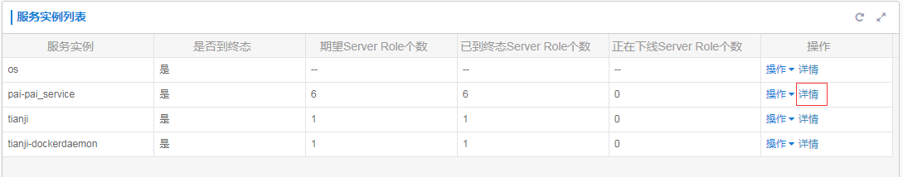

   </li>

   <li>

   找到角色列表，单击**详情**进入角色详情页面。

   图 2. 飞天基础运维平台角色管理

   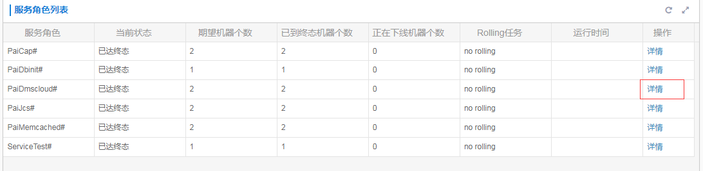

   </li>

   <li>

   在机器信息列表中，即可查看到机器的IP地址。可以单击**终端**，进入机器终端管理页面来管理这些机器。

   图 3. 飞天基础运维平台机器管理

   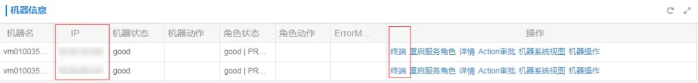

   </li>

   </ol>

<a id="section-1-1-2"></a>

### 1.1.2. 登录服务器

阿里云人工智能平台 PAI（原机器学习平台PAI）是基于飞天基础运维平台部署的，应用信息和相关的数据库信息可以在相应的飞天基础运维平台地址中查询到。本文介绍如何登录到相应的服务器上。

**背景信息**

每个模块部署在两台机器上，应用包、配置信息都是相同的，基于服务器IP登录到后台服务器进行操作。

**操作步骤**

1. 确保网络环境可通，以及查询到跳板机的机器IP。

2. 登录跳板机。

3. 切换至root用户。

4. 所有应用都是用Docker部署的，执行如下命令，可以查看当前运行的容器。

   ```bash
    sudo docker ps 
   ```

5. 执行如下命令，可以进入对应的容器。

   ```bash
    sudo docker exec –ti container_id /bin/bash 
   ```

   应用的日志目录存放在/home/admin/logs/${app}目录下。

<a id="section-1-1-3"></a>

### 1.1.3. 查询配置信息

**前提条件**

登录到各个应用所在的服务器上，进入到对应的应用容器内部可以查看应用配置信息。

**操作步骤**

1. 查看/home/admin/{app}/target/exploded/BOOT-INF/classes/application.yml文件，查询应用的配置信息。

   > {app}表示各个具体组件的名称，如 pai-dms。
   >
   > **说明**

2. 查看/home/admin/pai-dms/目录下的应用日志。

   需要关注pai-dms.log、err_pai-dms.log、java.log、access.log日志，分别为应用日志、错误日志、框架日志、访问日志。

3. 登录数据库。

   <ol type="i">

   <li>

   通过飞天基础运维平台的Dashboard集群信息查询模块的db信息，在对应的**result**列点击**显示更多**后即可获取应用的db_host、db_port、db_name、db_password 和 db_user。

   </li>

   <li>

   执行如下命令，通过mysql客户端连接。

   ```text
    mysql –h$db_host –P$db_port –u$db_user –p$ db_password –D$ db_name 
   ```

   图 1. 飞天基础运维平台的数据库信息查看

   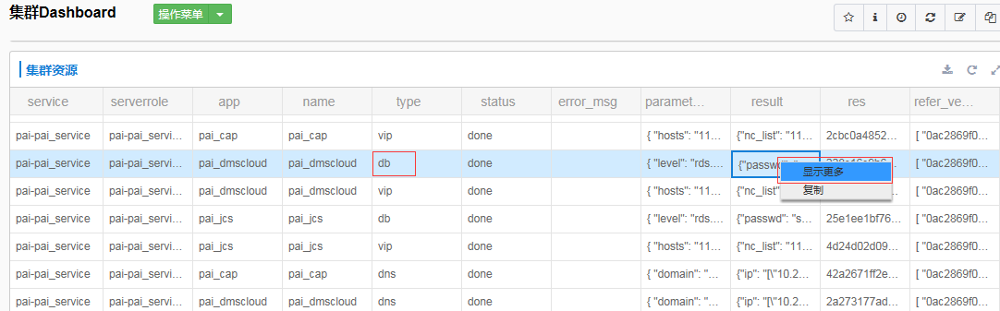

   </li>

   </ol>

<a id="section-1-1-4"></a>

### 1.1.4. 重启应用服务

人工智能平台 PAI（原机器学习平台PAI）的三个模块Cap、Dmscloud、Jcs的应用结构与目录几乎一样，可使用以下两种方式重启应用服务：

- 登录容器重启服务，执行如下命令：

  ```bash
   sudo -u admin /home/admin/pai-dms/bin/appclt.sh restart 
  ```

- 在宿主机上执行如下命令，直接重启容器：

  ```bash
   sudo docker restart $container_id 
  ```

执行如下命令，可以校验服务是否重启成功。

```bash
 curl localhost/status.taobao 
```

<a id="section-1-2"></a>

## 1.2. 在线预测服务

<a id="section-1-2-1"></a>

### 1.2.1. 查询在线预测服务信息

**检查在线预测服务状态**

在线预测服务是部署在Kubernetes（K8s）集群中的。登录K8s集群master节点，使用如下命令即可查询平台部署状态。

```bash
 kubectl get pod -n eas-system 
```

正常状态下，所有的Pod的**STATUS**栏显示为Running。

如果状态不为Running，可以使用如下命令检查错误原因：

```bash
 kubectl describe pod ${pod_name} -n eas-system 
```

**查看在线预测服务配置信息**

1. 登录飞天基础运维平台首页。

2. **集群**标签页选择**pai**，进入到**Dashboard**管理页面。

3. 查找eas-sentinel角色，通过terminal登录vm。

4. 使用 `docker ps |grep eas-sentinel`  查看sentinel对应的容器id。

5. 使用 `docker logs ${sentinel`容器`id}`  查看日志输出信息，内容即为在线预测服务配置信息。

<a id="section-1-2-2"></a>

### 1.2.2. 登录在线预测服务容器

**前提条件**

确保网络环境可通，以及查询到跳板机的机器IP。

**操作步骤**

1. 登录跳板机。

2. 切换至root用户。

3. 所有应用都是用容器部署的，执行如下命令，登录当前运行的Pod。

   ```bash
     kubectl exec -ti ${pod_name} -n ${pod_namespace} –
                       bash 
   ```

<a id="section-1-2-3"></a>

### 1.2.3. 重启Pod

**操作步骤**

1. 登录K8S集群master节点。

2. 通过 `kubectl get` 命令找到需要重启的*pod name*。

3. 执行如下命令，重启Pod。

   ```bash
    kubectl delete ${pod_name} 
   ```

<a id="section-1-3"></a>

## 1.3. DSW服务

<a id="section-1-3-1"></a>

### 1.3.1. 查看资源和配置

本文介绍如何查看DSW服务的控制面资源、数据面资源及应用配置。

**背景信息**

DSW服务都部署在PaaS平台（K8S）中，您需要登录PaaS Master服务器才能查看服务器资源。

**操作步骤**

1. 登录PaaS Master服务器。

   <ol type="i">

   <li>

   登录专有云环境的跳板机（OPS）。

   </li>

   <li>

   使用如下命令，从OPS跳转到PaaS Master服务器。

   ```bash
   ssh master
   ```

   </li>

   </ol>

2. 查看控制面资源。

   您可以使用如下命令查看所有的资源状态。

   ```bash
   kubectl get all -n pai-dsw-system
   ```

   系统返回如下类似结果。

   ```text
   NAME                                    READY   STATUS    RESTARTS   AGE
   pod/pai-dsw-gateway-686cf7****-6v7c2    1/1     Running   1          69d    //DSW⽹关，
   转发流量到⽤户Pod。
   pod/pai-dsw-gpu-q****                   1/1     Running   1          22d    //K8S⽀持GP
   U设备插件。
   pod/pai-dsw-init-6fd784****-tjl9f       1/1     Running   0          16d    //DSW数据初
   始化。
   pod/pai-dsw-notebook-679d6f****-lxnth   1/1     Running   0          2d16h  //DSW管理⻚
   ⾯后端应⽤。
   pod/pai-dsw-redis-749bbc****-mczdn      1/1     Running   0          69d    //DSW缓存⽀
   持。
   pod/pai-dsw-vip-5f9d5f****-5rmvn        1/1     Running   0          10d    //VIP算法初
   始化。

   NAME                       TYPE        CLUSTER-IP       EXTERNAL-IP   PORT(S)    AGE
   service/pai-dsw-gateway    ClusterIP   XX.XX.XX.XX   <none>        80/TCP     36d  
   //DSW⽹关⽹络虚拟IP。
   service/pai-dsw-notebook   ClusterIP   XX.XX.XX.XX    <none>        80/TCP     36d  //
   DSW管理⻚⾯后端应⽤⽹络虚拟IP。
   service/pai-dsw-redis      ClusterIP   XX.XX.XX.XX    <none>        6379/TCP   36d  //
   DSW缓存⽹络虚拟IP。

   NAME                         DESIRED   CURRENT   READY   UP-TO-DATE   AVAILABLE   NODE 
   SELECTOR   AGE
   daemonset.apps/pai-dsw-gpu   0         0         0       0            0           dsw=g
   pu         22d  // K8S⽀持GPU设备插件。

   NAME                               READY   UP-TO-DATE   AVAILABLE   AGE
   deployment.apps/pai-dsw-gateway    1/1     1            1           69d
   deployment.apps/pai-dsw-init       1/1     1            1           69d
   deployment.apps/pai-dsw-notebook   1/1     1            1           69d
   deployment.apps/pai-dsw-redis      1/1     1            1           69d
   deployment.apps/pai-dsw-vip        1/1     1            1           11d
   // 上述Pod对应部署⽀持，⽀持应⽤⾃愈和副本数升级。
   ```

3. 查看数据面资源。

   您可以使用如下命令查看所有数据资源。

   ```bash
   kubectl get all -n dsw-resource
   ```

   系统返回如下类似结果。

   ```text
   NAME                                                         READY   STATUS    RESTARTS
   AGE
   pod/b2021031812484239c0d979871d1000055853-5c6c84****-wpfwf   1/1     Running   0      
   16d  //⽤户实例。

   NAME                                            TYPE        CLUSTER-IP       EXTERNAL-I
   P   PORT(S)   AGE
   service/b2021031812484239c0d979871d100005****   ClusterIP   11.166.XX.XX   <none>    
   80/TCP    21d  //⽤户实例对应的⽹络虚拟IP。

   NAME                                                    READY   UP-TO-DATE   AVAILABLE 
   AGE
   deployment.apps/b2021031812484239c0d979871d100005****   1/1     1            1        
   21d  //⽤户实例对应的部署⽀持，⽀持⽤户实例⾃愈。
   ```

4. 查看应用配置。

   您可以通过如下命令查看DSW服务的应用配置。

   ```bash
   kubectl get cm -n pai-dsw-system
   ```

   系统返回如下类似结果。

   ```text
   NAME                             DATA   AGE
   pai-dsw-controller               34     22d   //DSW应⽤的配置。
   container-runtime-image-limits   1      70d   
   dsw-base                         1      21d
   init.check                       1      70d
   pai-dsw-base                     1      69d   
   pai-dsw-cpu                      1      70d   
   pai-dsw-gateway                  4      69d   
   pai-dsw-gpu                      1      22d   
   pai-dsw-init                     1      69d   
   pai-dsw-notebook                 1      69d   
   pai-dsw-redis                    2      69d   
   pai-dsw-vip                      1      69d   
   // 其他configmap对象，为扩展性备⽤。
   ```

<a id="section-1-4"></a>

## 1.4. GPU集群及任务信息

<a id="section-1-4-1"></a>

### 1.4.1. 查询GPU集群相关信息

**前提条件**

您首先需要部署深度学习，部署成功后才能查询到GPU集群信息。深度学习任务是在GPU集群上执行的，您可以通过登录GPU集群的ApsaraAG来查询GPU集群状态。

**操作步骤**

1. 登录飞天基础运维平台首页。

2. 集群标签页搜索PAIGPU，会看到部署的GPU集群，进入到机集群运维中心。

3. 服务选择pai-deep_learning，服务角色选择ApsaraAG#，通过terminal登录vm机器。

4. 执行  `r ttrl`  命令查看当前GPU集群上所有的GPU机器。

   **Other**栏如果显示 `FUXI_GPU`：`200` 表示这是两卡机器，如果显示 `FUXI_GPU:800`  表示这是一台八卡机器。

<a id="section-1-4-2"></a>

### 1.4.2. 查询GPU任务相关信息

**操作步骤**

1. 执行查询GPU集群相关信息的步骤1～3，登录GPU集群ApsaraAG。

2. 执行 `r al` 命令，查看当前正在执行的任务。

3. 执行 `r wwl WorkItemName` 命令，查看某个任务运行状态和分配的资源。 `WorkItemName` ： `r al`  命令显示的第一列的值。

4. 执行 `r cru` 命令，查看当前集群已经分配的资源。包括CPU、Memory和FUXI_GPU。

   > 请谨慎执行此步骤。
   >
   > **重要**

5. 

   执行  `r jstop WorkItemName` 命令，停止某个fuxi任务。 `WorkItemName` ： `r al`  命令显示的第一列的值。

<a id="section-2"></a>

# 2.运维与故障排查

<a id="section-2-1"></a>

## 2.1. 阿里云机器学习平台运维

<a id="section-2-1-1"></a>

### 2.1.1. 运行ServiceTest

运行ServiceTest之后，会运行自动化测试用例。

1. 登录飞天基础运维平台首页，选择**任务 > 部署概况**。进入**部署概况**页面。

2. 在**部署概况**页面单击**部署详情**，进入部署详情页面。

3. 将鼠标定位到project为pai的一行。单击**详情**，如下图所示，单击<strong>ServiceTest#</strong>进入机器列表页面。

   图 1. 进入ServiceTest步骤

   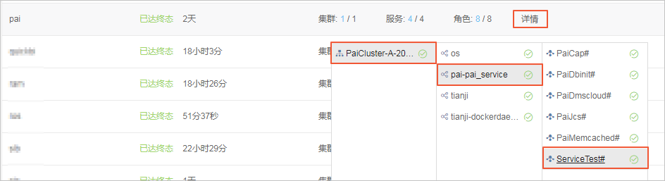

4. 在机器学习列表页面，单击**Terminal**进入**TerminalService**的web界面。

5. 执行 `sudo docker ps -a` 命令找到pai的ServiceTest的实例，如下图所示。

   图 2. ServiceTest的实例

   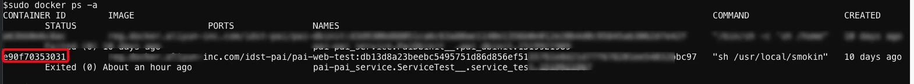

6. 执行 `sudo docker restart e90f70353031` 命令重启ServiceTest服务，如下图所示。

   图 3. 重启服务

   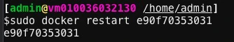

   重启service_test服务会运行测试用例，运行结束后，能看到日志信息。

7. 执行 `sudo docker logs e90f70353031 --tail 1000` 命令查看日志，由于日志较多，在此查看最后1000行。

8. 测试用例运行结束后，会看到各个算法的运行结果，如下图所示。

   图 4. 运行结果

   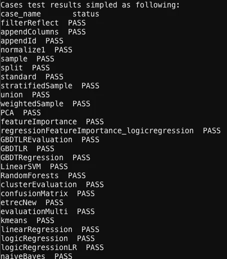

   - PASS状态：说明算法运行正常。

   - SKIP或FAIL状态：说明算法运行失败。

<a id="section-2-1-2"></a>

### 2.1.2. 常见问题以及解决方案

<a id="section-2-1-2-1"></a>

#### 2.1.2.1. 常用运维指令

nc、telent、curl、ping、mysql

`docker images`  查看机器上所有镜像。

`docker ps` 查看机器上当前running镜像。

```bash
 docker exec –ti containerID /bin/bash 
```

`docker log containerID` 查看容器日志。

`curl http://localhost/status.taobao` 判断应用SpringBoot服务是否成功启动。

<a id="section-2-1-2-2"></a>

#### 2.1.2.2. pai.xx.xx无法正常访问

**操作步骤**

1. 执行 `ping pai.xx.xx` 命令，查看域名是否解析到对应的VIP。

   如果域名不能正常解析，请联系驻场查看网络配置。

2. 执行 `curl http://ip/status.taobao` 命令，查看各模块服务是否正常。

   如果模块服务status.taobao检测不通过，请执行如下操作：

   <ol type="i">

   <li>

   登录机器，查看容器是否存活。

   </li>

   <li>

   进入容器，执行如下命令，查看服务进程是否存活。

   ```text
     ps –lef | grep
                                   java 
   ```

   </li>

   <li>

   查看/home/admin/{app}/logs/err_pai-dms.log日志文件，常见问题都能在日志里找到线索，如依赖租户服务请求超时、依赖缓存ocs超时、数据库连接异常等。

   建议按照清单检查完毕后再查看日志，排除因为基础组件服务异常，导致模块功能不健全。

   </li>

   </ol>

3. 验证数据库RDS是否可以正常访问。

   <ol type="i">

   <li>

   执行如下命令，探测端口是否存活。

   ```text
    nc –v –z $rds_host $port 
   ```

   </li>

   <li>

   执行如下命令，查看数据库是否可以连接。

   ```text
    mysql –h$Host –P$Port –u$user –p$password 
   ```

   </li>

   </ol>

4. 验证缓存是否正常。

   执行如下命令，查看11211端口是否存活。

   ```text
    nc –v –z $ocs_host 11211 
   ```

   其中，ocs_host的查找方法如下：

   <ol type="i">

   <li>

   查找dmscloud的实例，如下图的实例所示。

   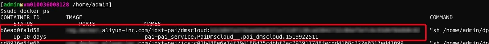

   </li>

   <li>

   执行 `sudo docker inspect b6ead0fa1d58 | grep ocs` 命令，查看ocs_host信息，如下图所示。

   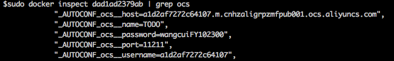

   `host`  为ocs（缓存）的机器列表， `port`  为端口号。

   </li>

   </ol>

   机器学习的专有云环境依赖缓存一般为自带memcached服务，如果11211端口不通，请登录对应宿主机，执行如下命令，重启memcached服务。

   ```bash
    docker restart containerid 
   ```

<a id="section-2-1-2-3"></a>

#### 2.1.2.3. 实验无法正常运行

人工智能平台 PAI（原机器学习平台PAI）建议在Chrome版本为66 及以上的浏览器上运行实验，目前Web支持只针对Chrome。

- 实验组件拖拽无反应。

  请清理Cookie以及缓存重试，然后查看Chrome浏览器版本，如果仍然不行那就是服务有问题，登录容器内查看日志。

- 跑算法时日志报错。

  日志报错说明任务已经成功提交至MaxCompute，请查看使用文档，详细查看当前使用算法说明文档，一般为参数配置不对，或者原始数据有问题。

<a id="section-2-1-2-4"></a>

#### 2.1.2.4. 其他故障

按照pai.xx.xx无法正常访问检查后，依然有问题，需要从基础依赖服务排查起，查看依赖服务MaxCompute、DataWorks（租户、元数据）是否正常。

- MaxCompute 可以通过pai_console测试验证。

- DataWorks 依赖查看配置域名是否连通，以及应用日志验证。

看不出任何异常且应用有问题时，请尝试重启服务。

<a id="section-2-2"></a>

## 2.2. 在线预测服务运维（需要单独开通）

**节点运维**

在线预测服务节点即Kubernetes节点。使用 `kubectl get node`  命令可以查看集群中的节点，正常状态节点会显示Ready状态。对于非Ready节点，一般原因有两种：

- 节点机器宕机

  节点宕机原因较多，一般是由于内核crash或者磁盘过满导致，如果节点能够正常重启，那么一般在重启后节点会重新加入集群。如果不能正常重启，可以找ECS相关业务接口人解决。

- Docker daemon异常

  docker daemon 出现异常概率较低，一般情况下都是由于存储方面的问题引起的。执行 `systemctl`

```text
restart
```

`docker` 命令重启docker daemon。

**在线预测功能运维**

- 无法创建、删除服务

  - 如果在调用接口时返回500错误，是由于eas-ui 组件配置不正确导致的，需要由阿里云交付工程师解决。

  - 如果接口调用成功，但是创建或删除操作长时间没有响应，是由于构建服务以来的jobworker没有正常执行任务。重点排查集群内的redis服务是否正常，如有异常，尝试重启redis对应的pod解决。

- 监控数据无法读取

  查看eas-system下influxdb-0 pod 是否正常创建，若显示非 Running 状态，一般是由于 influxdb OOM 导致，可以加大 influxdb-0 的内存配置。

**服务运维**

- 创建服务失败

  这里是指请求正常，但是创建服务显示**失败**。由于模型错误导致crash无法正常运行，会导致模型创建失败，请检查模型代码是否存在空指针等问题。

- 监控数据无法获取

  检查每个服务的 influxdb-0 是否正常。无法创建的原因一般是无法创建对应的持久卷，可以检查专有云中磁盘数目是否足够。如果 influxdb-0 运转正常也无法获取数据，请尝试重启对应的 influxdb-0 pod。

<a id="section-2-3"></a>

## 2.3. DSW服务运维

本文介绍DSW常见问题的处理方式。

**实例启动失败**

使用 `kubectl get all -n dsw-resource` 命令获取数据面用户实例资源，系统返回如下类似结果。

```text
NAME                                                         READY   STATUS    RESTARTS  
AGE
pod/b2021031812484239c0d979871d1000055853-5c6c84****-wpfwf   1/1     Running   0        
16d

NAME                                            TYPE        CLUSTER-IP       EXTERNAL-IP 
PORT(S)   AGE
service/b2021031812484239c0d979871d100005****   ClusterIP   XX.XX.XX.XX   <none>       
80/TCP    22d

NAME                                                    READY   UP-TO-DATE   AVAILABLE   
AGE
deployment.apps/b2021031812484239c0d979871d100005****   1/1     1            1          
22d
```

对于处于非正常状态的Pod，使用如下命令查看 `Events` 部分的错误Event及其对应的故障原因。

```bash
kubectl describe -n dsw-resource po b2021031812484239c0d979871d1000055853-5c6c84****-wpfwf
...
Events:          <none>
```

如下图所示。

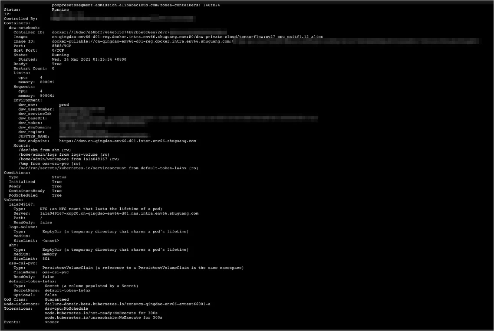

**实例在集群正常启动，但是访问链路不通**

1. 在Kubernetes集群内，使用命令 `kubectl get ingress -n dsw-resource` 获取用户的Ingress规则。系统返回如下类似结果。

   ```text
   NAME                                    HOSTS                                          
   ADDRESS         PORTS   AGE
   b2021031812484239c0d979871d100005****   dsw-instance.cn-qingdao-env66-
   d01.intra.env66.shuguang.com   XX.XX.XX.XX      22d
   ```

2. 使用如下命令查询Ingress是否正常工作。如果Ingress无法正常工作，则联系PaaS工程师，进一步排查问题。

   ```text
   ping <Ingress Host>
   ```

   其中 `<Ingress Host>` 需要替换为上一步命令执行结果中的 `HOSTS` 字段。

<a id="section-2-4"></a>

## 2.4. GPU集群运维（深度学习需单独开通）

**节点运维**

深度学习节点即GPU集群物理机。

1. 执行查询GPU集群相关信息的步骤1～3，登录ApsaraAG。

2. 执行 `r ttrl` 命令，查看所有支持执行深度学习任务的节点。

- 节点宕机

  节点宕机原因较多，一般是由于内核crash或者磁盘过满导致，如果节点能够正常重启，那么一般在重启后节点会重新加入集群。如果不能正常重启，可以找相关业务接口人解决。

- Docker daemon 异常

  docker daemon 出现异常概率较低，大多是情况下都是由于存储方面的问题引起的。使用 `systemctl`

```text
restart
```

`docker`  重启docker daemon。

**服务运维**

**任务无法分配资源**

通过下面几个步骤来排查：

1. 执行查询GPU集群相关信息的步骤1～3，登录ApsaraAG。

2. 执行 `r quota` 命令，查看GPU集群Quota分配情况。

3. 执行 `r cru` 命令，查看集群所有任务的资源分配情况。

4. 执行 `r al`  命令，查看当前提交到集群的所有任务。

5. 执行 `r wwl WorkItemName` 命令，查看某个任务的状态。

   - 如果只显示了**ChildMaster**，说明 worker 还未分配到资源。

   - 如果显示了 **worker name** 但没有显示具体的机器 **hostname**，可能在等待拉起或者因为某些原因拉起失败。这时需要登录ChildMaster对应的机器上去查看相应的错误，或者联系相关业务的接口人解决。

6. 执行  `r ttrl`  命令，查看**Other**一栏中**FUXI_GPU**数值是否符合预期，显示200表示两卡机器，显示800表示八卡机器。

7. 根据步骤3得到的机器列表，通过ssh 登录其中某台GPU机器，执行 `nvidia-smi` 命令查看GPU卡状态，如果有异常状态，请联系相关业务接口人解决。
